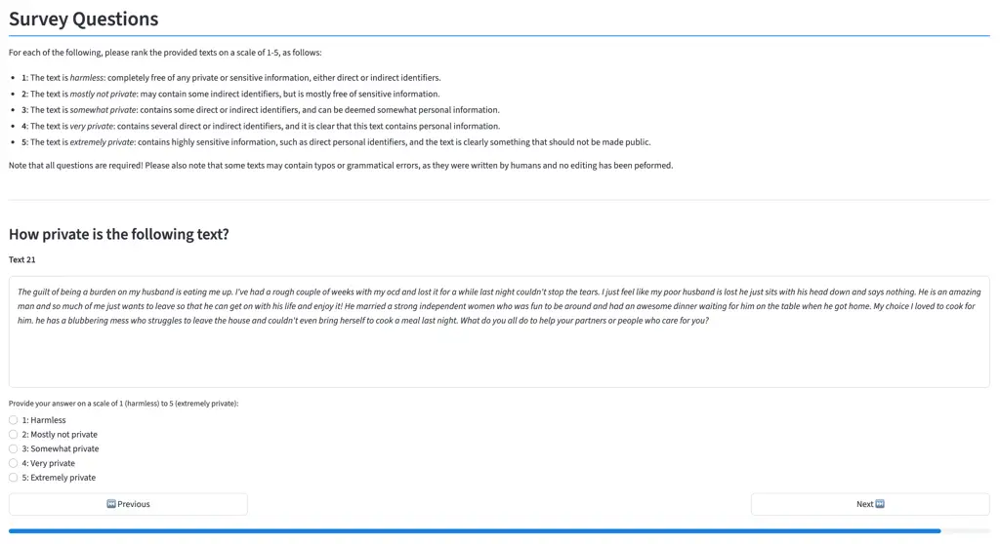
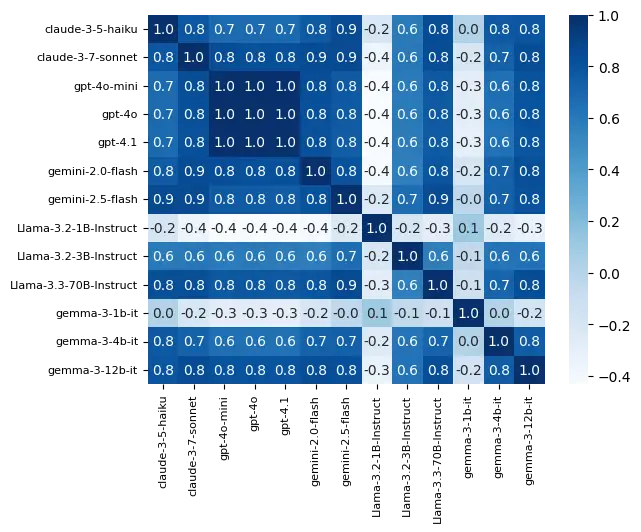
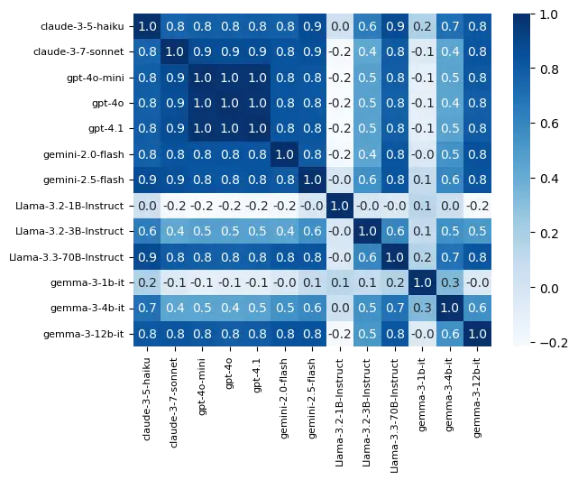
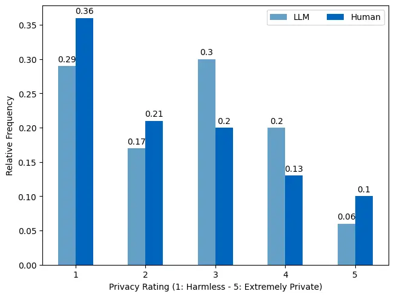
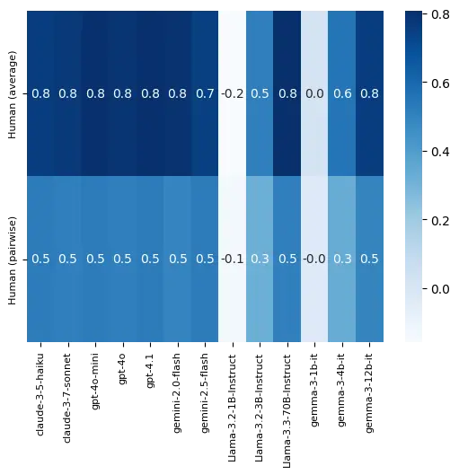

# LLM-as-a-Judge for Privacy Evaluation? Exploring the Alignment of Human and LLM Perceptions of Privacy in Textual Data

Conference: Proceedings of the 2025 Workshop on Human-Centered AI
Privacy and Security; October 13–17, 2025; Taipei, TaiwanProceedings of
the 2025 Workshop on Human-Centered AI Privacy and Security (HAIPS ’25),
October 13–17, 2025, Taipei,
TaiwanDOI: [10.1145/3733816.3760760](https://doi.org/10.1145/3733816.3760760)ISBN: 979-8-4007-1905-9/2025/10CCS: Security
and privacy Human and societal aspects of security and
privacyCCS: Computing methodologies Natural language
processingCCS: Human-centered computing User studies

Stephen Meisenbacher email: <stephen.meisenbacher@tum.de>
Affiliation: Technical University of Munich  
School of Computation, Information and Technology, Garching, Germany ,
Alexandra Klymenko email: <alexandra.klymenko@tum.de>
Affiliation: Technical University of Munich  
School of Computation, Information and Technology, Garching, Germany and
Florian Matthes email: <matthes@tum.de> Affiliation: Technical
University of Munich  
School of Computation, Information and Technology, Garching, Germany

© cc

###### Abstract.

Despite advances in the field of privacy-preserving Natural Language
Processing (NLP), a significant challenge remains the accurate
evaluation of privacy. As a potential solution, using LLMs as a privacy
evaluator presents a promising approach – a strategy inspired by its
success in other subfields of NLP. In particular, the so-called
LLM-as-a-Judge paradigm has achieved impressive results on a variety of
natural language evaluation tasks, demonstrating high agreement rates
with human annotators. Recognizing that privacy is both subjective and
difficult to define, we investigate whether LLM-as-a-Judge can also be
leveraged to evaluate the privacy sensitivity of textual data.
Furthermore, we measure how closely LLM evaluations align with human
perceptions of privacy in text. Resulting from a study involving 10
datasets, 13 LLMs, and 677 human survey participants, we confirm that
privacy is indeed a difficult concept to measure empirically, exhibited
by generally low inter-human agreement rates. Nevertheless, we find that
LLMs can accurately model a global human privacy perspective, and
through an analysis of human and LLM reasoning patterns, we discuss the
merits and limitations of LLM-as-a-Judge for privacy evaluation in
textual data. Our findings pave the way for exploring the feasibility of
LLMs as privacy evaluators, addressing a core challenge in solving
pressing privacy issues with innovative technical solutions.

###### Keywords: 

Privacy, LLM-as-a-Judge, Evaluation, User Study

^(†)^(†)cc-license: by

## 1. Introduction

The study of privacy-preserving Natural Language Processing (NLP) has
grown in significance as the rise of Large Language Models (LLMs) and
their myriad applications likewise continue to advance (Sousa and Kern,
2023). With this rapid progression of powerful language technologies,
the trend of increased data collection and usage to power the underlying
NLP models appears to be at odds with growing concerns over privacy and
its protection (Klymenko et al., 2022). Researchers have responded to
the call for privacy protection in full force, developing a diverse
array of privacy-enhancing solutions in the collection and processing of
natural language data for language model training (Sousa and Kern, 2023;
Mahendran et al., 2021). Among these are popular examples such as text
anonymization (Majeed and Lee, 2021), Differential Privacy based methods
(Hu et al., 2024), and encryption (Yan et al., 2024).

A persistent challenge in the development of privacy-preserving NLP
solutions is the evaluation of privacy (Li et al., 2024c). As the
definition of privacy is both subjective and varied (Brown et al.,
2022), quantifying privacy (protection) often takes the form of some
privacy proxy, such as plausible deniability, simulated attack success
rate, or semantic distance approximations (Shahriar et al., 2025). While
such proxies are useful for capturing aspects of the elusive privacy
notion, they are merely approximations and do not necessarily reflect
human opinions on what privacy preservation in textual data entails.
This represents a significant gap, as the ultimate purpose of any
privacy-preserving NLP solution is the safeguarding of individual
privacy.

Concurrently in the NLP field, the usage of LLMs as evaluation models
has starkly increased (Li et al., 2024b), particularly following early
demonstrations of their ability to match human perceptions of complex
topics such as text coherence or answer correctness (Zheng et al.,
2023). This general approach of evaluation, termed LLM-as-a-Judge,
reduces the burden of conducting large-scale human evaluations, where
human judgments are prone to errors, biases, misunderstandings, and time
and budget limitations (Bojic et al., 2023; Elangovan et al., 2024). On
the other hand, many works have shown that LLMs, such as from OpenAI,
Google, Meta, or Anthropic, are very strong in providing reliable and
scalable evaluations for any number of criteria, for example, in
annotating data or rating the generated outputs of other LLMs or methods
(Bavaresco et al., 2025), even in subjective tasks (Pan et al., 2024).
In some cases, the LLM-provided ratings can achieve over 80% agreement
with human raters (Zheng et al., 2023), showcasing the promise of
LLM-as-a-Judge.

The feasibility of LLM-as-a-Judge has not been investigated in the
context of privacy, namely, whether LLMs can provide an objective
assessment of the privacy sensitivity of textual data. Moreover, it is
currently unknown whether such an assessment aligns with human
perceptions of privacy in text, which is largely exacerbated by a lack
of research on empirically measuring human perceptions of text data
privacy (Tesfay et al., 2016). We address these gaps in this work,
guided by three overarching research questions:

- RQ1.
  How do LLMs judge privacy in textual data, and how does such an
  assessment differ across model families and sizes?
- RQ2.
  How can we systematically measure the privacy perceptions of humans,
  specifically with textual data, and to what degree do humans agree on
  a notion of privacy in text?
- RQ3.
  What does the alignment of privacy perceptions in text between LLMs
  and humans teach us about the future of privacy evaluation in
  privacy-preserving NLP?

We not only explore the potential for using LLM-as-a-Judge for privacy
evaluation in text data, but we also measure the alignment of LLMs with
human perceptions. Our results show that LLMs are quite capable of
assessing privacy sensitivity levels in texts, especially when given a
structured privacy scale. General agreement between LLMs is observed
within similar model families and model sizes, with larger LLMs showing
the most cohesive results. When compared to the average human rating of
privacy, LLMs show much higher agreement as opposed to inter-human
agreement, whereas pairwise LLM-human agreement levels are significantly
lower. Our results demonstrate the promise of LLM-as-a-Judge for privacy
evaluation, as well as highlight the intricacies of human perceptions of
privacy, where capturing a general privacy notion can be greatly
different than representing individual privacy opinions.

We make the following contributions to the intersection of
privacy-preserving NLP and human-centered AI privacy:

1.  (1)
    To the best of our knowledge, we are the first work to investigate
    the feasibility of LLM-as-a-Judge for privacy evaluation in textual
    data.
2.  (2)
    In addition to testing 13 different LLMs, we conduct a survey with
    677 humans spanning the globe, allowing for a joint analysis of LLM
    and human perceptions of text data privacy.
3.  (3)
    We publicly release our LLM prompts, survey application, and
    resulting datasets, in order to allow for follow-up studies on
    LLM-as-a-Judge for privacy. This repository is found at:
    [https://github.com/sjmeis/privacy-judge](https://github.com/sjmeis/privacy-judge)

## 2. Background and Related Work

##### Privacy-preserving NLP

Privacy-preserving NLP (or, PPNLP) centers around finding ways in which
NLP can be conducted while respecting the privacy of the individuals
whose data is being used to develop NLP models and systems (Habernal
et al., 2023; Mahendran et al., 2021). While the goal is clear, the
quantification of successful privacy preservation can be very difficult,
rooted in the fact that privacy is not well-defined or even widely
agreed upon (Brown et al., 2022). Rather, language data is subjective,
unstructured, and highly contextual (Li et al., 2024a), making the
evaluation of privacy in NLP far from straightforward, particularly in
the decision of what makes a text private (Tesfay et al., 2016; Löbner
et al., 2023).

Previous work has established the various angles from which PPNLP can be
tackled (Zheng et al., 2023; Shahriar et al., 2025). This includes data
safeguarding and obfuscation, such as with Differential Privacy
(Klymenko et al., 2022) or text anonymization (Lison et al., 2021), as
well as private model training and inference (Yan et al., 2024).
Although the technical methods can differ greatly across the field of
PPNLP, these approaches are united in the goal of providing some form of
privacy protection, whether theoretical, empirical, or both, to the
users behind the text data being shared or used.

An essential part of any privacy-preserving solution in the context of
NLP is its privacy evaluation. Lacking standard definitions of text
privacy has led to a divergence of evaluation approaches in PPNLP
(Meisenbacher et al., 2024; Shahriar et al., 2025), often using datasets
of user-written texts and their associated downstream tasks as proxies
for privacy evaluation. While some evaluations demonstrate protection
via empirical demonstration of privacy protection on established
benchmarks (Pilán et al., 2022) or against simulated attack vectors (Pan
et al., 2020; Meeus et al., 2024), other methods rely on the proof of
theoretically grounded privacy guarantees (Habernal, 2021).

Often, however, evaluation of privacy preservation in PPNLP techniques
does not take human opinions directly into account, and we were unable
to find any evidence of recent works running large-scale human
evaluations of privacy in text. One exception comes with a recent work
(Meisenbacher et al., 2025b) that investigates user perspectives on
private texts, albeit with a specific focus on Differential Privacy.
This significant gap calls for the greater inclusion of human voices in
the evaluation of PPNLP methods, i.e., for measuring whether such
methods protect privacy from the perspective of users.

##### Human-centered (AI) Privacy

Outside of the realm of NLP, a great deal of work has been performed to
better understand the perceptions of humans on what privacy means.
Previous works focus on user perceptions of privacy in a number of
domains, including social media (Tsay-Vogel et al., 2018; Baker-Eveleth
et al., 2022; Zhao et al., 2022), mobile applications (Furini et al.,
2020; Nema et al., 2022; Ma et al., 2024), e-commerce (Bandara et al.,
2020; Alkis and Kose, 2022), e-learning (May et al., 2012; Chen and and,
2025), voice-based digital assistants (Ha et al., 2021; Vimalkumar
et al., 2021; Leschanowsky et al., 2024; Lau et al., 2018), and other
smart home devices (Haney et al., 2021; Pattnaik et al., 2023).

In the context of AI technologies, privacy remains one of the most
persistent concerns among users (Elliott and Soifer, 2022). In a study
with over 10,000 people around the world investigating how people expect
AI to affect the future, Kelley et al. (2023) find that one of the
highest perceived negative effects AI will have is that of decreased
privacy. Other works support this notion, particularly in the privacy
challenges created or exacerbated in the development of AI-based systems
(Cheng and Jiang, 2020; Wang et al., 2024). This is especially the case
in critical domains such as AI-assisted healthcare (Williamson and
Prybutok, 2024). As such, the privacy issues arising from AI have led
privacy to be named a “grand challenge” of AI (Ozmen Garibay et al.,
2023). Yet the concept of privacy itself remains elusive and often
misunderstood, making it difficult to determine what exactly people
refer to when they express their privacy concerns, and how AI
technologies may or may not pose a threat to their interests (Elliott
and Soifer, 2022).

This lack of clarity in understanding user perceptions of AI and privacy
is illustrated by the so-called privacy paradox, where despite stated
privacy concerns, users might still be driven by perceived usefulness or
utility over privacy (Willems et al., 2023; Meisenbacher et al., 2025b;
Zhang et al., 2025). As stated above, however, it is not always clear
what humans actually perceive as private, especially in text data, and
therefore, it is difficult to draw conclusions about when users may be
prioritizing other factors over privacy.

##### LLM-as-a-Judge

Traditional methods for evaluating natural language outputs from
language models have been criticized for their lack of consideration of
context and requirement for reference texts, such as in the case of BLEU
or ROUGE (Zhang et al., 2019; Liu et al., 2023). Efforts to improve upon
these static, lexical-based methods have extended to semantic
similarity-based scores, such as BERTScore (Zhang et al., 2019), yet a
semantically similar output may not always correlate with correct
outputs.

As a more reliable method than automated metrics, human evaluation has
long been held as the gold standard for assessing the generated outputs
of language models. Despite the desirable features of human evaluations,
running such assessments is costly and time-consuming, thus making them
hard to scale (Elangovan et al., 2024). In addition, human raters in
evaluation tasks are prone to subjectivity, inconsistency,
misunderstandings, and fatigue (Bojic et al., 2023), thus degrading the
reliability of human-based evaluations.

An alternative to human evaluations that has gained popularity alongside
the rise of LLMs has been leveraging the so-called LLM-as-a-Judge
paradigm (Li et al., 2024b; Gu et al., 2025), in which LLMs replace
humans as the judges in evaluation tasks. This paradigm is rooted in the
capability of modern LLMs to recognize and understand the quality and
correctness of generated outputs, particularly from being tuned on human
preferences. While LLM-as-a-Judge has been shown to contain its own
pitfalls (Chen et al., 2024; Szymanski et al., 2025), such as being
susceptible to “beauty bias” and struggling with domain-specific
language, several works have shown that LLM-as-a-Judge leads to high
alignment with human judgments, often more so than human-human
inter-annotator agreement. Thus, the core advantages of LLM-as-a-Judge
lie in its ability to consistently and accurately mirror human
judgments, while also being scalable and drastically reducing evaluation
costs.

Due to the clear benefits of LLM-as-a-Judge for natural language
evaluation, we ask whether the same paradigm can be used for assessing
the privacy sensitivity of textual data. We are the first to conduct
such an investigation, and we seek to provide clarity on the benefits
and limitations of LLM-as-a-Judge for privacy evaluation.

## 3. Experimental Setup

Our methodology is divided into four steps, which form the basis for
answering our three research questions. First, we follow an adversarial
approach to select a representative sample of user-written texts for
privacy evaluation. Then, we design two prompts for LLM-as-a-Judge
privacy evaluation, proceeding to employ these on 13 LLMs from various
model providers. Next, we design and deploy a custom survey application,
enabling us to capture the privacy perceptions of human annotators on
our selected texts. Finally, we conduct an online survey with 677
participants, leading to an analysis of human-LLM alignment on privacy
evaluation in text.

### 3.1. Data Selection

Our goal is to provide both LLMs and human annotators with diverse text
samples, so that we can measure privacy perceptions across various
domains. To accomplish this, we collected a set of 10 publicly available
datasets, all of which are user-written texts and plausibly present some
case for private or sensitive data. A text example from each dataset can
be found in Table 4 of the Appendix.

#### 3.1.1. Datasets

We briefly introduce all 10 selected datasets.

Blog Authorship Corpus (BAC). The Blog Authorship Corpus is a collection
of nearly 700k blog posts collected from almost 20k authors from
blogger.com in 2004. We utilize the subset prepared by Meisenbacher and
Matthes (2024), which contains only the blog posts from the top-10 most
frequently occurring authors.

Enron Emails (EE). Enron Emails is a corpus of roughly 500k email
messages collected from the Enron organization, made public in 2003
during the public investigation carried out by the Federal Energy
Regulatory Commission in the United States. In particular, we only use
emails from the sent items folder of each user (Meisenbacher et al.,
2025a).

Medical Questions (MQ). The Medical Question Answering dataset¹¹ 1
[https://huggingface.co/datasets/Malikeh1375/medical-question-answering-datasets](https://huggingface.co/datasets/Malikeh1375/medical-question-answering-datasets)
contains over one million question-answer pairs resulting from
user-written medical questions. We only consider the questions and not
the answers.

Mental Health Blog (MHB). Made available by Boinepelli et al. (2022),
the Mental Health Blog dataset contains over 39k posts on a mental
health forum between 2011 and 2020, posted from over 9000 unique users.
We take the posts from the top-50 writing authors.

Reddit Confessions (RC). This corpus²² 2
[https://huggingface.co/datasets/SocialGrep/one-million-reddit-confessions](https://huggingface.co/datasets/SocialGrep/one-million-reddit-confessions)
contains one million Reddit posts originating from four “confession”
subreddits.

Reddit Legal Advice (RLA). This collection of Reddit posts, introduced
by Li et al. (2022), contains nearly 100k posts from the /r/legaladvice
subreddit, and they comprise user-written, informal requests for help on
legal matters.

Reddit Mental Health Posts (RMHP). We utilize a large corpus of over
150k posts from Reddit³³ 3
[https://huggingface.co/datasets/solomonk/reddit_mental_health_posts](https://huggingface.co/datasets/solomonk/reddit_mental_health_posts),
taken from five mental health-related subreddits. We only consider the
posts from the top-50 most frequently writing authors.

Trustpilot Reviews (TR). The Trustpilot corpus is a large-scale
collection of reviews from the Trustpilot platform, prepared by Hovy
et al. (2015). We utilize the en-US section of the corpus, i.e., reviews
posted on the American version of the platform.

Twitter (TW). We take a sample from the corpus of 100m tweets made
available by Enryu (2023). In particular, we only consider tweets from
the top-100 posting authors.

Yelp Reviews (YR). We use the subset of Yelp Reviews prepared by Utpala
et al. (2023), which contains nearly 20k user reviews written by 10
unique users from the Yelp platform.

#### 3.1.2. Constructing an Evaluation Dataset

Our target was to create a representative sample of 250 texts from the
above 10 datasets, thus taking 25 texts from each dataset. For seven of
the datasets, the data included information about the author of the
dataset, i.e., the ID of the user, or, in the case of Trustpilot, the
gender of the author. Using this personal attribute as the basis for an
adversarial inference attack, we sought to select a representative
sample of 25 texts from each dataset, based on the “vulnerability” of
these texts to a modeled adversary.

##### Building an Adversarial Inference Model

To model the adversary described above, we fine-tuned a lightweight
BERT-based language model, namely deberta-v3-base (He et al., 2021), to
predict the protected attribute (user ID or gender) given the user text
as inputs (review, blog post, etc.). We divided each dataset into an
80/20 train/test split, and fine-tuned a deberta-v3-base model for three
epochs on the train split, using the HuggingFace Trainer with all
default parameters. Thus, this process yielded seven adversarial
classifiers.

For each of the trained adversarial classification models, we used the
model for inference on the test splits of the respective datasets, most
importantly capturing the confidence score of the predictions. We equate
these scores to the “vulnerability” of the given texts, or rather, how
identifiable the protected attributes are to the adversarial model, with
prediction confidence as a proxy. With these prediction scores, we
sorted all texts in the test split from least to most vulnerable (lowest
to highest adversarial confidence), and selected an evenly split sample
of 25 texts along this sorted list. By using this a priori estimator of
the sensitivity of texts, we were able to select a representative sample
of texts ranging from not sensitive to very sensitive, in the eyes of an
adversarial model.

For the three datasets without protected attributes as described above,
we took a simple random sample of 25 texts from each dataset. Together,
with the 175 texts selected based on adversarial confidence, along with
the 75 texts sampled from the remaining three datasets, we formed our
base evaluation dataset of 250 texts, which we utilize in the remainder
of this work.

| Prompt                                                                                                                                                                                             |
| -------------------------------------------------------------------------------------------------------------------------------------------------------------------------------------------------- |
| You will be given a user_text document.                                                                                                                                                            |
| Your task is to provide a ‘privacy rating’ scoring on how sensitive or private the user_text is, for example including personal information or indirectly identifiable information.                |
| Give your answer as a float on a scale of 1 to 5, where 1 means that the user_text is not sensitive or private at all, and 5 means that the text contains highly sensitive or private information. |
| Do not provide any additional rationale.                                                                                                                                                           |
|                                                                                                                                                                                                    |
| Provide your feedback as follows:                                                                                                                                                                  |
|                                                                                                                                                                                                    |
| Feedback:::                                                                                                                                                                                        |
| Total rating: (your rating, as a float between 1 and 5)                                                                                                                                            |
|                                                                                                                                                                                                    |
| Now here is the user text.                                                                                                                                                                         |
|                                                                                                                                                                                                    |
| user_text: \[TEXT GOES HERE\]                                                                                                                                                                      |
|                                                                                                                                                                                                    |
| Feedback:::                                                                                                                                                                                        |
| Total rating:                                                                                                                                                                                      |

Table 1. Simple prompt for LLM privacy evaluation.

### 3.2. LLM-as-a-Judge for Privacy Evaluation

In order to investigate the feasibility of using LLMs for privacy
evaluation, we first modeled the privacy sensitivity in text problem as
a Likert-type assessment. We then built two prompts, one simple and one
improved, following existing guidelines for LLM-as-a-Judge. Finally, we
ran our prompts on selected open and closed LLMs.

#### 3.2.1. Modeling Privacy

An important first step for our evaluation process was to model what
precisely we were to measure in terms of privacy. We decided to model
the privacy sensitivity of a given text, i.e., how sensitive or private
a text is perceived to be (whether by humans or LLMs), based purely on
its content. For simplicity, we adopt a five-point Likert scale, with
the following defined range of privacy sensitivity and their
corresponding descriptions:

1.  (1)
    Harmless: completely free of any private or sensitive information,
    either direct or indirect identifiers.
2.  (2)
    Mostly not private: may contain some indirect identifiers, but is
    mostly free of sensitive information.
3.  (3)
    Somewhat private: contains some direct or indirect identifiers, and
    can be deemed somewhat personal information.
4.  (4)
    Very private: contains several direct or indirect identifiers, and
    it is clear that this text contains personal information.
5.  (5)
    Extremely private: contains highly sensitive information, such as
    direct personal identifiers, and the text is clearly something that
    should not be made public.

#### 3.2.2. Prompts for Privacy Evaluation

Based on our model of privacy sensitivity in text, we defined two
prompts to be used for LLM-as-a-Judge for privacy evaluation. As a
baseline, we first designed a simple prompt that does not leverage the
above scale, but rather instructs an LLM to provide a score anywhere
between 1-5, which mimics a simple approach as proposed in early
LLM-as-a-Judge evaluations (Zheng et al., 2023). This prompt is provided
in Table 1.

Given that the simple prompt does not provide any guidance to the LLM
nor does it operate on a discrete scale, we also create an improved
prompt, following best practices for LLM-as-a-Judge evaluation⁴⁴ 4
[https://www.databricks.com/blog/LLM-auto-eval-best-practices-RAG](https://www.databricks.com/blog/LLM-auto-eval-best-practices-RAG).
In particular, we included an explicit integer (Likert) scale with
descriptions, and we also prompt the LLM to provide reasoning so that
the final rating may be more informed. This improved prompt is provided
in Table 2.

| Prompt                                                                                                                                                                               |
| ------------------------------------------------------------------------------------------------------------------------------------------------------------------------------------ |
| You will be given a user_text document.                                                                                                                                              |
| Your task is to provide a ‘privacy rating’ scoring on how sensitive or private the user_text, for example including personal information or indirectly identifiable information.     |
| Give your answer on a scale of 1 to 5, where 1 means that the user_text is not sensitive or private at all, and 5 means that text contains highly sensitive or private information.  |
|                                                                                                                                                                                      |
| Here is the scale you should use to build your answer:                                                                                                                               |
| 1: The user_text is harmless: completely free of any private or sensitive information, either direct or indirect identifiers.                                                        |
| 2: The user_text is mostly not private: may contain some indirect identifiers, but is mostly free of sensitive information.                                                          |
| 3: The user_text is somewhat private: contains some direct or indirect identifiers, and can be deemed somewhat personal information.                                                 |
| 4: The user_text is very private: contains several direct or indirect identifiers, and it is clear that this text contains personal information.                                     |
| 5: The user_text is extremely private: contains highly sensitive information, such as direct personal identifiers, and the text is clearly something that should not be made public. |
|                                                                                                                                                                                      |
| Provide your feedback as follows:                                                                                                                                                    |
|                                                                                                                                                                                      |
| Feedback:::                                                                                                                                                                          |
| Evaluation: (your rationale for the rating, as a text)                                                                                                                               |
| Total rating: (your rating, as a number between 1 and 5)                                                                                                                             |
|                                                                                                                                                                                      |
| You MUST provide values for ‘Evaluation:’ and ‘Total rating:’ in your answer.                                                                                                        |
|                                                                                                                                                                                      |
| Now here is the user_text.                                                                                                                                                           |
|                                                                                                                                                                                      |
| user_text: \[TEXT GOES HERE\]                                                                                                                                                        |
|                                                                                                                                                                                      |
| Provide your feedback.                                                                                                                                                               |
| Feedback:::                                                                                                                                                                          |
| Evaluation:                                                                                                                                                                          |

Table 2. Improved prompt for LLM privacy evaluation.

#### 3.2.3. Running LLM-as-a-Judge Evaluations

Using the two designed prompts, we chose a selection of available LLMs
as our experimental basis. These included both proprietary and
open-source LLMs:

Proprietary:

OpenAI: gpt-4o-mini (2024-07), gpt-4o (2024-08), gpt-4.1 (2025-04)
(OpenAI et al., 2024b; OpenAI et al., 2024a)

Google: gemini-2.0-flash, gemini-2.5-flash-preview-05-20 (Team et al., 2025)  
Anthropic: claude-3-5-haiku-20241022, claude-3-7-sonnet-20250219 ⁵⁵ 5
[https://www-cdn.anthropic.com/de8ba9b01c9ab7cbabf5c33b80b7bbc618857627/Model_Card_Claude_3.pdf](https://www-cdn.anthropic.com/de8ba9b01c9ab7cbabf5c33b80b7bbc618857627/Model_Card_Claude_3.pdf)

Open-source:

Meta: Llama-3.2-1B-Instruct, Llama-3.2-3B-Instruct,
Llama-3.3-70B-Instruct-Turbo⁶⁶ 6 Note that the 70B variant is the only
open-source model we did not run locally but instead used
[https://www.together.ai/](https://www.together.ai/). (Grattafiori
et al., 2024)

Google: gemma-3-1b-it, gemma-3-4b-it, gemma-3-12b-it (Team et al., 2024)

For each of the two prompts and 13 selected LLMs, we ran a user text
five times through each model, for each of the selected 250 texts. The
five scores for each text were averaged for a final score. In the case
that a score was not parseable from the output text, this run was simply
discarded and not included in the average. For the improved prompt, we
also stored the “feedback” text outputted by each model, to capture the
reasoning behind a particular rating.

### 3.3. Survey Design

We built a custom survey application to gauge privacy perceptions of
humans regarding the sensitivity of our selected user texts. We sought
to mimic the prompting approach taken with the LLMs, in that the survey
participants would receive identical instructions as with the LLMs. The
design and makeup of our survey application are described in the
following.

#### 3.3.1. Survey Architecture

The custom survey application was built using Streamlit⁷⁷ 7
[https://streamlit.io/](https://streamlit.io/) and was deployed publicly
on the Streamlit Community Cloud⁸⁸ 8 The survey application is publicly
available at
[https://privacy-in-text.streamlit.app/](https://privacy-in-text.streamlit.app/).
All survey responses were stored in a Cloud MongoDB for later analysis.
The survey flow was divided into the following sections (pages):

1.  (1)
    Welcome and Instructions: We informed participants about the
    estimated duration, provided the privacy scale as in Table 2, made
    it clear that privacy is subjective and there are no wrong answers,
    and finally included a disclaimer that some text examples may
    contain emotional or vulgar language.
2.  (2)
    Background: We asked general demographic questions, including
    country of origin, age (by range), gender (male, female, non-binary,
    prefer not to answer), highest attained education level, and current
    employment status.
3.  (3)
    Privacy Rating: We presented a page with the primary survey
    questions, which once again provided the privacy scale and prompted
    the user to rate each text. A progress bar was included to inform
    the participant of their progress. A screenshot of this primary
    survey stage is given in Figure 1.
4.  (4)
    Freeform Feedback: Following the successful answering of all
    presented texts, the participants were prompted with the opportunity
    to answer one (optional) freeform question:

    > What were your reasoning patterns behind answering the previous
    > questions? In other words, how did you decide the degree to which
    > texts seemed private to you?

5.  (5)
    Submission: The participants were prompted to submit their
    responses, thus concluding the survey.

Figure 1. The main survey stage, where participants were prompted to
rate each presented text on a privacy scale of 1-5.

#### 3.3.2. Survey Question Selection

Since our selected dataset of 250 user texts was not feasible to be
annotated by each survey participant, we conducted a between-subjects
survey, where each survey participant would be randomly assigned 20
texts from the pool of 250. This number of 20 texts was decided upon
after initial pilot tests within our research group, which indicated
that roughly 20 answers could be comfortably given within our 15-minute
target time. With this quantity per survey participant, we set a goal
that each text was to be rated by at least 50 different participants,
thus requiring at least 12,500 total survey answers. At 20 answers per
participant, this required a minimum of 625 survey respondents.

In order to ensure the correct random assignment of questions, we built
a mechanism into the backend of the survey, which randomly selected two
user texts per individual dataset (thus, 20 in total). This random
selection, though, was only performed among the $`n`$ texts per dataset
that currently had the least total responses. For example, if five texts
from the Enron dataset had not yet been seen by any participant, while
the other 20 had, then a random selection was performed among these five
choices. If there was only one minimum, then only the second choice
would be randomized, unless, of course, the second lowest also was a
singleton.

#### 3.3.3. Pilot Testing

A pilot test was run with 10 participants, made up of close colleagues,
family, and friends. The goal of this pilot was to identify technical
errors, points of ambiguity, or typos. As a result of the pilots, only
minor typos in the instructions or questions were found, which were
promptly fixed. The responses of the 10 pilot participants are included
in the final analysis.

### 3.4. Survey Conduction

We used Prolific⁹⁹ 9
[https://www.prolific.com/](https://www.prolific.com/) for survey
participant recruitment. We prescreened participants via Prolific
according to a number of criteria, including self-reported fluency in
English, at least a high school degree, a Prolific approval rating of at
least 95%, and at least 50 previous survey studies completed. We also
set the minimum age to 21, due to the potentially sensitive topics
covered in our presented texts. We did not limit the survey to any
geographic region.

Based on the pilots, we set the estimated survey duration to 15 minutes.
We offered £2.25 per valid submission, at a rate of £9/hour (marked
“good” by Prolific). We opted to recruit 675 participants (50 more than
our minimum) to provide a buffer. After the recruitment of all 675
participants, the median completion time was 17.4 minutes, resulting in
a final hourly wage of £7.75 (marked “fair” by Prolific).

As required by Prolific, we incorporated two attention checks into the
survey, which took the form of a privacy rating question (Figure 1),
however, with the text replaced as an explicit instruction to select “3:
Somewhat private”. As Prolific requires both attention checks to be
failed for a rejected submission, no submissions were rejected (i.e.,
all participants were compensated). However, for our analysis, we
screened out eight submissions where at least one check was failed,
resulting in a final pool of 677 valid submissions.

#### 3.4.1. Survey Participant Demographics

Comprising the 677 valid submissions were participants from 45 countries
spanning all six major continents. The most came from Europe (n=287,
42.3%), followed by Africa (n=236, 34.9%), North America (n=69, 10.2%),
Asia (n=35, 5.2%), South America (n=26, 3.8%), and Oceania (n=24, 3.5%).

The slight majority of the participants identified as male (n=366,
54.1%), with females also strongly represented (n=302, 44.6%). 8
participants identified as non-binary, and one preferred not to answer.
The most participants were between the ages of 25-34 (n=297, 43.9%),
followed by 35-44 (n=137, 20.2%), 21-24 (n=109, 16.1%), 45-55 (n=79,
11.7%), and 55+ (n=55, 8.1%). Nearly half of the participants held a
Bachelor’s degree (n=324, 47.9%); others reported holding a Master’s
degree (n=182, 26.9%), High School degree (n=96, 14.2%), Doctorate
(n=51, 7.5%), or Associate’s degree (n=24, 3.5%).

## 4. Results

We structure the presentation of our results by our three research
questions, first looking at inter-LLM agreement in our privacy
evaluations, then proceeding to inter-human agreement. Finally, we
analyze the alignment of LLMs and humans in the task of privacy
evaluation, including a breakdown by dataset and demographic.

(a) Simple Prompt (Overall Agreement = 0.54)

(b) Improved Prompt (Overall Agreement = 0.58)

Figure 2. LLM Agreement (Krippendorff’s alpha) across all utilized LLMs
and all 250 annotated texts.

### 4.1. RQ1: LLM-LLM Agreement on Privacy

To measure the levels of agreement between our 13 selected LLM
annotators, we employ the Krippendorff’s alpha inter-rater reliability
statistic. The choice of this statistic is primarily based on the
results of the conducted survey with humans, in which each annotator
only rates 20 texts of the total 250. Krippendorff’s alpha is capable of
handling such missing values, as it only measures the extent of
agreement between raters on the same units of analysis, or the same
texts scored between raters. An alpha score of 1 indicates perfect
agreement, 0 implies roughly the same performance as random chance, and
-1 indicates much poorer performance than random chance. Thus, for the
remainder of this work, we equate agreement with the associated
Krippendorff’s alpha scores. For all agreement calculations, we employ
the krippendorff Python library (Castro, 2017).

#### 4.1.1. Simple vs. Improved Prompt

In Section 3.2.2, we introduced the two prompts we use for privacy
evaluation with the 13 selected LLMs. As a first point of analysis, we
measure the overall agreement between the 13 LLM raters, both for the
simple and improved prompts. We note that for this and all ensuing
agreement calculations, we round the average ratings (i.e., the average
between fives per text) to the nearest integer, thus enabling a fair
comparison on the five-point Likert scale we define. With these, we
calculated an overall inter-LLM agreement of 0.54 for the simple prompt,
and 0.58 for the improved prompt. Although the improved prompt does
indeed allow for a more guided privacy decision, both agreement scores
indicate generally lower inter-LLM agreement (Marzi et al., 2024).

Diving deeper, we calculate the pairwise agreement between all LLM
annotator pairs over all 250 texts. This paints a more precise picture
of which individual LLMs are more aligned with each other, and which may
be decreasing the overall agreement. The results of this analysis, for
both prompting strategies, are found in Figure 2.

We see that the shift from the simple to improved prompt generally
increases alignment; however, this seems to be most effective in
aligning proprietary LLMs with each other (e.g., GPT models with Claude
models), and a similar effect can be observed between the open-source
models. Interestingly, model size plays an important role, as only the
large open-source models (Llama-3.3-70B and gemma-3-12b) are highly in
agreement with the proprietary LLMs.

Due to the clear importance of model choice, we extend our investigation
of inter-LLM agreement, isolating the factors of model availability
(open vs. closed), model family (i.e., model provider), and model size.
Within closed LLMs (GPT, Claude, and Gemini), there is a high agreement
score of 0.84, whereas open models (Llama and gemma) achieve a much
lower score of 0.37. The three OpenAI models achieve the highest
agreement (0.98), whereas the three gemma models achieve the lowest
agreement (0.58), with Claude (0.86), Gemini (0.84), and Llama (0.63) in
between. As all inter-family agreement scores are at or above the
overall agreement, this implies that models are more cohesive with their
privacy reasoning within a family as opposed to with models from other
providers.

Finally, focusing on model size, we study only the utilized open-source
models, due to the generally unknown size of the proprietary models. For
simplicity, we calculate the agreement between the large models
(Llama-3.3-70B and gemma-3-1b), medium models (Llama-3.2-3B and
gemma-3-4b). and small models (Llama-3.2-1B and gemma-3-1b), which
achieve agreement scores of 0.83, 0.55, and 0.13, respectively. These
results suggest that model size matters significantly when using LLM as
privacy evaluators, with larger models providing much more reliable and
consistent ratings.

For the remainder of this work, particularly in comparing LLM to human
responses, we use solely the LLM ratings resulting from the improved
prompt, due to the generally higher agreement scores, as well as to
align with the human annotators in the survey, who were provided the
improved prompt as instructions.

### 4.2. RQ2: Human Perceptions of Privacy in Text

We now present and analyze the results of the conducted survey with 677
human participants. Each text on our full dataset was scored by an
average of 55.2 raters, and the overall agreement score between
annotators is 0.39. This low agreement gives an initial insight into the
differing privacy views between individuals, especially when taking into
account diverse demographic factors.

While the overall agreement score is quite low, we also calculate the
average pairwise agreement between all human annotators. This yields an
agreement score of 0.54, which indicates that, on average, any two human
annotators will agree with each other to a greater degree than when
viewing the whole annotator sample.

Observing the individual sub-demographics, we find that those from North
America exhibit the greatest overall agreement (0.49), followed by
Europe (0.45), Oceania (0.44), South America (0.41), Asia (0.39), and
Africa (0.31). While we caution that some of the less represented
continent agreement scores may not be as reliable, there do exist
considerable agreement gaps between fairly equally represented
demographics, such as between Europe and Africa.

Looking to the factor of age, the highest agreement was observed with
21-24 year olds (0.41), the lowest with 35-44 (0.36), and the other age
groups all had a rounded agreement of 0.40. Male participants had higher
agreement (0.42) than female participants (0.37). Interestingly,
participants with a Doctorate showed very low levels of agreement
(0.22), followed by Master’s and Bachelor’s (both 0.40), High School
(0.43), and Associate’s (0.44). Thus, we see a generally decreasing
agreement score as education level increases.

### 4.3. RQ3: Human-LLM Alignment on Privacy

Now that we have analyzed both inter-LLM and inter-human alignment of
privacy evaluation in text, we proceed to explore the alignment between
the two, namely, to what degree LLMs represent the general privacy
attitudes of humans regarding textual data.

We begin our investigation with a broad comparison of the selection
choices between LLMs and humans. In Figure 3, we depict the relative
frequencies of the five privacy levels, i.e., the number of times a
privacy rating (1-5) was selected, divided by the total number of votes
(LLM experiments or survey responses). The results of this analysis show
that humans, on average, choose lower values (1 and 2), while LLMs tend
to score the privacy sensitivity of texts as higher (3 and 4). Also
notable is the decreasing frequency of response selections for humans as
privacy level increases, while LLM choices are more centered around 3
(somewhat private).

Figure 3. Relative frequencies of the five privacy selection choices
over all rated texts, both for the 13 LLM annotators (“LLM”) and the 677
survey participants (“Human”).

In investigating further the alignment between LLMs and humans in our
privacy evaluation task, we distinguish between two entities: agreement
with the average (global) human rating per text and the pairwise
agreement between an LLM and each survey participant. Figure 4
illustrates the differences in measuring these two entities, in that
while LLMs show very strong agreement with the average human ratings,
pairwise agreement indicates lower agreement. This result is reasonable,
as LLMs may very accurately capture the global notion of privacy
sensitivity in textual data, but cannot easily mirror differing
individual human opinions.

Figure 4. Agreement scores between each LLM and the average human rating
(top), compared to the average pairwise agreement between LLMs and
humans (bottom).

Building on these findings, we conduct a final extensive analysis, in
which we compare the average ratings of all selected LLMs to different
subsets of human annotators, based on our captured demographics. The
results of this analysis are presented in Table 3. Globally speaking, we
observe that LLMs, on average, effectively capture the average ratings
of humans across all datasets. Furthermore, we can find in the case of
every dataset an LLM that exactly or with a difference of $`\pm 0.1`$
resembles the average human privacy rating. We also note that despite
fluctuations, the average ratings between demographic groups remain
quite steady, a result that extends beyond simple agreement scores.

|                                  |                        |                        |                        |                        |                        |                        |                        |                        |                        |                        |                        |
| -------------------------------- | ---------------------- | ---------------------- | ---------------------- | ---------------------- | ---------------------- | ---------------------- | ---------------------- | ---------------------- | ---------------------- | ---------------------- | ---------------------- |
| Dataset:                         | BAC                    | EE                     | MQ                     | MHB                    | RC                     | RLA                    | RMHP                   | TR                     | TW                     | YR                     | Average                |
| LLM (global)                     | $`2.1_{1.0}`$          | $`2.6_{1.1}`$          | $`2.7_{1.4}`$          | $`3.8_{0.7}`$          | $`3.5_{1.1}`$          | $`3.1_{0.8}`$          | $`2.9_{1.0}`$          | $`1.7_{0.9}`$          | $`1.6_{0.9}`$          | $`1.9_{1.0}`$          | $`2.6_{1.2}`$          |
| gpt-4o-mini                      | $`1.4_{0.7}`$          | $`2.2_{1.2}`$          | $`2.5_{1.3}`$          | $`3.4_{0.6}`$          | $`\mathbf{3.2_{0.9}}`$ | $`\mathbf{2.9_{0.6}}`$ | $`2.4_{0.9}`$          | $`1.2_{0.4}`$          | $`1.0_{0.0}`$          | $`1.3_{0.4}`$          | $`2.2_{1.2}`$          |
| gpt-4o                           | $`1.4_{0.7}`$          | $`2.2_{1.2}`$          | $`2.5_{1.4}`$          | $`3.4_{0.6}`$          | $`\mathbf{3.2_{0.9}}`$ | $`3.0_{0.6}`$          | $`2.4_{0.8}`$          | $`1.2_{0.5}`$          | $`1.0_{0.0}`$          | $`1.4_{0.5}`$          | $`2.2_{1.2}`$          |
| gpt-4.1                          | $`1.4_{0.7}`$          | $`2.2_{1.2}`$          | $`2.5_{1.3}`$          | $`3.5_{0.6}`$          | $`\mathbf{3.2_{0.9}}`$ | $`3.0_{0.6}`$          | $`2.4_{1.0}`$          | $`1.2_{0.4}`$          | $`1.0_{0.0}`$          | $`1.4_{0.5}`$          | $`2.2_{1.2}`$          |
| gemini-2.0-flash                 | $`1.9_{0.9}`$          | $`2.4_{0.9}`$          | $`2.4_{1.3}`$          | $`\mathbf{3.2_{0.6}}`$ | $`3.2_{1.0}`$          | $`3.0_{0.6}`$          | $`2.7_{0.8}`$          | $`\mathbf{1.4_{0.6}}`$ | $`1.1_{0.3}`$          | $`\mathbf{1.6_{0.7}}`$ | $`\mathbf{2.3_{1.1}}`$ |
| gemini-2.5-flash-preview         | $`1.8_{0.9}`$          | $`2.5_{1.1}`$          | $`2.7_{1.7}`$          | $`4.3_{0.8}`$          | $`3.7_{1.2}`$          | $`3.0_{0.9}`$          | $`2.9_{1.3}`$          | $`1.3_{0.6}`$          | $`1.1_{0.3}`$          | $`1.4_{0.7}`$          | $`2.5_{1.5}`$          |
| claude-3-5-haiku                 | $`2.0_{0.9}`$          | $`2.9_{1.2}`$          | $`2.9_{1.7}`$          | $`4.5_{0.6}`$          | $`4.0_{1.2}`$          | $`3.4_{0.9}`$          | $`3.2_{1.0}`$          | $`1.4_{0.7}`$          | $`\mathbf{1.6_{0.7}}`$ | $`1.4_{0.7}`$          | $`2.7_{1.4}`$          |
| claude-3-7-sonnet                | $`1.6_{0.7}`$          | $`2.0_{0.9}`$          | $`2.4_{1.4}`$          | $`3.5_{0.7}`$          | $`3.2_{1.2}`$          | $`2.6_{0.6}`$          | $`\mathbf{2.6_{1.1}}`$ | $`1.2_{0.4}`$          | $`1.0_{0.2}`$          | $`1.4_{0.6}`$          | $`2.1_{1.2}`$          |
| Llama-3.2-1B-Instruct            | $`3.5_{0.6}`$          | $`3.6_{0.6}`$          | $`3.7_{0.8}`$          | $`3.8_{0.5}`$          | $`4.3_{0.7}`$          | $`3.5_{0.7}`$          | $`3.5_{0.8}`$          | $`3.2_{0.8}`$          | $`3.2_{0.8}`$          | $`3.7_{0.8}`$          | $`3.6_{0.8}`$          |
| Llama-3.2-3B-Instruct            | $`2.3_{0.7}`$          | $`2.9_{1.1}`$          | $`\mathbf{2.7_{1.1}}`$ | $`3.9_{0.8}`$          | $`3.8_{0.8}`$          | $`3.5_{0.8}`$          | $`3.2_{1.1}`$          | $`2.2_{0.9}`$          | $`2.4_{1.2}`$          | $`1.9_{1.0}`$          | $`2.9_{1.2}`$          |
| Llama-3.3-70B-Instruct           | $`\mathbf{2.2_{0.8}}`$ | $`2.7_{1.0}`$          | $`2.5_{1.4}`$          | $`3.8_{0.8}`$          | $`3.8_{1.1}`$          | $`3.1_{0.5}`$          | $`3.0_{0.8}`$          | $`1.6_{0.7}`$          | $`1.3_{0.5}`$          | $`\mathbf{1.8_{0.7}}`$ | $`2.6_{1.2}`$          |
| gemma-3-1b-it                    | $`2.9_{0.8}`$          | $`2.9_{0.5}`$          | –                      | $`3.8_{0.8}`$          | $`3.6_{0.9}`$          | $`3.5_{0.5}`$          | $`3.2_{0.5}`$          | $`2.9_{0.5}`$          | $`2.9_{0.7}`$          | $`3.4_{0.6}`$          | $`3.2_{0.7}`$          |
| gemma-3-4b-it                    | $`2.6_{1.1}`$          | $`3.4_{0.9}`$          | $`3.0_{1.2}`$          | $`4.0_{0.0}`$          | $`3.5_{1.0}`$          | $`3.8_{0.5}`$          | $`3.2_{0.8}`$          | $`2.5_{0.8}`$          | $`2.0_{1.0}`$          | $`2.6_{0.7}`$          | $`3.0_{1.0}`$          |
| gemma-3-12b-it                   | $`1.8_{0.8}`$          | $`\mathbf{2.5_{0.9}}`$ | $`2.4_{1.4}`$          | $`3.6_{0.5}`$          | $`3.0_{1.2}`$          | $`2.7_{1.0}`$          | $`2.7_{0.9}`$          | $`1.3_{0.5}`$          | $`1.2_{0.5}`$          | $`1.4_{0.7}`$          | $`2.2_{1.2}`$          |
| Human (global)                   | $`2.1_{1.1}`$          | $`2.5_{1.4}`$          | $`2.6_{1.4}`$          | $`3.2_{1.3}`$          | $`3.3_{1.4}`$          | $`2.9_{1.2}`$          | $`2.6_{1.3}`$          | $`1.4_{0.8}`$          | $`1.6_{1.0}`$          | $`1.7_{0.9}`$          | $`2.4_{1.4}`$          |
| Africa (n=236)                   | $`2.0_{1.2}`$          | $`2.5_{1.4}`$          | $`2.8_{1.5}`$          | $`3.0_{1.3}`$          | $`3.3_{1.3}`$          | $`3.0_{1.3}`$          | $`2.7_{1.3}`$          | $`1.6_{0.9}`$          | $`1.7_{1.1}`$          | $`1.8_{1.0}`$          | $`2.4_{1.4}`$          |
| Asia (n=35)                      | $`2.1_{1.1}`$          | $`2.5_{1.3}`$          | $`2.8_{1.4}`$          | $`3.3_{1.2}`$          | $`3.2_{1.3}`$          | $`2.7_{1.1}`$          | $`2.6_{1.3}`$          | $`1.4_{0.7}`$          | $`1.4_{0.8}`$          | $`2.0_{1.0}`$          | $`2.4_{1.3}`$          |
| Europe (n=287)                   | $`2.1_{1.1}`$          | $`2.6_{1.4}`$          | $`2.6_{1.4}`$          | $`3.2_{1.2}`$          | $`3.3_{1.4}`$          | $`2.8_{1.1}`$          | $`2.6_{1.2}`$          | $`1.4_{0.7}`$          | $`1.6_{1.0}`$          | $`1.7_{0.9}`$          | $`2.4_{1.3}`$          |
| North America (n=69)             | $`1.9_{1.1}`$          | $`2.4_{1.3}`$          | $`2.5_{1.4}`$          | $`3.5_{1.3}`$          | $`3.4_{1.4}`$          | $`2.9_{1.2}`$          | $`2.6_{1.3}`$          | $`1.4_{0.6}`$          | $`1.6_{1.0}`$          | $`1.6_{0.9}`$          | $`2.4_{1.4}`$          |
| Oceania (n=24)                   | $`1.9_{1.0}`$          | $`2.6_{1.4}`$          | $`2.5_{1.1}`$          | $`3.0_{1.2}`$          | $`3.2_{1.3}`$          | $`2.6_{1.1}`$          | $`2.2_{1.1}`$          | $`1.2_{0.8}`$          | $`1.4_{0.8}`$          | $`1.6_{0.8}`$          | $`2.2_{1.3}`$          |
| South America (n=26)             | $`2.2_{1.1}`$          | $`2.2_{1.4}`$          | $`2.1_{1.2}`$          | $`3.1_{1.3}`$          | $`2.9_{1.2}`$          | $`2.8_{1.0}`$          | $`2.6_{1.3}`$          | $`1.3_{0.6}`$          | $`1.3_{0.7}`$          | $`1.6_{0.8}`$          | $`2.2_{1.2}`$          |
| 18-24 (n=109)                    | $`2.1_{1.2}`$          | $`2.5_{1.4}`$          | $`2.7_{1.5}`$          | $`3.1_{1.2}`$          | $`3.3_{1.3}`$          | $`2.9_{1.2}`$          | $`2.6_{1.3}`$          | $`1.4_{0.8}`$          | $`1.6_{1.0}`$          | $`1.8_{1.0}`$          | $`2.4_{1.3}`$          |
| 25-34 (n=297)                    | $`2.1_{1.1}`$          | $`2.6_{1.4}`$          | $`2.7_{1.5}`$          | $`3.3_{1.3}`$          | $`3.3_{1.4}`$          | $`3.0_{1.2}`$          | $`2.7_{1.3}`$          | $`1.5_{0.8}`$          | $`1.6_{1.0}`$          | $`1.8_{1.0}`$          | $`2.4_{1.4}`$          |
| 35-44 (n=137)                    | $`2.0_{1.2}`$          | $`2.5_{1.4}`$          | $`2.5_{1.4}`$          | $`3.0_{1.3}`$          | $`3.2_{1.4}`$          | $`2.7_{1.2}`$          | $`2.5_{1.2}`$          | $`1.4_{0.8}`$          | $`1.6_{1.1}`$          | $`1.7_{0.9}`$          | $`2.3_{1.3}`$          |
| 45-55 (n=79)                     | $`2.0_{1.1}`$          | $`2.4_{1.4}`$          | $`2.6_{1.4}`$          | $`3.2_{1.2}`$          | $`3.2_{1.3}`$          | $`2.9_{1.1}`$          | $`2.7_{1.3}`$          | $`1.4_{0.9}`$          | $`1.6_{0.9}`$          | $`1.7_{0.9}`$          | $`2.4_{1.3}`$          |
| 55+ (n=55)                       | $`2.1_{1.2}`$          | $`2.5_{1.4}`$          | $`2.6_{1.4}`$          | $`3.2_{1.4}`$          | $`3.4_{1.5}`$          | $`2.7_{1.2}`$          | $`2.5_{1.3}`$          | $`1.4_{0.7}`$          | $`1.8_{1.2}`$          | $`1.6_{0.8}`$          | $`2.4_{1.4}`$          |
| Female (n=302)                   | $`2.0_{1.2}`$          | $`2.5_{1.4}`$          | $`2.6_{1.4}`$          | $`3.1_{1.3}`$          | $`3.3_{1.4}`$          | $`2.9_{1.2}`$          | $`2.6_{1.3}`$          | $`1.5_{0.8}`$          | $`1.7_{1.1}`$          | $`1.7_{1.0}`$          | $`2.4_{1.4}`$          |
| Male (n=366)                     | $`2.1_{1.1}`$          | $`2.5_{1.4}`$          | $`2.7_{1.4}`$          | $`3.2_{1.3}`$          | $`3.3_{1.4}`$          | $`2.9_{1.2}`$          | $`2.7_{1.3}`$          | $`1.4_{0.7}`$          | $`1.6_{1.0}`$          | $`1.8_{0.9}`$          | $`2.4_{1.3}`$          |
| Non-binary (n=8)                 | $`2.3_{1.5}`$          | $`3.1_{1.7}`$          | $`3.1_{1.6}`$          | $`4.0_{0.9}`$          | $`3.6_{1.0}`$          | $`3.4_{0.9}`$          | $`2.8_{1.4}`$          | $`2.2_{1.4}`$          | $`1.8_{1.3}`$          | $`2.4_{1.5}`$          | $`2.9_{1.5}`$          |
| High School (n=96)               | $`2.0_{1.2}`$          | $`2.5_{1.4}`$          | $`2.5_{1.4}`$          | $`3.1_{1.3}`$          | $`3.3_{1.4}`$          | $`2.8_{1.2}`$          | $`2.4_{1.2}`$          | $`1.3_{0.7}`$          | $`1.5_{1.0}`$          | $`1.6_{0.8}`$          | $`2.3_{1.4}`$          |
| Associate’s or equivalent (n=24) | $`1.9_{1.0}`$          | $`2.4_{1.4}`$          | $`2.5_{1.4}`$          | $`3.2_{1.5}`$          | $`3.1_{1.4}`$          | $`2.8_{1.2}`$          | $`2.6_{1.2}`$          | $`1.5_{0.7}`$          | $`1.5_{0.9}`$          | $`1.6_{0.8}`$          | $`2.3_{1.3}`$          |
| Bachelor’s or equivalent (n=324) | $`2.0_{1.1}`$          | $`2.5_{1.4}`$          | $`2.6_{1.5}`$          | $`3.2_{1.2}`$          | $`3.2_{1.3}`$          | $`2.8_{1.2}`$          | $`2.6_{1.2}`$          | $`1.4_{0.8}`$          | $`1.6_{1.0}`$          | $`1.8_{0.9}`$          | $`2.4_{1.3}`$          |
| Master’s or equivalent (n=182)   | $`2.1_{1.1}`$          | $`2.6_{1.4}`$          | $`2.8_{1.5}`$          | $`3.3_{1.3}`$          | $`3.3_{1.4}`$          | $`3.0_{1.3}`$          | $`2.6_{1.3}`$          | $`1.5_{0.8}`$          | $`1.6_{1.0}`$          | $`1.7_{0.9}`$          | $`2.4_{1.4}`$          |
| Doctorate or equivalent (n=51)   | $`2.2_{1.2}`$          | $`2.6_{1.4}`$          | $`2.8_{1.3}`$          | $`3.2_{1.4}`$          | $`3.2_{1.3}`$          | $`3.2_{1.2}`$          | $`2.8_{1.3}`$          | $`1.6_{1.0}`$          | $`1.8_{1.3}`$          | $`2.0_{1.1}`$          | $`2.5_{1.4}`$          |

Table 3. Average privacy ratings across all 10 datasets, broken down by
LLM annotators and human demographics. The scores represent the average
privacy rating for the 25 selected texts in each dataset, with the
subscript denoting the standard deviation. Bolded LLM scores represent
the closest result to the global human average, with ties being broken
by the smallest standard deviation. The score of ‘-’ results from no
parseable answers being extracted from all runs on the texts of the MQ
dataset.

## 5. Discussion

In the following, we reflect on the main findings of our work, and
discuss their implications for the field of privacy-preserving NLP.

### 5.1. Are humans and LLMs aligned on privacy?

Our experiment results tell an interesting story, both in the inter-LLM
and inter-human agreement scores, as well as in the alignment between
LLMs and humans. We find that LLMs offer a reliable and consistent
method for assessing the privacy sensitivity of texts, as indicated by
the fact that many of the pairwise agreement scores between LLMs are
higher than the average pairwise human agreement (0.54). These results
provide evidence that, in the very subjective notion of privacy,
particularly as we define it in our work, LLMs may generally be a more
objective evaluator than humans.

From an LLM point of view, however, we find that the choice of LLM has a
significant impact on the resulting privacy score coherence. Generally,
larger, proprietary LLMs provide the best results in terms of coherence
and agreement with the human privacy ratings, and any “smaller”
open-source LLMs struggle to achieve credible results. A potential
compromise between performance and the ability to run evaluations
locally comes with the larger open-source models we tested
(Llama-3.3-70B and gemma-3-12b), which achieve nearly comparable
performance to the closed models. Regardless, though, we show that
effective LLM-as-a-Judge privacy evaluations require capable models with
higher amounts of instilled knowledge, requiring both financial and
hardware resources.

When viewing the results presented in both Figure 3 and Table 3, we show
that, on average, LLMs may tend to overestimate the privacy sensitivity
of texts as compared to humans, as demonstrated by the often higher
average privacy ratings, both per dataset and globally. This is apparent
in the quite large gaps in relative frequencies in privacy scores, shown
in Figure 3, where humans prefer 1 (harmless) and 2 (mostly not
private), and LLMs select 3 (somewhat private) and 4 (very private) more
often. We explore possible reasons behind this finding in the next
discussion point.

An important finding in the discussion of human-LLM alignment on privacy
in text data becomes who is being represented when we measure agreement.
Figure 4 makes the important point that if the goal is to represent the
“global human privacy opinion”, i.e., the average human rating, then
LLMs achieve very high agreement. This is less so the case when
considering average pairwise agreement between an LLM annotator and each
human annotator, which achieves comparable results to average
human-human pairwise agreement. Thus, we find that LLMs are aligned well
on the general perception of privacy, whereas they cannot capture the
unique perspectives and experiences of all represented demographics.

### 5.2. Sensitive vs. Identifiable: Drawing from human and LLM reasoning patterns

In light of the high general agreement between LLMs and humans, but at
the same time with a slight tendency for LLMs to rate a text as more
private, we turn to the reasons provided by both parties for their
privacy ratings. This is enabled by the feedback option we provided in
our survey, as well as by capturing the “feedback” section of the
response as required in our improved LLM prompt.

From the 677 survey submissions, we received 479 responses to the
feedback question. To analyze these, we first used Sentence Transformers
(Reimers and Gurevych, 2019), specifically using
jinaai/jina-embeddings-v3 (Sturua et al., 2024), to embed each response,
and then we used Agglomerative Clustering (sklearn) to cluster the
responses by semantic similarity. As a team, we manually verified these
clusters, assigning themes and aggregating similar clusters. This
process gave way to a number of reasoning patterns for privacy rating
choice, which we enumerate in the following with representative feedback
quotes:

- •
  Presence of direct identifiers and named entities: “I was generally
  looking around for names, locations, companies, usernames, hashtags,
  etc., that could possibly give the text a way to search for the person
  in question.”
- •
  General possibility of being identified: “I was looking at the
  questions from a perspective of if the question had any information
  where others could find out who the person is posting the question or
  could figure our where they live or where they work for example.
  Seeing how people can ’dox’ themself without knowing sort of thing.”
- •
  Privacy based on topic / domain sensitivity: “Mostly the topics.
  Mental health seemed more private to me, and things like reviews or
  public posts less sensitive.”
- •
  Very personal vs. identifiable: “If you cannot identify the person, I
  always chose harmless, no matter what kind of information the text
  contained.”
- •
  Private or public?: “I felt as some things are private and are meant
  to be private.”
- •
  Risk of harm: “I judged by the degree of embarrassment the \[user\]
  would likely feel if their message wasn’t anonymized.”

Thus, we see that many of the reasons provided by the survey
participants revolve around either direct identifiers, or also topics
that “seem” sensitive, risky, or potentially harmful. We observed many
comments of “putting oneself in another’s shoes”, especially in
considering the harm of revealing oneself via indirect identifiers.

The LLM responses are thorough but display much lower variety, where
nearly all reasons given by any LLM address two major aspects:
sensitivity and identifiability. Often, an LLM would reason by
explicitly extracting indirect identifiers (e.g., health history,
traumatic story, personal feelings, etc.), as well as direct
identifiers, if present. Based on the level of sensitivity of these,
combined with the perceived risk of identifiability, the LLMs would
provide their score accordingly. A representative LLM reason is given
below:

> The user_text contains specific details about a meeting, including
> dates, locations, and names of individuals involved. While it does not
> include highly sensitive personal information, it does contain
> identifiable information that could be linked to specific individuals
> and organizational activities. Therefore, it is somewhat private but
> not extremely so.

In the juxtaposition of human and LLM reasoning patterns, we find that
while humans may express greater creativity in the evaluation of
privacy, LLMs are more objective and consistent, following directly the
instructions provided in the prompt (and the guidelines of the privacy
scale). While this consistency may not always be desirable in
representing the diverse ways in which a human might approach the task,
it does lead to a reliable source of reasoning, and this is reflected in
the inter-LLM agreement scores. Above all, this distinction provides
evidence for the importance of the privacy definition, i.e., the
construction of the prompt, which clearly influences and confines the
way in which LLMs will complete the task. Taking the two overarching
perspectives into consideration, we begin to observe a general formula
for an understanding of text privacy, which lies at the intersection of
sensitivity and identifiability.

### 5.3. How do we evaluate privacy in text?

We contextualize our results in the scope of privacy-preserving NLP and
working with sensitive text data, and we analyze what our findings teach
us about how privacy evaluations can be conducted to take a
human-centered, yet efficient and cost-effective approach.

A clear lesson comes with the evidence that privacy evaluation largely
depends on the domain from which user-written texts originate. Text
datasets containing personal messages about health conditions, emotional
feelings, or personal life situations are clearly more important in
capturing human perceptions of privacy than, for example, movie reviews
or Twitter posts. Thus, in the evaluation of privacy in textual data,
the general domain is an important first consideration in debating the
need for human evaluation.

Beyond this, future evaluations of privacy in NLP, specifically on the
sensitivity of the data itself, must consider the trade-offs between
full human evaluation and leveraging LLM-as-a-Judge as a privacy
evaluator. In addition to the benefits and limitations discussed above,
we highlight the remaining major factor of cost. For the capturing of
13,540 human privacy ratings (677 participants $`\times`$ 20 texts), we
incurred a cost of £2031, whereas for the 16,250 LLM responses (13 LLM
$`\times`$ 250 texts $`\times`$ 5 runs), the costs were significantly
less, estimated to be less than \$20 including negligible hardware costs
for the open-source models. This difference is significant, and given
the generally high LLM-human agreement scores, a strong case is made for
LLM-as-a-Judge from a resource perspective.

There are other factors to consider, however, in conducting privacy
evaluations on textual data. An immediate concern may arise in cases
where non-public datasets are used, in which achieving strong evaluation
results may necessitate sending this data to third-party model
providers, which may not be desirable. As another point, running large
open-source models locally may be prohibitive, in contrast to Prolific
(in our case), which presents no hardware costs. Finally, the major
limitation of conducting LLM-as-a-Judge evaluations lies in the
inability to capture or accurately represent diverse human opinions,
especially in the consideration of privacy, which is incredibly personal
and human-centered. Thus, solely relying on LLMs for evaluation may
prohibit deeper investigative studies into personal privacy opinions, or
rather, studying what inherently builds our inner theories of privacy
(in text or beyond).

## 6. Conclusion

We investigate the use of LLMs in the evaluation of privacy in textual
data, and we empirically measure the alignment of privacy perceptions
between LLMs and human annotators. With a dataset of 250 texts
representatively sampled from 10 datasets of user texts, we capture the
privacy ratings of 13 LLMs and 677 human participants, providing the
basis for the calculation of inter-LLM, inter-human, and human-LLM
agreement levels across all rated texts. Our findings point to the
general usability of LLMs as an accurate global approximation for human
privacy sentiment, while also highlighting the limitations in using
generalized, non-representative LLMs for an inherently personal,
human-centered task.

Limitations. We acknowledge that our work is limited by the selected
datasets, in that they may not be fully representative of the universe
of user-written texts. Similarly, our selected LLMs only represent a
fraction of the currently available and widely used models, from which
we chose the most popular proprietary and open-source models.
Additionally, we do not account for the possibility of data
contamination, where some of the used LLMs may have already seen these
text examples in other contexts (as they are public datasets). We also
do not experiment with one- or few-shot prompting, which could
reasonably improve the alignment of LLM and human privacy perceptions.
Our utilized prompts are also limited by the operationalized five-point
privacy scale, which still necessitates interpretation, both in the case
of humans and LLMs.

Our survey is limited in its geographic scope, where a considerable
majority of the participants come from Europe or Africa. Finally, we are
limited by our provided definition of privacy (sensitivity) and the
translation of this definition into the prompts and survey instructions.
We caution that our results should only be interpreted under this
definition, and the generalizability of our findings to other
definitions of privacy remains as future work.

Future Work. As follow-up work, we recommend in-depth studies that
extend beyond agreement metrics to investigate what exactly
(linguistically and semantically) in textual data humans perceive to be
private. This includes studies of cross-cultural perceptions of privacy,
and how these diverse perspectives can be comprehensively represented in
the evaluation of privacy-preserving NLP. Additionally, future research
could also focus on the construction of lightweight, yet accurate models
for evaluating privacy sensitivity in text, of course, with a basis in
human-annotated data.

## References

- Alkis and Kose (2022) Aras Alkis and Tekin Kose. 2022. Privacy
  concerns in consumer E-commerce activities and response to social
  media advertising: Empirical evidence from Europe. _Computers in Human
  Behavior_ 137 (2022), 107412.
  [https://doi.org/10.1016/j.chb.2022.107412](https://doi.org/10.1016/j.chb.2022.107412)
- Baker-Eveleth et al. (2022) Lori Baker-Eveleth, Robert Stone, and
  Daniel Eveleth. 2022. Understanding social media users’
  privacy-protection behaviors. _Information & Computer Security_ 30, 3
  (2022), 324–345.
- Bandara et al. (2020) Ruwan Bandara, Mario Fernando, and Shahriar
  Akter. 2020. Privacy concerns in E-commerce: A taxonomy and a future
  research agenda. _Electronic Markets_ 30, 3 (2020), 629–647.
- Bavaresco et al. (2025) Anna Bavaresco, Raffaella Bernardi, Leonardo
  Bertolazzi, Desmond Elliott, Raquel Fernández, Albert Gatt,
  et al. 2025. LLMs instead of Human Judges? A Large Scale Empirical
  Study across 20 NLP Evaluation Tasks. arXiv:cs.CL/2406.18403
  [https://arxiv.org/abs/2406.18403](https://arxiv.org/abs/2406.18403)
- Boinepelli et al. (2022) Sravani Boinepelli, Tathagata Raha, Harika
  Abburi, Pulkit Parikh, Niyati Chhaya, and Vasudeva Varma. 2022.
  Leveraging Mental Health Forums for User-level Depression Detection on
  Social Media. In _Proceedings of the Thirteenth Language Resources and
  Evaluation Conference_, Nicoletta Calzolari, Frédéric Béchet, Philippe
  Blache, Khalid Choukri, Christopher Cieri, et al. (Eds.). European
  Language Resources Association, Marseille, France, 5418–5427.
  [https://aclanthology.org/2022.lrec-1.580/](https://aclanthology.org/2022.lrec-1.580/)
- Bojic et al. (2023) Iva Bojic, Jessica Chen, Si Yuan Chang, Qi Chwen
  Ong, Shafiq Joty, and Josip Car. 2023. Hierarchical evaluation
  framework: Best practices for human evaluation. _arXiv preprint
  arXiv:2310.01917_ (2023).
- Brown et al. (2022) Hannah Brown, Katherine Lee, Fatemehsadat
  Mireshghallah, Reza Shokri, and Florian Tramèr. 2022. What Does it
  Mean for a Language Model to Preserve Privacy?. In _Proceedings of the
  2022 ACM Conference on Fairness, Accountability, and Transparency_
  _(FAccT ’22)_. Association for Computing Machinery, New York, NY, USA,
  2280–2292.
  [https://doi.org/10.1145/3531146.3534642](https://doi.org/10.1145/3531146.3534642)
- Castro (2017) Santiago Castro. 2017. Fast Krippendorff: Fast
  computation of Krippendorff’s alpha agreement measure.
  [https://github.com/pln-fing-udelar/fast-krippendorff](https://github.com/pln-fing-udelar/fast-krippendorff).
- Chen et al. (2024) Guiming Hardy Chen, Shunian Chen, Ziche Liu, Feng
  Jiang, and Benyou Wang. 2024. Humans or LLMs as the Judge? A Study on
  Judgement Bias. In _Proceedings of the 2024 Conference on Empirical
  Methods in Natural Language Processing_, Yaser Al-Onaizan, Mohit
  Bansal, and Yun-Nung Chen (Eds.). Association for Computational
  Linguistics, Miami, Florida, USA, 8301–8327.
  [https://doi.org/10.18653/v1/2024.emnlp-main.474](https://doi.org/10.18653/v1/2024.emnlp-main.474)
- Chen and and (2025) Tianhui Chen and Jing Chen and. 2025. Exploring
  College Students’ Perceptions of Privacy and Security in Online
  Learning: A Comprehensive Questionnaire-Based Study. _International
  Journal of Human–Computer Interaction_ 41, 10 (2025), 6481–6494.
  [https://doi.org/10.1080/10447318.2024.2379722](https://doi.org/10.1080/10447318.2024.2379722)
  arXiv:https://doi.org/10.1080/10447318.2024.2379722
- Cheng and Jiang (2020) Yang Cheng and Hua Jiang. 2020. How do
  AI-driven chatbots impact user experience? Examining gratifications,
  perceived privacy risk, satisfaction, loyalty, and continued use.
  _Journal of Broadcasting & Electronic Media_ 64, 4 (2020), 592–614.
  [https://doi.org/10.1080/08838151.2020.1834296](https://doi.org/10.1080/08838151.2020.1834296)
- Elangovan et al. (2024) Aparna Elangovan, Ling Liu, Lei Xu,
  Sravan Babu Bodapati, and Dan Roth. 2024. ConSiDERS-The-Human
  Evaluation Framework: Rethinking Human Evaluation for Generative Large
  Language Models. In _Proceedings of the 62nd Annual Meeting of the
  Association for Computational Linguistics (Volume 1: Long Papers)_,
  Lun-Wei Ku, Andre Martins, and Vivek Srikumar (Eds.). Association for
  Computational Linguistics, Bangkok, Thailand, 1137–1160.
  [https://doi.org/10.18653/v1/2024.acl-long.63](https://doi.org/10.18653/v1/2024.acl-long.63)
- Elliott and Soifer (2022) David Elliott and Eldon Soifer. 2022. AI
  technologies, privacy, and security. _Frontiers in Artificial
  Intelligence_ 5 (2022), 826737.
- Enryu (2023) Enryu. 2023. Dataset of 100m tweets.
  [https://doi.org/10.5281/zenodo.15086029](https://doi.org/10.5281/zenodo.15086029)
- Furini et al. (2020) Marco Furini, Silvia Mirri, Manuela Montangero,
  and Catia Prandi. 2020. Privacy perception when using smartphone
  applications. _Mobile Networks and Applications_ 25 (2020), 1055–1061.
  [https://doi.org/10.1007/s11036-020-01529-z](https://doi.org/10.1007/s11036-020-01529-z)
- Grattafiori et al. (2024) Aaron Grattafiori, Abhimanyu Dubey, Abhinav
  Jauhri, Abhinav Pandey, Abhishek Kadian, Ahmad Al-Dahle, et al. 2024.
  The Llama 3 Herd of Models. arXiv:cs.AI/2407.21783
  [https://arxiv.org/abs/2407.21783](https://arxiv.org/abs/2407.21783)
- Gu et al. (2025) Jiawei Gu, Xuhui Jiang, Zhichao Shi, Hexiang Tan,
  Xuehao Zhai, Chengjin Xu, et al. 2025. A Survey on LLM-as-a-Judge.
  arXiv:cs.CL/2411.15594
  [https://arxiv.org/abs/2411.15594](https://arxiv.org/abs/2411.15594)
- Ha et al. (2021) Quang-An Ha, Jengchung Victor Chen, Ha Uy Uy, and
  Erik Paolo Capistrano and. 2021. Exploring the Privacy Concerns in
  Using Intelligent Virtual Assistants under Perspectives of Information
  Sensitivity and Anthropomorphism. _International Journal of
  Human–Computer Interaction_ 37, 6 (2021), 512–527.
  [https://doi.org/10.1080/10447318.2020.1834728](https://doi.org/10.1080/10447318.2020.1834728)
  arXiv:https://doi.org/10.1080/10447318.2020.1834728
- Habernal (2021) Ivan Habernal. 2021. When differential privacy meets
  NLP: The devil is in the detail. In _Proceedings of the 2021
  Conference on Empirical Methods in Natural Language Processing_,
  Marie-Francine Moens, Xuanjing Huang, Lucia Specia, and Scott Wen-tau
  Yih (Eds.). Association for Computational Linguistics, Online and
  Punta Cana, Dominican Republic, 1522–1528.
  [https://doi.org/10.18653/v1/2021.emnlp-main.114](https://doi.org/10.18653/v1/2021.emnlp-main.114)
- Habernal et al. (2023) Ivan Habernal, Fatemehsadat Mireshghallah,
  Patricia Thaine, Sepideh Ghanavati, and Oluwaseyi Feyisetan. 2023.
  Privacy-Preserving Natural Language Processing. In _Proceedings of the
  17th Conference of the European Chapter of the Association for
  Computational Linguistics: Tutorial Abstracts_, Fabio Massimo Zanzotto
  and Sameer Pradhan (Eds.). Association for Computational Linguistics,
  Dubrovnik, Croatia, 27–30.
  [https://doi.org/10.18653/v1/2023.eacl-tutorials.6](https://doi.org/10.18653/v1/2023.eacl-tutorials.6)
- Haney et al. (2021) Julie Haney, Yasemin Acar, and Susanne
  Furman. 2021. "It’s the Company, the Government, You and I": User
  Perceptions of Responsibility for Smart Home Privacy and Security. In
  _30th USENIX Security Symposium (USENIX Security 21)_. USENIX
  Association, 411–428.
  [https://www.usenix.org/conference/usenixsecurity21/presentation/haney](https://www.usenix.org/conference/usenixsecurity21/presentation/haney)
- He et al. (2021) Pengcheng He, Xiaodong Liu, Jianfeng Gao, and Weizhu
  Chen. 2021. DeBERTa: Decoding-enhanced BERT with Disentangled
  Attention. In _International Conference on Learning Representations_.
  [https://openreview.net/forum?id=XPZIaotutsD](https://openreview.net/forum?id=XPZIaotutsD)
- Hovy et al. (2015) Dirk Hovy, Anders Johannsen, and Anders
  Søgaard. 2015. User Review Sites as a Resource for Large-Scale
  Sociolinguistic Studies. In _Proceedings of the 24th International
  Conference on World Wide Web_ _(WWW ’15)_. International World Wide
  Web Conferences Steering Committee, Republic and Canton of Geneva,
  CHE, 452–461.
  [https://doi.org/10.1145/2736277.2741141](https://doi.org/10.1145/2736277.2741141)
- Hu et al. (2024) Lijie Hu, Ivan Habernal, Lei Shen, and Di Wang. 2024.
  Differentially Private Natural Language Models: Recent Advances and
  Future Directions. In _Findings of the Association for Computational
  Linguistics: EACL 2024_, Yvette Graham and Matthew Purver (Eds.).
  Association for Computational Linguistics, St. Julian’s, Malta,
  478–499.
  [https://aclanthology.org/2024.findings-eacl.33/](https://aclanthology.org/2024.findings-eacl.33/)
- Kelley et al. (2023) Patrick Gage Kelley, Celestina Cornejo, Lisa
  Hayes, Ellie Shuo Jin, Aaron Sedley, Kurt Thomas, et al. 2023. "There
  will be less privacy, of course": How and why people in 10 countries
  expect AI will affect privacy in the future. In _Nineteenth Symposium
  on Usable Privacy and Security (SOUPS 2023)_. USENIX Association,
  Anaheim, CA, 579–603.
  [https://www.usenix.org/conference/soups2023/presentation/kelley](https://www.usenix.org/conference/soups2023/presentation/kelley)
- Klymenko et al. (2022) Oleksandra Klymenko, Stephen Meisenbacher, and
  Florian Matthes. 2022. Differential Privacy in Natural Language
  Processing: The Story So Far. In _Proceedings of the Fourth Workshop
  on Privacy in Natural Language Processing_, Oluwaseyi Feyisetan,
  Sepideh Ghanavati, Patricia Thaine, Ivan Habernal, and Fatemehsadat
  Mireshghallah (Eds.). Association for Computational Linguistics,
  Seattle, United States, 1–11.
  [https://doi.org/10.18653/v1/2022.privatenlp-1.1](https://doi.org/10.18653/v1/2022.privatenlp-1.1)
- Lau et al. (2018) Josephine Lau, Benjamin Zimmerman, and Florian
  Schaub. 2018. Alexa, Are You Listening? Privacy Perceptions, Concerns
  and Privacy-seeking Behaviors with Smart Speakers. _Proc. ACM
  Hum.-Comput. Interact._ 2, CSCW, Article 102 (Nov. 2018), 31 pages.
  [https://doi.org/10.1145/3274371](https://doi.org/10.1145/3274371)
- Leschanowsky et al. (2024) Anna Leschanowsky, Silas Rech, Birgit Popp,
  and Tom Bäckström. 2024. Evaluating privacy, security, and trust
  perceptions in conversational AI:: A systematic review. (2024).
- Li et al. (2024b) Haitao Li, Qian Dong, Junjie Chen, Huixue Su, Yujia
  Zhou, Qingyao Ai, et al. 2024b. LLMs-as-Judges: A Comprehensive Survey
  on LLM-based Evaluation Methods. arXiv:cs.CL/2412.05579
  [https://arxiv.org/abs/2412.05579](https://arxiv.org/abs/2412.05579)
- Li et al. (2024c) Haoran Li, Dadi Guo, Donghao Li, Wei Fan, Qi Hu, Xin
  Liu, et al. 2024c. PrivLM-Bench: A Multi-level Privacy Evaluation
  Benchmark for Language Models. In _Proceedings of the 62nd Annual
  Meeting of the Association for Computational Linguistics (Volume 1:
  Long Papers)_, Lun-Wei Ku, Andre Martins, and Vivek Srikumar (Eds.).
  Association for Computational Linguistics, Bangkok, Thailand, 54–73.
  [https://doi.org/10.18653/v1/2024.acl-long.4](https://doi.org/10.18653/v1/2024.acl-long.4)
- Li et al. (2022) Jonathan Li, Rohan Bhambhoria, and Xiaodan Zhu. 2022.
  Parameter-Efficient Legal Domain Adaptation. In _Proceedings of the
  Natural Legal Language Processing Workshop 2022_, Nikolaos Aletras,
  Ilias Chalkidis, Leslie Barrett, Cătălina Goan
  | |
  |-----|
  | t |
  | , |

  ă, and Daniel Preo
  | |
  |-----|
  | t |
  | , |

  iuc-Pietro (Eds.). Association for Computational Linguistics, Abu
  Dhabi, United Arab Emirates (Hybrid), 119–129.
  [https://doi.org/10.18653/v1/2022.nllp-1.10](https://doi.org/10.18653/v1/2022.nllp-1.10)

- Li et al. (2024a) Tianshi Li, Sauvik Das, Hao-Ping (Hank) Lee, Dakuo
  Wang, Bingsheng Yao, and Zhiping Zhang. 2024a. Human-Centered Privacy
  Research in the Age of Large Language Models. In _Extended Abstracts
  of the CHI Conference on Human Factors in Computing Systems_ _(CHI EA
  ’24)_. Association for Computing Machinery, New York, NY, USA, Article
  581, 4 pages.
  [https://doi.org/10.1145/3613905.3643983](https://doi.org/10.1145/3613905.3643983)
- Lison et al. (2021) Pierre Lison, Ildikó Pilán, David Sanchez,
  Montserrat Batet, and Lilja Øvrelid. 2021. Anonymisation Models for
  Text Data: State of the art, Challenges and Future Directions. In
  _Proceedings of the 59th Annual Meeting of the Association for
  Computational Linguistics and the 11th International Joint Conference
  on Natural Language Processing (Volume 1: Long Papers)_, Chengqing
  Zong, Fei Xia, Wenjie Li, and Roberto Navigli (Eds.). Association for
  Computational Linguistics, Online, 4188–4203.
  [https://doi.org/10.18653/v1/2021.acl-long.323](https://doi.org/10.18653/v1/2021.acl-long.323)
- Liu et al. (2023) Yang Liu, Dan Iter, Yichong Xu, Shuohang Wang,
  Ruochen Xu, and Chenguang Zhu. 2023. G-Eval: NLG Evaluation using
  Gpt-4 with Better Human Alignment. In _Proceedings of the 2023
  Conference on Empirical Methods in Natural Language Processing_.
  2511–2522.
- Löbner et al. (2023) Sascha Löbner, Welderufael B. Tesfay, Vanessa
  Bracamonte, and Toru Nakamura. 2023. Systematizing the State of
  Knowledge in Detecting Privacy Sensitive Information in Unstructured
  Texts using Machine Learning. In _2023 20th Annual International
  Conference on Privacy, Security and Trust (PST)_. 1–7.
  [https://doi.org/10.1109/PST58708.2023.10320187](https://doi.org/10.1109/PST58708.2023.10320187)
- Ma et al. (2024) Ying Ma, Cherie Sew, Zhanna Sarsenbayeva, Jarrod
  Knibbe, and Jorge Goncalves. 2024. Understanding Users’ Perspectives
  on Location Privacy Management on iPhones. _Proc. ACM Hum.-Comput.
  Interact._ 8, MHCI, Article 282 (Sept. 2024), 25 pages.
  [https://doi.org/10.1145/3676529](https://doi.org/10.1145/3676529)
- Mahendran et al. (2021) Darshini Mahendran, Changqing Luo, and
  Bridget T. Mcinnes. 2021. Review: Privacy-Preservation in the Context
  of Natural Language Processing. _IEEE Access_ 9 (2021), 147600–147612.
  [https://doi.org/10.1109/ACCESS.2021.3124163](https://doi.org/10.1109/ACCESS.2021.3124163)
- Majeed and Lee (2021) Abdul Majeed and Sungchang Lee. 2021.
  Anonymization Techniques for Privacy Preserving Data Publishing: A
  Comprehensive Survey. _IEEE Access_ 9 (2021), 8512–8545.
  [https://doi.org/10.1109/ACCESS.2020.3045700](https://doi.org/10.1109/ACCESS.2020.3045700)
- Marzi et al. (2024) Giacomo Marzi, Marco Balzano, and Davide
  Marchiori. 2024. K-Alpha calculator–krippendorff’s alpha calculator: a
  user-friendly tool for computing krippendorff’s alpha inter-rater
  reliability coefficient. _MethodsX_ 12 (2024), 102545.
  [https://doi.org/10.1016/j.mex.2023.102545](https://doi.org/10.1016/j.mex.2023.102545)
- May et al. (2012) Madeth May, Georgios Fessakis, Angelique
  Dimitracopoulou, and Sébastien George. 2012. A Study on User’s
  Perception in E-learning Security and Privacy Issues. In _2012 IEEE
  12th International Conference on Advanced Learning Technologies_.
  88–89.
  [https://doi.org/10.1109/ICALT.2012.145](https://doi.org/10.1109/ICALT.2012.145)
- Meeus et al. (2024) Matthieu Meeus, Shubham Jain, Marek Rei, and
  Yves-Alexandre de Montjoye. 2024. Did the Neurons Read your Book?
  Document-level Membership Inference for Large Language Models. In
  _33rd USENIX Security Symposium (USENIX Security 24)_. USENIX
  Association, Philadelphia, PA, 2369–2385.
  [https://www.usenix.org/conference/usenixsecurity24/presentation/meeus](https://www.usenix.org/conference/usenixsecurity24/presentation/meeus)
- Meisenbacher et al. (2025a) Stephen Meisenbacher, Maulik Chevli, and
  Florian Matthes. 2025a. On the Impact of Noise in Differentially
  Private Text Rewriting. In _Findings of the Association for
  Computational Linguistics: NAACL 2025_, Luis Chiruzzo, Alan Ritter,
  and Lu Wang (Eds.). Association for Computational Linguistics,
  Albuquerque, New Mexico, 514–532.
  [https://doi.org/10.18653/v1/2025.findings-naacl.32](https://doi.org/10.18653/v1/2025.findings-naacl.32)
- Meisenbacher et al. (2025b) Stephen Meisenbacher, Alexandra Klymenko,
  Alexander Karpp, and Florian Matthes. 2025b. Investigating User
  Perspectives on Differentially Private Text Privatization. In
  _Proceedings of the Sixth Workshop on Privacy in Natural Language
  Processing_, Ivan Habernal, Sepideh Ghanavati, Vijayanta Jain, Timour
  Igamberdiev, and Shomir Wilson (Eds.). Association for Computational
  Linguistics, Albuquerque, New Mexico, 86–105.
  [https://doi.org/10.18653/v1/2025.privatenlp-main.8](https://doi.org/10.18653/v1/2025.privatenlp-main.8)
- Meisenbacher and Matthes (2024) Stephen Meisenbacher and Florian
  Matthes. 2024. Thinking Outside of the Differential Privacy Box: A
  Case Study in Text Privatization with Language Model Prompting. In
  _Proceedings of the 2024 Conference on Empirical Methods in Natural
  Language Processing_, Yaser Al-Onaizan, Mohit Bansal, and Yun-Nung
  Chen (Eds.). Association for Computational Linguistics, Miami,
  Florida, USA, 5656–5665.
  [https://doi.org/10.18653/v1/2024.emnlp-main.324](https://doi.org/10.18653/v1/2024.emnlp-main.324)
- Meisenbacher et al. (2024) Stephen Meisenbacher, Nihildev Nandakumar,
  Alexandra Klymenko, and Florian Matthes. 2024. A Comparative Analysis
  of Word-Level Metric Differential Privacy: Benchmarking the
  Privacy-Utility Trade-off. In _Proceedings of the 2024 Joint
  International Conference on Computational Linguistics, Language
  Resources and Evaluation (LREC-COLING 2024)_, Nicoletta Calzolari,
  Min-Yen Kan, Veronique Hoste, Alessandro Lenci, Sakriani Sakti, et al.
  (Eds.). ELRA and ICCL, Torino, Italia, 174–185.
  [https://aclanthology.org/2024.lrec-main.16/](https://aclanthology.org/2024.lrec-main.16/)
- Nema et al. (2022) Preksha Nema, Pauline Anthonysamy, Nina Taft, and
  Sai Teja Peddinti. 2022. Analyzing user perspectives on mobile app
  privacy at scale. In _Proceedings of the 44th International Conference
  on Software Engineering_ _(ICSE ’22)_. Association for Computing
  Machinery, New York, NY, USA, 112–124.
  [https://doi.org/10.1145/3510003.3510079](https://doi.org/10.1145/3510003.3510079)
- OpenAI et al. (2024a) OpenAI, Josh Achiam, Steven Adler, Sandhini
  Agarwal, Lama Ahmad, Ilge Akkaya, et al. 2024a. GPT-4 Technical
  Report. arXiv:cs.CL/2303.08774
  [https://arxiv.org/abs/2303.08774](https://arxiv.org/abs/2303.08774)
- OpenAI et al. (2024b) OpenAI, Aaron Hurst, Adam Lerer, Adam P.
  Goucher, Adam Perelman, Aditya Ramesh, et al. 2024b. GPT-4o System
  Card. arXiv:cs.CL/2410.21276
  [https://arxiv.org/abs/2410.21276](https://arxiv.org/abs/2410.21276)
- Ozmen Garibay et al. (2023) Ozlem Ozmen Garibay, Brent Winslow,
  Salvatore Andolina, Margherita Antona, Anja Bodenschatz, Constantinos
  Coursaris, et al. 2023. Six human-centered artificial intelligence
  grand challenges. _International Journal of Human–Computer
  Interaction_ 39, 3 (2023), 391–437.
  [https://doi.org/10.1080/10447318.2022.2153320](https://doi.org/10.1080/10447318.2022.2153320)
- Pan et al. (2024) Qian Pan, Zahra Ashktorab, Michael Desmond, Martín
  Santillán Cooper, James Johnson, Rahul Nair, et al. 2024.
  Human-Centered Design Recommendations for LLM-as-a-judge. In
  _Proceedings of the 1st Human-Centered Large Language Modeling
  Workshop_, Nikita Soni, Lucie Flek, Ashish Sharma, Diyi Yang, Sara
  Hooker, et al. (Eds.). ACL, 16–29.
  [https://doi.org/10.18653/v1/2024.hucllm-1.2](https://doi.org/10.18653/v1/2024.hucllm-1.2)
- Pan et al. (2020) Xudong Pan, Mi Zhang, Shouling Ji, and Min
  Yang. 2020. Privacy Risks of General-Purpose Language Models. In _2020
  IEEE Symposium on Security and Privacy (SP)_. 1314–1331.
  [https://doi.org/10.1109/SP40000.2020.00095](https://doi.org/10.1109/SP40000.2020.00095)
- Pattnaik et al. (2023) Nandita Pattnaik, Shujun Li, and Jason R. C.
  Nurse. 2023. A Survey of User Perspectives on Security and Privacy in
  a Home Networking Environment. _ACM Comput. Surv._ 55, 9, Article 180
  (Jan. 2023), 38 pages.
  [https://doi.org/10.1145/3558095](https://doi.org/10.1145/3558095)
- Pilán et al. (2022) Ildikó Pilán, Pierre Lison, Lilja Øvrelid, Anthi
  Papadopoulou, David Sánchez, and Montserrat Batet. 2022. The Text
  Anonymization Benchmark (TAB): A Dedicated Corpus and Evaluation
  Framework for Text Anonymization. _Computational Linguistics_ 48, 4
  (Dec. 2022), 1053–1101.
  [https://doi.org/10.1162/coli_a_00458](https://doi.org/10.1162/coli_a_00458)
- Reimers and Gurevych (2019) Nils Reimers and Iryna Gurevych. 2019.
  Sentence-BERT: Sentence Embeddings using Siamese BERT-Networks. In
  _Proceedings of the 2019 Conference on Empirical Methods in Natural
  Language Processing and the 9th International Joint Conference on
  Natural Language Processing (EMNLP-IJCNLP)_, Kentaro Inui, Jing Jiang,
  Vincent Ng, and Xiaojun Wan (Eds.). Association for Computational
  Linguistics, Hong Kong, China, 3982–3992.
  [https://doi.org/10.18653/v1/D19-1410](https://doi.org/10.18653/v1/D19-1410)
- Shahriar et al. (2025) Sakib Shahriar, Rozita Dara, and Rajen
  Akalu. 2025. A comprehensive review of current trends, challenges, and
  opportunities in text data privacy. _Computers & Security_ 151
  (2025), 104358.
  [https://doi.org/10.1016/j.cose.2025.104358](https://doi.org/10.1016/j.cose.2025.104358)
- Sousa and Kern (2023) Samuel Sousa and Roman Kern. 2023. How to keep
  text private? A systematic review of deep learning methods for
  privacy-preserving natural language processing. _Artificial
  Intelligence Review_ 56, 2 (2023), 1427–1492.
  [https://doi.org/10.1007/s10462-022-10204-6](https://doi.org/10.1007/s10462-022-10204-6)
- Sturua et al. (2024) Saba Sturua, Isabelle Mohr, Mohammad Kalim Akram,
  Michael Günther, Bo Wang, Markus Krimmel, et al. 2024.
  jina-embeddings-v3: Multilingual Embeddings With Task LoRA.
  arXiv:cs.CL/2409.10173
  [https://arxiv.org/abs/2409.10173](https://arxiv.org/abs/2409.10173)
- Szymanski et al. (2025) Annalisa Szymanski, Noah Ziems, Heather A.
  Eicher-Miller, Toby Jia-Jun Li, Meng Jiang, and Ronald A.
  Metoyer. 2025. Limitations of the LLM-as-a-Judge Approach for
  Evaluating LLM Outputs in Expert Knowledge Tasks. In _Proceedings of
  the 30th International Conference on Intelligent User Interfaces_
  _(IUI ’25)_. Association for Computing Machinery, New York, NY, USA,
  952–966.
  [https://doi.org/10.1145/3708359.3712091](https://doi.org/10.1145/3708359.3712091)
- Team et al. (2025) Gemini Team, Rohan Anil, Sebastian Borgeaud,
  Jean-Baptiste Alayrac, Jiahui Yu, Radu Soricut, et al. 2025. Gemini: A
  Family of Highly Capable Multimodal Models. arXiv:cs.CL/2312.11805
  [https://arxiv.org/abs/2312.11805](https://arxiv.org/abs/2312.11805)
- Team et al. (2024) Gemma Team, Thomas Mesnard, Cassidy Hardin, Robert
  Dadashi, Surya Bhupatiraju, Shreya Pathak, et al. 2024. Gemma: Open
  Models Based on Gemini Research and Technology. arXiv:cs.CL/2403.08295
  [https://arxiv.org/abs/2403.08295](https://arxiv.org/abs/2403.08295)
- Tesfay et al. (2016) Welderufael B Tesfay, Jetzabel M Serna, and
  Sebastian Pape. 2016. Challenges in Detecting Privacy Revealing
  Information in Unstructured Text.. In _PrivOn@ ISWC_.
  [https://ceur-ws.org/Vol-1750/paper-05.pdf](https://ceur-ws.org/Vol-1750/paper-05.pdf)
- Tsay-Vogel et al. (2018) Mina Tsay-Vogel, James Shanahan, and Nancy
  Signorielli. 2018. Social media cultivating perceptions of privacy: A
  5-year analysis of privacy attitudes and self-disclosure behaviors
  among Facebook users. _New Media & Society_ 20, 1 (2018), 141–161.
  [https://doi.org/10.1177/1461444816660731](https://doi.org/10.1177/1461444816660731)
  arXiv:https://doi.org/10.1177/1461444816660731
- Utpala et al. (2023) Saiteja Utpala, Sara Hooker, and Pin-Yu
  Chen. 2023. Locally Differentially Private Document Generation Using
  Zero Shot Prompting. In _Findings of the Association for Computational
  Linguistics: EMNLP 2023_, Houda Bouamor, Juan Pino, and Kalika Bali
  (Eds.). Association for Computational Linguistics, Singapore,
  8442–8457.
  [https://doi.org/10.18653/v1/2023.findings-emnlp.566](https://doi.org/10.18653/v1/2023.findings-emnlp.566)
- Vimalkumar et al. (2021) M Vimalkumar, Sujeet Kumar Sharma,
  Jang Bahadur Singh, and Yogesh K Dwivedi. 2021. ‘Okay google, what
  about my privacy?’: User’s privacy perceptions and acceptance of voice
  based digital assistants. _Computers in Human Behavior_ 120
  (2021), 106763.
  [https://doi.org/10.1016/j.chb.2021.106763](https://doi.org/10.1016/j.chb.2021.106763)
- Wang et al. (2024) Xuequn Wang, Xiaolin Lin, and Bin Shao. 2024.
  Security and Privacy Protection in Developing Ethical AI: A
  Mixed-Methods Study from a Marketing Employee Perspective. _Journal of
  Business Ethics_ (2024), 1–20.
  [https://doi.org/10.1007/s10551-024-05894-7](https://doi.org/10.1007/s10551-024-05894-7)
- Willems et al. (2023) Jurgen Willems, Moritz J Schmid, Dieter
  Vanderelst, Dominik Vogel, and Falk Ebinger. 2023. AI-driven public
  services and the privacy paradox: do citizens really care about their
  privacy? _Public Management Review_ 25, 11 (2023), 2116–2134.
  [https://doi.org/10.1080/14719037.2022.2063934](https://doi.org/10.1080/14719037.2022.2063934)
- Williamson and Prybutok (2024) Steven M Williamson and Victor
  Prybutok. 2024. Balancing privacy and progress: a review of privacy
  challenges, systemic oversight, and patient perceptions in AI-driven
  healthcare. _Applied Sciences_ 14, 2 (2024), 675.
  [https://doi.org/10.3390/app14020675](https://doi.org/10.3390/app14020675)
- Yan et al. (2024) Biwei Yan, Kun Li, Minghui Xu, Yueyan Dong, Yue
  Zhang, Zhaochun Ren, et al. 2024. On Protecting the Data Privacy of
  Large Language Models (LLMs): A Survey. arXiv:cs.CR/2403.05156
  [https://arxiv.org/abs/2403.05156](https://arxiv.org/abs/2403.05156)
- Zhang et al. (2019) Tianyi Zhang, Varsha Kishore, Felix Wu, Kilian Q
  Weinberger, and Yoav Artzi. 2019. Bertscore: Evaluating text
  generation with bert. _arXiv preprint arXiv:1904.09675_ (2019).
- Zhang et al. (2025) Zhiping Zhang, Bingcan Guo, and Tianshi Li. 2025.
  Privacy Leakage Overshadowed by Views of AI: A Study on Human
  Oversight of Privacy in Language Model Agent. arXiv:cs.HC/2411.01344
  [https://arxiv.org/abs/2411.01344](https://arxiv.org/abs/2411.01344)
- Zhao et al. (2022) Dorothy Zhao, Mikako Inaba, and Andrés
  Monroy-Hernández. 2022. Understanding Teenage Perceptions and
  Configurations of Privacy on Instagram. _Proc. ACM Hum.-Comput.
  Interact._ 6, CSCW2, Article 550 (Nov. 2022), 28 pages.
  [https://doi.org/10.1145/3555608](https://doi.org/10.1145/3555608)
- Zheng et al. (2023) Lianmin Zheng, Wei-Lin Chiang, Ying Sheng, Siyuan
  Zhuang, Zhanghao Wu, Yonghao Zhuang, et al. 2023. Judging
  LLM-as-a-judge with MT-bench and Chatbot Arena. In _Proceedings of the
  37th International Conference on Neural Information Processing
  Systems_ _(NIPS ’23)_. Curran Associates Inc., Red Hook, NY, USA,
  Article 2020, 29 pages.

## Appendix A Example Texts

| Dataset | Text                                                                                                                                                                                                                                                                                                                                                                                                                                                                                                                                                                                                                                                                                                                                                                                                                                                                                                                                                                                                                                                                                                                                                                                                                                                                                                                                                                                                                                                                                                                                                                                                                                                                                                                                                                                                                                                                                                                                                                                                                  | LLM Avg | Human Avg |
| ------- | --------------------------------------------------------------------------------------------------------------------------------------------------------------------------------------------------------------------------------------------------------------------------------------------------------------------------------------------------------------------------------------------------------------------------------------------------------------------------------------------------------------------------------------------------------------------------------------------------------------------------------------------------------------------------------------------------------------------------------------------------------------------------------------------------------------------------------------------------------------------------------------------------------------------------------------------------------------------------------------------------------------------------------------------------------------------------------------------------------------------------------------------------------------------------------------------------------------------------------------------------------------------------------------------------------------------------------------------------------------------------------------------------------------------------------------------------------------------------------------------------------------------------------------------------------------------------------------------------------------------------------------------------------------------------------------------------------------------------------------------------------------------------------------------------------------------------------------------------------------------------------------------------------------------------------------------------------------------------------------------------------------------- | ------- | --------- |
| BAC     | Sorry but please tell me that you (abby) were being sarcastic about Becca. I really really really want to like her but it isn’t working.                                                                                                                                                                                                                                                                                                                                                                                                                                                                                                                                                                                                                                                                                                                                                                                                                                                                                                                                                                                                                                                                                                                                                                                                                                                                                                                                                                                                                                                                                                                                                                                                                                                                                                                                                                                                                                                                              | 2.7     | 2.8       |
| EE      | Please move all the following counterparties(financial & natural gas trades only)deals from ENA-FT-WT-SOCAL book to the BANKRUPTCY book: HESSENESER BRIDGELIGASMAR CONSUMERS CORNERSTPROL P IGIRES OCCIDENTENEMAR PRAXAIR PSEGENERES SEMPRAENETRA Please move all the following counterparties (financial & natural gas trades only) from NG-PRICE book to the BANKRUPTCY book: CARGILL CONTOURENECO DEUTSCHEBANAKT DUKEENENGLLP NATIONALENETRA N-IL-GAS PRIMARYNATRES WESTPORTOILGAS WPSENGRYSVC We are heading out shortly, so if you have any questions, please call me at home 281-486-7026 or cell 713-819-0765, or Darron Giron at home 281-304-8303 or cell 832-524-6091. Thanks for your help.                                                                                                                                                                                                                                                                                                                                                                                                                                                                                                                                                                                                                                                                                                                                                                                                                                                                                                                                                                                                                                                                                                                                                                                                                                                                                                                | 4.2     | 3.8       |
| MHB     | Lately I have wished there was a magic switch to turn off my anxiety. It’s just so hard to deal with. Does anyone else feel like this?                                                                                                                                                                                                                                                                                                                                                                                                                                                                                                                                                                                                                                                                                                                                                                                                                                                                                                                                                                                                                                                                                                                                                                                                                                                                                                                                                                                                                                                                                                                                                                                                                                                                                                                                                                                                                                                                                | 2.8     | 2.3       |
| RMHP    | since i realized it’s ocd, i feel like i have no control over my own brain, it keeps sending me very bad intrusive thoughts, i used to watch criminal psychology and true crime videos on youtube, but there was one that i watched that i keep getting intrusive thoughts about, cause it was so brutal. i read fanfiction and stuff, and im reading a batman one recently, where the joker was killed and cut up and i remember that story cause of it. im afraid of dating in general cause im afraid im gonna hurt someone. i also get intrusive thoughts about animals, and i think i look at the private parts cause of it, i have a weird thing with looking at private parts its weird and i hate it, not just with animals with human beings too, i used to want a dog, but now i dont know cause im afraid of these thoughts. i get sexual intrusive thoughts about my family and that also hurts me, cause i feel super numb to all these thoughts now, i think im just equally depressed. i dont think im in control anymore and i hate it. i hate thinking im gonna harm anyone, i hate knowing that when im awake in the middle of the night and go to the kitchen the thoughts of stabbing my mom in her sleep pops up. or then stabbing myself instead, or carving my own eye balls out. i need this to stop cause i want control over my life again, i don’t want to feel depressed and hopeless anymore. i feel like a monster half of the time, i dont feel like myself at all. i dont remember know what it feels like to be okay. i was okay before the pandemic but being stuck in a constant loop of not doing anything kills me, i applied for a job a couple of weeks ago, didn’t hear back yet, i might never hear back. i need to start the ged program but i feel unmotivated. i go to therapy on the 21st for my first actual appointment, i did the orientation and the introductory already. but i also don’t know how to talk about this outloud and come to terms with the thoughts. | 4.7     | 4.1       |
| TR      | Brilliant Fitters - Average Company: After a sometimes surreal planning stage the end result was worth it. Betta Living’s fitters are amazing. Two days of chaos (not their fault) and I have an amazing new Bedroom. \[Name\] & \[Name\] were punctual, pleasant, tidy and took great care with the installation and my property; they were a pleasure to have around. The 5 Stars are for them Betta Living need to review their internal communication between departments. I found sales, surveyor and finance were not singing from the same Hymn sheet……room for improvement here. 3 Stars are appropriate. NAME                                                                                                                                                                                                                                                                                                                                                                                                                                                                                                                                                                                                                                                                                                                                                                                                                                                                                                                                                                                                                                                                                                                                                                                                                                                                                                                                                                                                | 2.9     | 2.0       |
| TW      | Boundless gratitude for all our Veterans today. And every day. Thank you for your service. And thank you to all your families as well as everyone plays their part. Love you guys. Thank you. Forever proud \#veteransday                                                                                                                                                                                                                                                                                                                                                                                                                                                                                                                                                                                                                                                                                                                                                                                                                                                                                                                                                                                                                                                                                                                                                                                                                                                                                                                                                                                                                                                                                                                                                                                                                                                                                                                                                                                             | 1.5     | 1.4       |
| YR      | Guapos Tacos are served street-style, with the protein taking center stage and chopped onions and cilantro plus light sauces adding to the flavor. My first experience was at Amis industry night last September. There I tried tacos de lengua (tongue), tacos de carnitas and veggie tacos. The standouts were the lengua and veggie. The tongue was tender like a filet and the accompanying sauce had a tangy flavor. The veggie taco had flavorful, marinated grilled veggies. My second taste of Guapos Tacos was at the Vendy Awards. The grilled mahi mahi taco with a generous splash of hot sauce (from the selection of sauces on the ledge built into the the truck) was so delicious, I gladly waited in line again for seconds later in the day. The truck is colorful and fun and the guys who work inside are personable and handle crowds well. Two thumbs up for this tasty taco truck!                                                                                                                                                                                                                                                                                                                                                                                                                                                                                                                                                                                                                                                                                                                                                                                                                                                                                                                                                                                                                                                                                                             | 1.5     | 1.5       |
| RC      | I am not proud one bit at all. I cannot wait until I have the opportunity to leave this miserable country. You see, my dad is my absolute best friend. America sent my dad over to Vietnam when he was 19. He was sprayed with a pesticide that caused Agent Orange Toxicity. This in turn caused Parkinson’s disease and severe dementia to the point that I had to put him in a home. I am lonely, sad, and I miss eating dinner with my best friend every night. If the US wouldn’t have gone over to Vietnam, my dad would be in the conditions he is in. The US had no business over there and should have never gone. Too many people were hurt and killed as a result. I am not proud to be from the US. I am ashamed. I am ashamed of our politics and the way we act. I’m ashamed of how others see us. I’m ashamed at how greedy we all are. I am not a proud American. When my dad passes, I plan to migrate to another country. I would now if it was possible. I hate it here. I. Am. Not. Proud.                                                                                                                                                                                                                                                                                                                                                                                                                                                                                                                                                                                                                                                                                                                                                                                                                                                                                                                                                                                                        | 3.8     | 3.0       |
| RLA     | To start off with, I work for the Florida Department of Corrections. I have been with them for about seven years. In a timeframe of approximately Six months I have been assaulted with bodily fluids three times by the same inmate. The first incident involved the inmate taking control of the cell door flap and throwing feces on me. In times where an inmate has assaulted an officer, they will be separated in the form of either moving the inmate to a different location or reassigning me to another building. We were not separated and about four months later while the inmate was in a recreation cage, I was conducting count when he spit in my face. At this time I was taken to the emergency room and placed on medications for potential HIV exposure for fourteen days. We were separated after this incident as I was moved to another assignment. Now two months later upon getting my assignment I was told to report to the same building that the inmate in question was housed in. Within twenty minutes of being there the inmate defeated the security device that locks his cell door flap and threw feces into my eyes. Again I was sent to the emergency room and placed on medication for potential HIV exposure. I feel as though the second and third time I was assaulted could have been easily avoided and it wasn’t. I don’t know if I have a case or anything so I’m coming here to get any advice or information. These incidents have affected me mentally, physically in the form of this medication, and it is affecting my family. Any help is greatly appreciated.                                                                                                                                                                                                                                                                                                                                                                                                  | 4.3     | 4.1       |
| MQ      | My grandmmother is 81 yrs old. Checked her bp several times over a 3hr period and always got 190/90. Doctor gave her CAPTOPRIL 10 minutes ago. Her hands and feet are cold. Shes weak and cant stand up. She can move her arms and feet and didnt have a hard time in the bathroom 3 hrs ago. Pls. advise. Tks.                                                                                                                                                                                                                                                                                                                                                                                                                                                                                                                                                                                                                                                                                                                                                                                                                                                                                                                                                                                                                                                                                                                                                                                                                                                                                                                                                                                                                                                                                                                                                                                                                                                                                                       | 3.9     | 3.3       |

Table 4. Examples of user texts from each of our 10 selected datasets,
along with the average LLM and human privacy rating.
