# Bridging Human and LLM Judgments: Understanding and Narrowing the Gap

Felipe Maia Polo ^(†)^(†)thanks: These authors contributed equally to
this work. Corresponding authors: felipemaiapolo@gmail.com;
xinhe.wang07@gmail.com Affiliation: Department of Statistics, University
of Michigan    Xinhe Wang¹¹footnotemark: 1 Affiliation: Department of
Statistics, University of Michigan    Mikhail Yurochkin
Affiliation: Institute of Foundation Models, MBZUAI    Gongjun Xu
Affiliation: Department of Statistics, University of Michigan   
Moulinath Banerjee Affiliation: Department of Statistics, University of
Michigan    Yuekai Sun Affiliation: Department of Statistics, University
of Michigan

###### Abstract

Large language models are increasingly used as judges (LLM-as-a-judge)
to evaluate model outputs at scale, but their assessments often diverge
systematically from human judgments. We present Bridge¹¹ 1 Please check
our GitHub repository:
[https://github.com/felipemaiapolo/bridge](https://github.com/felipemaiapolo/bridge),
a unified statistical framework that explicitly bridges human and LLM
evaluations under both absolute scoring and pairwise comparison
paradigms. Bridge posits a latent human preference score for each
prompt-response pair and models LLM deviations as linear transformations
of covariates that capture sources of discrepancies. This offers a
simple and principled framework for refining LLM ratings and
characterizing systematic discrepancies between humans and LLMs. We
provide an efficient fitting algorithm with asymptotic guarantees for
statistical inference. Using six LLM judges and two benchmarks (BigGen
Bench and Chatbot Arena), Bridge achieves higher agreement with human
ratings (accuracy, calibration, and KL divergence) and exposes
systematic human-LLM gaps.

## 1 Introduction

Accurate and reliable evaluation is fundamental to the advancement and
deployment of artificial intelligence (AI) systems, such as Large
Language Models (LLMs). Traditional expert-based or automatic methods
(e.g., ROUGE \[lin2004rouge\] or BLEU \[papineni2002bleu\]) for
open-ended generated text often struggle with either scalability or poor
quality. Recently, LLMs have shown significant promise in addressing
these challenges through the emergent “LLM-as-a-Judge” (LLMJ)
paradigm \[gu2024survey, li2024generation, li2024llms\]. Leveraging
their extensive knowledge, flexible reasoning, instruction following,
and natural language understanding, LLMs can effectively evaluate
complex tasks by scoring, ranking, or selecting among diverse outputs.
However, ensuring the trustworthiness, robustness, and human-alignment
of LLM-based evaluation systems remains a critical challenge that
necessitates careful attention.

A crucial step towards better judges involves deepening our
understanding of LLMJ systems and recognizing their inherent strengths
and limitations. Such knowledge allows practitioners to better quantify
associated risks and steer the development of more robust evaluation
methods. Recent research has extensively explored factors contributing
to inaccuracies in LLM judgments and proposed ways to mitigate them. For
example, various biases have been well-documented, including preferences
for lengthier responses, overly generous scoring tendencies, or biases
influenced simply by the presentation order during pairwise
comparisons \[dubois2024length, thakur2024judging, zheng2023judging,
shi2024judging\]. In this work, we introduce Bridge, a statistical
framework that explicitly connects LLM ratings to human judgments,
providing deeper insight into the sources of human-LLM discrepancies and
enabling more reliable alignment between the two. Our framework is
LLM-agnostic, does not require access to model weights, and can be
applied on top of any API.

Bridge combines a statistical model with a specialized fitting algorithm
via the proposed _logit trick_, and we demonstrate the asymptotic
normality of the resulting estimators. Our model assumes that both human
annotators and LLM judges score each prompt-response pair according to a
shared latent preference signal, while systematic deviations in LLM
scores are captured by a linear transformation of covariates that encode
potential human-LLM divergence sources (e.g., response length, text
sentiment, writer’s creativity). This formulation enables simultaneous,
rigorous, interpretable estimation and testing of _multiple
discrepancies between human and LLM judgments_; something which current
approaches cannot accomplish. In addition, it enables lightweight
post-hoc corrections: with only a small set of human labels, we can
recalibrate LLM scores for improved probabilistic alignment with human
assessments.

In summary, our contributions are:

1.  1.  Proposing Bridge, a statistical framework connecting human and LLM
        judgments, which combines a statistical model with a specialized
        fitting algorithm via the proposed _logit trick_. Our approach (i)
        allows practitioners to better understand what makes humans and LLMJ
        different, (ii) enables better probabilistic alignment with human
        judgments, and (iii) is LLM-agnostic, making it applicable on top of
        any API.
2.  2.  Deriving the asymptotic distribution of our parameter estimators.
        These asymptotic distributions allow us to construct confidence
        intervals for our parameters and formally test for different types
        of human-LLM gaps. Moreover, it allows us to construct confidence
        intervals for predictive quantities such as the probability of
        humans making a certain judgment.
3.  3.  Validating our framework using six different LLM judges and queries
        from BigGen Bench and Chatbot Arena. We show that we can better
        align LLMs to human annotators using a few labeled data points and
        interpret the systematic differences between the two types of
        judges.

### 1.1 Related work

Improving the alignment between LLM-based judges and human annotators is
often an important factor for their reliable use at scale. Prior work
has pursued several complementary strategies: supervised fine-tuning on
human-labelled data \[huang2024empirical\]; supplying in-context
examples to the judge \[zheng2023judging\]; post-hoc smoothing of raw
scores \[liu2023g, lee2024fleur\]; decomposing complex evaluation tasks
into simpler, verifiable criteria \[saad2024lmunit, wei2025rocketeval\];
harnessing reference answers or detailed rubrics \[kim2024biggen,
zhan2025spri\], or chain-of-thought (CoT) strategies to make use of the
model’s reasoning abilities \[kim2024biggen, li2024crowdsourced\].

A parallel line of research first diagnoses systematic biases in LLMJ
and then proposes corrective measures. For instance, dubois2024length
reveals a strong preference for longer responses and introduces the
length-controlled AlpacaEval \[alpaca_eval\] benchmark.
park2024offsetbias catalogue six distinct bias types, construct
counter-biased datasets, and fine-tune judges on these counter-examples.
Additional studies on LLMJ biasing factors document, for example,
position bias \[ye2024justice, zheng2023judging, shi2024judging,
wang2023large\], leniency bias \[thakur2024judging\], and sentiment or
authority biases \[ye2024justice\]. Few works have also uncovered biases
in human ratings themselves \[chen2024humans, li2024does\]. On a related
but different direction, buyl2025ai studies how discretion is exercised
by humans and LLMs when making choices based on key guiding principles.

Despite recent advances, no prior work has systematically examined
divergences between human and LLM judgments in a comprehensive way.
These discrepancies may carry negative connotations (e.g., LLM biases),
be value-neutral, or even positive (e.g., human biases). Yet such a
comparison is essential: it clarifies the strengths and limitations of
LLM judges and underscores that corrections should be made _relative_ to
human preferences, not in absolute terms, if human alignment is the
goal. Otherwise, eliminating a feature valued by both humans and LLMs
could inadvertently _widen_ the misalignment. To fill this gap, our work
offers a principled way to analyze the systematic differences between
human and LLM judges.

## 2 Problem setup

We consider two evaluation scenarios: absolute and relative ratings. In
the absolute case, an entity under evaluation (e.g., an LLM or a human)
is presented with an input prompt $`I`$ and produces a text output
$`O`$¹¹ 1 While $`O`$ may take other forms in principle, we restrict our
attention to textual outputs.. Given the pair $`(I,O)`$, both a human
evaluator and an LLM judge assign scalar ratings
$`Y^{h},Y^{l}\in{\mathbb{R}}`$, where the numerical values reflect
absolute assessments, such as whether the response is satisfactory. In
the relative case, two entities generate responses $`O_{A}`$ and
$`O_{B}`$ to the same prompt $`I`$, and evaluators provide comparative
judgments $`Y^{h}`$ and $`Y^{l}`$ that encode one of the options in
$`\{O_{A}\text{ wins},\text{tie},O_{B}\text{ wins}\}`$. We denote the
output by $`O=(O_{A},O_{B})`$ in this setup.

Our goal is to develop a statistical framework, Bridge, that bridges
human and LLM scores, $`Y^{h}`$ and $`Y^{l}`$, under two key
assumptions: (i) both are influenced by a shared latent score
$`Z^{h}=f(I,O)\in{\mathbb{R}}`$ representing human preferences, and (ii)
LLM judgments may be systematically different from human judgments due
to additional features encoded in a covariate
$`X=g(I,O)\in{\mathbb{R}}^{d}`$. The map $`g`$ is assumed to be known,
and it can, for example, capture properties of the output $`O`$, such as
formatting (e.g., markdown usage), structural attributes (e.g., number
of paragraphs), stylistic elements (e.g., sentiment), or text-quality
attributes such as creativity and factuality. Bridge enables both the
refinement of LLM judges and the analysis of discrepancies between human
and LLM evaluations.

## 3 The Bridge framework

### 3.1 Statistical model and fitting

The model. We consider discrete judgments
$`Y^{h},Y^{l}\in\{0,\cdots,K\}`$, where ratings reflect a clear ordinal
structure. For absolute scoring, these judgments reflect ordered levels
of satisfaction or agreement, so that a rating $`Y^{h}=k+1`$ is
preferred over $`Y^{h}=k`$. For relative scoring, each level $`k`$
captures the strength of preference between two responses. For instance,
when $`K=2`$, a judgment of $`Y^{h}=0`$ may indicate that $`O_{A}`$ is
preferred to $`O_{B}`$, $`Y^{h}=1`$ denotes no preference (a tie), and
$`Y^{h}=2`$ indicates preference for $`O_{B}`$, giving rise to a
Bradley-Terry-type model \[bradley1952rank, rao1967ties\].

To model $`Y^{h}`$ and $`Y^{l}`$, we use the ordinal logistic regression
(ordered logit) formulation \[wooldridge2010econometric\]. For human
judgments $`Y^{h}`$, we assume the model
$`{\mathbb{P}}(Y^{h}=k\mid I,O)=p_{k}(\alpha_{1},\ldots,\alpha_{K},Z^{h})`$,
where

```math
p_{k}(\alpha_{1},\ldots,\alpha_{K},Z^{h})\triangleq\begin{cases}\sigma(\alpha_{1}-Z^{h}),&\text{if }k=0,\\
1-\sigma(\alpha_{K}-Z^{h}),&\text{if }k=K,\\
\sigma(\alpha_{k+1}-Z^{h})-\sigma(\alpha_{k}-Z^{h}),&\text{otherwise,}\end{cases}
```

$`\sigma`$ is the standard logistic function (i.e., sigmoid function),
$`\alpha_{k}<\alpha_{k+1}`$ are ordered real cutoffs, and
$`Z^{h}=f(I,O)`$ is a latent factor representing human preferences. The
corresponding model for LLM judgments $`Y^{l}`$ replaces cutoffs
$`\alpha_{k}`$ with $`\eta_{k}`$ and $`Z^{h}`$ with $`Z^{l}`$, assuming
$`Z^{l}\triangleq\beta Z^{h}+\gamma^{\top}X`$, where
$`X=g(I,O)\in{\mathbb{R}}^{d}`$ captures features associated with
deviations between LLM and human evaluations. The function $`g`$ may
represent either engineered features (e.g., text length or sentiment) or
learned representations (e.g., neural embeddings of $`(I,O)`$). This
formulation allows us to model systematic differences and refine LLM
outputs accordingly.

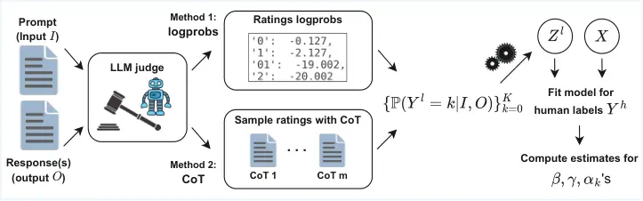

Figure 1: The _logit trick_ for model fitting. This procedure allows us
to fit the statistical model without observing human latent scores
$`Z^{h}`$. First, the LLM judge rates a pair (prompt, response(s)).
Second, we compute/estimate the probability of each score $`k`$. Third,
we process the probabilities, obtaining the LLM scores
$`Z^{l}\in{\mathbb{R}}`$. Finally, we fit an ordinal logistic regression
model for human ratings $`Y^{h}`$ given $`Z^{l}`$ and covariates $`X`$
to explain the gap between human and LLM scores.

Model fitting via the _logit trick_. Given a pair $`(I,O)`$, if the
score $`Z^{l}`$, parameters $`\beta`$, $`\gamma`$, and cutoffs
$`\{\alpha_{k}\}_{k=1}^{K},\{\eta_{k}\}_{k=1}^{K}`$ were known, we could
directly analyze the gap between judges and adjust LLM predictions to
align with human preferences. However, none of these quantities are
observed in principle. Moreover, the human latent scores $`Z^{h}`$ are
unobserved, which makes parameter estimation appear intractable, even
assuming access to $`Z^{l}`$. Nevertheless, when human labels
$`\{Y^{h}_{i}\}_{i=1}^{n}`$ are available for a set of input-output
pairs $`\{(I_{i},O_{i})\}_{i=1}^{n}`$, we can leverage a technique we
call the _logit trick_ to circumvent this issue. For now, we assume
$`{\mathbb{P}}(Y_{i}^{l}=k\mid I_{i},O_{i})`$ for all
$`k\in\{0,\ldots,K\}`$ can be computed exactly (or estimated with high
precision). Details on how this step is implemented are provided later
in this section. The model fitting algorithm via the _logit trick_ is
detailed in the following box:


When the model for $`Y^{l}`$ is correctly specified, the optimization in
step 2 recovers the true values of $`\{\eta_{k}\}_{k=1}^{K}`$ and
$`\{Z^{l}_{i}\}_{i=1}^{n}`$ up to an additive constant. To ensure
identifiability, we fix $`\eta_{1}=0`$. As a simpler alternative, one
may define
$`Z^{l}_{i}=-\sigma^{-1}({\mathbb{P}}(Y^{l}_{i}=0\mid I_{i},O_{i}))`$,
but this approach uses only one probability and ignores the full
distribution²² 2 When $`Y^{h},Y^{l}\in\{0,1\}`$, however, these two
approaches are equivalent. This observation also clarifies why we call
it the _logit trick_: under the binary judgements, $`Z^{l}`$ is
precisely the logit of $`{\mathbb{P}}(Y^{l}=1\mid I,O)`$. of $`Y^{l}`$,
which can be suboptimal under model misspecification. At test time, new
values of $`Z^{l}`$ can be derived using the estimated thresholds
$`\{\eta_{k}\}_{k=1}^{K}`$ and solving an optimization like in step 2. A
better option, if the application permits, is computing test points
$`Z^{l}`$’s jointly with those from training data. After the model is
fitted, we can define the predicted human latent scores as
$`\hat{Z}^{h}\triangleq(1/\hat{\beta})Z^{l}-(1/\hat{\beta})\hat{\gamma}^{\top}X`$.

We consider two strategies for computing
$`{\mathbb{P}}(Y^{l}=k\mid I,O)`$. The first is based on log
probabilities and return exact values: we identify the tokens associated
with each possible outcome $`k`$, compute their probabilities from the
LLM output distribution, and sum them. This method is computationally
efficient and provides exact probabilities, but it requires prompting
the LLM to output the final score without intermediate reasoning. When
reasoning steps are used, these probabilities may become biased³³ 3 Once
the LLM generates reasoning steps $`R`$ (a sequence of tokens), its
subsequent score is conditioned on $`R`$, biasing the probabilities
toward outcomes that are more compatible with that specific reasoning.
To avoid this bias, we marginalize over all possible reasoning paths,
i.e.,
$`{\mathbb{P}}(Y^{l}=k\mid I,O)=\sum_{r}{\mathbb{P}}(Y^{l}=k\mid I,O,R=r){\mathbb{P}}(R=r\mid I,O)`$,
and estimate this sum via Monte Carlo sampling rather than relying on a
single conditional probability $`{\mathbb{P}}(Y^{l}=k\mid I,O,R=r)`$..
As an alternative, we employ a chain-of-thought (CoT) prompting
strategy, in which the LLM produces reasoning followed by a rating. In
this case, we sample $`m`$ outputs from the LLM and estimate
$`{\mathbb{P}}(Y^{l}=k\mid I,O)`$ via empirical frequencies. In this
case, $`{\mathbb{P}}(Y^{l}=k\mid I,O)`$ is not computed exactly. While
this approach is more computationally intensive, it typically yields
higher-quality judgements by leveraging the model’s reasoning
capabilities. In both strategies, we regularize the output probabilities
by adding a small constant (e.g., $`0.01`$) to each
$`{\mathbb{P}}(Y^{l}=k\mid I,O)`$ before renormalizing to ensure they
sum to one and avoid degenerate distributions.

Figure 1 provides a visual overview of the entire procedure, and
Appendix A contains the prompt templates used to collect LLM judgements
in both the log probabilities and CoT cases.

Model extensions. We work under the setup in which $`Y^{h}`$ and
$`Y^{l}`$ are discrete and obey a notion of ordering because it covers
the majority of practical use cases, including binary ratings (i.e.,
$`Y^{h},Y^{l}\in\{0,1\}`$). However, it does not account for continuous
or unordered categorical ratings. We develop extensions of our model to
deal with those cases, and, due to space constraints, we include them in
Appendix E.

### 3.2 Non-exhaustive set of applications

Better alignment and calibration. A key application of our framework
arises when practitioners seek to improve the quality of LLM-generated
judgments, especially in low-resource settings where human-labeled data
is limited due to the high cost of annotation. In such scenarios,
fine-tuning LLM judges is often impractical or even impossible when
inference APIs are used. We propose using our model to enhance both the
alignment and probabilistic calibration of LLM judgments. Alignment
between LLM and human judgments is crucial for enabling high-quality
evaluations at reduced cost. Calibration is equally important, as
well-calibrated models yield more interpretable outputs, facilitating
uncertainty quantification. Moreover, well-calibrated scores do not
suffer from position bias (relative to humans) by definition, for
example.

We quantify alignment by measuring the discrepancy between LLM-inferred
rating probabilities and the target distribution
$`{\mathbb{P}}(Y^{h}=k\mid I,O)`$, using human labels and cross-entropy
loss. Specifically, we expect that the model-implied probabilities
$`p_{k}(\hat{\alpha}_{1},\ldots,\hat{\alpha}_{K},\hat{Z}^{h})`$ more
closely approximate $`{\mathbb{P}}(Y^{h}=k\mid I,O)`$ than the raw LLM
outputs $`{\mathbb{P}}(Y^{l}=k\mid I,O)`$ in terms of the
Kullback-Leibler (KL) divergence \[kullback1951information\].
Additionally, we also check alignment in terms of accuracy. For
calibration, we adopt the class-wise
notion \[pavlovic2025understanding\], which requires

```math
{\mathbb{P}}(Y^{h}=k\mid p_{k}(\hat{\alpha}_{1},\ldots,\hat{\alpha}_{K},\hat{Z}^{h})=p)\approx p\quad\text{for all }p\in[0,1],\;k\in\{0,\ldots,K\}.
```

A property like this is unlikely to hold for raw LLM predictions, but
becomes more plausible when LLM scores are corrected using our model,
assuming it is reasonably well-specified. Analogous calibration methods
are common in classification tasks, such as Platt
scaling \[platt1999probabilistic\], where a logistic regression is
applied to uncalibrated classifier scores to improve their probabilistic
interpretation.

As we demonstrate in our experiments, even under the simplifying
assumption $`\gamma=0`$, i.e., without using any covariates, our model
yields improved LLM judgment predictions at test time, highlighting its
practical utility in resource-constrained settings.

Human-LLM discrepancies quantification and formal testing. Another
important application is the detection and quantification of human-LLM
judgement divergences. To that end, we assume $`X`$ contains possible
sources of differences between LLM and human judgements, and we want to
better understand which differences are relevant by analysing
$`\gamma`$. As detailed in Section 3.3, the estimator
$`\hat{\gamma}_{j}`$ for the $`j`$-th entry of $`\gamma`$ is
asymptotically normal, i.e.,
$`(n/\hat{V}_{j+1,j+1})^{1/2}(\hat{\gamma}_{j}-\gamma_{j})`$ converges
in distribution to $`\mathcal{N}(0,1)`$ as $`n\to\infty`$, where
$`\hat{V}_{j+1,j+1}`$ is a variance estimate derived from the data. This
result enables formal hypothesis testing⁴⁴ 4 Here, rejecting $`H_{0}`$
means feature $`j`$ systematically shifts the LLM’s judgments relative
to humans., e.g., testing $`H_{0}:\gamma_{j}=0`$ versus
$`H_{1}:\gamma_{j}\neq 0`$, using the p-value

```math
\text{p-value}=2\Phi\left(-\sqrt{n/\hat{V}_{j+1,j+1}}\left|\hat{\gamma}_{j}\right|\right),
```

where $`\Phi`$ denotes the distribution function of the standard normal
distribution. Additionally, if the practitioner wants to control the
false discovery rate (FDR) of human-LLM divergences, multiple hypothesis
testing can be carried out in conjunction with the Benjamini-Yekutieli
procedure \[benjamini2001control\]. Confidence intervals can also be
constructed, as discussed in Section 3.3.

### 3.3 Asymptotic distributions of our estimators

First, we analyze the properties of estimators for the cutoffs
$`\{\eta_{k}\}_{k=1}^{K}`$ and latent scores $`\{Z^{l}_{i}\}_{i=1}^{n}`$
under the CoT prompting strategy for estimating
$`p_{ik}={\mathbb{P}}(Y_{i}^{l}=k\mid I_{i},O_{i})`$. Fix $`n`$
evaluation samples $`\{(I_{i},O_{i})\}_{i=1}^{n}`$. For each $`i`$, draw
$`m_{n}`$ i.i.d. CoT judgements $`\{Y^{l}_{i,m}\}_{m=1}^{m_{n}}`$ and
estimate $`p_{ik}`$ with
$`\hat{p}_{ik,m_{n}}=\sum_{m=1}^{m_{n}}\mathbf{1}\{Y^{l}_{i,m}=k\}/m_{n}.`$
Denote $`\eta=(\eta_{1},\dots,\eta_{K})`$, and define the empirical and
population losses as

```math
Q_{n,m_{n}}(\eta,z_{1:n})=\sum_{i=1}^{n}\sum_{k=0}^{K}\bigl|p_{k}(\eta,z_{i})-\hat{p}_{ik,m_{n}}\bigr|,\quad Q_{n}(\eta,z_{1:n})=\sum_{i=1}^{n}\sum_{k=0}^{K}\bigl|p_{k}(\eta,z_{i})-p_{ik}\bigr|.
```

Constrain $`\eta,Z^{l}_{1:n}`$ to
$`\Theta_{\eta}=\{\eta\in\mathbb{R}^{K}:0=\eta_{1}<\cdots<\eta_{K}\}`$
and $`\mathcal{Z}=[-M,M]^{n}`$ for some large $`M`$.

###### Proposition 3.1 (Consistency of CoT estimates $`\hat{\eta}_{k}`$ and $`\hat{Z}_{i}^{l}`$).

Under Conditions C.1 and C.2 (stated in Appendix C.1), the estimator
$`(\hat{\eta},\hat{Z}^{l}_{1:n})\in\arg\min_{(\eta,z_{1:n})\in\Theta_{\eta}\times\mathcal{Z}}Q_{n,m_{n}}(\eta,z_{1:n})`$
satisfies
$`\sqrt{m_{n}}[(\hat{\eta},\hat{Z}^{l}_{1:n})-(\eta^{*},Z^{l,*}_{1:n})]`$
converges in distribution to a mean-zero distribution with covariance
$`\Sigma`$ (defined in Appendix C.1) as $`m_{n}\to\infty`$.

When the log probabilities are used to extract $`p_{ik}`$ exactly from
the LLM output, the population loss $`Q_{n}`$ is known and
$`\hat{Z}_{i}^{l}=Z^{l}_{i}`$ for all $`i`$. Next, we derive the
asymptotic distribution of $`(\hat{\beta},\hat{\gamma})`$ as $`n`$ tends
to infinity, under either log probability or CoT-based estimation of the
latent scores. Write the ordered logit model as
$`{\mathbb{P}}(Y_{i}^{h}=k\mid I_{i},O_{i})\triangleq l_{k}(\theta;Z^{l}_{i},X_{i})=p_{k}(\alpha_{1},\dots,\alpha_{K},(1/\beta)Z_{i}^{l}-(1/\beta)\gamma^{T}X_{i}).`$
Define the Fisher information matrix
$`\mathcal{I}(\theta^{*})=-\mathbb{E}\bigl[\nabla^{2}_{\theta}\log l_{Y_{i}^{h}}\bigl(\theta^{*};Z_{i}^{l,*},X_{i}\bigr)\bigr].`$

###### Theorem 3.2 (Asymptotic normality of $`(\hat{\beta},\hat{\gamma})`$).

Under Conditions C.3–C.5 (stated in Appendix C.1), let the MLE
$`\hat{\theta}_{n}=(\hat{\alpha}_{1},\dots,\hat{\alpha}_{K},\hat{\beta},\hat{\gamma})`$
maximize the log-likelihood

```math
\ell_{n}(\theta;\hat{Z}^{l},X)=\sum_{i=1}^{n}\sum_{k=0}^{K}\mathbf{1}\{Y_{i}^{h}=k\}\log l_{k}(\theta;\hat{Z}_{i}^{l},X_{i}).
```

over $`\theta=(\alpha_{1},\dots,\alpha_{K},\beta,\gamma)`$. If the CoT
prompting strategy is used to estimate
$`{\mathbb{P}}(Y^{l}_{i}=k\mid I_{i},O_{i}),`$ also assume Conditions
C.1 and C.2 and let $`n/m_{n}\to 0`$ as $`n\to\infty`$. Then

```math
\sqrt{n}\bigl(\hat{\theta}_{n}-\theta^{*}\bigr)\xrightarrow{d}\mathcal{N}\bigl(0,\mathcal{I}(\theta^{*})^{-1}\bigr)\quad\text{and}\quad\sqrt{n}\begin{pmatrix}\hat{\beta}-\beta^{*}\\
\hat{\gamma}-\gamma^{*}\end{pmatrix}\xrightarrow{d}\mathcal{N}\bigl(0,\{\mathcal{I}(\theta^{*})^{-1}\}_{(\beta,\gamma)}\bigr)\ \text{ as }n\to\infty.
```

Consistent variance estimator and confidence intervals. To estimate the
variance of $`(\hat{\beta},\hat{\gamma})`$, calculate the observed
Fisher information matrix:
$`\hat{\mathcal{I}}_{\text{obs}}(\hat{\theta}_{n})=-({1}/{n})\nabla^{2}_{\theta}\ell_{n}(\hat{\theta}_{n};\hat{Z}^{l},X)`$
at the MLE
$`\hat{\theta}_{n}=(\hat{\alpha}_{1},\dots,\hat{\alpha}_{K},\hat{\beta},\hat{\gamma})`$,
where $`\nabla^{2}_{\theta}\ell_{n}`$ is the second derivative matrix of
$`\ell_{n}`$ with respect to all parameters
$`\theta=(\alpha_{1},\dots,\alpha_{K},\beta,\gamma)`$. Let
$`\hat{V}=\hat{\mathcal{I}}_{\text{obs}}(\hat{\theta}_{n})^{-1}`$.
Extract the $`(\beta,\gamma)`$-block $`\hat{V}_{(\beta,\gamma)}`$, which
is the bottom right $`(1+d)\times(1+d)`$ block of $`\hat{V}`$. The
$`100(1-\alpha)\%`$ marginal confidence intervals (CIs) for the
parameters are

```math
\hat{\beta}\pm z_{1-\alpha/2}\;\frac{\sqrt{\hat{V}_{11}}}{\sqrt{n}},\quad\hat{\gamma}_{j}\pm z_{1-\alpha/2}\frac{\sqrt{\hat{V}_{j+1,j+1}}}{\sqrt{n}},\ j=1,\dots,d.
```

The joint confidence region is
$`\bigl\{(\beta,\gamma):\ n[(\beta,\gamma)-(\hat{\beta},\hat{\gamma})]\hat{V}_{(\beta,\gamma)}^{-1}[(\beta,\gamma)-(\hat{\beta},\hat{\gamma})]^{\top}\leq\chi^{2}_{d+1,1-\alpha}\bigr\}.`$
Under previous conditions, the variance estimator is consistent, and the
coverage probability converges to $`1-\alpha`$ as $`n\to\infty`$.
Additionally, Appendix C.3 outlines methods for constructing confidence
intervals for differentiable functions of $`\theta`$. These methods can
be employed to construct prediction intervals and to evaluate the
“partial effect” of a covariate, as further detailed in Appendix C.3.

## 4 Understanding and narrowing the human-LLM gap in practice

In this section, we examine the applications described in Section 3.2
using real-world data and popular LLM judges. We have included extra
semi-synthetic (more controlled) and robustness-check experiments in
Appendix B.

We begin by detailing the data used in our experiments.

### 4.1 LLM judges, datasets, and LLM judgments collection

LLM judges. We utilize six distinct LLM judges⁵⁵ 5 The official model
names are gpt-4.1-nano, gpt-4.1, gpt-4o-mini-2024-07-18,
meta-llama/Llama-3.1-8B-Instruct, AtlaAI/Selene-1-Mini-Llama-3.1-8B, and
prometheus-eval/prometheus-8x7b-v2.0.: GPT-4.1 \[openai_gpt41_2025\],
GPT-4.1-nano \[openai_gpt41_2025\], GPT-4o-mini \[hurst2024gpt\],
LLaMa-3.1-8B-Instruct \[grattafiori2024llama\],
Selene-1-Mini \[alexandru2025atlaseleneminigeneral\], and
Prometheus-v2 \[kim2024prometheus\]. The GPTs and LLaMa-3.1-8B-It
represent high-performing, general-purpose models, while Selene-1-Mini
and Prometheus-v2 are specialized, state-of-the-art open judges.

Datasets. Our experiments are conducted using publicly available
human-annotated datasets:

- •
  BigGen Bench (BGB): BGB \[kim2024biggen\] evaluates language model
  outputs based on detailed rubrics across five satisfaction levels
  (originally from 1 to 5, converted here to 0 to 4). We focus on the
  subset containing English-language human annotations, comprising 695
  instances across 77 tasks and nine evaluated capabilities (e.g.,
  planning, tool usage). Each instance has responses from four different
  models, totaling 2780 data points. We exclude a few data points with
  invalid annotations.
- •
  Chatbot Arena (CA): We use the dataset
  arena-human-preference-100k \[tang2025explorer\], derived from Chatbot
  Arena \[chiang2024chatbot\]. This dataset consists of 100k queries,
  each responded to simultaneously by two anonymous models, with user
  preferences annotated as either a clear choice or “good”/“bad” ties,
  where both responses are equilavently good or bad. We randomly select
  a subset of 5000 queries that are not multi-turn conversations and
  merge “good”/“bad” ties into a single category.

Judgment collection. Following Section 3, we gather LLM judgments via
two distinct prompting methods. The first explicitly instructs the
judges to provide only a rating without explanation, allowing us to
extract log probabilities for each rating directly. The second prompts
the judges to elaborate on their reasoning before explicitly stating
their final judgment, from which we sample 50 times to estimate rating
probabilities. We adapt distinct prompts for absolute and relative
ratings: for absolute ratings, we modify reference-free Prometheus
prompts from kim2024prometheus; for relative ratings, we adjust
AlpacaEval 2.0 \[alpaca_eval\] (for log probabilities) and ArenaHard
prompts⁶⁶ 6 ArenaHard has 5 levels: response A is much better than B, A
is better than B, A and B are equally good, B is better than A, response
B is much better than A. Given that we use three levels in our
experiments, we compute the level probability estimates, and then
convert to three levels by summing the probabilities of edge
classes. \[li2024crowdsourced\] (for chain-of-thought reasoning). To
ensure quality in our analyses and comparability across judges, we
retain only instances where at least 25 valid CoT-generated scores were
produced within 1k output tokens by all judges; this filtering removes
at most 10% of instances per dataset. In our main experiments, we use
log probabilities for closed models (GPTs) and chain-of-thought (CoT)
sampling for other judges. We adopt CoT for open models since it
generally yields higher-quality judgments, whereas for closed models, it
is prohibitively costly to run, so we rely only on log probabilities.
Prompt templates are provided in the Appendix A.

### 4.2 Application 1: Improved LLM judgements with few human annotations

In this application, our goal is to improve the performance of LLM
judges using only a small number of human-annotated data points. This
scenario is particularly relevant since (i) obtaining high-quality human
annotations is costly, and (ii) fine-tuning an LLM judge becomes
challenging when labeled examples are limited⁷⁷ 7 Moreover, Bridge is
still applicable in cases where only an inference API is provided.. In
this section, we demonstrate that our method can still provide benefits
even without using covariates (i.e., setting $`\gamma=0`$), which can be
hard to use when the training set is small.

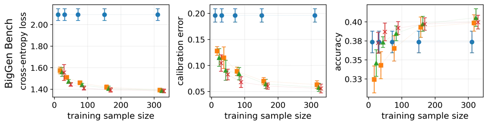

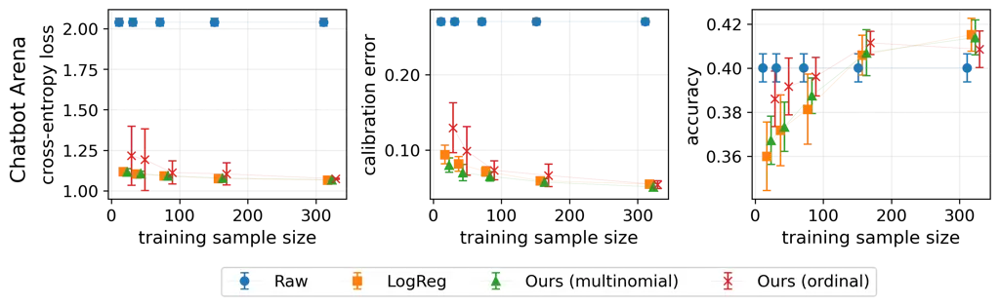

Figure 2: Performance comparison of our proposed methods,
logistic-regression baseline, and raw LLM judgments across all datasets.
Our methods consistently match or outperform the baselines, notably
excelling on BigGen Bench, likely thanks to sensible inductive biases.

Metrics. To evaluate judge quality, we consider three metrics: (i)
cross-entropy loss, comparing the predicted rating probabilities with
the actual labels; (ii) calibration error; and (iii) accuracy, which
involves selecting the predicted class with the highest probability and
comparing it with true labels. The results reported are averages across
all judges. To compute the calibration error, we first calculate the
error for each class individually and then average them. For class
$`k`$, the steps for computing calibration error are: (i) using a
probabilistic classifier (any of the methods reported in Figure 2),
predict the probability of class $`k`$ for all $`n_{te}`$ test data
points, obtaining $`\{\hat{p}_{ki}\}_{i=1}^{n_{te}}`$, (ii) discretize
$`\{\hat{p}_{ki}\}_{i=1}^{n_{te}}`$ into 10 bins and, for each bin,
compute the difference of the average predicted probability and the
relative frequency of class $`k`$, and (iii) average these differences.
To construct the bins, we use equally spaced quantiles of
$`\{\hat{p}_{ki}\}_{i=1}^{n_{te}}`$.

Data splitting. Using a fixed random seed, we split each dataset into
training and testing sets with an 80:20 ratio. For Chatbot Arena, we
randomly divide data points into training and testing subsets. For
BigGen Bench, we ensure instances do not overlap between the training
and testing sets, simulating a realistic and challenging scenario in
which new, unknown queries appear at test time. For a given sample size
$`n_{tr}\in\{20,40,80,160,320\}`$, we randomly select $`n_{tr}`$ points
from the full set of training queries to fit our models. Across all
datasets, we perform this procedure using 10 different random seeds, and
the reported results reflect averages and standard deviations across
these splits.

Methods. We use two different versions of our method, assuming an
ordinal structure of responses (“ordinal”, default model defined in
Section 3) or not (“multinomial”, Appendix E). Regarding baselines, we
primarily focus on two: the first baseline (“Raw”) directly utilizes the
raw probability outputs from the LLM judges, while the second baseline
(“LogReg”) involves fitting a multinomial logistic regression model on
top of these raw probabilities to potentially achieve better
performance; this last baseline can be seen as a naive version of the
“multinomial” approach but lacks a principled modeling foundation and is
not interpretable. Additionally, we explore providing in-context
learning (ICL) examples to the judge as another baseline, reporting
results for this experiment in Appendix B; this last method performs
poorly compared to other approaches.

Results. Figure 2 presents the experimental results. Across datasets,
the different versions of our method and the logistic regression
baseline outperform the raw LLM judgments consistently on all metrics.
Notably, our methods never underperform relative to the baselines and
significantly excel on the BigGen Bench. This advantage is likely due to
the effective inductive biases provided by our models. Interestingly
enough, the two different versions of our method perform well. However,
the “ordinal” (default) method will often be preferable since it is
simpler and more interpretable, as it explores the notion of order in
the data and has fewer parameters.

### 4.3 Application 2: Detecting and testing for human-LLM gaps

Different from the previous experiment, this analysis incorporates a set
of covariates $`X`$ that represent potential sources of discrepancies in
LLM judgments relative to humans. We focus exclusively on covariates
derived from the outputs $`O`$, as they are more direct to collect and
interpret. Initially, we consider 47 interpretable covariates,
comprising lightweight automated metrics (e.g., word count, sentiment
polarity) and features extracted via LLM scoring (e.g., conciseness,
fluency, creativity). For relative ratings, we compute differences
between covariates from the second and first responses. We then cluster
these covariates based on their correlations, substantially reducing
their number by $`\approx 30\%`$ for BigGen Bench and $`\approx 20\%`$
for Chatbot Arena. Appendix D gives a comprehensive description of the
used covariates, the clustering algorithm, and the resultant covariate
clusters. After clustering, we extract the first principal component
from each cluster and standardize the resulting variables to have zero
mean and unit variance. Subsequently, we apply our proposed method,
calculate p-values, and adjust them using the
Benjamini-Yekutieli \[benjamini2001control\] procedure⁸⁸ 8 We use the
Python package _statsmodels_ for this adjustment:
[https://www.statsmodels.org/dev/generated/statsmodels.stats.multitest.multipletests.html](https://www.statsmodels.org/dev/generated/statsmodels.stats.multitest.multipletests.html)
for false discovery rate (FDR) control when conducting multiple tests at
the same time.

|                                                                  |              |             |             |                 |               |               |
| ---------------------------------------------------------------- | ------------ | ----------- | ----------- | --------------- | ------------- | ------------- |
|                                                                  | GPT-4.1-nano | GPT-4.1     | GPT-4o-mini | LLaMa-3.1-8B-It | Selene-1-Mini | Prometheus-v2 |
| Writing Quality                                                  | -0.38\*\*\*  | $`-0.10`$   | $`-0.02`$   | -0.22\*\*       | $`-0.02`$     | -0.22\*\*\*   |
| Text Length                                                      | -0.83\*\*\*  | -0.39\*\*\* | -0.43\*\*\* | -0.78\*\*\*     | -0.44\*\*\*   | -0.74\*\*\*   |
| Positive Sentiment                                               | -0.31\*\*\*  | -0.12\*     | -0.15\*\*   | -0.22\*\*       | -0.18\*\*\*   | -0.21\*\*\*   |
| Layout Density                                                   | $`-0.23`$    | -0.15\*     | $`-0.11`$   | $`-0.21`$       | $`-0.13`$     | $`-0.17`$     |
| Causal Markers                                                   | -0.19\*\*    | $`-0.09`$   | $`-0.10`$   | $`-0.12`$       | $`-0.08`$     | $`-0.07`$     |
| Structure Counts                                                 | 0.35\*\*\*   | 0.16\*      | $`0.11`$    | 0.29\*\*        | $`0.12`$      | 0.29\*\*\*    |
| Sentiment                                                        | 0.24\*\*     | $`0.10`$    | $`0.11`$    | $`0.11`$        | $`0.09`$      | $`0.10`$      |
| Code Block                                                       | 0.20\*\*     | $`0.07`$    | $`0.09`$    | 0.22\*\*\*      | 0.14\*\*      | 0.20\*\*\*    |
| Character Density                                                | $`0.25`$     | $`0.13`$    | $`0.12`$    | $`0.23`$        | 0.20\*\*      | $`0.13`$      |
| Compound Sentiment                                               | 0.27\*\*\*   | $`0.06`$    | $`0.08`$    | $`0.16`$        | 0.13\*\*      | 0.19\*\*      |
| Question Count                                                   | $`0.16`$     | $`0.09`$    | 0.13\*      | $`0.13`$        | $`0.11`$      | $`0.15`$      |
| Significance: \*\*\* $`p<0.01`$, \*\* $`p<0.05`$, \* $`p<0.10`$. |              |             |             |                 |               |               |

Table 1: Human-LLM judgement discrepancies on BigGen Bench

|                                                                  |              |             |             |                 |               |               |
| ---------------------------------------------------------------- | ------------ | ----------- | ----------- | --------------- | ------------- | ------------- |
|                                                                  | GPT-4.1-nano | GPT-4.1     | GPT-4o-mini | LLaMa-3.1-8B-It | Selene-1-Mini | Prometheus-v2 |
| Text Length                                                      | -2.05\*\*\*  | -0.54\*\*\* | -1.02\*\*\* | -1.61\*\*       | -1.17\*\*     | -1.20\*\*\*   |
| Creativity/Engagement                                            | -1.27\*\*\*  | -0.32\*\*\* | -0.64\*\*\* | -1.10\*\*       | -0.78\*\*     | -0.77\*\*\*   |
| Bold Text                                                        | 0.74\*\*     | 0.25\*\*\*  | 0.50\*\*\*  | 0.77\*\*        | 0.66\*\*\*    | 0.62\*\*\*    |
| Significance: \*\*\* $`p<0.01`$, \*\* $`p<0.05`$, \* $`p<0.10`$. |              |             |             |                 |               |               |

Table 2: Human-LLM judgement discrepancies on Chatbot Arena

Results. Tables 1 and 2 summarize our findings for BigGen Bench and
Chatbot Arena, respectively. These tables include only covariates that
show a statistically significant contribution for at least one judge;
for full tables and unadjusted p-values, see Appendix B.6. The direction
of these effects is important: positive values indicate attributes
preferred more strongly by LLM judges, whereas negative values indicate
attributes preferred by humans. Some insights about the results are:

- •
  Across datasets and judges, longer responses receive systematically
  lower scores, showing that LLM judges favor brevity relative to
  humans. This contrasts with dubois2024length, who argue that
  length-controlled (assuming LLMs are positively biased towards
  lengthier responses) scoring aids alignment. In Appendix B.6, we show
  that GPT-4-Turbo (main judge on AlpacaEval) exhibits the same pattern.
  The discrepancy with dubois2024length likely stems from methodological
  differences, our instance-level analysis versus their system-level
  aggregation, which introduces extra complications to comparability. At
  the end of the day, working on the instance level is a more direct and
  reliable way of drawing such conclusions.
- •
  Human annotators reward creativity and engaging responses more than
  LLM judges, a discrepancy most pronounced on Chatbot Arena. This
  pattern is intuitive: users of that platform often are there to “play”
  with generations, while the LLM judges were never instructed to value
  creativity. A similar conclusion can be drawn from the “Positive
  sentiment” dimension in BigGen Bench.
- •
  Bias profiles overlap considerably across LLM judges, suggesting
  common underlying biases that are inherited from similar training sets
  and procedures.

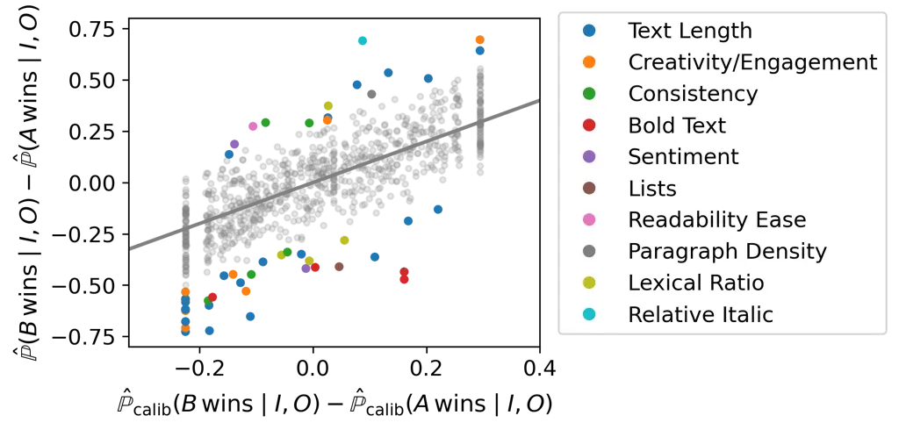

Figure 3: Covariates $`X`$ are important. Dots indicate how adding
covariates alters the predicted human preference, with colors marking
the most influential.

In Appendix B.6, we conduct extra related analyses. For example, we
check how robust our findings are for different sample sizes. We split
Chatbot Arena queries into technical and non-technical categories using
GPT-4o-mini as a zero-shot classifier. For technical queries, Human–LLM
divergences were not statistically significant, suggesting that
discrepancies arise mainly in subjective, non-technical content. An
important limitation of this analysis is the reduced sample size after
splitting, which lowers statistical power.

To quantify the practical impact of the bias covariates, we zoom in on
the Chatbot Arena evaluation with the Selene-1-Mini judge. Two variants
of our model are fitted: the full specification, denoted
$`\hat{{\mathbb{P}}}`$, which incorporates the gap term
$`\gamma^{\top}X`$, and a “calibration” variant,
$`\hat{{\mathbb{P}}}_{\text{calib}}`$, obtained by setting $`\gamma=0`$.
For every pair of responses $`(O_{A},O_{B})`$ and variants of our
method, we predict the probabilities that humans prefer $`B`$ over $`A`$
and $`A`$ over $`B`$ and then take their difference. Figure 3 plots
these differences, highlighting instances where biasing covariates
substantially alter the prediction. Each point is colored by the
covariate whose contribution $`|\gamma_{j}X_{ij}|`$ is largest in
magnitude, thereby revealing the dominant factor driving each
discrepancy. The discrepancies have large magnitudes for some data
points. As extra results, we place figures in Appendix B.6 that show
that including covariates in our model can induce improved prediction
performance, even though the biggest improvements are obtained without
the need to add extra covariates.

## 5 Discussion

We propose Bridge, a unified statistical framework that simultaneously
models ratings from both human annotators and LLM judges. The framework
couples a statistical model with a specialized estimation procedure,
enabling (i) principled calibration/limitations of LLM scores and (ii) a
clearer characterization of the divergences between human and LLM
evaluations.

Limitations. The chief limitation of our approach is vulnerability to
model misspecification. When the assumed data-generating process is
inaccurate, owing to unrealistic distributional assumptions or omitted
covariates, the resulting parameter estimates must be interpreted
cautiously; please check Appendix B.3 for a detailed discussion on model
misspecification. A second practical challenge is the construction of
informative covariates $`X`$; while users can start with generic,
off-the-shelf metrics (e.g., response length, readability grade), domain
knowledge could be needed to devise variables that capture salient
sources of differences between LLM and human judgments, especially when
those also depend on the input $`I`$ and not only on the output $`O`$.

The significance of this work in today’s LLM-evaluation landscape. We
recognize that as LLM tasks become more sophisticated, achieving a truly
reliable “gold standard” through human annotation is increasingly
difficult. However, Bridge is flexible by design and is not tied to a
single definition of the gold standard. Whether the benchmark consists
of individual human judgments, a consensus among multiple annotators, or
even alternative proxies, Bridge is meant to detect and reduce
inconsistencies between whatever reference is chosen and LLM
assessments. Moreover, aligning LLMs with human preferences and
judgments will continue to be important for many real-world
applications, especially where trust, safety, and social acceptance
matter.

Observational vs. experimental data. Our experiments rely exclusively on
observational data, in the sense that we do not intervene on $`X`$. This
choice has both strengths and limitations. On the one hand,
observational data capture the diversity and unpredictability of real
user-LLM interactions, enhancing the external validity of our findings.
On the other hand, because the data are not generated under controlled
interventions, our estimated parameters should be interpreted as
descriptive associations rather than causal effects. Confounding
variables and selection biases may also influence these relationships.

Future work and extensions. Promising directions include developing
estimation routines robust to model misspecification, extending the
framework to automatically infer divergence factors, and leveraging
representation learning to construct covariates $`X`$ on the fly. In
principle, Bridge can also incorporate text embeddings as $`X`$
(provided enough training data and regularization), though we currently
see no clear advantage in doing so; nevertheless, this remains an
interesting avenue for future exploration. Extending Bridge to
open-ended, natural-language evaluations is an important direction for
future work and will likely require principled ways to represent
free-form judgments as comparable quantities. Moreover, Bridge can also
be applied in settings where model outputs span multiple modalities
(e.g., image, video, audio). In such cases, however, constructing
meaningful covariates $`X`$ may be more challenging. We encourage
adoption and extensions of Bridge in these directions for future work.

## 6 Acknowledgements

This paper is supported by the National Science Foundation (NSF) grants
DMS-2027737, DMS-2113373, DMS-2414918, SES-1846747, and a gift from
OpenAI.

## References

## Appendix A Prompt templates

### A.1 BigGen Bench prompts (absolute ratings)

For BigGen Bench, the system prompt is instance-dependent. Therefore, we
do not report them here.

` `

### A.2 Chatbot Arena prompts (relative ratings)

` `

### A.3 Prompts for extracting LLM-scored covariates

The following prompts were used to obtain LLM-scored covariates, adapted
from the prompts by \[liu2023g\].

` `

## Appendix B Additional empirical results

### B.1 Probability Distribution Reconstruction Loss via Logit Trick

Figures 4 and 5 report the values of

```math
\underset{\begin{subarray}{c}\bar{\eta}_{1}<\cdots<\bar{\eta}_{K}\in{\mathbb{R}},\\
z_{1},\ldots,z_{n}\in{\mathbb{R}}\end{subarray}}{\min}\frac{1}{nK}\sum_{i=1}^{n}\sum_{k=0}^{K}\big|p_{k}(\bar{\eta}_{1},\ldots,\bar{\eta}_{K},z_{i})-{\mathbb{P}}(Y_{i}^{l}=k\mid I_{i},O_{i})\big|,
```

which is used in the logit trick. This metric provides a measure of how
well the ordinal assumption captures LLM judgments. From the figures, we
observe that the average deviation is below $`0.04`$ for all judges.
Deviations are typically slightly higher for judges whose judgment
probabilities we estimate, reflecting finite-sample approximations.

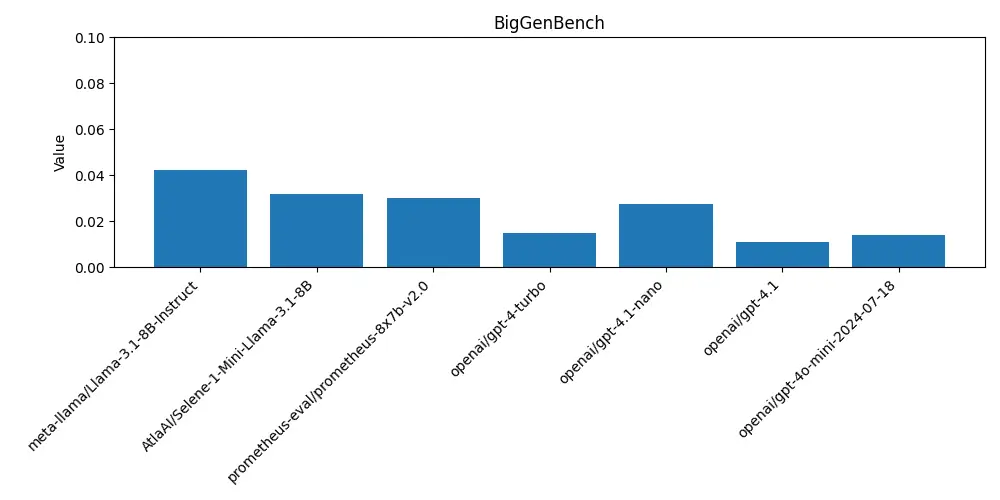

Figure 4: Reconstruction loss for BigGenBench

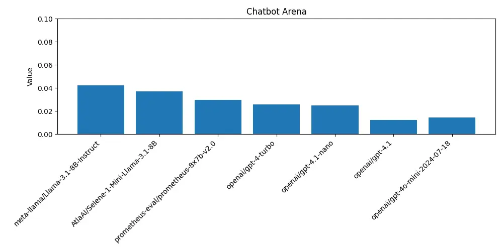

Figure 5: Reconstruction loss for Chatbot Arena

### B.2 Controlled experiments to show the effectiveness of the framework

We have conducted two additional controlled experiments to further
validate our method, both of which use semi-synthetic setups that are
more realistic than purely artificial data.

First experiment: We use GPT-4o-mini to simulate human ratings on
BigGenBench queries. Next, we run GPT-4o-mini again, this time
artificially biasing its latent scores $`Z^{l}`$ to _disfavor_ specific
markdown features; namely, bold/italicized words, headers, and lists.
For each markdown feature (corresponding to the covariates $`X_{j}`$,
$`j=1,2,3`$), we bias $`Z^{l}`$ by subtracting $`X_{j}`$ (one at a
time). We then estimate $`\gamma=(\gamma_{1},\gamma_{2},\gamma_{3})`$
with our method. In this controlled setting, biasing toward feature
$`j`$ should result in $`\gamma_{j}=-1`$ while $`\gamma_{i}=0`$ for
$`i\neq j`$. Standard errors are shown in parentheses.

| Setting     | $`\mathbf{\gamma_{1}}`$ (SE) | $`\mathbf{\gamma_{2}}`$ (SE) | $`\mathbf{\gamma_{3}}`$ (SE) |
| ----------- | ---------------------------- | ---------------------------- | ---------------------------- |
| no bias     | -0.26 (0.21)                 | -0.36 (0.35)                 | -0.17 (0.16)                 |
| bold/italic | -1.26 (0.21)                 | -0.36 (0.35)                 | -0.17 (0.16)                 |
| headers     | -0.26 (0.21)                 | -1.36 (0.35)                 | -0.17 (0.16)                 |
| lists       | -0.26 (0.21)                 | -0.36 (0.35)                 | -1.17 (0.16)                 |

Table 3: Estimated bias parameters $`\gamma`$ (with standard errors) in
the tightly controlled experiment.

Second experiment: We conduct a slightly less controlled experiment by
prompting GPT-4o-mini to give lower scores to responses containing each
markdown feature, one at a time. Since this manipulation is done through
prompting rather than direct latent score adjustment, the resulting
biases are not as clean; for example, the LLM tends to be consistently
biased against lists. Still, the results largely follow the expected
direction.

| Setting     | $`\mathbf{\gamma_{1}}`$ (SE) | $`\mathbf{\gamma_{2}}`$ (SE) | $`\mathbf{\gamma_{3}}`$ (SE) |
| ----------- | ---------------------------- | ---------------------------- | ---------------------------- |
| no bias     | -0.255 (0.208)               | -0.362 (0.345)               | -0.167 (0.161)               |
| bold/italic | -1.992 (0.290)               | 0.466 (0.486)                | -1.583 (0.234)               |
| headers     | -0.069 (0.427)               | -1.014 (0.713)               | -3.061 (0.352)               |
| lists       | -0.172 (0.319)               | -0.229 (0.536)               | -5.660 (0.260)               |

Table 4: Estimated bias parameters $`\gamma`$ (with standard errors) in
the prompt-based experiment.

These experiments demonstrate that our framework can recover the
direction and magnitude of induced discrepancies/biases, both in tightly
controlled and more realistic, prompt-based scenarios.

### B.3 Robustness against model misspecification

When our model is used for prediction, misspecification is not a
significant concern; much of machine learning relies on models that are
not exactly correct. If our focus is on statistical inference, the model
can still be valuable for uncovering discrepancies in LLM judgments,
provided the misspecification is not too severe. Moreover, the linear
predictor we use is quite flexible, as we can include any basis
functions of $`X`$ as covariates (and then capture nonlinear
relationships).

Empirically, we present below a simple simulation in which we introduce
a mild nonlinearity into the LLM’s latent score generation to test
robustness to misspecification, both for prediction and inference. We
draw $`Z^{h}_{i}`$ from a Normal distribution $`\mathcal{N}(0,1)`$ and
sample $`Y^{h}_{i}`$ from $`\mathrm{Categorical}(p(\alpha,Z^{h}_{i}))`$.
We then set

```math
Z^{l}_{i}=\beta Z^{h}_{i}+\gamma^{\top}X_{i}+\delta(\gamma^{\top}X_{i})^{2},
```

where $`X_{i}`$ is drawn from a multivariate Normal
$`\mathcal{N}(0,I_{3})`$ distribution and $`\delta`$ takes values in
$`\{0,0.1,0.25,0.5,1,5\}`$, controlling the degree of quadratic
distortion. We set $`\beta=1`$, $`\gamma=(1,1,1)`$, and
$`\alpha=(-1,1)`$. LLM judgments $`Y^{l}_{i}`$ are sampled from the
usual ordered-logit link $`p(\eta,Z^{l}_{i})`$, and we fit our original
linear model, assuming $`Z^{l}_{i}=\beta Z^{h}_{i}+\gamma^{\top}X_{i}`$.
By comparing the estimated parameters
$`(\hat{\beta},\hat{\gamma},\hat{Z}^{h},\mathbb{P}(Y^{h}=k\mid I,O))`$
to their true values in terms of mean absolute error (MAE) as $`\delta`$
increases, we directly measure the impact of model misspecification. The
results below (Table 5) show that we can still recover $`\gamma`$ (then
at least we know approximately how big are the main effects; main
channel of discrepancies) and predict $`\mathbb{P}(Y^{h}=k\mid I,O)`$
with high accuracy, even under moderate misspecification. We will add
this experiment to the paper. Interestingly, the most affected results
are the ones for $`\beta`$ and $`Z^{h}`$, which is of less interest.

| $`\delta`$ | $`\beta`$ | $`\gamma`$ | $`Z^{h}`$ | $`\mathbb{P}(Y^{h}=k\mid I,O)`$ |
| ---------- | --------- | ---------- | --------- | ------------------------------- |
| 0          | 0.010     | 0.014      | 0.014     | 0.002                           |
| 0.1        | 0.024     | 0.014      | 0.072     | 0.010                           |
| 0.25       | 0.047     | 0.016      | 0.169     | 0.025                           |
| 0.5        | 0.266     | 0.017      | 0.340     | 0.045                           |
| 1          | 0.960     | 0.011      | 0.563     | 0.077                           |
| 5          | 24.958    | 0.345      | 0.789     | 0.117                           |

Table 5: Mean absolute error (MAE) of parameter estimations.

### B.4 For Application 2, how do results vary based on the amount of training data?

To assess the robustness of our method in detecting human-LLM gaps, we
repeat our analysis using varying random fractions of the available
data. We set a significance threshold of 10% (i.e., $`p`$-values below
0.10 are considered significant) and, for each LLM, treat the detection
of nonzero $`\gamma_{j}`$ coefficients as a binary classification
problem (reject vs. not reject the null hypothesis). The “ground truth”
label is determined using the full dataset. For each data fraction, we
evaluate how well the method predicts these significance decisions by
reporting precision, recall, and accuracy. Our results (see tables
below) show that, for both BigGenBench and Chatbot Arena, strong
precision and accuracy can be achieved with as little as 50% of the
data. Recall is more challenging to improve, indicating that some
discrepancies may require more data to detect reliably. For this
experiment, we do not correct the p-values using the B-Y procedure.

| % Data | Precision | Recall | Accuracy |
| ------ | --------- | ------ | -------- |
| 10     | 0.67      | 0.14   | 0.56     |
| 25     | 0.63      | 0.23   | 0.57     |
| 50     | 0.90      | 0.60   | 0.78     |
| 75     | 0.90      | 0.79   | 0.86     |
| 100    | 1.00      | 1.00   | 1.00     |

Table 6: Significance prediction performance for BigGenBench as a
function of training data fraction.

| % Data | Precision | Recall | Accuracy |
| ------ | --------- | ------ | -------- |
| 10     | 0.33      | 0.08   | 0.75     |
| 25     | 0.92      | 0.38   | 0.85     |
| 50     | 0.61      | 0.46   | 0.80     |
| 75     | 0.93      | 0.69   | 0.92     |
| 100    | 1.00      | 1.00   | 1.00     |

Table 7: Significance prediction performance for Chatbot Arena as a
function of training data fraction.

Overall, these results suggest that our method for detecting human-LLM
discrepancies is quite robust, with high precision and accuracy even
when only half of the data is used. Recall improves with larger data
fractions, highlighting the benefit of more data for sensitivity to
weaker effects.

### B.5 Application 1

#### B.5.1 ICL baseline

We conduct an additional experiment where we provide in-context learning
(ICL) examples to the judge, using the same training samples employed by
our method, to assess whether this strategy improves performance. Given
the high token count, context length constraints, and associated
computational costs, we limit this experiment to a single random split
from Section 4.2, use only GPT4o-mini, and cap the number of training
examples at 80. Figure 6 compares ICL with raw LLM scores, the logistic
regression baseline, and our default “ordinal” method. While ICL yields
slight improvements, its benefits remain marginal relative to our
approach.

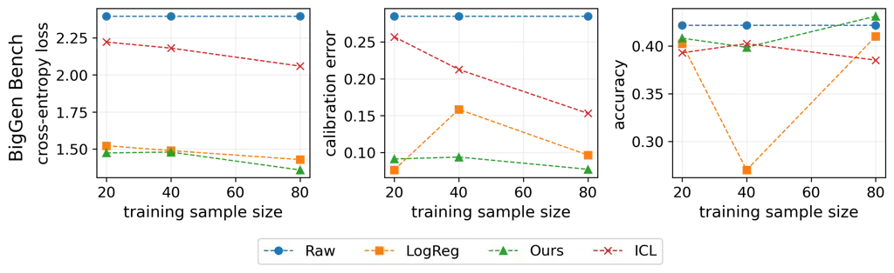

Figure 6: In-context-learning judge provides only marginal gains

### B.6 Application 2

#### B.6.1 Performance gains

In this section, we show that including covariates in the model can lead
to some performance gains if the objective is human alignment. In the
next figures, we compare raw LLM judgements (“raw”) with the application
of our method using covariates (“covs”) or not (“calib”). For both BGB
and CA, we have gains in terms of cross-entropy loss (Figure 7), giving
hints of better human-aligned judgments, while the gains in accuracy are
only more pronounced in CA judgments (Figure 9).

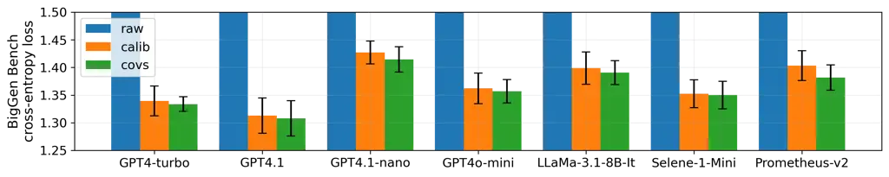

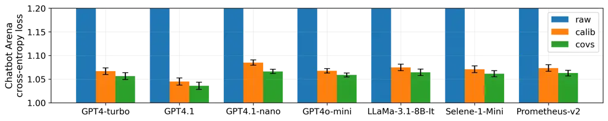

Figure 7: Performance in terms of cross-entropy loss.

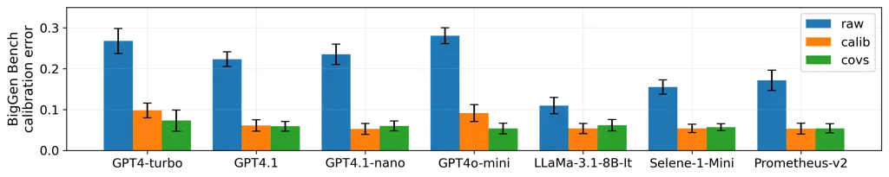

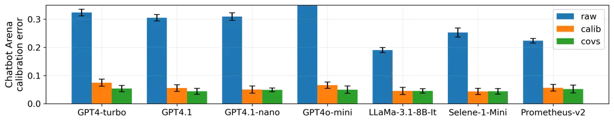

Figure 8: Performance in terms of probabilistic calibration.

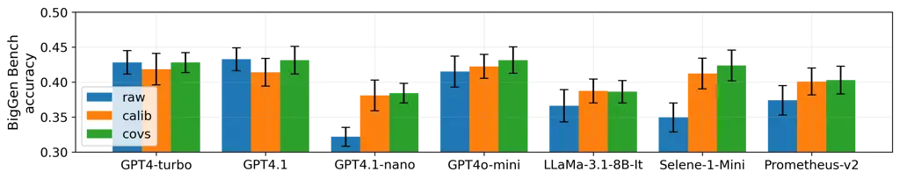

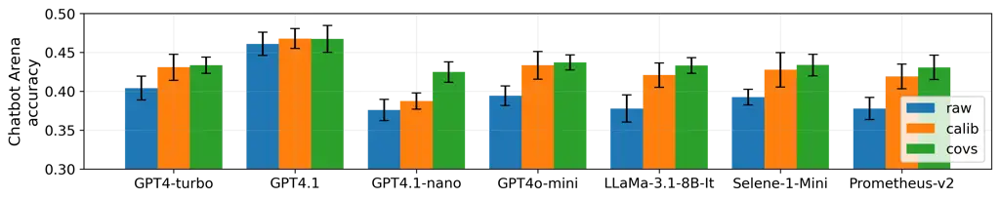

Figure 9: Performance in terms of accuracy.

#### B.6.2 Tables BigGen Bench

|                                                                  |             |             |             |             |                 |               |               |
| ---------------------------------------------------------------- | ----------- | ----------- | ----------- | ----------- | --------------- | ------------- | ------------- |
|                                                                  | GPT4-turbo  | GPT4.1-nano | GPT4.1      | GPT4o-mini  | LLaMa-3.1-8B-It | Selene-1-Mini | Prometheus-v2 |
| Writing Quality                                                  | -0.07\*     | -0.38\*\*\* | -0.10\*\*\* | $`-0.02`$   | -0.22\*\*\*     | $`-0.02`$     | -0.22\*\*\*   |
| Text Length                                                      | -0.49\*\*\* | -0.83\*\*\* | -0.39\*\*\* | -0.43\*\*\* | -0.78\*\*\*     | -0.44\*\*\*   | -0.74\*\*\*   |
| Italics                                                          | $`0.04`$    | $`0.06`$    | $`0.05`$    | $`0.04`$    | 0.08\*          | $`0.05`$      | $`0.06`$      |
| Bold Text                                                        | $`-0.05`$   | $`-0.04`$   | $`0.01`$    | $`-0.04`$   | $`-0.08`$       | $`-0.04`$     | $`-0.06`$     |
| Lists                                                            | $`0.07`$    | $`0.07`$    | $`0.04`$    | 0.08\*      | $`0.09`$        | 0.11\*\*      | $`0.05`$      |
| Headers                                                          | $`0.03`$    | $`0.02`$    | $`0.03`$    | $`0.01`$    | $`-0.01`$       | $`0.01`$      | $`0.03`$      |
| Creativity/Engagement                                            | $`0.07`$    | $`0.04`$    | $`0.05`$    | 0.09\*\*    | $`0.06`$        | 0.09\*        | $`0.02`$      |
| Positive Sentiment                                               | -0.18\*\*\* | -0.31\*\*\* | -0.12\*\*\* | -0.15\*\*\* | -0.22\*\*\*     | -0.18\*\*\*   | -0.21\*\*\*   |
| Conciseness                                                      | $`-0.07`$   | $`-0.09`$   | -0.07\*     | $`-0.02`$   | $`-0.07`$       | $`-0.04`$     | $`-0.02`$     |
| Contrast Markers                                                 | $`0.01`$    | $`-0.00`$   | $`0.02`$    | $`-0.01`$   | $`0.02`$        | $`-0.01`$     | $`-0.01`$     |
| Layout Density                                                   | -0.10\*     | -0.23\*\*   | -0.15\*\*\* | -0.11\*     | -0.21\*\*       | -0.13\*\*     | -0.17\*\*     |
| Causal Markers                                                   | -0.13\*\*\* | -0.19\*\*\* | -0.09\*\*\* | -0.10\*\*\* | -0.12\*\*       | -0.08\*\*     | $`-0.07`$     |
| Structure Counts                                                 | 0.15\*\*    | 0.35\*\*\*  | 0.16\*\*\*  | 0.11\*      | 0.29\*\*\*      | 0.12\*\*      | 0.29\*\*\*    |
| Sentiment                                                        | 0.12\*\*\*  | 0.24\*\*\*  | 0.10\*\*    | 0.11\*\*    | $`0.11`$        | 0.09\*        | $`0.10`$      |
| Readability Grade                                                | $`0.03`$    | $`0.24`$    | $`0.13`$    | $`-0.01`$   | 0.27\*          | $`0.07`$      | 0.27\*        |
| Exclamation Density                                              | $`-0.05`$   | -0.18\*\*   | $`-0.08`$   | $`-0.06`$   | $`-0.01`$       | $`0.01`$      | $`-0.02`$     |
| Readability Ease                                                 | $`0.10`$    | 0.39\*\*    | 0.18\*      | $`0.08`$    | 0.45\*\*        | $`0.17`$      | 0.43\*\*\*    |
| Polarity                                                         | $`0.01`$    | $`-0.04`$   | $`0.02`$    | $`0.00`$    | $`-0.01`$       | $`0.01`$      | $`0.01`$      |
| Question Density                                                 | -0.10\*\*   | $`-0.09`$   | $`-0.06`$   | -0.11\*\*   | -0.11\*         | -0.09\*       | -0.12\*\*     |
| Paragraph Length                                                 | $`0.02`$    | $`0.04`$    | $`0.01`$    | $`0.04`$    | $`0.05`$        | $`0.03`$      | $`0.07`$      |
| Code Block                                                       | 0.08\*\*    | 0.20\*\*\*  | 0.07\*\*    | 0.09\*\*    | 0.22\*\*\*      | 0.14\*\*\*    | 0.20\*\*\*    |
| Additive Markers                                                 | $`-0.01`$   | $`0.05`$    | $`0.00`$    | $`0.00`$    | $`0.06`$        | $`0.00`$      | $`0.03`$      |
| Summary Markers                                                  | -0.08\*\*   | -0.09\*     | -0.08\*\*\* | -0.08\*\*   | -0.11\*\*       | -0.10\*\*\*   | -0.12\*\*     |
| Character Density                                                | 0.10\*      | 0.25\*\*    | 0.13\*\*    | 0.12\*\*    | 0.23\*\*        | 0.20\*\*\*    | $`0.13`$      |
| Exclamation Count                                                | $`0.03`$    | 0.13\*      | $`0.03`$    | $`-0.01`$   | $`0.08`$        | $`-0.03`$     | $`0.05`$      |
| Lexical Ratio                                                    | $`-0.04`$   | $`-0.10`$   | $`0.05`$    | $`-0.02`$   | -0.20\*\*       | $`-0.08`$     | -0.13\*       |
| Subjectivity                                                     | $`0.00`$    | $`0.02`$    | $`-0.00`$   | $`0.02`$    | $`0.02`$        | $`0.01`$      | $`0.02`$      |
| Sentence Length                                                  | $`-0.04`$   | -0.13\*\*   | -0.07\*\*   | $`-0.03`$   | -0.10\*\*       | $`-0.04`$     | -0.10\*\*     |
| Example Markers                                                  | $`0.04`$    | $`0.05`$    | $`0.02`$    | $`0.02`$    | $`0.06`$        | $`0.02`$      | $`0.04`$      |
| Compound Sentiment                                               | 0.11\*\*\*  | 0.27\*\*\*  | 0.06\*      | 0.08\*      | 0.16\*\*\*      | 0.13\*\*\*    | 0.19\*\*\*    |
| Question Count                                                   | 0.12\*\*\*  | 0.16\*\*    | 0.09\*\*    | 0.13\*\*\*  | 0.13\*\*        | 0.11\*\*\*    | 0.15\*\*\*    |
| Significance: \*\*\* $`p<0.01`$, \*\* $`p<0.05`$, \* $`p<0.10`$. |             |             |             |             |                 |               |               |

Table 8: Human-LLM judgement discrepancies on BigGen Bench (with no
Benjamini-Yekutieli correction)

|                                                                  |             |             |             |             |                 |               |               |
| ---------------------------------------------------------------- | ----------- | ----------- | ----------- | ----------- | --------------- | ------------- | ------------- |
|                                                                  | GPT4-turbo  | GPT4.1-nano | GPT4.1      | GPT4o-mini  | LLaMa-3.1-8B-It | Selene-1-Mini | Prometheus-v2 |
| Writing Quality                                                  | $`-0.07`$   | -0.38\*\*\* | $`-0.10`$   | $`-0.02`$   | -0.22\*\*       | $`-0.02`$     | -0.22\*\*\*   |
| Text Length                                                      | -0.49\*\*\* | -0.83\*\*\* | -0.39\*\*\* | -0.43\*\*\* | -0.78\*\*\*     | -0.44\*\*\*   | -0.74\*\*\*   |
| Italics                                                          | $`0.04`$    | $`0.06`$    | $`0.05`$    | $`0.04`$    | $`0.08`$        | $`0.05`$      | $`0.06`$      |
| Bold Text                                                        | $`-0.05`$   | $`-0.04`$   | $`0.01`$    | $`-0.04`$   | $`-0.08`$       | $`-0.04`$     | $`-0.06`$     |
| Lists                                                            | $`0.07`$    | $`0.07`$    | $`0.04`$    | $`0.08`$    | $`0.09`$        | $`0.11`$      | $`0.05`$      |
| Headers                                                          | $`0.03`$    | $`0.02`$    | $`0.03`$    | $`0.01`$    | $`-0.01`$       | $`0.01`$      | $`0.03`$      |
| Creativity/Engagement                                            | $`0.07`$    | $`0.04`$    | $`0.05`$    | $`0.09`$    | $`0.06`$        | $`0.09`$      | $`0.02`$      |
| Positive Sentiment                                               | -0.18\*\*\* | -0.31\*\*\* | -0.12\*     | -0.15\*\*   | -0.22\*\*       | -0.18\*\*\*   | -0.21\*\*\*   |
| Conciseness                                                      | $`-0.07`$   | $`-0.09`$   | $`-0.07`$   | $`-0.02`$   | $`-0.07`$       | $`-0.04`$     | $`-0.02`$     |
| Contrast Markers                                                 | $`0.01`$    | $`-0.00`$   | $`0.02`$    | $`-0.01`$   | $`0.02`$        | $`-0.01`$     | $`-0.01`$     |
| Layout Density                                                   | $`-0.10`$   | $`-0.23`$   | -0.15\*     | $`-0.11`$   | $`-0.21`$       | $`-0.13`$     | $`-0.17`$     |
| Causal Markers                                                   | -0.13\*\*   | -0.19\*\*   | $`-0.09`$   | $`-0.10`$   | $`-0.12`$       | $`-0.08`$     | $`-0.07`$     |
| Structure Counts                                                 | $`0.15`$    | 0.35\*\*\*  | 0.16\*      | $`0.11`$    | 0.29\*\*        | $`0.12`$      | 0.29\*\*\*    |
| Sentiment                                                        | $`0.12`$    | 0.24\*\*    | $`0.10`$    | $`0.11`$    | $`0.11`$        | $`0.09`$      | $`0.10`$      |
| Readability Grade                                                | $`0.03`$    | $`0.24`$    | $`0.13`$    | $`-0.01`$   | $`0.27`$        | $`0.07`$      | $`0.27`$      |
| Exclamation Density                                              | $`-0.05`$   | $`-0.18`$   | $`-0.08`$   | $`-0.06`$   | $`-0.01`$       | $`0.01`$      | $`-0.02`$     |
| Readability Ease                                                 | $`0.10`$    | $`0.39`$    | $`0.18`$    | $`0.08`$    | $`0.45`$        | $`0.17`$      | $`0.43`$      |
| Polarity                                                         | $`0.01`$    | $`-0.04`$   | $`0.02`$    | $`0.00`$    | $`-0.01`$       | $`0.01`$      | $`0.01`$      |
| Question Density                                                 | $`-0.10`$   | $`-0.09`$   | $`-0.06`$   | $`-0.11`$   | $`-0.11`$       | $`-0.09`$     | $`-0.12`$     |
| Paragraph Length                                                 | $`0.02`$    | $`0.04`$    | $`0.01`$    | $`0.04`$    | $`0.05`$        | $`0.03`$      | $`0.07`$      |
| Code Block                                                       | $`0.08`$    | 0.20\*\*    | $`0.07`$    | $`0.09`$    | 0.22\*\*\*      | 0.14\*\*      | 0.20\*\*\*    |
| Additive Markers                                                 | $`-0.01`$   | $`0.05`$    | $`0.00`$    | $`0.00`$    | $`0.06`$        | $`0.00`$      | $`0.03`$      |
| Summary Markers                                                  | $`-0.08`$   | $`-0.09`$   | $`-0.08`$   | $`-0.08`$   | $`-0.11`$       | $`-0.10`$     | $`-0.12`$     |
| Character Density                                                | $`0.10`$    | $`0.25`$    | $`0.13`$    | $`0.12`$    | $`0.23`$        | 0.20\*\*      | $`0.13`$      |
| Exclamation Count                                                | $`0.03`$    | $`0.13`$    | $`0.03`$    | $`-0.01`$   | $`0.08`$        | $`-0.03`$     | $`0.05`$      |
| Lexical Ratio                                                    | $`-0.04`$   | $`-0.10`$   | $`0.05`$    | $`-0.02`$   | $`-0.20`$       | $`-0.08`$     | $`-0.13`$     |
| Subjectivity                                                     | $`0.00`$    | $`0.02`$    | $`-0.00`$   | $`0.02`$    | $`0.02`$        | $`0.01`$      | $`0.02`$      |
| Sentence Length                                                  | $`-0.04`$   | $`-0.13`$   | $`-0.07`$   | $`-0.03`$   | $`-0.10`$       | $`-0.04`$     | $`-0.10`$     |
| Example Markers                                                  | $`0.04`$    | $`0.05`$    | $`0.02`$    | $`0.02`$    | $`0.06`$        | $`0.02`$      | $`0.04`$      |
| Compound Sentiment                                               | $`0.11`$    | 0.27\*\*\*  | $`0.06`$    | $`0.08`$    | $`0.16`$        | 0.13\*\*      | 0.19\*\*      |
| Question Count                                                   | 0.12\*      | $`0.16`$    | $`0.09`$    | 0.13\*      | $`0.13`$        | $`0.11`$      | $`0.15`$      |
| Significance: \*\*\* $`p<0.01`$, \*\* $`p<0.05`$, \* $`p<0.10`$. |             |             |             |             |                 |               |               |

Table 9: Human-LLM judgement discrepancies on BigGen Bench (with
Benjamini-Yekutieli correction)

#### B.6.3 Tables Chatbot Arena

|                                                                  |             |             |             |             |                 |               |               |
| ---------------------------------------------------------------- | ----------- | ----------- | ----------- | ----------- | --------------- | ------------- | ------------- |
|                                                                  | GPT4-turbo  | GPT4.1-nano | GPT4.1      | GPT4o-mini  | LLaMa-3.1-8B-It | Selene-1-Mini | Prometheus-v2 |
| Text Length                                                      | -0.90\*\*\* | -2.05\*\*\* | -0.54\*\*\* | -1.02\*\*\* | -1.61\*\*\*     | -1.17\*\*\*   | -1.20\*\*\*   |
| Creativity/Engagement                                            | -0.55\*\*\* | -1.27\*\*\* | -0.32\*\*\* | -0.64\*\*\* | -1.10\*\*\*     | -0.78\*\*\*   | -0.77\*\*\*   |
| Readability Grade                                                | $`0.01`$    | $`0.15`$    | $`-0.01`$   | $`0.02`$    | $`0.11`$        | $`0.07`$      | $`0.07`$      |
| Consistency                                                      | $`-0.17`$   | $`-0.38`$   | $`-0.12`$   | $`-0.17`$   | $`-0.32`$       | $`-0.23`$     | $`-0.23`$     |
| Bold Text                                                        | 0.38\*\*\*  | 0.74\*\*\*  | 0.25\*\*\*  | 0.50\*\*\*  | 0.77\*\*\*      | 0.66\*\*\*    | 0.62\*\*\*    |
| Causal Markers                                                   | $`0.09`$    | $`0.20`$    | $`0.08`$    | $`0.11`$    | $`0.15`$        | $`0.13`$      | $`0.11`$      |
| Language Quality                                                 | $`0.12`$    | $`0.23`$    | $`0.07`$    | $`0.15`$    | $`0.21`$        | $`0.15`$      | $`0.21`$      |
| Example Markers                                                  | $`0.11`$    | $`0.24`$    | $`0.08`$    | $`0.15`$    | $`0.20`$        | $`0.16`$      | $`0.15`$      |
| Conciseness                                                      | -0.20\*     | $`-0.36`$   | $`-0.08`$   | -0.24\*     | $`-0.33`$       | $`-0.27`$     | -0.26\*       |
| Structure Counts                                                 | $`0.16`$    | $`0.43`$    | $`0.11`$    | $`0.22`$    | $`0.34`$        | $`0.28`$      | $`0.25`$      |
| Additive Markers                                                 | $`0.01`$    | $`0.08`$    | $`0.03`$    | $`0.04`$    | $`0.07`$        | $`0.03`$      | $`0.04`$      |
| Polarity                                                         | $`0.09`$    | $`0.15`$    | $`0.05`$    | $`0.09`$    | $`0.12`$        | $`0.09`$      | $`0.10`$      |
| Contrast Markers                                                 | $`-0.06`$   | $`-0.10`$   | $`-0.04`$   | $`-0.08`$   | $`-0.03`$       | $`-0.09`$     | $`-0.05`$     |
| Sentiment                                                        | 0.26\*\*    | 0.57\*\*    | 0.14\*      | 0.34\*\*    | 0.41\*          | 0.35\*\*      | 0.37\*\*      |
| Coherence                                                        | $`-0.16`$   | -0.47\*     | $`-0.10`$   | $`-0.25`$   | $`-0.36`$       | $`-0.28`$     | $`-0.30`$     |
| Linebreak Density                                                | $`0.19`$    | $`0.36`$    | $`0.13`$    | $`0.24`$    | $`0.35`$        | $`0.27`$      | $`0.26`$      |
| Lists                                                            | $`-0.07`$   | $`-0.23`$   | $`-0.03`$   | $`-0.14`$   | $`-0.26`$       | $`-0.18`$     | $`-0.17`$     |
| Subjectivity                                                     | 0.17\*      | $`0.27`$    | $`0.07`$    | 0.19\*      | 0.28\*          | 0.22\*        | 0.21\*        |
| Readability Ease                                                 | $`0.17`$    | $`0.49`$    | $`0.11`$    | $`0.22`$    | $`0.41`$        | $`0.28`$      | $`0.24`$      |
| Paragraph Length                                                 | 0.24\*\*    | 0.51\*\*    | 0.17\*\*    | 0.28\*\*    | 0.43\*\*        | 0.32\*\*      | 0.30\*\*      |
| Code Block                                                       | $`-0.08`$   | $`-0.20`$   | $`-0.06`$   | $`-0.09`$   | $`-0.18`$       | $`-0.14`$     | $`-0.13`$     |
| Question Density                                                 | $`-0.00`$   | $`0.02`$    | $`-0.01`$   | $`-0.00`$   | $`0.02`$        | $`0.00`$      | $`0.01`$      |
| List Density                                                     | $`0.02`$    | $`0.04`$    | $`-0.02`$   | $`0.04`$    | $`0.08`$        | $`0.09`$      | $`0.04`$      |
| Exclamation Count                                                | $`0.06`$    | $`0.18`$    | $`0.06`$    | $`0.13`$    | $`0.13`$        | $`0.11`$      | $`0.10`$      |
| Paragraph Density                                                | -0.23\*     | -0.50\*\*   | -0.16\*\*   | -0.26\*     | -0.46\*\*       | -0.36\*\*     | -0.37\*\*     |
| Character Density                                                | $`0.01`$    | $`0.00`$    | $`0.01`$    | $`0.01`$    | $`0.01`$        | $`-0.02`$     | $`0.00`$      |
| Count Italic                                                     | $`0.24`$    | $`0.49`$    | $`0.19`$    | $`0.27`$    | $`0.45`$        | $`0.36`$      | $`0.37`$      |
| Question Count                                                   | $`0.00`$    | $`0.07`$    | $`0.01`$    | $`0.02`$    | $`0.07`$        | $`0.02`$      | $`0.02`$      |
| Positive Sentiment                                               | $`0.03`$    | $`0.12`$    | $`0.01`$    | $`0.08`$    | $`0.10`$        | $`0.07`$      | $`0.07`$      |
| Compound Sentiment                                               | $`0.06`$    | $`0.12`$    | $`0.03`$    | $`0.06`$    | $`0.13`$        | $`0.10`$      | $`0.13`$      |
| Summary Markers                                                  | $`-0.07`$   | $`-0.08`$   | $`-0.05`$   | $`-0.06`$   | $`-0.08`$       | $`-0.06`$     | $`-0.08`$     |
| Lexical Ratio                                                    | 0.26\*      | 0.56\*\*    | 0.22\*\*    | 0.30\*      | 0.48\*          | 0.45\*\*      | 0.35\*        |
| Relative Italic                                                  | $`-0.22`$   | $`-0.43`$   | $`-0.14`$   | $`-0.25`$   | $`-0.41`$       | $`-0.31`$     | -0.31\*       |
| Exclamation Density                                              | -0.18\*     | $`-0.30`$   | $`-0.08`$   | $`-0.19`$   | $`-0.27`$       | $`-0.21`$     | -0.24\*       |
| Header Density                                                   | $`-0.00`$   | $`0.02`$    | $`0.01`$    | $`0.02`$    | $`0.00`$        | $`0.01`$      | $`0.00`$      |
| Headers                                                          | $`0.02`$    | $`0.01`$    | $`0.03`$    | $`0.05`$    | $`0.01`$        | $`0.03`$      | $`-0.01`$     |
| Sentence Length                                                  | $`-0.09`$   | $`-0.16`$   | $`-0.08`$   | $`-0.09`$   | $`-0.20`$       | $`-0.17`$     | $`-0.19`$     |
| Significance: \*\*\* $`p<0.01`$, \*\* $`p<0.05`$, \* $`p<0.10`$. |             |             |             |             |                 |               |               |

Table 10: Human-LLM judgement discrepancies on Chatbot Arena (with no
Benjamini-Yekutieli correction)

|                                                                  |             |             |             |             |                 |               |               |
| ---------------------------------------------------------------- | ----------- | ----------- | ----------- | ----------- | --------------- | ------------- | ------------- |
|                                                                  | GPT4-turbo  | GPT4.1-nano | GPT4.1      | GPT4o-mini  | LLaMa-3.1-8B-It | Selene-1-Mini | Prometheus-v2 |
| Text Length                                                      | -0.90\*\*\* | -2.05\*\*\* | -0.54\*\*\* | -1.02\*\*\* | -1.61\*\*       | -1.17\*\*     | -1.20\*\*\*   |
| Creativity/Engagement                                            | -0.55\*\*\* | -1.27\*\*\* | -0.32\*\*\* | -0.64\*\*\* | -1.10\*\*       | -0.78\*\*     | -0.77\*\*\*   |
| Readability Grade                                                | $`0.01`$    | $`0.15`$    | $`-0.01`$   | $`0.02`$    | $`0.11`$        | $`0.07`$      | $`0.07`$      |
| Consistency                                                      | $`-0.17`$   | $`-0.38`$   | $`-0.12`$   | $`-0.17`$   | $`-0.32`$       | $`-0.23`$     | $`-0.23`$     |
| Bold Text                                                        | 0.38\*\*\*  | 0.74\*\*    | 0.25\*\*\*  | 0.50\*\*\*  | 0.77\*\*        | 0.66\*\*\*    | 0.62\*\*\*    |
| Causal Markers                                                   | $`0.09`$    | $`0.20`$    | $`0.08`$    | $`0.11`$    | $`0.15`$        | $`0.13`$      | $`0.11`$      |
| Language Quality                                                 | $`0.12`$    | $`0.23`$    | $`0.07`$    | $`0.15`$    | $`0.21`$        | $`0.15`$      | $`0.21`$      |
| Example Markers                                                  | $`0.11`$    | $`0.24`$    | $`0.08`$    | $`0.15`$    | $`0.20`$        | $`0.16`$      | $`0.15`$      |
| Conciseness                                                      | $`-0.20`$   | $`-0.36`$   | $`-0.08`$   | $`-0.24`$   | $`-0.33`$       | $`-0.27`$     | $`-0.26`$     |
| Structure Counts                                                 | $`0.16`$    | $`0.43`$    | $`0.11`$    | $`0.22`$    | $`0.34`$        | $`0.28`$      | $`0.25`$      |
| Additive Markers                                                 | $`0.01`$    | $`0.08`$    | $`0.03`$    | $`0.04`$    | $`0.07`$        | $`0.03`$      | $`0.04`$      |
| Polarity                                                         | $`0.09`$    | $`0.15`$    | $`0.05`$    | $`0.09`$    | $`0.12`$        | $`0.09`$      | $`0.10`$      |
| Contrast Markers                                                 | $`-0.06`$   | $`-0.10`$   | $`-0.04`$   | $`-0.08`$   | $`-0.03`$       | $`-0.09`$     | $`-0.05`$     |
| Sentiment                                                        | $`0.26`$    | $`0.57`$    | $`0.14`$    | $`0.34`$    | $`0.41`$        | $`0.35`$      | $`0.37`$      |
| Coherence                                                        | $`-0.16`$   | $`-0.47`$   | $`-0.10`$   | $`-0.25`$   | $`-0.36`$       | $`-0.28`$     | $`-0.30`$     |
| Linebreak Density                                                | $`0.19`$    | $`0.36`$    | $`0.13`$    | $`0.24`$    | $`0.35`$        | $`0.27`$      | $`0.26`$      |
| Lists                                                            | $`-0.07`$   | $`-0.23`$   | $`-0.03`$   | $`-0.14`$   | $`-0.26`$       | $`-0.18`$     | $`-0.17`$     |
| Subjectivity                                                     | $`0.17`$    | $`0.27`$    | $`0.07`$    | $`0.19`$    | $`0.28`$        | $`0.22`$      | $`0.21`$      |
| Readability Ease                                                 | $`0.17`$    | $`0.49`$    | $`0.11`$    | $`0.22`$    | $`0.41`$        | $`0.28`$      | $`0.24`$      |
| Paragraph Length                                                 | $`0.24`$    | $`0.51`$    | $`0.17`$    | $`0.28`$    | $`0.43`$        | $`0.32`$      | $`0.30`$      |
| Code Block                                                       | $`-0.08`$   | $`-0.20`$   | $`-0.06`$   | $`-0.09`$   | $`-0.18`$       | $`-0.14`$     | $`-0.13`$     |
| Question Density                                                 | $`-0.00`$   | $`0.02`$    | $`-0.01`$   | $`-0.00`$   | $`0.02`$        | $`0.00`$      | $`0.01`$      |
| List Density                                                     | $`0.02`$    | $`0.04`$    | $`-0.02`$   | $`0.04`$    | $`0.08`$        | $`0.09`$      | $`0.04`$      |
| Exclamation Count                                                | $`0.06`$    | $`0.18`$    | $`0.06`$    | $`0.13`$    | $`0.13`$        | $`0.11`$      | $`0.10`$      |
| Paragraph Density                                                | $`-0.23`$   | $`-0.50`$   | $`-0.16`$   | $`-0.26`$   | $`-0.46`$       | $`-0.36`$     | $`-0.37`$     |
| Character Density                                                | $`0.01`$    | $`0.00`$    | $`0.01`$    | $`0.01`$    | $`0.01`$        | $`-0.02`$     | $`0.00`$      |
| Count Italic                                                     | $`0.24`$    | $`0.49`$    | $`0.19`$    | $`0.27`$    | $`0.45`$        | $`0.36`$      | $`0.37`$      |
| Question Count                                                   | $`0.00`$    | $`0.07`$    | $`0.01`$    | $`0.02`$    | $`0.07`$        | $`0.02`$      | $`0.02`$      |
| Positive Sentiment                                               | $`0.03`$    | $`0.12`$    | $`0.01`$    | $`0.08`$    | $`0.10`$        | $`0.07`$      | $`0.07`$      |
| Compound Sentiment                                               | $`0.06`$    | $`0.12`$    | $`0.03`$    | $`0.06`$    | $`0.13`$        | $`0.10`$      | $`0.13`$      |
| Summary Markers                                                  | $`-0.07`$   | $`-0.08`$   | $`-0.05`$   | $`-0.06`$   | $`-0.08`$       | $`-0.06`$     | $`-0.08`$     |
| Lexical Ratio                                                    | $`0.26`$    | $`0.56`$    | $`0.22`$    | $`0.30`$    | $`0.48`$        | $`0.45`$      | $`0.35`$      |
| Relative Italic                                                  | $`-0.22`$   | $`-0.43`$   | $`-0.14`$   | $`-0.25`$   | $`-0.41`$       | $`-0.31`$     | $`-0.31`$     |
| Exclamation Density                                              | $`-0.18`$   | $`-0.30`$   | $`-0.08`$   | $`-0.19`$   | $`-0.27`$       | $`-0.21`$     | $`-0.24`$     |
| Header Density                                                   | $`-0.00`$   | $`0.02`$    | $`0.01`$    | $`0.02`$    | $`0.00`$        | $`0.01`$      | $`0.00`$      |
| Headers                                                          | $`0.02`$    | $`0.01`$    | $`0.03`$    | $`0.05`$    | $`0.01`$        | $`0.03`$      | $`-0.01`$     |
| Sentence Length                                                  | $`-0.09`$   | $`-0.16`$   | $`-0.08`$   | $`-0.09`$   | $`-0.20`$       | $`-0.17`$     | $`-0.19`$     |
| Significance: \*\*\* $`p<0.01`$, \*\* $`p<0.05`$, \* $`p<0.10`$. |             |             |             |             |                 |               |               |

Table 11: Human-LLM judgement discrepancies on Chatbot Arena (with
Benjamini-Yekutieli correction)

#### B.6.4 Tables Chatbot Arena (non-technical queries)

|                                                                  |             |             |             |             |                 |               |               |
| ---------------------------------------------------------------- | ----------- | ----------- | ----------- | ----------- | --------------- | ------------- | ------------- |
|                                                                  | GPT4-turbo  | GPT4.1-nano | GPT4.1      | GPT4o-mini  | LLaMa-3.1-8B-It | Selene-1-Mini | Prometheus-v2 |
| Text Length                                                      | -0.90\*\*\* | -2.18\*\*\* | -0.55\*\*\* | -1.09\*\*\* | -2.45\*\*       | -1.25\*\*\*   | -1.67\*\*\*   |
| Creativity/Engagement                                            | -0.55\*\*\* | -1.33\*\*\* | -0.33\*\*\* | -0.70\*\*\* | -1.64\*\*       | -0.86\*\*\*   | -1.07\*\*\*   |
| Readability Grade                                                | $`0.28`$    | $`0.78`$    | $`0.13`$    | $`0.35`$    | $`0.90`$        | $`0.46`$      | $`0.64`$      |
| Consistency                                                      | -0.24\*     | -0.56\*\*   | -0.16\*     | -0.27\*     | -0.63\*         | -0.35\*       | -0.42\*       |
| Bold Text                                                        | 0.39\*\*\*  | 0.75\*\*    | 0.24\*\*\*  | 0.52\*\*\*  | 1.01\*\*        | 0.66\*\*\*    | 0.77\*\*\*    |
| Causal Markers                                                   | $`0.14`$    | $`0.32`$    | $`0.13`$    | $`0.19`$    | $`0.34`$        | $`0.21`$      | $`0.24`$      |
| Language Quality                                                 | $`0.24`$    | $`0.52`$    | $`0.14`$    | $`0.30`$    | $`0.62`$        | $`0.36`$      | $`0.47`$      |
| Example Markers                                                  | $`-0.14`$   | $`-0.27`$   | $`-0.12`$   | $`-0.16`$   | $`-0.33`$       | $`-0.21`$     | $`-0.24`$     |
| Conciseness                                                      | -0.26\*     | -0.49\*     | $`-0.11`$   | -0.32\*     | -0.63\*         | -0.38\*       | -0.45\*       |
| Structure Counts                                                 | $`0.21`$    | $`0.57`$    | $`0.10`$    | $`0.34`$    | $`0.70`$        | $`0.39`$      | $`0.42`$      |
| Additive Markers                                                 | $`-0.06`$   | $`-0.06`$   | $`-0.01`$   | $`-0.04`$   | $`-0.07`$       | $`-0.08`$     | $`-0.09`$     |
| Polarity                                                         | $`0.15`$    | $`0.31`$    | $`0.10`$    | $`0.19`$    | $`0.38`$        | $`0.21`$      | $`0.27`$      |
| Contrast Markers                                                 | $`-0.04`$   | $`-0.05`$   | $`-0.03`$   | $`-0.04`$   | $`0.06`$        | $`-0.02`$     | $`0.00`$      |
| Sentiment                                                        | 0.22\*      | 0.46\*      | $`0.12`$    | 0.30\*      | $`0.44`$        | $`0.29`$      | 0.38\*        |
| Coherence                                                        | $`-0.06`$   | $`-0.23`$   | $`-0.03`$   | $`-0.10`$   | $`-0.24`$       | $`-0.13`$     | $`-0.21`$     |
| Linebreak Density                                                | $`0.10`$    | $`0.21`$    | $`0.07`$    | $`0.18`$    | $`0.28`$        | $`0.19`$      | $`0.20`$      |
| Lists                                                            | -0.35\*     | -0.84\*     | $`-0.21`$   | -0.51\*     | -1.07\*         | -0.60\*       | -0.71\*       |
| Subjectivity                                                     | $`0.06`$    | $`0.09`$    | $`0.01`$    | $`0.07`$    | $`0.14`$        | $`0.06`$      | $`0.11`$      |
| Readability Ease                                                 | $`0.17`$    | $`0.60`$    | $`0.11`$    | $`0.27`$    | $`0.65`$        | $`0.30`$      | $`0.39`$      |
| Paragraph Length                                                 | $`0.09`$    | $`0.20`$    | $`0.07`$    | $`0.11`$    | $`0.24`$        | $`0.12`$      | $`0.13`$      |
| Code Block                                                       | $`-0.18`$   | $`-0.39`$   | $`-0.15`$   | $`-0.23`$   | $`-0.53`$       | $`-0.33`$     | $`-0.36`$     |
| Question Density                                                 | $`0.00`$    | $`0.06`$    | $`-0.00`$   | $`0.02`$    | $`0.05`$        | $`0.01`$      | $`0.04`$      |
| List Density                                                     | $`0.03`$    | $`0.02`$    | $`-0.01`$   | $`0.03`$    | $`0.08`$        | $`0.08`$      | $`0.03`$      |
| Exclamation Count                                                | $`0.11`$    | $`0.31`$    | $`0.11`$    | $`0.22`$    | $`0.32`$        | $`0.20`$      | $`0.22`$      |
| Paragraph Density                                                | -0.25\*     | -0.52\*     | -0.15\*     | -0.30\*     | $`-0.64`$       | -0.38\*       | -0.46\*       |
| Character Density                                                | $`0.16`$    | $`0.21`$    | $`0.11`$    | $`0.15`$    | $`0.28`$        | $`0.12`$      | $`0.20`$      |
| Count Italic                                                     | $`0.26`$    | $`0.46`$    | $`0.18`$    | $`0.33`$    | $`0.67`$        | $`0.44`$      | $`0.45`$      |
| Question Count                                                   | $`0.04`$    | $`0.15`$    | $`0.04`$    | $`0.08`$    | $`0.21`$        | $`0.07`$      | $`0.10`$      |
| Positive Sentiment                                               | $`-0.12`$   | $`-0.17`$   | $`-0.10`$   | $`-0.10`$   | $`-0.25`$       | $`-0.15`$     | $`-0.20`$     |
| Compound Sentiment                                               | 0.22\*      | 0.46\*      | 0.15\*      | 0.28\*      | $`0.59`$        | 0.37\*        | 0.46\*\*      |
| Summary Markers                                                  | $`-0.05`$   | $`-0.05`$   | $`-0.05`$   | $`-0.05`$   | $`-0.09`$       | $`-0.07`$     | $`-0.09`$     |
| Lexical Ratio                                                    | $`0.26`$    | 0.60\*      | 0.22\*\*    | 0.36\*      | $`0.72`$        | 0.50\*\*      | $`0.48`$      |
| Relative Italic                                                  | $`-0.16`$   | $`-0.30`$   | $`-0.08`$   | $`-0.18`$   | $`-0.42`$       | $`-0.25`$     | $`-0.26`$     |
| Exclamation Density                                              | $`-0.12`$   | $`-0.20`$   | $`-0.05`$   | $`-0.13`$   | $`-0.22`$       | $`-0.13`$     | $`-0.19`$     |
| Header Density                                                   | $`0.12`$    | $`0.21`$    | $`0.08`$    | $`0.12`$    | $`0.24`$        | $`0.16`$      | $`0.18`$      |
| Headers                                                          | $`-0.05`$   | $`-0.06`$   | $`0.02`$    | $`0.01`$    | $`-0.06`$       | $`-0.02`$     | $`-0.09`$     |
| Sentence Length                                                  | -1.02\*\*   | -1.97\*     | -0.59\*     | -1.13\*     | -2.55\*         | -1.47\*       | -1.87\*\*     |
| Significance: \*\*\* $`p<0.01`$, \*\* $`p<0.05`$, \* $`p<0.10`$. |             |             |             |             |                 |               |               |

Table 12: Human-LLM judgement discrepancies on non-technical Chatbot
Arena queries (with no Benjamini-Yekutieli correction)

|                                                                  |            |             |           |            |                 |               |               |
| ---------------------------------------------------------------- | ---------- | ----------- | --------- | ---------- | --------------- | ------------- | ------------- |
|                                                                  | GPT4-turbo | GPT4.1-nano | GPT4.1    | GPT4o-mini | LLaMa-3.1-8B-It | Selene-1-Mini | Prometheus-v2 |
| Text Length                                                      | -0.90\*\*  | -2.18\*     | -0.55\*\* | -1.09\*    | $`-2.45`$       | $`-1.25`$     | $`-1.67`$     |
| Creativity/Engagement                                            | -0.55\*\*  | -1.33\*     | -0.33\*\* | -0.70\*    | $`-1.64`$       | $`-0.86`$     | $`-1.07`$     |
| Readability Grade                                                | $`0.28`$   | $`0.78`$    | $`0.13`$  | $`0.35`$   | $`0.90`$        | $`0.46`$      | $`0.64`$      |
| Consistency                                                      | $`-0.24`$  | $`-0.56`$   | $`-0.16`$ | $`-0.27`$  | $`-0.63`$       | $`-0.35`$     | $`-0.42`$     |
| Bold Text                                                        | $`0.39`$   | $`0.75`$    | $`0.24`$  | 0.52\*     | $`1.01`$        | $`0.66`$      | $`0.77`$      |
| Causal Markers                                                   | $`0.14`$   | $`0.32`$    | $`0.13`$  | $`0.19`$   | $`0.34`$        | $`0.21`$      | $`0.24`$      |
| Language Quality                                                 | $`0.24`$   | $`0.52`$    | $`0.14`$  | $`0.30`$   | $`0.62`$        | $`0.36`$      | $`0.47`$      |
| Example Markers                                                  | $`-0.14`$  | $`-0.27`$   | $`-0.12`$ | $`-0.16`$  | $`-0.33`$       | $`-0.21`$     | $`-0.24`$     |
| Conciseness                                                      | $`-0.26`$  | $`-0.49`$   | $`-0.11`$ | $`-0.32`$  | $`-0.63`$       | $`-0.38`$     | $`-0.45`$     |
| Structure Counts                                                 | $`0.21`$   | $`0.57`$    | $`0.10`$  | $`0.34`$   | $`0.70`$        | $`0.39`$      | $`0.42`$      |
| Additive Markers                                                 | $`-0.06`$  | $`-0.06`$   | $`-0.01`$ | $`-0.04`$  | $`-0.07`$       | $`-0.08`$     | $`-0.09`$     |
| Polarity                                                         | $`0.15`$   | $`0.31`$    | $`0.10`$  | $`0.19`$   | $`0.38`$        | $`0.21`$      | $`0.27`$      |
| Contrast Markers                                                 | $`-0.04`$  | $`-0.05`$   | $`-0.03`$ | $`-0.04`$  | $`0.06`$        | $`-0.02`$     | $`0.00`$      |
| Sentiment                                                        | $`0.22`$   | $`0.46`$    | $`0.12`$  | $`0.30`$   | $`0.44`$        | $`0.29`$      | $`0.38`$      |
| Coherence                                                        | $`-0.06`$  | $`-0.23`$   | $`-0.03`$ | $`-0.10`$  | $`-0.24`$       | $`-0.13`$     | $`-0.21`$     |
| Linebreak Density                                                | $`0.10`$   | $`0.21`$    | $`0.07`$  | $`0.18`$   | $`0.28`$        | $`0.19`$      | $`0.20`$      |
| Lists                                                            | $`-0.35`$  | $`-0.84`$   | $`-0.21`$ | $`-0.51`$  | $`-1.07`$       | $`-0.60`$     | $`-0.71`$     |
| Subjectivity                                                     | $`0.06`$   | $`0.09`$    | $`0.01`$  | $`0.07`$   | $`0.14`$        | $`0.06`$      | $`0.11`$      |
| Readability Ease                                                 | $`0.17`$   | $`0.60`$    | $`0.11`$  | $`0.27`$   | $`0.65`$        | $`0.30`$      | $`0.39`$      |
| Paragraph Length                                                 | $`0.09`$   | $`0.20`$    | $`0.07`$  | $`0.11`$   | $`0.24`$        | $`0.12`$      | $`0.13`$      |
| Code Block                                                       | $`-0.18`$  | $`-0.39`$   | $`-0.15`$ | $`-0.23`$  | $`-0.53`$       | $`-0.33`$     | $`-0.36`$     |
| Question Density                                                 | $`0.00`$   | $`0.06`$    | $`-0.00`$ | $`0.02`$   | $`0.05`$        | $`0.01`$      | $`0.04`$      |
| List Density                                                     | $`0.03`$   | $`0.02`$    | $`-0.01`$ | $`0.03`$   | $`0.08`$        | $`0.08`$      | $`0.03`$      |
| Exclamation Count                                                | $`0.11`$   | $`0.31`$    | $`0.11`$  | $`0.22`$   | $`0.32`$        | $`0.20`$      | $`0.22`$      |
| Paragraph Density                                                | $`-0.25`$  | $`-0.52`$   | $`-0.15`$ | $`-0.30`$  | $`-0.64`$       | $`-0.38`$     | $`-0.46`$     |
| Character Density                                                | $`0.16`$   | $`0.21`$    | $`0.11`$  | $`0.15`$   | $`0.28`$        | $`0.12`$      | $`0.20`$      |
| Count Italic                                                     | $`0.26`$   | $`0.46`$    | $`0.18`$  | $`0.33`$   | $`0.67`$        | $`0.44`$      | $`0.45`$      |
| Question Count                                                   | $`0.04`$   | $`0.15`$    | $`0.04`$  | $`0.08`$   | $`0.21`$        | $`0.07`$      | $`0.10`$      |
| Positive Sentiment                                               | $`-0.12`$  | $`-0.17`$   | $`-0.10`$ | $`-0.10`$  | $`-0.25`$       | $`-0.15`$     | $`-0.20`$     |
| Compound Sentiment                                               | $`0.22`$   | $`0.46`$    | $`0.15`$  | $`0.28`$   | $`0.59`$        | $`0.37`$      | $`0.46`$      |
| Summary Markers                                                  | $`-0.05`$  | $`-0.05`$   | $`-0.05`$ | $`-0.05`$  | $`-0.09`$       | $`-0.07`$     | $`-0.09`$     |
| Lexical Ratio                                                    | $`0.26`$   | $`0.60`$    | $`0.22`$  | $`0.36`$   | $`0.72`$        | $`0.50`$      | $`0.48`$      |
| Relative Italic                                                  | $`-0.16`$  | $`-0.30`$   | $`-0.08`$ | $`-0.18`$  | $`-0.42`$       | $`-0.25`$     | $`-0.26`$     |
| Exclamation Density                                              | $`-0.12`$  | $`-0.20`$   | $`-0.05`$ | $`-0.13`$  | $`-0.22`$       | $`-0.13`$     | $`-0.19`$     |
| Header Density                                                   | $`0.12`$   | $`0.21`$    | $`0.08`$  | $`0.12`$   | $`0.24`$        | $`0.16`$      | $`0.18`$      |
| Headers                                                          | $`-0.05`$  | $`-0.06`$   | $`0.02`$  | $`0.01`$   | $`-0.06`$       | $`-0.02`$     | $`-0.09`$     |
| Sentence Length                                                  | $`-1.02`$  | $`-1.97`$   | $`-0.59`$ | $`-1.13`$  | $`-2.55`$       | $`-1.47`$     | $`-1.87`$     |
| Significance: \*\*\* $`p<0.01`$, \*\* $`p<0.05`$, \* $`p<0.10`$. |            |             |           |            |                 |               |               |

Table 13: Human-LLM judgement discrepancies on non-technical Chatbot
Arena queries (with Benjamini-Yekutieli correction)

#### B.6.5 Tables Chatbot Arena (technical queries)

|                                                                  |             |             |             |             |                 |               |               |
| ---------------------------------------------------------------- | ----------- | ----------- | ----------- | ----------- | --------------- | ------------- | ------------- |
|                                                                  | GPT4-turbo  | GPT4.1-nano | GPT4.1      | GPT4o-mini  | LLaMa-3.1-8B-It | Selene-1-Mini | Prometheus-v2 |
| Text Length                                                      | -1.06\*\*\* | -2.36\*\*   | -0.60\*\*\* | -1.03\*\*\* | -1.10\*\*       | -1.07\*\*     | -0.92\*\*\*   |
| Creativity/Engagement                                            | -0.60\*     | -1.32\*     | $`-0.27`$   | -0.52\*     | -0.62\*         | -0.58\*       | -0.48\*       |
| Readability Grade                                                | $`0.27`$    | $`0.58`$    | $`0.17`$    | $`0.23`$    | $`0.32`$        | $`0.31`$      | $`0.25`$      |
| Consistency                                                      | $`0.08`$    | $`0.18`$    | $`0.04`$    | $`0.12`$    | $`0.10`$        | $`0.13`$      | $`0.07`$      |
| Bold Text                                                        | 0.45\*\*    | 0.90\*\*    | 0.28\*\*    | 0.52\*\*\*  | 0.62\*\*\*      | 0.65\*\*\*    | 0.52\*\*\*    |
| Causal Markers                                                   | $`0.04`$    | $`0.12`$    | $`0.04`$    | $`0.05`$    | $`0.05`$        | $`0.07`$      | $`0.03`$      |
| Language Quality                                                 | $`0.12`$    | $`0.17`$    | $`0.05`$    | $`0.17`$    | $`0.12`$        | $`0.06`$      | $`0.16`$      |
| Example Markers                                                  | 0.30\*      | 0.64\*      | 0.21\*\*    | 0.33\*\*    | 0.35\*          | 0.35\*\*      | 0.28\*\*      |
| Conciseness                                                      | $`-0.05`$   | $`-0.16`$   | $`0.00`$    | $`-0.10`$   | $`-0.05`$       | $`-0.03`$     | $`-0.04`$     |
| Structure Counts                                                 | $`0.15`$    | $`0.41`$    | $`0.12`$    | $`0.19`$    | $`0.14`$        | $`0.20`$      | $`0.15`$      |
| Additive Markers                                                 | $`0.06`$    | $`0.16`$    | $`0.05`$    | $`0.07`$    | $`0.09`$        | $`0.08`$      | $`0.08`$      |
| Polarity                                                         | $`-0.03`$   | $`-0.11`$   | $`-0.05`$   | $`-0.06`$   | $`-0.09`$       | $`-0.09`$     | $`-0.06`$     |
| Contrast Markers                                                 | $`-0.12`$   | $`-0.22`$   | $`-0.08`$   | $`-0.16`$   | $`-0.13`$       | $`-0.20`$     | $`-0.12`$     |
| Sentiment                                                        | $`0.40`$    | 0.95\*      | $`0.22`$    | 0.45\*      | $`0.44`$        | $`0.46`$      | $`0.37`$      |
| Coherence                                                        | -1.00\*\*   | -2.24\*\*   | -0.55\*\*   | -1.10\*\*   | -1.19\*\*       | -1.15\*\*     | -0.94\*\*     |
| Linebreak Density                                                | $`0.33`$    | $`0.67`$    | $`0.22`$    | $`0.31`$    | $`0.43`$        | $`0.36`$      | $`0.28`$      |
| Lists                                                            | $`0.09`$    | $`0.07`$    | $`0.08`$    | $`0.03`$    | $`-0.01`$       | $`0.02`$      | $`0.03`$      |
| Subjectivity                                                     | 0.40\*\*    | $`0.70`$    | 0.21\*      | 0.40\*\*    | 0.46\*\*        | 0.48\*\*      | 0.34\*\*      |
| Readability Ease                                                 | $`0.42`$    | $`0.96`$    | $`0.26`$    | $`0.39`$    | $`0.48`$        | $`0.46`$      | $`0.33`$      |
| Paragraph Length                                                 | 0.54\*\*    | 1.17\*\*    | 0.35\*\*    | 0.58\*\*    | 0.59\*\*        | 0.58\*\*      | 0.45\*\*      |
| Code Block                                                       | $`-0.07`$   | $`-0.19`$   | $`-0.05`$   | $`-0.07`$   | $`-0.11`$       | $`-0.11`$     | $`-0.08`$     |
| Question Density                                                 | $`-0.20`$   | $`-0.45`$   | $`-0.14`$   | $`-0.19`$   | $`-0.13`$       | $`-0.14`$     | $`-0.15`$     |
| List Density                                                     | $`0.12`$    | $`0.30`$    | $`0.05`$    | $`0.20`$    | $`0.21`$        | $`0.25`$      | $`0.15`$      |
| Exclamation Count                                                | $`-0.01`$   | $`0.00`$    | $`-0.02`$   | $`0.03`$    | $`0.02`$        | $`0.01`$      | $`0.05`$      |
| Paragraph Density                                                | $`-0.15`$   | $`-0.42`$   | $`-0.13`$   | $`-0.15`$   | $`-0.25`$       | $`-0.26`$     | $`-0.22`$     |
| Character Density                                                | $`0.02`$    | $`0.09`$    | $`0.02`$    | $`0.02`$    | $`0.04`$        | $`0.02`$      | $`0.02`$      |
| Count Italic                                                     | $`-0.05`$   | $`-0.01`$   | $`0.02`$    | $`-0.07`$   | $`-0.09`$       | $`-0.08`$     | $`0.01`$      |
| Question Count                                                   | $`0.04`$    | $`0.13`$    | $`0.02`$    | $`0.02`$    | $`0.06`$        | $`0.05`$      | $`0.05`$      |
| Positive Sentiment                                               | 0.59\*      | 1.23\*      | 0.37\*      | 0.59\*      | 0.73\*\*        | 0.70\*        | 0.60\*\*      |
| Compound Sentiment                                               | $`-0.27`$   | $`-0.54`$   | $`-0.20`$   | $`-0.29`$   | $`-0.31`$       | $`-0.34`$     | $`-0.24`$     |
| Summary Markers                                                  | $`-0.09`$   | $`-0.11`$   | $`-0.05`$   | $`-0.06`$   | $`-0.07`$       | $`-0.05`$     | $`-0.07`$     |
| Lexical Ratio                                                    | $`-0.07`$   | $`-0.12`$   | $`0.01`$    | $`-0.11`$   | $`-0.13`$       | $`-0.04`$     | $`-0.10`$     |
| Relative Italic                                                  | $`-0.21`$   | $`-0.46`$   | $`-0.15`$   | $`-0.23`$   | $`-0.25`$       | $`-0.23`$     | $`-0.23`$     |
| Exclamation Density                                              | $`-1.36`$   | $`-2.18`$   | $`-0.81`$   | $`-1.43`$   | $`-1.60`$       | $`-1.53`$     | $`-1.41`$     |
| Header Density                                                   | $`-0.04`$   | $`-0.05`$   | $`0.00`$    | $`0.01`$    | $`-0.03`$       | $`-0.05`$     | $`-0.02`$     |
| Headers                                                          | $`0.06`$    | $`0.07`$    | $`0.03`$    | $`0.07`$    | $`0.05`$        | $`0.07`$      | $`0.03`$      |
| Sentence Length                                                  | $`0.11`$    | $`0.19`$    | $`0.02`$    | $`0.13`$    | $`0.13`$        | $`0.10`$      | $`0.04`$      |
| Significance: \*\*\* $`p<0.01`$, \*\* $`p<0.05`$, \* $`p<0.10`$. |             |             |             |             |                 |               |               |

Table 14: Human-LLM judgement discrepancies on technical Chatbot Arena
queries (with no Benjamini-Yekutieli correction)

|                                                                  |            |             |           |            |                 |               |               |
| ---------------------------------------------------------------- | ---------- | ----------- | --------- | ---------- | --------------- | ------------- | ------------- |
|                                                                  | GPT4-turbo | GPT4.1-nano | GPT4.1    | GPT4o-mini | LLaMa-3.1-8B-It | Selene-1-Mini | Prometheus-v2 |
| Text Length                                                      | $`-1.06`$  | $`-2.36`$   | $`-0.60`$ | $`-1.03`$  | $`-1.10`$       | $`-1.07`$     | $`-0.92`$     |
| Creativity/Engagement                                            | $`-0.60`$  | $`-1.32`$   | $`-0.27`$ | $`-0.52`$  | $`-0.62`$       | $`-0.58`$     | $`-0.48`$     |
| Readability Grade                                                | $`0.27`$   | $`0.58`$    | $`0.17`$  | $`0.23`$   | $`0.32`$        | $`0.31`$      | $`0.25`$      |
| Consistency                                                      | $`0.08`$   | $`0.18`$    | $`0.04`$  | $`0.12`$   | $`0.10`$        | $`0.13`$      | $`0.07`$      |
| Bold Text                                                        | $`0.45`$   | $`0.90`$    | $`0.28`$  | $`0.52`$   | $`0.62`$        | $`0.65`$      | $`0.52`$      |
| Causal Markers                                                   | $`0.04`$   | $`0.12`$    | $`0.04`$  | $`0.05`$   | $`0.05`$        | $`0.07`$      | $`0.03`$      |
| Language Quality                                                 | $`0.12`$   | $`0.17`$    | $`0.05`$  | $`0.17`$   | $`0.12`$        | $`0.06`$      | $`0.16`$      |
| Example Markers                                                  | $`0.30`$   | $`0.64`$    | $`0.21`$  | $`0.33`$   | $`0.35`$        | $`0.35`$      | $`0.28`$      |
| Conciseness                                                      | $`-0.05`$  | $`-0.16`$   | $`0.00`$  | $`-0.10`$  | $`-0.05`$       | $`-0.03`$     | $`-0.04`$     |
| Structure Counts                                                 | $`0.15`$   | $`0.41`$    | $`0.12`$  | $`0.19`$   | $`0.14`$        | $`0.20`$      | $`0.15`$      |
| Additive Markers                                                 | $`0.06`$   | $`0.16`$    | $`0.05`$  | $`0.07`$   | $`0.09`$        | $`0.08`$      | $`0.08`$      |
| Polarity                                                         | $`-0.03`$  | $`-0.11`$   | $`-0.05`$ | $`-0.06`$  | $`-0.09`$       | $`-0.09`$     | $`-0.06`$     |
| Contrast Markers                                                 | $`-0.12`$  | $`-0.22`$   | $`-0.08`$ | $`-0.16`$  | $`-0.13`$       | $`-0.20`$     | $`-0.12`$     |
| Sentiment                                                        | $`0.40`$   | $`0.95`$    | $`0.22`$  | $`0.45`$   | $`0.44`$        | $`0.46`$      | $`0.37`$      |
| Coherence                                                        | $`-1.00`$  | $`-2.24`$   | $`-0.55`$ | $`-1.10`$  | $`-1.19`$       | $`-1.15`$     | $`-0.94`$     |
| Linebreak Density                                                | $`0.33`$   | $`0.67`$    | $`0.22`$  | $`0.31`$   | $`0.43`$        | $`0.36`$      | $`0.28`$      |
| Lists                                                            | $`0.09`$   | $`0.07`$    | $`0.08`$  | $`0.03`$   | $`-0.01`$       | $`0.02`$      | $`0.03`$      |
| Subjectivity                                                     | $`0.40`$   | $`0.70`$    | $`0.21`$  | $`0.40`$   | $`0.46`$        | $`0.48`$      | $`0.34`$      |
| Readability Ease                                                 | $`0.42`$   | $`0.96`$    | $`0.26`$  | $`0.39`$   | $`0.48`$        | $`0.46`$      | $`0.33`$      |
| Paragraph Length                                                 | $`0.54`$   | $`1.17`$    | $`0.35`$  | $`0.58`$   | $`0.59`$        | $`0.58`$      | $`0.45`$      |
| Code Block                                                       | $`-0.07`$  | $`-0.19`$   | $`-0.05`$ | $`-0.07`$  | $`-0.11`$       | $`-0.11`$     | $`-0.08`$     |
| Question Density                                                 | $`-0.20`$  | $`-0.45`$   | $`-0.14`$ | $`-0.19`$  | $`-0.13`$       | $`-0.14`$     | $`-0.15`$     |
| List Density                                                     | $`0.12`$   | $`0.30`$    | $`0.05`$  | $`0.20`$   | $`0.21`$        | $`0.25`$      | $`0.15`$      |
| Exclamation Count                                                | $`-0.01`$  | $`0.00`$    | $`-0.02`$ | $`0.03`$   | $`0.02`$        | $`0.01`$      | $`0.05`$      |
| Paragraph Density                                                | $`-0.15`$  | $`-0.42`$   | $`-0.13`$ | $`-0.15`$  | $`-0.25`$       | $`-0.26`$     | $`-0.22`$     |
| Character Density                                                | $`0.02`$   | $`0.09`$    | $`0.02`$  | $`0.02`$   | $`0.04`$        | $`0.02`$      | $`0.02`$      |
| Count Italic                                                     | $`-0.05`$  | $`-0.01`$   | $`0.02`$  | $`-0.07`$  | $`-0.09`$       | $`-0.08`$     | $`0.01`$      |
| Question Count                                                   | $`0.04`$   | $`0.13`$    | $`0.02`$  | $`0.02`$   | $`0.06`$        | $`0.05`$      | $`0.05`$      |
| Positive Sentiment                                               | $`0.59`$   | $`1.23`$    | $`0.37`$  | $`0.59`$   | $`0.73`$        | $`0.70`$      | $`0.60`$      |
| Compound Sentiment                                               | $`-0.27`$  | $`-0.54`$   | $`-0.20`$ | $`-0.29`$  | $`-0.31`$       | $`-0.34`$     | $`-0.24`$     |
| Summary Markers                                                  | $`-0.09`$  | $`-0.11`$   | $`-0.05`$ | $`-0.06`$  | $`-0.07`$       | $`-0.05`$     | $`-0.07`$     |
| Lexical Ratio                                                    | $`-0.07`$  | $`-0.12`$   | $`0.01`$  | $`-0.11`$  | $`-0.13`$       | $`-0.04`$     | $`-0.10`$     |
| Relative Italic                                                  | $`-0.21`$  | $`-0.46`$   | $`-0.15`$ | $`-0.23`$  | $`-0.25`$       | $`-0.23`$     | $`-0.23`$     |
| Exclamation Density                                              | $`-1.36`$  | $`-2.18`$   | $`-0.81`$ | $`-1.43`$  | $`-1.60`$       | $`-1.53`$     | $`-1.41`$     |
| Header Density                                                   | $`-0.04`$  | $`-0.05`$   | $`0.00`$  | $`0.01`$   | $`-0.03`$       | $`-0.05`$     | $`-0.02`$     |
| Headers                                                          | $`0.06`$   | $`0.07`$    | $`0.03`$  | $`0.07`$   | $`0.05`$        | $`0.07`$      | $`0.03`$      |
| Sentence Length                                                  | $`0.11`$   | $`0.19`$    | $`0.02`$  | $`0.13`$   | $`0.13`$        | $`0.10`$      | $`0.04`$      |
| Significance: \*\*\* $`p<0.01`$, \*\* $`p<0.05`$, \* $`p<0.10`$. |            |             |           |            |                 |               |               |

Table 15: Human-LLM judgement discrepancies on technical Chatbot Arena
queries (with Benjamini-Yekutieli correction)

## Appendix C Additional theoretical results and proofs

### C.1 Conditions

The following two conditions are required for Proposition 3.1.

###### Condition C.1.

The true parameter $`(\eta^{*},Z^{l,*}_{1:n})`$ lies in the interior of
a compact subset of
$`\Theta_{\eta}\times\mathcal{Z}^{n}\subset\mathbb{R}^{K+n}`$, and is
the unique minimizer of the population loss $`Q_{n}(\eta,z_{1:n}).`$

Denote

```math
A_{n}:=\sqrt{\frac{2}{\pi}}\sum_{i=1}^{n}\sum_{k=0}^{K}\frac{\nabla_{(\eta,z_{1:n})}p_{k}(\eta^{*},Z_{i}^{l,*})\nabla_{(\eta,z_{1:n})}p_{k}(\eta^{*},Z_{i}^{l,*})^{\top}}{\sqrt{p_{ik}(1-p_{ik})}},
```

where $`p_{ik}=p_{k}(\eta^{*},Z_{i}^{l,*})`$. Let
$`\xi_{ik}\in\{-1,1\},`$ $`i=1,\dots,n,\ k=0,\dots,K`$ follow i.i.d.
Rademacher$`(1/2)`$ distribution. Define a vector
$`S_{n}:=\sum_{i=1}^{n}\sum_{k=0}^{K}\xi_{ik}\ \nabla_{(\eta,z_{1:n})}p_{k}(\eta^{*},Z_{i}^{l,*}),`$
and its variance $`B_{n}=\mathrm{Var}(S_{n})`$. Denote
$`\Sigma=A_{n}^{-1}B_{n}A_{n}^{-1}.`$

###### Condition C.2.

Let matrix $`A_{n}`$ be positive definite, and the variance
$`B_{n}=\mathrm{Var}(S_{n})`$ be finite.

Below we state the conditions of Theorem 3.2.

###### Condition C.3.

The observations $`\{(Y_{i}^{h},X_{i},I_{i},O_{i})\}_{i=1}^{n}`$ are
i.i.d. and the ordinal-logit model

```math
{\mathbb{P}}(Y_{i}^{h}=k\mid I_{i},O_{i})=l_{k}(\theta;Z^{l}_{i},X_{i})=p_{k}(\alpha_{1},\dots,\alpha_{K},(1/\beta)Z_{i}^{l}-(1/\beta)\gamma^{T}X_{i})
```

holds for some true cut-points $`\alpha_{1}^{*}<\cdots<\alpha_{K}^{*}`$,
coefficients $`\beta^{*}`$ and $`\gamma^{*}`$, and latent scores
$`Z_{i}^{l,*}`$.

###### Condition C.4.

The true parameter vector
$`\theta^{*}=(\alpha_{1}^{*},\dots,\alpha_{K}^{*},\beta^{*},\gamma^{*})`$
lies in the interior of a parameter space $`\Theta`$, and
$`\theta\mapsto\mathbb{E}[\nabla_{\theta}\log l_{Y_{i}^{h}}(\theta;Z^{l}_{i},X_{i})]`$
has a unique root at $`\theta^{*}`$.

###### Condition C.5.

Within a neighborhood of $`\theta^{*}`$, the expectations
$`\mathbb{E}\bigl[\|\nabla_{\theta}\log l_{Y_{i}^{h}}(\theta;Z^{l}_{i},X_{i})\|^{2}\bigr]`$
and
$`\mathbb{E}\bigl[\|\nabla^{2}_{\theta}\log l_{Y_{i}^{h}}(\theta;Z^{l}_{i},X_{i})\|\bigr]`$
are finite. Moreover, the Fisher information matrix
$`\mathcal{I}(\theta^{*})=-\mathbb{E}\bigl[\nabla^{2}_{\theta}\log l_{Y_{i}^{h}}\bigl(\theta^{*};Z_{i}^{l,*},X_{i}\bigr)\bigr]`$
is positive definite, and the expected mixed derivative
$`G(\theta^{*})=\mathbb{E}\bigl[\nabla_{(\eta,Z_{i}^{l})}\nabla_{\theta}\log l_{Y_{i}^{h}}\bigl(\theta^{*};Z_{i}^{l,*},X_{i}\bigr)\bigr]`$
exists and is finite.

### C.2 Extended Theorem 3.2

We present an extended version of Theorem 3.2, addressing a more general
case where the CoT sample size $`m_{n}`$ used to estimate
$`{\mathbb{P}}(Y_{i}^{h}=k\mid I_{i},O_{i}),\ i=1,\ldots,n`$ grows
proportionally with $`n`$.

###### Theorem C.6 (Asymptotic normality of $`(\hat{\beta},\hat{\gamma})`$).

Under Conditions C.3–C.5, form the MLE
$`\hat{\theta}_{n}=(\hat{\alpha}_{1,n},\dots,\hat{\alpha}_{K,n},\hat{\beta}_{n},\hat{\gamma}_{n})`$
by maximizing the log-likelihood

```math
\ell_{n}(\theta;\hat{Z}^{l},X)=\sum_{i=1}^{n}\sum_{k=0}^{K}\mathbf{1}\{Y_{i}^{h}=k\}\log l_{k}(\theta;\hat{Z}_{i}^{l},X_{i}).
```

w.r.t. $`\theta=(\alpha_{1},\dots,\alpha_{K},\beta,\gamma)`$.

1.  (a)
    If $`\eta_{1},\dots,\eta_{K}`$ and $`\{Z^{l}_{i}\}_{i=1}^{n}`$ were
    known, then

    ```math
    \sqrt{n}\bigl(\hat{\theta}_{n}-\theta_{0}\bigr)\ \xrightarrow{d}\ \mathcal{N}\bigl(0,\mathcal{I}(\theta^{*})^{-1}\bigr),\qquad\sqrt{n}\begin{pmatrix}\hat{\beta}_{n}-\beta_{0}\\
    \hat{\gamma}_{n}-\gamma_{0}\end{pmatrix}\ \xrightarrow{d}\ \mathcal{N}\bigl(0,\ \{\mathcal{I}(\theta^{*})^{-1}\}_{(\beta,\gamma)}\bigr).
    ```

2.  (b)
    If the CoT prompting strategy is used to estimate
    $`{\mathbb{P}}(Y^{l}_{i}=k\mid I_{i},O_{i}),`$ also assume
    Conditions C.1 and C.2, and let $`n/m_{n}\to c\in[0,\infty)`$ as
    $`n\to\infty`$. Then

    ```math
    \sqrt{n}\bigl(\hat{\theta}_{n}-\theta_{0}\bigr)\ \xrightarrow{d}\ \mathcal{N}\bigl(0,\ \mathcal{I}(\theta^{*})^{-1}U\ \mathcal{I}(\theta^{*})^{-1}\bigr),\quad U:=\mathrm{Var}\bigl[s_{i}(\theta_{0})\bigr]+c\,G\Sigma G^{\top}.
    ```

    Consequently,

    ```math
    \sqrt{n}\begin{pmatrix}\hat{\beta}_{n}-\beta_{0}\\
    \hat{\gamma}_{n}-\gamma_{0}\end{pmatrix}\ \xrightarrow{d}\ \mathcal{N}\Bigl(0,\ \{\mathcal{I}(\theta^{*})^{-1}U\ \mathcal{I}(\theta^{*})^{-1}\}_{(\beta,\gamma)}\Bigr).
    ```

    When $`c=0`$ (that is, $`m_{n}\gg n`$), the extra variance term
    drops out and the estimators attain the efficiency bound of part
    (a). For any fixed $`c>0`$ the variance is inflated by the second
    term, quantifying the price of estimating $`(\eta,Z^{l})`$.

### C.3 Inference for a differentiable function of the parameter

Consider a differentiable function $`m(\theta)`$. Under previous
conditions, the delta-method yields

```math
\sqrt{n}\bigl(\hat{m}-m(\theta^{*})\bigr)\xrightarrow{d}\mathcal{N}\Bigl(0,\nabla_{\theta}m(\theta^{*})^{\top}\mathcal{I}(\theta^{*})^{-1}\nabla_{\theta}m(\theta^{*})\Bigr).
```

Set
$`\hat{\sigma}^{2}=\frac{1}{n}\nabla_{\theta}m(\hat{\theta}_{n})^{\top}\hat{V}\nabla_{\theta}m(\hat{\theta}_{n}).`$
An approximate $`100(1-\alpha)\%`$ confidence interval (CI) for
$`m(\theta^{*})`$ is
$`\bigl[\hat{m}\pm z_{1-\alpha/2}\hat{\sigma}\,\bigr],`$ where
$`z_{1-\alpha/2}`$ is the standard normal quantile. Under previous
regularity conditions, the coverage probability of this CI converges to
$`1-\alpha`$ as $`n`$ grows.

Prediction interval. This result can be used to build a CI for the
prediction of a new observation
$`(I_{\rm new},O_{\rm new},X_{\rm new},\hat{Z}^{l}_{\rm new})`$, defined
as $`\hat{m}=\sum_{k=0}^{K}k\hat{p}_{k}`$, where
$`\hat{p}_{k}=p_{k}(\hat{\alpha}_{1},\dots,\hat{\alpha}_{K},z_{\rm new})`$,
and
$`z_{\rm new}=\hat{\beta}^{-1}\hat{Z}^{l}_{\rm new}-\hat{\beta}^{-1}\hat{\gamma}^{\top}X_{\rm new}`$.
This corresponds to the specific function
$`m(\theta)=\sum_{k=0}^{K}k\,p_{k}(\alpha_{1},\dots,\alpha_{K},z(\theta))`$,
with
$`z(\theta)=\beta^{-1}Z^{l}_{\rm new}-\beta^{-1}\gamma^{\top}X_{\rm new}`$.

Partial effect of a covariate. We also consider the “partial effect" of
covariate $`X_{j}`$ on the probability of class $`k`$:

```math
PE_{k,j}=\frac{\partial}{\partial X_{j}}p_{k}\bigl(\hat{\alpha},\ \hat{\beta}^{-1}Z^{l}-\hat{\beta}^{-1}\hat{\gamma}^{\top}X\bigr).
```

It is the local, ceteris paribus change in the model’s predicted
probability of class $`k`$ when covariate $`X_{j}`$ is nudged by one
unit, holding the latent index $`Z_{l}`$ constant. In other words, it
answers the question: All else equal, how much does the LLM-judge’s
probability of assigning class $`k`$ change when feature $`X_{j}`$ is
perturbed by one unit? At
$`\hat{\theta}=(\hat{\alpha},\hat{\beta},\hat{\gamma})`$,
$`PE_{k,j}=p^{\prime}_{k}\bigl(\hat{\alpha},\hat{z}\bigr)(-{\hat{\gamma}_{j}}/{\hat{\beta}}),`$
where
$`p^{\prime}_{k}(\alpha,z)=-\sigma^{\prime}(\alpha_{k+1}-z)+\sigma^{\prime}(\alpha_{k}-z),\sigma^{\prime}(t)=\sigma(t)(1-\sigma(t)),`$
with $`\hat{z}=z(Z^{l}_{new},X_{new};\hat{\beta},\hat{\gamma})`$. Define
the scalar mapping $`m(\theta)=PE_{k,j}(\theta)`$. Then
$`\sqrt{n}\bigl(m(\hat{\theta})-m(\theta^{*})\bigr)\xrightarrow{d}\mathcal{N}\bigl(0,\nabla m(\theta^{*})^{\top}\,V\,\nabla m(\theta^{*})\bigr),`$
where the gradient $`\nabla m`$ is taken w.r.t.
$`\theta=(\alpha,\beta,\gamma)`$. An approximate $`1-\alpha`$ confidence
interval for $`PE_{k,j}`$ is

```math
PE_{k,j}(\hat{\theta})\pm z_{1-\alpha/2}\sqrt{\frac{1}{n}\nabla m(\hat{\theta})^{\top}\hat{V}\ \nabla m(\hat{\theta})},
```

where $`\hat{V}`$ estimates the asymptotic covariance of
$`\hat{\theta}`$ and $`z_{1-\alpha/2}`$ is the standard normal quantile.

### C.4 Proofs

#### C.4.1 Proposition 3.1

###### Proof of Proposition 3.1.

Define, for each $`i`$,

```math
g_{i}(\eta,z_{1:n}):=\sum_{k=0}^{K}\operatorname{sgn}\bigl(p_{k}(\eta,z_{i})-\hat{p}_{ik,m_{n}}\bigr)\;\nabla_{(\eta,z_{1:n})}p_{k}(\eta,z_{i}),
```

so that $`G_{n,m_{n}}(\eta,z_{1:n}):=\sum_{i=1}^{n}g_{i}(\eta,z_{1:n})`$
is a measurable sub-gradient of $`Q_{n,m_{n}}`$. First-order optimality
of $`(\hat{\eta},\hat{Z}^{l}_{1:n})`$ gives
$`0\in G_{n,m_{n}}(\hat{\eta},\hat{Z}^{l}_{1:n})`$. Write

```math
r_{ik}(\eta,z_{1:n}):=p_{k}(\eta,z_{i})-\hat{p}_{ik,m_{n}},\qquad\varepsilon_{ik}:=\hat{p}_{ik,m_{n}}-p_{ik}.
```

By the model assumptions,
$`r_{ik}(\eta^{*},Z^{l,*}_{1:n})=-\varepsilon_{ik}`$. Because $`p_{k}`$
is continuous and differentiable, and
$`p_{ik}=p_{k}(\eta^{*},Z^{l,*}_{1:n})\in(0,1)`$ which rules out kinks
of the absolute value,

```math
\displaystyle\operatorname{sgn}(r_{ik}(\eta,z_{1:n}))
```

```math
\displaystyle\ =\operatorname{sgn}(-\varepsilon_{ik})+2f_{ik}(0)\ \nabla_{(\eta,z_{1:n})}p_{k}(\eta^{*},z_{i}^{*})^{\top}\left(\begin{array}[]{c}\eta-\eta^{*}\\
z_{1:n}-Z^{l,*}_{1:n}\end{array}\right)+o_{p}\left(\left\|\left(\begin{array}[]{c}\eta-\eta^{*}\\
z_{1:n}-Z^{l,*}_{1:n}\end{array}\right)\right\|\right),
```

where $`f_{ik}(0)=\sqrt{m_{n}}\bigl[2\pi p_{ik}(1-p_{ik})\bigr]^{-1/2}`$
is the asymptotic density of $`\sqrt{m_{n}}\varepsilon_{ik}`$ at $`0`$.
Setting $`(\eta,z_{1:n})=(\hat{\eta},\hat{Z}^{l}_{1:n})`$ and summing
over $`k`$ and $`i`$,

```math
0=S_{n,m_{n}}+A_{n,m_{n}}\left(\begin{array}[]{c}\hat{\eta}-\eta^{*}\\
\hat{Z}^{l}_{1:n}-Z^{l,*}_{1:n}\end{array}\right)+r_{n,m_{n}},
```

where

```math
S_{n,m_{n}}:=\sum_{i=1}^{n}\sum_{k=0}^{K}\operatorname{sgn}(-\varepsilon_{ik})\,\nabla_{(\eta,z_{1:n})}p_{k}(\eta^{*},z_{i}^{*}),
```

```math
A_{n,m_{n}}:=2\sum_{i,k}f_{ik}(0)\ \nabla_{(\eta,z_{1:n})}p_{k}(\eta^{*},Z_{i}^{l,*})\nabla_{(\eta,z_{1:n})}p_{k}(\eta^{*},Z_{i}^{l,*})^{\top},
```

and

```math
r_{n,m_{n}}=o_{p}\left(\left\|\left(\begin{array}[]{c}\hat{\eta}-\eta^{*}\\
\hat{Z}^{l}_{1:n}-Z^{l,*}_{1:n}\end{array}\right)\right\|\right).
```

Since $`\operatorname{sgn}(-\varepsilon_{ik})\in\{-1,1\}`$ and
$`n(K+1)`$ is fixed, $`S_{n,m_{n}}=O_{p}(1)`$. For every $`i`$ and
$`k`$, we have $`p_{ik}\in(0,1)`$, so
$`A_{n,m_{n}}=\sqrt{m_{n}}A_{n}+o(\sqrt{m_{n}})`$ with $`A_{n}`$ in the
statement. Rearranging the expansion,

```math
\sqrt{m_{n}}\left(\begin{array}[]{c}\hat{\eta}-\eta^{*}\\
\hat{Z}^{l}_{1:n}-Z^{l,*}_{1:n}\end{array}\right)=-A_{n}^{-1}S_{n,m_{n}}+o_{p}(1).
```

Because
$`\sqrt{m_{n}}\varepsilon_{ik}\xrightarrow{d}N\bigl(0,p_{ik}(1-p_{ik})\bigr)`$,
the continuous-mapping theorem gives
$`\operatorname{sgn}(-\varepsilon_{ik})\xrightarrow{d}\xi_{ik}`$ with
$`\xi_{ik}\sim\operatorname{Rad}(1/2),`$ the Rademacher distribution,
and independence across $`(i,k)`$. Therefore
$`S_{n,m_{n}}\xrightarrow{d}S_{n}:=\sum_{i=1}^{n}\sum_{k=0}^{K}\xi_{ik}\nabla_{(\eta,z_{1:n})}p_{k}(\eta^{*},z_{i}^{*}),`$
$`\xi_{ik}\stackrel{{\scriptstyle\text{i.i.d.}}}{{\sim}}\operatorname{Rad}(1/2)`$
and the continuous mapping theorem yields the desired convergence in
distribution to $`-A_{n}^{-1}S_{n}`$. Therefore, the asymptotic
distribution of
$`\sqrt{m_{n}}\bigl[(\hat{\eta},\hat{Z}^{l}_{1:n})-(\eta^{*},Z^{l,*}_{1:n})\bigr]`$
has mean 0 and variance
$`\Sigma=A_{n}^{-1}\mathrm{Var}(S_{n})A_{n}^{-1}.`$ ∎

#### C.4.2 Theorem 3.2

Since Theorem 3.2 can be derived from Theorem C.6, we present the proof
of the latter.

###### Proof of Theorem C.6.

The proof basically follows the M-estimation consistency
framework \[Vaart_1998, chapter 5\]. Denote

```math
\ell_{n,i}(\theta;Z_{i}^{l},X_{i})=\sum_{k=0}^{K}\mathbf{1}\{Y_{i}^{h}=k\}\log l_{k}(\theta;Z_{i}^{l},X_{i}),\quad s_{i}(\theta,Z)=\nabla_{\theta}\ell_{n,i}(\theta;Z,X_{i}).
```

Let $`S_{n}(\theta):=n^{-1}\sum_{i=1}^{n}s_{i}(\theta,Z_{i}^{l})`$,
$`\hat{S}_{n}(\theta):=n^{-1}\sum_{i=1}^{n}s_{i}(\theta,\hat{Z}_{i}^{l})`$,
and similarly define the (negative) Hessians:

```math
H_{n}(\theta)=-\frac{1}{n}\sum_{i=1}^{n}\nabla^{2}_{\theta}\ell_{n,i}(\theta;Z_{i}^{l},X_{i}),\quad\hat{H}_{n}(\theta)=-\frac{1}{n}\sum_{i=1}^{n}\nabla^{2}_{\theta}\ell_{n,i}(\theta;\hat{Z}_{i}^{l},X_{i}).
```

When the true values of $`\{Z^{l}_{i}\}_{i=1}^{n}`$ are known (when the
log-probabilities are used), by Assumptions C.3–C.5 and a uniform law of
large numbers (ULLN), $`S_{n}(\theta)\to\mathbb{E}[s_{i}(\theta)]`$
uniformly on $`\Theta`$. Since the limit has a unique zero at
$`\theta^{*}`$ (Condition C.4), the arg-max theorem yields
$`\hat{\theta}_{n}\xrightarrow{p}\theta^{*}`$.

Using a mean-value expansion around $`\theta_{0}`$,

```math
0=\sqrt{n}\,S_{n}(\hat{\theta}_{n})=\sqrt{n}\,S_{n}(\theta^{*})-H_{n}(\bar{\theta}_{n})\,\sqrt{n}\bigl(\hat{\theta}_{n}-\theta^{*}\bigr),
```

where $`\bar{\theta}_{n}`$ lies on the segment
$`[\theta^{*},\hat{\theta}_{n}]`$. By Conditions C.4–C.5,
$`H_{n}(\bar{\theta}_{n})\xrightarrow{p}\mathcal{I}(\theta^{*})`$. By
CLT for the score,
$`\sqrt{n}\,S_{n}(\theta_{0})\xrightarrow{d}\mathcal{N}(0,\mathrm{Var}[s_{i}(\theta_{0})])=\mathcal{N}(0,\mathcal{I}).`$
Slutsky’s theorem gives

```math
\sqrt{n}\bigl(\hat{\theta}_{n}-\theta_{0}\bigr)=H_{n}(\bar{\theta}_{n})^{-1}\,\sqrt{n}\,S_{n}(\theta_{0})\ \xrightarrow{d}\ \mathcal{I}(\theta^{*})^{-1/2}\,\mathcal{N}(0,I)=\mathcal{N}(0,\mathcal{I}(\theta^{*})^{-1}),
```

establishing part (a).

When latent scores $`\{Z^{l}_{i}\}_{i=1}^{n}`$ are estimated by the CoT
prompting strategy, by Conditions C.4 and C.5,
$`\ell_{i}(\theta;Z^{l},X)`$ is jointly continuous in $`(\theta,Z^{l})`$
and bounded by an integrable envelope. By Proposition 3.1,
$`\sup_{1\leq i\leq n}\|\hat{Z}^{l}_{i}-Z^{l}_{i}\|=O_{p}\bigl(m_{n}^{-1/2}\bigr)=o_{p}(1)`$,
and we have

```math
\sup_{\theta\in\Theta}\left|\frac{1}{n}\sum_{i=1}^{n}\ell_{n,i}(\theta;\hat{Z}^{l}_{i},X_{i})-\frac{1}{n}\sum_{i=1}^{n}\ell_{n,i}(\theta;Z^{l}_{i},X_{i})\right|=o_{p}(1).
```

Combining this with the uniform law of large numbers for the known
regressors $`(Z^{l}_{i},X_{i})`$,

```math
\sup_{\theta\in\Theta}\left|\frac{1}{n}\!\sum_{i=1}^{n}\ell_{n,i}(\theta;Z^{l}_{i},X_{i})-\mathbb{E}[\ell_{n,i}(\theta;Z^{l}_{i},X_{i})]\right|\;\xrightarrow{p}\;0,
```

we obtain
$`\sup_{\theta\in\Theta}|n^{-1}\sum_{i=1}^{n}\ell_{n,i}(\theta;\hat{Z}^{l}_{i},X_{i})-\mathbb{E}[\ell_{n,i}(\theta;Z^{l}_{i},X_{i})]|\xrightarrow{p}0.`$
Hence

```math
\hat{\theta}_{n}\xrightarrow{p}\theta^{*} \tag{C.1}
```

by the arg-max theorem and uniqueness of $`\theta^{*}`$. For every
$`i`$, by the mean-value theorem in variable $`Z^{l}`$,

```math
s_{i}\bigl(\theta^{*},\hat{Z}^{l}_{i}\bigr)-s_{i}\bigl(\theta^{*},Z^{l}_{i}\bigr)=\nabla_{Z}s_{i}\bigl(\theta^{*},\tilde{Z}^{l}_{i}\bigr)^{\top}\bigl(\hat{Z}^{l}_{i}-Z^{l}_{i}\bigr)
```

for some $`\tilde{Z}^{l}_{i}`$ on the segment
$`[Z^{l}_{i},\hat{Z}^{l}_{i}]`$. Summing over $`i`$ and dividing by
$`n`$ gives

```math
\displaystyle\hat{S}_{n}(\theta^{*})-S_{n}(\theta^{*}) \displaystyle=\frac{1}{n}\sum_{i=1}^{n}\nabla_{Z}s_{i}\bigl(\theta^{*},\tilde{Z}^{l}_{i}\bigr)^{\top}\bigl(\hat{Z}^{l}_{i}-Z^{l}_{i}\bigr). \tag{C.2}
```

By Condition C.4,
$`\sup_{w}\|\nabla_{Z}s_{i}(\theta^{*},Z)\|\leq C_{i}`$ for some
integrable $`C_{i}`$ (dominated convergence applies). Since
$`\|\tilde{Z}^{l}_{i}-Z^{l}_{i}\|\leq\|\hat{Z}^{l}_{i}-Z^{l}_{i}\|=O_{p}(m_{n}^{-1/2})`$,

```math
\frac{1}{n}\sum_{i=1}^{n}\bigl\|\nabla_{Z}s_{i}(\theta^{*},\tilde{Z}^{l}_{i})-\nabla_{Z}s_{i}(\theta^{*},Z^{l}_{i})\bigr\|=O_{p}\bigl(m_{n}^{-1/2}\bigr)=o_{p}\bigl(n^{-1/2}\bigr),
```

because $`n/m_{n}\to c<\infty`$. Hence one can replace
$`\nabla_{w}s_{i}(\theta^{*},\tilde{Z}^{l}_{i})`$ by
$`\nabla_{w}s_{i}(\theta^{*},Z^{l}_{i})`$ in (C.2) at the cost of an
$`o_{p}(n^{-1/2})`$ term. Define therefore

```math
\Delta_{n}:=\frac{1}{n}\sum_{i=1}^{n}\nabla_{Z}s_{i}(\theta^{*},Z^{l}_{i})^{\top}(\hat{Z}^{l}_{i}-Z^{l}_{i}),\quad\text{so that }\;\hat{S}_{n}(\theta^{*})=S_{n}(\theta^{*})+\Delta_{n}+o_{p}(n^{-1/2}).
```

By Proposition 3.1, there exist i.i.d. random vectors $`e_{i,m}`$ with
mean 0 and variance $`I`$ such that

```math
\hat{Z}^{l}_{i}-Z^{l}_{i}=\frac{1}{\sqrt{m_{n}}}\Sigma^{1/2}e_{i,m}+r_{i,n},\quad\sup_{1\leq i\leq n}\|r_{i,n}\|=o_{p}\bigl(m_{n}^{-1/2}\bigr).
```

Consequently,

```math
\Delta_{n}=\frac{1}{n\sqrt{m_{n}}}\sum_{i=1}^{n}\nabla_{Z}s_{i}(\theta^{*},Z^{l}_{i})^{\top}\Sigma^{1/2}e_{i,m}+o_{p}\bigl(n^{-1/2}\bigr). \tag{C.3}
```

By the Lindeberg-Feller CLT and Condition C.5,

```math
\sqrt{n}\,S_{n}(\theta^{*})\xrightarrow{d}\mathcal{N}\bigl(0,\mathrm{Var}[s_{i}(\theta^{*},Z^{l,*}_{i})]\bigr).
```

Rewrite the leading term of (C.3) as

```math
\sqrt{\frac{n}{m_{n}}}\left\{\frac{1}{n}\sum_{i=1}^{n}\nabla_{Z}s_{i}(\theta^{*},Z^{l}_{i})^{\top}\Sigma^{1/2}e_{i,m}\right\}.
```

As $`e_{i,m}`$ are i.i.d. and independent of
$`(Y_{i}^{h},X_{i},Z^{l}_{i})`$, the inner average has mean
$`G\Sigma^{1/2}\,n^{-1}\sum e_{i,m}=0`$ and variance
$`n^{-1}G\Sigma G^{\top}.`$ Therefore, conditional on the data,

```math
\sqrt{n}\,\Delta_{n}\xrightarrow{d}\sqrt{c}\,\mathcal{N}\bigl(0,\ G\Sigma G^{\top}\bigr),
```

and this limit is independent of $`\sqrt{n}S_{n}(\theta^{*})`$ by
construction. Adding the two independent Gaussian limits yields

```math
\sqrt{n}\,\hat{S}_{n}(\theta^{*})\xrightarrow{d}\mathcal{N}\bigl(0,U\bigr),\quad U:=\mathrm{Var}[s_{i}(\theta^{*},w_{i})]+c\,G\Sigma G^{\top}.
```

With the same arguments using the uniform LLN as in (C.1),

```math
\hat{H}_{n}(\theta)=\frac{1}{n}\sum_{i=1}^{n}-\nabla^{2}_{\theta}\ell_{n,i}\bigl(\theta;\hat{Z}^{l}_{i},X_{i}\bigr)\ \xrightarrow{p}\ \mathcal{I}(\theta^{*})
```

uniformly on a neighborhood of $`\theta^{*}`$. In particular,
$`\hat{H}_{n}(\bar{\theta}_{n})^{-1}\xrightarrow{p}\mathcal{I}(\theta^{*})^{-1}`$
for any random $`\bar{\theta}_{n}`$ between $`\hat{\theta}_{n}`$ and
$`\theta^{*}`$. Next, using a mean-value expansion of the first-order
condition $`\hat{S}_{n}(\hat{\theta}_{n})=0`$,

```math
0=\sqrt{n}\,\hat{S}_{n}(\theta^{*})-\hat{H}_{n}(\bar{\theta}_{n})\,\sqrt{n}(\hat{\theta}_{n}-\theta^{*}),
```

whence
$`\sqrt{n}(\hat{\theta}_{n}-\theta^{*})=\hat{H}_{n}(\bar{\theta}_{n})^{-1}\sqrt{n}\hat{S}_{n}(\theta^{*}).`$
Combine the convergence of $`\hat{H}_{n}(\bar{\theta}_{n})^{-1}`$ with
the Gaussian limit of $`\sqrt{n}\hat{S}_{n}(\theta^{*})`$,

```math
\sqrt{n}(\hat{\theta}_{n}-\theta^{*})\ \xrightarrow{d}\ \mathcal{I}(\theta^{*})^{-1}\,\mathcal{N}(0,\Sigma)=\mathcal{N}\bigl(0,\ \mathcal{I}(\theta^{*})^{-1}U\mathcal{I}(\theta^{*})^{-1}\bigr).
```

Selecting the $`(\beta,\gamma)`$ block completes the proof of part (b).

∎

## Appendix D Covariates

We construct two types of covariates from each LLM-generated response.
The first type consists of LLM-scored covariates, derived using
GPT-4o-mini based evaluations via prompts described in Appendix A.3.
These are numeric ratings ranging from 0 to 5 and include aspects
including coherence, factuality, clarity, conciseness, creativity,
consistency, engagement, fluency, appropriateness, and sentiment. Each
of these captures a subjective quality of the response, as detailed in
Table 16. To obtain these scores, we extract the top 20 most probable
responses along with their log-probabilities from the model output.
Then, calculate a probability-weighted average of the probable scores to
gain a stable response.

The second type comprises automatically computed lightweight covariates,
which are extracted using rule-based or statistical methods without
human prompting or query LLMs. These features cover five broad
dimensions of a response: length (e.g., word and sentence counts),
readability (e.g., Flesch Reading Ease score), style and formatting
(e.g., paragraph structure, use of markdown), sentiment (e.g., TextBlob
and VADER sentiment scores), and discourse markers counts (e.g., counts
of additive or causal connectors). Table 17 provides variable names and
descriptions for each of these lightweight covariates. Some of the
constructed covariates exhibit high correlation with others. We address
this using clustering methods, as discussed in the following section.

| Variable        | Description                                                                    |
| --------------- | ------------------------------------------------------------------------------ |
| coherence       | how coherent the response is                                                   |
| factuality      | how factually accurate the response is                                         |
| clarity         | how clear the language of the response is                                      |
| conciseness     | how concise the response is                                                    |
| creativiey      | how creative and original the response is                                      |
| consistency     | how consistent the style and content the response is                           |
| engagement      | how engaging the response is to the reader                                     |
| fluency         | how fluent the response reads                                                  |
| appropriateness | how appropriate the tone and style of the response is for the intended content |
| sentiment       | how positive the overall emotional tone of the response is                     |

Table 16: LLM-scored covariates

|                                     |                                                                                                    |
| ----------------------------------- | -------------------------------------------------------------------------------------------------- |
| Variable                            | Description                                                                                        |
| _Length and Tokenization_           |                                                                                                    |
| response_word_count                 | Total number of word tokens in the response.                                                       |
| response_char_count                 | Total number of characters (including spaces and punctuation).                                     |
| relative_char_count                 | Average characters per token (response_char_count / response_word_count).                          |
| response_sentence_count             | Total number of detected sentences.                                                                |
| response_avg_sentence_length        | Average tokens per sentence (response_word_count / response_sentence_count).                       |
| _Readability and Lexical Diversity_ |                                                                                                    |
| flesch_reading_ease                 | Flesch Reading Ease score (higher = easier to read) \[flesch1948new\].                             |
| flesch_kincaid_grade                | Flesch-Kincaid grade-level estimate \[kincaid1975derivation\].                                     |
| gunning_fog                         | Gunning Fog index (years of education needed) \[gunning1952technique\].                            |
| smog                                | SMOG index emphasizing polysyllabic words \[mc1969smog\].                                          |
| lexical_diversity                   | Number of unique word types \[johnson1944studies, e.g.,\].                                         |
| relative_lexical_diversity          | Type-token ratio \[johnson1944studies, malvern1997new\] (lexical_diversity / response_word_count). |
| _Style and Formatting_              |                                                                                                    |
| exclamation_count                   | Number of “!” characters.                                                                          |
| relative_exclamation_count          | Exclamation marks per token.                                                                       |
| question_count                      | Number of “?” characters.                                                                          |
| relative_question_count             | Question marks per token.                                                                          |
| paragraph_count                     | Number of paragraphs (non-empty newline-separated blocks).                                         |
| avg_paragraph_length                | Average tokens per paragraph.                                                                      |
| relative_paragraph_count            | Paragraphs per token.                                                                              |
| linebreak_count                     | Number of “\n” newline characters.                                                                 |
| relative_linebreak_count            | Newlines per token.                                                                                |
| contains_code_block                 | 1 if a Markdown code block (“‘…”’) is present, else 0.                                             |
| header_count                        | Count of Markdown headers (lines starting with “#”).                                               |
| relative_header_count               | Headers per token.                                                                                 |
| bold_count                          | Number of bold words (\*\*bold\*\* or \_\_bold\_\_).                                               |
| relative_bold_count                 | Bold words per token.                                                                              |
| italic_count                        | Number of italicized words (\*italic\* or \_italic\_, excluding bold).                             |
| relative_italic_count               | Italic words per token.                                                                            |
| list_count                          | Count of list items (-, \*, or numbered markers).                                                  |
| relative_list_count                 | List items per token.                                                                              |
| _Sentiment and Tonal Analysis_      |                                                                                                    |
| sentiment_polarity                  | TextBlob polarity score (-1 to 1) \[de2012pattern, Loria2025textblob\].                            |
| sentiment_subjectivity              | TextBlob subjectivity score (0 to 1) \[de2012pattern, Loria2025textblob\].                         |
| sentiment_scores_comp               | VADER compound sentiment score \[hutto2014vader\].                                                 |
| sentiment_scores_pos                | VADER positive-sentiment proportion \[hutto2014vader\].                                            |
| _Discourse and Coherence_           |                                                                                                    |
| discourse_mk_add                    | Count of additive discourse markers (e.g., _furthermore_).                                         |
| discourse_mk_con                    | Count of contrastive markers (e.g., _however_).                                                    |
| discourse_mk_cau                    | Count of causal markers (e.g., _therefore_).                                                       |
| discourse_mk_ex                     | Count of example markers (e.g., _for example_).                                                    |
| discourse_mk_sum                    | Count of summarizing markers (e.g., _overall_).                                                    |

Table 17: Automatic lightweight covariates

### D.1 Clustering covariates

Algorithm 1 compresses a potentially large and collinear covariate set
into smaller covariate groups that are less correlated. First, all
columns of the design matrix $`F`$ are z-standardised. The dissimilarity
matrix $`D=1-\operatorname{corr}(F^{\top})`$ is then subjected to a
top-down complete linkage agglomerative procedure: Starting with
clusters $`p\!-\!1`$ and progressively merging features, we repeatedly
(i) partition the covariates, (ii) extract the first principal component
from each cluster, thus summarizing its shared signal in a single latent
factor, and (iii) check whether any pair of resulting factors still
exhibits an absolute correlation above the user-specified threshold
$`\tau`$. The loop terminates at the coarsest partition whose principal
components are mutually “sufficiently uncorrelated,” ensuring that the
final matrix $`\widehat{F}`$ contains compact, approximately independent
summaries of the original features. A final z-score standardisation puts
these latent factors on a common scale, making them immediately suitable
for downstream modelling or inference.

In Tables 18 and 19, we describe the resulting covariate clusters for
BGB and CA based on the initial covariates described in Tables 16 and 17.

1: Covariate matrix $`F\in\mathbb{R}^{n\times p}`$; correlation
threshold $`\tau`$ (default $`0.7`$)

2: Standardise $`F`$ column-wise using z-scores.

3: $`D\leftarrow 1-\operatorname{corr}(F^{\top})`$ $`\triangleright`$
feature-wise dissimilarity matrix

4: for $`k\leftarrow p-1,\,p-2,\,\dots,\,1`$ do $`\triangleright`$
top-down search

5:   Apply complete-linkage agglomerative clustering on $`D`$ to obtain
$`k`$ clusters with labels $`\ell_{1},\dots,\ell_{p}`$.

6:   Initialise $`\widehat{F}\leftarrow[\,]`$.

7:   for all cluster $`c\in\{1,\dots,k\}`$ do $`\triangleright`$
per-cluster PCA

8:    Fit PCA on the training columns with label $`c`$; keep first
principal component $`\mathbf{z}^{(c)}`$.

9:    Append $`\mathbf{z}^{(c)}`$ to $`\widehat{F}`$.

10:   end for

11:   $`\Sigma\leftarrow\operatorname{corr}(\widehat{F}^{\top})`$; set
$`\Sigma_{ii}\leftarrow-99`$ for all $`i`$.

12:   if $`\max(\Sigma)<\tau`$ then $`\triangleright`$ stopping rule

13:    break

14:   end if

15: end for

16: Standardise $`\widehat{F}`$ column-wise using z-scores.

17: return $`\widehat{F}`$.

Algorithm 1 Covariate clustering

| Cluster               | Description                                                                                                                                                                                                                                  |
| --------------------- | -------------------------------------------------------------------------------------------------------------------------------------------------------------------------------------------------------------------------------------------- |
| Writing Quality       | Composite rating combining coherence, clarity, consistency, fluency, and appropriateness—broadly reflecting how well-structured, clear, and appropriate a response is (’coherence’, ’clarity’, ’consistency’, ’fluency’, ’appropriateness’). |
| Text Length           | Basic length and diversity features, including word, character, and sentence counts, as well as the count of unique word types (’response_word_count’, ’response_char_count’, ’response_sentence_count’, ’lexical_diversity’).               |
| Italics               | Frequency of italicized text in markdown, measured as both the number of italic words and as a proportion of tokens (’italic_count’, ’relative_italic_count’).                                                                               |
| Bold Text             | Usage of bold markdown formatting, captured as both total count and per-token frequency (’bold_count’, ’relative_bold_count’).                                                                                                               |
| Lists                 | Frequency and density of list items, including both the absolute number and relative count per token (’list_count’, ’relative_list_count’).                                                                                                  |
| Headers               | Markdown header usage, including total header count and density per token (’header_count’, ’relative_header_count’).                                                                                                                         |
| Creativity/Engagement | Ratings for creativity and reader engagement, reflecting how original and captivating the response is (’creativity’, ’engagement’).                                                                                                          |
| Positive Sentiment    | Proportion of content flagged as positive sentiment by VADER (’sentiment_scores_pos’).                                                                                                                                                       |
| Conciseness           | Evaluation of how brief and to-the-point the response is (’conciseness’).                                                                                                                                                                    |
| Contrast Markers      | Frequency of contrastive discourse cues such as “however” and “yet” (’discourse_mk_con’).                                                                                                                                                    |
| Layout Density        | Density of structural elements, capturing relative number of paragraphs and line breaks per token (’relative_paragraph_count’, ’relative_linebreak_count’).                                                                                  |
| Causal Markers        | Frequency of causal discourse signals like “thus” or “therefore” (’discourse_mk_cau’).                                                                                                                                                       |
| Structure Counts      | Raw counts of paragraphs and explicit line breaks (’paragraph_count’, ’linebreak_count’).                                                                                                                                                    |
| Sentiment             | Overall sentiment rating, typically on a 0–5 scale (’sentiment’).                                                                                                                                                                            |
| Readability Grade     | Grade-level readability indices, such as Flesch-Kincaid, Gunning Fog, and SMOG, that estimate years of education needed (’flesch_kincaid_grade’, ’gunning_fog’, ’smog’).                                                                     |
| Exclamation Density   | Exclamation marks per token, reflecting the relative use of “!” for emphasis (’relative_exclamation_count’).                                                                                                                                 |
| Readability Ease      | Flesch Reading Ease score, with higher values indicating easier reading (’flesch_reading_ease’).                                                                                                                                             |
| Polarity              | Sentiment polarity from TextBlob, ranging from –1 (negative) to +1 (positive) (’sentiment_polarity’).                                                                                                                                        |
| Question Density      | Relative frequency of question marks, indicating tendency to ask questions (’relative_question_count’).                                                                                                                                      |
| Paragraph Length      | Average number of tokens per paragraph, reflecting structural granularity (’avg_paragraph_length’).                                                                                                                                          |
| Code Block            | Binary indicator for the presence of markdown code blocks (“‘…“‘) (’contains_code_block’).                                                                                                                                                   |
| Additive Markers      | Frequency of additive discourse markers such as “furthermore” or “moreover” (’discourse_mk_add’).                                                                                                                                            |
| Summary Markers       | Frequency of summarizing discourse cues such as “overall” or “in conclusion” (’discourse_mk_sum’).                                                                                                                                           |
| Character Density     | Average number of characters per word token (’relative_char_count’).                                                                                                                                                                         |
| Exclamation Count     | Total number of exclamation marks in the response (’exclamation_count’).                                                                                                                                                                     |
| Lexical Ratio         | Relative lexical diversity, measured as the type-token ratio (’relative_lexical_diversity’).                                                                                                                                                 |
| Subjectivity          | Degree of subjectivity (0 = objective, 1 = subjective) as measured by sentiment analysis (’sentiment_subjectivity’).                                                                                                                         |
| Sentence Length       | Average tokens per sentence, reflecting sentence complexity (’response_avg_sentence_length’).                                                                                                                                                |
| Example Markers       | Frequency of example-giving discourse markers such as “for example” (’discourse_mk_ex’).                                                                                                                                                     |
| Compound Sentiment    | VADER compound sentiment score summarizing overall tone (’sentiment_scores_comp’).                                                                                                                                                           |
| Question Count        | Absolute number of question marks (’question_count’).                                                                                                                                                                                        |

Table 18: Cluster definitions for BigGen Bench

| Cluster               | Description                                                                                                                                                                                |
| --------------------- | ------------------------------------------------------------------------------------------------------------------------------------------------------------------------------------------ |
| Text Length           | Core size measures of the response—word, character, and sentence counts—plus raw lexical diversity (response_word_count, response_char_count, response_sentence_count, lexical_diversity). |
| Creativity/Engagement | Ratings capturing originality and reader engagement (creativity, engagement).                                                                                                              |
| Readability Grade     | Grade-level readability indices, including Flesch-Kincaid, Gunning Fog, and SMOG (flesch_kincaid_grade, gunning_fog, smog).                                                                |
| Consistency           | Measures how consistent the style and content of the response is (consistency).                                                                                                            |
| Bold Text             | Use of bold markdown formatting, both absolute and relative (bold_count, relative_bold_count).                                                                                             |
| Causal Markers        | Frequency of causal discourse cues (e.g., “thus”, “therefore”) (discourse_mk_cau).                                                                                                         |
| Language Quality      | Ratings related to clarity, fluency, and appropriateness of the response (clarity, fluency, appropriateness).                                                                              |
| Example Markers       | Frequency of example cues (e.g., “for example”, “for instance”) (discourse_mk_ex).                                                                                                         |
| Conciseness           | Assessment of brevity and avoidance of unnecessary verbosity (conciseness).                                                                                                                |
| Structure Counts      | Absolute counts of paragraphs and explicit line breaks (paragraph_count, linebreak_count).                                                                                                 |
| Additive Markers      | Frequency of additive discourse cues (e.g., “furthermore”, “moreover”) (discourse_mk_add).                                                                                                 |
| Polarity              | Polarity score from sentiment analysis (TextBlob; -1 to 1) (sentiment_polarity).                                                                                                           |
| Contrast Markers      | Frequency of contrastive discourse cues (e.g., “however”, “yet”) (discourse_mk_con).                                                                                                       |
| Sentiment             | Overall sentiment score (sentiment).                                                                                                                                                       |
| Coherence             | Measures how coherent the response is (coherence).                                                                                                                                         |
| Linebreak Density     | Relative number of newlines per token (relative_linebreak_count).                                                                                                                          |
| Lists                 | Absolute count of list items (list_count).                                                                                                                                                 |
| Subjectivity          | Degree of subjectivity in sentiment analysis (0 = objective, 1 = subjective) (sentiment_subjectivity).                                                                                     |
| Readability Ease      | Flesch Reading Ease score (higher values = easier to read) (flesch_reading_ease).                                                                                                          |
| Paragraph Length      | Average number of tokens per paragraph (avg_paragraph_length).                                                                                                                             |
| Code Block            | Binary indicator for the presence of fenced code blocks (contains_code_block).                                                                                                             |
| Question Density      | Question marks per token (relative measure) (relative_question_count).                                                                                                                     |
| List Density          | List items per token (relative_list_count).                                                                                                                                                |
| Exclamation Count     | Total number of exclamation marks (exclamation_count).                                                                                                                                     |
| Paragraph Density     | Relative number of paragraphs per token (relative_paragraph_count).                                                                                                                        |
| Character Density     | Average characters per token (relative_char_count).                                                                                                                                        |
| Count Italic          | Absolute number of italicized words (italic_count).                                                                                                                                        |
| Question Count        | Absolute number of question marks (question_count).                                                                                                                                        |
| Positive Sentiment    | Proportion of text flagged as positive by VADER (sentiment_scores_pos).                                                                                                                    |
| Compound Sentiment    | VADER compound sentiment score summarizing overall tone (sentiment_scores_comp).                                                                                                           |
| Summary Markers       | Frequency of summarizing discourse cues (discourse_mk_sum).                                                                                                                                |
| Lexical Ratio         | Relative lexical diversity; type-token ratio (relative_lexical_diversity).                                                                                                                 |
| Relative Italic       | Italicized words per token (relative_italic_count).                                                                                                                                        |
| Exclamation Density   | Exclamation marks per token (relative_exclamation_count).                                                                                                                                  |
| Header Density        | Headers per token (relative_header_count).                                                                                                                                                 |
| Headers               | Absolute count of Markdown headers (header_count).                                                                                                                                         |
| Sentence Length       | Average tokens per sentence (response_avg_sentence_length).                                                                                                                                |

Table 19: Cluster definitions for Chatbot Arena

## Appendix E Model extensions

### E.1 Modeling the expected judgement

This subsection is especially useful when $`Y^{h}`$ and $`Y^{l}`$ are
ordinal with many possible values or continuous (i.e., could possibly
assume any value inside a closed interval). Let us take
$`Y^{h},Y^{l}\in[0,K]`$. We assume

```math
\displaystyle{\mathbb{E}}[Y^{h}\mid I,O]=K\sigma(Z^{h})\text{ and }{\mathbb{E}}[Y^{l}\mid I,O]=K\sigma\left(Z^{l}\right)\text{ where }Z^{l}\triangleq\alpha+\beta Z^{h}+\gamma^{\top}X.
```

In this setup, $`{\mathbb{E}}[Y^{l}\mid I,O]`$ can be computed exactly
using the log probabilities or estimated using sampling. Take
$`Z^{l}=\sigma^{-1}({\mathbb{E}}[Y^{l}\mid I,O]/K)`$. Then,

```math
{\mathbb{E}}[Y^{h}\mid I,O]=K\sigma\left(-(1/\beta)\alpha+(1/\beta)Z^{l}-(1/\beta)\gamma^{\top}X\right),
```

and, equivalently,

```math
Y^{h}=K\sigma\left(-(1/\beta)\alpha+(1/\beta)Z^{l}-(1/\beta)\gamma^{\top}X\right)+\varepsilon.
```

For an error term $`\varepsilon`$ with
$`{\mathbb{E}}[\varepsilon\mid I,O]=0`$. The model can be fitted using
non-linear least squares using human labels. The asymptotic distribution
of the estimators could be derived using the theory of M-estimation; the
bootstrap could also be used for approximating it.

### E.2 Categorical/Multinomial judgements

An extension of the ordinal model assumes
$`Y^{h},Y^{l}\in\{0,\cdots,K\}`$, but where no ordering is needed; we
rely on the multinomial logistic regression
model \[wooldridge2010econometric\]. This model can still be used in the
case of ordered outputs, but it is harder to interpret. For this
formulation, we assume

```math
{\mathbb{P}}(Y^{h}=k\mid I,O)=\left\{\begin{array}[]{lr}\frac{1}{1+\sum_{j=1}^{K}\mathrm{exp}({Z^{h}}^{(j)})}\text{ if }k=0,\\[2.0pt]
\frac{\mathrm{exp}({Z^{h}}^{(k)})}{1+\sum_{j=1}^{K}\mathrm{exp}({Z^{h}}^{(j)})}\text{ if }1\leq k\leq K,\end{array}\right.
```

where the class $`0`$ is the base class; in practice, the practitioner
could use any other class as the base one. As before, we assume a
connection between human and LLM judgements; in this case, we have

```math
{Z^{l}}^{(j)}\triangleq\alpha_{j}+\beta_{j}{Z^{h}}^{(j)}+\gamma_{j}^{\top}X.
```

In this formulation, we can obtain $`{Z^{l}}^{(j)}`$ by using the
formula

```math
{Z^{l}}^{(j)}=\log\frac{{\mathbb{P}}(Y^{l}=k\mid I,O)}{{\mathbb{P}}(Y^{l}=0\mid I,O)},
```

and then fit the model, using human labels, by expressing
$`{Z^{h}}^{(j)}`$ in terms of $`{Z^{l}}^{(j)}`$ and maximizing the
loglikelihood with respect to the model parameters. The asymptotic
distribution of the estimators could be derived using the theory of
maximum likelihood estimation; the bootstrap could also be used for
approximating it.

## NeurIPS Paper Checklist

1.  1.  Claims
2.  Question: Do the main claims made in the abstract and introduction
    accurately reflect the paper’s contributions and scope?
3.  Answer: \[Yes\]
4.  Justification: we deliver everything we promise
5.  Guidelines:
    - •
      The answer NA means that the abstract and introduction do not
      include the claims made in the paper.
    - •
      The abstract and/or introduction should clearly state the claims
      made, including the contributions made in the paper and important
      assumptions and limitations. A No or NA answer to this question
      will not be perceived well by the reviewers.
    - •
      The claims made should match theoretical and experimental results,
      and reflect how much the results can be expected to generalize to
      other settings.
    - •
      It is fine to include aspirational goals as motivation as long as
      it is clear that these goals are not attained by the paper.

6.  2.  Limitations
7.  Question: Does the paper discuss the limitations of the work
    performed by the authors?
8.  Answer: \[Yes\]
9.  Justification: in the conclusion section.
10. Guidelines:
    - •
      The answer NA means that the paper has no limitation while the
      answer No means that the paper has limitations, but those are not
      discussed in the paper.
    - •
      The authors are encouraged to create a separate "Limitations"
      section in their paper.
    - •
      The paper should point out any strong assumptions and how robust
      the results are to violations of these assumptions (e.g.,
      independence assumptions, noiseless settings, model
      well-specification, asymptotic approximations only holding
      locally). The authors should reflect on how these assumptions
      might be violated in practice and what the implications would be.
    - •
      The authors should reflect on the scope of the claims made, e.g.,
      if the approach was only tested on a few datasets or with a few
      runs. In general, empirical results often depend on implicit
      assumptions, which should be articulated.
    - •
      The authors should reflect on the factors that influence the
      performance of the approach. For example, a facial recognition
      algorithm may perform poorly when image resolution is low or
      images are taken in low lighting. Or a speech-to-text system might
      not be used reliably to provide closed captions for online
      lectures because it fails to handle technical jargon.
    - •
      The authors should discuss the computational efficiency of the
      proposed algorithms and how they scale with dataset size.
    - •
      If applicable, the authors should discuss possible limitations of
      their approach to address problems of privacy and fairness.
    - •
      While the authors might fear that complete honesty about
      limitations might be used by reviewers as grounds for rejection, a
      worse outcome might be that reviewers discover limitations that
      aren’t acknowledged in the paper. The authors should use their
      best judgment and recognize that individual actions in favor of
      transparency play an important role in developing norms that
      preserve the integrity of the community. Reviewers will be
      specifically instructed to not penalize honesty concerning
      limitations.

11. 3.  Theory assumptions and proofs
12. Question: For each theoretical result, does the paper provide the
    full set of assumptions and a complete (and correct) proof?
13. Answer: \[Yes\]
14. Justification: we detail everything in the appendix.
15. Guidelines:
    - •
      The answer NA means that the paper does not include theoretical
      results.
    - •
      All the theorems, formulas, and proofs in the paper should be
      numbered and cross-referenced.
    - •
      All assumptions should be clearly stated or referenced in the
      statement of any theorems.
    - •
      The proofs can either appear in the main paper or the supplemental
      material, but if they appear in the supplemental material, the
      authors are encouraged to provide a short proof sketch to provide
      intuition.
    - •
      Inversely, any informal proof provided in the core of the paper
      should be complemented by formal proofs provided in appendix or
      supplemental material.
    - •
      Theorems and Lemmas that the proof relies upon should be properly
      referenced.

16. 4.  Experimental result reproducibility
17. Question: Does the paper fully disclose all the information needed
    to reproduce the main experimental results of the paper to the
    extent that it affects the main claims and/or conclusions of the
    paper (regardless of whether the code and data are provided or not)?
18. Answer: \[Yes\]
19. Justification: we include all the info in the main paper or
    appendix.
20. Guidelines:
    - •
      The answer NA means that the paper does not include experiments.
    - •
      If the paper includes experiments, a No answer to this question
      will not be perceived well by the reviewers: Making the paper
      reproducible is important, regardless of whether the code and data
      are provided or not.
    - •
      If the contribution is a dataset and/or model, the authors should
      describe the steps taken to make their results reproducible or
      verifiable.
    - •
      Depending on the contribution, reproducibility can be accomplished
      in various ways. For example, if the contribution is a novel
      architecture, describing the architecture fully might suffice, or
      if the contribution is a specific model and empirical evaluation,
      it may be necessary to either make it possible for others to
      replicate the model with the same dataset, or provide access to
      the model. In general. releasing code and data is often one good
      way to accomplish this, but reproducibility can also be provided
      via detailed instructions for how to replicate the results, access
      to a hosted model (e.g., in the case of a large language model),
      releasing of a model checkpoint, or other means that are
      appropriate to the research performed.
    - •
      While NeurIPS does not require releasing code, the conference does
      require all submissions to provide some reasonable avenue for
      reproducibility, which may depend on the nature of the
      contribution. For example
      1.  (a)
          If the contribution is primarily a new algorithm, the paper
          should make it clear how to reproduce that algorithm.
      2.  (b)
          If the contribution is primarily a new model architecture, the
          paper should describe the architecture clearly and fully.
      3.  (c)
          If the contribution is a new model (e.g., a large language
          model), then there should either be a way to access this model
          for reproducing the results or a way to reproduce the model
          (e.g., with an open-source dataset or instructions for how to
          construct the dataset).
      4.  (d)
          We recognize that reproducibility may be tricky in some cases,
          in which case authors are welcome to describe the particular
          way they provide for reproducibility. In the case of
          closed-source models, it may be that access to the model is
          limited in some way (e.g., to registered users), but it should
          be possible for other researchers to have some path to
          reproducing or verifying the results.

21. 5.  Open access to data and code
22. Question: Does the paper provide open access to the data and code,
    with sufficient instructions to faithfully reproduce the main
    experimental results, as described in supplemental material?
23. Answer: \[Yes\]
24. Justification: we make everything public.
25. Guidelines:
    - •
      The answer NA means that paper does not include experiments
      requiring code.
    - •
      Please see the NeurIPS code and data submission guidelines
      ([https://nips.cc/public/guides/CodeSubmissionPolicy](https://nips.cc/public/guides/CodeSubmissionPolicy))
      for more details.
    - •
      While we encourage the release of code and data, we understand
      that this might not be possible, so “No” is an acceptable answer.
      Papers cannot be rejected simply for not including code, unless
      this is central to the contribution (e.g., for a new open-source
      benchmark).
    - •
      The instructions should contain the exact command and environment
      needed to run to reproduce the results. See the NeurIPS code and
      data submission guidelines
      ([https://nips.cc/public/guides/CodeSubmissionPolicy](https://nips.cc/public/guides/CodeSubmissionPolicy))
      for more details.
    - •
      The authors should provide instructions on data access and
      preparation, including how to access the raw data, preprocessed
      data, intermediate data, and generated data, etc.
    - •
      The authors should provide scripts to reproduce all experimental
      results for the new proposed method and baselines. If only a
      subset of experiments are reproducible, they should state which
      ones are omitted from the script and why.
    - •
      At submission time, to preserve anonymity, the authors should
      release anonymized versions (if applicable).
    - •
      Providing as much information as possible in supplemental material
      (appended to the paper) is recommended, but including URLs to data
      and code is permitted.

26. 6.  Experimental setting/details
27. Question: Does the paper specify all the training and test details
    (e.g., data splits, hyperparameters, how they were chosen, type of
    optimizer, etc.) necessary to understand the results?
28. Answer: \[Yes\]
29. Justification: in the main paper and appendix.
30. Guidelines:
    - •
      The answer NA means that the paper does not include experiments.
    - •
      The experimental setting should be presented in the core of the
      paper to a level of detail that is necessary to appreciate the
      results and make sense of them.
    - •
      The full details can be provided either with the code, in
      appendix, or as supplemental material.

31. 7.  Experiment statistical significance
32. Question: Does the paper report error bars suitably and correctly
    defined or other appropriate information about the statistical
    significance of the experiments?
33. Answer: \[Yes\]
34. Justification: we report error bard and significance tests.
35. Guidelines:
    - •
      The answer NA means that the paper does not include experiments.
    - •
      The authors should answer "Yes" if the results are accompanied by
      error bars, confidence intervals, or statistical significance
      tests, at least for the experiments that support the main claims
      of the paper.
    - •
      The factors of variability that the error bars are capturing
      should be clearly stated (for example, train/test split,
      initialization, random drawing of some parameter, or overall run
      with given experimental conditions).
    - •
      The method for calculating the error bars should be explained
      (closed form formula, call to a library function, bootstrap, etc.)
    - •
      The assumptions made should be given (e.g., Normally distributed
      errors).
    - •
      It should be clear whether the error bar is the standard deviation
      or the standard error of the mean.
    - •
      It is OK to report 1-sigma error bars, but one should state it.
      The authors should preferably report a 2-sigma error bar than
      state that they have a 96% CI, if the hypothesis of Normality of
      errors is not verified.
    - •
      For asymmetric distributions, the authors should be careful not to
      show in tables or figures symmetric error bars that would yield
      results that are out of range (e.g. negative error rates).
    - •
      If error bars are reported in tables or plots, The authors should
      explain in the text how they were calculated and reference the
      corresponding figures or tables in the text.

36. 8.  Experiments compute resources
37. Question: For each experiment, does the paper provide sufficient
    information on the computer resources (type of compute workers,
    memory, time of execution) needed to reproduce the experiments?
38. Answer: \[No\]
39. Justification: we fit a standard statistical model (ordinal logistic
    regression). This model is known to be cheap to fit.
40. Guidelines:
    - •
      The answer NA means that the paper does not include experiments.
    - •
      The paper should indicate the type of compute workers CPU or GPU,
      internal cluster, or cloud provider, including relevant memory and
      storage.
    - •
      The paper should provide the amount of compute required for each
      of the individual experimental runs as well as estimate the total
      compute.
    - •
      The paper should disclose whether the full research project
      required more compute than the experiments reported in the paper
      (e.g., preliminary or failed experiments that didn’t make it into
      the paper).

41. 9.  Code of ethics
42. Question: Does the research conducted in the paper conform, in every
    respect, with the NeurIPS Code of Ethics
    [https://neurips.cc/public/EthicsGuidelines](https://neurips.cc/public/EthicsGuidelines)?
43. Answer: \[Yes\]
44. Justification: we made sure this is true.
45. Guidelines:
    - •
      The answer NA means that the authors have not reviewed the NeurIPS
      Code of Ethics.
    - •
      If the authors answer No, they should explain the special
      circumstances that require a deviation from the Code of Ethics.
    - •
      The authors should make sure to preserve anonymity (e.g., if there
      is a special consideration due to laws or regulations in their
      jurisdiction).

46. 10. Broader impacts
47. Question: Does the paper discuss both potential positive societal
    impacts and negative societal impacts of the work performed?
48. Answer: \[N/A\]
49. Justification: there is no evident direct impact.
50. Guidelines:
    - •
      The answer NA means that there is no societal impact of the work
      performed.
    - •
      If the authors answer NA or No, they should explain why their work
      has no societal impact or why the paper does not address societal
      impact.
    - •
      Examples of negative societal impacts include potential malicious
      or unintended uses (e.g., disinformation, generating fake
      profiles, surveillance), fairness considerations (e.g., deployment
      of technologies that could make decisions that unfairly impact
      specific groups), privacy considerations, and security
      considerations.
    - •
      The conference expects that many papers will be foundational
      research and not tied to particular applications, let alone
      deployments. However, if there is a direct path to any negative
      applications, the authors should point it out. For example, it is
      legitimate to point out that an improvement in the quality of
      generative models could be used to generate deepfakes for
      disinformation. On the other hand, it is not needed to point out
      that a generic algorithm for optimizing neural networks could
      enable people to train models that generate Deepfakes faster.
    - •
      The authors should consider possible harms that could arise when
      the technology is being used as intended and functioning
      correctly, harms that could arise when the technology is being
      used as intended but gives incorrect results, and harms following
      from (intentional or unintentional) misuse of the technology.
    - •
      If there are negative societal impacts, the authors could also
      discuss possible mitigation strategies (e.g., gated release of
      models, providing defenses in addition to attacks, mechanisms for
      monitoring misuse, mechanisms to monitor how a system learns from
      feedback over time, improving the efficiency and accessibility of
      ML).

51. 11. Safeguards
52. Question: Does the paper describe safeguards that have been put in
    place for responsible release of data or models that have a high
    risk for misuse (e.g., pretrained language models, image generators,
    or scraped datasets)?
53. Answer: \[N/A\]
54. Justification: we do not think this is a problem we face.
55. Guidelines:
    - •
      The answer NA means that the paper poses no such risks.
    - •
      Released models that have a high risk for misuse or dual-use
      should be released with necessary safeguards to allow for
      controlled use of the model, for example by requiring that users
      adhere to usage guidelines or restrictions to access the model or
      implementing safety filters.
    - •
      Datasets that have been scraped from the Internet could pose
      safety risks. The authors should describe how they avoided
      releasing unsafe images.
    - •
      We recognize that providing effective safeguards is challenging,
      and many papers do not require this, but we encourage authors to
      take this into account and make a best faith effort.

56. 12. Licenses for existing assets
57. Question: Are the creators or original owners of assets (e.g., code,
    data, models), used in the paper, properly credited and are the
    license and terms of use explicitly mentioned and properly
    respected?
58. Answer: \[Yes\]
59. Justification: everyone is credited.
60. Guidelines:
    - •
      The answer NA means that the paper does not use existing assets.
    - •
      The authors should cite the original paper that produced the code
      package or dataset.
    - •
      The authors should state which version of the asset is used and,
      if possible, include a URL.
    - •
      The name of the license (e.g., CC-BY 4.0) should be included for
      each asset.
    - •
      For scraped data from a particular source (e.g., website), the
      copyright and terms of service of that source should be provided.
    - •
      If assets are released, the license, copyright information, and
      terms of use in the package should be provided. For popular
      datasets,
      [paperswithcode.com/datasets](https://paperswithcode.com/datasets)
      has curated licenses for some datasets. Their licensing guide can
      help determine the license of a dataset.
    - •
      For existing datasets that are re-packaged, both the original
      license and the license of the derived asset (if it has changed)
      should be provided.
    - •
      If this information is not available online, the authors are
      encouraged to reach out to the asset’s creators.

61. 13. New assets
62. Question: Are new assets introduced in the paper well documented and
    is the documentation provided alongside the assets?
63. Answer: \[Yes\]
64. Justification: main asset is code and it will be documented and
    released.
65. Guidelines:
    - •
      The answer NA means that the paper does not release new assets.
    - •
      Researchers should communicate the details of the
      dataset/code/model as part of their submissions via structured
      templates. This includes details about training, license,
      limitations, etc.
    - •
      The paper should discuss whether and how consent was obtained from
      people whose asset is used.
    - •
      At submission time, remember to anonymize your assets (if
      applicable). You can either create an anonymized URL or include an
      anonymized zip file.

66. 14. Crowdsourcing and research with human subjects
67. Question: For crowdsourcing experiments and research with human
    subjects, does the paper include the full text of instructions given
    to participants and screenshots, if applicable, as well as details
    about compensation (if any)?
68. Answer: \[N/A\]
69. Justification: we did not use crowdsourcing.
70. Guidelines:
    - •
      The answer NA means that the paper does not involve crowdsourcing
      nor research with human subjects.
    - •
      Including this information in the supplemental material is fine,
      but if the main contribution of the paper involves human subjects,
      then as much detail as possible should be included in the main
      paper.
    - •
      According to the NeurIPS Code of Ethics, workers involved in data
      collection, curation, or other labor should be paid at least the
      minimum wage in the country of the data collector.

71. 15. Institutional review board (IRB) approvals or equivalent for
        research with human subjects
72. Question: Does the paper describe potential risks incurred by study
    participants, whether such risks were disclosed to the subjects, and
    whether Institutional Review Board (IRB) approvals (or an equivalent
    approval/review based on the requirements of your country or
    institution) were obtained?
73. Answer: \[N/A\]
74. Justification: we did not have human participants.
75. Guidelines:
    - •
      The answer NA means that the paper does not involve crowdsourcing
      nor research with human subjects.
    - •
      Depending on the country in which research is conducted, IRB
      approval (or equivalent) may be required for any human subjects
      research. If you obtained IRB approval, you should clearly state
      this in the paper.
    - •
      We recognize that the procedures for this may vary significantly
      between institutions and locations, and we expect authors to
      adhere to the NeurIPS Code of Ethics and the guidelines for their
      institution.
    - •
      For initial submissions, do not include any information that would
      break anonymity (if applicable), such as the institution
      conducting the review.

76. 16. Declaration of LLM usage
77. Question: Does the paper describe the usage of LLMs if it is an
    important, original, or non-standard component of the core methods
    in this research? Note that if the LLM is used only for writing,
    editing, or formatting purposes and does not impact the core
    methodology, scientific rigorousness, or originality of the
    research, declaration is not required.
78. Answer: \[N/A\]
79. Justification: we used LLMs mainly for rephrasing.
80. Guidelines:
    - •
      The answer NA means that the core method development in this
      research does not involve LLMs as any important, original, or
      non-standard components.
    - •
      Please refer to our LLM policy
      ([https://neurips.cc/Conferences/2025/LLM](https://neurips.cc/Conferences/2025/LLM))
      for what should or should not be described.
