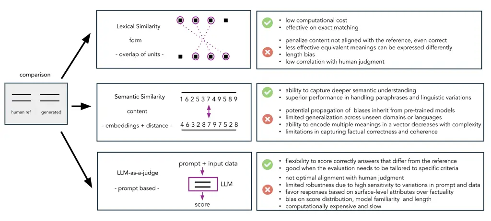

# The Illusion of a Perfect Metric: Why Evaluating AI’s Words Is Harder Than It Looks

Maria Paz Oliva Affiliation: Iris AI Affiliation: Borgen, Norway   
Adriana Correia Affiliation: Iris AI Affiliation: Borgen, Norway    Ivan
Vankov Affiliation: Iris AI Affiliation: Neurobiology BAS Affiliation:
Sofia, Bulgaria    Viktor Botev Affiliation: Iris AI Affiliation: Sofia,
Bulgaria

###### Abstract

Evaluating Natural Language Generation (NLG) is crucial for the
practical adoption of AI, but has been a longstanding research
challenge. While human evaluation is considered the de-facto standard,
it is expensive and lacks scalability. Practical applications have
driven the development of various automatic evaluation metrics (AEM),
designed to compare the model output with human-written references,
generating a score which approximates human judgment. Over time, AEMs
have evolved from simple lexical comparisons, to semantic similarity
models and, more recently, to LLM-based evaluators. However, it seems
that no single metric has emerged as a definitive solution, resulting in
studies using different ones without fully considering the implications.
This paper aims to show this by conducting a thorough examination of the
methodologies of existing metrics, their documented strengths and
limitations, validation methods, and correlations with human judgment.
We identify several key challenges: metrics often capture only specific
aspects of text quality, their effectiveness varies by task and dataset,
validation practices remain unstructured, and correlations with human
judgment are inconsistent. Importantly, we find that these challenges
persist in the most recent type of metric, LLM-as-a-Judge, as well as in
the evaluation of Retrieval Augmented Generation (RAG), an increasingly
relevant task in academia and industry. Our findings challenge the quest
for the ‘perfect metric’. We propose selecting metrics based on
task-specific needs and leveraging complementary evaluations and
advocate that new metrics should focus on enhanced validation
methodologies.

Maria Paz Oliva\inst1\orcidID0009-0009-6409-2083 Adriana
Correia\inst1\orcidID0000-0003-0008-9167 Ivan
Vankov\inst2,3\orcidID0000-0002-2772-5365 Viktor
Botev\inst2\orcidID0009-0004-6596-1694

Figure 1: Overview of evaluation metric categories, including lexical
similarity, semantic similarity, and LLM-based evaluation, highlighting
their advantages and limitations.

## 1 Introduction

Evaluation of Natural Language Generation (NLG) models is essential to
ensure their quality and usefulness in various real-world applications
Celikyilmaz et al. (2020). As AI adoption expands, the importance of
robust evaluation methods increases significantly Novikova et al.
(2017). However, assessing NLG outputs remains a challenging task
Gehrmann et al. (2023). The standard approach to date is evaluating
models’ outputs through human judgment, but due to the high costs and
limited scalability, the development of Automated Evaluation Metrics
(AEM) has been pursued as an alternative Clark et al. (2021).
Traditionally, the supervised approach involves comparing
model-generated text with a human-written reference. It assigns a
similarity score based on the assumption that a higher similarity
indicates a better quality of the output. Furthermore, because the score
is considered meaningful, it is expected to serve as a good proxy for
human judgment. This reliability is typically assessed by measuring the
correlation between metric scores and human evaluations of the generated
texts Belz and Reiter (2006); Coughlin (2003).

Evaluation metrics have been developed for decades while,
simultaneously, demands have increased. Model architectures have become
more advanced and complex evaluation methods have improved and become
more sophisticated Zhuang et al. (2023). The first evaluation scores
were based on a comparison of the lexical surface forms of the generated
text and a reference. Later, the introduction of embeddings enabled
promising semantic comparisons, and more recently large language models
(LLMs) have become the state-of-the-art in AEMs Chang et al. (2024).

With the wide range of available metrics, there seems to be a little
agreement in the field about which ones are most effective and for what
use cases. This has led to cases where multiple metrics are applied in
studies without sufficient reflection on their implications and meaning
Mathur et al. (2020). An often overlooked fact is that most metrics were
originally designed for specific NLP tasks, such as machine translation
(MT), summarization, and question answering, raising concerns about
their applicability to each other Liguori et al. (2023). Furthermore, as
we will demonstrate, inconsistencies arise when comparing the behavior
of these metrics and their correlation with human judgment Laskar et al.
(2024).

The purpose of this article is to conduct an in-depth analysis of
existing metrics. First, we analyze their methodologies, and then their
documented strengths and limitations. Our focus is on how the metrics
have been validated and their correlation with human judgment. In this
work, we claim that the presented correlation is usually not
sufficiently robust to justify the use of the metrics in a general use
case scenario.

The paper is structured as follows: Section 2 presents existing
evaluation metrics, analyzes their correlation with human judgment, and
looks deeper into Retrieval Augmented Generation (RAG) as a real-world
system evaluation example; Section 3 discusses potential threats to
validity; and Section 4 concludes the argument about the need for more
thorough analysis of what aspects each metric evaluates and what
synergies between metrics are necessary to have a reliable general
framework of AEMs for model-generated text.

## 2 Metrics Analysis

### 2.1 Metrics Overview

Based on their underlying scoring methodologies, evaluation metrics can
be categorized into three groups: lexical similarity, which measures the
overlap of textual units; semantic similarity, which quantifies the
numerical distance between content representations; and LLM-based
evaluation, which relies on direct prompting of LLM for judgment
Srivastava and Memon (2024). Figure 1 presents an overview of the main
computational characteristics of each metric. An often overlooked aspect
of these metrics is the initial context in which they were introduced,
which typically involves the reporting of good correlations with human
judgments. In Table 1, we compare the different tasks, datasets, level,
and metrics that were used to this date. In general, all works report
good correlations, but we see that they are not directly comparable, so
it is not obvious that one metric would perform better under the
conditions of another one. In this section, we present an overview of
key metrics within each category: examining their main characteristics,
advantages, and limitations; as well as challenges to the initial claims
of good correlation with human judgment.

[TABLE]

Table 1: Overview of initial introduction of metrics.

#### 2.1.1 Lexical similarity metrics

These metrics focus on the surface-level form of the generated and
reference texts, and the exact co-occurrence of sequences, such as
n-grams. Sequences can be words, characters, strings, or tokens. Lexical
metrics are considered as the traditional approach to evaluation in NLG
("traditional metrics"). Some relevant examples of this type of metrics
are: BLEU Papineni et al. (2002), ROUGE Lin (2004) and METEOR Banerjee
and Lavie (2005) (see Table 1).

Lexical similarity metrics are widely used because of their ease of
implementation and computational efficiency. These metrics are
especially useful when the generated text must closely match the
reference or when the output for evaluation is short. Nonetheless,
lexical metrics have limitations in contexts where the generated text
diverges from the reference but still conveys accurate information Liu
et al. (2016). They may yield a low score despite the identical meaning
(paraphrased use case), which questions their correlation with human
assessments Coughlin (2003). Furthermore, lexical metrics are less
effective for complex texts with varied lexical and syntactic choices.
They also suffer from length bias, which reduces their reliability for
nuanced tasks such as quality in question generation Nema and Khapra
(2018) and dialogue response generation Liu et al. (2016).

In fact, lexical-based metrics have struggled to demonstrate a strong
correlation with human judgment since their introduction Coughlin
(2003). Let us dive deeper into ROUGE. It faced early criticisms
regarding the stability and validity of human judgments, including
potential limitations of reference texts from the dataset initially used
for validation Nenkova and Passonneau (2004). The authors rebutted it
later Lin and Och (2004), but still left some unanswered questions.
However, others such as Rankel et al. (2013) found that ROUGE-1, the
variant most used, performed the weakest in a news summary data set,
while R-4 was the strongest, and that combining ROUGE metrics improved
performance, although with limited accuracy.Cohan and Goharian (2016)
observed that higher-order ROUGE metrics, particularly ROUGE-3, were
better correlated with human judgments for scientific article summaries.
Peyrard et al. (2017) contradicted Rankel et al. (2013), finding that
ROUGE-1 correlated best with human judgments, but on a relation
extraction dataset. Peyrard (2019) showed that disagreement among ROUGE
metrics increased for highly rated summaries, suggesting that human
assessment remains essential for evaluating top-quality summaries.
Another lexical metric, BLEU, has faced similar challenges, and numerous
studies have sought to enhance its performance by modifying the
calculation methodology Post (2018).

In summary, lexical metrics provide a basic approach for evaluation, but
fall short in capturing deeper meanings, which semantic similarity
metrics try to address more efficiently.

#### 2.1.2 Semantic similarity metrics

These metrics capture semantic similarity between generated and
reference texts by representing them as numerical vectors (embeddings),
capturing nuanced relationships across different linguistic levels. By
applying distance measures to quantify the differences between the
numerically represented texts, they leverage the characteristic that the
closer the vector representations are, the more similar meaning of the
texts Harris (1954); Mikolov et al. (2013b); de Vos et al. (2021).

The numeric representation of word meaning used in semantic metrics can
be categorized according to whether they take into account the context
of a token appearance or not. Context-independent word embeddings (for
example, Word2Vec Mikolov et al. (2013a), GloVe Pennington et al.
(2014)) provide a one-word representation encoding for all its possible
meanings. Contextual embeddings, on the other hand, adapt to specific
contexts and can have multiple representations of the same word. An
example is BERT Devlin et al. (2019), which generates contextual
representations at a token level.

There are more complex numeric representations that go beyond tokens or
words. Examples are Sentence-BERT Reimers and Gurevych (2019), which
generates representations at the sentence level and fine-tunes BERT for
semantically aligned sentences, and InferSent Conneau et al. (2017),
which uses a bidirectional LSTM trained on natural language inference
datasets. These methods produce sentence representations that capture
semantic structures beyond simple word embedding averaging.

To capture linguistic variations and fragmentations, the research field
introduced various semantic similarity metrics based on the numeric
representations presented above and respective distance measures. Some
relevant examples are: Word Mover’s Distance (WMD) Kusner et al. (2015),
Sentence Mover’s Distance Clark et al. (2019), WISDM Botev et al.
(2017), BERTScore Zhang et al. (2020), BLEURT Sellam et al. (2020) and
BEM Bulian et al. (2022) (see Table 1). In general, these metrics
capture deeper semantic understanding, demonstrate superior performance
in handling linguistic variations and linguistic fragmentations, and
correlate better with human evaluations than lexical metrics Sellam et
al. (2020).

However, they are not without limitations. For example, texts that are
structurally similar to the reference but factually incorrect and often
provide a poor account of syntax could lead to misleading scores Chen et
al. (2019). For example, sentences with opposite meanings, such as with
a negating particle, may be represented as similar. Although contextual
embeddings like BERT capture some syntactic nuances, these often lack
sufficient sensitivity to distinguish between syntactically similar yet
semantically opposite statements.

Another general limitation of these metrics is their dependence on the
embeddings used to calculate distances. The performance of the metric
varies between different embeddings and can carry biased semantic
information from its training data Sun et al. (2022). They also incur a
higher computational cost, are slower than lexical metrics, and have
limited generalization across unseen domains or languages, restricting
their applicability.

Vector-based representations struggle to encode multiple meanings as
well, having lower precision as semantic complexity increases. As a
result, semantic similarity metrics perform well on simpler texts but
fall short on more complex applications, and may not outperform lexical
approaches in tasks requiring nuanced understanding of context and
factual accuracy Chen et al. (2019); Sellam et al. (2020). Difficulties
with long-form text due to computational demands and loss of
inter-sentence relationships have also been reported Yeh et al. (2021).
These observations highlight the need for metrics that can handle
complex responses with deeper contextual understanding.

#### 2.1.3 LLM-as-a-judge

The LLM-as-a-judge metrics use generative models to evaluate free-text
comparisons by responding to prompts and producing a score. Leveraging
state-of-the-art LLMs can be a promising approach because they can be
instructed to consider specific aspects of text through prompting,
making them suitable for assessing complex text qualities. This type of
metrics are developed for increasingly more powerful NLG systems and
challenging datasets. The evaluation shifts from comparing many systems
on one task to comparing a few LLMs on many datasets, with validations
reported at the dataset level. These metrics can be used in various
ways, including generating scores based on predefined criteria (scoring
rubric), simulating human preferences through pairwise comparisons, or
even operating without a reference. In this work, we focus on
reference-based variations. Some examples in this category are:
BARTScore Yuan et al. (2021), GPT-Judge Lin et al. (2022), G-EVAL Liu et
al. (2023), GPT-Score Fu et al. (2024), Prometheus Kim et al. (2024),
and AlpacaEval-LC Dubois et al. (2024) (see Table 1).

Recent research has shown that LLM-based metrics, including the simple
prompting of LLMs for an evaluation, often outperform traditional
evaluation methods, correlating more strongly with human judgment Chiang
and Lee (2023); Wang et al. (2023); Zheng et al. (2024), despite being
much slower and more expensive Li et al. (2024). Studies also suggest
that additional measures are needed to improve the automatic calibration
and alignment of LLM-based evaluators with human preferences Liu et al.
(2024); An et al. (2024). This makes these metrics sensitive to
variations in prompt design and data configurations Li et al. (2024);
Wang et al. (2023); Kamalloo et al. (2023), because different prompts
can yield different scores, even if the aspect being assessed remains
the same. Chiang and Lee (2023) analyze the components of LLM evaluation
and find that asking LLMs to rationalize their ratings significantly
improves correlation with human ratings Fabbri et al. (2021). This
underscores the importance of prompt design in LLM evaluations, as it
enables LLMs to provide more informative ratings that align better with
human judgments.

As a further caution it is worth noting that these metrics may favor
responses based on surface-level attributes, such as verbosity, over
substantive quality, potentially leading to high scores for
linguistically refined but factually inaccurate responses Chiesurin et
al. (2023). Finally, there are also indications of inherent biases Li et
al. (2024), including social biases inherited from the underlying
models, model familiarity bias Wataoka et al. (2024), and output length
bias Liu et al. (2024); An et al. (2024). LLM-based evaluation methods
have also shown inconsistencies compared to expert human evaluations
Stureborg et al. (2024).

### 2.2 Correlation with human judgment

As shown in Table 1, most evaluation metrics have been initially
validated by assessing their correlation with human judgments on a
specific task. Overall, the metrics designed to address application
specific evaluation criteria have enabled NLP practitioners to develop
and fine-tune their systems without human feedback. However, validation
methodologies vary significantly across metrics: they are tested on
different tasks and datasets, use different correlation measures, apply
varying statistical significance tests, and rely on human judgments of
differing quality and quantity. This inconsistency makes direct
comparisons challenging. Therefore, it is crucial to assess whether
newer metrics truly outperform older ones. In the following, we present
a meta-evaluation of metrics over time, analyzing their correlation with
human judgments across diverse datasets, systems, and validation
methodologies, beyond their initial assessments.

#### 2.2.1 Missing or inconsistent correlations

Numerous studies have evaluated the correlation between metrics and
human judgments, unfortunately often reporting either no correlation or
inconsistent results. Liu and Liu (2008) found a low correlation between
ROUGE and human evaluations of abstractive summaries of meetings, even
when accounting for disfluencies and speaker information. Graham and
Baldwin (2014) argued that claims of correlation with human assessments
are insufficient to validate a metric and recommended statistical
analyses, such as the Williams test, to confirm significance—an approach
later adopted by BERTScore in its validation.

In more recent years, Deutsch et al. (2021) used bootstrapping and
permutation tests to calculate confidence intervals for correlations
between metrics and human judgments in summarization tasks, observing
wide confidence intervals, which highlights the high uncertainty in the
reliability of AEMs. Scalabrino et al. (2021) analyzed correlations
between human judgments and different metric combinations for generated
code but were unable to find a satisfactory combination. Liguori et al.
(2023) assessed a set of lexical metrics, including edit distance and
exact match, to evaluate harmful code production, finding that ROUGE-4
and BLEU-4, often used for that use case, failed to estimate semantic
correctness, whereas exact match and edit distance exhibited the highest
correlation with human evaluations. More recently, Li et al. (2024)
compiled a taxonomy of LLM-based NLG evaluators and compared their
performance with older metrics across various tasks, observing that
LLM-as-a-judge metrics correlated better with human judgments, yet
correlations remained low to moderate and exhibited high variance across
methods.

#### 2.2.2 Influencing factors

Some studies have attempted to explain these inconsistencies by
identifying specific influencing factors. One widely discussed factor is
that correlation scores vary depending on the reference used, meaning
that results can differ across datasets. Bhandari et al. (2020a) found
that metrics correlate better for easier-to-summarize documents, with
performance deteriorating as summaries become more abstractive.
Similarly, Bhandari et al. (2020b) analyzed correlations between lexical
and semantic metrics and human assessments for several summarization
systems and tasks, showing that different metrics correlate better
depending on the dataset. Moramarco et al. (2022) compared metrics for
medical note generation, including edit distance, lexical, and semantic
metrics, and found that results varied depending on the reference text.
Zhang et al. (2024) examined human ratings of GPT-3 summaries for
well-known news datasets across several dimensions and found that
correlations fluctuated significantly depending on the dataset and
reference summaries. In particular, substituting reference summaries
with those written by freelance writers improved the correlation with
ROUGE-L for faithfulness, emphasizing the impact of reference summary
quality when evaluating reference-based metrics.

#### 2.2.3 Quality of evaluated system

Another influencing factor is the quality of the system under
evaluation. Novikova et al. (2017) found that lexical metrics exhibited
a poor correlation with human judgement for general NLG tasks,
particularly struggling to differentiate between medium- and
high-quality outputs. However, AEMs were more effective in identifying
low-performing systems. Mathur et al. (2020) compared the correlation
between lexical and semantic metrics, highlighting the sensitivity of
Pearson’s correlation to sample size. They found that metric
correlations weakened for top-performing systems and similarly
performing models, with BLEU’s performance deteriorating when
high-performing systems were removed, exposing the fragility of score
aggregation.

#### 2.2.4 Expertise of human annotators

One more factor affecting correlation is the expertise of human
annotators. Reiter and Belz (2009) compared lexical metrics for a
weather forecast NLG task and found inconsistent results between expert
and non-expert judgments, with most metrics favoring non-experts.
Bavaresco et al. (2025) compiled a collection of 20 NLP datasets with
human annotations and compared them with results from multiple open and
closed LLMs. They found that Spearman’s correlation was consistently
higher when comparing models against non-expert judgments rather than
expert assessments, with the highest correlations observed in the
verbosity dimension. Their analysis also showed that no single model
consistently outperformed others in all evaluation categories and
chain-of-thought (CoT) prompting did not consistently improve agreement
with human assessments.

#### 2.2.5 System vs segment level correlations

A key observation across studies is that the performance of the metrics
differs depending on the level of analysis, system vs segment level
correlations. Novikova et al. (2017) confirmed that metrics perform
better at the system level than at the sentence level. Bhandari et al.
(2020b) further demonstrated that these metrics struggle to quantify
system improvements and that document-level comparisons can yield
different conclusions from system-level comparisons.

#### 2.2.6 Evaluation aspect

Finally, some studies have found that metric correlations vary depending
on the specific evaluation aspect being considered. Stent et al. (2005)
concluded that automatic metrics were better suited for evaluating
adequacy than fluency. In contrast, Reiter and Belz (2009) found that
most metrics were more strongly correlated with fluency than with
accuracy. Similarly, Stent et al. (2005) found no significant
correlation between human judgments of adequacy and fluency for
generated paraphrases with controlled syntactic variations. Fabbri et
al. (2021) introduced SummEVAL, where re-annotated summary datasets are
used to compare correlations between metrics and evaluation aspects
(coherence, consistency, fluency, and relevance), finding substantial
discrepancies across them.

Taken together, these findings underscore the inconsistency - and
consequently the inconclusiveness - of metric correlations with human
judgments. Greater attention must be paid to validation methodologies to
clearly determine what aspects AEMs reliably capture and how they should
be used, ultimately improving their effectiveness.

### 2.3 Evaluation in real scenarios: RAG systems

The evaluation metrics discussed so far aim to quantify the similarity
between a model output and a reference text. However, real-world NLG
applications introduce additional performance criteria which cannot be
accounted for in terms of text similarity. An example of such an
application is RAG, which complements NLG with information retrieval
mechanisms. The goal of RAG is to minimize the tendency of generative
LLMs to produce factually incorrect information (i.e. “hallucinate”) and
to allow them to use data which have not been part of their training
set. In a typical RAG setup, a user query is first used to find relevant
documents, and then a generative LLM is asked to respond to the query
given the documents. Importantly, the expectation of a RAG system is
that its output is grounded in the provided context, e.g., it is based
on retrieved documents and not on the parametric knowledge of the
underlying LLM Jacovi et al. (2025).

The specifics and inherent complexity of RAG require considering
multiple aspects of its evaluation Chen et al. (2024). Some proposed
criteria include faithfulness (the degree to which the text is grounded
in the provided context), answer relevance (whether the output actually
addresses the user query), completeness (whether all the relevant
information provided by the context is utilized), noise robustness
(whether the system can ignore irrelevant information), and information
integration (the ability to combine information from multiple sources).
The dominant approach to implementing these criteria is the
‘LLM-as-a-judge’, i.e. by prompting an external LLM. For example, the
Tonic evaluation framework Tonic AI (2023) computes RAG faithfulness by
extracting a list of claims which can be inferred from the output text
and checking the proportion of them which can be attributed to the
provided context. In a similar vein, the RAGAS framework Es et al.
(2024) estimates answer relevance by using an LLM to generate a list of
probable user queries which the answer could be responding to and
calculate their similarity to the real query. However, to our point, the
initial RAGAS metrics validation has used a statistically insignificant
number of human annotators (two) to calculate correlation with human
judgment, and we expected future studies to challenge those results.

Recent models like IntellBot Arikkat et al. (2024) and QuIM-RAG Saha et
al. (2024) do incorporate RAGAS for evaluation, but the over reliance on
complicated LLM prompts and the lack of compelling evidence in support
of the validity of these metrics undermines their credibility. It
illustrates the current landscape of metric usage that other RAG system
evaluations still rely heavily on traditional metrics, in spite of its
specific evaluation needs. The original RAG paper Guu et al. (2020) used
exact matching (EM) with BLEU and ROUGE, while later studies Hsu et al.
(2021); Giglou et al. (2024) advocate a hybrid approach introducing
semantic metrics like BERTScore and BLEURT.

As presented, even modern real world applications such as RAG we see the
same shortcomings: lack of statistical significance, inconsistency with
human judgement and unfounded usage of metrics without considering the
specifics of the use case and what the metrics are measuring.

## 3 Threats to validity

The many inconsistencies revealed by attempts to reproduce the
correlations between metric scores and human annotations could also be
amplified by issues that threaten the validity of the correlations
themselves.

Firstly, the quality of human-written references can significantly
affect the reliability of metrics Gehrmann et al. (2023); Kamalloo et
al. (2023). Ensuring reference texts are of high quality is crucial, yet
challenging. Furthermore, annotators’ agreement can reflect
inconsistencies even within the same annotator across different
evaluations Abercrombie et al. (2023). Even when references are assumed
to represent a "gold standard", accurately measuring similarity between
generated texts and references remains difficult.

Secondly, human judgment itself introduces validity threats. Recent
studies indicate that human evaluators occasionally prefer
model-generated texts to human-written ones Gehrmann et al. (2023);
Sottana et al. (2023). For example, Goyal et al. (2022) compare metric
correlations with human judgments in the era of LLMs and find that human
evaluators prefer GPT3 summaries, while reference-based metrics show an
inverse correlation, concluding that current automatic metrics are
inadequate for evaluating new generative models. This aspect of human
evaluation requires further investigation.

## 4 Conclusion

This paper examines NLG AEMs, analyzing their methodologies, strengths,
limitations, initial validation approaches, and alignment with human
judgment. Despite ongoing research, no single metric has been definitive
and NLG systems are still validated using varied metrics without fully
considering the implications, which we highlight in the case of RAG.

Each type of metric has specific strengths: lexical metrics suit
fact-based short texts; semantic similarity metrics work well for
paraphrases; and LLM-based metrics are better for complex texts when
computational resources allow. They all have limitations too: lexical
metrics rely on surface similarity, semantic similarity metrics may
overlook syntax, and LLM-based metrics are costly and sensitive to
prompt formulation.

Broader concerns exist regarding metric validity. Due to differences in
validation methods, direct comparisons between metrics are often
unreliable and reported correlations with human judgment are
inconsistent. Furthermore, we find problems with human annotations
themselves, which call into question the validity of the correlations.

Our key insight is that metrics, at best, highlight specific dimensions
of text quality, since they are still widely used, but they do not
provide absolute performance measures. The pursuit of a “perfect metric”
is thus misguided; instead, we advocate for a task-specific approach, to
avoid oversimplifying text quality assessment, and for further
investigations on which aspects of text quality are in fact evaluated by
each metric. Future research should also seek to refine metric
selection, improve validation methodologies, and establish best
practices to enhance reliability and alignment with human preference.

## References

- Abercrombie et al. (2023) G. Abercrombie, D. Hovy, and V.
  Prabhakaran. 2023. Temporal and second language influence on
  intra-annotator agreement and stability in hate speech labelling. In
  _17th LAW_.
- An et al. (2024) C. An, S. Gong, M. Zhong, X. Zhao, M. Li, J.
  Zhang, L. Kong, and X. Qiu. 2024. L-eval: Instituting standardized
  evaluation for long context language models. In _62nd ACL_.
- Arikkat et al. (2024) D. R. Arikkat, M. Abhinav, N. Binu, M.
  Parvathi, N. Biju, K. S. Arunima, P. Vinod, R. R. KA, and M.
  Conti. 2024. Intellbot: Retrieval augmented llm chatbot for cyber
  threat knowledge delivery. In _16th CICN_.
- Banerjee and Lavie (2005) S. Banerjee and A. Lavie. 2005. Meteor: An
  automatic metric for mt evaluation with improved correlation with
  human judgments. In _ACL Workshop on Intrinsic and Extrinsic
  Evaluation Measures for Machine Translation and/or Summarization_.
- Bavaresco et al. (2025) A. Bavaresco, R. Bernardi, L. Bertolazzi, D.
  Elliott, R. Fernández, A. Gatt, E. Ghaleb, M. Giulianelli, M.
  Hanna, A. Koller, A. Martins, P. Mondorf, V. Neplenbroek, S.
  Pezzelle, B. Plank, D. Schlangen, A. Suglia, A. K. Surikuchi, E.
  Takmaz, and A. Testoni. 2025. LLMs instead of human judges? a large
  scale empirical study across 20 NLP evaluation tasks. In _63rd ACL_.
- Belz and Reiter (2006) A. Belz and E. Reiter. 2006. Comparing
  automatic and human evaluation of nlg systems. In _11th EACL_.
- Bhandari et al. (2020a) M. Bhandari, P. N. Gour, A. Ashfaq, and P.
  Liu. 2020a. Metrics also disagree in the low scoring range: Revisiting
  summarization evaluation metrics. In _28th CoLing_.
- Bhandari et al. (2020b) M. Bhandari, P. N. Gour, A. Ashfaq, P. Liu,
  and G. Neubig. 2020b. Re-evaluating evaluation in text summarization.
  In _EMNLP_.
- Botev et al. (2017) V. Botev, K. Marinov, and F. Schäfer. 2017. Word
  importance-based similarity of documents metric (wisdm): Fast and
  scalable document similarity metric for analysis of scientific
  documents. In _6th WOSP_.
- Bulian et al. (2022) J. Bulian, C. Buck, W. Gajewski, B. Börschinger,
  and T. Schuster. 2022. Tomayto, tomahto. beyond token-level answer
  equivalence for question answering evaluation. In _EMNLP_.
- Celikyilmaz et al. (2020) A. Celikyilmaz, E. Clark, and J. Gao. 2020.
  Evaluation of text generation: A survey. _arXiv:2006.14799_.
- Chang et al. (2024) Y. Chang, X. Wang, J. Wang, Y. Wu, L. Yang, K.
  Zhu, H. Chen, X. Yi, C. Wang, Y. Wang, et al. 2024. A survey on
  evaluation of large language models. _ACM Transactions on Intelligent
  Systems and Technology_, 15(3).
- Chen et al. (2019) A. Chen, G. Stanovsky, S. Singh, and M.
  Gardner. 2019. Evaluating question answering evaluation. In _2nd MRQA
  Workshop_.
- Chen et al. (2024) J. Chen, H. Lin, X. Han, and L. Sun. 2024.
  Benchmarking large language models in retrieval-augmented generation.
  In _38th AAAI_.
- Chiang and Lee (2023) C.-H. Chiang and H.-Y. Lee. 2023. Can large
  language models be an alternative to human evaluations? In _61st ACL_.
- Chiesurin et al. (2023) S. Chiesurin, D. Dimakopoulos, M. A. S.
  Cabezudo, A. Eshghi, I. Papaioannou, V. Rieser, and I. Konstas. 2023.
  The dangers of trusting stochastic parrots: Faithfulness and trust in
  open-domain conversational question answering. In _61st ACL_.
- Clark et al. (2021) E. Clark, T. August, S. Serrano, N. Haduong, S.
  Gururangan, and N. A. Smith. 2021. All that’s ‘human’ is not gold:
  Evaluating human evaluation of generated text. In _59th ACL_.
- Clark et al. (2019) E. Clark, A. Celikyilmaz, and N. A. Smith. 2019.
  Sentence mover’s similarity: Automatic evaluation for multi-sentence
  texts. In _57th ACL_, Florence, Italy.
- Cohan and Goharian (2016) A. Cohan and N. Goharian. 2016. Revisiting
  summarization evaluation for scientific articles. In _10th LREC_.
- Conneau et al. (2017) A. Conneau, D. Kiela, H. Schwenk, L. Barrault,
  and A. Bordes. 2017. Supervised learning of universal sentence
  representations from natural language inference data. In _EMNLP_.
- Coughlin (2003) D. Coughlin. 2003. Correlating automated and human
  assessments of machine translation quality. In _9th MTS_.
- Deutsch et al. (2021) D. Deutsch, R. Dror, and D. Roth. 2021. A
  statistical analysis of summarization evaluation metrics using
  resampling methods. _Transactions of the Association for Computational
  Linguistics_, 9.
- Devlin et al. (2019) J. Devlin, M.-W. Chang, K. Lee, and K.
  Toutanova. 2019. Bert: Pre-training of deep bidirectional transformers
  for language understanding. In _NAACL_.
- Dubois et al. (2024) Y. Dubois, B. Galambosi, P. Liang, and T. B.
  Hashimoto. 2024. Length-controlled alpacaeval: A simple way to debias
  automatic evaluators. _arXiv:2404.04475_.
- Es et al. (2024) S. Es, J. James, L. E. Anke, and S.
  Schockaert. 2024. Ragas: Automated evaluation of retrieval augmented
  generation. In _18th EACL_.
- Fabbri et al. (2021) A. R. Fabbri, W. Kryściński, B. McCann, C.
  Xiong, R. Socher, and D. Radev. 2021. Summeval: Re-evaluating
  summarization evaluation. _Transactions of the Association for
  Computational Linguistics_, 9.
- Fu et al. (2024) J. Fu, S. K. Ng, Z. Jiang, and P. Liu. 2024.
  GPTScore: Evaluate as you desire. In _62nd ACL_.
- Gehrmann et al. (2023) S. Gehrmann, E. Clark, and T. Sellam. 2023.
  Repairing the cracked foundation: A survey of obstacles in evaluation
  practices for generated text. _Journal of Artificial Intelligence
  Research_, 77.
- Giglou et al. (2024) H. B. Giglou, T. A. Taffa, R. Abdullah, A.
  Usmanova, R. Usbeck, J. D’Souza, and S. Auer. 2024. Scholarly question
  answering using large language models in the nfdi4datascience gateway.
  _Natural Scientific Language Processing and Research Knowledge
  Graphs_.
- Goyal et al. (2022) T. Goyal, J. J. Li, and G. Durrett. 2022. News
  summarization and evaluation in the era of GPT-3. _arXiv:2209.12356_.
- Graham and Baldwin (2014) Y. Graham and T. Baldwin. 2014. Testing for
  significance of increased correlation with human judgment. In _EMNLP_.
- Guu et al. (2020) K. Guu, K. Lee, Z. Tung, P. Pasupat, and M.
  Chang. 2020. Retrieval augmented language model pre-training. In
  _ICML_.
- Harris (1954) Z. S. Harris. 1954. Distributional structure.
- Hsu et al. (2021) C.-C. Hsu, E. Lind, L. Soldaini, and A.
  Moschitti. 2021. Answer generation for retrieval-based question
  answering systems. In _Findings of ACL-IJCNLP_.
- Jacovi et al. (2025) A. Jacovi, A. Wang, C. Alberti, C. Tao, J.
  Lipovetz, K. Olszewska, L. Haas, M. Liu, N. Keating, A. Bloniarz, et
  al. 2025. The facts grounding leaderboard: Benchmarking llms’ ability
  to ground responses to long-form input. _arXiv:2501.03200_.
- Kamalloo et al. (2023) E. Kamalloo, N. Dziri, C. Clarke, and D.
  Rafiei. 2023. Evaluating open-domain question answering in the era of
  large language models. In _61st ACL_.
- Kim et al. (2024) S. Kim, J. Shin, Y. Cho, J. Jang, S. Longpre, H.
  Lee, S. Yun, S. Kim, J. Thorne, and M. Seo. 2024. Prometheus: Inducing
  fine-grained evaluation capability in language models. In _ICLR_.
- Kusner et al. (2015) M. J. Kusner, Y. Sun, N. I. Kolkin, and K. Q.
  Weinberger. 2015. From word embeddings to document distances. In _32nd
  ICML_.
- Laskar et al. (2024) M. T. R. Laskar, S. Alqahtani, M. S. Bari, M.
  Rahman, M. A. M. Khan, H. Khan, I. Jahan, A. Bhuiyan, C. W. Tan, M. R.
  Parvez, et al. 2024. A systematic survey and critical review on
  evaluating large language models: Challenges, limitations, and
  recommendations. In _EMNLP_.
- Li et al. (2024) Z. Li, X. Xu, T. Shen, C. Xu, J.-C. Gu, Y. Lai, C.
  Tao, and S. Ma. 2024. Leveraging large language models for nlg
  evaluation: Advances and challenges. In _EMNLP_, Miami, Florida, USA.
- Liguori et al. (2023) P. Liguori, C. Improta, R. Natella, B. Cukic,
  and D. Cotroneo. 2023. Who evaluates the evaluators? on automatic
  metrics for assessing ai-based offensive code generators. _Expert
  Systems with Applications_, 225.
- Lin (2004) C.-Y. Lin. 2004. Rouge: A package for automatic evaluation
  of summaries. In _Text Summarization Branches Out_.
- Lin and Och (2004) C.-Y. Lin and F. J. Och. 2004. Looking for a few
  good metrics: Rouge and its evaluation. In _NTCIR Workshop_.
- Lin et al. (2022) S. Lin, J. Hilton, and O. Evans. 2022. Truthfulqa:
  Measuring how models mimic human falsehoods. In _60th ACL_.
- Liu et al. (2016) C.-W. Liu, R. Lowe, I. Serban, M. Noseworthy, L.
  Charlin, and J. Pineau. 2016. How not to evaluate your dialogue
  system: An empirical study of unsupervised evaluation metrics for
  dialogue response generation. In _EMNLP_.
- Liu and Liu (2008) F. Liu and Y. Liu. 2008. Correlation between rouge
  and human evaluation of extractive meeting summaries. In _ACL-08: HL_.
- Liu et al. (2023) Y. Liu, D. Iter, Y. Xu, S. Wang, R. Xu, and C.
  Zhu. 2023. G-eval: Nlg evaluation using gpt-4 with better human
  alignment. In _EMNLP_.
- Liu et al. (2024) Y. Liu, T. Yang, S. Huang, Z. Zhang, H. Huang, F.
  Wei, W. Deng, F. Sun, and Q. Zhang. 2024. Calibrating llm-based
  evaluator. In _LREC-COLING_.
- Mathur et al. (2020) N. Mathur, T. Baldwin, and T. Cohn. 2020.
  Tangled up in bleu: Reevaluating the evaluation of automatic machine
  translation evaluation metrics. In _58th ACL_.
- Mikolov et al. (2013a) T. Mikolov, K. Chen, G. Corrado, and Dean J.
  2013a. Efficient estimation of word representations in vector space.
  _arXiv:1301.3781_.
- Mikolov et al. (2013b) T. Mikolov, I. Sutskever, K. Chen, G. S.
  Corrado, and J. Dean. 2013b. Distributed representations of words and
  phrases and their compositionality. _Advances in Neural Information
  Processing Systems_, 26.
- Moramarco et al. (2022) F. Moramarco, A. P. Korfiatis, M. Perera, D.
  Juric, J. Flann, E. Reiter, A. Savkov, and A. Belz. 2022. Human
  evaluation and correlation with automatic metrics in consultation note
  generation. In _60th ACL_.
- Nema and Khapra (2018) P. Nema and M. M. Khapra. 2018. Towards a
  better metric for evaluating question generation systems. In _EMNLP_.
- Nenkova and Passonneau (2004) A. Nenkova and R. Passonneau. 2004.
  Evaluating content selection in summarization: The pyramid method. In
  _NAACL_.
- Novikova et al. (2017) J. Novikova, O. Dušek, A. C. Curry, and V.
  Rieser. 2017. Why we need new evaluation metrics for nlg. In _EMNLP_.
- Papineni et al. (2002) K. Papineni, S. Roukos, T. Ward, and W.-J.
  Zhu. 2002. Bleu: A method for automatic evaluation of machine
  translation. In _40th ACL_.
- Pennington et al. (2014) J. Pennington, R. Socher, and C. D.
  Manning. 2014. Glove: Global vectors for word representation. In
  _EMNLP_.
- Peyrard (2019) M. Peyrard. 2019. Studying summarization evaluation
  metrics in the appropriate scoring range. In _57th ACL_.
- Peyrard et al. (2017) M. Peyrard, T. Botschen, and I. Gurevych. 2017.
  Learning to score system summaries for better content selection
  evaluation. In _NewSumm_.
- Post (2018) M. Post. 2018. A call for clarity in reporting bleu
  scores. In _3rd WMT_.
- Rankel et al. (2013) P. A. Rankel, J. M. Conroy, H. T. Dang, and A.
  Nenkova. 2013. A decade of automatic content evaluation of news
  summaries: Reassessing the state of the art. In _ACL_.
- Reimers and Gurevych (2019) N. Reimers and I. Gurevych. 2019.
  Sentence-bert: Sentence embeddings using siamese bert-networks. In
  _9th EMNLP-IJCNLP_.
- Reiter and Belz (2009) E. Reiter and A. Belz. 2009. An investigation
  into the validity of some metrics for automatically evaluating natural
  language generation systems. _Computational Linguistics_, 35(4).
- Saha et al. (2024) B. Saha, U. Saha, and M. Z. Malik. 2024. Advancing
  retrieval-augmented generation with inverted question matching for
  enhanced qa performance. _IEEE Access_.
- Scalabrino et al. (2021) S. Scalabrino, G. Bavota, C. Vendome, M.
  Linares-Vásquez, D. Poshyvanyk, and R. Oliveto. 2021. Automatically
  assessing code understandability. _IEEE Transactions on Software
  Engineering_, 47(3).
- Sellam et al. (2020) T. Sellam, D. Das, and A. Parikh. 2020. Bleurt:
  Learning robust metrics for text generation. In _58th ACL_.
- Sottana et al. (2023) A. Sottana, B. Liang, K. Zou, and Z.
  Yuan. 2023. Evaluation metrics in the era of gpt-4: Reliably
  evaluating large language models on sequence to sequence tasks. In
  _EMNLP_.
- Srivastava and Memon (2024) A. Srivastava and A. Memon. 2024. Toward
  robust evaluation: A comprehensive taxonomy of datasets and metrics
  for open domain question answering in the era of large language
  models. _IEEE Access_, 12.
- Stent et al. (2005) Amanda Stent, Matthew Marge, and Mohit
  Singhai. 2005. Evaluating evaluation methods for generation in the
  presence of variation. In _6th CICLing_.
- Stureborg et al. (2024) R. Stureborg, D. Alikaniotis, and Y.
  Suhara. 2024. Large language models are inconsistent and biased
  evaluators. _arXiv:2405.01724_.
- Sun et al. (2022) T. Sun, J. He, X. Qiu, and X.-J. Huang. 2022.
  Bertscore is unfair: On social bias in language model-based metrics
  for text generation. In _EMNLP_.
- Tonic AI (2023) Tonic AI. 2023. Tonic Validate. Available at:
  [https://github.com/TonicAI/tonic_validate](https://github.com/TonicAI/tonic_validate).
- de Vos et al. (2021) I. M. A. de Vos, G. L. van den Boogerd, M. D.
  Fennema, and A. Correia. 2021. Comparing in context: Improving cosine
  similarity measures with a metric tensor. In _18th ICON_.
- Wang et al. (2023) J. Wang, Y. Liang, F. Meng, Z. Sun, H. Shi, Z.
  Li, J. Xu, J. Qu, and J. Zhou. 2023. Is chatgpt a good nlg evaluator?
  a preliminary study. In _4th NewSumm_.
- Wataoka et al. (2024) K. Wataoka, T. Takahashi, and R. Ri. 2024.
  Self-preference bias in llm-as-a-judge. In _NeurIPS Safe Generative AI
  Workshop_.
- Yeh et al. (2021) Y.-T. Yeh, M. Eskenazi, and S. Mehri. 2021. A
  comprehensive assessment of dialog evaluation metrics. In _1st EANCS_.
- Yuan et al. (2021) W. Yuan, G. Neubig, and P. Liu. 2021. Bartscore:
  Evaluating generated text as text generation. 34.
- Zhang et al. (2020) T. Zhang, V. Kishore, F. Wu, K. Q. Weinberger,
  and Y. Artzi. 2020. Bertscore: Evaluating text generation with bert.
  In _ICLR_.
- Zhang et al. (2024) T. Zhang, F. Ladhak, E. Durmus, P. Liang, K.
  McKeown, and T. B. Hashimoto. 2024. Benchmarking large language models
  for news summarization. _Transactions of the Association for
  Computational Linguistics_, 12.
- Zheng et al. (2024) L. Zheng, W.-L. Chiang, Y. Sheng, S. Zhuang, Z.
  Wu, Y. Zhuang, Z. Lin, Z. Li, D. Li, E. Xing, et al. 2024. Judging
  llm-as-a-judge with mt-bench and chatbot arena. In _37th NeurIPS_.
- Zhuang et al. (2023) Z. Zhuang, Q. Chen, L. Ma, M. Li, Y. Han, Y.
  Qian, H. Bai, W. Zhang, and T. Liu. 2023. Through the lens of core
  competency: Survey on evaluation of large language models. In _22nd
  CCL_.
