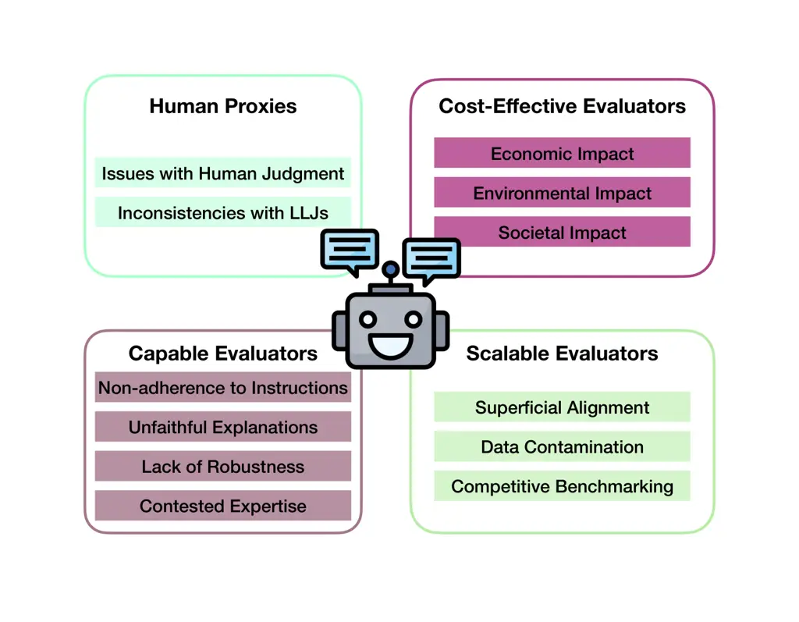

# Neither Valid nor Reliable? Investigating the Use of LLMs as Judges

Khaoula Chehbouni Affiliation: McGill University Affiliation: Mila -
Quebec AI Institute    Mohammed Haddou Affiliation: Statistics Canada   
Jackie Chi Kit Cheung Affiliation: McGill University Affiliation: Mila -
Quebec AI Institute    Golnoosh Farnadi Affiliation: McGill University
Affiliation: Mila - Quebec AI Institute

###### Abstract

Evaluating natural language generation (NLG) systems remains a core
challenge of natural language processing (NLP), further complicated by
the rise of large language models (LLMs) that aims to be
general-purpose. Recently, large language models as judges (LLJs) have
emerged as a promising alternative to traditional metrics, but their
validity remains underexplored. This position paper argues that the
current enthusiasm around LLJs may be premature, as their adoption has
outpaced rigorous scrutiny of their reliability and validity as
evaluators. Drawing on measurement theory from the social sciences, we
identify and critically assess four core assumptions underlying the use
of LLJs: their ability to act as proxies for human judgment, their
capabilities as evaluators, their scalability, and their
cost-effectiveness. We examine how each of these assumptions may be
challenged by the inherent limitations of LLMs, LLJs, or current
practices in NLG evaluation. To ground our analysis, we explore three
applications of LLJs: text summarization, data annotation, and safety
alignment. Finally, we highlight the need for more responsible
evaluation practices in LLJs evaluation, to ensure that their growing
role in the field supports, rather than undermines, progress in NLG.

## 1 Introduction

Evaluating natural language generation (NLG) systems remains a
significant challenge—particularly with the advent of “general-purpose”
models—due to several factors, including the subjectivity of the task
and the high cost of evaluation. The stakes of this challenge are high:
metrics and benchmarks not only shape our understanding of model
capabilities, but also influence which research space receives attention
and funding, ultimately steering the broader trajectory of the
field \[75\]. In this context, researchers have explored the use of
large language models as judges (LLJs) as an human-like and
cost-effective evaluation metrics \[55, 52\]. This promising potential
has sparked a surge of interest in the use of LLMs as evaluators, and
thousands of related papers have appeared on academic research
platforms, reflecting the rapid growth and attention the topic is
receiving across the research community.

Despite their growing adoption, the validity of LLJs remains relatively
underexplored \[111, 36\], with existing work focusing instead on their
reliability by exploring their consistency over multiple evaluations or
robustness to small stylistic changes in prompts  \[117, 61, 81, 104,
51\]. Validity and reliability are key concepts from measurement
theory—a social science framework used to inform evaluation
practices \[1\]. In the ML context, researchers have advocated for
applying this framework to improve and systematize existing evaluation
practices \[47, 102, 115\]. Similarly, in this position paper, we
leverage a measurement theory framework \[47\] to investigate the key
underlying assumptions behind the widespread use of LLJs: (1) their
ability to serve as proxies for human evaluators; (2) their capabilities
as evaluators; (3) their potential for scalability; and (4) their
cost-effectiveness. For each of these assumptions, we highlight current
limitations—whether inherent to LLMs, related to their use as
evaluators, or stemming from existing practices in the NLG
community—that may compromise their reliability and validity. While we
offer a high-level perspective on the field, we also examine three
popular LLJs applications, to ground our analysis in concrete examples:
text summarization, data annotation, and safety alignment. We conclude
by emphasizing the need for the community to establish robust standards
for the responsible evaluation of NLG systems, as well as the importance
of accounting for contextual factors during evaluation. These steps are
crucial to unlocking the full potential of LLJs, which mark a
significant shift in evaluation practices and open promising pathways
toward broader, more comprehensive, and more realistic evaluation of
LLMs.

To summarize, this position paper advocates for more rigorous evaluation
practices for LLJs, highlighting that their rapid and widespread
adoption may have occurred prematurely, without proper evaluation of
their reliability and validity as evaluators.

## 2 Large Language Models as Judges

Early work on LLJs demonstrated their potential for NLG
evaluation \[103, 63, 50\], sparking growing interest in the research
community. Building on these early insights, the adoption of LLJs has
quickly proliferated, establishing them as a common tool for evaluation
and guidance in a variety of machine learning settings. Leveraging
zero-shot or few-shot prompting, LLJs can evaluate outputs across
various criteria—such as relevance, fluency, or safety— and can even
generate explanations to justify their assessments or provide feedback.

Li et al. \[55\] formalize the evaluation process of LLJs as an
evaluation function that takes various inputs. The evaluation function
can be a single LLJ, multiple LLJs (usually referred to as Juries), or a
LLJ with a human in the loop. This function takes as input: an
evaluation type: pointwise (one item at the time), pairwise or listwise;
an evaluation criteria: specific to the task at hand and refers to
linguistic quality, content accuracy or task-specific metrics; an
evaluation item; an optional reference: the evaluation can be
reference-based or reference-free. This evaluation function can produce
three outputs: the evaluation result: e.g, a score, ranking, label or
qualitative assessment; the explanation: an explanation of the reasoning
that led to the assessment; the feedback: suggestions to improve the
input. This formalization accounts for the high variety of LLJ
paradigms, we refer to Li et al. \[55\]’s work on the topic for a
comprehensive survey on LLJs. Furthermore, while different types of LLJs
may exhibit different biases, our analysis in this paper deliberately
adopts a higher-level perspective. This enables us to provide a broader
perspective on their use and introduction in the field, rather than
limiting the discussion to biases tied to specific evaluation types.

Although early work on LLJs introduced them as an alternative to
traditional NLG evaluation metrics \[103, 63, 50\], their use has since
expanded to different applications. Li et al. \[55\] identify three main
functionalities: (1) performance evaluation, (2) model enhancement, and
(3) data construction. Performance evaluation refers to the conventional
use of LLJs to assess model outputs or overall performance. Model
enhancement captures the use of LLJs to improve models, either through
reward modeling or by providing feedback throughout the training
process. Lastly, data construction involves leveraging LLJs for tasks
such as data annotation or data generation. In this work, we examine the
use of LLJs along three use cases to ground our analysis, each
corresponding to one of these functionalities: text summarization,
safety alignment, and data annotation.

## 3 Measurement Theory

In this section, we briefly introduce measurement theory, which offers a
conceptual framework to formalize and evaluate the validity and
reliability of an evaluation \[111\]. Measurement theory has its roots
in the quantitative social sciences, particularly in fields such as
psychology, education, and political science. Scholars in these
disciplines have long aimed to develop formal methods for validating
theoretical—and often abstract—concepts. Adcock and Collier \[1\]
outline a four-level framework to understand the connection between
concepts and observations. At the most abstract level is the background
concept, encompassing the full range of meanings a concept might have.
This is followed by the systematized concept, which refers to the
precise definition adopted by researchers for analytical purposes. The
third level involves the measures, or the scoring procedures used to
assess the concept. Finally, the fourth level consists of the scores,
which are derived from applying the measures. In this context,
conceptualization refers to the process of refining a background concept
into a systematized concept, while operationalization involves
converting the systematized concept into specific indicators or
procedures for generating scores.

According to Adcock and Collier \[1\], a measurement is considered valid
when the resulting observations—or scores—accurately reflect the content
of the systematized concept. Validity is often discussed in light of
measurement error, which refers to the difference between the observed
score and the systematized concept it aims to represent. Measurement
errors can be either systematic or random. Systematic errors, associated
to bias, pertain to issues of validity, whereas random errors,
manifesting as inconsistent results across repeated applications of the
same procedure, relate to reliability \[1\].

Building on these foundations, Jacobs and Wallach \[47\] introduce a
framework for understanding fairness in computational systems with
respect to construct reliability and construct validity \[18\].
Construct reliability is defined in terms of test-retest reliability,
i.e. how stable the scores obtained from the measurement model are over
time, while construct validity is understood as being both
context-dependent \[1\] and gradational in nature \[47\] and decomposed
into seven dimensions described in Table 1.

| Dimension              | Description                                                                                 |
| ---------------------- | ------------------------------------------------------------------------------------------- |
| Face Validity          | The measurements obtained from the evaluation look plausible.                               |
| Content Validity       | The operationalization captures all relevant aspects of the underlying construct.           |
| Convergent Validity    | The measurements obtained correlate with other measurements of the construct.               |
| Discriminant Validity  | The measurements variation suggests the operationalization captures other constructs.       |
| Predictive Validity    | The measurements are predictive of relevant observable properties related to the construct. |
| Hypothesis Validity    | The measurements support known hypotheses about the construct.                              |
| Consequential Validity | The consequences of using the measurements obtained from an evaluation.                     |

Table 1: Components of construct validity as described by Jacobs and
Wallach \[47\]

## 4 Investigating the Assumptions Behind the Use of LLMs As Judges

Whether in the conceptualization or operationalization of a construct,
the process of measurement modeling inevitably involves underlying
assumptions \[47\]. To inform our position, we conducted a high-level
qualitative review of commonly cited works on LLJs, focusing on how
researchers motivate their use and describe their applications. The goal
was to surface frequently recurring themes, implicit assumptions, and
shared framings that appear across papers. Although not exhaustive, this
approach provides insight into the dominant narratives and foundational
premises that shape current research directions. We first explored the
literature on LLJs across various applications (text summarization,
machine translation, alignment, etc.) to get a broader understanding of
their use, before focusing more in-depth on three applications
illustrating the different functionalities presented in Section 2. As we
believe that assessing the validity and reliability of LLJs needs to be
done in context.

| LLMs as a Proxy for Human Judgment                                                                                                                                              |
| ------------------------------------------------------------------------------------------------------------------------------------------------------------------------------- |
| Zheng et al. \[117\]: To automate the evaluation, we explore the use of state-of-the-art LLMs, such as GPT-4, as a surrogate for humans.                                        |
| Gilardi et al. \[33\]: It strongly suggests that ChatGPT may already be a superior approach compared to crowd annotations on platforms such as MTurk.                           |
| LLMs as Capable Evaluators                                                                                                                                                      |
| Chiang and Lee \[14\]: LLMs have demonstrated exceptional performance on unseen tasks when only the task instructions are provided.                                             |
| Mohta et al. \[70\]: It also exhibits the unique capability to provide reasons for classification, a feature often absent in human-labeled data.                                |
| LLMs as Scalable Evaluators                                                                                                                                                     |
| Sun et al. \[95\]: However, acquiring high-quality human annotations, including consistent response demonstrations and in-distribution preferences, is costly and not scalable. |
| Mazeika et al. \[68\]: However, companies currently rely on manual red teaming, which suffers from poor scalability.                                                            |
| LLMs as Cost-Effective Evaluators                                                                                                                                               |
| He et al. \[39\]: From a cost perspective, GPT-4 is also more affordable than hiring MTurk workers.                                                                             |
| Sun et al. \[96\]: \[…\] offering cost-effective and accessible alternatives.                                                                                                   |

Table 2: Example quotes illustrating the assumptions behind the use of
LLMs judges from selected publications.

In this section, we identify and examine four common assumptions
motivating the use of LLJs in the field. For each assumption, we
illustrate key challenges using concrete examples from existing
literature. Table 2 presents example quotes for each of these
assumptions while Figure 1 presents an overview of our findings.

Figure 1: We look at the main assumptions made in the LLJs literature
and identify potential pitfalls that can undermine the validity and
reliability of LLMs as measurement models.

### 4.1 Assumption 1: LLMs as a Proxy for Human Judgment

Traditionally, NLG evaluation has relied on human annotators to assess
the quality of language model outputs. Consequently, a range of
benchmarks has been developed for tasks such as summarization,
data-to-text generation, and machine translation, incorporating “human
judgment”—either in the form of a score or human-written reference
outputs. However, recent advances in LLMs are beginning to shift this
paradigm. In particular, progress in reinforcement learning from human
feedback \[76\] has significantly enhanced LLMs’ ability to produce
human-like text, making it increasingly challenging to distinguish
between human-written and LLM-generated content \[17\]. The ability of
LLMs to generate human-like text and align with human preferences \[76\]
has prompted researchers to investigate their potential as effective
alternatives to humans in NLG evaluation.

Early studies on LLJs \[50, 14, 103, 63\] have primarily validated their
use through convergent validity. As shown in Table 1, this approach
assumes that a metric is valid if it correlates with an existing,
already validated metric for the same construct \[47\]. As a result,
researchers have evaluated LLM-generated text using other LLJs,
comparing their scores to human gold standards present in common NLG
benchmarks (e.g., SummEval \[27\], RealSumm \[8\] or
Topical-Chat \[69\]) using correlation metrics such as Pearson,
Spearman, or Kendall’s Tau. Demonstrating correlation between human
ground-truth judgments and LLM-based evaluations has laid the groundwork
for the field, driving their widespread adoption across various tasks
and applications in academia and industry alike \[52\]. Although a body
of work \[63, 50\] has shown a degree of correlation between LLM-based
evaluations and human judgment—indicating a form of convergent
validity—we argue that existing shortcomings in NLG evaluation practices
undermine the validity of LLJs as measurement models because the human
judgments themselves might not be valid. In this section, we highlight
how these shortcomings may undermine LLJs convergent validity.

#### Inconsistencies in Human Judgment Collection.

As noted by Nenkova and Passonneau \[74\] : “to show that an automatic
method is a reasonable approximation of human judgments, one needs to
demonstrate that these \[human judgments\] can be reliably elicited.”
However, prior work \[120, 42\] has revealed significant inconsistencies
in how human judgments in NLG evaluation are being elicited and
collected, casting doubt on their validity as a benchmark. Indeed, while
human evaluation has long been considered the gold standard in NLG,
there remains little agreement on what constitutes human judgment or how
it should be collected. Howcroft et al. \[42\] examine twenty years of
human evaluation practices in NLG and reveal a lack of shared practices
within the community. They highlight significant inconsistencies in the
definitions of evaluation criteria, when such definitions are provided
at all, along with vague instructions for annotators (e.g., missing
examples or clear rating scales) which lead to diverse interpretations
of the evaluation task. Resulting in a clear mismatch between the
evaluation criteria intended by researchers and how annotators actually
understand them \[17\]. In addition, Zhou et al. \[120\] interview both
academic and non-academic NLG practitioners about their evaluation
practices, and reveal additional pitfalls in human evaluation practices,
including ambiguity around the kind of expertise needed when involving
human annotators, a conflation of quality criteria with their
measurement, and the re-purposing of benchmarks created for other tasks.
These issues have increasingly called into question the role of human
judgment as the gold standard in NLG evaluation, sparking concerns about
quality and reproducibility. This raises doubts about whether human
judgments capture the intended aspects of evaluation.

#### Inconsistencies in LLJs Judgment Collection.

Despite this uncertain foundation, the LLJs literature has adopted
correlation with human judgment as the primary validation criterion of
their use without critically investigating what aspects of the human
judgment construct LLJs actually correlate with. Even this correlation
is sometimes disputed—either because practitioners question whether LLJs
actually correlate with human judgment as they notice great variability
across tasks and benchmarks \[51, 6\], or because the methods used to
compute the correlation are themselves contested \[25\]. For example,
Elangovan et al. \[25\] show how human uncertainty in labeling affects
the correlation scores produced by an LLJ. Specifically, under high
human uncertainty—such as an improperly documented subjective annotation
task—correlation between automatic metrics like LLJs may appear
artificially inflated. Moreover, the literature on LLM judges seems to
reproduce and even exacerbate many of the same issues found in previous
NLG evaluation research—especially inconsistent conceptualization of
evaluation criteria and ambiguous operationalization \[43\], not just
across different benchmarks but also within individual benchmarks
themselves. These inconsistencies in both human and LLM judgment
collection practices raise important concerns about the validity of
using LLMs as reliable proxies for human evaluation. Without
standardized definitions, evaluation methods, and scoring scales, it
becomes difficult to ensure that LLM-based assessments faithfully
reflect human judgment.

Example: The SummEval Benchmark. The SummEval benchmark \[27\] has
emerged as a key reference for validating the use of LLJs within the
broader community given its pivotal role in NLG evaluation research. To
better understand how LLJs judgements are collected and evaluated, we
look at how different papers use this benchmark and notice various
inconsistencies illustrated in Table 3. For example, while the original
work provides the instructions given to annotators for the different
evaluation criteria (relevance, consistency, fluency, coherence), work
on LLJs do not always make use of these definitions. Across three
different papers, only one uses the provided definition of fluency but
also includes irrelevant information—confusing disfluency (which refers
to a vocal communication disorder) with a lack of fluency in text. One
paper does not provide any definition of fluency at all, while another
introduces its own interpretation of the criterion. Additionally,
although the human evaluation in the benchmark was conducted via
relative comparisons by assessing five summaries simultaneously, studies
using LLJs adopt either absolute or pairwise comparisons. They also
employ varying rating scales (e.g., 1–3 or 1–100) instead of the
benchmark’s original 1–5 Likert scale.

| Instructions                                                                                                                                                                                                                                                                                                                                                                                                                | Scale                                | Process                                    |
| --------------------------------------------------------------------------------------------------------------------------------------------------------------------------------------------------------------------------------------------------------------------------------------------------------------------------------------------------------------------------------------------------------------------------- | ------------------------------------ | ------------------------------------------ |
| Original instructions to annotators from Fabbri et al. \[27\]: This rating measures the quality of individual sentences, are they well-written and grammatically correct. Consider the quality of individual sentences.                                                                                                                                                                                                     | Likert Scale (1-5)                   | Relative Comparison                        |
| The quality of the summary in terms of grammar, spelling, punctuation, word choice, and sentence structure. 1: Poor. The summary has many errors that make it hard to understand or sound unnatural. 2: Fair. The summary has some errors that affect the clarity or smoothness of the text, but the main points are still comprehensible. 3: Good. The summary has few or no errors and is easy to read and follow \[63\]. | Likert Scale (1-3)                   | Absolute Comparison                        |
| Score the following news summarization given the corresponding news with respect to fluency with one to five stars, where one star means “disfluency” and five stars means “perfect fluency”. Note that fluency measures the quality of individual sentences, are they well-written and grammatically correct. Consider the quality of individual sentences\[103\].                                                         | Likert Scale from 1-5 and from 1-100 | Absolute Comparison                        |
| Which Summary is more fluent relative to the passage, Summary A or Summary B? or Provide a score between 1 and 10 that measures the summaries’ fluency \[65\].                                                                                                                                                                                                                                                              | Binary Option or Scale 1-10          | Pairwise Comparison or Absolute Comparison |

Table 3: Instructions provided to LLM judges for evaluating the fluency
criterion in SummEval \[27\]

### 4.2 Assumption 2: LLMs as Capable Evaluators

Another key assumption underlying the use of LLMs as judges is their
high potential as evaluators. General-purposes LLMs have demonstrated
impressive capabilities in in-context learning and
instruction-following \[105, 107, 106\]—even surpassing human
performance in certain tasks \[5\], suggesting that they could be used
as evaluators without additional training. In this section, we explore
how inherent limitations in LLMs’ capabilities may affect their validity
and reliability as evaluators across four key dimensions: instructions
adherence, explainability, robustness, and expertise.

#### Instruction Adherence.

While LLMs are widely recognized for their strong instruction-following
capabilities \[76\], recent work has exposed notable limitations in
these capabilities when applied to NLG evaluation. For instance, Hu
et al. \[43\] show that LLMs frequently rely on their own
interpretations of evaluation criteria, rather than following the
instructions provided in the prompts, particularly across popular
quality criteria used in the NLG literature. Moreover, LLMs often
conflate distinct dimensions of evaluation, such as fluency and
relevance, raising concerns about their discriminant validity as their
operationalization of one criterion may inadvertently reflect aspects of
another. Feuer et al. \[28\] corroborate these findings and further show
that LLM judges exhibit strong implicit biases across quality criteria,
assigning varying levels of importance to each and, as a result, scoring
them inconsistently.

#### Explainability.

A body of work has explored the effect of self-explanation on LLMs as
evaluators, demonstrating that generating rationales through
chain-of-thought reasoning can increase the correlation between
model-generated scores and human judgments \[15, 71, 48, 38\], and
improve transparency and interpretability of LLMs as judges. However,
none of these studies examined the faithfulness of the generated
explanations—either omitting any evaluation of the explanations
altogether or focusing instead on aspects such as coherence \[71\], or
the consistency and stability of the rationales provided \[38\]. As a
result, they primarily assess the face validity of LLMs as judges,
rather than rigorously validating their role as interpretable evaluation
metrics. This is, in fact, one of the key challenges in LLM validation:
their high face validity, as their outputs often appear coherent and
plausible, even when they are wrong \[90, 2\].

#### Robustness.

While the literature on LLJs has paid limited attention to their
construct validity (§ 3), focusing primarly on convergent validity
(§ 4.1) and face validity as seen above, it has, by contrast,
extensively examined their construct reliability, particularly through
assessments of test-retest reliability, given the known stochasticity of
LLMs. For instance, \[117, 56, 116, 54, 41, 61, 81, 104, 51, 112\]
examine position bias (also referred to as selection bias or order
bias), showing that LLJs can favor responses based on their position in
the response set \[55\]. Indeed, studies have demonstrated that LLJs are
vulnerable to a broad spectrum of biases in their role as
evaluators \[52\]. One prominent category includes cognitive
biases \[51\]. For instance, saliency or verbosity bias describes the
tendency of LLMs to be swayed by the length of responses \[117, 112\].
Other biases include compassion-fade bias (favoring recognizable names
over anonymized aliases), bandwagon-effect bias (favoring majority
opinions), and attentional bias (giving too much attention to irrelevant
details). We refer readers to Li et al. \[55\]’s survey for a more
comprehensive discussion of the different documented biases in LLJs.
Finally, a growing body of research \[81, 118, 89, 57, 24\] has
demonstrated that LLJs are highly susceptible to superficial adversarial
attacks and prompt manipulations. Raina et al. \[81\] show that it is
possible to design universal attacks to inflate LLJs scores. Similarly,
Li et al. \[57\] design a simple attack to inflate the scores obtained
by diverse state-of-the-art LLJs. In the context of LLMs safety judges,
Eiras et al. \[24\] show that they can lead a model to misclassify up to
100% of harmful generations as harmless through simple prompt
variations. This lack of robustness to a multitude of biases and
adversarial attacks undermines the construct reliability of LLJs, as
small perturbations may lead to completely different evaluation results.

#### Expertise.

A key argument in the literature supporting the use of LLJs is their
strong performance on specific tasks. As Kocmi and Federmann \[50\]
point out: “if the model can translate, it may be able to differentiate
good from bad translations”. Others may argue that comparison is easier
than generation—even if both are probably correlated, and is therefore
still valid for tasks for which LLJs are known to have inherent
weaknesses, including math and reasoning \[117\], factuality \[21\] and
safety \[24\]. However, we maintain that an LLM performance on a given
task may impact its content validity as a judge for that same task.

Example: LLJs as Annotators. Because of LLMs ability to produce
human-like text often indistinguishable from human-written text \[17\]
and even perceived as higher quality \[114, 91, 78\], they are often
seen as a great alternative for automated annotation, despite some
researchers still disagreeing on their proficiency on the task \[51,
72\]. Interestingly, LLJs have been proposed as substitutes for humans
in highly subjective and contested tasks, such as hate speech
detection \[44\] and political affiliation classification \[100\]. The
contested nature of these tasks makes it challenging to establish the
content validity of LLJs as annotators. These constructs are highly
subjective \[40, 35\], and relying on LLJs—who tend to yield higher
inter-annotator agreement and present their own inherent biases—risks
overlooking the valuable diversity found in human disagreement, which is
especially important in these contexts. While disagreement is often
treated as a marker of poor annotation quality, studies have shown it
can instead provide important insights for subjective tasks \[29, 49\].

### 4.3 Assumption 3: LLMs as Scalable Evaluators

Another key assumption underlying the use of LLJs lies in their
potential for scalability. Since scaling is widely recognized as a major
driver of LLM performance \[106\], recent research has increasingly
focused on scaling both datasets and model training. Within this
context, LLJs have gained momentum, especially for alignment purposes.
Considering the prohibitive cost of reinforcement learning from human
feedback— which depends heavily on large amount of high quality human
data \[76\], researchers have explored automated alternatives,
leveraging LLJs for automatic red-teaming \[79\],
self-improvement \[5\], self-alignment \[96, 95\], and human feedback
generation \[23\], among other things. Most notably, LLJs have been
widely used for safety at different steps of the mitigation pipeline:
for generating harmless preferences, or annotating human preferences,
for safety benchmarking, automatic red-teaming or as online guardrails
for example \[79, 5, 45, 68, 95\]. For each of these tasks, researchers
have been leveraging one or multiple LLJs through the safety pipeline.
In this section, we show how these new safety pipelines can challenge
the discriminant validity and predictive validity of LLJs.

#### Scaling Contamination.

Beyond their “traditional” role in evaluation, LLJs are increasingly
being used for model enhancement \[55\] (see Section 2). They can assume
various roles throughout the training pipeline, including data
generation and annotation, reward modeling, and verification \[5, 95,
96\]. While these applications have led to notable improvements in
utility, the generalization of these performance gains remains to be
rigorously validated, especially as such practices blur the boundary
between training and testing. Considering that LLJs are mostly validated
using publicly available benchmarks, this raises the issue of data
contamination: several studies have shown evidence of memorization of
popular benchmarks in various state-of-the-art LLMs \[34, 83, 19, 22,
4\]. Although the extent to which such contamination may inflate the
performance of LLJs on popular benchmarks for NLG evaluation has yet to
be thoroughly investigated, adjacents issues have been documented in the
literature. A growing body of research has demonstrated self-enhancement
bias (also referred to as egocentric or narcissist bias) in LLJs,
referring to their tendency to favor and inflate evaluation scores for
responses generated by models from the same family \[117, 64, 77\]. Li
et al. \[53\] further demonstrate that this bias can be exacerbated
through the phenomenon of preference leakage, a specific form of
contamination affecting LLJs. Preference leakage arises when LLMs used
for data generation and evaluation in the training pipeline are closely
related, which is typically the case in alignment settings, as
practitioners use off-the-shelf models or previous versions of the same
model as a judge. They show how this issue is especially prevalent in
LLJs-based benchmarks, like AlpacaEval \[23\] and Arena-Hard \[60\], and
that its severity increases with the degree of similarity between the
models. Similarly, Li et al. \[57\] show that preference-based LLJs
evaluation can be easily manipulated by adapting the responses of a
model to align more closely with the judge. In cases where the evaluated
model and the judge belong to the same model family, such adaptation may
not even be necessary, as their preferences are already aligned.

#### Competitive Benchmarking.

While the aforementioned biases raise important concerns about the use
of LLJs for model alignment and benchmarking, even in the absence of
such biases, incorporating LLJs inside the training pipeline remains
questionable. The issue of competitive benchmarking has gained
increasing attention in recent years \[75\], particularly in light of
the rapid advancement of LLM capabilities and considering that in NLP,
benchmarks are both testing instrument and testing material \[87\]. The
emergence of various leaderboards and other LLJs powered evaluation
framework has accentuated these concerns, as automatic evaluations are
prone to negative feedback loop and inflated results. For example, Singh
et al. \[92\] expose critical flaws in current evaluation practices that
undermine the validity of one of the most widely used leaderboards for
LLM evaluation: Chatbot Arena \[16\]. These flaws include unequal data
access favoring proprietary providers such as Google and OpenAI,
increased risks of overfitting to the benchmark, and the ability for
participants to selectively disclose results or privately remove models
from the platform. Numerous studies have demonstrated how easily
evaluation frameworks can be manipulated \[87, 10, 92\], and we argue
that automatizing the pipeline can only facilitate such practices as
seen in  \[117, 64, 77, 53\]. These biases and malpractices undermine
the predictive validity of LLJs, as their scores are disproportionately
affected by confounding factors unrelated to the task. This issue likely
arises from overfitting to benchmarks and optimizing for specific
metrics instead of the task itself, highlighting a gap between the
intended construct (e.g., safety) and its operationalization (e.g.,
general framework for automated safety mitigation and evaluation).

#### Scaling Superficiality.

Zhou et al. \[119\] introduced the Superficial Alignment Hypothesis,
which suggests that LLMs acquire most of their knowledge and
capabilities during pre-training, while alignment primarily affects the
stylistic format of their outputs. This hypothesis is later supported by
Lin et al. \[62\], who show that the most significant distribution
shifts between base and aligned LLMs involve stylistic tokens. While
such findings should have prompted critical reflection on the
effectiveness of current safety mitigation practices—particularly in
light of numerous documented failures in the literature \[108\] and
encouraged greater investment in advancing safety research, they have
inadvertently steered the field in a less constructive direction.
Specifically, the perception that alignment is largely superficial has
led to the belief that it can now be achieved at a lower cost \[62\],
and that human feedback may no longer be necessary, paving the way for
the adoption of LLJs as a realistic alternative.

Example: LLMs as Safety Judges. In an effort to prevent deployed models
from producing harmful content, companies have released LLSJs as
real-time safeguards. These judges act as guardrails, evaluating user
inputs to determine whether they are appropriate for the base model to
respond to. Examples of these models include Llama Guard \[45, 97\],
ShielGamma \[113\], and Guardformer \[73\], among others \[37, 66, 32,
68, 58\]. LLSJs are typically responsible for classifying user inputs
and model responses acording to predefined safety-taxonomies. While the
exact criteria depend on each company’s safety policies, they generally
cover similar dimensions such as violence, hate speech, sexual content,
weapons, illicit substances, suicide, and criminal activity. Eiras
et al. \[24\] show that LLSJs are highly sensitive to distribution shift
and adversarial attacks. Notably, they show how small modifications in
outputs can lead LLMs safety judges to misclassify up to 100% of harmful
generation as harmless. Similarly, Chen and Goldfarb-Tarrant \[13\]
demonstrate that injecting artifacts into safety-related prompts can
mislead LLSJs, revealing an over-reliance on surface-level statistical
cues rather than a genuine understanding of safety. For instance, adding
an apology to an unsafe prompt may cause the model to wrongly classify
it as harmless. This focus on stylistic markers over substantive safety
concerns supports the superficial alignment hypothesis and echoes
findings from prior work on the limitations of safety safeguards—such as
exaggerated safety behaviors \[84\] and the ways in which such behaviors
can reinforce existing societal biases \[10\]. Such tendencies call into
question the discriminant validity of LLSJs, as their vulnerability to
superficial interventions suggests a limited understanding of safety
concepts, relying instead on loosely correlated proxies—such as a
model’s refusal to respond to a query.

### 4.4 Assumption 4: LLMs as Cost-Effective Evaluators

Another key assumption underlying the use of LLJs is their potential to
serve as a more cost-effective alternative to human evaluation. Although
LLM-based evaluation can incur higher costs in certain scenarios \[28\]
such as LLJs-based benchmarks like Arena-Hard \[60\], it is generally
more economical overall. Instead of relying on crowdworkers (e.g., via
Amazon Mechanical Turk) or domain experts, practitioners can now
leverage open- or closed-source LLMs for evaluation. While inference
costs vary across models, this approach remains more affordable than
human labor, particularly as the operational costs of LLMs continue to
decrease \[28\].

The conversation around LLJs as a cheap, realistic, and scalable
alternative echoes the introduction of Amazon Mechanical Turk (AMT) into
the research sphere, as it was similarly praised for these
qualities \[9, 93\]. Although the platform was initially introduced as a
more diverse, scalable, and cost-effective alternative to traditional
human evaluation methods, it has since come under scrutiny. For
instance, Marshall et al. \[67\] highlight a decline in data quality on
AMT over time, despite the implementation of numerous mitigation
strategies aimed at enhancing the reliability of collected data—such as
attention checks, reading comprehension tasks, and pre-screening workers
based on specific criteria. Beyond this deterioration in quality,
researchers have also raised significant ethical concerns about the
platform and crowdwork more broadly, particularly emphasizing its
exploitative nature, characterized by extremely low wages, lack of
transparency, pronounced power asymmetries, and threats to workers’
privacy \[30, 80, 86\].

The AMT example highlights the importance of considering more than just
short-term financial costs when adopting new evaluation methods. While
localized short-term economies might seem attractive, they can snowball
into larger societal impacts once such practices become established in
the field. Similarly, the adoption of LLJs often overlooks long-term
implications and non-financial costs, factors that are largely ignored
in the literature and rarely discussed in critical depth, despite being
crucial to establishing the validity of the framework. Using LLMs as
benchmarks not only influences perceived progress in the field but also
shapes how research is conducted, how LLMs capabilities are understood,
and how we interpret the very constructs these models are purported to
measure. Moreover, while LLJs offer clear cost savings for researchers,
it remains unclear who will ultimately bear the broader costs of their
widespread adoption over time. Below, we examine how the non-financial
impacts associated with LLJs may affect their consequential validity
(see Table 1).

#### Economic Impact.

Although early efforts to explore LLMs as an alternative to human
annotators \[33, 3\] have been widely criticized in both the media \[99,
109\] and academic literature \[39\], researchers continue to pursue the
use of LLJs as annotators \[121, 100, 70, 121, 44, 39, 38\], raising
concerns about the future of crowdworkers—an already vulnerable
population \[80\]—especially as many agree that ongoing advances in LLM
research are likely to have disruptive effects on the labor market \[98,
46\]. While automation may appear as a more “ethical” alternative in
certain contexts—such as content moderation, where workers are regularly
exposed to traumatic material (e.g., child sexual abuse, bestiality,
incest \[110\])---it is crucial to acknowledge that, despite their
precarity, these jobs remain the primary source of income for many.
Displacing workers does not resolve the underlying issues. Instead,
efforts should focus on improving working conditions and developing
alternatives that are grounded in the needs and lived realities of these
workers ¹¹ 1 https://data-workers.org/.

#### Environmental Impact.

Although frequently overshadowed by the environmental costs of
training\[7, 59\], the environmental impact of large language models
during inference remains considerable—whether in terms of energy
consumption \[85\], carbon emissions \[26\], or water usage \[59\]—and
continues to grow as model sizes increase \[20\]. While there is a
growing focus on more efficient computational methods (e.g., model
distillation, sparsification) \[85\], the LLJs literature continues to
favor larger models, as they have been shown to produce more accurate
evaluations, sometimes even leveraging “juries”, i.e., ensembles of
smaller LLMs \[101\], to improve performance. Few have investigated less
resource-intensive alternatives, addressing a gap in the current
discourse on evaluating LLJs.

#### Societal Impact.

LLJs are not exempt from the well-documented societal biases present in
large language models \[88, 108, 31\]—even if such biases have not yet
been extensively studied in this context. NLG systems are known to
reinforce social stereotypes and discriminatory patterns, and they are
prone to producing hate speech, offensive content, and exclusionary
language \[108\]. When used for evaluation, LLJs have the potential to
exhibit fairness-related biases, potentially favoring responses
associated with certain demographic groups over others. However, few
studies have examined the potential of LLJs to reproduce existing
discriminatory patterns \[94, 112, 12\]. Among these, Ye et al. \[112\]
demonstrate that LLJs exhibit diversity bias, meaning their judgment
shift in the presence of identity markers. While Chen et al. \[12\] show
evidence of gender bias in LLJs. Given these findings, it is likely that
LLJs reproduce societal biases. This highlights the need for further
investigation before deploying them, particularly in high-stakes
applications.

## 5 The Path Forward

In this section, we offer recommendations to support the responsible and
effective integration of LLJs into evaluation practices.

First, despite the wide range of applications for LLJs, there has been
little adaptation in how they are deployed or in how evaluations are
designed across different tasks and domains—an oversight that can lead
to harmful consequences. For instance, while using LLJs to scale
red-teaming efforts can enhance the breadth of evaluation, applying the
same approach within a safety mitigation pipeline can result in
superficial safety behaviors. In such contexts, more targeted and
domain-specific mitigation strategies can be more effective than a
trial-and-error approach that does not account for the sociotechnical
aspect of safety \[11\]. Evaluating the role of LLJs as evaluators
necessitates a comprehensive approach that considers several critical
dimensions, including the task at hand, the goal of the evaluation, and
the type of LLJ being used, among other things.

Finally, although mitigating the biases of LLJs has become an active
area of research \[52\], the field urgently requires improved evaluation
practices. Recent controversies \[82, 92\] have exposed how tech
companies manipulate existing evaluation frameworks, raising serious
concerns about data contamination, competitive benchmarking, and
overfitting among other things. Despite the importance of evaluation in
ML development, there is a lack of rigorous shared practices among
practitioners. While technical artifacts like benchmarks and metrics are
commonly shared, methodologies and practices are not. \[42, 120, 102\]
highlight that current practices in NLG evaluation lack standardization
and systematization, and as demonstrated in this paper, the adoption of
LLJs is no exception. LLJs not only reproduce and exacerbate existing
issues, but also introduce new challenges for the community. We need to
not only focus on mitigating the individual biases associated with LLJs
but also consider how to improve NLG evaluation practices as a whole,
and better train ML practitioners for such a complex task. It is perhaps
time to move beyond a paradigm where we rely on interested companies to
provide transparent and comprehensive evaluation of the products they
aim to market, and instead work into putting in place proper mechanisms
for transparent, valid and reliable evaluation.

## 6 Conclusion

In this work, we have explored how various pitfalls in NLG evaluation
practices and the inherent limitations of LLMs can impact LLJs as
evaluators. We argue that fully realizing the potential of LLJs depends
on our ability to critically and systematically address these
challenges. When properly implemented, LLJs offer a valuable opportunity
to advance NLG evaluation—whether by enabling more realistic,
interactive, and long-term evaluation pipelines that better reflect
real-world usage, or by alleviating the burden of problematic annotation
tasks involving harmful or traumatic content for example. Therefore,
leveraging LLJs effectively will require a careful balance: improving
efficiency without disregarding their broader societal impact.

## 7 Acknowledgements

Funding support for project activities has been partially provided by
Canada CIFAR AI Chair, NSERC discovery grant and FRQNT grant. We also
express our gratitude to Compute Canada and Mila clusters for their
support in providing facilities for our evaluations.

## References

- \[1\] Robert Adcock and David Collier. Measurement Validity: A Shared
  Standard for Qualitative and Quantitative Research. _American
  Political Science Review_, 95(3):529–546, September 2001. ISSN
  0003-0554, 1537-5943. doi: 10.1017/S0003055401003100. URL
  [https://www.cambridge.org/core/journals/american-political-science-review/article/abs/measurement-validity-a-shared-standard-for-qualitative-and-quantitative-research/91C7A9800DB26A76EBBABC5889A50C8B#](https://www.cambridge.org/core/journals/american-political-science-review/article/abs/measurement-validity-a-shared-standard-for-qualitative-and-quantitative-research/91C7A9800DB26A76EBBABC5889A50C8B#).
- \[2\] Chirag Agarwal, Sree Harsha Tanneru, and Himabindu Lakkaraju.
  Faithfulness vs. Plausibility: On the (Un)Reliability of Explanations
  from Large Language Models, March 2024. URL
  [http://arxiv.org/abs/2402.04614](http://arxiv.org/abs/2402.04614).
  arXiv:2402.04614 \[cs\].
- \[3\] Meysam Alizadeh, Maël Kubli, Zeynab Samei, Shirin Dehghani,
  Juan Diego Bermeo, Maria Korobeynikova, and Fabrizio Gilardi.
  Open-Source Large Language Models Outperform Crowd Workers and
  Approach ChatGPT in Text-Annotation Tasks. _CoRR_, January 2023. URL
  [https://openreview.net/forum?id=FboDJ1SGlp](https://openreview.net/forum?id=FboDJ1SGlp).
- \[4\] Norah Alzahrani, Hisham Alyahya, Yazeed Alnumay, Sultan
  AlRashed, Shaykhah Alsubaie, Yousef Almushayqih, Faisal Mirza, Nouf
  Alotaibi, Nora Al-Twairesh, Areeb Alowisheq, M Saiful Bari, and Haidar
  Khan. When Benchmarks are Targets: Revealing the Sensitivity of Large
  Language Model Leaderboards. In Lun-Wei Ku, Andre Martins, and Vivek
  Srikumar, editors, _Proceedings of the 62nd Annual Meeting of the
  Association for Computational Linguistics (Volume 1: Long Papers)_,
  pages 13787–13805, Bangkok, Thailand, August 2024. Association for
  Computational Linguistics. doi: 10.18653/v1/2024.acl-long.744. URL
  [https://aclanthology.org/2024.acl-long.744/](https://aclanthology.org/2024.acl-long.744/).
- \[5\] Yuntao Bai, Saurav Kadavath, Sandipan Kundu, Amanda Askell,
  Jackson Kernion, Andy Jones, Anna Chen, Anna Goldie, Azalia
  Mirhoseini, Cameron McKinnon, Carol Chen, Catherine Olsson,
  Christopher Olah, Danny Hernandez, Dawn Drain, Deep Ganguli, Dustin
  Li, Eli Tran-Johnson, Ethan Perez, Jamie Kerr, Jared Mueller, Jeffrey
  Ladish, Joshua Landau, Kamal Ndousse, Kamile Lukosuite, Liane Lovitt,
  Michael Sellitto, Nelson Elhage, Nicholas Schiefer, Noemi Mercado,
  Nova DasSarma, Robert Lasenby, Robin Larson, Sam Ringer, Scott
  Johnston, Shauna Kravec, Sheer El Showk, Stanislav Fort, Tamera
  Lanham, Timothy Telleen-Lawton, Tom Conerly, Tom Henighan, Tristan
  Hume, Samuel R. Bowman, Zac Hatfield-Dodds, Ben Mann, Dario Amodei,
  Nicholas Joseph, Sam McCandlish, Tom Brown, and Jared Kaplan.
  Constitutional AI: Harmlessness from AI Feedback, December 2022. URL
  [http://arxiv.org/abs/2212.08073](http://arxiv.org/abs/2212.08073).
  arXiv:2212.08073 \[cs\].
- \[6\] Anna Bavaresco, Raffaella Bernardi, Leonardo Bertolazzi, Desmond
  Elliott, Raquel Fernández, Albert Gatt, Esam Ghaleb, Mario
  Giulianelli, Michael Hanna, Alexander Koller, André F. T. Martins,
  Philipp Mondorf, Vera Neplenbroek, Sandro Pezzelle, Barbara Plank,
  David Schlangen, Alessandro Suglia, Aditya K. Surikuchi, Ece Takmaz,
  and Alberto Testoni. LLMs instead of Human Judges? A Large Scale
  Empirical Study across 20 NLP Evaluation Tasks. _CoRR_, January 2024.
  URL
  [https://openreview.net/forum?id=zDoOyPlpLq](https://openreview.net/forum?id=zDoOyPlpLq).
- \[7\] Emily M. Bender, Timnit Gebru, Angelina McMillan-Major, and
  Shmargaret Shmitchell. On the Dangers of Stochastic Parrots: Can
  Language Models Be Too Big? In _Proceedings of the 2021 ACM Conference
  on Fairness, Accountability, and Transparency_, FAccT ’21, pages
  610–623, New York, NY, USA, March 2021. Association for Computing
  Machinery. ISBN 978-1-4503-8309-7. doi: 10.1145/3442188.3445922. URL
  [https://dl.acm.org/doi/10.1145/3442188.3445922](https://dl.acm.org/doi/10.1145/3442188.3445922).
- \[8\] Manik Bhandari, Pranav Narayan Gour, Atabak Ashfaq, Pengfei Liu,
  and Graham Neubig. Re-evaluating Evaluation in Text Summarization. In
  Bonnie Webber, Trevor Cohn, Yulan He, and Yang Liu, editors,
  _Proceedings of the 2020 Conference on Empirical Methods in Natural
  Language Processing (EMNLP)_, pages 9347–9359, Online, November 2020.
  Association for Computational Linguistics. doi:
  10.18653/v1/2020.emnlp-main.751. URL
  [https://aclanthology.org/2020.emnlp-main.751/](https://aclanthology.org/2020.emnlp-main.751/).
- \[9\] Michael Buhrmester, Tracy Kwang, and Samuel D. Gosling. Amazon’s
  Mechanical Turk: A New Source of Inexpensive, Yet High-Quality, Data?
  _Perspectives on Psychological Science: A Journal of the Association
  for Psychological Science_, 6(1):3–5, January 2011. ISSN 1745-6916.
  doi: 10.1177/1745691610393980.
- \[10\] Khaoula Chehbouni, Megha Roshan, Emmanuel Ma, Futian Wei, Afaf
  Taik, Jackie Cheung, and Golnoosh Farnadi. From Representational Harms
  to Quality-of-Service Harms: A Case Study on Llama 2 Safety
  Safeguards. In Lun-Wei Ku, Andre Martins, and Vivek Srikumar, editors,
  _Findings of the Association for Computational Linguistics: ACL 2024_,
  pages 15694–15710, Bangkok, Thailand, August 2024. Association for
  Computational Linguistics. doi: 10.18653/v1/2024.findings-acl.927. URL
  [https://aclanthology.org/2024.findings-acl.927/](https://aclanthology.org/2024.findings-acl.927/).
- \[11\] Khaoula Chehbouni, Jonathan Colaço Carr, Yash More, Jackie CK
  Cheung, and Golnoosh Farnadi. Beyond the Safety Bundle: Auditing the
  Helpful and Harmless Dataset. In Luis Chiruzzo, Alan Ritter, and
  Lu Wang, editors, _Proceedings of the 2025 Conference of the Nations
  of the Americas Chapter of the Association for Computational
  Linguistics: Human Language Technologies (Volume 1: Long Papers)_,
  pages 11895–11925, Albuquerque, New Mexico, April 2025. Association
  for Computational Linguistics. ISBN 9798891761896. URL
  [https://aclanthology.org/2025.naacl-long.596/](https://aclanthology.org/2025.naacl-long.596/).
- \[12\] Guiming Hardy Chen, Shunian Chen, Ziche Liu, Feng Jiang, and
  Benyou Wang. Humans or LLMs as the Judge? A Study on Judgement Bias.
  In Yaser Al-Onaizan, Mohit Bansal, and Yun-Nung Chen, editors,
  _Proceedings of the 2024 Conference on Empirical Methods in Natural
  Language Processing_, pages 8301–8327, Miami, Florida, USA,
  November 2024. Association for Computational Linguistics. doi:
  10.18653/v1/2024.emnlp-main.474. URL
  [https://aclanthology.org/2024.emnlp-main.474/](https://aclanthology.org/2024.emnlp-main.474/).
- \[13\] Hongyu Chen and Seraphina Goldfarb-Tarrant. Safer or Luckier?
  LLMs as Safety Evaluators Are Not Robust to Artifacts, March 2025. URL
  [http://arxiv.org/abs/2503.09347](http://arxiv.org/abs/2503.09347).
  arXiv:2503.09347 \[cs\].
- \[14\] Cheng-Han Chiang and Hung-yi Lee. Can Large Language Models Be
  an Alternative to Human Evaluations? In Anna Rogers, Jordan
  Boyd-Graber, and Naoaki Okazaki, editors, _Proceedings of the 61st
  Annual Meeting of the Association for Computational Linguistics
  (Volume 1: Long Papers)_, pages 15607–15631, Toronto, Canada, July
  2023a. Association for Computational Linguistics. doi:
  10.18653/v1/2023.acl-long.870. URL
  [https://aclanthology.org/2023.acl-long.870/](https://aclanthology.org/2023.acl-long.870/).
- \[15\] Cheng-Han Chiang and Hung-yi Lee. A Closer Look into Using
  Large Language Models for Automatic Evaluation. In Houda Bouamor, Juan
  Pino, and Kalika Bali, editors, _Findings of the Association for
  Computational Linguistics: EMNLP 2023_, pages 8928–8942, Singapore,
  December 2023b. Association for Computational Linguistics. doi:
  10.18653/v1/2023.findings-emnlp.599. URL
  [https://aclanthology.org/2023.findings-emnlp.599/](https://aclanthology.org/2023.findings-emnlp.599/).
- \[16\] Wei-Lin Chiang, Lianmin Zheng, Ying Sheng, Anastasios N.
  Angelopoulos, Tianle Li, Dacheng Li, Banghua Zhu, Hao Zhang,
  Michael I. Jordan, Joseph E. Gonzalez, and Ion Stoica. Chatbot arena:
  an open platform for evaluating LLMs by human preference. In
  _Proceedings of the 41st International Conference on Machine
  Learning_, volume 235 of _ICML’24_, pages 8359–8388, Vienna,
  Austria, 2024. JMLR.org.
- \[17\] Elizabeth Clark, Tal August, Sofia Serrano, Nikita Haduong,
  Suchin Gururangan, and Noah A. Smith. All That‘s ‘Human’ Is Not Gold:
  Evaluating Human Evaluation of Generated Text. In Chengqing Zong, Fei
  Xia, Wenjie Li, and Roberto Navigli, editors, _Proceedings of the 59th
  Annual Meeting of the Association for Computational Linguistics and
  the 11th International Joint Conference on Natural Language Processing
  (Volume 1: Long Papers)_, pages 7282–7296, Online, August 2021.
  Association for Computational Linguistics. doi:
  10.18653/v1/2021.acl-long.565. URL
  [https://aclanthology.org/2021.acl-long.565/](https://aclanthology.org/2021.acl-long.565/).
- \[18\] Lee J. Cronbach and Paul E. Meehl. Construct validity in
  psychological tests. _Psychological Bulletin_, 52(4):281–302, 1955.
  ISSN 1939-1455. doi: 10.1037/h0040957. Place: US Publisher: American
  Psychological Association.
- \[19\] Chunyuan Deng, Yilun Zhao, Xiangru Tang, Mark Gerstein, and
  Arman Cohan. Investigating Data Contamination in Modern Benchmarks for
  Large Language Models. In Kevin Duh, Helena Gomez, and Steven Bethard,
  editors, _Proceedings of the 2024 Conference of the North American
  Chapter of the Association for Computational Linguistics: Human
  Language Technologies (Volume 1: Long Papers)_, pages 8706–8719,
  Mexico City, Mexico, June 2024. Association for Computational
  Linguistics. doi: 10.18653/v1/2024.naacl-long.482. URL
  [https://aclanthology.org/2024.naacl-long.482/](https://aclanthology.org/2024.naacl-long.482/).
- \[20\] Radosvet Desislavov, Fernando Martínez-Plumed, and José
  Hernández-Orallo. Trends in AI inference energy consumption: Beyond
  the performance-vs-parameter laws of deep learning. _Sustainable
  Computing: Informatics and Systems_, 38:100857, April 2023. ISSN
  2210-5379. doi: 10.1016/j.suscom.2023.100857. URL
  [https://www.sciencedirect.com/science/article/pii/S2210537923000124](https://www.sciencedirect.com/science/article/pii/S2210537923000124).
- \[21\] Laurence Dierickx, Arjen van Dalen, Andreas L. Opdahl, and
  Carl-Gustav Lindén. Striking the Balance in Using LLMs
  for Fact-Checking: A Narrative Literature Review. In Mike Preuss,
  Agata Leszkiewicz, Jean-Christopher Boucher, Ofer Fridman, and Lucas
  Stampe, editors, _Disinformation in Open Online Media_, pages 1–15,
  Cham, 2024. Springer Nature Switzerland. ISBN 978-3-031-71210-4. doi:
  10.1007/978-3-031-71210-4_1.
- \[22\] Yihong Dong, Xue Jiang, Huanyu Liu, Zhi Jin, Bin Gu, Mengfei
  Yang, and Ge Li. Generalization or Memorization: Data Contamination
  and Trustworthy Evaluation for Large Language Models. In Lun-Wei Ku,
  Andre Martins, and Vivek Srikumar, editors, _Findings of the
  Association for Computational Linguistics: ACL 2024_, pages
  12039–12050, Bangkok, Thailand, August 2024. Association for
  Computational Linguistics. doi: 10.18653/v1/2024.findings-acl.716. URL
  [https://aclanthology.org/2024.findings-acl.716/](https://aclanthology.org/2024.findings-acl.716/).
- \[23\] Yann Dubois, Chen Xuechen Li, Rohan Taori, Tianyi Zhang, Ishaan
  Gulrajani, Jimmy Ba, Carlos Guestrin, Percy S. Liang, and Tatsunori B.
  Hashimoto. AlpacaFarm: A Simulation Framework for Methods that Learn
  from Human Feedback. _Advances in Neural Information Processing
  Systems_, 36:30039–30069, December 2023. URL
  [https://proceedings.neurips.cc/paper_files/paper/2023/hash/5fc47800ee5b30b8777fdd30abcaaf3b-Abstract-Conference.html](https://proceedings.neurips.cc/paper_files/paper/2023/hash/5fc47800ee5b30b8777fdd30abcaaf3b-Abstract-Conference.html).
- \[24\] Francisco Eiras, Eliott Zemour, Eric Lin, and Vaikkunth
  Mugunthan. Know Thy Judge: On the Robustness Meta-Evaluation of LLM
  Safety Judges, March 2025. URL
  [http://arxiv.org/abs/2503.04474](http://arxiv.org/abs/2503.04474).
  arXiv:2503.04474 \[cs\].
- \[25\] Aparna Elangovan, Lei Xu, Jongwoo Ko, Mahsa Elyasi, Ling Liu,
  Sravan Babu Bodapati, and Dan Roth. Beyond correlation: The impact of
  human uncertainty in measuring the effectiveness of automatic
  evaluation and LLM-as-a-judge. October 2024. URL
  [https://openreview.net/forum?id=E8gYIrbP00](https://openreview.net/forum?id=E8gYIrbP00).
- \[26\] Brad Everman, Trevor Villwock, Dayuan Chen, Noe Soto, Oliver
  Zhang, and Ziliang Zong. Evaluating the Carbon Impact of Large
  Language Models at the Inference Stage. In _2023 IEEE International
  Performance, Computing, and Communications Conference (IPCCC)_, pages
  150–157, November 2023. doi: 10.1109/IPCCC59175.2023.10253886. URL
  [https://ieeexplore.ieee.org/abstract/document/10253886](https://ieeexplore.ieee.org/abstract/document/10253886).
  ISSN: 2374-9628.
- \[27\] Alexander R. Fabbri, Wojciech Kryściński, Bryan McCann, Caiming
  Xiong, Richard Socher, and Dragomir Radev. SummEval: Re-evaluating
  Summarization Evaluation. _Transactions of the Association for
  Computational Linguistics_, 9:391–409, April 2021. ISSN 2307-387X.
  doi: 10.1162/tacl_a_00373. URL
  [https://doi.org/10.1162/tacl_a_00373](https://doi.org/10.1162/tacl_a_00373).
- \[28\] Benjamin Feuer, Micah Goldblum, Teresa Datta, Sanjana Nambiar,
  Raz Besaleli, Samuel Dooley, Max Cembalest, and John P. Dickerson.
  Style Outweighs Substance: Failure Modes of LLM Judges in Alignment
  Benchmarking. October 2024. URL
  [https://openreview.net/forum?id=MzHNftnAM1](https://openreview.net/forum?id=MzHNftnAM1).
- \[29\] Eve Fleisig, Rediet Abebe, and Dan Klein. When the Majority is
  Wrong: Modeling Annotator Disagreement for Subjective Tasks. In Houda
  Bouamor, Juan Pino, and Kalika Bali, editors, _Proceedings of the 2023
  Conference on Empirical Methods in Natural Language Processing_, pages
  6715–6726, Singapore, December 2023. Association for Computational
  Linguistics. doi: 10.18653/v1/2023.emnlp-main.415. URL
  [https://aclanthology.org/2023.emnlp-main.415/](https://aclanthology.org/2023.emnlp-main.415/).
- \[30\] Karen Fort, Gilles Adda, and Kevin Bretonnel Cohen. Amazon
  Mechanical Turk: Gold Mine or Coal Mine ? _Computational Linguistics_,
  37(2):413–420, April 2011. doi: 10.1162/COLI_a_00057. URL
  [https://hal.science/hal-00569450](https://hal.science/hal-00569450).
  Publisher: Massachusetts Institute of Technology Press (MIT Press).
- \[31\] Isabel O. Gallegos, Ryan A. Rossi, Joe Barrow, Md Mehrab
  Tanjim, Sungchul Kim, Franck Dernoncourt, Tong Yu, Ruiyi Zhang, and
  Nesreen K. Ahmed. Bias and Fairness in Large Language Models: A
  Survey. _Computational Linguistics_, 50(3):1097–1179, September 2024.
  doi: 10.1162/coli_a_00524. URL
  [https://aclanthology.org/2024.cl-3.8/](https://aclanthology.org/2024.cl-3.8/).
  Place: Cambridge, MA Publisher: MIT Press.
- \[32\] Shaona Ghosh, Prasoon Varshney, Makesh Narsimhan Sreedhar,
  Aishwarya Padmakumar, Traian Rebedea, Jibin Rajan Varghese, and
  Christopher Parisien. AEGIS2.0: A Diverse AI Safety Dataset and Risks
  Taxonomy for Alignment of LLM Guardrails. In Luis Chiruzzo, Alan
  Ritter, and Lu Wang, editors, _Proceedings of the 2025 Conference of
  the Nations of the Americas Chapter of the Association for
  Computational Linguistics: Human Language Technologies (Volume 1: Long
  Papers)_, pages 5992–6026, Albuquerque, New Mexico, April 2025.
  Association for Computational Linguistics. ISBN 9798891761896. URL
  [https://aclanthology.org/2025.naacl-long.306/](https://aclanthology.org/2025.naacl-long.306/).
- \[33\] Fabrizio Gilardi, Meysam Alizadeh, and Maël Kubli. ChatGPT
  outperforms crowd workers for text-annotation tasks. _Proceedings of
  the National Academy of Sciences_, 120(30):e2305016120, July 2023.
  doi: 10.1073/pnas.2305016120. URL
  [https://www.pnas.org/doi/abs/10.1073/pnas.2305016120](https://www.pnas.org/doi/abs/10.1073/pnas.2305016120).
  Company: National Academy of Sciences Distributor: National Academy of
  Sciences Institution: National Academy of Sciences Label: National
  Academy of Sciences Publisher: Proceedings of the National Academy of
  Sciences.
- \[34\] Shahriar Golchin and Mihai Surdeanu. Time Travel in LLMs:
  Tracing Data Contamination in Large Language Models. October 2023. URL
  [https://openreview.net/forum?id=2Rwq6c3tvr](https://openreview.net/forum?id=2Rwq6c3tvr).
- \[35\] Nitesh Goyal, Ian D. Kivlichan, Rachel Rosen, and Lucy
  Vasserman. Is Your Toxicity My Toxicity? Exploring the Impact of Rater
  Identity on Toxicity Annotation. _Proc. ACM Hum.-Comput. Interact._,
  6(CSCW2):363:1–363:28, November 2022. doi: 10.1145/3555088. URL
  [https://dl.acm.org/doi/10.1145/3555088](https://dl.acm.org/doi/10.1145/3555088).
- \[36\] Luke Guerdan, Solon Barocas, Kenneth Holstein, Hanna Wallach,
  Zhiwei Steven Wu, and Alexandra Chouldechova. Validating
  LLM-as-a-Judge Systems in the Absence of Gold Labels, March 2025. URL
  [https://arxiv.org/abs/2503.05965v2](https://arxiv.org/abs/2503.05965v2).
- \[37\] Seungju Han, Kavel Rao, Allyson Ettinger, Liwei Jiang,
  Bill Yuchen Lin, Nathan Lambert, Yejin Choi, and Nouha Dziri.
  WildGuard: Open One-Stop Moderation Tools for Safety Risks,
  Jailbreaks, and Refusals of LLMs, December 2024. URL
  [http://arxiv.org/abs/2406.18495](http://arxiv.org/abs/2406.18495).
  arXiv:2406.18495 \[cs\].
- \[38\] Xingwei He, Zhenghao Lin, Yeyun Gong, A-Long Jin, Hang Zhang,
  Chen Lin, Jian Jiao, Siu Ming Yiu, Nan Duan, and Weizhu Chen. AnnoLLM:
  Making Large Language Models to Be Better Crowdsourced Annotators. In
  Yi Yang, Aida Davani, Avi Sil, and Anoop Kumar, editors, _Proceedings
  of the 2024 Conference of the North American Chapter of the
  Association for Computational Linguistics: Human Language Technologies
  (Volume 6: Industry Track)_, pages 165–190, Mexico City, Mexico, June
  2024a. Association for Computational Linguistics. doi:
  10.18653/v1/2024.naacl-industry.15. URL
  [https://aclanthology.org/2024.naacl-industry.15/](https://aclanthology.org/2024.naacl-industry.15/).
- \[39\] Zeyu He, Chieh-Yang Huang, Chien-Kuang Cornelia Ding, Shaurya
  Rohatgi, and Ting-Hao Kenneth Huang. If in a Crowdsourced Data
  Annotation Pipeline, a GPT-4. In _Proceedings of the 2024 CHI
  Conference on Human Factors in Computing Systems_, CHI ’24, pages
  1–25, New York, NY, USA, 2024b. Association for Computing Machinery.
  ISBN 9798400703300. doi: 10.1145/3613904.3642834. URL
  [https://dl.acm.org/doi/10.1145/3613904.3642834](https://dl.acm.org/doi/10.1145/3613904.3642834).
- \[40\] Danula Hettiachchi, Indigo Holcombe-James, Stephanie
  Livingstone, Anjalee de Silva, Matthew Lease, Flora D. Salim, and Mark
  Sanderson. How Crowd Worker Factors Influence Subjective Annotations:
  A Study of Tagging Misogynistic Hate Speech in Tweets. _Proceedings of
  the AAAI Conference on Human Computation and Crowdsourcing_, 11:38–50,
  November 2023. ISSN 2769-1349. doi: 10.1609/hcomp.v11i1.27546. URL
  [https://ojs.aaai.org/index.php/HCOMP/article/view/27546](https://ojs.aaai.org/index.php/HCOMP/article/view/27546).
- \[41\] Yupeng Hou, Junjie Zhang, Zihan Lin, Hongyu Lu, Ruobing Xie,
  Julian McAuley, and Wayne Xin Zhao. Large Language Models are
  Zero-Shot Rankers for Recommender Systems. In _Advances in Information
  Retrieval: 46th European Conference on Information Retrieval, ECIR
  2024, Glasgow, UK, March 24–28, 2024, Proceedings, Part II_, pages
  364–381, Berlin, Heidelberg, March 2024. Springer-Verlag. ISBN
  978-3-031-56059-0. doi: 10.1007/978-3-031-56060-6_24. URL
  [https://doi.org/10.1007/978-3-031-56060-6_24](https://doi.org/10.1007/978-3-031-56060-6_24).
- \[42\] David M. Howcroft, Anya Belz, Miruna-Adriana Clinciu, Dimitra
  Gkatzia, Sadid A. Hasan, Saad Mahamood, Simon Mille, Emiel van
  Miltenburg, Sashank Santhanam, and Verena Rieser. Twenty Years of
  Confusion in Human Evaluation: NLG Needs Evaluation Sheets and
  Standardised Definitions. In Brian Davis, Yvette Graham, John
  Kelleher, and Yaji Sripada, editors, _Proceedings of the 13th
  International Conference on Natural Language Generation_, pages
  169–182, Dublin, Ireland, December 2020. Association for Computational
  Linguistics. doi: 10.18653/v1/2020.inlg-1.23. URL
  [https://aclanthology.org/2020.inlg-1.23/](https://aclanthology.org/2020.inlg-1.23/).
- \[43\] Xinyu Hu, Mingqi Gao, Sen Hu, Yang Zhang, Yicheng Chen, Teng
  Xu, and Xiaojun Wan. Are LLM-based Evaluators Confusing NLG Quality
  Criteria? In Lun-Wei Ku, Andre Martins, and Vivek Srikumar, editors,
  _Proceedings of the 62nd Annual Meeting of the Association for
  Computational Linguistics (Volume 1: Long Papers)_, pages 9530–9570,
  Bangkok, Thailand, August 2024. Association for Computational
  Linguistics. doi: 10.18653/v1/2024.acl-long.516. URL
  [https://aclanthology.org/2024.acl-long.516/](https://aclanthology.org/2024.acl-long.516/).
- \[44\] Fan Huang, Haewoon Kwak, and Jisun An. Is ChatGPT better than
  Human Annotators? Potential and Limitations of ChatGPT in Explaining
  Implicit Hate Speech. In _Companion Proceedings of the ACM Web
  Conference 2023_, WWW ’23 Companion, pages 294–297, New York, NY,
  USA, 2023. Association for Computing Machinery. ISBN
  978-1-4503-9419-2. doi: 10.1145/3543873.3587368. URL
  [https://doi.org/10.1145/3543873.3587368](https://doi.org/10.1145/3543873.3587368).
- \[45\] Hakan Inan, Kartikeya Upasani, Jianfeng Chi, Rashi Rungta,
  Krithika Iyer, Yuning Mao, Michael Tontchev, Qing Hu, Brian Fuller,
  Davide Testuggine, and Madian Khabsa. Llama Guard: LLM-based
  Input-Output Safeguard for Human-AI Conversations, December 2023. URL
  [http://arxiv.org/abs/2312.06674](http://arxiv.org/abs/2312.06674).
  arXiv:2312.06674 \[cs\].
- \[46\] Lilly Irani. Justice for “Data Janitors”, January 2015. URL
  [https://www.publicbooks.org/justice-for-data-janitors/](https://www.publicbooks.org/justice-for-data-janitors/).
- \[47\] Abigail Z. Jacobs and Hanna Wallach. Measurement and Fairness.
  In _Proceedings of the 2021 ACM Conference on Fairness,
  Accountability, and Transparency_, FAccT ’21, pages 375–385, New York,
  NY, USA, March 2021. Association for Computing Machinery. ISBN
  978-1-4503-8309-7. doi: 10.1145/3442188.3445901. URL
  [https://dl.acm.org/doi/10.1145/3442188.3445901](https://dl.acm.org/doi/10.1145/3442188.3445901).
- \[48\] Pei Ke, Bosi Wen, Andrew Feng, Xiao Liu, Xuanyu Lei, Jiale
  Cheng, Shengyuan Wang, Aohan Zeng, Yuxiao Dong, Hongning Wang, Jie
  Tang, and Minlie Huang. CritiqueLLM: Towards an Informative Critique
  Generation Model for Evaluation of Large Language Model Generation. In
  Lun-Wei Ku, Andre Martins, and Vivek Srikumar, editors, _Proceedings
  of the 62nd Annual Meeting of the Association for Computational
  Linguistics (Volume 1: Long Papers)_, pages 13034–13054, Bangkok,
  Thailand, August 2024. Association for Computational Linguistics. doi:
  10.18653/v1/2024.acl-long.704. URL
  [https://aclanthology.org/2024.acl-long.704/](https://aclanthology.org/2024.acl-long.704/).
- \[49\] Urja Khurana, Eric Nalisnick, Antske Fokkens, and Swabha
  Swayamdipta. Crowd-calibrator: Can annotator disagreement inform
  calibration in subjective tasks? In _First Conference on Language
  Modeling_, 2024. URL
  [https://openreview.net/forum?id=VWWzO3ewMS](https://openreview.net/forum?id=VWWzO3ewMS).
- \[50\] Tom Kocmi and Christian Federmann. Large Language Models Are
  State-of-the-Art Evaluators of Translation Quality. In Mary Nurminen,
  Judith Brenner, Maarit Koponen, Sirkku Latomaa, Mikhail Mikhailov,
  Frederike Schierl, Tharindu Ranasinghe, Eva Vanmassenhove,
  Sergi Alvarez Vidal, Nora Aranberri, Mara Nunziatini, Carla Parra
  Escartín, Mikel Forcada, Maja Popovic, Carolina Scarton, and Helena
  Moniz, editors, _Proceedings of the 24th Annual Conference of the
  European Association for Machine Translation_, pages 193–203, Tampere,
  Finland, June 2023. European Association for Machine Translation. URL
  [https://aclanthology.org/2023.eamt-1.19/](https://aclanthology.org/2023.eamt-1.19/).
- \[51\] Ryan Koo, Minhwa Lee, Vipul Raheja, Jong Inn Park, Zae Myung
  Kim, and Dongyeop Kang. Benchmarking Cognitive Biases in Large
  Language Models as Evaluators. In Lun-Wei Ku, Andre Martins, and Vivek
  Srikumar, editors, _Findings of the Association for Computational
  Linguistics: ACL 2024_, pages 517–545, Bangkok, Thailand, August 2024.
  Association for Computational Linguistics. doi:
  10.18653/v1/2024.findings-acl.29. URL
  [https://aclanthology.org/2024.findings-acl.29/](https://aclanthology.org/2024.findings-acl.29/).
- \[52\] Dawei Li, Bohan Jiang, Liangjie Huang, Alimohammad Beigi,
  Chengshuai Zhao, Zhen Tan, Amrita Bhattacharjee, Yuxuan Jiang, Canyu
  Chen, Tianhao Wu, Kai Shu, Lu Cheng, and Huan Liu. From Generation to
  Judgment: Opportunities and Challenges of LLM-as-a-judge, February
  2025a. URL
  [http://arxiv.org/abs/2411.16594](http://arxiv.org/abs/2411.16594).
  arXiv:2411.16594 \[cs\].
- \[53\] Dawei Li, Renliang Sun, Yue Huang, Ming Zhong, Bohan Jiang,
  Jiawei Han, Xiangliang Zhang, Wei Wang, and Huan Liu. Preference
  Leakage: A Contamination Problem in LLM-as-a-judge, February 2025b.
  URL
  [http://arxiv.org/abs/2502.01534](http://arxiv.org/abs/2502.01534).
  arXiv:2502.01534 \[cs\].
- \[54\] Haitao Li, Junjie Chen, Qingyao Ai, Zhumin Chu, Yujia Zhou,
  Qian Dong, and Yiqun Liu. CalibraEval: Calibrating Prediction
  Distribution to Mitigate Selection Bias in LLMs-as-Judges, October
  2024a. URL
  [http://arxiv.org/abs/2410.15393](http://arxiv.org/abs/2410.15393).
  arXiv:2410.15393 \[cs\].
- \[55\] Haitao Li, Qian Dong, Junjie Chen, Huixue Su, Yujia Zhou,
  Qingyao Ai, Ziyi Ye, and Yiqun Liu. LLMs-as-Judges: A Comprehensive
  Survey on LLM-based Evaluation Methods, December 2024b. URL
  [http://arxiv.org/abs/2412.05579](http://arxiv.org/abs/2412.05579).
  arXiv:2412.05579 \[cs\].
- \[56\] Junlong Li, Shichao Sun, Weizhe Yuan, Run-Ze Fan, Hai Zhao, and
  Pengfei Liu. Generative Judge for Evaluating Alignment. October 2023.
  URL
  [https://openreview.net/forum?id=gtkFw6sZGS](https://openreview.net/forum?id=gtkFw6sZGS).
- \[57\] Junlong Li, Fan Zhou, Shichao Sun, Yikai Zhang, Hai Zhao, and
  Pengfei Liu. Dissecting Human and LLM Preferences. In Lun-Wei Ku,
  Andre Martins, and Vivek Srikumar, editors, _Proceedings of the 62nd
  Annual Meeting of the Association for Computational Linguistics
  (Volume 1: Long Papers)_, pages 1790–1811, Bangkok, Thailand, August
  2024c. Association for Computational Linguistics. doi:
  10.18653/v1/2024.acl-long.99. URL
  [https://aclanthology.org/2024.acl-long.99/](https://aclanthology.org/2024.acl-long.99/).
- \[58\] Lijun Li, Bowen Dong, Ruohui Wang, Xuhao Hu, Wangmeng Zuo,
  Dahua Lin, Yu Qiao, and Jing Shao. SALAD-Bench: A Hierarchical and
  Comprehensive Safety Benchmark for Large Language Models. In Lun-Wei
  Ku, Andre Martins, and Vivek Srikumar, editors, _Findings of the
  Association for Computational Linguistics: ACL 2024_, pages 3923–3954,
  Bangkok, Thailand, August 2024d. Association for Computational
  Linguistics. doi: 10.18653/v1/2024.findings-acl.235. URL
  [https://aclanthology.org/2024.findings-acl.235/](https://aclanthology.org/2024.findings-acl.235/).
- \[59\] Pengfei Li, Jianyi Yang, Mohammad A. Islam, and Shaolei Ren.
  Making AI Less "Thirsty": Uncovering and Addressing the Secret Water
  Footprint of AI Models, March 2025c. URL
  [http://arxiv.org/abs/2304.03271](http://arxiv.org/abs/2304.03271).
  arXiv:2304.03271 \[cs\].
- \[60\] Tianle Li, Wei-Lin Chiang, Evan Frick, Lisa Dunlap, Tianhao Wu,
  Banghua Zhu, Joseph E. Gonzalez, and Ion Stoica. From Crowdsourced
  Data to High-Quality Benchmarks: Arena-Hard and BenchBuilder Pipeline,
  June 2024e. URL
  [http://arxiv.org/abs/2406.11939](http://arxiv.org/abs/2406.11939).
  arXiv:2406.11939 \[cs\] version: 1.
- \[61\] Zongjie Li, Chaozheng Wang, Pingchuan Ma, Daoyuan Wu, Shuai
  Wang, Cuiyun Gao, and Yang Liu. Split and Merge: Aligning Position
  Biases in LLM-based Evaluators. In Yaser Al-Onaizan, Mohit Bansal, and
  Yun-Nung Chen, editors, _Proceedings of the 2024 Conference on
  Empirical Methods in Natural Language Processing_, pages 11084–11108,
  Miami, Florida, USA, November 2024f. Association for Computational
  Linguistics. doi: 10.18653/v1/2024.emnlp-main.621. URL
  [https://aclanthology.org/2024.emnlp-main.621/](https://aclanthology.org/2024.emnlp-main.621/).
- \[62\] Bill Yuchen Lin, Abhilasha Ravichander, Ximing Lu, Nouha Dziri,
  Melanie Sclar, Khyathi Chandu, Chandra Bhagavatula, and Yejin Choi.
  The Unlocking Spell on Base LLMs: Rethinking Alignment via In-Context
  Learning. October 2023. URL
  [https://openreview.net/forum?id=wxJ0eXwwda&noteId=YM3ghGUbjR](https://openreview.net/forum?id=wxJ0eXwwda&noteId=YM3ghGUbjR).
- \[63\] Yang Liu, Dan Iter, Yichong Xu, Shuohang Wang, Ruochen Xu, and
  Chenguang Zhu. G-Eval: NLG Evaluation using Gpt-4 with Better Human
  Alignment. In Houda Bouamor, Juan Pino, and Kalika Bali, editors,
  _Proceedings of the 2023 Conference on Empirical Methods in Natural
  Language Processing_, pages 2511–2522, Singapore, December 2023.
  Association for Computational Linguistics. doi:
  10.18653/v1/2023.emnlp-main.153. URL
  [https://aclanthology.org/2023.emnlp-main.153/](https://aclanthology.org/2023.emnlp-main.153/).
- \[64\] Yiqi Liu, Nafise Moosavi, and Chenghua Lin. LLMs as
  Narcissistic Evaluators: When Ego Inflates Evaluation Scores. In
  Lun-Wei Ku, Andre Martins, and Vivek Srikumar, editors, _Findings of
  the Association for Computational Linguistics: ACL 2024_, pages
  12688–12701, Bangkok, Thailand, August 2024. Association for
  Computational Linguistics. doi: 10.18653/v1/2024.findings-acl.753. URL
  [https://aclanthology.org/2024.findings-acl.753/](https://aclanthology.org/2024.findings-acl.753/).
- \[65\] Adian Liusie, Potsawee Manakul, and Mark Gales. LLM Comparative
  Assessment: Zero-shot NLG Evaluation through Pairwise Comparisons
  using Large Language Models. In Yvette Graham and Matthew Purver,
  editors, _Proceedings of the 18th Conference of the European Chapter
  of the Association for Computational Linguistics (Volume 1: Long
  Papers)_, pages 139–151, St. Julian’s, Malta, March 2024. Association
  for Computational Linguistics. URL
  [https://aclanthology.org/2024.eacl-long.8/](https://aclanthology.org/2024.eacl-long.8/).
- \[66\] Blazej Manczak, Eliott Zemour, Eric Lin, and Vaikkunth
  Mugunthan. PrimeGuard: Safe and Helpful LLMs through Tuning-Free
  Routing, July 2024. URL
  [http://arxiv.org/abs/2407.16318](http://arxiv.org/abs/2407.16318).
  arXiv:2407.16318 \[cs\].
- \[67\] Catherine C. Marshall, Partha S.R. Goguladinne, Mudit
  Maheshwari, Apoorva Sathe, and Frank M. Shipman. Who Broke Amazon
  Mechanical Turk? An Analysis of Crowdsourcing Data Quality over Time.
  In _Proceedings of the 15th ACM Web Science Conference 2023_, WebSci
  ’23, pages 335–345, New York, NY, USA, 2023. Association for Computing
  Machinery. ISBN 9798400700897. doi: 10.1145/3578503.3583622. URL
  [https://dl.acm.org/doi/10.1145/3578503.3583622](https://dl.acm.org/doi/10.1145/3578503.3583622).
- \[68\] Mantas Mazeika, Long Phan, Xuwang Yin, Andy Zou, Zifan Wang,
  Norman Mu, Elham Sakhaee, Nathaniel Li, Steven Basart, Bo Li, David
  Forsyth, and Dan Hendrycks. HarmBench: a standardized evaluation
  framework for automated red teaming and robust refusal. In
  _Proceedings of the 41st International Conference on Machine
  Learning_, volume 235 of _ICML’24_, pages 35181–35224, Vienna,
  Austria, 2024. JMLR.org.
- \[69\] Shikib Mehri and Maxine Eskenazi. USR: An Unsupervised and
  Reference Free Evaluation Metric for Dialog Generation. In Dan
  Jurafsky, Joyce Chai, Natalie Schluter, and Joel Tetreault, editors,
  _Proceedings of the 58th Annual Meeting of the Association for
  Computational Linguistics_, pages 681–707, Online, July 2020.
  Association for Computational Linguistics. doi:
  10.18653/v1/2020.acl-main.64. URL
  [https://aclanthology.org/2020.acl-main.64/](https://aclanthology.org/2020.acl-main.64/).
- \[70\] Jay Mohta, Kenan Ak, Yan Xu, and Mingwei Shen. Are large
  language models good annotators? In _Proceedings on_, pages 38–48.
  PMLR, April 2023. URL
  [https://proceedings.mlr.press/v239/mohta23a.html](https://proceedings.mlr.press/v239/mohta23a.html).
  ISSN: 2640-3498.
- \[71\] Ben Naismith, Phoebe Mulcaire, and Jill Burstein. Automated
  evaluation of written discourse coherence using GPT-4. In Ekaterina
  Kochmar, Jill Burstein, Andrea Horbach, Ronja Laarmann-Quante, Nitin
  Madnani, Anaïs Tack, Victoria Yaneva, Zheng Yuan, and Torsten Zesch,
  editors, _Proceedings of the 18th Workshop on Innovative Use of NLP
  for Building Educational Applications (BEA 2023)_, pages 394–403,
  Toronto, Canada, July 2023. Association for Computational Linguistics.
  doi: 10.18653/v1/2023.bea-1.32. URL
  [https://aclanthology.org/2023.bea-1.32/](https://aclanthology.org/2023.bea-1.32/).
- \[72\] Arbi Haza Nasution and Aytuğ Onan. ChatGPT Label: Comparing the
  Quality of Human-Generated and LLM-Generated Annotations in
  Low-Resource Language NLP Tasks. _IEEE Access_, 12:71876–71900, 2024.
  ISSN 2169-3536. doi: 10.1109/ACCESS.2024.3402809. URL
  [https://ieeexplore.ieee.org/document/10534765](https://ieeexplore.ieee.org/document/10534765).
- \[73\] James O’ Neill, Santhosh Subramanian, Eric Lin, Abishek Satish,
  and Vaikkunth Mugunthan. GuardFormer: Guardrail Instruction
  Pretraining for Efficient SafeGuarding. October 2024. URL
  [https://openreview.net/forum?id=vr31i9pzQk](https://openreview.net/forum?id=vr31i9pzQk).
- \[74\] Ani Nenkova and Rebecca Passonneau. Evaluating Content
  Selection in Summarization: The Pyramid Method. In _Proceedings of the
  Human Language Technology Conference of the North American Chapter of
  the Association for Computational Linguistics: HLT-NAACL 2004_, pages
  145–152, Boston, Massachusetts, USA, May 2004. Association for
  Computational Linguistics. URL
  [https://aclanthology.org/N04-1019/](https://aclanthology.org/N04-1019/).
- \[75\] Will Orr and Edward B. Kang. AI as a Sport: On the Competitive
  Epistemologies of Benchmarking. In _Proceedings of the 2024 ACM
  Conference on Fairness, Accountability, and Transparency_, FAccT ’24,
  pages 1875–1884, New York, NY, USA, 2024. Association for Computing
  Machinery. ISBN 9798400704505. doi: 10.1145/3630106.3659012. URL
  [https://dl.acm.org/doi/10.1145/3630106.3659012](https://dl.acm.org/doi/10.1145/3630106.3659012).
- \[76\] Long Ouyang, Jeff Wu, Xu Jiang, Diogo Almeida, Carroll L.
  Wainwright, Pamela Mishkin, Chong Zhang, Sandhini Agarwal, Katarina
  Slama, Alex Ray, John Schulman, Jacob Hilton, Fraser Kelton, Luke
  Miller, Maddie Simens, Amanda Askell, Peter Welinder, Paul Christiano,
  Jan Leike, and Ryan Lowe. Training language models to follow
  instructions with human feedback, March 2022. URL
  [http://arxiv.org/abs/2203.02155](http://arxiv.org/abs/2203.02155).
  arXiv:2203.02155 \[cs\].
- \[77\] Arjun Panickssery, Samuel R. Bowman, and Shi Feng. LLM
  Evaluators Recognize and Favor Their Own Generations. November 2024.
  URL
  [https://openreview.net/forum?id=4NJBV6Wp0h](https://openreview.net/forum?id=4NJBV6Wp0h).
- \[78\] Petr Parshakov, Iuliia Naidenova, Sofia Paklina, Nikita Matkin,
  and Cornel Nesseler. Users Favor LLM-Generated Content – Until They
  Know It’s AI, February 2025. URL
  [http://arxiv.org/abs/2503.16458](http://arxiv.org/abs/2503.16458).
  arXiv:2503.16458 \[cs\].
- \[79\] Ethan Perez, Saffron Huang, Francis Song, Trevor Cai, Roman
  Ring, John Aslanides, Amelia Glaese, Nat McAleese, and Geoffrey
  Irving. Red Teaming Language Models with Language Models. In Yoav
  Goldberg, Zornitsa Kozareva, and Yue Zhang, editors, _Proceedings of
  the 2022 Conference on Empirical Methods in Natural Language
  Processing_, pages 3419–3448, Abu Dhabi, United Arab Emirates,
  December 2022. Association for Computational Linguistics. doi:
  10.18653/v1/2022.emnlp-main.225. URL
  [https://aclanthology.org/2022.emnlp-main.225/](https://aclanthology.org/2022.emnlp-main.225/).
- \[80\] Matthew Pittman, , and Kim Sheehan. Amazon’s Mechanical Turk a
  Digital Sweatshop? Transparency and Accountability in Crowdsourced
  Online Research. _Journal of Media Ethics_, 31(4):260–262,
  October 2016. ISSN 2373-6992. doi: 10.1080/23736992.2016.1228811. URL
  [https://doi.org/10.1080/23736992.2016.1228811](https://doi.org/10.1080/23736992.2016.1228811).
  Publisher: Routledge \_eprint:
  https://doi.org/10.1080/23736992.2016.1228811.
- \[81\] Vyas Raina, Adian Liusie, and Mark Gales. Is LLM-as-a-Judge
  Robust? Investigating Universal Adversarial Attacks on Zero-shot LLM
  Assessment. In Yaser Al-Onaizan, Mohit Bansal, and Yun-Nung Chen,
  editors, _Proceedings of the 2024 Conference on Empirical Methods in
  Natural Language Processing_, pages 7499–7517, Miami, Florida, USA,
  November 2024. Association for Computational Linguistics. doi:
  10.18653/v1/2024.emnlp-main.427. URL
  [https://aclanthology.org/2024.emnlp-main.427/](https://aclanthology.org/2024.emnlp-main.427/).
- \[82\] Tiernan Ray. Meta’s Llama 4 ’herd’ controversy and AI
  contamination, explained, April 2025. URL
  [https://www.zdnet.com/article/metas-llama-4-herd-controversy-and-ai-contamination-explained/](https://www.zdnet.com/article/metas-llama-4-herd-controversy-and-ai-contamination-explained/).
- \[83\] Manley Roberts, Himanshu Thakur, Christine Herlihy, Colin
  White, and Samuel Dooley. To the Cutoff… and Beyond? A Longitudinal
  Perspective on LLM Data Contamination. October 2023. URL
  [https://openreview.net/forum?id=m2NVG4Htxs](https://openreview.net/forum?id=m2NVG4Htxs).
- \[84\] Paul Röttger, Hannah Kirk, Bertie Vidgen, Giuseppe Attanasio,
  Federico Bianchi, and Dirk Hovy. XSTest: A Test Suite for Identifying
  Exaggerated Safety Behaviours in Large Language Models. In Kevin Duh,
  Helena Gomez, and Steven Bethard, editors, _Proceedings of the 2024
  Conference of the North American Chapter of the Association for
  Computational Linguistics: Human Language Technologies (Volume 1: Long
  Papers)_, pages 5377–5400, Mexico City, Mexico, June 2024. Association
  for Computational Linguistics. doi: 10.18653/v1/2024.naacl-long.301.
  URL
  [https://aclanthology.org/2024.naacl-long.301/](https://aclanthology.org/2024.naacl-long.301/).
- \[85\] Siddharth Samsi, Dan Zhao, Joseph McDonald, Baolin Li, Adam
  Michaleas, Michael Jones, William Bergeron, Jeremy Kepner, Devesh
  Tiwari, and Vijay Gadepally. From Words to Watts: Benchmarking the
  Energy Costs of Large Language Model Inference. In _2023 IEEE High
  Performance Extreme Computing Conference (HPEC)_, pages 1–9,
  September 2023. doi: 10.1109/HPEC58863.2023.10363447. URL
  [https://ieeexplore.ieee.org/abstract/document/10363447](https://ieeexplore.ieee.org/abstract/document/10363447).
  ISSN: 2643-1971.
- \[86\] Shruti Sannon and Dan Cosley. Privacy, Power, and Invisible
  Labor on Amazon Mechanical Turk. In _Proceedings of the 2019 CHI
  Conference on Human Factors in Computing Systems_, CHI ’19, pages
  1–12, New York, NY, USA, 2019. Association for Computing Machinery.
  ISBN 978-1-4503-5970-2. doi: 10.1145/3290605.3300512. URL
  [https://dl.acm.org/doi/10.1145/3290605.3300512](https://dl.acm.org/doi/10.1145/3290605.3300512).
- \[87\] David Schlangen. Targeting the Benchmark: On Methodology in
  Current Natural Language Processing Research. In Chengqing Zong, Fei
  Xia, Wenjie Li, and Roberto Navigli, editors, _Proceedings of the 59th
  Annual Meeting of the Association for Computational Linguistics and
  the 11th International Joint Conference on Natural Language Processing
  (Volume 2: Short Papers)_, pages 670–674, Online, August 2021.
  Association for Computational Linguistics. doi:
  10.18653/v1/2021.acl-short.85. URL
  [https://aclanthology.org/2021.acl-short.85/](https://aclanthology.org/2021.acl-short.85/).
- \[88\] Emily Sheng, Kai-Wei Chang, Prem Natarajan, and Nanyun Peng.
  Societal Biases in Language Generation: Progress and Challenges. In
  Chengqing Zong, Fei Xia, Wenjie Li, and Roberto Navigli, editors,
  _Proceedings of the 59th Annual Meeting of the Association for
  Computational Linguistics and the 11th International Joint Conference
  on Natural Language Processing (Volume 1: Long Papers)_, pages
  4275–4293, Online, August 2021. Association for Computational
  Linguistics. doi: 10.18653/v1/2021.acl-long.330. URL
  [https://aclanthology.org/2021.acl-long.330/](https://aclanthology.org/2021.acl-long.330/).
- \[89\] Jiawen Shi, Zenghui Yuan, Yinuo Liu, Yue Huang, Pan Zhou,
  Lichao Sun, and Neil Zhenqiang Gong. Optimization-based Prompt
  Injection Attack to LLM-as-a-Judge. In _Proceedings of the 2024 on ACM
  SIGSAC Conference on Computer and Communications Security_, CCS ’24,
  pages 660–674, New York, NY, USA, 2024. Association for Computing
  Machinery. ISBN 9798400706363. doi: 10.1145/3658644.3690291. URL
  [https://doi.org/10.1145/3658644.3690291](https://doi.org/10.1145/3658644.3690291).
- \[90\] Chenglei Si, Navita Goyal, Tongshuang Wu, Chen Zhao, Shi Feng,
  Hal Daumé Iii, and Jordan Boyd-Graber. Large Language Models Help
  Humans Verify Truthfulness – Except When They Are Convincingly Wrong.
  In Kevin Duh, Helena Gomez, and Steven Bethard, editors, _Proceedings
  of the 2024 Conference of the North American Chapter of the
  Association for Computational Linguistics: Human Language Technologies
  (Volume 1: Long Papers)_, pages 1459–1474, Mexico City, Mexico,
  June 2024. Association for Computational Linguistics. doi:
  10.18653/v1/2024.naacl-long.81. URL
  [https://aclanthology.org/2024.naacl-long.81/](https://aclanthology.org/2024.naacl-long.81/).
- \[91\] Gisele S. Silva, Rohan Khera, and Lee H. Schwamm. Reviewer
  Experience Detecting and Judging Human Versus Artificial Intelligence
  Content: The Stroke Journal Essay Contest. _Stroke_, 55(10):2573–2578,
  October 2024. ISSN 1524-4628. doi: 10.1161/STROKEAHA.124.045012.
- \[92\] Shivalika Singh, Yiyang Nan, Alex Wang, Daniel D’Souza, Sayash
  Kapoor, Ahmet Üstün, Sanmi Koyejo, Yuntian Deng, Shayne Longpre, Noah
  Smith, Beyza Ermis, Marzieh Fadaee, and Sara Hooker. The Leaderboard
  Illusion, April 2025. URL
  [http://arxiv.org/abs/2504.20879](http://arxiv.org/abs/2504.20879).
  arXiv:2504.20879 \[cs\].
- \[93\] Rion Snow, Brendan O’Connor, Daniel Jurafsky, and Andrew Ng.
  Cheap and Fast – But is it Good? Evaluating Non-Expert Annotations for
  Natural Language Tasks. In Mirella Lapata and Hwee Tou Ng, editors,
  _Proceedings of the 2008 Conference on Empirical Methods in Natural
  Language Processing_, pages 254–263, Honolulu, Hawaii, October 2008.
  Association for Computational Linguistics. URL
  [https://aclanthology.org/D08-1027/](https://aclanthology.org/D08-1027/).
- \[94\] Tianxiang Sun, Junliang He, Xipeng Qiu, and Xuanjing Huang.
  BERTScore is Unfair: On Social Bias in Language Model-Based Metrics
  for Text Generation. In Yoav Goldberg, Zornitsa Kozareva, and Yue
  Zhang, editors, _Proceedings of the 2022 Conference on Empirical
  Methods in Natural Language Processing_, pages 3726–3739, Abu Dhabi,
  United Arab Emirates, December 2022. Association for Computational
  Linguistics. doi: 10.18653/v1/2022.emnlp-main.245. URL
  [https://aclanthology.org/2022.emnlp-main.245/](https://aclanthology.org/2022.emnlp-main.245/).
- \[95\] Zhiqing Sun, Yikang Shen, Hongxin Zhang, Qinhong Zhou, Zhenfang
  Chen, David Daniel Cox, Yiming Yang, and Chuang Gan. SALMON:
  Self-Alignment with Instructable Reward Models. October 2023a. URL
  [https://openreview.net/forum?id=xJbsmB8UMx&noteId=qeg84O66Y6](https://openreview.net/forum?id=xJbsmB8UMx&noteId=qeg84O66Y6).
- \[96\] Zhiqing Sun, Yikang Shen, Qinhong Zhou, Hongxin Zhang, Zhenfang
  Chen, David Daniel Cox, Yiming Yang, and Chuang Gan. Principle-Driven
  Self-Alignment of Language Models from Scratch with Minimal Human
  Supervision. November 2023b. URL
  [https://openreview.net/forum?id=p40XRfBX96&noteId=Uzc2oM2otj](https://openreview.net/forum?id=p40XRfBX96&noteId=Uzc2oM2otj).
- \[97\] Llama Team. Meta llama guard 2.
  [https://github.com/meta-llama/PurpleLlama/blob/main/Llama-Guard2/MODEL_CARD.md](https://github.com/meta-llama/PurpleLlama/blob/main/Llama-Guard2/MODEL_CARD.md), 2024.
- \[98\] Songül Tolan, Annarosa Pesole, Fernando Martínez-Plumed,
  Enrique Fernández-Macías, José Hernández-Orallo, and Emilia Gómez.
  Measuring the Occupational Impact of AI: Tasks, Cognitive Abilities
  and AI Benchmarks. _Journal of Artificial Intelligence Research_,
  71:191–236, June 2021. ISSN 1076-9757. doi: 10.1613/jair.1.12647. URL
  [https://jair.org/index.php/jair/article/view/12647](https://jair.org/index.php/jair/article/view/12647).
- \[99\] Turkopticon. Beware the Hype: ChatGPT Didn’t Replace Human Data
  Annotators, April 2023. URL
  [https://techworkerscoalition.org/blog/2023/04/04/issue-5/](https://techworkerscoalition.org/blog/2023/04/04/issue-5/).
- \[100\] Petter Törnberg. Large Language Models Outperform Expert
  Coders and Supervised Classifiers at Annotating Political Social Media
  Messages. _Sage Journals_, September 2024. doi:
  10.1177/08944393241286471. URL
  [https://journals.sagepub.com/doi/10.1177/08944393241286471](https://journals.sagepub.com/doi/10.1177/08944393241286471).
  Publisher: SAGE PublicationsSage CA: Los Angeles, CA.
- \[101\] Pat Verga, Sebastian Hofstatter, Sophia Althammer, Yixuan Su,
  Aleksandra Piktus, Arkady Arkhangorodsky, Minjie Xu, Naomi White, and
  Patrick Lewis. Replacing Judges with Juries: Evaluating LLM
  Generations with a Panel of Diverse Models, May 2024. URL
  [http://arxiv.org/abs/2404.18796](http://arxiv.org/abs/2404.18796).
  arXiv:2404.18796 \[cs\].
- \[102\] Hanna Wallach, Meera Desai, Nicholas Pangakis, A. Feder
  Cooper, Angelina Wang, Solon Barocas, Alexandra Chouldechova, Chad
  Atalla, Su Lin Blodgett, Emily Corvi, P. Alex Dow, Jean
  Garcia-Gathright, Alexandra Olteanu, Stefanie Reed, Emily Sheng, Dan
  Vann, Jennifer Wortman Vaughan, Matthew Vogel, Hannah Washington, and
  Abigail Z. Jacobs. Evaluating Generative AI Systems is a Social
  Science Measurement Challenge, November 2024. URL
  [http://arxiv.org/abs/2411.10939](http://arxiv.org/abs/2411.10939).
  arXiv:2411.10939 \[cs\].
- \[103\] Jiaan Wang, Yunlong Liang, Fandong Meng, Zengkui Sun, Haoxiang
  Shi, Zhixu Li, Jinan Xu, Jianfeng Qu, and Jie Zhou. Is ChatGPT a Good
  NLG Evaluator? A Preliminary Study. In Yue Dong, Wen Xiao, Lu Wang,
  Fei Liu, and Giuseppe Carenini, editors, _Proceedings of the 4th New
  Frontiers in Summarization Workshop_, pages 1–11, Singapore,
  December 2023. Association for Computational Linguistics. doi:
  10.18653/v1/2023.newsum-1.1. URL
  [https://aclanthology.org/2023.newsum-1.1/](https://aclanthology.org/2023.newsum-1.1/).
- \[104\] Peiyi Wang, Lei Li, Liang Chen, Zefan Cai, Dawei Zhu, Binghuai
  Lin, Yunbo Cao, Lingpeng Kong, Qi Liu, Tianyu Liu, and Zhifang Sui.
  Large Language Models are not Fair Evaluators. In Lun-Wei Ku, Andre
  Martins, and Vivek Srikumar, editors, _Proceedings of the 62nd Annual
  Meeting of the Association for Computational Linguistics (Volume 1:
  Long Papers)_, pages 9440–9450, Bangkok, Thailand, August 2024.
  Association for Computational Linguistics. doi:
  10.18653/v1/2024.acl-long.511. URL
  [https://aclanthology.org/2024.acl-long.511/](https://aclanthology.org/2024.acl-long.511/).
- \[105\] Jason Wei, Maarten Bosma, Vincent Zhao, Kelvin Guu, Adams Wei
  Yu, Brian Lester, Nan Du, Andrew M. Dai, and Quoc V. Le. Finetuned
  Language Models are Zero-Shot Learners. October 2021. URL
  [https://openreview.net/forum?id=gEZrGCozdqR](https://openreview.net/forum?id=gEZrGCozdqR).
- \[106\] Jason Wei, Yi Tay, Rishi Bommasani, Colin Raffel, Barret Zoph,
  Sebastian Borgeaud, Dani Yogatama, Maarten Bosma, Denny Zhou, Donald
  Metzler, Ed H. Chi, Tatsunori Hashimoto, Oriol Vinyals, Percy Liang,
  Jeff Dean, and William Fedus. Emergent Abilities of Large Language
  Models. _Transactions on Machine Learning Research_, June 2022a. ISSN
  2835-8856. URL
  [https://openreview.net/forum?id=yzkSU5zdwD](https://openreview.net/forum?id=yzkSU5zdwD).
- \[107\] Jason Wei, Xuezhi Wang, Dale Schuurmans, Maarten Bosma, Brian
  Ichter, Fei Xia, Ed H. Chi, Quoc V. Le, and Denny Zhou.
  Chain-of-thought prompting elicits reasoning in large language models.
  In _Proceedings of the 36th International Conference on Neural
  Information Processing Systems_, NIPS ’22, pages 24824–24837, Red
  Hook, NY, USA, November 2022b. Curran Associates Inc. ISBN
  978-1-71387-108-8.
- \[108\] Laura Weidinger, View Profile, Jonathan Uesato, View Profile,
  Maribeth Rauh, View Profile, Conor Griffin, Search about this author,
  Po-Sen Huang, View Profile, John Mellor, View Profile, Amelia Glaese,
  View Profile, Myra Cheng, View Profile, Borja Balle, Search about this
  author, Atoosa Kasirzadeh, View Profile, Courtney Biles, Search about
  this author, Sasha Brown, View Profile, Zac Kenton, Search about this
  author, Will Hawkins, View Profile, Tom Stepleton, View Profile, Abeba
  Birhane, View Profile, Lisa Anne Hendricks, Search about this author,
  Laura Rimell, View Profile, William Isaac, Search about this author,
  Julia Haas, Search about this author, Sean Legassick, View Profile,
  Geoffrey Irving, Search about this author, Iason Gabriel, and View
  Profile. Taxonomy of Risks posed by Language Models. _Proceedings of
  the 2022 ACM Conference on Fairness, Accountability, and
  Transparency_, pages 214–229, June 2022. ISSN 9781450393522. doi:
  10.1145/3531146.3533088. URL
  [https://dl.acm.org/doi/10.1145/3531146.3533088](https://dl.acm.org/doi/10.1145/3531146.3533088).
- \[109\] Chloe Xiang. ChatGPT Can Replace the Underpaid Workers Who
  Train AI, Researchers Say, March 2023a. URL
  [https://www.vice.com/en/article/chatgpt-can-replace-the-underpaid-workers-who-train-ai-researchers-say/](https://www.vice.com/en/article/chatgpt-can-replace-the-underpaid-workers-who-train-ai-researchers-say/).
- \[110\] Chloe Xiang. OpenAI Used Kenyan Workers Making \$2 an Hour to
  Filter Traumatic Content from ChatGPT, January 2023b. URL
  [https://www.vice.com/en/article/openai-used-kenyan-workers-making-dollar2-an-hour-to-filter-traumatic-content-from-chatgpt/](https://www.vice.com/en/article/openai-used-kenyan-workers-making-dollar2-an-hour-to-filter-traumatic-content-from-chatgpt/).
- \[111\] Ziang Xiao, Susu Zhang, Vivian Lai, and Q. Vera Liao.
  Evaluating Evaluation Metrics: A Framework for Analyzing NLG
  Evaluation Metrics using Measurement Theory. In Houda Bouamor, Juan
  Pino, and Kalika Bali, editors, _Proceedings of the 2023 Conference on
  Empirical Methods in Natural Language Processing_, pages 10967–10982,
  Singapore, December 2023. Association for Computational Linguistics.
  doi: 10.18653/v1/2023.emnlp-main.676. URL
  [https://aclanthology.org/2023.emnlp-main.676/](https://aclanthology.org/2023.emnlp-main.676/).
- \[112\] Jiayi Ye, Yanbo Wang, Yue Huang, Dongping Chen, Qihui Zhang,
  Nuno Moniz, Tian Gao, Werner Geyer, Chao Huang, Pin-Yu Chen, Nitesh V.
  Chawla, and Xiangliang Zhang. Justice or Prejudice? Quantifying Biases
  in LLM-as-a-Judge. October 2024. URL
  [https://openreview.net/forum?id=3GTtZFiajM](https://openreview.net/forum?id=3GTtZFiajM).
- \[113\] Wenjun Zeng, Yuchi Liu, Ryan Mullins, Ludovic Peran, Joe
  Fernandez, Hamza Harkous, Karthik Narasimhan, Drew Proud, Piyush
  Kumar, Bhaktipriya Radharapu, Olivia Sturman, and Oscar Wahltinez.
  ShieldGemma: Generative AI Content Moderation Based on Gemma,
  August 2024. URL
  [http://arxiv.org/abs/2407.21772](http://arxiv.org/abs/2407.21772).
  arXiv:2407.21772 \[cs\].
- \[114\] Yunhao Zhang and Renée Gosline. Human favoritism, not AI
  aversion: People’s perceptions (and bias) toward generative AI, human
  experts, and human–GAI collaboration in persuasive content generation.
  _Judgment and Decision Making_, 18:e41, January 2023. ISSN 1930-2975.
  doi: 10.1017/jdm.2023.37. URL
  [https://www.cambridge.org/core/journals/judgment-and-decision-making/article/human-favoritism-not-ai-aversion-peoples-perceptions-and-bias-toward-generative-ai-human-experts-and-humangai-collaboration-in-persuasive-content-generation/419C4BD9CE82673EAF1D8F6C350C4FA8](https://www.cambridge.org/core/journals/judgment-and-decision-making/article/human-favoritism-not-ai-aversion-peoples-perceptions-and-bias-toward-generative-ai-human-experts-and-humangai-collaboration-in-persuasive-content-generation/419C4BD9CE82673EAF1D8F6C350C4FA8).
- \[115\] Dora Zhao, Jerone T. A. Andrews, Orestis Papakyriakopoulos,
  and Alice Xiang. Position: measure dataset diversity, don’t just claim
  it. In _Proceedings of the 41st International Conference on Machine
  Learning_, volume 235 of _ICML’24_, pages 60644–60673, Vienna,
  Austria, 2024. JMLR.org.
- \[116\] Chujie Zheng, Hao Zhou, Fandong Meng, Jie Zhou, and Minlie
  Huang. Large Language Models Are Not Robust Multiple Choice Selectors.
  October 2023a. URL
  [https://openreview.net/forum?id=shr9PXz7T0](https://openreview.net/forum?id=shr9PXz7T0).
- \[117\] Lianmin Zheng, Wei-Lin Chiang, Ying Sheng, Siyuan Zhuang,
  Zhanghao Wu, Yonghao Zhuang, Zi Lin, Zhuohan Li, Dacheng Li, Eric P.
  Xing, Hao Zhang, Joseph E. Gonzalez, and Ion Stoica. Judging
  LLM-as-a-judge with MT-bench and Chatbot Arena. In _Proceedings of the
  37th International Conference on Neural Information Processing
  Systems_, NIPS ’23, pages 46595–46623, Red Hook, NY, USA, 2023b.
  Curran Associates Inc.
- \[118\] Xiaosen Zheng, Tianyu Pang, Chao Du, Qian Liu, Jing Jiang, and
  Min Lin. Cheating Automatic LLM Benchmarks: Null Models Achieve High
  Win Rates. October 2024. URL
  [https://openreview.net/forum?id=syThiTmWWm](https://openreview.net/forum?id=syThiTmWWm).
- \[119\] Chunting Zhou, Pengfei Liu, Puxin Xu, Srini Iyer, Jiao Sun,
  Yuning Mao, Xuezhe Ma, Avia Efrat, Ping Yu, Lili Yu, Susan Zhang,
  Gargi Ghosh, Mike Lewis, Luke Zettlemoyer, and Omer Levy. LIMA: Less
  Is More for Alignment. November 2023. URL
  [https://openreview.net/forum?id=KBMOKmX2he](https://openreview.net/forum?id=KBMOKmX2he).
- \[120\] Kaitlyn Zhou, Su Lin Blodgett, Adam Trischler, Hal Daumé III,
  Kaheer Suleman, and Alexandra Olteanu. Deconstructing NLG Evaluation:
  Evaluation Practices, Assumptions, and Their Implications. In Marine
  Carpuat, Marie-Catherine de Marneffe, and Ivan Vladimir Meza Ruiz,
  editors, _Proceedings of the 2022 Conference of the North American
  Chapter of the Association for Computational Linguistics: Human
  Language Technologies_, pages 314–324, Seattle, United States,
  July 2022. Association for Computational Linguistics. doi:
  10.18653/v1/2022.naacl-main.24. URL
  [https://aclanthology.org/2022.naacl-main.24/](https://aclanthology.org/2022.naacl-main.24/).
- \[121\] Yiming Zhu, Peixian Zhang, Ehsan-Ul Haq, Pan Hui, and Gareth
  Tyson. Can ChatGPT Reproduce Human-Generated Labels? A Study of Social
  Computing Tasks, April 2023. URL
  [http://arxiv.org/abs/2304.10145](http://arxiv.org/abs/2304.10145).
  arXiv:2304.10145 \[cs\].
