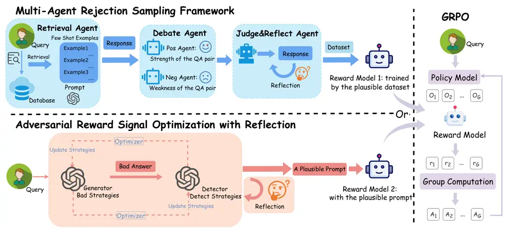
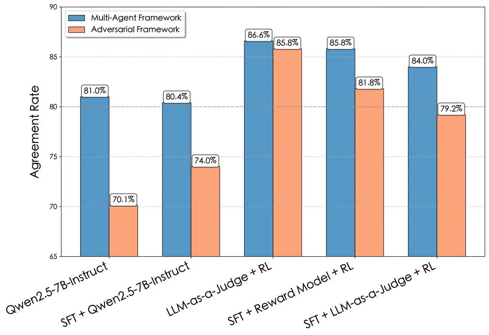

# Igniting Creative Writing in Small Language Models: LLM-as-a-Judge versus Multi-Agent Refined Rewards

Xiaolong Wei^(\*) Email: [xiaolongwei@buaa.edu.cn](mailto:)    Bo
Lu^(\*) Affiliation: Beihang University Baidu Inc.
Email: [zhaozhejun@baidu.com](mailto:)    Xingyu Zhang
Affiliation: Beijing Jiaotong University    Zhejun Zhao
Affiliation: Beihang University Baidu Inc.    Dongdong Shen
Affiliation: Beihang University Baidu Inc.    Long Xia
Affiliation: Beihang University Baidu Inc.    Dawei Yin
Affiliation: Beihang University Baidu Inc.

August 24, 2026

###### Abstract

Large Language Models (LLMs) have demonstrated remarkable creative
writing capabilities, yet their substantial computational demands hinder
widespread use. Enhancing Small Language Models (SLMs) offers a
promising alternative, but current methods like Supervised Fine-Tuning
(SFT) struggle with novelty, and Reinforcement Learning from Human
Feedback (RLHF) is costly. This paper explores two distinct AI-driven
reward strategies within a Reinforcement Learning from AI Feedback
(RLAIF) framework to ignite the creative writing of a 7B-parameter SLM,
specifically for generating Chinese greetings. The first strategy
employs a RM trained on high-quality preference data curated by a novel
multi-agent rejection sampling framework designed for creative tasks.
The second, more novel strategy utilizes a principle-guided
LLM-as-a-Judge, whose reward function is optimized via an adversarial
training scheme with a reflection mechanism, to directly provide reward
signals. Comprehensive experiments reveal that while both approaches
significantly enhance creative output over baselines, the
principle-guided LLM-as-a-Judge demonstrably yields superior generation
quality. Furthermore, it offers notable advantages in training
efficiency and reduced dependency on human-annotated data, presenting a
more scalable and effective path towards creative SLMs. Our automated
evaluation methods also exhibit strong alignment with human judgments.
Our code and data are publicly available at
[Github](https://github.com/weixiaolong94-hub/Igniting-Creative-Writing-in-Small-Language-Models).

^(\*)^(\*)footnotetext: Co-first authors with equal
contributions.^(†)^(†)footnotetext: Corresponding author

## 1 Introduction

Creative writing, a cornerstone of human expression and communication
(Kaufmann, 2012; Bakar et al., 2021), intrinsically demands not only
literary merit and emotional resonance but also a significant degree of
personalization to effectively engage its audience (Bakar et al., 2021).
While users increasingly turn to online platforms for creative
inspiration, existing retrieval-based methods often fall short in
delivering content that is sufficiently tailored to individual needs and
contexts, a limitation that has become more pronounced with the advent
of advanced generative models. This underscores a growing demand for
generative systems capable of producing context-aware, responsive, and
personalized creative text (Richardson et al., 2023).

The advent of Large Language Models (LLMs) such as GPT-4o (Hurst et al., 2024) and DeepSeek-V3 (Liu et al., 2024) has revolutionized text
generation, demonstrating remarkable capabilities in creative writing
tasks. However, under high request volumes, the substantial
computational footprint and high inference latency of these large-scale
models present significant barriers to their widespread deployment and
practical application. Consequently, enhancing Small Language Models
(SLMs, typically \<10B parameters), such as the Qwen2.5 7B model we
employ (Yang et al., 2024), to achieve comparable creative prowess while
maintaining efficiency has become a critical research frontier. This
pursuit aligns with broader trends where modern applications
increasingly prioritize dynamic content personalization (Li et al.,
2025c; Cui et al., 2025a; Cui et al., 2025b) while also emphasizing
information’s expressiveness and reliability (Tong et al., 2024; Lu
et al., 2025; Zeng et al., 2025). It is crucial to note that generic,
un-fine-tuned SLMs often lack the sophisticated generative abilities
required for high-quality creative writing (Gómez-Rodríguez and
Williams, 2023).

Prevailing methodologies for enhancing SLMs predominantly involve
Supervised Fine-Tuning (SFT) and Reinforcement Learning from Human
Feedback (RLHF) (Ouyang et al., 2022). While SFT can effectively adapt
SLMs to specific styles, it often struggles to foster genuine novelty
and generalization (Zhou et al., 2023; Sanh et al., 2021)—attributes
paramount for compelling creative writing. RLHF, on the other hand,
relies on high-quality reward models typically trained on extensive
human preference data, the annotation of which is labor-intensive and
expensive (Ziegler et al., 2019).

To surmount these limitations, we investigate two distinct reward
strategies:

- •
  A Refined Reward Model: We develop an RM trained on meticulously
  curated preference data. This data is generated and filtered by a
  novel multi-agent framework designed to ensure high quality and
  relevance for creative tasks.
- •
  Principle-Guided LLM-as-a-Judge: Drawing inspiration from
  "LLM-as-a-Judge" paradigms (Zheng et al., 2023), we directly employ a
  powerful LLM as the reward provider. Crucially, this LLM’s judgments
  are guided by explicitly defined creative writing principles and its
  reward function is further optimized via an adversarial training
  scheme (Wang et al., 2024).

We conduct comprehensive experiments on generating Chinese greetings
using 7B-parameter SLMs, specifically the Qwen2.5 7B model. Our findings
reveal that while both RL-based approaches significantly enhance
creative output compared to baselines, the principle-guided
LLM-as-a-Judge strategy yields demonstrably superior results in terms of
generation quality. These outcomes are rigorously validated through both
human evaluations and LLM-based assessments, including an analysis of
their alignment. Furthermore, the LLM-as-a-Judge approach exhibits
notable advantages in training efficiency and reduced dependency on
human-annotated data.

Our main contributions are threefold:

- •
  We introduce a novel principle-guided LLM-as-a-Judge reward mechanism,
  optimized adversarially, for effectively steering RL towards enhancing
  SLM creative writing capabilities.
- •
  We propose a multi-agent framework for generating and filtering
  high-quality preference data, enabling the training of more effective
  reward models for creative domains.
- •
  We present a systematic comparison of these two reward paradigms for
  SLM-based creative writing, corroborated by extensive LLM-based and
  human evaluations, and offer insights into their alignment and
  practical trade-offs.

## 2 Related Work

The landscape of artificial intelligence in creative writing has been
dramatically reshaped by LLMs. These models, such as the GPT series
(Brown et al., 2020; Achiam et al., 2023) and LLaMA (Touvron et al.,
2023), trained on vast text corpora, demonstrate unprecedented
capabilities in generating diverse creative texts, including complex
narratives, poetry, and scripts, exhibiting high fluency, style
adaptation, and thematic coherence. Researchers have developed
techniques like planning (Yang et al., 2022), controllable generation
(Li et al., 2022), and structured decomposition frameworks like
Branch-Solve-Merge (Saha et al., 2023) to further enhance and guide
LLMs’ creative output.

Beyond autonomous generation, recent work increasingly focuses on LLMs
as co-creative partners for human writers, exploring interaction
dynamics for tasks such as brainstorming and outlining (Gero et al.,
2023). The concept of multi-agent systems collaborating on writing tasks
is also an emerging area.

Despite these advancements in generation capabilities, evaluating the
creativity of LLM-produced text remains a complex challenge (Chakrabarty
et al., 2024; Kim and Oh, 2025). Traditional automatic metrics are
insufficient for capturing subjective qualities like originality and
emotional depth. To address this, recent work has explored
Self-Rewarding Language Models (Yuan et al., 2024) that iteratively
improve by generating their own training rewards, though automated
assessments still do not yet reliably align with human judgments
(Chakrabarty et al., 2024; Li et al., 2025a).

These persistent challenges in aligning automated evaluation with human
judgment highlight fundamental open problems: how to build effective
reward signals for training generative models and achieve reliable
automated evaluation in this subjective domain.

## 3 Methodology



Figure 1: The figure depicts two distinct reward signals. Signal 1 is
derived from a multi-agent system, yielding a reward model. Signal 2 is
generated via adversarial interaction (Generator-Detector) and
reflection, producing a prompt. Both signals are separately used to
train GRPO.

To enhance the creative writing capabilities of our target SLM, we
employ a RLAIF paradigm. The central tenet of RLAIF is to refine the
SLM’s policy using reward signals derived from AI-driven evaluations of
its generated outputs. Our primary contribution lies in the exploration
and comparison of two distinct and sophisticated strategies for
generating these crucial reward signals, which are designed to capture
the multifaceted nature of creative text. These strategies are: 1) a
meticulously refined RM trained on preference data curated by a
multi-agent system, and 2) a dynamic reward signal obtained from an
adversarially trained, principle-guided LLM acting as a judge
(LLM-as-a-Judge). The complete process is detailed in Fig. 1. In the
subsequent sections, we first detail the multi-agent framework for
preference data generation and RM training (Section 3.1). We then
describe the adversarial approach for optimizing an LLM-as-a-Judge as a
direct reward provider (Section 3.2). Finally, Section 3.3 outlines how
the reward signals derived from these two strategies are integrated into
the RLAIF process to optimize the SLM.

### 3.1 Multi-Agent Rejection Sampling Framework

The evaluation of LLMs by a single LLM instance, while scalable, can
suffer from inherent biases, limited perspectives, and potential
instability Zheng et al. (2023). To mitigate these challenges, we
introduce a multi-agent collaborative evaluation system. This system
operationalizes a collaborative paradigm, drawing inspiration from
approaches where multiple agents engage in debate or structured
discussion to refine assessments and achieve more robust outcomes Chan
et al. (2023); Du et al. (2023). By simulating a nuanced, rigorous, and
bias-resistant assessment process, our framework aims to leverage the
collective intelligence and error-correction capabilities inherent in
multi-agent interactions Liang et al. (2023). This approach aligns with
a broader trend in AI systems where complex tasks are decomposed and
managed by specialized, collaborative agents to achieve a goal (Li
et al., 2025b). The primary output of this system is high-fidelity
preference data, denoted as $`\mathcal{D}_{\text{pref}}`$. This dataset
is specifically curated to be suitable for training robust reward
models, which can subsequently be employed to filter and rank generated
content based on nuanced quality dimensions. All prompts and cases are
provided in Appendix A.5.

#### 3.1.1 Retrieval Agent

The Retrieval Agent, implementing the function
$`Rtr:\mathcal{P}\to\mathcal{P}(\mathcal{D}_{\text{HQ}})`$, retrieves
relevant context for evaluation. Upon receiving an input prompt
$`p\in\mathcal{P}`$, it queries a pre-computed vector index (built from
$`\mathcal{D}_{\text{HQ}}`$) using similarity metrics (e.g., cosine
similarity on embeddings) to fetch the set
$`E=Rtr(p)=\{(p^{\prime}_{j},r^{\prime}_{j})^{*}\}_{j=1}^{k}`$ of $`k`$
high-quality prompt-response pairs. These pairs serve as few-shot
examples, providing contextual grounding and quality benchmarks for the
subsequent evaluation agents.

#### 3.1.2 Debate Agents: Positive and Negative Perspectives

This module employs two adversarial agents, embodying the functions
$`f_{\text{pos}}:(\mathcal{P},\mathcal{R},E)\to\mathcal{E}^{+}`$ and
$`f_{\text{neg}}:(\mathcal{P},\mathcal{R},E)\to\mathcal{E}^{-}`$, to
conduct a structured debate on the quality of a given response $`r`$ for
prompt $`p`$.

- •
  Positive Agent ($`f_{\text{pos}}`$): Identifies and articulates the
  strengths and merits of the response $`r`$, such as novelty,
  coherence, emotional resonance, or alignment with the prompt’s intent.
  Its output is a structured positive evaluation
  $`\varepsilon^{+}\in\mathcal{E}^{+}`$.
- •
  Negative Agent ($`f_{\text{neg}}`$): Identifies and articulates the
  weaknesses and potential issues within $`r`$, such as factual
  inaccuracies, logical fallacies, stylistic clichés, or lack of
  creativity. Its output is a structured negative evaluation
  $`\varepsilon^{-}\in\mathcal{E}^{-}`$.

This structured debate mechanism compels a multi-faceted analysis,
surfacing both positive and negative aspects that might be overlooked by
a single evaluator due to confirmation bias or inherent model
preferences.This process yields a more comprehensive and less biased
assessment, crucial for subjective domains like creative writing.

#### 3.1.3 Judge Agent

The Judge Agent, implementing
$`f_{\text{judge}}:(\mathcal{P},\mathcal{R},\mathcal{E}^{+},\mathcal{E}^{-})\to\mathcal{S}_{\text{initial}}`$,
synthesizes the evaluations $`\varepsilon^{+}`$ and $`\varepsilon^{-}`$
from the debate agents. It weighs the conflicting arguments, assesses
the relative importance of identified strengths and weaknesses, and
formulates a holistic initial judgment
$`S_{\text{initial}}\in\mathcal{S}_{\text{initial}}`$. This simulates a
reasoned decision-making process based on multifaceted evidence.

#### 3.1.4 Reflect Agent

Following the initial judgment, the Reflect Agent, implementing
$`f_{\text{reflect}}:(\mathcal{P},\mathcal{R},\mathcal{S}_{\text{initial}},\mathcal{E}^{+},\mathcal{E}^{-})\to\mathcal{S}_{\text{final}}`$,
performs a critical review of $`S_{\text{initial}}`$ and the supporting
arguments $`\varepsilon^{+}`$ and $`\varepsilon^{-}`$. It scrutinizes
the Judge Agent’s reasoning for logical consistency and completeness. If
flaws are detected, the Reflect Agent may override
$`S_{\text{initial}}`$ and potentially trigger a re-evaluation.
Otherwise, it ratifies the initial judgment, resulting in the final
assessment $`S_{\text{final}}\in\mathcal{S}_{\text{final}}`$. This
reflection step enhances the reliability and robustness of the final
evaluation. Based on $`S_{\text{final}}`$, a preference pair
$`(p,r_{\text{chosen}},r_{\text{rejected}})`$ is determined and added to
the preference dataset $`\mathcal{D}_{\text{pref}}`$.

### 3.2 Adversarial Reward Signal Optimization with Reflection

Inspired by Generative Adversarial Networks (GANs) and related
approaches like LLM-GAN Wang et al. (2024), we propose an adversarial
framework to dynamically generate and refine reward signals for RL-based
policy optimization. This framework comprises a Generator, a Detector,
and a novel Reflector component. Further details are provided in
Appendix A.4.

#### 3.2.1 Generator-Detector Adversarial Dynamics

- •
  Generator ($`\pi_{G}`$): The Generator, parameterized by
  $`\theta_{G}`$, aims to produce responses $`r`$ for a given prompt
  $`p`$ according to its policy $`\pi_{G}(r|p;\theta_{G})`$. Its goal is
  to generate bad responses that are hard to distinguish.
- •
  Detector ($`f_{D}`$): The Detector, parameterized by $`\theta_{D}`$,
  acts as a discriminator. It learns to distinguish responses $`r`$
  generated by $`\pi_{G}`$. It assigns a score
  $`f_{D}(p,r;\theta_{D})\in\{0,1\}`$, where 1 represents a good
  response and 0 represents a bad response.

These components engage in adversarial training. The Detector is trained
to maximize its ability to correctly classify responses, while the
Generator aims to produce indistinguishable bad responses to deceive the
Detector.

#### 3.2.2 Reflector-Enhanced Detector Optimization

To further improve the Detector’s reliability, we introduce the
Reflector module
($`f_{\text{Rf}}:(\mathcal{P},\mathcal{R},\mathcal{S}_{\text{D}},\mathcal{Y}_{\text{true}})\to\mathcal{R}_{\text{D}}`$).
When the Detector $`f_{D}`$ misclassifies a response $`(p,r)`$ compared
to a reference label $`y_{\text{true}}\in\mathcal{Y}_{\text{true}}`$
(where $`y_{\text{true}}`$ could indicate if $`r`$ is genuinely
high-quality or not, obtained from $`\mathcal{D}_{\text{pref}}`$ or
human annotation), the Reflector is activated. The Reflector analyzes
the triplet $`(p,r,s_{D}=f_{D}(p,r;\theta_{D}))`$ alongside
$`y_{\text{true}}`$ to diagnose the cause of the Detector’s error. Based
on this analysis, it generates structured feedback or advice
$`R_{D}\in\mathcal{R}_{\text{D}}`$. This advice $`R_{D}`$ can be used to
guide the Detector’s optimization process (e.g., "Increase weight on
detecting emotional flatness"). This explicit reflection mechanism
allows the Detector to learn from its mistakes beyond the implicit
adversarial signal, improving its robustness and alignment with desired
quality criteria.

### 3.3 RLAIF for Creative Writing Enhancement

This section details the integration of the previously described
AI-generated reward signals into the RLAIF process. Our goal is to
optimize the target SLM, Qwen2.5-7B-Instruct, for enhanced creative
writing proficiency by leveraging nuanced feedback. We investigate two
primary sources for the reward signal used within the RLAIF process:

- •
  Multi-Agent Preference Reward Model (RM): A reward model
  $`R_{\text{MA}}(p,r;\phi_{\text{RM}})`$ is trained on the high-quality
  preference dataset $`\mathcal{D}_{\text{pref}}`$ generated by the
  multi-agent evaluation system described in Section 3.1. The RM learns
  to predict the preferences expressed in $`\mathcal{D}_{\text{pref}}`$,
  typically using a loss function like:

  ```math
  \begin{multlined}\mathcal{L}_{\text{RM}}=-\mathbb{E}_{(p,r_{c},r_{r})\sim\mathcal{D}_{\text{pref}}}\\
  \left[\log\sigma\left(R_{\text{MA}}(p,r_{c};\phi_{\text{RM}})-R_{\text{MA}}(p,r_{r};\phi_{\text{RM}})\right)\right]\end{multlined} \tag{1}
  ```

  where $`\sigma`$ is the sigmoid function. The output
  $`R_{\text{MA}}(p,r)`$ serves as the reward signal.

- •
  Adversarial Detector Reward Signal: The output score
  $`s_{D}=f_{D}(p,r;\theta_{D})`$ from the adversarially trained and
  reflector-enhanced Detector (detailed in Section 3.2) is used directly
  as a reward signal, $`R_{D}(p,r)=f_{D}(p,r;\theta_{D})`$. This signal
  reflects the response’s ability to meet the criteria implicitly
  learned by the dynamic LLM-based judge.

We apply GRPO algorithm(Shao et al., 2024) to optimize the
Qwen2.5-7B-Instruct. The advantage $`A_{t}`$ is calculated based on
trajectories sampled from the policy $`\pi_{\theta}`$ and rewards
obtained from either $`R_{\text{MA}}`$ or $`R_{D}`$. We compare the
effectiveness of these distinct reward mechanisms in enhancing the
models’ creative writing capabilities across various dimensions.

|                       | Accuracy | Precision | Recall | F1-score |
| --------------------- | -------- | --------- | ------ | -------- |
| Multi-Agent Framework | 87.60%   | 87.38%    | 87.90% | 0.8764   |
| Adversarial Framework | 85.50%   | 78.54%    | 97.70% | 0.8708   |

Table 1: Comparison of two different frameworks on the evaluation set.

|                           | Signal-1 | Signal-2 | Human |
| ------------------------- | -------- | -------- | ----- |
| GPT-4o                    | 49.0%    | 46.8%    | 50.0% |
| Ernie-4.5                 | 76.4%    | 88.2%    | 87.6% |
| DeepSeek-V3               | 91.0%    | 94.2%    | 93.0% |
| Qwen2.5-7B-Instruct       | 59.2%    | 56.0%    | 57.6% |
| SFT + Qwen2.5-7B-Instruct | 92.0%    | 92.6%    | 90.0% |
| Reward Model + RL         | \-       | \-       | \-    |
| LLM-as-a-Judge + RL       | 92.4%    | 96.6%    | 95.0% |
| SFT + Reward Model + RL   | 92.2%    | 96.0%    | 94.6% |
| SFT + LLM-as-a-Judge + RL | 89.6%    | 96.0%    | 93.0% |

Table 2: Comparison of the excellence rate of the Model under different
evaluation mechanisms. This data represents the inference results of the
model under high-frequency greetings (for example, Chinese New Year
greetings). Here, Signal-1 refers to Section 3.1, Signal-2 refers to
Section 3.2, and Human refers to the evaluation by human experts.
Furthermore, the Reward Model + RL method is excluded from the
evaluation due to its training not converging.

|                           | Signal-1 | Signal-2 | Human |
| ------------------------- | -------- | -------- | ----- |
| GPT-4o                    | 47.6%    | 45.6%    | 50.4% |
| Ernie-4.5                 | 72.0%    | 81.2%    | 83.0% |
| DeepSeek-V3               | 74.0%    | 83.8%    | 85.6% |
| Qwen2.5-7B-Instruct       | 47.6%    | 52.8%    | 53.8% |
| SFT + Qwen2.5-7B-Instruct | 80.2%    | 85.2%    | 86.2% |
| Reward Model + RL         | \-       | \-       | \-    |
| LLM-as-a-Judge + RL       | 91.0%    | 93.4%    | 92.4% |
| SFT + Reward Model + RL   | 89.4%    | 90.6%    | 91.2% |
| SFT + LLM-as-a-Judge + RL | 85.0%    | 89.0%    | 90.2% |

Table 3: Comparison of the excellence rate of the Model under different
evaluation mechanisms. This data represents the inference results of the
model under ordinary greetings(for example, greetings for a new car).
Furthermore, the Reward Model + RL method is excluded from the
evaluation due to its training not converging.

## 4 Experiments

### 4.1 Task Design

This study centers on enhancing the generation of Chinese greetings.
These greetings are prevalent in Chinese culture for significant
festivals like the Spring Festival and Mid-Autumn Festival, indicating a
high practical demand and rich contextual nuances. This specific focus
allows for an in-depth exploration of creative text generation within a
culturally significant and frequently utilized domain. The details are
provided in Appendix A.2.

### 4.2 Datasets

Our experiments leverage several datasets constructed for distinct
purposes: training a retrieval-augmented multi-agent system, developing
reward models, fine-tuning the policy model via RLAIF, and comprehensive
final evaluation. All data was sourced from online interactions related
to Chinese greetings, with meticulous preprocessing to remove Personally
Identifiable Information (PII). Specific business-related source details
remain desensitized.

##### Retrieval Corpus

To equip our multi-agent evaluation system (Section 3.1) with
high-quality contextual examples, we curated a retrieval corpus
comprising 23,442 instances. These instances were selected from a larger
online collection based on their high user click-through rates and
frequent replication, indicative of their perceived quality and
relevance.

##### Reward Model Training Data

For training the preference-based reward model, we initially collected
10,000 user queries from online sources. These queries, along with
candidate responses, were processed through our multi-agent rejection
sampling framework. This procedure yielded 7,896 preference pairs, each
structured as $`(query,response_{chosen},response_{rejected})`$. This
dataset was then partitioned into an 80% training set and a 20% held-out
test set for RM development.

##### Policy Optimization (GRPO) Data

A separate set of 4,000 distinct online queries was utilized for
fine-tuning the target SLM using the GRPO algorithm. This dataset was
also divided into an 80:20 train/test split to guide the RLAIF process.

##### Final Evaluation Set

To rigorously assess the performance of all compared models, we
constructed a dedicated evaluation set of 2,000 query-response pairs.
This set was carefully balanced, containing 1,000 "high-quality"
instances (heuristically labeled ’1’), selected from data exhibiting
high click-through and replication rates, and 1,000 "low-quality"
instances (labeled ’0’), derived from data with lower engagement
metrics. This dataset serves as the primary benchmark for both our
automated and human evaluations.

### 4.3 Rubric Design

The evaluation rubric provides a holistic view of greetings quality,
comprising five dimensions with respective weights: Language Quality
(30%), Creativity (30%), Emotional Resonance (15%), Cultural
Appropriateness (15%), and Content Richness (10%).

Language Quality assesses fluency and precision. Essential for effective
communication, its importance in NLG systems is well-recognized Van
Der Lee et al. (2019); Que et al. (2024), with modern approaches using
LLMs for nuanced assessment Liu et al. (2023) and considering aspects
like style and meaning preservation Chim et al. (2025).

Creativity evaluates the generation of innovative elements like unique
metaphors or novel perspectives, distinguishing memorable greetings.
This involves producing novel, surprising, and valuable outputs Zhang
et al. (2025), crucial for pushing NLG beyond mere replication Eldan and
Li (2023); Ismayilzada et al. (2024); Peng (2022).

Emotional Resonance measures the capacity to evoke strong feelings or
genuine connection. This is vital as greetings are inherently emotional,
and the text’s ability to connect on an emotional level is key Cao and
Cao (2025); Li (2022); Rühlemann and Trujillo (2024).

Cultural Appropriateness ensures alignment with the specific cultural
context, respecting social norms, traditions, and event-specific
sensitivities Li et al. (2024). There’s growing emphasis on developing
culturally sensitive models that avoid biases Pawar et al. (2024); Naous
and Xu (2025); Naous et al. (2024).

Content Richness ensures greetings convey sufficient emotional depth and
personalized information concisely. It emphasizes meaningful, relevant,
and comprehensive content within a brief format, delivering value and
substance Gao et al. (2025); Zheng et al. (2023); Nimah et al. (2023).

Each dimension is rated on a discrete scale from 1 to 3 points. A final
aggregate score is computed as a weighted average. Based on this, a
binary classification is performed: acceptable (label 1) if the total
weighted score is $`\geq 2`$, and unacceptable (label 0) otherwise.

### 4.4 Implementation Details

The reward model in this study is implemented using the Llama Factory
framework (Zheng et al., 2024) and fine-tuned with the LoRA method (Hu
et al., 2022). We train a scalar reward model $`R_{\theta}`$ by adding a
single linear value head to the backbone LLM and fine-tuning it on human
preference pairs $`(x,y^{+},y^{-})`$ with the Bradley–Terry loss
$`\mathcal{L}=-\log\sigma\!\bigl(R_{\theta}(x,y^{+})-R_{\theta}(x,y^{-})\bigr)`$,
following Stiennon et al. (2020) and Ouyang et al. (2022). Further
details are provided in Appendix A.1.

|                              | Accuracy | Precision | Recall  | F1-score |
| ---------------------------- | -------- | --------- | ------- | -------- |
| Multi-Agent Framework (Full) | 87.60%   | 87.38%    | 87.90%  | 0.8764   |
| w/o Positive Agent           | 53.65%   | 98.67%    | 7.40%   | 0.1377   |
| w/o Negative Agent           | 50.05%   | 50.03%    | 100.00% | 0.6669   |
| w/o Judge Agent              | 81.45%   | 76.19%    | 91.50%  | 0.8314   |
| w/o Reflect Agent            | 76.40%   | 75.83%    | 77.50%  | 0.7666   |
| Adversarial Framework (Full) | 85.50%   | 78.54%    | 97.70%  | 0.8708   |
| w/o Reflect Agent            | 81.00%   | 68.49%    | 99.10%  | 0.8100   |

Table 4: Ablation study of different agents.

## 5 Results and Discussion

### 5.1 RQ1: Can LLMs achieve alignment with human evaluation?

Following the evaluation criteria detailed in Section 4.3, we engaged a
team of professionally trained evaluators to assess the generated
greetings across five dimensions: language quality, creativity,
emotional resonance, cultural appropriateness, and content richness. All
evaluators were of Chinese nationality and ethnicity, residing and
working in China. The team comprised graduate-level educated interns and
full-time employees, all of whom were compensated for their work. Each
dimension was scored independently by multiple annotators from this team
to ensure reliability.



Figure 2: Comparison of agreement rate between different models and
human under two evaluation frameworks.

Fig. 2 illustrates the agreement rates between human evaluations and two
proposed automatic evaluation frameworks: Multi-Agent Framework and
Adversarial Framework. As depicted, both the Multi-Agent Framework and
Adversarial Framework approaches demonstrate substantial agreement with
human judgments, consistently exceeding 70% across different models.
This strong correlation provides compelling evidence for the
effectiveness of our proposed mechanisms in approximating human
evaluation, thereby offering a potential solution to the time-consuming
nature and high cost associated with extensive human annotation.

Furthermore, a closer examination of Fig. 2 reveals that the Multi-Agent
Framework exhibits a higher degree of alignment with human evaluators,
achieving agreement rates ranging from 80% to 87% across the evaluated
models. This excellent performance suggests that through the Multi-Agent
Framework, it is possible to more accurately identify the strengths and
weaknesses of greetings and more closely align with human evaluations of
greetings.

In summary, both the Multi-Agent Framework and Adversarial Framework
proposed in this work demonstrate a significant capacity for aligning
with human assessments. This alignment offers a promising avenue for
substantially alleviating the burden of manual evaluation in the context
of generative text tasks.

### 5.2 RQ2: Efficacy of Reward Model + RL in Enhancing Creative Writing

Tab. 2 and Tab. 3 present a comparative evaluation of mainstream LLMs
against our models trained using distinct methodologies. The primary
evaluation metric is the excellence rate (1 indicating positive, 0
negative assessment) across predefined dimensions. Specifically, Tab. 2
showcases performance on greetings from high-frequency user queries,
while Tab. 3 evaluates those from ordinary queries.

The results consistently demonstrate that a pipeline employing SFT
followed by Reward Model training and RL significantly outperforms the
SFT-only baseline across both high-frequency and ordinary query
scenarios. For instance, as detailed in Tab. 3, the SFT+RM+RL approach
yields substantial improvements, achieving gains of 11.5% on the
Signal-1 dimension, 6.3% on Signal-2, and 5.8% on the human evaluation
dimension.

Furthermore, the SFT+RM+RL trained models surpass several contemporary
mainstream LLMs on both query types. These findings provide compelling
evidence for the efficacy of integrating RM and RL techniques in
enhancing creative writing capabilities, particularly for generating
contextually relevant and high-quality greetings. This improvement
indirectly validates our multi-agent based data filtering strategy for
RM training, which contributes to the superior performance observed in
the downstream generation task.

### 5.3 RQ3: Does "LLM-as-a-Judge" offer advantages over other reward signals?

A fundamental distinction differentiates the reward signals from
LLM-as-a-Judge and conventional RMs. LLM-as-a-Judge provides a binary (0
or 1) reward, a discrete signal, while RMs generate continuous values,
offering fine-grained feedback.

Empirical results (Tab. 2) demonstrate that the LLM-as-a-Judge + RL
approach achieves state-of-the-art (SOTA) performance, with excellence
rates of 92.4%, 96.6%, and 95.0% across three distinct evaluation
metrics. This performance surpasses several contemporary mainstream LLMs
(e.g., GPT-4o, Ernie-4.5, DeepSeek-V3). While Tab. 3 indicates a
marginal decrease on ordinary queries, the LLM-as-a-Judge + RL method
maintains SOTA results. Further details regarding the LLM-as-a-Judge +
RL training process are provided in Section A.6.

These findings compellingly affirm the efficacy of LLM-as-a-Judge + RL
in augmenting creative writing capabilities for both high-frequency and
ordinary queries, generally outperforming the RM + RL paradigm. This
underscores the potential of discrete reward signals to drive
substantial performance gains in RL.

Conversely, training an RM using multi-agent filtered data is notably
more complex and resource-intensive. This process requires sequential
operation of Retrieval, Positive, Negative, and Reflect Agents for data
curation, posing significant temporal and computational overhead, which
can impede real-world deployment.

LLM-as-a-Judge presents a more direct and efficient alternative. It
leverages Adversarial Reward Signal Optimization, wherein a generator
and detector engage in adversarial training to iteratively refine an
optimal evaluation prompt. This optimized prompt is then directly used
to assess generated content quality. Compared to the intricate RM
training pipeline, LLM-as-a-Judge markedly reduces procedural
complexity. Consequently, LLM-as-a-Judge offers a more streamlined and
advantageous approach for deriving effective reward signals for
reinforcement learning in this context.

## 6 Ablation Study

To validate the effectiveness of the key components within our proposed
architectures, we conducted a comprehensive ablation study on both the
Multi-Agent and Adversarial frameworks. The results, presented in
Table 4, systematically quantify the contribution of each module by
evaluating the performance of the framework after its removal.

For the Multi-Agent Framework, the ablation study underscores the
indispensable role of each agent. The most significant performance
degradation is observed upon the removal of the debate agents. Without
the Positive Agent, the framework becomes excessively critical,
achieving high precision but causing a catastrophic drop in recall to
7.40%, as it fails to recognize valid positive instances. Conversely,
removing the Negative Agent renders the system overly lenient, with
recall reaching 100% at the cost of a near-random precision of 50.03%.
This demonstrates that the adversarial debate mechanism is the
cornerstone of the framework, ensuring a multi-faceted and balanced
assessment. Furthermore, the removal of the Judge Agent and Reflect
Agent also leads to notable performance drops. Notably, the absence of
the Reflect Agent results in a more substantial decline in both accuracy
and F1-score, suggesting that the final self-correction and ratification
step is paramount for ensuring the reliability of the preference data.

In the Adversarial Framework, we investigated the contribution of the
reflection mechanism. As shown in Table 4, removing the Reflect Agent
causes a significant drop across all metrics, with the F1-score falling
from 0.8708 to 0.8100. The Reflect Agent provides crucial supervised
feedback when the Detector misclassifies a response, allowing it to
learn from its mistakes beyond the implicit adversarial signal from the
Generator. This component is vital for grounding the Detector’s learning
process with ground-truth examples, enhancing its overall robustness and
accelerating its alignment with the desired quality criteria.

## 7 Conclusion

In this work, we addressed the challenge of enhancing the creative
writing capabilities of SLMs by investigating two distinct AI-generated
reward paradigms for RLAIF: a refined RM trained on data from a
multi-agent system, and a principle-guided, adversarially-optimized
LLM-as-a-Judge. Our contributions are threefold: First, we introduced a
novel principle-guided LLM-as-a-Judge reward mechanism, optimized
adversarially with reflection, which effectively steers RL towards
enhancing SLM creative writing. Second, we proposed a multi-agent
framework for generating and filtering high-quality preference data,
enabling the training of more effective reward models for creative
domains. Third, through systematic comparison on the task of generating
Chinese greetings with 7B SLMs, we demonstrated that both AI-feedback
approaches significantly improve creative output. Crucially, the
LLM-as-a-Judge strategy not only achieved state-of-the-art generation
quality, surpassing both the refined RM approach and strong LLM
baselines, but also exhibited greater training efficiency and reduced
reliance on expensive human annotations. Our findings underscore the
potential of AI-driven feedback, particularly the dynamic and
principle-guided LLM-as-a-Judge, to unlock creative capabilities in more
compact and efficient language models, paving the way for broader
practical applications. The strong alignment observed between our
automated evaluation metrics and human judgments further supports the
viability of these approaches.

## 8 Limitations

While our findings are promising, this study has several limitations:

- •
  Task and Language Specificity: Our experiments focused on generating
  Chinese greetings. The generalizability of our findings to other
  creative writing tasks (e.g., long-form storytelling, poetry,
  scriptwriting) and other languages, particularly those with different
  linguistic structures or cultural nuances, requires further
  investigation.
- •
  Scale of SLMs: We concentrated on 7B-parameter SLMs. The effectiveness
  and scalability of the proposed reward mechanisms for significantly
  smaller or moderately larger SLMs remain to be explored.
- •
  Subjectivity of Creativity and Principles: "Creativity" is inherently
  subjective. While our rubric and multi-faceted evaluation attempt to
  capture key aspects, the "principles" guiding the LLM-as-a-Judge,
  though explicitly defined, might still embed certain biases or
  perspectives on creativity. The optimal set of principles for diverse
  creative tasks is an open research question.
- •
  Complexity of Multi-Agent System: Although the LLM-as-a-Judge approach
  is more efficient overall, the multi-agent framework for curating
  preference data for the refined RM, while effective, introduces its
  own layer of complexity in terms of design and operation.
- •
  Depth of Reflection: The reflection mechanism in the LLM-as-a-Judge’s
  adversarial training and in the multi-agent framework is currently
  based on LLM analysis. The depth and impact of this reflection, and
  how to systematically improve its error-correction capabilities, are
  areas for future work.
- •
  Potential Risk: Reinforcement of Biases: The principles guiding the
  LLM-as-a-Judge or the preference data curated by the multi-agent
  system may unknowingly encapsulate societal or cultural biases. The
  RLAIF process could then amplify these biases in the SLM’s creative
  outputs, leading to stereotypical or unfair representations.

Future research could address these limitations by exploring broader
task domains, diverse languages, different model scales, and more
sophisticated methods for defining and adapting creative principles for
the LLM-as-a-Judge.

## References

- Achiam et al. (2023) Josh Achiam, Steven Adler, Sandhini Agarwal, Lama
  Ahmad, Ilge Akkaya, Florencia Leoni Aleman, Diogo Almeida, Janko
  Altenschmidt, Sam Altman, Shyamal Anadkat, et al. 2023. Gpt-4
  technical report. _arXiv preprint arXiv:2303.08774_.
- Bakar et al. (2021) Norazuwana Bakar, Shazaitul Azreen Mohamed, and
  Tun Nur Anekza Ahmad. 2021. Qualities of good creative writing: A
  systematic literature review. _International Journal of Academic
  Research in Business and Social Sciences_, 11(11):1530–1544.
- Brown et al. (2020) Tom Brown, Benjamin Mann, Nick Ryder, Melanie
  Subbiah, Jared D Kaplan, Prafulla Dhariwal, Arvind Neelakantan, Pranav
  Shyam, Girish Sastry, Amanda Askell, et al. 2020. Language models are
  few-shot learners. _Advances in neural information processing
  systems_, 33:1877–1901.
- Cao and Cao (2025) Shixiong Cao and Nan Cao. 2025. How does emotion
  affect information communication. _arXiv preprint arXiv:2502.16038_.
- Chakrabarty et al. (2024) Tuhin Chakrabarty, Philippe Laban, Divyansh
  Agarwal, Smaranda Muresan, and Chien-Sheng Wu. 2024. Art or artifice?
  large language models and the false promise of creativity. In
  _Proceedings of the 2024 CHI Conference on Human Factors in Computing
  Systems_, pages 1–34.
- Chan et al. (2023) Chi-Min Chan, Weize Lee, Da Zha, Peng Yin, Chih-Jen
  Hsieh, Hsiang-Fu Chang, Lichan Wang, James Lin, Wei-Cheng Wang, Jiong
  Yu, et al. 2023. ChatEval: Towards better LLM-based evaluators through
  multi-agent debate. In _Proceedings of the 2023 Conference on
  Empirical Methods in Natural Language Processing_, pages 1128–1147.
- Chim et al. (2025) Jenny Chim, Julia Ive, and Maria Liakata. 2025.
  Evaluating synthetic data generation from user generated text.
  _Computational Linguistics_, 51(1):191–233.
- Cui et al. (2025a) Xiaoxi Cui, Weihai Lu, Yu Tong, Yiheng Li, and
  Zhejun Zhao. 2025a. Diffusion-based multi-modal synergy interest
  network for click-through rate prediction. In _Proceedings of the 48th
  International ACM SIGIR Conference on Research and Development in
  Information Retrieval_, pages 581–591.
- Cui et al. (2025b) Xiaoxi Cui, Weihai Lu, Yu Tong, Yiheng Li, and
  Zhejun Zhao. 2025b. Multi-modal multi-behavior sequential
  recommendation with conditional diffusion-based feature denoising. In
  _Proceedings of the 48th International ACM SIGIR Conference on
  Research and Development in Information Retrieval_, pages 1593–1602.
- Du et al. (2023) Yilun Du, Shuang Li, Antonio Torralba, Joshua B
  Tenenbaum, and Igor Mordatch. 2023. Improving factuality and reasoning
  in language models through multiagent debate. In _Forty-first
  International Conference on Machine Learning_.
- Eldan and Li (2023) Ronen Eldan and Yuanzhi Li. 2023. Tinystories: How
  small can language models be and still speak coherent english? _arXiv
  preprint arXiv:2305.07759_.
- Gao et al. (2025) Mingqi Gao, Xinyu Hu, Xunjian Yin, Jie Ruan, Xiao
  Pu, and Xiaojun Wan. 2025. Llm-based nlg evaluation: Current status
  and challenges. _Computational Linguistics_, pages 1–28.
- Gero et al. (2023) Katy Ilonka Gero, Tao Long, and Lydia B
  Chilton. 2023. Social dynamics of ai support in creative writing. In
  _Proceedings of the 2023 CHI Conference on Human Factors in Computing
  Systems_, pages 1–15.
- Gómez-Rodríguez and Williams (2023) Carlos Gómez-Rodríguez and Paul
  Williams. 2023. A confederacy of models: A comprehensive evaluation of
  llms on creative writing. _arXiv preprint arXiv:2310.08433_.
- Hu et al. (2022) Edward J Hu, Yelong Shen, Phillip Wallis, Zeyuan
  Allen-Zhu, Yuanzhi Li, Shean Wang, Lu Wang, Weizhu Chen, et al. 2022.
  Lora: Low-rank adaptation of large language models. _ICLR_, 1(2):3.
- Hurst et al. (2024) Aaron Hurst, Adam Lerer, Adam P Goucher, Adam
  Perelman, Aditya Ramesh, Aidan Clark, AJ Ostrow, Akila Welihinda, Alan
  Hayes, Alec Radford, et al. 2024. Gpt-4o system card. _arXiv preprint
  arXiv:2410.21276_.
- Ismayilzada et al. (2024) Mete Ismayilzada, Claire Stevenson, and
  Lonneke van der Plas. 2024. Evaluating creative short story generation
  in humans and large language models. _arXiv preprint
  arXiv:2411.02316_.
- Kaufmann (2012) G. Kaufmann. 2012. The importance of creative writing
  in education. _Creativity Research Journal_, 24(2-3):149–155.
- Kim and Oh (2025) Sungeun Kim and Dongsuk Oh. 2025. Evaluating
  creativity: Can llms be good evaluators in creative writing tasks?
  _Applied Sciences_, 15(6):2971.
- Li et al. (2024) Huihan Li, Liwei Jiang, Jena D Huang, Hyunwoo Kim,
  Sebastin Santy, Taylor Sorensen, Bill Yuchen Lin, Nouha Dziri, Xiang
  Ren, and Yejin Choi. 2024. Culture-gen: Revealing global cultural
  perception in language models through natural language prompting.
  _CoRR_.
- Li (2022) Jingxia Li. 2022. Emotion expression in modern literary
  appreciation: An emotion-based analysis. _Frontiers in Psychology_,
  13:923482.
- Li et al. (2025a) Ruizhe Li, Chiwei Zhu, Benfeng Xu, Xiaorui Wang, and
  Zhendong Mao. 2025a. Automated creativity evaluation for large
  language models: A reference-based approach. _arXiv preprint
  arXiv:2504.15784_.
- Li et al. (2022) Xiang Li, John Thickstun, Ishaan Gulrajani, Percy S
  Liang, and Tatsunori B Hashimoto. 2022. Diffusion-lm improves
  controllable text generation. _Advances in neural information
  processing systems_, 35:4328–4343.
- Li et al. (2025b) Yuchen Li, Hengyi Cai, Rui Kong, Xinran Chen, Jiamin
  Chen, Jun Yang, Haojie Zhang, Jiayi Li, Jiayi Wu, Yiqun Chen, et al.
  2025b. Towards ai search paradigm. _arXiv preprint arXiv:2506.17188_.
- Li et al. (2025c) Yuyuan Li, Yizhao Zhang, Weiming Liu, Xiaohua Feng,
  Zhongxuan Han, Chaochao Chen, and Chenggang Yan. 2025c.
  Multi-objective unlearning in recommender systems via preference
  guided pareto exploration. _IEEE Transactions on Services Computing_.
- Liang et al. (2023) Tian Liang, Zhiwei He, Wenxiang Jiao, Xing Wang,
  Yan Wang, Rui Wang, Yujiu Yang, Shuming Shi, and Zhaopeng Tu. 2023.
  Encouraging divergent thinking in large language models through
  multi-agent debate. _arXiv preprint arXiv:2305.19118_.
- Liu et al. (2024) Aixin Liu, Bei Feng, Bing Xue, Bingxuan Wang, Bochao
  Wu, Chengda Lu, Chenggang Zhao, Chengqi Deng, Chenyu Zhang, Chong
  Ruan, et al. 2024. Deepseek-v3 technical report. _arXiv preprint
  arXiv:2412.19437_.
- Liu et al. (2023) Yang Liu, Dan Iter, Yichong Xu, Shuohang Wang,
  Ruochen Xu, and Chenguang Zhu. 2023. G-eval: Nlg evaluation using
  gpt-4 with better human alignment. In _Proceedings of the 2023
  Conference on Empirical Methods in Natural Language Processing_, pages
  2511–2522.
- Lu et al. (2025) Weihai Lu, Yu Tong, and Zhiqiu Ye. 2025. Dammfnd:
  Domain-aware multimodal multi-view fake news detection. In
  _Proceedings of the AAAI Conference on Artificial Intelligence_,
  volume 39, pages 559–567.
- Naous et al. (2024) Tarek Naous, Michael Ryan, Alan Ritter, and Wei
  Xu. 2024. Having beer after prayer? measuring cultural bias in large
  language models. In _Proceedings of the 62nd Annual Meeting of the
  Association for Computational Linguistics (Volume 1: Long Papers)_,
  pages 16366–16393.
- Naous and Xu (2025) Tarek Naous and Wei Xu. 2025. On the origin of
  cultural biases in language models: From pre-training data to
  linguistic phenomena. _arXiv preprint arXiv:2501.04662_.
- Nimah et al. (2023) Iftitahu Nimah, Meng Fang, Vlado Menkovski, and
  Mykola Pechenizkiy. 2023. Nlg evaluation metrics beyond correlation
  analysis: An empirical metric preference checklist. In _The 61st
  Annual Meeting Of The Association For Computational Linguistics_.
- Ouyang et al. (2022) Long Ouyang, Jeffrey Wu, Xu Jiang, Diogo Almeida,
  Carroll Wainwright, Pamela Mishkin, Chong Zhang, Sandhini Agarwal,
  Katarina Slama, Alex Ray, et al. 2022. Training language models to
  follow instructions with human feedback. _Advances in neural
  information processing systems_, 35:27730–27744.
- Pawar et al. (2024) Siddhesh Pawar, Junyeong Park, Jiho Jin, Arnav
  Arora, Junho Myung, Srishti Yadav, Faiz Ghifari Haznitrama, Inhwa
  Song, Alice Oh, and Isabelle Augenstein. 2024. Survey of cultural
  awareness in language models: Text and beyond. _arXiv preprint
  arXiv:2411.00860_.
- Peng (2022) Nanyun Peng. 2022. Controllable text generation for
  open-domain creativity and fairness. _arXiv preprint
  arXiv:2209.12099_.
- Que et al. (2024) Haoran Que, Feiyu Duan, Liqun He, Yutao Mou,
  Wangchunshu Zhou, Jiaheng Liu, Wenge Rong, Zekun Moore Wang, Jian
  Yang, Ge Zhang, et al. 2024. Hellobench: Evaluating long text
  generation capabilities of large language models. _CoRR_.
- Richardson et al. (2023) Chris Richardson, Yao Zhang, Kellen
  Gillespie, Sudipta Kar, Arshdeep Singh, Zeynab Raeesy, Omar Zia Khan,
  and Abhinav Sethy. 2023. Integrating summarization and retrieval for
  enhanced personalization via large language models. _arXiv preprint
  arXiv:2310.20081_.
- Rühlemann and Trujillo (2024) Christoph Rühlemann and James
  Trujillo. 2024. The effect of gesture expressivity on emotional
  resonance in storytelling interaction. _Frontiers in Psychology_,
  15:1477263.
- Saha et al. (2023) Swarnadeep Saha, Omer Levy, Asli Celikyilmaz, Mohit
  Bansal, Jason Weston, and Xian Li. 2023. Branch-solve-merge improves
  large language model evaluation and generation. _arXiv preprint
  arXiv:2310.15123_.
- Sanh et al. (2021) Victor Sanh, Albert Webson, Colin Raffel, Stephen H
  Bach, Lintang Sutawika, Zaid Alyafeai, Antoine Chaffin, Arnaud
  Stiegler, Teven Le Scao, Arun Raja, et al. 2021. Multitask prompted
  training enables zero-shot task generalization. _arXiv preprint
  arXiv:2110.08207_.
- Shao et al. (2024) Zhihong Shao, Peiyi Wang, Qihao Zhu, Runxin Xu,
  Junxiao Song, Xiao Bi, Haowei Zhang, Mingchuan Zhang, YK Li, Y Wu,
  et al. 2024. Deepseekmath: Pushing the limits of mathematical
  reasoning in open language models. _arXiv preprint arXiv:2402.03300_.
- Stiennon et al. (2020) Nisan Stiennon, Long Ouyang, Jeff Wu, Daniel M
  Ziegler, Ryan Lowe, Chelsea Voss, Alec Radford, Dario Amodei, and
  Paul F Christiano. 2020. Learning to summarize from human feedback.
  _Advances in Neural Information Processing Systems_, 33:3008–3021.
- Tong et al. (2024) Yu Tong, Weihai Lu, Zhe Zhao, Song Lai, and Tong
  Shi. 2024. Mmdfnd: Multi-modal multi-domain fake news detection. In
  _Proceedings of the 32nd ACM International Conference on Multimedia_,
  pages 1178–1186.
- Touvron et al. (2023) Hugo Touvron, Thibaut Lavril, Gautier Izacard,
  Xavier Martinet, Marie-Anne Lachaux, Timothée Lacroix, Baptiste
  Rozière, Naman Goyal, Eric Hambro, Faisal Azhar, et al. 2023. Llama:
  Open and efficient foundation language models. _arXiv preprint
  arXiv:2302.13971_.
- Van Der Lee et al. (2019) Chris Van Der Lee, Albert Gatt, Emiel
  Van Miltenburg, Sander Wubben, and Emiel Krahmer. 2019. Best practices
  for the human evaluation of automatically generated text. In
  _Proceedings of the 12th International Conference on Natural Language
  Generation_, pages 355–368.
- Wang et al. (2024) Yifeng Wang, Zhouhong Gu, Siwei Zhang, Suhang
  Zheng, Tao Wang, Tianyu Li, Hongwei Feng, and Yanghua Xiao. 2024.
  Llm-gan: Construct generative adversarial network through large
  language models for explainable fake news detection. _arXiv preprint
  arXiv:2409.01787_.
- Yang et al. (2024) An Yang, Baosong Yang, Beichen Zhang, Binyuan Hui,
  Bo Zheng, Bowen Yu, Chengyuan Li, Dayiheng Liu, Fei Huang, Haoran Wei,
  et al. 2024. Qwen2.5 technical report. _arXiv preprint
  arXiv:2412.15115_.
- Yang et al. (2022) Kevin Yang, Yuandong Tian, Nanyun Peng, and Dan
  Klein. 2022. Re3: Generating longer stories with recursive reprompting
  and revision. _arXiv preprint arXiv:2210.06774_.
- Yuan et al. (2024) Weizhe Yuan, Richard Yuanzhe Pang, Kyunghyun Cho,
  Sainbayar Sukhbaatar, Jing Xu, and Jason Weston. 2024. Self-rewarding
  language models. _arXiv preprint arXiv:2401.10020_, 3.
- Zeng et al. (2025) Shuang Zeng, Xinyuan Chang, Mengwei Xie, Xinran
  Liu, Yifan Bai, Zheng Pan, Mu Xu, and Xing Wei. 2025.
  Futuresightdrive: Thinking visually with spatio-temporal cot for
  autonomous driving. _arXiv preprint arXiv:2505.17685_.
- Zhang et al. (2025) Yiming Zhang, Harshita Diddee, Susan Holm, Hanchen
  Liu, Xinyue Liu, Vinay Samuel, Barry Wang, and Daphne Ippolito. 2025.
  Noveltybench: Evaluating creativity and diversity in language models.
  _arXiv preprint arXiv:2504.05228_.
- Zheng et al. (2023) Lianmin Zheng, Wei-Lin Chiang, Ying Sheng, Siyuan
  Zhuang, Zhanghao Wu, Yonghao Zhuang, Zi Lin, Zhuohan Li, Dacheng Li,
  Eric Xing, et al. 2023. Judging llm-as-a-judge with mt-bench and
  chatbot arena. _Advances in Neural Information Processing Systems_,
  36:46595–46623.
- Zheng et al. (2024) Yaowei Zheng, Richong Zhang, Junhao Zhang, Yanhan
  Ye, Zheyan Luo, Zhangchi Feng, and Yongqiang Ma. 2024. Llamafactory:
  Unified efficient fine-tuning of 100+ language models. _arXiv preprint
  arXiv:2403.13372_.
- Zhou et al. (2023) Chunting Zhou, Pengfei Liu, Puxin Xu, Srini Iyer,
  Jiao Sun, Yuning Mao, Xuezhe Ma, Avia Efrat, Ping Yu, Lili Yu,
  et al. 2023. Lima: Less is more for alignment. _arXiv preprint
  arXiv:2305.11206_.
- Ziegler et al. (2019) Daniel M Ziegler, Nisan Stiennon, Jeffrey Wu,
  Tom B Brown, Alec Radford, Dario Amodei, Paul Christiano, and Geoffrey
  Irving. 2019. Fine-tuning language models from human preferences.
  _arXiv preprint arXiv:1909.08593_.

## Appendix A Appendix

### A.1 Hyperparameters

We configure the training with a per_device_train_batch_size of $`16`$,
gradient_accumulation_steps of $`8`$, a num_train_epochs of $`5.0`$, a
lora_rank of $`16`$, and a warmup_ratio of $`0.1`$. The learning rate
(learning_rate) is set to $`2.0\times 10^{-4}`$. The finetuning type
(finetuning_type) is lora, the LoRA target (lora_target) is all, the
learning rate scheduler type (lr_scheduler_type) is cosine, bf16 is set
to true, and the ddp_timeout is $`180000000`$. Our experiments are
conducted on a system equipped with four NVIDIA A100 GPUs, each with
80GB of memory.

Training of the GRPO model is conducted using the Verl framework. We
configure the training with a train_batch_size of $`32`$, a
max_prompt_length of $`256`$, and a max_response_length of $`512`$. The
learning rate (lr) is set to $`3\times 10^{-7}`$. For the KL divergence
loss, use_kl_loss was True, the coefficient (kl_loss_coef) is $`0.001`$,
and the type (kl_loss_type) is low_var_kl. The entropy coefficient
(entropy_coeff) is $`0`$. The model is trained for $`5`$ epochs. Our
experiments are conducted on a system equipped with four NVIDIA A100
GPUs, each with 80GB of memory.

### A.2 Scope and Characteristics of Chinese Greetings

This study focuses on enhancing the generation of Chinese greetings.
These greetings are deeply embedded in Chinese culture, serving as more
than mere pleasantries; they are expressions of good will, aspirations,
and the reinforcement of social bonds during times of significant
cultural importance. The scope of these greetings is broad, encompassing
well wishes for individuals, families, and even businesses, reflecting
the holistic nature of festive celebrations.

The characteristics of these greetings are multifaceted:

- •
  Thematic Focus: Greetings are heavily themed around the core values
  and significance of each festival. For Spring Festival, common themes
  include prosperity and wealth, happiness and well-being, health, and
  success in endeavors. Mid-Autumn Festival greetings, on the other
  hand, emphasize family reunion and harmony, well-being, and a fruitful
  harvest.
- •
  Auspicious Language: The language used is highly auspicious and
  positive, employing phrases and characters associated with good
  fortune, abundance, and success. This often involves the use of
  four-character idioms and other set phrases that carry rich cultural
  meanings.
- •
  Contextual Variation: While core themes exist, the specific wording
  and focus of greetings can vary depending on the recipient (e.g.,
  elders, peers, colleagues), the relationship between the sender and
  recipient, and the specific regional customs. Greetings exchanged
  within families might be more personal and intimate than those sent to
  business associates.
- •
  Cultural Symbolism: Greetings frequently incorporate cultural symbols
  associated with the festival. For Spring Festival, this includes
  references to the zodiac animal of the year, red envelopes, and items
  symbolizing luck and prosperity. For Mid-Autumn Festival, the moon and
  mooncakes, symbolizing reunion and completeness, are central to the
  greetings.
- •
  Formulaic yet Flexible: Many greetings utilize established formulaic
  expressions, making them instantly recognizable and culturally
  appropriate. However, there is also a degree of flexibility that
  allows for personalization and creative variation, particularly in
  informal contexts or in contemporary digital communication.
- •
  Performative Aspect: The act of giving and receiving greetings is a
  significant social ritual that reinforces relationships and community
  ties. Whether delivered in person, through cards, or via digital
  messages, the performance of the greeting is as important as the
  linguistic content.

These characteristics highlight the complexity and cultural depth
embedded within Chinese greetings, making their accurate and creative
generation a challenging yet rewarding task with significant practical
applications.

|                           | Language | Creativity | Emotion | Cultural | Content |
| ------------------------- | -------- | ---------- | ------- | -------- | ------- |
| Qwen2.5-7B-Instruct       | 2.048    | 1.958      | 1.908   | 2.048    | 2.004   |
| SFT + Qwen2.5-7B-Instruct | 2.310    | 2.368      | 2.366   | 2.448    | 2.306   |
| LLM-as-a-Judge + RL       | 2.508    | 2.646      | 2.554   | 2.524    | 2.612   |
| SFT + Reward Model + RL   | 2.390    | 2.424      | 2.444   | 2.446    | 2.380   |
| SFT + LLM-as-a-Judge + RL | 2.340    | 2.352      | 2.452   | 2.484    | 2.364   |

Table 5: Comparison of average scores of different models in five
dimensions as evaluated by human experts.

### A.3 Details on the Human Evaluation Protocol

To ensure the rigor and validity of our human evaluations, we
established a dedicated protocol. We recruited a pool of 22 trained
evaluators, comprising a mix of full-time employees and graduate-level
interns. All participants were native Chinese speakers with
graduate-level education, providing the deep understanding of cultural
nuances and linguistic subtleties essential for assessing the creative
writing task. To maintain objectivity and mitigate potential
confirmation bias, the evaluation team was kept organizationally
separate from the core research team, with their sole responsibility
being the objective application of the pre-defined rubric detailed in
Section 4.3. Furthermore, all evaluators were compensated for their
contributions; this was integrated into the job responsibilities for
full-time staff and competitively paid for interns, thereby ensuring
consistent motivation and the generation of high-quality annotations.
Detailed instructions, derived from the comprehensive rubric, were
provided to all evaluators to standardize the assessment process across
the team.

### A.4 Detailed Description of Adversarial Reward Signal Optimization with Reflection

The primary objective of "Adversarial Reward Signal Optimization with
Reflection" is to obtain an optimized prompt that can be directly
utilized by a model to determine the quality of a greeting, specifically
whether it is "good" or "bad."

Before the training process commences, both the generator and the
detector models are initialized with preliminary strategies. For
instance, the generator’s initial strategy might be defined as "generate
a greeting using at least one greeting phrase that sounds slightly
archaic or outdated." Simultaneously, the detector’s initial strategy is
set to evaluate greetings based on criteria such as "assessing whether
the greeting conveys sincere emotion rather than being a mere polite
formality or stock phrase."

The core of the entire training process lies in the continuous updating
and refinement of these strategies for both the generator and the
detector through an adversarial interaction. Initially, the generator,
following its current strategy, produces what it considers a "bad"
greeting. This generated greeting is then input to the detector, which
makes a judgment based on its own current strategy.

This interaction follows a feedback loop:

- •
  If the detector correctly identifies the generated greeting as "bad,"
  this successful discrimination provides a signal. Feedback is then
  given to the generator, encouraging it to produce "bad" greetings that
  are more subtle and thus harder for the detector to classify correctly
  in subsequent rounds.
- •
  Conversely, if the detector misclassifies the greeting (for example,
  failing to identify a "bad" greeting), this indicates a weakness in
  the detector’s strategy. In this case, the generator provides feedback
  to the detector, which helps the detector improve its discriminative
  capabilities to better distinguish between good and bad greetings.

This dynamic constitutes a mutually antagonistic process where the
generator attempts to fool the detector, and the detector attempts to
become more robust against the generator’s examples.

Furthermore, a "reflection" module is introduced to enhance the
training. This involves presenting the detector with a dataset of
greetings accompanied by their true labels. If the detector makes an
incorrect judgment on this true-labeled data, its strategy is further
updated based on this supervised feedback. This reflection step helps
ground the detector’s learning with real-world examples and prevents the
training from becoming solely reliant on the potentially narrow
distribution of adversarial examples generated.

Through this combined process of adversarial optimization and reflection
using true-labeled data, the system iteratively refines the strategies
of both models. Ultimately, this approach aims to converge on an
optimized prompt and a robust detector capable of effectively and
accurately evaluating the quality of Chinese greetings.

### A.5 Cases and Prompts

In this chapter, we present specific case studies and provide the
distinct prompts utilized by the different agents within our framework.
Fig. 6 to Fig. 15 present all the prompts utilized in our study. It is
important to note that the English versions of these prompts are
provided for ease of understanding only and do not represent the actual
inputs used in the experiments. Therefore, they are not reflective of
the experimental results.

Fig. 5 is particularly illustrative, summarizing key evaluation
findings. It presents examples highlighting the characteristics and
qualitative aspects (strengths and weaknesses) of greetings deemed
positive and negative during the evaluation process. Additionally,
Tab. 5 shows the average scores achieved by different models across
various evaluation dimensions, based on assessments conducted by human
experts.

For these human evaluations, each dimension was scored on a discrete
scale, allowing only integer scores of 1, 2, or 3.

As clearly depicted in Tab. 5, the LLM-as-a-Judge + RL model
consistently achieved the highest average scores across all evaluated
dimensions. This result strongly supports and aligns with the main
conclusion presented in this paper regarding the superior performance of
our proposed method.

### A.6 Analysis of Training Dynamics

The training dynamics of our LLM-as-a-Judge + RL approach, a key method
validated in this study, are illustrated in Fig. 3. This figure displays
pivotal actor-network metrics obtained during policy optimization with
the GRPO algorithm. As detailed below, these metrics collectively
indicate a robust and effective learning process.

Fig. 3(a) shows the actor/grpo_kl divergence. After initial
fluctuations, it quickly stabilizes near zero. This desirable behavior
indicates well-controlled GRPO updates effectively constraining policy
evolution and promoting stable learning, as intended by the GRPO
framework.

The actor/pg_loss (Policy Gradient loss) in Fig. 3(b) exhibits typical
reinforcement learning stochasticity. It consistently oscillates around
zero without divergence, signifying successful policy improvement from
advantage signals and effective gradient optimization.

Fig. 3(c) presents the actor/kl_loss, often representing KL divergence
between old and new policies. It initially increases, then stabilizes at
a moderate positive value (approximately 0.8 to 1.2). This trend
indicates healthy, continuous policy evolution. Its stabilization
suggests substantial yet well-regulated updates, preventing instability.

Finally, the actor/entropy_loss (Fig. 3(d)) displays a generally
increasing trend for policy entropy, from approximately 0.7 to 1.6. This
beneficial increase encourages exploration and helps prevent premature
convergence, suggesting healthy action stochasticity and broader policy
space exploration.

Collectively, these metrics affirm the training’s stability and
efficacy. The GRPO mechanism effectively maintains its constraints, the
PG loss indicates consistent learning signals, the policy evolves in a
controlled manner, and sufficient exploration is maintained. These
observations strongly suggest effective model training and successful
GRPO utilization for policy optimization, underpinning the strong
empirical results achieved by the LLM-as-a-Judge + RL strategy.

Figure 3: Training metrics of LLM-as-a-Judge + RL.

Figure 4: An example of positive agent and negative agent. Given query
and response, they generate advantages and disadvantages respectively.

Figure 5: An example of positive agent and negative agent. Given query
and response, they generate advantages and disadvantages respectively.

Figure 6: Prompt for the Positive Agent.

Figure 7: Prompt for the Positive Agent.

Figure 8: Prompt for the Negative Agent.

Figure 9: Prompt for the Negative Agent.

Figure 10: Prompt for the Judge Agent.

Figure 11: Prompt for the Judge Agent.

Figure 12: Prompt for the Reflect Agent.

Figure 13: Prompt for the Reflect Agent.

Figure 14: Prompt for the LLM-As-Judge principles.

Figure 15: Prompt for the LLM-As-Judge principles.
