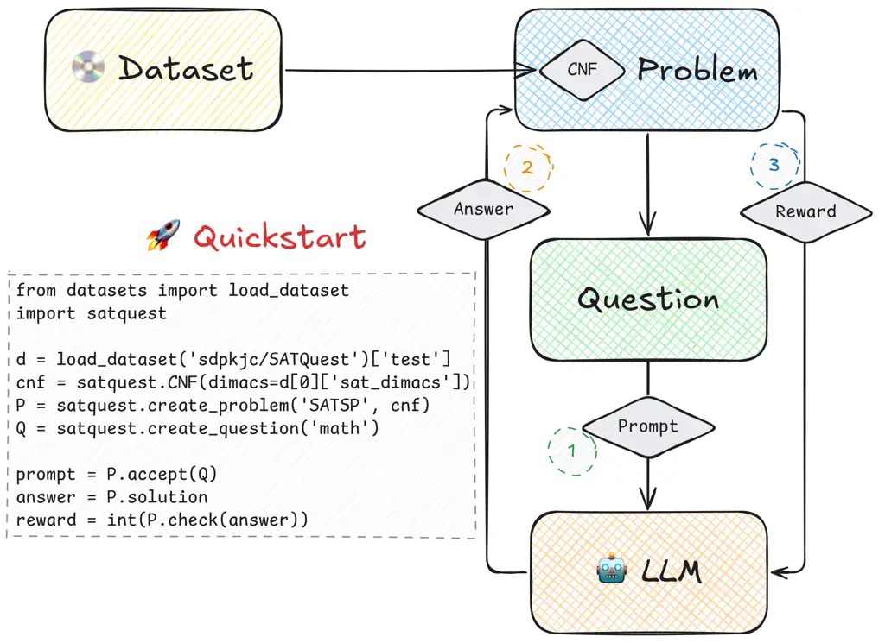
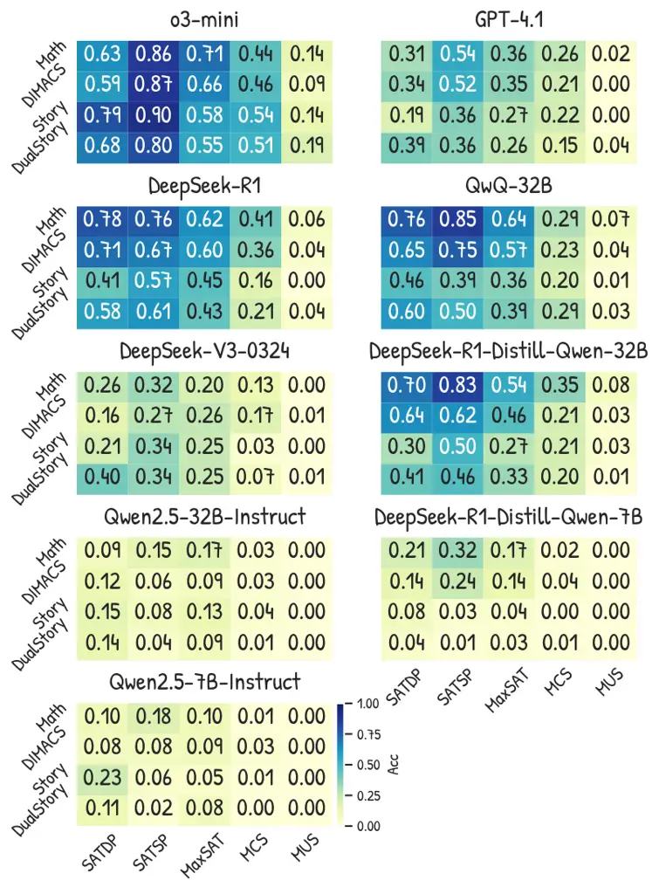
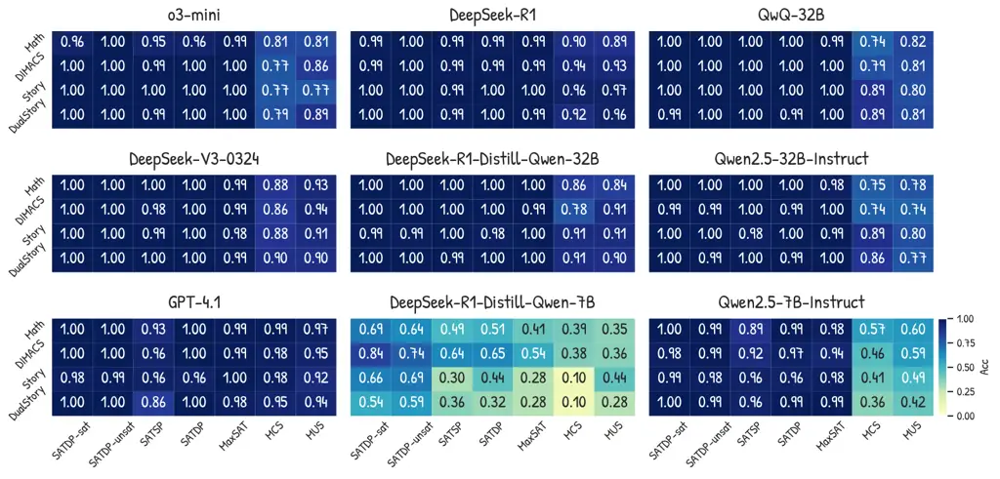
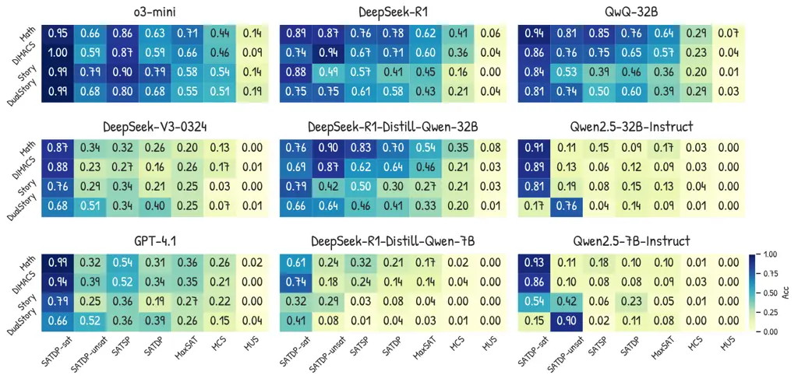

# SATQuest: A Verifier for Logical Reasoning Evaluation and Reinforcement Fine-Tuning of LLMs

Yanxiao
Zhao$`{}^{{\color[rgb]{0.7578,0.1641,0.1328}\boldsymbol{c}}\hskip 8.19447pt{\color[rgb]{0,0.0781,0.7813}\boldsymbol{u}}\hskip 8.19447pt{\color[rgb]{0.1328,0.3281,0.3125}\boldsymbol{l}}}`$
 Yaqian Li^(l)  Zihao Bo^(l)  Rinyoichi Takezoe^(l)  
Haojia Hui^(l)  Mo Guang^(l)  Lei Ren^(l)  Xiaolin
Qin$`{}^{{\color[rgb]{0.7578,0.1641,0.1328}\boldsymbol{c}}\hskip 8.19447pt{\color[rgb]{0,0.0781,0.7813}\boldsymbol{u}}}`$
 Kaiwen Long^(l)²²footnotemark: 2  
^(c) Chengdu Institute of Computer Applications, Chinese Academy of
Sciences  
^(u) School of Computer Science and Technology, University of Chinese
Academy of Sciences  
^(l) Li Auto ^(†)^(†)thanks: Work done during internship at Li
Auto.^(†)^(†)thanks: Corresponding author: & qinxl2001@126.com, &
longkaiwen@lixiang.com

###### Abstract

Large language models (LLMs) exhibit strong general reasoning, yet the
community lacks _controllable, scalable, and verifiable_ tools to
analyze and improve these abilities. We present SATQuest, a verifier
that generates diverse SAT-based reasoning tasks directly from
Conjunctive Normal Form (CNF) instances and checks answers objectively
with PySAT. SATQuest factorizes evaluation along three orthogonal
dimensions—_instance_, _problem type_, and _question format_—enabling
fine-grained, multi-dimensional analysis and reinforcement fine-tuning.
Randomized CNF generation mitigates memorization and supports
reproducible experiments. Using SATQuest, we benchmark a range of open-
and closed-weight LLMs and uncover persistent gaps in logical reasoning,
particularly on higher-complexity tasks and in transfer beyond familiar
mathematical notation to machine or narrative formats. We further show
that reinforcement fine-tuning with SATQuest rewards substantially
boosts targeted performance and generalizes to larger instances, while
cross-format robustness remains challenging. Collectively, SATQuest
provides verifier-backed infrastructure for controlled, scalable, and
reproducible _empirical research_ on LLM logical reasoning and its
training.

[sdpkjc/SATQuest](https://github.com/sdpkjc/SATQuest)

## 1 Introduction

Large Language Models (LLMs) have demonstrated remarkable proficiency in
general reasoning tasks, including complex problem-solving and code
generation, with models like o3-mini(OpenAI, 2025),
DeepSeek-R1(DeepSeek-AI et al., 2025), and QwQ-32B(Team, 2024) excelling
in programming, mathematics, and scientific question-answering(Brown et
al., 2020; OpenAI et al., 2024; Wei et al., 2022). This advanced
reasoning capability, a cornerstone for Artificial General Intelligence
(AGI), is a critical indicator of models’ deep understanding and
generalization.

To further explore the reasoning capabilities of LLMs, we urgently need
evaluation and training tools that are both controllable and scalable.
Fine-grained and reliable performance analysis requires systematic
variable control, which is fundamental to empirical scientific research.
However, existing benchmarks and datasets have significant limitations
in variable control, making it difficult to support multi-dimensional,
systematic analysis and training experiments—hindering deeper
understanding of reasoning mechanisms in LLMs.

Although benchmarks such as ZebraLogic (Lin et al., 2025) and Knights
and Knaves (Xie et al., 2024) have introduced controllable difficulty
dimensions, their question types and formats remain narrow, supporting
only the instance dimension. MATH (Hendrycks et al., 2021b) and
LiveBench (White et al., 2025) provide rich content across mathematics
and programming; however, they lack structured relationships and rely
heavily on human judgment for difficulty labeling. In comparison,
general-purpose benchmarks like GPQA (Rein et al., 2024),
MMLU (Hendrycks et al., 2021a), and Big-Bench (Srivastava et al., 2023)
offer broad coverage, yet suffer from issues such as data leakage, lack
of continuity, and insufficient support for multi-dimensional controlled
analysis.

In this work, we aim to construct a multi-dimensionally controllable and
scalable verifier to support the evaluation and training of LLM
reasoning capabilities, enabling the tracking of progress and discovery
of limitations in LLM reasoning. Our main contributions are as follows:

\(1\) CNF-native, controllable verifier. We present SATQuest, which
generates SAT-based reasoning tasks directly from CNF and organizes them
along three orthogonal axes—_instance_, _problem type_, and _question
format_. Randomized CNF construction, binary-string targets, and
objective PySAT checking enable leakage-resistant, verifiable evaluation
and training; we also release [![[Uncaptioned
image]](arxiv-2509-00930--7f4438b992a7.figures/figure-1.webp) sdpkjc/SATQuest](https://huggingface.co/datasets/sdpkjc/SATQuest)
for reproducibility.

\(2\) Multi-dimensional evaluation. Using SATQuest, we provide a
comprehensive study of open/closed-weight LLMs across all three axes,
revealing strong cross-format sensitivity beyond Math, accuracy
degradation with solver-measured complexity, and a systematic shift
toward hallucination (fabricated execution and invented shortcuts) under
high complexity (App. I).

\(3\) Verifier-driven Reinforcement Fine-tuning. We implement
reinforcement fine-tuning with SATQuest rewards, yielding targeted gains
and longer reasoning chains. Improvements transfer to larger instances
and exhibit _asymmetric_ cross-task generalization, while cross-format
robustness remains limited.

## 2 SATQuest Challenge Design

#### Overview.

SATQuest is a systematic verifier engineered to comprehensively evaluate
and enhance the logical reasoning capabilities of LLMs. Its primary goal
is to offer a framework for fine-grained analysis, providing deeper
insights into the strengths and limitations of LLMs in logical
deduction. SATQuest is not designed to train LLMs as general-purpose
solvers or to make them surpass specialized symbolic solvers in speed or
accuracy.

To achieve its objectives, SATQuest automatically generates a variety of
logical reasoning tasks directly derived from CNF instances. These tasks
are meticulously organized along three orthogonal dimensions: instance,
problem type, and question format, each targeting distinct aspects of
logical reasoning. This multi-dimensional structure creates a
comprehensive and controllable challenge space suitable for nuanced
evaluation and effective reinforcement fine-tuning. CNF instances are
utilized as the foundational elements due to their formal clarity, their
established role as a standard representation in propositional logic,
and their inherent compatibility with established SAT solvers for
objective answer verification, making them an ideal medium for
systematically probing the logical capabilities of LLMs.

#### Data Generation.

SATQuest supports evaluation using any CNF instance dataset stored in
the standard DIMACS format. For reproducibility, we generated two CNF
datasets using the procedure outlined in Algorithm 1:

- •
  [![[Uncaptioned
image]](arxiv-2509-00930--7f4438b992a7.figures/figure-1.webp) sdpkjc/SATQuest](https://huggingface.co/datasets/sdpkjc/SATQuest):
  This dataset is generated for evaluation purposes (Sec. 3),
  specifically to assess logical reasoning across varying instance
  scales and difficulties. It consists of randomly generated CNF
  instances with $`n\in[3,16]`$ variables and a fixed clause-to-variable
  ratio resulting in $`m=4n`$ clauses. For each $`(n,m)`$ configuration,
  $`10`$ CNF instance pairs (one satisfiable and one unsatisfiable) were
  generated, resulting in a total of $`140`$ CNF pairs. The two CNF
  instances share the same number of literals and nearly identical CNF
  structures.
- •
  [![[Uncaptioned
image]](arxiv-2509-00930--7f4438b992a7.figures/figure-1.webp) sdpkjc/SATQuest-RFT-3k](https://huggingface.co/datasets/sdpkjc/SATQuest-RFT-3k):
  This dataset is generated for reinforcement fine-tuning (Sec. 4). It
  consists of CNF instances with $`n\in[3,8]`$ variables and clause
  counts $`m`$ determined by varying the clause-to-variable ratio from
  $`2.1`$ to $`4.0`$ in increments of $`0.1`$ (i.e., $`m`$ ranges from
  $`2.1n`$ to $`4.0n`$). For each $`(n,m)`$ configuration, $`25`$ CNF
  instance pairs were generated, resulting in a total of $`3,000`$ CNF
  pairs.

#### Challenge Dimensions 1: Instance.

We categorize instances by their scale (number of variables $`n`$,
clauses $`m`$, and literals) and inherent difficulty. Computational
difficulty is assessed using SAT solver statistics: decisions,
indicating search breadth; conflicts, reflecting constraint-driven
backtracking; and propagations, quantifying chained logical
implications. These structural and solver-derived metrics provide a
multi-faceted characterization of an instance’s combinatorial
complexity, where higher values generally correspond to more challenging
problems.

#### Challenge Dimensions 2: Problem Type.

Let $`\alpha:X\to\{0,1\}`$ be an assignment for
$`X=\{x_{1},\dots,x_{n}\}`$, and let $`F=\bigwedge_{i=1}^{m}C_{i}`$ be a
CNF formula. Each $`C_{i}`$ is a clause of the form
$`C_{i}=\ell_{i,1}\lor\ell_{i,2}\lor\cdots\lor\ell_{i,k_{i}}`$, where
$`\ell_{i,j}\in X\cup\{\lnot x|x\in X\}`$. We define five fundamental
SAT-based problems:

- •
  SATDP (SAT Decision Problem): Determine whether $`F`$ is satisfiable:

  ```math
  \texttt{SATDP}(F)=\begin{cases}1,&\exists\,\alpha\text{ s.t. }F(\alpha)=1,\\
  0,&\text{otherwise}.\end{cases}
  ```

  Tests the fundamental ability to determine logical consistency.

- •
  SATSP (SAT Search Problem): If $`F`$ is satisfiable, find an
  assignment $`\alpha`$:

  ```math
  \alpha\text{ s.t. }F(\alpha)=1.
  ```

  Probes constructive reasoning by requiring the generation of a
  satisfying assignment.

- •
  MaxSAT (Maximum Satisfiability): Find the assignment $`\alpha^{*}`$
  that maximizes the number of satisfied clauses:

  ```math
  \alpha^{*}=\arg\max_{\alpha}\sum_{i=1}^{m}\mathbf{1}[C_{i}(\alpha)=1].
  ```

  Evaluates optimization skills when maximizing clause satisfaction
  under conflicting constraints.

- •
  MCS (Minimal Correction Subset): For an unsatisfiable $`F`$, find a
  minimal set $`S\subseteq\{1,\dots,m\}`$ whose removal yields a
  satisfiable formula. Here $`S`$ indexes the removed clauses, so
  satisfiability is checked on the remaining clauses:

  ```math
  \texttt{SATDP}(\bigwedge_{i\notin S}C_{i})=1\bigwedge\\
  \forall\,S^{\prime}\subset S,\ \texttt{SATDP}(\bigwedge_{i\notin S^{\prime}}C_{i})=0.
  ```

  Tests diagnostic reasoning through the identification of minimal
  corrections for unsatisfiability.

- •
  MUS (Minimal Unsatisfiable Subset): For an unsatisfiable $`F`$, find a
  minimal unsatisfiable core $`S\subseteq\{1,\dots,m\}`$:

  ```math
  \texttt{SATDP}(\bigwedge_{i\in S}C_{i})=0\bigwedge\\
  \forall\,S^{\prime}\subset S,\ \texttt{SATDP}(\bigwedge_{i\in S^{\prime}}C_{i})=1.
  ```

  Probes diagnostic reasoning by localizing minimal sources of logical
  inconsistency.

Each CNF instance pair consists of one satisfiable and one unsatisfiable
formula. The satisfiable instance is used for SATSP, while the
unsatisfiable instance is used for MaxSAT, MCS, and MUS. For SATDP, both
instances are evaluated, forming two sub-tasks (SATDP-sat and
SATDP-unsat). A response to SATDP is considered correct only if both
sub-tasks are answered correctly, thereby discouraging random guessing.
These problems progressively challenge LLM reasoning capabilities, from
foundational deduction and solution construction (SATDP/SATSP), to
constrained optimization (MaxSAT), and finally to minimal cause
identification and correction (MCS/MUS).

#### Challenge Dimensions 3: Question Format.

Recognizing that the presentation of a problem can significantly impact
an LLM’s reasoning process, this dimension introduces four logically
equivalent representational formats for each CNF instance. This
variation aims to test different reasoning skills and reduce reliance on
superficial pattern matching.

- •
  Math (mathematical notation): Uses $`\land`$, $`\lor`$, and $`\lnot`$
  to represent logic formulas. Balances between formality and
  readability.  
  _Example:_ $`x_{1}\lor\lnot x_{2}\lor x_{3}`$
- •
  DIMACS (machine format): A minimal, line-based format for representing
  Boolean formulas in CNF, the standard input for many SAT symbolic
  solvers.  
  _Example:_

  ```ltx_verbatim
  p cnf 3 1
          1 -2 3 0
  ```

- •
  Story (OR semantics, cookie day scenario): Wraps clauses as friendly
  narratives—"Alice is happy if…"—to test LLMs’ ability to ground
  disjunctions in natural language.  
  _Example:_ _"Alice will be happy if she gets crunchy choco
  ($`x_{1}`$), chewy vanilla ($`\lnot x_{2}`$), or crunchy peanut
  ($`x_{3}`$).”_
- •
  DualStory (AND semantics, cookie day scenario): Presents the negated
  form—"Alice will be unhappy only if…" —turning OR into AND and
  requiring semantic tracking.  
  _Example:_ _"Alice will be unhappy only if she is served crunchy choco
  ($`x_{1}`$), chewy vanilla ($`\lnot x_{2}`$), and crunchy peanut
  ($`x_{3}`$).”_

Math is common in training data and accessible to math-tuned LLMs,
whereas DIMACS is a compact, noise-free, machine-readable format that
tests a model’s ability to interpret raw clause structures. We adopt it
specifically to evaluate whether LLMs can interpret raw clause
structures without relying on mathematical training. Story and DualStory
introduce narrative elements that add informational noise and require
the model to translate natural-language logical structures into formal
logic before reasoning. The deterministic CNF$`\to`$narrative conversion
maps variables to cookie names (from a predefined pool),
positive/negative literals to “crunchy”/“chewy” variants, and clauses to
individual friend preferences; the complete mapping procedure with
pseudocode is given in App. B.



Figure 1: SATQuest Pipeline and Quickstart.

#### Answer Verification.

Prior logical reasoning benchmarks (e.g., (Lin et al., 2025; Xie et al.,
2024; Mondorf and Plank, 2024)) typically require LLMs to produce JSON
outputs, choose from preset options, or use complex extraction—methods
that hinder automation and scalability despite reduced manual overhead.
Moreover, multiple-choice formats can significantly alter the true
difficulty of problems, as the complexity of SATSP differs fundamentally
from SAT verification. SATQuest uses a unified binary-string output
format—1 bit for SATDP, n bits for SATSP/MaxSAT, and m bits for MCS/MUS
—to ensure consistency across tasks and to control for variation in the
output schema. These strings are extracted using regex and checked
against CNF constraints via PySAT, allowing for multiple valid answers.
A known limitation is that long binary outputs may challenge smaller
models’ ability to adhere to the expected format. To shed light on this,
Fig. 7 presents format correctness statistics for mainstream models
evaluated. For the complete prompt and detailed output format
instructions, refer to App. C. The SATQuest Pipeline and Quickstart are
illustrated in Fig. 1.

## 3 Evaluation

#### Overview.

We conduct a comprehensive evaluation of the logical reasoning
performance of various LLMs using the SATQuest benchmark. The analysis
spans different instance, problem types, and question formats, enabling
fine-grained, multi-dimensional insights. We begin with the overall
benchmark results, followed by detailed analyses along each dimension.

#### Setup.

We evaluate a diverse set of state-of-the-art open-weight and
closed-weight LLMs, including vanilla models, reasoning models, and
distilled variants. The evaluation uses the [![[Uncaptioned
image]](arxiv-2509-00930--7f4438b992a7.figures/figure-1.webp) sdpkjc/SATQuest](https://huggingface.co/datasets/sdpkjc/SATQuest)
dataset, comprising $`140`$ CNF instance pairs categorized by scale
($`n\in[3,16]`$, clauses $`m=4n`$). Each CNF pair yields tasks across
five logical reasoning types (SATDP, SATSP, MaxSAT, MCS, MUS) and four
question formats (Math, DIMACS, Story, DualStory), resulting in $`20`$
evaluations per CNF pair. For detailed evaluation configurations and
parameters, see App. F.

#### Overall Results.

Fig. 2 shows model accuracies on SATQuest. o3-mini leads with $`0.56`$
accuracy, followed by DeepSeek-R1 ($`0.42`$), QwQ-32B ($`0.40`$), and
DeepSeek-R1-Distill-Qwen-32B ($`0.39`$), indicating that
reasoning-enhanced models outperform vanilla LLMs. Large vanilla models
like GPT-4.1 ($`0.38`$) and DeepSeek-V3-0324 ($`0.36`$) perform
competitively despite lacking explicit reasoning training. In contrast,
smaller vanilla models (e.g., Qwen2.5-7B-Instruct) achieve below $`0.1`$
accuracy, revealing limited reasoning capabilities.

These results point to two notable trends. First, reasoning models
consistently outperform vanilla counterparts, particularly on more
complex tasks. Second, the modest overall accuracy across models
reflects the challenging nature of SATQuest and its effectiveness in
distinguishing reasoning capabilities. Moreover, the model ranking
induced by SATQuest is broadly consistent with that of other recent
reasoning benchmarks such as GPQA (Rein et al., 2024) and
ZebraLogic (Lin et al., 2025), lending confidence that SATQuest reliably
differentiates reasoning capability within the evaluated LLM population.

Figure 2: Overall accuracy of evaluated LLMs on the SATQuest benchmark,
averaged across all problem types and question formats.

Figure 3: Accuracy (dashed lines, left axis) and response length (solid
lines, right axis) vs. instance complexity (solver decisions) for
SATSP-Math, MaxSAT-Math, MCS-Math and MUS-Math tasks.

#### Analysis by Instance.

We examine how model performance scales with instance complexity,
measured using the number of decisions made by established SAT solvers
(Glucose 4.1 (Audemard and Simon, 2018) for SATDP/SATSP, RC2 (Ignatiev
et al., 2019) for MaxSAT, LBX (Mencía et al., 2015) for MCS, and
MUSX (Marques-Silva, 2010) for MUS). Fig. 3 visualizes model accuracy
and response length against this complexity metric. A consistent trend
across tasks is that as instance complexity increases (more solver
decisions), model accuracy tends to decline, while response length
generally increases. Notably, we observe a concerning hallucination
phenomenon when models encounter highly complex instances: they often
fabricate solver calls or invent simplified reasoning paths rather than
engaging with the full logical complexity of the problem. This
hallucination is particularly evident for o3-mini on MCS-Math and
MUS-Math tasks, where response length actually decreases at high
complexity, indicating the model abandons complete reasoning in favor of
hallucinated shortcuts. Overall, all models exhibit reduced accuracy on
larger and more difficult instances. Top-performing models like o3-mini
and DeepSeek-R1 show more gradual degradation, indicating better
scalability, whereas less capable models experience a sharp performance
drop, often failing completely on moderately complex instances and
resorting to increasingly severe hallucinations when faced with logical
complexity beyond their reasoning capacity.



Figure 4: Accuracy heatmaps from a single run for each model, showing
performance by problem type (columns) and question format (rows).

#### Analysis by Problem Type.

We analyze performance variations across the five distinct SAT-based
problem types: SATDP, SATSP, MaxSAT, MCS, and MUS. The heatmaps in
Fig. 4 reveal performance differences across these tasks. Consistently
across models, performance tends to be highest on SATDP (especially
SATDP-sat) and SATSP, and lowest on MCS and MUS, forming a clear
difficulty hierarchy. Models generally handle the basic decision (SATDP)
and search (SATSP) tasks better than tasks requiring optimization or
diagnosis, though performance on SATSP is often lower than SATDP.
Performance on the optimization task MaxSAT typically sits between the
basic tasks and the diagnostic tasks. The diagnostic tasks, MCS and MUS,
which require identifying minimal subsets, prove particularly
challenging, with accuracy dropping significantly for almost all models.
While top models like o3-mini maintain some capability even on harder
tasks, the gap between task types is pronounced across the board. This
performance stratification aligns with the solver complexity shown in
Fig. 3 (measured by solver decisions), suggesting LLMs struggle
progressively more with tasks demanding global optimization, minimality
constraints, and diagnostic reasoning over combinatorial spaces.
Overall, the results highlight LLM limitations in tackling the full
spectrum of logical reasoning challenges represented by these diverse
SAT-based tasks.

#### Analysis by Question Format.

The way a logical problem is presented can significantly affect an LLM’s
ability to solve it. We analyze this impact by evaluating performance
across four distinct question formats: Math, DIMACS, Story, and
DualStory. Fig. 4 illustrates how accuracy varies across these formats.
All models perform best in the Math format, generally achieving their
highest accuracy, followed by DIMACS, with Story and DualStory formats
yielding the lowest accuracy. o3-mini demonstrates relatively stable
performance across the four formats, indicating strong reasoning
robustness regardless of presentation style. However, other open-weight
reasoning models like DeepSeek-R1 and QwQ-32B, while performing well in
the Math format, exhibit a significant drop in accuracy in other
formats, suggesting higher sensitivity to the presentation style.

It is noteworthy that the Story and DualStory problems introduce
narrative elements, adding informational noise and requiring the model
to translate the natural language logical structure into formal logic
before reasoning. The increased difficulty and subsequent lower accuracy
are thus expected. However, the DIMACS format is structurally similar to
Math, contains no redundant information, and has higher information
density. Despite this, open-weight reasoning models still show a marked
decrease in accuracy compared to Math (e.g., DeepSeek-R1 and QwQ-32B
accuracy dropped by 9% and 10% respectively on SATSP-DIMACS compared to
SATSP-Math).

Through case studies presented in App. E, we observe that DeepSeek-R1
and QwQ-32B often attempt to reason directly within the DIMACS format
rather than translating it into formal mathematical notation. This
approach involves working with the raw DIMACS clauses, which requires
tracking multiple variable assignments simultaneously across numerous
constraints. The models frequently make errors when attempting to verify
clause satisfaction or when determining the implications of specific
variable assignments, particularly misinterpreting the disjunctive
nature of clauses or conflating the semantic meaning of positive and
negative literals. This direct approach appears to lead to a higher
error rate during the reasoning process, as the models struggle to
maintain consistency across the complex network of logical constraints
represented in the DIMACS format.

Conversely, vanilla models like GPT-4.1 and DeepSeek-V3-0324, although
performing worse overall, show relatively balanced performance across
different formats, indicating lower format sensitivity. These models
sometimes employ structured thinking approaches by first translating
DIMACS inputs into the Math format before proceeding with reasoning, or
by introducing meaningful symbolic notation during their reasoning
process, which appears to enhance reasoning stability. The shorter
reasoning chains produced by vanilla models may also contribute to their
format robustness, as briefer deductions have fewer opportunities for
errors to accumulate. This contrasts with DeepSeek-R1 and QwQ-32B, whose
struggles outside the Math format seem to stem from relying more on
potentially error-prone direct reasoning or trial-and-error within
unfamiliar formats, rather than employing systematic format translation
or structured analysis.

Achieving AGI likely requires LLMs to reason effectively across diverse
formats, enabling the integration of knowledge from different domains
and fostering more powerful, generalized reasoning capabilities.
SATQuest thus serves as a valuable benchmark for assessing LLMs’
adaptability and robustness in logical reasoning across various
presentation styles.

## 4 Reinforcement Fine-Tuning

#### Overview.

As demonstrated by the evaluation in Sec. 3, current LLMs exhibit
significant limitations in logical reasoning, with notable deficiencies
in generalization across instance, problem type, and question format.
This section explores avenues for enhancing LLM logical reasoning
capabilities through Reinforcement Fine-Tuning (RFT), directly utilizing
reward signals from the SATQuest verifier. Our investigation
particularly focuses on two aspects: First, we assess whether
SATQuest-driven RFT can stimulate LLMs to construct longer reasoning
chains, thereby fostering deeper logical deduction. Second, we delve
into the relationship between RFT and the generalization deficiencies
identified in Sec. 3, aiming to elucidate the specific effects and
potential bottlenecks of RFT in improving cross-task and cross-format
generalization.

Figure 5: GRPO fine-tuning using SATQuest rewards. Training dynamics
(Top: reward, response length) and evaluation performance (Bottom:
accuracy, response length on target and generalization tasks) vs.
training steps for models fine-tuned on SATSP-Math, MaxSAT-Math, and
SATSP-Story. Solid lines show the mean; shaded regions denote $`\pm 1`$
standard deviation.

#### Setup.

We select the Qwen2.5-7B-Instruct model as the baseline, utilizing the
Group Relative Policy Optimization (GRPO) algorithm (Shao and et al., 2024) during fine-tuning. This baseline model is nearly a blank slate, a
small vanilla model that only shows marginal performance on SATSP-Math.
The training leverages the [![[Uncaptioned
image]](arxiv-2509-00930--7f4438b992a7.figures/figure-1.webp) sdpkjc/SATQuest-RFT-3k](https://huggingface.co/datasets/sdpkjc/SATQuest-RFT-3k)
dataset, comprising $`3,000`$ CNF instance pairs with $`n\in[3,8]`$
variables and clause-to-variable ratios ranging from $`2.1`$ to $`4.0`$.
We train three distinct models, each focusing on a specific problem type
and question format combination: SATSP-Math, SATSP-Story, MaxSAT-Math.

Our implementation is based on the TRL library (von Werra et al., 2020),
adopting the GRPO objective as described in (Shao and et al., 2024). The
prompt template follows the structure proposed in (DeepSeek-AI et al.,
2025). The reward function is designed using the SATQuest verifier,
assigning a reward of $`1.0`$ for correct answers and $`0.0`$ for
incorrect ones. Additionally, two format correctness rewards, detailed
in Sec. G.1, are incorporated with weights of $`0.05`$ each,
complementing the primary reward weight of $`1.0`$. For training we set
$`max\_prompt\_length`$ to $`2048`$ and $`max\_completion\_length`$ to
$`8192`$, for evaluation we set
$`max\_prompt\_length+max\_completion\_length`$ to $`32768`$. The
training and evaluation parameters are detailed in Sec. G.2.

#### Training Dynamics.

Training curves (Fig. 5, top row) reveal that models trained on
Math-based tasks (SATSP-Math and MaxSAT-Math) achieve higher rewards and
generate longer responses than those trained on SATSP-Story. The Math
format appears to better facilitate extended reasoning chains that
receive positive reinforcement from the verifier. Our SATQuest verifier
effectively stimulates extended reasoning development within few
training steps, especially with the mathematical format. Response length
curves show distinct patterns—rapid initial growth as models learn
longer reasoning chains, temporary decline when adapting to format
constraints at the training response limit ($`8192`$ tokens), followed
by stabilization.

Training on SATSP-Story proved less effective, largely due to the
baseline model’s weak narrative reasoning abilities. While Logic-RL (Xie
et al., 2025) has successfully stimulated narrative reasoning, our tasks
involve substantially higher complexity and scale. Convergence
efficiency correlates with task complexity and initial model
capabilities, though these factors require further investigation to
fully separate.

#### Generalization Across Instance.

We observe positive generalization concerning problem complexity. Models
fine-tuned on SATSP-Math and MaxSAT-Math demonstrated improved accuracy
when evaluated on the corresponding tasks within the evaluation set
(Fig. 5, subplots 2.1, 5.1). Crucially, these evaluation instances
involved larger scales ($`n>8`$) than those used during training
($`n\in[3,8]`$), indicating that the learned reasoning skills generalize
to more complex instances within the same problem and format.

| Generalization Type     | Positive Transfer? | Observation                                       |
| ----------------------- | ------------------ | ------------------------------------------------- |
| Across Instances        | ✓                  | Improved accuracy on larger unseen CNF instances. |
| Across Problem Types    | ✓ (Asymmetric)     | MaxSAT $`\rightarrow`$ SATSP transfer stronger.   |
| Across Question Formats | ✗                  | Math $`\rightarrow`$ DIMACS/Story weak transfer.  |

Table 1: Summary of generalization findings across SATQuest dimensions.

#### Generalization Across Problem Types.

Our results reveal an interesting asymmetry in cross-problem
generalization. Fine-tuning on the more complex MaxSAT-Math task led to
performance improvements not only on MaxSAT-Math itself but also
conferred benefits to the simpler SATSP-Math task. However, the model
trained solely on SATSP-Math did not show a corresponding improvement on
MaxSAT-Math (compare improvements patterns in Fig. 5, bottom row). This
suggests that the reasoning capabilities required for MaxSAT may
encompass those needed for SATSP. Strategically, this implies that
training on more complex and diverse logical problems could be more
effective for fostering robust reasoning skills that generalize to
simpler, related problems.

#### Generalization Across Question Formats.

Cross-format generalization remains notably difficult. The model
fine-tuned on SATSP-Math shows minimal improvement when evaluated on
other formats such as SATSP-Story (Fig. 5, subplot 3.1) and even on the
structurally similar SATSP-DIMACS task (subplot 4.1). This suggests that
reasoning capabilities acquired in the Math format do not readily
transfer to logically equivalent tasks presented in alternative formats,
whether narrative or machine-readable. Further analysis of failure cases
reveals that, after SATSP-Math fine-tuning, the model tends to generate
verbose but flawed reasoning when confronted with DIMACS
inputs—mirroring the issues described in Sec. 3 and E. The model appears
to have overfitted to a specific Math-style reasoning pattern, at the
expense of its initial structured thinking ability, and fails to
effectively translate DIMACS representations into a suitable reasoning
form. These findings indicate that small-scale RFT may not be sufficient
to overcome format generalization barriers, and that the performance
discrepancies across formats observed in Sec. 3 may partially stem from
the limitations of format-specific fine-tuning itself.

## 5 Related Work

Researchers have developed numerous benchmarks to evaluate LLMs’
capabilities. Popular evaluations like (Rein et al., 2024; Hendrycks et
al., 2021b; Hendrycks et al., 2021a; Srivastava et al., 2023)
comprehensively assess LLMs but suffer from data leakage and lack of
continuity, often being solved by advanced models within 18 months of
introduction. While newer benchmarks (Suzgun et al., 2023; Kazemi et
al., 2025; Team et al., 2025; Gema et al., 2025; Wang et al., 2024;
Glazer et al., 2024) offer improvements, core issues remain. White et
al. (2025) introduced dynamic question banks and automatic scoring but
still relies on manual difficulty annotation without multi-dimensional
analysis controls. These evaluations primarily assess capabilities
rather than providing insights into internal mechanisms. Some studies
explore more nuanced approaches: Lin et al. (2025); Xie et al. (2024)
use formalized templates with controllable difficulty dimensions for
finer-grained analysis. Xie et al. (2025) conducts RL training on K&K to
investigate how RL enhances reasoning capabilities. He et al. (2024)
provides evaluation through multilingual coverage and multi-turn design.
Huang et al. (2025); Yu et al. (2025) test mathematical reasoning
robustness through minimal perturbations. Research by Hazra et al.
(2025) investigates LLM reasoning capabilities through 3-SAT phase
transitions. Our work, SATQuest, uses randomly generated CNF instances
to prevent data leakage and ensure continuity. We provide five
interrelated SAT-based problem types and four question formats with
different information densities. These three orthogonal
dimensions—instance, problem type, and question format—enable flexible
experimental control for future LLM reasoning research.

## 6 Conclusion

We introduce SATQuest, a CNF-native verifier that systematically
structures SAT-based reasoning evaluation and training along three
orthogonal axes: _instance_, _problem type_, and _question format_. Our
results reveal that while targeted reinforcement fine-tuning with
verifiable rewards enables measurable gains—especially for harder or
larger instances—persistent weaknesses remain in diagnostic reasoning
and robustness to presentation changes. The key patterns of
generalization and their asymmetries are summarized in Table 1.

Takeaway. SATQuest provides a controllable and verifiable feedback loop
for probing LLM logical reasoning. It reliably exposes non-obvious
failure modes—particularly format sensitivity and difficulty with
minimal diagnoses—while enabling principled improvements without manual
heuristics. Future progress will require richer reward signals and
explicit curriculum bridging across formats and domains, to close the
gap between instance-specific improvements and generalizable,
format-robust reasoning, and we release datasets and code to catalyze
progress.

## Limitations

#### Scope and intent.

SATQuest is designed as a _controllable, verifiable, and factorized_
probe of LLM logical reasoning along three axes (instance / problem type
/ question format), prioritizing clean manipulation of variables over
breadth. MCS/MUS are general diagnostic notions beyond propositional
logic, but in this work they are _instantiated_ as clause-level subsets
over CNF; richer logics (e.g., first-order, modal), multi-tool
interaction, and open-ended natural-language tasks are out of scope. The
evaluation set fixes $`m{=}4n`$ with $`n{\leq}16`$, the RFT training set
uses $`n{\leq}8`$, and narratives are synthetic and English-only. Hence
our conclusions target _relative_ patterns across
instance/problem/format rather than absolute real-world capability.

#### Technical.

By design, our setup prioritizes _verifiable, controlled analysis_:
models must return binary strings that we extract and check against the
CNF with PySAT, which removes grading ambiguity but constrains the
response space and can be brittle for long clause-mask outputs. All
evaluations are conducted in a _strict zero-shot_ regime using
standardized prompts (no tools, no few-shot exemplars), to isolate
reasoning from prompt engineering; the prompt templates used for
evaluation are provided in the paper and appendix. On the training side,
we only instantiate reinforcement fine-tuning with the GRPO algorithm,
optimizing a _binary_ (0/1) verifier reward; alternative
policy-optimization methods, decoding strategies, and shaped rewards are
not explored here. Task difficulty is proxied by classical solver
statistics—decisions, conflicts, and propagations—which we compute with
established solvers per task; the complete per-instance statistics and
the solver identifiers are provided with the dataset metadata.

#### Narrative format robustness.

Our conversions from CNF into the Story and DualStory formats use a
fixed narrative template with entity names sampled from small predefined
pools; we have not conducted systematic prompt-paraphrasing experiments
to quantify how much the specific wording affects performance. The
consistent ordering Math $`{}\geq{}`$DIMACS $`{}>{}`$Story
$`{}\approx{}`$DualStory across multiple models and tasks suggests that
the main trend is not driven solely by a particular choice of phrasing,
but we cannot rule out that alternative narrative framings would shift
absolute accuracy. More diverse narrative templates and controlled
paraphrasing ablations are an important direction for future work.

#### Future work.

Future directions include expanding the diversity and realism of
question formats—incorporating both LLM-generated and programmatically
varied representations such as tabular, code-based, or
diagrammatic/logical schemas—to better capture the heterogeneity of
human reasoning contexts. We also plan to curate _industrial-scale CNF
corpora_ drawn from real verification, planning, and scheduling
benchmarks with standardized metadata for open research use. On the
learning side, designing _dense and shaped rewards_ (e.g., clause
coverage, unit-propagation progress, MCS/MUS cardinality margins, or
partial-assignment consistency) may provide more informative
optimization signals than binary correctness alone. Curriculum learning
across scale ($`n,m`$), problem-type mixtures, and structural regimes
can help bridge small synthetic tasks and large real-world instances.
Finally, SATQuest is intended to serve as a practical foundation for
_empirical research_ on LLM logical reasoning—offering a controllable,
verifier-backed testbed for standardized and reproducible studies of
reward shaping, curricula, and cross-format transfer.

## Acknowledgments

This research was partly supported by the Sichuan Science and Technology
Program (2025JDDQ0008, 2024NSFJQ0035) and the Talents Program of the
Sichuan Provincial Party Committee Organization Department.

## References

- Audemard and Simon (2018) G. Audemard and L. Simon On the glucose sat
  solver. International Journal on Artificial Intelligence Tools 27
  (01), pp. 1840001. External Links:
  [Document](https://dx.doi.org/10.1142/S0218213018400018),
  [Link](https://doi.org/10.1142/S0218213018400018),
  https://doi.org/10.1142/S0218213018400018 Cited by: §3.
- Brown et al. (2020) T. Brown, B. Mann, N. Ryder, M. Subbiah, J. D.
  Kaplan, P. Dhariwal, A. Neelakantan, P. Shyam, G. Sastry, A.
  Askell, S. Agarwal, A. Herbert-Voss, G. Krueger, T. Henighan, R.
  Child, A. Ramesh, D. Ziegler, J. Wu, C. Winter, C. Hesse, M. Chen, E.
  Sigler, M. Litwin, S. Gray, B. Chess, J. Clark, C. Berner, S.
  McCandlish, A. Radford, I. Sutskever, and D. Amodei Language models
  are few-shot learners. In Advances in Neural Information Processing
  Systems, H. Larochelle, M. Ranzato, R. Hadsell, M.F. Balcan, and H.
  Lin (Eds.), Vol. 33, pp. 1877–1901. External Links:
  [Link](https://proceedings.neurips.cc/paper_files/paper/2020/file/1457c0d6bfcb4967418bfb8ac142f64a-Paper.pdf)
  Cited by: §1.
- DeepSeek-AI et al. (2025) DeepSeek-AI, D. Guo, D. Yang, H. Zhang, J.
  Song, R. Zhang, R. Xu, Q. Zhu, S. Ma, P. Wang, X. Bi, X. Zhang, X.
  Yu, Y. Wu, Z. F. Wu, Z. Gou, Z. Shao, Z. Li, Z. Gao, A. Liu, B.
  Xue, B. Wang, B. Wu, B. Feng, C. Lu, C. Zhao, C. Deng, C. Zhang, C.
  Ruan, D. Dai, D. Chen, D. Ji, E. Li, F. Lin, F. Dai, F. Luo, G.
  Hao, G. Chen, G. Li, H. Zhang, H. Bao, H. Xu, H. Wang, H. Ding, H.
  Xin, H. Gao, H. Qu, H. Li, J. Guo, J. Li, J. Wang, J. Chen, J.
  Yuan, J. Qiu, J. Li, J. L. Cai, J. Ni, J. Liang, J. Chen, K. Dong, K.
  Hu, K. Gao, K. Guan, K. Huang, K. Yu, L. Wang, L. Zhang, L. Zhao, L.
  Wang, L. Zhang, L. Xu, L. Xia, M. Zhang, M. Zhang, M. Tang, M. Li, M.
  Wang, M. Li, N. Tian, P. Huang, P. Zhang, Q. Wang, Q. Chen, Q. Du, R.
  Ge, R. Zhang, R. Pan, R. Wang, R. J. Chen, R. L. Jin, R. Chen, S.
  Lu, S. Zhou, S. Chen, S. Ye, S. Wang, S. Yu, S. Zhou, S. Pan, S. S.
  Li, S. Zhou, S. Wu, S. Ye, T. Yun, T. Pei, T. Sun, T. Wang, W.
  Zeng, W. Zhao, W. Liu, W. Liang, W. Gao, W. Yu, W. Zhang, W. L.
  Xiao, W. An, X. Liu, X. Wang, X. Chen, X. Nie, X. Cheng, X. Liu, X.
  Xie, X. Liu, X. Yang, X. Li, X. Su, X. Lin, X. Q. Li, X. Jin, X.
  Shen, X. Chen, X. Sun, X. Wang, X. Song, X. Zhou, X. Wang, X.
  Shan, Y. K. Li, Y. Q. Wang, Y. X. Wei, Y. Zhang, Y. Xu, Y. Li, Y.
  Zhao, Y. Sun, Y. Wang, Y. Yu, Y. Zhang, Y. Shi, Y. Xiong, Y. He, Y.
  Piao, Y. Wang, Y. Tan, Y. Ma, Y. Liu, Y. Guo, Y. Ou, Y. Wang, Y.
  Gong, Y. Zou, Y. He, Y. Xiong, Y. Luo, Y. You, Y. Liu, Y. Zhou, Y. X.
  Zhu, Y. Xu, Y. Huang, Y. Li, Y. Zheng, Y. Zhu, Y. Ma, Y. Tang, Y.
  Zha, Y. Yan, Z. Z. Ren, Z. Ren, Z. Sha, Z. Fu, Z. Xu, Z. Xie, Z.
  Zhang, Z. Hao, Z. Ma, Z. Yan, Z. Wu, Z. Gu, Z. Zhu, Z. Liu, Z. Li, Z.
  Xie, Z. Song, Z. Pan, Z. Huang, Z. Xu, Z. Zhang, and Z. Zhang
  DeepSeek-r1: incentivizing reasoning capability in llms via
  reinforcement learning. External Links: 2501.12948,
  [Link](https://arxiv.org/abs/2501.12948) Cited by: Appendix C, §1, §4.
- Gema et al. (2025) A. P. Gema, J. O. J. Leang, G. Hong, A.
  Devoto, A. C. M. Mancino, R. Saxena, X. He, Y. Zhao, X. Du, M. R.
  Ghasemi Madani, C. Barale, R. McHardy, J. Harris, J. Kaddour, E. Van
  Krieken, and P. Minervini Are we done with MMLU?. In Proceedings of
  the 2025 Conference of the Nations of the Americas Chapter of the
  Association for Computational Linguistics: Human Language Technologies
  (Volume 1: Long Papers), L. Chiruzzo, A. Ritter, and L. Wang (Eds.),
  Albuquerque, New Mexico, pp. 5069–5096. External Links:
  [Link](https://aclanthology.org/2025.naacl-long.262/), ISBN
  979-8-89176-189-6 Cited by: §5.
- Glazer et al. (2024) E. Glazer, E. Erdil, T. Besiroglu, D.
  Chicharro, E. Chen, A. Gunning, C. F. Olsson, J. Denain, A. Ho, E. de
  Oliveira Santos, O. Järviniemi, M. Barnett, R. Sandler, M. Vrzala, J.
  Sevilla, Q. Ren, E. Pratt, L. Levine, G. Barkley, N. Stewart, B.
  Grechuk, T. Grechuk, S. V. Enugandla, and M. Wildon FrontierMath: a
  benchmark for evaluating advanced mathematical reasoning in ai.
  External Links: 2411.04872, [Link](https://arxiv.org/abs/2411.04872)
  Cited by: §5.
- Hazra et al. (2025) R. Hazra, G. Venturato, P. Z. D. Martires,
  and L. D. Raedt Have large language models learned to reason? a
  characterization via 3-sat phase transition. External Links:
  2504.03930, [Link](https://arxiv.org/abs/2504.03930) Cited by: §5.
- He et al. (2024) Y. He, D. Jin, C. Wang, C. Bi, K. Mandyam, H.
  Zhang, C. Zhu, N. Li, T. Xu, H. Lv, S. Bhosale, C. Zhu, K. A.
  Sankararaman, E. Helenowski, M. Kambadur, A. Tayade, H. Ma, H. Fang,
  and S. Wang Multi-if: benchmarking llms on multi-turn and multilingual
  instructions following. External Links: 2410.15553,
  [Link](https://arxiv.org/abs/2410.15553) Cited by: §5.
- Hendrycks et al. (2021a) D. Hendrycks, C. Burns, S. Basart, A. Zou, M.
  Mazeika, D. Song, and J. Steinhardt Measuring massive multitask
  language understanding. In International Conference on Learning
  Representations, External Links:
  [Link](https://openreview.net/forum?id=d7KBjmI3GmQ) Cited by: §1, §5.
- Hendrycks et al. (2021b) D. Hendrycks, C. Burns, S. Kadavath, A.
  Arora, S. Basart, E. Tang, D. Song, and J. Steinhardt Measuring
  mathematical problem solving with the MATH dataset. In Thirty-fifth
  Conference on Neural Information Processing Systems Datasets and
  Benchmarks Track (Round 2), External Links:
  [Link](https://openreview.net/forum?id=7Bywt2mQsCe) Cited by: §1, §5.
- Huang et al. (2025) S. Huang, L. Yang, Y. Song, S. Chen, L. Cui, Z.
  Wan, Q. Zeng, Y. Wen, K. Shao, W. Zhang, J. Wang, and Y. Zhang
  ThinkBench: dynamic out-of-distribution evaluation for robust llm
  reasoning. External Links: 2502.16268,
  [Link](https://arxiv.org/abs/2502.16268) Cited by: §5.
- Ignatiev et al. (2019) A. Ignatiev, A. Morgado, and J. Marques-Silva
  RC2: an efficient maxsat solver. Journal on Satisfiability, Boolean
  Modelling and Computation 11 (1), pp. 53–64. External Links:
  [Document](https://dx.doi.org/10.3233/SAT190116),
  [Link](https://journals.sagepub.com/doi/abs/10.3233/SAT190116),
  https://journals.sagepub.com/doi/pdf/10.3233/SAT190116 Cited by: §3.
- Kazemi et al. (2025) M. Kazemi, B. Fatemi, H. Bansal, J. Palowitch, C.
  Anastasiou, S. V. Mehta, L. K. Jain, V. Aglietti, D. Jindal, P.
  Chen, N. Dikkala, G. Tyen, X. Liu, U. Shalit, S. Chiappa, K.
  Olszewska, Y. Tay, V. Q. Tran, Q. V. Le, and O. Firat BIG-bench extra
  hard. External Links: 2502.19187,
  [Link](https://arxiv.org/abs/2502.19187) Cited by: §5.
- Lin et al. (2025) B. Y. Lin, R. L. Bras, K. Richardson, A.
  Sabharwal, R. Poovendran, P. Clark, and Y. Choi ZebraLogic: on the
  scaling limits of llms for logical reasoning. External Links:
  2502.01100, [Link](https://arxiv.org/abs/2502.01100) Cited by: §1, §2,
  §3, §5.
- Marques-Silva (2010) J. Marques-Silva Minimal unsatisfiability:
  models, algorithms and applications (invited paper). In Proceedings of
  the 2010 40th IEEE International Symposium on Multiple-Valued Logic,
  ISMVL ’10, USA, pp. 9–14. External Links: ISBN 9780769540245,
  [Link](https://doi.org/10.1109/ISMVL.2010.11),
  [Document](https://dx.doi.org/10.1109/ISMVL.2010.11) Cited by: §3.
- Mencía et al. (2015) C. Mencía, A. Previti, and J. Marques-Silva
  Literal-based mcs extraction. In Proceedings of the 24th International
  Conference on Artificial Intelligence, IJCAI’15, pp. 1973–1979.
  External Links: ISBN 9781577357384 Cited by: §3.
- Mondorf and Plank (2024) P. Mondorf and B. Plank Liar, liar, logical
  mire: a benchmark for suppositional reasoning in large language
  models. In Proceedings of the 2024 Conference on Empirical Methods in
  Natural Language Processing, Y. Al-Onaizan, M. Bansal, and Y. Chen
  (Eds.), Miami, Florida, USA, pp. 7114–7137. External Links:
  [Link](https://aclanthology.org/2024.emnlp-main.404/),
  [Document](https://dx.doi.org/10.18653/v1/2024.emnlp-main.404) Cited
  by: §2.
- OpenAI et al. (2024) OpenAI, J. Achiam, S. Adler, S. Agarwal, L.
  Ahmad, I. Akkaya, F. L. Aleman, D. Almeida, J. Altenschmidt, S.
  Altman, S. Anadkat, R. Avila, I. Babuschkin, S. Balaji, V. Balcom, P.
  Baltescu, H. Bao, M. Bavarian, J. Belgum, I. Bello, J. Berdine, G.
  Bernadett-Shapiro, C. Berner, L. Bogdonoff, O. Boiko, M. Boyd, A.
  Brakman, G. Brockman, T. Brooks, M. Brundage, K. Button, T. Cai, R.
  Campbell, A. Cann, B. Carey, C. Carlson, R. Carmichael, B. Chan, C.
  Chang, F. Chantzis, D. Chen, S. Chen, R. Chen, J. Chen, M. Chen, B.
  Chess, C. Cho, C. Chu, H. W. Chung, D. Cummings, J. Currier, Y.
  Dai, C. Decareaux, T. Degry, N. Deutsch, D. Deville, A. Dhar, D.
  Dohan, S. Dowling, S. Dunning, A. Ecoffet, A. Eleti, T. Eloundou, D.
  Farhi, L. Fedus, N. Felix, S. P. Fishman, J. Forte, I. Fulford, L.
  Gao, E. Georges, C. Gibson, V. Goel, T. Gogineni, G. Goh, R.
  Gontijo-Lopes, J. Gordon, M. Grafstein, S. Gray, R. Greene, J.
  Gross, S. S. Gu, Y. Guo, C. Hallacy, J. Han, J. Harris, Y. He, M.
  Heaton, J. Heidecke, C. Hesse, A. Hickey, W. Hickey, P. Hoeschele, B.
  Houghton, K. Hsu, S. Hu, X. Hu, J. Huizinga, S. Jain, S. Jain, J.
  Jang, A. Jiang, R. Jiang, H. Jin, D. Jin, S. Jomoto, B. Jonn, H.
  Jun, T. Kaftan, Ł. Kaiser, A. Kamali, I. Kanitscheider, N. S.
  Keskar, T. Khan, L. Kilpatrick, J. W. Kim, C. Kim, Y. Kim, J. H.
  Kirchner, J. Kiros, M. Knight, D. Kokotajlo, Ł. Kondraciuk, A.
  Kondrich, A. Konstantinidis, K. Kosic, G. Krueger, V. Kuo, M.
  Lampe, I. Lan, T. Lee, J. Leike, J. Leung, D. Levy, C. M. Li, R.
  Lim, M. Lin, S. Lin, M. Litwin, T. Lopez, R. Lowe, P. Lue, A.
  Makanju, K. Malfacini, S. Manning, T. Markov, Y. Markovski, B.
  Martin, K. Mayer, A. Mayne, B. McGrew, S. M. McKinney, C. McLeavey, P.
  McMillan, J. McNeil, D. Medina, A. Mehta, J. Menick, L. Metz, A.
  Mishchenko, P. Mishkin, V. Monaco, E. Morikawa, D. Mossing, T. Mu, M.
  Murati, O. Murk, D. Mély, A. Nair, R. Nakano, R. Nayak, A.
  Neelakantan, R. Ngo, H. Noh, L. Ouyang, C. O’Keefe, J. Pachocki, A.
  Paino, J. Palermo, A. Pantuliano, G. Parascandolo, J. Parish, E.
  Parparita, A. Passos, M. Pavlov, A. Peng, A. Perelman, F. de Avila
  Belbute Peres, M. Petrov, H. P. de Oliveira Pinto, Michael,
  Pokorny, M. Pokrass, V. H. Pong, T. Powell, A. Power, B. Power, E.
  Proehl, R. Puri, A. Radford, J. Rae, A. Ramesh, C. Raymond, F.
  Real, K. Rimbach, C. Ross, B. Rotsted, H. Roussez, N. Ryder, M.
  Saltarelli, T. Sanders, S. Santurkar, G. Sastry, H. Schmidt, D.
  Schnurr, J. Schulman, D. Selsam, K. Sheppard, T. Sherbakov, J.
  Shieh, S. Shoker, P. Shyam, S. Sidor, E. Sigler, M. Simens, J.
  Sitkin, K. Slama, I. Sohl, B. Sokolowsky, Y. Song, N.
  Staudacher, F. P. Such, N. Summers, I. Sutskever, J. Tang, N.
  Tezak, M. B. Thompson, P. Tillet, A. Tootoonchian, E. Tseng, P.
  Tuggle, N. Turley, J. Tworek, J. F. C. Uribe, A. Vallone, A.
  Vijayvergiya, C. Voss, C. Wainwright, J. J. Wang, A. Wang, B. Wang, J.
  Ward, J. Wei, C. Weinmann, A. Welihinda, P. Welinder, J. Weng, L.
  Weng, M. Wiethoff, D. Willner, C. Winter, S. Wolrich, H. Wong, L.
  Workman, S. Wu, J. Wu, M. Wu, K. Xiao, T. Xu, S. Yoo, K. Yu, Q.
  Yuan, W. Zaremba, R. Zellers, C. Zhang, M. Zhang, S. Zhao, T.
  Zheng, J. Zhuang, W. Zhuk, and B. Zoph GPT-4 technical report.
  External Links: 2303.08774, [Link](https://arxiv.org/abs/2303.08774)
  Cited by: §1.
- OpenAI (2025) OpenAI OpenAI o3-mini System Card. Note:
  [https://cdn.openai.com/o3-mini-system-card-feb10.pdf](https://cdn.openai.com/o3-mini-system-card-feb10.pdf)Accessed:
  2025-04-22 Cited by: §1.
- Rein et al. (2024) D. Rein, B. L. Hou, A. C. Stickland, J.
  Petty, R. Y. Pang, J. Dirani, J. Michael, and S. R. Bowman GPQA: a
  graduate-level google-proof q&a benchmark. In First Conference on
  Language Modeling, External Links:
  [Link](https://openreview.net/forum?id=Ti67584b98) Cited by: §1, §3,
  §5.
- Selsam et al. (2019) D. Selsam, M. Lamm, B. Bünz, P. Liang, L. de
  Moura, and D. L. Dill Learning a SAT solver from single-bit
  supervision. In International Conference on Learning Representations,
  External Links: [Link](https://openreview.net/forum?id=HJMC_iA5tm)
  Cited by: Appendix A.
- Shao and et al. (2024) Z. Shao and et al. DeepSeekMath: pushing the
  limits of mathematical reasoning in open language models. arXiv
  preprint arXiv:2402.03300. Cited by: §4, §4.
- Srivastava et al. (2023) A. Srivastava, A. Rastogi, A. Rao, A. A. M.
  Shoeb, A. Abid, A. Fisch, A. R. Brown, A. Santoro, A. Gupta, A.
  Garriga-Alonso, A. Kluska, A. Lewkowycz, A. Agarwal, A. Power, A.
  Ray, A. Warstadt, A. W. Kocurek, A. Safaya, A. Tazarv, A. Xiang, A.
  Parrish, A. Nie, A. Hussain, A. Askell, A. Dsouza, A. Slone, A.
  Rahane, A. S. Iyer, A. J. Andreassen, A. Madotto, A. Santilli, A.
  Stuhlmüller, A. M. Dai, A. La, A. K. Lampinen, A. Zou, A. Jiang, A.
  Chen, A. Vuong, A. Gupta, A. Gottardi, A. Norelli, A. Venkatesh, A.
  Gholamidavoodi, A. Tabassum, A. Menezes, A. Kirubarajan, A.
  Mullokandov, A. Herrick, A. Efrat, A. Erdem, A. Karakaş, B. R.
  Roberts, B. S. Loe, B. Zoph, B. Bojanowski, B. Özyurt, B.
  Hedayatnia, B. Neyshabur, B. Inden, B. Stein, B. Ekmekci, B. Y.
  Lin, B. Howald, B. Orinion, C. Diao, C. Dour, C. Stinson, C.
  Argueta, C. Ferri, C. Singh, C. Rathkopf, C. Meng, C. Baral, C. Wu, C.
  Callison-Burch, C. Waites, C. Voigt, C. D. Manning, C. Potts, C.
  Ramirez, C. E. Rivera, C. Siro, C. Raffel, C. Ashcraft, C.
  Garbacea, D. Sileo, D. Garrette, D. Hendrycks, D. Kilman, D.
  Roth, C. D. Freeman, D. Khashabi, D. Levy, D. M. González, D.
  Perszyk, D. Hernandez, D. Chen, D. Ippolito, D. Gilboa, D. Dohan, D.
  Drakard, D. Jurgens, D. Datta, D. Ganguli, D. Emelin, D. Kleyko, D.
  Yuret, D. Chen, D. Tam, D. Hupkes, D. Misra, D. Buzan, D. C. Mollo, D.
  Yang, D. Lee, D. Schrader, E. Shutova, E. D. Cubuk, E. Segal, E.
  Hagerman, E. Barnes, E. Donoway, E. Pavlick, E. Rodolà, E. Lam, E.
  Chu, E. Tang, E. Erdem, E. Chang, E. A. Chi, E. Dyer, E. Jerzak, E.
  Kim, E. E. Manyasi, E. Zheltonozhskii, F. Xia, F. Siar, F.
  Martínez-Plumed, F. Happé, F. Chollet, F. Rong, G. Mishra, G. I.
  Winata, G. de Melo, G. Kruszewski, G. Parascandolo, G. Mariani, G. X.
  Wang, G. Jaimovitch-Lopez, G. Betz, G. Gur-Ari, H. Galijasevic, H.
  Kim, H. Rashkin, H. Hajishirzi, H. Mehta, H. Bogar, H. F. A.
  Shevlin, H. Schuetze, H. Yakura, H. Zhang, H. M. Wong, I. Ng, I.
  Noble, J. Jumelet, J. Geissinger, J. Kernion, J. Hilton, J. Lee, J. F.
  Fisac, J. B. Simon, J. Koppel, J. Zheng, J. Zou, J. Kocon, J.
  Thompson, J. Wingfield, J. Kaplan, J. Radom, J. Sohl-Dickstein, J.
  Phang, J. Wei, J. Yosinski, J. Novikova, J. Bosscher, J. Marsh, J.
  Kim, J. Taal, J. Engel, J. Alabi, J. Xu, J. Song, J. Tang, J.
  Waweru, J. Burden, J. Miller, J. U. Balis, J. Batchelder, J.
  Berant, J. Frohberg, J. Rozen, J. Hernandez-Orallo, J. Boudeman, J.
  Guerr, J. Jones, J. B. Tenenbaum, J. S. Rule, J. Chua, K. Kanclerz, K.
  Livescu, K. Krauth, K. Gopalakrishnan, K. Ignatyeva, K. Markert, K.
  Dhole, K. Gimpel, K. Omondi, K. W. Mathewson, K. Chiafullo, K.
  Shkaruta, K. Shridhar, K. McDonell, K. Richardson, L. Reynolds, L.
  Gao, L. Zhang, L. Dugan, L. Qin, L. Contreras-Ochando, L. Morency, L.
  Moschella, L. Lam, L. Noble, L. Schmidt, L. He, L. Oliveros-Colón, L.
  Metz, L. K. Senel, M. Bosma, M. Sap, M. T. Hoeve, M. Farooqi, M.
  Faruqui, M. Mazeika, M. Baturan, M. Marelli, M. Maru, M. J.
  Ramirez-Quintana, M. Tolkiehn, M. Giulianelli, M. Lewis, M.
  Potthast, M. L. Leavitt, M. Hagen, M. Schubert, M. O. Baitemirova, M.
  Arnaud, M. McElrath, M. A. Yee, M. Cohen, M. Gu, M. Ivanitskiy, M.
  Starritt, M. Strube, M. Swędrowski, M. Bevilacqua, M. Yasunaga, M.
  Kale, M. Cain, M. Xu, M. Suzgun, M. Walker, M. Tiwari, M. Bansal, M.
  Aminnaseri, M. Geva, M. Gheini, M. V. T, N. Peng, N. A. Chi, N.
  Lee, N. G. Krakover, N. Cameron, N. Roberts, N. Doiron, N.
  Martinez, N. Nangia, N. Deckers, N. Muennighoff, N. S. Keskar, N. S.
  Iyer, N. Constant, N. Fiedel, N. Wen, O. Zhang, O. Agha, O.
  Elbaghdadi, O. Levy, O. Evans, P. A. M. Casares, P. Doshi, P.
  Fung, P. P. Liang, P. Vicol, P. Alipoormolabashi, P. Liao, P.
  Liang, P. W. Chang, P. Eckersley, P. M. Htut, P. Hwang, P.
  Miłkowski, P. Patil, P. Pezeshkpour, P. Oli, Q. Mei, Q. Lyu, Q.
  Chen, R. Banjade, R. E. Rudolph, R. Gabriel, R. Habacker, R. Risco, R.
  Millière, R. Garg, R. Barnes, R. A. Saurous, R. Arakawa, R.
  Raymaekers, R. Frank, R. Sikand, R. Novak, R. Sitelew, R. L. Bras, R.
  Liu, R. Jacobs, R. Zhang, R. Salakhutdinov, R. A. Chi, S. R. Lee, R.
  Stovall, R. Teehan, R. Yang, S. Singh, S. M. Mohammad, S. Anand, S.
  Dillavou, S. Shleifer, S. Wiseman, S. Gruetter, S. R. Bowman, S. S.
  Schoenholz, S. Han, S. Kwatra, S. A. Rous, S. Ghazarian, S. Ghosh, S.
  Casey, S. Bischoff, S. Gehrmann, S. Schuster, S. Sadeghi, S.
  Hamdan, S. Zhou, S. Srivastava, S. Shi, S. Singh, S. Asaadi, S. S.
  Gu, S. Pachchigar, S. Toshniwal, S. Upadhyay, S. S. Debnath, S.
  Shakeri, S. Thormeyer, S. Melzi, S. Reddy, S. P. Makini, S. Lee, S.
  Torene, S. Hatwar, S. Dehaene, S. Divic, S. Ermon, S. Biderman, S.
  Lin, S. Prasad, S. Piantadosi, S. Shieber, S. Misherghi, S.
  Kiritchenko, S. Mishra, T. Linzen, T. Schuster, T. Li, T. Yu, T.
  Ali, T. Hashimoto, T. Wu, T. Desbordes, T. Rothschild, T. Phan, T.
  Wang, T. Nkinyili, T. Schick, T. Kornev, T. Tunduny, T.
  Gerstenberg, T. Chang, T. Neeraj, T. Khot, T. Shultz, U. Shaham, V.
  Misra, V. Demberg, V. Nyamai, V. Raunak, V. V. Ramasesh, vinay uday
  prabhu, V. Padmakumar, V. Srikumar, W. Fedus, W. Saunders, W.
  Zhang, W. Vossen, X. Ren, X. Tong, X. Zhao, X. Wu, X. Shen, Y.
  Yaghoobzadeh, Y. Lakretz, Y. Song, Y. Bahri, Y. Choi, Y. Yang, S.
  Hao, Y. Chen, Y. Belinkov, Y. Hou, Y. Hou, Y. Bai, Z. Seid, Z.
  Zhao, Z. Wang, Z. J. Wang, Z. Wang, and Z. Wu Beyond the imitation
  game: quantifying and extrapolating the capabilities of language
  models. Transactions on Machine Learning Research. Note: Featured
  Certification External Links: ISSN 2835-8856,
  [Link](https://openreview.net/forum?id=uyTL5Bvosj) Cited by: §1, §5.
- Suzgun et al. (2023) M. Suzgun, N. Scales, N. Schärli, S. Gehrmann, Y.
  Tay, H. W. Chung, A. Chowdhery, Q. Le, E. Chi, D. Zhou, and J. Wei
  Challenging BIG-bench tasks and whether chain-of-thought can solve
  them. In Findings of the Association for Computational Linguistics:
  ACL 2023, A. Rogers, J. Boyd-Graber, and N. Okazaki (Eds.), Toronto,
  Canada, pp. 13003–13051. External Links:
  [Link](https://aclanthology.org/2023.findings-acl.824/),
  [Document](https://dx.doi.org/10.18653/v1/2023.findings-acl.824) Cited
  by: §5.
- Team et al. (2025) P. Team, X. Du, Y. Yao, K. Ma, B. Wang, T.
  Zheng, K. Zhu, M. Liu, Y. Liang, X. Jin, Z. Wei, C. Zheng, K. Deng, S.
  Gavin, S. Jia, S. Jiang, Y. Liao, R. Li, Q. Li, S. Li, Y. Li, Y.
  Li, D. Ma, Y. Ni, H. Que, Q. Wang, Z. Wen, S. Wu, T. Hsing, M. Xu, Z.
  Yang, Z. M. Wang, J. Zhou, Y. Bai, X. Bu, C. Cai, L. Chen, Y. Chen, C.
  Cheng, T. Cheng, K. Ding, S. Huang, Y. Huang, Y. Li, Y. Li, Z. Li, T.
  Liang, C. Lin, H. Lin, Y. Ma, T. Pang, Z. Peng, Z. Peng, Q. Qi, S.
  Qiu, X. Qu, S. Quan, Y. Tan, Z. Wang, C. Wang, H. Wang, Y. Wang, Y.
  Wang, J. Xu, K. Yang, R. Yuan, Y. Yue, T. Zhan, C. Zhang, J. Zhang, X.
  Zhang, X. Zhang, Y. Zhang, Y. Zhao, X. Zheng, C. Zhong, Y. Gao, Z.
  Li, D. Liu, Q. Liu, T. Liu, S. Ni, J. Peng, Y. Qin, W. Su, G. Wang, S.
  Wang, J. Yang, M. Yang, M. Cao, X. Yue, Z. Zhang, W. Zhou, J. Liu, Q.
  Lin, W. Huang, and G. Zhang SuperGPQA: scaling llm evaluation across
  285 graduate disciplines. External Links: 2502.14739,
  [Link](https://arxiv.org/abs/2502.14739) Cited by: §5.
- Team (2024) Q. Team QwQ: reflect deeply on the boundaries of the
  unknown. External Links:
  [Link](https://qwenlm.github.io/blog/qwq-32b-preview/) Cited by: §1.
- von Werra et al. (2020) L. von Werra, Y. Belkada, L. Tunstall, E.
  Beeching, T. Thrush, N. Lambert, S. Huang, K. Rasul, and Q. Gallouédec
  TRL: transformer reinforcement learning. GitHub. Note:
  [https://github.com/huggingface/trl](https://github.com/huggingface/trl)
  Cited by: §4.
- Wang et al. (2024) Y. Wang, X. Ma, G. Zhang, Y. Ni, A. Chandra, S.
  Guo, W. Ren, A. Arulraj, X. He, Z. Jiang, T. Li, M. Ku, K. Wang, A.
  Zhuang, R. Fan, X. Yue, and W. Chen MMLU-pro: a more robust and
  challenging multi-task language understanding benchmark. In The
  Thirty-eight Conference on Neural Information Processing Systems
  Datasets and Benchmarks Track, External Links:
  [Link](https://openreview.net/forum?id=y10DM6R2r3) Cited by: §5.
- Wei et al. (2022) J. Wei, X. Wang, D. Schuurmans, M. Bosma, brian
  ichter, F. Xia, E. H. Chi, Q. V. Le, and D. Zhou Chain of thought
  prompting elicits reasoning in large language models. In Advances in
  Neural Information Processing Systems, A. H. Oh, A. Agarwal, D.
  Belgrave, and K. Cho (Eds.), External Links:
  [Link](https://openreview.net/forum?id=_VjQlMeSB_J) Cited by: §1.
- White et al. (2025) C. White, S. Dooley, M. Roberts, A. Pal, B.
  Feuer, S. Jain, R. Shwartz-Ziv, N. Jain, K. Saifullah, S. Dey,
  Shubh-Agrawal, S. S. Sandha, S. V. Naidu, C. Hegde, Y. LeCun, T.
  Goldstein, W. Neiswanger, and M. Goldblum LiveBench: a challenging,
  contamination-limited LLM benchmark. In The Thirteenth International
  Conference on Learning Representations, External Links:
  [Link](https://openreview.net/forum?id=sKYHBTAxVa) Cited by: §1, §5.
- Xie et al. (2024) C. Xie, Y. Huang, C. Zhang, D. Yu, X. Chen, B. Y.
  Lin, B. Li, B. Ghazi, and R. Kumar On memorization of large language
  models in logical reasoning. In The 4th Workshop on Mathematical
  Reasoning and AI at NeurIPS’24, External Links:
  [Link](https://openreview.net/forum?id=mxX8WdPCx9) Cited by: §1, §2,
  §5.
- Xie et al. (2025) T. Xie, Z. Gao, Q. Ren, H. Luo, Y. Hong, B. Dai, J.
  Zhou, K. Qiu, Z. Wu, and C. Luo Logic-rl: unleashing llm reasoning
  with rule-based reinforcement learning. External Links: 2502.14768,
  [Link](https://arxiv.org/abs/2502.14768) Cited by: §4, §5.
- Yu et al. (2025) T. Yu, Y. Jing, X. Zhang, W. Jiang, W. Wu, Y.
  Wang, W. Hu, B. Du, and D. Tao Benchmarking reasoning robustness in
  large language models. External Links: 2503.04550,
  [Link](https://arxiv.org/abs/2503.04550) Cited by: §5.

## Appendix A Generate CNF Pair

The CNF generation algorithm is adapted from Selsam et al. (2019)¹¹ 1
[https://github.com/dselsam/neurosat/blob/master/python/gen_sr_dimacs.py](https://github.com/dselsam/neurosat/blob/master/python/gen_sr_dimacs.py).
The procedure takes four parameters: the number of variables $`n`$, the
number of clauses $`m`$, the probability $`p_{k_{2}}`$ of generating a
unit clause, and the geometric distribution parameter $`p_{geo}`$ that
controls clause length. It first builds an unsatisfiable CNF formula by
repeatedly sampling random clauses until the conjunction is
unsatisfiable (verified by a SAT solver). It then derives a satisfiable
partner by iteratively flipping literal polarities until the formula
becomes satisfiable. This paired generation ensures that each
satisfiable instance has a closely related unsatisfiable counterpart,
enabling controlled evaluation across both cases.

1: procedure GenCNFPair($`n,m,p_{k_{2}},p_{geo}`$)

2:   $`unsat\_clauses\leftarrow\emptyset`$

3:   while $`solve(unsat\_clauses)`$ do $`\triangleright`$ Generate
unsatisfiable CNF

4:    $`unsat\_clauses\leftarrow\emptyset`$

5:    while $`|unsat\_clauses|<m`$ do

6:      $`k\leftarrow 1`$ if $`rand()<p_{k_{2}}`$ else
$`2+Geometric(p_{geo})`$

7:      $`k\leftarrow\min(k,n)`$

8:      $`clause\leftarrow RandomClause(n,k)`$ $`\triangleright`$ Random
literals with polarity

9:      $`unsat\_clauses\leftarrow unsat\_clauses\cup\{clause\}`$

10:    end while

11:   end while

12:   $`sat\_clauses\leftarrow unsat\_clauses`$

13:   while $`\neg solve(sat\_clauses)`$ do $`\triangleright`$ Convert
to satisfiable CNF

14:    $`sat\_clauses\leftarrow RandomFlipClause(sat\_clauses)`$
$`\triangleright`$ Flip literal polarities

15:   end while

16:   return $`unsat\_clauses,sat\_clauses`$

17: end procedure

Algorithm 1 Generate CNF Pair (Satisfiable and Unsatisfiable)

## Appendix B CNF to Narrative Conversion

This appendix details the deterministic procedure that converts a CNF
instance into the Story and DualStory question formats. The conversion
preserves the logical structure of the original CNF while wrapping it in
a cookie-day narrative. A CNF object has two fields: num*vars ($`n`$)
and clauses (a list of clauses, each a list of integer literals in
DIMACS convention, e.g. \[1, -2, 3\] for
$`x*{1}\lor\lnot x*{2}\lor x*{3}`$).

#### Variable and entity mapping.

Given $`n`$ variables and $`m`$ clauses, the procedure deterministically
assigns: a chef name, $`n`$ cookie names (drawn from a predefined pool),
and $`m`$ friend names. Each variable $`x_{i}`$ maps to a cookie;
positive literal $`+i`$ maps to the “crunchy” variant, and negative
literal $`-i`$ maps to the “chewy” variant.

#### Story format (OR semantics).

Each clause becomes a friend’s preference list connected by disjunction:
“Friend is happy if she gets crunchy A, chewy B, or crunchy C.” The full
formula is satisfiable iff every friend can be made happy.

#### DualStory format (AND semantics).

Each clause is negated and presented as a dislike combination connected
by conjunction: “Friend is unhappy only if she is served chewy A and
crunchy B and chewy C.” This requires the model to track De Morgan’s
transformation.

#### Pseudocode.

Algorithm 2 gives the Story conversion; the DualStory variant differs
only in the friend description template (replacing “happy if … or” with
“unhappy only if … and”) and swapping literal polarities in the phrase
mapping. The full object-oriented implementation covering all four
formats and all five problem types is available in satquest/question.py.

1: procedure CnfToStory($`\mathit{cnf},\mathit{problem\_type}`$)

2:
  $`n,m\leftarrow\mathit{cnf}.\mathit{num\_vars},\;|\mathit{cnf}.\mathit{clauses}|`$

3:
  $`\mathit{chef},\mathit{cookies}[1..n],\mathit{friends}[1..m]\leftarrow\textsc{AssignNames}(n,m)`$

4:   for $`i\leftarrow 1`$ to $`n`$ do $`\triangleright`$ Literal
$`\to`$ phrase

5:    $`\mathit{phrase}[{+}i]\leftarrow`$ “crunchy
$`\mathit{cookies}[i]`$”

6:    $`\mathit{phrase}[{-}i]\leftarrow`$ “chewy
$`\mathit{cookies}[i]`$”

7:   end for

8:   $`\mathit{lines}\leftarrow`$ \[“It’s cookie day! Chef chef bakes
$`n`$ cookies …”\]

9:   for $`k\leftarrow 1`$ to $`m`$ do $`\triangleright`$ Clause $`\to`$
friend preference

10:    $`\mathit{opts}\leftarrow[\mathit{phrase}[\ell]`$ for
$`\ell\in\mathit{cnf}.\mathit{clauses}[k]]`$

11:    Append “$`k.`$ $`\mathit{friends}[k]`$ wants:
$`\mathit{opts}[1],\ldots`$” to $`\mathit{lines}`$

12:   end for

13:   Append task instruction for $`\mathit{problem\_type}`$ to
$`\mathit{lines}`$

14:   return $`\mathit{lines}`$ joined by newline

15: end procedure

Algorithm 2 CNF $`\to`$ Story Prompt (simplified)

## Appendix C Prompt Details

In this appendix, we present the complete prompt templates and
representative example outputs used to instruct LLMs to produce binary
string responses for SAT-based reasoning tasks. These templates specify
the precise wording, formatting requirements, and task descriptions used
during both evaluation and reinforcement fine-tuning phases. Our prompt
construction strategy adapts and extends established templates from
OpenAI’s simple-eval²² 2
[https://github.com/openai/simple-evals/blob/0f2cf3/math_eval.py](https://github.com/openai/simple-evals/blob/0f2cf3/math_eval.py)
and DeepSeek-R1 (DeepSeek-AI et al., 2025). The following subsections
detail how we systematically assemble task prompts and incorporate
system-level configurations for both evaluation (Sec. 3) and fine-tuning
(Sec. 4) experiments. Fig. 6 illustrates the general structure of the
task prompt used throughout our experiments.

Figure 6: Task Prompt Construction in SATQuest

### C.1 Evaluation Prompt Template

In Sec. 3, we employ the following prompt template that includes
Chain-of-Thought (CoT) guidance and specific output format instructions
to ensure consistent responses across all models.

For vanilla model, add system prompt: "You are a helpful assistant.".


### C.2 Reinforcement Fine-Tuning Prompt Template

For Sec. 4, we adapt the prompt to encourage explicit CoT reasoning by
combining system instructions with a structured user message format.


## Appendix D Prompt Examples

For more prompt examples, please refer to the
[https://satquest.sdpkjc.com/](https://satquest.sdpkjc.com/) website.


## Appendix E Case Studies

Our analysis reveals that both DeepSeek-R1 and QwQ-32B predominantly
reason directly with the DIMACS format rather than translating it into
formal mathematical notation. Throughout the four case studies, segments
highlighted in green demonstrate instances where the models correctly
comprehend the CNF structure, especially regarding the disjunctive (OR)
semantics within clauses. Conversely, red-highlighted sections expose
critical reasoning flaws: models frequently misinterpret the disjunctive
nature of clauses or conflate the semantic meaning of positive and
negative literals (representing true versus false values). These
observations suggest that direct reasoning within the DIMACS
representation, without proper symbolic abstraction, frequently results
in semantic drift and format-specific reasoning errors.


## Appendix F Evaluation Configs

In all experiments in Sec. 3, we use APIs for evaluation. The specific
model APIs and IDs are listed in Table 2, and the parameters for vanilla
models are shown in Table 3. For reasoning models, we use their default
configurations.

| Model Name                   | API / ID                                                                                                                                                                                           |
| ---------------------------- | -------------------------------------------------------------------------------------------------------------------------------------------------------------------------------------------------- |
| o3-mini                      | Azure API³³ 3 Azure OpenAI API: [https://azure.microsoft.com/en-us/products/ai-services/openai-service](https://azure.microsoft.com/en-us/products/ai-services/openai-service): o3-mini-2025-01-31 |
| GPT-4.1                      | Azure API: gpt-4.1-2025-04-14                                                                                                                                                                      |
| DeepSeek-R1                  | VolcEngine API⁴⁴ 4 ByteDance VolcEngine AI platform API: [https://www.volcengine.com/](https://www.volcengine.com/): deepseek-r1                                                                   |
| DeepSeek-V3-0324             | VolcEngine API: deepseek-v3-0324                                                                                                                                                                   |
| DeepSeek-R1-Distill-Qwen-7B  | VolcEngine API: deepseek-r1-distill-qwen-7b                                                                                                                                                        |
| DeepSeek-R1-Distill-Qwen-32B | VolcEngine API: deepseek-r1-distill-qwen-32b                                                                                                                                                       |
| QwQ-32B                      | Alibaba Cloud API: qwq-32b-plus⁵⁵ 5 Alibaba Cloud API: [https://www.alibabacloud.com/en](https://www.alibabacloud.com/en)                                                                          |
| Qwen2.5-7B-Instruct          | Alibaba Cloud API: qwen2.5-7b-instruct                                                                                                                                                             |
| Qwen2.5-32B-Instruct         | Alibaba Cloud API: qwen2.5-32b-instruct                                                                                                                                                            |

Table 2: Model API / ID of our Evaluated Models.

| Parameter   | Value     |
| ----------- | --------- |
| temperature | $`0.6`$   |
| top_p       | $`1.0`$   |
| max_tokens  | $`16384`$ |

Table 3: Evaluation Parameters for Vanilla Models

## Appendix G Reinforcement Fine-Tuning Configs

### G.1 Format Reward Functions

The format reward functions are adapted from the huggingface/Open-R1
library⁶⁶ 6
[https://github.com/huggingface/open-r1/blob/main/src/open_r1/rewards.py](https://github.com/huggingface/open-r1/blob/main/src/open_r1/rewards.py).


### G.2 Training Parameters

The training parameters used for GRPO of the Qwen2.5-7B-Instruct model
are summarized in Table 4.

| Parameter                  | Value                                     |
| -------------------------- | ----------------------------------------- |
| learning_rate              | $`0.000002`$                              |
| batch_size                 | $`\texttt{num\_generations}\times 8=128`$ |
| max_grad_norm              | $`0.3`$                                   |
| num_iterations             | $`1`$                                     |
| beta                       | $`0.01`$                                  |
| max_steps                  | $`500`$                                   |
| max_prompt_length          | $`2048`$                                  |
| max_completion_length      | $`8192`$                                  |
| mask_truncated_completions | True                                      |
| num_generations            | $`16`$                                    |
| temperature                | $`1.0`$                                   |
| scale_rewards              | True                                      |

Table 4: Training Parameters for GRPO

### G.3 Experiments Compute Resources

All experiments were conducted on a single server node equipped with
$`8`$ NVIDIA A100 80GB GPUs, $`2`$ Intel Xeon Platinum 8350C CPU, and
1600GB memory. We allocated $`4`$ GPUs for training and $`4`$ GPUs for
VLLM inference. The training time for GRPO@SATSP-Math, GRPO@MaxSAT-Math,
and GRPO@SATSP-Story was approximately $`30`$ hours, $`26`$ hours, and
$`9`$ hours, respectively.

## Appendix H Additional Figures



Figure 7: Format accuracy heatmaps showing LLM performance breakdown by
problem type (columns) and question format (rows).



Figure 8: All accuracy heatmaps (including SATDP-sat and SATDP-unsat)
showing LLM performance breakdown by problem type (columns) and question
format (rows).

## Appendix I Hallucination Audit

To substantiate the claim that high-complexity instances trigger
hallucination-dominated failures across models, we conducted a dedicated
error-type audit following the protocol below.

#### Protocol.

From the [![[Uncaptioned
image]](arxiv-2509-00930--7f4438b992a7.figures/figure-1.webp) sdpkjc/SATQuest](https://huggingface.co/datasets/sdpkjc/SATQuest)
evaluation set (140 CNF pairs), we selected the 20 pairs whose pair ID
is divisible by 7. For each pair we instantiated four Math-format tasks
(SATSP, MaxSAT, MCS, MUS), yielding 80 instances. We collected responses
from three reasoning models: o3-mini, QwQ-32B, and DeepSeek-R1. Error
types were labelled by Claude-Sonnet-4.5 in an LLM-as-a-Judge protocol,
with 10% of cases manually audited by a human expert to verify label
quality.

#### Error taxonomy.

We adopt a multi-label taxonomy (a single incorrect response may exhibit
multiple types):

- •
  Type A (Logic Error): a mostly honest, step-by-step reasoning attempt
  with a concrete calculation or tracking mistake.
- •
  Type B (Loop): repetitive reasoning without real progress.
- •
  Type C (Fabricated Execution): the model fabricates intermediate
  solver states or verification steps (e.g., asserting that a clause is
  satisfied when it is not).
- •
  Type D (Invented Shortcut): the model invents non-existent logical
  rules or “shortcuts” to bypass the combinatorial reasoning required.

#### Results by task.

Table 5 summarizes the failure-mode distribution. Across all three
models, complex diagnostic/optimization tasks (MaxSAT, MCS, MUS) are
dominated by Type C hallucination (fabricated execution), often
supplemented by Type D shortcuts. Simple logic mistakes without
fabrication (Type A) account for only a small fraction of errors on
these tasks.

| Model       | Task   | A    | B   | C     | D    | C$`\cup`$D |
| ----------- | ------ | ---- | --- | ----- | ---- | ---------- |
| o3-mini     | SATSP  | 5.0  | 0.0 | 10.0  | 0.0  | 10.0       |
|             | MaxSAT | 45.0 | 0.0 | 45.0  | 0.0  | 45.0       |
|             | MCS    | 5.0  | 0.0 | 75.0  | 10.0 | 75.0       |
|             | MUS    | 0.0  | 0.0 | 50.0  | 0.0  | 50.0       |
| QwQ-32B     | SATSP  | 35.0 | 0.0 | 60.0  | 0.0  | 60.0       |
|             | MaxSAT | 15.0 | 0.0 | 25.0  | 0.0  | 25.0       |
|             | MCS    | 0.0  | 0.0 | 95.0  | 5.0  | 100.0      |
|             | MUS    | 0.0  | 0.0 | 100.0 | 0.0  | 100.0      |
| DeepSeek-R1 | SATSP  | 20.0 | 0.0 | 65.0  | 0.0  | 65.0       |
|             | MaxSAT | 10.0 | 0.0 | 75.0  | 0.0  | 75.0       |
|             | MCS    | 5.0  | 0.0 | 95.0  | 40.0 | 95.0       |
|             | MUS    | 35.0 | 0.0 | 70.0  | 30.0 | 80.0       |

Table 5: Failure-mode distribution by task (% of total samples).
Categories are non-exclusive (multi-label); rows may sum to
$`{>}100\%`$.

#### Hallucination vs. complexity.

Table 6 buckets instances by solver decisions and reports the
hallucination rate (Type C or D) within each bucket. The pattern is
consistent across architectures: as solver-measured complexity
increases, the fraction of failures attributed to hallucination rises
sharply.

| Complexity (decisions) | o3-mini | QwQ-32B | DeepSeek-R1 |
| ---------------------- | ------- | ------- | ----------- |
| Low (3–10)             | 10.3    | 51.7    | 65.5        |
| Medium (10–76)         | 60.0    | 64.0    | 84.0        |
| High (76–903)          | 69.2    | 100.0   | 88.5        |

Table 6: Hallucination rate (Type C$`\cup`$D, % of total samples) vs.
instance complexity (solver decisions).

These results provide quantitative evidence that, under low complexity,
models sometimes fail due to ordinary logic errors (Type A), whereas
under medium and especially high complexity, failures shift to
hallucinated solver states or invented reasoning shortcuts (Types C/D).
This shift appears consistently for all three models, even though their
overall accuracy levels differ. All sampling scripts, raw model outputs,
and judge logs are released with the SATQuest repository.

## Appendix J Additional Experiments

#### Scaling to Larger Models.

We applied the same RFT protocol to Qwen2.5-14B-Instruct, following the
GRPO setup used for the 7B model. As shown in Table 7, the 14B model
exhibits consistent improvements on all in-domain tasks, confirming
SATQuest’s scalability. However, the cross-format generalization gap
persists, suggesting that the limitation stems from current RFT methods
rather than model size.

#### Generalization Beyond SATQuest.

To examine whether SATQuest training benefits broader reasoning tasks,
we evaluated fine-tuned models on two external benchmarks: AIME2024
(pass@4) and DeepMind Mathematics. As summarized in Table 8,
SATQuest-trained models show consistent improvements across both
datasets, indicating enhanced mathematical reasoning rather than
overfitting to SATQuest formats.

#### Summary.

These extended results confirm that: (1) SATQuest-derived RFT scales to
larger models; (2) improvements extend to independent reasoning
benchmarks; and (3) the remaining cross-format gap reflects an intrinsic
challenge in current RFT methods rather than dataset bias or model
capacity.

| Model                    | Evaluation on SATSP-Math | Evaluation on SATSP-Story | Evaluation on MaxSAT-Math |
| ------------------------ | ------------------------ | ------------------------- | ------------------------- |
| Qwen2.5-14B-Instruct     | 12.86 $`\pm`$ 1.91       | 4.38 $`\pm`$ 1.77         | 12.94 $`\pm`$ 1.35        |
| \+ GRPO@SATSP-Math       | 70.80 $`\pm`$ 3.14       | 0.63 $`\pm`$ 0.80         | 17.05 $`\pm`$ 1.59        |
| \+ GRPO@SATSP-Story      | 11.96 $`\pm`$ 2.83       | 11.25 $`\pm`$ 1.31        | 14.20 $`\pm`$ 3.18        |
| \+ GRPO@MaxSAT-Math      | 41.52 $`\pm`$ 2.30       | 1.25 $`\pm`$ 0.63         | 46.33 $`\pm`$ 2.24        |
| \+ GRPO@SATSP-Math/Story | 64.38 $`\pm`$ 3.71       | 10.54 $`\pm`$ 2.08        | 21.96 $`\pm`$ 2.88        |

Table 7: Additional RFT results on Qwen2.5-14B-Instruct (mean $`\pm`$
std over 8 runs).

| Model                    | AIME2024 (pass@4)  | DeepMind Mathematics |
| ------------------------ | ------------------ | -------------------- |
| Qwen2.5-14B-Instruct     | 24.17 $`\pm`$ 5.69 | 75.70 $`\pm`$ 0.74   |
| \+ GRPO@SATSP-Math       | 25.83 $`\pm`$ 3.19 | 79.15 $`\pm`$ 0.95   |
| \+ GRPO@SATSP-Story      | 20.84 $`\pm`$ 4.19 | 79.15 $`\pm`$ 0.55   |
| \+ GRPO@MaxSAT-Math      | 24.16 $`\pm`$ 1.67 | 77.72 $`\pm`$ 0.49   |
| \+ GRPO@SATSP-Math/Story | 25.00 $`\pm`$ 4.30 | 79.30 $`\pm`$ 0.55   |

Table 8: Out-of-domain generalization on external reasoning benchmarks.
