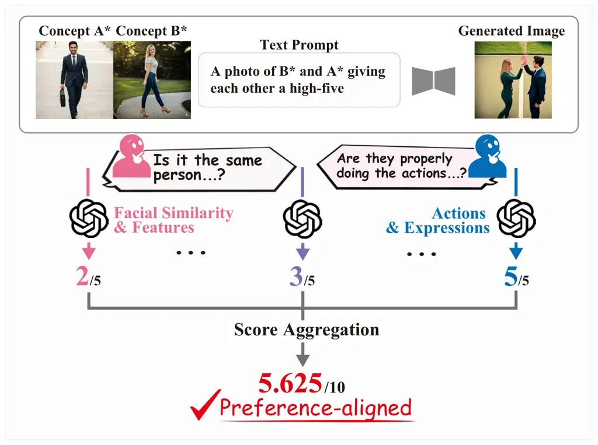
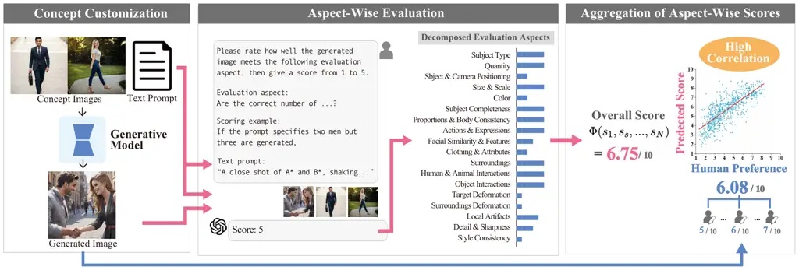
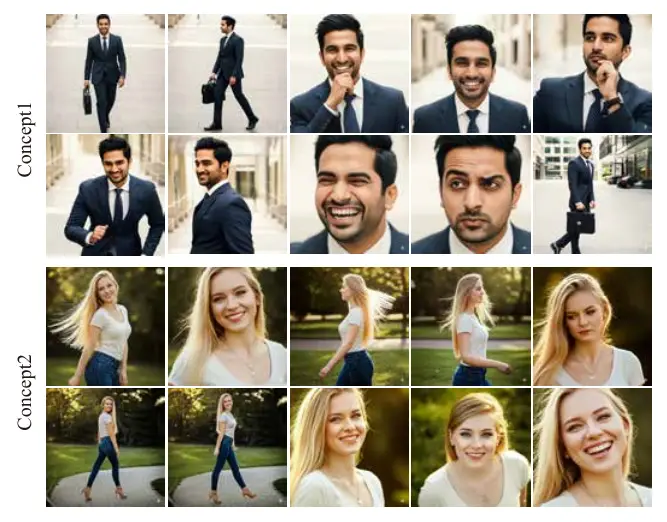
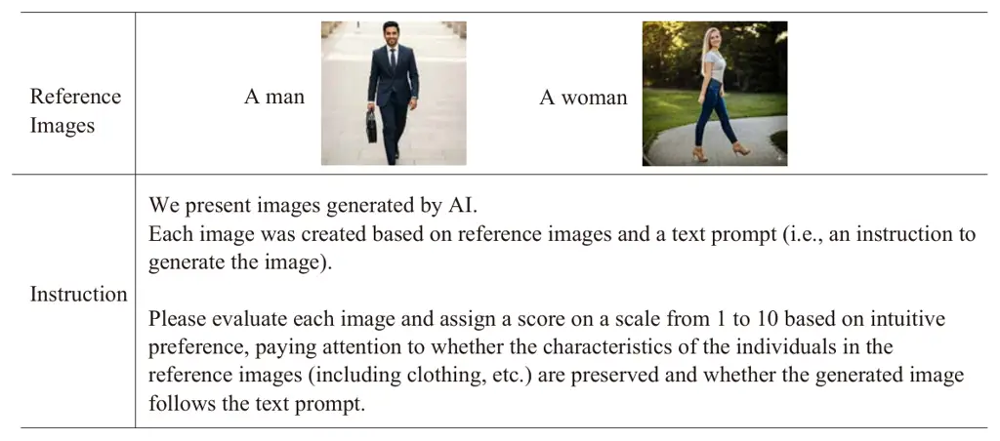
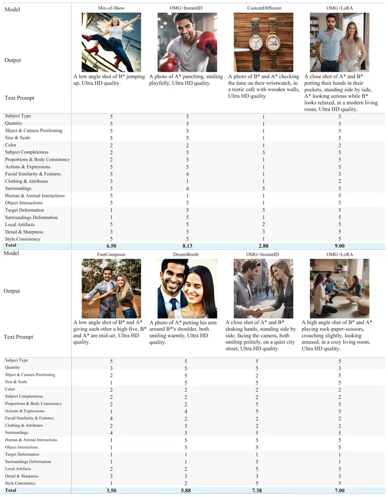

# Human Preference-Aligned Concept Customization Benchmark via Decomposed Evaluation

Reina Ishikawa Affiliation: Keio University    Ryo Fujii
Affiliation: Keio University    Hideo Saito Affiliation: Keio University
   Ryo Hachiuma Affiliation: NVIDIA{reina.ishikawa, ryo.fujii0112,
hs}@keio.jp, rhachiuma@nvidia.com

###### Abstract

Evaluating concept customization is challenging, as it requires a
comprehensive assessment of fidelity to generative prompts and concept
images. Moreover, evaluating multiple concepts is considerably more
difficult than evaluating a single concept, as it demands detailed
assessment not only for each individual concept but also for the
interactions among concepts. While humans can intuitively assess
generated images, existing metrics often provide either overly narrow or
overly generalized evaluations, resulting in misalignment with human
preference. To address this, we propose our_eval (our_eval), a novel
human-aligned evaluation method that decomposes evaluation criteria into
finer aspects and incorporates aspect-wise assessments using MLLM
(MLLM). Additionally, we release ours (ours), a benchmark dataset
containing both single- and multi-concept tasks, enabling stage-wise
evaluation across a wide difficulty range—from individual actions to
multi-person interactions. Our method significantly outperforms existing
approaches on this benchmark, exhibiting higher correlation with human
preferences. This work establishes a new standard for evaluating concept
customization and highlights key challenges for future research. The
benchmark and associated materials are available at
[https://github.com/ReinaIshikawa/D-GPTScore](https://github.com/ReinaIshikawa/D-GPTScore)



Figure 1: our_eval evaluates images generated by concept customization
through a two-step process: aspect-wise evaluation followed by
aggregation. This approach achieves significantly higher correlation
with human preference scores than existing methods, establishing a more
reliable and human-aligned metric.



Figure 2: The pipeline of our_eval. This metric comprises two phases:
(1) Aspect-wise evaluation with MLLM, and (2) Aggregation of aspect-wise
scores.

## 1 Introduction

When evaluating AI-generated images from user-provided text prompts,
what criteria do you employ to determine whether the generated images
are of high quality? You may implicitly consider diverse evaluation
aspects such as overall realism and fidelity to the text prompt.
Although humans can intuitively and comprehensively evaluate generated
images based on these implicit aspects, automatic methods that achieve
comprehensive evaluation aligned with human preferences remain
underexplored in the research community.

In recent years, the rise of diffusion models \[15, 46, 40, 38\] has led
to numerous text-to-image generation methods. Building upon these
approaches, concept customization \[50, 41, 60\] aims to extend
pretrained diffusion models to support single or multiple personalized
concepts using only a few reference images per concept, combined with
user-provided text prompts that condition the concepts (e.g., A^(∗) is
standing, where A^(∗) denotes the concept).

To advance controllable image generation—hereafter referred to as
concept customization—rigorous evaluation of generated images is
essential to appropriately guide research progress. However, due to
several critical issues in existing evaluation metrics and datasets,
standardized benchmarks for the concept customization task remain
underdeveloped.

First, existing evaluation metrics are not aligned with human
preferences. Humans can comprehensively consider various evaluation
criteria and implicitly weigh important aspects to form an overall
judgment of generated image quality. In contrast, existing evaluation
metrics for concept customization \[14, 36, 8\] either assess only
partial aspects or provide overly abstracted evaluations of generated
images, resulting in low correlation with human preference scores (see
Section 5.2 for experimental results).

Second, current benchmarks \[22\] only partially evaluate concept
customization models, and the evaluation settings are limited to
relatively simple cases. Most studies employ text-to-image
benchmarks \[42, 1, 16, 9\] for concept customization tasks; however,
these datasets contain incomplete inputs and evaluate only partial
aspects of the task. Although CustomConcept101 \[22\] is a widely used
and comprehensive benchmark, the target concepts and text prompts are
relatively simple for customization models. For example, the target
concepts predominantly consist of objects that do not interact with
scenes or other concepts; the reference images are close-up shots of the
concepts; and the text prompts for concepts describe non-interactive
scenarios (_e.g_., A^(∗) is walking).

In this paper, we propose ours, which includes a human-aligned
evaluation metric and a comprehensive evaluation dataset for the concept
customization task. Inspired by LLM-as-a-Judge \[61\], we leverage the
capabilities of state-of-the-art MLLM, particularly GPT-4o \[34\], to
develop a human-aligned evaluation metric. These MLLM demonstrate
excellent multi-modal language understanding by processing combined text
and visual inputs, enabling tasks such as image captioning and visual
question answering. This multi-modal understanding makes them
well-suited for evaluating concept customization, which requires
consideration of both text prompts and reference images.

However, if GPT-4o directly assesses the entire generated image at once,
it may only provide a coarse overall score. To address this, we propose
to decompose the evaluation criteria into multiple predefined aspects
and evaluate each aspect individually, thereby preventing the omission
of detailed factors and ensuring better alignment with human
preferences. The individual aspect scores are then aggregated to produce
the final evaluation metric.

Furthermore, we construct a dataset consisting of pairs of text prompts
and reference images, focusing specifically on humans exhibiting more
complex and diverse interactions with scenes and/or other humans. The
dataset contains 980 text prompts encompassing three levels of human
actions (_i.e_., a single person’s action, two persons’ independent
actions, and two persons’ mutual actions), and five conditioning types
(_i.e_., five different combinations of action, layout, expressions, and
surroundings) (see Section 4 for details). By evaluating according to
the levels of human actions or conditioning types, this dataset enables
a systematic assessment of a model’s concept customization capabilities.

Our main contributions can be summarized as follows:

- •
  We propose the ours for comprehensive evaluation of both single- and
  multi-concept customization, offering varying difficulty levels based
  on character count and scene complexity, thus allowing gradual
  assessment of model capabilities.
- •
  We introduce an evaluation metric, our_eval, leveraging MLLM that
  enables comprehensive and automated evaluation of concept
  customization. Our metric demonstrates better alignment with human
  preferences than existing methods and supports multi-concept
  evaluation.
- •
  We conduct extensive ablation studies using the ours dataset to verify
  the effectiveness of our proposed metric. Experimental results confirm
  that our metric correlates more strongly with human preference scores
  than existing evaluation metrics.

We believe this benchmark will advance the concept customization
research community toward more realistic and human preference-aligned
evaluation.

## 2 Related Work

### 2.1 Metrics for concept customization

Evaluating the quality of generated images using appropriate metrics and
obtaining feedback is crucial for model improvement. However, existing
methods fail to comprehensively assess all relevant aspects of concept
customization, resulting in evaluations that diverge from human
preferences.

Metrics such as Counting \[36\], SOA-I Score \[14\],
Compositions \[36\], and YOLO Score \[25\] can recognize the number of
subjects and layout in multi-subject scenarios, but their assessments
are limited and do not evaluate verbs in the text prompt (_e.g_.,
actions). Conversely, methods like the CLIP series \[39\] and DINO
Score \[5\] provide overall evaluations by comparing images with text or
texts with each other; however, their assessments are general and
insufficient to capture fine-grained differences. QS \[10\], CLIP
Aesthetic \[44\], and IS \[10\] demonstrate high correlation with human
ratings but are restricted to assessing image quality.
ImageReward \[56\] and VQA Score \[27\] enable integrated evaluation of
a text prompt and a generated image through a preference-based model and
Question Answering, respectively. However, both models are primarily
designed for text-to-image tasks. Although GPT-4V Score \[62\] can
evaluate both composition quality and image quality using MLLM, it does
not account for multi-concept scenarios. In contrast, our proposed
method enables a comprehensive evaluation of generated images across all
necessary aspects, including fidelity to mutual interactions.

### 2.2 Benchmarks for concept customization

Proper evaluation of images generated through concept customization
requires the consideration of both text prompts and reference images
alongside the outputs. However, many existing datasets lack either
prompts or reference images \[63, 42, 9, 1, 41, 16\]. Even when both are
available, reference images often depict multiple individuals \[26, 37,
57, 43, 7\] or focus solely on faces or upper bodies \[17, 22, 35\],
limiting their suitability for representing individual concepts.
ImagenHub \[21\] is composed of pairs of concept images and
corresponding text prompts, but excludes human subjects. As a result, no
existing dataset adequately supports the evaluation of dynamic movements
in concept customization. Accordingly, current methods often rely on
combinations of such datasets and their associated metrics. Furthermore,
datasets featuring complex actions, such as mutual interactions, remain
scarce, and no benchmark explicitly addresses them.

To bridge these gaps, we introduce a dataset that includes both prompts
and reference images for single- and multi-concept scenarios. It also
provides prompts of varying difficulty, enabling step-wise evaluation of
generation performance.

### 2.3 MLLM-based human-preference scoring

Recent research has actively explored scoring methods aligned with human
preferences using MLLM, particularly for video evaluation \[2, 3, 51,
32\]. To improve alignment, several methods assess generative models by
defining various aspects and scoring each individually \[54, 13\]. Some
works aggregate aspect-wise scores based on human preferences, such as
MMHE \[33\], which employs harmonic weighting, and MetaMetrics \[53\],
which trains a regression model to combine the outputs of existing
metrics.

For MLLM-based metrics in concept customization tasks, VIEScore \[20\]
and CIGEval \[52\] proposed evaluation metrics by decomposing the task,
but neither accounts for the action fidelity of interactions between
living subjects. DreamBench++ \[35\] improves alignment with human
scores on single-concept customization tasks by performing decomposition
and outputting the reasoning process for task understanding. However, it
does not explicitly generate scores for each evaluation aspect, which
may reduce the reliability of the final score due to implicit
reasoning \[58\].

Our method is unique in that it achieves human-aligned evaluation for
concept customization—supporting both single- and multi-concept tasks—by
performing unified explicit aspect-wise evaluation and integration using
a single MLLM.

| Difficulty | \#Total | \#Base | \#Persons per prompt | \#Different Actions | Action Type        |
| ---------- | ------- | ------ | -------------------- | ------------------- | ------------------ |
| easy       | 260     | 52     | 1                    | 13                  | non-interaction    |
| medium     | 260     | 52     | 1                    | 13                  | non-interaction    |
| hard       | 460     | 92     | 2                    | 23                  | mutual interaction |

Table 1: Composition of the ours dataset, divided into three difficulty
levels based on the number of persons and interaction types.

## 3 D-GPTScore Metric

Our concept customization evaluation metric is straightforward and
consists of two phases: (1) Aspect-wise evaluation using MLLM, and (2)
Aggregation of aspect-wise scores. As a preliminary step, we provide a
brief overview of concept customization as follows:

Concept Customization. An image $`I_{g}`$ is generated from a text
prompt $`\mathcal{T}=\{t_{1},t_{2},...,t_{k}\}`$, which comprises
several short text elements concatenated with commas, and a set of
reference images $`\mathcal{I}=\{i_{1},i_{2},...,i_{l}\}`$, using the
generative model $`\theta`$:

```math
I_{g}=\mathcal{\theta}(\mathcal{T},\mathcal{I}). \tag{1}
```

### 3.1 Aspect-wise evaluation with MLLM

In the aspect-wise evaluation phase, we first decompose the evaluation
criteria for concept customization into $`N`$ predefined aspects
$`\mathcal{A}=\{a_{1},a_{2},...,a_{N}\}`$, considering not only single-
but also multi-concept scenarios (see Section 3.3 for details). To
obtain the $`n`$-th aspect-wise score $`s_{n}\in\mathbb{R}`$ of the
generated image $`I_{g}`$, we independently feed the $`n`$-th evaluation
aspect $`a_{n}`$ into a MLLM $`\phi`$, along with the text prompt
$`\mathcal{T}`$ and reference images $`\mathcal{I}`$:

```math
s_{n}=\phi(a_{n},I_{g},\mathcal{T},\mathcal{I}), \tag{2}
```

### 3.2 Aggregation of aspect-wise scores

Once the scores $`{s_{1},s_{2},...,s_{N}}`$ for multiple aspects are
obtained, the aggregation model $`\Phi`$ is applied to compute the
overall score $`s_{overall}`$ on a scale of $`[1,10]`$ as follows:

```math
s_{overall}=\Phi(s_{1},s_{2},...,s_{N}). \tag{3}
```

An ablation study on the choice of aggregation model is provided in
Section 5.5.

### 3.3 Identification of evaluation aspects

We predefine the evaluation aspects into two main categories: (1)
Concept Fidelity and (2) Quality Assessment.

“Concept Fidelity” assesses the adherence of the generated image to the
text prompt and reference images and is further divided into the
following four subcategories, totaling 13 aspects.

1. Object Existence&Accuracy assesses whether the specified objects or
   people are generated according to the prompt, in appropriate quantities,
   based on the Subject Type and Quantity.

2. Layout & Composition Fidelity assesses whether the Subject & Camera
   Positioning (_i.e_., relative positions, including camera angles) and
   the relative Size & Scale of the generated characters and objects align
   with the instructions in the prompt.

3. Object-Level Fidelity assesses whether the generated objects, people,
   and surroundings are accurately depicted, maintaining consistency with
   both the text and reference images in terms of Color, Proportions & Body
   Consistency, Actions & Expressions, Facial Similarity & Features,
   Clothing & Attributes, and Surroundings.

4. Multi-Concept Interaction Consistency assesses whether interactions
   between humans (_i.e_., Human & Animal Interactions) or between objects
   (_i.e_., Object Interactions) are generated in a natural and coherent
   manner, as specified in the text prompt.

“Quality Assessment” evaluates image quality, consisting of 5 aspects:
Subject Deformation, Surroundings Deformation, Local Artifacts,
Detail&Sharpness, and Style Consistency.

[TABLE]

Table 2: Example text prompt in ours. Each prompt consists of the four
base prompts: action, layout, expression, and surroundings.

## 4 Dataset

### 4.1 Text preparation

As shown in Table 1, ours consists of 196 prompts divided into three
difficulty levels: 52 Easy, 52 Medium, and 92 Hard prompts (referred to
as difficulty levels). Easy prompts describe a single person acting;
Medium prompts involve two individuals performing independent actions
such as “standing” or “walking”; and Hard prompts depict interactions
between two individuals, such as “hugging” or “whispering.”

Each of the 196 base prompts comprises four elements: action, layout,
expression, and surroundings. To evaluate the model’s expressive
capabilities, five variations are generated from each base prompt:
action-only prompt $`{t_{act}}`$, action+layout prompt
$`{t_{act},t_{lt}}`$, action+expression prompt $`{t_{act},t_{exp}}`$,
action+surroundings prompt $`{t_{act},t_{surr}}`$, and all prompt
$`{t_{act},t_{lt},t_{exp},t_{surr}}`$. Since each of the 196 prompts is
expanded into these five variations, the total number of prompt
variations in ours amounts to $`196\times 5=980`$. An example text
prompt is shown in Table 2.

### 4.2 Image preparation

To address concerns related to portrait rights, we used generative AI to
create images without relying on photographs of real individuals. First,
we generated one image each of a man and a woman using Gemini 2.5 Flash
Preview \[48\]. Then, using Gemini 2.0 Flash Preview Image Generation,
we instructed the model to produce various patterns (_e.g_., close-up,
long shot, frontal, and profile views) of the same man and woman. We
added 19 additional images per person, resulting in 20 images per
individual and a total of 40 images. For models that require a single
input image, we ensured the same full-body image was consistently used.

## 5 Experiments

[TABLE]

Table 3: Comparison of correlation with human preference on ours. The
left shows Pearson’s correlation coefficient, and the right shows
Spearman’s rank correlation (higher is better). A correlation of $`0.5`$
or higher is generally considered strong, and the proposed metric
significantly exceeds this threshold for the overall score and most
individual models.

### 5.1 Experimental setup

#### Baselines of evaluation metrics

To verify whether the proposed method aligns with human preferences, we
compared it with five existing evaluation metrics commonly used for
concept customization: identity preservation score by ArcFace \[8\],
CLIP T2T score \[39\], CLIP T2I score \[39\], CLIP Aesthetic
Score \[44\], and DINO score \[5\]. See our supplementary material for
the details.

#### Target generative models

We evaluated five widely used and state-of-the-art image generation
models that support multi-concept customization: CustomDiffusion \[22\],
OMG \[19\] with LoRA or InstantID, FastComposer \[55\],
Mix-of-Show \[11\], and DreamBooth \[41\], using our proposed benchmark.

#### Aggregation model selection

For the aggregation model $`\Phi`$, we adopted the average function:

```math
\Phi(s_{1},s_{2},...,s_{N})=\frac{1}{N}\sum_{n=1}^{N}s_{n}, \tag{4}
```

meaning that each aspect is treated equally to compute the final score.
The choice of aggregation model is further discussed in Section 5.5.

#### MLLM setting

We employed gpt-4o-2024-08- 06 \[34\] as the MLLM for aspect-wise
evaluation. All generated and reference images fed to GPT-4o were
resized to 512$`\times`$512 pixels. For evaluation aspects where only
generated images are provided (*e.g*., deformations or local artifacts),
resolution can affect accuracy. Therefore, we additionally provided GPT
with two square-cropped images, each covering $`50\%`$ of the original
size, centered vertically and placed on the left and right halves, along
with the original image.

#### Preference score annotation

To evaluate human alignment, we measured the correlation between
predicted scores and human preference scores. The human scores were
obtained from 12 expert annotators (5 females, 7 males), all members of
our laboratory. We randomly selected 40 prompts from each of the three
difficulty levels (_i.e_., easy, medium, hard) and generated images
using six different models for each prompt. The resulting 720 images
were evaluated by the annotators, who scored them from 1 to 10 with
reference to both the text prompts and the reference images. We then
averaged the scores across annotators to obtain a single human
preference score per image. The annotation took approximately two hours
per annotator. Each annotator was compensated \$48 according to the
current exchange rate.

#### Experimental environment

All experiments were conducted on a system equipped with a single NVIDIA
RTX A6000 (48GB), an Intel(R) Core(TM) i9-9940X CPU, and the OpenAI API.

Figure 3: Benchmark results of aspect-wise evaluation. Each aspect is
scored on a scale from 1 to 5, with higher values indicating better
performance.

### 5.2 Correlation with human preference

For each evaluation metric, we computed the Pearson’s correlation
coefficient and Spearman’s rank correlation between the human preference
scores and the predicted scores. The results are summarized in Table 3.
Our metric achieves an overall Pearson’s correlation of $`0.78`$ and an
overall Spearman’s rank correlation of $`0.69`$ with human preferences,
significantly surpassing all existing metrics. These results demonstrate
that the proposed method provides human-aligned evaluation for concept
customization and outperforms existing metrics. Furthermore, since
omission of any key aspect may reduce correlation, the strong
correlation exceeding 0.7 suggests that the proposed decomposed aspects
are necessary and sufficient.

### 5.3 Benchmark results

| Difficulty Level | CustomDiffusion | OMG+LoRA | OMG+InstantID | FastComposer | Mix-of-Show | DreamBooth |
| ---------------- | --------------- | -------- | ------------- | ------------ | ----------- | ---------- |
| Easy             | 5.64            | 7.28     | 7.13          | 5.21         | 5.75        | 5.53       |
| Medium           | 4.62            | 7.05     | 6.64          | 4.72         | 5.27        | 5.01       |
| Hard             | 4.30            | 6.41     | 6.10          | 4.45         | 4.82        | 4.87       |
| Overall          | 4.74            | 6.81     | 6.52          | 4.72         | 5.19        | 5.09       |

Table 4: Average benchmark scores for each difficulty level on ours,
predicted using our_eval. Each score ranges from 1 to 10, with higher
values indicating better image generation performance. When applying
linear regression, the leave-one-out approach is employed to ensure that
the generated images from the model under evaluation are excluded from
the training data.

![[Uncaptioned
image]](arxiv-2509-03385v1--7b99b9c56ad0.figures/figure-3.webp)

Table 5: our_eval scoring examples on the Hard level subset of ours. For
each model, the top three scores are highlighted in red, blue, and
yellow, respectively, to illustrate their correspondence with the human
preference rankings.

Table 4 presents the benchmark scores of each image generation model on
our dataset, and Figure 3 shows the 18 aspect-wise scores.

As shown in Table 4, scores generally decrease as the action difficulty
increases from Easy to Hard. OMG+LoRA and OMG+InstantID achieved the
highest scores at the Easy level, with 7.28 and 7.13, respectively;
however, OMG+InstantID’s score dropped notably at the Hard level. In
contrast, DreamBooth showed the smallest decrease, indicating more
stable performance.

While the primary objective of our paper is to achieve human
preference-aligned evaluation, the aspect-wise scores obtained as
intermediate results provide detailed feedback, as illustrated in
Figure 3. All models exhibited difficulty with complex actions, leading
to low scores in object fidelity aspects such as Color, Facial
Similarity & Features, and Clothing & Attributes, as well as in Actions
& Expressions and Human & Animal Interactions. However, notable
differences emerged in Proportions & Body Consistency, Object
Interactions, and Local Artifacts, where the OMG-based methods
consistently scored high across difficulty levels, while others
struggled.

### 5.4 Qualitative results

[TABLE]

Table 6: Ablation studies on three components of our metric:
decomposition (Decomposition), the MLLM used for aspect-wise scoring
(MLLM), and the aggregation model (Aggregation). The left value in each
cell denotes Pearson’s correlation coefficient, and the right value
denotes Spearman’s rank correlation.

[TABLE]

Table 7: Exploration of extending our metric by combining it with
existing metrics. Ours++ denotes the combination with existing metrics.
The left value in each cell represents Pearson’s correlation
coefficient, and the right value represents Spearman’s rank correlation.

Table 5 presents a scoring example on ours. The table shows that
existing metrics produce rankings that differ considerably from human
preference scores. In contrast, although minor fluctuations are
observed, the proposed method generally aligns well with human
preferences.

### 5.5 Ablation study

This section presents the results of ablation studies on three
components of the proposed metric: the effectiveness of decomposition,
the MLLM used for aspect-wise scoring, and the aggregation model. All
results are summarized in Table 6.

#### Decomposition ablation

To examine the necessity of decomposition, we compared our method with a
metric that directly outputs a score on a 1–10 scale using the GPT-4o
model without decomposition (referred to as Vanilla-GPT). As shown in
Table 6, the proposed decomposed metric significantly outperforms
Vanilla-GPT in both individual model scores and overall correlation with
human preferences. This suggests that directly using GPT-4o without
decomposition fails to capture fine-grained evaluation aspects,
resulting in poor alignment with human preferences.

#### MLLM ablation

We adopted GPT-4o as the MLLM for aspect-wise evaluation due to its
superior multi-modal understanding capabilities. However, considering
API costs, we also evaluated with GPT-4o mini as a substitute. GPT-4o
mini yielded lower overall Pearson’s and Spearman’s correlations, both
by 0.10, compared to GPT-4o. Nevertheless, GPT-4o mini still
outperformed existing metrics significantly (see Table 3). Thus, while
GPT-4o provides more accurate evaluation, GPT-4o mini offers a viable
alternative depending on computational resources. Notably, the average
token counts per generated image were $`12,091`$ (input) and $`96`$
(output) for GPT-4o, versus $`299,672`$ (input) and $`104`$ (output) for
GPT-4o mini.

#### Aggregation model ablation

Although this study employs averaging of aspect-wise scores to compute
the final score, learnable models such as linear regression can also be
used to better align with human preference scores. Results using linear
regression are reported in Table 6.

With linear regression, the overall Pearson correlation coefficient and
Spearman rank correlation coefficient are slightly lower, at 0.75 and
0.62, than those obtained with averaging. This may be due to
distribution shifts among generation models, causing slight overfitting.
We expect that as concept customization research progresses and more
generative models become available, regression-based aggregation may
become more effective.

Importantly, achieving high correlation with human preferences even
without regression suggests that the 18 evaluation aspects were
appropriately and sufficiently defined.

## 6 Discussion

In this section, we explore an extension of the proposed method by
combining it with existing metrics to achieve a more comprehensive and
accurate evaluation. Specifically, after obtaining 18 scores through
aspect-wise evaluation, aggregation is performed by combining these
scores with those from existing metrics. Table 7 presents the results of
combining the 18 aspect-wise scores (Ours++) with scores from six
existing metrics used for comparison (_i.e_., ArcFace, CLIP T2T score,
CLIP T2I score, CLIP Aesthetic Score, DINO, and Vanilla GPT). Both the
aspect-wise and existing scores were min-max normalized and scaled to a
1–10 range, resulting in a total of 24 aspects. The table shows that
combining the proposed method with existing metrics yields a slight
increase in correlation compared to using the proposed method alone.

## 7 Limitations

#### Dataset

This paper’s dataset excludes stationary objects and animals, focusing
on humans due to the greater challenges posed by their complex
structures and movements. However, since the evaluation metric also
applies to scenes with objects and animals, future work will expand the
dataset to include these, enabling more comprehensive evaluations.

The study focuses on generation difficulties arising from variations in
human actions and emphasizes text prompt diversity. While only male and
female humans were used as concept images in this study, future work
will broaden the range of subjects.

#### Supported input sets

Some image generation methods accept optional inputs, such as pose or
sketch images. However, our evaluation metric assumes that generative
models take only text and reference images as inputs and excludes
additional inputs from the evaluation. Considering the input cost to the
MLLM, providing all additional inputs and expanding the evaluation
aspects accordingly is impractical.

Moreover, accounting for these additional inputs would increase the
variability of inputs used for evaluation across models, thereby
complicating accurate model comparisons. Therefore, it is preferable to
treat such additional inputs as optional during image generation, while
the proposed evaluation metric focuses on the most fundamental and
common inputs: text and reference images.

#### Generative models

In this paper, we selected six generative models that support
multi-concept customization as evaluation targets and obtained benchmark
results. However, as discussed in Section 5.5, due to large score
variance among these models, the use of trainable aggregation methods,
such as regression models, led to overfitting during training.
Consequently, the correlation achieved using linear regression did not
improve significantly compared to averaging. In the future, as
multi-concept customization research advances and more models become
available, this overfitting issue is expected to be mitigated, rendering
regression a more effective aggregation method and enabling scoring with
higher correlation to human preferences.

## 8 Ethical Considerations

In creating our benchmark dataset, we carefully removed harmful,
offensive, or abusive expressions. Since the dataset is intended solely
for image evaluation, it poses no direct social risks. However, it is
important to note that terms such as “hit” and “kick” are included to
introduce variations in mutual interactions. As generated images heavily
depend on the training data, controlling the output is challenging. To
respect portrait rights, only AI-generated reference images are used,
eliminating concerns about harm to individuals. Additionally, in our
experiments, visual inspections were conducted to ensure the images do
not contain harmful or offensive content. Nevertheless, toxic images may
still be generated depending on the model. Users should be aware of the
potential risks and refrain from using this dataset to generate
offensive or inappropriate images, especially of real individuals.
Caution is advised when releasing these images.

## 9 Conclusion

This paper proposes our_eval, a novel evaluation metric for concept
customization. Since existing metrics have yielded results misaligned
with human preferences, we propose to decompose evaluation criteria for
single and multiple concepts into 18 aspects, perform aspect-wise
evaluation using MLLM, and aggregate the results to achieve a
comprehensive and human-aligned assessment. Furthermore, we introduced
ours, a benchmark dataset supporting both single- and multi-concept
evaluations. Extensive experiments demonstrate that our metric
correlates significantly better with human preferences compared to prior
metrics, and ablation studies confirm the effectiveness of the
decomposition strategy.

## Acknowledgment

This work was supported by JST BOOST, Japan Grant Number JPMJBS2409.

## References

- \[1\] Eslam Mohamed Bakr, Pengzhan Sun, Xiaoqian Shen, Faizan Farooq
  Khan, Li Erran Li, and Mohamed Elhoseiny. HRS-Bench: Holistic,
  Reliable and Scalable Benchmark for Text-to-Image Models. In
  _ICCV_, 2023.
- \[2\] Hritik Bansal, Zongyu Lin, Tianyi Xie, Zeshun Zong, Michal
  Yarom, Yonatan Bitton, Chenfanfu Jiang, Yizhou Sun, Kai-Wei Chang, and
  Aditya Grover. Videophy: Evaluating physical commonsense for video
  generation. In _ICRL_, pages 102075–102121, 2025a.
- \[3\] Hritik Bansal, Clark Peng, Yonatan Bitton, Roman Goldenberg,
  Aditya Grover, and Kai-Wei Chang. VideoPhy-2: A Challenging
  Action-Centric Physical Commonsense Evaluation in Video Generation.
  _arXiv preprint arXiv:2503.06800_, 2025b.
- \[4\] Qiong Cao, Li Shen, Weidi Xie, Omkar M. Parkhi, and Andrew
  Zisserman. Vggface2: A dataset for recognising faces across pose and
  age. In _FG_, 2018.
- \[5\] Mathilde Caron, Hugo Touvron, Ishan Misra, Hervé Jégou, Julien
  Mairal, Piotr Bojanowski, and Armand Joulin. Emerging Properties in
  Self-Supervised Vision Transformers. In _ICCV_, 2021.
- \[6\] Xi Chen, Lianghua Huang, Yu Liu, Yujun Shen, Deli Zhao, and
  Hengshuang Zhao. AnyDoor: Zero-shot Object-level Image Customization.
  In _CVPR_, 2024.
- \[7\] Jaemin Cho, Abhay Zala, and Mohit Bansal. DALL-EVAL: Probing the
  Reasoning Skills and Social Biases of Text-to-Image Generation Models.
  In _ICCV_, 2023.
- \[8\] Jiankang Deng, Jia Guo, Jing Yang, Niannan Xue, Irene Kotsia,
  and Stefanos Zafeiriou. ArcFace: Additive Angular Margin Loss for Deep
  Face Recognition. _IEEE TPAMI_, 44(10_Part_1):5962–5979, 2022.
- \[9\] Tejas Gokhale, Hamid Palangi, Besmira Nushi, Vibhav Vineet, Eric
  Horvitz, Ece Kamar, Chitta Baral, and Yezhou Yang. Benchmarking
  spatial relationships in text-to-image generation. _arXiv preprint
  arXiv:2212.10015_, 2022.
- \[10\] Shuyang Gu, Jianmin Bao, Dong Chen, and Fang Wen. GIQA:
  Generated Image Quality Assessment. In _ECCV_, 2020.
- \[11\] Yuchao Gu, Xintao Wang, Jay Zhangjie Wu, Yujun Shi, Yunpeng
  Chen, Zihan Fan, Wuyou Xiao, Rui Zhao, Shuning Chang, Weijia Wu,
  Yixiao Ge, Ying Shan, and Mike Zheng Shou. Mix-of-show: decentralized
  low-rank adaptation for multi-concept customization of diffusion
  models. In _NeurIPS_, 2023.
- \[12\] Junjie He, Yifeng Geng, and Liefeng Bo. UniPortrait: A Unified
  Framework for Identity-Preserving Single- and Multi-Human Image
  Personalization. _arXiv preprint arXiv:2408.05939_, 2024a.
- \[13\] Xuan He, Dongfu Jiang, Ge Zhang, Max Ku, Achint Soni, Sherman
  Siu, Haonan Chen, Abhranil Chandra, Ziyan Jiang, Aaran Arulraj, Kai
  Wang, Quy Duc Do, Yuansheng Ni, Bohan Lyu, Yaswanth Narsupalli, Rongqi
  Fan, Zhiheng Lyu, Bill Yuchen Lin, and Wenhu Chen. VideoScore:
  Building Automatic Metrics to Simulate Fine-grained Human Feedback for
  Video Generation. In _EMNLP_, 2024b.
- \[14\] Tobias Hinz, Stefan Heinrich, and Stefan Wermter. Semantic
  Object Accuracy for Generative Text-to-Image Synthesis. _IEEE TPAMI_,
  44(3):1552–1565, 2022.
- \[15\] Jonathan Ho, Ajay Jain, and Pieter Abbeel. Denoising Diffusion
  Probabilistic Models. In _NeurIPS_, 2020.
- \[16\] Yushi Hu, Benlin Liu, Jungo Kasai, Yizhong Wang, Mari
  Ostendorf, Ranjay Krishna, and Noah A. Smith. TIFA: Accurate and
  Interpretable Text-to-Image Faithfulness Evaluation with Question
  Answering. In _ICCV_, 2023.
- \[17\] Tero Karras, Samuli Laine, and Timo Aila. A Style-Based
  Generator Architecture for Generative Adversarial Networks. In
  _CVPR_, 2019.
- \[18\] Alexander Kirillov, Eric Mintun, Nikhila Ravi, Hanzi Mao, Chloe
  Rolland, Laura Gustafson, Tete Xiao, Spencer Whitehead, Alexander C.
  Berg, Wan-Yen Lo, Piotr Dollar, and Ross Girshick. Segment Anything.
  In _ICCV_, 2023.
- \[19\] Zhe Kong, Yong Zhang, Tianyu Yang, Tao Wang, Kaihao Zhang,
  Bizhu Wu, Guanying Chen, Wei Liu, and Wenhan Luo. OMG:
  Occlusion-Friendly Personalized Multi-concept Generation in Diffusion
  Models. In _ECCV_, 2024.
- \[20\] Max Ku, Dongfu Jiang, Cong Wei, Xiang Yue, and Wenhu Chen.
  VIEScore: Towards explainable metrics for conditional image synthesis
  evaluation. In _ACL_, pages 12268–12290. ACL, 2024a.
- \[21\] Max Ku, Tianle Li, Kai Zhang, Yujie Lu, Xingyu Fu, Wenwen
  Zhuang, and Wenhu Chen. Imagenhub: Standardizing the evaluation of
  conditional image generation models. In _ICLR_, 2024b.
- \[22\] Nupur Kumari, Bingliang Zhang, Richard Zhang, Eli Shechtman,
  and Jun-Yan Zhu. Multi-Concept Customization of Text-to-Image
  Diffusion. In _CVPR_, 2023.
- \[23\] Dongxu Li, Junnan Li, and Steven C.H. Hoi. BLIP-diffusion:
  pre-trained subject representation for controllable text-to-image
  generation and editing. In _NeurIPS_, 2023a.
- \[24\] Junnan Li, Dongxu Li, Silvio Savarese, and Steven Hoi. BLIP-2:
  Bootstrapping Language-Image Pre-training with Frozen Image Encoders
  and Large Language Models. In _ICML_, 2023b.
- \[25\] Zejian Li, Jingyu Wu, Immanuel Koh, Yongchuan Tang, and Lingyun
  Sun. Image Synthesis From Layout With Locality-Aware Mask Adaption. In
  _ICCV_, 2021.
- \[26\] Tsung-Yi Lin, Michael Maire, Serge Belongie, James Hays, Pietro
  Perona, Deva Ramanan, Piotr Dollár, and C. Lawrence Zitnick. Microsoft
  COCO: Common Objects in Context. In _ECCV_, 2014.
- \[27\] Zhiqiu Lin, Deepak Pathak, Baiqi Li, Jiayao Li, Xide Xia,
  Graham Neubig, Pengchuan Zhang, and Deva Ramanan. Evaluating
  text-to-visual generation with image-to-text generation. In _ECCV_,
  page 366–384, 2024.
- \[28\] Jun Liu, Amir Shahroudy, Mauricio Perez, Gang Wang, Ling-Yu
  Duan, and Alex C. Kot. NTU RGB+D 120: A Large-Scale Benchmark for 3D
  Human Activity Understanding. _IEEE TPAMI_, 42(10):2684–2701, 2020.
- \[29\] Shilong Liu, Zhaoyang Zeng, Tianhe Ren, Feng Li, Hao Zhang, Jie
  Yang, Qing Jiang, Chunyuan Li, Jianwei Yang, Hang Su, Jun Zhu, and Lei
  Zhang. Grounding dino: Marrying dino with grounded pre-training for
  open-set object detection. In _ECCV_, 2024.
- \[30\] Zhiheng Liu, Yifei Zhang, Yujun Shen, Kecheng Zheng, Kai Zhu,
  Ruili Feng, Yu Liu, Deli Zhao, Jingren Zhou, and Yang Cao. Cones 2:
  customizable image synthesis with multiple subjects. In
  _NeurIPS_, 2023.
- \[31\] Jian Ma, Junhao Liang, Chen Chen, and Haonan Lu.
  Subject-Diffusion: Open Domain Personalized Text-to-Image Generation
  without Test-time Fine-tuning. In _SIGGRAPH_, 2024.
- \[32\] Nema, Preksha and Khapra, Mitesh M. Towards a Better Metric for
  Evaluating Question Generation Systems. In _EMNLP_, 2018.
- \[33\] Masanari Ohi, Masahiro Kaneko, Naoaki Okazaki, and Nakamasa
  Inoue. Multi-modal, Multi-task, Multi-criteria Automatic Evaluation
  with Vision Language Models. _arXiv preprint arXiv:2412.14613_, 2025.
- \[34\] OpenAI, Josh Achiam, Steven Adler, Sandhini Agarwal, Lama
  Ahmad, Ilge Akkaya, Florencia Leoni Aleman, Diogo Almeida, Janko
  Altenschmidt, Sam Altman, and Shyamal Anadkat et al. GPT-4 Technical
  Report. _arXiv preprint arXiv:2303.08774_, 2024.
- \[35\] Yuang Peng, Yuxin Cui, Haomiao Tang, Zekun Qi, Runpei Dong,
  Jing Bai, Chunrui Han, Zheng Ge, Xiangyu Zhang, and Shu-Tao Xia.
  Dreambench++: A human-aligned benchmark for personalized image
  generation. In _ICLR_, 2025.
- \[36\] Quynh Phung, Songwei Ge, and Jia-Bin Huang. Grounded
  Text-to-Image Synthesis with Attention Refocusing. In _CVPR_, 2024.
- \[37\] Bryan A. Plummer, Liwei Wang, Chris M. Cervantes, Juan C.
  Caicedo, Julia Hockenmaier, and Svetlana Lazebnik. Flickr30k Entities:
  Collecting Region-to-Phrase Correspondences for Richer
  Image-to-Sentence Models. In _ICCV_, 2015.
- \[38\] Dustin Podell, Zion English, Kyle Lacey, Andreas Blattmann, Tim
  Dockhorn, Jonas Müller, Joe Penna, and Robin Rombach. Sdxl: Improving
  latent diffusion models for high-resolution image synthesis. _arXiv
  preprint arXiv:2307.01952_, 2023.
- \[39\] Alec Radford, Jong Wook Kim, Chris Hallacy, Aditya Ramesh,
  Gabriel Goh, Sandhini Agarwal, Girish Sastry, Amanda Askell, Pamela
  Mishkin, Jack Clark, Gretchen Krueger, and Ilya Sutskever. Learning
  Transferable Visual Models From Natural Language Supervision. In
  _ICML_, 2021.
- \[40\] Robin Rombach, Andreas Blattmann, Dominik Lorenz, Patrick
  Esser, and Björn Ommer. High-Resolution Image Synthesis With Latent
  Diffusion Models. In _CVPR_, 2022.
- \[41\] Nataniel Ruiz, Yuanzhen Li, Varun Jampani, Yael Pritch, Michael
  Rubinstein, and Kfir Aberman. Dreambooth: Fine tuning text-to-image
  diffusion models for subject-driven generation. In _CVPR_, 2023.
- \[42\] Chitwan Saharia, William Chan, Saurabh Saxena, Lala Lit, Jay
  Whang, Emily Denton, Seyed Kamyar Seyed Ghasemipour, Burcu Karagol
  Ayan, S. Sara Mahdavi, Raphael Gontijo-Lopes, Tim Salimans, Jonathan
  Ho, David J Fleet, and Mohammad Norouzi. Photorealistic text-to-image
  diffusion models with deep language understanding. In _NeurIPS_, 2022.
- \[43\] Christoph Schuhmann, Richard Vencu, Romain Beaumont, Robert
  Kaczmarczyk, Clayton Mullis, Aarush Katta, Theo Coombes, Jenia Jitsev,
  and Aran Komatsuzaki. LAION-400M: Open Dataset of CLIP-Filtered 400
  Million Image-Text Pairs. _arXiv preprint arXiv:2111.02114_, 2021.
- \[44\] Christoph Schuhmann, Romain Beaumont, Richard Vencu, Cade
  Gordon, Ross Wightman, Mehdi Cherti, Theo Coombes, Aarush Katta,
  Clayton Mullis, Mitchell Wortsman, Patrick Schramowski, Srivatsa
  Kundurthy, Katherine Crowson, Ludwig Schmidt, Robert Kaczmarczyk, and
  Jenia Jitsev. LAION-5B: An open large-scale dataset for training next
  generation image-text models. _arXiv preprint arXiv:2210.08402_, 2022.
- \[45\] Amir Shahroudy, Jun Liu, Tian-Tsong Ng, and Gang Wang. NTU
  RGB+D: A Large Scale Dataset for 3D Human Activity Analysis. In
  _CVPR_, 2016.
- \[46\] Jascha Sohl-Dickstein, Eric A. Weiss, Niru Maheswaranathan, and
  Surya Ganguli. Deep unsupervised learning using nonequilibrium
  thermodynamics. In _ICML_, 2015.
- \[47\] Christian Szegedy, Wei Liu, Yangqing Jia, Pierre Sermanet,
  Scott Reed, Dragomir Anguelov, Dumitru Erhan, Vincent Vanhoucke, and
  Andrew Rabinovich. Going Deeper with Convolutions. _arXiv preprint
  arXiv:1409.4842_, 2014.
- \[48\] Gemini Team, Rohan Anil, Sebastian Borgeaud, Jean-Baptiste
  Alayrac, Jiahui Yu, Radu Soricut, Johan Schalkwyk, Andrew M. Dai, Anja
  Hauth, Katie Millican, and David Silver et al. Gemini: A family of
  highly capable multimodal models. _arXiv preprint
  arXiv:2312.11805_, 2025.
- \[49\] Patrick von Platen, Suraj Patil, Anton Lozhkov, Pedro Cuenca,
  Nathan Lambert, Kashif Rasul, Mishig Davaadorj, Dhruv Nair, Sayak
  Paul, William Berman, Yiyi Xu, Steven Liu, and Thomas Wolf. Diffusers:
  State-of-the-art diffusion models. _GitHub repository_, 2022.
- \[50\] Andrey Voynov, Qinghao Chu, Daniel Cohen-Or, and Kfir Aberman.
  P+: Extended Textual Conditioning in Text-to-Image Generation. _arXiv
  preprint arXiv:2303.09522_, 2023.
- \[51\] Jiarui Wang, Huiyu Duan, Guangtao Zhai, Juntong Wang, and
  Xiongkuo Min. AIGV-Assessor: Benchmarking and Evaluating the
  Perceptual Quality of Text-to-Video Generation with LMM. _arXiv
  preprint arXiv:2411.17221_, 2024.
- \[52\] Jifang Wang, Xue Yang, Longyue Wang, Zhenran Xu, Yiyu Wang,
  Yaowei Wang, Weihua Luo, Kaifu Zhang, Baotian Hu, and Min Zhang. A
  unified agentic framework for evaluating conditional image generation.
  _arXiv preprint arXiv:2504.07046_, 2025.
- \[53\] Genta Indra Winata, David Anugraha, Lucky Susanto, Garry
  Kuwanto, and Derry Tanti Wijaya. MetaMetrics: Calibrating Metrics For
  Generation Tasks Using Human Preferences. _arXiv preprint
  arXiv:2410.02381_, 2025.
- \[54\] Haoning Wu, Zicheng Zhang, Weixia Zhang, Chaofeng Chen, Liang
  Liao, Chunyi Li, Yixuan Gao, Annan Wang, Erli Zhang, Wenxiu Sun, Qiong
  Yan, Xiongkuo Min, Guangtao Zhai, and Weisi Lin. Q-Align: Teaching
  LMMs for Visual Scoring via Discrete Text-Defined Levels. In
  _ICML_, 2024.
- \[55\] Guangxuan Xiao, Tianwei Yin, William T. Freeman, Frédo Durand,
  and Song Han. FastComposer: Tuning-Free Multi-subject Image Generation
  with Localized Attention. _IJCV_, 133(3):1175–1194, 2024.
- \[56\] Jiazheng Xu, Xiao Liu, Yuchen Wu, Yuxuan Tong, Qinkai Li, Ming
  Ding, Jie Tang, and Yuxiao Dong. Imagereward: learning and evaluating
  human preferences for text-to-image generation. In _NeurIPS_, pages
  15903–15935, 2023.
- \[57\] Peter Young, Alice Lai, Micah Hodosh, and Julia Hockenmaier.
  From image descriptions to visual denotations: New similarity metrics
  for semantic inference over event descriptions. _TACL_, 2:67–78, 2014.
- \[58\] Yijiong Yu. Do llms really think step-by-step in implicit
  reasoning? _arXiv preprint arXiv:2411.15862_, 2025.
- \[59\] Kaipeng Zhang, Zhanpeng Zhang, Zhifeng Li, and Yu Qiao. Joint
  face detection and alignment using multitask cascaded convolutional
  networks. _SPL_, 23:1499–1503, 2016.
- \[60\] Lvmin Zhang, Anyi Rao, and Maneesh Agrawala. Adding Conditional
  Control to Text-to-Image Diffusion Models. In _ICCV_, 2023.
- \[61\] Lianmin Zheng, Wei-Lin Chiang, Ying Sheng, Siyuan Zhuang,
  Zhanghao Wu, Yonghao Zhuang, Zi Lin, Zhuohan Li, Dacheng Li, Eric
  Xing, Hao Zhang, Joseph E Gonzalez, and Ion Stoica. Judging
  LLM-as-a-Judge with MT-Bench and Chatbot Arena. In _NeurIPS_, 2023.
- \[62\] Ming Zhong, Yelong Shen, Shuohang Wang, Yadong Lu, Yizhu Jiao,
  Siru Ouyang, Donghan Yu, Jiawei Han, and Weizhu Chen. Multi-LoRA
  Composition for Image Generation. _arXiv preprint
  arXiv:2402.16843_, 2024.
- \[63\] Xingyi Zhou, Vladlen Koltun, and Philipp Krähenbühl. Simple
  multi-dataset detection. In _CVPR_, 2022.

Supplementary Material

[TABLE]

Table 8: Comparison of existing benchmark datasets in terms of inclusion
of essential components for concept customization evaluation and
applicability to multi-concept customization tasks.

| Individual actions (Easy / Medium)                             | Mutual actions (Hard)                         |
| -------------------------------------------------------------- | --------------------------------------------- |
| A^(∗) (and B^(∗)) standing                                     | A^(∗) punching B^(∗)                          |
| A^(∗) (and B^(∗)) walking                                      | A^(∗) kicking B^(∗)                           |
| A^(∗) (and B^(∗)) running                                      | A^(∗) pushing B^(∗)                           |
| A^(∗) (and B^(∗)) waving one’s hand                            | A^(∗) patting B^(∗) on the back               |
| A^(∗) (and B^(∗)) clapping                                     | A^(∗) pointing finger at B^(∗)                |
| A^(∗) (and B^(∗)) putting one’s hands in one’s pockets         | A^(∗) hugging B^(∗)                           |
| A^(∗) (and B^(∗)) jumping up                                   | A^(∗) giving a book to B^(∗)                  |
| A^(∗) (and B^(∗)) checking the time on one’s wristwatch        | A^(∗) touching B^(∗)’s pocket                 |
| A^(∗) (and B^(∗)) crossing one’s hands in front of one’s chest | A^(∗) and B^(∗) shaking hands                 |
| A^(∗) (and B^(∗)) kneeling on the ground                       | A^(∗) hitting B^(∗) with a book               |
| A^(∗) (and B^(∗)) squatting down                               | A^(∗) putting his arm around B^(∗)’s shoulder |
| A^(∗) (and B^(∗)) punching                                     | A^(∗) knocking into B^(∗)                     |
| A^(∗) (and B^(∗)) shrugging one’s shoulders                    | A^(∗) grabbing a book from B^(∗)              |
|                                                                | A^(∗) stepping on B^(∗)’s foot                |
|                                                                | A^(∗) and B^(∗) giving each other a high-five |
|                                                                | A^(∗) and B^(∗) clinking glasses              |
|                                                                | A^(∗) and B^(∗) carrying a box together       |
|                                                                | A^(∗) taking a picture of B^(∗) with a camera |
|                                                                | A^(∗) following B^(∗) down a street           |
|                                                                | A^(∗) whispering into B^(∗)’s ear             |
|                                                                | A^(∗) and B^(∗) exchanging a book             |
|                                                                | A^(∗) supporting B^(∗) as they walk           |
|                                                                | A^(∗) and B^(∗) playing rock-paper-scissors   |

Table 9: Action types used in ours. Easy and Medium consist of the same
13 individual actions; however, in Easy, only a single person (A^(∗))
performs the actions, whereas in Medium, two persons (A^(∗) and B^(∗))
perform the same actions. Hard consists of 23 mutual actions.

[TABLE]

Table 10: Prompt templates used for image generation in our dataset

[TABLE]

Table 11: Prompting template for different types of inputs to GPT. For
each evaluation aspect, we selectively determined whether to provide the
text prompt $`\mathcal{T}`$, the reference images $`\mathcal{I}`$, or
neither with the generated image $`I_{g}`$, and accordingly made slight
adjustments to the prompting templates.

## Appendix A Existing Benchmark for Concept Customization

Table 8 summarizes the comparison of the composition of existing
benchmark datasets used for concept customization evaluation.

## Appendix B Dataset Details

### B.1 Dataset License

We released our benchmark dataset, ours, and related materials under the
CC BY-NC 4.0.

### B.2 Text generation details

In Table 9, we list all the action types used in our dataset. The action
types are consistent between the Easy and Medium levels. A portion of
the action types used in the dataset are adapted from \[45, 28\].

The surroundings specified in the prompts are drawn from 20 distinct
types, which are reused across different prompts.

### B.3 Image generation details



Figure 4: Sample images in ours

We generated images using the text prompts listed in Table 10. Regarding
the alignment between the text prompts and the resulting images, strict
adherence was not prioritized. Instead, emphasis was placed on
introducing variation, with visual inspection confirming that the
subject’s appearance remained consistent with the original image. Figure
4 presents ten samples generated for each concept.

## Appendix C Approach to Defining Evaluation Aspects

In determining the 18 evaluation aspects, we adopted a bottom-up
categorization approach. This study aims to achieve human-aligned
evaluation based on the premise that humans can comprehensively perceive
all relevant factors. Accordingly, we first exhaustively identified
potential perspectives for evaluating concept customization images.
Considering the cost of using MLLM, we then minimized the number of
aspects while maintaining appropriate evaluation granularity by removing
redundant items and grouping related ones. The overall categorization
was inspired by the evaluation aspects proposed in prior studies \[62,
13\].

## Appendix D Prompting of Aspect-Wise Evaluation

To obtain the aspect-wise scores, we provide the MLLM model (_i.e_., the
GPT model) with the generated image $`I_{g}`$, the text prompt
$`\mathcal{T}`$, and the reference images $`\mathcal{I}`$ as inputs.
Table 11 presents the prompting template for the MLLM model, while the
prompts that vary depending on the evaluation aspect are detailed in
Table 12.

It has been empirically demonstrated that by eliminating unnecessary
inputs, MLLM can provide more accurate evaluations and reduce the
associated costs. Therefore, we evaluated the necessity of the text
prompt and reference images for each evaluation aspect. For instance,
when evaluating aspects that only compare the consistency between the
generated image and the text prompt, reference images are not provided
to the MLLM. Table 12 indicates which input—text prompt, reference
images, or neither—is used for each evaluation aspect, and Table 11
highlights the template differences between various input combinations.

## Appendix E Prompting of Vanilla-GPT

As an ablation study to evaluate the effect of decomposition, we
conducted an experiment in which images were rated on a scale from 1 to
10 by directly prompting GPT-4o without applying decomposition. The
prompting template used for GPT-4o in this experiment is provided in
Table 13.

## Appendix F Experimental Details

### F.1 Details of existing metrics

#### ArcFace

utilizes face detection methods such as MTCNN \[59\] to localize faces
and measures feature similarity within the embedding space \[55, 12,
19\]. In this study, faces detected with high confidence by MTCNN are
used to extract embedding features for the specified number of concepts
via Inception ResNet (V1) pretrained on VGGFace2 \[47, 4\]. Embedding
features are similarly extracted from reference images, and their
similarities are computed. For multi-concept cases, the highest
similarity per embedding is selected, and the average across all
embeddings forms the final score. If fewer faces are detected than
concepts specified, missing face scores are set to zero.

#### CLIP T2T

automatically generates captions from generated images using BLIP-2
\[24\], and then calculates the similarity of CLIP embedding features
between the input text and the generated caption \[22, 30, 23, 31\]. In
our investigation, this metric is currently the most popular evaluation
method for concept customization.

#### CLIP T2I

calculates the similarity of CLIP embedding features between the input
text and the generated image \[22, 19, 31\]. This method is one of the
most commonly used evaluation approaches, following CLIP T2T.

#### DINO Score

is a method that inputs the generated image along with the text prompt
or reference image into DINO’s Vision Transformer encoder \[5\], and
calculates the similarity of the resulting feature vectors \[41, 6, 31,
23\].

#### CLIP Aesthetic Score

uses a CLIP model fine-tuned on an aesthetic evaluation dataset to
calculate aesthetic scores from the embedding features \[44\]. In this
study, we adopted the LAION-Aesthetics Predictor V1¹¹ 1
[https://github.com/LAION-AI/aesthetic-predictor](https://github.com/LAION-AI/aesthetic-predictor).

### F.2 Implementation details of generative models

#### CustomDiffusion

For each concept tuning, 20 images were used, and the model was trained
for 3000 steps with a batch size of 2 and a learning rate of 5e-6, after
which it was adapted for multi-concept use. During both training and
sampling, the cross-attention parameters were frozen.

#### OMG+LoRA

To train the character LoRA, we utilized the Kohya_ss ²² 2
[https://github.com/bmaltais/kohya_ss](https://github.com/bmaltais/kohya_ss)
with a learning rate of 0.003, the Adafactor optimizer, a rank of 256, a
batch size of 4, and 5 epochs, following the experimental setup of the
original paper. For visual comprehension, we employed the
GroundingDINO \[29\] combined with SAM \[18\]. The negative prompt used
was: “noisy, blurry, soft, deformed, ugly.”

#### OMG+InstantID

Similar to OMG+LoRA, we employed GroundingDINO \[29\] combined with
SAM \[18\] for visual comprehension, using the same negative prompt:
“noisy, blurry, soft, deformed, ugly.” Since this method requires only a
single image per concept for sampling, one full-body image was selected
for each concept.

#### FastComposer

For each concept, a single full-body image was selected. The parameters
guidance_scale, inference_steps, and start_merge_step were set to their
default values of 5, 50, and 10, respectively. No additional retraining
or fine-tuning was performed.

#### Mix-of-Show

For tuning the embedding-decomposed LoRA (ED-LoRA) per concept, all 20
images for each concept were used, and SAM was employed to generate the
required mask images for training. In multi-concept settings, both
unet_alpha and text_encoder_alpha were set to 1.0 as the default for
concept fusion. Although keypose images or sketches can be used in the
multi-concept sampling process, these inputs were disabled to ensure
consistency with other methods. Since layout was the only mandatory
aspect, the input consisted solely of a split layout, dividing the
screen into left and right sections. The negative prompt used was the
following, as specified in the original method’s proposal: “longbody,
lowres, bad anatomy, bad hands, missing fingers, extra digit, fewer
digits, cropped, worst quality, low quality.”

#### DreamBooth

The implementation of the proposed model adopts Diffuser’s Multi-Subject
DreamBooth \[49\]. All parameters were kept at their default settings,
and for each concept, training was conducted using all 20 images in our
dataset, with a batch size of 1, 1500 training steps, and a learning
rate of 1e-6.

## Appendix G Annotation Details

Detailed instructions for the annotation process are provided in
Figure 5. All annotators were informed about the purpose of this dataset
and provided consent before participation. The purpose of this
annotation was to measure the correlation between human intuitive
evaluations and the results obtained by the proposed method. To avoid
bias introduced by detailed evaluation criteria, only the minimum
necessary information for evaluating concept customization was provided.
Detailed evaluation aspects were intentionally omitted to encourage
annotators to rely on their own judgment criteria.

## Appendix H Scatter Plot of Predicted Scores

Figure 6 presents scatter plots of the human preference scores versus
our predicted scores, shown both for all models collectively and for
each model individually. The red line represents the regression line.
From the figure, it can be observed that, for each method, the human
preference scores and predicted scores exhibit a strong correlation.

## Appendix I Ranking Comparison

Table 14 presents the average ranking of each metric’s scores across
models. Existing methods exhibit considerable variation in their
deviation from human preference based on average rankings. In contrast,
our proposed method consistently achieves a ranking difference of less
than 1 from human preference across all generative models, demonstrating
stable alignment with human preference.

## Appendix J Case Study

Figure 7 shows some examples of our aspect-wise scores and their
aggregated scores.

[TABLE]

Table 12: Details of the input to GPT for each evaluation aspect. Each
evaluation aspect is fed into the model along with the generated image
$`I_{g}`$, and either the text prompt $`\mathcal{T}`$ and reference
images $`\mathcal{I}`$, or neither.

[TABLE]

[TABLE]

[TABLE]

Table 13: Prompting template of Vanilla-GPT



Figure 5: Instruction of annotation

Figure 6: Scatter plots of the human preference scores versus our
predicted scores.

[TABLE]

Table 14: Average rank of scores across models. The metric closest to
human preference is highlighted in bold, and the second closest metric
is indicated by an underline.



Figure 7: Case study
