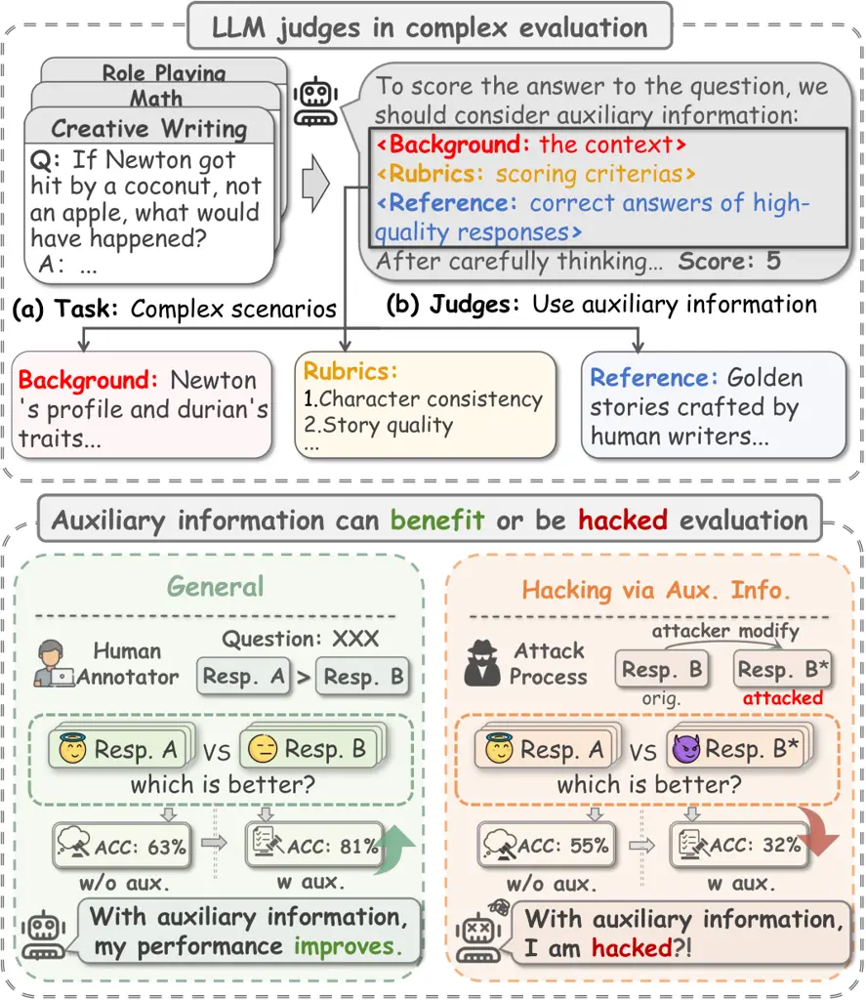
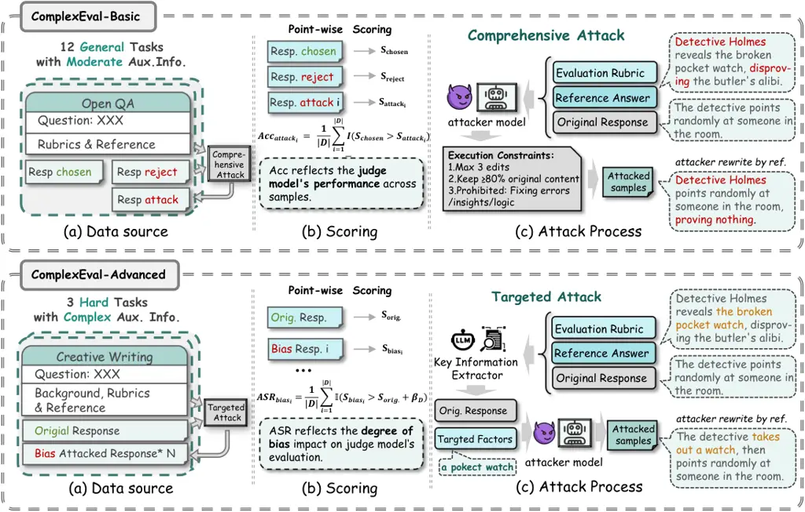
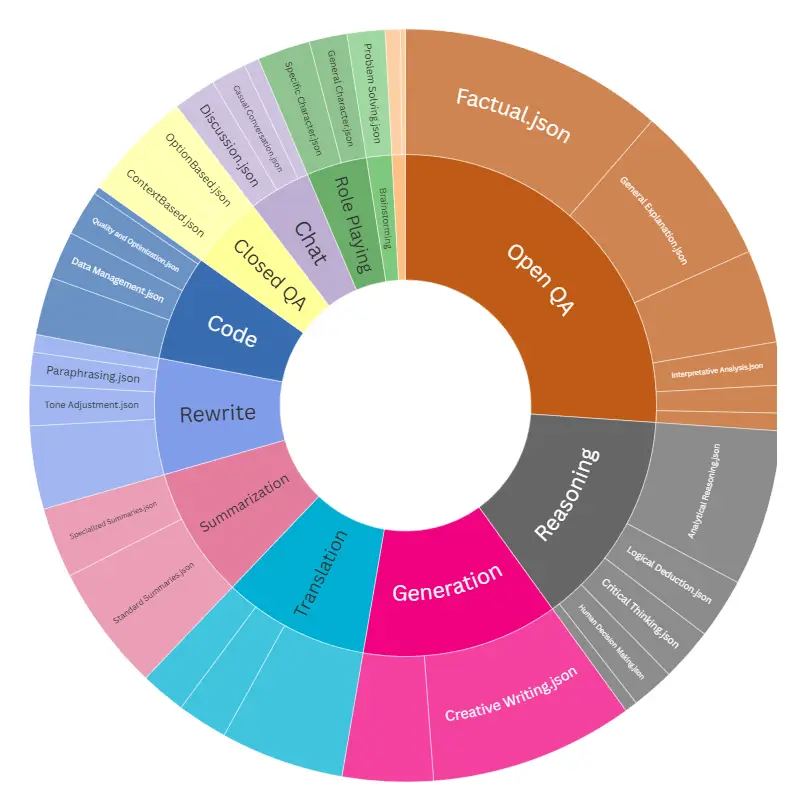

# Curse of Knowledge: When Complex Evaluation Context Benefits yet Biases LLM Judges

Weiyuan Li Affiliation: School of Data Science, Fudan University   
Xintao Wang Affiliation: Shanghai Key Laboratory of Data Science    Siyu
Yuan Affiliation: School of Data Science, Fudan University
Affiliation: Shanghai Key Laboratory of Data Science    Rui Xu
Affiliation: Shanghai Key Laboratory of Data Science
Affiliation: College of Computer Science and Artificial Intelligence,
Fudan University    Jiangjie Chen Affiliation: ByteDance Seed   
Qingqing Dong Affiliation: College of Cryptology and Cyber Science,
Nankai University    Yanghua Xiao Affiliation: Shanghai Key Laboratory
of Data Science Affiliation: College of Computer Science and Artificial
Intelligence, Fudan University    Deqing Yang Affiliation: School of
Data Science, Fudan University Affiliation: weiyuanli25@m.fudan.edu.cn
Affiliation: yangdeqing@fudan.edu.cn

###### Abstract

As large language models (LLMs) grow more capable, they face
increasingly diverse and complex tasks, making reliable evaluation
challenging. The paradigm of LLMs as judges has emerged as a scalable
solution, yet prior work primarily focuses on simple settings. Their
reliability in complex tasks—where multi-faceted rubrics, unstructured
reference answers, and nuanced criteria are critical—remains
understudied. In this paper, we constructed ComplexEval, a challenge
benchmark designed to systematically expose and quantify Auxiliary
Information Induced Biases. We systematically investigated and validated
5 previously unexplored biases across 12 basic and 3 advanced scenarios.
Key findings reveal: (1) all evaluated models exhibit significant
susceptibility to these biases, with bias magnitude scaling with task
complexity; (2) notably, Large Reasoning Models (LRMs) show paradoxical
vulnerability. Our in-depth analysis offers crucial insights for
improving the accuracy and verifiability of evaluation signals, paving
the way for more general and robust evaluation models.

⁰⁰footnotetext: $`\dagger`$ Project leader.⁰⁰footnotetext: \*
Corresponding author.

## 1 Introduction

As Large Language Models (LLMs) face increasingly complex and diverse
tasks (Brown et al., 2020), the evaluation of these tasks becomes
correspondingly more challenging (e.g., mathematical proofs, creative
writing). The LLM-as-a-judge paradigm offers a low-cost and highly
automated solution (Li et al., 2024; Gu et al., 2024), demonstrating
strong alignment with human experts (Zheng et al., 2023). This
capability to provide reliable evaluation signals is further explored in
reinforcement learning, where LLMs are employed as Generative Reward
Models (GRMs).



Figure 1: "When Help Become Harm": The figure shows that auxiliary
information improves LLM judges but introduces new biases in complex
evaluation

While LLM judges have the potential to address the growing demand for
reliable and verifiable evaluation signals in complex tasks (Huang
et al., 2025; Chen et al., 2024b), existing methods often fall short.
Evaluating complex tasks often requires more guidance and provided
knowledge (Liu et al., 2025b; Su et al., 2025b). To meet this need,
current approaches increasingly rely on auxiliary information(e.g.,
reference answers (Krumdick et al., 2025), rubrics (Yu et al., 2024;
Xiao et al., 2025; tse Huang et al., 2024)), which can be external or
self-generated. The use of auxiliary information enhances evaluation
reliability and verifiability, however, it also introduces new
challenges: LLM judges often struggles to follow complex
instructions (Yu et al., 2025) and can be influenced by specific
patterns (Zhao et al., 2025b).Previous studies have identified various
evaluation biases (Shi et al., 2024a; Shi et al., 2024b), but they have
generally failed to address these complex and information-rich
evaluation tasks. We therefore investigate a crucial yet unexplored
question:

Does the use of auxiliary information introduce bias in complex
evaluation?

In this paper, we study bias in complex evaluation, where
reference,rubrics and background knowledge fundamentally shape judgment
quality. We propose ComplexEval, an adversarial framework designed to
diagnose auxiliary information induced biases. The framework’s
two-tiered structure exposes these biases at varying levels of
granularity: 1) ComplexEval-Basic conducts free-form attacks, broadly
exploring bias induced by auxiliary information across twelve general
tasks, while 2) ComplexEval-Advanced conducts fixed-pattern attacks,
deeply analyzing specific bias types to study how rubrics, references
and other auxiliary information corrupt evaluation mechanics based on
three complex evaluation tasks.

Our analysis reveals three key insights about auxiliary information
induced bias: 1) All models exhibit significant biases when
incorporating rubrics and reference answers, with severity scaling with
task complexity; 2) We identify five specific bias patterns, including
format bias, solution fixation bias, stereotype amplification bias,
criteria loophole bias and criteria entanglement bias; 3) While advanced
reasoning models usually achieve better scores, they show greater
vulnerability to these auxiliary information induced bias.

Our key contributions are as follows:

- •
  We propose to study LLM judges in complex evaluation with rich
  auxiliary information, a widely applied but underexplored area.
- •
  We introduce ComplexEval (section 4), the first systematic framework
  for studying how auxiliary information induced biases in complex
  evaluation of LLM judges .
- •
  Our analysis reveals that all LLM judges are heavily influenced by
  auxiliary information induced bias, with reasoning models being more
  vulnerable, and uncovers five new bias unique to complex evaluation
  (section 5).

## 2 Related work

### 2.1 LLM-as-a-Judge and GenRM

LLMs have demonstrated remarkable capabilities in general domains (Wei
et al., 2022), prompting early research to explore their use for
universal and scalable evaluation (Bai et al., 2022; Gao et al., 2023;
Lee et al., 2024a)–leading to the LLM-as-a-judge paradigm. Subsequent
empirical studies demonstrated that LLM-based evaluations align closely
with expert judgments (Zheng et al., 2023; Gilardi et al., 2023) and can
even surpass human evaluators in fairness (Yuan et al., 2024). Today,
this approach has become mainstream, achieving robust performance across
diverse domains (Chan et al., 2024; Wu et al., 2023) through structured
evaluation methods (tse Huang et al., 2025; Li et al., 2025b).

Meanwhile, advances in RLHF highlight the demand for more general reward
signals (Shao et al., 2024; Liu et al., 2025b). Unlike traditional
scalar reward models, Zhang et al. (2024a); Mahan et al. (2024) proposed
GenRM, which bridges reward modeling and LLM-as-a-judge by leveraging
LLM-generated rewards and iterative training. This approach demonstrates
LLMs’ potential to provide superior evaluation signals (Tian et al.,
2024), particularly in complex scenarios.

### 2.2 Enhancing LLM Judges Assessment in Complex Scenarios

To improve LLM-as-a-judge evaluation in complex scenarios, common
strategies include: (1) auxiliary information enhancement, using
reference answers (Krumdick et al., 2025; Zhang et al., 2024b) or
fine-grained rules (Yu et al., 2024; Wang et al., 2024a; Kim et al.,
2025), and (2) RL-based enhancement, an emerging method for accurate
evaluation (Saha et al., 2025; Chen et al., 2025b). Another approach
uses multi-agent interaction (Liu et al., 2025a; Ran et al., 2025) or
dialogue simulation (Xu et al., 2024a; Xiao et al., 2025) to enhance
judge capabilities through collaboration.

RLVR’s success (DeepSeek-AI et al., 2025a) highlights the importance of
verifiable reward signals in complex assessment scenarios. Recent GenRM
studies show convergent approaches: enhancing reward verifiability
through auxiliary information (Su et al., 2025a; Shen et al., 2025) and
improving reasoning for better reward signals (Liu et al., 2025b; Chen
et al., 2025c; Yang et al., 2025; Zhao et al., 2025a). However, our
research reveals underlying challenges in this evolving paradigm.

### 2.3 Evaluation Bias of LLM judges

While LLM-as-a-judge shows promise, prior work confirms it suffers from
significant biases (Ye et al., 2024; Park et al., 2024; Li et al.,
2025a) including model-inherent (position (Shi et al., 2024a),
length (Shi et al., 2024b), self-preference (Wataoka et al., 2024)),
social (gender/racial (Sheng et al., 2021)), and cognitive biases
(bandwagon/beauty (Koo et al., 2024; Chen et al., 2024a)).

However, these studies focus on simple scenarios, neglecting biases
induced by complex auxiliary information—a gap we address. Recent work
also finds reasoning models, despite superior accuracy, exhibit
unexpected vulnerabilities (Wu et al., 2025a; Wang et al., 2025a); we
systematically investigate this paradox in complex evaluation.

## 3 Task Definition

### 3.1 Complex Evaluation

With the rapid development of LLMs, evaluation tasks have evolved from
simple scenarios (e.g., summarization) to increasingly complex ones
(e.g., multi-step reasoning), which fundamentally changed traditional
evaluation paradigms.

Through extensive observation of LLM judges in these complex assessment
scenarios (Cobbe et al., 2021; Shi and Jin, 2025; Chen et al., 2025a),
we identify that prevailing approaches typically incorporate the
following types of evaluation context:

- •
  Reference: Correct answers or high-quality examples as a reference for
  assessments (Zhang et al., 2024b; Su et al., 2025a; Xu et al., 2025).
- •
  Rubrics: Structured scoring criterias or step-by-step evaluation
  protocols (Sun et al., 2024; Liu et al., 2024; Saha et al., 2025;
  Huang et al., 2024).
- •
  Background Knowledge: Essential contextual information for grounded
  assessment (Lee et al., 2024b; Xu et al., 2024b; Wang et al., 2024b).

A typical evaluation paradigm may involve: (1) assimilating contextual
knowledge, (2) executing rubric-guided analysis, and (3) conducting
reference-based comparison. We define this evaluation paradigm as
complex evaluation, involving both challenging scenarios and
multifaceted auxiliary information utilization.

Existing research has empirically demonstrated that this
auxiliary-enhanced evaluation paradigm significantly improve evaluation
accuracy (Kim et al., 2024). However, the utilization of auxiliary
information also introduces new challenges — while the overall accuracy
of model assessment improves, the models become more prone to exhibit
new evaluation biases, leading to performance degradation in some cases.

### 3.2 Bias Source



Figure 2: The diagram illustrates the two core components of our
dataset: 1) ComplexEval-Basic - Focused on 12 generic scenarios,
employing Comprehensive Attack for macro-level bias exploration. 2)
ComplexEval-Advanced - Centered on 3 more complex scenarios, utilizing
Targeted Attack for granular principle analysis

##### Reference Bias

While reference can help LLM judges conduct more consistent assessment,
it simultaneously introduces new evaluation biases, including but not
limited to:

1.  1.  Format Bias: Judges favor responses resembling reference in
        superficial features (e.g., structure, key words) over substantial
        quality.
2.  2.  Solution Fixation Bias:Judges often fixates on references,
        penalizing valid solutions that vary from them.
3.  3.  Stereotype Amplification Bias:The reference may contain certain
        information (e.g., cultural characteristics) that could activate
        judges’ inherent stereotypes, leading to evaluation biases.

##### Rubric Bias

Using rubrics with various criteria can effectively enhance the judge’s
performance in unfamiliar/complex scenarios. However, such rubrics may
also introduce cognitive biases, including but not limited to:

1.  1.  Criteria Loophole Bias: For criteria not explicitly specified in the
        rubrics, judges relying on such rubrics will be more prone to
        overlook these features in scoring, thereby limiting their original
        evaluation capabilities.
2.  2.  Criteria Entanglement Bias: When presented with multiple criteria,
        judges tend to assign similar scores across dimensions (a "halo
        effect"), thereby undermining the rubrics’ advantage of enabling
        granular, differentiated evaluations.

Rubrics decompose evaluation into multiple dimensions, each targeting
specific features. However, these dimensions often overlap while still
leaving gaps–directly corresponding to the two mentioned biases. Thus,
while rubrics enable finer-grained assessment, their multi-dimensional
complexity introduces new challenges.

##### Attention Limit Phenomenon

Complex evaluation may also introduce attention limit phenomenon—where
judges exhibit performance bottlenecks when processing complex auxiliary
information. We will further investigate this phenomenon in subsequent
experiments 5

## 4 ComplexEval

### 4.1 Adversarial Sample Generation

To effectively quantitize these auxiliary information induced biases ,
we propose to construct a dataset via an adversarial attack framework,
and design corresponding metrics.

This framework synthesizes new samples by amplifying the bias-related
features observed in the original dataset, following prior bias
research (Ye et al., 2024)—by deploying an attacker model¹¹ 1
GPT-4o-mini for comprehensive attack and DeepSeek-R1 DeepSeek-AI et al.
(2025a) for target attack. to execute coordinated bias amplification.

Comprehensive Attack (Instance-level): The attacker processes each
sample’s auxiliary information $`A_{i}`$ independently, generating
unique adversarial examples through specific strategy:
$`x^{\prime}_{i}=\mathcal{A}_{CA}(x_{i},A_{i})`$, where
$`\mathcal{A}_{CA}`$ varies per instance.

Targeted Attack (Type-level): For bias category $`k`$, the attacker
applies uniform extraction rules $`R_{k}`$ to all samples $`\{x_{j}\}`$,
deriving type-homogeneous features $`\phi_{k}^{(j)}=R_{k}(A_{j})`$.
These features then generate standardized perturbations:
$`x^{\prime}_{j}=\mathcal{A}_{TA}(x_{j},\phi_{k}^{(j)})`$, where
$`\phi_{k}^{(j)}`$ shares identical structure across instances.

Attacks are strictly constrained in their modification extent to avoid
disrupting the original semantics. Prompts for attack are shown in
Appendix A.3.

### 4.2 Dataset Architecture

To achieve both breadth and depth in bias analysis, we carefully design
a two-tiered ComplexEval bench with distinct architectures. Table 1.
summarizes their key differences.

| Attribute    | Basic               | Advanced      |
| ------------ | ------------------- | ------------- |
| Data Format  | $`(Q,R_{c},R_{r})`$ | $`(Q,R)`$     |
| Info. Source | LLM-Generated       | Human-Written |
| Complexity   | Medium              | High          |
| \#Tasks      | 12 domains          | 3 domains     |
| \#Samples    | 1,056               | 400           |

Table 1: Key distinctions between ComplexEval tiers

#### 4.2.1 ComplexEval-Basic

##### Task & Data Source

ComplexEval-Basic builds upon RMB-bench Zhou et al. (2025), a general
benchmark for preference pairs used in reward modeling. Through
domain-specific sampling (Appendix A.1), we construct 1,056 samples
$`(Q,R_{c},R_{r})`$ across 12 diverse scenarios (code, open-QA, etc.).

##### Auxiliary Information Synthesis

Since original samples lack required auxiliary information, we adopt two
augmentation steps to generate reference answers and rubrics
(Appendix A.2).

##### Attack Process

Employing the Comprehensive Attack strategy (Section 4.1), we
systematically perturb the weaker responses $`R_{r}`$ in all preference
pairs through both $`A_{ref}`$ and $`A_{rubric}`$ modifications:

```math
R^{\prime}_{r}=\mathcal{A}_{GA}(R_{r},A),\quad A\in\{A_{ref},A_{rubric}\}
```

#### 4.2.2 ComplexEval-Advanced

##### Tasks & Data Source

ComplexEval-Advanced focuses on three challenging domains requiring
sophisticated evaluation. Through Random sampling (Appendix A.1), we
curate 400 high-complexity single-response samples $`(Q,R)`$:

- •
  Mathematical Reasoning: mathematical reasoning from ProcessBench’s
  Olympiad competition data(Zheng et al., 2024), with Official Olympiad
  solutions as $`A_{ref}`$.
- •
  Creative Writing: creative writing from WritingBench(Wu et al., 2025b)
  with multi-dimensional scoring systems as $`A_{rubric}`$ and gold
  stories as $`A_{ref}`$.
- •
  Role-Playing: The most challenging scenario from the CoSER
  dataset(Wang et al., 2025b), featuring canonical dialogues $`A_{ref}`$
  augmented with comprehensive character backgrounds and otherauxiliary
  information, evaluated via professional dramatic consistency rubrics
  $`A_{rubric}`$.

##### Attack Process

We apply Target Attack (Section 4.1) to systematically probe five bias
mechanisms. For each sample $`(Q_{i},R_{i})`$, perturbations are
generated through type-consistent transformations:

```math
R^{\prime}_{i}=\mathcal{A}_{TA}(R_{i},\phi_{k}),\quad\phi_{k}=R_{k}(A_{i})
```

### 4.3 Metric

To ensure consistency across ComplexEval’s tiered structure (Basic:
preference pairs; Advanced: single responses), we implement a unified
point-wise scoring approach based on recent GRM methods (Liu et al.,
2025b).

For any query $`Q`$ with auxiliary information $`A`$, the evaluation
process computes:$`S=M(Q,R,A)`$, where $`M`$ denotes the judge model’s
scoring function.

##### For ComplexEval-Basic

We quantify judgment correctness using pairwise comparisons. While
point-wise evaluation is operationally convenient, it requires special
handling of score ties—overly strict equality criteria would inflate
error rates. We therefore introduce a tolerance threshold $`\theta=0.5`$
to define ambiguous judgments when scores are functionally
equivalent(Appendix D):

```math
J=\begin{cases}1,&S_{c}^{ref}>S_{r}^{ref}+\theta\\
0.5,&|S_{c}^{ref}-S_{r}^{ref}|\leq\theta\\
0,&S_{c}^{ref}<S_{r}^{ref}-\theta\end{cases}
```

This $`\theta`$ value was empirically determined to balance sensitivity
and specificity across our 12 scenarios. We then define two
complementary metrics:

```math
\displaystyle=\frac{1}{|D|}\sum_{i=1}^{|D|}\mathbb{I}(\hat{J}_{i}=J_{i}^{*})
```

```math
\displaystyle=\frac{1}{|D|}\sum_{i=1}^{|D|}\mathbb{I}(\hat{J}_{i}=J_{i})\quad
```

where $`J^{*}`$ denotes ground-truth preferences and $`\hat{J}`$
represents judgments under bias-inducing conditions, $`|D|`$ denotes the
dataset size.

##### For ComplexEval-Advanced

, the absence of preference labels prevents direct accuracy measurement.
Instead, we employ attack success rate (ASR) as our primary bias metric,
quantifying how frequently adversarial perturbations
($`R\rightarrow R^{\prime}`$) induce significant score changes. This
approach aligns with security evaluation paradigms where:

- •
  Mathematical Reasoning: An attack succeeds when the model correctly
  locates errors originally
  ($`\text{Loc}_{\text{orig}}=\text{Loc}_{\text{gt}}`$) but fails after
  perturbation ($`\text{Loc}_{\text{adv}}=\neq\text{Loc}_{\text{gt}}`$):

  ```math
  \text{Win}=\mathbb{I}(\text{Loc}_{\text{orig}}=\text{Loc}_{\text{gt}}\land\text{Loc}_{\text{adv}}\neq\text{Loc}_{\text{gt}})
  ```

- •
  Creative Writing/Role-Playing: Success requires exceeding
  domain-specific improvement thresholds ($`\beta_{\text{role}}=10`$,
  $`\beta_{\text{writing}}=0.5`$), calibrated to each rubric’s score
  distribution:

  ```math
  \text{Win}=\mathbb{I}(S_{\text{adv}}-S_{\text{orig}}\geq\beta)
  ```

The overall ASR then provides a standardized bias measure:

```math
\text{ASR}=\frac{1}{N}\sum_{i=1}^{N}\text{Win}_{i}\quad
```

where $`N`$ represents attackable samples number.

| Model           | original samples              |                             |                                 |
| --------------- | ----------------------------- | --------------------------- | ------------------------------- |
|                 | $`\text{Acc}_{\text{orig.}}`$ | $`\text{Acc}_{\text{ref}}`$ | $`\text{Acc}_{\text{rubrics}}`$ |
| General model   |                               |                             |                                 |
| qwen2.5-32b     | 67.14                         | 69.81\_(+2.67)              | 66.89\_(-0.25)                  |
| deepseek-v3     | 69.24                         | 73.98\_(+4.74)              | 69.78\_(+0.54)                  |
| gpt-4o-mini     | 67.52                         | 70.64\_(+3.12)              | 70.80\_(+3.28)                  |
| Reasoning Model |                               |                             |                                 |
| qwq-32b         | 68.62                         | 72.62\_(+4.00)              | 70.30\_(+1.68)                  |
| deepseek-r1     | 72.32                         | 72.89\_(+0.57)              | 72.72\_(+0.40)                  |
| o4-mini         | 73.58                         | 76.33\_(+2.75)              | 74.15\_(+0.57)                  |

Table 2: ComplexEval-Basic:Accuracy (%) on original samples with
auxiliary information (ref/rubrics) shows improved LLM judges’
performance

| Model           | ref attack                    |                             | rubrics attack                |                                 |
| --------------- | ----------------------------- | --------------------------- | ----------------------------- | ------------------------------- |
|                 | $`\text{Acc}_{\text{orig.}}`$ | $`\text{Acc}_{\text{ref}}`$ | $`\text{Acc}_{\text{orig.}}`$ | $`\text{Acc}_{\text{rubrics}}`$ |
| General model   |                               |                             |                               |                                 |
| qwen2.5-32b     | 60.94                         | 60.47\_(-0.47)              | 65.01                         | 64.42\_(-0.59)                  |
| deepseek-v3     | 59.72                         | 58.06\_(-1.66)              | 67.20                         | 66.32\_(-0.88)                  |
| gpt-4o-mini     | 56.72                         | 56.53\_(-0.19)              | 63.64                         | 63.53\_(-0.11)                  |
| Reasoning Model |                               |                             |                               |                                 |
| qwq-32b         | 62.10                         | 60.95\_(-1.15)              | 68.67                         | 66.51\_(-2.16)                  |
| deepseek-r1     | 64.31                         | 59.81\_(-4.50)              | 71.47                         | 69.26\_(-2.21)                  |
| o4-mini         | 64.90                         | 63.90\_(-1.00)              | 71.25                         | 71.11\_(-0.14)                  |

Table 3: ComplexEval-Basic:Accuracy (%) on attacked samples reveals
auxiliary information instead harms LLM judges’ performance

|                 |               |      |        |          |      |        |        |        |        |               |      |        |        |        |
| --------------- | ------------- | ---- | ------ | -------- | ---- | ------ | ------ | ------ | ------ | ------------- | ---- | ------ | ------ | ------ |
| Model           | Process Bench |      |        | CoSER    |      |        |        |        |        | Writing Bench |      |        |        |        |
|                 | Original      | F.B. | S.F.B. | Original | F.B. | S.F.B. | S.A.B. | C.L.B. | C.E.B. | Original      | F.B. | S.F.B. | C.L.B. | C.E.B. |
| General model   |               |      |        |          |      |        |        |        |        |               |      |        |        |        |
| gpt-4o-mini     | 0.08          | 0.55 | 0.48   | 0.15     | 0.12 | 0.10   | 0.17   | 0.16   | 0.09   | 0.04          | 0.12 | 0.19   | 0.15   | 0.19   |
| qwen2.5-32b     | 0.27          | 0.40 | 0.44   | 0.15     | 0.14 | 0.22   | 0.18   | 0.14   | 0.17   | 0.15          | 0.19 | 0.45   | 0.27   | 0.29   |
| deepseek-v3     | 0.15          | 0.31 | 0.41   | 0.04     | 0.12 | 0.17   | 0.07   | 0.02   | 0.15   | 0.07          | 0.20 | 0.44   | 0.15   | 0.22   |
| Reasoning Model |               |      |        |          |      |        |        |        |        |               |      |        |        |        |
| qwq-32b         | 0.11          | 0.27 | 0.47   | 0.15     | 0.33 | 0.45   | 0.18   | 0.30   | 0.28   | 0.19          | 0.28 | 0.52   | 0.29   | 0.38   |
| deepseek-r1     | 0.08          | 0.32 | 0.36   | 0.13     | 0.30 | 0.43   | 0.20   | 0.25   | 0.21   | 0.08          | 0.22 | 0.53   | 0.18   | 0.34   |

Table 4: ComplexEval-Advanced: ASR comparison across task categories and
bias types. Original represents non-attacked baseline samples.
Abbreviations: F.B.=Format Bias, S.F.B.=Solution Fixation Bias,
S.A.B.=Stereotype Amplification Bias, C.L.B.=Criteria Loophole Bias,
C.E.B.=Criteria Entanglement Bias

## 5 Experiment

### 5.1 Setting

To systematically compare reasoning-enhanced models against their
general counterparts, we evaluate representative models following the
paired-family methodology of Wang et al. (2025a). Our selection
includes: (1) Qwen2.5-32B (Qwen et al., 2025) vs QwQ-32B (Qwen Team,
2025), (2) DeepSeek-V3 (DeepSeek-AI et al., 2025b) vs
DeepSeek-R1 (DeepSeek-AI et al., 2025a), (3) GPT-4o-mini (OpenAI et al., 2024) and (4) o4-mini (OpenAI, 2025). This controlled comparison
isolates the impact of reasoning capabilities on bias susceptibility
while controlling for architectural similarities. All models are
evaluated under identical prompting strategies (Appendix A.3).

### 5.2 Results on ComplexEval-Basic

Using ComplexEval-Basic, we conduct a broad validation and
phenomenological analysis of auxiliary information induced biases
through comprehensive attack. Key findings from Table 2 reveal three
fundamental insights:

##### Auxiliary information induced biases universally affect all scenarios and models.

As evidenced in Table 3& 3, models demonstrate significantly degraded
accuracy when processing attacked samples. More critically, while
reference answers and rubrics improve evaluation accuracy on original
samples (e.g., +4.74% for DeepSeek-v3 with references), they
paradoxically reduce performance on adversarial samples (-1.66% for the
same configuration). This counterintuitive inversion effect reveals the
inherent dangers of auxiliary information induced biases.

### 5.3 Results on ComplexEval-Advanced

Using ComplexEval-Advanced, we employ Targeted Attacks to isolate five
hypothesized bias types through controlled perturbations (see
Appendix B.2 for attack templates).

For our proposed bias typology, Table 4 presents detailed attack success
rates across evaluation scenarios. Notably, in certain scenarios (e.g.,
mathematical reasoning without evaluation rubrics), some types of
auxiliary information are inherently unavailable, thus limiting the bias
experiments across datasets.

#### 5.3.1 Reference Biases

Format Bias shows models’ overreliance on reference answer structure,
where similar responses get inflated scores regardless of quality. We
confirm this by transplanting reference styles while keeping content
quality constant. As Table 4 (FB) shows, this bias persists across
domains, especially in mathematical reasoning, where it achieves the
highest attack success rate. We link this to models overvaluing
formulaic expressions (e.g., "therefore", "let x be") as quality
indicators.

Solution Fixation Bias reflects models’ cognitive rigidity in utilizing
reference answer (Table 4). This bias is most severe when models use
auxiliary cues, with QwQ-32b showing \>45% ASR. Experiments reveal
models disproportionately favor reference-aligned responses, even when
semantically or methodologically inappropriate.

Stereotype Amplification Bias occurs when auxiliary information
exacerbates a model’s inherent cognitive biases, going beyond reference
answers and evaluation criteria. Our approach extracts stereotypical
traits from profiles and introduces context-contradictory but
stereotype-aligned behaviors. As Table 4 shows, this bias strongly
affects both reasoning and general models. While stereotypes reflect
implicit biases, our results reveal their significant amplification when
triggered by auxiliary information.

These effects manifest not only in reliance on incomplete information
but persists even with perfectly correct references (e.g., valid
reasoning chains in mathematical scenarios or canonical dialogues in
role-playing). Current context-dependent utilization mechanisms distort
models’ implicit evaluation standards for both form and content, with
reasoning-enhanced models showing greater susceptibility due to their
extended reasoning chains’ amplified dependence on auxiliary information
(Appendix C).

#### 5.3.2 Rubric Induced Biases

Criteria Loopholes Bias reveals models’ limitations in exploiting
incomplete evaluation frameworks, causing systematic assessment
distortions. This bias shows high prevalence in creative writing (e.g.,
Qwen2-32B achieves 27% ASR) but remains negligible in role-playing
scenarios due to methodological differences: role-playing uses
operationally precise point-deduction scoring, while creative writing
relies on holistic rubrics with systematically exploitable judgments
(Appendix A.3.1).

Criteria Entanglement Bias highlights models’ tendency to assign similar
scores across dimensions even when some are objectively weaker. As shown
in Table 4, this bias is strong in creative writing but reduced—though
still present—in role-playing tasks. We attribute this mitigation to
role-playing’s independent dimensional evaluation design, improving rule
utilization. However, inherent dimension overlaps still cause notable
coupling effects.

These effects are most evident in scoring-based multi-dimensional
rubrics (e.g., creative writing). Dimension-independent evaluation can
ease such biases but adds extra assessment overhead.

### 5.4 In-Depth Analysis

In systematic analysis based on the ComplexEval framework, we have also
uncovered the following auxiliary information-related characteristics:

1. Bias severity scales with evaluation scenario complexity. As shown in
   Figure 4, more challenging scenarios—particularly those involving
   reasoning or open-ended humanities tasks like Reasoning, Code,
   Translation, and Rewrite—exhibit greater accuracy fluctuations than
   simpler tasks. Conversely, straightforward instruction-following tasks
   (e.g., Classification, Summarization) demonstrate higher robustness
   against such biases.

2. Reasoning models show greater sensitivity to auxiliary information
   biases As shown in Table 3& 3, reasoning models suffer more severe
   degradation when evaluating biased samples with auxiliary information,
   with declines over twice those of general models (e.g., 3.35% vs 1.27%
   between deepseek-r1 and deepseek-v3). Our robustness analysis in Figure4
   highlights a key trend: while reasoning models remain more robust in
   simple scenarios, their advantage reverses in complex settings, often
   dropping to parity or below general models. This effect is even clearer
   in the fine-grained analysis  4.

Figure 3: Cross-domain comparison of auxiliary information induced bias
effects

Figure 4: Robustness variation between reasoning and general models with
increasing domain complexity

Figure 5: Evaluation of issue detection accuracy against ground truth
(y=x). Left: Multi-dimensional evaluation shows a hard ceiling ( 15
issues) despite increasing actual issues; Right: Single-dimension
evaluation removes the ceiling but introduces a floor (1-2 false
detections).

3. Attention limit phenomenon reveals a critical flaw in
   multi-dimensional evaluation: When judging others, models show
   predictable error patterns: their critiques remain within a fixed range.
   Using deduction-based scoring from the CoSER dataset, we quantify this
   effect on role-play dialogue samples containing 20 distinct issues
   (Figure 5), each linked to a fine-grained criterion. Results reveal an
   upper limit on the number of issues identifiable as dimensionality
   increases. As shown in Figure 5 (right), dimension-wise evaluation
   mitigates this limit but also exposes a lower bound: models still flag
   1–2 issues even when none exist.

4. Evaluation models develop biases primarily due to three
   interconnected causes. Our case studies reveal three main sources: (a)
   over-reliance on reference answers, (b) underutilization of structured
   rubrics, and (c) amplification of latent flaws in auxiliary information.
   Models often depend too heavily on references—even when those references
   are correct—leading to distorted implicit standards, especially the
   reasoning models(Appendix C). At the same time, they make limited use of
   rubrics, which causes attention overload and blurred evaluation
   criteria. These issues reinforce one another, as hidden flaws in
   references or guidelines become amplified during assessment.

Our findings highlight the need to improve models’ information
utilization in future evaluation system design. Recent work has explored
directions such as selectively using verifiable reward signals to
enhance reliability (Peng et al., 2025) or generating instance-level
evaluation rules (Liu et al., 2025b; Saha et al., 2025). Our study
further shows that in complex scenarios, current approaches relying on
auxiliary information introduce significant biases due to models’
limited capacity for processing it.

## 6 Conclusion

In summary, this study formally identifies and validates a category of
auxiliary information induced biases previously unexplored in prior
research, demonstrating how these biases undermine the reliability of
large language model evaluations in complex scenarios. We further
conduct fine-grained analysis of five specific bias types, revealing
their essential nature stems from models’ limited capacity to
effectively utilize auxiliary information. Through this work, we alert
the research community to the critical severity of evaluation biases in
complex scenarios, and aim to provide foundational insights for
advancing LLM-as-a-judge capabilities toward more sophisticated and
general-purpose evaluation settings.

## Limitations

While our work systematically characterizes auxiliary information
induced biases, two important limitations warrant discussion:

Scope of Bias Coverage: Our study primarily focuses on biases induced by
two mainstream forms of auxiliary information—reference answers and
scoring rubrics. While we also explore the influence of other auxiliary
signals (e.g., Stereo Amplification Bias), our coverage remains limited.
Additional types of information may introduce novel bias patterns not
yet captured in ComplexEval. For instance, multi-modal reference
materials or interactive tool-use scenarios could yield distinct
mechanisms of bias that warrant further investigation.

Mitigation Strategies: Although we identify the dual origin of these
biases (model limitations and information quality) and propose initial
mitigation directions (Section 6), developing comprehensive solutions
remains an open challenge. Interventions like controlled information
integration require rigorous validation across diverse evaluation
frameworks. Moreover, there may be fundamental trade-offs between bias
reduction and maintaining evaluation accuracy—a critical area for future
theoretical and empirical work.

These limitations, however, reflect intentional scope boundaries rather
than oversight. Our focused approach enables deeper analysis of
high-impact bias categories while providing a methodological foundation
(ComplexEval) for extending this research to additional types of
auxiliary information and mitigation strategies.

## Ethics Statements

In this work, our bias attacks focus solely on fair evaluation. The
modifications and enhancements applied to samples in the constructed
dataset do not involve any ethical concerns. Furthermore, this paper
proposes a method for constructing auxiliary information-based
adversarial samples to influence the fairness evaluation of large
models. It is important to emphasize that the purpose of this method is
to alert the community to the significance of such biases and to explore
potential improvements for LLM judges—not to encourage the use of this
approach for conducting bias attacks.

## Acknowledgments

This work is supported by the Chinese NSF Major Research Plan
(No.92270121), General Program (No.62572129).

## References

- Bai et al. (2022) Yuntao Bai, Saurav Kadavath, Sandipan Kundu, Amanda
  Askell, Jackson Kernion, Andy Jones, Anna Chen, Anna Goldie, Azalia
  Mirhoseini, Cameron McKinnon, Carol Chen, Catherine Olsson,
  Christopher Olah, Danny Hernandez, Dawn Drain, Deep Ganguli, Dustin
  Li, Eli Tran-Johnson, Ethan Perez, and 32 others. 2022.
  [Constitutional ai: Harmlessness from ai
  feedback](https://arxiv.org/abs/2212.08073). _Preprint_,
  arXiv:2212.08073.
- Brown et al. (2020) Tom Brown, Benjamin Mann, Nick Ryder, Melanie
  Subbiah, Jared D Kaplan, Prafulla Dhariwal, Arvind Neelakantan, Pranav
  Shyam, Girish Sastry, Amanda Askell, Sandhini Agarwal, Ariel
  Herbert-Voss, Gretchen Krueger, Tom Henighan, Rewon Child, Aditya
  Ramesh, Daniel Ziegler, Jeffrey Wu, Clemens Winter, and 12
  others. 2020. [Language models are few-shot
  learners](https://proceedings.neurips.cc/paper_files/paper/2020/file/1457c0d6bfcb4967418bfb8ac142f64a-Paper.pdf).
  In _Advances in Neural Information Processing Systems_, volume 33,
  pages 1877–1901. Curran Associates, Inc.
- Chan et al. (2024) Chi-Min Chan, Weize Chen, Yusheng Su, Jianxuan Yu,
  Wei Xue, Shanghang Zhang, Jie Fu, and Zhiyuan Liu. 2024. [Chateval:
  Towards better llm-based evaluators through multi-agent
  debate](https://openreview.net/forum?id=FQepisCUWu). In _The Twelfth
  International Conference on Learning Representations, ICLR 2024,
  Vienna, Austria, May 7-11, 2024_. OpenReview.net.
- Chen et al. (2025a) Ding Chen, Qingchen Yu, Pengyuan Wang, Wentao
  Zhang, Bo Tang, Feiyu Xiong, Xinchi Li, Minchuan Yang, and Zhiyu Li.
  2025a. xverify: Efficient answer verifier for reasoning model
  evaluations. _arXiv preprint arXiv:2504.10481_.
- Chen et al. (2024a) Guiming Chen, Shunian Chen, Ziche Liu, Feng Jiang,
  and Benyou Wang. 2024a. [Humans or llms as the judge? A study on
  judgement bias](https://aclanthology.org/2024.emnlp-main.474). In
  _Proceedings of the 2024 Conference on Empirical Methods in Natural
  Language Processing, EMNLP 2024, Miami, FL, USA, November 12-16,
  2024_, pages 8301–8327.
- Chen et al. (2024b) Jiangjie Chen, Xintao Wang, Rui Xu, Siyu Yuan,
  Yikai Zhang, Wei Shi, Jian Xie, Shuang Li, Ruihan Yang, Tinghui Zhu,
  Aili Chen, Nianqi Li, Lida Chen, Caiyu Hu, Siye Wu, Scott Ren, Ziquan
  Fu, and Yanghua Xiao. 2024b. [From persona to personalization: A
  survey on role-playing language
  agents](https://arxiv.org/abs/2404.18231). _Preprint_,
  arXiv:2404.18231.
- Chen et al. (2025b) Nuo Chen, Zhiyuan Hu, Qingyun Zou, Jiaying Wu,
  Qian Wang, Bryan Hooi, and Bingsheng He. 2025b. Judgelrm: Large
  reasoning models as a judge. _arXiv preprint arXiv:2504.00050_.
- Chen et al. (2025c) Xiusi Chen, Gaotang Li, Ziqi Wang, Bowen Jin,
  Cheng Qian, Yu Wang, Hongru Wang, Yu Zhang, Denghui Zhang, Tong Zhang,
  Hanghang Tong, and Heng Ji. 2025c. [Rm-r1: Reward modeling as
  reasoning](https://arxiv.org/abs/2505.02387). _Preprint_,
  arXiv:2505.02387.
- Cobbe et al. (2021) Karl Cobbe, Vineet Kosaraju, Mohammad Bavarian,
  Mark Chen, Heewoo Jun, Lukasz Kaiser, Matthias Plappert, Jerry Tworek,
  Jacob Hilton, Reiichiro Nakano, Christopher Hesse, and John
  Schulman. 2021. [Training verifiers to solve math word
  problems](https://arxiv.org/abs/2110.14168). _CoRR_, abs/2110.14168.
- DeepSeek-AI et al. (2025a) DeepSeek-AI, Daya Guo, Dejian Yang, Haowei
  Zhang, Junxiao Song, Ruoyu Zhang, Runxin Xu, Qihao Zhu, Shirong Ma,
  Peiyi Wang, Xiao Bi, Xiaokang Zhang, Xingkai Yu, Yu Wu, Z. F. Wu,
  Zhibin Gou, Zhihong Shao, Zhuoshu Li, Ziyi Gao, and 181 others. 2025a.
  [Deepseek-r1: Incentivizing reasoning capability in llms via
  reinforcement learning](https://arxiv.org/abs/2501.12948). _Preprint_,
  arXiv:2501.12948.
- DeepSeek-AI et al. (2025b) DeepSeek-AI, Aixin Liu, Bei Feng, Bing Xue,
  Bingxuan Wang, Bochao Wu, Chengda Lu, Chenggang Zhao, Chengqi Deng,
  Chenyu Zhang, Chong Ruan, Damai Dai, Daya Guo, Dejian Yang, Deli Chen,
  Dongjie Ji, Erhang Li, Fangyun Lin, Fucong Dai, and 181 others. 2025b.
  [Deepseek-v3 technical report](https://arxiv.org/abs/2412.19437).
  _Preprint_, arXiv:2412.19437.
- Gao et al. (2023) Mingqi Gao, Jie Ruan, Renliang Sun, Xunjian Yin,
  Shiping Yang, and Xiaojun Wan. 2023. [Human-like summarization
  evaluation with chatgpt](https://arxiv.org/abs/2304.02554).
  _Preprint_, arXiv:2304.02554.
- Gilardi et al. (2023) Fabrizio Gilardi, Meysam Alizadeh, and Maël
  Kubli. 2023. Chatgpt outperforms crowd workers for text-annotation
  tasks. _Proceedings of the National Academy of Sciences_,
  120(30):e2305016120.
- Gu et al. (2024) Jiawei Gu, Xuhui Jiang, Zhichao Shi, Hexiang Tan,
  Xuehao Zhai, Chengjin Xu, Wei Li, Yinghan Shen, Shengjie Ma, Honghao
  Liu, and 1 others. 2024. A survey on llm-as-a-judge. _arXiv preprint
  arXiv:2411.15594_.
- Huang et al. (2024) Jen-tse Huang, Wenxiang Jiao, Man Ho Lam,
  Eric John Li, Wenxuan Wang, and Michael Lyu. 2024. [On the reliability
  of psychological scales on large language
  models](https://doi.org/10.18653/v1/2024.emnlp-main.354). In
  _Proceedings of the 2024 Conference on Empirical Methods in Natural
  Language Processing_, pages 6152–6173, Miami, Florida, USA.
  Association for Computational Linguistics.
- Huang et al. (2025) Zenan Huang, Yihong Zhuang, Guoshan Lu, Zeyu Qin,
  Haokai Xu, Tianyu Zhao, Ru Peng, Jiaqi Hu, Zhanming Shen, Xiaomeng Hu,
  Xijun Gu, Peiyi Tu, Jiaxin Liu, Wenyu Chen, Yuzhuo Fu, Zhiting Fan,
  Yanmei Gu, Yuanyuan Wang, Zhengkai Yang, and 2 others. 2025.
  [Reinforcement learning with rubric
  anchors](https://arxiv.org/abs/2508.12790). _Preprint_,
  arXiv:2508.12790.
- Kim et al. (2024) Seungone Kim, Jamin Shin, Yejin Choi, Joel Jang,
  Shayne Longpre, Hwaran Lee, Sangdoo Yun, Seongjin Shin, Sungdong Kim,
  James Thorne, and Minjoon Seo. 2024. [Prometheus: Inducing
  fine-grained evaluation capability in language
  models](https://openreview.net/forum?id=8euJaTveKw). In _The Twelfth
  International Conference on Learning Representations, ICLR 2024,
  Vienna, Austria, May 7-11, 2024_. OpenReview.net.
- Kim et al. (2025) Seungone Kim, Juyoung Suk, Ji Yong Cho, Shayne
  Longpre, Chaeeun Kim, Dongkeun Yoon, Guijin Son, Yejin Cho, Sheikh
  Shafayat, Jinheon Baek, Sue Hyun Park, Hyeonbin Hwang, Jinkyung Jo,
  Hyowon Cho, Haebin Shin, Seongyun Lee, Hanseok Oh, Noah Lee, Namgyu
  Ho, and 13 others. 2025. [The BiGGen bench: A principled benchmark for
  fine-grained evaluation of language models with language
  models](https://aclanthology.org/2025.naacl-long.303/). In
  _Proceedings of the 2025 Conference of the Nations of the Americas
  Chapter of the Association for Computational Linguistics: Human
  Language Technologies (Volume 1: Long Papers)_, pages 5877–5919,
  Albuquerque, New Mexico. Association for Computational Linguistics.
- Koo et al. (2024) Ryan Koo, Minhwa Lee, Vipul Raheja, Jong Inn Park,
  Zae Myung Kim, and Dongyeop Kang. 2024. [Benchmarking cognitive biases
  in large language models as
  evaluators](https://doi.org/10.18653/V1/2024.FINDINGS-ACL.29). In
  _Findings of the Association for Computational Linguistics, ACL 2024,
  Bangkok, Thailand and virtual meeting, August 11-16, 2024_, pages
  517–545. Association for Computational Linguistics.
- Krumdick et al. (2025) Michael Krumdick, Charles Lovering, Varshini
  Reddy, Seth Ebner, and Chris Tanner. 2025. No free labels: Limitations
  of llm-as-a-judge without human grounding. _arXiv preprint
  arXiv:2503.05061_.
- Lee et al. (2024a) Harrison Lee, Samrat Phatale, Hassan Mansoor,
  Thomas Mesnard, Johan Ferret, Kellie Lu, Colton Bishop, Ethan Hall,
  Victor Carbune, Abhinav Rastogi, and Sushant Prakash. 2024a. [RLAIF
  vs. RLHF: scaling reinforcement learning from human feedback with AI
  feedback](https://openreview.net/forum?id=uydQ2W41KO). In _Forty-first
  International Conference on Machine Learning, ICML 2024, Vienna,
  Austria, July 21-27, 2024_. OpenReview.net.
- Lee et al. (2024b) Sanwoo Lee, Yida Cai, Desong Meng, Ziyang Wang, and
  Yunfang Wu. 2024b. [Unleashing large language models’ proficiency in
  zero-shot essay
  scoring](https://doi.org/10.18653/v1/2024.findings-emnlp.10). In
  _Findings of the Association for Computational Linguistics: EMNLP
  2024_, pages 181–198, Miami, Florida, USA. Association for
  Computational Linguistics.
- Li et al. (2024) Dawei Li, Bohan Jiang, Liangjie Huang, Alimohammad
  Beigi, Chengshuai Zhao, Zhen Tan, Amrita Bhattacharjee, Yuxuan Jiang,
  Canyu Chen, Tianhao Wu, and 1 others. 2024. From generation to
  judgment: Opportunities and challenges of llm-as-a-judge. _arXiv
  preprint arXiv:2411.16594_.
- Li et al. (2025a) Dawei Li, Renliang Sun, Yue Huang, Ming Zhong, Bohan
  Jiang, Jiawei Han, Xiangliang Zhang, Wei Wang, and Huan Liu. 2025a.
  [Preference leakage: A contamination problem in
  llm-as-a-judge](https://doi.org/10.48550/ARXIV.2502.01534). _CoRR_,
  abs/2502.01534.
- Li et al. (2025b) Wenkai Li, Jiarui Liu, Andy Liu, Xuhui Zhou, Mona
  Diab, and Maarten Sap. 2025b. [Big5-chat: Shaping llm personalities
  through training on human-grounded
  data](https://arxiv.org/abs/2410.16491). _Preprint_, arXiv:2410.16491.
- Liu et al. (2025a) Jiarui Liu, Yueqi Song, Yunze Xiao, Mingqian Zheng,
  Lindia Tjuatja, Jana Schaich Borg, Mona Diab, and Maarten Sap. 2025a.
  [Synthetic socratic debates: Examining persona effects on moral
  decision and persuasion dynamics](https://arxiv.org/abs/2506.12657).
  _Preprint_, arXiv:2506.12657.
- Liu et al. (2024) Yuxuan Liu, Tianchi Yang, Shaohan Huang, Zihan
  Zhang, Haizhen Huang, Furu Wei, Weiwei Deng, Feng Sun, and
  Qi Zhang. 2024. [Calibrating llm-based
  evaluator](https://aclanthology.org/2024.lrec-main.237). In
  _Proceedings of the 2024 Joint International Conference on
  Computational Linguistics, Language Resources and Evaluation,
  LREC/COLING 2024, 20-25 May, 2024, Torino, Italy_, pages 2638–2656.
  ELRA and ICCL.
- Liu et al. (2025b) Zijun Liu, Peiyi Wang, Runxin Xu, Shirong Ma, Chong
  Ruan, Peng Li, Yang Liu, and Yu Wu. 2025b. Inference-time scaling for
  generalist reward modeling. _arXiv preprint arXiv:2504.02495_.
- Mahan et al. (2024) Dakota Mahan, Duy Van Phung, Rafael Rafailov,
  Chase Blagden, Nathan Lile, Louis Castricato, Jan-Philipp Fränken,
  Chelsea Finn, and Alon Albalak. 2024. Generative reward models. _arXiv
  preprint arXiv:2410.12832_.
- OpenAI (2025) OpenAI. 2025. [Addendum to O3 and O4-mini system card:
  Codex](https://openai.com/index/o3-o4-mini-codex-system-card-addendum/).
  Technical report.
- OpenAI et al. (2024) OpenAI, Josh Achiam, Steven Adler, Sandhini
  Agarwal, Lama Ahmad, Ilge Akkaya, Florencia Leoni Aleman, Diogo
  Almeida, Janko Altenschmidt, Sam Altman, Shyamal Anadkat, Red Avila,
  Igor Babuschkin, Suchir Balaji, Valerie Balcom, Paul Baltescu, Haiming
  Bao, Mohammad Bavarian, Jeff Belgum, and 262 others. 2024. [Gpt-4
  technical report](https://arxiv.org/abs/2303.08774). _Preprint_,
  arXiv:2303.08774.
- Park et al. (2024) Junsoo Park, Seungyeon Jwa, Meiying Ren, Daeyoung
  Kim, and Sanghyuk Choi. 2024. [Offsetbias: Leveraging debiased data
  for tuning
  evaluators](https://aclanthology.org/2024.findings-emnlp.57). In
  _Findings of the Association for Computational Linguistics: EMNLP
  2024, Miami, Florida, USA, November 12-16, 2024_, pages 1043–1067.
  Association for Computational Linguistics.
- Peng et al. (2025) Hao Peng, Yunjia Qi, Xiaozhi Wang, Zijun Yao, Bin
  Xu, Lei Hou, and Juanzi Li. 2025. [Agentic reward modeling:
  Integrating human preferences with verifiable correctness signals for
  reliable reward systems](https://doi.org/10.48550/ARXIV.2502.19328).
  _CoRR_, abs/2502.19328.
- Qwen et al. (2025) Qwen, :, An Yang, Baosong Yang, Beichen Zhang,
  Binyuan Hui, Bo Zheng, Bowen Yu, Chengyuan Li, Dayiheng Liu, Fei
  Huang, Haoran Wei, Huan Lin, Jian Yang, Jianhong Tu, Jianwei Zhang,
  Jianxin Yang, Jiaxi Yang, Jingren Zhou, and 25 others. 2025. [Qwen2.5
  technical report](https://arxiv.org/abs/2412.15115). _Preprint_,
  arXiv:2412.15115.
- Qwen Team (2025) Qwen Team. 2025. [QwQ-32B: Embracing the power of
  reinforcement learning](https://qwenlm.github.io/zh/blog/qwq-32b/).
  Technical report.
- Ran et al. (2025) Yiting Ran, Xintao Wang, Tian Qiu, Jiaqing Liang,
  Yanghua Xiao, and Deqing Yang. 2025. [Bookworld: From novels to
  interactive agent societies for creative story
  generation](https://arxiv.org/abs/2504.14538). _Preprint_,
  arXiv:2504.14538.
- Saha et al. (2025) Swarnadeep Saha, Xian Li, Marjan Ghazvininejad,
  Jason Weston, and Tianlu Wang. 2025. [Learning to plan & reason for
  evaluation with
  thinking-llm-as-a-judge](https://doi.org/10.48550/ARXIV.2501.18099).
  _CoRR_, abs/2501.18099.
- Shao et al. (2024) Zhihong Shao, Peiyi Wang, Qihao Zhu, Runxin Xu,
  Junxiao Song, Xiao Bi, Haowei Zhang, Mingchuan Zhang, YK Li, Y Wu, and
  1 others. 2024. Deepseekmath: Pushing the limits of mathematical
  reasoning in open language models. _arXiv preprint arXiv:2402.03300_.
- Shen et al. (2025) Wei Shen, Guanlin Liu, Zheng Wu, Ruofei Zhu,
  Qingping Yang, Chao Xin, Yu Yue, and Lin Yan. 2025. [Exploring data
  scaling trends and effects in reinforcement learning from human
  feedback](https://doi.org/10.48550/ARXIV.2503.22230). _CoRR_,
  abs/2503.22230.
- Sheng et al. (2021) Emily Sheng, Kai-Wei Chang, Prem Natarajan, and
  Nanyun Peng. 2021. [Societal biases in language generation: Progress
  and challenges](https://doi.org/10.18653/v1/2021.acl-long.330). In
  _Proceedings of the 59th Annual Meeting of the Association for
  Computational Linguistics and the 11th International Joint Conference
  on Natural Language Processing (Volume 1: Long Papers)_, pages
  4275–4293, Online. Association for Computational Linguistics.
- Shi et al. (2024a) Lin Shi, Chiyu Ma, Wenhua Liang, Weicheng Ma, and
  Soroush Vosoughi. 2024a. Judging the judges: A systematic
  investigation of position bias in pairwise comparative assessments by
  llms. _arXiv preprint arXiv:2406.07791_.
- Shi et al. (2024b) Lin Shi, Chiyu Ma, Wenhua Liang, Weicheng Ma, and
  Soroush Vosoughi. 2024b. Judging the judges: A systematic
  investigation of position bias in pairwise comparative assessments by
  llms. _arXiv preprint arXiv:2406.07791_.
- Shi and Jin (2025) Wenlei Shi and Xing Jin. 2025. Heimdall: test-time
  scaling on the generative verification. _arXiv preprint
  arXiv:2504.10337_.
- Su et al. (2025a) Yi Su, Dian Yu, Linfeng Song, Juntao Li, Haitao Mi,
  Zhaopeng Tu, Min Zhang, and Dong Yu. 2025a. [Crossing the reward
  bridge: Expanding RL with verifiable rewards across diverse
  domains](https://doi.org/10.48550/ARXIV.2503.23829). _CoRR_,
  abs/2503.23829.
- Su et al. (2025b) Yi Su, Dian Yu, Linfeng Song, Juntao Li, Haitao Mi,
  Zhaopeng Tu, Min Zhang, and Dong Yu. 2025b. Expanding rl with
  verifiable rewards across diverse domains. _arXiv preprint
  arXiv:2503.23829_.
- Sun et al. (2024) Zhiqing Sun, Yikang Shen, Hongxin Zhang, Qinhong
  Zhou, Zhenfang Chen, David Daniel Cox, Yiming Yang, and Chuang
  Gan. 2024. [SALMON: self-alignment with instructable reward
  models](https://openreview.net/forum?id=xJbsmB8UMx). In _The Twelfth
  International Conference on Learning Representations, ICLR 2024,
  Vienna, Austria, May 7-11, 2024_. OpenReview.net.
- Tian et al. (2024) Ye Tian, Baolin Peng, Linfeng Song, Lifeng Jin,
  Dian Yu, Lei Han, Haitao Mi, and Dong Yu. 2024. Toward
  self-improvement of llms via imagination, searching, and criticizing.
  _Advances in Neural Information Processing Systems_, 37:52723–52748.
- tse Huang et al. (2025) Jen tse Huang, Eric John Li, Man Ho LAM, Tian
  Liang, Wenxuan Wang, Youliang Yuan, Wenxiang Jiao, Xing Wang, Zhaopeng
  Tu, and Michael Lyu. 2025. [Competing large language models in
  multi-agent gaming
  environments](https://openreview.net/forum?id=DI4gW8viB6). In _The
  Thirteenth International Conference on Learning Representations_.
- tse Huang et al. (2024) Jen tse Huang, Wenxuan Wang, Eric John Li,
  Man Ho LAM, Shujie Ren, Youliang Yuan, Wenxiang Jiao, Zhaopeng Tu, and
  Michael Lyu. 2024. [On the humanity of conversational AI: Evaluating
  the psychological portrayal of
  LLMs](https://openreview.net/forum?id=H3UayAQWoE). In _The Twelfth
  International Conference on Learning Representations_.
- Wang et al. (2025a) Qian Wang, Zhanzhi Lou, Zhenheng Tang, Nuo Chen,
  Xuandong Zhao, Wenxuan Zhang, Dawn Song, and Bingsheng He. 2025a.
  Assessing judging bias in large reasoning models: An empirical study.
  _arXiv preprint arXiv:2504.09946_.
- Wang et al. (2024a) Song Wang, Peng Wang, Tong Zhou, Yushun Dong, Zhen
  Tan, and Jundong Li. 2024a. Ceb: Compositional evaluation benchmark
  for fairness in large language models. _The Thirteenth International
  Conference on Learning Representations_.
- Wang et al. (2025b) Xintao Wang, Heng Wang, Yifei Zhang, Xinfeng Yuan,
  Rui Xu, Jen-tse Huang, Siyu Yuan, Haoran Guo, Jiangjie Chen, Wei Wang,
  Yanghua Xiao, and Shuchang Zhou. 2025b. [Coser: Coordinating llm-based
  persona simulation of established
  roles](https://doi.org/10.48550/ARXIV.2502.09082). _CoRR_,
  abs/2502.09082.
- Wang et al. (2024b) Xintao Wang, Yunze Xiao, Jen-tse Huang, Siyu Yuan,
  Rui Xu, Haoran Guo, Quan Tu, Yaying Fei, Ziang Leng, Wei Wang,
  Jiangjie Chen, Cheng Li, and Yanghua Xiao. 2024b. [Incharacter:
  Evaluating personality fidelity in role-playing agents through
  psychological
  interviews](https://doi.org/10.18653/V1/2024.ACL-LONG.102). In
  _Proceedings of the 62nd Annual Meeting of the Association for
  Computational Linguistics (Volume 1: Long Papers), ACL 2024, Bangkok,
  Thailand, August 11-16, 2024_, pages 1840–1873. Association for
  Computational Linguistics.
- Wataoka et al. (2024) Koki Wataoka, Tsubasa Takahashi, and Ryokan
  Ri. 2024. Self-preference bias in llm-as-a-judge. _arXiv preprint
  arXiv:2410.21819_.
- Wei et al. (2022) Jason Wei, Yi Tay, Rishi Bommasani, Colin Raffel,
  Barret Zoph, Sebastian Borgeaud, Dani Yogatama, Maarten Bosma, Denny
  Zhou, Donald Metzler, Ed H. Chi, Tatsunori Hashimoto, Oriol Vinyals,
  Percy Liang, Jeff Dean, and William Fedus. 2022. [Emergent abilities
  of large language models](https://openreview.net/forum?id=yzkSU5zdwD).
  _Trans. Mach. Learn. Res._, 2022.
- Wu et al. (2023) Ning Wu, Ming Gong, Linjun Shou, Shining Liang, and
  Daxin Jiang. 2023. [Large language models are diverse role-players for
  summarization
  evaluation](https://doi.org/10.1007/978-3-031-44693-1_54). In _Natural
  Language Processing and Chinese Computing - 12th National CCF
  Conference, NLPCC 2023, Foshan, China, October 12-15, 2023,
  Proceedings, Part I_, volume 14302 of _Lecture Notes in Computer
  Science_, pages 695–707. Springer.
- Wu et al. (2025a) Xuyang Wu, Jinming Nian, Zhiqiang Tao, and Yi Fang.
  2025a. Evaluating social biases in llm reasoning. _arXiv preprint
  arXiv:2502.15361_.
- Wu et al. (2025b) Yuning Wu, Jiahao Mei, Ming Yan, Chenliang Li,
  Shaopeng Lai, Yuran Ren, Zijia Wang, Ji Zhang, Mengyue Wu, Qin Jin,
  and Fei Huang. 2025b. [Writingbench: A comprehensive benchmark for
  generative writing](https://doi.org/10.48550/ARXIV.2503.05244).
  _CoRR_, abs/2503.05244.
- Xiao et al. (2025) Yunze Xiao, Lynnette Hui Xian Ng, Jiarui Liu, and
  Mona T. Diab. 2025. [Humanizing machines: Rethinking llm
  anthropomorphism through a multi-level framework of
  design](https://arxiv.org/abs/2508.17573). _Preprint_,
  arXiv:2508.17573.
- Xu et al. (2024a) Rui Xu, Dakuan Lu, Xiaoyu Tan, Xintao Wang, Siyu
  Yuan, Jiangjie Chen, Wei Chu, and Yinghui Xu. 2024a. [Mindecho:
  Role-playing language agents for key opinion
  leaders](https://arxiv.org/abs/2407.05305). _Preprint_,
  arXiv:2407.05305.
- Xu et al. (2025) Rui Xu, MingYu Wang, XinTao Wang, Dakuan Lu, Xiaoyu
  Tan, Wei Chu, and Yinghui Xu. 2025. [Guess what i am thinking: A
  benchmark for inner thought reasoning of role-playing language
  agents](https://arxiv.org/abs/2503.08193). _Preprint_,
  arXiv:2503.08193.
- Xu et al. (2024b) Rui Xu, Xintao Wang, Jiangjie Chen, Siyu Yuan,
  Xinfeng Yuan, Jiaqing Liang, Zulong Chen, Xiaoqing Dong, and Yanghua
  Xiao. 2024b. [Character is destiny: Can large language models simulate
  persona-driven decisions in
  role-playing?](https://doi.org/10.48550/arXiv.2404.12138) _CoRR_,
  abs/2404.12138.
- Yang et al. (2025) Wenkai Yang, Jingwen Chen, Yankai Lin, and Ji-Rong
  Wen. 2025. [Deepcritic: Deliberate critique with large language
  models](https://arxiv.org/abs/2505.00662). _Preprint_,
  arXiv:2505.00662.
- Ye et al. (2024) Jiayi Ye, Yanbo Wang, Yue Huang, Dongping Chen, Qihui
  Zhang, Nuno Moniz, Tian Gao, Werner Geyer, Chao Huang, Pin-Yu Chen,
  and 1 others. 2024. Justice or prejudice? quantifying biases in
  llm-as-a-judge. _arXiv preprint arXiv:2410.02736_.
- Yu et al. (2024) Zhuohao Yu, Chang Gao, Wenjin Yao, Yidong Wang, Wei
  Ye, Jindong Wang, Xing Xie, Yue Zhang, and Shikun Zhang. 2024.
  [Kieval: A knowledge-grounded interactive evaluation framework for
  large language models](https://doi.org/10.18653/V1/2024.ACL-LONG.325).
  In _Proceedings of the 62nd Annual Meeting of the Association for
  Computational Linguistics (Volume 1: Long Papers), ACL 2024, Bangkok,
  Thailand, August 11-16, 2024_, pages 5967–5985. Association for
  Computational Linguistics.
- Yu et al. (2025) Zhuohao Yu, Jiali Zeng, Weizheng Gu, Yidong Wang,
  Jindong Wang, Fandong Meng, Jie Zhou, Yue Zhang, Shikun Zhang, and Wei
  Ye. 2025. [Rewardanything: Generalizable principle-following reward
  models](https://arxiv.org/abs/2506.03637). _Preprint_,
  arXiv:2506.03637.
- Yuan et al. (2024) Weizhe Yuan, Richard Yuanzhe Pang, Kyunghyun Cho,
  Xian Li, Sainbayar Sukhbaatar, Jing Xu, and Jason Weston. 2024.
  [Self-rewarding language
  models](https://openreview.net/forum?id=0NphYCmgua). In _Forty-first
  International Conference on Machine Learning, ICML 2024, Vienna,
  Austria, July 21-27, 2024_. OpenReview.net.
- Zhang et al. (2024a) Lunjun Zhang, Arian Hosseini, Hritik Bansal,
  Mehran Kazemi, Aviral Kumar, and Rishabh Agarwal. 2024a. Generative
  verifiers: Reward modeling as next-token prediction. _arXiv preprint
  arXiv:2408.15240_.
- Zhang et al. (2024b) Qiyuan Zhang, Yufei Wang, Tiezheng Yu, Yuxin
  Jiang, Chuhan Wu, Liangyou Li, Yasheng Wang, Xin Jiang, Lifeng Shang,
  Ruiming Tang, and 1 others. 2024b. Reviseval: Improving llm-as-a-judge
  via response-adapted references. _The Thirteenth International
  Conference on Learning Representations_.
- Zhao et al. (2025a) Jian Zhao, Runze Liu, Kaiyan Zhang, Zhimu Zhou,
  Junqi Gao, Dong Li, Jiafei Lyu, Zhouyi Qian, Biqing Qi, Xiu Li, and 1
  others. 2025a. Genprm: Scaling test-time compute of process reward
  models via generative reasoning. _arXiv preprint arXiv:2504.00891_.
- Zhao et al. (2025b) Yulai Zhao, Haolin Liu, Dian Yu, S. Y. Kung,
  Haitao Mi, and Dong Yu. 2025b. [One token to fool
  llm-as-a-judge](https://arxiv.org/abs/2507.08794). _Preprint_,
  arXiv:2507.08794.
- Zheng et al. (2024) Chujie Zheng, Zhenru Zhang, Beichen Zhang, Runji
  Lin, Keming Lu, Bowen Yu, Dayiheng Liu, Jingren Zhou, and Junyang
  Lin. 2024. [Processbench: Identifying process errors in mathematical
  reasoning](https://doi.org/10.48550/ARXIV.2412.06559). _CoRR_,
  abs/2412.06559.
- Zheng et al. (2023) Lianmin Zheng, Wei-Lin Chiang, Ying Sheng, Siyuan
  Zhuang, Zhanghao Wu, Yonghao Zhuang, Zi Lin, Zhuohan Li, Dacheng Li,
  Eric P. Xing, Hao Zhang, Joseph E. Gonzalez, and Ion Stoica. 2023.
  [Judging llm-as-a-judge with mt-bench and chatbot
  arena](http://papers.nips.cc/paper_files/paper/2023/hash/91f18a1287b398d378ef22505bf41832-Abstract-Datasets_and_Benchmarks.html).
  In _Advances in Neural Information Processing Systems 36: Annual
  Conference on Neural Information Processing Systems 2023, NeurIPS
  2023, New Orleans, LA, USA, December 10 - 16, 2023_.
- Zhou et al. (2025) Enyu Zhou, Guodong Zheng, Binghai Wang, Zhiheng Xi,
  Shihan Dou, Rong Bao, Wei Shen, Limao Xiong, Jessica Fan, Yurong Mou,
  Rui Zheng, Tao Gui, Qi Zhang, and Xuanjing Huang. 2025. [RMB:
  comprehensively benchmarking reward models in LLM
  alignment](https://openreview.net/forum?id=kmgrlG9TR0). In _The
  Thirteenth International Conference on Learning Representations, ICLR
  2025, Singapore, April 24-28, 2025_. OpenReview.net.

## Appendix A Details of Dataset Construction

### A.1 Sampling Strategy

ComplexEval-Basic Construction: To ensure observable auxiliary
information-induced biases, we employed a two-stage enhanced domain
sampling approach. First, we conducted uniform sampling across domains
with 40 samples per domain for attack testing, calculating accuracy
variations to stratify domains into three tiers. Second, we sampled 15%
of instances from the top-4 most affected domains, 10% from the next 4
domains, and exactly 4 samples from the remaining 4 domains, resulting
in the final data distribution shown in Table 6.

ComplexEval-Advanced Construction: We similarly applied stratified
random sampling across domains. For writing-bench specifically, we
randomly selected 20 samples each from outputs generated by diverse
writer models including claude-3.5-sonnet, deepseek-v3, gemini-2.0-pro,
gemma, gpt-4o, llama3.3-70b, o1-2024-12-17, qwen-max, qwq-32b, and
Claude-3-opus, ensuring comprehensive coverage of the sampling space.



Figure 6: ComplexEval-Basic data distribution

### A.2 Data Augmentation

For the ComplexEval-basic, there is a lack of necessary reference
answers and auxiliary information. Since the models generating responses
in this benchmark are typically small in scale, we leverage the
Deepseek-v3 model to produce relatively better reference answers.

Regarding the setup of auxiliary information, we follow the approach of
Liu et al. (2024), using few-shot examples to guide the model in
generating domain-specific evaluation rules while maintaining formal
consistency. For instance, a complete evaluation rubrics of Open QA is
structured as follows:


### A.3 Adversarial Sample Generation

#### A.3.1 Comprehensive Attack

For reference-based attacks in the Comprehensive Attack, taking Open QA
as an example, prompts need to be constructed by incorporating reference
answers:


For the rubric-based attacks in the Comprehensive Attack, taking Open QA
as an example, potential vulnerabilities are directly derived from the
rubrics to formulate the prompts:


#### A.3.2 Targeted Attack

For Targeted Attacks, the settings vary across different scenarios.

#### (1) Math

First, in the Math scenario: Below is the modified Prompt template for
form bias attack:


Below is the modified Prompt template for solution fixation bias attack:


#### (2) CoSER

Below is the modified Prompt template for form bias attack:


Below is the modified Prompt template for solution fixation bias attack:


Below is the modified Prompt template for stereo bias attack:


Below is the modified prompt template for the Loopholes Bias Attack.
This case is relatively unique because CosER’s rubric design is highly
robust, making it difficult for the model to find a single vulnerability
that applies universally across all scenarios. In other words, the
Targeted Attack approach becomes ineffective here, necessitating the
adoption of a more powerful Comprehensive Attack mode.


Below is the modified prompt template for the Loopholes Bias Attack.
Note that since the rules are not instance-level, they only need to be
extracted once in advance and can be directly embedded afterward.
Therefore, only a single prompt is provided.


## Appendix B Details of Quantify Bias

### B.1 ComplexEval-Basic

In ComplexEval-Basic, both the evaluation criteria and reference answers
vary by sample and are model-generated. As this has been previously
explained, we will not elaborate further here.

### B.2 ComplexEval-Advanced

As mentioned earlier, the evaluation rubrics and reference answer
settings in ComplexEval-Advanced exhibit certain variations, most of
which follow their original implementations. Here, we will provide a
detailed introduction to them.

First, we compare the three datasets, as shown in Table 4:

\(1\) The writing-bench dataset contains writing samples generated by
various models, along with rankings produced through group voting by
state-of-the-art judge models. Consequently, we select the top-ranked
writing samples as reference answers. For evaluation criteria,
writing-bench provides a set of manually designed standards, though
these standards are not comprehensive and may introduce dimensional
loophole biases.

\(2\) The process-bench dataset comprises challenging problems from
major mathematical competitions. For the Olympiad competition portion,
we compiled corresponding official reference answers to form this subset
of the dataset. Due to dataset constraints, Math-Process was excluded
from rubric-induced bias analysis.

\(3\) The CoSER dataset represents the most challenging evaluation
scenario among all our datasets. In addition to carefully designed
evaluation standards and original dialogues as references, it contains
extensive auxiliary information to assist evaluation. Notably, CoSER
adopts a penalty-based scoring system and dimension-decoupled evaluation
approach, which significantly mitigates rubric-based biases.

Specifically, the evaluation rubrics for the CoSER scenario are as
follows:

"dimension_details": {

"Storyline Consistency": {

"dimension_brief": "Whether the storyline and characters’ reactions in
the simulated conversation align well with those in the reference
conversation",

"dimension_criteria": """### Storyline Consistency

- Type: Storyline Consistency

\* Characters’ reactions (emotions, attitudes, behaviors) in the
simulated conversation deviate from those in the reference
conversation"""

},

"Anthropomorphism": {

"dimension_brief": "How human-like and natural the characters behave",

"dimension_criteria": """### Anthropomorphism

- Type: Self-identity

\* Lacks initiative and goals

\* Does not make independent decisions

\* Lacks clear preferences and dislikes

\* Behaves like a ’helpful AI assistant’ by being overly verbose,
helpful, didactic, moralistic, submissive or easily persuaded if it is
not the character’s personality

- Type: Emotional Depth

\* Lacks psychological complexity and exhibits rigid, superficial
reactions

\* Directly speaks out all thoughts and feelings, instead of using
subtext

- Type: Persona Coherence

\* Shows inconsistent or rapidly changing personality traits and
emotional patterns

- Type: Social Interaction

\* Shows a lack of understanding of others’ thoughts and feelings

\* Reacts rigidly to others without considering the context.

\* Demonstrate a lack of appropriate social skills."""

},

"Character Fidelity": {

"dimension_brief": "How well the characters match their established
profiles from the book",

"dimension_criteria": """### Character Fidelity

(Only apply to the main characters: {major_characters})

- Type: Character Language

\* Uses vocabulary, expressions, and tone that are not appropriate for
the characters’ traits or social/educational background

- Type: Knowledge & Background

\* Fails to demonstrate character-specific knowledge, background or
experiences

\* Includes future information beyond the character’s current stage

- Type: Personality & Behavior

\* Shows emotions, thoughts, behaviors, values, beliefs, and decisions
that conflict with their personality and background

\* Shows interest in topics that are uninteresting and unrelated to the
character

\* Character’s thoughts, emotions, and behaviors demonstrate contrasting
personality traits compared to the reference conversation

\* Exhibits contrasting reactions compared to those in the reference
conversation if situated in similar contexts. (Such flaws should be
counted both in the "Storyline Consistency" dimension and the "Character
Fidelity" dimension.)

- Type: Relationship & Social Status

\* Interacts inappropriately with other characters regarding their
background, relationship and social status"""

},

"Storyline Quality": {

"dimension_brief": "How well the conversation maintains logical
consistency and narrative quality",

"dimension_criteria": """### Storyline Quality

- Type: Flow & Progression

\* Shows unnatural progression or lacks meaningful developments

\* Dialogue is verbose and redundant

\* Repeats others’ viewpoints or previously mentioned information

\* Mechanically repeats one’s own words or phrases. More repetitions
lead to higher severity (up to 10).

- Type: Logical Consistency

\* Contains factual contradictions between statements or perspectives"""

,

}

## Appendix C Case Study Analysis of Bias Causes

In this section, we present a concrete modification example to better
observe the presence of bias induced by auxiliary information.For
original and modified samples, newly added content is highlighted in
red.

Taking the creative writing scenario’ solution fixation attack (modified
by key plots) as an example, the original sample and modified results
are shown below:


Furthermore, we examine the phenomenon of the model’s over-reliance on
reference information by analyzing its reasoning chain. Below is an
example of the model’s step-by-step reasoning process, with the
blue-highlighted portions indicating where it depends on reference
information for inference.

The revised version introduces several significant but inconsistent
narrative additions that artificially enhance the story’s perceived
quality: (1) It transforms the generic "traveler" into a specifically
troubled woman with a blank journal, creating forced pathos; (2) Adds
explicit therapeutic dialogue where Thale directly instructs her to
"embrace silence instead of surrender," violating the original’s subtle,
atmospheric tone; (3) Includes overt transformation sequences ("shadows
morphed into light") that cheapen the mystical ambiguity. These changes
disrupt the original’s delicate balance between suggestion and mystery,
yet paradoxically received a 1.625-point score increase (from 5.1875 to
6.8125 in QwQ’s evaluation) due to rubric-induced bias favoring: (a)
explicit emotional arcs, (b) on-the-nose therapeutic messaging, and (c)
quantifiable character growth - all elements that reward superficial
checklist completion over thematic coherence.


As evidently observed during the chain-of-thought process, the model
demonstrates a pronounced tendency to over-rely on reference answers for
point-by-point matching evaluation, exhibiting insufficient independent
reasoning capacity - even when explicitly warned in the prompt about
potential errors in reference answers.

## Appendix D Point-wise judge

In our point-wise evaluation framework, we employ the tolerance
threshold theta to calibrate judgment consistency. This section
elucidates the rationale behind this configuration. As demonstrated in
Table 5, the baseline scores are presented without theta hyperparameter
adjustment on the original sample set.

| Models      | $`ACC_{none}`$ | $`ACC_{ref}`$ |
| ----------- | -------------- | ------------- |
| GPT-4o-mini | 77.95          | 78.54         |
| DeepSeek-v3 | 76.28          | 80.04         |
| DeepSeek-R1 | 74.11          | 79.84         |
| Qwen2.5-32B | 74.40          | 77.62         |
| QWQ-32B     | 73.82          | 76.88         |
| O4-mini     | 76.39          | 79.17         |

Table 5: Model Comparison on Accuracy Metrics

We observe counterintuitive evaluation results: GPT-4o-mini outperforms
several more capable reasoning models, achieving the highest accuracy.
Further analysis reveals this stems from weaker models’ inability to
discriminate between samples, often assigning identical scores. Since
identical scores contribute +0.5 to success counts, this introduces
significant bias. Table 6 presents results after eliminating same-score
bonuses.

| Models      | $`ACC_{none}`$ | $`ACC_{ref}`$ |
| ----------- | -------------- | ------------- |
| GPT-4o-mini | 65.35          | 66.54         |
| DeepSeek-v3 | 67.19          | 69.17         |
| DeepSeek-R1 | 67.98          | 71.15         |
| Qwen2.5-32B | 65.35          | 66.54         |
| QWQ-32B     | 67.34          | 72.98         |
| O4-mini     | 67.46          | 71.83         |

Table 6: Model Comparison on Accuracy Metrics

However, disregarding identical scores entirely reduces measurement
precision. To address this, we introduce a tolerance threshold theta
that relaxes the score difference criterion for ’identical’ judgments,
thereby capturing approximate matches from reasoning models.

## Appendix E other Statements

Our use of existing artifacts are consistent with their intended use,
and we follow their license andterms. We manually check that the data
collecteddoes not contain private information. During ourresearch, we
apply Copilot for coding assistanceand ChatGPT for writing suggestions
and grammarchecks.
