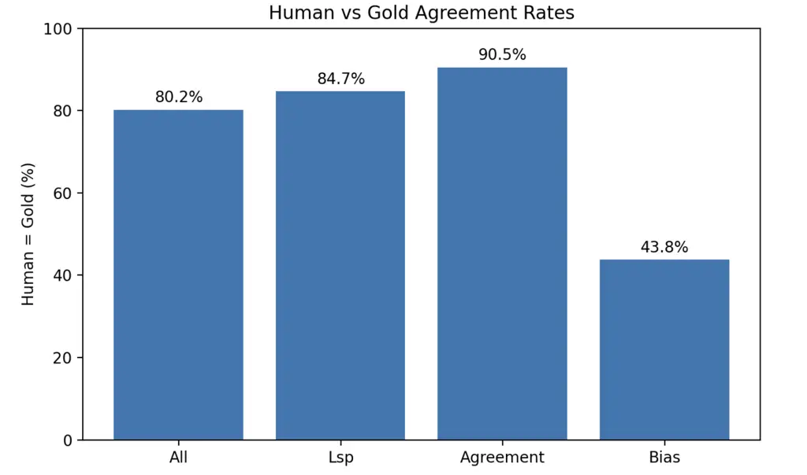
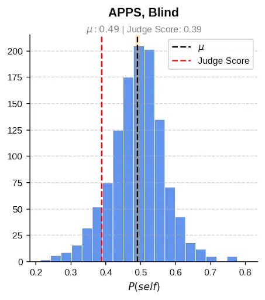

\workshoptitle

Mechanistic Interpretability

# Breaking the Mirror: Activation-Based Mitigation of Self-Preference in LLM Evaluators

Jou Barzdukas^(\*)    Matthew Nguyen ^(†)^(†)thanks: Equal contribution;
names in alphabetical order Affiliation: Department of Computer Science
Affiliation: University of Virginia Affiliation: Charlottesville, VA
22904 Email: [\[joubarzdukas,mbnguyen8\]@gmail.com](mailto:)    Matthew
Bozoukov^(\*) Affiliation: Department of Computer Science
Affiliation: University of California, San Diego Affiliation: La Jolla,
CA 92093 Email: [matthewbozoukov123@gmail.com](mailto:)    Simon Hongyu
Fu^(\*)    Dani Roytburg^(\*) Affiliation: School of Computer Science
Affiliation: Carnegie Mellon University Affiliation: Pittsburgh, PA
15213 Email: [\[hongyuf,droytbur\]@andrew.cmu.edu](mailto:)    Narmeen
Oozeer Affiliation: Martian Research Affiliation: San Francisco, CA,
94105 Email: [narmeen@withmartian.com](mailto:)

###### Abstract

Large language models (LLMs) increasingly serve as automated evaluators,
yet they suffer from self-preference bias: a tendency to favor their own
outputs over those of other models. This bias undermines fairness and
reliability in evaluation pipelines, particularly for tasks like
preference tuning and model routing. We investigate whether lightweight
steering vectors can mitigate this problem at inference time without
retraining. We introduce a curated dataset that distinguishes
self-preference bias into justified examples of self-preference and
unjustified examples of self-preference, and we construct steering
vectors using two methods: Contrastive Activation Addition (CAA) and an
optimization-based approach. Our results show that steering vectors can
reduce unjustified self-preference bias by up to 97%, substantially
outperforming prompting and direct preference optimization baselines.
Yet steering vectors are unstable on legitimate self-preference and
unbiased agreement, implying self-preference spans multiple or nonlinear
directions. This underscores both their promise and limits as safeguards
for LLM-as-judges and motivates more robust interventions. We make our
code [publicly
available](https://anonymous.4open.science/r/steering_self_preference-EEC6)
for reproducibility.

## 1 Introduction

Evaluating LLM outputs, especially subjective tasks without ground
truth, remains hard. A common workaround uses LLMs-as-judges as
preference proxies (Gu et al., 2025), but this imports judge-model
biases, creating safety and robustness risks (Ye et al., 2024).

Self-preference bias, a model’s disproportionate preference for its own
outputs, scales with model size, post-training, and performance
(Panickssery et al., 2024a; Wataoka et al., 2025), and persists even
when authorship is hidden. This poses risks for preference tuning,
domain-specific annotation, and model routing (Zhang et al., 2025;
Weyssow et al., 2024; Zheng et al., 2023; Gallego, 2025; Shafran et al.,
2025; Du et al., 2025). Yet most work centers on detection rather than
mitigation (Wataoka et al., 2025; Chen et al., 2025a), with remedies
largely limited to fine-tuning or style changes (Panickssery et al.,
2024a).

We mitigate this with steering vectors—lightweight, inference-time
activation edits with minimal training cost (Im and Li, 2025). Prior
work shows they effectively modulate behavior, though with imperfect
precision.

Our contributions are threefold: (1) We curate an evaluation set for
XSUM that separates illegitimate self-preference, legitimate
self-preference, and unbiased agreement using ensemble "gold" judges
from diverse model families; (2) We construct steering vectors for
self-preference using Contrastive Activation Addition (CAA) and a
data-efficient optimization method; and (3) We show these interventions
flip up to 97% of illegitimate self-preferences and shift
$`P(\text{self})`$ toward the impartial-judge mean
$`\mu_{\text{judge}}`$, outperforming prompting and DPO baselines.

## 2 Methods and Experiments

### 2.1 Demonstrating Self-Preference Bias

We first evaluate self-preference bias using a framework that
disentangles it from ground-truth quality. Consider a dataset
$`X=\{x_{i}\}_{i=1}^{|X|}`$ of source articles. For each article
$`x_{i}`$, a self-evaluating model $`J`$ and a comparison model $`K`$
produce summaries $`y_{J,i}`$ and $`y_{K,i}`$. We create a pairwise
evaluation set from these summaries,
$`Y_{J,K}(X)=\{(y_{J,i},\,y_{K,i})\}_{i=1}^{|X|}`$. Using this set, we
ask model $`J`$ to determine the better summary for each item, writing
$`v_{i}\in\{y_{J,i},\,y_{K,i}\}`$. We define self-preference bias as the
probability-weighted difference in selections, averaged over the
dataset.

```math
\mathtt{bias}(J,X)=\frac{1}{|X|}\sum_{i=1}^{|X|}\left(P(v_{i}=y_{J,i})-P(v_{i}=y_{K,i})\right)
```

To separate bias from genuine quality, we follow Chen et al. (2025b) and
generate ground-truth labels using a set of gold judges
$`G=\{G_{1},\dots,G_{n}\}`$ from different model families. For each item
$`i`$, the gold vote $`g_{i}\in\{y_{J,i},y_{K,i}\}`$ is the majority
preference of $`G`$ between the two candidates $`(y_{J,i},y_{K,i})`$ in
$`Y_{J,K}(X)`$. We then define a judge score over $`X`$ that measures
objective quality differences between models $`J`$ and $`K`$:
$`\mathtt{score}\!\big(G,Y_{J,K}(X)\big)=\tfrac{1}{|X|}\sum_{i=1}^{|X|}\mathbf{1}[\,g_{i}=y_{J,i}\,]`$,
i.e., the fraction of items where the gold judges prefer $`J`$’s
summary. With gold labels, each evaluation of $`x_{i}`$ by model $`J`$
falls into one of three outcomes: illegitimate self-preference
$`(v_{i}=y_{J,i},\,g_{i}=y_{K,i})`$, legitimate self-preference
$`(v_{i}=y_{J,i},\,g_{i}=y_{J,i})`$, and unbiased agreement
$`(v_{i}=y_{K,i},\,g_{i}=y_{K,i})`$. Concretely, illegitimate
self-preference: $`J`$ chooses its own summary while the gold judges
prefer the other model’s summary; legitimate self-preference: both $`J`$
and the gold judges prefer the self-evaluating model’s summary; unbiased
agreement: both prefer the comparison model’s summary. To ensure
alignment with human preference judgments, we manually validated 283
gold-judge decisions (Appendix E).

Figure 1: A steering vector fits a self-preferring model around an
aligned mean in blind (left) and aware (right) pairwise preference
tests, suggesting the representation of self-preference can be derived
from linear space. Steering on layer 14 with a multiplier of 0.5 (CAA)
and 0.1 (Optimization).

##### Datasets

We evaluate on XSUM (Narayan et al., 2018), a subjective summarization
task with clear quality criteria. We sample 1,000 articles, generate
summaries with Llama-3.1-8B-Instruct and GPT-3.5, and, using §2.1,
compute the ground-truth mean
$`\mu_{\text{judge}}=\texttt{score}(G,Y_{J,K}(X))`$. We then plot judge
$`J`$’s baseline probability of selecting its own output, confirming
persistent self-preference in the aware setting where $`J`$ is told
which summary it wrote (Fig.1). While we focus our steering efforts on
summarization, Appendix F shows preliminary investigations into
different domains.

We evaluate both the self-preferring judge $`J`$ and gold judges $`G`$
by running each prompt twice with different summary orderings,
discarding items that demonstrate positional bias (Ye et al., 2024). We
use two prompts: an unaware prompt that hides authorship, and an aware
prompt that labels summaries as "your response" vs. "other model’s
response". Full prompts are in Appendix C.

##### Models

We select Llama 3.1-8B-Instruct (Grattafiori et al., 2024) as our judge
model, following empirical results from Ackerman and Panickssery (2025)
demonstrating its capability for bias, and use GPT-3.5 OpenAI (2023) as
a comparison model due to its performance matching Llama on
summarization datasets. For gold labels, we use Phi-4 (Abdin et al.,
2024), DeepSeek V3 (DeepSeek-AI et al., 2025), and Claude 3.5-Sonnet
(Anthropic, 2024).

### 2.2 Constructing a Steering Vector

We construct steering vectors via (1) contrastive activation addition
(CAA; (Panickssery et al., 2024b)), contrasting positive vs. negative
activations to isolate a direction, and (2) optimization-based steering
(Dunefsky and Cohan, 2025), which learns an additive vector by gradient
descent on contrasted completions. We choose these for their strong
results in self-recognition/refusal (Ackerman and Panickssery, 2025; Cao
et al., 2024).

#### 2.2.1 Contrastive Activation Addition

CAA builds the steering vector by pairing positive and negative examples
for the target behavior and averaging the hidden-state activation
differences they induce.

Formally, given a dataset $`X`$ of prompts $`p`$ paired with completions
$`c`$ generated by model $`J`$ with greedy sampling, we select prompts
$`p_{+}`$ that yield unbiased completions $`c_{+}`$ and prompts
$`p_{-}`$ which yield biased completions $`c_{-}`$, we then define the
CAA vector $`\mathbf{v}_{\mathrm{CAA}}`$ for a model layer $`L`$ as
follows:

```math
\mathbf{v}_{\mathrm{CAA}}=\frac{1}{|X_{+}|}\sum_{(p_{+},c_{+})\in X_{+}}{h_{L}(p_{+},c_{+})}-\frac{1}{|X_{-}|}\sum_{(p_{-},c_{-})\in X_{-}}{h_{L}(p_{-},c_{-})}
```

where $`h_{L}(p,c)`$ represents the activations in the residual stream
at layer $`L`$ after processing the prompt $`p`$ and continuation $`c`$.
We collect activations at the last 10 token positions for all layers.

#### 2.2.2 Gradient-based Activation Optimization

We use a contrastive promotion/suppression method defined by (Dunefsky
and Cohan, 2025) to train an additive vector with a contrastive loss
function. Let $`X`$ be the input prompt, $`Y_{+}`$ be the desired
completion, and $`Y_{-}`$ be the undesired completion. The probability
of a model generating the sequence $`Y_{+}`$ given $`X`$ with the
steering vector $`h`$ applied to its activations is denoted as
$`P_{\mathrm{model}}(Y\mid X;h)`$. The optimization of $`h`$ is framed
as a minimization problem in a composite loss function with two terms:

```math
\mathcal{L}(X,Y;h)=-\log P_{\mathrm{model}}\!\left(Y_{+}\,\middle|\,X;h\right)-\log\!\left(1-P_{\mathrm{model}}\!\left(Y_{-}\,\middle|\,X;h\right)\right) \tag{1}
```

This dual-objective loss aims to create a strong directional signal for
the model’s activations. We optimize a vector at layers 14, 15, and 16
as those performed the best on our evaluations. See Appendix B for
optimization hyperparameters.

### 2.3 Steering Evaluations

##### Baselines

We compare our constructed vectors to two realistic, approachable
baselines for end users: (1) a prompt-based strategy reminding the judge
model of self-preference bias (in Appendix C.3) and (2) fine-tuning with
Direct Preference Optimization Rafailov et al. (2024) on all examples of
self-preference bias, unbiased agreement, and legitimate
self-preference. Details about finetuning can be found in Appendix D.

##### Metrics

Steering is evaluated by: (1) effectiveness—the fraction of $`J`$’s
biased votes that the steered judge $`J^{\prime}`$ corrects; and (2)
stability—the fraction of $`J`$’s correct votes $`J^{\prime}`$ preserves
(covering unbiased agreement and legitimate self-preference). Together,
these measure bias suppression and preservation of valid judgments.

## 3 Results

We find that steering vectors can reliably reduce illegitimate
self-preference and showcase high effectiveness (Table 1). Three of the
four steering vectors tested were able to successfully "flip" 97% of
previously biased samples. Surprisingly, optimization-based steering
performs comparably to CAA with far fewer examples—valuable given scarce
labeled cases across our regimes. Also unexpectedly, context-unaware
vectors outperformed their aware counterparts, yet both settings yielded
successful flips. The cross-setting effectiveness suggests that
self-preference has at least a partially linear representation in
activation space. All in all, compared with prompting (0% flips) and DPO
(49%), steering vectors are able to achieve substantial effectiveness
gains. See Appendix G.1 for steered examples.

However, the same vectors struggle with stability. CAA-constructed
vectors in particular demonstrate little modulation indicated by their
high flip rates in legitimate self preference and low flip rates in
unbiased agreement in both unaware and aware settings. This provides
evidence for self-preference being represented non-linearly or with
multiple directions in activation space.

| Intervention |              | Bias (↑) | Agreement (↓) | LSP (↓) |
| ------------ | ------------ | -------- | ------------- | ------- |
| Baseline     | Prompt       | 0.00     | 0.88          | 1.00    |
|              | DPO          | 0.49     | 0.08          | 0.11    |
| Aware        | Optimization | 0.23     | 0.83          | 0.78    |
|              | CAA          | 0.97     | 0.20          | 0.93    |
| Unaware      | Optimization | 0.97     | 0.50          | 0.47    |
|              | CAA          | 0.97     | 0.23          | 0.87    |

Table 1: Steering effectiveness vs. stability on XSUM. Entries are flip
rates (fraction of examples whose original decision changes under the
intervention) computed within three disjoint subsets: Bias =
illegitimate self-preference (higher is better), Agreement = unbiased
agreement (lower is better), LSP = legitimate self-preference (lower is
better). "Aware" exposes authorship labels; "Unaware" hides authorship.
Results are reported with a multiplier of 0.1; additional multipliers
are presented in Appendix A.

## 4 Related Work

Early work found LLMs systematically favor their own outputs (Bitton et
al., 2023; Liu et al., 2024). Measurement then improved: Zheng et al.
(2023) used human-preference labels to separate illegitimate bias from
justified choices; Chen et al. (2025a) tested verifiable tasks across
scales; and Chen et al. (2025b) introduced gold labels from uninvolved
models. We adopt this last framework to build reliable positive/negative
cases for steering and evaluation.

Building on these refinements, Panickssery et al. (2024a) showed that
frontier LLMs both recognize and favor their own outputs, with stronger
recognition amplifying bias. Fine-tuning intensified both effects,
underscoring risks when the same model serves as generator and judge.

In interpretability, Ackerman and Panickssery (2025) controlled
self-recognition via contrastive steering. We extend this to
self-preference with a pairwise setting where bias and true quality
intertwine requiring reliable ground truth to separate illegitimate
self-preference from justified choices.

## 5 Discussion and Future Work

As discussed in Section 3, our vectors are not robust to the legitimate
self-preference case nor the unbiased agreement case. This could mean
that illegitimate self-preference is linearly encoded while the other
two are different directions either linearly or nonlinearly encoded in
the residual stream. Future work should explore this possibility in
depth and further improvements to our setup.

Another major confounding factor for CAA in particular was the ordering
bias models exhibit in the pairwise setting. We attempt to account for
this as reported in Section 2.1, however, this still obstructed our
signal and could be a factor for our limited results in the LSP and
agreement case. Future work should incorporate individual rather than
pairwise evaluations for self-preference to circumvent this issue.

## References

- Abdin et al. (2024) M. Abdin, J. Aneja, H. Behl, S. Bubeck, R.
  Eldan, S. Gunasekar, M. Harrison, R. J. Hewett, M. Javaheripi, P.
  Kauffmann, et al. Phi-4 technical report. arXiv preprint
  arXiv:2412.08905. Cited by: §2.1.
- Ackerman and Panickssery (2025) C. Ackerman and N. Panickssery
  Inspection and Control of Self-Generated-Text Recognition Ability in
  Llama3-8b-Instruct. arXiv. Note: arXiv:2410.02064 \[cs\]Comment: 10
  pages, 13 figs, 2 tables, accepted as conference paper to ICLR 2025
  External Links: [Link](http://arxiv.org/abs/2410.02064),
  [Document](https://dx.doi.org/10.48550/arXiv.2410.02064) Cited by:
  §2.1, §2.2, §4.
- Anthropic and Anthropic (2024) Anthropic and A. Introducing Claude 3.5
  Sonnet. (en). External Links:
  [Link](https://www.anthropic.com/news/claude-3-5-sonnet) Cited by:
  §2.1.
- Bitton et al. (2023) Y. Bitton, H. Bansal, J. Hessel, R. Shao, W.
  Zhu, A. Awadalla, J. Gardner, R. Taori, and L. Schmidt VisIT-bench: a
  benchmark for vision-language instruction following inspired by
  real-world use. External Links: 2308.06595,
  [Link](https://arxiv.org/abs/2308.06595) Cited by: §4.
- Cao et al. (2024) Y. Cao, T. Zhang, B. Cao, Z. Yin, L. Lin, F. Ma,
  and J. Chen Personalized steering of large language models: versatile
  steering vectors through bi-directional preference optimization.
  Advances in Neural Information Processing Systems 37, pp. 49519–49551.
  Cited by: §2.2.
- Chen et al. (2025a) W. Chen, Z. Wei, X. Zhu, S. Feng, and Y. Meng Do
  LLM Evaluators Prefer Themselves for a Reason?. arXiv. Note:
  arXiv:2504.03846 \[cs\]Comment: Preprint. 31 pages External Links:
  [Link](http://arxiv.org/abs/2504.03846),
  [Document](https://dx.doi.org/10.48550/arXiv.2504.03846) Cited by: §1,
  §4.
- Chen et al. (2025b) Z. Chen, H. Wang, X. Zhang, E. Hu, and Y. Lin
  Beyond the surface: measuring self-preference in llm judgments.
  External Links: 2506.02592, [Link](https://arxiv.org/abs/2506.02592)
  Cited by: §2.1, §4.
- DeepSeek-AI et al. (2025) DeepSeek-AI, A. Liu, B. Feng, B. Xue, B.
  Wang, B. Wu, C. Lu, C. Zhao, C. Deng, C. Zhang, C. Ruan, D. Dai, D.
  Guo, D. Yang, D. Chen, D. Ji, E. Li, F. Lin, F. Dai, F. Luo, G.
  Hao, G. Chen, G. Li, H. Zhang, H. Bao, H. Xu, H. Wang, H. Zhang, H.
  Ding, H. Xin, H. Gao, H. Li, H. Qu, J. L. Cai, J. Liang, J. Guo, J.
  Ni, J. Li, J. Wang, J. Chen, J. Chen, J. Yuan, J. Qiu, J. Li, J.
  Song, K. Dong, K. Hu, K. Gao, K. Guan, K. Huang, K. Yu, L. Wang, L.
  Zhang, L. Xu, L. Xia, L. Zhao, L. Wang, L. Zhang, M. Li, M. Wang, M.
  Zhang, M. Zhang, M. Tang, M. Li, N. Tian, P. Huang, P. Wang, P.
  Zhang, Q. Wang, Q. Zhu, Q. Chen, Q. Du, R. J. Chen, R. L. Jin, R.
  Ge, R. Zhang, R. Pan, R. Wang, R. Xu, R. Zhang, R. Chen, S. S. Li, S.
  Lu, S. Zhou, S. Chen, S. Wu, S. Ye, S. Ye, S. Ma, S. Wang, S. Zhou, S.
  Yu, S. Zhou, S. Pan, T. Wang, T. Yun, T. Pei, T. Sun, W. L. Xiao, W.
  Zeng, W. Zhao, W. An, W. Liu, W. Liang, W. Gao, W. Yu, W. Zhang, X. Q.
  Li, X. Jin, X. Wang, X. Bi, X. Liu, X. Wang, X. Shen, X. Chen, X.
  Zhang, X. Chen, X. Nie, X. Sun, X. Wang, X. Cheng, X. Liu, X. Xie, X.
  Liu, X. Yu, X. Song, X. Shan, X. Zhou, X. Yang, X. Li, X. Su, X.
  Lin, Y. K. Li, Y. Q. Wang, Y. X. Wei, Y. X. Zhu, Y. Zhang, Y. Xu, Y.
  Xu, Y. Huang, Y. Li, Y. Zhao, Y. Sun, Y. Li, Y. Wang, Y. Yu, Y.
  Zheng, Y. Zhang, Y. Shi, Y. Xiong, Y. He, Y. Tang, Y. Piao, Y.
  Wang, Y. Tan, Y. Ma, Y. Liu, Y. Guo, Y. Wu, Y. Ou, Y. Zhu, Y. Wang, Y.
  Gong, Y. Zou, Y. He, Y. Zha, Y. Xiong, Y. Ma, Y. Yan, Y. Luo, Y.
  You, Y. Liu, Y. Zhou, Z. F. Wu, Z. Z. Ren, Z. Ren, Z. Sha, Z. Fu, Z.
  Xu, Z. Huang, Z. Zhang, Z. Xie, Z. Zhang, Z. Hao, Z. Gou, Z. Ma, Z.
  Yan, Z. Shao, Z. Xu, Z. Wu, Z. Zhang, Z. Li, Z. Gu, Z. Zhu, Z. Liu, Z.
  Li, Z. Xie, Z. Song, Z. Gao, and Z. Pan DeepSeek-v3 technical report.
  External Links: 2412.19437, [Link](https://arxiv.org/abs/2412.19437)
  Cited by: §2.1.
- Du et al. (2025) M. Du, A. T. Luu, X. Wu, Y. Huang, Y. Liu, D.
  Huang, H. Liu, B. Ji, J. M. Zhang, and S. Ng Collective Bias
  Mitigation via Model Routing and Collaboration. (en). External Links:
  [Link](https://openreview.net/forum?id=YWJYJduVej) Cited by: §1.
- Dunefsky and Cohan (2025) J. Dunefsky and A. Cohan One-shot Optimized
  Steering Vectors Mediate Safety-relevant Behaviors in LLMs. arXiv.
  Note: arXiv:2502.18862 \[cs\]Comment: Published at COLM 2025. 30
  pages, 7 figures. Code is available at
  https://github.com/jacobdunefsky/one-shot-steering-repro and
  https://github.com/jacobdunefsky/one-shot-steering-misalignment
  External Links: [Link](http://arxiv.org/abs/2502.18862),
  [Document](https://dx.doi.org/10.48550/arXiv.2502.18862) Cited by:
  §2.2.2, §2.2.
- Gallego (2025) V. Gallego Configurable preference tuning with
  rubric-guided synthetic data. arXiv preprint arXiv:2506.11702. Cited
  by: §1.
- Grattafiori et al. (2024) A. Grattafiori, A. Dubey, A. Jauhri, A.
  Pandey, A. Kadian, A. Al-Dahle, A. Letman, A. Mathur, A. Schelten, A.
  Vaughan, et al. The llama 3 herd of models. arXiv preprint
  arXiv:2407.21783. Cited by: §2.1.
- Gu et al. (2025) J. Gu, X. Jiang, Z. Shi, H. Tan, X. Zhai, C. Xu, W.
  Li, Y. Shen, S. Ma, H. Liu, S. Wang, K. Zhang, Y. Wang, W. Gao, L. Ni,
  and J. Guo A Survey on LLM-as-a-Judge. arXiv. Note: arXiv:2411.15594
  \[cs\]Comment: Project Page: https://awesome-llm-as-a-judge.github.io/
  External Links: [Link](http://arxiv.org/abs/2411.15594),
  [Document](https://dx.doi.org/10.48550/arXiv.2411.15594) Cited by: §1.
- Im and Li (2025) S. Im and Y. Li A unified understanding and
  evaluation of steering methods. arXiv preprint arXiv:2502.02716. Cited
  by: §1.
- Liu et al. (2024) Y. Liu, N. S. Moosavi, and C. Lin LLMs as
  narcissistic evaluators: when ego inflates evaluation scores. External
  Links: 2311.09766, [Link](https://arxiv.org/abs/2311.09766) Cited by:
  §4.
- Narayan et al. (2018) S. Narayan, S. B. Cohen, and M. Lapata Don’t
  give me the details, just the summary! topic-aware convolutional
  neural networks for extreme summarization. External Links: 1808.08745,
  [Link](https://arxiv.org/abs/1808.08745) Cited by: §2.1.
- OpenAI (2023) OpenAI ChatGPT (May 24 version) \[Large language
  model\]. Note: Accessed: August 21, 2025 External Links:
  [Link](https://chat.openai.com/chat) Cited by: §2.1.
- Panickssery et al. (2024a) A. Panickssery, S. R. Bowman, and S. Feng
  LLM evaluators recognize and favor their own generations. External
  Links: 2404.13076, [Link](https://arxiv.org/abs/2404.13076) Cited by:
  §1, §4.
- Panickssery et al. (2024b) N. Panickssery, N. Gabrieli, J. Schulz, M.
  Tong, E. Hubinger, and A. M. Turner Steering Llama 2 via Contrastive
  Activation Addition. arXiv. Note: arXiv:2312.06681 \[cs\] External
  Links: [Link](http://arxiv.org/abs/2312.06681),
  [Document](https://dx.doi.org/10.48550/arXiv.2312.06681) Cited by:
  §2.2.
- Rafailov et al. (2024) R. Rafailov, A. Sharma, E. Mitchell, S.
  Ermon, C. D. Manning, and C. Finn Direct preference optimization: your
  language model is secretly a reward model. External Links: 2305.18290,
  [Link](https://arxiv.org/abs/2305.18290) Cited by: §2.3.
- Shafran et al. (2025) A. Shafran, R. Schuster, T. Ristenpart, and V.
  Shmatikov Rerouting LLM Routers. arXiv. Note: arXiv:2501.01818 \[cs\]
  External Links: [Link](http://arxiv.org/abs/2501.01818),
  [Document](https://dx.doi.org/10.48550/arXiv.2501.01818) Cited by: §1.
- Wataoka et al. (2025) K. Wataoka, T. Takahashi, and R. Ri
  Self-Preference Bias in LLM-as-a-Judge. arXiv. Note: arXiv:2410.21819
  \[cs\]Comment: Accepted at NeurIPS 2024 Safe Generative AI Workshop
  External Links: [Link](http://arxiv.org/abs/2410.21819),
  [Document](https://dx.doi.org/10.48550/arXiv.2410.21819) Cited by: §1.
- Weyssow et al. (2024) M. Weyssow, A. Kamanda, X. Zhou, and H. Sahraoui
  Codeultrafeedback: an llm-as-a-judge dataset for aligning large
  language models to coding preferences. arXiv preprint
  arXiv:2403.09032. Cited by: §1.
- Ye et al. (2024) J. Ye, Y. Wang, Y. Huang, D. Chen, Q. Zhang, N.
  Moniz, T. Gao, W. Geyer, C. Huang, P. Chen, N. V. Chawla, and X. Zhang
  Justice or Prejudice? Quantifying Biases in LLM-as-a-Judge. arXiv.
  Note: arXiv:2410.02736 \[cs\] External Links:
  [Link](http://arxiv.org/abs/2410.02736),
  [Document](https://dx.doi.org/10.48550/arXiv.2410.02736) Cited by: §1,
  §2.1.
- Zhang et al. (2025) T. Zhang, A. Mehradfar, D. Dimitriadis, and S.
  Avestimehr Leveraging Uncertainty Estimation for Efficient LLM
  Routing. arXiv. Note: arXiv:2502.11021 \[cs\] External Links:
  [Link](http://arxiv.org/abs/2502.11021),
  [Document](https://dx.doi.org/10.48550/arXiv.2502.11021) Cited by: §1.
- Zheng et al. (2023) L. Zheng, W. Chiang, Y. Sheng, S. Zhuang, Z.
  Wu, Y. Zhuang, Z. Lin, Z. Li, D. Li, E. P. Xing, H. Zhang, J. E.
  Gonzalez, and I. Stoica Judging LLM-as-a-Judge with MT-Bench and
  Chatbot Arena. arXiv. Note: arXiv:2306.05685 \[cs\]Comment: NeurIPS
  2023 Datasets and Benchmarks Track External Links:
  [Link](http://arxiv.org/abs/2306.05685),
  [Document](https://dx.doi.org/10.48550/arXiv.2306.05685) Cited by: §1,
  §4.

## Appendix A Steering Vector Plots

### A.1 Illegitimate Self-Preference

Figure 2: Probability of the self-evaluating model $`J`$ choosing the
comparison model $`K`$’s summary on the y-axis, and multipliers on the
x-axis. This plot is for the subset of examples in which $`J`$ thinks
its summary is better and the gold judges $`\{G_{1},\dots,G_{n}\}`$
think that $`K`$’s summary is better.

### A.2 Unbiased Agreement

Figure 3: Probability of the self-evaluating model $`J`$ choosing the
comparison model $`K`$’s summary on the y-axis. This plot is for the
subset of examples in which $`J`$ agrees with the gold judges
$`\{G_{1},\dots,G_{n}\}`$ that $`K`$’s summary is best.

### A.3 Legitimate Self-Preference

Figure 4: Probability of the self-evaluating model $`J`$ choosing its
own summary on the y-axis, and multipliers on the x-axis. This plot is
for the subset of examples in which the self-evaluating model $`J`$
thinks that its summary is better and the gold judges
$`\{G_{1},\dots,G_{n}\}`$ agree.

## Appendix B Optimization Parameters

For our experiments, we froze the model weights, hooked an additive
vector, and optimized over the top 20th percentile of prompts based on
the highest probability that $`J`$ would select its own answer, given
that the gold label votes for model $`K`$, maximizing the probability of
target completion $`Y_{+}`$ corresponding to model $`K`$’s response and
minimizing the initial, biased completion $`Y_{-}=v_{J}`$. We optimize
using Adam on layer 14 of Llama-3.1-8b-instruct for 20 iterations with a
learning rate of $`0.1`$.

## Appendix C Prompts

### C.1 Pairwise Evaluation Prompts

#### C.1.1 Unaware Setting


#### C.1.2 Aware Setting


### C.2 XSUM Summary Generation Prompt


### C.3 Prompt Intervention Baseline


## Appendix D DPO Setup

We fine-tune Llama 3.1-8B-Instruct with a Direct Preference Optimization
(DPO) Low-Rank Adapter (LoRA) to predict gold standard labels in the
unaware setting. We construct a preference dataset using the unbiased,
gold judge consensus as the preferred answer, and the alternative choice
($`\{J,K\}\setminus g_{i}`$) as the unpreferred answer. We train with
the adapter at rank 64 with a LoRA $`\alpha=64`$ and a DPO $`\beta`$ of
0.1.

The model is trained for 3 epochs using the 8-bit AdamW optimizer with a
learning rate of $`5\times 10^{-6}`$ and no weight decay. We employ a
linear learning rate scheduler with a warmup ratio of 0.1. The training
process uses a per-device batch size of 2 with 4 gradient accumulation
steps, resulting in an effective batch size of 8. For reproducibility,
the random seed is set to 42.

## Appendix E Gold Judge Human Validation



Figure 5: Human vs. Gold agreement rates by subset. Overall: 80.2%; LSP:
84.7%; Agreement: 90.5%; Bias: 43.8%.

To ensure the reliability of our gold-judge ensemble, we conducted a
full-scale human validation of every annotated decision. The comparison
in Figure 5 shows strong overall agreement between human evaluators and
gold judges, with 80.2% agreement across the full dataset. Subgroup
analyses reveal even higher alignment on legitimate self-preference
(84.7%) and unbiased agreement (90.5%), indicating that our gold judges
largely reflect consistent, human-aligned judgments in these settings.
These results support the validity of our gold labels as a reasonable
proxy for human preference.

However, the validation also exposes an important limitation: alignment
drops sharply for the bias subset, where agreement drops to 43.8%. This
highlights that while the gold-judge ensemble effectively captures
objective agreement cases, it struggles to resolve more ambiguous
cases—precisely the subset most relevant for self-preference. Overall,
the human validation confirms that our gold judges are generally good at
measuring output quality, though improvements in the bias subset remain
necessary.

## Appendix F Apps Dataset Analysis



Figure 6: Plot of the distribution of a model’s probability of selecting
its own output on the APPS dataset in a pairwise setting. LLaMA markedly
overestimates itself, with its mean self-preference far above the
impartial judge score.

## Appendix G Sample Steered Responses

### G.1 CAA, Aware Setting


