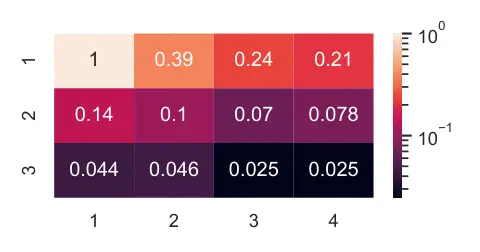

# LLMs for estimating positional bias in logged interaction data

Conference: Proceedings of the CONSEQUENCES Workshop; September 22,
2025; Prague, Czech Republic

Aleksandr V. Petrov Affiliation: Viator, Tripadvisor, Glasgow, UK email:
<firexel@gmail.com> , Michael Murtagh Affiliation: Viator, Tripadvisor,
Lisbon, Portugal email: <mmurtagh@tripadvisor.com> and Karthik Nagesh
Affiliation: Viator, Tripadvisor, London, UK email:
<knagesh@tripadvisor.com>

© cc

###### Abstract.

Recommender and search systems commonly rely on Learning To Rank models
trained on logged user interactions to order items by predicted
relevance. However, such interaction data is often subject to position
bias, as users are more likely to click on items that appear higher in
the ranking, regardless of their actual relevance. As a result, newly
trained models may inherit and reinforce the biases of prior ranking
models rather than genuinely improving relevance. A standard approach to
mitigate position bias is Inverse Propensity Scoring (IPS), where the
model’s loss is weighted by the inverse of a propensity function, an
estimate of the probability that an item at a given position is
examined. However, accurate propensity estimation is challenging,
especially in interfaces with complex non-linear layouts. In this paper,
we propose a novel method for estimating position bias using Large
Language Models (LLMs) applied to logged user interaction data. This
approach offers a cost-effective alternative to online experimentation.
Our experiments show that propensities estimated with our LLM-as-a-judge
approach are stable across score buckets and reveal the row–column
effects of Viator’s grid layout that simpler heuristics overlook. An
IPS-weighted reranker trained with these propensities matches the
production model on standard NDCG@10 while improving weighted NDCG@10 by
roughly 2%. We will verify these offline gains in forthcoming
live-traffic experiments.

^(†)^(†)cc-license: by

## 1. Introduction

One of the most common setups in modern information retrieval systems,
including recommender systems and web search, is the
_retrieve-then-rerank_ architecture, in which a _candidate generator_
model first narrows down the large item catalog to a set of promising
candidates, and a reranker model then ranks these candidates according
to their estimated relevance to the user (Nogueira and Cho, 2019;
Covington et al., 2016). According to the Probability Ranking Principle
(PRP) (Robertson, 1977), one of the foundational principles in
Information Retrieval, an optimal ranker should order items by their
probability of being relevant to the user,
$`P(\text{relevant}\mid\text{item},\text{user})`$.¹¹ 1 Throughout this
paper we use recommender systems terminology; in classical IR, PRP
prescribes ranking documents by
$`P(\text{relevant}\mid\text{query},\text{document})`$.

In practice, relevance probabilities required by the PRP are typically
estimated using machine learning models – an approach known as Learning
to Rank (LTR). Usually LTR models are trained as supervised machine
learning models, that rely on labeled data indicating user preferences —
for example, clicks, purchases — to learn how to assign higher scores to
more relevant items. However, logged interaction data usually suffers
from position bias, i.e. users tend to click on higher-ranked products
with higher probability. One of the most common models that describes
clicks distribution in logged data is the Position-Based Model (PBM,
a.k.a. the Examination Hypothesis) (Craswell et al., 2008), which
assumes that the probability of a click is given by the product of the
relevance probability and the positional bias or examination
probability:

```math
\displaystyle P \displaystyle(\text{click}\mid\text{user},\text{item},\text{position})=
```

```math
\displaystyle=\underbrace{\hbox{\pagecolor{lightgreen} $P(\text{relevant}\mid\text{item},\text{user})$}}_{\text{relevance probability}}\;\cdot\;\underbrace{\hbox{\pagecolor{pink}$P(\text{examination}\mid\text{position})$}}_{\text{position bias (propensity function)}} \tag{1}
```

As evident from Equation (1), the click probability depends on both item
relevance and position bias. Consequently, naïvely training a model via
maximum likelihood estimation on raw click logs leads to biased
learning, where the model disproportionately favors items that appeared
in higher ranks under the previous ranking system. Hence, the model
training process must attempt to mitigate position bias, for example
using Inverse Propensity Scoring (IPS) technique (Joachims et al.,
2017), where the loss function is reweighted by the inverse of the
estimated propensity of a position being examined. This results in an
asymptotically unbiased estimator of relevance, under the assumption
that the propensity function
$`P(\text{examination}\mid\text{position})`$ is known or can be reliably
estimated.


Figure 1. Grid representation of search results on Viator. With this
layout, click propensity may depend on both the row and the column,
violating the tradional “linear” scanning asssumption.

Hence, accurately estimating the positional bias
$`P(\text{examination}\mid\text{position})`$ is essential for training
unbiased LTR models. A common recommendation in the literature is to
perform low-impact interventions with real users, such as randomly
swapping items in the ranked list, to obtain reliable estimates of this
bias (Joachims et al., 2017). However, in real-world systems, online
experimentation is often a scarce and tightly managed resource, with
experiment schedules planned months in advance. Moreover, this approach
is constrained by the volume of online traffic: when traffic is limited,
allocating a portion for exploration can face (strong) resistance from
business stakeholders. As a result, relying on online interventions to
estimate examination bias may not always be feasible. An alternative is
to assume a predefined functional form for the propensity, such as
exponential propensity decay (Joachims et al., 2017; Ovaisi et al., 2020)
$`P(\text{examination}\mid\text{position})=\frac{1}{\text{position}^{\gamma}}`$,
where $`\gamma`$ is a tunable hyperparameter. Unfortunately, such
assumptions may fail in non-standard interface layouts. For example,
Figure 1 shows a grid-based search results page used by Viator.com, one
of the largest travel experiences e-commerce platform. In this layout,
the probability that a user examines an item can depend on both the row
and the column position, making simple position-based assumptions for
the propensity function potentially inaccurate.

This motivates us to explore whether or not it is possible to apply
Large Language Models (LLMs) to estimate positional bias in logged click
data. Indeed, it has been shown that LLMs are capable to judge relevance
of queries to the documents  (Wang et al., 2025; Hosseini et al., 2025)
. In the next section, we describe our proposed methodology for
estimating propensities using the LLM-as-a-judge approach.

## 2. Estimating Propensities using an LLM

A zero-shot relevance model estimates relevance for a user-item pair
without being trained on real click logs. Examples include
training-free, content-based models such as TF-IDF (Sparck Jones, 1972)
and BM25 (Robertson et al., 1995), as well as more recent zero-shot
LLM-based relevance estimators, often referred to as LLM-as-a-judge
methods (Li et al., 2025; Sun et al., 2023) ²² 2 In this paper, we
assume that both user and item are represented using text (e.g. user can
be represented using most recent search query and item can be
represented using its description).. Since zero-shot models are not
trained on position-biased click data, we argue that their relevance
estimates may be less affected by the logging policy. As such, they can
provide a useful signal for propensity estimation, offering judgments
that are potentially free from position bias.

However, we argue that outputs from lexical models such as BM25 are
poorly suited for propensity estimation. These models rely solely on
lexical overlap, ignoring semantic similarity, and thus often exhibit
limited correlation with human relevance judgements. Furthermore,
lexical similarity is frequently used as an input feature in production
ranking models, making the logged item ranks dependent on lexical
matching scores. This dependence means lexical signals can indirectly
affect position bias, undermining the assumption of the Position-Based
Model of independence between relevance and examination needed for
reliable propensity estimation.

In contrast, LLM-as-a-judge methods can provide significantly more
accurate relevance estimates, showing strong alignment with human
preferences (Arabzadeh and Clarke, 2025). In our experiments, we
evaluated a zero-shot, pointwise³³ 3 That is, the model returns a
relevance score for each $`\langle\text{user},\text{product}\rangle`$
pair. LLM-as-a-judge model based on GPT-4o-mini. As shown in Table 1,
this model reduced the NDCG@10 gap⁴⁴ 4 We do not report absolute metrics
for production models in line with company policy. to the production
model by over one-third compared to BM25 (-27.44% vs. -42.24%), using
Viator bookings as relevance labels. Moreover, while the LLM-as-a-judge
model achieved a lower NDCG@10 than the production model (which was used
to generate the logged rankings), this discrepancy is largely
attributable to position bias. When evaluating with the weighted version
of NDCG (wNDCG)⁵⁵ 5 To compute wNDCG, we assign each test instance a
weight equal to the position at which the booked product appeared in the
logged ranking. While we do not assume access to the true propensity
weights, this weighting scheme emphasizes samples where the user likely
examined more of the list. As a result, wNDCG is expected to be less
affected by position bias than standard NDCG., the LLM-as-a-judge model
outperformed the production model. This suggests that the lower NDCG
observed is primarily due to the bias introduced by item positions, not
inferior relevance estimation.

Currently, LLM relevance estimations are rarely used for ranking in
production systems, mainly due to their high inference cost (e.g., in
our case exceeding 2 seconds per query-document pair). Consequently,
unlike lexical scores (e.g., BM25), LLM-based scores have limited causal
influence on item positions in logged data, making them a more viable
candidate for use in position-bias–robust propensity estimation.

Our approach for estimating propensities
$`P(\text{examination}\mid\text{position})`$ using LLM-as-a-judge scores
is based on two assumptions:  
Assumption 1. _A user always examines item at the top rank:_

```math
\displaystyle P(\text{examination}\mid\text{position}=1)=1.0 \tag{2}
```

Setting $`P(\text{examination}\mid\text{position}=1)=1`$ is the standard
anchor: the vector of propensities is identifiable only up to a
constant, so fixing the top slot simply sets the scale (see also the
Dynamic Bayesian Network (DBN) model, where the top-ranked item is
always examined by setting $`\beta_{1}=1`$ (Chapelle and Zhang, 2009),
and the Dependent Click Model (DCM), which similarly assumes
$`\mathcal{E}_{1}=1`$ for the first rank (Guo et al., 2009)).
Eye-tracking shows the first result is examined in $`\approx`$90 % of
desktop sessions (Pan et al., 2007; Joachims et al., 2005), making the
approximation practically harmless.

Assumption 2. _Relevance is conditionally independent of position, given
the LLM-as-a-judge score:_

```math
\displaystyle P(\text{relevant}\mid\text{position},\text{LLM score})=P(\text{relevant}\mid\text{LLM score}) \tag{3}
```

Assumption 2 implies that, once we condition on the LLM-as-a-judge
score, the logged position of an item provides no additional information
about its true relevance. This would not hold if we relied on position
alone, since positions are determined by the production ranking model,
which is explicitly optimised to order items by predicted relevance.
Consequently, relevance and position are inherently correlated in logged
data unless we control for an independent relevance signal, such as that
provided by the LLM-as-a-judge model. This assumption is credible only
when the LLM-as-a-judge relevance model is strong and conditions on
essentially all relevance-related information available to the
production model; otherwise residual dependence may persist. In
particular, this restricts the use of simpler lexical models (e.g. BM25)
as independent relevance estimators for this purpose.

| Ranking Method | $`\Delta`$ NDCG@10 | $`\Delta`$ wNDCG@10 |
| -------------- | ------------------ | ------------------- |
| BM25           | -42.24%            | -11.20%             |
| LLM-as-a-judge | -27.44%            | +0.81%              |

Table 1. Effectiveness of ranking methods on logged Viator bookings,
reported as percentage differences ($`\Delta`$) in NDCG@10 and wNDCG@10
relative to the production model. wNDCG weighs each query by the booked
item’s rank in the production model, emphasising harder cases.
LLM-as-a-judge assigns pointwise scores via GPT-4o-mini.

Let us consider all logged recommendations shown at position $`p`$ for
which the LLM-as-a-judge system returned a relevance score $`s`$. In
this work, we assume that the LLM returns scores from a finite discrete
set $`\mathcal{S}`$; for example in our experiments we instructed an LLM
to return integer scores between 0 and 100. Given sufficient logged
data, we can estimate the click probability $`P(\text{click}\mid s,p)`$
simply as the proportion of clicks observed in the log. Combining the
standard Position-Based Model (Eq. (1)) with Assumption 2 (conditional
independence of relevance from position) we can factorise click
probability for a given LLM Score and positon:

```math
\displaystyle P(\text{click}\mid s,p) \displaystyle=P(\text{relevant}\mid s,p)\cdot P(\text{examination}\mid p)
```

```math
\displaystyle\ \ \ \ \ \ (\text{\small{using Assumption 2}}) \tag{4}
```

```math
\displaystyle=P(\text{relevant}\mid s)\cdot P(\text{examination}\mid p)
```

Using Assumption 1, we can estimate the relevance probability for a
given LLM-as-a-judge score as:

```math
\displaystyle P(\text{relevant}\mid s)=P \displaystyle(\text{click}\mid s,\text{position}=1) \tag{5}
```

In other words, _the probability that an item is relevant to a user
given an LLM-as-a-judge score $`s`$ can be estimated as the proportion
of clicks among user–item pairs with the same LLM score shown at the top
position._

Finally, subsituting Equation (5) into Equation. (4), we obtain
propensity estimation for any position $`p`$:

```math
P(\text{examination}\mid position=p)=\frac{P(\text{click}\mid\text{}s,position=p)}{P(\text{click}\mid s,position=1)} \tag{6}
```

where click probabilities on the right are obtained from click logs for
some specific value of the LLM-as-a-judge score $`s`$.

While we can technically choose any $`s\in\mathcal{S}`$ and only use it
for estimating propensities, doing so would ignore large amounts of the
available data, potentially making our estimates prone to noise. Hence,
to make our estimates more robust, we propose to average results across
all possible values of LLM-as-a-judge scores $`s`$:

```math
P(\text{examination}\mid position=p)=\frac{1}{|\mathcal{S}|}\sum_{s\in\mathcal{S}}\frac{P(\text{click}\mid s,position=p)}{P(\text{click}\mid{s},position=1)} \tag{7}
```

In the next section, we also explore how restricting the averaging to
specific subsets of $`\mathcal{S}`$, e.g., using only high-relevance or
low-relevance scores, affects the resulting estimates. This allows us to
assess the sensitivity of our method to different relevance levels
inferred by the LLM.

Figure 2. Recovered propensity scores using different levels of LLM
Relevance judgements.

## 3. Experiments & Discussion

In this section we present our experimental analysis of propensity score
estimation. We use an LLM-as-a-judge-based propensity estimation
approach to estimate click propensities on Viator’s search results page.
Specifically, we randomly sample 8,439 logged search queries and the
corresponding search results page impressions between March and May 2025
worth of user logs. For each query, we assign a relevance score between
0 and 100 using the GPT-4o-mini model. We then apply the methodology
described in Section 2, in particular, Equation (7), to recover position
propensities for Viator’s grid-based search layout. In our experiments,
we analyse two research questions, which are now described in turn.

RQ1. How sensitive are the estimated examination propensities to the
choice of LLM-as-a-judge score bucket?

Equation (7) implies that _if_ Assumption 2 (conditional independence of
relevance and position given the LLM score) holds, averaging over any
subset $`\mathcal{S}\subseteq[0,100]`$ should leave the _shape_ of the
propensity curve unchanged, only its sampling variance should differ. If
the assumption is violated, however, residual relevance–position
correlations may persist within particular score ranges, yielding
bucket-specific propensity curves. Comparing these curves therefore
provides a diagnostic of how well Assumption 2 holds in practice.

To probe this, we partition the LLM scores into three
buckets—_Excellent_ (81–100), _Good_ (61–80), and _Fair_ (41–60). Scores
below 41 are too sparse to analyse: the production ranker’s guardrails
already suppress items that the LLM deems clearly irrelevant. We then
estimate propensity curves separately for each bucket (Figure 2). The
three curves are virtually superimposed, exhibiting no systematic
divergence across ranking positions. Hence the propensity estimator
appears robust to the choice of score bucket, providing empirical
support for the conditional-independence assumption and suggesting that
the learned propensities are close to the true examination
probabilities.

RQ2. How does grid layout affect examination propensities?

We apply Equation (7) to the full set of LLM-as-a-judge scores and
mapped the resulting propensities onto Viator’s grid (Figure 3). The
top-left cell unsurprisingly attracts the highest examination
probability, yet several layout-specific deviations emerge. The drop
from the first to the second column is markedly steeper than the drop
from the third to the fourth, and in the second row the propensity even
_rises_ by roughly 10 % from the third to the fourth cell, likely
because the right-edge item anchors at the screen border while its
neighbour is visually “lost in the middle.” In the third row, which
usually becomes visible only after a short scroll, the left–right gap
nearly vanishes, indicating that lateral bias weakens once users scroll.
Hence, the grid induces row- and column-dependent effects that a
one-dimensional propensity model cannot capture.



Figure 3. Estimated examination propensities,
$`P(\text{examination}\mid\text{position})`$, for the first three rows
of Viator’s search-results grid layout.

## 4. Conclusion

We introduced an LLM-as-a-judge method for offline estimation of
examination propensities in grid layouts. Score-conditioned curves
overlap, supporting our conditional-independence assumption, while the
learned propensities expose clear row–column effects that
one-dimensional heuristics miss. In our early experiments, IPS-weighted
reranker trained with these propensities performed on par with the
production model on NDCG@10 but showed better results on weighted
NDCG(+2%). We are planning live experiments to validate these gains.

## References

- Arabzadeh and Clarke (2025) Negar Arabzadeh and Charles LA
  Clarke. 2025. Benchmarking LLM-based relevance judgment methods. In
  _Proceedings of the 48th International ACM SIGIR Conference on
  Research and Development in Information Retrieval_. 3194–3204.
- Chapelle and Zhang (2009) Olivier Chapelle and Ya Zhang. 2009. A
  dynamic bayesian network click model for web search ranking. In
  _Proceedings of the 18th international conference on World wide web_.
  1–10.
- Covington et al. (2016) Paul Covington, Jay Adams, and Emre
  Sargin. 2016. Deep neural networks for youtube recommendations. In
  _Proceedings of the 10th ACM conference on recommender systems_.
  191–198.
- Craswell et al. (2008) Nick Craswell, Onno Zoeter, Michael Taylor, and
  Bill Ramsey. 2008. An experimental comparison of click position-bias
  models. In _Proceedings of the 2008 international conference on web
  search and data mining_. 87–94.
- Guo et al. (2009) Fan Guo, Chao Liu, and Yi Min Wang. 2009. Efficient
  multiple-click models in web search. In _Proceedings of the second acm
  international conference on web search and data mining_. 124–131.
- Hosseini et al. (2025) Kasra Hosseini, Thomas Kober, Josip Krapac,
  Roland Vollgraf, Weiwei Cheng, and Ana Peleteiro Ramallo. 2025.
  Retrieve, Annotate, Evaluate, Repeat: Leveraging Multimodal LLMs for
  Large-Scale Product Retrieval Evaluation. In _European Conference on
  Information Retrieval_. Springer, 149–163.
- Joachims et al. (2005) Thorsten Joachims, Laura Granka, Bing Pan,
  Helene Hembrooke, and Geri Gay. 2005. Accurately interpreting
  clickthrough data as implicit feedback. In _Proceedings of the 28th
  Annual International ACM SIGIR Conference on Research and Development
  in Information Retrieval_ (Salvador, Brazil) _(SIGIR ’05)_.
  Association for Computing Machinery, New York, NY, USA, 154–161.
  [https://doi.org/10.1145/1076034.1076063](https://doi.org/10.1145/1076034.1076063)
- Joachims et al. (2017) Thorsten Joachims, Adith Swaminathan, and
  Tobias Schnabel. 2017. Unbiased learning-to-rank with biased feedback.
  In _Proceedings of the tenth ACM international conference on web
  search and data mining_. 781–789.
- Li et al. (2025) Dawei Li, Bohan Jiang, Liangjie Huang, Alimohammad
  Beigi, Chengshuai Zhao, Zhen Tan, Amrita Bhattacharjee, Yuxuan Jiang,
  Canyu Chen, Tianhao Wu, et al. 2025. From generation to judgment:
  Opportunities and challenges of llm-as-a-judge, 2025. _URL
  https://arxiv. org/abs/2411.16594_ (2025).
- Nogueira and Cho (2019) Rodrigo Nogueira and Kyunghyun Cho. 2019.
  Passage Re-ranking with BERT. _arXiv preprint arXiv:1901.04085_
  (2019).
- Ovaisi et al. (2020) Zohreh Ovaisi, Ragib Ahsan, Yifan Zhang, Kathryn
  Vasilaky, and Elena Zheleva. 2020. Correcting for selection bias in
  learning-to-rank systems. In _Proceedings of The Web Conference 2020_.
  1863–1873.
- Pan et al. (2007) Bing Pan, Helene Hembrooke, Thorsten Joachims, Lori
  Lorigo, Geri Gay, and Laura Granka. 2007. In Google we trust: Users’
  decisions on rank, position, and relevance. _Journal of
  computer-mediated communication_ 12, 3 (2007), 801–823.
- Robertson (1977) Stephen E Robertson. 1977. The probability ranking
  principle in IR. _Journal of documentation_ 33, 4 (1977), 294–304.
- Robertson et al. (1995) Stephen E Robertson, Steve Walker, Susan
  Jones, Micheline M Hancock-Beaulieu, Mike Gatford, et al. 1995. Okapi
  at TREC-3. (1995).
- Sparck Jones (1972) Karen Sparck Jones. 1972. A statistical
  interpretation of term specificity and its application in retrieval.
  _Journal of documentation_ 28, 1 (1972), 11–21.
- Sun et al. (2023) Weiwei Sun, Lingyong Yan, Xinyu Ma, Shuaiqiang Wang,
  Pengjie Ren, Zhumin Chen, Dawei Yin, and Zhaochun Ren. 2023. Is
  ChatGPT good at search? investigating large language models as
  re-ranking agents. _arXiv preprint arXiv:2304.09542_ (2023).
- Wang et al. (2025) Xingzhu Wang, Erhan Zhang, Yiqun Chen, Jinghan
  Xuan, Yucheng Hou, Yitong Xu, Ying Nie, Shuaiqiang Wang, Dawei Yin,
  and Jiaxin Mao. 2025. Leveraging LLMs to Evaluate Usefulness of
  Document. _arXiv preprint arXiv:2506.08626_ (2025).
