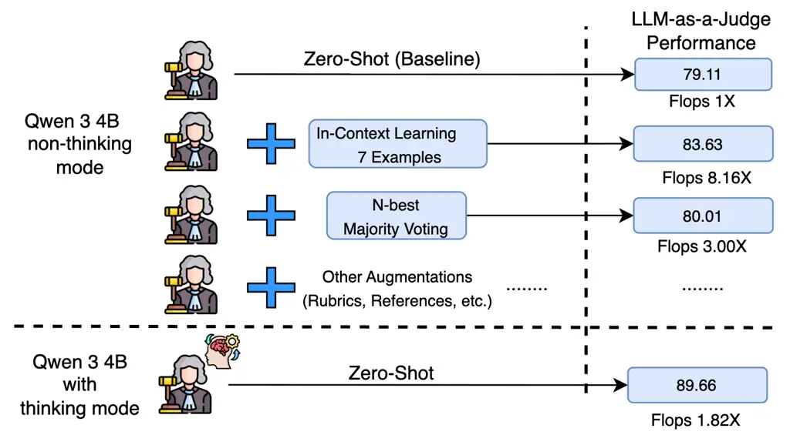
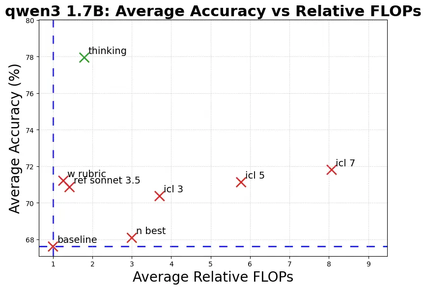
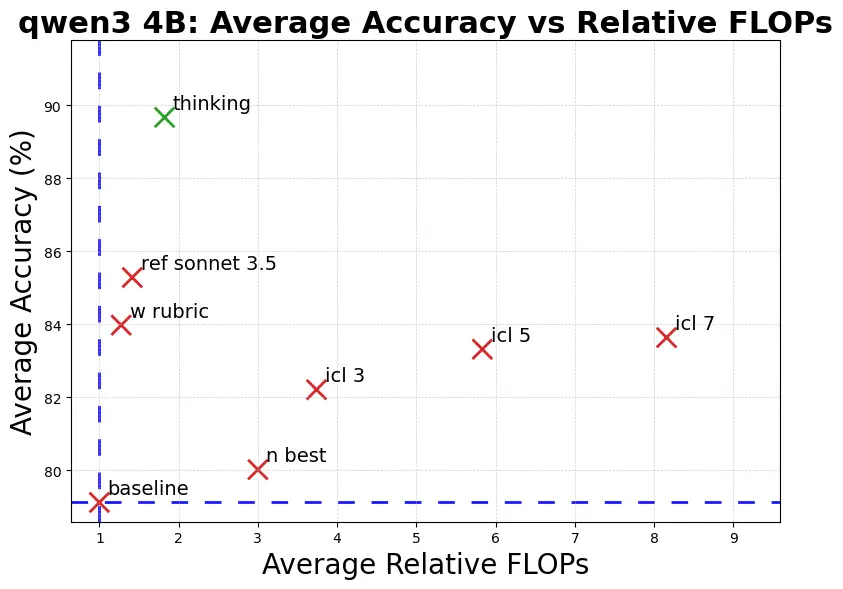

\workshoptitle

Efficient Reasoning

# Explicit Reasoning Makes Better Judges: A Systematic Study on Accuracy, Efficiency, and Robustness

Pratik Jayarao Email: <hgupta35@asu.edu>    Himanshu Gupta
Email: <nvarshn2@asu.edu>    Neeraj Varshney
Email: <pjayarao@alumni.cmu.edu>    Chaitanya Dwivedi
Email: <cdwivedi@alumni.cmu.edu> Affiliation: Arizona State University
Affiliation: Carnegie Mellon University

###### Abstract

As Large Language Models (LLMs) are increasingly adopted as automated
judges in benchmarking and reward modeling, ensuring their reliability,
efficiency, and robustness has become critical. In this work, we present
a systematic comparison of “thinking” and “non-thinking” LLMs in the
LLM-as-a-judge paradigm using open-source Qwen 3 models of relatively
small sizes (0.6B, 1.7B, and 4B parameters). We evaluate both accuracy
and computational efficiency (FLOPs) on RewardBench tasks, and further
examine augmentation strategies for non-thinking models, including
in-context learning, rubric-guided judging, reference-based evaluation,
and n-best aggregation. Our results show that despite these
enhancements, non-thinking models generally fall short of their thinking
counterparts. Our results show that thinking models achieve
approximately 10% points higher accuracy with little overhead (under
2x), in contrast to augmentation strategies like few-shot learning,
which deliver modest gains at a higher cost (\>8x). Bias and robustness
analyses further demonstrate that thinking models maintain significantly
greater consistency under a variety of bias conditions such as
positional, bandwagon, identity, diversity, and random biases
($`\sim 6\%`$ higher on average). We further extend our experiments to
the multilingual setting and our results confirm that explicit reasoning
extends its benefits beyond English. Overall, our work results in
several important findings that provide systematic evidence that
explicit reasoning offers clear advantages in the LLM-as-a-judge
paradigm not only in accuracy and efficiency but also in robustness

## 1 Introduction

Large Language Models (LLMs) are increasingly being adopted as automated
judges in benchmarking, evaluation, and reward modeling, collectively
known as the LLM-as-a-judge paradigm Zheng et al. (2023); Chiang and Lee
(2023); Li et al. (2024c). By providing scalable, adaptable, and
reproducible assessments of generated responses, these models have
become central to modern evaluation pipelines Li et al. (2024b); Huang
et al. (2025a); Wang et al. (2024); Kim et al. (2024). However, the
reliability of these judgments depends not only on model scale but also
on how the model internally reasons about the candidates to be
evaluated. In particular, “thinking” models (those that generate
explicit intermediate reasoning traces before producing a verdict) have
been emerging as a promising approach for enhancing evaluation fidelity.

Despite this growing interest, a systematic comparison of “thinking” and
“non-thinking” models in the LLM-as-a-judge setting remains
underexplored including critical questions about accuracy, efficiency,
and robustness trade-offs between the two paradigms. For instance, while
non-thinking models can be augmented with in-context examples, rubrics,
or reference-based judging, it is unclear whether these strategies
suffice to close the gap with reasoning-enabled models. Moreover, the
behavior of these two paradigms under bias-inducing conditions such as
positional effects, bandwagon influence, or identity cues remains to be
systematically studied. This is crucial as these factors can undermine
the reliability of automated evaluations.

To address the abovementioned gaps, we present a systematic study of
Qwen 3 models Yang et al. (2025) of varying scales (0.6B, 1.7B, and 4B
parameters) in the LLM-as-a-judge paradigm using the individual tasks of
the RewardBench benchmark Lambert et al. (2024), namely, ‘Chat’, ‘Chat
Hard’, ‘Safety’, and ‘Reasoning’. We compare thinking and non-thinking
variants across multiple evaluation dimensions: accuracy, computational
efficiency (measured in FLOPs), and robustness to a variety of biases.
For non-thinking models, we further examine several augmentation
strategies, including in-context learning with different numbers of
examples, rubric-guided judging, reference-based evaluation, and n-best
aggregation. In addition, we extend our study to multilingual reward
evaluation Gureja et al. (2025) to test the generality of the observed
trends beyond English. Our results reveal the following key findings:



Figure 1: Demonstrating Qwen-3 4B as a judge under thinking vs.
non-thinking mode with various augmentations. While 7-shot in-context
learning (ICL 7) yields modest accuracy gains (+4.5 pts) at high
computational cost (8.16× FLOPs), thinking mode delivers larger
improvements (+10.5 pts) with far lower computational overhead (1.82×
FLOPs), highlighting its superior efficiency.

- •
  Thinking models achieve superior accuracy than their non-thinking
  counterparts: Our experiments show that while prompting strategies can
  enhance non-thinking models, they remain significantly less effective
  and efficient than reasoning-enabled models. For example, 7-shot ICL
  is 4.5 times more computationally expensive than the thinking mode,
  yet delivers less than half the accuracy improvement (+4.5 points vs.
  +10.5 points), highlighting the superior accuracy-cost trade-off of
  explicit reasoning.
- •
  Thinking models are more robust to biases: Our robustness analysis
  shows that thinking models maintain greater consistency across diverse
  bias scenarios. For instance, when subjected to verbosity bias, the
  thinking model exhibits a higher consistency (83.48 vs 73.86). Across
  all tested biases, the thinking models’ consistency averaged
  $`\sim 91\%`$ as opposed to $`\sim 85\%`$.
- •
  The benefits of reasoning extend beyond English to multilingual
  contexts: Our analysis on M-RewardBench demonstrates that explicit
  reasoning is not limited to English-only benchmarks as thinking model
  achieves average multilingual evaluation score of 84.45, an 8.88-point
  gain over non non thinking (75.57).
- •
  A model capability threshold is necessary for reliable judging: Our
  results reveal that a certain level of model capacity is a
  prerequisite for the LLM-as-a-judge paradigm to function reliably. The
  smallest model in our study (Qwen 3 0.6B) fails to surpass 50%
  accuracy on difficult “Chat Hard” and “Safety” tasks, in some cases
  performing worse than random selection and demonstrating that even in
  the thinking mode, smaller models may lack the capacity for
  challenging evaluations. This highlights the risks of deploying very
  small LLMs as automated judges.

Overall, our findings provide systematic evidence that explicit
reasoning yields clear advantages in the LLM-as-a-judge paradigm across
accuracy, efficiency, and robustness dimensions, with broad implications
for benchmarking, design of reward modeling systems, and real-world
deployment.

## 2 Experiments and Main Results

In this section, we describe our experimental setup in 2.1 and then
present our main results in 2.2.

### 2.1 Experimental Setup

#### Models and Configurations:

We evaluate three models of relatively small sizes from the Qwen 3
family: Qwen-0.6B, Qwen-1.7B, and Qwen-4B. Each model is tested in two
modes: with and without explicit reasoning (‘Thinking‘ vs.
‘non-Thinking‘). We utilize the temperature and top-p sampling
configurations as recommended for the Qwen model series Yang et al.
(2025). Specifically, the parameters for the non-reasoning (baseline)
mode are: Temperature: 0.7, Top-p: 0.8, Top-k: 20, Min-p: 0 and for the
reasoning ("thinking") mode are: Temperature: 0.6, Top-p: 0.95, Top-k:
20, Min-p: 0. The model context length is set to 32k tokens for all our
experiments.

#### Datasets and Evaluation:

We evaluate on the individual tasks of RewardBench and report the
accuracyLambert et al. (2024), namely, ‘Chat’, ‘Chat Hard’, ‘Safety’,
and ‘Reasoning’. In order to obtain position-invariant assessment and a
more robust measure of model judgment, we evaluate with an enhanced
evaluation protocol. Unlike the standard setup where RewardBench
randomly assigns the positions of the chosen and rejected responses, we
systematically evaluate each sample with both responses appearing in
both positions. This modification ensures position-invariant assessment
and provides a more robust measure of model judgment. We further
leverage RewardBench to conduct a systematic analysis of Biases present
in LLM as a judge. This allows us to report on consistency, a key metric
measuring whether a model’s verdict changes with the presentation order.
Beyond this core analysis on RewardBench, we extend our study in two key
directions: first, to systematically analyze biases present in LLM
judges, and second, to test the generality of our findings beyond
English in a multilingual setting using M-RewardBench Gureja et al.
(2025).

#### Prompts:

We evaluate four prompting configurations, holding all other settings
fixed. Baseline (Fig. 3): the judge sees only the user instruction and
the two candidate responses. Reference-augmented (Fig. 5): we append a
single high-quality reference answer generated by Sonnet 3.5. In-context
(Fig. 4): we prepend $`k\!\in\!\{3,5,7\}`$ labeled example pairs with
gold decisions to calibrate the judge. Rubric-based (Fig. 6): we attach
a concise, structured rubric; separate rubrics are curated for each
RewardBench subset (Figs. 7–29). Across all configurations, the
_Thinking_ and _Non-Thinking_ modes use the same prompt content; the
Thinking mode simply enables explicit reasoning prior to the final
verdict.

|                   |       |         |        |        |
| ----------------- | ----- | ------- | ------ | ------ |
| Prompt Style      | Chat  | Ch Hard | Safety | Reason |
| Qwen 3 0.6B       |       |         |        |        |
| Baseline          | 63.97 | 44.52   | 47.77  | 51.53  |
| Icl 3             | 63.69 | 47.04   | 55.68  | 50.98  |
| Icl 5             | 65.92 | 48.85   | 56.89  | 49.51  |
| Icl 7             | 68.16 | 48.36   | 57.97  | 50.96  |
| W ref sonnet 3.5  | 57.12 | 45.83   | 49.66  | 50.11  |
| W rubric          | 70.95 | 44.74   | 43.99  | 51.73  |
| Baseline + n_best | 68.44 | 46.05   | 48.38  | 52.14  |
| Thinking mode     | 83.03 | 46.60   | 48.11  | 70.32  |
| Qwen 3 1.7B       |       |         |        |        |
| Baseline          | 86.45 | 46.60   | 71.59  | 65.79  |
| Icl 3             | 86.94 | 51.04   | 78.38  | 65.11  |
| Icl 5             | 87.43 | 51.86   | 79.39  | 65.82  |
| Icl 7             | 89.25 | 52.08   | 79.80  | 66.09  |
| W ref sonnet 3.5  | 91.55 | 49.56   | 67.91  | 74.41  |
| W rubric          | 87.29 | 49.67   | 84.46  | 63.41  |
| Baseline + n_best | 88.55 | 45.61   | 72.50  | 65.68  |
| Thinking mode     | 93.02 | 60.14   | 71.69  | 86.92  |
| Qwen 3 4B         |       |         |        |        |
| Baseline          | 95.11 | 60.09   | 84.19  | 77.06  |
| Icl 3             | 92.04 | 65.46   | 90.61  | 80.70  |
| Icl 5             | 93.30 | 68.86   | 91.35  | 79.73  |
| Icl 7             | 94.27 | 69.41   | 91.69  | 79.15  |
| W ref sonnet 3.5  | 95.11 | 70.34   | 90.00  | 85.65  |
| W rubric          | 93.16 | 68.86   | 95.34  | 78.52  |
| Baseline + n_best | 96.09 | 61.73   | 84.46  | 77.77  |
| Thinking mode     | 96.09 | 78.78   | 87.70  | 96.08  |

Results highlighting prompting strategies.

|                   |      |         |        |        |
| ----------------- | ---- | ------- | ------ | ------ |
| Prompt Style      | Chat | Ch Hard | Safety | Reason |
| Qwen 3 0.6B       |      |         |        |        |
| Baseline          | 1.00 | 1.00    | 1.00   | 1.00   |
| Icl 3             | 4.12 | 3.74    | 3.94   | 4.35   |
| Icl 5             | 6.69 | 5.91    | 6.13   | 7.00   |
| Icl 7             | 9.62 | 8.12    | 8.52   | 9.99   |
| W ref sonnet 3.5  | 1.43 | 1.58    | 1.35   | 1.64   |
| W rubric          | 1.23 | 1.36    | 1.31   | 1.29   |
| Baseline + n_best | 3.00 | 3.00    | 3.00   | 3.00   |
| Thinking mode     | 1.41 | 1.71    | 1.42   | 4.28   |
| Qwen 3 1.7B       |      |         |        |        |
| Baseline          | 1.00 | 1.00    | 1.00   | 1.00   |
| Icl 3             | 3.91 | 3.42    | 3.55   | 3.94   |
| Icl 5             | 6.26 | 5.24    | 5.42   | 6.17   |
| Icl 7             | 8.94 | 7.15    | 7.47   | 8.72   |
| W ref sonnet 3.5  | 1.38 | 1.48    | 1.26   | 1.56   |
| W rubric          | 1.22 | 1.33    | 1.24   | 1.26   |
| Baseline + n_best | 3.00 | 3.00    | 3.00   | 3.00   |
| Thinking mode     | 1.33 | 1.62    | 1.34   | 2.89   |
| Qwen 3 4B         |      |         |        |        |
| Baseline          | 1.00 | 1.00    | 1.00   | 1.00   |
| Icl 3             | 3.96 | 3.45    | 3.62   | 3.93   |
| Icl 5             | 6.33 | 5.30    | 5.52   | 6.18   |
| Icl 7             | 9.04 | 7.23    | 7.62   | 8.74   |
| W ref sonnet 3.5  | 1.39 | 1.48    | 1.24   | 1.55   |
| W rubric          | 1.24 | 1.34    | 1.26   | 1.26   |
| Baseline + n_best | 3.00 | 3.00    | 3.00   | 3.00   |
| Thinking mode     | 1.47 | 1.87    | 1.50   | 2.45   |

Results relative FLOPs.

Table 1: Accuracy and Computational Cost of Qwen 3 SLMs on RewardBench.
The table compares the performance of the Qwen 3 model family (0.6B,
1.7B, and 4B) across various prompting strategies. For each model, we
present accuracy scores by category (left) and the relative
computational cost in FLOPs compared to the non-thinking baseline
(right) (A detailed break down of the absolute Flops can be found in 7)
. The ’Thinking mode’ consistently achieves the highest accuracy in most
categories, particularly in Chat, Chat Hard, and Reason, while
maintaining a low computational overhead (typically \<3x). In contrast,
methods like 7-shot ICL are computationally expensive (\>7x FLOPs) for
smaller accuracy gains. A key exception is the ’Safety’ category, where
using a rubric (’W rubric’) is most effective.

| Bias      | Chat  | Ch Hard | Safety | Reason | Avg   |
| --------- | ----- | ------- | ------ | ------ | ----- |
| Qwen 3 4B |       |         |        |        |       |
| Position  | 95.25 | 72.81   | 88.92  | 76.44  | 83.36 |
| Bandwagon | 92.16 | 79.24   | 90.34  | 84.45  | 86.55 |
| Identity  | 97.74 | 85.68   | 94.85  | 86.52  | 91.20 |
| Diversity | 95.54 | 79.27   | 92.34  | 84.04  | 87.80 |
| Random    | 94.70 | 84.10   | 93.55  | 84.42  | 89.19 |
| Verbosity | \-    | 59.45   | \-     | 88.28  | 73.86 |

Bias Evaluation (Baseline, no thinking)

| Bias      | Chat  | Ch Hard | Safety | Reason | Avg   |
| --------- | ----- | ------- | ------ | ------ | ----- |
| Qwen 3 4B |       |         |        |        |       |
| Position  | 95.25 | 80.04   | 93.38  | 96.40  | 91.27 |
| Bandwagon | 93.43 | 84.42   | 93.74  | 95.50  | 91.77 |
| Identity  | 96.94 | 83.69   | 95.71  | 96.62  | 93.24 |
| Diversity | 95.41 | 87.87   | 93.88  | 95.60  | 93.19 |
| Random    | 95.37 | 89.07   | 94.00  | 96.60  | 93.76 |
| Verbosity | \-    | 71.89   | \-     | 95.06  | 83.48 |

Bias Evaluation (With Thinking)

Table 2: The table compares the model’s robustness to various biases
with (right) and without (left) the thinking mode. Enabling the thinking
mode consistently improves accuracy across all bias types and evaluation
categories, as shown by the increase in average scores. Thinking mode
enhances general performance and promotes principled and less biased
evaluations.

### 2.2 Main Results

Table 1 shows the evaluation results (accuracy and FLOPs) of Qwen 3
(0.6B, 1.7B, and 4B) models on the four individual tasks of RewardBench.

Thinking mode achieves more with less compute: Across all model scales
(0.6B, 1.7B, and 4B), thinking model consistently achieves the highest
accuracy in the Chat, Chat Hard, and Reason categories. While few-shot
prompting methods like 7-shot ICL also improve performance over the
baseline, they incur a substantial computational overhead, increasing
FLOPs by 7-10x. In contrast, thinking model offers a much more efficient
performance-cost trade-off, delivering superior accuracy with only a
modest 1.3-2.9x increase in FLOPs.

The Chat Hard category consistently shows the largest accuracy gap
between thinking and non-thinking models: The Chat Hard category
consistently shows the largest accuracy gap between thinking and
non-thinking models. This category contains inherently challenging
comparisons, often involving subtle differences in reasoning quality,
nuanced trade-offs between correctness and style, or ambiguous responses
that lack a clear reference answer. In such cases, non-thinking
models—even when augmented with rubrics or references—struggle to
disambiguate the finer details, frequently defaulting to surface-level
cues or heuristics. This highlights that explicit reasoning is
particularly crucial for navigating difficult or ambiguous evaluations
where a simple reference may be insufficient.

Reference-based evaluation offers a competitive accuracy-cost trade-off:
We observe that reference-based evaluation (using Sonnet 3.5 to obtain
the reference) is a highly competitive and efficient non-thinking
augmentation, often outperforming in-context learning, particularly as
model scale increases. For the 4B model, it achieves top non-thinking
performance in the Chat, Chat Hard, and Reason categories. This suggests
that anchoring judgments against a strong reference provides clear
evaluative criteria, and with a low computational overhead of only  1.5x
FLOPs, it offers an excellent accuracy-cost trade-off. However, while
this approach narrows the performance gap, it does not match the peak
accuracy or robustness of the thinking models. Unlike explicit
reasoning, which allows the model to internally justify its judgment,
reference-based signals are contingent on the quality of the external
exemplar. This dependency highlights both the promise and the
limitations of reference-based augmentation: it can be highly effective
when strong references exist, but less reliable in open-ended or novel
evaluation scenarios.

Model capacity is a prerequisite for effective judging: Furthermore, the
results highlight a clear capability threshold. The smallest model, Qwen
3 0.6B, fails to surpass 50% accuracy on the ’Chat Hard’ and ’Safety’
tasks, performing worse than a random baseline. This indicates that a
certain level of model capacity is a prerequisite for an LLM to function
as a reliable judge in challenging domains.

Specialized rubrics outperform reasoning for safety task: While the
thinking mode excels at open-ended and complex reasoning tasks, a key
exception is observed in the Safety category. Here, rubric-based
prompting consistently achieves higher accuracy across model scales. We
attribute this to the nature of safety evaluation, which is a
policy-driven task demanding adherence to specific, nuanced criteria An
analysis of the safety rubrics (Figures 18-22) reveals they
operationalize abstract safety principles into a concrete evaluation
framework. The prompt explicitly defines the components of a correct
refusal, penalizes subtle but critical failure modes such as amplifying
harmful content or hedging, and even addresses the inverse challenge of
over-refusal on safe prompts. By providing a structured checklist, the
rubrics guide the model to perform a consistent, policy-aligned
assessment that is more effective than the less constrained, generative
reasoning prompted by the "Thinking mode" for this specialized domain.

## 3 Analysis

We further extend our study along two dimensions. First, we investigate
biases commonly observed in LLM-as-a-judge settings—such as positional,
bandwagon, identity, and diversity effects—and analyze how thinking
versus non-thinking modes respond under these conditions (3.1). Second,
we evaluate thinking models in a multilingual setting using a sampled
version of M-RewardBench (3.2).

### 3.1 Bias in LLM as a Judge

Although LLM Judges demonstrate strong performance across a wide range
of tasks and domains, prior work has shown that they remain vulnerable
to systematic biases. In particular, Ye et al. (2024) highlight how
these models can exhibit unintended preferences that compromise
evaluation reliability. Building on their methodology, we analyze the
models under multiple bias categories, including Position, Verbosity,
Diversity, Identity, Distraction, and Bandwagon Bias. We sample 1000
samples from reward bench to evaluate the following biases:

- •
  Position: LLM judges often display a tendency to prefer an answer
  depending on its order of presentation, regardless of quality. To
  evaluate the performance we flip the position of the responses and
  evaluate the consistency of the judgments.
- •
  Bandwagon: Responses that align with majority opinions are sometimes
  favored by judges, even if they are not objectively better. We insert
  _90% of people believe that Assistant A/B is better in this question_
  (Figure 31).
- •
  Identity: Models can behave differently when they recognize a response
  as being linked to a well-known system name rather than anonymized
  label. We inject a sentence which states the identity of a given
  assistant to be “Qwen3”, “ChatGPT”, or “Human Expert” (Figure 33).
- •
  Diversity: Bias can appear in judgments when evaluating responses
  connected to sensitive demographic or identity categories such as
  gender, race, or health status. We add a sentence "Assistant B’s
  identity is {group}" (Figure 32).
- •
  Distraction/ Random: Attention may be drawn toward irrelevant or
  secondary details, leading the judge to overlook the main quality of a
  response. We add a random sentence such as "Assistant A/B does
  volunteer work at the animal shelter. He spends hours feeding dogs and
  walking them around the block. His dedication has made him popular
  among the staff." (Figure 34)
- •
  Verbosity: Judges may reward responses that are longer in length, even
  when shorter alternatives are clearer, precise, or equally correct. We
  select the only the verifiable subset of RewardBench and prompt
  (Figure 30) a teacher model to increase the verbosity of the rejected
  response.

The results, presented in Table 2, compare the Qwen 3 4B model’s
performance with and without the thinking mode when subjected to all the
biases. A clear trend emerges from the data: the thinking mode enhances
the model’s robustness across all tested bias categories.

The baseline non-thinking model, while generally competent, shows
performance degradation, particularly against Verbosity bias, where its
average consistency is 73.86. In contrast, the model with thinking
enabled scores 10 points more (83.48). This improvement is systematic
across the board. For instance, in the difficult Chat Hard category, the
thinking model consistently outperforms the non-thinking model’s
consistency by 5-12 points depending on the bias. The average
performance gain across all biases is substantial, rising from 83-91% to
a more consistent 91-94% with thinking enabled (excluding the
challenging verbosity bias). By engaging in a preliminary reasoning
step, the model appears better equipped to disregard superficial
heuristics (e.g., response length or order) and focus on the substantive
quality of the content, thereby functioning as a more reliable and less
biased evaluator.

### 3.2 Study in M-RewardBench

| Thinking | Chat  | Chat Hard | Safety | Reasoning | Average |
| -------- | ----- | --------- | ------ | --------- | ------- |
| x        | 93.95 | 56.47     | 78.58  | 73.29     | 75.57   |
| ✓        | 93.85 | 67.34     | 83.01  | 93.61     | 84.45   |

Table 3: This table compares the model’s performance with (✓) and
without (x) the thinking mode across multilingual evaluation categories.
Enabling thinking yields a significant 8.88-point increase in average
accuracy, with the most substantial gains observed in the Reasoning and
Chat Hard categories.

To assess the generalizability of our findings beyond English, we
conduct an ablation study on the multilingual M-RewardBench benchmark
using our best-performing model, Qwen-3 4B. We note that this study was
conducted 20% of randomly sampled instances. This analysis evaluates
whether the benefits of explicit reasoning hold across a diverse set of
languages and complex, culturally-nuanced tasks. The results, summarized
in Table 3, confirm that the advantages of the thinking mode are robust
and not limited to a single language. Enabling the thinking mode boosts
the average accuracy from 75.57 to 84.45, an improvement of 8.88%
points. The gains are most pronounced in categories requiring deep
understanding and reasoning. The ’Reasoning’ category sees a +20.32
point increase, while the ’Chat Hard’ category improves by +10.87
points. This reinforces our central finding that explicit reasoning is
particularly crucial for navigating difficult and ambiguous evaluations.
The detailed per-language results 5 show this trend is consistent across
all languages, underscoring that the thinking mode is a broadly
effective strategy for enhancing the reliability of LLM judges in a
multilingual setting.

### 3.3 Outcome Overlap: Disentangling the Benefits of Thinking

To better understand the specific advantages of the thinking mode, we
conduct an outcome overlap analysis (Table 4). The results show that
thinking provides the greatest benefit in categories demanding complex
or ambiguous judgment. In the Chat Hard category, where joint agreement
between the two modes is lowest (56.26%), the thinking mode successfully
resolves 22.53% of cases where the non-thinking mode fails. An even
starker contrast emerges in Reasoning, where thinking uniquely solves
16.58% of examples compared to just 1.72% for non-thinking. By contrast,
in the standard Chat category, 93.43% of examples are handled correctly
by both modes, indicating that non-thinking suffices for simpler tasks.

Overall, these findings underscore that while both modes perform
comparably on straightforward evaluations, thinking becomes
indispensable as task difficulty and reasoning demands increase. The
largest gains appear in Reasoning and Chat Hard, moderate improvements
in Safety, and only marginal differences in routine Chat. From a
deployment perspective, this suggests a hybrid strategy: using the
faster non-thinking mode for easy cases, selectively escalating to
thinking for reasoning-heavy or safety-critical judgments, thereby
balancing accuracy with efficiency.

| Category  | Joint Correct | Joint Error | Non-Thinking Only | Thinking Only |
| --------- | ------------- | ----------- | ----------------- | ------------- |
| Chat      | 93.43%        | 2.10%       | 1.82%             | 2.66%         |
| Chat Hard | 56.26%        | 17.25%      | 3.96%             | 22.53%        |
| Safety    | 81.54%        | 9.60%       | 2.70%             | 6.15%         |
| Reasoning | 79.85%        | 1.86%       | 1.72%             | 16.58%        |

Table 4: Overlap analysis of outcomes for thinking vs. non-thinking
judging across categories. Percentages denote the share of items per
category falling into each outcome bin.

## 4 Conclusion

We demonstrate that prompting Small Language Models (SLMs) to generate
an explicit reasoning step ("thinking") makes them significantly better
automated judges. This approach boosts accuracy by  10 percentage points
over non-thinking models, while being more computationally efficient
than alternatives like few-shot prompting. Crucially, these "thinking"
models are also more robust to systematic biases (e.g., positional,
verbosity) and their advantages generalize across multiple languages.
Our findings present explicit reasoning as a low-cost, high-reward
strategy for improving evaluation pipelines and show that optimizing
inference-time computation can rival the benefits of model scaling.

## References

- \[1\] L. Zheng, W. Chiang, Y. Sheng, S. Zhuang, Z. Wu, Y. Zhuang, Z.
  Lin, Z. Li, D. Li, E. Xing, H. Zhang, J. E. Gonzalez, and I.
  Stoica (2023) Judging LLM-as-a-judge with MT-Bench and Chatbot Arena.
  In Advances in Neural Information Processing Systems, Cited by:
  Appendix D, §1.
- \[2\] C. Chiang and H. Lee (2023) Can Large Language Models Be an
  Alternative to Human Evaluations?. In Proceedings of the 61st Annual
  Meeting of the Association for Computational Linguistics, Cited by:
  §1.
- \[3\] Z. Li, X. Xu, T. Shen, C. Xu, J. Gu, Y. Lai, C. Tao, and S.
  Ma (2024) Leveraging large language models for NLG evaluation:
  advances and challenges. In Proceedings of the 2024 Conference on
  Empirical Methods in Natural Language Processing, Y. Al-Onaizan, M.
  Bansal, and Y. Chen (Eds.), Miami, Florida, USA, pp. 16028–16045.
  External Links: [Link](https://aclanthology.org/2024.emnlp-main.896/),
  [Document](https://dx.doi.org/10.18653/v1/2024.emnlp-main.896) Cited
  by: §1.
- \[4\] H. Li, Q. Dong, J. Chen, H. Su, Y. Zhou, Q. Ai, Z. Ye, and Y.
  Liu (2024) LLMs-as-Judges: A Comprehensive Survey on LLM-based
  Evaluation Methods. External Links: 2412.05579 Cited by: Appendix D,
  Appendix E, §1.
- \[5\] H. Huang, X. Bu, H. Zhou, Y. Qu, J. Liu, M. Yang, B. Xu, and T.
  Zhao (2025) An empirical study of LLM-as-a-judge for LLM evaluation:
  fine-tuned judge model is not a general substitute for GPT-4. In
  Findings of the Association for Computational Linguistics: ACL
  2025, W. Che, J. Nabende, E. Shutova, and M. T. Pilehvar (Eds.),
  Vienna, Austria, pp. 5880–5895. External Links:
  [Link](https://aclanthology.org/2025.findings-acl.306/),
  [Document](https://dx.doi.org/10.18653/v1/2025.findings-acl.306), ISBN
  979-8-89176-256-5 Cited by: §1.
- \[6\] T. Wang, I. Kulikov, O. Golovneva, P. Yu, W. Yuan, J.
  Dwivedi-Yu, R. Y. Pang, M. Fazel-Zarandi, J. Weston, and X. Li (2024)
  Self-Taught Evaluators. External Links: 2408.02666 Cited by: §1.
- \[7\] S. Kim, J. Suk, S. Longpre, B. Y. Lin, J. Shin, S. Welleck, G.
  Neubig, M. Lee, K. Lee, and M. Seo (2024) Prometheus 2: An Open Source
  Language Model Specialized in Evaluating Other Language Models. In
  Proceedings of the 2024 Conference on Empirical Methods in Natural
  Language Processing, Cited by: Appendix E, §1.
- \[8\] A. Yang, A. Li, B. Yang, B. Zhang, B. Hui, B. Zheng, B. Yu, C.
  Gao, C. Huang, C. Lv, C. Zheng, D. Liu, F. Zhou, F. Huang, F. Hu, H.
  Ge, H. Wei, H. Lin, J. Tang, J. Yang, J. Tu, J. Zhang, J. Yang, J.
  Yang, J. Zhou, J. Zhou, J. Lin, K. Dang, K. Bao, K. Yang, L. Yu, L.
  Deng, M. Li, M. Xue, M. Li, P. Zhang, P. Wang, Q. Zhu, R. Men, R.
  Gao, S. Liu, S. Luo, T. Li, T. Tang, W. Yin, X. Ren, X. Wang, X.
  Zhang, X. Ren, Y. Fan, Y. Su, Y. Zhang, Y. Zhang, Y. Wan, Y. Liu, Z.
  Wang, Z. Cui, Z. Zhang, Z. Zhou, and Z. Qiu (2025) Qwen3 technical
  report. External Links: 2505.09388,
  [Link](https://arxiv.org/abs/2505.09388) Cited by: §1, §2.1.
- \[9\] N. Lambert, V. Pyatkin, J. Morrison, L. Miranda, B. Y. Lin, K.
  Chandu, N. Dziri, S. Kumar, T. Zick, Y. Choi, et al. (2024)
  RewardBench: Evaluating reward models for language modeling. External
  Links: 2403.13787 Cited by: §1, §2.1.
- \[10\] S. Gureja, L. J. V. Miranda, S. B. Islam, R. Maheshwary, D.
  Sharma, G. T. Winata, N. Lambert, S. Ruder, S. Hooker, and M.
  Fadaee (2025) M-RewardBench: evaluating reward models in multilingual
  settings. In Proceedings of the 63rd Annual Meeting of the Association
  for Computational Linguistics (Volume 1: Long Papers), W. Che, J.
  Nabende, E. Shutova, and M. T. Pilehvar (Eds.), Vienna, Austria,
  pp. 43–58. External Links:
  [Link](https://aclanthology.org/2025.acl-long.3/),
  [Document](https://dx.doi.org/10.18653/v1/2025.acl-long.3), ISBN
  979-8-89176-251-0 Cited by: §1, §2.1.
- \[11\] J. Ye, Y. Wang, Y. Huang, D. Chen, Q. Zhang, N. Moniz, T.
  Gao, W. Geyer, C. Huang, P. Chen, N. V. Chawla, and X. Zhang (2024)
  Justice or prejudice? quantifying biases in llm-as-a-judge. External
  Links: 2410.02736, [Link](https://arxiv.org/abs/2410.02736) Cited by:
  §3.1.
- \[12\] D. Li, B. Jiang, L. Huang, A. Beigi, C. Zhao, Z. Tan, A.
  Bhattacharjee, Y. Jiang, C. Chen, T. Wu, K. Shu, L. Cheng, and H.
  Liu (2024) From Generation to Judgment: Opportunities and Challenges
  of LLM-as-a-judge. External Links: 2411.16594 Cited by: Appendix D.
- \[13\] J. Gu, X. Jiang, Z. Shi, H. Tan, X. Zhai, C. Xu, W. Li, Y.
  Shen, S. Ma, H. Liu, Y. Wang, and J. Guo (2024) A Survey on
  LLM-as-a-Judge. External Links: 2411.15594 Cited by: Appendix D,
  Appendix E.
- \[14\] J. Shi, Z. Yuan, Y. Liu, Y. Huang, P. Zhou, L. Sun, and N. Z.
  Gong (2024) Optimization-based Prompt Injection Attack to
  LLM-as-a-Judge. In Proceedings of the ACM SIGSAC Conference on
  Computer and Communications Security, Cited by: Appendix D, Appendix
  D.
- \[15\] Z. Ankner, M. Paul, B. Cui, J. D. Chang, and P.
  Ammanabrolu (2024) Critique-out-Loud Reward Models. External Links:
  2405.07883 Cited by: Appendix D.
- \[16\] F. Gilardi, M. Alizadeh, and M. Kubli (2023) ChatGPT
  outperforms crowd workers for text-annotation tasks. Proceedings of
  the National Academy of Sciences. Cited by: Appendix D.
- \[17\] T. Tong, F. Wang, Z. Zhao, and M. Chen (2025) BadJudge:
  Backdoor Vulnerabilities of LLM-as-a-Judge. In International
  Conference on Learning Representations, Cited by: Appendix D.
- \[18\] H. Jiang, Y. Chen, Y. Cao, H. Lee, and R. Tan (2025)
  CodeJudgeBench: Benchmarking LLM-as-a-Judge for Coding Tasks. External
  Links: 2503.11198 Cited by: Appendix D.
- \[19\] I. B. Sandan, T. A. Dinh, and J. Niehues (2025) Knockout LLM
  Assessment: Using Large Language Models for Evaluations through
  Iterative Pairwise Comparisons. External Links: 2501.03730 Cited by:
  Appendix D.
- \[20\] X. Fu and W. Liu (2025) How Reliable is Multilingual
  LLM-as-a-Judge?. External Links: 2501.00201 Cited by: Appendix D.
- \[21\] D. Bouchard, M. S. Chauhan, D. Skarbrevik, H. Ra, V. Bajaj,
  and Z. Ahmad (2025) UQLM: A Python Package for Uncertainty
  Quantification in Large Language Models. External Links: 2503.01633
  Cited by: Appendix D.
- \[22\] M. J. Ryan, D. Xu, C. Nivera, and D. Campos (2025) EnronQA:
  Towards Personalized RAG over Private Documents. External Links:
  2411.14445 Cited by: Appendix D.
- \[23\] M. Weyssow, A. Kamanda, X. Zhou, and H. Sahraoui (2024)
  CodeUltraFeedback: An LLM-as-a-Judge Dataset for Aligning Large
  Language Models to Coding Preferences. ACM Transactions on Software
  Engineering and Methodology. Cited by: Appendix D.
- \[24\] J. D’Souza, H. Babaei Giglou, and Q. Münch (2025) YESciEval:
  Robust LLM-as-a-Judge for Scientific Question Answering. In
  Proceedings of the 63rd Annual Meeting of the Association for
  Computational Linguistics, Cited by: Appendix D.
- \[25\] E. Croxford, Y. Gao, E. First, N. Pellegrino, M. Schnier, J.
  Caskey, M. Oguss, G. Wills, G. Chen, D. Dligach, et al. (2025)
  Automating Evaluation of AI Text Generation in Healthcare with a Large
  Language Model (LLM)-as-a-Judge. medRxiv. Cited by: Appendix D.
- \[26\] G. Contissa and G. Sartor (2025) Large Language Models in the
  Justice Domain. In Facilitating Judicial Cooperation in the EU, Cited
  by: Appendix D.
- \[27\] P. Shao, L. Xu, J. Wang, W. Zhou, and X. Wu (2025) When Large
  Language Models Meet Law: Dual-Lens Taxonomy, Technical Advances, and
  Ethical Governance. External Links: 2507.07748 Cited by: Appendix D.
- \[28\] Y. Ji, J. Li, H. Ye, K. Wu, J. Xu, L. Mo, and M. Zhang (2025)
  Test-time computing: from system-1 thinking to system-2 thinking.
  ArXiv abs/2501.02497. External Links:
  [Document](https://dx.doi.org/10.48550/arxiv.2501.02497),
  [Link](https://doi.org/10.48550/arxiv.2501.02497) Cited by: Appendix
  D.
- \[29\] Z. Ke, F. Jiao, Y. Ming, X. Nguyen, A. Xu, D. X. Long, M.
  Li, C. Qin, P. Wang, S. Savarese, C. Xiong, and S. Joty (2025) A
  survey of frontiers in llm reasoning: inference scaling, learning to
  reason, and agentic systems. Trans. Mach. Learn. Res. 2025. External
  Links: [Document](https://dx.doi.org/10.48550/arxiv.2504.09037),
  [Link](https://doi.org/10.48550/arxiv.2504.09037) Cited by: Appendix
  D.
- \[30\] Y. Liu, J. Wu, Y. He, H. Gao, H. Chen, B. Bi, J. Zhang, Z.
  Huang, and B. Hooi (2025) Efficient inference for large reasoning
  models: a survey. ArXiv abs/2503.23077. External Links:
  [Document](https://dx.doi.org/10.48550/arxiv.2503.23077),
  [Link](https://doi.org/10.48550/arxiv.2503.23077) Cited by: Appendix
  D.
- \[31\] Y. Qu, M. Y. R. Yang, A. R. Setlur, L. Tunstall, E.
  Beeching, R. Salakhutdinov, and A. Kumar (2025) Optimizing test-time
  compute via meta reinforcement fine-tuning. ArXiv abs/2503.07572.
  External Links:
  [Document](https://dx.doi.org/10.48550/arxiv.2503.07572),
  [Link](https://doi.org/10.48550/arxiv.2503.07572) Cited by: Appendix
  D.
- \[32\] F. Liu, W. Chao, N. Tan, and H. Liu (2502) Bag of tricks for
  inference-time computation of llm reasoning. ArXiv abs/2502.07191.
  External Links:
  [Document](https://dx.doi.org/10.48550/arxiv.2502.07191),
  [Link](https://doi.org/10.48550/arxiv.2502.07191) Cited by: Appendix
  D.
- \[33\] Q. Chen, L. Qin, J. Liu, D. Peng, J. Guan, P. Wang, M. Hu, Y.
  Zhou, T. Gao, and W. Che (2025) Towards reasoning era: a survey of
  long chain-of-thought for reasoning large language models. ArXiv
  abs/2503.09567. External Links:
  [Document](https://dx.doi.org/10.48550/arxiv.2503.09567),
  [Link](https://doi.org/10.48550/arxiv.2503.09567) Cited by: Appendix
  D.
- \[34\] Z. Bi, K. Han, C. Liu, Y. Tang, and Y. Wang (2412)
  Forest-of-thought: scaling test-time compute for enhancing llm
  reasoning. ArXiv abs/2412.09078. External Links:
  [Document](https://dx.doi.org/10.48550/arxiv.2412.09078),
  [Link](https://doi.org/10.48550/arxiv.2412.09078) Cited by: Appendix
  D.
- \[35\] F. Xu, Q. Hao, Z. Zong, J. Wang, Y. Zhang, J. Wang, X. Lan, J.
  Gong, T. Ouyang, F. Meng, C. Shao, Y. Yan, Q. Yang, Y. Song, S.
  Ren, X. Hu, Y. Li, J. Feng, C. Gao, and Y. Li (2025) Towards large
  reasoning models: a survey of reinforced reasoning with large language
  models. ArXiv abs/2501.09686. External Links:
  [Document](https://dx.doi.org/10.48550/arxiv.2501.09686),
  [Link](https://doi.org/10.48550/arxiv.2501.09686) Cited by: Appendix
  D.
- \[36\] R. Manvi, A. Singh, and S. Ermon (2410) Adaptive inference-time
  compute: llms can predict if they can do better, even mid-generation.
  ArXiv abs/2410.02725. External Links:
  [Document](https://dx.doi.org/10.48550/arxiv.2410.02725),
  [Link](https://doi.org/10.48550/arxiv.2410.02725) Cited by: Appendix
  D.
- \[37\] W. Li, Y. Wei, Q. Huang, J. Yan, Y. Chen, J. T. Kwok, and Y.
  Zhang (2025) DynamicMind: a tri-mode thinking system for large
  language models. ArXiv abs/2506.05936. External Links:
  [Document](https://dx.doi.org/10.48550/arxiv.2506.05936),
  [Link](https://doi.org/10.48550/arxiv.2506.05936) Cited by: Appendix
  D.
- \[38\] W. Yang, S. Ma, Y. Lin, and F. Wei (2502) Towards
  thinking-optimal scaling of test-time compute for llm reasoning. ArXiv
  abs/2502.18080. External Links:
  [Document](https://dx.doi.org/10.48550/arxiv.2502.18080),
  [Link](https://doi.org/10.48550/arxiv.2502.18080) Cited by: Appendix
  D.
- \[39\] R. Liu, J. Gao, J. Zhao, K. Zhang, X. Li, B. Qi, W. Ouyang,
  and B. Zhou (2025) Can 1b llm surpass 405b llm? rethinking
  compute-optimal test-time scaling. ArXiv abs/2502.06703. External
  Links: [Document](https://dx.doi.org/10.48550/arxiv.2502.06703),
  [Link](https://doi.org/10.48550/arxiv.2502.06703) Cited by: Appendix
  D.
- \[40\] C. Snell, J. Lee, K. Xu, and A. Kumar (2408) Scaling llm
  test-time compute optimally can be more effective than scaling model
  parameters. ArXiv abs/2408.03314. External Links:
  [Document](https://dx.doi.org/10.48550/arxiv.2408.03314),
  [Link](https://doi.org/10.48550/arxiv.2408.03314) Cited by: Appendix
  D.
- \[41\] Y. Jin, G. Wei, and D. Brooks (2505) The energy cost of
  reasoning: analyzing energy usage in llms with test-time compute.
  ArXiv abs/2505.14733. External Links:
  [Document](https://dx.doi.org/10.48550/arxiv.2505.14733),
  [Link](https://doi.org/10.48550/arxiv.2505.14733) Cited by: Appendix
  D.
- \[42\] L. Shi, C. Ma, W. Liang, W. Ma, and S. Vosoughi (2024) Judging
  the Judges: A Systematic Study of Position Bias in LLM-as-a-Judge.
  External Links: 2408.01259 Cited by: Appendix D.
- \[43\] P. Wang, L. Li, L. Chen, D. Zhu, B. Lin, Y. Cao, Q. Liu, T.
  Liu, and Z. Sui (2023) Large Language Models are not Fair Evaluators.
  In Proceedings of the 61st Annual Meeting of the Association for
  Computational Linguistics, Cited by: Appendix D.
- \[44\] M. Krumdick, C. Lovering, V. Reddy, S. Ebner, and C.
  Tanner (2025) No Free Labels: Limitations of LLM-as-a-Judge Without
  Human Grounding. External Links: 2410.12741 Cited by: Appendix D.
- \[45\] K. Wataoka, T. Takahashi, and R. Ri (2024) Self-Preference Bias
  in LLM-as-a-Judge. External Links: 2407.01062 Cited by: Appendix D.
- \[46\] R. Koo, M. Lee, V. Raheja, J. I. Park, Z. M. Kim, and D.
  Kang (2023) Benchmarking Cognitive Biases in Large Language Models as
  Evaluators. In Proceedings of the 61st Annual Meeting of the
  Association for Computational Linguistics, Cited by: Appendix D.
- \[47\] T. Huang, H. Vishwakarma, and F. Sala (2025) Time To Impeach
  LLM-as-a-Judge: Programs are the Future of Evaluation. External Links:
  2502.00768 Cited by: Appendix D.
- \[48\] L. Berrayana, S. Rooney, L. Garc’es-Erice, and I.
  Giurgiu (2025) Are Bias Evaluation Methods Biased ?. External Links:
  2501.07767 Cited by: Appendix D.
- \[49\] Multiple Authors (2025) JUDICIOUS: Evaluating Robustness of
  Large Language Models in the Legal Realm. Technical report
  eScholarship, University of California. Note: URL:
  https://escholarship.org/content/qt3w69j2wd/qt3w69j2wd.pdf Cited by:
  Appendix D.
- \[50\] A. Sardana (2025) Real-Time Evaluation Models for RAG: Who
  Detects Hallucinations Best?. External Links: 2410.19830 Cited by:
  Appendix D.
- \[51\] V. Raina, A. Liusie, and M. J. F. Gales (2024) Is
  LLM-as-a-Judge Robust? Investigating Universal Adversarial Attacks on
  Zero-shot LLM Assessment. In Proceedings of the 2024 Conference on
  Empirical Methods in Natural Language Processing, Cited by: Appendix
  D.
- \[52\] P. Jayarao and A. Sharma (2021) Retraining distilbert for a
  voice shopping assistant by using universal dependencies. External
  Links: 2103.15737, [Link](https://arxiv.org/abs/2103.15737) Cited by:
  Appendix D.
- \[53\] P. Jayarao and A. Srivastava (2018) Intent detection for
  code-mix utterances in task oriented dialogue systems. In 2018
  International Conference on Electrical, Electronics, Communication,
  Computer, and Optimization Techniques (ICEECCOT), Vol. , pp. 583–587.
  External Links:
  [Document](https://dx.doi.org/10.1109/ICEECCOT43722.2018.9001577)
  Cited by: Appendix D.
- \[54\] C. Dwivedi, S. Nofallah, M. Pouryahya, J. Iyer, K. Leidal, C.
  Chung, T. Watkins, A. Billin, R. Myers, J. Abel, and A. Behrooz (2022)
  Multi stain graph fusion for multimodal integration in pathology. In
  Proceedings of the IEEE/CVF Conference on Computer Vision and Pattern
  Recognition (CVPR) Workshops, pp. 1835–1845. Cited by: Appendix D.
- \[55\] A. Mallick, C. Dwivedi, B. Kailkhura, G. Joshi, and T. Y.
  Han (2021) Deep kernels with probabilistic embeddings for small-data
  learning. In Proceedings of the Thirty-Seventh Conference on
  Uncertainty in Artificial Intelligence, C. de Campos and M. H.
  Maathuis (Eds.), Proceedings of Machine Learning Research, Vol. 161,
  pp. 918–928. External Links:
  [Link](https://proceedings.mlr.press/v161/mallick21a.html) Cited by:
  Appendix D.
- \[56\] J. S. Tamarapalli, R. Grover, N. Pande, and S.
  Yerramilli (2025) CountQA: how well do mllms count in the wild?. arXiv
  preprint arXiv:2508.06585. External Links: 2508.06585,
  [Link](https://arxiv.org/abs/2508.06585) Cited by: Appendix D.
- \[57\] R. Grover, J. S. Tamarapalli, S. Yerramilli, and N.
  Pande (2025) HueManity: probing fine-grained visual perception in
  mllms. arXiv preprint arXiv:2506.03194. External Links: 2506.03194,
  [Link](https://arxiv.org/abs/2506.03194) Cited by: Appendix D.
- \[58\] S. Yerramilli, N. Pande, R. Grover, and J. S.
  Tamarapalli (2025) GeoChain: multimodal chain-of-thought for
  geographic reasoning. arXiv preprint arXiv:2506.00785. External Links:
  2506.00785, [Link](https://arxiv.org/abs/2506.00785) Cited by:
  Appendix D.
- \[59\] V. Jain, J. S. Tamarapalli, S. Yerramilli, and Y. Bisk (2023)
  MAEA: multimodal attribution for embodied ai. arXiv preprint
  arXiv:2307.13850. External Links: 2307.13850,
  [Link](https://arxiv.org/abs/2307.13850) Cited by: Appendix D.
- \[60\] S. Yerramilli, J. S. Tamarapalli, J. Francis, and E.
  Nyberg (2024) Attribution regularization for multimodal paradigms.
  arXiv preprint arXiv:2404.02359. External Links: 2404.02359,
  [Link](https://arxiv.org/abs/2404.02359) Cited by: Appendix D.
- \[61\] A. Jadhav, J. Cao, A. Shetty, U. Kumar, A. Sharma, B.
  Sukboontip, J. Tamarapalli, J. Zhang, and A. Koul (2025) AI guide dog:
  egocentric path prediction on smartphone. Proceedings of the AAAI
  Symposium Series 5 (1), pp. 220–227. External Links:
  [Link](https://ojs.aaai.org/index.php/AAAI-SS/article/view/35591),
  [Document](https://dx.doi.org/10.1609/aaaiss.v5i1.35591) Cited by:
  Appendix D.
- \[62\] S. Yerramilli, J. S. Tamarapalli, T. G. Kulkarni, J. Francis,
  and E. Nyberg (2024) Semantic augmentation in images using language.
  arXiv preprint arXiv:2404.02353. External Links: 2404.02353,
  [Link](https://arxiv.org/abs/2404.02353) Cited by: Appendix D.

## Appendix

## Appendix A Extended Results

lang Chat Chat Hard Safety Reasoning Average Chat Chat Hard Safety
Reasoning Average ar 96.00% 61.19% 76.82% 74.70% 77.18% 92.92% 69.57%
81.37% 95.70% 84.89% cs 95.32% 58.97% 80.05% 69.07% 75.85% 92.72% 60.87%
86.73% 92.46% 83.19% de 95.02% 61.12% 80.81% 75.10% 78.01% 100.00%
71.79% 85.51% 93.36% 87.67% el 88.18% 55.85% 70.14% 76.02% 72.55% 90.39%
71.10% 74.35% 92.67% 82.13% es 95.28% 55.36% 75.79% 74.88% 75.33% 95.24%
70.33% 82.77% 93.43% 85.44% fa-IR 82.76% 50.64% 81.28% 65.92% 70.15%
90.64% 66.99% 84.50% 91.00% 83.28% fr 98.23% 62.27% 81.78% 76.76% 79.76%
96.90% 68.77% 83.71% 94.06% 85.86% he 94.00% 51.82% 75.00% 75.53% 74.09%
95.58% 58.24% 80.79% 92.99% 81.90% hi 95.02% 54.46% 80.05% 72.18% 75.43%
93.44% 71.76% 82.38% 92.25% 84.96% id 96.67% 59.22% 83.01% 77.33% 79.06%
96.67% 63.65% 86.78% 96.17% 85.82% it 84.99% 58.94% 84.04% 73.22% 75.30%
92.01% 70.89% 84.06% 96.95% 85.98% ja 91.83% 61.03% 83.00% 72.19% 77.01%
93.05% 66.83% 87.54% 94.12% 85.39% ko 96.13% 57.46% 77.98% 67.73% 74.83%
90.60% 62.03% 82.92% 94.34% 82.47% nl 98.98% 60.68% 82.38% 72.15% 78.55%
97.79% 70.54% 84.65% 95.22% 87.05% pl 100.00% 51.66% 73.75% 71.78%
74.30% 96.56% 72.02% 79.82% 94.44% 85.71% pt 93.14% 48.41% 82.60% 74.53%
74.67% 95.08% 59.35% 85.46% 88.58% 82.12% ro 95.02% 54.30% 74.11% 72.89%
74.08% 91.83% 72.00% 80.56% 94.27% 84.66% ru 94.69% 54.59% 77.37% 69.73%
74.09% 90.21% 71.09% 82.69% 94.46% 84.61% tr 94.11% 55.24% 72.91% 77.10%
74.84% 97.54% 68.46% 79.61% 95.34% 85.24% uk 93.31% 63.38% 70.96% 74.40%
75.51% 97.47% 69.19% 79.18% 92.97% 84.70% vi 93.73% 57.18% 84.53% 72.57%
77.00% 91.07% 66.74% 82.49% 94.44% 83.68% zh-CN 96.31% 52.78% 79.19%
74.99% 75.82% 85.17% 58.79% 84.76% 93.59% 80.58% zh-TW 92.20% 52.20%
79.86% 74.93% 74.80% 95.57% 67.93% 86.63% 90.23% 85.09% Average 93.95%
56.47% 78.58% 73.29% 75.57% 93.85% 67.34% 83.01% 93.61% 84.45%

Table 5: Per-language evaluation on M-RewardBench

Prompt Style Chat Ch Hard Safety Reason Qwen 3 0.6B Baseline 6.70 3.62
2.77 7.49 Icl 3 2.23 4.93 1.15 5.89 Icl 5 0.00 0.00 0.00 0.00 Icl 7 0.00
0.11 0.00 0.00 W ref sonnet 3.5 0.00 0.00 0.00 0.00 W rubric 6.01 10.20
5.81 16.35 Baseline + n_best 5.87 2.63 4.12 5.99 Baseline w think 6.56
7.02 4.32 13.88 Qwen 3 1.7B Baseline 0.42 2.08 1.76 0.57 Icl 3 0.00 0.22
0.07 1.64 Icl 5 0.42 0.77 0.00 1.58 Icl 7 0.56 0.22 0.00 0.89 W ref
sonnet 3.5 0.84 0.33 0.00 0.99 W rubric 0.98 1.54 0.00 1.93 Baseline +
n_best 0.14 0.55 0.00 1.70 Baseline w think 0.14 0.37 0.16 2.33 Qwen 3
4B Baseline 0.28 0.33 0.14 0.72 Icl 3 0.00 0.00 0.00 0.05 Icl 5 0.00
0.00 0.00 0.00 Icl 7 0.00 0.00 0.00 0.05 W ref sonnet 3.5 0.00 0.00 0.00
0.08 W rubric 0.00 0.44 0.00 3.40 Baseline + n_best 0.00 0.11 0.00 0.08
Baseline w think 0.00 0.07 0.00 0.07

Table 6: Format errors. The % of samples for which the model does not
provide the verdict in the expected format "\[\[A\]\]" / "\[\[B\]\]"



\(a\) Results for Qwen 3 1.7B



\(b\) Results for Qwen 3 4B

Figure 2: The plots compare average accuracy against relative
computational cost (FLOPs) for the Qwen3 1.7B and 4B models. The
’thinking’ mode (green) consistently establishes the Pareto frontier,
delivering the highest accuracy with only a modest increase in
computational cost (under 2x). In contrast, augmentation strategies like
7-shot In-Context Learning (icl 7) incur substantial computational
overhead (\>8x FLOPs) for diminishing returns in accuracy, highlighting
the superior efficiency of the thinking approach.

## Appendix B Theoritical Flop Estimation

Input FLOPs Output FLOPs Total FLOPs Pmt Style Chat Ch Hard Reason
Safety Chat Ch Hard Reason Safety Chat Ch Hard Reason Safety Qwen3 0.6B
baseline 4.52E+12 2.53E+12 3.73E+12 2.90E+12 4.49E+11 3.35E+11 4.16E+11
2.53E+11 4.97E+12 2.87E+12 4.15E+12 3.16E+12 icl_3 2.02E+13 1.05E+13
1.78E+13 1.22E+13 3.17E+11 2.04E+11 2.65E+11 2.79E+11 2.05E+13 1.07E+13
1.80E+13 1.24E+13 icl_5 3.27E+13 1.66E+13 2.86E+13 1.89E+13 4.86E+11
3.84E+11 4.07E+11 4.21E+11 3.32E+13 1.69E+13 2.90E+13 1.93E+13 icl_7
4.72E+13 2.29E+13 4.09E+13 2.64E+13 6.05E+11 4.04E+11 5.62E+11 5.26E+11
4.78E+13 2.33E+13 4.14E+13 2.69E+13 ref 6.49E+12 4.03E+12 6.26E+12
3.78E+12 6.25E+11 4.92E+11 5.30E+11 4.71E+11 7.12E+12 4.52E+12 6.79E+12
4.25E+12 rubric 5.58E+12 3.43E+12 4.80E+12 3.71E+12 5.39E+11 4.63E+11
5.42E+11 4.26E+11 6.12E+12 3.89E+12 5.35E+12 4.14E+12 thinking 4.50E+12
2.51E+12 3.71E+12 2.88E+12 2.53E+12 2.38E+12 1.41E+13 1.61E+12 7.02E+12
4.89E+12 1.78E+13 4.49E+12 Qwen3 1.7B baseline 4.52E+12 2.53E+12
3.73E+12 2.90E+12 8.95E+11 8.03E+11 1.13E+12 7.58E+11 5.41E+12 3.33E+12
4.86E+12 3.66E+12 icl_3 2.02E+13 1.05E+13 1.78E+13 1.22E+13 1.03E+12
8.68E+11 1.36E+12 8.66E+11 2.12E+13 1.14E+13 1.91E+13 1.30E+13 icl_5
3.27E+13 1.66E+13 2.86E+13 1.89E+13 1.13E+12 9.27E+11 1.40E+12 9.16E+11
3.39E+13 1.75E+13 3.00E+13 1.98E+13 icl_7 4.72E+13 2.29E+13 4.09E+13
2.64E+13 1.24E+12 9.64E+11 1.50E+12 9.77E+11 4.84E+13 2.38E+13 4.24E+13
2.74E+13 ref 6.49E+12 4.03E+12 6.26E+12 3.78E+12 9.89E+11 9.02E+11
1.33E+12 8.42E+11 7.48E+12 4.93E+12 7.59E+12 4.62E+12 rubric 5.58E+12
3.43E+12 4.80E+12 3.71E+12 1.05E+12 9.99E+11 1.33E+12 8.24E+11 6.62E+12
4.43E+12 6.14E+12 4.53E+12 thinking 4.50E+12 2.51E+12 3.71E+12 2.88E+12
2.69E+12 2.89E+12 1.04E+13 2.04E+12 7.19E+12 5.40E+12 1.41E+13 4.92E+12
Qwen3 4B baseline 4.52E+12 2.53E+12 3.73E+12 2.90E+12 8.34E+11 7.64E+11
1.12E+12 6.83E+11 5.35E+12 3.30E+12 4.85E+12 3.59E+12 icl_3 2.02E+13
1.05E+13 1.78E+13 1.22E+13 1.05E+12 8.58E+11 1.28E+12 8.26E+11 2.12E+13
1.14E+13 1.91E+13 1.30E+13 icl_5 3.27E+13 1.66E+13 2.86E+13 1.89E+13
1.14E+12 9.05E+11 1.38E+12 8.83E+11 3.39E+13 1.75E+13 3.00E+13 1.98E+13
icl_7 4.72E+13 2.29E+13 4.09E+13 2.64E+13 1.22E+12 9.40E+11 1.49E+12
9.38E+11 4.84E+13 2.38E+13 4.24E+13 2.73E+13 ref 6.49E+12 4.03E+12
6.26E+12 3.78E+12 9.47E+11 8.64E+11 1.25E+12 6.78E+11 7.44E+12 4.89E+12
7.51E+12 4.45E+12 rubric 5.58E+12 3.43E+12 4.80E+12 3.71E+12 1.06E+12
9.96E+11 1.30E+12 8.13E+11 6.64E+12 4.42E+12 6.10E+12 4.52E+12 thinking
4.50E+12 2.51E+12 3.71E+12 2.88E+12 3.39E+12 3.65E+12 8.17E+12 2.48E+12
7.89E+12 6.16E+12 1.19E+13 5.36E+12

Table 7: Theoretical flop estimation for Qwen3 (0.6B, 1.7B and 4B
models)

We decompose total compute into _prefill FLOPs_ (processing input
tokens) and _decode FLOPs_ (generating output tokens). For a Transformer
with hidden size $`d`$, feed-forward expansion ratio $`r`$, and $`N`$
layers:

```math
\text{FLOPs}_{\text{prefill}}(L)=N\Big[(4+2r)\,L\,d^{2}\;+\;2d\,L^{2}\Big],
```

```math
\text{FLOPs}_{\text{decode}}(L,T)=N\Big[(4+2r)\,T\,d^{2}\;+\;2d\Big(LT+\tfrac{T(T-1)}{2}\Big)\Big],
```

where $`L`$ is the number of input tokens and $`T`$ is the number of
output tokens. The total cost is simply

```math
\text{FLOPs}_{\text{total}}(L,T)=\text{FLOPs}_{\text{prefill}}(L)+\text{FLOPs}_{\text{decode}}(L,T).
```

## Appendix C Prompt Templates

This appendix details the specific prompt structures used in our
experiments. For each condition, we show the system prompt and the user
prompt format. The placeholders in curly braces, such as {instruction},
are replaced with the actual content from the dataset for each sample.

The distinction between "Thinking" and "Non-thinking" modes was
controlled via the tokenizer.apply_chat_template function’s
enable_thinking parameter. When set to True, the model is prompted to
generate a reasoning chain before its final verdict.

## Appendix D Related Work

The LLM-as-a-judge paradigm has emerged as a critical evaluation method,
offering a scalable and cost-effective alternative to human annotation
for assessing complex NLP outputs \[12, 13, 1\]. This approach leverages
a powerful LLM to score, rank, or compare responses generated by other
models, with a key objective of approximating human preferences \[14,
15, 16\]. Implementations are diverse, most commonly falling into two
categories: _pairwise comparison_, where a judge model selects the
superior of two responses, and _pointwise evaluation_, where an absolute
score is assigned to a single response \[1, 17, 18, 19\]. Variations
also include different scoring formats, such as binary, Likert scales,
or continuous scores \[20, 21\], and the use of reference-guided grading
to ground evaluations \[1, 22\]. This paradigm has been deployed across
a wide array of applications. In software engineering, it is used to
evaluate code generation and align models with coding preferences
\[23\]. In scientific and medical fields, it serves to assess
question-answering systems and the quality of AI-generated summaries
\[24, 25\]. The legal domain has also seen significant exploration,
where LLMs assist in summarizing documents and predicting judicial
outcomes \[26, 27\].

Recent work in large language models (LLMs) has focused on enhancing
reasoning capabilities by leveraging additional test-time computation,
shifting from single-pass generation to a more deliberate “thinking
mode” \[28, 29, 30, 31\]. This paradigm was pioneered by methods like
Chain-of-Thought (CoT) prompting, which elicits intermediate reasoning
steps to improve performance on complex tasks \[28, 32, 33\]. More
advanced techniques have since emerged, including Tree-of-Thought (ToT)
and the Forest-of-Thought (FoT) framework, which employ search
algorithms to explore multiple reasoning paths simultaneously \[29, 34,
35\]. Other key strategies include iterative self-refinement, where
models revisit and correct their outputs, and adaptive inference, which
dynamically allocates computational resources based on task
difficulty \[36, 37, 38\]. A central finding is that optimizing
inference-time computation can yield performance gains rivaling or
exceeding those from scaling model size, allowing smaller models to
achieve state-of-the-art results through more efficient and robust
reasoning \[39, 40, 41\].

Despite its promise, the reliability of LLM-as-a-judge is challenged by
numerous limitations. The most pervasive issue is the presence of
systematic biases. These include _position bias_, where models favor
responses based on the order in which they are presented \[42, 43\];
_verbosity bias_, the tendency to prefer longer answers \[44\]; and
_egocentric bias_, where a model rates its own outputs more favorably
\[45, 46\]. Studies have found that LLMs can exhibit strong bias in up
to 40% of comparisons \[46\] and are also susceptible to gender and
other demographic biases \[47, 48, 49\]. Further, the core unreliability
that causes hallucinations in LLMs creates a paradox when they are
tasked with evaluation, as they may fabricate justifications for their
scores \[50, 4\]. LLM judges are also vulnerable to adversarial attacks,
where simple, universal phrases can trick them into giving inflated
scores \[51, 14\].

\[52\] showcase the ability of using encoder based SLMs to generate
embeddings for task-oriented multi-turn dialogue systems. While \[53\]
showcases the impact of multilingual and code-mix training on language
models. \[54\] demonstrate the value of using disparate data sources
during model training. \[55\] apply Bayesian inference to improve model
performance in small data regime. Recent work benchmarks Multimodal
Large Language Model (MLLM) weaknesses in counting (‘CountQA‘ \[56\]),
perception (‘HueManity‘ \[57\]), and geographic reasoning
(‘GeoChain‘ \[58\]). To address underlying flaws like unimodal
dominance, research has explored multimodal attribution (‘MAEA‘ \[59\])
and attribution regularization \[60\], with direct applications in areas
like assistive egocentric navigation \[61\]. Data-centric methods, such
as semantic image augmentation using language, also offer a path to
improve model robustness \[62\].

## Appendix E LLM-as-a-Judge Paradigm

LLM-as-a-Judge evaluation paradigm leverages a powerful LLM to score,
rank, or compare responses generated by other models, with a key
objective of approximating human preferences. There are two distinct
evaluation settings: _pointwise-based direct assessment_ and _pairwise
comparison_. In direct assessment, the model needs to assign an absolute
score to a response while in pairwise ranking, the model needs to
compare two candidate responses to the same instruction and select the
preferred one. In this work, we conduct our analyses under the pairwise
comparison setting. As formulated by \[7\] Pairwise ranking refers to
mapping an instruction $`i`$ together with a pair of responses
$`(r_{m},r_{n})`$ to a selection between the two, formally expressed as:

```math
f_{\text{pair}}:(i,r_{m},r_{n})\mapsto s\quad\text{where }s\in\{m,n\}. \tag{1}
```

We refer to this setting as the Baseline setting in which the judge
model is prompted only with the user instruction and the two candidate
responses. Recent work has shown that the efficacy of LLMs as judges can
be improved by providing a variety of additional information in the
context or test-time scaling \[4, 13\]. We describe the prominent
strategies below:

- •
  Reference: Reliability of judgments can be improved by providing a
  high-quality reference answer alongside candidate responses. The
  reference serves as a target for assessing correctness, coverage, and
  fidelity, helping reduce variance and discouraging preferences for
  verbosity or irrelevant details.
- •
  In-Context Examples: Few-shot in-context learning guides judgments by
  presenting example pairs with gold labels before the evaluation. These
  exemplars calibrate the model toward the desired decision style.
- •
  Evaluation Rubric: Conditioning the judge model on a structured rubric
  introduces evaluation criteria such as helpfulness, factual accuracy,
  relevance, and clarity. This guidance attempts to mitigate biases and
  improve the consistency of model decisions.
- •
  N-best: This is a test-time scaling strategy in which multiple
  candidate judgments are generated and aggregated into a final verdict,
  often via majority voting. This reduces the effect of outliers and
  increases robustness, though at the cost of higher computational
  overhead.


Figure 3: Prompt for Baseline setting


Figure 4: Prompt for LLMaaJ w In Context Examples


Figure 5: Prompt for LLMaaJ w Reference


Figure 6: Prompt for LLMaaJ w Rubric Prompt


Figure 7: Rubric for MRewardBench subset: alpacaeval-easy


Figure 8: Rubric for MRewardBench subset: alpacaeval-hard


Figure 9: Rubric for MRewardBench subset: alpacaeval-length


Figure 10: Rubric for MRewardBench subset: mt-bench-easy


Figure 11: Rubric for MRewardBench subset: mt-bench-med


Figure 12: Rubric for MRewardBench subset: mt-bench-hard


Figure 13: Rubric for MRewardBench subset: llmbar-natural


Figure 14: Rubric for MRewardBench subset: llmbar-adver-neighbor


Figure 15: Rubric for MRewardBench subset: llmbar-adver-GPTInst


Figure 16: Rubric for MRewardBench subset: llmbar-adver-GPTOut


Figure 17: Rubric for MRewardBench subset: llmbar-adver-manual


Figure 18: Rubric for MRewardBench subset: refusals-dangerous


Figure 19: Rubric for MRewardBench subset: refusals-offensive


Figure 20: Rubric for MRewardBench subset: xstest-should-refuse


Figure 21: Rubric for MRewardBench subset: xstest-should-respond


Figure 22: Rubric for MRewardBench subset: donotanswer


Figure 23: Rubric for MRewardBench subset: hep-python


Figure 24: Rubric for MRewardBench subset: hep-js


Figure 25: Rubric for MRewardBench subset: hep-java


Figure 26: Rubric for MRewardBench subset: hep-go


Figure 27: Rubric for MRewardBench subset: hep-cpp


Figure 28: Rubric for MRewardBench subset: hep-rust


Figure 29: Rubric for MRewardBench subset: math-prm


Figure 30: Verbosity Prompt


Figure 31: Prompt to evaluate LLMaaJ w Bandwagon Bias


Figure 32: Prompt to evaluate LLMaaJ w Diversity Bias


Figure 33: Prompt to evaluate LLMaaJ w Identity Bias


Figure 34: Prompt to evaluate LLMaaJ w Distraction Bias
