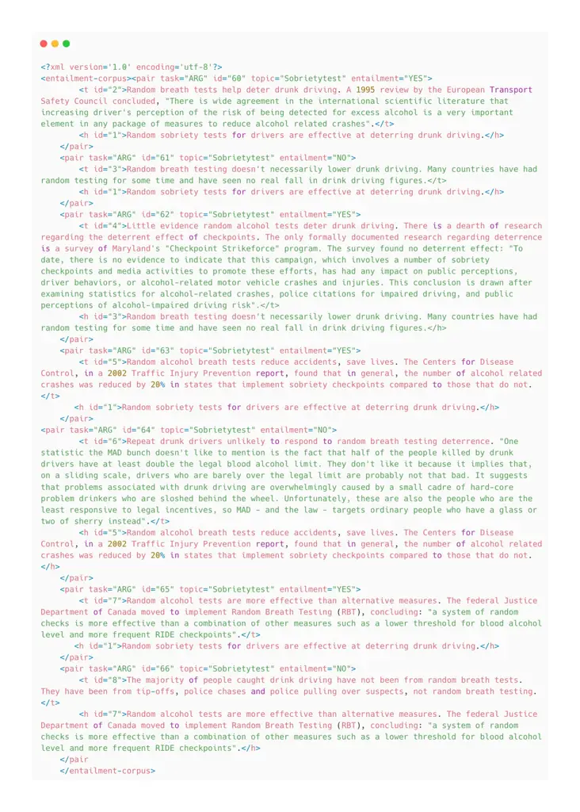

# Can LLMs Judge Debates? Evaluating Non-Linear Reasoning via Argumentation Theory Semantics

Reza Sanayei Affiliation: Department of Computer Science, University of
Arizona    Srdjan Vesic Affiliation: CRIL CNRS & University of
Artois{rsanayei, eduardoblanco, msurdeanu}@arizona.edu, vesic@cril.fr   
Eduardo Blanco Affiliation: Department of Computer Science, University
of Arizona    Mihai Surdeanu Affiliation: Department of Computer
Science, University of Arizona

###### Abstract

Large Language Models (LLMs) excel at linear reasoning tasks but remain
underexplored on non-linear structures such as those found in natural
debates, which are best expressed as argument graphs. We evaluate
whether LLMs can approximate structured reasoning from Computational
Argumentation Theory (CAT). Specifically, we use Quantitative
Argumentation Debate (QuAD) semantics, which assigns acceptability
scores to arguments based on their attack and support relations. Given
only dialogue-formatted debates from two NoDE datasets, models are
prompted to rank arguments without access to the underlying graph. We
test several LLMs under advanced instruction strategies, including
Chain-of-Thought and In-Context Learning. While models show moderate
alignment with QuAD rankings, performance degrades with longer inputs or
disrupted discourse flow. Advanced prompting helps mitigate these
effects by reducing biases related to argument length and position. Our
findings highlight both the promise and limitations of LLMs in modeling
formal argumentation semantics and motivate future work on graph-aware
reasoning.

## 1 Introduction

Evaluating the reasoning capabilities of Large Language Models (LLMs)
has largely focused on tasks involving linear reasoning, such as
arithmetic, logical puzzles, and Chain-of-Thought (CoT)
explanations Kojima et al. (2022). Even complex inference methods—like
beam search, best-of-N, or Tree-of-Thoughts Yao et al. (2023)—are
ultimately decomposable into linear sequences of intermediate steps.
Similarly, research on conversational systems predominantly addresses
linear interactions between users and LLMs.

In contrast, natural debates are not purely linear. Alongside serial
(near-path) exchanges, they frequently exhibit _branching_ interactions,
with multiple arguments converging on one claim (fan-in) and single
arguments influencing several others (fan-out). We focus on these
non-linear settings and use debates that exhibit substantial branching
rather than simple chains. Computational Argumentation Theory (CAT)
formalizes these complex interactions through frameworks like
Quantitative Argumentation Debate (QuAD) semantics Baroni et al. (2018).
QuAD semantics assigns each argument a numerical acceptability degree
that reflects its strength within the debate.

The emerging paradigm of LLM-as-a-Judge Li et al. (2025); Gu et al.
(2025) highlights the significant potential of LLMs for nuanced
assessment and moderation across various applications, such as content
evaluation, alignment, retrieval, and reasoning. Given the rapid
advancement of multi-agent AI systems engaging in sophisticated
argumentative interactions, it is increasingly crucial to understand
whether LLMs can effectively serve as impartial judges capable of
handling non-linear argumentation structures.

Figure 1: System overview showing the LLM pipeline (top), which is
compared with QuAD semantics (bottom). Top: We transform the argument
graph (unweighted) into a natural language dialogue, which is fed to an
LLM with various instruction strategies (zero-shot, ICL, CoT). Bottom:
After uniform weight initialization, the graph is scored using QuAD
semantics, producing final argument strengths $`w_{f}`$. These are used
to derive a gold ranking, which is compared to rankings predicted by the
LLM via Spearman’s $`\rho`$ and Kendall’s $`\tau`$.

Thus, our main research question is to investigate whether contemporary
LLMs can effectively reason over non-linear argumentative structures
inherent in natural debates.

To answer this question, we design a novel evaluation setting: we
transform debate graphs into natural dialogues, creating latent argument
graphs—simple argument lists without explicit attack or support
relationships. This flattened dialogue format mimics how individuals
interact in real-world group discussions, where argument structure is
not overtly marked. We instruct the LLM to rank arguments by their
inferred acceptability degrees. The model-generated rankings are then
compared against ground-truth acceptability degrees computed using QuAD
semantics. Figure 1 summarizes our evaluation pipeline.

The main contributions of this paper are:

1.  1.  The first systematic evaluation of LLMs’ abilities to reason over
        non-linear argument structures within realistic debate settings,
        benchmarked against CAT semantics (QuAD).
2.  2.  A characterization of the limits of LLM reasoning on argument
        ranking through advanced instruction techniques (In-Context Learning
        and Chain-of-Thought).
3.  3.  An exploration of how debate complexity, discourse order, argument
        length, and model size impact performance, uncovering strong
        chronological and structural biases. While advanced instruction
        methods partially mitigate these biases, even larger models
        consistently struggle, highlighting the need for future graph-aware
        language modeling.

Our findings highlight both the potential and the limitations of LLMs as
impartial moderators in complex, multi-agent argumentative scenarios and
lay crucial groundwork toward more robust reasoning capabilities.

## 2 Related Work

### 2.1 CAT Semantics

CAT models debates as structured graphs, where arguments form nodes and
directed edges represent attack or support relationships between
arguments. CAT semantics define how to compute each argument’s
acceptability degree, a numerical value that reflects its strength
within the debate structure.

A prominent class of CAT semantics, known as bipolar gradual semantics,
includes QuAD Baroni et al. (2018), DF-QuAD Rago et al. (2016),
exponent-based semantics Amgoud and Ben-Naim (2018), and the Quadratic
Energy Model Potyka (2018). These share two core features:

Bipolarity:  
Both attack and support relations influence an argument’s score.

Graduality:  
Arguments receive continuous acceptability degrees rather than binary
labels, allowing nuanced distinctions between them.

We use QuAD semantics to generate gold-standard rankings for evaluation
because it (a) is widely used in the CAT literature, (b) intuitively
balances attack and support dynamics to capture the nuanced interplay of
arguments, (c) reliably converges on acyclic graphs (the class we
study), and (d) is grounded in principles that have been shown to align
closely with human judgments of argumentative strength (Vesic et al.,
2022). Importantly, this grounding makes QuAD a natural proxy for
assessing how well models capture human-like reasoning. A detailed
explanation of QuAD and its recursive scoring method is provided in
Appendix A.

### 2.2 CAT and LLMs

LLMs’ success on diverse reasoning tasks makes them compelling
candidates for automated decision-making Ouyang and Li (2023). Yet, they
exhibit limitations such as hallucinations and logical
inconsistencies Berglund et al. (2024); Fluri et al. (2024). These
deficiencies and a lack of explainability raise concerns about their
trustworthiness Henin and Le Métayer (2022), motivating research into
more structured reasoning frameworks.

CAT has gained traction for its structured, formal approach to
reasoning, and it offers a promising foundation for work on non-linear
inference. Castagna et al. (2024) propose MQArgEng, a pipeline that uses
a computational argumentation engine to guide LLM outputs. Their results
show that this integration improves reasoning quality without model
architecture constraints. Freedman et al. (2025) introduce argumentative
LLMs, which construct argumentation frameworks from model-generated
reasoning traces and analyze them with gradual semantics to enhance
explainability.

These studies focus on using CAT to enhance LLM outputs by building
explicit argumentation graphs. In contrast, we assess whether LLMs can
perform non-linear reasoning by implicitly modeling structured
argumentation semantics—without access to the underlying graph—when
ranking arguments in natural debates.

To our knowledge, this is the first systematic evaluation of LLMs’
ability to capture gradual, bipolar argumentation semantics from
dialogue alone.

## 3 Data

### 3.1 Dataset Overview and Characteristics

We compile our datasets from two sources within the NoDE
benchmark Cabrio and Villata (2014): 12AngryMen, derived from a
well-known jury deliberation play, and DebatePedia, which covers
multiple smaller debates on diverse topics. Using these complementary
datasets—one large and domain-specific, the other smaller and
topic-diverse—we comprehensively assess LLM performance on debates of
varying size, complexity, and subject matter. All graphs are acyclic.
Details of the datasets are provided below; additional descriptions and
examples are included in Appendix B.

#### 12AngryMen Dataset:

This dataset, based on the play Twelve Angry Men, includes three acts
represented as argument graphs, each with arguments as nodes and
relations (attacks/supports) as edges. The acts contain 39, 33, and 11
nodes, respectively, totaling 80 edges, and are all used for testing.

#### DebatePedia Dataset:

This dataset comprises debates manually curated from encyclopedias of
pro and con arguments. Each debate forms a separate argument graph with
user-generated arguments linked by attack or support edges.
Chronological ordering preserves dialogue structure. From the total of
22 debates, we select three diverse examples (attack-heavy,
support-heavy, and balanced) for instruction exemplars. The remaining 19
debates, averaging 13 nodes each (242 nodes, 223 edges), serve for
evaluation.

#### Evaluation scale.

Across our two datasets we have 325 arguments linked by 303 relations.
For evaluation, models must reason over all unordered pairs of arguments
within each graph, i.e., $`\sum_{g}\binom{|A_{g}|}{2}\approx 3{,}000`$
pairs, where $`|A_{g}|`$ is the number of arguments in graph $`g`$. With
6 instruction strategies and 3 repetitions, this expands to nearly
50,000 pairwise checks per model, underscoring the substantive reasoning
workload.

### 3.2 From Argument Graphs to Dialogues

To evaluate models in a realistic dialogue-based setting, we convert
argument graphs into dialogues. Specifically, we preserve only the
arguments’ texts, discarding their relationships (attacks or supports).
Arguments are chronologically integrated into debates, formatted simply
as “Argument \#: Argument Text”. This conversion preserves the natural
discourse flow but keeps argument structure latent, requiring models to
implicitly infer relationships. Refer to Appendix B.3 for more details.

### 3.3 Argument Ranking Using QuAD

To evaluate whether LLMs can reason effectively about argument strength
in debates, we compare their predicted rankings to those induced by QuAD
semantics Baroni et al. (2018).

QuAD assigns each argument an acceptability degree by considering both
its initial weight and the influence of arguments that attack or support
it. Supporters increase an argument’s acceptability, while attackers
decrease it, and the final score reflects a balance between these
competing influences. Importantly, the strength of each attacker or
supporter depends recursively on how well-supported they are—capturing
the idea that a weak rebuttal should count less than a strong one.

This process resembles a kind of recursive influence propagation: each
argument’s strength is updated based on the strengths of its neighbors,
much like a random walk spreading activation across the argument graph.
Over multiple iterations, the system converges to stable values that
reflect the global argumentative structure.

While QuAD produces numerical acceptability scores, we converted these
to rankings by sorting arguments in descending order of their final
scores. These rankings serve as a gold standard against which
LLM-generated rankings are evaluated. The models never observe the
underlying graph or edge types—their task is to rank arguments in
natural debates in a way that approximates this structured, graph-driven
reasoning process.

It is important to note that QuAD and its derived semantics are defined
only for acyclic graphs. We recognize the need for further exploration
of cyclic graph structures and address this in Section Limitations.

Finally, since our datasets do not contain predefined initial argument
weights, we assign all arguments a uniform weight of 0.5. This ensures a
neutral and consistent evaluation, allowing LLMs to approach each
argument as equally important at the outset—effectively starting from a
“blank slate” without external bias.

Formal definitions and detailed examples of QuAD semantics are available
in Appendix A.

## 4 Approach

### 4.1 Models

We use four LLMs—both open and closed—GPT-4o OpenAI et al. (2024),
Claude 3 Sonnet Anthropic (2024), Command R+ Cohere For AI (2024), and
Llama 3 70B Instruct Dubey et al. (2024)—abbreviated as gpt-4o,
claude-3, cmd-r-plus, and llama-3. Under identical instruction sets (no
fine-tuning) and a temperature of 0.7, we run each model three times and
report averaged results.

### 4.2 Instruction Strategies

Our experiments evaluate LLMs’ non-linear reasoning ability by measuring
their performance in replicating formal QuAD semantics from latent
graphs formatted as debate dialogues. To this end, we explored
state-of-the-art instruction strategies, such as Chain-of-Thought (CoT)
and In-Context Learning (ICL). For examples, see Appendix C.

#### Zero-Shot “Vanilla”:

In this method, the LLM is instructed to rank arguments based on their
logical strength and their (latent) attack or support relations with
other arguments.

#### In-Context Learning (ICL):

ICL uses exemplars to improve LLM performance Brown et al. (2020). We
selected three argument graphs from DebatePedia as ICL examples,
covering attack-heavy, balanced, and support-heavy structures. We tested
two variants: one-shot ICL (single exemplar) and few-shot ICL (three
exemplars).

#### Zero-Shot Chain-of-Thought (CoT):

Inspired by the zero-shot CoT framework Kojima et al. (2022), this
approach encourages the LLM to simulate a step-by-step reasoning process
about each argument’s logical strength and its relationships with other
arguments. The model then constructs an adjacency list representing
these relationships and ranks the arguments based on their logical
strength and the attack or support relationships.

#### Chain-of-Thought (CoT):

This approach involves adding detailed analyses of attack and support
relationships between arguments and explicitly constructing adjacency
lists for each ICL exemplar. This process teaches models to adopt a
step-by-step reasoning process when analyzing arguments. We test two
variants: one-shot CoT (single exemplar) and few-shot CoT (three
exemplars).

### 4.3 Debate Structure Reconstruction

Beyond ranking, we evaluate whether models can _reconstruct_ the
underlying argument graph from dialogue alone. Under our CoT settings,
models are instructed to (i) infer pairwise relations and (ii) emit a
signed, directed adjacency list as keyed lists, e.g., ’Argument 2’:
\[(’Argument 6’,’attack’), (’Argument 9’,’support’)\], ..., where each
tuple encodes an edge $`(i\leftarrow j,r)`$ with
$`r\in\{\textsc{attack},\textsc{support}\}`$.

## 5 Results

As mentioned, our experiments evaluate the non-linear reasoning ability
of LLMs by assessing their capability to produce similar argument
rankings as the ones generated by QuAD semantics. Notably, QuAD
semantics has full access to the argument graph structure, whereas the
LLMs operate in a more natural dialogue setting. We evaluate the
correlation between the LLM rankings and those derived from QuAD using
two metrics: (a) Kendall’s $`\tau`$, which measures directional
agreement based on pairwise orderings, and (b) Spearman’s $`\rho`$,
which captures the monotonic relationship and is more sensitive to the
magnitude of rank differences. Using both metrics allows us to assess
the agreement in order and the severity of misalignment. In addition to
ranking, we evaluate whether models can _reconstruct_ the signed,
directed interaction graph from dialogue by comparing the predicted edge
set $`\hat{E}`$ against the gold edge set $`E`$. A prediction is correct
only if both endpoints and the relation type match. We report precision,
recall, and F1 at the graph level, macro-averaged within each split. Our
experiments yield the following findings:

| Dataset     |     | Technique     | $`\rho`$ |     | $`\tau`$ |
| ----------- | --- | ------------- | -------- | --- | -------- |
| DebatePedia |     | Vanilla       | 0.11     |     | 0.09     |
|             |     | ICL One-Shot  | 0.26     |     | 0.22     |
|             |     | ICL Few-Shot  | 0.29     |     | 0.25     |
|             |     | CoT Zero-Shot | 0.32     |     | 0.27     |
|             |     | CoT One-Shot  | 0.31     |     | 0.29     |
|             |     | CoT Few-Shot  | 0.46     |     | 0.42     |

Table 1: Average argument ranking performance of four LLMs on
DebatePedia, using different instruction strategies. We report
Spearman’s $`\rho`$ and Kendall’s $`\tau`$. Bold marks the
best-performing technique. All methods outperform the vanilla baseline,
with CoT few-shot scoring the highest on average.

| Act     |     | \#Arg. |     | Technique     | $`\rho`$ |     | $`\tau`$ |
| ------- | --- | ------ | --- | ------------- | -------- | --- | -------- |
| 1       |     | 39     |     | Vanilla       | 0.10     |     | 0.07     |
|         |     |        |     | ICL One-Shot  | 0.19     |     | 0.14     |
|         |     |        |     | ICL Few-Shot  | 0.22     |     | 0.16     |
|         |     |        |     | CoT Zero-Shot | 0.25     |     | 0.18     |
|         |     |        |     | CoT One-Shot  | 0.26     |     | 0.20     |
|         |     |        |     | CoT Few-Shot  | 0.33     |     | 0.25     |
| 2       |     | 33     |     | Vanilla       | -0.02    |     | -0.02    |
|         |     |        |     | ICL One-Shot  | 0.15     |     | 0.10     |
|         |     |        |     | ICL Few-Shot  | 0.13     |     | 0.10     |
|         |     |        |     | CoT Zero-Shot | 0.25     |     | 0.18     |
|         |     |        |     | CoT One-Shot  | 0.26     |     | 0.19     |
|         |     |        |     | CoT Few-Shot  | 0.28     |     | 0.19     |
| 3       |     | 11     |     | Vanilla       | 0.25     |     | 0.19     |
|         |     |        |     | ICL One-Shot  | 0.37     |     | 0.26     |
|         |     |        |     | ICL Few-Shot  | 0.36     |     | 0.26     |
|         |     |        |     | CoT Zero-Shot | 0.43     |     | 0.35     |
|         |     |        |     | CoT One-Shot  | 0.43     |     | 0.35     |
|         |     |        |     | CoT Few-Shot  | 0.43     |     | 0.35     |
| Average |     |        |     | Vanilla       | 0.11     |     | 0.08     |
|         |     |        |     | ICL One-Shot  | 0.24     |     | 0.17     |
|         |     |        |     | ICL Few-Shot  | 0.24     |     | 0.17     |
|         |     |        |     | CoT Zero-Shot | 0.31     |     | 0.24     |
|         |     |        |     | CoT One-Shot  | 0.32     |     | 0.25     |
|         |     |        |     | CoT Few-Shot  | 0.35     |     | 0.26     |

Table 2: Average argument ranking performance of LLMs across the three
acts and overall on 12AngryMen, using different instruction strategies.
We report Spearman’s $`\rho`$ and Kendall’s $`\tau`$, bolding the
best-performing technique per act or overall. As in Table 1, all methods
improve on the baseline; CoT few-shot is top overall. Stronger results
on Act 3, similar in size to DebatePedia, suggest debate length affects
performance.

| Model      | Technique     | DebatePedia |          |     | 12AngryMen |          |
| ---------- | ------------- | ----------- | -------- | --- | ---------- | -------- |
|            |               | $`\rho`$    | $`\tau`$ |     | $`\rho`$   | $`\tau`$ |
| gpt-4o     | Vanilla       | 0.15        | 0.13     |     | 0.14       | 0.10     |
|            | ICL One-Shot  | 0.28        | 0.24     |     | 0.24       | 0.17     |
|            | ICL Few-Shot  | 0.30        | 0.26     |     | 0.22       | 0.17     |
|            | CoT Zero-Shot | 0.36        | 0.30     |     | 0.31       | 0.23     |
|            | CoT One-Shot  | 0.33        | 0.31     |     | 0.33       | 0.25     |
|            | CoT Few-Shot  | 0.54        | 0.50     |     | 0.33       | 0.27     |
| claude-3   | Vanilla       | 0.19        | 0.14     |     | 0.08       | 0.08     |
|            | ICL One-Shot  | 0.23        | 0.20     |     | 0.26       | 0.17     |
|            | ICL Few-Shot  | 0.26        | 0.20     |     | 0.20       | 0.15     |
|            | CoT Zero-Shot | 0.21        | 0.16     |     | 0.29       | 0.21     |
|            | CoT One-Shot  | 0.29        | 0.29     |     | 0.43       | 0.32     |
|            | CoT Few-Shot  | 0.43        | 0.39     |     | 0.36       | 0.27     |
| cmd-r-plus | Vanilla       | 0.07        | 0.05     |     | 0.12       | 0.09     |
|            | ICL One-Shot  | 0.37        | 0.31     |     | 0.30       | 0.23     |
|            | ICL Few-Shot  | 0.32        | 0.28     |     | 0.26       | 0.19     |
|            | CoT Zero-Shot | 0.47        | 0.40     |     | 0.27       | 0.19     |
|            | CoT One-Shot  | 0.30        | 0.28     |     | 0.27       | 0.22     |
|            | CoT Few-Shot  | 0.43        | 0.37     |     | 0.34       | 0.25     |
| llama-3    | Vanilla       | 0.04        | 0.03     |     | 0.09       | 0.05     |
|            | ICL One-Shot  | 0.16        | 0.12     |     | 0.15       | 0.10     |
|            | ICL Few-Shot  | 0.29        | 0.25     |     | 0.25       | 0.17     |
|            | CoT Zero-Shot | 0.24        | 0.20     |     | 0.38       | 0.30     |
|            | CoT One-Shot  | 0.32        | 0.29     |     | 0.23       | 0.19     |
|            | CoT Few-Shot  | 0.45        | 0.40     |     | 0.35       | 0.25     |

Table 3: Argument ranking performance of LLMs on 12AngryMen and
DebatePedia, using different instruction strategies. We report
Spearman’s $`\rho`$ and Kendall’s $`\tau`$; bold entries indicate the
best result per model.

|               |     |          |     |          |     |          |     |          |     |          |     |          |
| ------------- | --- | -------- | --- | -------- | --- | -------- | --- | -------- | --- | -------- | --- | -------- |
|               |     | Act 1    |     |          |     | Act 2    |     |          |     | Act 3    |     |          |
| Model         |     | $`\rho`$ |     | $`\tau`$ |     | $`\rho`$ |     | $`\tau`$ |     | $`\rho`$ |     | $`\tau`$ |
| Vanilla       |     |          |     |          |     |          |     |          |     |          |     |          |
| gpt-4o        |     | -0.11    |     | -0.07    |     | 0.19     |     | 0.11     |     | 0.35     |     | 0.27     |
| claude-3      |     | 0.26     |     | 0.18     |     | -0.16    |     | -0.11    |     | 0.15     |     | 0.16     |
| cmd-r-plus    |     | 0.12     |     | 0.08     |     | -0.12    |     | -0.08    |     | 0.36     |     | 0.27     |
| llama-3       |     | 0.12     |     | 0.09     |     | 0.02     |     | 0.01     |     | 0.13     |     | 0.05     |
| ICL One-Shot  |     |          |     |          |     |          |     |          |     |          |     |          |
| gpt-4o        |     | -0.06    |     | -0.02    |     | 0.21     |     | 0.14     |     | 0.56     |     | 0.38     |
| claude-3      |     | 0.46     |     | 0.33     |     | -0.01    |     | -0.03    |     | 0.32     |     | 0.20     |
| cmd-r-plus    |     | 0.24     |     | 0.16     |     | 0.21     |     | 0.16     |     | 0.46     |     | 0.38     |
| llama-3       |     | 0.12     |     | 0.09     |     | 0.19     |     | 0.13     |     | 0.15     |     | 0.09     |
| ICL Few-Shot  |     |          |     |          |     |          |     |          |     |          |     |          |
| gpt-4o        |     | -0.06    |     | -0.02    |     | 0.21     |     | 0.14     |     | 0.51     |     | 0.38     |
| claude-3      |     | 0.43     |     | 0.30     |     | -0.08    |     | -0.05    |     | 0.25     |     | 0.20     |
| cmd-r-plus    |     | 0.24     |     | 0.16     |     | 0.04     |     | 0.05     |     | 0.51     |     | 0.35     |
| llama-3       |     | 0.26     |     | 0.19     |     | 0.34     |     | 0.24     |     | 0.15     |     | 0.09     |
| CoT Zero-Shot |     |          |     |          |     |          |     |          |     |          |     |          |
| gpt-4o        |     | 0.11     |     | 0.09     |     | 0.30     |     | 0.18     |     | 0.51     |     | 0.42     |
| claude-3      |     | 0.47     |     | 0.33     |     | 0.17     |     | 0.14     |     | 0.22     |     | 0.16     |
| cmd-r-plus    |     | 0.20     |     | 0.13     |     | 0.23     |     | 0.14     |     | 0.39     |     | 0.31     |
| llama-3       |     | 0.21     |     | 0.15     |     | 0.31     |     | 0.25     |     | 0.61     |     | 0.49     |
| CoT One-Shot  |     |          |     |          |     |          |     |          |     |          |     |          |
| gpt-4o        |     | 0.30     |     | 0.23     |     | 0.22     |     | 0.17     |     | 0.47     |     | 0.35     |
| claude-3      |     | 0.33     |     | 0.22     |     | 0.40     |     | 0.28     |     | 0.55     |     | 0.45     |
| cmd-r-plus    |     | 0.23     |     | 0.17     |     | 0.26     |     | 0.21     |     | 0.32     |     | 0.27     |
| llama-3       |     | 0.19     |     | 0.16     |     | 0.14     |     | 0.11     |     | 0.36     |     | 0.31     |
| CoT Few-Shot  |     |          |     |          |     |          |     |          |     |          |     |          |
| gpt-4o        |     | 0.30     |     | 0.24     |     | 0.29     |     | 0.22     |     | 0.41     |     | 0.35     |
| claude-3      |     | 0.30     |     | 0.23     |     | 0.29     |     | 0.19     |     | 0.49     |     | 0.38     |
| cmd-r-plus    |     | 0.33     |     | 0.22     |     | 0.27     |     | 0.19     |     | 0.41     |     | 0.35     |
| llama-3       |     | 0.37     |     | 0.29     |     | 0.27     |     | 0.14     |     | 0.41     |     | 0.31     |

Table 4: Argument ranking performance of various LLMs on the three acts
of 12AngryMen, using different instruction strategies. We report
Spearman’s $`\rho`$ and Kendall’s $`\tau`$. Bold marks the best LLM per
metric within each act. Although performance varies across models and
acts, all instruction strategies improve results. Notably, every model
does better on the smaller Act 3, suggesting challenges in larger, more
complex debates.

| Act     | \#Args | Technique     | P        | R        | F1       |
| ------- | ------ | ------------- | -------- | -------- | -------- |
| 1       | 39     | CoT Zero-Shot | $`0.41`$ | $`0.43`$ | $`0.41`$ |
|         |        | CoT One-Shot  | $`0.55`$ | $`0.56`$ | 0.56     |
|         |        | CoT Few-Shot  | $`0.41`$ | $`0.53`$ | $`0.45`$ |
| 2       | 33     | CoT Zero-Shot | $`0.32`$ | $`0.40`$ | $`0.34`$ |
|         |        | CoT One-Shot  | $`0.47`$ | $`0.56`$ | $`0.51`$ |
|         |        | CoT Few-Shot  | $`0.52`$ | $`0.58`$ | 0.54     |
| 3       | 11     | CoT Zero-Shot | $`0.26`$ | $`0.48`$ | $`0.33`$ |
|         |        | CoT One-Shot  | $`0.67`$ | $`0.77`$ | 0.71     |
|         |        | CoT Few-Shot  | $`0.68`$ | $`0.73`$ | $`0.70`$ |
|         |        | CoT Zero-Shot | $`0.33`$ | $`0.44`$ | $`0.36`$ |
| Average |        | CoT One-Shot  | $`0.56`$ | $`0.63`$ | 0.59     |
|         |        | CoT Few-Shot  | $`0.54`$ | $`0.61`$ | $`0.56`$ |

Table 5: Adjacency-list recovery averages on 12AngryMen. Best F1 per act
and overall are bolded. CoT instructions consistently improve graph
recovery. Models perform better on the short Act 3.

| Avg. \# Args | Technique     | P        | R        | F1       |
| ------------ | ------------- | -------- | -------- | -------- |
|              | CoT Zero-Shot | $`0.24`$ | $`0.48`$ | $`0.31`$ |
| 13           | CoT One-Shot  | $`0.54`$ | $`0.56`$ | $`0.54`$ |
|              | CoT Few-Shot  | $`0.71`$ | $`0.71`$ | 0.71     |

Table 6: Adjacency-list recovery averages on DebatePedia. Best F1
overall is bolded. CoT instructions consistently improve graph recovery.

LLMs can moderately rank arguments in debate dialogues. Tables 1 and 2
summarize the results of our study, showcasing the average performance
of four state-of-the-art LLMs across the DebatePedia and 12AngryMen
datasets, respectively. Detailed results per LLM are provided in Table 3.

We show that off-the-shelf LLMs, when used with prompting best
practices, generally have a decent ability to rank arguments based on
their latent graphs. This is supported by the moderately positive
$`\tau`$ and $`\rho`$ values across the results. For instance, in the
DebatePedia dataset, the highest average $`\rho`$ achieved is $`0.46`$
with the CoT few-shot technique, and the corresponding $`\tau`$ is
$`0.42`$. The 12AngryMen Dataset results show a similar, albeit lower,
performance. Now, we address this difference.

LLMs’ ability to rank arguments is significantly influenced by input
size. Table 2 breaks down the average performance of the tested LLMs
across the three acts of the 12AngryMen dataset. In Acts 1 and 2, which
have four and three times more arguments than Act 3, the LLMs have a
significant performance drop in correlation metrics compared to Act 3.
DebatePedia’s debates, on average, are similar in size to Act 3 of
12AngryMen, making the input size of their experiments much smaller than
Acts 1 and 2 of 12AngryMen. The pronounced performance difference of the
same instruction methods between the two datasets (e.g., a 24% decrease
in $`\rho`$ and a 38% decrease in $`\tau`$ for CoT few-shot’s average
performance in 12AngryMen compared to DebatePedia) seen in Tables 1
and 2 could be explained similarly. Further, comparing the results on
individual acts of 12AngryMen and the averages for DebatePedia clearly
shows that smaller input sizes consistently lead to better performance.

| Dataset     |     | Technique     | $`\rho`$ |      |     | $`\tau`$ |      |
| ----------- | --- | ------------- | -------- | ---- | --- | -------- | ---- |
|             |     |               | mean     | s.d. |     | mean     | s.d. |
| 12AngryMen  |     | Vanilla       | 0.11     | 0.08 |     | 0.07     | 0.07 |
|             |     | ICL One-Shot  | 0.13     | 0.08 |     | 0.09     | 0.05 |
|             |     | ICL Few-Shot  | 0.16     | 0.09 |     | 0.11     | 0.06 |
|             |     | CoT Zero-Shot | 0.33     | 0.10 |     | 0.26     | 0.08 |
|             |     | CoT One-Shot  | 0.05     | 0.14 |     | 0.06     | 0.10 |
|             |     | CoT Few-Shot  | 0.17     | 0.11 |     | 0.14     | 0.09 |
| DebatePedia |     | Vanilla       | -0.14    | 0.15 |     | -0.11    | 0.12 |
|             |     | ICL One-Shot  | -0.01    | 0.16 |     | -0.02    | 0.12 |
|             |     | ICL Few-Shot  | 0.01     | 0.19 |     | 0.01     | 0.14 |
|             |     | CoT Zero-Shot | 0.06     | 0.19 |     | 0.04     | 0.15 |
|             |     | CoT One-Shot  | 0.29     | 0.15 |     | 0.25     | 0.12 |
|             |     | CoT Few-Shot  | 0.34     | 0.13 |     | 0.30     | 0.11 |

Table 7: Average argument ranking performance of Llama-3-70b-instruct on
12AngryMen and DebatePedia, under different instruction strategies and
five random topological sorts. We report means and standard deviations
of Spearman’s $`\rho`$ and Kendall’s $`\tau`$. Compared to the original
(chronological) setup in Table 3, performance drops overall, indicating
reliance on dialogue’s chronological flow rather than its argument graph
structure.

Advanced instruction methods generally enhance LLM performance in
understanding and ranking arguments. This is evident from the improved
correlation metrics in Tables 1 and 2. On average, few-shot CoT
consistently outperforms other techniques across different datasets and
acts, indicating the effectiveness of combining the CoT approach with
few-shot ICL for ranking tasks in natural language argument debates.

Models vary in performance but show similar trends. While individual
LLMs show varying performance levels in ranking arguments, they exhibit
similar trends in response to different instruction strategies and input
sizes. To confirm our previous observations from the average LLM
performance, we analyze the detailed results of our models for the
12AngryMen dataset’s three acts in Table 4.

|               | Argument Length |      |      |      |     |          |      |      |      |     | Argument Position |      |       |      |     |          |      |       |      |
| ------------- | --------------- | ---- | ---- | ---- | --- | -------- | ---- | ---- | ---- | --- | ----------------- | ---- | ----- | ---- | --- | -------- | ---- | ----- | ---- |
| Technique     | $`\rho`$        |      |      |      |     | $`\tau`$ |      |      |      |     | $`\rho`$          |      |       |      |     | $`\tau`$ |      |       |      |
|               | LQ1             | LQ2  | LQ3  | LQ4  |     | LQ1      | LQ2  | LQ3  | LQ4  |     | PQ1               | PQ2  | PQ3   | PQ4  |     | PQ1      | PQ2  | PQ3   | PQ4  |
| Vanilla       | 0.42            | 0.26 | 0.11 | 0.24 |     | 0.38     | 0.27 | 0.08 | 0.21 |     | 0.18              | 0.31 | -0.04 | 0.19 |     | 0.18     | 0.27 | -0.01 | 0.20 |
| ICL One-Shot  | 0.50            | 0.35 | 0.25 | 0.29 |     | 0.46     | 0.33 | 0.23 | 0.27 |     | 0.09              | 0.49 | 0.12  | 0.34 |     | 0.08     | 0.46 | 0.14  | 0.34 |
| ICL Few-Shot  | 0.46            | 0.37 | 0.25 | 0.41 |     | 0.43     | 0.35 | 0.25 | 0.38 |     | 0.13              | 0.42 | 0.25  | 0.38 |     | 0.10     | 0.41 | 0.24  | 0.40 |
| CoT Zero-Shot | 0.31            | 0.27 | 0.30 | 0.16 |     | 0.31     | 0.27 | 0.27 | 0.14 |     | 0.17              | 0.41 | 0.19  | 0.22 |     | 0.16     | 0.41 | 0.18  | 0.24 |
| CoT One-Shot  | 0.68            | 0.52 | 0.31 | 0.54 |     | 0.66     | 0.51 | 0.29 | 0.53 |     | 0.51              | 0.63 | 0.56  | 0.39 |     | 0.43     | 0.64 | 0.55  | 0.41 |
| CoT Few-Shot  | 0.68            | 0.64 | 0.69 | 0.63 |     | 0.67     | 0.65 | 0.67 | 0.61 |     | 0.41              | 0.72 | 0.67  | 0.51 |     | 0.29     | 0.71 | 0.67  | 0.53 |

Table 8: Average argument ranking performance of LLMs on DebatePedia,
split into quartiles by argument length and position (L/PQ1–L/PQ4). We
report Spearman’s $`\rho`$ and Kendall’s $`\tau`$ under various
instruction strategies. The Vanilla approach exhibits length and
positional biases, while ICL mitigates length bias but not positional
bias. CoT addresses both, maintaining consistently strong performance
across quartiles.

Despite architectural differences, all models benefit from advanced
methods such as CoT and ICL. Notably, each model improves significantly
when shifting from the baseline Vanilla approach to CoT few-shot
instructions.

Another noteworthy trend is how input size affects each model similarly.
In the substantially smaller Act 3, all models tend to achieve higher
correlation metrics. This pattern suggests that models struggle with
larger input sizes, likely due to the increased complexity and potential
limitations in processing longer contexts. Despite these overarching
trends, individual models exhibit unique performance nuances. For
example, Claude 3 Sonnet excels in Act 1 with ICL techniques but shows
inconsistent results in Act 2, even producing negative correlations
under the same instruction methods. Interestingly, models with
relatively decent performance in Vanilla ranking ($`\rho>0.2`$) exhibit
exceptional results under ICL ($`\rho\in[0.43,\,0.56]`$). This
phenomenon might be related to these models surfacing memorized training
data when using ICL. Recent research by Golchin et al. (2024) suggests
that ICL can trigger LLMs to retrieve and utilize memorized data from
their training corpus, enhancing performance. Consequently, future work
on benchmarking these models’ reasoning abilities should probe them for
data contamination and memorization on the targeted test data.

These variations highlight that while the models follow similar trends,
their performance can be influenced by specific interactions between
their architectures, training methods, and the evaluation dataset’s
characteristics. Further, these results suggest that for a complex task
such as CAT, architectures based on mixtures of experts might be better
and more stable than individual models. This observation is supported by
comparing the per-LLM breakdown in Tables 3 and 4 to the averages in
Tables 1 and 2. While no single model consistently dominates across all
acts and instruction techniques, the average results provide a more
stable and consistently good performance.

Structure recovery mirrors ranking patterns. Tables 5 and 6 report
results for the _intermediate_ task of debate graph reconstruction. On
12AngryMen, we observe that macro F1 rises from 0.36 (CoT zero-shot) to
0.59 (CoT one-shot) and 0.56 (CoT few-shot), with Act III reaching 0.71.
On DebatePedia, CoT with exemplars also performs strongly (0.54
one-shot; 0.71 few-shot). See Appendix D for per-act and per-model
results.

Three clear patterns emerge:

1.  (i)
    _CoT exemplars markedly improve edge recovery_. Moving from
    zero-shot to one/few-shot CoT improves F1 by about
    $`\scriptstyle\sim`$0.15–0.40 across datasets.
2.  (ii)
    _Shorter debates are easier_. Smaller graphs (e.g., 12AngryMen
    Act III, typical DebatePedia topics) yield higher F1, mirroring the
    ranking task’s sensitivity to input length.
3.  (iii)
    _Better recovery aligns with better ranking_. The setups that most
    improve edge prediction (CoT with exemplars) are also those with the
    highest rank correlations. This suggests that capturing interaction
    structure helps models approach QuAD’s ordering.

## 6 Discussion

To better understand LLMs’ limits in modeling argumentation semantics,
we further analyze their performance along four key aspects: discourse
chronology’s impact, argument length’s influence, positional bias in LLM
rankings, and model size. Lastly, we test whether specialization changes
behavior by comparing our general-purpose models to a dedicated
_reasoner_ (DeepSeek R1).

### 6.1 Influence of Discourse Chronology

To evaluate the models’ reliance on argument order, we employed
topological sorting to randomize the sequence of arguments while
preserving their attack and support relationships. Out of all possible
topological sorts of the debate’s graph, we randomly selected five
different sorts for each debate. This shuffles the argument order within
a dialogue without altering the graph structure, ensuring the models
must infer argument strengths based on their relationships, not their
positions. We then applied the same evaluation metrics as in our core
experiments to assess the impact of this randomization on the models’
ranking performance. Due to its consistent performance across the
previous experiments that is similar to the average behavior, our model
of choice for this experiment was Llama3 70B Instruct.

Topological sorting lowers performance. Our results in Table 7 show that
topological sorting of arguments generally reduces LLM performance in
capturing QuAD semantics. This indicates that LLMs rely more on the
natural, chronological flow of dialogue than on the underlying argument
graph structure. When arguments are presented in the natural order of
the dialogue, LLMs effectively use contextual and conversational cues to
infer attack and support relationships. However, rearranging the
arguments through topological sorting disrupts this flow, making it
harder for the models to recognize these connections.

### 6.2 Influence of Argument Length and Position on Performance

We first compute QuAD rankings for each DebatePedia debate and have the
LLMs rank all arguments. Then, we run two separate analyses: (1)
splitting arguments into quartiles based on individual argument length
(measured by token count), and (2) splitting them by their position in
the debate, based on their chronological appearance. This preserves the
original QuAD computation but reveals any biases tied to argument size
or placement.

Vanilla instructing suffers from argument length bias. Table 8 presents
average LLM performance on DebatePedia, categorized by argument length
quartiles (LQ1–LQ4, shortest to longest). Using the Vanilla instruction
technique, $`\rho`$ and $`\tau`$ are highest for the shortest arguments
in LQ1 ($`\rho=0.42`$, $`\tau=0.38`$), decrease in LQ2, reaching the
lowest in LQ3 ($`\rho=0.11`$, $`\tau=0.08`$), and slightly improve in
LQ4 ($`\rho=0.24`$, $`\tau=0.21`$).

(a) Comparison on 12AngryMen dataset

(b) Comparison on DebatePedia dataset

Figure 2: Argument ranking performance comparison of Llama 3 8B,
Llama 3 70B, and Llama 3.1 405B across different instruction strategies.
Larger models consistently outperform smaller ones, with significant
gains in the CoT few-shot setting.

These results suggest a length bias in Vanilla instructing, where LLMs
perform best on shorter arguments and struggle with longer ones. The
slight recovery in LQ4 may indicate that longer arguments offer enough
context for better judgment, mitigating some of the drop from LQ3. This
bias may arise from models relying on superficial features like length,
finding shorter arguments easier to process, while medium ones may not
provide sufficient context, leading to reduced performance.

In-Context Learning mitigates length bias. More advanced instruction
techniques such as ICL and CoT effectively mitigate the length bias seen
in Vanilla instructing. As shown in Table 8, CoT few-shot instructions
maintain high performance across all argument lengths, with $`\rho`$
ranging from 0.63 to 0.69 and $`\tau`$ from 0.61 to 0.67.

This consistency highlights how reasoning steps and examples help LLMs
focus on logical content rather than length, enabling them to handle
arguments of varying lengths. Advanced instruction strategies also help
the models infer attack and support relationships, aligning more closely
with formal argumentation semantics.

Positional bias detected. Table 8 also presents the LLMs’ average
performance by argument position quartiles (PQ1–PQ4, where PQ1 contains
the earliest arguments in the discourse and PQ4 the latest). With
Vanilla instructions, performance varies across quartiles, revealing a
positional bias. $`\rho`$ peaks in PQ2 ($`\rho=0.31`$), is lower in PQ1
($`\rho=0.18`$), turns negative in PQ3 ($`\rho=-0.04`$), and is moderate
in PQ4 ($`\rho=0.19`$). $`\tau`$ follows a similar lead. This pattern,
although less pronounced, is evident in the regular ICL instructions
too. This suggests LLMs perform better on mid and later arguments (PQ2,
PQ4) but struggle with earlier and mid-sequence arguments.

A possible reason for this bias may be that later arguments benefit from
more context, making it easier for LLMs to infer relationships.
Consequently, PQ2 and PQ4 outperform the earlier quartiles.

ICL CoT instruction techniques, e.g., CoT one-shot and few-shot, reduce
this bias. For CoT few-shot, $`\rho`$ ranges from 0.41 to 0.72, with the
highest scores in PQ2 and PQ3. $`\tau`$ also improves, ranging from 0.29
to 0.71. These techniques help LLMs better utilize context in reasoning,
making performance more consistent across all quartiles.

### 6.3 Influence of Model Size on Performance

In addition to Llama 3 70B, we evaluated Llama 3 8B and Llama 3.1 405B
to gauge size effects (Figure 2). Larger models consistently outperform
smaller ones, with Llama 3.1 405B achieving the highest correlations in
CoT few-shot. Meanwhile, Llama 3 8B struggled on longer debates and
often broke formatting constraints. These findings suggest reasoning
ability and instruction fidelity scale with model size.

### 6.4 Reasoner vs. General-Purpose LLMs

We evaluate DeepSeek R1 DeepSeek-AI et al. (2025), a dedicated
_reasoner_ (685B), under identical setups as the general-purpose models.
On 12AngryMen, R1 is on par with the strongest general-purpose models
across settings. On DebatePedia, it underperforms _all_ general-purpose
models. Despite its size, it frequently violates the required output
format; one and few-shot CoT reduces format errors but leaves a sizable
performance gap (see Appendix E for per-setting plots vs. the 4-model
average). These results suggest that specialization for step-by-step
reasoning alone does not confer robustness to _non-linear_ interactions.

## 7 Conclusion

We investigated whether LLMs can reason over non-linear argumentative
structures by ranking arguments in natural debates without access to
explicit attack or support relationships. Using CAT
semantics—specifically QuAD—as a structured reference, we evaluated LLM
performance across multiple instruction strategies.

Our findings show that LLMs can partially approximate structured
argumentation reasoning, but their performance is highly sensitive to
debate length, argument order, and model size. To our knowledge, this
study offers the first systematic analysis of LLMs’ ability to recover
gradual bipolar argumentation semantics from dialogue alone,
highlighting both their current limitations and potential for future
graph-aware reasoning.

## Limitations

This study has certain constraints. First, QuAD semantics guarantee
convergence only on acyclic graphs, so we used only acyclic graphs.
Future work will include cyclic graphs where QuAD semantics (or other
CAT algorithms) converge.

Second, in all our experiments, we considered all arguments to be
equally important initially by assigning them a uniform weight of 0.5
when computing QuAD acceptability degrees. This design ensures a
neutral, unbiased evaluation and isolates the model’s ability to infer
structure from the dialogue alone. However, in practice, arguments may
vary in initial strength based on external knowledge or rhetorical cues.
Future work could explore using LLMs themselves to estimate these
initial weights based on their parametric memory, prior knowledge, or
discourse context.

Third, all the corpora we have worked with in this study are in English,
and LLMs’ ability to learn gradual bipolar argumentation semantics in
other languages might differ.

Fourth, generalizing claims about LLMs requires the testing of a wide
array of models. Given the vast number of LLMs and budget limits, we
could only select a fraction of the available options. However, we
ensured generalizability by selecting both open-sourced and
closed-sourced models that rank highest among different benchmarks.

Lastly, we only used QuAD semantics. While this algorithm is widely
used, other bipolar CAT semantics could also serve as valuable
benchmarks for LLMs. Future work will explore these additional semantics
for a more comprehensive evaluation of LLMs’ reasoning capabilities.

## Ethics Statement

This work uses only publicly available datasets and pretrained language
models, without additional training or fine-tuning. No human subjects or
personal information are involved. We do not anticipate any ethical
concerns arising from this study.

## References

- Amgoud and Ben-Naim (2018) Leila Amgoud and Jonathan Ben-Naim. 2018.
  Evaluation of arguments in weighted bipolar graphs. _International
  Journal of Approximate Reasoning_, 99:39–55.
- Anthropic (2024) Anthropic. 2024. [The claude 3 model family: Opus,
  sonnet, haiku](https://api.semanticscholar.org/CorpusID:268232499).
- Baroni et al. (2018) Pietro Baroni, Dov Gabbay, Massimiliano Giacomin,
  and Leendert Van der Torre, editors. 2018. _Handbook of Formal
  Argumentation_. College Publications.
- Baroni et al. (2015) Pietro Baroni, Marco Romano, Francesca Toni,
  Marco Aurisicchio, and Giorgio Bertanza. 2015. Automatic evaluation of
  design alternatives with quantitative argumentation. _Argument &
  Computation_, 6(1):24–49.
- Berglund et al. (2024) Lukas Berglund, Meg Tong, Maximilian Kaufmann,
  Mikita Balesni, Asa Cooper Stickland, Tomasz Korbak, and Owain
  Evans. 2024. [The reversal curse: LLMs trained on “a is b” fail to
  learn “b is a”](https://openreview.net/forum?id=GPKTIktA0k). In _The
  Twelfth International Conference on Learning Representations_.
- Brown et al. (2020) Tom Brown, Benjamin Mann, Nick Ryder, Melanie
  Subbiah, Jared D Kaplan, Prafulla Dhariwal, Arvind Neelakantan, Pranav
  Shyam, Girish Sastry, Amanda Askell, et al. 2020. [Language models are
  few-shot
  learners](https://proceedings.neurips.cc/paper_files/paper/2020/file/1457c0d6bfcb4967418bfb8ac142f64a-Paper.pdf).
  In _Advances in Neural Information Processing Systems_, volume 33,
  pages 1877–1901. Curran Associates, Inc.
- Cabrio and Villata (2014) Elena Cabrio and Serena Villata. 2014.
  [Towards a Benchmark of Natural Language
  Arguments](https://inria.hal.science/hal-01095073). In _CoRR_, volume
  CoRR abs/1405.0941 of _CoRR_, Vienna, Austria.
- Castagna et al. (2024) Federico Castagna, Isabel Sassoon, and Simon
  Parsons. 2024. [Can formal argumentative reasoning enhance llms
  performances?](https://arxiv.org/abs/2405.13036) _Preprint_,
  arXiv:2405.13036.
- Cohere For AI (2024) Cohere For AI. 2024. [c4ai-command-r-plus
  (Revision 432fac1)](https://doi.org/10.57967/hf/3138).
  [https://huggingface.co/CohereForAI/c4ai-command-r-plus](https://huggingface.co/CohereForAI/c4ai-command-r-plus).
- DeepSeek-AI et al. (2025) DeepSeek-AI, Daya Guo, Dejian Yang, Haowei
  Zhang, Junxiao Song, Ruoyu Zhang, Runxin Xu, Qihao Zhu, Shirong Ma,
  Peiyi Wang, et al. 2025. [Deepseek-r1: Incentivizing reasoning
  capability in llms via reinforcement
  learning](https://arxiv.org/abs/2501.12948). _Preprint_,
  arXiv:2501.12948.
- Dubey et al. (2024) Abhimanyu Dubey, Abhinav Jauhri, Abhinav Pandey,
  Abhishek Kadian, Ahmad Al-Dahle, Aiesha Letman, Akhil Mathur, Alan
  Schelten, Amy Yang, Angela Fan, et al. 2024. [The llama 3 herd of
  models](https://api.semanticscholar.org/CorpusID:271571434). _ArXiv_,
  abs/2407.21783.
- Dung (1995) Phan Minh Dung. 1995. [On the acceptability of arguments
  and its fundamental role in nonmonotonic reasoning, logic programming
  and n-person games](<https://doi.org/10.1016/0004-3702(94)00041-X>).
  _Artificial Intelligence_, 77(2):321–357.
- Fluri et al. (2024) Lukas Fluri, Daniel Paleka, and Florian
  Tramèr. 2024. Evaluating superhuman models with consistency checks. In
  _2024 IEEE Conference on Secure and Trustworthy Machine Learning
  (SaTML)_, pages 194–232. IEEE.
- Freedman et al. (2025) Gabriel Freedman, Adam Dejl, Deniz Gorur, Xiang
  Yin, Antonio Rago, and Francesca Toni. 2025. Argumentative large
  language models for explainable and contestable claim verification. In
  _Proceedings of the AAAI Conference on Artificial Intelligence_,
  volume 39, pages 14930–14939.
- Golchin et al. (2024) Shahriar Golchin, Mihai Surdeanu, Steven
  Bethard, Eduardo Blanco, and Ellen Riloff. 2024. [Memorization in
  in-context learning](https://arxiv.org/abs/2408.11546). _Preprint_,
  arXiv:2408.11546.
- Gu et al. (2025) Jiawei Gu, Xuhui Jiang, Zhichao Shi, Hexiang Tan,
  Xuehao Zhai, Chengjin Xu, Wei Li, Yinghan Shen, Shengjie Ma, Honghao
  Liu, et al. 2025. [A survey on
  llm-as-a-judge](https://arxiv.org/abs/2411.15594). _Preprint_,
  arXiv:2411.15594.
- Henin and Le Métayer (2022) Clément Henin and Daniel Le Métayer. 2022.
  [Beyond explainability: justifiability and contestability of
  algorithmic decision
  systems](https://doi.org/10.1007/s00146-021-01251-8). _AI Soc._,
  37(4):1397–1410.
- Kojima et al. (2022) Takeshi Kojima, Shixiang (Shane) Gu, Machel Reid,
  Yutaka Matsuo, and Yusuke Iwasawa. 2022. [Large language models are
  zero-shot
  reasoners](https://proceedings.neurips.cc/paper_files/paper/2022/file/8bb0d291acd4acf06ef112099c16f326-Paper-Conference.pdf).
  In _Advances in Neural Information Processing Systems_, volume 35,
  pages 22199–22213. Curran Associates, Inc.
- Li et al. (2025) Dawei Li, Bohan Jiang, Liangjie Huang, Alimohammad
  Beigi, Chengshuai Zhao, Zhen Tan, Amrita Bhattacharjee, Yuxuan Jiang,
  Canyu Chen, Tianhao Wu, et al. 2025. [From generation to judgment:
  Opportunities and challenges of
  llm-as-a-judge](https://arxiv.org/abs/2411.16594). _Preprint_,
  arXiv:2411.16594.
- OpenAI et al. (2024) OpenAI, Aaron Hurst, Adam Lerer, Adam P. Goucher,
  Adam Perelman, Aditya Ramesh, Aidan Clark, AJ Ostrow, Akila Welihinda,
  Alan Hayes, et al. 2024. [Gpt-4o system
  card](https://arxiv.org/abs/2410.21276). _Preprint_, arXiv:2410.21276.
- Ouyang and Li (2023) Siqi Ouyang and Lei Li. 2023. [AutoPlan:
  Automatic planning of interactive decision-making tasks with large
  language models](https://doi.org/10.18653/v1/2023.findings-emnlp.205).
  In _Findings of the Association for Computational Linguistics: EMNLP
  2023_, pages 3114–3128, Singapore. Association for Computational
  Linguistics.
- Potyka (2018) Nico Potyka. 2018. Continuous dynamical systems for
  weighted bipolar argumentation. In _Sixteenth International Conference
  on Principles of Knowledge Representation and Reasoning_.
- Rago et al. (2016) Antonio Rago, Francesca Toni, Marco Aurisicchio,
  and Pietro Baroni. 2016. Discontinuity-free decision support with
  quantitative argumentation debates. In _Fifteenth International
  Conference on the Principles of Knowledge Representation and
  Reasoning_.
- Vesic et al. (2022) Srdjan Vesic, Bruno Yun, and Predrag
  Teovanovic. 2022. Graphical representation enhances human compliance
  with principles for graded argumentation semantics. In _Proceedings of
  the 21st International Conference on Autonomous Agents and Multiagent
  Systems_, AAMAS ’22, page 1319–1327, Richland, SC. International
  Foundation for Autonomous Agents and Multiagent Systems.
- Yao et al. (2023) Shunyu Yao, Dian Yu, Jeffrey Zhao, Izhak Shafran,
  Thomas L. Griffiths, Yuan Cao, and Karthik R Narasimhan. 2023. [Tree
  of thoughts: Deliberate problem solving with large language
  models](https://openreview.net/forum?id=5Xc1ecxO1h). In
  _Thirty-seventh Conference on Neural Information Processing Systems_.

## Appendix A CAT and QuAD Semantics

### A.1 Overview of CAT

Imagine a courtroom debate or a lively online discussion thread:
arguments are put forward, counter-arguments attack them, and some
arguments even bolster others. Rather than a single chain of reasoning,
we get a web of supporting and attacking arguments, much like a dialogue
where evidence and rebuttals interweave. CAT is the field of AI that
formalizes such scenarios, enabling us to model and analyze these
complex argument networks Dung (1995); Baroni et al. (2015).

In CAT, an argumentation framework is represented as a directed graph
where each node is an argument (a claim or proposition) and edges
represent relations between arguments. These relations can be of two
types: attacks, where one argument challenges or rebuts another, and
supports, where one argument provides backing or evidence for another.

In our debate analogy, an attorney’s claim might be attacked by the
opponent’s counter-argument, while a witness’s testimony might support
the attorney’s claim. CAT thus captures reasoning in a non-linear
structure: arguments do not merely follow one another, but branch into
pro and con threads that interact in a graph-like manner.

CAT provides formal tools to determine which arguments ultimately stand
(and to what degree) given this relational structure. These tools are
known as argumentation semantics, which assign each argument an
acceptability status based on the full network of attacks and supports.

While classical semantics might select a subset of “accepted” arguments
(as in Dung’s theory, Dung (1995)), gradual semantics instead assign
each argument a real-valued acceptability degree, often in $`[0,1]`$.
This allows finer-grained distinctions: an argument might be weakly
supported or strongly undermined rather than simply accepted or
rejected.

Several such semantics exist. In this work, we focus on the QuAD
semantics Baroni et al. (2018), which belong to the class of bipolar
gradual semantics—those that consider both attack and support relations
and yield a continuous score for each argument. This approach is
especially useful for modeling the nuanced interplay of conflicting
arguments in natural debates.

### A.2 Formal Definition of QuAD Semantics

We adopt the QuAD semantics Baroni et al. (2018), which compute argument
strengths in a quantitative bipolar argumentation framework (QBAF).
Assume an acyclic graph structure.

Let $`\mathcal{F}=\langle A,R^{-},R^{+},\theta\rangle`$ where:

- •
  $`A`$ is a finite set of arguments;
- •
  $`R^{-}\subseteq A\times A`$ is the attack relation;
- •
  $`R^{+}\subseteq A\times A`$ is the support relation;
- •
  $`\theta:A\to[0,1]`$ assigns an initial base weight to each argument.

For any $`a\in A`$, define:

```math
\displaystyle\mathit{Att}(a) \displaystyle=\{b\mid(b,a)\in R^{-}\}\quad\text{(attackers of $a$)}
```

```math
\displaystyle\mathit{Sup}(a) \displaystyle=\{c\mid(c,a)\in R^{+}\}\quad\text{(supporters of $a$)}
```

The final acceptability degree of $`a`$, denoted $`\sigma(a)`$, is
defined recursively as:

```math
\sigma(a)=\begin{cases}v_{a}(a)&\text{if }\mathit{Sup}(a)=\emptyset,\mathit{Att}(a)\neq\emptyset\\
v_{s}(a)&\text{if }\mathit{Sup}(a)\neq\emptyset,\mathit{Att}(a)=\emptyset\\
\theta(a)&\text{if }\mathit{Sup}(a)=\emptyset,\mathit{Att}(a)=\emptyset\\
\frac{v_{a}(a)+v_{s}(a)}{2}&\text{otherwise}\end{cases} \tag{1}
```

Where:

```math
\displaystyle v_{a}(a) \displaystyle=\theta(a)\cdot\prod_{b\in\mathit{Att}(a)}(1-\sigma(b))
```

```math
\displaystyle v_{s}(a) \displaystyle=1-(1-\theta(a))\cdot\prod_{c\in\mathit{Sup}(a)}(1-\sigma(c))
```

This definition reflects how strong attackers reduce $`\sigma(a)`$,
while strong supporters increase it. The update rule is evaluated
recursively in topological order (as the graph is acyclic), and
converges to a unique fixed point for all $`a\in A`$.

The resulting $`\sigma(a)\in[0,1]`$ captures the overall persuasiveness
or acceptability of argument $`a`$ in the context of the full
argumentation structure. Arguments with strong support chains and weak
attackers receive high scores; arguments undercut by credible attacks
receive lower ones.

### A.3 Worked Example: SobrietyTest Debate

Figure 3: QuAD computation pipeline for the SobrietyTest debate. (I)
Starting from uniform weight initialization = $`\theta(a)=0.5`$
($`w_{i}`$ in graph) on the obtained argument graph (Figure 4), (II) we
apply QuAD semantics to compute final acceptability degrees
$`\sigma(a)`$ ($`w_{f}`$ in graph, pink labels). (III) The resulting
ranking of arguments based on their acceptability degrees forms the gold
standard used in our evaluation.

Figure 4: Bipolar argumentation graph for the SobrietyTest debate. Nodes
represent arguments; red edges indicate attacks and green edges indicate
supports.

To illustrate how QuAD semantics operate in practice, we walk through an
example taken from the SobrietyTest debate in the DebatePedia dataset.
Figure 3 shows the full pipeline used by our system to compute
QuAD-based argument rankings.

The process begins by applying a uniform weight initialization of
$`\theta(a)=0.5`$ to all arguments in the obtained debate argument graph
shown in Figure 4. We then apply the QuAD update rule (Equation 1) to
compute each argument’s final acceptability degree $`\sigma(a)`$,
propagating influence recursively through the graph. These scores are
sorted in descending order to produce the gold-standard QuAD ranking
used in our evaluation.

The argumentation graph contains both support (green edges) and attack
(red edges) relations. QuAD semantics capture the intuition that an
argument is strengthened by well-supported allies and weakened by strong
adversaries.

For example:

- •
  Argument 3 is supported by Argument 4. Because both start with the
  same base weight ($`0.5`$), this support lifts Argument 3’s score by
  50%, raising it to about $`0.75`$.
- •
  Argument 5 is attacked by Argument 6. With the attacker also at
  $`0.5`$, Argument 5 loses half its initial strength, dropping from
  $`0.5`$ to $`0.25`$.
- •
  Argument 1 faces a _strong attack_ from Argument 3, _weak support_
  from Arguments 5 and 7, and _moderate support_ from Argument 2. The
  net effect nearly cancels the strong attack, so Argument 1’s score
  decreases only slightly—from $`0.5`$ to $`0.4922`$ (a $`1.56\%`$
  reduction).

## Appendix B Dataset Details

We use the NoDE benchmark Cabrio and Villata (2014), a collection of
structured natural language argumentation datasets, to evaluate LLMs’
ability to reason over debates with varying complexity. All datasets
contain manually annotated, acyclic bipolar argumentation graphs
constructed from pairs of arguments labeled as either support or attack.
We use two datasets from NoDE: DebatePedia and Twelve Angry Men. The
third dataset, derived from Wikipedia revision histories, is excluded
because it captures edit justifications rather than full debate-style
interactions.

### B.1 NoDE Benchmark Preview

Each NoDE dataset contains two annotation layers: (1) Argument pairs
labeled with semantic relations.

(2) Bipolar argumentation graphs built from those pairs.

This layered structure supports both the recognition of argumentative
relations and the computation of argument strength using CAT semantics.
All graphs used in our study are acyclic and annotated with high
inter-annotator agreement (Cohen’s $`\kappa>0.7`$). A summary of the
datasets we use follows.

### B.2 12AngryMen and DebatePedia Datasets

#### 12AngryMen.

This dataset is built from the dialogue of the play Twelve Angry Men,
which follows jury deliberations in a homicide trial. Arguments are
extracted from the script and linked when one character responds to,
supports, or challenges another. Each of the play’s three acts is
treated as a separate graph.

#### DebatePedia.

This dataset includes 22 small debates from DebatePedia and ProCon,
platforms focused on user-contributed pro and con arguments. Each debate
is transformed into a graph by linking user-submitted arguments based on
entailment and contradiction annotations. The original chronological
ordering is preserved to maintain a dialogue-like flow.

#### Graph structure.

|                                |                   |
| ------------------------------ | ----------------- |
| Property                       | Value             |
| \# Graphs                      | 3                 |
|       % With Fan-In            | 100%              |
| \# Nodes                       | 83                |
|       # Act I                  | 39                |
|       # Act II                 | 33                |
|       # Act III                | 11                |
| Avg. In-Degree                 | 0.96 $`\pm`$ 1.39 |
| Avg. Out-Degree                | 0.96 $`\pm`$ 0.16 |
| \# Edges                       | 80                |
|       # Support Edges          | 25                |
|       # Attack Edges           | 55                |
| Agreement (Cohen’s $`\kappa`$) | 0.74              |

Table 9: Summary of the 12AngryMen dataset. All three acts contain
convergent structures (_fan-in_), where multiple arguments attack or
support the same claim.

|                                |                   |
| ------------------------------ | ----------------- |
| Property                       | Value             |
| \# Graphs                      | 22                |
|       % With Fan-In            | 100%              |
| \# Nodes                       | 282               |
| Avg. In-Degree                 | 0.92 $`\pm`$ 2.14 |
| Avg. Out-Degree                | 0.92 $`\pm`$ 0.25 |
| \# Edges                       | 260               |
|       # Support Edges          | 140               |
|       # Attack Edges           | 120               |
| Agreement (Cohen’s $`\kappa`$) | 0.70              |

Table 10: Summary of the DebatePedia dataset. All graphs contain
convergent structures (_fan-in_), where multiple arguments attack or
support the same claim.

As summarized in Tables 9–10, both datasets consistently exhibit
convergent structure (_fan-in_): every graph contains at least one
argument with in-degree $`\geq 2`$ (max in-degree ranges 3–11), with
mean in-degree near 1 but substantial dispersion (std.
$`\approx`$1.4–2.1). By contrast, fan-out is not present (max out-degree
= 1 in all graphs). Thus, the non-linearity in these debates arises from
multiple premises jointly targeting the same claim—going beyond
near-path chains and requiring aggregation of several (often
conflicting) influences on a single node.

### B.3 Graph-to-Dialogue Conversion Example

To evaluate LLMs in a realistic language setting, we convert structured
argumentation graphs into dialogue-style inputs. This transformation
preserves argument texts and order but omits attack and support edges.
The resulting format mirrors the natural flow of conversation while
keeping the graph structure latent.

Figure 5 shows the XML source of the SobrietyTest debate in the
DebatePedia dataset. Each pair element links two arguments using text
(t) and hypothesis (h) IDs, with the entailment attribute indicating
whether the relation is support (YES) or attack (NO). The topic
attribute identifies the debate topic, and the id field gives each pair
a unique identifier. Argument IDs are scoped per graph.



Figure 5: Full XML representation of DebatePedia’s SobrietyTest debate.
Each \<pair\> contains a claim (h) and its supporting or opposing
argument (t) with a labeled entailment relation.

Using the annotated pairs, we construct a bipolar argumentation graph
such as the one shown in Figure 4, with edges labeled according to their
entailment types (support/attack).

To create the LLM input, we discard all structural information and sort
the arguments chronologically by their appearance. Each argument is
presented in the format:

> Argument \#: Argument Text

Figure 6: Chronologically ordered argument texts for the SobrietyTest
debate, derived from the XML representation in 5. These correspond to
the numbered nodes in the graph shown in Figure 4 and form the
dialogue-style input presented to the LLM.

This flattening procedure preserves the narrative while masking the
graph structure. The LLM sees only the surface form and must reason
implicitly about the support/attack dynamics. Figure 6 shows the final
dialogue-style representation used in our evaluation.

## Appendix C Instruction Examples

We provide the main prompt templates used in our experiments here. Each
corresponds to one of the instruction strategies used to evaluate LLMs’
ability to reason over latent argument graphs. In all prompts, the
placeholder \[Arguments\] refers to the dialogue-style input format
illustrated in Appendix B.3 (see Figure 6).

### C.1 Zero-Shot “Vanilla” Prompt

Figure 7 shows the basic instruction prompt without any exemplars or
reasoning steps.

Figure 7: Zero-shot “Vanilla” instruction.

### C.2 One/Few-Shot ICL Prompt

The ICL prompt shown in Figure 8 includes one example; the few-shot
variant uses three exemplars covering different graph types.

Figure 8: One-shot ICL instruction.

### C.3 Zero-Shot CoT Prompt

Figure 9 presents the zero-shot CoT format, which prompts the model to
reason step-by-step through the debate.

### C.4 One/Few-Shot CoT Prompt

As shown in Figure 10, the one-shot CoT prompt includes reasoning steps
and edge inference. The few-shot variant extends this to three full
exemplars.

Figure 9: Zero-shot CoT instructions.

## Appendix D Debate Structure Reconstruction Detailed Results

| Model      | Technique     | P        | R        | F1       |
| ---------- | ------------- | -------- | -------- | -------- |
| gpt-4o     | CoT Zero-Shot | $`0.36`$ | $`0.75`$ | $`0.47`$ |
|            | CoT One-Shot  | $`0.74`$ | $`0.74`$ | 0.74     |
|            | CoT Few-Shot  | $`0.73`$ | $`0.73`$ | $`0.73`$ |
| claude-3   | CoT Zero-Shot | $`0.27`$ | $`0.53`$ | $`0.35`$ |
|            | CoT One-Shot  | $`0.69`$ | $`0.77`$ | $`0.72`$ |
|            | CoT Few-Shot  | $`0.73`$ | $`0.72`$ | 0.73     |
| cmd-r-plus | CoT Zero-Shot | $`0.06`$ | $`0.22`$ | $`0.09`$ |
|            | CoT One-Shot  | $`0.09`$ | $`0.08`$ | $`0.09`$ |
|            | CoT Few-Shot  | $`0.72`$ | $`0.71`$ | 0.72     |
| llama-3    | CoT Zero-Shot | $`0.27`$ | $`0.42`$ | $`0.33`$ |
|            | CoT One-Shot  | $`0.62`$ | $`0.64`$ | $`0.62`$ |
|            | CoT Few-Shot  | $`0.66`$ | $`0.66`$ | 0.66     |

Table 11: Adjacency-list recovery on DebatePedia. Best F1 per model is
bolded.

|               | Act 1 |      |      | Act 2 |      |      | Act 3 |      |      |
| ------------- | ----- | ---- | ---- | ----- | ---- | ---- | ----- | ---- | ---- |
| Model         | P     | R    | F1   | P     | R    | F1   | P     | R    | F1   |
| CoT Zero-Shot |       |      |      |       |      |      |       |      |      |
| gpt-4o        | 0.67  | 0.42 | 0.52 | 0.66  | 0.66 | 0.66 | 0.47  | 0.90 | 0.62 |
| claude-3      | 0.38  | 0.55 | 0.45 | 0.05  | 0.16 | 0.07 | 0.14  | 0.20 | 0.17 |
| cmd-r-plus    | 0.25  | 0.34 | 0.29 | 0.09  | 0.22 | 0.12 | 0.20  | 0.50 | 0.29 |
| llama-3       | 0.32  | 0.42 | 0.36 | 0.46  | 0.56 | 0.51 | 0.21  | 0.30 | 0.25 |
| CoT One-Shot  |       |      |      |       |      |      |       |      |      |
| gpt-4o        | 0.58  | 0.58 | 0.58 | 0.56  | 0.56 | 0.56 | 0.70  | 0.70 | 0.70 |
| claude-3      | 0.50  | 0.53 | 0.51 | 0.42  | 0.56 | 0.48 | 0.71  | 1.00 | 0.83 |
| cmd-r-plus    | –     | –    | –    | –     | –    | –    | –     | –    | –    |
| llama-3       | 0.58  | 0.58 | 0.58 | 0.42  | 0.56 | 0.48 | 0.60  | 0.60 | 0.60 |
| CoT Few-Shot  |       |      |      |       |      |      |       |      |      |
| gpt-4o        | 0.39  | 0.39 | 0.39 | 0.63  | 0.63 | 0.63 | 0.90  | 0.90 | 0.90 |
| claude-3      | 0.44  | 0.58 | 0.50 | 0.52  | 0.50 | 0.51 | 0.50  | 0.50 | 0.50 |
| cmd-r-plus    | 0.24  | 0.58 | 0.34 | 0.37  | 0.63 | 0.47 | 0.50  | 0.70 | 0.58 |
| llama-3       | 0.55  | 0.55 | 0.55 | 0.56  | 0.56 | 0.56 | 0.80  | 0.80 | 0.80 |

Table 12: Adjacency-list recovery on the three acts of 12AngryMen. Only
the best F1 per act/setting is bolded. Blanks for cmd-r-plus in CoT
one-shot are due to no valid adjacency list.

Tables 11 and 12 show the detailed breakdown of adjacency-list recovery
results for the 12AngryMen and DebatePedia datasets.

Figure 10: One-shot CoT instruction.

## Appendix E DeepSeek R1 vs. General-Purpose Models (Plots)

(a) Comparison on 12AngryMen dataset

(b) Comparison on DebatePedia dataset

Figure 11: Argument ranking performance of DeepSeek R1 vs. the average
of four general-purpose models across instruction settings; bars show
Spearman’s $`\rho`$ and Kendall’s $`\tau`$. (a) 12AngryMen: R1 is
comparable to the average of general-purpose models and benefits from
one and few-shot CoT. (b) DebatePedia: R1 underperforms all
general-purpose models; CoT exemplars improve format adherence and
recall but do not close the gap.

Figure 11 compares _DeepSeek R1_ to the _average_ of our four
general-purpose models across instruction setups on 12AngryMen and
DebatePedia, reporting Spearman $`\rho`$ (top) and Kendall $`\tau`$
(bottom).
