# Evaluating LLM-Generated Versus Human-Authored Responses in Role-Play Dialogues

Dongxu Lu    Johan Jeuring    Albert Gatt Affiliation: Utrecht
University, Utrecht, The Netherlands Affiliation: {d.lu, j.t.jeuring,
a.gatt}@uu.nl

###### Abstract

Evaluating large language models (LLMs) in long-form, knowledge-grounded
role-play dialogues remains challenging. This study compares
LLM-generated and human-authored responses in multi-turn professional
training simulations through human evaluation ($`N=38`$) and automated
LLM-as-a-judge assessment. Human evaluation revealed significant
degradation in LLM-generated response quality across turns, particularly
in naturalness, context maintenance and overall quality, while
human-authored responses progressively improved. In line with this
finding, participants also indicated a consistent preference for
human-authored dialogue. These human judgements were validated by our
automated LLM-as-a-judge evaluation, where Gemini 2.0 Flash achieved
strong alignment with human evaluators on both zero-shot pairwise
preference and stochastic 6-shot construct ratings, confirming the
widening quality gap between LLM and human responses over time. Our work
contributes a multi-turn benchmark exposing LLM degradation in
knowledge-grounded role-play dialogues and provides a validated hybrid
evaluation framework to guide the reliable integration of LLMs in
training simulations.

## 1 Introduction

The rapid advancement of large language models (LLMs) has led to their
increasing application in role-play dialogue systems across diverse
domains, such as healthcare Kenny and Parsons (2024) and education An
et al. (2024). A key application of these systems is professional skills
training in real-life scenarios. For instance, Kenny and Parsons (2024)
integrated an LLM to role-play as a virtual patient, generating
responses with realistic medical symptoms for clinical training.
Similarly, in education, LLM-based pedagogical agents enhance students’
collaborative learning An et al. (2024). Such training simulations
require that LLMs not only generate contextually appropriate responses
but also remain grounded in given character profiles and domain-specific
knowledge. Furthermore, these interactions are often guided by
pedagogical goals for an immersive and effective training
experience Gousseva et al. (2024).

However, despite the growing deployment of LLMs in these applications,
their evaluation remains a significant challenge Chen et al. (2024). A
critical gap exists in the availability of high-quality open-source
datasets and benchmarks designed for knowledge-grounded role-play
dialogue settings Wang et al. (2024), which are essential for guiding
simulation optimisation Wu et al. (2025). Most available benchmarks
focus either on open-domain conversations, which prioritise generating
engaging, open-ended dialogue Feng et al. (2024), or on task-oriented
conversations, where an agent assists a user with a concrete task, such
as booking a hotel Mo et al. (2025). Neither paradigm fully addresses
the demands of our targeted dialogue systems.

Moreover, the inadequacy of current evaluation methods is further
intensified by their tendency to disregard the multi-turn nature of
dialogues. The prevailing benchmark, MT-Bench Zheng et al. (2023),
predominantly evaluates LLMs on a coarse-grained level using minimal
turn-taking, such as two-turn dialogues. Such a methodology fails to
account for performance degradation over longer interactions, a
phenomenon demonstrated by Liu et al. (2024), who found that even
advanced LLMs perform significantly worse in multi-turn contexts.
Accordingly, a comprehensive multi-turn evaluation is essential to gain
an understanding of how LLMs function in long-form dialogue systems.

In this paper, we aim to address these gaps by conducting a multi-turn
comparative analysis of LLM-generated responses and human-authored
responses within knowledge-grounded training simulations. By
systematically analysing the quality of LLM-generated responses
throughout these interactions, we aim to determine if LLMs can capture
the nuances of real-life conversations and maintain comparable
performance to humans over time. This motivates our research question:

RQ: How do LLM-generated and human-authored responses compare in
knowledge-grounded role-play conversations over multiple turns?

To answer this question, we conducted two experiments, using
pre-existing, human-authored conversations as a baseline and prompting a
fine-tuned LLM to generate an alternative for each turn. Experiment 1
(Section 3) focused on a detailed human evaluation of a single scenario,
analysing constructs adapted from the USR framework Mehri and Eskenazi
(2020) and capturing expert opinions through a focus group. Building on
these initial results, Experiment 2 (Section 4) tested the
generalisability of our findings across multiple diverse scenarios by
applying automated evaluation using LLM-as-a-judge.

Across both experiments, our results revealed a significant degradation
in the perceived quality of LLM-generated responses as the dialogue
progressed, while human-authored responses were consistently perceived
as higher quality. These findings provide critical insights for the
future design of knowledge-grounded training simulations and effective
integration of LLMs into role-play dialogue systems.

## 2 Related Work

### 2.1 Automatic Dialogue Evaluation

The evolution of dialogue evaluation methods reflects a growing
recognition of conversation complexity. Traditional metrics, such as
BLEU Papineni et al. (2002), ROUGE Lin (2004), and METEOR Banerjee and
Lavie (2005), established foundational approaches measuring lexical
overlap. However, their reliance on n-gram matching proved insufficient
for capturing dialogue-specific qualities, particularly in open-domain
interactions where a wide variety of valid responses is possible Liu
et al. (2016). Consequently, these metrics often show a limited
correlation with human judgments of conversational quality.

To overcome these limitations, automated evaluation metrics emerged that
applied learned representations of utterances to assess dialogues. These
methods moved beyond surface-level text matching to analyse semantic
coherence and quality. For instance, some approaches use large
pre-trained language models to generate latent representations of
utterances and then train classifiers on these representations for
evaluation Mehri and Eskenazi (2020); Sinha et al. (2020). Among these,
the USR framework Mehri and Eskenazi (2020) is particularly relevant to
our work. Its emphasis on dialogue contexts and facts, validated through
evaluations on knowledge-grounded datasets such as PersonaChat Zhang
et al. (2018) and Topical-Chat Gopalakrishnan et al. (2019), makes it
applicable for use cases like professional skill training.

### 2.2 LLM-as-a-Judge Paradigm

LLM-as-a-judge is a promising paradigm to simulate the depth and
granularity of human evaluation Zheng et al. (2023). This approach
typically prompts an LLM to perform either point-wise scoring or
pairwise comparisons Li et al. (2025). Comparative analyses have shown
that pairwise assessment consistently outperforms point-wise scoring in
aligning with human annotations Kim et al. (2024). For instance,
PairEval Park et al. (2024) demonstrated that moderately-sized language
models can achieve human-level agreement in pairwise response
comparisons.

Despite this promise, a known challenge is that LLM judges can exhibit
biases, such as a preference for their own style of generation
Panickssery et al. (2025). To address this, recent work has focused on
developing specialised judge models, such as Prometheus-2 Kim et al.
(2024) and JudgeLM Zhu et al. (2025), designed to improve objectivity.

### 2.3 Multi-Turn Dialogue Evaluation

While the LLM-as-a-judge paradigm offers an automated assessment
alternative, evaluating conversations that span over multiple turns
introduces challenges related to context retention and interaction
dynamics. MT-Bench Bai et al. (2024) pioneered by employing LLM judges
to assess the multi-turn capabilities of LLMs in open-domain settings,
such as perceptivity, adaptability, and interactivity. For
retrieval-augmented dialogues, CORAL Cheng et al. (2025) measured
citation accuracy during topic transitions over multiple turns.

Furthermore, game-based benchmarks have emerged to assess the multi-turn
capabilities and interaction dynamics of LLMs in goal-oriented gameplay
settings. For instance, TextArena Guertler et al. (2025) places agents
in competitive scenarios, using game outcomes as a direct measure of
capability, while benchmarks like Clembench Chalamalasetti et al. (2023)
and GameBench Costarelli et al. (2024) investigate collaborative and
strategic reasoning skills through interactive gameplay.

A limitation across these benchmarks is their handling of long-range
context information. As conversations exceed the typical context
windows, they can suffer the "lost in the middle" phenomenon Liu et al.
(2024), leading to significant degradation in evaluation fidelity
Hankache et al. (2025). Notably, benchmarks such as MultiChallenge
Deshpande et al. (2025) have evaluated in-contextual reasoning,
demonstrating that even state-of-the-art models struggle with complex
sequential contexts.

## 3 Experiment 1: Human Evaluation

The main goal of this experiment was to address our main research
question, the comparative quality of LLM-generated and human-authored
responses in a multi-turn, knowledge-grounded role-play. To guide our
investigation, we formulated two sub-research questions (Sub-RQs):

SubRQ1:  
How do the quality perceptions of LLM-generated and human-authored
responses change as a dialogue progresses over turns?

SubRQ2:  
What key factors most strongly influence participants’ perceptions of
response quality?

### 3.1 Participants

We recruited 38 participants: 19 via convenience sampling through the
researchers’ social networks, and the remaining 19 from the Prolific
platform. All participants had to be fluent in English. Participants
were aged 22 to 55 years, and 25 identified as male and 14 as female.
39.5% ($`n=15`$) held an undergraduate degree, 57.9% ($`n=22`$) held a
Master’s degree, and 2.6% ($`n=1`$) held a PhD.

### 3.2 Materials and Stimuli

To generate structured and comparable conversations, we collaborated
with a company specialising in communication training software. Their
platform provides conversational training simulations built around
various scenarios that place a user in a professional situation
requiring a specific conversational skill. An earlier version of this
platform has been described as a serious game for communication skills
Jeuring et al. (2015). Each simulation is structured as a decision tree,
where the user makes choices to navigate the dialogue with a virtual
agent. Within this structure, an optimal sequence of choices forms a
best-practice path designed to achieve the desired conversational
outcome as shown in Figure 1.

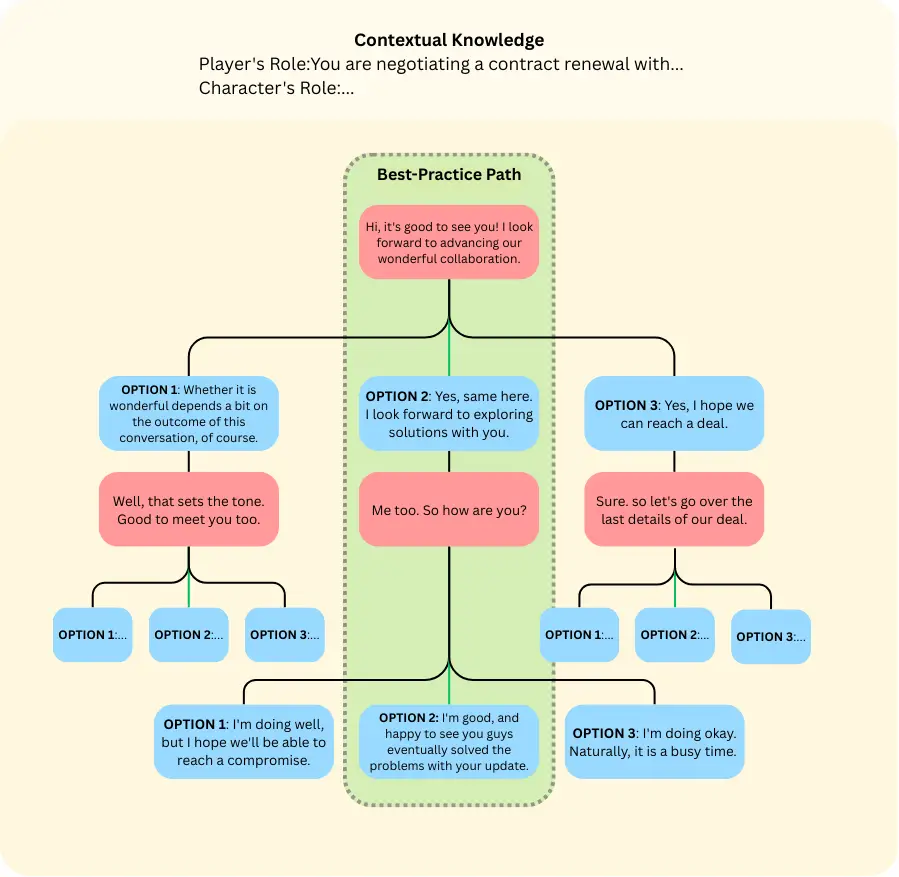

Figure 1: Overview of the training scenario structure. Each scenario
includes contextual knowledge (e.g., player and character roles) and a
dialogue tree. Agent statements are represented by red nodes and player
choices by blue nodes. The highlighted sequence represents the
‘best-practice path’.

For this study, we selected a single scenario focused on negotiation
skills. The full simulation of this scenario consists of 24
conversational exchanges between the user and the agent. The agent’s
first turn, which serves as a greeting without any preceding dialogue,
was excluded from our analysis. This resulted in a total of 23 exchanges
for which we generated two distinct sets of agent responses to serve as
our stimuli:

- •
  Human-Authored Responses: The agent’s pre-scripted utterances from the
  best-practice path were used as the benchmark for high-quality,
  human-authored content.
- •
  LLM-Generated Responses: To create a parallel dialogue, we prompted a
  fine-tuned Llama 3 model (see Table 2 for model specifications and
  Table 3 for fine-tuning details) to generate an agent response at each
  turn along the same best-practice path. The model was fine-tuned on a
  pre-selected set of 90 high-quality conversation scenarios to ensure
  relevant output in the desired style.

  The prompt provided the model with the scenario’s contextual knowledge
  as well as the dialogue context comprising the preceding conversation
  history and the next statement in the "best-practice path". This
  process ensured that the LLM generated a complete, parallel dialogue
  that followed the same sequence of turns as the human-authored
  version. The prompt template is given in Figure 5.

Table 4 presents a side-by-side comparison of two response types for 23
agent turns in the dialogue. Pilot testing indicated that evaluating 23
response pairs in a single session could induce cognitive fatigue. To
mitigate this, we partitioned the turns into Session A (12 turns) and
Session B (11 turns). Each participant was randomly assigned to evaluate
responses in only one of the two sessions.

### 3.3 Measures

Participants rated each agent’s response on the following six quality
dimensions adapted from the USR metric framework Mehri and Eskenazi
(2020).

Understandable (0–1)  
"Is the response understandable in the context of the history?"

Natural (1–3)  
"Is the response naturally written?"

Maintains Context (1–3)  
"Does the response serve as a valid continuation of the conversation
history?"

Interesting (1–3)  
"Is the response dull/interesting?"

Uses Knowledge (0–1)  
"Given the contextual knowledge of the scenario (e.g. character role’s
description, scenario background) that the response is conditioned on,
how well does the response use the knowledge?" (Adapted from Mehri and
Eskenazi (2020) to fit our context.)

Overall Quality (1–5)  
"Given your answers above, what is your overall impression of this
utterance?"

### 3.4 Procedure

After providing informed consent, participants received instructions on
the study’s background and their tasks. Each participant was randomly
assigned to either session A or session B. The experiment consisted of
two main tasks for each participant.

##### In-simulation pairwise preference

At each agent’s turn in the dialogue simulation, participants were
presented with two responses: one LLM-generated and one human-authored.
To mitigate order effects, the presentation order of these two responses
was randomised for each turn. They were then asked, "Which response do
you think fits best within the conversation?" and indicated their
preference. This process, as shown in Figure 6, was repeated for all
turns in their assigned session.

##### Post-simulation rating

After completing the simulation, participants were directed to a
questionnaire where they were shown the same response pairs in the
simulation context again and asked to rate each response on chosen
constructs.

The experiment concluded after these two tasks were completed.

#### 3.4.1 Focus Group

Following the main experiment, we conducted a focus group with two
instructional designers from the company to gather expert qualitative
insights. During the session, designers were shown five dialogue
exchanges containing both LLM-generated and human-authored responses. We
performed a guided discussion to understand which design aspects they
value most, and to identify important qualities potentially missed by
our quantitative constructs.

### 3.5 Data Analysis

We analysed the data from Experiment 1 using both quantitative and
qualitative methods to address our sub-research questions.

To answer SubRQ1, we fitted linear mixed-effects models (LMMs) with
response Condition (LLM-generated vs. human-authored), conversational
Turn, and their interaction as fixed effects, including random
intercepts for individual participants assigned to session A and session
B. This allowed for a multi-turn analysis on whether the relative
quality of response conditions changed as the dialogue progressed. To
examine trends in perceived response quality, we plotted the mean rating
per turn for each response condition and overlaid a corresponding trend
line generated by a simple linear model (Ordinary Least Squares, OLS).

We analysed the proportion of participants who expressed a preference
for the LLM’s response at each of the 23 conversational turns,
identifying representative turns for each response condition.

To address SubRQ2, we conducted a mixed-methods analysis. First, a
Spearman correlation analysis was performed among the evaluated
constructs to identify which dimensions were most strongly associated
with Overall Quality ratings. Second, the focus group session was
conducted via Google Meet and automatically transcribed using its
built-in functionality. The resulting transcript was then corrected for
errors by the first author to ensure accuracy. We then analysed this
transcript using thematic analysis. This process involved two stages.
First, we inductively coded the transcript by labelling key statements
and concepts. Second, we grouped and refined these codes into the
resulting themes presented in our findings.

### 3.6 Results

#### 3.6.1 Multi-turn Analysis of Perceived Quality

Our analysis of human-annotated ratings revealed how perceived quality
changed over the course of a conversation. We found significant main
effects for the conversational Turn, but the most critical finding was a
consistent and statistically significant interaction between Condition
and Turn. The key interaction effects are presented in Table 1, while
the full model statistics are available in Table 5.

The analysis first revealed a significant positive main effect of Turn
across all six quality constructs. This indicates that, on average,
responses were perceived more favourably as the dialogues progressed.
However, this trend was qualified by the significant Condition × Turn
interaction, which points to a crucial difference in performance
trajectories. As shown in Figure 2, while human-authored responses
showed a slight but steady increase in perceived quality throughout the
dialogue, the LLM-generated responses declined in quality over time.
This degradation in LLM performance was particularly notable for key
conversational qualities, including Overall Quality
($`\beta=-0.029,p=.001`$), Natural ($`\beta=-0.021,p<.001`$), and
Maintains Context ($`\beta=-0.020,p<.001`$).

The main effect for Condition revealed a more nuanced performance.
Across five of the six constructs, including Overall Quality, there was
no statistically significant difference in the average ratings between
the LLM-generated and human-authored response conditions. Although LLM
showed superior performance in Uses Knowledge, this initial advantage
was progressively negated by accumulating conversational contexts, as
proved by the significant negative interaction
($`\beta=-0.013,p<.001`$).

| Construct         | Effect           | $`\beta`$ | $`SE`$ | z-value | p-value |
| ----------------- | ---------------- | --------- | ------ | ------- | ------- |
| Understandable    | Condition × Turn | -0.005    | 0.002  | -2.022  | .043    |
| Natural           | Condition × Turn | -0.021    | 0.005  | -3.863  | \<.001  |
| Maintains Context | Condition × Turn | -0.020    | 0.005  | -3.706  | \<.001  |
| Interesting       | Condition × Turn | -0.018    | 0.006  | -2.930  | .003    |
| Uses Knowledge    | Condition × Turn | -0.013    | 0.003  | -4.371  | \<.001  |
| Overall Quality   | Condition × Turn | -0.029    | 0.009  | -3.363  | .001    |

Table 1: Results of the LMMs for each quality construct. The table
displays the fixed-effect coefficients ($`\beta`$), standard errors
($`SE`$), $`z`$-values, and $`p`$-values for the Condition × Turn
interaction.

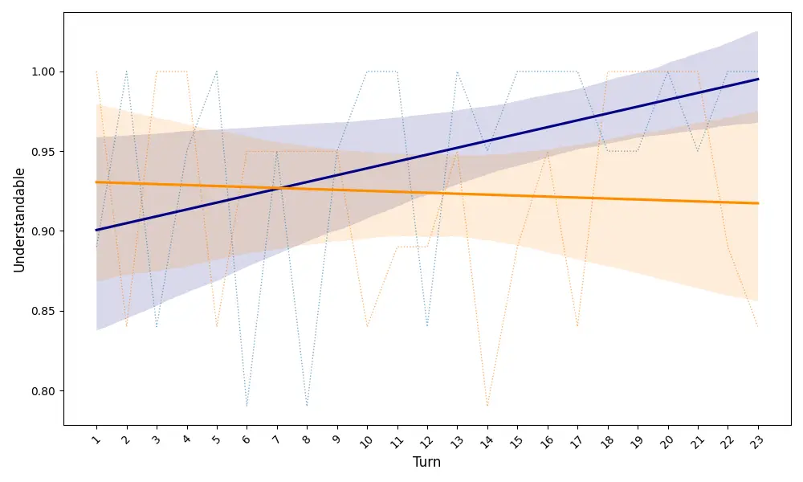

(a) Understandable

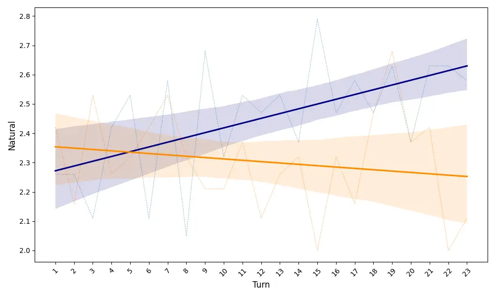

(b) Natural

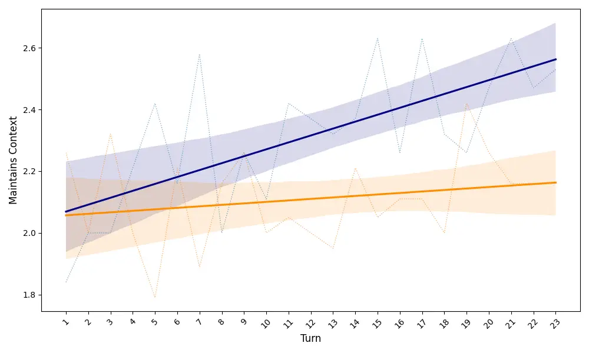

(c) Maintains Context

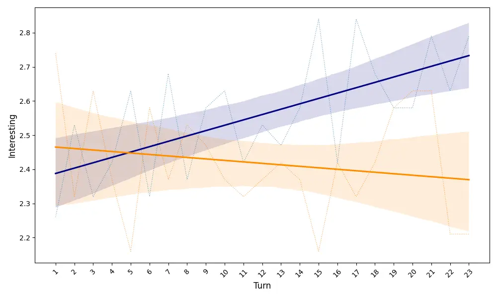

(d) Interesting

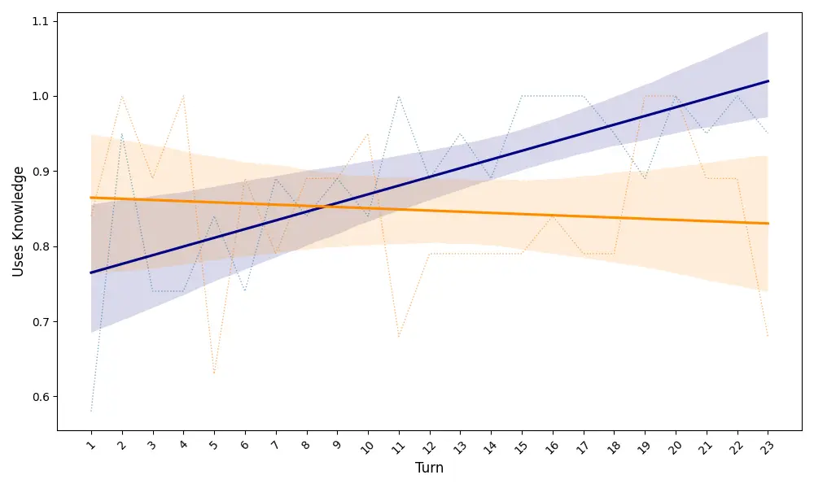

(e) Uses Knowledge

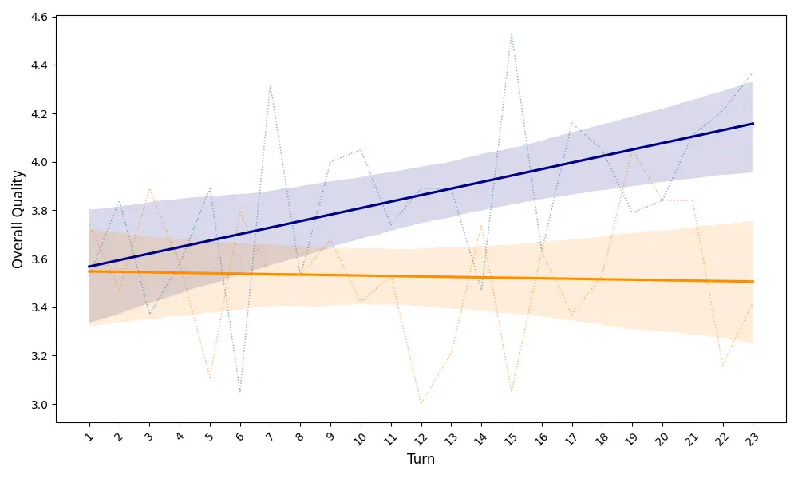

(f) Overall Quality

Figure 2: Perceived quality ratings of LLM-generated (orange) and
human-authored (blue) responses over turns. Dotted lines connect the
mean rating at each turn for each response condition. Solid lines
represent the overall linear regression (OLS) trend.

#### 3.6.2 Participant Preference

The analysis of participants’ preferences indicates a general preference
for human-authored responses, with the LLM-generated response being
selected by less than half of the participants in 20 out of the 23
turns. However, the preference for the LLM-generated responses varied
considerably throughout the dialogue. In several instances, the
LLM-generated response was strongly favoured, achieving a majority
preference in three turns and reaching a peak of 68% at turn 19.
Conversely, its performance was viewed unfavourably in other turns,
dropping to a preference of only 5% at turn 12 and 11% at turn 15. While
a visual inspection of the data points suggests a slight downward trend
for LLM preference over turns, as shown in Figure 3, the linear
regression results suggest that this trend is not statistically
significant ($`\beta=-0.01,p=0.504`$).

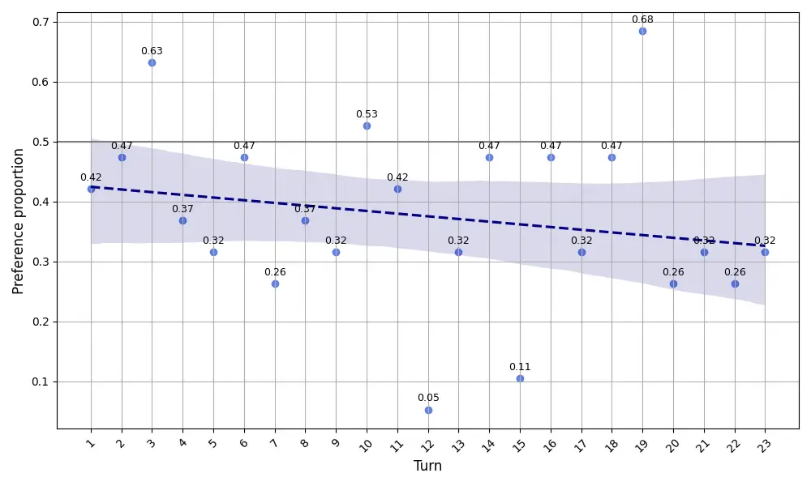

Figure 3: Proportion of participants preferring the LLM-generated
response over turns. Data points represent the preference proportion at
each turn. The dashed OLS trend line and its shaded 95% confidence
interval illustrate that there was no statistically significant trend
over time ($`p>.5`$).

#### 3.6.3 Correlation Analysis

Spearman correlation analysis was used to examine the relationships
between all rated constructs across individual ratings ($`N=874`$). The
full correlation matrix is visualised in the heatmap in Figure 4.

The analysis revealed that participants’ ratings of Overall Quality were
most strongly and positively correlated with a response’s perceived
Interestingness ($`r_{s}=.66,p<.001`$), followed by how well it
Maintains Context ($`r_{s}=.57,p<.001`$) and its Naturalness
($`r_{s}=.50,p<.001`$).

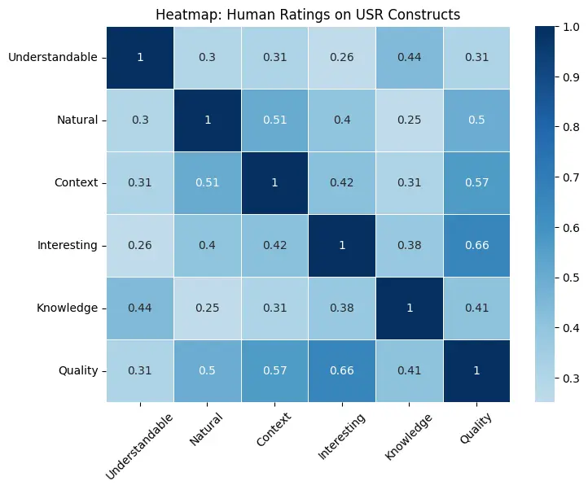

Figure 4: Heatmap of Spearman correlation coefficients ($`r_{s}`$)
between all rated quality constructs.

#### 3.6.4 Qualitative findings of focus group

The thematic analysis of transcribed focus group discussions revealed
five themes regarding the essential attributes of effective dialogue
responses in a training simulation context:

##### Natural Flow

Both designers emphasised that responses with unnatural phrasing or
awkward transitions disrupt user immersion and undermine the learning
experience.

##### Contextual Fit

High-quality responses must reflect both dialogue history and scenario
background. Even realistic-sounding replies were criticised if they
contradicted established facts or ignored narrative context.

##### Tone Appropriateness

Tone should align with the scenario’s emotional dynamics. Defensive or
uncooperative tones were seen as misaligned, even if contextually
plausible.

##### Pedagogical Nudging

Responses should subtly guide users toward learning objectives without
being overly directive.

##### Sentence Length

Designers favoured concise replies with clear intent early in the
sentence to support pacing and clarity.

## 4 Experiment 2: Automated Evaluation

Experiment 1 provided strong evidence that the quality of LLM-generated
responses degraded over the course of a long-form dialogue and that
human-authored responses were consistently preferred over LLM-generated
ones. To investigate whether these findings generalise across broader
conversational contexts, we designed a second experiment using an
LLM-as-a-judge for automated evaluation.

The experiment was structured in two phases. First, we conducted a
validation phase, where we systematically evaluated how well LLMs mimic
the human judgements from Experiment 1. Second, after identifying the
evaluation method that reached the highest agreement with human
judgements, we proceeded to the generalisation phase. In this phase, we
applied the validated method to assess responses across three additional
conversational scenarios, each designed for a different communication
skill: motivational interviewing, selling, and consulting. Each selected
scenario spans over 30 turns to ensure sufficient length for robust
multi-turn analysis. This two-phase approach was implemented for two
distinct evaluation tasks: construct rating and pairwise preference.

### 4.1 Task 1: Construct Rating

##### Validation on Ground-Truth

We started by determining a plausible setup for an LLM judge to predict
the fine-grained quality ratings from Experiment 1. We prompted LLMs
with varying capabilities, detailed in Table 2 (Llama 3.1 8B, Mistral
7B, Phi-3 Medium 14B, and Gemini 2.0 Flash), to rate responses on the
same six quality constructs in zero-shot settings. Each prompt provided
the LLM with the complete context available to human annotators,
including the scenario background, character roles, and conversational
goals.

Having identified the model with the highest agreement with human
judgements in zero-shot settings, we then explored various few-shot
prompting strategies to further enhance alignment. We compared two
example selection methods: first-$`k`$ selection, which uses the initial
dialogue turns as exemplars; and random sampling, which draws examples
from the entire conversation. The effectiveness of each model and
prompting strategy was measured by calculating the correlation between
predicted ratings and the ground-truth human ratings from Experiment 1.

##### Evaluation on Additional Scenarios

We used the LLM and prompting strategy that achieved the highest
agreement with human judgements to rate responses in three additional
scenarios. We fitted a single OLS regression model to the ratings from
all three scenarios. The model examined the effects of the response
condition (LLM-generated vs. human-authored), dialogue turn, and
specific scenario, as well as their interactions, on the predicted
quality scores. We plotted the individual data points and OLS trend
lines for each scenario separately to visualise the underlying patterns
within each context.

### 4.2 Task 2: Pairwise Preference

##### Validation on Ground-Truth

In parallel, we validated the use of an LLM-as-a-judge for a pairwise
preference task. We used the Gemini 2.0 Flash model, providing it with
complete contextual information and, at each turn, both the
human-authored and LLM-generated response. The model chose the response
that best fit the conversation.

To simulate the variance found in human judgements, we set the model’s
temperature hyperparameter to 1.2 to increase response stochasticity. We
evaluated each response pair 50 times, allowing us to compute a
preference proportion for each option. To prevent order bias, the
presentation order of the two responses was randomised in each prompt.
The reliability of this approach was validated by correlating the LLM
preference proportions with the human preference proportions from
Experiment 1.

##### Evaluation on Additional Scenarios

Given the strong prior alignment with human preferences using Gemini 2.0
Flash in validation, we applied zero-shot prompting for pairwise
preference judgements in the additional scenarios. We prompted the model
to indicate its preference for each response pair, and computed the
proportion of preferences for the LLM-generated responses and plotted
the linear trend using a simple OLS model.

### 4.3 Results

#### 4.3.1 Task 1: Construct Ratings

##### Validation

We evaluated the reliability of using LLM-as-a-judge across various LLMs
with varied capabilities and prompting strategies. Table 6 shows the
Pearson ($`r_{p}`$) and Spearman ($`r_{s}`$) correlation coefficients
for each distinct setup.

In a zero-shot setting, more advanced models serve as more reliable
evaluators. For instance, Gemini 2.0 flash achieves the highest
alignment on Overall Quality ($`r_{p}=0.519,r_{s}=0.452`$),
substantially outperforming smaller models like Llama 3.1
($`r_{p}=0.232`$). Besides, less capable models appear to be correlating
positively with human judgements on LLM-generated responses but
negatively on human-authored text (e.g., Llama 3.1 on Natural:
$`r_{p}=0.302`$ vs. $`-0.178`$). In contrast, the most capable model,
Gemini 2.0 flash, demonstrated strong alignment on human-authored
responses with the highest correlation on Overall Quality
($`r_{p}=0.632`$) but presented no correlation on LLM-generated
responses ($`r_{p}=-0.001`$).

Building upon the best-performing Gemini 2.0 flash model, we further
investigate how prompting strategies affect alignment with human
judgements. Notably, no correlation is reported for Understandable among
all strategies due to a lack of variance in ratings. The LLM
consistently assigned the maximum score, while human judges also gave
high scores with minimal variation. This ceiling effect suggests that
responses were perceived as highly understandable.

Adopting a few-shot prompting strategy significantly enhances Gemini 2.0
flash’s alignment with human judgements. Random Sampling 6-shot was the
most effective strategy ($`r_{p}=0.659,r_{s}=0.682`$ on Overall
Quality), slightly outperforming the prompting strategy using the first
six turns as examples ($`r_{p}=0.629,r_{s}=0.650`$). Besides, the
increased sample size and introduced randomness in example selection
contribute to improved alignment with human judgements on LLM-generated
responses, with $`r_{p}`$ gradually increasing from -0.001 to 0.659 and
$`r_{s}`$ increasing from 0.119 to 0.632.

##### Evaluation

As the random sampling 6-shot prompting showed relatively stronger
correlations across all response conditions
($`r_{p}=0.659,r_{s}=0.682)`$, we applied this strategy to obtain
ratings for three additional scenarios.

An OLS regression was conducted to analyse the construct ratings across
the three additional scenarios. The overall model was statistically
significant, explaining approximately 21.8% of the variance in the
scores ($`F(11,202)=5.13,p<.001,R^{2}=.218`$). The analysis revealed a
significant positive main effect for turn specifically for the baseline
human-authored condition ($`\beta=0.019,p=.003`$), indicating increasing
perceived quality in human-authored responses as the dialogues
progressed.

While there was no significant main effect for the response condition,
suggesting comparable average performance, we observed a marginally
significant interaction between condition and turn
($`\beta=-0.017,p=.067`$). This negative interaction, visualised in
Figure 7, indicated that the quality trend for LLM-generated responses
was significantly less positive than for human-authored responses over
time. No other interactions involving the different scenarios were
significant, suggesting this pattern was consistent across additional
contexts.

#### 4.3.2 Task 2: Pairwise Preference

##### Validation

To examine the reliability of the LLM-as-a-judge for the pairwise
preference task, we correlated the LLM’s preference distributions with
the human preference proportions. The relationship was found to be
significantly positive for both Pearson’s correlation
($`r=.656,p<.001`$) and Spearman’s correlation ($`r_{s}=.643,p=.003`$),
which suggests high agreement with human judgements on pairwise
comparisons.

##### Evaluation

The extensive evaluation revealed that the LLM-as-a-judge held a
consistent and strong preference for human-authored responses across all
additional scenarios. This is visually demonstrated in Figure 8, where
the majority of conversational turns show a preference proportion below
the 50% threshold for the LLM-generated option. While a clear preference
level was established, a subsequent regression analysis found no
statistically significant trend in these preferences over the course of
the dialogues.

## 5 Discussion and Conclusions

Answering our research questions led to three principal findings. First,
we observed significant degradation in the perceived quality of
LLM-generated responses relative to human-authored responses as
knowledge-grounded role-play dialogues progress. This trend was
validated by both human evaluation and our automated LLM-as-a-judge
assessments and was most prominent in the human-rated dimensions of
Overall Quality, Natural, and Context Maintenance.

Second, multi-turn analysis revealed opposing trajectories and confirmed
that LLM performance degrades sharply over turns, while human-authored
responses improved throughout the conversation (SubRQ1). This aligns
with prior work on context degradation in extended interactions Liu
et al. (2024) but expands it to knowledge-grounded pedagogical settings.
Third, participants’ quality perceptions were most strongly driven by
Interesting, Maintains Context, and Natural (SubRQ2). Experts in our
focus group highlighted additional nuances: character consistency,
pedagogical nudging and conciseness. These factors resonate with the
design principles of educational role-play systems Gousseva et al.
(2024) but have not been quantitatively assessed.

To scale our investigation, we validated the LLM-as-a-judge approach
Zheng et al. (2023) for both construct rating and pairwise preference
tasks. Using Gemini 2.0 Flash with a random few-shot prompting strategy,
we achieved high alignment with human judgements, providing a viable
method for automated evaluation of long-form dialogues. The consistent
preference for human-authored responses in pairwise evaluations further
reinforces the reliability of LLM judges for comparative assessments, as
suggested by Park et al. (2024). This evaluation framework also provides
a methodology for benchmarking specialised judging models, such as
Prometheus-2 Kim et al. (2024) and JudgeLM Zhu et al. (2025). Notably,
however, automated evaluation revealed that LLMs struggle to evaluate
output of their kind, as seen in the lower correlations for
LLM-generated responses in zero-shot settings. This calls for caution
when choosing LLM judges for evaluating LLM performance.

Overall, our findings highlight both the potential and current
limitations of LLMs in training-oriented role-play dialogues. Despite
our validated evaluation pipeline that enables scalable assessment, LLMs
still struggle to sustain high-quality, context-sensitive responses
across extended interactions. This long-context degradation remains a
significant barrier. Until such challenges are addressed, human authors
continue to be the gold standard for crafting engaging and pedagogical
role-play scenarios.

## Limitations

This study has several limitations. First, human evaluation was
conducted on a single scenario. Although we expanded to additional
scenarios in the automated evaluation, the generalisability of our human
findings to other domains remains to be tested.

Second, our LLM-as-a-judge approach, while effective, exhibited
limitations. The Understandable dimension showed a ceiling effect in
both human and automated evaluations, limiting its discriminative power.
In zero-shot settings, the LLM judge (Gemini 2.0 Flash) showed lower
alignment with human judgements for LLM-generated responses than for
human-authored ones, suggesting potential biases. Few-shot prompting
mitigated this, but the approach requires careful calibration of example
selection and may not transfer seamlessly to other models or tasks.

Third, our study focused on a specific LLM (Llama 3) for response
generation. This choice enabled controlled comparisons and the ability
to fine-tune on high-quality training scenarios, which is not feasible
with more powerful proprietary models like Gemini 2.0 or Claude 3.
However, this focus does not capture potential differences arising from
variations in model architecture, scale, or fine-tuning approaches.
While stronger models potentially handle long-context modelling better,
mitigating some of the degradation effects we observed, not being able
to fine-tune these models constrains their adaptability for pedagogical
customisations on training scenarios.

These limitations suggest future research directions, including
investigating the applicability of our findings to a wider variety of
dialogue scenarios, improving the robustness of using LLM-as-a-judge and
exploring potential strategies to mitigate performance decay over
extended interactions. Beyond addressing these limitations, a promising
future direction is to broaden the analytical approach, examining the
dialogue sub-structures for more nuanced, qualitative insights into the
differences between human and LLM-generated responses.

## Ethics Statement

This study complies with the research ethics guidelines of Utrecht
University. The research protocol was assessed through the university’s
standard ethics screening procedure (the Ethics and Privacy Quick Scan)
and classified this research as low-risk with no further ethics review
or privacy assessment required.

The study’s sample included participants recruited via Prolific and a
convenience sample from personal contacts. All participants provided
informed consent, detailing the task, data collection, and their right
to withdraw without penalty. Prolific participants were compensated at
£9.20/hr, meeting platform guidelines. The convenience sample
participants received non-monetary gratuities. The research used
non-sensitive fictional negotiation dialogues with no foreseeable risks.
All personally identifiable information was anonymised.

## Acknowledgements

This activity is partly funded by the PPP subsidy from the Dutch
Ministry of Economic Affairs and Climate Policy through CLICKNL. CLICKNL
is the leading consortium for Knowledge and Innovation (TKI) in the
Creative Industries in the Netherlands.

## References

- An et al. (2024) Sixu An, Yicong Li, Yunsi Ma, Gary Cheng, and
  Guandong Xu. 2024. [Developing an LLM-Empowered Agent to Enhance
  Student Collaborative Learning Through Group
  Discussion](https://doi.org/10.58459/icce.2024.4953). In
  _International Conference on Computers in Education_.
- Bai et al. (2024) Ge Bai, Jie Liu, Xingyuan Bu, Yancheng He, Jiaheng
  Liu, Zhanhui Zhou, Zhuoran Lin, Wenbo Su, Tiezheng Ge, Bo Zheng, and
  Wanli Ouyang. 2024. [MT-Bench-101: A Fine-Grained Benchmark for
  Evaluating Large Language Models in Multi-Turn
  Dialogues](https://doi.org/10.18653/v1/2024.acl-long.401). In
  _Proceedings of the 62nd Annual Meeting of the Association for
  Computational Linguistics (Volume 1: Long Papers)_, pages 7421–7454,
  Bangkok, Thailand. Association for Computational Linguistics.
- Banerjee and Lavie (2005) Satanjeev Banerjee and Alon Lavie. 2005.
  [METEOR: An Automatic Metric for MT Evaluation with Improved
  Correlation with Human Judgments](https://aclanthology.org/W05-0909/).
  In _Proceedings of the ACL Workshop on Intrinsic and Extrinsic
  Evaluation Measures for Machine Translation and/or Summarization_,
  pages 65–72, Ann Arbor, Michigan. Association for Computational
  Linguistics.
- Chalamalasetti et al. (2023) Kranti Chalamalasetti, Jana Götze,
  Sherzod Hakimov, Brielen Madureira, Philipp Sadler, and David
  Schlangen. 2023. [clembench: Using Game Play to Evaluate
  Chat-Optimized Language Models as Conversational
  Agents](https://doi.org/10.18653/v1/2023.emnlp-main.689). In
  _Proceedings of the 2023 Conference on Empirical Methods in Natural
  Language Processing_, pages 11174–11219, Singapore. Association for
  Computational Linguistics.
- Chen et al. (2024) Nuo Chen, Yan Wang, Yang Deng, and Jia Li. 2024.
  [The Oscars of AI Theater: A Survey on Role-Playing with Language
  Models](https://doi.org/10.48550/ARXIV.2407.11484). _arXiv preprint
  arXiv:2407.11484_. Version 9.
- Cheng et al. (2025) Yiruo Cheng, Kelong Mao, Ziliang Zhao, Guanting
  Dong, Hongjin Qian, Yongkang Wu, Tetsuya Sakai, Ji-Rong Wen, and
  Zhicheng Dou. 2025. [CORAL: Benchmarking Multi-turn Conversational
  Retrieval-Augmented
  Generation](https://doi.org/10.18653/v1/2025.findings-naacl.72). In
  _Findings of the Association for Computational Linguistics: NAACL
  2025_, pages 1308–1330, Albuquerque, New Mexico. Association for
  Computational Linguistics.
- Costarelli et al. (2024) Anthony Costarelli, Mat Allen, Roman
  Hauksson, Grace Sodunke, Suhas Hariharan, Carlson Cheng, Wenjie Li,
  Joshua Clymer, and Arjun Yadav. 2024. [GameBench: Evaluating Strategic
  Reasoning Abilities of LLM
  Agents](https://doi.org/10.48550/arXiv.2406.06613). _arXiv preprint
  arXiv:2406.06613_.
- Deshpande et al. (2025) Kaustubh Deshpande, Ved Sirdeshmukh,
  Johannes Baptist Mols, Lifeng Jin, Ed-Yeremai Hernandez-Cardona, Dean
  Lee, Jeremy Kritz, Willow E. Primack, Summer Yue, and Chen Xing. 2025.
  [MultiChallenge: A Realistic Multi-Turn Conversation Evaluation
  Benchmark Challenging to Frontier
  LLMs](https://doi.org/10.18653/v1/2025.findings-acl.958). In _Findings
  of the Association for Computational Linguistics: ACL 2025_, pages
  18632–18702, Vienna, Austria. Association for Computational
  Linguistics.
- Feng et al. (2024) Shutong Feng, Hsien-chin Lin, Christian Geishauser,
  Nurul Lubis, Carel van Niekerk, Michael Heck, Benjamin Ruppik, Renato
  Vukovic, and Milica Gašić. 2024. [Infusing Emotions into Task-oriented
  Dialogue Systems: Understanding, Management, and
  Generation](https://doi.org/10.18653/v1/2024.sigdial-1.60). In
  _Proceedings of the 25th Annual Meeting of the Special Interest Group
  on Discourse and Dialogue_, pages 699–717, Kyoto, Japan. Association
  for Computational Linguistics.
- Gopalakrishnan et al. (2019) Karthik Gopalakrishnan, Behnam
  Hedayatnia, Qinlang Chen, Anna Gottardi, Sanjeev Kwatra, Anu
  Venkatesh, Raefer Gabriel, and Dilek Hakkani-Tür. 2019. [Topical-Chat:
  Towards Knowledge-Grounded Open-Domain
  Conversations](https://doi.org/10.21437/Interspeech.2019-3079). In
  _Interspeech 2019_, pages 1891–1895. ISCA.
- Gousseva et al. (2024) Natasha Gousseva, Mark Pluymaekers, and
  Michiel H. Hulsbergen. 2024. [Creating authentic and effective
  practice scenarios for digital simulation-based conversation
  training](https://doi.org/10.58459/rptel.2024.19036). _Research and
  Practice in Technology Enhanced Learning_, 19:036.
- Guertler et al. (2025) Leon Guertler, Bobby Cheng, Simon Yu, Bo Liu,
  Leshem Choshen, and Cheston Tan. 2025.
  [TextArena](https://doi.org/10.48550/arXiv.2504.11442). _arXiv
  preprint arXiv:2504.11442_.
- Hankache et al. (2025) Robert Hankache, Kingsley Nketia Acheampong,
  Liang Song, Marek Brynda, Raad Khraishi, and Greig A. Cowan. 2025.
  [Evaluating the Sensitivity of LLMs to Prior
  Context](https://doi.org/10.48550/arXiv.2506.00069). _arXiv preprint
  arXiv:2506.00069_.
- Jeuring et al. (2015) J.T. Jeuring, F. Grosfeld, B.J. Heeren,
  M. Hulsbergen, R.C. Ijntema, Vincent Jonker, N.J.J.M. Mastenbroek,
  M.J. van der Smagt, F. Wijmans, Majanne Wolters, and H. van
  Zeijts. 2015. [Communicate! — A Serious Game for Communication
  Skills](https://doi.org/10.1007/978-3-319-24258-3_49). In _Design for
  Teaching and Learning in a Networked World_, pages 513–517. Springer.
- Kenny and Parsons (2024) Patrick G. Kenny and Thomas D. Parsons. 2024.
  [Virtual Standardized LLM-AI Patients for Clinical
  Practice](https://www.scopus.com/pages/publications/85215399755).
  _Annual Review of CyberTherapy and Telemedicine_, 22:177–182.
- Kim et al. (2024) Seungone Kim, Juyoung Suk, Shayne Longpre,
  Bill Yuchen Lin, Jamin Shin, Sean Welleck, Graham Neubig, Moontae Lee,
  Kyungjae Lee, and Minjoon Seo. 2024. [Prometheus 2: An Open Source
  Language Model Specialized in Evaluating Other Language
  Models](https://doi.org/10.18653/v1/2024.emnlp-main.248). In
  _Proceedings of the 2024 Conference on Empirical Methods in Natural
  Language Processing_, pages 4334–4353, Miami, Florida, USA.
  Association for Computational Linguistics.
- Li et al. (2025) Dawei Li, Bohan Jiang, Liangjie Huang, Alimohammad
  Beigi, Chengshuai Zhao, Zhen Tan, Amrita Bhattacharjee, Yuxuan Jiang,
  Canyu Chen, Tianhao Wu, Kai Shu, Lu Cheng, and Huan Liu. 2025. [From
  Generation to Judgment: Opportunities and Challenges of
  LLM-as-a-judge](https://doi.org/10.48550/arXiv.2411.16594). _arXiv
  preprint arXiv:2411.16594_.
- Lin (2004) Chin-Yew Lin. 2004. [ROUGE: A Package for Automatic
  Evaluation of Summaries](https://aclanthology.org/W04-1013/). In _Text
  Summarization Branches Out_, pages 74–81, Barcelona, Spain.
  Association for Computational Linguistics.
- Liu et al. (2016) Chia-Wei Liu, Ryan Lowe, Iulian Serban, Mike
  Noseworthy, Laurent Charlin, and Joelle Pineau. 2016. [How NOT To
  Evaluate Your Dialogue System: An Empirical Study of Unsupervised
  Evaluation Metrics for Dialogue Response
  Generation](https://doi.org/10.18653/v1/D16-1230). In _Proceedings of
  the 2016 Conference on Empirical Methods in Natural Language
  Processing_, pages 2122–2132, Austin, Texas. Association for
  Computational Linguistics.
- Liu et al. (2024) Nelson F. Liu, Kevin Lin, John Hewitt, Ashwin
  Paranjape, Michele Bevilacqua, Fabio Petroni, and Percy Liang. 2024.
  [Lost in the Middle: How Language Models Use Long
  Contexts](https://doi.org/10.1162/tacl_a_00638). _Transactions of the
  Association for Computational Linguistics_, 12:157–173.
- Mehri and Eskenazi (2020) Shikib Mehri and Maxine Eskenazi. 2020.
  [USR: An Unsupervised and Reference Free Evaluation Metric for Dialog
  Generation](https://doi.org/10.18653/v1/2020.acl-main.64). In
  _Proceedings of the 58th Annual Meeting of the Association for
  Computational Linguistics_, pages 681–707. Association for
  Computational Linguistics.
- Mo et al. (2025) Lingbo Mo, Shun Jiang, Akash Maharaj, Bernard
  Hishamunda, and Yunyao Li. 2025. [HierTOD: A Task-Oriented Dialogue
  System Driven by Hierarchical
  Goals](https://www.vldb.org/2025/Workshops/VLDB-Workshops-2025/DaSH/DaSH25_6.pdf).
  In _Proceedings of the 5th International Workshop on Data Science with
  Human-in-the-Loop (DaSH)_, London, United Kingdom. VLDB Endowment.
- Panickssery et al. (2025) Arjun Panickssery, Samuel R. Bowman, and Shi
  Feng. 2025. [LLM evaluators recognize and favor their own
  generations](https://proceedings.neurips.cc/paper_files/paper/2024/file/7f1f0218e45f5414c79c0679633e47bc-Paper-Conference.pdf).
  In _Proceedings of the 38th International Conference on Neural
  Information Processing Systems_, volume 37, pages 68772–68802, Red
  Hook, NY, USA. Curran Associates Inc.
- Papineni et al. (2002) Kishore Papineni, Salim Roukos, Todd Ward, and
  Wei-Jing Zhu. 2002. [Bleu: a Method for Automatic Evaluation of
  Machine Translation](https://doi.org/10.3115/1073083.1073135). In
  _Proceedings of the 40th Annual Meeting of the Association for
  Computational Linguistics_, pages 311–318, Philadelphia, Pennsylvania,
  USA. Association for Computational Linguistics.
- Park et al. (2024) ChaeHun Park, Minseok Choi, Dohyun Lee, and Jaegul
  Choo. 2024. [PairEval: Open-domain Dialogue Evaluation with Pairwise
  Comparison](https://doi.org/10.48550/arXiv.2404.01015). _arXiv
  preprint arXiv:2404.01015_. COLM2024 (accepted).
- Sinha et al. (2020) Koustuv Sinha, Prasanna Parthasarathi, Jasmine
  Wang, Ryan Lowe, William L. Hamilton, and Joelle Pineau. 2020.
  [Learning an Unreferenced Metric for Online Dialogue
  Evaluation](https://doi.org/10.18653/v1/2020.acl-main.220). In
  _Proceedings of the 58th Annual Meeting of the Association for
  Computational Linguistics_, pages 2430–2441. Association for
  Computational Linguistics.
- Wang et al. (2024) Noah Wang, Z.y. Peng, Haoran Que, Jiaheng Liu,
  Wangchunshu Zhou, Yuhan Wu, Hongcheng Guo, Ruitong Gan, Zehao Ni, Jian
  Yang, Man Zhang, Zhaoxiang Zhang, Wanli Ouyang, Ke Xu, Wenhao Huang,
  Jie Fu, and Junran Peng. 2024. [RoleLLM: Benchmarking, Eliciting, and
  Enhancing Role-Playing Abilities of Large Language
  Models](https://doi.org/10.18653/v1/2024.findings-acl.878). In
  _Findings of the Association for Computational Linguistics: ACL 2024_,
  pages 14743–14777, Bangkok, Thailand. Association for Computational
  Linguistics.
- Wu et al. (2025) Bowen Wu, Kaili Sun, Ziwei Bai, Ying Li, and Baoxun
  Wang. 2025. [RAIDEN Benchmark: Evaluating Role-playing Conversational
  Agents with Measurement-Driven Custom
  Dialogues](https://aclanthology.org/2025.coling-main.735/). In
  _Proceedings of the 31st International Conference on Computational
  Linguistics_, pages 11086–11106, Abu Dhabi, UAE. Association for
  Computational Linguistics.
- Zhang et al. (2018) Saizheng Zhang, Emily Dinan, Jack Urbanek, Arthur
  Szlam, Douwe Kiela, and Jason Weston. 2018. [Personalizing Dialogue
  Agents: I have a dog, do you have pets
  too?](https://doi.org/10.18653/v1/P18-1205) In _Proceedings of the
  56th Annual Meeting of the Association for Computational Linguistics
  (Volume 1: Long Papers)_, pages 2204–2213, Melbourne, Australia.
  Association for Computational Linguistics.
- Zheng et al. (2023) Lianmin Zheng, Wei-Lin Chiang, Ying Sheng, Siyuan
  Zhuang, Zhanghao Wu, Yonghao Zhuang, Zi Lin, Zhuohan Li, Dacheng Li,
  Eric P. Xing, Hao Zhang, Joseph E. Gonzalez, and Ion Stoica. 2023.
  [Judging LLM-as-a-judge with MT-bench and Chatbot
  Arena](https://proceedings.neurips.cc/paper_files/paper/2023/file/91f18a1287b398d378ef22505bf41832-Paper-Datasets_and_Benchmarks.pdf).
  In _Proceedings of the 37th International Conference on Neural
  Information Processing Systems_, pages 46595–46623, Red Hook, NY, USA.
  Curran Associates Inc.
- Zhu et al. (2025) Lianghui Zhu, Xinggang Wang, and Xinlong Wang. 2025.
  [JudgeLM: Fine-tuned Large Language Models are Scalable
  Judges](https://doi.org/10.48550/arXiv.2310.17631). _arXiv preprint
  arXiv:2310.17631_. Accepted by ICLR2025.

## Appendix A Model Details

This section outlines the language models used in our experiments,
including their deployment, source checkpoints, key specifications, and
the fine-tuning hyperparameters for the response generation model.

| Model                | Deployment                | Checkpoint                            | Params |
| -------------------- | ------------------------- | ------------------------------------- | ------ |
| Llama 3^(a)          | Hugging Face (Fine-tuned) | unsloth/llama-3-8b-bnb-4bit           | 8.03B  |
| Llama 3.1^(b)        | Hugging Face              | meta-llama/Meta-Llama-3.1-8B-Instruct | 8.03B  |
| Mistral^(b)          | Hugging Face              | mistralai/Mistral-7B-Instruct-v0.2    | 7.24B  |
| Phi-3 Medium^(b)     | Ollama                    | phi3:14b                              | 14.00B |
| Gemini 2.0 Flash^(c) | Vertex AI API             | (Proprietary)                         | N/A    |

- a
  Llama 3 was fine-tuned on our dataset for response generation, see
  Table 3 for details. The other models listed served as judges to
  evaluate the generation output.
- b
  The judging models (Llama 3.1, Mistral, and Phi-3 Medium) were used in
  a zero-shot setting.
- c
  Gemini 2.0 Flash was used in both zero-shot and few-shot settings for
  comparison.

Table 2: Language models and their configurations used in the
experiments.

|                          |                     |
| ------------------------ | ------------------- |
| Parameter                | Value               |
| Fine-tuning Parameters   |                     |
| LoRA ($`r`$, $`\alpha`$) | (16, 16)            |
| Optimiser                | AdamW (8-bit)       |
| Learning Rate            | $`2\times 10^{-4}`$ |
| Batch Size               | 4                   |
| Epochs                   | 9                   |
| Inference Parameters     |                     |
| Temperature              | 1.0                 |
| Top-p ($`p`$)            | 0.3                 |
| Top-k ($`k`$)            | 10                  |

Table 3: Hyperparameters for fine-tuning the Llama 3 model.

## Appendix B Generation Prompt

This section describes the prompt used for response generation. At each
turn, the model receives contextual information, including the scenario
background, dialogue history, and character role descriptions, to guide
its output.

Your function is to assist in the creation and completion of a
Conversational Scenario. In every Conversational Scenario, there are
playerStatements, computerStatements. Every Conversational Scenario has:

- Player’s Role: defines the role of the player when playing the
  scenario.

- Character’s Role: defines the personality and objectives of the
  digital persona interacting with the player.

Your role specifically involves generating computerStatements sequences
that could respond to the last playerStatement. Your computerStatements
sequences must respond to the last playerStatement, but also make sense
when read before the next playerStatement.

After putting all together, the conversational Scenario should be
readable and understandable with a nice transition between statements.
Some important rules for the generation of computerStatements are:

- computerStatements are generated in sequences and should be readable
  one after the other.

- The computerStatements should be as short as possible, and they
  shouldn’t be longer than one sentence.

---- Main Task ---

Help me complete the following conversational Scenario by generating the
computerStatements sequences between the last playerStatement and the
next playerStatement.

---- Role Description ----

Player’s Role:

Character’s Role:

---- Dialogue Context ----

Previous statements:

Last playerStatement:

Next playerStatement:

Figure 5: The prompt template for response generation.

## Appendix C Example Dialogue Comparison

The following table presents human-authored and LLM-generated responses
in 23 agent turns from the negotiation scenario.

| Turn | Human-Authored                                                                                                                                                                                                   | LLM-Generated                                                                                                                                     |
| ---- | ---------------------------------------------------------------------------------------------------------------------------------------------------------------------------------------------------------------- | ------------------------------------------------------------------------------------------------------------------------------------------------- |
|      | Agent: Hi, it’s good to see you! I look forward to advancing our wonderful collaboration.                                                                                                                        |                                                                                                                                                   |
|      | User: Yes, same here. I look forward to exploring solutions with you.                                                                                                                                            |                                                                                                                                                   |
| 1    | Agent: Me too. So how are you?                                                                                                                                                                                   | Agent: Me too. In fact, I do believe our cooperation is a good reason to be optimistic.                                                           |
|      | User: I’m good, and happy to see you guys eventually solved the problems with your update.                                                                                                                       |                                                                                                                                                   |
| 2    | Agent: Yes, I’m glad we managed to solve that.                                                                                                                                                                   | Agent: Yes, we were able to resolve the issue.                                                                                                    |
|      | User: And you successfully managed to prevent a data leak, which is important.                                                                                                                                   |                                                                                                                                                   |
| 3    | Agent: We’re content with how that went. As it should naturally.                                                                                                                                                 | Agent: Yes, of course. As a company, we take that very seriously.                                                                                 |
|      | User: The problems raised some concerns about the prolongation within our organisation, but personally, I think you did well in recovering.                                                                      |                                                                                                                                                   |
| 4    | Agent: - Well, thank you. - And I do think we recovered well. Business is booming. - So let’s see what we can do for you.                                                                                        | Agent: That’s good to hear. We strive for continuous improvement.                                                                                 |
|      | User: I’d like to explore opportunities to extend our contract, in the context of our future relationship.                                                                                                       |                                                                                                                                                   |
| 5    | Agent: - Alright then. - But I hope you agree that our solution continues to be a perfect match for your organisation.                                                                                           | Agent: Sure, that’s fine, but that was already agreed.                                                                                            |
|      | User: Your software indeed matches some of our needs, but it’s not on par with several other providers.                                                                                                          |                                                                                                                                                   |
| 6    | Agent: - Oh, okay. - I can’t imagine you are referring to all the new features. - I’m sure your team will be quite happy with what we did.                                                                       | Agent: - Oh, okay. - I would like to ask you to be more specific about what you mean.                                                             |
|      | User: Can you tell me more about your reasons for not supporting functionalities for our invoicing process?                                                                                                      |                                                                                                                                                   |
| 7    | Agent: - We still intend to include it in the future. - We postponed this for now because you were the only client who asked for this. I could consult the team about including it in the next version.          | Agent: Well, that’s a good question. I’ll have to check with our developers.                                                                      |
|      | User: It’s becoming a market standard and we now have to solve it ourselves.                                                                                                                                     |                                                                                                                                                   |
| 8    | Agent: Yes, but in those packages, invoicing facilities are not perfect and by no means a guarantee that it will work in your environment.                                                                       | Agent: - I see, but we can’t do much about that now. - If you want this feature, maybe we should consider taking it from a different provider.    |
|      | User: I might not disagree with you, but it is a disappointment that it’s not included in this version.                                                                                                          |                                                                                                                                                   |
| 9    | Agent: I get that, but I still think our software is quite good for your needs.                                                                                                                                  | Agent: - I would have hoped you would see the value of the software we provide. - If you want more, you will have to take this into account.      |
|      | User: The cost to connect our invoicing is about €300k, which I do need to find somewhere.                                                                                                                       |                                                                                                                                                   |
| 10   | Agent: - There isn’t much we can do. - But I guarantee excellent support for development on your side.                                                                                                           | Agent: That’s still a lot of money, but we do this for all our large clients.                                                                     |
|      | User: How would you guarantee this?                                                                                                                                                                              |                                                                                                                                                   |
| 11   | Agent: - I see your point. - Our support team will help contribute to this development. - So we’ll include this in the contract.                                                                                 | Agent: Well, that’s what we do with all our customers.                                                                                            |
|      | User: Naturally, but it still means lots of work for us, which does need compensation.                                                                                                                           |                                                                                                                                                   |
| 12   | Agent: - Fair enough, but you have to understand we are already stretched with our offer. - I might be able to provide a consultant free of charge for two weeks, but that’s a big stretch.                      | Agent: You have to see it my way, too. We can’t give discounts.                                                                                   |
|      | User: I appreciate the suggestion, but it still requires compensation.                                                                                                                                           |                                                                                                                                                   |
| 13   | Agent: What I can do is find a substitute for this functionality in Excel. If this is indeed favourable to you.                                                                                                  | Agent: I’ll see what I can do, but it’s not a decision I can make.                                                                                |
|      | User: Can you elaborate on how your offer would be favorable to us?                                                                                                                                              |                                                                                                                                                   |
| 14   | Agent: We don’t compromise on service. That’s also what you want, isn’t it?                                                                                                                                      | Agent: I’ll see what I can do, but it’s not something I promise.                                                                                  |
|      | User: Most suppliers provide good service, so let’s discuss the price increase.                                                                                                                                  |                                                                                                                                                   |
| 15   | Agent: - Yes, well, okay, let’s look at that. - Like I said in my email, our prices have increased by 24%. But for you, I have managed to limit this to 18%. - This increase is reasonable and it is legitimate. | Agent: - You don’t think I do what I do for free, do you? We have to keep covering our costs. - You won’t find a supplier that meets our prices.  |
|      | User: My understanding of the market development is not in that range.                                                                                                                                           |                                                                                                                                                   |
| 16   | Agent: As I wrote in our quote, the 18% includes compensation for 8% inflation last year, combined with all the new functionalities.                                                                             | Agent: So, what would be your proposal?                                                                                                           |
|      | User: Unfortunately, the new functionalities don’t fulfil all our needs.                                                                                                                                         |                                                                                                                                                   |
| 17   | Agent: - Maybe not yet. - Nevertheless, I am confident you’ll find them useful, especially our new automation of the approval process.                                                                           | Agent: - Well, I can’t do anything about that. - If you don’t see the value, maybe we should consider our proposal as a chance to get a discount. |
|      | User: I’m navigating by what the business tells me, that these functions have limited value.                                                                                                                     |                                                                                                                                                   |
| 18   | Agent: - I think they will see the value of the new functionalities when they start using them. - Okay. - We could perhaps do 16%, but that is really pushing it.                                                | Agent: - Well, I would really be sorry to see you go. You are our most important client. - I’m sure we can find a compromise.                     |
|      | User: The need for the Excel workaround impacts our budget significantly, which means I can’t go beyond 13%.                                                                                                     |                                                                                                                                                   |
| 19   | Agent: I do see your point here, but I can’t go lower than 16% at the moment.                                                                                                                                    | Agent: - I can’t go below 15%. - I’ll see what I can do, but it’s difficult to make this happen.                                                  |
|      | User: We’re contemplating extending for one year, but what if we consider prolonging for two years for 12%?                                                                                                      |                                                                                                                                                   |
| 20   | Agent: - That indeed would give us some more room to manoeuvre. Naturally, we’d be happy to work something out towards two years. - But I doubt we could go below 14%.                                           | Agent: - That would be more like it. - On a two-year contract with the same conditions, I could probably give you a 14% discount.                 |
|      | User: How do you want me to sell this price increase with a two-year extension to my stakeholders?                                                                                                               |                                                                                                                                                   |
| 21   | Agent: - I would need to follow this up internally. - But I’ll see what I can do towards 14% based on a two-year prolongation.                                                                                   | Agent: Well, you have a good point there. Shall we agree at 14%?                                                                                  |
|      | User: Okay, so you’ll commit to 14% for two years.                                                                                                                                                               |                                                                                                                                                   |
| 22   | Agent: Yes, if the extension is two years, I think I can commit to that.                                                                                                                                         | Agent: Yes, if that is what it needs to be, then of course.                                                                                       |
|      | User: If you can send me your updated offer, including the support and 14% increase, then I will share this with my stakeholder.                                                                                 |                                                                                                                                                   |
| 23   | Agent: - Of course. - I’m glad we’ve managed to figure this out. So let’s put this in writing. We look forward to working with you for the coming two years.                                                     | Agent: That sounds good, I’ll see to it that it is sent today.                                                                                    |

Table 4: Comparisons of Human-Authored and LLM-Generated agent responses
from the negotiation scenario.

## Appendix D In-simulation Interaction

This section presents screenshots of in-simulation interactions where
participants were shown two responses, one LLM-generated and one
human-authored, within a given context and asked to indicate their
preference at each turn.

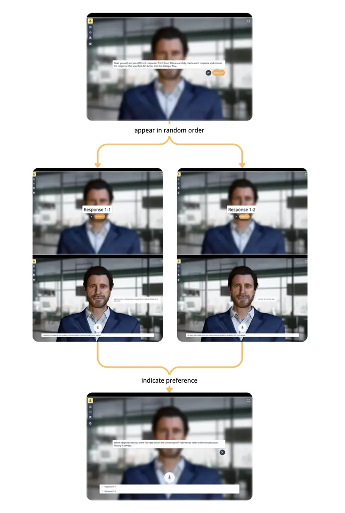

Figure 6: In-simulation pairwise preference indication.

## Appendix E Human Evaluation Results

This section presents the complete statistical results of the LMM
analysis for human-rated quality constructs.

| Construct         | Effect           | $`\beta`$ | $`SE`$ | z-value | p-value |
| ----------------- | ---------------- | --------- | ------ | ------- | ------- |
| Understandable    | Condition        | 0.034     | 0.032  | 1.057   | .291    |
|                   | Turn             | 0.004     | 0.002  | 2.545   | .011    |
|                   | Condition × Turn | -0.005    | 0.002  | -2.022  | .043    |
| Natural           | Condition        | 0.102     | 0.074  | 1.377   | .169    |
|                   | Turn             | 0.016     | 0.004  | 4.267   | \<.001  |
|                   | Condition × Turn | -0.021    | 0.005  | -3.863  | \<.001  |
| Maintains Context | Condition        | 0.095     | 0.074  | 1.292   | .196    |
|                   | Turn             | 0.016     | 0.004  | 4.135   | \<.001  |
|                   | Condition × Turn | -0.020    | 0.005  | -3.706  | \<.001  |
| Interesting       | Condition        | 0.007     | 0.083  | 0.083   | .934    |
|                   | Turn             | 0.022     | 0.004  | 5.250   | \<.001  |
|                   | Condition × Turn | -0.018    | 0.006  | -2.930  | .003    |
| Uses Knowledge    | Condition        | 0.114     | 0.041  | 2.772   | .006    |
|                   | Turn             | 0.012     | 0.002  | 5.449   | \<.001  |
|                   | Condition × Turn | -0.013    | 0.003  | -4.371  | \<.001  |
| Overall Quality   | Condition        | 0.008     | 0.117  | 0.069   | .945    |
|                   | Turn             | 0.027     | 0.006  | 4.446   | \<.001  |
|                   | Condition × Turn | -0.029    | 0.009  | -3.363  | .001    |

Table 5: Full Results of the LMMs for each quality construct. The table
displays the fixed-effect coefficients ($`\beta`$), standard errors
($`SE`$), $`z`$-values, and $`p`$-values for the main effect of
Condition (LLM-generated vs. Human-authored) and the Condition × Turn
interaction.

## Appendix F Automated Evaluation Results

This section supplements human evaluation with LLM-as-a-judge analysis
across two tasks on additional scenarios: construct ratings and pairwise
preference.

### F.1 Task 1: Construct Ratings

This section reports Pearson ($`r_{p}`$) and Spearman ($`r_{s}`$)
correlation coefficients for construct ratings across LLM models,
prompting strategies, and response conditions (see Appendix F.1.1). We
then visualise LLM-predicted ratings on additional scenarios using the
configuration that showed the highest agreement with human judgments in
Appendix F.1.2.

#### F.1.1 Validation

|                                           |                    |                |           |           |           |                   |           |             |           |                |           |                 |           |
| ----------------------------------------- | ------------------ | -------------- | --------- | --------- | --------- | ----------------- | --------- | ----------- | --------- | -------------- | --------- | --------------- | --------- |
|                                           |                    | Understandable |           | Natural   |           | Maintains Context |           | Interesting |           | Uses Knowledge |           | Overall Quality |           |
| Configuration                             | Response Condition | $`r_{p}`$      | $`r_{s}`$ | $`r_{p}`$ | $`r_{s}`$ | $`r_{p}`$         | $`r_{s}`$ | $`r_{p}`$   | $`r_{s}`$ | $`r_{p}`$      | $`r_{s}`$ | $`r_{p}`$       | $`r_{s}`$ |
| Zero-shot (Mistral-7B)                    | General            | 0.098          | 0.082     | 0.230     | 0.165     | 0.398             | 0.367     | 0.308       | 0.343     | 0.024          | 0.055     | 0.308           | 0.230     |
|                                           | LLM-generated      | 0.273          | 0.276     | 0.345     | 0.259     | 0.441             | 0.437     | 0.221       | 0.260     | 0.091          | 0.130     | 0.333           | 0.188     |
|                                           | Human-authored     | -0.164         | -0.208    | 0.144     | 0.195     | 0.364             | 0.339     | 0.248       | 0.284     | -0.081         | -0.024    | 0.204           | 0.260     |
| Zero-shot (Llama 3.1 8B)                  | General            | -0.053         | -0.163    | 0.122     | -0.113    | -0.012            | 0.034     | 0.111       | 0.179     | 0.088          | 0.119     | 0.232           | 0.099     |
|                                           | LLM-generated      | 0.106          | 0.078     | 0.302     | 0.020     | 0.059             | 0.101     | 0.292       | 0.347     | 0.160          | 0.217     | 0.168           | 0.016     |
|                                           | Human-authored     | -0.411         | -0.426    | -0.178    | -0.256    | -0.207            | -0.065    | 0.159       | 0.130     | -0.076         | -0.044    | 0.175           | 0.162     |
| Zero-shot (Phi-3 Medium 14B)              | General            | 0.120          | 0.012     | 0.227     | 0.181     | 0.105             | 0.059     | 0.086       | 0.017     | 0.461          | 0.430     | 0.270           | 0.254     |
|                                           | LLM-generated      | 0.348          | 0.299     | 0.166     | 0.094     | 0.118             | 0.089     | -0.204      | -0.191    | 0.344          | 0.400     | 0.147           | 0.086     |
|                                           | Human-authored     | -0.266         | -0.278    | 0.202     | 0.183     | 0.077             | 0.074     | 0.157       | 0.144     | 0.512          | 0.370     | 0.230           | 0.227     |
| Zero-shot (Gemini 2.0 Flash)              | General            | nan            | nan       | 0.157     | 0.166     | -0.279            | -0.063    | 0.298       | 0.345     | 0.478          | 0.520     | 0.519           | 0.452     |
|                                           | LLM-generated      | nan            | nan       | 0.096     | 0.072     | -0.247            | -0.162    | 0.012       | 0.155     | 0.126          | 0.312     | -0.001          | 0.119     |
|                                           | Human-authored     | nan            | nan       | 0.178     | 0.266     | -0.256            | -0.048    | 0.265       | 0.322     | 0.840          | 0.594     | 0.632           | 0.555     |
| First 3-shot (Gemini 2.0 Flash)           | General            | nan            | nan       | 0.320     | 0.303     | 0.224             | -0.014    | 0.433       | 0.456     | 0.359          | 0.300     | 0.555           | 0.494     |
|                                           | LLM-generated      | nan            | nan       | -0.076    | 0.076     | 0.227             | -0.277    | 0.229       | 0.342     | 0.347          | 0.187     | 0.144           | 0.220     |
|                                           | Human-authored     | nan            | nan       | 0.396     | 0.327     | -0.101            | -0.260    | 0.277       | 0.270     | 0.127          | 0.234     | 0.538           | 0.489     |
| Random Sampling 3-shot (Gemini 2.0 Flash) | General            | nan            | nan       | 0.444     | 0.496     | 0.163             | 0.225     | 0.510       | 0.520     | 0.254          | 0.318     | 0.549           | 0.498     |
|                                           | LLM-generated      | nan            | nan       | 0.081     | 0.254     | -0.229            | -0.252    | 0.213       | 0.166     | 0.206          | 0.262     | 0.281           | 0.259     |
|                                           | Human-authored     | nan            | nan       | 0.592     | 0.566     | 0.391             | 0.370     | 0.425       | 0.560     | 0.283          | 0.353     | 0.562           | 0.506     |
| First 6-shot (Gemini 2.0 Flash)           | General            | nan            | nan       | 0.295     | 0.402     | 0.301             | 0.316     | 0.531       | 0.564     | 0.272          | 0.441     | 0.629           | 0.650     |
|                                           | LLM-generated      | nan            | nan       | -0.128    | 0.063     | -0.168            | -0.313    | 0.258       | 0.291     | -0.024         | -0.039    | 0.358           | 0.376     |
|                                           | Human-authored     | nan            | nan       | 0.362     | 0.365     | 0.169             | 0.257     | 0.234       | 0.317     | 0.221          | 0.346     | 0.466           | 0.421     |
| Random Sampling 6-shot (Gemini 2.0 Flash) | General            | nan            | nan       | 0.406     | 0.442     | 0.233             | 0.252     | 0.482       | 0.576     | 0.211          | 0.418     | 0.659           | 0.682     |
|                                           | LLM-generated      | nan            | nan       | 0.062     | -0.023    | 0.115             | 0.095     | 0.279       | 0.483     | 0.144          | 0.290     | 0.659           | 0.632     |
|                                           | Human-authored     | nan            | nan       | 0.424     | 0.473     | -0.014            | 0.054     | 0.234       | 0.339     | 0.079          | 0.384     | 0.516           | 0.562     |

Table 6: Pearson ($`r_{p}`$) and Spearman ($`r_{s}`$) Correlation
Coefficients by Prompting Strategy, Construct and Response Condition

#### F.1.2 Evaluation

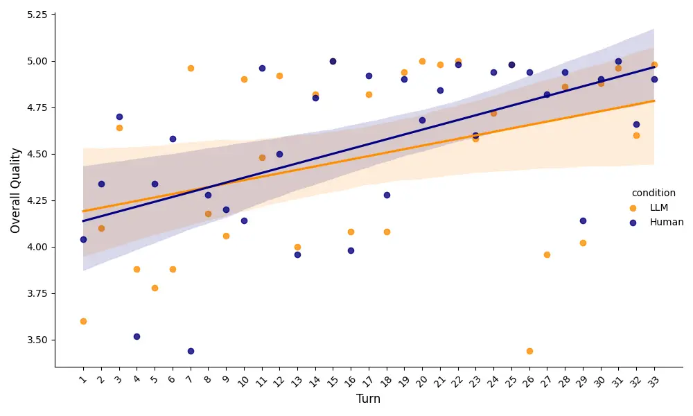

(a) Scenario a: motivational interviewing

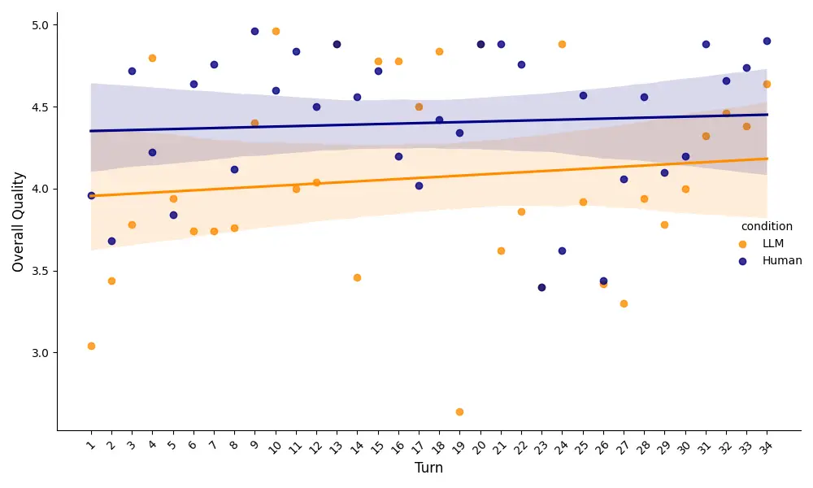

(b) Scenario b: selling

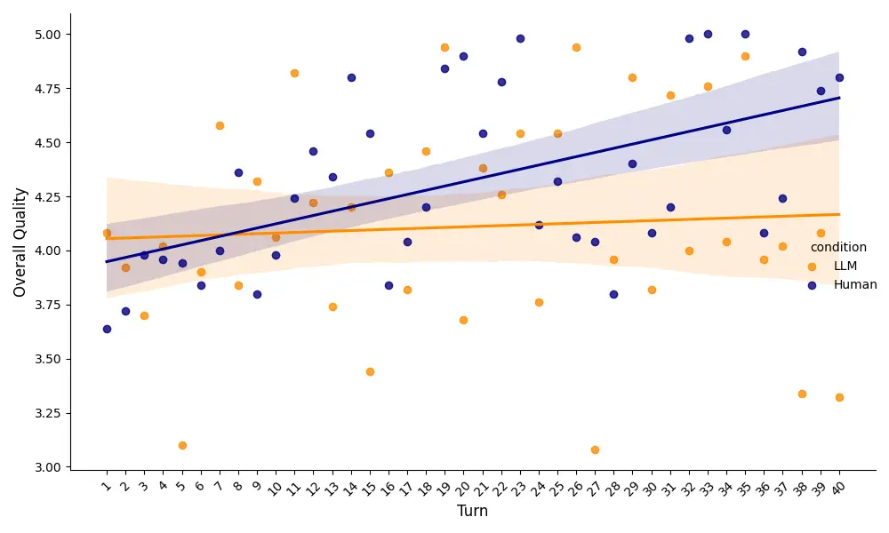

(c) Scenario c: consulting

Figure 7: Mean ratings for LLM-generated (orange) and human-authored
(blue) responses over time. The diverging trend lines visualise the
significant Condition × Turn interaction effect, where the perceived
quality of LLM responses degrades relative to the stable performance of
human responses.

### F.2 Task 2: Pairwise Preferences

This section visualises the turn-by-turn preferences of the Gemini 2.0
Flash model on additional scenarios in zero-shot settings.

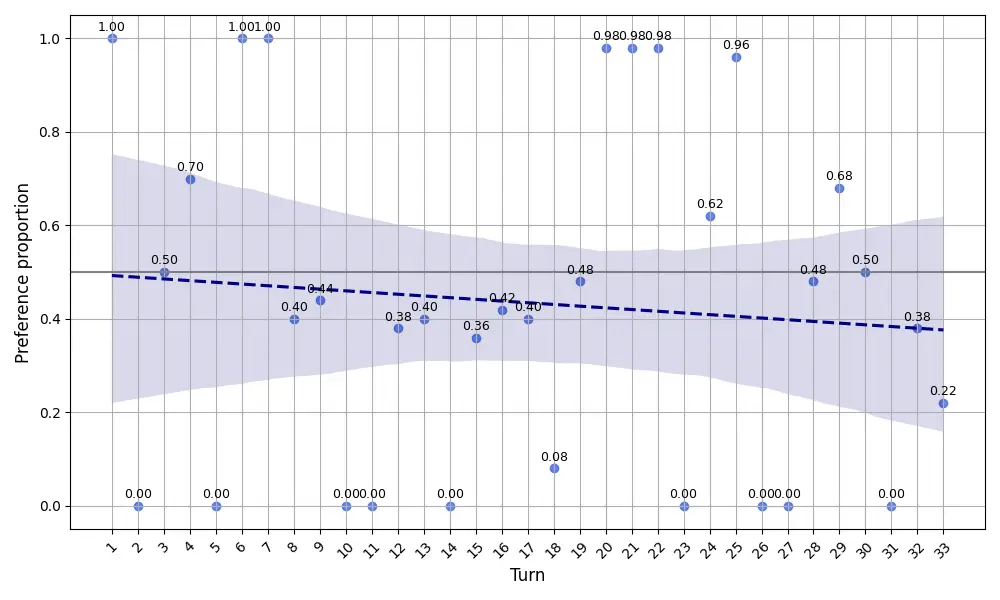

(a) Scenario a: motivational interviewing

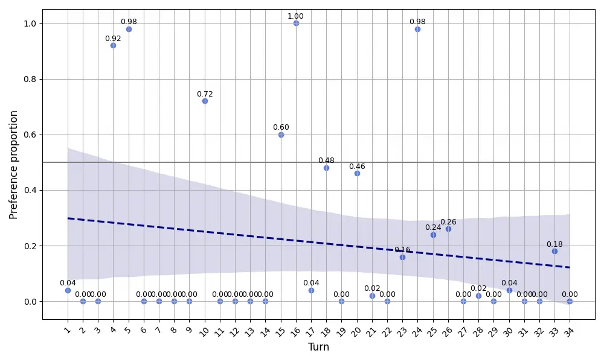

(b) Scenario b: selling

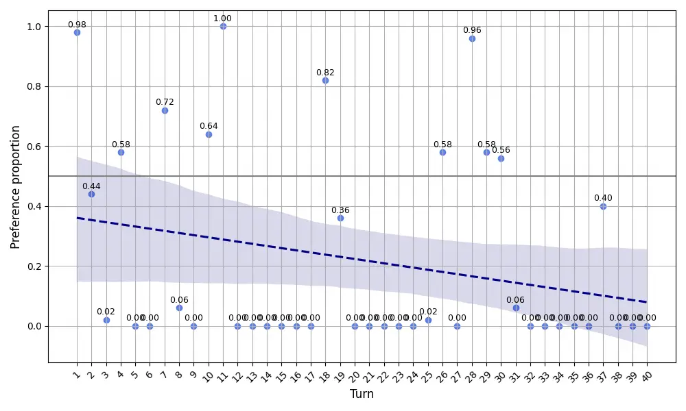

(c) Scenario c: consulting

Figure 8: Proportion of preference for the LLM-generated response over
turns across additional scenarios. Data points represent the preference
proportion at each turn. The OLS trend in dashed line and its shaded 95%
confidence interval illustrate that there was no statistically
significant trend over time ($`p>.05`$), with preferences for the LLM
remaining consistently below the 0.5 threshold.
