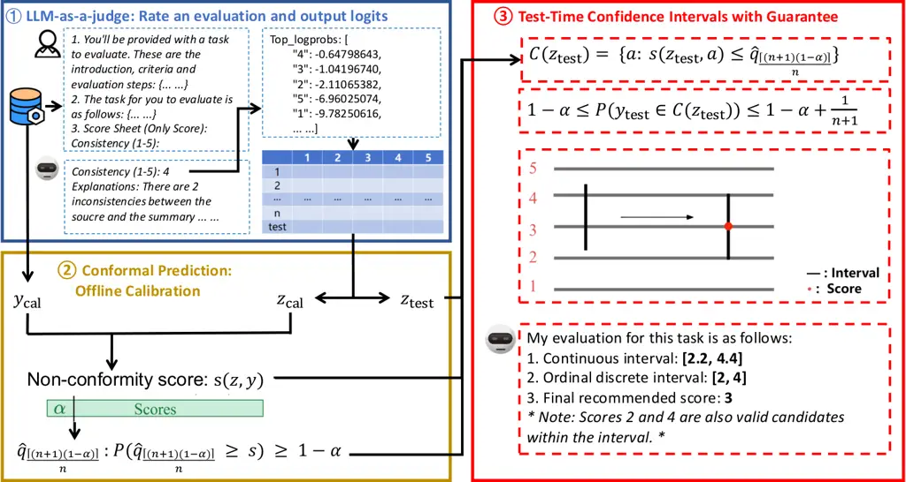
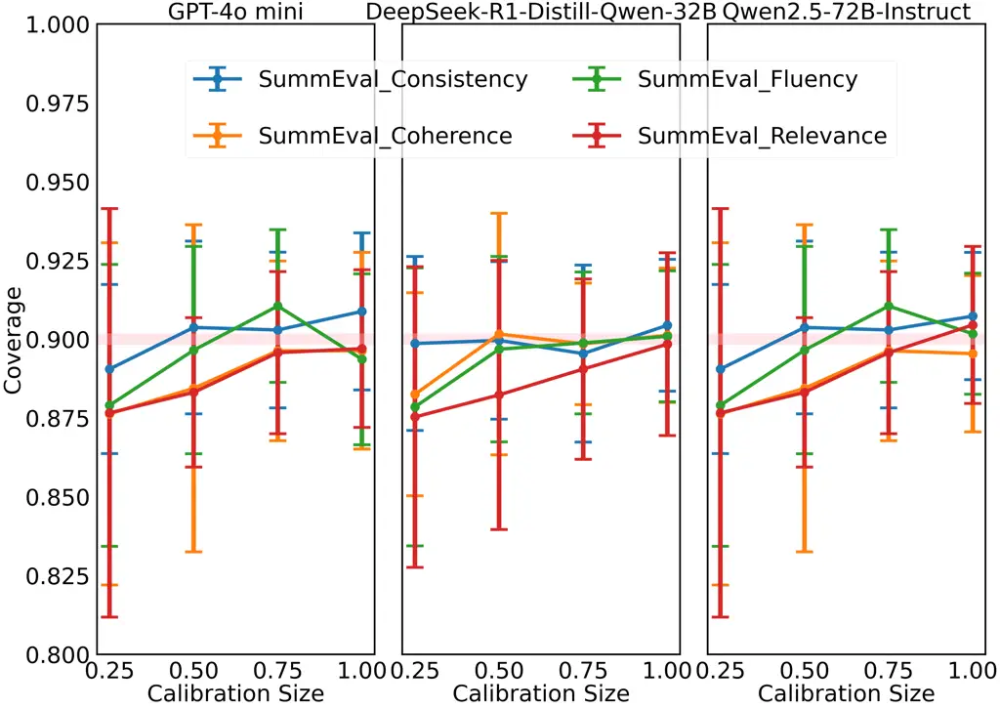
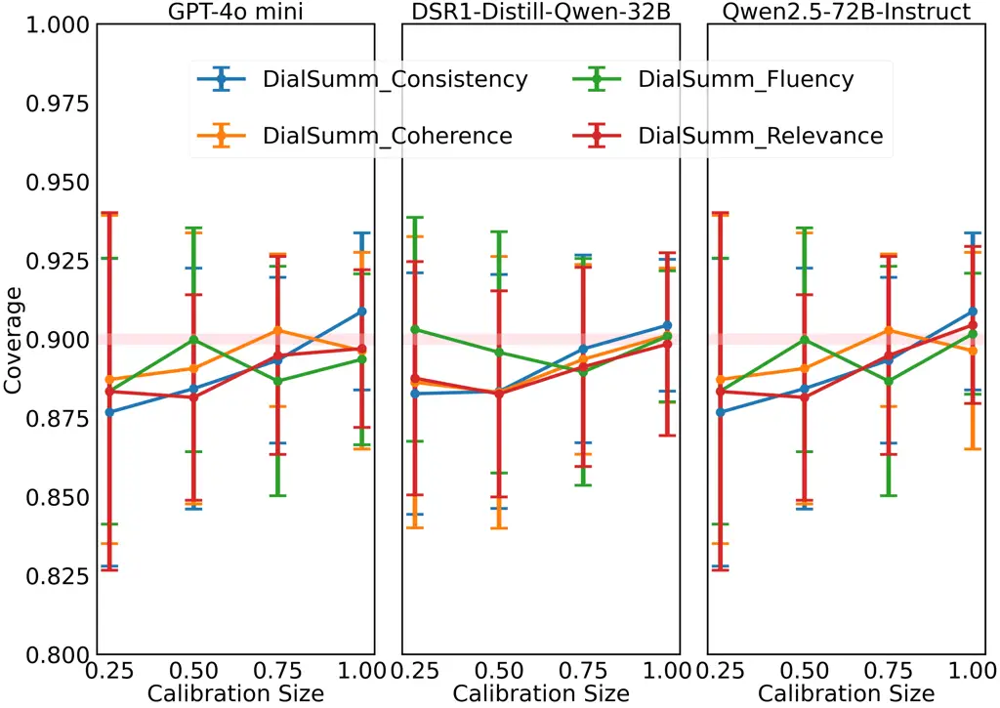
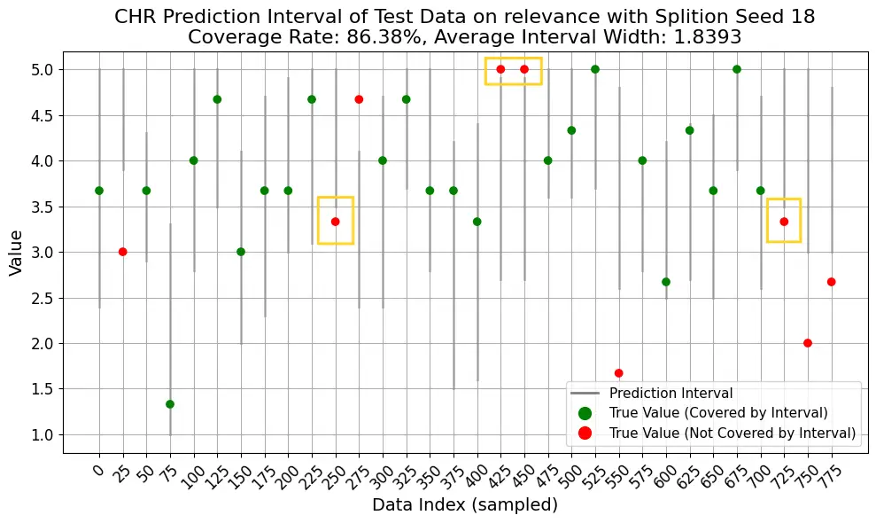
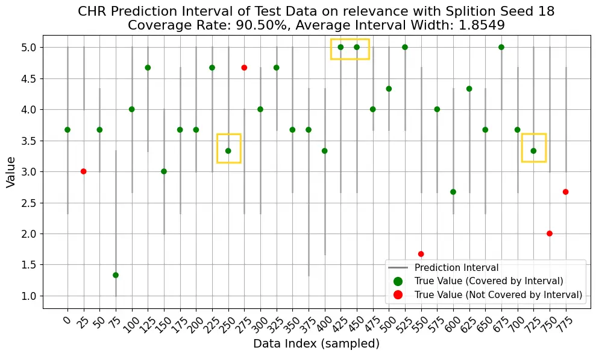
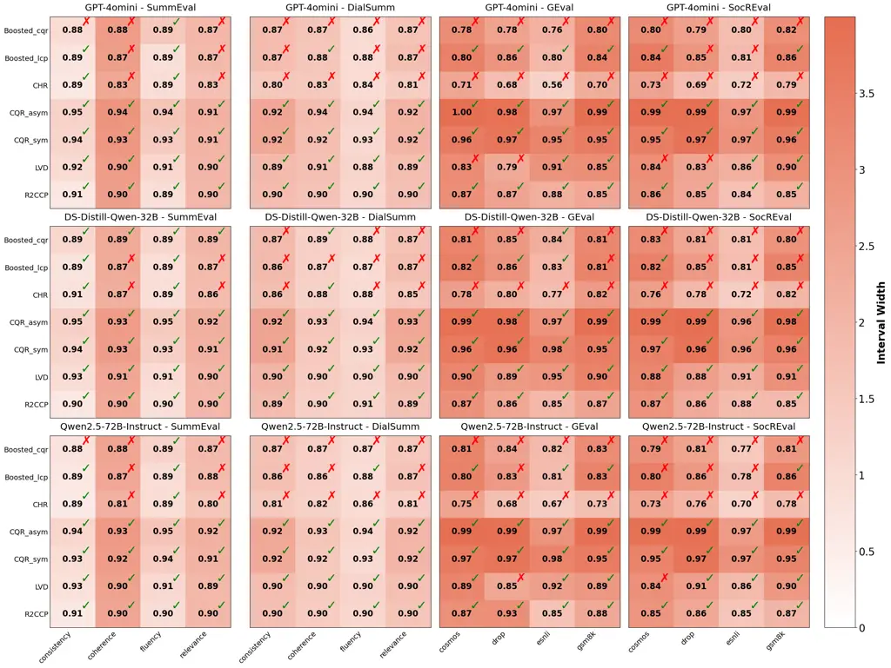

# Analyzing Uncertainty of LLM-as-a-Judge: Interval Evaluations with Conformal Prediction

Huanxin Sheng Affiliation:  University of Rochester
Email: [hsheng2@ur.](mailto:)    Xinyi Liu Affiliation:  University of
Rochester Email: [hangfeng.he@](mailto:)    Hangfeng He Affiliation: 
University of Rochester Email: [xinyu.liu1@simon.rochester.edu](mailto:)
   Jieyu Zhao Affiliation:  University of Southern California
Email: [jieyuz@usc.edu](mailto:)    Jian Kang Affiliation:  University
of Rochester Affiliation:  MBZUAI
Email: [jian.kang@mbzuai.ac.ae](mailto:)

###### Abstract

LLM-as-a-judge has become a promising paradigm for using large language
models (LLMs) to evaluate natural language generation (NLG), but the
uncertainty of its evaluation remains underexplored. This lack of
reliability may limit its deployment in many applications. This work
presents the first framework to analyze the uncertainty by offering a
prediction interval of LLM-based scoring via conformal prediction.
Conformal prediction constructs continuous prediction intervals from a
single evaluation run, and we design an ordinal boundary adjustment for
discrete rating tasks. We also suggest a midpoint-based score within the
interval as a low-bias alternative to raw model score and weighted
average. We perform extensive experiments and analysis, which show that
conformal prediction can provide valid prediction interval with coverage
guarantees. We also explore the usefulness of interval midpoint and
judge reprompting for better judgment. ¹¹ 1 Our code and data are
available at  
[https://github.com/BruceSheng1202/Analyzing_Uncertainty_of_LLM-as-a-Judge](https://github.com/BruceSheng1202/Analyzing_Uncertainty_of_LLM-as-a-Judge)

## 1 Introduction

Large language models (LLMs) have become powerful automatic evaluators
for natural language generation (NLG) tasks, known as LLM-as-a-judge.
Its consistency with human judgments results in strong performance with
respect to metrics like ROUGE (Lin, 2004), BLEU (Papineni et al., 2002),
and BERTScore (Zhang et al., 2020). Besides, LLM judges can flexibly
adapt to diverse evaluation criteria and provide scalable,
cost-effective assessments compared to expert annotation (Gao et al.,
2024; Gu et al., 2025). These advantages make the LLM-as-a-judge useful
in various scenarios, such as clinical radiology (Chaves et al., 2024),
rumor detection (Hong et al., 2025), cyberattack detection (Yong et al., 2025) and wildlife trafficking identification (Barbosa et al., 2025).

However, a single evaluation from a LLM judge might be biased (Wu and
Aji, 2023; Li et al., 2024c) and uncertain due to inherent
randomness (Schroeder and Wood-Doughty, 2024), thus undermining its
reliability in scenarios like healthcare (Chung et al., 2025) and
finance (Kamble et al., 2025). Though a LLM judge can express its
confidence with well-designed prompt or via fine-tuning (Xu et al.,
2024a; Liu et al., 2024; Taubenfeld et al., 2025), it may still suffer
from overconfidence (Xiong et al., 2024) or dishonesty (Li et al.,
2024e). We ask: How can a LLM judge provide reliable evaluation given
the user request?

Conformal prediction (Vovk et al., 2005) is a promising way to quantify
the uncertainty of an LLM judge (Ye et al., 2024). It outputs a
prediction interval (or set for classification) to a model output with
three key advantages. First, conformal prediction is a distribution-free
uncertainty quantification method, which is suitable for black-box
models like LLMs due to unknown input data distribution for most (if not
all) LLMs. Second, it can provide post-hoc uncertainty quantification
using only a calibration step based on LLM outputs. Third, the
prediction interval given by conformal prediction enjoys statistically
guaranteed coverage, i.e., how likely the ground truth falls within the
interval, as long as the data is exchangeable.

In this paper, we comprehensively evaluate nine²² 2 Seven
regression-type and two ordinal-type methods. conformal prediction
methods in quantifying the uncertainty of a LLM judge in rating-based
evaluation tasks, each of which constructs a prediction interval for a
rating output by the LLM judge. For each conformal prediction method, we
evaluate its efficiency (i.e., average width of prediction intervals)
and coverage (i.e., the probability that ground truths fall within
prediction intervals). Furthermore, to adapt to the ordinal and discrete
nature in organic rating-based evaluation, we propose boundary
adjustment that adjusts the endpoints of prediction interval to be
aligned with the rating scales. We prove that the boundary adjustment
yields an interval suitable to the ordinal setting with provable
non-decreasing coverage. From our comprehensive analysis, we demonstrate
that the quality of prediction interval attributes to design choices of
the LLM judge (e.g., which LLM to use as the judge, which prompting
strategy for evaluation) as well as the size of calibration data during
calibration. Finally, we show that the midpoint of the prediction
interval provides better estimate to the ground truth to further assist
better decision-making, while reprompting the LLM judge with prediction
interval might not improve the judgement. Our analysis advocate for a
shift from direct scoring to uncertainty-aware evaluations, offering
references for more reliable evaluation and better decision-making.

In summary, our contributions are

- •
  To our knowledge, we are the first to analyze the uncertainty of
  LLM-as-a-judge using conformal prediction in rating-based evaluation.
- •
  We design boundary adjustment to improve the efficiency empirically
  without compromising the coverage. The interval midpoints suggest
  better alignment to human evaluation.
- •
  We analyze factors affecting the interval quality, including the
  LLM-as-a-judge framework itself, the choice of LLM in the framework,
  and the size of calibration in conformal prediction, and offer
  practical insights or recommended choices.

## 2 Related Work

#### Uncertainty Quantification for LLM-as-a-Judge.

Uncertainty quantification for LLM-as-a-judge is an important yet less
explored area. Wagner et al. (2024) prompt the judge to justify each
rating option as if it were correct and then construct a confusion
matrix from token-level probabilities of these assessments to derive
confidence scores. Xie et al. (2025) use token probabilities to estimate
the confidence of judgments, and demonstrate that such measures exhibit
bias and instability through extensive experiments. Similar conclusions
are also found when applying other two common paradigms: (1) prompting
LLMs to self-report confidence (Yona et al., 2024; Xu et al., 2024a),
which can suffer from overconfidence (Xiong et al., 2024) or
dishonesty (Li et al., 2024e), and (2) consistency-based approaches that
rely on multiple generations (Tian et al., 2023; Xiong et al., 2024),
which, like the confusion matrix-based method, are computationally
expensive. To our best knowledge, Jung et al. (2024) is the most
relevant work to us, which applies conformalized risk
control (Angelopoulos et al., 2022b) to ensure agreement with human
preferences in pairwise response comparison (Zhou et al., 2024; Li
et al., 2024b; Li et al., 2024d; Zhang et al., 2025; van den Burg
et al., 2025). In contrast, we focus on using conformal prediction to
quantify uncertainty in rating tasks instead of pairwise preference
modeling.

#### Conformal Prediction for LLMs.

Conformal prediction (Vovk et al., 2005) has drawn interest for
uncertainty quantification in LLMs (Ye et al., 2024; Campos et al.,
2024a) due to its distribution-free and post-hoc nature with provable
statistical guarantee. Owing to these advantages, recent works primarily
apply conformal prediction to classification tasks, such as
multiple-choice question answering (Kumar et al., 2023; Zhang et al.,
2024; Su et al., 2024; Vishwakarma et al., 2025) and response selection
for factual consistency (Quach et al., 2024; Mohri and Hashimoto, 2024;
Wang et al., 2024; Kladny et al., 2025). These studies typically focus
on ensuring that the correct answer is included in a unordered
prediction set. Different from these works, we focus on providing
prediction intervals that reflect the variability in LLM judgments in
rating tasks, which has ordinal preference.

## 3 Analyzing Uncertainty of LLM Judges



Figure 1: Overview of quantifying the uncertainty in rating-based
evaluation. We apply conformal prediction to construct the prediction
interval and set the width of the prediction interval as the
uncertainty.

### 3.1 Preliminaries

#### LLM-as-a-Judge.

LLMs have been widely adopted as evaluators to score NLG tasks recently,
known as LLM-as-a-judge. It commonly yields a predicted score $`y_{0}`$
on a Likert scale (Nemoto and Beglar, 2014). Following G-Eval (Liu
et al., 2023), given a prompt $`p`$ and a generated text $`x`$ to be
evaluated, an LLM judge $`M`$ is expected to produce a response

```math
M(p,x)=(z,y_{0}), \tag{1}
```

where $`z`$ is the token logits, and $`y_{0}`$ is a scalar score in a
predefined scale, indicating the quality of generated text given by LLM
judge. For rating-based evaluations, we extract the logits of certain
tokens (e.g., $`1`$, $`2`$, $`3`$, $`4`$, $`5`$ if in a Likert scale) at
the position of the rating token only. There are also other evaluation
paradigms that a rating judge can help with (Gu et al., 2025), such as
pairwise comparison or ranking, in which candidate outputs are first
scored by the LLM judge and then compared or ordered based on those
scores (Wang et al., 2025; Wei et al., 2025).

#### Conformal Prediction.

Conformal prediction (Vovk et al., 2005) is a model-agnostic uncertainty
quantification method. It constructs a prediction interval (or a
prediction set for classification) with coverage guarantee, i.e., how
likely the ground truth will fall within the prediction interval/set.
Two notable advantages of conformal prediction are its post-hoc nature,
i.e., free of training or prompting the judge model, and
distribution-free nature, i.e., without requiring knowledge about
underlying data distribution. In our work, we adopt split conformal
prediction (Vovk et al., 2005), which quantifies the uncertainty with a
held-out calibration set. A non-conformity score function $`s(z,y)`$ is
computed for each point in the calibration set, to measure how “unusual”
a prediction $`\hat{y}`$ is to a ground truth $`y`$. For regression
tasks, the non-conformity score is often defined as

```math
s(z,y)=|\hat{y}-y|. \tag{2}
```

where $`\hat{y}=f(z)`$ is a score predicted from the input $`z`$ using a
function $`f`$. Then, given a user-desired miscoverage rate $`\alpha`$,
the
$`\frac{\lceil\left(n+1\right)\left(1-\alpha\right)\rceil}{n}`$-quantile
$`\hat{q}`$ of these scores can be used to construct the prediction
interval $`\mathcal{C}\left(z_{\rm test},\hat{y}_{\rm test}\right)`$ for
the prediction $`\hat{y}_{\rm test}`$ of any test point $`z_{\rm test}`$
as

```math
\mathcal{C}\left(z_{\rm test},\hat{y}_{\rm test}\right)=[\hat{y}_{\rm test}-\hat{q},\ \hat{y}_{\rm test}+\hat{q}], \tag{3}
```

or equivalently

```math
\mathcal{C}\left(z_{\rm test},\hat{y}_{\rm test}\right)=\left\{a:s\left(z_{\rm test},a\right)\leq\hat{q}\right\}. \tag{4}
```

Statistically, it is proven that such a prediction interval enjoys the
following coverage guarantee (Angelopoulos and Bates, 2022)

```math
1-\alpha\leq\mathbb{P}\left(y_{\rm test}\in\mathcal{C}\left(z_{\rm test},\hat{y}_{\rm test}\right)\right)\leq 1-\alpha+\frac{1}{n+1}, \tag{5}
```

as long as the calibration set and test set are exchangeable, i.e., the
joint distribution remain the same after any permutations on these two
sets.

### 3.2 From Logits to Intervals

In this paper, we focus on quantifying the uncertainty of LLM-as-a-judge
using conformal prediction in discrete rating-based evaluations (e.g.,
in Likert scale). An overview of the workflow is presented in Figure 1.

#### Extract Logits as Feature.

Our framework mainly targets for uncertainty estimation in a discrete,
Likert-scale (1 – 5) rating-based evaluation. An example of such
rating-based evaluation is given in Figure 1. Specifically, an LLM
judge, prompted with a chain-of-thought (CoT) instruction that specifies
an output format, generates a response containing its rating. Prompts
that we used are listed in Appendix A.13)

To obtain the
$`\frac{\lceil\left(n+1\right)\left(1-\alpha\right)\rceil}{n}`$-quantile
of the non-conformity scores of the ratings, we extract the token logits
corresponding to Likert-scale scores as features for quantile
estimation. However, LLMs may not always respond in a fixed format,
making extraction of the rating token logit challenging. Thus, we resort
to a rule-based strategy to locate the rating token at the most frequent
position of the rating. After locating the rating token (e.g., $`4`$ in
Figure 1), we extract the log probabilities of all potential rating
tokens (e.g., 1 – 5). Additionally, to ensure semantic consistency, we
aggregate the probabilities of tokens with equivalent meanings (e.g.,
“two” vs. 2). As a result, we obtain a $`K`$-dimensional feature vector
$`z`$ representing the logits associated with each candidate rating
token in $`\left\{1,2,\dots,K\right\}`$³³ 3 We use $`K=5`$ for the
standard Likert scale or GPA-like settings, but $`K`$ can be adapted to
other granularities (e.g., $`10`$) depending on the scale. as the input
for conformal prediction $`\left(z,y\right)`$. Here we assume the logits
for each prompt-text sample to be exchangeable, following prior
works (Kumar et al., 2023; Su et al., 2024; Quach et al., 2024).

#### Prediction Interval Estimation.

To date, there has been a variety of conformal prediction
methods (Angelopoulos and Bates, 2022; Fontana et al., 2023; Campos
et al., 2024b). In our analysis, we choose a diverse set of nine
conformal prediction methods that construct prediction interval rather
than prediction set. Moreover, we observe that token logits exhibit
strong heteroscedasticity (see more analysis in Appendix A.2). Thus, we
include conformalized quantile regression (CQR) (Romano et al., 2019)
and its variants, including asymmetric CQR, CHR (Sesia and Romano, 2021)
that uses histogram-based quantile estimator, LVD (Lin et al., 2021)
that uses kernel regression based quantile estimator, two boosted
conformal prediction methods (Xie et al., 2024) (i.e., Boosted CQR and
Boosted LCP) and R2CCP (Guha et al., 2024). Other than the
regression-based approaches, rating-based evaluation can also be viewed
as a ordinal classification task due to the ordinal nature of ratings.
Thus, we also consider two conformal prediction methods designed for
ordinal classification, namely Ordinal APS (Lu et al., 2022) and Ordinal
Risk Control (Xu et al., 2024b). More details about these methods,
including non-conformity score computation, interval construction and
implementation details, are discussed in Appendix A.3. Note that, for
ordinal classification-based conformal prediction methods, we view the
token probabilities (i.e., token logits followed by a softmax operation)
as a proxy of classification probabilities that classify the prompt and
texts to be evaluated into the corresponding rating label. Consequently,
we use token probabilities as input. However, token probabilities are
well known to have multicollinearity, which makes them unsuitable for
regression-based approaches. Thus, we only use token probabilities as
the input for ordinal classification-based approaches, while use token
logits directly for regression-based approaches.

### 3.3 Boundary Adjustment

Due to the ordinal and discrete nature of ratings, a continuous interval
whose upper and lower bounds are continuous numeric values might not
have exact meaning. Thus, we further apply a boundary adjustment
strategy to transform the continuous interval to an ordinal interval
whose upper and lower bounds align with the potential rating labels.

Specifically, boundary adjustment is essentially redefining the
non-conformity score function as

```math
s^{\prime}(z,y)=s(z,y^{\prime})=\begin{cases}s(z,\lceil y\rceil)&\text{if}\ y\leq\lfloor\hat{y}\rfloor,\\
s(z,y)&\text{otherwise,}\\
s(z,\lfloor y\rfloor)&\text{if}\ y\geq\lceil\hat{y}\rceil.\\
\end{cases} \tag{6}
```

Because all potential labels $`y^{\prime}`$ are integers in rating
evaluation, this new function ensures that the scores are consistent on
calibration set. However, when constructing the prediction interval , it
will transform the interval $`\mathcal{C}(z_{\rm test})`$ in
Equation (4) to

```math
\{a:s^{\prime}(z_{\rm test},a)\leq\hat{q}\}=\left[l,u\right]\rightarrow\left[l^{\prime},u^{\prime}\right], \tag{7}
```

where $`l^{\prime}=\lceil l\rceil`$ and $`u^{\prime}=\lfloor u\rfloor`$.

We shrink the boundaries to integer labels closest to the original
continuous-valued boundaries by cutting excessive areas, because the
excessive areas cover no potential labels. Thus, this shrinking
adjustment will have no influence to its coverage. On the other hand, we
can also expand an interval to mitigate the marginal miscoverage of the
ground-truth labels or limited calibration size. For example, assuming
the interval $`[2.2,3.9]`$ only covers one possible rating $`3`$ but can
be expanded to $`[2,4]`$, a miscoverage can be avoided if the ground
truth is either $`2`$ or $`4`$.

Theorem 1 shows the non-decreasing coverage after boundary adjustment.
We defer its proof to Appendix A.1.

###### Theorem 1 (Non-decreasing Coverage After Boundary Adjustment).

Based on coverage guarantee in Equation (5), we transform the
non-conformity score function $`s(z,y)`$ by Equation (6) and adjust an
continuous interval by Equation (7). Then, if the adjustment is
performed by shrinking (i.e., $`l^{\prime}=\lceil l\rceil`$,
$`u^{\prime}=\lfloor u\rfloor`$, and
$`\mathcal{C}^{\prime}\left(z_{\rm test}\right)=[l^{\prime},u^{\prime}]`$),
the coverage preserves:

```math
\mathbb{P}\left(Y_{\rm test}\in\mathcal{C}^{\prime}\left(z_{\rm test}\right)\right)\geq 1-\alpha. \tag{8}
```

If at least one boundary is expanded (i.e.,
$`l^{\prime}=\lfloor l\rfloor`$ or $`u^{\prime}=\lceil u\rceil`$), the
coverage increases:

```math
\mathbb{P}\left(Y_{\rm test}\in\mathcal{C}^{\prime}(z_{\rm test})\right)>1-\alpha. \tag{9}
```

Though we assume all ratings are integers in Equation (6), ratings with
discrete granularities can all be applicable. For example, GPA-scale
scores can be mapped to a 1–13 Likert scale by linear transformation
(e.g. $`1.33\times 3-2`$). Then a boundary adjustment from $`[4.6,4.9]`$
to $`[4.67,5]`$ is equivalent to rounding $`[11.8,12.7]`$ to
$`[12,13]`$.

### 3.4 Midpoints as Calibrated Scores

To make better use of the prediction interval for decision making, we
seek to obtain a more accurate estimate of ground truth from the
interval. One simple and intuitive way is to use the midpoint of the
prediction interval as an alternative estimate. Due to the unknown
distribution of the ground truth rating in a prediction interval,
selecting the midpoint has several benefits. If the distribution can be
naively assumed to be uniform or at least symmetric, the midpoint would
be the best linear unbiased estimator of the true label. Even if biased,
the midpoint is still the minimum-variance estimator of the ground truth
rating given the interval. More intuitively, midpoint is a score
evaluated in a shorter interval (i.e., the prediction interval) rather
than the entire range of rating, thus should be more accurate than the
primitive score given by the LLM judge.

## 4 Experiments

### 4.1 Experimental Setting

#### Datasets.

We run experiments on evaluation benchmarks in text summarization,
dialogue summarization and reasoning. For summarization, we use
SummEval (Fabbri et al., 2021) (1,600 samples) and DialSumm (Gao and
Wan, 2022) (1,400 samples), each annotated by three human raters using
Likert-scale scores across four dimensions (i.e., consistency,
coherence, fluency, relevance). The average of the three ratings is used
as the ground-truth label on GPA scale. For reasoning, we use the
annotations of overall quality on Likert scale for CosmosQA (Li et al.,
2023), DROP (Dua et al., 2019), e-SNLI (Camburu et al., 2018) and
GSM8K (Cobbe et al., 2021) in ROSCOE (Golovneva et al., 2023), each with
around 200 samples on Likert scale.

#### LLM-based Evaluation.

We primarily adopt G-Eval (Liu et al., 2023) as our judge framework with
a chain-of-thought (CoT) prompt. For reasoning tasks, we additionally
use SocREval (He et al., 2024). We provide the prompts used for
experiments in Appendix A.13. Evaluations are mainly conducted using
GPT-4o mini (2024-07-18), DeepSeek-R1-Distill-Qwen-32B (DeepSeek-AI
et al., 2025) and Qwen2.5-72B-Instruct (Qwen et al., 2025) as LLM
judges, all of which provide token-level logits. Though we choose these
LLMs mainly due to budget constraints and limitations on computing
resources, all selected LLMs are widely used and show strong performance
in both summarization and reasoning tasks. In Appendix A.5, we provide
more detailed justifications on the judge model selection and the
comparison between GPT-4o mini and its larger variant GPT-4o in text
summarization.

| Method                       | SummEval Evaluated with G-Eval |                        |                        |                        | ROSCOE Evaluated with SocREval |                        |                        |                        |
| ---------------------------- | ------------------------------ | ---------------------- | ---------------------- | ---------------------- | ------------------------------ | ---------------------- | ---------------------- | ---------------------- |
|                              | Consistency                    | Coherence              | Fluency                | Relevance              | CosmosQA                       | DROP                   | e-SNLI                 | GSM8K                  |
| GPT-4o mini                  |                                |                        |                        |                        |                                |                        |                        |                        |
| CQR                          | $`1.15`$ / $`94.16\%`$         | 2.87 / 93.15%          | $`1.44`$ / $`92.92\%`$ | 2.09 / 90.92%          | 3.53 / 95.27%                  | 3.82$`/`$96.70%        | $`3.04`$ / $`96.62\%`$ | 3.53 / 95.67%          |
| Asym CQR                     | $`1.25`$ / $`94.97\%`$         | $`2.91`$ / $`93.76\%`$ | $`1.60`$ / $`93.75\%`$ | $`2.13`$ / $`91.42\%`$ | $`3.90`$ / $`98.71\%`$         | $`3.91`$ / $`98.60\%`$ | 2.87/ 96.67%           | $`3.89`$ / $`98.80\%`$ |
| CHR                          | $`0.67`$ / $`88.99\%`$         | $`2.41`$ / $`82.96\%`$ | $`0.94`$ / $`88.86\%`$ | $`1.74`$ / $`82.62\%`$ | $`2.54`$ / $`73.06\%`$         | $`1.86`$ / $`68.92\%`$ | $`1.36`$ / $`72.24\%`$ | $`1.98`$ / $`78.67\%`$ |
| LVD                          | $`1.01`$ / $`92.35\%`$         | $`2.73`$ / $`89.76\%`$ | 1.11 / 90.59%          | $`2.02`$ / $`89.55\%`$ | $`3.10`$ / $`83.95\%`$         | $`2.49`$ / $`83.05\%`$ | $`2.17`$ / $`86.18\%`$ | $`3.08`$ / $`89.57\%`$ |
| Boosted CQR                  | $`1.01`$ / $`87.75\%`$         | $`2.73`$ / $`87.80\%`$ | $`1.54`$ / $`88.68\%`$ | $`2.00`$ / $`87.42\%`$ | $`3.15`$ / $`80.07\%`$         | $`2.63`$ / $`78.57\%`$ | $`1.82`$ / $`80.26\%`$ | $`3.08`$ / $`82.50\%`$ |
| Boosted LCP                  | $`0.76`$ / $`89.22\%`$         | $`2.67`$ / $`87.34\%`$ | $`0.92`$ / $`89.18\%`$ | $`1.91`$ / $`87.19\%`$ | $`3.60`$ / $`83.91\%`$         | $`2.92`$ / $`85.40\%`$ | $`1.88`$ / $`81.23\%`$ | $`3.36`$ / $`85.93\%`$ |
| R2CCP                        | 0.69 / 90.88%                  | $`2.62`$ / $`89.63\%`$ | $`0.92`$ / $`89.36\%`$ | $`1.97`$ / $`89.70\%`$ | $`2.96`$ / $`85.85\%`$         | $`2.43`$ / $`84.73\%`$ | $`1.75`$ / $`84.02\%`$ | $`2.15`$ / $`85.07\%`$ |
| DeepSeek-R1-Distill-Qwen-32B |                                |                        |                        |                        |                                |                        |                        |                        |
| CQR                          | $`1.16`$ / $`93.88\%`$         | $`2.67`$ / $`92.50\%`$ | $`1.31`$ / $`93.01\%`$ | $`2.13`$ / $`91.05\%`$ | 3.48 / 96.70%                  | 3.83 / 96.35%          | $`2.97`$ / $`96.36\%`$ | $`3.46`$ / $`95.60\%`$ |
| Asym CQR                     | $`1.30`$ / $`95.13\%`$         | $`2.72`$ / $`92.86\%`$ | $`1.49`$ / $`94.52\%`$ | $`2.21`$ / $`92.06\%`$ | $`3.84`$ / $`99.08\%`$         | $`3.95`$ / $`99.27\%`$ | $`2.86`$ / $`96.05\%`$ | $`3.85`$ / $`98.43\%`$ |
| CHR                          | $`0.82`$ / $`91.17\%`$         | $`2.23`$ / $`87.07\%`$ | $`0.90`$ / $`89.24\%`$ | $`1.87`$ / $`86.38\%`$ | $`2.66`$ / $`76.50\%`$         | $`1.95`$ / $`78.06\%`$ | $`1.38`$ / $`71.97\%`$ | $`2.01`$ / $`81.60\%`$ |
| LVD                          | $`0.97`$ / $`92.93\%`$         | $`2.43`$ / $`91.10\%`$ | $`1.00`$ / $`91.10\%`$ | 2.04 / 90.14%          | $`3.25`$ / $`88.10\%`$         | $`2.62`$ / $`88.06\%`$ | 2.24 / 90.96%          | 3.02$`/`$90.63%        |
| Boosted CQR                  | $`1.10`$ / $`89.30\%`$         | $`2.36`$ / $`88.98\%`$ | $`1.16`$ / $`89.46\%`$ | $`2.00`$ / $`88.98\%`$ | $`3.17`$ / $`82.72\%`$         | $`2.47`$ / $`81.11\%`$ | $`1.79`$ / $`80.96\%`$ | $`2.94`$ / $`79.83\%`$ |
| Boosted LCP                  | $`0.77`$ / $`89.20\%`$         | $`2.32`$ / $`86.70\%`$ | $`0.93`$ / $`89.10\%`$ | $`1.91`$ / $`86.89\%`$ | $`3.48`$ / $`81.60\%`$         | $`2.79`$ / $`85.46\%`$ | $`1.84`$ / $`80.61\%`$ | $`3.43`$ / $`85.23\%`$ |
| R2CCP                        | 0.69 / 90.44%                  | 2.30 / 90.12%          | 0.89 / 90.09%          | $`2.00`$ / $`89.84\%`$ | $`2.94`$ / $`86.97\%`$         | $`2.29`$ / $`86.35\%`$ | $`1.85`$ / $`87.87\%`$ | $`1.88`$ / $`85.33\%`$ |
| Qwen2.5-72B-Instruct         |                                |                        |                        |                        |                                |                        |                        |                        |
| CQR                          | $`0.98`$ / $`93.10\%`$         | $`2.73`$ / $`92.25\%`$ | $`1.44`$ / $`93.73\%`$ | $`2.11`$ / $`91.30\%`$ | 3.37 / 94.80%                  | $`3.79`$ / $`97.02\%`$ | $`3.01`$ / $`97.37\%`$ | $`3.35`$ / $`95.33\%`$ |
| Asym CQR                     | $`1.11`$ / $`94.47\%`$         | $`2.80`$ / $`93.13\%`$ | $`1.63`$ / $`94.79\%`$ | $`2.17`$ / $`92.21\%`$ | $`3.86`$ / $`99.01\%`$         | $`3.89`$ / $`98.67\%`$ | 2.77 / 96.84%          | $`3.87`$ / $`98.97\%`$ |
| CHR                          | $`0.61`$ / $`89.04\%`$         | $`2.14`$ / $`80.93\%`$ | $`0.98`$ / $`88.93\%`$ | $`1.61`$ / $`79.61\%`$ | $`2.44`$ / $`72.65\%`$         | $`2.08`$ / $`75.87\%`$ | $`1.22`$ / $`69.69\%`$ | $`1.81`$ / $`77.50\%`$ |
| LVD                          | $`0.85`$ / $`92.82\%`$         | $`2.55`$ / $`90.49\%`$ | $`1.09`$ / $`90.94\%`$ | $`1.94`$ / $`89.27\%`$ | $`3.05`$ / $`84.29\%`$         | 2.67 / 90.57%          | $`1.91`$ / $`85.96\%`$ | 2.83/ 90.13%           |
| Boosted CQR                  | $`0.80`$ / $`88.28\%`$         | $`2.46`$ / $`87.82\%`$ | $`1.24`$ / $`89.22\%`$ | $`1.88`$ / $`87.17\%`$ | $`3.05`$ / $`79.08\%`$         | $`2.56`$ / $`81.17\%`$ | $`1.51`$ / $`77.11\%`$ | $`2.81`$ / $`80.67\%`$ |
| Boosted LCP                  | $`0.67`$ / $`88.81\%`$         | $`2.43`$ / $`86.92\%`$ | $`0.94`$ / $`89.26\%`$ | $`1.86`$ / $`87.51\%`$ | $`3.46`$ / $`80.41\%`$         | $`2.81`$ / $`85.75\%`$ | $`1.74`$ / $`77.50\%`$ | $`3.38`$ / $`86.23\%`$ |
| R2CCP                        | 0.61 / 90.73%                  | $`2.44`$ / $`89.54\%`$ | 0.95 / 90.18%          | 1.98 / 90.45%          | $`2.90`$ / $`85.34\%`$         | $`2.39`$ / $`86.25\%`$ | $`1.59`$ / $`84.50\%`$ | $`2.00`$ / $`86.73\%`$ |

Table 1: Interval width and coverage on SummEval evaluated by G-Eval and
ROSCOE evaluated by SocREval before boundary adjustment. We mark
coverage $`<85\%`$ with gray text, coverage between 85% – 90% with
underline and coverage with the smallest interval width $`\geq 90\%`$ in
bold.

#### Conformal Prediction Methods.

In our experiments, we compare seven regression-based conformal
prediction methods and two ordinal classification-based methods. For
regression-based approaches, we use CQR (Romano et al., 2019),
Asymmetric CQR (Sesia and Candès, 2019), CHR (Sesia and Romano, 2021),
LVD (Lin et al., 2021), and two boosted methods (Xie et al., 2024)
namely Boosted CQR and Boosted LCP; for ordinal classification-based
methods, we consider Ordinal APS (Lu et al., 2022) and Ordinal Risk
Control (Xu et al., 2024b). Ordinal classification-based methods are
only evaluated after boundary adjustment. More introduction of each
method is provided in Appendix A.3. For each method, we split of dataset
into 50% calibration set and 50% test set with 30 random seeds (1 – 30)
and report the mean of interval width and coverage rate.

### 4.2 Continuous Intervals Indicate Uncertainty

Table 1 presents the interval width and coverage rate for each conformal
prediction methods on SummEval evaluated by G-Eval and on ROSCOE
evaluted SocREval. Additional results on DialSumm are presented in
Table 12. From these results, most conformal predictors consistently
output prediction intervals with coverage close to the $`90\%`$ in
summarization tasks, indicating that LLM judges are confident when
evaluating summarization tasks, especially on fluency. However, most
methods fail to achieve $`90\%`$ (or close to $`90\%`$) coverage rate in
reasoning tasks, and the interval widths are high in a few cases where
90% coverage is achieved. One possible reason is that ROSCOE has much
fewer samples, resulting in poor calibration.





Figure 2: Coverage vs. calibration set size. Mean coverage rates
increase to 90% and error bars shrinks, as calibration set increases.

### 4.3 All Coverages Improve after Adjustment

Table 2 presents the interval width and coverage rate for each conformal
prediction methods on SummEval evaluated by G-Eval and on ROSCOE
evaluted SocREval. Additional results on DialSumm are presented in
Table 13. From these results, we observe that all coverage rates are
improved after boundary adjustment. In most settings, prediction
intervals after boundary adjustment are close to or above the desired
$`90\%`$ coverage rate across all datasets and judge frameworks. The
effectiveness of boundary adjustment is brought by the fact that
continuous intervals before boundary adjustment is sensitive to the
variability of quantile estimation during calibration in conformal
prediction.

Moreover, improvements to coverage brought by boundary adjustment are
empirically robust across different datasets, conformal prediction
methods, LLM judges and judge frameworks. For example, coverage rates
are consistently higher than $`90\%`$ in SummEval and DialSumm, where
coverage rates before boundary adjustment are in the range of
$`83\%\textendash 88\%`$. A even more significant example is LVD, which,
when applied to e-SNLI using Qwen2.5-72B-Instruct under SocREval, shows
an increase from 85.96% to 95.53%.

| Method                       | SummEval Evaluated with G-Eval |                        |                        |                        | ROSCOE Evaluated with SocREval |                        |                        |                        |
| ---------------------------- | ------------------------------ | ---------------------- | ---------------------- | ---------------------- | ------------------------------ | ---------------------- | ---------------------- | ---------------------- |
|                              | Consistency                    | Coherence              | Fluency                | Relevance              | CosmosQA                       | DROP                   | e-SNLI                 | GSM8K                  |
| GPT-4o mini                  |                                |                        |                        |                        |                                |                        |                        |                        |
| CQR                          | $`1.15`$ / $`95.45\%`$         | $`2.87`$ / $`94.94\%`$ | $`1.44`$ / $`93.80\%`$ | $`2.09`$ / $`93.56\%`$ | $`3.53`$ / $`95.34\%`$         | $`3.82`$ / $`97.05\%`$ | $`3.04`$ / $`96.89\%`$ | $`3.53`$ / $`95.67\%`$ |
| Asym CQR                     | $`1.25`$ / $`96.02\%`$         | $`2.90`$ / $`95.41\%`$ | $`1.60`$ / $`94.57\%`$ | $`2.14`$ / $`94.14\%`$ | $`3.90`$ / $`98.84\%`$         | $`3.91`$ / $`98.73\%`$ | $`2.87`$ / $`96.89\%`$ | $`3.89`$ / $`98.80\%`$ |
| CHR                          | $`0.70`$ / $`91.79\%`$         | $`2.41`$ / $`87.78\%`$ | $`0.94`$ / $`90.60\%`$ | $`1.74`$ / $`88.10\%`$ | $`2.56`$ / $`82.45\%`$         | $`1.87`$ / $`78.86\%`$ | $`1.34`$ / $`83.46\%`$ | $`1.94`$ / $`83.23\%`$ |
| LVD                          | $`1.01`$ / $`94.11\%`$         | $`2.73`$ / $`93.72\%`$ | $`1.12`$ / $`92.70\%`$ | $`2.03`$ / $`93.82\%`$ | 3.13 / 91.53%                  | 2.52 / 90.22%          | $`2.17`$ / $`94.82\%`$ | 3.09$`/`$93.37%        |
| Boosted CQR                  | $`0.99`$ / $`92.81\%`$         | $`2.73`$ / $`93.02\%`$ | $`1.54`$ / $`94.38\%`$ | $`2.00`$ / $`92.93\%`$ | $`3.20`$ / $`93.40\%`$         | $`2.63`$ / $`89.65\%`$ | $`1.82`$ / $`92.15\%`$ | $`3.09`$ / $`91.17\%`$ |
| Boosted LCP                  | $`0.74`$ / $`91.90\%`$         | $`2.68`$ / $`93.53\%`$ | 0.90 / 90.88%          | 1.91 / 92.70%          | $`3.60`$ / $`95.48\%`$         | $`3.01`$ / $`91.27\%`$ | $`1.90`$ / $`91.80\%`$ | $`3.26`$ / $`92.17\%`$ |
| R2CCP                        | 0.68 / 92.15%                  | 2.62 / 92.81%          | $`0.91`$ / $`90.99\%`$ | $`1.97`$ / $`93.38\%`$ | $`2.93`$ / $`89.46\%`$         | $`2.41`$ / $`89.21\%`$ | 1.71 / 90.11%          | $`2.09`$ / $`86.93\%`$ |
| OrdinalAPS                   | $`2.28`$ / $`71.48\%`$         | $`1.88`$ / $`64.84\%`$ | $`1.78`$ / $`13.65\%`$ | $`2.36`$ / $`87.94\%`$ | $`0.73`$ / $`47.52\%`$         | $`0.83`$ / $`55.08\%`$ | $`0.72`$ / $`52.76\%`$ | $`0.58`$ / $`73.90\%`$ |
| OrdinalRC                    | $`2.41`$ / $`75.19\%`$         | $`2.02`$ / $`67.38\%`$ | $`1.93`$ / $`14.58\%`$ | $`2.51`$ / $`90.30\%`$ | $`0.82`$ / $`49.46\%`$         | $`0.91`$ / $`57.11\%`$ | $`0.80`$ / $`54.61\%`$ | $`0.60`$ / $`74.43\%`$ |
| DeepSeek-R1-Distill-Qwen-32B |                                |                        |                        |                        |                                |                        |                        |                        |
| CQR                          | $`1.15`$ / $`95.02\%`$         | $`2.67`$ / $`94.34\%`$ | $`1.32`$ / $`94.44\%`$ | $`2.13`$ / $`93.67\%`$ | $`3.48`$ / $`96.80\%`$         | $`3.82`$ / $`96.54\%`$ | $`2.99`$ / $`96.80\%`$ | $`3.46`$ / $`95.63\%`$ |
| Asym CQR                     | $`1.31`$ / $`95.99\%`$         | $`2.72`$ / $`94.83\%`$ | $`1.49`$ / $`95.57\%`$ | $`2.21`$ / $`94.53\%`$ | $`3.84`$ / $`99.08\%`$         | $`3.95`$ / $`99.27\%`$ | $`2.88`$ / $`96.45\%`$ | $`3.84`$ / $`98.47\%`$ |
| CHR                          | $`0.87`$ / $`93.96\%`$         | 2.23 / 91.42%          | $`0.91`$ / $`91.98\%`$ | 1.87 / 90.84%          | $`2.69`$ / $`86.80\%`$         | $`1.97`$ / $`85.90\%`$ | $`1.39`$ / $`85.96\%`$ | $`2.01`$ / $`86.60\%`$ |
| LVD                          | $`0.97`$ / $`95.01\%`$         | $`2.44`$ / $`94.58\%`$ | $`1.00`$ / $`93.21\%`$ | $`2.04`$ / $`94.12\%`$ | $`3.28`$ / $`95.27\%`$         | $`2.67`$ / $`93.75\%`$ | $`2.24`$ / $`96.36\%`$ | $`3.03`$ / $`94.40\%`$ |
| Boosted CQR                  | $`1.08`$ / $`93.55\%`$         | $`2.37`$ / $`93.96\%`$ | $`1.15`$ / $`93.48\%`$ | $`2.01`$ / $`93.72\%`$ | $`3.20`$ / $`95.71\%`$         | 2.52 / 93.30%          | 1.79 / 93.25%          | $`2.94`$ / $`92.23\%`$ |
| Boosted LCP                  | $`0.76`$ / $`92.03\%`$         | $`2.32`$ / $`92.37\%`$ | $`0.93`$ / $`91.34\%`$ | $`1.92`$ / $`92.81\%`$ | $`3.46`$ / $`95.95\%`$         | $`2.80`$ / $`91.94\%`$ | $`1.87`$ / $`92.89\%`$ | $`3.36`$ / $`93.63\%`$ |
| R2CCP                        | 0.68 / 91.57%                  | $`2.30`$ / $`93.22\%`$ | 0.89 / 91.80%          | $`1.99`$ / $`92.96\%`$ | 2.91 / 90.58%                  | $`2.25`$ / $`89.97\%`$ | 1.80 / 92.35%          | $`1.82`$ / $`86.93\%`$ |
| OrdinalAPS                   | $`2.51`$ / $`90.06\%`$         | $`2.52`$ / $`90.64`$   | $`3.76`$ / $`91.08\%`$ | $`2.13`$ / $`89.98\%`$ | $`1.32`$ / $`60.00\%`$         | $`1.26`$ / $`78.22\%`$ | $`1.46`$ / $`87.85\%`$ | $`1.50`$ / $`85.67\%`$ |
| OrdinalRC                    | $`2.54`$ / $`90.11\%`$         | $`2.56`$ / $`91.18\%`$ | $`3.73`$ / $`89.53\%`$ | $`2.14`$ / $`90.07\%`$ | $`1.44`$ / $`62.35\%`$         | $`1.33`$ / $`78.22\%`$ | $`1.52`$ / $`88.33\%`$ | $`1.55`$ / $`86.07\%`$ |
| Qwen2.5-72B-Instruct         |                                |                        |                        |                        |                                |                        |                        |                        |
| CQR                          | $`0.98`$ / $`94.35\%`$         | $`2.72`$ / $`94.18\%`$ | $`1.45`$ / $`94.79\%`$ | $`2.10`$ / $`94.02\%`$ | $`3.36`$ / $`95.07\%`$         | $`3.79`$ / $`97.08\%`$ | $`3.01`$ / $`97.68\%`$ | $`3.34`$ / $`95.33\%`$ |
| Asym CQR                     | $`1.10`$ / $`95.47\%`$         | $`2.79`$ / $`94.70\%`$ | $`1.64`$ / $`95.63\%`$ | $`2.17`$ / $`94.85\%`$ | $`3.85`$ / $`99.18\%`$         | $`3.89`$ / $`98.67\%`$ | $`2.77`$ / $`97.06\%`$ | $`3.87`$ / $`98.97\%`$ |
| CHR                          | $`0.66`$ / $`92.21\%`$         | $`2.14`$ / $`86.10\%`$ | $`0.98`$ / $`91.16\%`$ | $`1.61`$ / $`85.78\%`$ | $`2.49`$ / $`82.14\%`$         | $`2.05`$ / $`82.89\%`$ | $`1.18`$ / $`84.56\%`$ | $`1.79`$ / $`85.27\%`$ |
| LVD                          | $`0.85`$ / $`95.11\%`$         | $`2.56`$ / $`94.05\%`$ | $`1.09`$ / $`93.45\%`$ | $`1.95`$ / $`93.86\%`$ | 3.07 / 92.01%                  | $`2.67`$ / $`93.87\%`$ | $`1.91`$ / $`95.53\%`$ | $`2.87`$ / $`93.43\%`$ |
| Boosted CQR                  | $`0.81`$ / $`92.36\%`$         | $`2.47`$ / $`93.06\%`$ | $`1.25`$ / $`93.66\%`$ | $`1.88`$ / $`92.81\%`$ | $`3.10`$ / $`94.01\%`$         | $`2.56`$ / $`90.79\%`$ | 1.49 / 92.11%          | $`2.82`$ / $`92.03\%`$ |
| Boosted LCP                  | $`0.65`$ / $`91.26\%`$         | $`2.44`$ / $`92.26\%`$ | $`0.93`$ / $`91.20\%`$ | 1.86 / 92.57%          | $`3.40`$ / $`94.90\%`$         | $`2.84`$ / $`92.41\%`$ | $`1.79`$ / $`91.84\%`$ | $`3.33`$ / $`92.90\%`$ |
| R2CCP                        | 0.59 / 91.83%                  | 2.43 / 92.78%          | 0.95 / 92.12%          | $`1.98`$ / $`93.72\%`$ | $`2.88`$ / $`89.29\%`$         | 2.34 / 90.00%          | $`1.55`$ / $`90.20\%`$ | $`1.96`$ / $`88.57\%`$ |
| OrdinalAPS                   | $`2.86`$ / $`90.18\%`$         | $`3.01`$ / $`90.59\%`$ | $`3.05`$ / $`45.43\%`$ | $`2.75`$ / $`90.29\%`$ | $`0.71`$ / $`55.99\%`$         | $`0.25`$ / $`56.83\%`$ | $`0.67`$ / $`77.68\%`$ | $`0.46`$ / $`70.87\%`$ |
| OrdinalRC                    | $`2.85`$ / $`90.00\%`$         | $`2.96`$ / $`89.35\%`$ | $`3.21`$ / $`53.31\%`$ | $`2.75`$ / $`90.14\%`$ | $`0.75`$ / $`57.28\%`$         | $`0.29`$ / $`56.83\%`$ | $`0.80`$ / $`79.74\%`$ | $`0.49`$ / $`71.37\%`$ |

Table 2: Interval width and coverage on SummEval evaluated by G-Eval and
ROSCOE evaluated by SocREval after boundary adjustment. We mark coverage
$`<85\%`$ with gray text, coverage between 85% – 90% with underline and
coverage $`\geq 90\%`$ with the smallest interval width in bold.

|                              |           |       |          |          |             |       |          |          |         |       |          |          |           |       |          |          |
| ---------------------------- | --------- | ----- | -------- | -------- | ----------- | ----- | -------- | -------- | ------- | ----- | -------- | -------- | --------- | ----- | -------- | -------- |
| Method                       | Coherence |       |          |          | Consistency |       |          |          | Fluency |       |          |          | Relevance |       |          |          |
|                              | MSE       | MAE   | $`\rho`$ | $`\tau`$ | MSE         | MAE   | $`\rho`$ | $`\tau`$ | MSE     | MAE   | $`\rho`$ | $`\tau`$ | MSE       | MAE   | $`\rho`$ | $`\tau`$ |
| GPT-4o mini                  |           |       |          |          |             |       |          |          |         |       |          |          |           |       |          |          |
| Raw Score                    | 1.729     | 1.055 | 0.446    | 0.373    | 1.674       | 1.073 | 0.480    | 0.437    | 3.907   | 1.977 | 0.219    | 0.197    | 1.009     | 0.786 | 0.512    | 0.427    |
| Weighted Avg.                | 1.643     | 1.037 | 0.514    | 0.379    | 1.548       | 1.066 | 0.478    | 0.383    | 3.412   | 1.733 | 0.319    | 0.250    | 0.865     | 0.737 | 0.567    | 0.419    |
| Con R2CCP                    | 0.791     | 0.716 | 0.512    | 0.373    | 0.510       | 0.432 | 0.455    | 0.371    | 0.442   | 0.491 | 0.330    | 0.261    | 0.418     | 0.509 | 0.546    | 0.403    |
| Dis R2CCP                    | 0.794     | 0.715 | 0.508    | 0.386    | 0.512       | 0.428 | 0.506    | 0.468    | 0.443   | 0.488 | 0.336    | 0.300    | 0.423     | 0.509 | 0.540    | 0.423    |
| DeepSeek-R1-Distill-Qwen-32B |           |       |          |          |             |       |          |          |         |       |          |          |           |       |          |          |
| Raw Score                    | 1.010     | 0.775 | 0.549    | 0.457    | 1.229       | 0.770 | 0.467    | 0.425    | 2.843   | 1.549 | 0.387    | 0.355    | 0.763     | 0.682 | 0.520    | 0.437    |
| Weighted Avg.                | 0.869     | 0.734 | 0.599    | 0.447    | 1.439       | 1.065 | 0.468    | 0.375    | 2.783   | 1.564 | 0.420    | 0.332    | 0.646     | 0.632 | 0.565    | 0.419    |
| Con R2CCP                    | 0.599     | 0.619 | 0.663    | 0.492    | 0.564       | 0.446 | 0.445    | 0.361    | 0.373   | 0.455 | 0.391    | 0.311    | 0.431     | 0.513 | 0.555    | 0.412    |
| Dis R2CCP                    | 0.602     | 0.619 | 0.661    | 0.508    | 0.566       | 0.441 | 0.462    | 0.423    | 0.375   | 0.454 | 0.393    | 0.351    | 0.434     | 0.512 | 0.548    | 0.431    |
| Qwen2.5-72B-Instruct         |           |       |          |          |             |       |          |          |         |       |          |          |           |       |          |          |
| Raw Score                    | 1.432     | 0.981 | 0.426    | 0.358    | 2.068       | 1.237 | 0.458    | 0.416    | 4.476   | 1.958 | 0.310    | 0.281    | 1.188     | 0.903 | 0.498    | 0.420    |
| Weighted Avg.                | 1.282     | 0.932 | 0.539    | 0.395    | 1.847       | 1.213 | 0.483    | 0.387    | 4.236   | 1.928 | 0.363    | 0.285    | 1.091     | 0.885 | 0.555    | 0.412    |
| Con R2CCP                    | 0.675     | 0.659 | 0.603    | 0.444    | 0.469       | 0.396 | 0.465    | 0.378    | 0.414   | 0.486 | 0.340    | 0.269    | 0.407     | 0.502 | 0.571    | 0.425    |
| Dis R2CCP                    | 0.678     | 0.659 | 0.600    | 0.456    | 0.469       | 0.387 | 0.538    | 0.498    | 0.416   | 0.485 | 0.342    | 0.306    | 0.411     | 0.501 | 0.566    | 0.444    |

Table 3: Interval midpoints vs. Raw Score vs. Weighted Average (Avg.).
Con R2CCP refers to midpoint of R2CCP interval before boundary
adjustment, and Dis R2CCP refers to midpoint of R2CCP interval after
boundary adjustment. Mean squared error (MSE), mean absolute error
(MAE), mean Spearman’s $`\rho`$ and mean Kendall’s $`\tau`$ are
calculated over 30 experiments. Bold indicates better performance than
both baselines; Gray indicates worse performance than both baselines;
Otherwise we mark the results underlined.

### 4.4 Recommended Choice from Reliable LLM-as-a-Judge

Our experiments show that DeepSeek-R1-Distill-Qwen-32B provides the most
consistent coverage (surpassing Qwen2.5-72B-Instruct and GPT-4o mini),
while Qwen2.5-72B-Instruct typically yields the narrowest intervals.
Under the G-Eval framework, we observe higher coverage (at the cost of
slightly wider intervals) than SocREval. Regarding the choice of
conformal prediction methods, R2CCP strikes the best balance between
coverage and width; Boosted LCP performs comparably but less
efficiently; And LVD delivers very tight intervals without sacrificing
coverage. In practice, our experiments suggest that
DeepSeek-R1-Distill-Qwen-32B + G-Eval + LVD might be the best option for
potentially high-stake applications, whereas Qwen2.5-72B-Instruct +
R2CCP + SocREval could yield the most efficient prediction interval
after boundary adjustment.

### 4.5 Midpoints Reduce Bias

Here we evaluate whether the midpoint of a prediction interval could
better represent human preference. Since R2CCP is considered the best
conformal prediction method that balances coverage and efficiency (i.e.,
interval width), we evaluate two midpoints computation: midpoint of
R2CCP interval before boundary adjustment (Con R2CCP) and midpoint of
R2CCP interval after boundary adjustment (Dis R2CCP). We compare these
two midpoints with two baselines: the raw score output by LLM judge and
the weighted average of token probabilities, both of which are used in
G-Eval.

Our comparison results are shown in Table 3 and Table 16. From the
table, we can see that, in addition to achieving comparable or slightly
better correlation with respect to ground truth, midpoint estimates
achieve substantially lower mean squared error (MSE) and mean absolute
error (MAE). For example, the midpoints from Con R2CCP on fluency of
SummEval evaluated by GPT-4o mini reduce $`88.7\%`$ of MSE, from 3.907
to 0.443 (Table 3). Moreover, MAE between midpoints and true ratings are
consistently lower than 0.5, which shows that midpoint is a less biased
estimate of human preference. Empirically, though weighted average could
achieve a comparable correlation, it often fall outside of the
prediction interval due to model bias, while midpoints are on average
closer to ground truth. More results on DialSumm (Table 16) and on
multimodal text-to-image consistency (Table 20) yield similar
observation that midpoint is consistently a more accurate alternative.

## 5 Analysis

### 5.1 Proper Calibration Improves Coverage

Given the limited sample size in ROSCOE and the results shown in
Table 1, we explore the relationship between the size of calibration set
and the coverage. We construct a continuous prediction interval before
boundary adjustment using R2CCP under four calibration regimes – 25%,
50%, 75%, and 100% of the calibration set. Figure 2 shows the coverage
with varying calibration set size. From the figure, it is clear that the
mean coverage increases and the error bar shrinks as calibration set
size increases. These results highlight the importance of a sufficiently
large calibration set to ensure a stable coverage rate.

### 5.2 Why Boundary Adjustment is Effective

We analyze why boundary adjustment could consistently improve coverage
empirically in all settings. In Figure 3, we plot the ground truth value
(green if falling within prediction interval or red if falling outside)
and the prediction interval (gray vertical line). From the figure, we
can see that there are several ground-truth scores that fall outside of
the interval are very close to the endpoints. Thus, a slight expansion
to the discrete rating value would suffice to cover the ground truth.
This demonstrates that a relatively small expansion of the prediction
interval can lead to a substantial gain in calibration, successfully
achieving the 90% coverage.





Figure 3: Red points mean the labels lying outside the intervals, which
could turn green (inside) if the interval just extend to nearest labels
(e.g. 3.33 and 5). After applying boundary adjustment, the coverage in
this instance improves from 86.38% to 90.50%, while the average width
increases slightly to 1.8549.

### 5.3 Reprompt and Regrade with Intervals

In addition to use midpoint as an alternative judgment, we explore
whether reprompting the LLM judge with information about the prediction
interval could improve the judgment. We reprompt the LLM judge with the
best interval among 30 runs on ROSCOE (R2CCP +
DeepSeek-R1-Distill-Qwen-32B) (Table 19). Our investigation shows that:
(1) if the initial ratings fall within the prediction interval,
reprompting could strengthen the judge confidence in initial ratings
(Figures 9,  10 and 11); (2) If the initial ratings fall outside of the
prediction interval, the judge might resist in changing to another
rating that falls within the interval (Figures 12 and 13). After deeper
analysis, we found the main cause is that the model is not allowed to
output intermediate scores (e.g., 4.33, 4.67), and it thinks moving to
the next integer (e.g., from 4 to 5) is unreasonable. If given the
option to output intermediate score, it often changes its rating to the
nearest bound of the prediction interval (see an example in Figure 16).
For example, with initial score being 4 and interval being \[4.33,
5.00\], the judge typically raises its rating from 4 to 4.33.

## 6 Discussion

In this work, we provide the first analysis of uncertainty in
LLM-as-a-judge using conformal prediction based on the output logits in
a single evaluation run. Our analysis aims to construct prediction
intervals that achieve or approximate 90% coverage rate, and includes
nine conformal prediction methods, three LLM evaluators, two evaluation
frameworks (i.e., G-Eval, SocREval) and two tasks (summarization and
reasoning). Moreover, we design an intuitive yet theoretically grounded
boundary adjustment technique that transforms continuous intervals to
discrete rating scales, yielding improvements in coverage. Finally, we
explore the use of interval midpoints as calibrated scores, to
understand how prediction interval could help within the LLM-as-a-judge
paradigm. Experimental results demonstrate that this strategy matches or
slightly surpasses baselines on correlation metrics while significantly
outperforming direct scoring on error metrics, thereby achieving higher
accuracy.

We believe this work take a step towards reliable LLM-as-a-judge. Our
goal is to provide reference to help user determine when they can trust
the judgment through uncertainty given by the width of prediction
interval and sheds lights on the necessity of reliable LLM-as-a-judge.
On the one hand, a wide prediction interval serves as a warning signal
of unreliability with the LLM judge provided score, which might benefit
in high-risk environments where uncertainty-induced errors must be
minimized, such as in medical diagnosis (Lu et al., 2022; Tan et al.,
2024). On the other hand, a narrow prediction interval suggests a higher
degree of certainty in the score, thereby reducing the need for manual
review in automated evaluation, such as in essay scoring (Song et al.,
2024). We believe our framework might be helpful in example selection to
avoid the model collapse when trained on LLM-generated data via active
learning (Shumailov et al., 2024) or to help with reinforcement learning
with a reliable AI feedback.

## Acknowledgements

This work is supported by a gift funding from Amazon Responsible AI. We
also thank all reviewers and the area chair for their valuable input
that led to improvements to the paper.

## Limitations

The main limitation of this work lies in the coverage of tasks that LLMs
are used to judge. We primarily analyze summarization and reasoning for
natural language generation through rating-based evaluations such as
SummEval, DialSumm and ROSCOE. We acknowledge that there could be many
other tasks that we have yet to explore, including but not limited to
machine translation, multimodal generation, etc.

## Ethical Considerations

Our work analyzes how reliable LLM-as-a-judge is in rating-based
evaluation using conformal prediction. Though conformal prediction can
quantify uncertainty with statistical guarantee, it may impose certain
ethical considerations.

First, our framework, as well as other conformal prediction methods,
relies on high-quality human annotations for calibration. If these
annotations contain subjective or biased judgments, the resulting
calibrated prediction intervals may reflect such subjective opinion or
biases, which might further distort the evaluations. For example, a LLM
judge could reduce workload in essay scoring (Song et al., 2024) with
calibration from teacher evaluations. But biased annotations may
systematically underrate certain linguistic styles, leading to unfairly
low score and wide prediction intervals for essays with these linguistic
styles. Second, our interval estimates are nonparametric and should not
be interpreted as classical confidence intervals in statistics. The
midpoint is a heuristic and convenient choice, but not a statistical
mean or mode, and does not imply symmetric or continuous uncertainty.
Misinterpreting this could result in misleading conclusions.

## References

- Angelopoulos et al. (2022a) Anastasios Angelopoulos, Stephen Bates,
  Jitendra Malik, and Michael I. Jordan. 2022a. [Uncertainty sets for
  image classifiers using conformal
  prediction](http://arxiv.org/abs/2009.14193).
- Angelopoulos and Bates (2022) Anastasios N. Angelopoulos and Stephen
  Bates. 2022. [A gentle introduction to conformal prediction and
  distribution-free uncertainty
  quantification](http://arxiv.org/abs/2107.07511).
- Angelopoulos et al. (2022b) Anastasios N. Angelopoulos, Stephen Bates,
  Emmanuel J. Candès, Michael I. Jordan, and Lihua Lei. 2022b. [Learn
  then test: Calibrating predictive algorithms to achieve risk
  control](http://arxiv.org/abs/2110.01052).
- Bai et al. (2025) Shuai Bai, Keqin Chen, Xuejing Liu, Jialin Wang,
  Wenbin Ge, Sibo Song, Kai Dang, Peng Wang, Shijie Wang, Jun Tang,
  Humen Zhong, Yuanzhi Zhu, Mingkun Yang, Zhaohai Li, Jianqiang Wan,
  Pengfei Wang, Wei Ding, Zheren Fu, Yiheng Xu, Jiabo Ye, Xi Zhang,
  Tianbao Xie, Zesen Cheng, Hang Zhang, Zhibo Yang, Haiyang Xu, and
  Junyang Lin. 2025. [Qwen2.5-vl technical
  report](http://arxiv.org/abs/2502.13923).
- Barbosa et al. (2025) Juliana Barbosa, Ulhas Gondhali, Gohar A.
  Petrossian, Kinshuk Sharma, Sunandan Chakraborty, Jennifer Jacquet,
  and Juliana Freire. 2025. [A cost-effective llm-based approach to
  identify wildlife trafficking in online
  marketplaces](https://api.semanticscholar.org/CorpusID:278208290).
- Breusch and Pagan (1979) T. S. Breusch and A. R. Pagan. 1979. [A
  simple test for heteroscedasticity and random coefficient
  variation](http://www.jstor.org/stable/1911963). _Econometrica_,
  47(5):1287–1294.
- Camburu et al. (2018) Oana-Maria Camburu, Tim Rocktäschel, Thomas
  Lukasiewicz, and Phil Blunsom. 2018. [e-snli: Natural language
  inference with natural language
  explanations](https://proceedings.neurips.cc/paper_files/paper/2018/file/4c7a167bb329bd92580a99ce422d6fa6-Paper.pdf).
  In _Advances in Neural Information Processing Systems_, volume 31.
  Curran Associates, Inc.
- Campos et al. (2024a) Margarida M Campos, António Farinhas, Chrysoula
  Zerva, Mário AT Figueiredo, and André FT Martins. 2024a. Conformal
  prediction for natural language processing: A survey. _arXiv preprint
  arXiv:2405.01976_.
- Campos et al. (2024b) Margarida M. Campos, António Farinhas, Chrysoula
  Zerva, Mário A. T. Figueiredo, and André F. T. Martins. 2024b.
  [Conformal prediction for natural language processing: A
  survey](http://arxiv.org/abs/2405.01976).
- Chaves et al. (2024) Juan Manuel Zambrano Chaves, Shih-Cheng Huang,
  Yanbo Xu, Hanwen Xu, Naoto Usuyama, Sheng Zhang, Fei Wang, Yujia Xie,
  Mahmoud Khademi, Ziyi Yang, Hany Hassan Awadalla, Julia Gong, Houdong
  Hu, Jianwei Yang, Chunyuan Li, Jianfeng Gao, Yu Gu, Cliff Wong,
  Mu-Hsin Wei, Tristan Naumann, Muhao Chen, Matthew P. Lungren, Serena
  Yeung-Levy, Curtis P. Langlotz, Sheng Wang, and Hoifung Poon. 2024. [A
  clinically accessible small multimodal radiology model and evaluation
  metric for chest x-ray
  findings.](https://api.semanticscholar.org/CorpusID:268379244) _Nature
  communications_, 16 1:3108.
- Chung et al. (2025) Philip Chung, Akshay Swaminathan, Alex J. Goodell,
  Yeasul Kim, S. Momsen Reincke, Lichy Han, Ben Deverett, Mohammad Amin
  Sadeghi, Abdel-Badih Ariss, Marc Ghanem, David Seong, Andrew A. Lee,
  Caitlin E. Coombes, Brad Bradshaw, Mahir A. Sufian, Hyo Jung Hong,
  Teresa P. Nguyen, Mohammad R. Rasouli, Komal Kamra, Mark A. Burbridge,
  James C. McAvoy, Roya Saffary, Stephen P. Ma, Dev Dash, James Xie,
  Ellen Y. Wang, Clifford A. Schmiesing, Nigam Shah, and Nima
  Aghaeepour. 2025. [Verifact: Verifying facts in llm-generated clinical
  text with electronic health records](http://arxiv.org/abs/2501.16672).
- Cobbe et al. (2021) Karl Cobbe, Vineet Kosaraju, Mohammad Bavarian,
  Mark Chen, Heewoo Jun, Lukasz Kaiser, Matthias Plappert, Jerry Tworek,
  Jacob Hilton, Reiichiro Nakano, Christopher Hesse, and John
  Schulman. 2021. [Training verifiers to solve math word
  problems](http://arxiv.org/abs/2110.14168).
- DeepSeek-AI et al. (2025) DeepSeek-AI, Daya Guo, Dejian Yang, Haowei
  Zhang, Junxiao Song, Ruoyu Zhang, Runxin Xu, Qihao Zhu, Shirong Ma,
  Peiyi Wang, Xiao Bi, Xiaokang Zhang, Xingkai Yu, Yu Wu, Z. F. Wu,
  Zhibin Gou, Zhihong Shao, Zhuoshu Li, Ziyi Gao, Aixin Liu, Bing Xue,
  Bingxuan Wang, Bochao Wu, Bei Feng, Chengda Lu, Chenggang Zhao,
  Chengqi Deng, Chenyu Zhang, Chong Ruan, Damai Dai, Deli Chen, Dongjie
  Ji, Erhang Li, Fangyun Lin, Fucong Dai, Fuli Luo, Guangbo Hao,
  Guanting Chen, Guowei Li, H. Zhang, Han Bao, Hanwei Xu, Haocheng Wang,
  Honghui Ding, Huajian Xin, Huazuo Gao, Hui Qu, Hui Li, Jianzhong Guo,
  Jiashi Li, Jiawei Wang, Jingchang Chen, Jingyang Yuan, Junjie Qiu,
  Junlong Li, J. L. Cai, Jiaqi Ni, Jian Liang, Jin Chen, Kai Dong, Kai
  Hu, Kaige Gao, Kang Guan, Kexin Huang, Kuai Yu, Lean Wang, Lecong
  Zhang, Liang Zhao, Litong Wang, Liyue Zhang, Lei Xu, Leyi Xia,
  Mingchuan Zhang, Minghua Zhang, Minghui Tang, Meng Li, Miaojun Wang,
  Mingming Li, Ning Tian, Panpan Huang, Peng Zhang, Qiancheng Wang,
  Qinyu Chen, Qiushi Du, Ruiqi Ge, Ruisong Zhang, Ruizhe Pan, Runji
  Wang, R. J. Chen, R. L. Jin, Ruyi Chen, Shanghao Lu, Shangyan Zhou,
  Shanhuang Chen, Shengfeng Ye, Shiyu Wang, Shuiping Yu, Shunfeng Zhou,
  Shuting Pan, S. S. Li, Shuang Zhou, Shaoqing Wu, Shengfeng Ye, Tao
  Yun, Tian Pei, Tianyu Sun, T. Wang, Wangding Zeng, Wanjia Zhao, Wen
  Liu, Wenfeng Liang, Wenjun Gao, Wenqin Yu, Wentao Zhang, W. L. Xiao,
  Wei An, Xiaodong Liu, Xiaohan Wang, Xiaokang Chen, Xiaotao Nie, Xin
  Cheng, Xin Liu, Xin Xie, Xingchao Liu, Xinyu Yang, Xinyuan Li,
  Xuecheng Su, Xuheng Lin, X. Q. Li, Xiangyue Jin, Xiaojin Shen, Xiaosha
  Chen, Xiaowen Sun, Xiaoxiang Wang, Xinnan Song, Xinyi Zhou, Xianzu
  Wang, Xinxia Shan, Y. K. Li, Y. Q. Wang, Y. X. Wei, Yang Zhang,
  Yanhong Xu, Yao Li, Yao Zhao, Yaofeng Sun, Yaohui Wang, Yi Yu, Yichao
  Zhang, Yifan Shi, Yiliang Xiong, Ying He, Yishi Piao, Yisong Wang,
  Yixuan Tan, Yiyang Ma, Yiyuan Liu, Yongqiang Guo, Yuan Ou, Yuduan
  Wang, Yue Gong, Yuheng Zou, Yujia He, Yunfan Xiong, Yuxiang Luo,
  Yuxiang You, Yuxuan Liu, Yuyang Zhou, Y. X. Zhu, Yanhong Xu, Yanping
  Huang, Yaohui Li, Yi Zheng, Yuchen Zhu, Yunxian Ma, Ying Tang, Yukun
  Zha, Yuting Yan, Z. Z. Ren, Zehui Ren, Zhangli Sha, Zhe Fu, Zhean Xu,
  Zhenda Xie, Zhengyan Zhang, Zhewen Hao, Zhicheng Ma, Zhigang Yan,
  Zhiyu Wu, Zihui Gu, Zijia Zhu, Zijun Liu, Zilin Li, Ziwei Xie, Ziyang
  Song, Zizheng Pan, Zhen Huang, Zhipeng Xu, Zhongyu Zhang, and Zhen
  Zhang. 2025. [Deepseek-r1: Incentivizing reasoning capability in llms
  via reinforcement learning](http://arxiv.org/abs/2501.12948).
- Dua et al. (2019) Dheeru Dua, Yizhong Wang, Pradeep Dasigi, Gabriel
  Stanovsky, Sameer Singh, and Matt Gardner. 2019. [Drop: A reading
  comprehension benchmark requiring discrete reasoning over
  paragraphs](http://arxiv.org/abs/1903.00161).
- Fabbri et al. (2021) Alexander R. Fabbri, Wojciech Kryściński, Bryan
  McCann, Caiming Xiong, Richard Socher, and Dragomir Radev. 2021.
  [Summeval: Re-evaluating summarization
  evaluation](http://arxiv.org/abs/2007.12626).
- Fontana et al. (2023) Matteo Fontana, Gianluca Zeni, and Simone
  Vantini. 2023. [Conformal prediction: A unified review of theory and
  new challenges](https://doi.org/10.3150/21-bej1447). _Bernoulli_,
  29(1).
- Gao et al. (2024) Mingqi Gao, Xinyu Hu, Jie Ruan, Xiao Pu, and Xiaojun
  Wan. 2024. [Llm-based nlg evaluation: Current status and
  challenges](http://arxiv.org/abs/2402.01383).
- Gao and Wan (2022) Mingqi Gao and Xiaojun Wan. 2022. [DialSummEval:
  Revisiting summarization evaluation for
  dialogues](https://doi.org/10.18653/v1/2022.naacl-main.418). In
  _Proceedings of the 2022 Conference of the North American Chapter of
  the Association for Computational Linguistics: Human Language
  Technologies_, pages 5693–5709, Seattle, United States. Association
  for Computational Linguistics.
- Golovneva et al. (2023) Olga Golovneva, Moya Chen, Spencer Poff,
  Martin Corredor, Luke Zettlemoyer, Maryam Fazel-Zarandi, and Asli
  Celikyilmaz. 2023. [Roscoe: A suite of metrics for scoring
  step-by-step reasoning](http://arxiv.org/abs/2212.07919).
- Gu et al. (2025) Jiawei Gu, Xuhui Jiang, Zhichao Shi, Hexiang Tan,
  Xuehao Zhai, Chengjin Xu, Wei Li, Yinghan Shen, Shengjie Ma, Honghao
  Liu, Saizhuo Wang, Kun Zhang, Yuanzhuo Wang, Wen Gao, Lionel Ni, and
  Jian Guo. 2025. [A survey on
  llm-as-a-judge](http://arxiv.org/abs/2411.15594).
- Guan (2022) Leying Guan. 2022. [Localized conformal prediction: A
  generalized inference framework for conformal
  prediction](http://arxiv.org/abs/2106.08460).
- Guha et al. (2024) Etash Kumar Guha, Shlok Natarajan, Thomas
  Möllenhoff, Mohammad Emtiyaz Khan, and Eugene Ndiaye. 2024. [Conformal
  prediction via
  regression-as-classification](https://openreview.net/forum?id=rulxyXjf46).
  In _The Twelfth International Conference on Learning Representations_.
- He et al. (2024) Hangfeng He, Hongming Zhang, and Dan Roth. 2024.
  [Socreval: Large language models with the socratic method for
  reference-free reasoning evaluation](http://arxiv.org/abs/2310.00074).
- Hong et al. (2025) Rongpei Hong, Jian Lang, Jin Xu, Zhangtao Cheng,
  Ting Zhong, and Fan Zhou. 2025. [Following clues, approaching the
  truth: Explainable micro-video rumor detection via chain-of-thought
  reasoning](https://openreview.net/forum?id=lq2jDWv3w0). In _THE WEB
  CONFERENCE 2025_.
- Jung et al. (2024) Jaehun Jung, Faeze Brahman, and Yejin Choi. 2024.
  [Trust or escalate: Llm judges with provable guarantees for human
  agreement](http://arxiv.org/abs/2407.18370).
- Kamble et al. (2025) Kiran Kamble, Melisa Russak, Dmytro Mozolevskyi,
  Muayad Ali, Mateusz Russak, and Waseem AlShikh. 2025. [Expect the
  unexpected: Failsafe long context qa for
  finance](http://arxiv.org/abs/2502.06329).
- Kladny et al. (2025) Klaus-Rudolf Kladny, Bernhard Schölkopf, and
  Michael Muehlebach. 2025. [Conformal generative modeling with improved
  sample efficiency through sequential greedy
  filtering](http://arxiv.org/abs/2410.01660).
- Kumar et al. (2023) Bhawesh Kumar, Charlie Lu, Gauri Gupta, Anil
  Palepu, David Bellamy, Ramesh Raskar, and Andrew Beam. 2023.
  [Conformal prediction with large language models for multi-choice
  question answering](http://arxiv.org/abs/2305.18404).
- Li et al. (2024a) Baiqi Li, Zhiqiu Lin, Deepak Pathak, Jiayao Li,
  Yixin Fei, Kewen Wu, Tiffany Ling, Xide Xia, Pengchuan Zhang, Graham
  Neubig, and Deva Ramanan. 2024a. [Genai-bench: Evaluating and
  improving compositional text-to-visual
  generation](http://arxiv.org/abs/2406.13743).
- Li et al. (2024b) Haitao Li, Junjie Chen, Qingyao Ai, Zhumin Chu,
  Yujia Zhou, Qian Dong, and Yiqun Liu. 2024b. [Calibraeval: Calibrating
  prediction distribution to mitigate selection bias in
  llms-as-judges](http://arxiv.org/abs/2410.15393).
- Li et al. (2024c) Haitao Li, Qian Dong, Junjie Chen, Huixue Su, Yujia
  Zhou, Qingyao Ai, Ziyi Ye, and Yiqun Liu. 2024c. [Llms-as-judges: A
  comprehensive survey on llm-based evaluation
  methods](http://arxiv.org/abs/2412.05579).
- Li et al. (2024d) Minzhi Li, Zhengyuan Liu, Shumin Deng, Shafiq Joty,
  Nancy F. Chen, and Min-Yen Kan. 2024d. [Dna-eval: Enhancing large
  language model evaluation through decomposition and
  aggregation](http://arxiv.org/abs/2405.15329).
- Li et al. (2023) Shiyang Li, Jianshu Chen, and Dian Yu. 2023.
  [Teaching pretrained models with commonsense reasoning: A preliminary
  kb-based approach](http://arxiv.org/abs/1909.09743).
- Li et al. (2024e) Siheng Li, Cheng Yang, Taiqiang Wu, Chufan Shi, Yuji
  Zhang, Xinyu Zhu, Zesen Cheng, Deng Cai, Mo Yu, Lemao Liu, Jie Zhou,
  Yujiu Yang, Ngai Wong, Xixin Wu, and Wai Lam. 2024e. [A survey on the
  honesty of large language models](http://arxiv.org/abs/2409.18786).
- Lin (2004) Chin-Yew Lin. 2004. [Rouge: A package for automatic
  evaluation of
  summaries](https://api.semanticscholar.org/CorpusID:964287). In
  _Annual Meeting of the Association for Computational Linguistics_.
- Lin et al. (2021) Zhen Lin, Shubhendu Trivedi, and Jimeng Sun. 2021.
  [Locally valid and discriminative prediction intervals for deep
  learning
  models](https://proceedings.neurips.cc/paper_files/paper/2021/file/46c7cb50b373877fb2f8d5c4517bb969-Paper.pdf).
  In _Advances in Neural Information Processing Systems_, volume 34,
  pages 8378–8391. Curran Associates, Inc.
- Liu et al. (2024) Shudong Liu, Zhaocong Li, Xuebo Liu, Runzhe Zhan,
  Derek F. Wong, Lidia S. Chao, and Min Zhang. 2024. [Can LLMs learn
  uncertainty on their own? expressing uncertainty effectively in a
  self-training
  manner](https://doi.org/10.18653/v1/2024.emnlp-main.1205). In
  _Proceedings of the 2024 Conference on Empirical Methods in Natural
  Language Processing_, pages 21635–21645, Miami, Florida, USA.
  Association for Computational Linguistics.
- Liu et al. (2023) Yang Liu, Dan Iter, Yichong Xu, Shuohang Wang,
  Ruochen Xu, and Chenguang Zhu. 2023. G-eval: Nlg evaluation using
  gpt-4 with better human alignment. _arXiv preprint arXiv:2303.16634_.
- Lu et al. (2022) Charles Lu, Anastasios N. Angelopoulos, and Stuart
  Pomerantz. 2022. [Improving trustworthiness of ai disease severity
  rating in medical imaging with ordinal conformal prediction
  sets](http://arxiv.org/abs/2207.02238).
- Mohri and Hashimoto (2024) Christopher Mohri and Tatsunori
  Hashimoto. 2024. [Language models with conformal factuality
  guarantees](http://arxiv.org/abs/2402.10978).
- Nemoto and Beglar (2014) Tomoko Nemoto and David Beglar. 2014.
  Likert-scale questionnaires. In _JALT 2013 conference proceedings_,
  pages 1–8.
- Papineni et al. (2002) Kishore Papineni, Salim Roukos, Todd Ward, and
  Wei-Jing Zhu. 2002. [Bleu: a method for automatic evaluation of
  machine
  translation](https://api.semanticscholar.org/CorpusID:11080756). In
  _Annual Meeting of the Association for Computational Linguistics_.
- Quach et al. (2024) Victor Quach, Adam Fisch, Tal Schuster, Adam Yala,
  Jae Ho Sohn, Tommi S. Jaakkola, and Regina Barzilay. 2024. [Conformal
  language modeling](http://arxiv.org/abs/2306.10193).
- Qwen et al. (2025) Qwen, :, An Yang, Baosong Yang, Beichen Zhang,
  Binyuan Hui, Bo Zheng, Bowen Yu, Chengyuan Li, Dayiheng Liu, Fei
  Huang, Haoran Wei, Huan Lin, Jian Yang, Jianhong Tu, Jianwei Zhang,
  Jianxin Yang, Jiaxi Yang, Jingren Zhou, Junyang Lin, Kai Dang, Keming
  Lu, Keqin Bao, Kexin Yang, Le Yu, Mei Li, Mingfeng Xue, Pei Zhang, Qin
  Zhu, Rui Men, Runji Lin, Tianhao Li, Tianyi Tang, Tingyu Xia,
  Xingzhang Ren, Xuancheng Ren, Yang Fan, Yang Su, Yichang Zhang,
  Yu Wan, Yuqiong Liu, Zeyu Cui, Zhenru Zhang, and Zihan Qiu. 2025.
  [Qwen2.5 technical report](http://arxiv.org/abs/2412.15115).
- Romano et al. (2019) Yaniv Romano, Evan Patterson, and Emmanuel
  Candes. 2019. Conformalized quantile regression. _Advances in neural
  information processing systems_, 32.
- Romano et al. (2020) Yaniv Romano, Matteo Sesia, and Emmanuel J.
  Candès. 2020. [Classification with valid and adaptive
  coverage](http://arxiv.org/abs/2006.02544).
- Schroeder and Wood-Doughty (2024) Kayla Schroeder and Zach
  Wood-Doughty. 2024. [Can you trust llm judgments? reliability of
  llm-as-a-judge](http://arxiv.org/abs/2412.12509).
- Sesia and Candès (2019) Matteo Sesia and Emmanuel J. Candès. 2019. [A
  comparison of some conformal quantile regression
  methods](https://api.semanticscholar.org/CorpusID:202565594).
  _Stat_, 9.
- Sesia and Romano (2021) Matteo Sesia and Yaniv Romano. 2021.
  [Conformal prediction using conditional
  histograms](http://arxiv.org/abs/2105.08747).
- Shumailov et al. (2024) Ilia Shumailov, Zakhar Shumaylov, Yiren Zhao,
  Nicolas Papernot, Ross Anderson, and Yarin Gal. 2024. [Ai models
  collapse when trained on recursively generated
  data](https://doi.org/10.1038/s41586-024-07566-y). _Nature_,
  631(8022):755–759.
- Song et al. (2024) Yishen Song, Qianta Zhu, Huaibo Wang, and Qinhua
  Zheng. 2024. [Automated essay scoring and revising based on
  open-source large language
  models](https://doi.org/10.1109/TLT.2024.3396873). _IEEE Transactions
  on Learning Technologies_, 17:1880–1890.
- Su et al. (2024) Jiayuan Su, Jing Luo, Hongwei Wang, and
  Lu Cheng. 2024. [Api is enough: Conformal prediction for large
  language models without
  logit-access](http://arxiv.org/abs/2403.01216).
- Tan et al. (2024) Ting Fang Tan, Kabilan Elangovan, Liyuan Jin, Yao
  Jie, Li Yong, Joshua Lim, Stanley Poh, Wei Yan Ng, Daniel Lim, Yuhe
  Ke, Nan Liu, and Daniel Shu Wei Ting. 2024. [Fine-tuning large
  language model (llm) artificial intelligence chatbots in ophthalmology
  and llm-based evaluation using
  gpt-4](http://arxiv.org/abs/2402.10083).
- Taquet et al. (2022) Vianney Taquet, Vincent Blot, Thomas Morzadec,
  Louis Lacombe, and Nicolas Brunel. 2022. [Mapie: an open-source
  library for distribution-free uncertainty
  quantification](http://arxiv.org/abs/2207.12274).
- Taubenfeld et al. (2025) Amir Taubenfeld, Tom Sheffer, Eran Ofek, Amir
  Feder, Ariel Goldstein, Zorik Gekhman, and Gal Yona. 2025. [Confidence
  improves self-consistency in llms](http://arxiv.org/abs/2502.06233).
- Tian et al. (2023) Katherine Tian, Eric Mitchell, Allan Zhou, Archit
  Sharma, Rafael Rafailov, Huaxiu Yao, Chelsea Finn, and Christopher D.
  Manning. 2023. [Just ask for calibration: Strategies for eliciting
  calibrated confidence scores from language models fine-tuned with
  human feedback](http://arxiv.org/abs/2305.14975).
- van den Burg et al. (2025) Gerrit J. J. van den Burg, Gen Suzuki, Wei
  Liu, and Murat Sensoy. 2025. [Aligning black-box language models with
  human judgments](http://arxiv.org/abs/2502.04997).
- Vishwakarma et al. (2025) Harit Vishwakarma, Alan Mishler, Thomas
  Cook, Niccolo Dalmasso, Natraj Raman, and Sumitra Ganesh. 2025. [Prune
  ’n predict: Optimizing LLM decision-making with conformal
  prediction](https://openreview.net/forum?id=gENDUvkytD). In _ICLR
  Workshop: Quantify Uncertainty and Hallucination in Foundation Models:
  The Next Frontier in Reliable AI_.
- Vovk et al. (2005) Vladimir Vovk, Alexander Gammerman, and Glenn
  Shafer. 2005. _Algorithmic learning in a random world_, volume 29.
  Springer.
- Wagner et al. (2024) Nico Wagner, Michael Desmond, Rahul Nair, Zahra
  Ashktorab, Elizabeth M. Daly, Qian Pan, Martín Santillán Cooper,
  James M. Johnson, and Werner Geyer. 2024. [Black-box uncertainty
  quantification method for
  llm-as-a-judge](http://arxiv.org/abs/2410.11594).
- Wang et al. (2025) Victor Wang, Michael J. Q. Zhang, and Eunsol
  Choi. 2025. [Improving llm-as-a-judge inference with the judgment
  distribution](http://arxiv.org/abs/2503.03064).
- Wang et al. (2024) Zhiyuan Wang, Jinhao Duan, Lu Cheng, Yue Zhang,
  Qingni Wang, Xiaoshuang Shi, Kaidi Xu, Hengtao Shen, and Xiaofeng
  Zhu. 2024. [Conu: Conformal uncertainty in large language models with
  correctness coverage guarantees](http://arxiv.org/abs/2407.00499).
- Wei et al. (2025) Tianjun Wei, Wei Wen, Ruizhi Qiao, Xing Sun, and
  Jianghong Ma. 2025. [Rocketeval: Efficient automated llm evaluation
  via grading checklist](http://arxiv.org/abs/2503.05142).
- White (1980) Halbert White. 1980. [A heteroskedasticity-consistent
  covariance matrix estimator and a direct test for
  heteroskedasticity](http://www.jstor.org/stable/1912934).
  _Econometrica_, 48(4):817–838.
- Wu and Aji (2023) Minghao Wu and Alham Fikri Aji. 2023. [Style over
  substance: Evaluation biases for large language
  models](http://arxiv.org/abs/2307.03025).
- Xie et al. (2025) Qiujie Xie, Qingqiu Li, Zhuohao Yu, Yuejie Zhang,
  Yue Zhang, and Linyi Yang. 2025. [An empirical analysis of uncertainty
  in large language model evaluations](http://arxiv.org/abs/2502.10709).
- Xie et al. (2024) Ran Xie, Rina Foygel Barber, and Emmanuel J.
  Candès. 2024. [Boosted conformal prediction
  intervals](http://arxiv.org/abs/2406.07449).
- Xiong et al. (2024) Miao Xiong, Zhiyuan Hu, Xinyang Lu, Yifei Li, Jie
  Fu, Junxian He, and Bryan Hooi. 2024. [Can llms express their
  uncertainty? an empirical evaluation of confidence elicitation in
  llms](http://arxiv.org/abs/2306.13063).
- Xu et al. (2024a) Tianyang Xu, Shujin Wu, Shizhe Diao, Xiaoze Liu,
  Xingyao Wang, Yangyi Chen, and Jing Gao. 2024a. [Sayself: Teaching
  llms to express confidence with self-reflective
  rationales](http://arxiv.org/abs/2405.20974).
- Xu et al. (2024b) Yunpeng Xu, Wenge Guo, and Zhi Wei. 2024b.
  [Conformal risk control for ordinal
  classification](http://arxiv.org/abs/2405.00417).
- Ye et al. (2024) Fanghua Ye, Mingming Yang, Jianhui Pang, Longyue
  Wang, Derek F. Wong, Emine Yilmaz, Shuming Shi, and Zhaopeng Tu. 2024.
  [Benchmarking llms via uncertainty
  quantification](http://arxiv.org/abs/2401.12794).
- Yona et al. (2024) Gal Yona, Roee Aharoni, and Mor Geva. 2024. [Can
  large language models faithfully express their intrinsic uncertainty
  in words?](http://arxiv.org/abs/2405.16908)
- Yong et al. (2025) Javier Yong, Haokai Ma, Yunshan Ma, Anis Yusof,
  Zhenkai Liang, and Ee-Chien Chang. 2025. [Attackseqbench: Benchmarking
  large language models’ understanding of sequential patterns in cyber
  attacks](http://arxiv.org/abs/2503.03170).
- Zargarbashi et al. (2025) Soroush H. Zargarbashi, Mohammad Sadegh
  Akhondzadeh, and Aleksandar Bojchevski. 2025. [One sample is enough to
  make conformal prediction robust](http://arxiv.org/abs/2506.16553).
- Zhang et al. (2024) Mozhi Zhang, Mianqiu Huang, Rundong Shi, Linsen
  Guo, Chong Peng, Peng Yan, Yaqian Zhou, and Xipeng Qiu. 2024.
  [Calibrating the confidence of large language models by eliciting
  fidelity](http://arxiv.org/abs/2404.02655).
- Zhang et al. (2025) Qiyuan Zhang, Yufei Wang, Yuxin Jiang, Liangyou
  Li, Chuhan Wu, Yasheng Wang, Xin Jiang, Lifeng Shang, Ruiming Tang,
  Fuyuan Lyu, and Chen Ma. 2025. [Crowd comparative reasoning: Unlocking
  comprehensive evaluations for
  llm-as-a-judge](http://arxiv.org/abs/2502.12501).
- Zhang et al. (2020) Tianyi Zhang, Varsha Kishore, Felix Wu, Kilian Q.
  Weinberger, and Yoav Artzi. 2020. [Bertscore: Evaluating text
  generation with bert](http://arxiv.org/abs/1904.09675).
- Zhou et al. (2024) Han Zhou, Xingchen Wan, Yinhong Liu, Nigel Collier,
  Ivan Vulić, and Anna Korhonen. 2024. [Fairer preferences elicit
  improved human-aligned large language model
  judgments](http://arxiv.org/abs/2406.11370).

## Appendix A Appendix

### A.1 Proof of Theorem 1

###### Proof.

By the standard split conformal prediction procedure with the
nonconformity score $`s\left(z,y\right)=|\hat{y}-y|`$, the prediction
set

```math
\mathcal{C}\left(z_{\rm test}\right)=\left\{a\in\mathbb{R}:s\left(x_{\rm test},z\right)\leq\hat{q}_{1-\alpha}\right\} \tag{10}
```

satisfies
$`\mathbb{P}(Y_{\rm test}\in\mathcal{C}\left(z_{\rm test}\right))\geq 1-\alpha.`$

In our discrete setting, every potential label is an element of a
predetermined ordered set (e.g., $`\left\{1,2,3,4,5\right\}`$). The
adjusted score $`s^{\prime}\left(z,y\right)`$ is defined such that for
each $`y`$,

```math
s^{\prime}(z,y)=s\left(z,y^{\prime}\right) \tag{11}
```

where $`y^{\prime}`$ is the label closest to $`y`$.

In regions where the original interval
$`\mathcal{C}\left(z_{\rm test}\right)=\left[l,u\right]`$ already
contains some label, the shrinking adjustment leads to

```math
s^{\prime}\left(z_{\rm test},l\right)=s\left(z_{\rm test},\lceil l\rceil\right)\leq\hat{q}_{1-\alpha} \tag{12}
```

or

```math
s^{\prime}\left(z_{\rm test},u\right)=s\left(z_{\rm test},\lfloor u\rfloor\right)\leq\hat{q}_{1-\alpha}. \tag{13}
```

Thus, every label that was originally covered (i.e., satisfying
$`s\left(z_{\rm test},y\right)\leq\hat{q}`$) remains covered. Thus, the
coverage remains unchanged.

Now suppose that an expansion to the interval is performed. We have

```math
s^{\prime}\left(z_{\rm test},l\right)\leq\hat{q}_{1-\alpha}\leq s^{\prime}\left(z_{\rm test},\lfloor l\rfloor\right)\leq\hat{q}_{1-\alpha_{0}} \tag{14}
```

or

```math
s^{\prime}\left(z_{\rm test},u\right)\leq\hat{q}_{1-\alpha}\leq s^{\prime}\left(z_{\rm test},\lceil u\rceil\right)\leq\hat{q}_{1-\alpha_{0}} \tag{15}
```

where $`0\leq\alpha_{0}<\alpha`$.

In this case, for any $`a\notin\mathcal{C}\left(z_{\rm test}\right)`$,
it is possible that
$`z\in\mathcal{C}^{\prime}\left(z_{\rm test}\right)`$ if $`z`$ is either
$`\lfloor l\rfloor`$ or $`\lceil u\rceil`$. As a consequence, if the
original interval barely missed covering the label, the expansion
guarantees that these outcomes are now covered.

|                    |       |             |          |         |          |           |          |         |          |          |          |         |          |           |          |         |          |
| ------------------ | ----- | ----------- | -------- | ------- | -------- | --------- | -------- | ------- | -------- | -------- | -------- | ------- | -------- | --------- | -------- | ------- | -------- |
| SummEval by G-Eval |       |             |          |         |          |           |          |         |          |          |          |         |          |           |          |         |          |
| Evaluator          | Test  | Consistency |          |         |          | Coherence |          |         |          | Fluency  |          |         |          | Relevance |          |         |          |
|                    |       | LM Stat.    | p-value  | F Stat. | p-value  | LM Stat.  | p-value  | F Stat. | p-value  | LM Stat. | p-value  | F Stat. | p-value  | LM Stat.  | p-value  | F Stat. | p-value  |
| GPT-4o mini        | BP    | 372.121     | 3.02e-78 | 96.615  | 4.52e-89 | 147.034   | 5.71e-30 | 32.261  | 2.07e-31 | 144.954  | 1.58e-29 | 31.759  | 6.35e-31 | 102.860   | 1.32e-20 | 21.903  | 2.85e-21 |
|                    | White | 446.359     | 4.68e-82 | 30.547  | 2.61e-97 | 204.285   | 1.60e-32 | 11.556  | 4.96e-35 | 187.021  | 4.08e-29 | 10.450  | 3.71e-31 | 132.282   | 1.45e-18 | 7.116   | 1.85e-19 |
| DSR1-Qwen-32B      | BP    | 332.234     | 1.17e-69 | 83.545  | 4.44e-78 | 64.602    | 1.36e-12 | 13.414  | 7.81e-13 | 209.266  | 2.95e-43 | 47.970  | 2.46e-46 | 78.494    | 1.73e-15 | 16.447  | 7.41e-16 |
|                    | White | 406.728     | 8.21e-74 | 26.910  | 4.32e-86 | 142.666   | 1.58e-20 | 7.729   | 1.33e-21 | 242.606  | 3.52e-40 | 14.111  | 6.53e-44 | 92.448    | 2.76e-11 | 4.841   | 1.19e-11 |
| Qwen2.5-72B        | BP    | 351.775     | 7.26e-74 | 89.844  | 2.03e-83 | 82.248    | 2.84e-16 | 17.276  | 1.11e-16 | 227.917  | 2.99e-47 | 52.956  | 5.94e-51 | 83.830    | 1.32e-16 | 17.627  | 4.96e-17 |
|                    | White | 407.695     | 5.17e-74 | 26.996  | 2.33e-86 | 142.134   | 1.99e-20 | 7.697   | 1.71e-21 | 245.423  | 9.55e-41 | 14.304  | 1.40e-44 | 100.688   | 9.49e-13 | 5.302   | 3.34e-13 |
| DialSumm by G-Eval |       |             |          |         |          |           |          |         |          |          |          |         |          |           |          |         |          |
| Evaluator          | Test  | Consistency |          |         |          | Coherence |          |         |          | Fluency  |          |         |          | Relevance |          |         |          |
|                    |       | LM Stat.    | p-value  | F Stat. | p-value  | LM Stat.  | p-value  | F Stat. | p-value  | LM Stat. | p-value  | F Stat. | p-value  | LM Stat.  | p-value  | F Stat. | p-value  |
| GPT-4o-mini        | BP    | 70.220      | 9.22e-14 | 14.723  | 4.30e-14 | 199.050   | 4.54e-41 | 46.209  | 2.85e-44 | 250.633  | 4.02e-52 | 60.796  | 2.06e-57 | 87.825    | 1.92e-17 | 18.664  | 5.49e-18 |
|                    | White | 96.250      | 5.87e-12 | 5.091   | 2.01e-12 | 238.533   | 2.32e-39 | 14.160  | 1.56e-43 | 271.824  | 4.40e-46 | 16.613  | 9.80e-52 | 170.231   | 7.82e-26 | 9.548   | 9.86e-28 |
| DSR1-Qwen-32B      | BP    | 100.158     | 4.90e-20 | 21.483  | 9.27e-21 | 126.174   | 1.54e-25 | 27.616  | 9.87e-27 | 169.680  | 8.54e-35 | 38.451  | 4.63e-37 | 177.728   | 1.64e-36 | 40.540  | 5.12e-39 |
|                    | White | 169.039     | 1.33e-25 | 9.468   | 1.83e-27 | 196.532   | 5.45e-31 | 11.260  | 1.21e-33 | 225.735  | 8.54e-37 | 13.255  | 1.83e-40 | 250.758   | 8.03e-42 | 15.045  | 1.65e-46 |
| Qwen2.5-72B        | BP    | 88.782      | 1.21e-17 | 18.877  | 3.37e-18 | 209.551   | 2.57e-43 | 49.076  | 6.76e-47 | 199.737  | 3.23e-41 | 46.395  | 1.92e-44 | 125.827   | 1.83e-25 | 27.532  | 1.19e-26 |
|                    | White | 123.892     | 5.40e-17 | 6.694   | 7.13e-18 | 228.974   | 1.92e-37 | 13.482  | 3.09e-41 | 235.628  | 8.89e-39 | 13.953  | 7.83e-43 | 175.737   | 6.61e-27 | 9.897   | 6.01e-29 |
| ROSCOE by G-Eval   |       |             |          |         |          |           |          |         |          |          |          |         |          |           |          |         |          |
| Evaluator          | Test  | CosmosQA    |          |         |          | DROP      |          |         |          | e-SNLI   |          |         |          | GSM8k     |          |         |          |
|                    |       | LM Stat.    | p-value  | F Stat. | p-value  | LM Stat.  | p-value  | F Stat. | p-value  | LM Stat. | p-value  | F Stat. | p-value  | LM Stat.  | p-value  | F Stat. | p-value  |
| GPT-4o-mini        | BP    | 5.839       | 0.3222   | 1.167   | 0.3270   | 11.334    | 0.0451   | 2.328   | 0.0440   | 26.074   | 0.0001   | 6.053   | 0.0000   | 7.586     | 0.1806   | 1.530   | 0.1822   |
|                    | White | 17.194      | 0.6404   | 0.841   | 0.6609   | 23.456    | 0.2669   | 1.188   | 0.2681   | 35.174   | 0.0192   | 1.974   | 0.0124   | 26.151    | 0.1609   | 1.346   | 0.1556   |
| DSR1-Qwen-32B      | BP    | 8.042       | 0.1539   | 1.626   | 0.1550   | 20.313    | 0.0011   | 4.369   | 0.0008   | 24.209   | 0.0002   | 5.537   | 0.0001   | 15.828    | 0.0074   | 3.335   | 0.0065   |
|                    | White | 17.670      | 0.6092   | 0.867   | 0.6290   | 40.833    | 0.0039   | 2.281   | 0.0022   | 58.598   | 0.0000   | 4.122   | 0.0000   | 33.872    | 0.0270   | 1.825   | 0.0210   |
| Qwen2.5-72B        | BP    | 7.883       | 0.1628   | 1.592   | 0.1641   | 22.042    | 0.0005   | 4.785   | 0.0004   | 22.554   | 0.0004   | 5.092   | 0.0002   | 27.782    | 0.0000   | 6.259   | 0.0000   |
|                    | White | 25.904      | 0.1690   | 1.333   | 0.1640   | 31.326    | 0.0510   | 1.657   | 0.0438   | 49.770   | 0.0002   | 3.196   | 0.0000   | 56.739    | 0.0000   | 3.545   | 0.0000   |
| ROSCOE by SocREval |       |             |          |         |          |           |          |         |          |          |          |         |          |           |          |         |          |
| Evaluator          | Test  | CosmosQA    |          |         |          | DROP      |          |         |          | e-SNLI   |          |         |          | GSM8k     |          |         |          |
|                    |       | LM Stat.    | p-value  | F Stat. | p-value  | LM Stat.  | p-value  | F Stat. | p-value  | LM Stat. | p-value  | F Stat. | p-value  | LM Stat.  | p-value  | F Stat. | p-value  |
| GPT-4o-mini        | BP    | 7.256       | 0.20231  | 1.461   | 0.20457  | 4.016     | 0.54705  | 0.796   | 0.55399  | 7.637    | 0.17742  | 1.545   | 0.17954  | 3.577     | 0.61180  | 0.707   | 0.61918  |
|                    | White | 20.130      | 0.26762  | 1.199   | 0.26973  | 37.301    | 0.01077  | 2.041   | 0.00732  | 12.766   | 0.75172  | 0.722   | 0.77546  | 11.661    | 0.82022  | 0.663   | 0.83626  |
| DSR1-Qwen-32B      | BP    | 5.659       | 0.34085  | 1.130   | 0.34606  | 29.404    | 0.00002  | 6.643   | 0.00001  | 6.994    | 0.22105  | 1.409   | 0.22457  | 4.244     | 0.51487  | 0.841   | 0.52199  |
|                    | White | 13.283      | 0.86492  | 0.636   | 0.88162  | 38.105    | 0.00860  | 2.095   | 0.00561  | 18.955   | 0.52477  | 0.933   | 0.54694  | 8.983     | 0.98311  | 0.421   | 0.98678  |
| Qwen2.5-72B        | BP    | 13.470      | 0.01935  | 2.805   | 0.01810  | 8.464     | 0.13245  | 1.714   | 0.13293  | 16.545   | 0.00545  | 3.569   | 0.00450  | 2.321     | 0.80313  | 0.456   | 0.80886  |
|                    | White | 34.356      | 0.00755  | 2.227   | 0.00499  | 22.780    | 0.19917  | 1.291   | 0.19706  | 29.926   | 0.03818  | 1.813   | 0.02981  | 12.387    | 0.77613  | 0.707   | 0.79345  |

Table 4: Breusch-Pagan (BP) and White tests detect pervasive
heteroscedasticity in SummEval and DialSumm: both tests yield highly
significant $`p`$-values ($`p`$ \< 1e-12) across all four metrics and
all evaluators. By contrast, in ROSCOE by G-Eval only DROP, e-SNLI and
GSM8k exhibit significant heteroscedasticity (p \< 0.05) while CosmosQA
remains homoscedastic; in ROSCOE by SocREval heteroscedasticity is
confined to DROP for DeepSeek-R1-Qwen-32B (DSR1-Qwen-32B) and GPT-4o
mini and to CosmosQA and e-SNLI for Qwen2.5-72B-Instruct (Qwen2.5-72B).

Hence, we have

```math
\left\{Y_{\rm test}\in\mathcal{C}\left(z_{\rm test}\right)\right\}\subseteq\left\{Y_{\rm test}\in\mathcal{C}^{\prime}\left(z_{\rm test}\right)\right\} \tag{16}
```

which implies

```math
\mathbb{P}\left(Y_{\rm test}\in\mathcal{C}^{\prime}\left(z_{\rm test}\right)\right)\geq\mathbb{P}\left(Y_{\rm test}\in\mathcal{C}\left(z_{\rm test}\right)\right)\geq 1-\alpha. \tag{17}
```

Moreover, we have

```math
\displaystyle\mathbb{P}\left(Y_{\text{test}}\in\mathcal{C}^{\prime}\left(z_{\text{test}}\right)\right)-\mathbb{P}\left(Y_{\text{test}}\in\mathcal{C}\left(z_{\text{test}}\right)\right) \tag{18}
```

```math
\displaystyle=\mathbb{P}\left(q_{1-\alpha}\leq s^{\prime}\left(z_{\rm test},\lfloor l\rfloor\text{ or }\lceil u\rceil\right)\leq q_{1-\alpha_{0}}\right)
```

```math
\displaystyle=\left(1-\alpha_{0}\right)-\left(1-\alpha\right)=\alpha-\alpha_{0}>0.
```

Thus

```math
\mathbb{P}\left(Y_{\rm test}\in\mathcal{C}^{\prime}\left(z_{\rm test}\right)\right)>1-\alpha \tag{19}
```

which completes the proof. ∎

### A.2 Hypothesis Testing of Heteroscedasticity

Heteroscedasticity indicates a non-constant residual variance across all
observation, which could cause deviation in terms of coverage rates and
interval widths for regression-based conformal prediction. It further
motivates several conformal prediction methods, including CQR (Romano
et al., 2019), LCP (Guan, 2022), and R2CCP (Guha et al., 2024). Here, we
perform two classic tests for heteroscedasticity in our datasets: the
Breusch–Pagan test and the White test.

#### Breusch–Pagan Test.

The Breusch–Pagan (BP) test (Breusch and Pagan, 1979) regresses the
squared ordinary least square residuals $`\hat{e}_{i}^{2}`$ on the
original covariates $`Z_{i}\in R^{k}`$ of the $`i`$-th observation.
Formally, it tests

```math
H_{0}:\Var\left(\varepsilon_{i}\right)=\sigma^{2}~\text{vs.}~H_{1}:\Var\left(\varepsilon_{i}\right)=\sigma^{2}h\left(Z_{i}\right), \tag{20}
```

where $`h(\cdot)`$ is an unknown positive-valued function to capture how
the variance might change with $`Z_{i}`$. Note that we do not need to
estimate $`h`$ since it is only used to define heteroscedasticity in
alternative hypothesis. The BP test uses it to infer the simplified
Langrange Multiplier (LM) test statistic as

```math
\mathrm{LM}_{\rm BP}=n\cdot R^{2}_{\hat{e}^{2}\sim Z}~\dot{\sim}~\chi^{2}_{k},\quad m=\dim(Z_{i}) \tag{21}
```

from the auxiliary regression
$`\hat{e}^{2}=\delta 0+Z_{i}^{\prime}\delta+v_{i}`$, where $`n`$ is the
sample size. A small $`p`$-value indicates rejection of
homoscedasticity.

#### White Test.

The White test (White, 1980) extends BP by including not only $`Z`$ but
also their squares and cross products, so the variance function _h(·)_
is not required. Let $`Z_{i}=(Z_{i1},\ldots,Z_{ik})^{\prime}`$ and
define

```math
V_{i}=(Z_{i}^{\prime},Z_{i1}^{2},\ldots,Z_{ik}^{2},Z_{i1}Z_{i2},\ldots,Z_{i\left(k-1\right)}Z_{ik})^{\prime}. \tag{22}
```

Then under null hypotheses,

```math
\mathrm{LM}_{\rm White}=n\cdot R^{2}_{\hat{e}^{2}\sim V}~\dot{\sim}~\chi^{2}_{m},\quad m=\dim\left(V_{i}\right). \tag{23}
```

#### Results.

We report $`p`$-values for both BP Test and White Test in Table 4. From
the table, we have the following observations: First, for SummEval and
DialSumm by G-Eval, all four metrics and all models exhibit highly
significant heteroskedasticity ($`p<10^{-12}`$); Second, regarding
ROSCOE by G-Eval, CosmosQA remains homoscedastic, whereas DROP, e-SNLI
and GSM8k show $`p<0.05`$; Third, regarding ROSCOE by SocREval,
heteroscedasticity is confined to DROP for DSR1-Qwen-32B and GPT-4o mini
and to CosmosQA and e-SNLI for Qwen2.5-72B.

### A.3 Compared Conformal Prediction Methods

We test a total of seven regression-based conformal prediction (CP)
methods to generate continuous prediction intervals (e.g.,
$`[3.2,4.1]`$), as well as two ordinal classification-based CP methods
to produce ordered discrete intervals (e.g., $`[3,4]`$). Here we provide
a detailed discussion of these approaches, including the motivation
behind our choice to focus on regression and ordinal formulations rather
than methods based on risk control. We further elaborate on how each
method computes non-conformity scores and constructs predictive
intervals accordingly.

#### Why Not Classification-based Methods.

Prior works primarily apply conformal prediction to classification-style
tasks, which produces non-ordered prediction set, e.g.
$`\left\{A,C\right\}`$ in multiple choice question answering.
Admittedly, the rating scale $`\left\{1,2,3,4,5\right\}`$ can be cast as
a multiple-choice problem. However, it is hard to interpret a prediction
set such as $`\left\{1,5\right\}`$ (i.e., a set with both the lowest and
highest scores to be both plausible but nothing in between). Moreover,
Wang et al. (2025) show that the judgment distributions from LLMs can be
irregular or even bimodal, making such fragmented prediction sets not
only difficult to interpret, but also problematic for downstream
decision-making. In contrast, regression-based and ordinal conformal
predictors generate ordered prediction intervals, offering a more
coherent and interpretable descriptions of score variability. These
intervals not only shows inclusion, but also a range of plausible
scores, which could be crucial in high-stakes applications such as
medical diagnosis. For example, if an LLM judge assigns a rating of
$`3`$ (i.e., “neutral”), a prediction set like $`\{1,5\}`$ could be
confusing as it shows the condition can be either very mild or very
severe. However, a prediction interval such as $`\left[3,5\right]`$
would be more intuitive to medical experts and patients.

#### Continuous Conformal Prediction Methods.

We present a brief description of each continuous conformal prediction
method used in our experiments, including the definition of
non-conformity score, procedure to construct prediction interval, and
hyperparameter settings.

- •
  Conformalized Quantile Regression (CQR) (Romano et al., 2019). CQR
  calibrates the prediction interval using a conditional quantile
  regression instead of conditional mean regression in naive conformal
  prediction. The non-conformity scores of the $`i`$-th calibration data
  in CQR is defined as

  ```math
  s_{i}=\max\left\{\hat{q}_{\alpha/2}\left(z_{i}\right)-y_{i},~y_{i}-\hat{q}_{1-\alpha/2}\left(z_{i}\right)\right\} \tag{24}
  ```

  where $`\hat{q}_{\tau}`$ is the $`\tau`$–quantile regression
  estimator. The quantile regression estimator is obtained by optimizing
  the pinball loss. To construct the prediction interval, we compute
  $`s_{i},\forall~i`$ on the calibration set and let $`Q_{1-\alpha}`$ be
  the $`\left(1-\alpha\right)`$-quantile of
  $`\left\{s_{i}|\forall~i\in\textrm{calibration~set}\right\}`$. Then
  for any test data $`z_{\rm test}`$, we obtain its prediction interval
  by

  ```math
  \left[\hat{q}_{\alpha/2}\left(z_{test}\right)-Q_{1-\alpha},~\hat{q}_{1-\alpha/2}\left(z_{test}\right)+Q_{1-\alpha}\right]. \tag{25}
  ```

  In our experiments, we implement CQR using the MapieQuantileRegressor
  from the mapie package (Taquet et al., 2022). We use gradient boosting
  regressor as the base quantile regression estimator.

- •
  Asymmetric CQR (CQR) (Sesia and Candès, 2019). It is an asymmetric
  variant of CQR. In asymmetric CQR, we define two non-conformity scores
  $`s_{i}^{\ell}`$ and $`s_{i}^{u}`$ for the $`i`$-th data in the
  calibration set. These two scores are defined as

  ```math
  s_{i}^{\ell}=\hat{q}_{\alpha}\left(z_{i}\right)-y_{i},\quad s_{i}^{u}=y_{i}-\hat{q}_{1-\alpha}\left(z_{i}\right) \tag{26}
  ```

  Then, let $`Q_{\ell}`$ and $`Q_{u}`$ be the
  $`\left(1-\alpha\right)`$-quantiles of
  $`\left\{s_{i}^{\ell}|\forall~i\in\textrm{calibration~set}\right\}`$
  and $`\left\{s_{i}^{u}|\forall~i\in\textrm{calibration~set}\right\}`$,
  respectively. we construct the interval by

  ```math
  \left[\hat{q}_{\alpha}\left(z_{\rm test}\right)-Q_{\ell},~\hat{q}_{1-\alpha}\left(z_{\rm test}\right)+Q_{u}\right] \tag{27}
  ```

  In our experiments, we also implement asymmetric CQR using the
  MapieQuantileRegressor from the mapie package with the same quantile
  regressor as CQR.

- •
  Conditional Histogram Regression (CHR) (Sesia and Romano, 2021). CHR
  aims to predict a shortest interval that expected to meet the
  confidence level by estimating a histogram of conditional probability.
  It partitions the range of label into $`J`$ bins and try to merge them
  into a valid interval, which is similar to ordinal predictors. To be
  specific, it firstly runs a model (e.g., quantile regression) to
  estimate the conditional probability
  $`\mathbb{P}(Y\in\text{bin}_{j}\mid Z=z),~\forall~j`$ on each bin to
  form a probability histogram. Then for any given confidence level
  $`1-\alpha_{t}=\frac{t}{T}`$ for $`t\in\{0,1,...,T\}`$, it constructs
  the shortest continuous interval $`\mathcal{C}_{t}`$ containing
  $`J_{t}`$ bins and satisfying

  ```math
  \Sigma_{j=1}^{J_{t}}\mathbb{P}(y_{i}\in\text{bin}_{j}\mid z_{i})\geq 1-\alpha_{t}, \tag{28}
  ```

  where $`t`$ is an index representing the confidence level. For each
  confidence level $`1-\alpha_{t}`$, CHR constructs a series of nested
  intervals $`\{\mathcal{C}_{t}\}^{T}_{t=0}`$, where
  $`\mathcal{C}_{0}\subseteq\mathcal{C}_{1}\subseteq...\subseteq\mathcal{C}_{T}`$
  and $`\mathcal{C}_{T}`$ is the interval that cover the real label with
  100% confidence. Then for each data point $`z_{i}`$ we can calculate a
  score as

  ```math
  s_{i}=\min\{t:y_{i}\in\mathcal{C}_{t}(z_{i})\}, \tag{29}
  ```

  which is the smallest index to contain $`y_{i}`$. Then a quantile
  $`\hat{q}`$ is estimated to construct the interval for the test point
  $`z_{\rm test}`$ as

  ```math
  \mathcal{C}(z_{\rm test})=\mathcal{C}_{\hat{q}}(z_{\rm test})\in\{\mathcal{C}_{t}(z_{\rm test})\}^{T}_{t=0}. \tag{30}
  ```

- •
  Locally Valid and Discriminative (LVD) (Lin et al., 2021). LVD follows
  the naive split conformal prediction with the same non-conformity
  score calculation (Equation 2) and interval construction (Equation 3).
  It then uses similarity to determine $`\hat{q}`$. Specifically, it
  first compute the similarity $`K_{f}\left(z_{i},z_{\rm test}\right)`$
  between the test point $`z_{\rm test}`$ and any $`i`$-th calibration
  point $`z_{i}`$ using a learned kernel function $`K_{f}`$, and then
  normalizes the similarities into a weight

  ```math
  w_{i}(z_{\rm test})\propto K_{f}\left(z_{i},z_{\rm test}\right). \tag{31}
  ```

  Then points closer to $`z_{\rm test}`$ would have higher weights to
  estimate the quantile for a test point $`z_{\rm test}`$.
  Mathematically, the quantile for a test point $`z_{\rm test}`$ can be
  estimated by

  ```math
  \hat{q}(z_{\rm test})=\inf\{s\geq 0:\Sigma_{i=1}^{n}w_{i}\mathds{1}\{s_{i}\leq s\}\geq 1-\alpha\} \tag{32}
  ```

  Finally, the prediction interval is given by:

  ```math
  \left[\hat{y}_{\rm test}-\hat{q}(z_{\rm test}),~\hat{y}_{\rm test}+\hat{q}(z_{\rm test})\right]. \tag{33}
  ```

- •
  Boosted Conformal Prediction (Xie et al., 2024). Boosted conformal
  prediction is a post-hoc method that applies gradient boosting on top
  of classic conformal prediction methods such as CQR (Romano et al., 2019) and LCP (Guan, 2022). The boosted non-conformity score for
  $`i`$-th calibration data $`z_{i}`$ is defined as

  ```math
  s_{i}^{T}=s_{i}^{0}-g_{T}(z_{i}), \tag{34}
  ```

  where $`s_{i}^{0}`$ is the baseline conformity score, and
  $`g_{T}(z_{i})`$ is a correction that given by a gradient boosting
  model after $`T`$ rounds. The loss function is designed to minimize
  interval width while guarantee the coverage. Following this paradigm,
  we analyze two variants: Boosted CQR which uses LCP as the conformal
  prediction method and Boosted LCP which uses LCP as the conformal
  prediction method.

- •
  R2CCP (Regression-to-Classification Conformal Prediction) (Guha
  et al., 2024). R2CCP is similar to CHR that splits the whole
  prediction range ($`[1,5]`$ in Likert scale) into bins and calculate
  conditional distribution
  $`\mathbb{P}(Y\in\text{bin}_{j}\mid Z=z),\forall~j`$. But it predicts
  the bins that the true label might falls into by a softmax-output
  neural network and combines the predicted bins into an interval.  
  To be specific, it predicts the probability of each bin and runs a
  linear interpolation between adjacent bin midpoints. Thus, for each
  calibration point $`z_{i}`$, we have a probability density function
  $`\hat{f}_{z_{i}}(·)`$ on the prediction range. Then we calculate the
  a score

  ```math
  s_{i}=\hat{f}_{z_{i}}(y_{i}), \tag{35}
  ```

  which is the probability density at the real label $`y_{i}`$, on the
  calibration set. Then a $`\hat{q}`$ is calculated to infer a
  prediction set

  ```math
  \mathcal{C}(z_{\rm test})=\{a:\hat{f}_{z_{\rm test}}\left(a\right)\geq\hat{q}\} \tag{36}
  ```

  for a test point $`z_{\rm test}`$, which implies the coverage
  guarantee.  
  However, such a set may consist of multiple disjoint intervals. For
  the sake of explanability and to ensure fairness when comparing with
  other methods, we merge the disjoint intervals into a single one. For
  example, {\[1, 1.35\], \[2.02, 3.1\]} is merged into \[1,3.1\]. This
  procedure often leads to wider prediction intervals for R2CCP.
  Nevertheless, our experiments demonstrate that it remains the best
  predictor in terms of coverage, interval width, and computational
  cost.

#### Ordinal Conformal Prediction Methods.

Ordinal conformal prediction methods is naturally suited for
rating-based tasks. It generate intervals using the probabilities of
ordinal labels (e.g., different ratings), which can be derived from
judgment logits after softmax. We present two ordinal conformal
prediction methods below.

- •
  Ordinal Adaptiive Prediction Set (OrdinalAPS) (Lu et al., 2022).
  Ordinal APS is the ordinal version of Adaptive Prediction Set
  (APS) (Romano et al., 2020; Angelopoulos et al., 2022a). Its
  non-conformity score equals to $`1`$ if the true label falls within in
  the interval and $`0`$ otherwise

  ```math
  s_{i}=\mathds{1}_{y_{i}\in\mathcal{C}(z_{i})}. \tag{37}
  ```

  The empirical quantile $`\hat{q}`$ is defined as
  $`\frac{\lceil\left(n+1\right)\left(1-\alpha\right)\rceil}{n}`$-quantile
  of non-conformity scores in calibration set. Then for a test point
  $`z_{\rm test}`$, OrdinalAPS begins from the label with highest
  probability and then extend the prediction set in both directions
  until the accumulated probability mass reaches $`\hat{q}`$. Then the
  prediction interval can be transformed from the prediction set by
  solving the following problem

  ```math
  \underset{\left(l,u\right)\in\mathcal{Y}^{2},~l\leq u}{\rm argmin}\left\{u-l:\Sigma_{j=l}^{u}\hat{f}(j|z_{\rm test})\geq\hat{q}\right\} \tag{38}
  ```

  where $`l`$ and $`u`$ denote the lower bound and upper bound,
  respectively, and $`\hat{f}(j)`$ is the probability of $`j`$ in
  classification.

- •
  Ordinal Risk Control (OrdinalRC) (Xu et al., 2024b). Ordinal Risk
  Control is similar to OrdinalAPS that they both start from the label
  with highest probability and then expand the set in both directions
  until a threshold is met. Specifically, OrdinalRC designs two types of
  risk: weight-based risk and divergence-based risk. In our analysis, we
  select the weight-based risk since predictions with another risk often
  only output a single score. Regarding interval construction with
  weight-based risk, similar to OrdinalAPS, $`C(z_{\rm test})`$ can be
  obtained by solving the following optimization problem

  ```math
  \underset{\left(l,u\right)\in\mathcal{Y}^{2},l\leq u}{\rm argmin}\left\{u-l:\Sigma_{j=l}^{u}h\left(j\right)\hat{f}(j|z_{\rm test})\geq\hat{q}\right\}, \tag{39}
  ```

  where $`h(j)`$ is a weight specifically assigned to label $`j`$ and
  $`\hat{q}`$ here is a weight-adjusted counterpart compared to the
  quantile in OrdinalAPS.

| Method         | Hyperparameter                                                                                                                                             |
| -------------- | ---------------------------------------------------------------------------------------------------------------------------------------------------------- |
| CQR            | MAPIE, gradient boosting regressor with quantile loss                                                                                                      |
| Asymmetric CQR | Same as CQR                                                                                                                                                |
| CHR            | QNet estimator, batch_size=32, hidden_dim=256, lr=5e-4, epoch=1000                                                                                         |
| LVD            | DNN_model, readout_layer = pretrain_general(seed=0, quiet=True, model_setting=0), kernel_model = KernelMLKR(d=10, seed=0, n_iters=500, norm=True, lr=1e-3) |
| Boosted LCP    | len_local_boost: n_rounds_cv=500, learning_rate=0.02, store=True, verbose=False                                                                            |
| Boosted CQR    | len_cqr_boost: same with Boosted LCP                                                                                                                       |
| R2CCP          | Default setting in original implementation but max_epochs=100                                                                                              |
| OrdinalAPS     | Default setting in original implementation                                                                                                                 |
| OrdinalRC      | Default setting in original implementation with WeightedCRPredictor                                                                                        |

Table 5: Detailed hyperparameter settings for each conformal prediction
method.

| Method         | Time Mean (s) | Time Std. (s) | Memory Mean (MB) | Memory Std. (MB) |
| -------------- | ------------- | ------------- | ---------------- | ---------------- |
| CQR            | 0.83          | 0.03          | 0.35             | 0.00             |
| Asymmetric CQR | 0.82          | 0.03          | 0.35             | 0.00             |
| CHR            | 9.54          | 0.25          | 0.62             | 0.01             |
| LVD            | 93.67         | 2.82          | 0.55             | 0.01             |
| Boosted CQR    | 91.43         | 3.24          | 0.89             | 0.05             |
| Boosted LCP    | 87.27         | 2.57          | 2.05             | 0.01             |
| R2CCP          | 9.25          | 0.53          | 1.35             | 0.00             |
| OrdinalAPS     | 0.01          | 0.00          | 0.20             | 0.00             |
| OrdinalRC      | 0.03          | 0.00          | 0.19             | 0.00             |

Table 6: Running time and memory cost of each conformal prediction
method.

A detailed hyperparameter settings for each aforementioned conformal
prediction methods are listed in Table 5.

### A.4 Running Time and Memory Cost

Table 6 shows the runtime and memory analysis of each method. Boosted
CQR and Boosted LCP are having higher cost potentially due to boosting.
For LVD, the main reason for higher cost might be due to computing the
kernel matrix for hundreds of iterations to quantify pairwise
similarities.

### A.5 LLM Judge Selection and Prompt Sensitivity

In our experiments, we choose GPT-4o mini as a budget-friendly
evaluator. In Table 7, we compare GPT-4o mini vs. its larger variant
GPT-4o on five rephrased G-Eval chain-of-thought (CoT) prompts. We use
R2CCP to construct prediction interval without boundary adjustment. Our
preliminary results show that they tend to produce prediction interval
with similar interval width and coverage rate. We can also observe that
interval width and coverage are similar across all rephrases, which
shows that GPT-4o mini, though a budget-friendly model, is insensitive
to prompt variants.

Regarding the selection of Qwen2.5-72B-Instruct and
DeepSeek-R1-Distill-Qwen-32B, we choose them because they are all widely
used open-source models with strong performance and could also fit with
our GPU limitations. Besides, we specifically choose
DeepSeek-R1-Distill-Qwen-32B to investigate how reasoning models would
impact the LLM-based evaluation and interval quality in both
summarization and reasoning tasks.

|             |                                    |                                    |                                    |                                    |
| ----------- | ---------------------------------- | ---------------------------------- | ---------------------------------- | ---------------------------------- |
| Prompt      | Consistency                        | Coherence                          | Fluency                            | Relevance                          |
| GPT-4o      |                                    |                                    |                                    |                                    |
| CoT 0       | $`0.84\pm 0.22/90.06\%\pm 2.03\%`$ | $`3.09\pm 0.15/89.61\%\pm 2.92\%`$ | $`1.09\pm 0.22/89.94\%\pm 2.33\%`$ | $`2.41\pm 0.15/89.52\%\pm 2.94\%`$ |
| CoT 1       | $`0.80\pm 0.25/89.59\%\pm 2.06\%`$ | $`2.98\pm 0.16/88.56\%\pm 2.89\%`$ | $`1.05\pm 0.23/89.95\%\pm 2.00\%`$ | $`2.37\pm 0.11/89.19\%\pm 2.37\%`$ |
| CoT 2       | $`0.87\pm 0.29/89.75\%\pm 2.11\%`$ | $`2.98\pm 0.14/89.35\%\pm 2.81\%`$ | $`1.07\pm 0.23/90.00\%\pm 2.24\%`$ | $`2.40\pm 0.16/89.34\%\pm 2.99\%`$ |
| CoT 3       | $`0.88\pm 0.34/90.05\%\pm 2.13\%`$ | $`3.02\pm 0.13/89.53\%\pm 2.31\%`$ | $`1.05\pm 0.27/89.95\%\pm 2.27\%`$ | $`2.38\pm 0.14/89.65\%\pm 2.81\%`$ |
| CoT 4       | $`0.81\pm 0.27/89.74\%\pm 2.26\%`$ | $`3.05\pm 0.13/89.65\%\pm 2.65\%`$ | $`1.05\pm 0.24/89.80\%\pm 2.10\%`$ | $`2.39\pm 0.15/89.87\%\pm 3.20\%`$ |
| GPT-4o mini |                                    |                                    |                                    |                                    |
| CoT 0       | $`0.83\pm 0.26/89.65\%\pm 2.44\%`$ | $`2.97\pm 0.14/88.79\%\pm 2.65\%`$ | $`1.06\pm 0.24/89.62\%\pm 2.09\%`$ | $`2.36\pm 0.13/89.76\%\pm 2.48\%`$ |
| CoT 1       | $`0.81\pm 0.21/89.70\%\pm 2.05\%`$ | $`3.02\pm 0.16/89.30\%\pm 2.95\%`$ | $`1.07\pm 0.27/89.87\%\pm 2.26\%`$ | $`2.37\pm 0.14/89.55\%\pm 2.86\%`$ |
| CoT 2       | $`0.81\pm 0.24/89.66\%\pm 2.25\%`$ | $`2.98\pm 0.12/89.13\%\pm 2.55\%`$ | $`1.05\pm 0.26/89.62\%\pm 2.07\%`$ | $`2.39\pm 0.13/89.65\%\pm 2.71\%`$ |
| CoT 3       | $`0.88\pm 0.31/90.09\%\pm 2.18\%`$ | $`3.03\pm 0.13/89.46\%\pm 2.69\%`$ | $`1.07\pm 0.26/89.85\%\pm 1.89\%`$ | $`2.42\pm 0.15/89.83\%\pm 2.67\%`$ |
| CoT 4       | $`0.85\pm 0.28/89.73\%\pm 2.12\%`$ | $`3.02\pm 0.12/89.09\%\pm 2.49\%`$ | $`1.09\pm 0.27/89.77\%\pm 2.24\%`$ | $`2.42\pm 0.14/89.98\%\pm 2.62\%`$ |

Table 7: GPT-4o vs. GPT-4o mini as LLM judge with five rephrased CoT
prompts over 30 different runs.

|                              |                                            |                                            |                                            |                                            |
| ---------------------------- | ------------------------------------------ | ------------------------------------------ | ------------------------------------------ | ------------------------------------------ |
| Tmp.                         | Consistency                                | Coherence                                  | Fluency                                    | Relevance                                  |
| GPT-4o mini                  |                                            |                                            |                                            |                                            |
| 0                            | $`0.66\pm 0.17/90.58\%\pm 2.47\%`$ (9e-05) | $`2.62\pm 0.16/89.28\%\pm 3.03\%`$ (7e-11) | $`0.98\pm 0.16/90.24\%\pm 2.10\%`$ (3e-07) | $`2.00\pm 0.11/89.65\%\pm 2.17\%`$ (3e-10) |
| 1                            | $`0.69\pm 0.19/90.88\%\pm 2.49\%`$ (5e-04) | $`2.62\pm 0.15/89.63\%\pm 3.12\%`$ (9e-10) | $`0.92\pm 0.16/89.36\%\pm 2.71\%`$ (3e-10) | $`1.97\pm 0.12/89.70\%\pm 2.50\%`$ (4e-10) |
| DeepSeek-R1-Distill-Qwen-32B |                                            |                                            |                                            |                                            |
| 0                            | $`0.69\pm 0.13/90.44\%\pm 2.10\%`$ (6e-05) | $`2.30\pm 0.12/90.12\%\pm 2.13\%`$ (2e-08) | $`0.89\pm 0.15/90.09\%\pm 2.08\%`$ (5e-04) | $`2.00\pm 0.15/89.84\%\pm 2.90\%`$ (4e-08) |
| 1                            | $`0.79\pm 0.19/90.17\%\pm 2.09\%`$ (1e-06) | $`2.66\pm 0.11/90.04\%\pm 1.92\%`$ (1e-06) | $`1.11\pm 0.26/90.06\%\pm 1.98\%`$ (2e-05) | $`2.19\pm 0.11/90.06\%\pm 2.29\%`$ (4e-09) |
| Qwen2.5-72B-Instruct         |                                            |                                            |                                            |                                            |
| 0                            | $`0.61\pm 0.13/90.73\%\pm 2.02\%`$ (3e-04) | $`2.44\pm 0.14/89.54\%\pm 2.48\%`$ (2e-10) | $`0.95\pm 0.12/90.18\%\pm 1.92\%`$ (4e-08) | $`1.98\pm 0.12/90.45\%\pm 2.50\%`$ (9e-05) |
| 1                            | $`0.61\pm 0.18/90.29\%\pm 2.09\%`$ (3e-04) | $`2.69\pm 0.12/90.56\%\pm 2.16\%`$ (2e-02) | $`0.93\pm 0.13/90.65\%\pm 2.29\%`$ (5e-04) | $`2.01\pm 0.11/89.91\%\pm 2.73\%`$ (2e-06) |

Table 8: Impact of temperature (Tmp.) for different LLM judge over 30
runs with different random seeds. Values in parentheses are $`p`$-values
for testing whether the coverage equals 0.9. Only
DeepSeek-R1-Distill-Qwen-32B exhibits noticeable changes when
temperature changes, while the other two are relatively stable.

### A.6 On Exchangeability, Randomness, and Distribution Shift of Logits

We discuss the feasibility of using logits as input for conformal
prediction.

In conformal prediction, a basic assumption is the exchangeability of
data, which means that the joint distribution of test set and
calibration set should remain invariant to any permutation. In our work,
we assume logits from different (prompt and evaluation task) pair to
satisfy exchangeability. The main intuition is that different pairs
should not interfere with each other in evaluations.

There could also be randomness in LLM-as-a-judge. Temperature is
commonly used to control such randomness in LLM decoding. However, we
could view such randomness as adding a noise to the logits when
temperature is $`0`$. Then Zargarbashi et al. (2025) show that coverage
could still be theoretically guaranteed. In Table 8, we show the
interval width and coverage given by R2CCP when temperature is set to
$`0`$ and $`1`$, respectively. From the table, we could see that the
interval width could slightly increase when temperature is $`1`$, which
means that more randomness might introduce higher uncertainty. Besides,
we show in Table 9 that, even in the case where the model gives
different raw score to the same prompt, the prediction intervals remain
close to each other, which demonstrate the reliability of using
conformal prediction to quantify uncertainty. In our main results, we
set temperture to $`1`$ for GPT-4o mini and set temperature to $`0`$ for
Qwen2.5-72B-Instruct and DeepSeek-R1-Distill-Qwen-32B.

Note that our paper does not focus on distribution shift, which remains
an open question in conformal prediction. To better understand the
impact of distribution shift, we use SummEval and DialSumm to calibrate
each other, since they share common dimensions. Table 10 presents the
results under such distribution shift. From the table, we observe that,
even though most settings fail to achieve $`90\%`$ coverage, boundary
adjustment could still help improve the coverage with a large margin.
Besides, by digging deeper, we find that the coverage is often higher
when the calibrated labels are roughly balanced or not too skewed.

| custom_id  | Raw | Weighted | Logits (1–5)                                           | Con. Interval | Dis. Interval |
| ---------- | --- | -------- | ------------------------------------------------------ | ------------- | ------------- |
| 93_10_COT2 | 5   | 4.64     | $`-`$12.69, $`-`$9.06, $`-`$5.06, $`-`$1.06, $`-`$0.44 | \[4.612, 5\]  | \[4.67, 5\]   |
| 93_11_COT2 | 4   | 4.37     | $`-`$11.67, $`-`$7.67, $`-`$3.67, $`-`$0.55, $`-`$0.92 | \[4.626, 5\]  | \[4.67, 5\]   |

Table 9: Two evaluations with the same summarization but different judge
scores yield similar evaluations under our framework. In this table, Raw
is the raw score in the judgment, weighted is the weighted average based
on logits, Con.Interval is the original interval predicted by R2CCP
while Dis.Interval is the one after boundary adjustment.

| Model                                                 | Fluency         | Consistency     | Coherence      | Relevance      |
| ----------------------------------------------------- | --------------- | --------------- | -------------- | -------------- |
| From SummEval to DialSumm: Before boundary adjustment |                 |                 |                |                |
| GPT-4o mini                                           | 1.349 / 79.07%  | 0.5431 / 18.45% | 2.275 / 86.07% | 1.912 / 84.81% |
| DeepSeek-R1-Distill-Qwen-32B                          | 0.6925 / 46.57% | 0.5956 / 24.00% | 1.924 / 92.71% | 1.793 / 81.86% |
| Qwen2.5-72B-Instruct                                  | 0.8463 / 47.43% | 0.5864 / 20.36% | 2.067 / 72.00% | 1.978 / 87.43% |
| From SummEval to DialSumm: After boundary adjustment  |                 |                 |                |                |
| GPT-4o mini                                           | 1.352 / 86.50%  | 0.5233 / 31.26% | 2.271 / 89.57% | 1.895 / 91.55% |
| DeepSeek-R1-Distill-Qwen-32B                          | 0.6531 / 57.00% | 0.5563 / 30.71% | 1.922 / 94.36% | 1.773 / 87.07% |
| Qwen2.5-72B-Instruct                                  | 0.8376 / 62.93% | 0.5537 / 30.64% | 2.064 / 76.57% | 1.980 / 90.29% |
| From DialSumm to SummEval: Before boundary adjustment |                 |                 |                |                |
| GPT-4o mini                                           | 1.316 / 53.69%  | 1.837 / 66.50%  | 1.764 / 56.50% | 1.892 / 82.81% |
| DeepSeek-R1-Distill-Qwen-32B                          | 1.121 / 35.94%  | 1.880 / 50.38%  | 1.344 / 52.38% | 1.727 / 80.19% |
| Qwen2.5-72B-Instruct                                  | 1.164 / 27.19%  | 1.596 / 37.75%  | 1.491 / 48.31% | 1.588 / 77.63% |
| From DialSumm to SummEval: After boundary adjustment  |                 |                 |                |                |
| GPT-4o mini                                           | 1.334 / 92.06%  | 1.849 / 80.50%  | 1.773 / 63.25% | 1.894 / 90.88% |
| DeepSeek-R1-Distill-Qwen-32B                          | 1.160 / 82.38%  | 1.878 / 69.94%  | 1.332 / 60.25% | 1.723 / 86.25% |
| Qwen2.5-72B-Instruct                                  | 1.219 / 90.00%  | 1.604 / 59.25%  | 1.521 / 57.38% | 1.562 / 84.50% |

Table 10: Impact of distribution shift on interval width and coverage.
SummEval and DialSumm are used to calibrate each other. We mark coverage
$`<85\%`$ with gray text, coverage between 85% – 90% with underline and
coverage $`\geq 90\%`$ with the smallest interval width in bold.

### A.7 Human-based Baseline in Summarization Tasks

In our experiments, we also consider a human-based baseline method.
Following naive split conformal prediction (Equations (2) and (3)), we
compute the non-conformity score as

```math
s(y_{\rm random},y)=|y_{\rm random}-y|, \tag{40}
```

where $`y_{random}`$ is an annotation randomly chosen from three
annotations while the ground truth $`y`$ is their average. And then we
estimate the quantile $`\hat{q}`$ to construct confidence interval by

```math
[y_{\rm random}-\hat{q},\ y_{\rm random}+\hat{q}]. \tag{41}
```

A conformal prediction method is considered better than human
performance if it achieves shorter intervals with a comparable or better
coverage rate. From Table 11, we can see that R2CCP could consistently
matches or outperforms the human baselines for both SummEval and
DialSumm.

| Evaluator     | Method   | Consistency    | Coherence      | Fluency        | Relevance     |
| ------------- | -------- | -------------- | -------------- | -------------- | ------------- |
| SummEval      |          |                |                |                |               |
| Human-based   | Baseline | 0.667 (91.4%)  | 2.000 (95.6%)  | 1.333 (96.3%)  | 2.000 (92.8%) |
| GPT-4o-mini   | R2CCP    | 0.621 (90.1%)  | 2.652 (89.9%)  | 1.135 (93.4%)  | 2.076 (91.5%) |
| DSR1-Qwen-32B | R2CCP    | 0.598 (89.3%)  | 2.168 (85.8%)  | 0.850 (90.1%)  | 2.142 (93.3%) |
| Qwen-2.5-72B  | R2CCP    | 0.491 (88.9%)  | 2.429 (88.0%)  | 0.812 (88.0%)  | 1.969 (91.4%) |
| DialSumm      |          |                |                |                |               |
| Human-based   | Baseline | 2.667 (95.9%)  | 2.000 (96.9%)  | 2.000 (95.1%)  | 2.667 (95.6%) |
| GPT-4o-mini   | R2CCP    | 1.799 (91.99%) | 1.701 (91.00%) | 1.215 (89.71%) | 1.580 (85.2%) |
| DSR1-Qwen-32B | R2CCP    | 1.912 (88.7%)  | 1.283 (89.3%)  | 0.812 (88.0%)  | 1.805 (89.9%) |
| Qwen-2.5-72B  | R2CCP    | 1.591 (87.0%)  | 1.494 (90.3%)  | 1.136 (90.3%)  | 1.653 (91.9%) |

Table 11: Comparison of human-based baseline and R2CCP (seed = 42) on
SummEval and DialSumm

| Method                       | DialSumm Evaluated with G-Eval |               |               |               | ROSCOE Evaluated with G-Eval |               |               |               |
| ---------------------------- | ------------------------------ | ------------- | ------------- | ------------- | ---------------------------- | ------------- | ------------- | ------------- |
|                              | Consistency                    | Coherence     | Fluency       | Relevance     | CosmosQA                     | DROP          | e-SNLI        | GSM8K         |
| GPT-4o mini                  |                                |               |               |               |                              |               |               |               |
| CQR                          | 2.41 / 91.99%                  | 1.77 / 92.41% | 1.08 / 93.38% | 2.06 / 91.57% | 3.60 / 96.43%                | 3.77 / 96.54% | 3.35 / 95.31% | 3.58 / 94.83% |
| Asym CQR                     | 2.43 / 92.30%                  | 1.87 / 94.00% | 1.18 / 94.40% | 2.09 / 92.38% | 3.95 / 99.56%                | 3.89 / 98.19% | 2.98 / 96.67% | 3.94 / 99.27% |
| CHR                          | 1.54 / 80.01%                  | 1.48 / 83.03% | 0.99 / 84.01% | 1.40 / 80.53% | 2.47 / 70.78%                | 1.82 / 68.44% | 1.28 / 55.66% | 2.27 / 70.27% |
| LVD                          | 1.90 / 89.20%                  | 1.75 / 90.67% | 1.20 / 88.40% | 1.79 / 89.23% | 3.18 / 83.44%                | 2.33 / 79.11% | 3.00 / 91.18% | 3.10 / 84.50% |
| Boosted CQR                  | 1.85 / 86.81%                  | 1.61 / 87.26% | 1.03 / 86.33% | 1.65 / 87.06% | 3.12 / 77.99%                | 2.58 / 78.32% | 2.13 / 75.79% | 3.20 / 80.03% |
| Boosted LCP                  | 1.83 / 87.45%                  | 1.59 / 88.30% | 1.00 / 87.53% | 1.76 / 87.20% | 3.45 / 79.66%                | 2.94 / 86.41% | 1.94 / 80.26% | 3.42 / 83.53% |
| R2CCP                        | 1.84 / 90.13%                  | 1.63 / 90.15% | 1.14 / 89.64% | 1.72 / 90.11% | 3.09 / 86.77%                | 2.54 / 86.70% | 2.20 / 88.01% | 2.43 / 84.67% |
| DeepSeek-R1-Distill-Qwen-32B |                                |               |               |               |                              |               |               |               |
| CQR                          | 2.50 / 91.30%                  | 1.51 / 91.85% | 1.11 / 92.83% | 2.33 / 91.69% | 3.62 / 96.29%                | 3.82 / 96.22% | 3.33 / 97.85% | 3.54 / 95.27% |
| Asym CQR                     | 2.52 / 91.92%                  | 1.58 / 93.20% | 1.22 / 94.04% | 2.42 / 92.51% | 3.89 / 98.95%                | 3.88 / 97.78% | 2.95 / 97.15% | 3.90 / 99.27% |
| CHR                          | 1.76 / 86.09%                  | 1.26 / 87.80% | 1.06 / 87.79% | 1.53 / 85.22% | 2.64 / 78.10%                | 2.19 / 80.13% | 1.80 / 77.24% | 2.77 / 81.90% |
| LVD                          | 2.03 / 90.19%                  | 1.41 / 90.29% | 1.22 / 90.41% | 1.87 / 90.01% | 3.31 / 89.52%                | 2.81 / 88.98% | 2.86 / 94.82% | 3.39 / 90.07% |
| Boosted CQR                  | 1.89 / 87.48%                  | 1.31 / 88.61% | 1.11 / 88.07% | 1.71 / 87.39% | 3.40 / 80.92%                | 2.84 / 85.02% | 2.23 / 83.68% | 3.27 / 80.53% |
| Boosted LCP                  | 1.88 / 86.05%                  | 1.32 / 86.77% | 1.02 / 87.28% | 1.82 / 87.24% | 3.49 / 81.73%                | 2.94 / 86.06% | 1.99 / 83.33% | 3.38 / 81.13% |
| R2CCP                        | 1.86 / 89.22%                  | 1.31 / 89.92% | 1.19 / 90.57% | 1.70 / 89.39% | 3.05 / 86.84%                | 2.44 / 85.87% | 1.96 / 85.43% | 2.51 / 86.77% |
| Qwen2.5-72B-Instruct         |                                |               |               |               |                              |               |               |               |
| CQR                          | 2.37 / 91.51%                  | 1.52 / 91.57% | 1.06 / 93.11% | 2.02 / 91.55% | 3.62 / 96.67%                | 3.78 / 96.86% | 3.37 / 98.29% | 3.58 / 95.30% |
| Asym CQR                     | 2.40 / 91.92%                  | 1.61 / 92.88% | 1.14 / 93.87% | 2.04 / 92.38% | 3.93 / 99.12%                | 3.92 / 99.17% | 2.96 / 97.41% | 3.90 / 99.00% |
| CHR                          | 1.48 / 81.50%                  | 1.25 / 81.88% | 1.00 / 85.97% | 1.33 / 81.15% | 2.59 / 74.97%                | 1.76 / 68.38% | 1.39 / 66.84% | 1.76 / 72.57% |
| LVD                          | 1.84 / 90.43%                  | 1.47 / 89.91% | 1.20 / 90.26% | 1.74 / 89.99% | 3.34 / 89.01%                | 2.41 / 84.57% | 2.65 / 92.41% | 2.83 / 88.50% |
| Boosted CQR                  | 1.69 / 86.57%                  | 1.35 / 87.06% | 1.05 / 87.38% | 1.52 / 87.08% | 3.35 / 81.02%                | 2.55 / 83.52% | 1.90 / 81.84% | 3.18 / 82.70% |
| Boosted LCP                  | 1.75 / 86.08%                  | 1.35 / 86.29% | 0.96 / 87.77% | 1.63 / 86.88% | 3.45 / 80.41%                | 2.79 / 83.05% | 1.85 / 80.79% | 3.42 / 83.47% |
| R2CCP                        | 1.74 / 89.97%                  | 1.41 / 89.67% | 1.14 / 89.70% | 1.61 / 89.80% | 3.07 / 87.11%                | 3.10 / 93.40% | 1.68 / 84.80% | 2.38 / 87.53% |

Table 12: Interval width and coverage on DialSumm and ROSCOE evaluated
with G-Eval before boundary adjustment. We mark coverage $`<85\%`$ with
gray text, coverage between 85% – 90% with underline and coverage
$`\geq 90\%`$ with the smallest interval width in bold.

Adding more samples leads to varying effects on correlation across
dimensions. For coherence and fluency, the impact is minimal or slightly
negative. In contrast, consistency and relevance benefit, particularly
under the quantile method. Among evaluation methods, quantile performs
best in relevance, while stratified excels in other three dimensions.

### A.8 Additional Results on Continuous Intervals Before Boundary Adjustment

Table 12 presents additional experiment results for DialSumm and ROSCOE
evaluated with G-Eval before boundary adjustment. From the table,
Boosted CQR and Boosted LCP consistently fail to achieve $`90\%`$
coverage rate on the DialSumm dataset. In contrast, R2CCP maintains
coverage in the 89%–91% range while yielding the narrowest intervals
among methods with comparable performance, thus offering an optimal
trade-off between coverage and efficiency. LVD achieves slightly higher
coverage but at the cost of wider intervals, making it suitable for
scenarios that prioritize coverage over interval compactness. Though CQR
and Asymmetric CQR guarantee 90 % coverage, their interval widths are
much larger than other methods (width $`>3`$ on ROSCOE). In terms of LLM
judge, DeepSeek-R1-Distill-Qwen-32B achieve slightly higher average
coverage rates, and those generated by Qwen2.5-72B-Instruct are
generally shorter with lower coverage.



Figure 4: Summary of all experiments regarding continuous interval
constructions. Each cell displays the mean coverage of the corresponding
conformal prediction method over 30 runs on the given dataset. Cell
shading encodes the average interval width, with lighter hues denoting
narrower intervals. A ✓ or ✗ in the upper-right corner of each cell
denotes whether the coverage criterion is met: ✓ for met; otherwise ✗.

### A.9 Additional Results on Discrete Intervals After Boundary Adjustment

Table 13 presents additional experiment results for DialSumm and ROSCOE
evaluated with G-Eval after boundary adjustment. Compared to the results
in Table 12, boundary adjustment could improve coverage without
sacrificing too much or even shorten the interval width, thereby
improving the trade-off between coverage and interval width. We also
notice that Boosted CQR and Boosted LCP benefit the most from boundary
adjustment. After boundary adjustment, prediction intervals of Boosted
CQR and Boosted LCP are comparable to that of R2CCP while achieving 90%
coverage. However, it should be noted that there is no conformal
prediction methods that achieve the best trade-off across different LLM
judges.

| Method                       | DialSumm Evaluated with G-Eval |               |               |               | ROSCOE Evaluated with G-Eval |               |               |               |
| ---------------------------- | ------------------------------ | ------------- | ------------- | ------------- | ---------------------------- | ------------- | ------------- | ------------- |
|                              | Consistency                    | Coherence     | Fluency       | Relevance     | CosmosQA                     | DROP          | e-SNLI        | GSM8K         |
| GPT-4o mini                  |                                |               |               |               |                              |               |               |               |
| CQR                          | 2.40 / 94.09%                  | 1.76 / 94.50% | 1.07 / 95.01% | 2.05 / 94.33% | 3.60 / 96.60%                | 3.77 / 96.86% | 3.42 / 97.50% | 3.57 / 95.10% |
| Asym CQR                     | 2.43 / 94.34%                  | 1.86 / 95.87% | 1.18 / 95.97% | 2.08 / 94.68% | 3.95 / 99.69%                | 3.89 / 98.54% | 2.99 / 97.54% | 3.94 / 99.27% |
| CHR                          | 1.54 / 86.65%                  | 1.47 / 90.28% | 0.96 / 89.86% | 1.40 / 87.49% | 2.48 / 80.31%                | 1.82 / 78.06% | 1.30 / 72.41% | 2.25 / 78.90% |
| LVD                          | 1.90 / 93.81%                  | 1.75 / 94.43% | 1.21 / 93.81% | 1.80 / 93.77% | 3.20 / 91.70%                | 2.33 / 86.63% | 3.01 / 96.89% | 3.11 / 89.53% |
| Boosted CQR                  | 1.85 / 93.33%                  | 1.60 / 93.95% | 1.00 / 93.32% | 1.66 / 92.66% | 3.16 / 93.40%                | 2.60 / 90.51% | 2.16 / 89.39% | 3.22 / 90.50% |
| Boosted LCP                  | 1.83 / 92.94%                  | 1.60 / 93.01% | 0.96 / 93.50% | 1.76 / 91.85% | 3.39 / 94.46%                | 2.97 / 91.71% | 1.96 / 92.32% | 3.32 / 92.87% |
| R2CCP                        | 1.84 / 93.32%                  | 1.63 / 93.38% | 1.15 / 93.28% | 1.72 / 93.65% | 3.06 / 90.31%                | 2.52 / 90.48% | 2.16 / 92.35% | 2.42 / 86.77% |
| OrdinalAPS                   | 2.24 / 90.39%                  | 2.03 / 35.69% | 1.87 / 60.61% | 2.07 / 79.40% | 1.79 / 70.61%                | 1.44 / 78.57% | 1.75 / 70.13% | 1.36 / 75.03% |
| OrdinalRC                    | 2.33 / 91.49%                  | 3.17 / 39.46% | 2.01 / 64.66% | 2.21 / 83.29% | 1.94 / 73.16%                | 1.52 / 80.73% | 1.84 / 72.32% | 1.44 / 75.47% |
| DeepSeek-R1-Distill-Qwen-32B |                                |               |               |               |                              |               |               |               |
| CQR                          | 2.49 / 93.67%                  | 1.51 / 94.80% | 1.11 / 94.58% | 2.31 / 93.54% | 3.61 / 96.43%                | 3.83 / 96.95% | 3.32 / 97.98% | 3.54 / 95.80% |
| Asym CQR                     | 2.51 / 93.90%                  | 1.58 / 95.41% | 1.22 / 95.61% | 2.43 / 94.35% | 3.89 / 98.95%                | 3.88 / 97.87% | 2.94 / 97.28% | 3.90 / 99.37% |
| CHR                          | 1.76 / 90.78%                  | 1.25 / 93.09% | 1.03 / 92.48% | 1.53 / 90.65% | 2.66 / 85.95%                | 2.21 / 87.94% | 1.83 / 90.57% | 2.75 / 89.17% |
| LVD                          | 2.04 / 93.87%                  | 1.41 / 95.07% | 1.23 / 94.74% | 1.87 / 93.86% | 3.34 / 94.69%                | 2.82 / 93.40% | 2.87 / 98.55% | 3.42 / 95.47% |
| Boosted CQR                  | 1.89 / 92.91%                  | 1.31 / 94.36% | 1.08 / 94.16% | 1.71 / 92.95% | 3.44 / 94.69%                | 2.88 / 94.41% | 2.27 / 95.44% | 3.29 / 93.60% |
| Boosted LCP                  | 1.87 / 91.83%                  | 1.32 / 93.31% | 0.98 / 93.27% | 1.82 / 91.52% | 3.49 / 94.76%                | 3.03 / 91.27% | 2.01 / 92.59% | 3.31 / 91.70% |
| R2CCP                        | 1.85 / 92.87%                  | 1.31 / 93.84% | 1.19 / 93.79% | 1.70 / 93.23% | 3.04 / 91.29%                | 2.40 / 89.84% | 1.90 / 90.79% | 2.49 / 88.87% |
| OrdinalAPS                   | 2.05 / 90.05%                  | 3.17 / 90.40% | 3.43 / 90.25% | 2.17 / 89.90% | 2.90 / 90.99%                | 2.27 / 91.24% | 3.20 / 91.93% | 2.98 / 91.93% |
| OrdinalRC                    | 2.05 / 90.04%                  | 3.17 / 90.30% | 3.42 / 89.93% | 2.17 / 89.80% | 2.79 / 89.59%                | 2.22 / 90.73% | 3.15 / 90.48% | 2.86 / 90.83% |
| Qwen2.5-72B-Instruct         |                                |               |               |               |                              |               |               |               |
| CQR                          | 2.37 / 94.62%                  | 1.51 / 94.42% | 1.06 / 94.40% | 2.05 / 94.91% | 3.63 / 97.14%                | 3.78 / 97.14% | 3.38 / 98.42% | 3.58 / 95.73% |
| Asym CQR                     | 2.41 / 95.10%                  | 1.61 / 95.21% | 1.14 / 95.08% | 2.04 / 95.00% | 3.93 / 99.42%                | 3.92 / 99.24% | 2.95 / 97.50% | 3.89 / 99.07% |
| CHR                          | 1.48 / 87.99%                  | 1.25 / 89.46% | 0.97 / 91.59% | 1.34 / 88.06% | 2.62 / 83.74%                | 1.77 / 82.92% | 1.43 / 85.31% | 1.78 / 82.10% |
| LVD                          | 1.84 / 94.48%                  | 1.48 / 94.77% | 1.20 / 95.10% | 1.73 / 94.04% | 3.36 / 94.90%                | 2.41 / 92.44% | 2.65 / 98.25% | 2.83 / 92.47% |
| Boosted CQR                  | 1.70 / 92.85%                  | 1.35 / 93.90% | 1.05 / 93.82% | 1.52 / 92.95% | 3.40 / 94.56%                | 2.57 / 93.30% | 1.92 / 94.47% | 3.22 / 92.03% |
| Boosted LCP                  | 1.76 / 92.50%                  | 1.35 / 93.38% | 0.90 / 92.39% | 1.62 / 92.52% | 3.45 / 95.24%                | 2.85 / 90.95% | 1.91 / 92.02% | 3.38 / 92.73% |
| R2CCP                        | 1.73 / 93.55%                  | 1.41 / 93.72% | 1.15 / 93.83% | 1.60 / 93.17% | 3.05 / 90.71%                | 3.08 / 95.65% | 1.59 / 89.67% | 2.39 / 89.60% |
| OrdinalAPS                   | 2.57 / 89.84%                  | 2.88 / 63.10% | 2.95 / 75.48% | 2.83 / 90.10% | 2.78 / 89.42%                | 2.02 / 90.95% | 2.79 / 93.25% | 2.46 / 90.30% |
| OrdinalRC                    | 2.57 / 89.85%                  | 3.01 / 68.81% | 3.09 / 78.40% | 2.81 / 89.81% | 2.85 / 90.95%                | 1.93 / 89.62% | 2.71 / 91.40% | 2.60 / 91.63% |

Table 13: Interval width and coverage on DialSumm and ROSCOE evaluated
with G-Eval after boundary adjustment. We mark coverage $`<85\%`$ with
gray text, coverage between 85% – 90% with underline and coverage
$`\geq 90\%`$ with the smallest interval width in bold.

### A.10 Partial Boundary Adjustment is Effective to Mitigate Miscoverage

Owing to the heteroscedastic, and correlated nature of LLM-generated
judgments and to the limited calibration set size, prediction intervals
before boundary adjustment often fail to achieve 90% coverage. We
propose boundary adjustment as a remedy to overcome miscoverage caused
by the ordinal, discrete nature of ratings. A standard boundary
adjustment could mitigate miscoverage, but it might also introduce bias
or fail to satisfy potential user preference for continuous outputs.
Here, we explore partial boundary adjustment that adjust the endpoints
of a prediction interval by a pre-defined threshold $`\lambda`$. More
specifically, only those interval endpoints within absolute distance
$`\lambda`$ to an integer will be rounded (e.g., $`[3.2,4.9]`$ to
$`[3.2,5.0]`$ for $`\lambda=0.1`$).

Theoretically, Theorem 1 suggests that such an outward adjustment shifts
the quantile level to include more potential labels, thus improving
coverage. Empirically, we conduct experiments with vary $`\lambda`$ and
show the results in Tables 14 and 15. Our results suggest that larger
$`\lambda`$ often yield greater coverage gains without much increase or
even with decrease on average interval width.

|                              |             |                                              |                                              |                                              |
| ---------------------------- | ----------- | -------------------------------------------- | -------------------------------------------- | -------------------------------------------- |
| Dataset                      | Dimension   | 0.167 (Full Adjustment)                      | 0.1                                          | 0                                            |
| GPT-4o mini                  |             |                                              |                                              |                                              |
| SummEval                     | Consistency | $`0.6753\pm 0.2026`$ / $`92.15\%\pm 2.25\%`$ | $`0.6800\pm 0.1951`$ / $`91.68\%\pm 2.33\%`$ | $`0.6858\pm 0.1859`$ / $`90.88\%\pm 2.49\%`$ |
|                              | Coherence   | $`2.6186\pm 0.1522`$ / $`92.81\%\pm 2.37\%`$ | $`2.6201\pm 0.1497`$ / $`91.54\%\pm 2.69\%`$ | $`2.6243\pm 0.1466`$ / $`89.63\%\pm 3.12\%`$ |
|                              | Fluency     | $`0.9116\pm 0.1673`$ / $`90.99\%\pm 2.06\%`$ | $`0.9166\pm 0.1657`$ / $`90.49\%\pm 2.29\%`$ | $`0.9213\pm 0.1641`$ / $`89.36\%\pm 2.71\%`$ |
|                              | Relevance   | $`1.9688\pm 0.1288`$ / $`93.38\%\pm 1.96\%`$ | $`1.9693\pm 0.1244`$ / $`91.90\%\pm 2.19\%`$ | $`1.9705\pm 0.1215`$ / $`89.70\%\pm 2.50\%`$ |
| DialSumm                     | Consistency | $`1.8443\pm 0.1299`$ / $`93.32\%\pm 1.85\%`$ | $`1.8425\pm 0.1298`$ / $`92.03\%\pm 1.96\%`$ | $`1.8436\pm 0.1287`$ / $`90.13\%\pm 2.39\%`$ |
|                              | Coherence   | $`1.6264\pm 0.1363`$ / $`93.38\%\pm 2.68\%`$ | $`1.6274\pm 0.1354`$ / $`92.10\%\pm 3.08\%`$ | $`1.6256\pm 0.1337`$ / $`90.15\%\pm 3.38\%`$ |
|                              | Fluency     | $`1.1504\pm 0.1187`$ / $`93.28\%\pm 2.03\%`$ | $`1.1484\pm 0.1237`$ / $`91.87\%\pm 2.56\%`$ | $`1.1357\pm 0.1226`$ / $`89.64\%\pm 2.92\%`$ |
|                              | Relevance   | $`1.7161\pm 0.1398`$ / $`93.65\%\pm 2.06\%`$ | $`1.7178\pm 0.1391`$ / $`92.15\%\pm 2.32\%`$ | $`1.7209\pm 0.1395`$ / $`90.11\%\pm 2.75\%`$ |
| DeepSeek-R1-Distill-Qwen-32B |             |                                              |                                              |                                              |
| SummEval                     | Consistency | $`0.6804\pm 0.1521`$ / $`91.57\%\pm 2.17\%`$ | $`0.6876\pm 0.1437`$ / $`91.02\%\pm 2.11\%`$ | $`0.6941\pm 0.1343`$ / $`90.44\%\pm 2.09\%`$ |
|                              | Coherence   | $`2.2972\pm 0.1161`$ / $`93.22\%\pm 1.65\%`$ | $`2.2994\pm 0.1169`$ / $`91.91\%\pm 1.88\%`$ | $`2.3042\pm 0.1172`$ / $`90.12\%\pm 2.13\%`$ |
|                              | Fluency     | $`0.8886\pm 0.1605`$ / $`91.80\%\pm 1.82\%`$ | $`0.8907\pm 0.1561`$ / $`91.09\%\pm 2.00\%`$ | $`0.8926\pm 0.1512`$ / $`90.09\%\pm 2.08\%`$ |
|                              | Relevance   | $`1.9935\pm 0.1557`$ / $`92.96\%\pm 2.09\%`$ | $`1.9951\pm 0.1514`$ / $`91.72\%\pm 2.35\%`$ | $`1.9984\pm 0.1482`$ / $`89.84\%\pm 2.90\%`$ |
| DialSumm                     | Consistency | $`1.8534\pm 0.1426`$ / $`92.87\%\pm 2.01\%`$ | $`1.8574\pm 0.1397`$ / $`91.43\%\pm 2.10\%`$ | $`1.8601\pm 0.1371`$ / $`89.22\%\pm 2.62\%`$ |
|                              | Coherence   | $`1.3113\pm 0.1082`$ / $`93.84\%\pm 1.85\%`$ | $`1.3126\pm 0.1077`$ / $`92.28\%\pm 2.14\%`$ | $`1.3138\pm 0.1068`$ / $`89.92\%\pm 2.76\%`$ |
|                              | Fluency     | $`1.1903\pm 0.1368`$ / $`93.79\%\pm 1.78\%`$ | $`1.1915\pm 0.1349`$ / $`92.58\%\pm 2.03\%`$ | $`1.1859\pm 0.1348`$ / $`90.57\%\pm 2.35\%`$ |
|                              | Relevance   | $`1.6952\pm 0.1660`$ / $`93.23\%\pm 1.89\%`$ | $`1.6982\pm 0.1639`$ / $`91.70\%\pm 2.16\%`$ | $`1.7043\pm 0.1601`$ / $`89.39\%\pm 2.57\%`$ |
| Qwen2.5-72B-Instruct         |             |                                              |                                              |                                              |
| SummEval                     | Consistency | $`0.5876\pm 0.1520`$ / $`91.83\%\pm 1.92\%`$ | $`0.5973\pm 0.1447`$ / $`91.47\%\pm 1.88\%`$ | $`0.6122\pm 0.1341`$ / $`90.73\%\pm 2.02\%`$ |
|                              | Coherence   | $`2.4308\pm 0.1457`$ / $`92.78\%\pm 2.07\%`$ | $`2.4331\pm 0.1444`$ / $`91.53\%\pm 2.19\%`$ | $`2.4367\pm 0.1426`$ / $`89.54\%\pm 2.48\%`$ |
|                              | Fluency     | $`0.9494\pm 0.1180`$ / $`92.12\%\pm 1.46\%`$ | $`0.9500\pm 0.1216`$ / $`91.38\%\pm 1.76\%`$ | $`0.9527\pm 0.1218`$ / $`90.17\%\pm 1.92\%`$ |
|                              | Relevance   | $`1.9765\pm 0.1257`$ / $`93.72\%\pm 1.78\%`$ | $`1.9776\pm 0.1253`$ / $`92.50\%\pm 2.06\%`$ | $`1.9789\pm 0.1237`$ / $`90.45\%\pm 2.49\%`$ |
| DialSumm                     | Consistency | $`1.7319\pm 0.1106`$ / $`93.55\%\pm 1.59\%`$ | $`1.7350\pm 0.1083`$ / $`92.16\%\pm 1.91\%`$ | $`1.7368\pm 0.1050`$ / $`89.97\%\pm 2.18\%`$ |
|                              | Coherence   | $`1.4060\pm 0.1115`$ / $`93.72\%\pm 1.97\%`$ | $`1.4079\pm 0.1086`$ / $`92.07\%\pm 2.36\%`$ | $`1.4094\pm 0.1076`$ / $`89.67\%\pm 2.81\%`$ |
|                              | Fluency     | $`1.1518\pm 0.1265`$ / $`93.83\%\pm 2.29\%`$ | $`1.1475\pm 0.1345`$ / $`92.37\%\pm 2.74\%`$ | $`1.1376\pm 0.1398`$ / $`89.70\%\pm 3.42\%`$ |
|                              | Relevance   | $`1.5966\pm 0.1742`$ / $`93.17\%\pm 2.02\%`$ | $`1.6015\pm 0.1714`$ / $`91.82\%\pm 2.43\%`$ | $`1.6071\pm 0.1682`$ / $`89.80\%\pm 2.85\%`$ |

Table 14: R2CCP interval width and coverage for summarization tasks
under partial boundary adjustment with $`\lambda=0.5,~0.1,~0`$ (no
boundary adjustment). Width$`\pm`$std / coverage%$`\pm`$std are computed
based on 30 different runs.

|                              |         |                                              |                                               |                                              |
| ---------------------------- | ------- | -------------------------------------------- | --------------------------------------------- | -------------------------------------------- |
| Judge                        | Dataset | 0.5                                          | 0.1                                           | 0                                            |
| GPT-4o mini                  |         |                                              |                                               |                                              |
| G-Eval                       | Cosmos  | $`3.0612\pm 0.5594`$ / $`90.31\%\pm 7.07\%`$ | $`3.0847\pm 0.5371`$ / $`87.31\%\pm 8.17\%`$  | $`3.0864\pm 0.5335`$ / $`86.77\%\pm 7.98\%`$ |
|                              | DROP    | $`2.5230\pm 0.4804`$ / $`90.48\%\pm 5.53\%`$ | $`2.5410\pm 0.4402`$ / $`87.30\%\pm 6.03\%`$  | $`2.5431\pm 0.4363`$ / $`86.70\%\pm 5.87\%`$ |
|                              | e-SNLI  | $`2.1562\pm 0.4732`$ / $`92.35\%\pm 6.88\%`$ | $`2.1932\pm 0.4282`$ / $`88.30\%\pm 7.15\%`$  | $`2.1953\pm 0.4264`$ / $`88.01\%\pm 7.17\%`$ |
|                              | GSM8K   | $`2.4205\pm 0.7782`$ / $`86.77\%\pm 7.63\%`$ | $`2.4283\pm 0.7639`$ / $`85.10\%\pm 7.50\%`$  | $`2.4298\pm 0.7626`$ / $`84.67\%\pm 8.00\%`$ |
| SocREval                     | Cosmos  | $`2.9294\pm 0.4597`$ / $`89.46\%\pm 7.01\%`$ | $`2.9586\pm 0.4396`$ / $`86.73\%\pm 7.80\%`$  | $`2.9618\pm 0.4350`$ / $`85.85\%\pm 7.79\%`$ |
|                              | DROP    | $`2.4125\pm 0.8208`$ / $`89.21\%\pm 9.21\%`$ | $`2.4271\pm 0.7631`$ / $`85.40\%\pm 10.04\%`$ | $`2.4300\pm 0.7600`$ / $`84.73\%\pm 9.97\%`$ |
|                              | e-SNLI  | $`1.7076\pm 0.5804`$ / $`90.11\%\pm 8.41\%`$ | $`1.7467\pm 0.4878`$ / $`84.99\%\pm 8.23\%`$  | $`1.7480\pm 0.4842`$ / $`84.02\%\pm 8.62\%`$ |
|                              | GSM8K   | $`2.0943\pm 1.1782`$ / $`86.93\%\pm 8.15\%`$ | $`2.1452\pm 1.0893`$ / $`85.70\%\pm 7.95\%`$  | $`2.1452\pm 1.0866`$ / $`85.07\%\pm 7.87\%`$ |
| DeepSeek-R1-Distill-Qwen-32B |         |                                              |                                               |                                              |
| G-Eval                       | Cosmos  | $`3.0357\pm 0.4873`$ / $`91.29\%\pm 5.71\%`$ | $`3.0474\pm 0.4629`$ / $`87.35\%\pm 6.04\%`$  | $`3.0489\pm 0.4601`$ / $`86.84\%\pm 5.87\%`$ |
|                              | DROP    | $`2.4000\pm 0.6406`$ / $`89.84\%\pm 7.80\%`$ | $`2.4360\pm 0.5746`$ / $`86.48\%\pm 7.94\%`$  | $`2.4385\pm 0.5714`$ / $`85.87\%\pm 8.05\%`$ |
|                              | e-SNLI  | $`1.8952\pm 0.4948`$ / $`90.79\%\pm 7.39\%`$ | $`1.9532\pm 0.4343`$ / $`86.06\%\pm 6.95\%`$  | $`1.9585\pm 0.4315`$ / $`85.43\%\pm 7.02\%`$ |
|                              | GSM8K   | $`2.4865\pm 0.8454`$ / $`88.87\%\pm 9.31\%`$ | $`2.5067\pm 0.8065`$ / $`87.07\%\pm 9.04\%`$  | $`2.5078\pm 0.8053`$ / $`86.77\%\pm 8.89\%`$ |
| SocREval                     | Cosmos  | $`2.9094\pm 0.6323`$ / $`90.58\%\pm 7.92\%`$ | $`2.9365\pm 0.5718`$ / $`87.76\%\pm 8.45\%`$  | $`2.9378\pm 0.5689`$ / $`86.97\%\pm 8.37\%`$ |
|                              | DROP    | $`2.2457\pm 0.6021`$ / $`89.97\%\pm 8.61\%`$ | $`2.2906\pm 0.5369`$ / $`86.92\%\pm 9.06\%`$  | $`2.2931\pm 0.5342`$ / $`86.35\%\pm 9.08\%`$ |
|                              | e-SNLI  | $`1.7965\pm 0.5139`$ / $`92.35\%\pm 7.77\%`$ | $`1.8413\pm 0.4481`$ / $`88.45\%\pm 8.00\%`$  | $`1.8450\pm 0.4443`$ / $`87.87\%\pm 7.92\%`$ |
|                              | GSM8K   | $`1.8238\pm 1.2189`$ / $`86.93\%\pm 7.45\%`$ | $`1.8767\pm 1.1507`$ / $`85.67\%\pm 7.30\%`$  | $`1.8796\pm 1.1480`$ / $`85.33\%\pm 7.02\%`$ |
| Qwen2.5-72B-Instruct         |         |                                              |                                               |                                              |
| G-Eval                       | Cosmos  | $`3.0529\pm 0.5262`$ / $`90.71\%\pm 6.80\%`$ | $`3.0624\pm 0.5089`$ / $`87.82\%\pm 8.11\%`$  | $`3.0652\pm 0.5059`$ / $`87.11\%\pm 8.10\%`$ |
|                              | DROP    | $`3.0765\pm 0.9169`$ / $`95.65\%\pm 5.33\%`$ | $`3.0954\pm 0.8907`$ / $`93.68\%\pm 7.50\%`$  | $`3.0964\pm 0.8894`$ / $`93.40\%\pm 7.74\%`$ |
|                              | e-SNLI  | $`1.5885\pm 0.4282`$ / $`89.67\%\pm 6.42\%`$ | $`1.6737\pm 0.3734`$ / $`85.28\%\pm 6.56\%`$  | $`1.6792\pm 0.3694`$ / $`84.80\%\pm 6.89\%`$ |
|                              | GSM8K   | $`2.3922\pm 0.6387`$ / $`89.60\%\pm 4.34\%`$ | $`2.3778\pm 0.6328`$ / $`87.93\%\pm 5.71\%`$  | $`2.3782\pm 0.6323`$ / $`87.53\%\pm 5.95\%`$ |
| SocREval                     | Cosmos  | $`2.8786\pm 0.5572`$ / $`89.29\%\pm 7.43\%`$ | $`2.8999\pm 0.5210`$ / $`86.16\%\pm 8.76\%`$  | $`2.8996\pm 0.5176`$ / $`85.34\%\pm 8.46\%`$ |
|                              | DROP    | $`2.3446\pm 0.6459`$ / $`90.00\%\pm 7.90\%`$ | $`2.3832\pm 0.5883`$ / $`86.92\%\pm 8.14\%`$  | $`2.3852\pm 0.5854`$ / $`86.25\%\pm 8.22\%`$ |
|                              | e-SNLI  | $`1.5461\pm 0.6282`$ / $`90.20\%\pm 8.42\%`$ | $`1.5854\pm 0.5467`$ / $`85.43\%\pm 8.44\%`$  | $`1.5897\pm 0.5397`$ / $`84.50\%\pm 8.75\%`$ |
|                              | GSM8K   | $`1.9602\pm 1.0970`$ / $`88.57\%\pm 7.01\%`$ | $`2.0026\pm 1.0422`$ / $`87.07\%\pm 7.14\%`$  | $`2.0015\pm 1.0391`$ / $`86.73\%\pm 7.09\%`$ |

Table 15: R2CCP interval width and coverage for reasoning tasks under
partial boundary adjustment with $`\lambda=0.5,~0.1,~0`$ (no boundary
adjustment). Width$`\pm`$std / coverage%$`\pm`$std are computed based on
30 different runs.

### A.11 Additional Results on Midpoints Effectiveness

Tables 16, 17 and 18 include additional results on evaluating the
effectiveness of interval midpoint under different settings, including
on DialSumm, and on ROSCOE evaluated with G-Eval and SocREval. From the
tables, we observe similar findings as to our findings in Table 3 that
midpoints are consistently less biased evaluation compared to other
baseline methods.

|                              |           |       |          |          |             |       |          |          |         |       |          |          |           |       |          |          |
| ---------------------------- | --------- | ----- | -------- | -------- | ----------- | ----- | -------- | -------- | ------- | ----- | -------- | -------- | --------- | ----- | -------- | -------- |
| Method                       | Coherence |       |          |          | Consistency |       |          |          | Fluency |       |          |          | Relevance |       |          |          |
|                              | MSE       | MAE   | $`\rho`$ | $`\tau`$ | MSE         | MAE   | $`\rho`$ | $`\tau`$ | MSE     | MAE   | $`\rho`$ | $`\tau`$ | MSE       | MAE   | $`\rho`$ | $`\tau`$ |
| GPT-4o mini   GPT-4o-mini    |           |       |          |          |             |       |          |          |         |       |          |          |           |       |          |          |
| Raw Score                    | 3.787     | 1.711 | 0.205    | 0.172    | 1.000       | 0.772 | 0.656    | 0.547    | 2.111   | 1.171 | 0.400    | 0.344    | 1.278     | 0.874 | 0.668    | 0.564    |
| Weighted Avg.                | 3.701     | 1.699 | 0.218    | 0.162    | 0.825       | 0.704 | 0.702    | 0.546    | 1.688   | 1.066 | 0.434    | 0.338    | 1.175     | 0.855 | 0.703    | 0.549    |
| Con R2CCP                    | 0.344     | 0.454 | 0.396    | 0.300    | 0.391       | 0.489 | 0.688    | 0.532    | 0.173   | 0.309 | 0.433    | 0.340    | 0.338     | 0.445 | 0.716    | 0.563    |
| Dis R2CCP                    | 0.348     | 0.453 | 0.385    | 0.313    | 0.395       | 0.489 | 0.684    | 0.553    | 0.178   | 0.309 | 0.418    | 0.364    | 0.342     | 0.446 | 0.714    | 0.584    |
| DeepSeek-R1-Distill-Qwen-32B |           |       |          |          |             |       |          |          |         |       |          |          |           |       |          |          |
| Raw Score                    | 2.908     | 1.412 | 0.396    | 0.329    | 1.422       | 0.952 | 0.589    | 0.497    | 2.454   | 1.383 | 0.414    | 0.356    | 1.214     | 0.829 | 0.555    | 0.461    |
| Weighted Avg.                | 2.149     | 1.241 | 0.456    | 0.343    | 0.652       | 0.614 | 0.642    | 0.491    | 2.115   | 1.287 | 0.452    | 0.347    | 0.674     | 0.625 | 0.621    | 0.476    |
| Con R2CCP                    | 0.211     | 0.348 | 0.627    | 0.488    | 0.451       | 0.509 | 0.668    | 0.512    | 0.185   | 0.315 | 0.460    | 0.356    | 0.348     | 0.450 | 0.721    | 0.563    |
| Dis R2CCP                    | 0.215     | 0.347 | 0.615    | 0.511    | 0.455       | 0.508 | 0.665    | 0.534    | 0.188   | 0.314 | 0.455    | 0.389    | 0.352     | 0.450 | 0.716    | 0.581    |
| Qwen2.5-72B-Instruct         |           |       |          |          |             |       |          |          |         |       |          |          |           |       |          |          |
| Raw Score                    | 3.934     | 1.775 | 0.321    | 0.267    | 1.344       | 0.897 | 0.704    | 0.599    | 2.796   | 1.420 | 0.478    | 0.406    | 1.812     | 1.070 | 0.609    | 0.521    |
| Weighted Avg.                | 3.693     | 1.746 | 0.358    | 0.266    | 1.076       | 0.819 | 0.737    | 0.577    | 2.575   | 1.335 | 0.499    | 0.386    | 1.552     | 1.014 | 0.660    | 0.516    |
| Con R2CCP                    | 0.241     | 0.381 | 0.583    | 0.450    | 0.370       | 0.467 | 0.737    | 0.577    | 0.169   | 0.306 | 0.489    | 0.380    | 0.311     | 0.424 | 0.727    | 0.578    |
| Dis R2CCP                    | 0.245     | 0.380 | 0.574    | 0.471    | 0.373       | 0.467 | 0.734    | 0.594    | 0.174   | 0.306 | 0.485    | 0.419    | 0.315     | 0.424 | 0.722    | 0.594    |

Table 16: Midpoints experiment on DialSumm. Bold indicates better
performance than baselines, underlined denotes comparable performance,
and gray indicates worse performance.

|                              |          |       |          |          |       |       |          |          |        |       |          |          |       |       |          |          |
| ---------------------------- | -------- | ----- | -------- | -------- | ----- | ----- | -------- | -------- | ------ | ----- | -------- | -------- | ----- | ----- | -------- | -------- |
| Method                       | CosmosQA |       |          |          | DROP  |       |          |          | e-SNLI |       |          |          | GSM8k |       |          |          |
|                              | MSE      | MAE   | $`\rho`$ | $`\tau`$ | MSE   | MAE   | $`\rho`$ | $`\tau`$ | MSE    | MAE   | $`\rho`$ | $`\tau`$ | MSE   | MAE   | $`\rho`$ | $`\tau`$ |
| GPT-4o mini                  |          |       |          |          |       |       |          |          |        |       |          |          |       |       |          |          |
| Raw Score                    | 1.780    | 1.044 | 0.483    | 0.406    | 1.843 | 0.951 | 0.490    | 0.411    | 2.719  | 1.210 | 0.340    | 0.288    | 2.216 | 0.909 | 0.586    | 0.516    |
| Weighted Avg.                | 1.704    | 1.065 | 0.490    | 0.371    | 1.651 | 0.894 | 0.516    | 0.391    | 2.610  | 1.221 | 0.357    | 0.273    | 2.169 | 0.936 | 0.577    | 0.458    |
| Con R2CCP                    | 2.035    | 1.223 | 0.366    | 0.282    | 1.509 | 1.034 | 0.458    | 0.353    | 1.045  | 0.865 | 0.239    | 0.189    | 2.307 | 1.282 | 0.493    | 0.396    |
| Dis R2CCP                    | 2.044    | 1.220 | 0.348    | 0.293    | 1.526 | 1.024 | 0.469    | 0.402    | 1.061  | 0.854 | 0.231    | 0.206    | 2.317 | 1.277 | 0.501    | 0.434    |
| DeepSeek-R1-Distill-Qwen-32B |          |       |          |          |       |       |          |          |        |       |          |          |       |       |          |          |
| Raw Score                    | 2.353    | 1.166 | 0.396    | 0.335    | 2.156 | 0.977 | 0.478    | 0.419    | 3.090  | 1.466 | 0.225    | 0.199    | 2.300 | 0.906 | 0.596    | 0.538    |
| Weighted Avg.                | 1.805    | 1.157 | 0.462    | 0.348    | 1.281 | 0.913 | 0.551    | 0.422    | 2.144  | 1.286 | 0.279    | 0.214    | 1.907 | 1.045 | 0.602    | 0.476    |
| Con R2CCP                    | 1.931    | 1.172 | 0.440    | 0.344    | 1.485 | 1.003 | 0.491    | 0.380    | 0.904  | 0.802 | 0.423    | 0.334    | 2.232 | 1.283 | 0.540    | 0.432    |
| Dis R2CCP                    | 1.936    | 0.999 | 0.407    | 0.345    | 1.518 | 0.999 | 0.478    | 0.406    | 0.916  | 0.792 | 0.405    | 0.355    | 2.256 | 1.281 | 0.539    | 0.472    |
| Qwen2.5-72B-Instruct         |          |       |          |          |       |       |          |          |        |       |          |          |       |       |          |          |
| Raw Score                    | 1.964    | 1.179 | 0.420    | 0.364    | 1.797 | 0.928 | 0.498    | 0.421    | 1.920  | 1.173 | 0.359    | 0.304    | 1.911 | 0.820 | 0.653    | 0.589    |
| Weighted Avg.                | 1.840    | 1.166 | 0.484    | 0.367    | 1.381 | 0.867 | 0.569    | 0.437    | 1.615  | 1.101 | 0.388    | 0.292    | 1.767 | 0.857 | 0.662    | 0.529    |
| Con R2CCP                    | 1.992    | 1.207 | 0.429    | 0.329    | 1.789 | 1.124 | 0.584    | 0.453    | 0.796  | 0.727 | 0.471    | 0.372    | 2.021 | 1.174 | 0.566    | 0.460    |
| Dis R2CCP                    | 2.004    | 1.200 | 0.390    | 0.327    | 1.801 | 1.121 | 0.573    | 0.487    | 0.816  | 0.716 | 0.455    | 0.400    | 2.044 | 1.173 | 0.578    | 0.511    |

Table 17: Midpoints experiment on ROSCOE evaluated by G-Eval. Bold
indicates better performance than baselines, underlined denotes
comparable performance, and gray indicates worse performance.

|                              |          |       |          |          |       |       |          |          |        |       |          |          |       |       |          |          |
| ---------------------------- | -------- | ----- | -------- | -------- | ----- | ----- | -------- | -------- | ------ | ----- | -------- | -------- | ----- | ----- | -------- | -------- |
| Method                       | CosmosQA |       |          |          | DROP  |       |          |          | e-SNLI |       |          |          | GSM8k |       |          |          |
|                              | MSE      | MAE   | $`\rho`$ | $`\tau`$ | MSE   | MAE   | $`\rho`$ | $`\tau`$ | MSE    | MAE   | $`\rho`$ | $`\tau`$ | MSE   | MAE   | $`\rho`$ | $`\tau`$ |
| GPT-4o mini                  |          |       |          |          |       |       |          |          |        |       |          |          |       |       |          |          |
| Raw Score                    | 1.780    | 1.044 | 0.483    | 0.406    | 2.969 | 1.284 | 0.202    | 0.168    | 1.096  | 0.841 | 0.551    | 0.496    | 4.103 | 1.613 | 0.173    | 0.148    |
| Weighted Avg.                | 1.704    | 1.065 | 0.490    | 0.371    | 1.408 | 0.905 | 0.563    | 0.429    | 1.054  | 0.849 | 0.574    | 0.460    | 1.612 | 0.771 | 0.649    | 0.523    |
| Con R2CCP                    | 1.904    | 1.170 | 0.430    | 0.330    | 1.560 | 1.017 | 0.495    | 0.386    | 0.725  | 0.716 | 0.509    | 0.408    | 2.061 | 1.154 | 0.569    | 0.470    |
| Dis R2CCP                    | 1.917    | 1.165 | 0.415    | 0.348    | 1.578 | 1.013 | 0.493    | 0.421    | 0.753  | 0.711 | 0.505    | 0.453    | 2.095 | 1.144 | 0.589    | 0.527    |
| DeepSeek-R1-Distill-Qwen-32B |          |       |          |          |       |       |          |          |        |       |          |          |       |       |          |          |
| Raw Score                    | 2.130    | 1.128 | 0.500    | 0.432    | 1.443 | 0.803 | 0.630    | 0.564    | 0.693  | 0.629 | 0.581    | 0.531    | 1.445 | 0.628 | 0.707    | 0.640    |
| Weighted Avg.                | 2.016    | 1.107 | 0.525    | 0.398    | 1.446 | 0.825 | 0.639    | 0.503    | 0.668  | 0.632 | 0.622    | 0.496    | 1.425 | 0.645 | 0.664    | 0.522    |
| Con R2CCP                    | 1.853    | 1.151 | 0.468    | 0.362    | 1.264 | 0.914 | 0.602    | 0.476    | 0.717  | 0.708 | 0.615    | 0.490    | 1.849 | 1.048 | 0.595    | 0.477    |
| Dis R2CCP                    | 1.875    | 1.146 | 0.595    | 0.515    | 1.290 | 0.907 | 0.595    | 0.515    | 0.734  | 0.695 | 0.580    | 0.517    | 1.891 | 1.045 | 0.637    | 0.577    |
| Qwen2.5-72B-Instruct         |          |       |          |          |       |       |          |          |        |       |          |          |       |       |          |          |
| Raw Score                    | 1.737    | 0.975 | 0.533    | 0.444    | 1.313 | 0.730 | 0.610    | 0.536    | 0.590  | 0.488 | 0.651    | 0.591    | 1.387 | 0.653 | 0.730    | 0.663    |
| Weighted Avg.                | 1.688    | 0.986 | 0.527    | 0.407    | 1.290 | 0.735 | 0.603    | 0.475    | 0.558  | 0.499 | 0.665    | 0.540    | 1.388 | 0.659 | 0.681    | 0.557    |
| Con R2CCP                    | 1.897    | 1.162 | 0.446    | 0.348    | 1.378 | 0.968 | 0.556    | 0.456    | 0.609  | 0.656 | 0.597    | 0.482    | 1.823 | 1.063 | 0.648    | 0.556    |
| Dis R2CCP                    | 1.910    | 1.156 | 0.442    | 0.375    | 1.403 | 0.965 | 0.541    | 0.487    | 0.632  | 0.652 | 0.595    | 0.533    | 1.849 | 1.057 | 0.653    | 0.596    |

Table 18: Midpoints experiment on ROSCOE evaluated by SocREval. Bold
indicates better performance than baselines, underlined denotes
comparable performance, and gray indicates worse performance.

| Dataset     | Width / Coverage | Method            | MSE      | MAE      | $`\rho`$ | $`\tau`$ |
| ----------- | ---------------- | ----------------- | -------- | -------- | -------- | -------- |
| CosmosQA    | 2.60 / 89.80%    | Initial Raw       | 2.204082 | 1.163265 | 0.480293 | 0.419364 |
| (Seed = 1)  |                  | Reprompt Raw      | 2.193877 | 1.153061 | 0.476310 | 0.417798 |
|             |                  | Initial Weighted  | 2.052884 | 1.133203 | 0.508314 | 0.390947 |
|             |                  | Reprompt Weighted | 2.111918 | 1.167847 | 0.499106 | 0.377264 |
|             |                  | Majority Vote     | 2.06124  | 1.142857 | 0.453829 | 0.389735 |
| DROP        | 1.67 / 89.52%    | Initial Raw       | 1.371429 | 0.800000 | 0.603949 | 0.551028 |
| (Seed = 18) |                  | Reprompt Raw      | 1.380952 | 0.809524 | 0.603821 | 0.550921 |
|             |                  | Initial Weighted  | 1.333399 | 0.800079 | 0.612075 | 0.485937 |
|             |                  | Reprompt Weighted | 1.345206 | 0.814889 | 0.634605 | 0.503989 |
|             |                  | Majority Vote     | 1.161904 | 1.077917 | 0.636556 | 0.583316 |
| e-SNLI      | 1.26 / 89.47%    | Initial Raw       | 0.684211 | 0.631579 | 0.561363 | 0.517585 |
| (Seed = 9)  |                  | Reprompt Raw      | 0.657895 | 0.631579 | 0.595460 | 0.548320 |
|             |                  | Initial Weighted  | 0.610842 | 0.623154 | 0.639802 | 0.512257 |
|             |                  | Reprompt Weighted | 0.605095 | 0.638822 | 0.646223 | 0.517462 |
|             |                  | Majority Vote     | 0.763158 | 0.873589 | 0.548492 | 0.503363 |
| GSM8K       | 1.14 / 92.00%    | Initial Raw       | 0.860000 | 0.420000 | 0.816251 | 0.747567 |
| (Seed = 30) |                  | Reprompt Raw      | 0.850000 | 0.410000 | 0.819313 | 0.755605 |
|             |                  | Initial Weighted  | 0.840141 | 0.437920 | 0.763763 | 0.599531 |
|             |                  | Reprompt Weighted | 0.833816 | 0.463369 | 0.738347 | 0.590121 |
|             |                  | Majority Vote     | 0.91     | 0.45     | 0.817539 | 0.748547 |

Table 19: Reprompting the LLM with prediction intervals reinforces its
original judgments since initial scores already lie within those
intervals, the model makes trivial adjustments, revealing that it might
be hard for interval alone to correct inherent bias since there is no
significant difference in each metric for comparison.

### A.12 Potential Extension to Multimodal Evaluation

| Method              | Pearson | Spearman | Kendall | MSE    | MAE    | RMSE   |
| ------------------- | ------- | -------- | ------- | ------ | ------ | ------ |
| Std - Raw Score     | 0.5311  | 0.5650   | 0.4722  | 0.8978 | 0.7718 | 0.9475 |
| Std - Weighted Avg. | 0.5820  | 0.6523   | 0.4790  | 0.8204 | 0.7414 | 0.9058 |
| Std - Con R2CCP     | 0.6250  | 0.6296   | 0.4574  | 0.7396 | 0.6828 | 0.8600 |
| Std - Dis R2CCP     | 0.6246  | 0.6286   | 0.4747  | 0.7430 | 0.6816 | 0.8620 |
| CoT - Raw Score     | 0.4932  | 0.5100   | 0.4266  | 1.1778 | 0.8746 | 1.0853 |
| CoT - Weighted Avg. | 0.5571  | 0.6017   | 0.4385  | 1.1177 | 0.8490 | 1.0572 |
| CoT - Con R2CCP     | 0.6053  | 0.6096   | 0.4421  | 0.7703 | 0.7083 | 0.8777 |
| CoT - Dis R2CCP     | 0.6036  | 0.6067.  | 0.4631  | 0.7752 | 0.7082 | 0.8805 |

Table 20: An example of extending our framework to text-image
consistency evaluation. This table shows the comparison of correlation
and error metrics between model original evaluations and midpoints of
intervals.

To explore the broader application of our framework, we conduct
experiments on GenAI-Bench (Li et al., 2024a), a benchmark designed for
vision-language tasks. GenAI-Bench contains 1600 prompt texts, each
paired with six model generated images, and each output is rated by
three human experts. We prompt Qwen2.5-VL-32B-Instruct (Bai et al., 2025) to assess image-text consistency and apply our framework to
construct prediction intervals for evaluations.

Two prompting strategies are considered in this new experiment. The
first is a standard prompt (Figure 19), which simply asks the model to
assign a quality score. The second is a chain-of-thought (Figure 20),
followed a chain-of-thought design that asks the model to reason through
a more detailed evaluation process and produce its score. For
evaluation, we partition the dataset into two splits (800:800) that
serves alternately as calibration and test sets, and employ R2CCP to
generate intervals.

For the evaluations by Std_prompt, the original average interval width
is $`2.43`$ with a coverage of $`0.884`$, which increase to $`2.45`$ and
$`0.919`$ after adjustment. For CoT_prompt, the original interval
average width is $`2.45`$ with a coverage of $`0.897`$, improving to
$`2.47`$ and $`0.929`$ after adjustment. As shown in Table 20, the
midpoints of the intervals yield scores that achieve higher correlations
with human ratings and lower error compared to raw or Weighted Avg.,
demonstrating the effectiveness of our interval-based framework.

For other potential applications, one might follow Wang et al. (2025);
Wei et al. (2025) to obtain pairwise preference based on our intervals
as we mention in Section 3.1. For example, there are 1600 prompt texts
for six models to generate images. For each image, we can obtain an
interval by our framework. One possible preference learning method is to
compute a preference score that measures the overlapping of a pair of
intervals. Since we have a calibration set in conformal prediction, we
can also calculate a calibrated confidence of preference. Finally, one
can generate a preference directed acyclic graph with six edges for each
prompt text in this dataset. On such a preference graph, edges are
equipped with the features of pointwise evaluations including intervals
and raw response while the link direction is the pairwise preference (A
is better than B) while the weight is the calibrated confidence. One
might also infer a listwise preference rank with highest accumulated
confidence based on this graph.

### A.13 Prompt Used and Responses from Repromt and Regrade

We adopt G-Eval (Liu et al., 2023) as the main LLM-as-a-judge framework
across all tasks and SocREval (He et al., 2024) specifically for
reasoning tasks. We make minimal adjuments to the prompt adjustments for
each evaluation. Below we provide three representative prompt examples:
evaluating relevance on SummEval (Figure 5), evaluating ROSCOE under
both G-Eval (Figure 6) and SocREval (Figure 7). It is worth noting that
we apply the SummEval prompt template directly to DialSumm. Even though
DialSumm is for dialogue summarization rather than news summarization,
the resulting intervals on DialSumm still exhibit promising performance.


Figure 5: Chain-of-thought prompt for evaluating relevance on SummEval.


Figure 6: Chain-of-thought prompt on ROSCOE evaluated with G-Eval.


Figure 7: Chain-of-thought prompt on ROSCOE evaluated with SocREval.


Figure 8: Prompt used to reprompt and regrade with prediction interval
information. Here we provide a template for reprompting and regrading on
ROSCOE by DeepSeek-R1-Distill-Qwen-32B with SocREval.


Figure 9: A response of reprompt and regrade with final score and
explanations. Initial raw score is 2, initial weighted score is 1.65,
and ground truth is 1. Reprompt and regrade strengthens the confidence
of LLM judge, since the weighted score changes from 1.65 to 2.04 due to
changes in token logits.


Figure 10: A response of reprompt and regrade with final score and
explanations. Initial raw score is 2, initial weighted score is 1.81,
and ground truth is 2. Reprompt and regrade strengthens the confidence
of LLM judge, since the weighted score changes from 1.81 to 2.02 due to
changes in token logits.


Figure 11: A response of reprompt and regrade with final score and
explanations. Initial raw score is 4, initial weighted score is 3.82,
and ground truth is 3. Reprompt and regrade strengthens the confidence
of LLM judge, since the weighted score changes from 3.82 to 3.97 due to
changes in token logits.


Figure 12: A response of reprompt and regrade with final score and
explanations. The LLM judge acknowledges the value of prediction
interval but resist changing score.


Figure 13: A response of reprompt and regrade with final score and
explanations. The LLM judge acknowledges the value of prediction
interval but resist changing score.


Figure 14: A response of reprompt and regrade with final score and
explanations after moving interval information to the front to avoid
position bias. The LLM judge thinks that “4 is within the provided
confidence interval \[4.67, 5.00\]”.


Figure 15: A response of reprompt and regrade with final score and
explanations after moving interval information to the front to avoid
position bias. The LLM judge resist changing the score even though it
thinks that “\[4.33, 5.00\] suggests a higher score is possible”.


Figure 16: A response of reprompt and regrade with final score and
explanations when the judge can provide intermediate score (not just
integer). The judge is willing to raise initial lower score to the lower
bound of the interval.


Figure 17: A response of reprompt and regrade with final score and
explanations when the judge can provide intermediate score (not just
integer). The judge is willing to raise initial lower score but still
falls outside of the prediction interval.


Figure 18: A response of reprompt and regrade with final score and
explanations when the judge can provide intermediate score (not just
integer). The judge is willing to raise initial lower score but resist
changing the score.


Figure 19: Standard prompt for GenAI-Bench evaluated by
Qwen2.5-VL-32B-Instruct.


Figure 20: Chain-of-thought prompt on GenAI-Bench evaluated by
Qwen2.5-VL-32B-Instruct.
