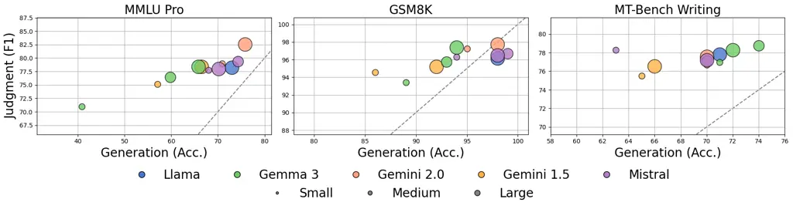
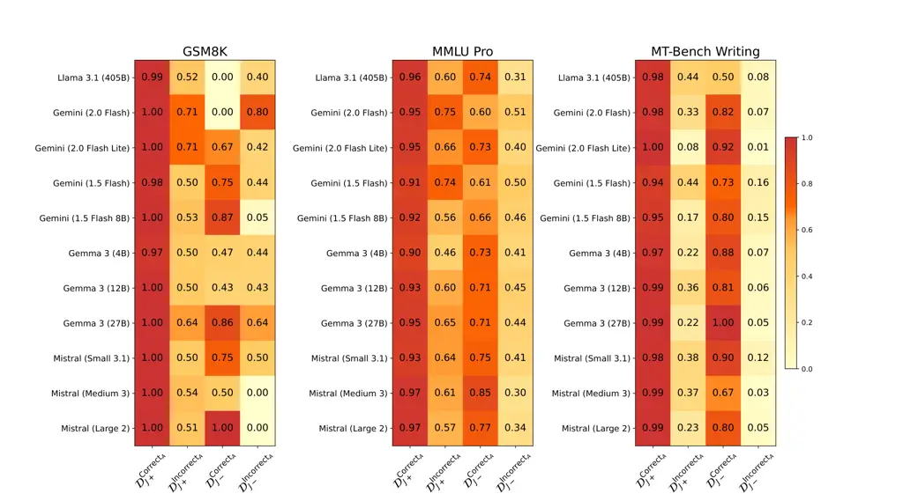
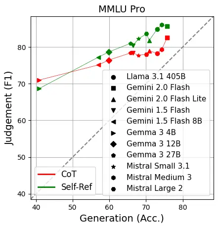
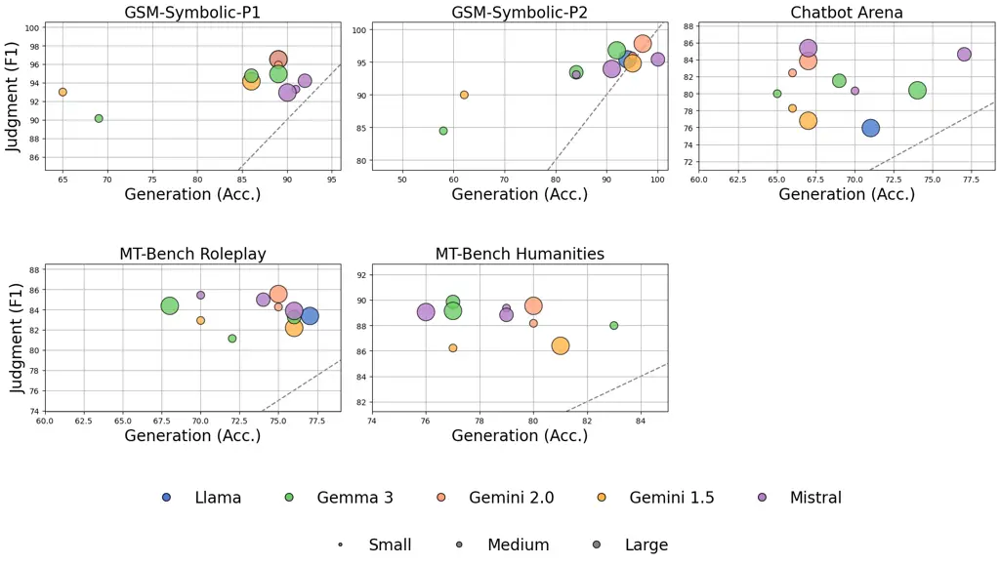
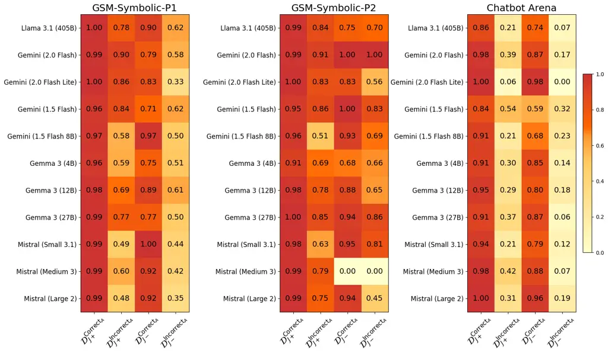
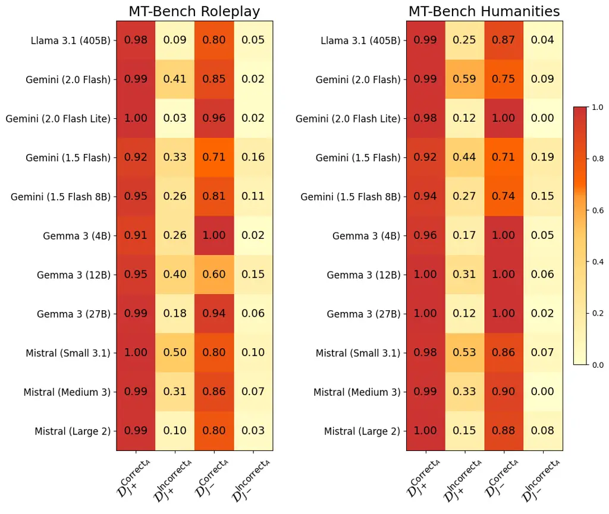
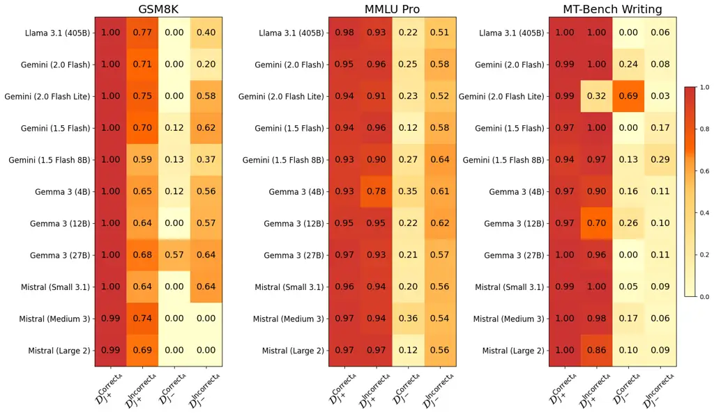
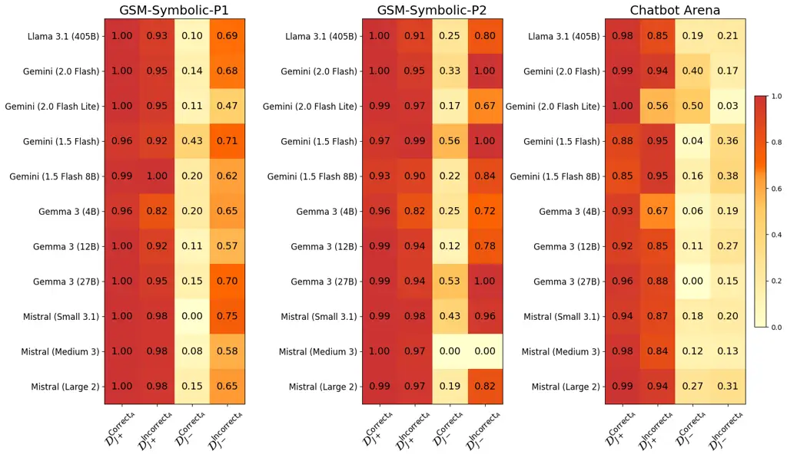
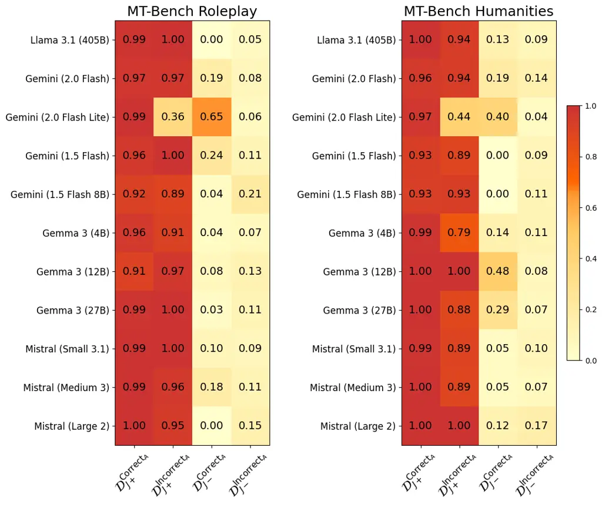

# Do Before You Judge: Self-Reference as a Pathway to Better LLM Evaluation

Wei-Hsiang Lin Affiliation: Department of Computer Science and
Information EngineeringNational Taiwan University, Taiwan
Email: [whlin@nlg.csie.ntu.edu.tw](mailto:)    Sheng-Lun Wei
Affiliation: Department of Computer Science and Information
EngineeringNational Taiwan University, Taiwan
Email: [weisl@nlg.csie.ntu.edu.tw](mailto:)    Hen-Hsen Huang
Affiliation: Institute of Information Science, Academia Sinica, Taiwan
Email: [hhhuang@iis.sinica.edu.twhhchen@ntu.edu.tw](mailto:)    Hsin-Hsi
Chen Affiliation: Department of Computer Science and Information
EngineeringNational Taiwan University, Taiwan Affiliation: AI Research
Center (AINTU), National Taiwan University, Taiwan

###### Abstract

LLM-as-Judge frameworks are increasingly popular for AI evaluation, yet
research findings on the relationship between models’ generation and
judgment abilities remain inconsistent. We investigate this relationship
through systematic dataset- and instance-level analyses across 11 models
and 21 diverse tasks. Despite both capabilities relying on the same
underlying knowledge, our analyses reveal they are only weakly
correlated, primarily due to LLMs’ sensitivity to the responses being
judged. To address this, we propose a self-reference-guided evaluation
strategy that leverages a model’s own answers as references. This
approach significantly strengthens the correlation between generation
and judgment abilities, offering a practical path to align these skills
and providing a reliable proxy for model selection in evaluation tasks.

## 1 Introduction

Model-based evaluation, which uses large language models (LLMs) as
judges, has gained increasing prominence in natural language processing.
This approach, commonly known as LLM-as-Judge (Zheng et al., 2023), has
been widely adopted across a range of applications (Lin and Chen, 2023;
Liang et al., 2024; Fei et al., 2024; Bi et al., 2024). However, a
critical question remains: how closely does a model’s ability to
generate answers correlate with its capacity to evaluate them? Prior
work has offered divergent perspectives on this issue, with  Tan et al.
(2025) reporting strong correlation between these abilities and  Zeng
et al. (2025) arguing they are not necessarily aligned. These
conflicting findings, based only on dataset-level analyses, highlight
the need for more comprehensive investigation.

To address this gap, we systematically investigate the relationship
between LLMs’ answer generation and evaluation capabilities within the
LLM-as-Judge framework. We focus on answer judgment as the
representative evaluation task, as it directly depends on the same
knowledge used in answer generation and thus provides a clearer lens for
analyzing their correlation. Given the widespread use of
Chain-of-Thought (CoT) reasoning (Wei et al., 2022), we adopt the CoT
paradigm for both generation and judgment tasks. Furthermore, unlike
prior studies that primarily examine dataset-level correlations, our
analysis spans both dataset-level and instance-level perspectives,
enabling a more fine-grained understanding of how these capabilities
interact. Further analysis in Section 5 introduces a
self-reference-guided evaluation strategy, which builds upon the
reference-guided judging framework (Zheng et al., 2023). This approach
significantly improves the correlation between a model’s answer
generation and judgment capabilities, with an average increase of 0.35
across all evaluated cases (as shown in Table 4).

Our findings reveal that without special techniques, strong answer
generation ability does not necessarily translate to strong judgment
ability. The correlation between these two capabilities is generally
weak when using standard CoT approaches. However, incorporating
self-reference-guided judging significantly strengthens this
correlation, making generation performance a reliable predictor of
judgment capability. These insights offer practical strategies for
selecting and utilizing judge models to enhance evaluation performance,
effectively aligning generation and judgment capabilities. Our
contributions are fourfold:

- •
  Empirical Analysis of LLM Judgment Ability: We demonstrate that LLMs
  performing well in answer generation do not necessarily excel in
  answer judgment, highlighting a weak correlation between these
  abilities under standard evaluation approaches.
- •
  Self-Reference-Guided Judging Effectiveness: Our experiments reveal
  that incorporating self-reference-guided judging significantly
  improves the alignment between answer generation and judgment
  capabilities.
- •
  Practical Implications for Model Selection: Under the
  self-reference-guided setting, our findings suggest that answer
  generation ability can serve as a reliable proxy for evaluating
  judgment capability, enabling more efficient model selection for
  evaluation tasks.
- •
  Alignment Maintenance Strategy: Our approach supports maintaining
  alignment between generation and judgment capabilities as LLMs
  continue to evolve, providing a practical solution to a persistent
  challenge in LLM evaluation.

## 2 Related work

#### Capabilities of LLM-as-Judge.

Prior work on LLM-as-Judge has explored their capabilities through
benchmarks Zheng et al. (2023); Li et al. (2024b); Wei et al. (2024a),
tuning methods Zhu et al. (2023); Wang et al. (2024b); Lee et al.
(2024), prompting strategies Wang et al. (2024a); Raina et al. (2024);
Badshah and Sajjad (2024), and model interaction architectures Chan
et al. (2024); Chen et al. (2024b); Verga et al. (2024). Several survey
papers Li et al. (2025); Li et al. (2024a) have summarized these
developments, evaluating various prompt designs Liu et al. (2024) and
implementation approaches.

#### Limitations of LLM-as-Judge.

Recent research has identified limitations in this framework,
particularly biases in model judgments (Wei et al., 2024b; Zheng et al.,
2023; Koo et al., 2024), with comprehensive overviews provided in survey
works (Chen et al., 2024a; Shi et al., 2024). A critical yet
underexplored aspect is how LLM judges are selected. Models are often
chosen based on their generation performance (Hendrycks et al., 2021a;
Hendrycks et al., 2021b) or leaderboard rankings (Chiang et al., 2024),
assuming strong generation capabilities imply strong judgment
capabilities. However, studies present conflicting views: Tan et
al. (Tan et al., 2025) report strong correlation between these
abilities, while Zeng et al. (Zeng et al., 2025) argue they are not
necessarily aligned. Both rely solely on dataset-level analyses with
limited benchmarks. We address this gap by systematically examining the
relationship between generation and judgment abilities at both dataset
and instance levels, offering insights into when these capabilities
diverge and how they can be effectively aligned.

## 3 Framework for Evaluating LLM Judgment Ability

### 3.1 Objective & Notations

The goal of this paper is to investigate whether LLMs’ ability to
evaluate answers correlates with their ability to generate correct
answers for the same questions. In other words, we aim to determine
whether proficiency in “answering questions" implies proficiency in
“judging answers" (and vice versa) and to analyze the potential
correlation between these two competencies. The experiment involves two
roles: the agent model $`\mathcal{M}_{A}`$, which generates answers
during the answer generation stage, and the judge model
$`\mathcal{M}_{J}`$, which evaluates their correctness during the answer
judgment stage.

#### Answer Generation.

Let $`\mathcal{D}_{G}=\{(q_{i},a^{*}_{i})\}_{i=1}^{N}`$ be a dataset
consisting of $`N`$ questions, where $`q_{i}`$ is the $`i`$-th question
and $`a^{*}_{i}`$ is the ground-truth answer for $`q_{i}`$. Let
$`\mathcal{M}_{A}`$ denote the agent model, for each question $`q_{i}`$,
the agent model generates an answer:

```math
\hat{a}_{i}^{\mathcal{M}_{A}}=\mathcal{M}_{A}(q_{i}) \tag{1}
```

Similarly, we perform the answer generation process for the judge model
$`\mathcal{M}_{J}`$ to assess its capacity to answer the question:

```math
\hat{a}_{i}^{\mathcal{M}_{J}}=\mathcal{M}_{J}(q_{i}) \tag{2}
```

The capacity of the judge model is defined as:

```math
\mathrm{Acc}_{Generation}^{\mathcal{M}_{J}}=\frac{\bigl|\{\,i\;\mid\;\hat{a}_{i}^{\mathcal{M}_{J}}=a_{i}^{*}\}\bigr|}{N} \tag{3}
```

where
$`\bigl|\{\,i\;\mid\;\hat{a}_{i}^{\mathcal{M}_{J}}=a_{i}^{*}\}\bigr|`$
represents the number of questions that the judge model
$`\mathcal{M}_{J}`$ provides the correct answer.

#### Answer Judgment.

After the answer generation stage, we proceed to the answer judgment
stage. In this stage, we first construct the dataset $`\mathcal{D}_{J}`$
and then use the judge model $`\mathcal{M}_{J}`$ to evaluate the
correctness of the results generated in the previous stage.
$`\mathcal{D}_{J}`$ is defined as:

```math
\mathcal{D}_{J}\;=\;\bigl\{\,\bigl(q_{i},\hat{a}_{i}^{\mathcal{M}_{A}},y_{i}^{*}\bigr)\bigr\}_{i=1}^{N} \tag{4}
```

where $`q_{i}`$ is the $`i`$-th question from $`\mathcal{D}_{G}`$,
$`\hat{a}_{i}^{\mathcal{M}_{A}}`$ is the answer generated by model
$`\mathcal{M}_{A}`$ in Equation (1), and $`y_{i}^{*}`$ indicates whether
$`\hat{a}_{i}^{\mathcal{M}_{A}}`$ is correct, defined as:

```math
y_{i}^{*}=\begin{cases}1,&\text{if }\hat{a}_{i}^{\mathcal{M}_{A}}=a_{i}^{*}\\
0,&\text{otherwise.}\end{cases} \tag{5}
```

We then use the judge model to generate judgment results as:

```math
y_{i}^{\mathcal{M}_{J}}=\mathcal{M}_{J}(q_{i},\hat{a}_{i}^{\mathcal{M}_{A}}) \tag{6}
```

Finally, we can evaluate the model’s judgment capability via:

```math
\mathrm{P}_{Judge}=\frac{\bigl|\{\,i\mid y_{i}^{\mathcal{M}_{J}}=1\land y_{i}^{*}=1\}\bigr|}{\bigl|\{\,i\mid y_{i}^{\mathcal{M}_{J}}=1\}\bigr|} \tag{7}
```

```math
\mathrm{R}_{Judge}=\frac{\bigl|\{\,i\mid y_{i}^{\mathcal{M}_{J}}=1\land y_{i}^{*}=1\}\bigr|}{\bigl|\{\,i\mid y_{i}^{*}=1\}\bigr|} \tag{8}
```

```math
\mathrm{F1}_{Judge}=2\times\frac{\mathrm{P}_{Judge}\times\mathrm{R}_{Judge}}{\mathrm{P}_{Judge}+\mathrm{R}_{Judge}} \tag{9}
```

#### Correlation.

To quantify the linear relationship between the _answer generation
ability_ and the _answer judgement ability_ of the judge model
$`\mathcal{M}_{J}`$ at the instance level, we introduce three binary
variables for each question $`i`$:

The event that the judge model $`\mathcal{M}_{J}`$ answers $`q_{i}`$
correctly is defined as

```math
G_{i}=\mathbf{1}\!\bigl[\hat{a}_{i}^{\mathcal{M}_{J}}=a_{i}^{*}\bigr] \tag{10}
```

The event that the judge model correctly classifies the agent’s answer
is defined as

```math
J_{i}=\mathbf{1}\!\bigl[y_{i}^{\mathcal{M}_{J}}=y_{i}^{*}\bigr] \tag{11}
```

The event that the agent model $`\mathcal{M}_{A}`$ answers $`q_{i}`$
correctly is defined as

```math
A_{i}=y_{i}^{*}=\mathbf{1}\!\bigl[\hat{a}_{i}^{\mathcal{M}_{A}}=a_{i}^{*}\bigr] \tag{12}
```

Using the $`N`$ triplets $`\{(G_{i},J_{i},A_{i})\}_{i=1}^{N}`$, we first
compute the pairwise Pearson correlation coefficients:

```math
\displaystyle r_{G,J} \displaystyle=\operatorname{corr}(G,J),\quad r_{G,A}=\operatorname{corr}(G,A) \tag{13}
```

```math
\displaystyle r_{J,A} \displaystyle=\operatorname{corr}(J,A)
```

Partial Correlation. We hypothesize that the correctness of the agent’s
response may significantly influence judgment performance, potentially
acting as a confounding factor in our analysis. We will directly
investigate this potential influence in our subsequent analysis. To
control for this possible effect and observe the underlying correlation
between answer generation and judgment abilities, we employ partial
correlation analysis. The partial correlation between $`G`$ and $`J`$
given $`A`$ removes the linear influence of $`A`$ (i.e., the correctness
of the evaluated response) from both variables:

```math
r_{G,J\mid A}=\frac{r_{G,J}-r_{G,A}\,r_{J,A}}{\sqrt{\bigl(1-r_{G,A}^{2}\bigr)\bigl(1-r_{J,A}^{2}\bigr)}} \tag{14}
```

Here, $`r_{G,J\mid A}=0`$ indicates no residual linear association
between the judge model’s generation accuracy and judgement accuracy
once the agent model’s correctness is held fixed, while
$`|r_{G,J\mid A}|`$ approaching 1 signals a strong intrinsic link
between these two competencies that is _not_ attributable to the quality
of the agent’s answer. This approach allows us to assess whether the
correlation between generation and judgment capabilities exists
independently of the evaluated response quality, addressing limitations
in prior studies that relied solely on dataset-level correlations.



Figure 1: Relationship between the capabilities of answer generation
(measured by accuracy) and answer judgment (measured by F1 score) across
three datasets: MMLU Pro, GSM8K, and MT-bench writing. Each subplot
corresponds to one dataset. Different colors represent different model
series, and the size of each circle reflects the relative size of models
within the same series.

### 3.2 Evaluation Models

We adopt relatively weaker LLMs as agent models and relatively stronger
LLMs as judge models. For the agent models, we include Ministral
8B (Mistral AI Team, 2024b) and Llama 3.1 series (Dubey et al., 2024).
For the judge models, we consider four different families of LLMs,
including Llama 3.1 405B, the Mistral series (Mistral AI Team, 2024a),
the Gemini series (Gemini Team, 2023; Gemini Team, 2024), and the Gemma
series (Gemma Team, 2025). Detailed model information and implementation
details are provided in Appendix A.

### 3.3 Evaluation Tasks

Our experiments cover seven datasets that span multiple answer formats
and domains, comprising a total of 21 subtasks. For multiple-choice
questions (MCQs), we use MMLU Pro Wang et al. (2024c). For dialogue
tasks with human-preference annotations, we rely on Chatbot Arena Zheng
et al. (2023) and three subsets of MT-Bench Zheng et al. (2023):
_Humanities_, _Roleplay_, and _Writing_, which add open-ended Q&A,
scenario-based role-playing, and creative-writing challenges within the
same dialogue-and-preference framework. To examine mathematical and
symbolic reasoning, we include GSM8K Cobbe et al. (2021) and
GSM-Symbolic (P1 and P2) Mirzadeh et al. (2025).

For each task, we randomly sample 100 instances. In the case of MMLU
Pro, which contains 14 subtasks, we sample 100 instances per subtask,
yielding 1,400 MMLU Pro examples in total. Since we use three different
agent models (Ministral 8B, Llama 3.1 8B, and Llama 3.1 70B) to generate
answers during the judgment phase, our judgment evaluation dataset
effectively triples in size, providing robust coverage across different
answer quality distributions. Because of space limits, the main text
reports results on three representative datasets, namely MMLU Pro,
GSM8K, and MT-Bench Writing, which together capture the trends observed
across the full benchmark suite. Complete results for the remaining four
datasets appear in Appendix C. Together, these seven datasets allow us
to probe LLM judges across MCQs, dialogue with human preferences,
creative writing, and mathematical reasoning tasks.

### 3.4 Limitations of Pairwise Evaluation

Prior work on LLM-as-Judge primarily adopts a pairwise evaluation
paradigm, where a judge model selects the better output among multiple
candidates generated by agent models. However, such approaches emphasize
comparative correctness across options, rather than directly
disentangling the ability to _generate_ answers from the ability to
_judge_ them. To more clearly isolate and evaluate these two
capabilities, we adopt a pointwise setup (Section 3.1). Moreover, the
pointwise setting mitigates potential selection bias (Wei et al., 2024b;
Zheng et al., 2023; Koo et al., 2024) inherent in pairwise evaluation,
where the LLM is forced to solve a multiple-choice style problem that
may confound its true judging ability.

|                       |       |       |            |         |       |            |                  |       |            |
| --------------------- | ----- | ----- | ---------- | ------- | ----- | ---------- | ---------------- | ----- | ---------- |
| Judge model           | GSM8K |       |            | MMLUPro |       |            | MT-Bench Writing |       |            |
|                       | ✓     | ✗     | $`\Delta`$ | ✓       | ✗     | $`\Delta`$ | ✓                | ✗     | $`\Delta`$ |
| Llama 3.1 405B        | 96.85 | 0.00  | 96.85      | 88.75   | 32.74 | 56.01      | 93.51            | 9.41  | 84.10      |
| Gemini 2.0 Flash      | 98.13 | 0.00  | 98.13      | 90.84   | 35.31 | 55.53      | 91.11            | 28.28 | 62.83      |
| Gemini 2.0 Flash Lite | 98.68 | 33.33 | 65.35      | 89.33   | 36.77 | 52.56      | 90.77            | 23.76 | 67.01      |
| Gemini 1.5 Flash      | 97.10 | 52.17 | 44.93      | 89.56   | 38.07 | 51.49      | 90.30            | 34.86 | 55.44      |
| Gemini 1.5 Flash 8B   | 98.16 | 65.57 | 32.59      | 88.43   | 43.81 | 44.62      | 87.76            | 40.68 | 47.08      |
| Gemma 3 4B            | 96.58 | 47.06 | 49.52      | 86.41   | 54.89 | 31.52      | 85.39            | 50.45 | 34.94      |
| Gemma 3 12B           | 97.90 | 33.33 | 64.57      | 88.41   | 46.75 | 41.66      | 87.89            | 45.36 | 42.53      |
| Gemma 3 27B           | 98.28 | 70.59 | 27.69      | 89.41   | 43.59 | 45.82      | 89.19            | 38.00 | 51.19      |
| Mistral Small 3.1     | 97.74 | 42.86 | 54.88      | 88.51   | 39.23 | 49.28      | 94.74            | 30.51 | 64.23      |
| Mistral Medium 3      | 97.04 | 50.00 | 47.04      | 88.87   | 38.19 | 50.68      | 91.92            | 24.00 | 67.92      |
| Mistral Large 2       | 96.63 | 90.91 | 5.72       | 89.04   | 35.34 | 53.70      | 92.27            | 17.02 | 75.25      |

Table 1: Answer judgment performance (%) across different models and
datasets. ✓represents $`\mathcal{D}_{J+}`$, and ✗represents
$`\mathcal{D}_{J-}`$. $`\Delta`$ denotes the gap between the performance
of $`\mathcal{D}_{J+}`$ and $`\mathcal{D}_{J-}`$ for the same model and
dataset. If the performance of $`\mathcal{D}_{J+}`$ is higher, it is
marked in blue; otherwise, it is marked in red.

## 4 Relationship between Answer Generation and Answer Judgment

### 4.1 Dataset-Level Observations

Following the process described in Section 3.1, we evaluate the
capabilities of answer generation and answer judgment using Equation 3
and Equation 9, respectively. Figure 1 plots these two metrics for
eleven models on three representative datasets, chosen for space
constraint and because they typify the trends observed on the full
benchmark suite. Complete results for the remaining four datasets are
reported in Appendix C.

The results, shown in Figure 1, reveal a clear positive correlation:
models with higher answer generation performance typically exhibit
better answer judgment performance across all datasets. Although the
relationship is not strictly linear, a discernible trend indicates that
superior answer generation capabilities generally correspond to enhanced
answer judgment performance. This finding aligns with the observations
in Tan et al. (2025); however, we do not observe the performance drop in
answer evaluation compared to generation reported by Zeng et al. (2025).
This discrepancy may be attributed to our evaluation task focusing on
binary correctness judgment, which naturally yields higher expected
performance.

We further investigate the primary reason behind this observation.
Specifically, we seek to distinguish whether this correlation is rooted
in the shared knowledge required for both generation and judgment on a
given task, or if it is an artifact of stronger models’ generally
superior performance across various tasks. To clarify this relationship,
we conduct further analysis and address the following question: "When
the judge model correctly answers a question, does it judge other
models’ responses more accurately?"

To investigate whether the internal knowledge of the judge model affects
its performance in evaluation tasks, we split the dataset
$`\mathcal{D}_{J}`$, as defined in Equation 4, into two subsets:
$`\mathcal{D}_{J+}`$ and $`\mathcal{D}_{J-}`$. The former represents
samples where the judge model $`\mathcal{M_{J}}`$ answered correctly,
while the latter contains samples where it failed to provide the correct
answer. Note that for different judge models $`\mathcal{M_{J}}`$, the
split datasets $`\mathcal{D}_{J+}`$ and $`\mathcal{D}_{J-}`$ are
distinct. This experimental design isolates the answer generation
capability of the judge model, enabling more precise examinations of how
the model’s internal knowledge impacts its judging effectiveness.

Table 1 shows the performance of answer judgment on $`\mathcal{D}_{J+}`$
and $`\mathcal{D}_{J-}`$ across eleven different models. In all cases ,
the judge models achieve significantly higher F1 scores on
$`\mathcal{D}_{J+}`$. This observation appears to suggest that the
evaluation ability of judge models is more effective when they possess
related knowledge, as indicated by their ability to answer the question
correctly.

While these dataset-level observations offer useful insights, they
provide insufficient evidence to draw definitive conclusions about the
correlation between answer generation and judgment capabilities. The
strong performance of judges on $`\mathcal{D}_{J+}`$ raises several
questions:

- •
  Does this imply that models with strong generation abilities will have
  strong judgment abilities, suggesting these capabilities are highly
  correlated?
- •
  Could inherent differences between $`\mathcal{D}_{J+}`$ and
  $`\mathcal{D}_{J-}`$ explain the large judgment performance gap,
  rather than ability correlation?
- •
  How can we reconcile prior conflicting findings Tan et al. (2025);
  Zeng et al. (2025) regarding the relationship between these two
  capabilities?



Figure 2: Heatmap Visualization of Evaluation Performance across
Datasets. This figure illustrates the integration of the judge model’s
answer generation capabilities with the labels of evaluation questions
across four datasets. Each dataset is represented in one of four
subfigures, with subsets $`\mathcal{D}_{J+}^{\text{Correct}_{A}}`$,
$`\mathcal{D}_{J+}^{\text{Incorrect}_{A}}`$,
$`\mathcal{D}_{J-}^{\text{Correct}_{A}}`$, and
$`\mathcal{D}_{J-}^{\text{Incorrect}_{A}}`$ displayed from left to
right, showing the evaluation accuracy variations under different
conditions.

|                       |       |         |                  |        |
| --------------------- | ----- | ------- | ---------------- | ------ |
| Judge Model           | GSM8K | MMLUPro | MT-Bench Writing | Avg.   |
| Mistral Large 2       | 5.67% | 22.12%  | 33.00%           | 21.77% |
| Mistral Medium 3      | 5.33% | 21.90%  | 29.66%           | 21.35% |
| Llama 3.1 405B        | 3.67% | 20.02%  | 28.33%           | 19.52% |
| Gemini 2.0 Flash Lite | 4.33% | 16.81%  | 36.00%           | 17.23% |
| Mistral Small 3.1     | 5.33% | 16.90%  | 30.00%           | 17.00% |
| Gemma 3 4B            | 1.00% | 17.21%  | 29.00%           | 16.93% |
| Gemma 3 27B           | 4.00% | 16.31%  | 32.66%           | 16.56% |
| Gemini 1.5 Flash 8B   | 7.00% | 15.69%  | 27.66%           | 15.90% |
| Gemma 3 12B           | 5.00% | 15.59%  | 27.00%           | 15.64% |
| Gemini 2.0 Flash      | 2.67% | 11.47%  | 28.33%           | 11.97% |
| Gemini 1.5 Flash      | 4.00% | 11.09%  | 23.00%           | 11.39% |

Table 2: Model overconfidence across datasets, showing the difference
between percentage of samples predicted as correct and percentage
actually correct. Higher values indicate greater bias toward predicting
correctness. The average (rightmost column) is computed as a weighted
mean across all datasets based on sample count.

### 4.2 In-Depth Dataset-Level Analysis

To address these questions and gain a more comprehensive understanding
of these relationships, we conduct more fine-grained analyses beyond the
dataset-level observations. Specifically, we investigate _whether the
correctness of responses generated by the agent model influences the
judge model’s behavior_. We split $`\mathcal{D}_{J}`$ using more
fine-grained criteria based on two factors: a) whether the judge model
answers the question correctly, and b) whether the agent model answers
the question correctly. Following this approach, we separate
$`\mathcal{D}_{J}`$ into four subsets:

- •
  $`\mathcal{D}_{J+}^{\text{Correct}_{A}}`$: Questions where both the
  judge model and the agent model answer correctly.
- •
  $`\mathcal{D}_{J+}^{\text{Incorrect}_{A}}`$: Questions where the judge
  model answers correctly, but the agent model does not.
- •
  $`\mathcal{D}_{J-}^{\text{Correct}_{A}}`$: Questions where the judge
  model answers incorrectly, but the agent model answers correctly.
- •
  $`\mathcal{D}_{J-}^{\text{Incorrect}_{A}}`$: Questions where both the
  judge model and the agent model answer incorrectly.

We report the performance breakdown across the four subsets in Figure 2.
The subsets $`\mathcal{D}_{J+}^{\text{Correct}_{A}}`$ and
$`\mathcal{D}_{J-}^{\text{Correct}_{A}}`$ consistently achieve higher
scores, indicating that most LLMs perform better when the label is
Correct. This suggests that evaluation outcomes are influenced more by
label distribution than by the judge model’s capability in the answer
generation task. Revisiting Table 1, the consistent superiority of
$`\mathcal{D}_{J+}`$ over $`\mathcal{D}_{J-}`$ arises because the strong
performance of $`\mathcal{D}_{J+}^{\text{Correct}_{A}}`$ outweighs the
weaker results of $`\mathcal{D}_{J+}^{\text{Incorrect}_{A}}`$, yielding
a higher overall score than the $`\mathcal{D}_{J-}`$ subsets.


Figure 3: Example of Self-Reference-Guided Judgment on a Math Problem

To better understand the correlation between answer generation and
judgment capabilities, we focus our analysis on the MMLU Pro and
MT-Bench Writing datasets, temporarily excluding GSM8K-related datasets.
This is because advanced models such as LLaMA 3.1 405B and Gemini 2.0
Flash achieve very high accuracy on GSM8K, resulting in too few
instances in subsets like $`\mathcal{D}_{J-}^{\text{Correct}A}`$ and
$`\mathcal{D}_{J-}^{\text{Incorrect}_{A}}`$ for meaningful evaluation.
In the MMLU Pro dataset, it is evident that even high-performing LLMs
like LLaMA 3.1 405B and Mistral Medium 3 achieve only around 60% F1
score on $`\mathcal{D}_{J+}^{\text{Incorrect}_{A}}`$. Only a select few
models, such as Gemini 2.0 Flash and Gemini 1.5 Flash, demonstrate
strong performance in this subset. A similar trend is observed in the
MT-Bench Writing subset, where model performance on
$`\mathcal{D}_{J+}^{\text{Incorrect}_{A}}`$ remains low across the
board, with the best models reaching an F1 score of only 0.44.

In Figure 2, we observe that within the MMLU Pro dataset, Gemini 2.0
Flash Lite outperforms Gemini 2.0 Flash in the subset
$`\mathcal{D}_{J-}^{\text{Correct}A}`$. To investigate this
counterintuitive result, we analyze the distribution of ground-truth
labels and model predictions across various judges and datasets. As
shown in Table 2, most LLMs exhibit a strong bias toward predicting
Correct. Since all ground-truth labels in
$`\mathcal{D}_{J-}^{\text{Correct}_{A}}`$ are Correct, weaker models may
sometimes outperform stronger models from the same series due to this
prediction bias.

### 4.3 Instance-Level Analysis

While the previous analyses focused on dataset-level patterns, we now
turn to instance-level analysis to obtain more fine-grained insights.
Since response correctness strongly influences the correlation between
generation and judgment abilities, we control for this confounding
factor by measuring the partial correlation between answer generation
and answer judgment using Equation 14, with results summarized in
Table 3. In most cases (25 out of 33), the correlations fall below 0.3,
indicating only a weak association between the two abilities. A smaller
number of cases (8 out of 33) show moderate alignment, with correlations
between 0.3 and 0.5. Importantly, none of the cases exhibit strong
correlation (above 0.5), which would suggest that generation and
judgment rely on the same underlying mechanism. These findings reinforce
our earlier observation that the correctness of the response being
judged substantially influences evaluation outcomes, while also
suggesting that an LLM’s judgment ability is largely independent of its
generation ability. This instance-level analysis complements the
dataset-level observations: whereas aggregate results (Figure 1)
suggested a positive correlation between judgment and generation, the
weak partial correlations at the instance level reveal that the two
capabilities operate more independently than the dataset-level trends
imply.

|                       |        |         |                  |
| --------------------- | ------ | ------- | ---------------- |
| Judge Model           | GSM8K  | MMLUPro | MT-Bench Writing |
| Llama 3.1 405B        | 0.1869 | 0.2808  | 0.4448           |
| Gemini 2.0 Flash      | 0.0864 | 0.2862  | 0.3053           |
| Gemini 2.0 Flash Lite | 0.3246 | 0.2580  | 0.1932           |
| Gemini 1.5 Flash      | 0.1446 | 0.2653  | 0.2786           |
| Gemini 1.5 Flash 8B   | 0.3789 | 0.1866  | 0.1177           |
| Gemma 3 4B            | 0.3495 | 0.1266  | 0.1931           |
| Gemma 3 12B           | 0.3198 | 0.1900  | 0.3365           |
| Gemma 3 27B           | 0.0864 | 0.2406  | 0.1960           |
| Mistral Small 3.1     | 0.0828 | 0.2207  | 0.2240           |
| Mistral Medium 3      | 0.2800 | 0.2729  | 0.4615           |
| Mistral Large 2       | 0.0628 | 0.2443  | 0.2754           |

Table 3: Partial correlation between answer generation and judgment
capabilities across models and datasets. Weak and moderate correlations
are highlighted with red and purple backgrounds, respectively.

|                       |                   |                   |                   |
| --------------------- | ----------------- | ----------------- | ----------------- |
| Judge Model           | GSM8K             | MMLU Pro          | MT-Bench Writing  |
| Llama 3.1 405B        | 0.3950 (+0.2081↑) | 0.5719 (+0.2911↑) | 0.9283 (+0.4835↑) |
| Gemini 2.0 Flash      | 0.4543 (+0.3679↑) | 0.5177 (+0.2315↑) | 0.8719 (+0.5666↑) |
| Gemini 2.0 Flash Lite | 0.3987 (+0.0741↑) | 0.5114 (+0.2534↑) | 0.4202 (+0.2270↑) |
| Gemini 1.5 Flash      | 0.4747 (+0.3301↑) | 0.5687 (+0.3034↑) | 0.8414 (+0.5628↑) |
| Gemini 1.5 Flash 8B   | 0.6916 (+0.3127↑) | 0.4637 (+0.2771↑) | 0.6983 (+0.5806↑) |
| Gemma 3 4B            | 0.6243 (+0.2748↑) | 0.4135 (+0.2869↑) | 0.8006 (+0.6075↑) |
| Gemma 3 12B           | 0.4795 (+0.1597↑) | 0.5398 (+0.3498↑) | 0.6697 (+0.3332↑) |
| Gemma 3 27B           | 0.2585 (+0.1721↑) | 0.5620 (+0.3214↑) | 0.9036 (+0.7076↑) |
| Mistral Small 3.1     | 0.3140 (+0.2312↑) | 0.5430 (+0.3223↑) | 0.8688 (+0.6448↑) |
| Mistral Medium 3      | 0.4483 (+0.1683↑) | 0.5207 (+0.2478↑) | 0.9071 (+0.4456↑) |
| Mistral Large 2       | 0.5931 (+0.5303↑) | 0.5869 (+0.3426↑) | 0.8079 (+0.5325↑) |

Table 4: Partial correlation after applying the self-reference-guided
judgment method. Improvements over the CoT baseline are shown in blue
with upward arrows. Weak, moderate, and strong correlations are
highlighted with red, purple, and green backgrounds, respectively.

## 5 Self-Reference-Guided Evaluation

### 5.1 Goal and Methodology

To strengthen the correlation between answer generation and judgment
capabilities, we propose a self-reference-guided evaluation approach as
a replacement for the standard CoT method. Unlike traditional
reference-guided methods Badshah and Sajjad (2024), which rely on
responses from stronger models or gold-standard answers as references,
our approach leverages the judge model’s own generated response as the
reference during evaluation. Specifically, we use the answer generated
by the judge model in Equation 2. Figure 3 illustrates this method with
a mathematical reasoning example. This design raises the following
questions:

- •
  Does using self-generated responses as references improve the
  correlation between answer generation and judgment capabilities
  compared to standard CoT?
- •
  How does the evaluation performance of self-reference-guided
  evaluation compare with traditional CoT?

### 5.2 Results and Observations

#### Correlation Enhancement.

Table 4 shows that our proposed method substantially improves the
correlation compared to the standard CoT baseline in Table 3. In 22 out
of 33 cases, the correlations exceed 0.5, indicating strong alignment
between answer generation and judgment capabilities. Another 10 cases
fall into the moderate range, with only 1 case remaining weak. On
average, the correlation increases by about 0.35, underscoring the
effectiveness of the self-reference-guided approach in reducing the
previously observed decoupling between the two abilities.

#### Model-Specific Effects.

Figure 4 shows the comparison between our self-reference-guided method
and the standard CoT baseline in answer judgment performance. On the
MMLU Pro dataset, the self-reference-guided method outperforms CoT once
the judge model’s own answer generation accuracy exceeds 50%. We
emphasize that this specific threshold is not a universal rule and is
expected to vary across different datasets. This may be related to the
quality of the provided reference.



Figure 4: Performance comparison between CoT and self-reference-guided
evaluation methods on MMLU Pro, plotting answer generation accuracy
against judgment F1 score for each model.

### 5.3 Discussion and Practical Takeaway

Our experiments with CoT prompting show that answer generation and
answer judgment are only weakly correlated. Consequently, selecting the
top-performing model on a generation benchmark as a judge does not
guarantee reliable evaluations. In contrast, our self-reference-guided
strategy strengthens the connection between these abilities by using the
model’s own answer as the reference, making generation accuracy a
dependable proxy for judgment quality. This approach is particularly
valuable when high-quality external references are unavailable, such as
when gold labels are costly to obtain or access to stronger models is
impractical. By leveraging self-generated outputs, our method aligns
generation and judgment skills without external dependencies, offering a
practical and robust path to reliable evaluation.

## 6 Conclusion

In this paper, we conducted a systematic examination of the correlation
between performance in answer generation and answer judgment tasks using
LLMs with standard CoT prompting. We evaluated 11 widely used LLMs on 21
benchmark subtasks. Our results show that, for most models, performance
on answer generation is only weakly correlated with the ability to judge
answers, indicating that strong generators are not necessarily reliable
judges. In addition, we found that self-reference-guided evaluation
methods can strengthen the correlation between generation and judgment
capabilities. Based on these insights, we offer practical
recommendations for selecting models to serve as judges, especially when
external references like golden answers or outputs from stronger models
are unavailable. In these situations, our work provides an accessible
approach to judge model selection by using generation performance as a
reliable proxy for judgment capability. This also mitigates the risk of
generation and evaluation capabilities diverging as LLMs continue to
develop.

## 7 Limitations

This study confronts inherent limitations due to the rapid evolution of
LLMs and the specific nature of the evaluation tasks employed:

#### Evolving Landscape of LLMs.

The field of large language models is rapidly evolving, with new models
continually introducing architectural and methodological advancements.
Given this dynamic landscape, our study is necessarily constrained to
the specific set of LLMs we evaluated. While our findings provide
valuable insights into the current generation of models, future
advancements may lead to changes in the relationship between answer
generation and judgment capabilities, potentially strengthening or
reshaping our observations. As such, ongoing research will be essential
to understand how these relationships evolve as models continue to
improve.

#### Self-Reference-Guided Evaluation Scope.

The self-reference-guided method has shown potential in enhancing the
correlation between answer generation and answer judgment tasks.
However, this study has employed the self-reference-guided method
specifically within the context of pointwise answer judgment tasks,
where the references needed are clearly defined as the judge model’s
responses to questions. The applicability of this method to more complex
evaluation formats and tasks, such as pairwise comparison or listwise
ranking, remains uncertain. Further research is required to determine
how references can be effectively generated and utilized in diverse
evaluative contexts beyond simple pointwise answer judgment.

#### Lack of Multi-Turn Interaction Analysis.

Our study focuses exclusively on single-turn interactions, a
simplification of real-world applications where judgments often occur in
multi-turn contexts. In interactive settings, models must adapt their
generation and evaluation to prior context, which we do not address
here. We intentionally restrict our scope to single-turn interactions
because they underlie most LLM-as-Judge benchmarks and offer a clearer
lens for our research question. Nevertheless, this constitutes a
limitation. Future work should extend our analysis to multi-turn
dialogues to assess whether the observed correlation patterns and the
effectiveness of self-reference-guided evaluation hold in more complex
interactive scenarios.

#### Potential for Error Propagation

A key consideration for the self-reference-guided method is the
potential for error propagation. Since the approach uses the judge’s own
output as the reference, an incorrect reference answer can lead to
flawed evaluations. For instance, a judge model might incorrectly
penalize an agent’s correct response simply because it fails to match
its own erroneous reference. This risk is empirically supported by our
own findings, which demonstrate that the effectiveness of the
self-reference-guided method is directly tied to the judge model’s
generation accuracy. While this is a limitation, it also reinforces our
primary recommendation to apply this method using judge models with high
generation performance for the target domain. These limitations
underscore the necessity for ongoing research to continually reassess
and validate the applicability of our findings as the technology evolves
and to expand the methodological framework to include a wider variety of
evaluation tasks in different contexts.

## Acknowledgments

This work was supported by National Science and Technology Council,
Taiwan, under grants NSTC 113-2634-F-002-003- and 114-2221-E-002-070-
MY3, and Ministry of Education (MOE), Taiwan, under grant
NTU-114L900901.

## Use of AI Assistants

We sincerely appreciate the assistance provided by ChatGPT in refining
our manuscript. ChatGPT offered suggestions for improving the clarity
and conciseness of our writing, helped restructure key sections for
better readability, and contributed to refining our research
terminology. While the final content remains our own, these
contributions enhanced the presentation of our work.

## References

- Badshah and Sajjad (2024) Sher Badshah and Hassan Sajjad. 2024.
  [Reference-guided verdict: Llms-as-judges in automatic evaluation of
  free-form text](https://arxiv.org/abs/2408.09235). _Preprint_,
  arXiv:2408.09235.
- Bi et al. (2024) Zhen Bi, Ningyu Zhang, Yida Xue, Yixin Ou, Daxiong
  Ji, Guozhou Zheng, and Huajun Chen. 2024. [OceanGPT: A large language
  model for ocean science
  tasks](https://doi.org/10.18653/v1/2024.acl-long.184). In _Proceedings
  of the 62nd Annual Meeting of the Association for Computational
  Linguistics (Volume 1: Long Papers)_, pages 3357–3372, Bangkok,
  Thailand. Association for Computational Linguistics.
- Chan et al. (2024) Chi-Min Chan, Weize Chen, Yusheng Su, Jianxuan Yu,
  Wei Xue, Shanghang Zhang, Jie Fu, and Zhiyuan Liu. 2024. [Chateval:
  Towards better LLM-based evaluators through multi-agent
  debate](https://openreview.net/forum?id=FQepisCUWu). In _The Twelfth
  International Conference on Learning Representations_.
- Chen et al. (2024a) Guiming Hardy Chen, Shunian Chen, Ziche Liu, Feng
  Jiang, and Benyou Wang. 2024a. [Humans or LLMs as the judge? a study
  on judgement bias](https://doi.org/10.18653/v1/2024.emnlp-main.474).
  In _Proceedings of the 2024 Conference on Empirical Methods in Natural
  Language Processing_, pages 8301–8327, Miami, Florida, USA.
  Association for Computational Linguistics.
- Chen et al. (2024b) Justin Chen, Swarnadeep Saha, and Mohit Bansal.
  2024b. [ReConcile: Round-table conference improves reasoning via
  consensus among diverse
  LLMs](https://doi.org/10.18653/v1/2024.acl-long.381). In _Proceedings
  of the 62nd Annual Meeting of the Association for Computational
  Linguistics (Volume 1: Long Papers)_, pages 7066–7085, Bangkok,
  Thailand. Association for Computational Linguistics.
- Chiang et al. (2024) Wei-Lin Chiang, Lianmin Zheng, Ying Sheng,
  Anastasios Nikolas Angelopoulos, Tianle Li, Dacheng Li, Banghua Zhu,
  Hao Zhang, Michael Jordan, Joseph E. Gonzalez, and Ion Stoica. 2024.
  [Chatbot arena: An open platform for evaluating LLMs by human
  preference](https://proceedings.mlr.press/v235/chiang24b.html). In
  _Proceedings of the 41st International Conference on Machine
  Learning_, volume 235 of _Proceedings of Machine Learning Research_,
  pages 8359–8388. PMLR.
- Cobbe et al. (2021) Karl Cobbe, Vineet Kosaraju, Mohammad Bavarian,
  Mark Chen, Heewoo Jun, Lukasz Kaiser, Matthias Plappert, Jerry Tworek,
  Jacob Hilton, Reiichiro Nakano, Christopher Hesse, and John
  Schulman. 2021. [Training Verifiers to Solve Math Word
  Problems](https://doi.org/10.48550/arXiv.2110.14168). _arXiv
  preprint_. ArXiv:2110.14168.
- Dubey et al. (2024) Abhimanyu Dubey, Abhinav Jauhri, Abhinav Pandey,
  Abhishek Kadian, Ahmad Al-Dahle, Aiesha Letman, Akhil Mathur, Alan
  Schelten, Amy Yang, Angela Fan, et al. 2024. The llama 3 herd of
  models. _arXiv preprint arXiv:2407.21783_.
- Fei et al. (2024) Zhiwei Fei, Xiaoyu Shen, Dawei Zhu, Fengzhe Zhou,
  Zhuo Han, Alan Huang, Songyang Zhang, Kai Chen, Zhixin Yin, Zongwen
  Shen, Jidong Ge, and Vincent Ng. 2024. [LawBench: Benchmarking legal
  knowledge of large language
  models](https://doi.org/10.18653/v1/2024.emnlp-main.452). In
  _Proceedings of the 2024 Conference on Empirical Methods in Natural
  Language Processing_, pages 7933–7962, Miami, Florida, USA.
  Association for Computational Linguistics.
- Gemini Team (2023) Google Gemini Team. 2023. [Gemini: A family of
  highly capable multimodal models](https://arxiv.org/pdf/2312.11805).
  _ArXiv_, abs/2312.11805.
- Gemini Team (2024) Google Gemini Team. 2024. [Gemini 1.5: Unlocking
  multimodal understanding across millions of tokens of
  context](https://storage.googleapis.com/deepmind-media/gemini/gemini_v1_5_report.pdf).
- Gemma Team (2025) Gemma Team. 2025. [Gemma 3 technical
  report](https://arxiv.org/abs/2503.19786). _Preprint_,
  arXiv:2503.19786.
- Hendrycks et al. (2021a) Dan Hendrycks, Collin Burns, Steven Basart,
  Andy Zou, Mantas Mazeika, Dawn Song, and Jacob Steinhardt. 2021a.
  [Measuring massive multitask language
  understanding](https://openreview.net/forum?id=d7KBjmI3GmQ). In
  _International Conference on Learning Representations_.
- Hendrycks et al. (2021b) Dan Hendrycks, Collin Burns, Saurav Kadavath,
  Akul Arora, Steven Basart, Eric Tang, Dawn Song, and Jacob Steinhardt.
  2021b. Measuring mathematical problem solving with the math dataset.
  _NeurIPS_.
- Kojima et al. (2022) Takeshi Kojima, Shixiang (Shane) Gu, Machel Reid,
  Yutaka Matsuo, and Yusuke Iwasawa. 2022. [Large language models are
  zero-shot
  reasoners](https://proceedings.neurips.cc/paper_files/paper/2022/file/8bb0d291acd4acf06ef112099c16f326-Paper-Conference.pdf).
  In _Advances in Neural Information Processing Systems_, volume 35,
  pages 22199–22213. Curran Associates, Inc.
- Koo et al. (2024) Ryan Koo, Minhwa Lee, Vipul Raheja, Jong Inn Park,
  Zae Myung Kim, and Dongyeop Kang. 2024. [Benchmarking cognitive biases
  in large language models as
  evaluators](https://doi.org/10.18653/v1/2024.findings-acl.29). In
  _Findings of the Association for Computational Linguistics: ACL 2024_,
  pages 517–545, Bangkok, Thailand. Association for Computational
  Linguistics.
- Lee et al. (2024) Sangkyu Lee, Sungdong Kim, Ashkan Yousefpour,
  Minjoon Seo, Kang Min Yoo, and Youngjae Yu. 2024. [Aligning large
  language models by on-policy
  self-judgment](https://doi.org/10.18653/v1/2024.acl-long.617). In
  _Proceedings of the 62nd Annual Meeting of the Association for
  Computational Linguistics (Volume 1: Long Papers)_, pages 11442–11459,
  Bangkok, Thailand. Association for Computational Linguistics.
- Li et al. (2025) Dawei Li, Bohan Jiang, Liangjie Huang, Alimohammad
  Beigi, Chengshuai Zhao, Zhen Tan, Amrita Bhattacharjee, Yuxuan Jiang,
  Canyu Chen, Tianhao Wu, Kai Shu, Lu Cheng, and Huan Liu. 2025. [From
  generation to judgment: Opportunities and challenges of
  llm-as-a-judge](https://arxiv.org/abs/2411.16594). _Preprint_,
  arXiv:2411.16594.
- Li et al. (2024a) Haitao Li, Qian Dong, Junjie Chen, Huixue Su, Yujia
  Zhou, Qingyao Ai, Ziyi Ye, and Yiqun Liu. 2024a. [Llms-as-judges: A
  comprehensive survey on llm-based evaluation
  methods](https://arxiv.org/abs/2412.05579). _Preprint_,
  arXiv:2412.05579.
- Li et al. (2024b) Tianle Li, Wei-Lin Chiang, Evan Frick, Lisa Dunlap,
  Tianhao Wu, Banghua Zhu, Joseph E. Gonzalez, and Ion Stoica. 2024b.
  [From crowdsourced data to high-quality benchmarks: Arena-hard and
  benchbuilder pipeline](https://arxiv.org/abs/2406.11939). _Preprint_,
  arXiv:2406.11939.
- Liang et al. (2024) Jingcong Liang, Rong Ye, Meng Han, Ruofei Lai,
  Xinyu Zhang, Xuanjing Huang, and Zhongyu Wei. 2024. [Debatrix:
  Multi-dimensional debate judge with iterative chronological analysis
  based on LLM](https://doi.org/10.18653/v1/2024.findings-acl.868). In
  _Findings of the Association for Computational Linguistics: ACL 2024_,
  pages 14575–14595, Bangkok, Thailand. Association for Computational
  Linguistics.
- Lin and Chen (2023) Yen-Ting Lin and Yun-Nung Chen. 2023. [LLM-eval:
  Unified multi-dimensional automatic evaluation for open-domain
  conversations with large language
  models](https://doi.org/10.18653/v1/2023.nlp4convai-1.5). In
  _Proceedings of the 5th Workshop on NLP for Conversational AI
  (NLP4ConvAI 2023)_, pages 47–58, Toronto, Canada. Association for
  Computational Linguistics.
- Liu et al. (2024) Yixin Liu, Kejian Shi, Alexander R. Fabbri, Yilun
  Zhao, Peifeng Wang, Chien-Sheng Wu, Shafiq Joty, and Arman
  Cohan. 2024. [ReIFE: Re-evaluating Instruction-Following
  Evaluation](https://doi.org/10.48550/arXiv.2410.07069). _arXiv
  preprint_. ArXiv:2410.07069 \[cs\].
- Mirzadeh et al. (2025) Seyed Iman Mirzadeh, Keivan Alizadeh, Hooman
  Shahrokhi, Oncel Tuzel, Samy Bengio, and Mehrdad Farajtabar. 2025.
  [GSM-symbolic: Understanding the limitations of mathematical reasoning
  in large language models](https://openreview.net/forum?id=AjXkRZIvjB).
  In _The Thirteenth International Conference on Learning
  Representations_.
- Mistral AI Team (2024a) Mistral AI Team. 2024a. [Large
  Enough](https://mistral.ai/news/mistral-large-2407/). Section: news.
- Mistral AI Team (2024b) Mistral AI Team. 2024b. [Un Ministral, des
  Ministraux](https://mistral.ai/news/ministraux/). Section: news.
- Raina et al. (2024) Vyas Raina, Adian Liusie, and Mark Gales. 2024.
  [Is LLM-as-a-judge robust? investigating universal adversarial attacks
  on zero-shot LLM
  assessment](https://doi.org/10.18653/v1/2024.emnlp-main.427). In
  _Proceedings of the 2024 Conference on Empirical Methods in Natural
  Language Processing_, pages 7499–7517, Miami, Florida, USA.
  Association for Computational Linguistics.
- Shi et al. (2024) Lin Shi, Chiyu Ma, Wenhua Liang, Weicheng Ma, and
  Soroush Vosoughi. 2024. [Judging the Judges: A Systematic Study of
  Position Bias in
  LLM-as-a-Judge](https://doi.org/10.48550/arXiv.2406.07791). _arXiv
  preprint_. ArXiv:2406.07791 \[cs\].
- Tan et al. (2025) Sijun Tan, Siyuan Zhuang, Kyle Montgomery,
  William Yuan Tang, Alejandro Cuadron, Chenguang Wang, Raluca Popa, and
  Ion Stoica. 2025. [Judgebench: A benchmark for evaluating LLM-based
  judges](https://openreview.net/forum?id=G0dksFayVq). In _The
  Thirteenth International Conference on Learning Representations_.
- Verga et al. (2024) Pat Verga, Sebastian Hofstatter, Sophia Althammer,
  Yixuan Su, Aleksandra Piktus, Arkady Arkhangorodsky, Minjie Xu, Naomi
  White, and Patrick Lewis. 2024. [Replacing judges with juries:
  Evaluating llm generations with a panel of diverse
  models](https://arxiv.org/abs/2404.18796). _Preprint_,
  arXiv:2404.18796.
- Wang et al. (2024a) Peiyi Wang, Lei Li, Liang Chen, Zefan Cai, Dawei
  Zhu, Binghuai Lin, Yunbo Cao, Lingpeng Kong, Qi Liu, Tianyu Liu, and
  Zhifang Sui. 2024a. [Large language models are not fair
  evaluators](https://doi.org/10.18653/v1/2024.acl-long.511). In
  _Proceedings of the 62nd Annual Meeting of the Association for
  Computational Linguistics (Volume 1: Long Papers)_, pages 9440–9450,
  Bangkok, Thailand. Association for Computational Linguistics.
- Wang et al. (2024b) Yidong Wang, Zhuohao Yu, Wenjin Yao, Zhengran
  Zeng, Linyi Yang, Cunxiang Wang, Hao Chen, Chaoya Jiang, Rui Xie,
  Jindong Wang, Xing Xie, Wei Ye, Shikun Zhang, and Yue Zhang. 2024b.
  [PandaLM: An automatic evaluation benchmark for LLM instruction tuning
  optimization](https://openreview.net/forum?id=5Nn2BLV7SB). In _The
  Twelfth International Conference on Learning Representations_.
- Wang et al. (2024c) Yubo Wang, Xueguang Ma, Ge Zhang, Yuansheng Ni,
  Abhranil Chandra, Shiguang Guo, Weiming Ren, Aaran Arulraj, Xuan He,
  Ziyan Jiang, Tianle Li, Max KU, Kai Wang, Alex Zhuang, Rongqi Fan,
  Xiang Yue, and Wenhu Chen. 2024c. [Mmlu-pro: A more robust and
  challenging multi-task language understanding
  benchmark](https://proceedings.neurips.cc/paper_files/paper/2024/file/ad236edc564f3e3156e1b2feafb99a24-Paper-Datasets_and_Benchmarks_Track.pdf).
  In _Advances in Neural Information Processing Systems_, volume 37,
  pages 95266–95290. Curran Associates, Inc.
- Wei et al. (2024a) Hui Wei, Shenghua He, Tian Xia, Andy Wong, Jingyang
  Lin, and Mei Han. 2024a. [Systematic evaluation of llm-as-a-judge in
  llm alignment tasks: Explainable metrics and diverse prompt
  templates](https://arxiv.org/abs/2408.13006). _Preprint_,
  arXiv:2408.13006.
- Wei et al. (2022) Jason Wei, Xuezhi Wang, Dale Schuurmans, Maarten
  Bosma, brian ichter, Fei Xia, Ed Chi, Quoc V Le, and Denny Zhou. 2022.
  [Chain-of-thought prompting elicits reasoning in large language
  models](https://proceedings.neurips.cc/paper_files/paper/2022/file/9d5609613524ecf4f15af0f7b31abca4-Paper-Conference.pdf).
  In _Advances in Neural Information Processing Systems_, volume 35,
  pages 24824–24837. Curran Associates, Inc.
- Wei et al. (2024b) Sheng-Lun Wei, Cheng-Kuang Wu, Hen-Hsen Huang, and
  Hsin-Hsi Chen. 2024b. [Unveiling selection biases: Exploring order and
  token sensitivity in large language
  models](https://doi.org/10.18653/v1/2024.findings-acl.333). In
  _Findings of the Association for Computational Linguistics: ACL 2024_,
  pages 5598–5621, Bangkok, Thailand. Association for Computational
  Linguistics.
- Zeng et al. (2025) Zhongshen Zeng, Pengguang Chen, Shu Liu, Haiyun
  Jiang, and Jiaya Jia. 2025. [MR-GSM8k: A meta-reasoning benchmark for
  large language model
  evaluation](https://openreview.net/forum?id=br4H61LOoI). In _The
  Thirteenth International Conference on Learning Representations_.
- Zheng et al. (2023) Lianmin Zheng, Wei-Lin Chiang, Ying Sheng, Siyuan
  Zhuang, Zhanghao Wu, Yonghao Zhuang, Zi Lin, Zhuohan Li, Dacheng Li,
  Eric Xing, Hao Zhang, Joseph E Gonzalez, and Ion Stoica. 2023.
  [Judging llm-as-a-judge with mt-bench and chatbot
  arena](https://proceedings.neurips.cc/paper_files/paper/2023/file/91f18a1287b398d378ef22505bf41832-Paper-Datasets_and_Benchmarks.pdf).
  In _Advances in Neural Information Processing Systems_, volume 36,
  pages 46595–46623. Curran Associates, Inc.
- Zhu et al. (2023) Lianghui Zhu, Xinggang Wang, and Xinlong Wang. 2023.
  [JudgeLM: Fine-tuned Large Language Models are Scalable
  Judges](https://doi.org/10.48550/arXiv.2310.17631). _arXiv preprint_.
  ArXiv:2310.17631 \[cs\].

## Appendix A Additional Model Information

To provide a comprehensive overview of the models used in our
experiments, we list the agent and judge models along with their
corresponding API endpoints in Table 5. For Llama 3.1 models, we
leverage the API provided by SambaNova¹¹ 1
[https://cloud.sambanova.ai](https://cloud.sambanova.ai) to optimize the
efficiency and scalability of our experiments. For the Mistral series,
we utilize APIs provided by Mistral AI, while for the Gemini series and
Gemma series, we use APIs provided by Google. These models were selected
based on their performance and availability, ensuring a diverse set of
architectures for evaluation. All model inference was conducted with
temperature set to 0 to ensure reproducibility of our experiments.

|                       |                              |
| --------------------- | ---------------------------- |
| Model (Size)          | API Endpoint                 |
| Agent Models          |                              |
| Llama 3.1 8B          | Meta-Llama-3.1-8B-Instruct   |
| Llama 3.1 70B         | Meta-Llama-3.1-70B-Instruct  |
| Ministral 8B          | ministral-8b-2410            |
| Judge Models          |                              |
| Llama 3.1 405B        | Meta-Llama-3.1-405B-Instruct |
| Mistral Small 3.1     | mistral-small-2503           |
| Mistral Medium 3      | mistral-medium-2505          |
| Mistral Large 2       | mistral-large-2411           |
| Gemma 3 4B            | gemma-3-4b-it                |
| Gemma 3 12B           | gemma-3-12b-it               |
| Gemma 3 27B           | gemma-3-27b-it               |
| Gemini 1.5 Flash 8B   | gemini-1.5-flash-8b-001      |
| Gemini 1.5 Flash      | gemini-1.5-flash-002         |
| Gemini 2.0 Flash Lite | gemini-2.0-flash-lite-001    |
| Gemini 2.0 Flash      | gemini-2.0-flash-001         |

Table 5: Model endpoints used in our experiments

## Appendix B Prompt Templates

For reproducibility, we provide all prompt templates used in our
experiments. The answer generation prompts, derived from the original
datasets’ CoT reasoning approaches (Kojima et al., 2022; Wang et al.,
2024c; Zheng et al., 2023), are shown in Figures 5, 6, and 7. The
evaluation templates, including both CoT answer judgment and
self-reference-guided evaluation prompts, are adapted with slight
modifications from Zheng et al. (2023) and are presented in Figures 8,
9, 10, and 11, corresponding to their respective evaluation tasks.


Figure 5: Prompt templates for CoT answer generation in the GSM8K,
GSM-Symbolic-P1 and GSM-Symbolic-P2 datasets.


Figure 6: Prompt templates for CoT answer generation in the MMLU Pro
datasets.


Figure 7: Prompt template for CoT answer generation in the Chatbot Arena
and MT-Bench subtasks datasets.


Figure 8: Prompt templates for CoT answer judgment in the MMLU Pro and
GSM-Symbolic datasets


Figure 9: Prompt templates for CoT answer judgment in the Chatbot Arena
and MT-Bench datasets


Figure 10: Prompt templates for self-reference-guided answer judgment in
the MMLU Pro and GSM-Symbolic datasets


Figure 11: Prompt templates for self-reference-guided answer judgment in
the Chatbot Arena and MT-Bench subtasks datasets.

## Appendix C Full Results on All Datasets

Due to space constraints in the main paper, we presented results on only
three representative datasets: MMLU Pro, GSM8K, and MT-Bench Writing.
Here, we provide the complete experimental results across all seven
datasets used in our study, following the same structure as the main
paper.

### C.1 Dataset-Level Observations

Figure 12 extends our dataset-level analysis to the remaining four
datasets. For GSM-Symbolic-P1 and GSM-Symbolic-P2, we observe the same
positive correlation trend between answer generation capability and
answer judgment capability as seen in the main paper. However, this
trend is less pronounced in Chatbot Arena, MT-Bench Humanities, and
MT-Bench Roleplay. This variability across datasets underscores our
argument that dataset-level correlations alone provide an incomplete
picture of the relationship between these two capabilities. Despite
these differences, Tables 6 and 7 consistently show that performance on
$`D_{J+}`$ outperforms $`D_{J-}`$ across most models and datasets. This
aligns with our hypothesis in the main paper that this phenomenon likely
stems from LLMs’ tendency to predict answers as correct, rather than
from a strong intrinsic correlation between generation and judgment
abilities.



Figure 12: Relationship between the capabilities of answer generation
(measured by accuracy) and answer judgment (measured by F1 score) across
five datasets: GSM-Symbolic-P1, GSM-Symbolic-P2, Chatbot Arena, MT-Bench
Roleplay, and MT-Bench Humanities. Each subplot corresponds to one
dataset. Different colors represent different model series, and the size
of each circle reflects the relative size of models within the same
series.

|                       |                 |       |            |                 |        |            |               |       |            |
| --------------------- | --------------- | ----- | ---------- | --------------- | ------ | ---------- | ------------- | ----- | ---------- |
| Judge model           | GSM-Symbolic-P1 |       |            | GSM-Symbolic-P2 |        |            | Chatbot Arena |       |            |
|                       | ✓               | ✗     | $`\Delta`$ | ✓               | ✗      | $`\Delta`$ | ✓             | ✗     | $`\Delta`$ |
| Llama 3.1 405B        | 97.79           | 83.72 | 14.07      | 96.44           | 70.59  | 25.85      | 85.56         | 43.40 | 42.16      |
| Gemini 2.0 Flash      | 98.68           | 66.67 | 32.01      | 97.89           | 100.00 | -2.11      | 92.53         | 60.47 | 32.06      |
| Gemini 2.0 Flash Lite | 98.45           | 69.77 | 28.68      | 96.97           | 66.67  | 30.30      | 91.71         | 59.31 | 32.40      |
| Gemini 1.5 Flash      | 96.80           | 68.18 | 28.62      | 94.89           | 94.74  | 0.15       | 86.16         | 49.54 | 36.62      |
| Gemini 1.5 Flash 8B   | 96.34           | 85.14 | 11.20      | 91.45           | 87.07  | 4.38       | 86.90         | 54.84 | 32.06      |
| Gemma 3 4B            | 95.70           | 72.41 | 23.29      | 91.11           | 72.48  | 18.63      | 88.55         | 59.42 | 29.13      |
| Gemma 3 12B           | 96.67           | 75.56 | 21.11      | 95.36           | 80.00  | 15.36      | 89.20         | 58.82 | 30.38      |
| Gemma 3 27B           | 97.40           | 60.61 | 36.79      | 97.04           | 94.12  | 2.92       | 88.04         | 52.94 | 35.10      |
| Mistral Small 3.1     | 94.78           | 70.97 | 23.81      | 93.83           | 86.96  | 6.87       | 88.71         | 53.91 | 34.80      |
| Mistral Medium 3      | 95.58           | 73.33 | 22.25      | 95.50           | 0.00   | 95.50      | 92.66         | 48.28 | 44.38      |
| Mistral Large 2       | 94.96           | 66.67 | 28.29      | 95.17           | 81.08  | 14.09      | 92.96         | 65.15 | 27.81      |

Table 6: Answer judgment performance across different models and
datasets. ✓represents $`\mathcal{D}_{J+}`$, and ✗represents
$`\mathcal{D}_{J-}`$. $`\Delta`$ denotes the gap between the performance
of $`\mathcal{D}_{J+}`$ and $`\mathcal{D}_{J-}`$ for the same model and
dataset. If the performance of $`\mathcal{D}_{J+}`$ is higher, it is
marked in blue; otherwise, it is marked in red.

|                       |                     |       |            |                   |       |            |
| --------------------- | ------------------- | ----- | ---------- | ----------------- | ----- | ---------- |
| Judge model           | MT-Bench Humanities |       |            | MT-Bench Roleplay |       |            |
|                       | ✓                   | ✗     | $`\Delta`$ | ✓                 | ✗     | $`\Delta`$ |
| Llama 3.1 405B        | 99.78               | 6.90  | 92.88      | 93.98             | 21.62 | 72.36      |
| Gemini 2.0 Flash      | 97.48               | 10.53 | 86.95      | 94.76             | 47.42 | 47.34      |
| Gemini 2.0 Flash Lite | 96.67               | 18.75 | 77.92      | 92.31             | 50.51 | 41.80      |
| Gemini 1.5 Flash      | 96.11               | 0.00  | 96.11      | 91.58             | 32.00 | 59.58      |
| Gemini 1.5 Flash 8B   | 95.92               | 0.00  | 95.92      | 94.06             | 41.90 | 52.16      |
| Gemma 3 4B            | 98.45               | 8.16  | 90.29      | 90.91             | 46.30 | 44.61      |
| Gemma 3 12B           | 99.77               | 26.67 | 73.10      | 92.46             | 37.50 | 54.96      |
| Gemma 3 27B           | 99.54               | 19.18 | 80.36      | 95.85             | 47.93 | 47.92      |
| Mistral Small 3.1     | 99.08               | 3.33  | 95.75      | 98.51             | 32.32 | 66.19      |
| Mistral Medium 3      | 99.55               | 3.28  | 96.27      | 95.10             | 40.86 | 54.24      |
| Mistral Large 2       | 99.77               | 8.96  | 90.81      | 95.37             | 20.51 | 74.86      |

Table 7: Answer judgment performance across different models and
datasets. ✓represents $`\mathcal{D}_{J+}`$, and ✗represents
$`\mathcal{D}_{J-}`$. $`\Delta`$ denotes the gap between the performance
of $`\mathcal{D}_{J+}`$ and $`\mathcal{D}_{J-}`$ for the same model and
dataset. If the performance of $`\mathcal{D}_{J+}`$ is higher, it is
marked in blue; otherwise, it is marked in red.

|                       |                  |                  |               |                     |                   |        |
| --------------------- | ---------------- | ---------------- | ------------- | ------------------- | ----------------- | ------ |
| Judge Model           | GSM- Symbolic-P1 | GSM- Symbolic-P2 | Chatbot Arena | MT-Bench Humanities | MT-Bench Roleplay | Avg.   |
| Mistral Large 2       | 10.00%           | 7.67%            | 22.33%        | 17.33%              | 24.66%            | 16.40% |
| Gemini 2.0 Flash Lite | 4.00%            | 5.00%            | 28.33%        | 18.00%              | 26.33%            | 16.33% |
| Mistral Medium 3      | 7.67%            | 5.34%            | 20.67%        | 17.00%              | 21.66%            | 14.47% |
| Mistral Small 3.1     | 9.34%            | 7.67%            | 19.33%        | 13.66%              | 21.66%            | 14.33% |
| Gemma 3 27B           | 4.34%            | 4.00%            | 16.33%        | 19.33%              | 23.66%            | 13.53% |
| Gemma 3 12B           | 4.67%            | 5.00%            | 16.00%        | 18.00%              | 14.00%            | 11.53% |
| Gemini 2.0 Flash      | 2.34%            | 1.67%            | 19.00%        | 13.33%              | 20.66%            | 11.40% |
| Llama 3.1 405B        | 4.00%            | 2.34%            | 11.00%        | 16.66%              | 22.66%            | 11.33% |
| Gemini 1.5 Flash 8B   | 7.00%            | 7.67%            | 13.33%        | 9.66%               | 18.66%            | 11.26% |
| Gemma 3 4B            | 2.00%            | -3.66%           | 15.00%        | 14.66%              | 17.33%            | 9.07%  |
| Gemini 1.5 Flash      | 0.00%            | 0.67%            | 2.33%         | 6.33%               | 14.33%            | 4.73%  |

Table 8: Model overconfidence across datasets, showing the difference
between percentage of samples predicted as correct and percentage
actually correct. Higher values indicate greater bias toward predicting
correctness. The average (rightmost column) is computed as a weighted
mean across all datasets based on sample count.



Figure 13: Heatmap Visualization of Evaluation Performance across
Datasets. This figure illustrates the integration of the judge model’s
answer generation capabilities with the labels of evaluation questions
across four datasets. Each dataset is represented in one of four
subfigures, with subsets $`\mathcal{D}_{J+}^{\text{Correct}_{A}}`$,
$`\mathcal{D}_{J+}^{\text{Incorrect}_{A}}`$,
$`\mathcal{D}_{J-}^{\text{Correct}_{A}}`$, and
$`\mathcal{D}_{J-}^{\text{Incorrect}_{A}}`$ displayed from left to
right, showing the evaluation accuracy variations under different
conditions.



Figure 14: Heatmap Visualization of Evaluation Performance across
Datasets. This figure illustrates the integration of the judge model’s
answer generation capabilities with the labels of evaluation questions
across four datasets. Each dataset is represented in one of four
subfigures, with subsets $`\mathcal{D}_{J+}^{\text{Correct}_{A}}`$,
$`\mathcal{D}_{J+}^{\text{Incorrect}_{A}}`$,
$`\mathcal{D}_{J-}^{\text{Correct}_{A}}`$, and
$`\mathcal{D}_{J-}^{\text{Incorrect}_{A}}`$ displayed from left to
right, showing the evaluation accuracy variations under different
conditions.

### C.2 In-Depth Dataset-Level Analysis

Figures 13 and 14 present the finer-grained analysis for the remaining
datasets, where we partition each dataset into four subsets based on the
judge model’s answer correctness ($`J+`$ or $`J-`$) and the agent
model’s answer correctness (Correct*(A) or Incorrect*(A)). For Chatbot
Arena, MT-Bench Humanities, and MT-Bench Roleplay, we observe patterns
similar to those shown for MMLU Pro and MT-Bench Writing in the main
paper. Specifically, LLMs consistently perform best on
$`\mathcal{D}_{J+}^{\text{Correct}_{A}}`$ and
$`\mathcal{D}_{J-}^{\text{Correct}_{A}}`$ subsets, further confirming
our finding that LLM-as-Judge performance is strongly influenced by the
correctness of the agent’s response, rather than by the judge model’s
ability to answer the question correctly.

For GSM-Symbolic-P1 and GSM-Symbolic-P2, the results mirror those of
GSM8K. This similarity likely stems from the high answer generation
accuracy across models for these mathematical reasoning tasks, resulting
in very few instances falling into the Incorrect*(J) and Incorrect*(A)
categories, which limits the conclusiveness of analyses for these
particular subsets. Table 8 extends our analysis of prediction behavior
across the remaining datasets. Consistent with our findings in the main
paper, we observe that most LLMs exhibit a strong bias toward predicting
answers as Correct. This systematic overconfidence manifests across all
datasets, though with varying degrees of intensity. The consistency of
this pattern supports our hypothesis that the performance gap between
$`D_{J+}`$ and $`D_{J-}`$ is heavily influenced by this prediction bias
rather than by an intrinsic correlation between generation and judgment
abilities.

### C.3 Instance-Level Analysis

Tables 9 and 10 present the partial correlation results for the
remaining five datasets. Consistent with our main findings, these
results show that the partial correlations between answer generation and
judgment abilities remain low across most cases, with the majority of
values falling below 0.3. This further strengthens our conclusion that
these two capabilities are only weakly correlated when controlling for
the correctness of the agent’s response.

A notable observation is that Mistral Medium 3 exhibits a partial
correlation of 0 on GSM-Symbolic-P2. This is directly attributable to
the model achieving 100% accuracy in answer generation on this dataset,
resulting in no instances where the judge model answers incorrectly
($`J-`$). This edge case illustrates the limitations of correlation
analysis when performance approaches perfection on either task, but does
not contradict our broader findings about the weak correlation between
these capabilities under normal circumstances.

|                       |                  |                  |               |
| --------------------- | ---------------- | ---------------- | ------------- |
| Judge Model           | GSM- Symbolic-P1 | GSM- Symbolic-P2 | Chatbot Arena |
| Llama 3.1 405B        | 0.1822           | 0.1816           | 0.1415        |
| Gemini 2.0 Flash      | 0.3526           | -0.0609          | 0.2222        |
| Gemini 2.0 Flash Lite | 0.4143           | 0.2239           | 0.1626        |
| Gemini 1.5 Flash      | 0.2791           | -0.0153          | 0.2376        |
| Gemini 1.5 Flash 8B   | 0.0313           | -0.0508          | 0.1690        |
| Gemma 3 4B            | 0.2325           | 0.2029           | 0.1209        |
| Gemma 3 12B           | 0.1113           | 0.1432           | 0.1777        |
| Gemma 3 27B           | 0.2852           | 0.0529           | 0.1922        |
| Mistral Small 3.1     | 0.0231           | -0.0989          | 0.1689        |
| Mistral Medium 3      | 0.1338           | 0.0000           | 0.3291        |
| Mistral Large 2       | 0.1127           | 0.1666           | 0.1300        |

Table 9: Partial correlation between answer generation and judgment
capabilities across models and datasets, controlling for the correctness
of evaluated responses. Weak and moderate correlations are highlighted
with red and purple backgrounds, respectively.

|                       |                     |                   |
| --------------------- | ------------------- | ----------------- |
| Judge Model           | MT-Bench Humanities | MT-Bench Roleplay |
| Llama 3.1 405B        | 0.2519              | 0.1316            |
| Gemini 2.0 Flash      | 0.4404              | 0.4085            |
| Gemini 2.0 Flash Lite | 0.0994              | 0.0960            |
| Gemini 1.5 Flash      | 0.2043              | 0.1927            |
| Gemini 1.5 Flash 8B   | 0.1813              | 0.1836            |
| Gemma 3 4B            | 0.0613              | 0.0662            |
| Gemma 3 12B           | 0.1859              | 0.3448            |
| Gemma 3 27B           | 0.1243              | 0.1465            |
| Mistral Small 3.1     | 0.3558              | 0.3762            |
| Mistral Medium 3      | 0.3463              | 0.2808            |
| Mistral Large 2       | 0.2095              | 0.2057            |

Table 10: Partial correlation between answer generation and judgment
capabilities across models and datasets, controlling for the correctness
of evaluated responses. Weak and moderate correlations are highlighted
with red and purple backgrounds, respectively.

### C.4 Self-Reference-Guided Results

Tables 11 and 12 demonstrate the effectiveness of our
self-reference-guided method across the remaining five datasets. The
results strongly reinforce our findings from the main paper: after
applying this method, the partial correlations between answer generation
and judgment capabilities increase dramatically in most cases, with
values typically exceeding 0.6. Most improvements show gains of over 0.4
in correlation strength compared to the standard CoT approach.

This consistent performance across diverse datasets, including
mathematical reasoning (GSM-Symbolic-P1, GSM-Symbolic-P2), open-ended
dialogue evaluation (Chatbot Arena, MT-Bench Roleplay), and
humanities-focused dialogue (MT-Bench Humanities), validates the
generalizability of our self-reference-guided approach. The method is
effective across different model architectures and task types,
confirming that using a model’s own answers as references reliably
aligns its generation and judgment capabilities.

### C.5 Error Analysis

A significant challenge for LLM-as-Judge frameworks is that models are
often biased towards positive confirmation, performing better when
identifying correct answers than incorrect ones. In this section, we
analyze how our self-reference-guided method impacts this behavior.
Following the finer-grained observation methodology from Section 4.2, we
generated performance heatmaps for the self-reference-guided method,
which can be seen in Figure  15,  16 and  17.

#### Enhancing Error Detection with Correct Knowledge

The most notable result is the substantial improvement in identifying
incorrect answers when the judge model has the correct knowledge
($`D_{J+}^{\text{Incorrect}_{A}}`$). As shown in the data for MMLU Pro,
the performance in this subset using the self-reference-guided method is
exceptionally high, with F1 scores ranging from 0.78 to 0.97 (mostly
above 0.90). This is a stark contrast to the CoT method, where
performance on the same subset ranged from 0.46 to 0.75. This
demonstrates that the self-reference-guided method helps models more
effectively use what they know to identify what is wrong.

#### A Shift in Judgment Dependency

This finding reveals a crucial shift in how models perform judgment.

- •
  With CoT, performance is primarily dependent on the agent’s answer
  label (i.e., models perform best on the
  $`\mathcal{D}^{\text{Correct}_{A}}`$ subsets).
- •
  With self-reference, performance becomes primarily dependent on the
  judge’s own knowledge (i.e., models perform best on the
  $`\mathcal{D}_{J+}`$ subsets).

This shift suggests that self-reference fundamentally changes the
evaluation task from simple label prediction to a process of
verification against an internal knowledge base.

#### Trade-offs and Considerations

This method is not without trade-offs. While performance on the
$`\mathcal{D}_{J+}`$ subsets improves, performance on the
$`\mathcal{D}_{J-}`$ subsets (where the judge’s initial answer is wrong)
degrades. This is an expected outcome of the method: a judge model that
is confident in its own incorrect answer will use it as a faulty
reference, penalizing agent answers that may in fact be correct. This
underscores the importance of our primary recommendation: the
self-reference-guided method is most reliable when applied to judge
models with high generation accuracy in the target domain.

|                       |                   |                   |                   |
| --------------------- | ----------------- | ----------------- | ----------------- |
| Judge Model           | GSM-Symbolic-P1   | GSM-Symbolic-P2   | Chatbot Arena     |
| Llama 3.1 405B        | 0.7438 (+0.5616↑) | 0.4440 (+0.2624↑) | 0.7214 (+0.5799↑) |
| Gemini 2.0 Flash      | 0.6554 (+0.3028↑) | 0.2208 (+0.2817↑) | 0.7230 (+0.5008↑) |
| Gemini 2.0 Flash Lite | 0.7965 (+0.3822↑) | 0.5524 (+0.3285↑) | 0.6399 (+0.4773↑) |
| Gemini 1.5 Flash      | 0.4480 (+0.1689↑) | 0.2722 (+0.2875↑) | 0.6927 (+0.4551↑) |
| Gemini 1.5 Flash 8B   | 0.7467 (+0.7154↑) | 0.5679 (+0.6187↑) | 0.6119 (+0.4429↑) |
| Gemma 3 4B            | 0.6434 (+0.4109↑) | 0.5721 (+0.3692↑) | 0.6963 (+0.5754↑) |
| Gemma 3 12B           | 0.7200 (+0.6087↑) | 0.6567 (+0.5135↑) | 0.6957 (+0.5180↑) |
| Gemma 3 27B           | 0.6497 (+0.3645↑) | 0.4009 (+0.3480↑) | 0.8182 (+0.6260↑) |
| Mistral Small 3.1     | 0.7191 (+0.6960↑) | 0.4817 (+0.5806↑) | 0.7120 (+0.5431↑) |
| Mistral Medium 3      | 0.7559 (+0.6221↑) | 0.0000 (+0.0000↑) | 0.7736 (+0.4445↑) |
| Mistral Large 2       | 0.6923 (+0.5796↑) | 0.6620 (+0.4954↑) | 0.7324 (+0.6024↑) |

Table 11: Partial correlation after applying the self-reference-guided
judgment method. Improvements over a CoT baseline are shown in blue with
↑ arrows. Weak, moderate, and strong correlations are highlighted with
red, purple, and green backgrounds, respectively.

|                       |                     |                   |
| --------------------- | ------------------- | ----------------- |
| Judge Model           | MT-Bench Humanities | MT-Bench Roleplay |
| Llama 3.1 405B        | 0.8666 (+0.6147↑)   | 0.9131 (+0.7815↑) |
| Gemini 2.0 Flash      | 0.6929 (+0.2525↑)   | 0.8299 (+0.4214↑) |
| Gemini 2.0 Flash Lite | 0.5356 (+0.4362↑)   | 0.4518 (+0.3558↑) |
| Gemini 1.5 Flash      | 0.7059 (+0.5016↑)   | 0.7605 (+0.5678↑) |
| Gemini 1.5 Flash 8B   | 0.7459 (+0.5646↑)   | 0.6855 (+0.5019↑) |
| Gemma 3 4B            | 0.7650 (+0.7037↑)   | 0.8349 (+0.7687↑) |
| Gemma 3 12B           | 0.7328 (+0.5469↑)   | 0.7395 (+0.3947↑) |
| Gemma 3 27B           | 0.8114 (+0.6871↑)   | 0.8897 (+0.7432↑) |
| Mistral Small 3.1     | 0.8649 (+0.5091↑)   | 0.8580 (+0.4818↑) |
| Mistral Medium 3      | 0.9029 (+0.5566↑)   | 0.8429 (+0.5621↑) |
| Mistral Large 2       | 0.8336 (+0.6241↑)   | 0.8118 (+0.6061↑) |

Table 12: Partial correlation after applying the self-reference-guided
judgment method. Improvements over a CoT baseline are shown in blue with
↑ arrows. Weak, moderate, and strong correlations are highlighted with
red, purple, and green backgrounds, respectively.



Figure 15: Heatmap Visualization of Evaluation Performance across
Datasets under the Self-Reference Guided Method. This figure illustrates
the integration of the judge model’s answer generation capabilities with
the labels of evaluation questions across four datasets. Each dataset is
represented in one of four subfigures, with subsets
$`\mathcal{D}_{J+}^{\text{Correct}_{A}}`$,
$`\mathcal{D}_{J+}^{\text{Incorrect}_{A}}`$,
$`\mathcal{D}_{J-}^{\text{Correct}_{A}}`$, and
$`\mathcal{D}_{J-}^{\text{Incorrect}_{A}}`$ displayed from left to
right, showing the evaluation accuracy variations under different
conditions.



Figure 16: Heatmap Visualization of Evaluation Performance across
Datasets under the Self-Reference Guided Method. This figure illustrates
the integration of the judge model’s answer generation capabilities with
the labels of evaluation questions across four datasets. Each dataset is
represented in one of four subfigures, with subsets
$`\mathcal{D}_{J+}^{\text{Correct}_{A}}`$,
$`\mathcal{D}_{J+}^{\text{Incorrect}_{A}}`$,
$`\mathcal{D}_{J-}^{\text{Correct}_{A}}`$, and
$`\mathcal{D}_{J-}^{\text{Incorrect}_{A}}`$ displayed from left to
right, showing the evaluation accuracy variations under different
conditions.



Figure 17: Heatmap Visualization of Evaluation Performance across
Datasets under the Self-Reference Guided Method. This figure illustrates
the integration of the judge model’s answer generation capabilities with
the labels of evaluation questions across four datasets. Each dataset is
represented in one of four subfigures, with subsets
$`\mathcal{D}_{J+}^{\text{Correct}_{A}}`$,
$`\mathcal{D}_{J+}^{\text{Incorrect}_{A}}`$,
$`\mathcal{D}_{J-}^{\text{Correct}_{A}}`$, and
$`\mathcal{D}_{J-}^{\text{Incorrect}_{A}}`$ displayed from left to
right, showing the evaluation accuracy variations under different
conditions.
