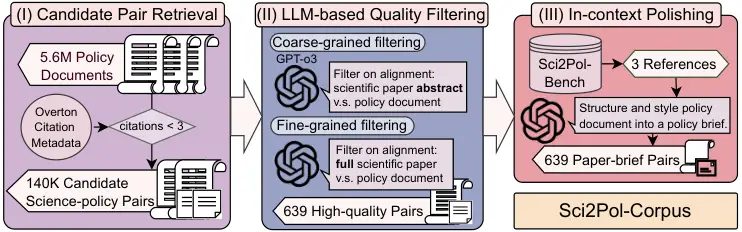

# Sci2Pol: Evaluating and Fine-tuning LLMs on Scientific-to-Policy Brief Generation

Weimin Wu   Alexander C. Furnas   Eddie Yang   Gefei Liu Affiliation:
 Center for Foundation Models and Generative AI, Northwestern
University, IL 60208, USA Affiliation:  Department of Computer Science,
Northwestern University, IL 60208, USA Affiliation:  Center for Science
of Science and Innovation, Northwestern University, IL 60208, USA
Affiliation:  Kellogg School of Management, Northwestern University, IL
60208, USA Affiliation:  Department of Computer Science, Brown
University, RI 02912, USA Affiliation:
 [wwm@u.northwestern.edu](mailto:wwm@u.northwestern.edu)    Akhil Pandey
Akella   Xuefeng Song^(†)   Dashun Wang   Han Liu Affiliation:
 Department of Computer Science, Northwestern University, IL 60208, USA
Affiliation:  Center for Science of Science and Innovation, Northwestern
University, IL 60208, USA Affiliation:  Kellogg School of Management,
Northwestern University, IL 60208, USA Affiliation:
 [dashun.wang@kellogg.northwestern.edu](mailto:dashun.wang@kellogg.northwestern.edu)
Affiliation:  [hanliu@northwestern.edu](mailto:hanliu@northwestern.edu)
Affiliation:  Department of Statistics and Data Science, Northwestern
University, IL 60208, USA

###### Abstract

We propose Sci2Pol-Bench and Sci2Pol-Corpus, the first benchmark and
training dataset for evaluating and fine-tuning large language models
(LLMs) on policy brief generation from a scientific paper. We build
Sci2Pol-Bench on a five-stage taxonomy to mirror the human writing
process: (i) Autocompletion, (ii) Understanding, (iii) Summarization,
(iv) Generation, and (v) Verification. It features 18 tasks in
multiple-choice and open-ended formats. Specifically, for the Generation
stage, we show that BERTScore and ROUGE scores fail to capture the
quality of brief writing, and introduce a new LLM-based evaluation
metric aligned with expert judgement. Using this benchmark, we evaluate
13 leading open-source and commercial LLMs to uncover key limitations.
To improve LLM performance on brief writing, we curate the
Sci2Pol-Corpus for fine-tuning. We start by linking each cited
scientific paper to its corresponding policy document, drawn from 5.6
million policy records. This produces 140,000 candidate pairs. We then
employ an LLM-as-a-judge to filter high-quality examples, followed by
in-context polishing using three expert-written samples as references.
This process yields a final set of 639 new pairs. Finally, we fine-tune
three models on Sci2Pol-Corpus: LLaMA-3.1-8B, Gemma-12B, and Gemma-27B.
Fine-tuning leads to consistent performance improvements across
Sci2Pol-Bench. Notably, after fine-tuning, Gemma-27B surpasses the much
larger GPT-4o and DeepSeek-V3 (671B). These demonstrate the
effectiveness of our corpus in bridging the gap between science and
policy.

Project Page:
[https://github.com/WeiminWu2000/Sci2Pol](https://github.com/WeiminWu2000/Sci2Pol)  
Keywords: Benchmark, Dataset, Science, Policy, LLM

|     |
| --- |
|     |

^(\*)^(\*)footnotetext: Co-corresponding authors.

### 1 Introduction

We propose Sci2Pol-Bench and Sci2Pol-Corpus, the first benchmark and
training dataset for evaluating and fine-tuning LLMs on
scientific-to-policy brief generation. A policy brief is a concise
article that distills the content of a technical scientific paper for a
policymaker audience (Appendix C). Turning scientific evidence into
policy remains critical and difficult for both policymakers and
scientists. Today’s major challenges (e.g., climate change, public
health, and rapid technological shifts) require timely input from
science (Wang and Barabási, 2021). Yet policymakers often struggle to
convert dense, technical research into clear and usable guidance. This
issue is also relevant to the scientific community, as it underscores
the essential role of science in shaping societal outcomes. However,
most scientists lack policy expertise. This gap limits how science
informs real-world decisions (Straf et al., 2012). With the rise of
powerful LLMs, we ask two key questions: (i) To what extent can LLMs
assist in scientific-to-policy brief generation? (ii) How can their
performance be further improved? To address these, we introduce
Sci2Pol-Bench and Sci2Pol-Corpus. Sci2Pol-Bench offers the first
comprehensive benchmark for fine-grained evaluation of
scientific-to-policy generation. Sci2Pol-Corpus provides the first
targeted training dataset to enhance LLM performance on this task.

Although LLMs demonstrate strong general capabilities, prior work shows
they hallucinate scientific content, misverify claims, and produce
unstable or biased policy reasoning (Coz et al., 2025; Bai et al., 2025;
Wadden et al., 2024). To further validate these concerns, we start with
expert-reviewed examples and highlight four key limitations in policy
brief generation (Appendix F): (i) Missing core content: LLMs often fail
to capture a study’s essential details, including its quantitative
findings, methods, and broader context. They omit key facts or add
irrelevant information (see Section F.1). (ii) Hallucinated claims: LLMs
invent numbers or causal statements that do not appear in the source
paper (see Section F.2). (iii) Inappropriate tone: Even when accurate,
the language is often too technical or overly verbose for policy
audiences (see Section F.3). (iv) Low actionability: Recommendations
tend to be vague and weakly supported by evidence (see Section F.4).

Rigorous evaluation in this domain requires a clear decomposition of the
writing process and a dataset that challenges models with authentic,
domain-matched targets. To this end, we define the Scientific-to-Policy
Taxonomy (Sci2Pol-Taxonomy, Figure 1(a)), a five-stage framework for the
brief writing workflow: (i) Autocompletion: Completing missing content
in scientific or policy texts; (ii) Understanding: Identifying and
interpreting key claims, caveats, and methods; (iii) Summarization:
Condensing technical passages into language accessible to policy
audiences; (iv) Generation: Drafting coherent, persuasive prose that
integrates evidence with policy context; (v) Verification: Checking
factual consistency of claims or drafts against the source literature.

Grounded in this taxonomy, we build Sci2Pol-Bench, a suite of 18 diverse
tasks for evaluating model performance in generating policy briefs from
scientific research. We construct domain-specific targets from 85
expert-written paper-brief pairs, representing the complete set of
published pairs. These pairs are drawn from high-impact venues,
including _Nature Energy_, _Nature Climate Change_, _Nature Cities_,
_Nature Sustainability_, and the _Journal of Health and Social
Behavior_. Figure 1(b) presents summary statistics of these pairs. Each
task takes the form of either a multiple-choice probe or an open-ended
format. They enable fine-grained evaluation along both correctness and
writing quality. For the Generation stage, we show that BERTScore and
ROUGE scores fail to capture the quality of the brief writing, and we
design a dedicated evaluation metric using an LLM-as-a-judge approach.
We then conduct the first large-scale evaluation of scientific-to-policy
brief generation across 13 LLMs, covering both open-source and
commercial models. Our results show that even advanced LLMs such as Grok
and DeepSeek-R1 leave substantial room for improvement. These findings
highlight concrete research opportunities in controllable generation and
domain adaptation for policy applications.

(a) Sci2Pol-Taxonomy

(b) Dataset Source

Figure 1: Overview of Sci2Pol-Taxonomy and Dataset Source. (a)
Sci2Pol-Taxonomy defines a five-stage decomposition of the brief writing
process. (b) Complete set of published 85 pairs.

To further improve LLM performance on policy brief generation, we
introduce Sci2Pol-Corpus, the first training dataset designed for this
task. The construction process consists of two resource-intensive steps
followed by a novel polishing step. (i) Retrieving candidate
science-policy pairs: We begin with a large-scale collection of 5.6
million policies indexed by Overton.io and scraped as PDFs from the
public websites that published them (e.g., Government Printing Office,
Congress.gov, The Brookings Institution, The World Bank) (Furnas et al.,
2025; Szomszor and Adie, 2022). From these, we construct 140,000
citation-based candidate pairs by linking policy documents to their
cited scientific papers. To ensure tighter relevance, we filter for
policy files that cite no more than three papers and treat each citation
as a potential paper-brief pair. (ii) Filtering high-quality pairs with
an LLM-as-a-judge approach: We employ GPT-o3 to evaluate whether each
policy document is centered on the cited scientific paper. This
two-stage filtering process yields 639 high-quality pairs. (iii)
Refining briefs through in-context revision: To further align the
collected briefs with the style and structure of expert-written
examples, we select three high-quality samples from the 85 published
pairs. We then use GPT-o3 in an in-context learning setup to revise the
639 identified policy briefs. This step ensures their tone, structure,
and clarity match the expert-written briefs. Finally, we use
Sci2Pol-Corpus to fine-tune three open-source LLMs:
LLaMA-3.1-8B-Instruct, Gemma-12B-Instruct, and Gemma-27B-Instruct.
Fine-tuning on Sci2Pol-Corpus leads to consistent performance
improvements across Sci2Pol-Bench. Notably, after supervised
fine-tuning, Gemma-27B-Instruct surpasses the much larger GPT-4o and
DeepSeek-V3 (671B). These demonstrate the effectiveness of our corpus in
scientific-to-policy brief generation.

In summary, we have the following three contributions:

- •
  We propose Sci2Pol-Bench, the first comprehensive benchmark for
  evaluating LLMs on policy brief generation from scientific papers. We
  build the benchmark on a five-stage workflow framework,
  Sci2Pol-Taxonomy, and include the complete set of 85 published
  expert-written paper-brief pairs. It features 18 tasks and provides
  the first large-scale evaluation across 13 LLMs.
- •
  We curate Sci2Pol-Corpus, the first training dataset for fine-tuning
  LLMs on policy brief generation. It consists of two resource-intensive
  steps followed by a novel polishing step: (i) retrieving 140,000
  candidate science-policy pairs by linking cited scientific papers
  across 5.6 million policy documents; (ii) selecting 639 high-quality
  pairs using an LLM-as-a-judge filtering method; and (iii) enhancing
  these pairs via in-context revision to improve clarity and alignment.
- •
  We use Sci2Pol-Corpus to fine-tune three open-source LLMs:
  LLaMA-3.1-8B-Instruct, Gemma-12B-Instruct, and Gemma-27B-Instruct.
  Fine-tuning leads to consistent performance improvements across
  Sci2Pol-Bench. Notably, after supervised fine-tuning,
  Gemma-27B-Instruct surpasses the much larger GPT-4o and DeepSeek-V3
  (671B). These demonstrate the effectiveness of Sci2Pol-Corpus in
  enhancing LLM capabilities for scientific-to-policy brief generation.

###### Organization.

Section 2 introduces Sci2Pol-Bench. Section 3 details the
Sci2Pol-Corpus. Section 4 shows the evaluation results across 13 LLMs,
and supervised fine-tuning results.

### 2 Sci2Pol-Bench

We detail our Sci2Pol-Bench here. Section 2.1 outlines the core design
principles. Section 2.2 describes the data collection and processing
pipeline. Section 2.3 presents the task definitions and summarizes the
dataset. Section 2.4 details the evaluation metrics, with a particular
focus on an LLM-based evaluation metric for Generation-related tasks to
better align with expert judgement.

#### 2.1 Design Principle

The overall goal of Sci2Pol-Bench is to provide researchers and
practitioners with a transparent, fine-grained assessment of how well
LLMs can translate dense scientific research into actionable policy
briefs. Inspired by the progressive, ability-oriented evaluation
framework of Li et al. (2024a), we introduce a five-stage
Sci2Pol-Taxonomy to mirror the workflow of brief writing.

As illustrated in Figure 1(a), the taxonomy defines five levels of
ability: (i) Autocompletion tasks require LLMs to predict continuations
or recombine sentences. This tests their grasp of local cohesion and
textual fluency. (ii) Understanding tasks involve classifying sentence
intent and answering multiple-choice questions. This evaluates the
model’s factual comprehension and ability to process complex research
narratives. (iii) Summarization tasks focus on distilling scientific
text into concise summaries. These tasks assess the ability to extract
salient points and deliver them. (iv) Generation tasks ask LLMs to
compose new policy brief content from scratch. This requires
synthesizing scientific evidence, contextual understanding, and
persuasive framing into coherent, structured writing. (v) Verification
tasks challenge models to fact-check scientific or policy-related claims
against the source literature. This is critical for mitigating
hallucinations. Following the five stages, Sci2Pol-Bench provides a
robust framework to evaluate the LLMs in bridging science and policy.

#### 2.2 Data Collection and Processing

###### Data Sources.

Sci2Pol-Bench draws from two sources: (i) Existing benchmarks: We
incorporate tasks from established datasets focused on scientific
understanding, including SciRIFF (Wadden et al., 2024) and MMLU-Pro
(Wang et al., 2024). (ii) Newly collected pairs: We curate the
expert-authored paper-brief pairs published across top journals, as
summarized in Figure 1(b). To ensure data quality, we apply a strict
inclusion criterion: the policy brief must be written by the same
authors as the original scientific paper. This guarantees that the
policy content reflects authentic expert interpretation. The final
collection consists of 85 high-quality pairs (see Section J.1 for the
full list).

###### Data Processing and Annotation.

We download each article’s metadata and full text to maintain quality
control. Most policy briefs share titles with their corresponding
scientific articles, so we face little disambiguation. We apply OCR to
extract text from PDFs and use a light preprocessing script to remove
tabs, extra spaces, and stray characters. We store all data in
structured JSON format.

|                |     |                                    |             |      |                       |
| -------------- | --- | ---------------------------------- | ----------- | ---- | --------------------- |
| Taxonomy       | ID  | Task Description                   | Source      | Size | Metric                |
| Autocompletion | 1   | Scientific Text Autocompletion     | Our Dataset | 255  | Micro F1              |
|                | 2   | Political Text Autocompletion      | Our Dataset | 255  | Micro F1              |
|                | 3   | Scientific Sentence Reordering     | Our Dataset | 255  | Micro F1              |
|                | 4   | Political Sentence Reordering      | Our Dataset | 255  | Micro F1              |
| Understanding  | 5   | Sentence Classification            | Our Dataset | 1200 | Micro F1              |
|                | 6   | Scientific Knowledge Understanding | MMLU-Pro    | 1000 | Micro F1              |
| Summarization  | 7   | Policy Problem Summarization       | Our Dataset | 200  | Reference-free Score  |
|                | 8   | Research Findings Summarization    | Our Dataset | 200  | Reference-free Score  |
|                | 9   | Study Methods Summarization        | Our Dataset | 200  | Reference-free Score  |
|                | 10  | Policy Implications Summarization  | Our Dataset | 200  | Reference-free Score  |
| Generation     | 11  | Policy Problem Generation          | Our Dataset | 85   | Reference-based Score |
|                | 12  | Research Findings Generation       | Our Dataset | 85   | Reference-based Score |
|                | 13  | Study Methods Generation           | Our Dataset | 85   | Reference-based Score |
|                | 14  | Policy Implications Generation     | Our Dataset | 85   | Reference-based Score |
|                | 15  | Policy Brief Generation            | Our Dataset | 85   | Reference-based Score |
| Verification   | 16  | Scientific Claims Verification     | Our Dataset | 850  | Micro F1              |
|                | 17  | Scientific Claims Verification 2   | SciRIFF     | 1000 | Micro F1              |
|                | 18  | Policy Implications Verification   | Our Dataset | 700  | Micro F1              |

Table 1: Summary of Sci2Pol-Bench. Sci2Pol-Bench comprises 18 tasks.
Each task specifies an ID, task description, data source, sample size,
and evaluation metric.

#### 2.3 Task Definition and Dataset Summary

Guided by the Sci2Pol-Taxonomy, we construct 18 evaluation tasks
(Table 1). Two tasks come from existing datasets, and experts construct
the remaining sixteen. We describe each task in detail below.

##### 2.3.1 Autocompletion (Tasks 1-4)

These tasks probe local coherence: given a short scientific or policy
passage, the model selects the next sentence (multiple choice) or
restores a shuffled sequence.

###### Task 1: Scientific Text Autocompletion (Multiple Choice).

This task tests local discourse coherence in scientific writing. The
dataset contains 255 items drawn from 85 articles, with 3 items selected
per paper. We construct each example in two steps: (i) Extract a
sequence of three consecutive sentences from the article. Use the first
two sentences as the prompt and the third as the gold (correct)
continuation. (ii) Construct five candidate continuations for each
prompt: one gold sentence (the true continuation) and four distractor
sentences sampled from the nearby context in the same paper. We ask the
model to choose the correct answer from five options. See Table 45 for
an example.

###### Task 2: Political Text Autocompletion (Multiple Choice).

This task tests coherence in policy writing. The dataset contains 255
items from 85 professional policy briefs, with 3 items selected per
brief. We construct each example in two steps: (i) Extract a sequence of
three consecutive sentences from the brief. Use the first two sentences
as the prompt and the third as the gold (correct) continuation. (ii)
Construct five candidate continuations for each prompt: one gold
sentence (the true continuation) and four distractor sentences sampled
from the nearby context in the same brief. We ask the model to choose
the correct answer from five options. See Table 46 for an example.

###### Task 3: Scientific Sentence Reordering (Recombination).

This task probes discourse-level coherence in scientific writing. We
reuse the 255 three-sentence triplets from Task 1, shuffle each triplet,
and ask the model to restore the original order. See Table 47 for an
example.

###### Task 4: Political Sentence Reordering (Recombination).

This task probes discourse coherence in policy briefs. We reuse the 255
three-sentence triplets from Task 2, shuffle each triplet, and ask the
model to restore the original order. See Table 48 for an example.

##### 2.3.2 Understanding (Tasks 5-6)

Tasks 5-6 evaluate sentence-level comprehension and scientific
knowledge. Task 5 classifies sentences from scientific papers into five
policy brief-relevant categories. Task 6 evaluates scientific knowledge.

###### Task 5: Sentence Classification (Multiple Choice).

This task assesses the classification of policy brief-relevant sentences
by rhetorical role or content. The dataset includes 1,200 manually
verified samples from paper-brief pairs. We curate in three steps: (i)
For each pair, use a templated prompt (see Section L.7) to generate 15
labeled examples with GPT-o3; (ii) Political experts manually review
labels and language quality; (iii) Select a random subset of 1,200
samples. Each instance consists of one sentence and a label from a fixed
set (e.g., _Policy Problem_, _Scientific Research Findings_, _Scientific
Research Study Methods_, _Policy Implications_, _None_). See Table 49
for an example.

###### Task 6: Scientific Knowledge Understanding (Multiple Choice).

This task evaluates broad scientific knowledge with multiple-choice
questions from MMLU-Pro (Wang et al., 2024). The full subset contains
3,511 questions across health, chemistry, economics, and biology. We
treat these as one task and sample 1,000 questions randomly for
evaluation. This baseline enables comparison between general-purpose and
science-specialized models. See Table 50 for an example.

##### 2.3.3 Summarization (Tasks 7-10)

Tasks 7-10 evaluate policy-oriented summarization. We show the details
as follows.

###### Task 7: Policy Problem Summarization (Writing).

We evaluate the ability to identify and summarize the policy problem
motivating a study. The dataset includes 200 examples. We curate the
dataset following three steps: (i) For each pair, select up to three
paragraphs relevant to the brief’s policy problem; (ii) If fewer exist,
include all reliably matched paragraphs; (iii) From the final 233
paragraph sets, sample 200 randomly for evaluation. See Table 51 for an
example.

###### Task 8: Research Findings Summarization (Writing).

We evaluate the summarization of core scientific findings. The dataset
includes 200 examples. We curate the dataset following two steps: (i)
For each pair, select three paragraphs aligned with the brief’s
findings; (ii) From 255 sets, sample 200 randomly for evaluation. See
Table 52 for an example.

###### Task 9: Study Methods Summarization (Writing).

We evaluate the summarization of methodology in policy brief-relevant
terms. The dataset includes 200 examples. We curate it following two
steps: (i) For each pair, select three paragraphs that describe the
methodology reflected in the brief; (ii) From 255 sets, sample 200
randomly for evaluation. See Table 53 for an example.

###### Task 10: Policy Implications Summarization (Writing).

We evaluate the articulation of policy implications grounded in the
source paper. The dataset includes 200 examples. We curate the dataset
following three steps: (i) For each pair, select up to three paragraphs
that support the brief’s implications; (ii) If fewer exist, include all
reliably matched paragraphs; (iii) From 222 sets, sample 200 randomly
for evaluation. See Table 54 for an example.

##### 2.3.4 Generation (Tasks 11-15)

These tasks evaluate brief generation: policy problem, findings,
methods, implications, and full brief. We provide a detailed
justification for separating section-by-section generation (Tasks 11-14)
from full-brief generation (Task 15) in Section H.7. In short, Tasks
11-14 complement Task 15 by disentangling factual precision from
holistic coherence. Section-level generation emphasizes accurate
grounding, while full-brief generation assesses overall readability.
Evaluating both provides a more comprehensive view of LLM performance
and uncovers trade-offs that Task 15 alone can not capture.

###### Task 11: Policy Problem Generation (Writing).

We generate the _Policy Problem_ section from the full scientific paper
(85 examples). For each pair, we extract the brief’s _Policy Problem_ as
a reference and provide the full paper as input. For 20 _Journal of
Health and Social Behavior_ pairs, they lack a clear _Policy Problem_
section. We prompt GPT-o3 (see Section L.8) to construct the _Policy
Problem_ section with inputs: the full paper, the brief’s _Research
Problem & Data_ section, and three in-context expert-written examples
from the remaining 65 _Nature_ journals. See Table 55 for an example.

###### Task 12: Research Findings Generation (Writing).

We generate the _Research Findings_ section from the full paper (85
examples). For each pair, we extract the brief’s _Research Findings_ as
reference and provide the full paper as input. See Table 56 for an
example.

###### Task 13: Study Methods Generation (Writing).

We generate the _Research Study_ section (85 examples). For each pair,
we extract the brief’s _Research Study_ as reference and provide the
full paper as input. For 20 _Journal of Health and Social Behavior_
pairs, the briefs lack a clear _Research Study_ section. We prompt
GPT-o3 (see Section L.9) to construct the _Research Study_ section using
the full paper, the brief’s _Research Problem & Data_ section, and three
in-context expert-written examples from the remaining 65 _Nature_
journals. See Table 57 for an example.

###### Task 14: Policy Implications Generation (Writing).

We generate the _Policy Implications_ section (85 examples). For each
pair, we extract the ground-truth policy implications as a reference and
provide the full scientific paper as input. See Table 58 for an example.

###### Task 15: Policy Brief Generation (Writing).

We generate an entire policy brief (85 examples). For each pair, we
build the reference by concatenating _Title_, _Policy Problem_,
_Research Findings_, _Research Study_, and _Policy Implications_. Input
is the full paper. See Table 59 for an example.

##### 2.3.5 Verification (Tasks 16-18)

Tasks 16-18 assess consistency between claims (findings or policy
implications) and the source paper.

###### Task 16: Scientific Claims Verification (Multiple Choice).

We evaluate whether a scientific claim is supported by the paper (850
samples). We construct in two steps: (i) For each paper, prompt GPT-o3
(see Section L.10) to generate 10 labeled samples (total 850); (ii) Our
political experts manually review all samples and correct three issues.
See Table 60 for an example.

###### Task 17: Scientific Claims Verification 2 (Multiple Choice).

We evaluate claim-evidence entailment using SciRIFF subsets (Wadden et
al., 2024): _covidfact entailment_, _healthver entailment_, and _scifact
entailment_ (1,220 samples). We sample 1,000 randomly for evaluation.
Each instance presents a claim (e.g., _support_) and associated
evidence. See Table 61 for an example.

###### Task 18: Policy Implications Verification (Multiple Choice).

We evaluate whether a policy implication follows from the paper (700
samples). We construct in four steps: (i) Extract all implications from
each brief and label them _support_; (ii) Prompt GPT-o3 to generate
contradicted implications (see Section L.11) and label them _contradict_
after manual review of our experts; (iii) Combine to yield 706 samples;
(iv) Sample 700 randomly for evaluation. Each instance includes a paper,
a policy implication, and a label (_support_ or _contradict_). See
Table 62 for an example.

#### 2.4 Evaluation Metrics

In this part, we report detailed evaluation metrics for each task, with
a particular focus on Tasks 11-15.

###### Micro F1 (Tasks 1-6, 16-18).

We compute per-item correctness and use Micro-F1 as the main score. We
choose this metric for classification tasks with a firm correct answer.
This group includes autocompletion (Tasks 1-4), understanding (Tasks
5-6), and verification (Tasks 16-18).

###### Reference-free Score (Tasks 7-10).

We use Gemini-2.5-Pro as an LLM judge to score section summaries. The
judge evaluates four dimensions of a summary: _clarity_, _accuracy_,
_coverage_, and _overall quality_. We select this metric because these
tasks involve free-form writing without a single referenced correct
answer. See Section L.1 for the full prompt and calculation details.

For Tasks 11–15, we first demonstrate the limitations of BERTScore and
ROUGE scores, and then introduce a task-specific reference-based score
for more accurate evaluation.

###### Limitations in BERTScore and ROUGE Scores for Tasks 11-15.

As shown in Section H.1, BERTScore remains high even when key sections
are missing, as overlapping words inflate similarity. ROUGE scores
penalize paraphrasing and drop sharply with minor grammatical changes,
despite preserved meaning. Neither metric captures reasoning, structure,
or evidence linkage.

###### Reference-based Score (Tasks 11-15).

We evaluate the generation tasks using content-aware LLM judging, guided
by paper-grounded rubrics that rely on both the paper and policy brief
sections.

###### Task 11 (Policy Problem).

We score by content and structure because a policy problem contains
linked and causal sentences. We describe five parts as the full space of
content in a policy problem, but any subset may appear, and the order
may vary. (i) _Background_ sets the scene. (ii) _Existing problem_
states the current obstacle. (iii) _Consequences_ describe risks if the
problem stays unsolved. (iv) _Attention problem_ names the issue that
calls for action. (v) _Supporting detail_ adds facts, numbers, or
sources that help this flow. For each part, we judge two things: its
_importance_ in the paper and its _quality_ in the candidate. This
checks what to say and how well it is said, balancing relevance and
quality. See Section L.2 for the full prompt and calculation details.

###### Task 12 (Research Findings).

We score by content only because findings are mostly independent. The
judge rates five aspects. We check (i) _completeness_, (ii)
_importance_, and (iii) _accuracy_ of the candidate findings. (iv)
_Summarizing findings_ checks if the text highlights the key results
rather than a long list. (v) _Specification to findings_ checks scope,
context, and limits. This rubric rewards correct, essential, and
well-focused content. See Section L.3 for the full prompt and
calculation details.

###### Task 13 (Study Methods).

We score by content only because method points are independent. The LLM
judge rates three aspects. (i) _Clarity and purpose_ checks if the text
explains what method is used and why, in a clear output. (ii)
_Technicality appropriateness_ checks if the level of detail fits a
policy audience without jargon. (iii) _Explanation of terms_ checks if
models, data, and acronyms are explained in plain words. Note that
_clarity and purpose_ and _technicality appropriateness_ carry more
weight in evaluation, because _explanation of terms_ only serves as an
extra signal. This rubric rewards clear intent, appropriate detail, and
good definitions. See Section L.4 for details.

###### Task 14 (Policy Implications).

We score by content only because implications are written as separate
points. The LLM judge rates four aspects. (i) _Accuracy_ checks if the
implications are supported by the paper without speculation or
hallucination. (ii) _Coverage_ checks if all major implications are
included. (iii) _Conciseness and distinctness_ checks if each
implication is concise and non-redundant. (iv) _Alignment with paper
intent_ checks if the implications match the paper’s main message, such
as a recommendation, warning, or call to awareness. This rubric rewards
grounded, complete, and actionable implications. See Section L.5 for the
full prompt and calculation details.

###### Task 15 (Full Policy Brief).

We score by content and style together. The LLM judge rates four
aspects. (i) _Contextual depth_ checks if the brief captures key
findings, methods, and context without missing facts or adding fluff.
(ii) _Hallucination risk_ checks if every claim is traceable to the
paper, with penalties for unsupported numbers or causal links. (iii)
_Readability tone_ checks if the text is concise, structured, active,
and suitable for policymakers. (iv) _Actionability_ checks if the
implications are concrete, tied to evidence, and useful for policy. This
rubric rewards briefs that are accurate, clear, credible, and practical.
See Section L.6 for the full prompt and calculation details.

### 3 Sci2Pol-Corpus

In this section, we give the details of the Sci2Pol-Corpus. It comprises
639 high-quality paper-brief pairs curated from 5.6 million policy
documents. It includes three steps: (i) Retrieving candidate
science-policy pairs (Section 3.1); (ii) Filtering high-quality pairs
with an LLM-as-a-judge approach (Section 3.2); (iii) Polishing briefs
through in-context revision (Section 3.3).



Figure 2: Overview of the Sci2Pol-Corpus Curation Process. It consists
of 639 paper–brief pairs. Pair retrieval relies on the original policy
documents and the scientific papers they cite as candidates.

#### 3.1 Candidate Pair Retrieval

We begin with a large-scale political dataset collection. This
collection is derived from documents indexed by Overton, the world’s
largest database of policy literature(Furnas et al., 2025; Szomszor and
Adie, 2022; Yin et al., 2022). From there, we retrive pdf and html
policy documents from the public websites of the original publishing
organizations and the United States Government Printing Office, IGOs
like, the OECD, the UN, and the WHO and numerous think tanks like the
Brookings Institution and the Heritage Foundation. These documents cover
a broad range of domains, topics and geographic regions. They provide a
rich foundation for identifying scientific publications cited in
real-world policy contexts. Leveraging Overton’s citation metadata, we
identify the scientific papers cited by each policy document. Each
citation forms a candidate paper-brief pair, and links a scientific
publication to a policy document that references it. To prioritize
relevance, we apply a heuristic: The fewer scientific papers a policy
document cites, the more likely it is to focus on each one. This
assumption increases the likelihood that the policy document reflects or
interprets the cited scientific content. Based on this insight, we
retain only policy documents that cite no more than three scientific
papers. This yields a high-quality pool of 140,000 candidate pairs for
further filtering.

#### 3.2 LLM-based Quality Filtering

In this stage, we employ GPT-o3 for automated quality filtering to
assess whether the policy document centers on the scientific content. It
extracts 639 high-quality pairs from 140,000 candidate pairs with two
steps: (i) Coarse-grained filtering based on the alignment between the
scientific paper abstract and the policy document, and (ii) Fine-grained
filtering based on the alignment between the full scientific paper and
the policy document. The rationale for this design is to reduce the
filtering cost.

###### Coarse-grained Filtering.

Scientific papers are often long, typically over 10 pages, and sometimes
more than 30. Assuming 500 words per page, this corresponds to about
5,000 to 15,000 words per paper. Assuming each word maps to one token in
the GPT-o3 embedding layer, the total token count for 140,000 papers
exceeds 700 million. At a rate of \$2 per million tokens, the cost of
processing full texts becomes very high. To reduce cost while preserving
essential information, we use only the paper abstracts in this filtering
stage. We extract these abstracts from SciSciNet (Lin et al., 2023). If
a paper is not found in SciSciNet, we discard the corresponding
candidate pair. Given a scientific paper abstract and its associated
policy document, we prompt GPT-o3 to assess whether the policy document
centers on the scientific content described in the abstract. See
Table 75 for the detailed prompt of GPT-o3. As a result, we obtain 1,407
potential high-quality pairs from this step.

After the GPT-o3-based filtering, we observe that some policy documents
are too long and exceed 10 pages. For standard policy briefs, we prefer
shorter documents, typically fewer than 10 pages. Among the 1,407 pairs,
777 pairs contain policy documents under 10 pages, while 630 pairs
involve longer documents. To make use of the 630 longer policy
documents, we manually extract their executive summaries when available
and treat these as the pseudo-policy briefs. For each such case, we
constructed two pairs: (i) the executive summary paired with the
corresponding scientific paper, and (ii) the executive summary paired
with the remaining portion of the policy document. In the second case,
the remaining text serves as a pseudo-scientific paper, since it often
delivers science-related technical details. If a long policy document
did not contain a summary, we discarded it. After this process, we
retain 234 usable pairs from the long policy documents. Combined with
the 777 pairs involving policy documents under 10 pages, this yields a
total of 1,011 curated pairs.

|                   |                  |                  |                  |                  |                  |                  |      |
| ----------------- | ---------------- | ---------------- | ---------------- | ---------------- | ---------------- | ---------------- | ---- |
|                   | Sci2Pol-Taxonomy |                  |                  |                  |                  | Avg.             | Rank |
| Model             | Auto. (1-4)      | Under. (5-6)     | Sum. (7-10)      | Gene. (11-15)    | Ver. (16-18)     |                  |      |
| Grok-3-beta       | 50.77$`\pm`$2.89 | 80.12$`\pm`$1.22 | 83.26$`\pm`$0.05 | 86.70$`\pm`$0.98 | 85.45$`\pm`$0.86 | 77.01$`\pm`$1.20 | 1    |
| DeepSeek-R1       | 44.76$`\pm`$3.11 | 86.61$`\pm`$1.04 | 80.83$`\pm`$0.04 | 84.75$`\pm`$1.26 | 83.84$`\pm`$1.05 | 75.05$`\pm`$1.34 | 2    |
| Qwen3-235B        | 47.22$`\pm`$3.03 | 87.19$`\pm`$0.94 | 77.02$`\pm`$0.15 | 84.80$`\pm`$1.30 | 83.76$`\pm`$0.99 | 74.81$`\pm`$1.34 | 3    |
| DeepSeek-V3       | 39.54$`\pm`$3.06 | 79.35$`\pm`$1.28 | 78.97$`\pm`$0.05 | 86.23$`\pm`$1.26 | 85.48$`\pm`$0.85 | 73.35$`\pm`$1.33 | 4    |
| GPT-4o            | 52.17$`\pm`$3.00 | 77.17$`\pm`$1.32 | 74.23$`\pm`$0.06 | 76.39$`\pm`$1.28 | 85.45$`\pm`$0.82 | 72.12$`\pm`$1.32 | 5    |
| Gemma-3-27B       | 43.60$`\pm`$2.83 | 67.82$`\pm`$1.42 | 74.55$`\pm`$0.05 | 84.82$`\pm`$1.16 | 84.29$`\pm`$0.98 | 71.40$`\pm`$1.28 | 6    |
| Claude-3.7-Sonnet | 44.06$`\pm`$3.00 | 80.06$`\pm`$1.19 | 82.71$`\pm`$0.05 | 73.59$`\pm`$3.61 | 83.24$`\pm`$1.04 | 71.38$`\pm`$1.99 | 7    |
| Mistral-Large     | 44.09$`\pm`$2.92 | 76.27$`\pm`$1.23 | 78.57$`\pm`$0.05 | 75.09$`\pm`$1.42 | 81.87$`\pm`$1.11 | 70.23$`\pm`$1.38 | 8    |
| LLaMA-3.3-70B-IT  | 53.16$`\pm`$2.72 | 74.14$`\pm`$1.38 | 71.22$`\pm`$0.06 | 69.89$`\pm`$1.62 | 85.71$`\pm`$0.87 | 69.58$`\pm`$1.37 | 9    |
| LLaMA-4-Maverick  | 38.74$`\pm`$2.90 | 83.81$`\pm`$1.01 | 72.47$`\pm`$0.06 | 74.95$`\pm`$1.38 | 84.16$`\pm`$0.95 | 68.87$`\pm`$1.31 | 10   |
| Qwen3-8B          | 35.15$`\pm`$2.88 | 80.84$`\pm`$1.21 | 74.08$`\pm`$0.17 | 77.79$`\pm`$1.49 | 81.87$`\pm`$1.01 | 68.51$`\pm`$1.39 | 11   |
| Gemma-3-12B       | 42.96$`\pm`$2.79 | 69.61$`\pm`$1.28 | 71.79$`\pm`$0.05 | 77.34$`\pm`$1.44 | 82.51$`\pm`$1.06 | 68.47$`\pm`$1.35 | 12   |
| LLaMA-3.1-8B-IT   | 27.12$`\pm`$2.53 | 47.74$`\pm`$1.54 | 64.42$`\pm`$0.05 | 65.78$`\pm`$1.71 | 76.25$`\pm`$1.27 | 56.63$`\pm`$1.43 | 13   |

Table 2: Performance of LLMs on Sci2Pol-Bench. We report average scores
for 13 LLMs across the five categories of Sci2Pol-Taxonomy. Tasks 1-6
and 16-18 use Micro F1. Tasks 7-10 use a reference-free score, while
Tasks 11-15 use a reference-based score. Both of these are judged on
Gemini-2.5-Pro.

Figure 3: Visualization of Performance of 13 LLMs on Sci2Pol Bench. We
show the average performance of commercial and open source LLMs across
the five categories of the Sci2Pol-Taxonomy.

###### Fine-grained Filtering.

We use GPT-o3 with the full scientific paper and the policy document for
fine-grained filtering. The main goal is still to verify whether the
policy document centers on the scientific content. However, some pairs
originate from the same long policy document, where the executive
summary serves as a policy brief and the remaining content acts as a
proxy for the scientific paper. We need to avoid these pairs if the two
texts are too similar. To handle this, we add a new criterion that
measures similarity between the paper and the policy document. This step
goes beyond the original metrics used in coarse-grained filtering. See
Table 76 for the detailed GPT-o3 prompt.

#### 3.3 In-context Polishing

The last step polishes the policy document. Our policy documents come
from official organizations and focus on policy, not briefs. Their
format and style do not match a standard policy brief. We propose
in-context polishing to align them. We select three expert-written
paper-brief pairs from the 85 pairs in Sci2Pol-Bench as references. We
then provide the scientific paper and the policy document to GPT-o3 and
ask it to revise the document into a standard policy brief while
preserving facts and citations. See Table 77 for the detailed prompt.
This step does not inject scientific or political content from the three
expert-written paper-brief pairs. It only follows their writing style
and format. To further validate that this step does not introduce
information leakage from Sci2Pol-Bench, we conduct additional
experiments, with details provided in Section H.9.

### 4 Experimental Studies

In this section, we present the performance of LLMs on Sci2Pol-Bench
(Section 4.1) and demonstrate the performance gains achieved through
supervised fine-tuning on Sci2Pol-Corpus (Section 4.2).

#### 4.1 LLMs Performance on Sci2Pol-Bench

We evaluate 13 models, including both commercial and open-source models:
(1) ChatGPT-4o, (2) Claude-3.7-Sonnet, (3) Gemma-3-27B, (4) Gemma-3-12b,
(5) Grok-3-beta, (6) DeepSeek-R1, (7) DeepSeek-V3, (8) Qwen3-235B-A22B,
(9) Qwen3-8B, (10) Mistral-Large (11) LLaMA-4-Maverick-17B-128E, (12)
LLaMA-3.3-70B-Instruct, and (13) LLaMA-3.1-8B-Instruct. For each
setting, we conduct 1,000-iteration bootstrap significance tests (seed = 42) and report the mean and standard deviation. We summarize average
performance scores across the Sci2Pol-Taxonomy in Table 2 and visualize
the performance of open-source and commercial models in Figure 3.
Section G.2 provides full results for all 18 tasks, and see Section G.1
for the detailed experimental settings.

We include further analysis in Appendix H, covering: (1) human baseline
(Section H.2); (2) common failure modes (Section H.3); (3) what SFT
learns (Section H.4); (4) the impact of prompt length (Section H.5); (5)
the reliability of the Gemini-based judge (Section H.6); (6)
over-endorse analysis in Tasks 16 and 18 (Section H.8); (7) information
leakage testing of in-context polishing (Section H.9); (8) potential
circularity in benchmark construction (Section H.10); (9) saturation
analysis (Section H.11); (10) trade-offs in generating briefs from
abstracts, introductions, or full papers (Section H.12).

|                  |                  |                  |                  |                  |                  |                  |       |
| ---------------- | ---------------- | ---------------- | ---------------- | ---------------- | ---------------- | ---------------- | ----- |
|                  | Sci2Pol-Taxonomy |                  |                  |                  |                  | Avg.             | Gain  |
| Model            | Auto. (1-4)      | Under. (5-6)     | Sum. (7-10)      | Gene. (11-15)    | Ver. (16-18)     |                  |       |
| LLaMA-3.1-8B-IT  | 27.12$`\pm`$2.53 | 47.74$`\pm`$1.54 | 64.42$`\pm`$0.05 | 65.78$`\pm`$1.71 | 76.25$`\pm`$1.27 | 56.63$`\pm`$1.43 | \-    |
| LLaMA-3.1-8B-SFT | 31.27$`\pm`$2.90 | 44.34$`\pm`$1.48 | 78.28$`\pm`$1.25 | 77.62$`\pm`$1.55 | 80.59$`\pm`$1.08 | 64.27$`\pm`$1.70 | +7.64 |
| Gemma-3-12B      | 42.96$`\pm`$2.79 | 69.61$`\pm`$1.28 | 71.79$`\pm`$0.05 | 77.34$`\pm`$1.44 | 82.51$`\pm`$1.06 | 68.47$`\pm`$1.35 | \-    |
| Gemma-3-12B-SFT  | 43.14$`\pm`$2.86 | 69.53$`\pm`$1.25 | 84.19$`\pm`$1.19 | 78.57$`\pm`$1.53 | 82.48$`\pm`$1.05 | 71.59$`\pm`$1.64 | +3.12 |
| Gemma-3-27B      | 43.60$`\pm`$2.83 | 67.82$`\pm`$1.42 | 74.55$`\pm`$0.05 | 84.82$`\pm`$1.16 | 84.29$`\pm`$0.98 | 71.40$`\pm`$1.28 | \-    |
| Gemma-3-27B-SFT  | 45.39$`\pm`$2.90 | 67.44$`\pm`$1.36 | 86.36$`\pm`$1.06 | 81.53$`\pm`$1.60 | 84.06$`\pm`$0.96 | 73.43$`\pm`$1.64 | +2.03 |
| DeepSeek-V3      | 39.54$`\pm`$3.06 | 79.35$`\pm`$1.28 | 78.97$`\pm`$0.05 | 86.23$`\pm`$1.19 | 85.48$`\pm`$0.85 | 73.35$`\pm`$1.33 | \-    |
| GPT-4o           | 52.17$`\pm`$3.00 | 77.17$`\pm`$1.32 | 74.23$`\pm`$0.06 | 76.39$`\pm`$1.28 | 85.45$`\pm`$0.82 | 72.12$`\pm`$1.32 | \-    |

Table 3: Performance of LLMs after Supervised Fine-tuning (SFT) on
Sci2Pol-Corpus. We fine-tune three models: LLaMA-3.1-8B-Instruct,
Gemma-3-12B, and Gemma-3-27B on Sci2Pol-Corpus, and report their average
performance across the Sci2Pol-Taxonomy before and after fine-tuning.

#### 4.2 Supervised Fine-tuning on Sci2Pol-Corpus

We validate the effectiveness of Sci2Pol-Corpus by fine-tuning three
models: (1) LLaMA-3.1-8B-Instruct, (2) Gemma-3-12B, and (3) Gemma-3-27B.
Table 3 shows the results. All fine-tuned models show consistent
improvements across Sci2Pol-Bench. Notably, fine-tuned Gemma-3-27B
outperforms both GPT-4o and DeepSeek-V3 (671B), despite their
significantly larger scale or broader capabilities. These findings
highlight the value of domain-specific supervision in Sci2Pol-Corpus. It
indeed captures policy-relevant reasoning. See Section G.1 for the
experimental details. The cross-domain generality of our SFT methodology
is further shown in Appendix I.

### 5 Conclusion

We present Sci2Pol-Bench and Sci2Pol-Corpus, the first benchmark and
training dataset designed specifically for evaluating and improving
large language models on scientific-to-policy brief generation. Grounded
in a five-stage taxonomy that mirrors the human writing process
(Autocompletion, Understanding, Summarization, Generation, and
Verification), Sci2Pol-Bench offers a fine-grained evaluation framework
spanning 18 tasks. Our results show that even state-of-the-art LLMs
struggle with factual grounding, actionability, and policy-appropriate
reasoning, and that commonly used metrics such as ROUGE and BERTScore
fail to capture brief-writing quality.

To address these limitations, we curate Sci2Pol-Corpus from 5.6 million
policy documents, producing 639 high-quality paper–brief pairs through
citation-based retrieval, LLM-assisted filtering, and expert-guided
in-context polishing. Fine-tuning on this corpus yields consistent gains
across Sci2Pol-Bench. Notably, a fine-tuned Gemma-27B model surpasses
much larger commercial systems, demonstrating that targeted,
domain-specific supervision can outweigh scale for scientific-to-policy
translation.

Together, these resources establish foundational infrastructure for
studying and improving how language models translate scientific evidence
into actionable policy guidance. We hope Sci2Pol-Bench and
Sci2Pol-Corpus will catalyze future research toward models that not only
understand science but can responsibly and effectively inform policy in
high-stakes societal domains. We also provide detailed LLM usage in
Appendix A, dataset links in Appendix B, limitations, future work, and
broader impacts in Appendix D, and related works in Appendix E.

### Reproducibility Statement

We have made efforts to ensure the reproducibility of our work. The full
details of our benchmark construction, dataset curation, and model
evaluation are provided in the main text and appendices. For all 18
tasks in Sci2Pol-Bench, we describe the data sources, annotation
protocols, and evaluation metrics in detail (Section 2). The
construction steps of Sci2Pol-Corpus, including citation-based
retrieval, LLM-based filtering, and in-context polishing, are documented
in Section 3. We release all prompt templates and scoring rubrics in
Appendix L. To facilitate replication, we include the code in the
supplementary materials. For each supervised fine-tuning experiment, we
specify training configurations and hardware setup in Section G.1.
Collectively, these resources ensure that our results can be verified
and extended by the community.

### Ethic Statement

###### Human-in-the-loop Annotation Process.

All reviewers involved in task development and verification are
postdoctoral researchers or research faculty in political science. They
are co-authors of this paper and serve as domain experts throughout the
benchmark and dataset construction. No monetary compensation is
provided; their participation is motivated by scholarly collaboration
and a shared commitment to advancing evidence-based policymaking.

###### Details of Human Involvement in Label Generation.

Three tasks (5, 16, and 18) use GPT-o3 to propose initial labeled items,
and all of them undergo full human verification. Each task is reviewed
independently by two reviewers, with 100% reviewer agreement across all
accepted items. For all 1,200 samples in Task 5, no corrections are
required. For Task 16, reviewers examine all 850 samples and correct
three mislabeled cases (correction rate $`\approx 0.35\%`$). For Task
18, reviewers validate all 706 generated contradictory implications, and
no corrections are needed.

###### Copyright and Use of Scientific Papers.

The benchmark and dataset are built from publicly accessible content
such as article metadata. We release only article DOIs, metadata, access
dates, policy brief metadata, and our annotations. The benchmark and
dataset are released under CC-BY-NC 4.0, with a two-tier protocol (open
metadata + controlled transformed excerpts), and no publisher-owned text
is redistributed. Derived tasks (e.g., summarization in Sci2Pol-Bench)
rely solely on reformulated excerpts for non-commercial academic
purposes.

We also document potential impacts and implement explicit safeguards:
all tasks require evidence-based summarization (not prescriptive
advice), prompts prohibit unsupported claims, and evaluation judges
penalize fabricated, speculative, or over-confident policy
recommendations. To reduce evaluation variance and bias, we employ
rubric-anchored scoring, multi-model judging, and expert-labeled
calibration samples. These measures establish clear licensing
boundaries, release protocols, bias-mitigation procedures, and
risk-assessment practices appropriate for policy-oriented datasets.

For transparency, we provide a detailed list of all used paper–brief
pairs in Section J.1, including DOIs, sources, and access dates.

### Acknowledgments

WW would like to thank Robin Luo, Yichi Zhang, Qineng Wang, and Kongdi
Zheng for enlightening discussions on related topics.

We acknowledge grant support from the National Science Foundation (award
No. 2404035).

### References

- Achiam et al. (2023) J. Achiam, S. Adler, S. Agarwal, L. Ahmad, I.
  Akkaya, F. L. Aleman, D. Almeida, J. Altenschmidt, S. Altman, S.
  Anadkat, et al. Gpt-4 technical report. arXiv preprint
  arXiv:2303.08774. Cited by: §E.1.
- Agiza et al. (2024) A. Agiza, M. Mostagir, and S. Reda PoliTune:
  analyzing the impact of data selection and fine-tuning on economic and
  political biases in large language models. In Proceedings of the 2024
  AAAI/ACM Conference on AI, Ethics, and Society, pp. 2–12. Cited by:
  §E.2.
- Anderson and Ray-Warren (2022a) K. F. Anderson and D. Ray-Warren
  Racial-ethnic residential clustering and early covid-19 vaccine
  allocations in five urban texas counties. Journal of health and social
  behavior 63 (4), pp. 472–490. External Links:
  [Document](https://dx.doi.org/10.1177/00221465221074915) Cited by:
  item 74.
- Anderson and Ray-Warren (2022b) K. F. Anderson and D. Ray-Warren
  Racial-ethnic residential clustering and early covid-19 vaccine
  allocations in five urban texas counties. Journal of health and social
  behavior 63 (4), pp. 472–490. External Links:
  [Document](https://dx.doi.org/10.1177/00221465221130917) Cited by:
  item 74.
- Andreoni et al. (2024a) P. Andreoni, J. Emmerling, and M. Tavoni
  Financing negative emissions leads to windfall profits and inequality
  at net zero. nature climate change 14 (1), pp. 20–21. Cited by: item 46.
- Andreoni et al. (2024b) P. Andreoni, J. Emmerling, and M. Tavoni
  Inequality repercussions of financing negative emissions. Nature
  Climate Change 14 (1), pp. 48–54. Cited by: item 46, Table 5.
- Anshassi and Townsend (2025a) M. Anshassi and T. G. Townsend Improving
  waste systems in the global south to tackle international
  environmental impacts. Nature Sustainability, pp. 1–11. Cited by: item 7.
- Anshassi and Townsend (2025b) M. Anshassi and T. G. Townsend The
  broader benefits of waste system investments in the global south:
  sustainable materials. Nature Sustainability, pp. 1–2. Cited by: item 7.
- Apostoleris et al. (2018) H. Apostoleris, S. Sgouridis, M. Stefancich,
  and M. Chiesa Evaluating the factors that led to low-priced solar
  electricity projects in the middle east. Nature Energy 3 (12),
  pp. 1109–1114. Cited by: item 36.
- Apostoleris et al. (2019) H. Apostoleris, S. Sgouridis, M. Stefancich,
  and M. Chiesa Utility solar prices will continue to drop all over the
  world even without subsidies. Nature Energy 4 (10), pp. 833–834. Cited
  by: item 36.
- Arnautu and Dagenais (2021) D. Arnautu and C. Dagenais Use and
  effectiveness of policy briefs as a knowledge transfer tool: a scoping
  review. Humanities and Social Sciences Communications 8 (1), pp. 1–14.
- Augustine (2021a) J. M. Augustine Mothers’ out-of-sequence
  postsecondary education and their health and health behaviors. Journal
  of health and social behavior 62 (1), pp. 2–18. External Links:
  [Document](https://dx.doi.org/10.1177/0022146520979664) Cited by: item 75.
- Augustine (2021b) J. M. Augustine Mothers’ out-of-sequence
  postsecondary education and their health and health behaviors. Journal
  of health and social behavior 62 (1), pp. 2–18. External Links:
  [Document](https://dx.doi.org/10.1177/0022146520986008) Cited by: item 75.
- Azar (2024a) A. Azar Work–family life course trajectories and women’s
  mental health: the moderating role of defamilization policies in 15
  european territories. Journal of health and social behavior 65 (4),
  pp. 468–488. External Links:
  [Document](https://dx.doi.org/10.1177/00221465241265435) Cited by:
  item 83.
- Azar (2024b) A. Azar Work–family life course trajectories and women’s
  mental health: the moderating role of defamilization policies in 15
  european territories. Journal of health and social behavior 65 (4),
  pp. 468–488. External Links:
  [Document](https://dx.doi.org/10.1177/00221465241291690) Cited by:
  item 83.
- Azarova et al. (2018) V. Azarova, D. Engel, C. Ferner, A. Kollmann,
  and J. Reichl Exploring the impact of network tariffs on household
  electricity expenditures using load profiles and socio-economic
  characteristics. Nature Energy 3 (4), pp. 317–325. Cited by: item 35.
- Azarova et al. (2019) V. Azarova, D. Engel, C. Ferner, A. Kollmann,
  and J. Reichl Transition to peak-load-based tariffs can be disruptive
  for different groups of consumers. Nature Energy 4 (10), pp. 829–830.
  Cited by: item 35.
- Bai et al. (2025) H. Bai, J. G. Voelkel, S. Muldowney, J. C.
  Eichstaedt, and R. Willer LLM-generated messages can persuade humans
  on policy issues. Nature Communications 16 (1), pp. 6037. Cited by:
  §1.
- Bai et al. (2023) J. Bai, S. Bai, Y. Chu, Z. Cui, K. Dang, X. Deng, Y.
  Fan, W. Ge, Y. Han, F. Huang, et al. Qwen technical report. arXiv
  preprint arXiv:2309.16609. Cited by: §E.1.
- Barrie et al. (2024) C. Barrie, A. Palmer, and A. Spirling Replication
  for language models problems, principles, and best practice for
  political science. URL: https://arthurspirling.
  org/documents/BarriePalmerSpirling TrustMeBro. pdf.
- Basheer et al. (2023a) M. Basheer, V. Nechifor, A. Calzadilla, S.
  Gebrechorkos, D. Pritchard, N. Forsythe, J. M. Gonzalez, J.
  Sheffield, H. J. Fowler, and J. J. Harou Cooperative adaptive
  management of the nile river with climate and socio-economic
  uncertainties. Nature Climate Change 13 (1), pp. 48–57. Cited by: item 52.
- Basheer et al. (2023b) M. Basheer, V. Nechifor, A. Calzadilla, S.
  Gebrechorkos, D. Pritchard, N. Forsythe, J. M. Gonzalez, J.
  Sheffield, H. J. Fowler, and J. J. Harou Negotiating nile
  infrastructure management should consider climate change
  uncertainties. nature climate change 13 (1), pp. 17–19. Cited by: item 52.
- Bechtel et al. (2020) M. M. Bechtel, K. F. Scheve, and E. van Lieshout
  Constant carbon pricing increases support for climate action compared
  to ramping up costs over time. Nature Climate Change 10 (11),
  pp. 1004–1009. Cited by: item 60.
- Bechtel et al. (2021) M. M. Bechtel, K. F. Scheve, and E. van Lieshout
  Most people prefer constant carbon costs over increasing cost
  schedules even if costs are high. Nature Climate Change 11 (11),
  pp. 909–910. Cited by: item 60.
- Berg et al. (2021a) M. T. Berg, E. M. Rogers, M. Lei, and R. L. Simons
  Losing years doing time: incarceration exposure and accelerated
  biological aging among african american adults. Journal of health and
  social behavior 62 (4), pp. 460–476. External Links:
  [Document](https://dx.doi.org/10.1177/00221465211052568) Cited by:
  item 77.
- Berg et al. (2021b) M. T. Berg, E. M. Rogers, M. Lei, and R. L. Simons
  Losing years doing time: incarceration exposure and accelerated
  biological aging among african american adults. Journal of health and
  social behavior 62 (4), pp. 460–476. External Links:
  [Document](https://dx.doi.org/10.1177/00221465211055925) Cited by:
  item 77.
- Bierman and Schieman (2020a) A. Bierman and S. Schieman Social
  estrangement and psychological distress before and during the covid-19
  pandemic: patterns of change in canadian workers. Journal of health
  and social behavior 61 (4), pp. 398–417. External Links:
  [Document](https://dx.doi.org/10.1177/0022146520970190) Cited by: item 81.
- Bierman and Schieman (2020b) A. Bierman and S. Schieman Social
  estrangement and psychological distress before and during the covid-19
  pandemic: patterns of change in canadian workers. Journal of health
  and social behavior 61 (4), pp. 398–417. External Links:
  [Document](https://dx.doi.org/10.1177/0022146520968770) Cited by: item 81.
- Bjørn et al. (2022a) A. Bjørn, S. M. Lloyd, M. Brander, and H. D.
  Matthews Renewable energy certificates allow companies to overstate
  their emission reductions. Nature Climate Change 12 (6), pp. 508–509.
  Cited by: item 55.
- Bjørn et al. (2022b) A. Bjørn, S. M. Lloyd, M. Brander, and H. D.
  Matthews Renewable energy certificates threaten the integrity of
  corporate science-based targets. Nature Climate Change 12 (6),
  pp. 539–546. Cited by: item 55.
- Bommasani et al. (2025) R. Bommasani, S. Arora, J. Chayes, Y. Choi, M.
  Cuéllar, L. Fei-Fei, D. E. Ho, D. Jurafsky, S. Koyejo, H. Lakkaraju,
  et al. Advancing science-and evidence-based ai policy. Science 389
  (6759), pp. 459–461.
- Bonan et al. (2020a) J. Bonan, C. Cattaneo, G. d’Adda, and M. Tavoni
  Combining information on others’ energy usage and their approval of
  energy conservation promotes energy saving behaviour. Nature Energy 5
  (11), pp. 832–833. Cited by: item 21.
- Bonan et al. (2020b) J. Bonan, C. Cattaneo, G. d’Adda, and M. Tavoni
  The interaction of descriptive and injunctive social norms in
  promoting energy conservation. Nature Energy 5 (11), pp. 900–909.
  Cited by: item 21.
- Braunholtz-Speight et al. (2020a) T. Braunholtz-Speight, M.
  Sharmina, E. Manderson, C. McLachlan, M. Hannon, J. Hardy, and S.
  Mander Business models and financial characteristics of community
  energy in the uk. Nature Energy 5 (2), pp. 169–177. Cited by: item 27.
- Braunholtz-Speight et al. (2020b) T. Braunholtz-Speight, M.
  Sharmina, E. Manderson, C. McLachlan, M. Hannon, J. Hardy, and S.
  Mander Price support allows communities to raise low-cost citizen
  finance for renewable energy projects. Nature Energy 5 (2),
  pp. 127–128. Cited by: item 27.
- Brynjolfsson et al. (2024) E. Brynjolfsson, A. Korinek, and A. Agrawal
  The economics of transformative ai: a research agenda.”. Stanford
  Digital Economy Lab. Draft manuscript.
- Buck et al. (2023a) H. J. Buck, W. Carton, J. F. Lund, and N.
  Markusson Countries’ long-term climate strategies fail to define
  residual emissions. Nature Climate Change 13 (4), pp. 317–319. Cited
  by: item 50.
- Buck et al. (2023b) H. J. Buck, W. Carton, J. F. Lund, and N.
  Markusson Why residual emissions matter right now. Nature Climate
  Change 13 (4), pp. 351–358. Cited by: item 50.
- Budolfson et al. (2021a) M. Budolfson, F. Dennig, F. Errickson, S.
  Feindt, M. Ferranna, M. Fleurbaey, D. Klenert, U. Kornek, K. Kuruc, A.
  Méjean, et al. Climate action with revenue recycling has benefits for
  poverty, inequality and well-being. Nature Climate Change 11 (12),
  pp. 1111–1116. Cited by: item 57.
- Budolfson et al. (2021b) M. Budolfson, F. Dennig, F. Errickson, S.
  Feindt, M. Ferranna, M. Fleurbaey, D. Klenert, U. Kornek, K. Kuruc, A.
  Méjean, et al. Protecting the poor with a carbon tax and equal per
  capita dividend. Nature Climate Change 11 (12), pp. 1025–1026. Cited
  by: item 57.
- Caggiano et al. (2024a) H. Caggiano, S. M. Constantino, C. Greig,
  and E. U. Weber Community benefits can build bipartisan support for
  large-scale energy infrastructure. Nature Energy 9 (10),
  pp. 1187–1188. Cited by: item 7.
- Caggiano et al. (2024b) H. Caggiano, S. M. Constantino, C. Greig,
  and E. U. Weber Public and local policymaker preferences for
  large-scale energy project characteristics. Nature Energy 9 (10),
  pp. 1230–1240. Cited by: item 7.
- Cai et al. (2025) H. Cai, J. Xuan, X. Wang, C. Yuan, B. L.
  Bodirsky, M. Stevanović, J. P. Dietrich, A. Popp, and H. Lotze-Campen
  The multiple benefits of chinese dietary transformation. Nature
  Sustainability, pp. 1–13. Cited by: item 4.
- Calzada et al. (2025) I. Calzada, G. Németh, and M. S. Al-Radhi
  Trustworthy ai for whom? genai detection techniques of trust through
  decentralized web3 ecosystems. Big Data and Cognitive Computing 9 (3),
  pp. 62.
- Casey et al. (2020a) J. A. Casey, J. G. Su, L. R. Henneman, C.
  Zigler, A. M. Neophytou, R. Catalano, R. Gondalia, Y. Chen, L.
  Kaye, S. S. Moyer, et al. Coal-fired power plant closures and
  retrofits reduce asthma morbidity in the local population. Nature
  Energy 5 (5), pp. 365–366. Cited by: item 24.
- Casey et al. (2020b) J. A. Casey, J. G. Su, L. R. Henneman, C.
  Zigler, A. M. Neophytou, R. Catalano, R. Gondalia, Y. Chen, L.
  Kaye, S. S. Moyer, et al. Improved asthma outcomes observed in the
  vicinity of coal power plant retirement, retrofit and conversion to
  natural gas. Nature energy 5 (5), pp. 398–408. Cited by: item 24.
- Cerf et al. (2023a) M. Cerf, S. C. Matz, and M. A. MacIver
  Participating in a climate futures market increases support for costly
  climate policies. nature climate change 13 (6), pp. 511–512. Cited by:
  item 49.
- Cerf et al. (2023b) M. Cerf, S. C. Matz, and M. A. MacIver
  Participating in a climate prediction market increases concern about
  global warming. Nature Climate Change 13 (6), pp. 523–531. Cited by:
  item 49.
- Ci et al. (2024a) Z. Ci, W. Shen, B. Chen, Y. Li, Y. Yin, X. Zhang,
  and Y. Cai Mercury risk in blue carbon ecosystems. Nature
  Sustainability 7 (12), pp. 1560–1561. Cited by: item 85.
- Ci et al. (2024b) Z. Ci, W. Shen, B. Chen, Y. Li, Y. Yin, X. Zhang,
  and Y. Cai Potential increase of neurotoxic mercury risk in global
  blue carbon nature-based solutions. Nature Sustainability 7 (12),
  pp. 1592–1595. Cited by: item 85.
- Coz et al. (2025) P. L. Coz, J. A. Liu, D. Bhattacharjya, G. Curto,
  and S. Stinckwich What would an llm do? evaluating policymaking
  capabilities of large language models. arXiv preprint
  arXiv:2509.03827. Cited by: §1.
- Czarnecki et al. (2023a) D. Czarnecki, D. Bessett, H. J. Gyuras, A. H.
  Norris, and M. L. McGowan State of confusion: ohio’s restrictive
  abortion landscape and the production of uncertainty in reproductive
  health care. Journal of health and social behavior 64 (4),
  pp. 470–485. External Links:
  [Document](https://dx.doi.org/10.1177/00221465231172177) Cited by:
  item 71.
- Czarnecki et al. (2023b) D. Czarnecki, D. Bessett, H. J. Gyuras, A. H.
  Norris, and M. L. McGowan State of confusion: ohio’s restrictive
  abortion landscape and the production of uncertainty in reproductive
  health care. Journal of health and social behavior 64 (4),
  pp. 470–485. External Links:
  [Document](https://dx.doi.org/10.1177/00221465231209380) Cited by:
  item 71.
- Dao (2024) T. Dao FlashAttention-2: faster attention with better
  parallelism and work partitioning. In International Conference on
  Learning Representations, Cited by: §G.1.
- de Ruig et al. (2022a) L. T. de Ruig, T. Haer, H. de Moel, S. D.
  Brody, W. W. Botzen, J. Czajkowski, and J. C. Aerts Climate-proofing
  the national flood insurance program. nature climate change 12 (11),
  pp. 975–976. Cited by: item 54.
- de Ruig et al. (2022b) L. T. de Ruig, T. Haer, H. de Moel, S. D.
  Brody, W. W. Botzen, J. Czajkowski, and J. C. Aerts How the usa can
  benefit from risk-based premiums combined with flood protection.
  Nature Climate Change 12 (11), pp. 995–998. Cited by: item 54.
- Deshmukh et al. (2023a) R. Deshmukh, P. Weber, O. Deschenes, D.
  Hernandez-Cortes, T. Kordell, R. Lee, C. Malloy, T. Mangin, M.
  Meng, S. Sum, et al. Equitable low-carbon transition pathways for
  california’s oil extraction. Nature Energy 8 (6), pp. 597–609. Cited
  by: item 14.
- Deshmukh et al. (2023b) R. Deshmukh, P. Weber, O. Deschenes, D.
  Hernandez-Cortes, T. Kordell, R. Lee, C. Malloy, T. Mangin, M.
  Meng, S. Sum, et al. Well setbacks limit california’s oil supply with
  larger health benefits and employment losses than excise and carbon
  taxes. Nature Energy 8 (6), pp. 562–564. Cited by: item 14.
- Diezmartínez et al. (2024a) C. V. Diezmartínez, B. K. Sovacool,
  and A. G. Short Gianotti Implementing climate justice in boston’s
  building performance standard. Nature Cities 1 (10), pp. 628–630.
  Cited by: item 63.
- Diezmartínez et al. (2024b) C. V. Diezmartínez, B. K. Sovacool,
  and A. G. Short Gianotti Operationalizing climate justice in the
  implementation of boston’s building performance standard. Nature
  Cities 1 (10), pp. 665–676. Cited by: item 63.
- Dipoppa and Gulzar (2024) G. Dipoppa and S. Gulzar Bureaucrat
  incentives reduce crop burning and child mortality in south asia.
  Nature 634 (8036), pp. 1125–1131. Cited by: item 8.
- Dipoppa and Gulzar (2025) G. Dipoppa and S. Gulzar Air pollution could
  be reduced by incentivizing local government officials to control crop
  burning. NATURE PORTFOLIO HEIDELBERGER PLATZ 3, BERLIN, 14197,
  GERMANY. Cited by: item 8.
- Dore et al. (2024a) E. C. Dore, S. Shrivastava, and P. Homan
  Structural sexism and preventive health care use in the united states.
  Journal of health and social behavior 65 (1), pp. 2–19. External
  Links: [Document](https://dx.doi.org/10.1177/00221465231194043) Cited
  by: item 67.
- Dore et al. (2024b) E. C. Dore, S. Shrivastava, and P. Homan
  Structural sexism and preventive health care use in the united states.
  Journal of health and social behavior 65 (1), pp. 2–19. External
  Links: [Document](https://dx.doi.org/10.1177/00221465241226808) Cited
  by: item 67.
- Druckenmiller et al. (2024a) H. Druckenmiller, Y. Liao, S. Pesek, M.
  Walls, and S. Zhang Removing development incentives in risky areas
  promotes climate adaptation. Nature Climate Change 14 (9),
  pp. 936–942. Cited by: item 41.
- Druckenmiller et al. (2024b) H. Druckenmiller, Y. Liao, S. Pesek, M.
  Walls, and S. Zhang Removing development incentives in risky areas
  reduces climate damages and yields co-benefits. Nature Climate Change
  14 (9), pp. 901–902. Cited by: item 41.
- Druckman (2015) J. N. Druckman Communicating policy-relevant science.
  PS: Political Science & Politics 48 (S1), pp. 58–69.
- Duan et al. (2024a) Y. Duan, Z. Zhang, Y. Li, S. Wang, C. Yang, and Y.
  Lu Global corporate tax competition challenges climate change
  mitigation. Nature Climate Change 14 (4), pp. 353–356. Cited by: item 45.
- Duan et al. (2024b) Y. Duan, Z. Zhang, Y. Li, S. Wang, C. Yang, and Y.
  Lu Global corporate tax competition leads to unintended yet
  non-negligible climate impacts. Nature Climate Change 14 (4),
  pp. 314–315. Cited by: item 45.
- Egli et al. (2018) F. Egli, B. Steffen, and T. S. Schmidt A dynamic
  analysis of financing conditions for renewable energy technologies.
  Nature Energy 3 (12), pp. 1084–1092. Cited by: item 33.
- Egli et al. (2019) F. Egli, B. Steffen, and T. S. Schmidt Learning in
  the financial sector is essential for reducing renewable energy costs.
  Nature Energy 4 (10), pp. 835–836. Cited by: item 33.
- Fang et al. (2024) Z. Fang, J. Dudek, E. Noyons, and R. Costas Science
  cited in policy documents: evidence from the overton database. arXiv
  preprint arXiv:2407.09854. Cited by: 5th item, Table 42, Table 42,
  Table 43, Table 43.
- Fosch-Villaronga et al. (2025) E. Fosch-Villaronga, M. R.
  Shaffique, M. Schwed-Shenker, A. Mut-Piña, S. van der Hof, and B.
  Custers Science for robot policy: advancing robotics policy through
  the eu science for policy approach. Technological Forecasting and
  Social Change 218, pp. 124202.
- Furnas et al. (2025) A. C. Furnas, T. M. LaPira, and D. Wang Partisan
  disparities in the use of science in policy. Science 388 (6745),
  pp. 362–367. External Links:
  [Document](https://dx.doi.org/10.1126/science.adk2321) Cited by: §1,
  §3.1.
- Gars et al. (2022a) J. Gars, D. Spiro, and H. Wachtmeister European
  fuel tax cuts increase russian oil profits. Nature Energy 7 (10),
  pp. 912–913. Cited by: item 15.
- Gars et al. (2022b) J. Gars, D. Spiro, and H. Wachtmeister The effect
  of european fuel-tax cuts on the oil income of russia. Nature Energy 7
  (10), pp. 989–997. Cited by: item 15.
- Gasparini et al. (2024a) M. Gasparini, M. C. Ives, B. Carr, S. Fry,
  and E. Beinhocker Model-based financial regulations impair the
  transition to net-zero carbon emissions. Nature Climate Change 14 (5),
  pp. 476–481. Cited by: item 44.
- Gasparini et al. (2024b) M. Gasparini, M. Ives, B. Carr, S. Fry,
  and E. Beinhocker Model-based financial regulation challenges for the
  net-zero transition. Nature Climate Change 14 (5), pp. 434–435. Cited
  by: item 44.
- Goldstein et al. (2020a) A. Goldstein, C. Doblinger, E. Baker,
  and L. D. Anadón Patenting and business outcomes for cleantech
  startups funded by the advanced research projects agency-energy.
  Nature Energy 5 (10), pp. 803–810. Cited by: item 22.
- Goldstein et al. (2020b) A. Goldstein, C. Doblinger, E. Baker,
  and L. D. Anadón Startups supported by arpa-e were more innovative
  than others but an investment gap may remain. Nature Energy 5 (10),
  pp. 741–742. Cited by: item 22.
- Gruber et al. (2022a) K. Gruber, T. Gauster, G. Laaha, P. Regner,
  and J. Schmidt Profitability and investment risk of texan power system
  winterization. Nature Energy 7 (5), pp. 409–416. Cited by: item 16.
- Gruber et al. (2022b) K. Gruber, T. Gauster, G. Laaha, P. Regner,
  and J. Schmidt Winterizing power plants pays off for risk-neutral
  investors in texas. Nature Energy 7 (5), pp. 398–399. Cited by: item 16.
- Hall et al. (2021a) S. Hall, J. Anable, J. Hardy, M. Workman, C.
  Mazur, and Y. Matthews Innovative energy business models appeal to
  specific consumer groups but may exacerbate existing inequalities for
  the disengaged. Nature Energy 6 (4), pp. 337–338. Cited by: item 19.
- Hall et al. (2021b) S. Hall, J. Anable, J. Hardy, M. Workman, C.
  Mazur, and Y. Matthews Matching consumer segments to innovative
  utility business models. Nature Energy 6 (4), pp. 349–361. Cited by:
  item 19.
- Han et al. (2024a) X. Han, T. VanHeuvelen, J. T. Mortimer, and Z.
  Parolin Cumulative unionization and physical health disparities among
  older adults. Journal of health and social behavior 65 (2),
  pp. 162–181. External Links:
  [Document](https://dx.doi.org/10.1177/00221465231205266) Cited by:
  item 66.
- Han et al. (2024b) X. Han, T. VanHeuvelen, J. T. Mortimer, and Z.
  Parolin Cumulative unionization and physical health disparities among
  older adults. Journal of health and social behavior 65 (2),
  pp. 162–181. External Links:
  [Document](https://dx.doi.org/10.1177/00221465241248972) Cited by:
  item 66.
- Harring et al. (2023a) N. Harring, E. Jönsson, S. Matti, G. Mundaca,
  and S. C. Jagers Cross-national analysis of attitudes towards fossil
  fuel subsidy removal. Nature Climate Change 13 (3), pp. 244–249. Cited
  by: item 51.
- Harring et al. (2023b) N. Harring, E. Jönsson, S. Matti, G. Mundaca,
  and S. C. Jagers Public acceptance of fossil fuel subsidy removal can
  be reinforced with revenue recycling. nature climate change 13 (3),
  pp. 214–215. Cited by: item 51.
- Hermansen et al. (2025a) A. S. Hermansen, A. Penner, I. Boza, M. M.
  Elvira, O. Godechot, M. Hällsten, L. F. Henriksen, F. Hou, Z.
  Lippényi, T. Petersen, et al. Immigrant–native pay gap driven by lack
  of access to high-paying jobs. Nature, pp. 1–7. Cited by: item 5.
- Hermansen et al. (2025b) A. S. Hermansen, A. Penner, I. Boza, M. M.
  Elvira, O. Godechot, M. Hällsten, L. F. Henriksen, F. Hou, Z.
  Lippényi, T. Petersen, et al. Pay gap between nationals and migrants
  mainly due to unequal access to high-paying jobs. Nature. Cited by:
  item 5.
- Hsu et al. (2025) P. Hsu, Y. Dai, V. Kothapalli, Q. Song, S. Tang, S.
  Zhu, S. Shimizu, S. Sahni, H. Ning, Y. Chen, and Z. Wang Liger-kernel:
  efficient triton kernels for LLM training. In Championing Open-source
  DEvelopment in ML Workshop @ ICML25, External Links:
  [Link](https://openreview.net/forum?id=36SjAIT42G) Cited by: §G.1.
- Huang et al. (2025) Y. Huang, C. Gao, S. Wu, H. Wang, X. Wang, Y.
  Zhou, Y. Wang, J. Ye, J. Shi, Q. Zhang, et al. On the trustworthiness
  of generative foundation models: guideline, assessment, and
  perspective. arXiv preprint arXiv:2502.14296.
- Huang et al. (2024) Y. Huang, Z. Yuan, Y. Zhou, K. Guo, X. Wang, H.
  Zhuang, W. Sun, L. Sun, J. Wang, Y. Ye, et al. Social science meets
  llms: how reliable are large language models in social simulations?.
  arXiv preprint arXiv:2410.23426.
- Ivanov et al. (2024) V. Y. Ivanov, V. N. Tran, W. Huang, K. Murphy, F.
  Daneshvar, J. H. Bednar, G. A. Alexander, J. Kim, and D. B. Wright
  Urban flooding is intensified by outdated design guidelines and a lack
  of a systems approach. Nature Cities 1 (10), pp. 626–627. Cited by:
  item 62.
- Iyer et al. (2022a) G. Iyer, Y. Ou, J. Edmonds, A. A. Fawcett, N.
  Hultman, J. McFarland, J. Fuhrman, S. Waldhoff, and H. McJeon
  Ratcheting of climate pledges needed to limit peak global warming.
  Nature Climate Change 12 (12), pp. 1129–1135. Cited by: item 53.
- Iyer et al. (2022b) G. Iyer, Y. Ou, J. Edmonds, A. A. Fawcett, N.
  Hultman, J. McFarland, J. Fuhrman, S. Waldhoff, and H. McJeon The path
  to 1.5 c requires ratcheting of climate pledges. Nature climate change
  12 (12), pp. 1092–1093. Cited by: item 53.
- Janssens et al. (2020) C. Janssens, P. Havlík, T. Krisztin, J.
  Baker, S. Frank, T. Hasegawa, D. Leclère, S. Ohrel, S. Ragnauth, E.
  Schmid, et al. Global hunger and climate change adaptation through
  international trade. Nature climate change 10 (9), pp. 829–835. Cited
  by: item 58.
- Janssens et al. (2021) C. Janssens, P. Havlík, T. Krisztin, J.
  Baker, S. Frank, T. Hasegawa, D. Leclère, S. Ohrel, S. Ragnauth, E.
  Schmid, et al. International trade is a key component of climate
  change adaptation. Nature Climate Change 11 (11), pp. 915–916. Cited
  by: item 58.
- Kar et al. (2019) A. Kar, S. Pachauri, R. Bailis, and H. Zerriffi
  Using sales data to assess cooking gas adoption and the impact of
  india’s ujjwala programme in rural karnataka. Nature Energy 4 (9),
  pp. 806–814. Cited by: item 28.
- Kar et al. (2020) A. Kar, S. Pachauri, R. Bailis, and H. Zerriffi
  Capital cost subsidies through india’s ujjwala cooking gas programme
  promote rapid adoption of liquefied petroleum gas but not regular use.
  Nature Energy 5 (2), pp. 125–126. Cited by: item 28.
- Kaufmann and Connelly (2020a) R. K. Kaufmann and C. Connelly
  Non-market forces significantly affect oil prices. Nature Energy 5
  (2), pp. 129–130. Cited by: item 26.
- Kaufmann and Connelly (2020b) R. K. Kaufmann and C. Connelly Oil price
  regimes and their role in price diversions from market fundamentals.
  Nature Energy 5 (2), pp. 141–149. Cited by: item 26.
- Kennedy et al. (2024a) K. M. Kennedy, M. R. Edwards, C.
  Doblinger, Z. H. Thomas, M. A. Borrero, E. D. Williams, N. E. Hultman,
  and K. Surana Rapid rise in corporate climate-tech investments
  complements support from public grants. Nature Energy 9 (7),
  pp. 773–774. Cited by: item 9.
- Kennedy et al. (2024b) K. M. Kennedy, M. R. Edwards, C.
  Doblinger, Z. H. Thomas, M. A. Borrero, E. D. Williams, N. E. Hultman,
  and K. Surana The effects of corporate investment and public grants on
  climate and energy startup outcomes. Nature Energy 9 (7), pp. 883–893.
  Cited by: item 9.
- Kitzing et al. (2020a) L. Kitzing, M. K. Jensen, T. Telsnig, and E.
  Lantz Multifaceted drivers for onshore wind energy repowering and
  their implications for energy transition. Nature Energy 5 (12),
  pp. 1012–1021. Cited by: item 20.
- Kitzing et al. (2020b) L. Kitzing, M. K. Jensen, T. Telsnig, and E.
  Lantz Multifaceted political and social drivers inform wind energy
  repowering decisions and potential. Nature Energy 5 (12), pp. 950–951.
  Cited by: item 20.
- Kontokosta et al. (2020a) C. E. Kontokosta, D. Spiegel-Feld, and S.
  Papadopoulos Mandatory building energy audits alone are insufficient
  to meet climate goals. Nature Energy 5 (4), pp. 282–283. Cited by:
  item 25.
- Kontokosta et al. (2020b) C. E. Kontokosta, D. Spiegel-Feld, and S.
  Papadopoulos The impact of mandatory energy audits on building energy
  use. Nature Energy 5 (4), pp. 309–316. Cited by: item 25.
- Lamb et al. (2024a) W. F. Lamb, T. Gasser, R. M. Roman-Cuesta, G.
  Grassi, M. J. Gidden, C. M. Powis, O. Geden, G. Nemet, Y. Pratama, K.
  Riahi, et al. Current national proposals are off track to meet carbon
  dioxide removal needs. Nature Climate Change 14 (6), pp. 555–556.
  Cited by: item 43.
- Lamb et al. (2024b) W. F. Lamb, T. Gasser, R. M. Roman-Cuesta, G.
  Grassi, M. J. Gidden, C. M. Powis, O. Geden, G. Nemet, Y. Pratama, K.
  Riahi, et al. The carbon dioxide removal gap. Nature Climate Change 14
  (6), pp. 644–651. Cited by: item 43, Table 4.
- Li et al. (2024a) H. Li, Y. Chen, Q. Ai, Y. Wu, R. Zhang, and Y. Liu
  Lexeval: a comprehensive chinese legal benchmark for evaluating large
  language models. In The Thirty-eighth Annual Conference on Neural
  Information Processing Systems, Cited by: §2.1.
- Li et al. (2024b) L. Li, J. Li, C. Chen, F. Gui, H. Yang, C. Yu, Z.
  Wang, J. Cai, J. A. Zhou, B. Shen, et al. Political-llm: large
  language models in political science. arXiv preprint arXiv:2412.06864.
  Cited by: §E.1.
- Li et al. (2024c) S. Li, J. Huang, J. Zhuang, Y. Shi, X. Cai, M.
  Xu, X. Wang, L. Zhang, G. Ke, and H. Cai Scilitllm: how to adapt llms
  for scientific literature understanding. arXiv preprint
  arXiv:2408.15545. Cited by: §E.1, §E.2.
- Lin et al. (2023) Z. Lin, Y. Yin, L. Liu, and D. Wang SciSciNet: a
  large-scale open data lake for the science of science research.
  Scientific Data 10 (1), pp. 315. Cited by: §3.2.
- Link et al. (2025a) S. Link, L. Schneider, A. Stephan, L. Weymann,
  and P. Plötz Feasibility of meeting future battery demand via domestic
  cell production in europe. Nature Energy, pp. 1–9. Cited by: item 1,
  1st item, §H.7, Table 24.
- Link et al. (2025b) S. Link, L. Schneider, A. Stephan, L. Weymann,
  and P. Plötz Reliable industrial policies required to support the
  ramp-up of european battery production. Nature Energy, pp. 1–2. Cited
  by: item 1, 1st item.
- Link et al. (2024a) S. Link, A. Stephan, D. Speth, and P. Plötz
  Declining costs imply fast market uptake of zero-emission trucks.
  Nature Energy 9 (8), pp. 924–925. Cited by: item 11.
- Link et al. (2024b) S. Link, A. Stephan, D. Speth, and P. Plötz
  Rapidly declining costs of truck batteries and fuel cells enable
  large-scale road freight electrification. Nature Energy 9 (8),
  pp. 1032–1039. Cited by: item 11.
- Linsenmeier et al. (2023a) M. Linsenmeier, A. Mohommad, and G.
  Schwerhoff Global benefits of the international diffusion of carbon
  pricing policies. Nature Climate Change 13 (7), pp. 679–684. Cited by:
  item 47.
- Linsenmeier et al. (2023b) M. Linsenmeier, A. Mohommad, and G.
  Schwerhoff Leadership in carbon pricing encourages other countries to
  follow. nature climate change 13 (7), pp. 613–614. Cited by: item 47.
- Liu et al. (2024a) A. Liu, B. Feng, B. Xue, B. Wang, B. Wu, C. Lu, C.
  Zhao, C. Deng, C. Zhang, C. Ruan, et al. Deepseek-v3 technical report.
  arXiv preprint arXiv:2412.19437. Cited by: §E.1.
- Liu and Rajagopal (2019) B. Liu and D. Rajagopal Life-cycle energy and
  climate benefits of energy recovery from wastes and biomass residues
  in the united states. Nature Energy 4 (8), pp. 700–708. Cited by: item 29.
- Liu et al. (2025a) J. Liu, Z. Wang, X. Huang, Y. Li, X. Fan, X. Li, C.
  Guo, R. Sarikaya, and H. Ji Analyzing and internalizing complex policy
  documents for llm agents. arXiv preprint arXiv:2510.11588.
- Liu et al. (2024b) Y. Liu, A. R. Fabbri, J. Chen, Y. Zhao, S. Han, S.
  Joty, P. Liu, D. Radev, C. Wu, and A. Cohan Benchmarking generation
  and evaluation capabilities of large language models for instruction
  controllable summarization. In Findings of the Association for
  Computational Linguistics: NAACL 2024, pp. 4481–4501.
- Liu et al. (2025b) Y. Liu, M. Du, L. Yang, Q. Cui, Y. Liu, X. Li, N.
  Zhu, Y. Li, C. Jiang, P. Zhou, et al. Mitigation policies interactions
  delay the achievement of carbon neutrality in china. Nature Climate
  Change 15 (2), pp. 147–152. Cited by: item 39.
- Liu et al. (2025c) Y. Liu, M. Du, L. Yang, Q. Cui, Y. Liu, X. Li, N.
  Zhu, Y. Li, C. Jiang, P. Zhou, et al. Policy interactions make
  achieving carbon neutrality in china more challenging. Nature Climate
  Change 15 (2), pp. 134–135. Cited by: item 39.
- Longden et al. (2022a) T. Longden, S. Quilty, B. Riley, L. V.
  White, M. Klerck, V. N. Davis, and N. Frank Jupurrurla Energy
  insecurity during temperature extremes in remote australia. Nature
  Energy 7 (1), pp. 43–54. Cited by: item 17.
- Longden et al. (2022b) T. Longden, S. Quilty, B. Riley, L. V.
  White, M. Klerck, V. N. Davis, and N. F. Jupurrurla Temperature
  extremes exacerbate energy insecurity for indigenous communities in
  remote australia. Nature Energy 7 (1), pp. 11–12. Cited by: item 17.
- Lu et al. (2025) Y. Lu, K. Supriya, S. Shaked, E. H. Simmons, and A.
  Kusenko Incentivizing supplemental math assignments and using
  ai-generated hints is associated with improved exam performance.
  Physical Review Physics Education Research 21 (1), pp. 010160.
- Mahdavi et al. (2025a) P. Mahdavi, M. L. Ross, and E. Simoni Fossil
  fuel subsidy reforms have become more fragile. Nature Climate Change,
  pp. 1–6. Cited by: item 37, Table 7.
- Mahdavi et al. (2025b) P. Mahdavi, M. L. Ross, and E. Simoni
  Government efforts to reduce fossil fuel subsidies have failed at a
  very high rate. Nature Climate Change, pp. 1–2. Cited by: item 37.
- Mani et al. (2020a) S. Mani, A. Jain, S. Tripathi, and C. F. Gould
  Sustained lpg use requires progress on broader development outcomes.
  Nature energy 5 (6), pp. 430–431. Cited by: item 23.
- Mani et al. (2020b) S. Mani, A. Jain, S. Tripathi, and C. F. Gould The
  drivers of sustained use of liquified petroleum gas in india. Nature
  Energy 5 (6), pp. 450–457. Cited by: item 23.
- Manzer and Bell (2021a) J. L. Manzer and A. V. Bell “We’re a little
  biased”: medicine and the management of bias through the case of
  contraception. Journal of Health and Social Behavior 62 (2),
  pp. 120–135. External Links:
  [Document](https://dx.doi.org/10.1177/00221465211003232) Cited by:
  item 76.
- Manzer and Bell (2021b) J. L. Manzer and A. V. Bell “We’re a little
  biased”: medicine and the management of bias through the case of
  contraception. Journal of Health and Social Behavior 62 (2),
  pp. 120–135. External Links:
  [Document](https://dx.doi.org/10.1177/00221465211008328) Cited by:
  item 76.
- Masters et al. (2023a) R. K. Masters, A. M. Tilstra, D. H. Simon,
  and K. Coleman-Minahan Differences in determinants: racialized
  obstetric care and increases in us state labor induction rates.
  Journal of health and social behavior 64 (2), pp. 174–191. External
  Links: [Document](https://dx.doi.org/10.1177/00221465231165284) Cited
  by: item 69.
- Masters et al. (2023b) R. K. Masters, A. M. Tilstra, D. H. Simon,
  and K. Coleman-Minahan Differences in determinants: racialized
  obstetric care and increases in us state labor induction rates.
  Journal of health and social behavior 64 (2), pp. 174–191. External
  Links: [Document](https://dx.doi.org/10.1177/00221465231171627) Cited
  by: item 69.
- Mays et al. (2019a) J. Mays, D. P. Morton, and R. P. O’Neill
  Asymmetric risk and fuel neutrality in electricity capacity markets.
  Nature Energy 4 (11), pp. 948–956. Cited by: item 32.
- Mays et al. (2019b) J. Mays, D. P. Morton, and R. P. O’Neill
  Decarbonizing electricity requires re-evaluating capacity mechanisms.
  Nature Energy 4 (11), pp. 912–913. Cited by: item 32.
- McCabe (2022a) K. McCabe Criminalization of care: drug testing
  pregnant patients. Journal of Health and Social Behavior 63 (2),
  pp. 162–176. External Links:
  [Document](https://dx.doi.org/10.1177/00221465211058152) Cited by:
  item 72.
- McCabe (2022b) K. McCabe Criminalization of care: drug testing
  pregnant patients. Journal of Health and Social Behavior 63 (2),
  pp. 162–176. External Links:
  [Document](https://dx.doi.org/10.1177/00221465221097453) Cited by:
  item 72.
- McCarty et al. (2016) N. McCarty, K. T. Poole, and H. Rosenthal
  Polarized america: the dance of ideology and unequal riches. mit
  Press.
- McFarland et al. (2023a) M. J. McFarland, T. D. Hill, and J. K. Montez
  Income inequality and population health: examining the role of social
  policy. Journal of health and social behavior 64 (1), pp. 2–20.
  External Links:
  [Document](https://dx.doi.org/10.1177/00221465221109202) Cited by:
  item 68.
- McFarland et al. (2023b) M. J. McFarland, T. D. Hill, and J. K. Montez
  Income inequality and population health: examining the role of social
  policy. Journal of health and social behavior 64 (1), pp. 2–20.
  External Links:
  [Document](https://dx.doi.org/10.1177/00221465221150307) Cited by:
  item 68.
- Mehta et al. (2025a) P. Mehta, M. Muller, M. T. Niles, and K. F. Davis
  Child diet diversity and irrigation expansion in the global south.
  Nature Sustainability, pp. 1–9. Cited by: item 1, 1st item.
- Mehta et al. (2025b) P. Mehta, M. Müller, M. T. Niles, and K. F. Davis
  Nutritional outcomes of irrigation expansion: agriculture and
  nutrition. Nature Sustainability, pp. 1–2. Cited by: item 1, 1st item.
- Merfort et al. (2023a) L. Merfort, N. Bauer, F. Humpenöder, D.
  Klein, J. Strefler, A. Popp, G. Luderer, and E. Kriegler
  Bioenergy-induced land-use-change emissions with sectorally fragmented
  policies. Nature Climate Change 13 (7), pp. 685–692. Cited by: item 48.
- Merfort et al. (2023b) L. Merfort, N. Bauer, F. Humpenöder, D.
  Klein, J. Strefler, A. Popp, G. Luderer, and E. Kriegler State of
  global land regulation inadequate to control biofuel land-use-change
  emissions. Nature Climate Change 13 (7), pp. 610–612. Cited by: item 48.
- Mildenberger et al. (2022a) M. Mildenberger, E. Lachapelle, K.
  Harrison, and I. Stadelmann-Steffen Limited evidence that carbon tax
  rebates have increased public support for carbon pricing. Nature
  climate change 12 (2), pp. 121–122. Cited by: item 56.
- Mildenberger et al. (2022b) M. Mildenberger, E. Lachapelle, K.
  Harrison, and I. Stadelmann-Steffen Limited impacts of carbon tax
  rebate programmes on public support for carbon pricing. Nature Climate
  Change 12 (2), pp. 141–147. Cited by: item 56.
- Millinger et al. (2025a) M. Millinger, F. Hedenus, E. Zeyen, F.
  Neumann, L. Reichenberg, and G. Berndes Biomass exclusion must be
  weighed against benefits of carbon supply in european energy system.
  Nature Energy 10 (2), pp. 159–161. Cited by: item 5.
- Millinger et al. (2025b) M. Millinger, F. Hedenus, E. Zeyen, F.
  Neumann, L. Reichenberg, and G. Berndes Diversity of biomass usage
  pathways to achieve emissions targets in the european energy system.
  Nature Energy 10 (2), pp. 226–242. Cited by: item 5.
- Minten et al. (2025a) H. Minten, J. Hausweiler, B. Probst, C.
  Reinert, R. Meys, and A. Bardow Closing emission gaps in border carbon
  adjustments for chemicals and plastics: climate policy and trade.
  Nature Sustainability, pp. 1–2. Cited by: item 2.
- Minten et al. (2025b) H. Minten, J. Hausweiler, B. Probst, C.
  Reinert, R. Meys, and A. Bardow Embodied emissions of chemicals within
  the eu carbon border adjustment mechanism. Nature Sustainability,
  pp. 1–10. Cited by: item 2.
- Mintrom et al. (2025) M. Mintrom, P. Goddard, and S. Sumartojo
  Anticipatory policy design for robots in public spaces. Journal of
  Asian Public Policy, pp. 1–15. Cited by: 2nd item, Table 36, Table 36,
  Table 37, Table 37.
- Moffette et al. (2021a) F. Moffette, J. Alix-Garcia, K. Shea,
  and A. H. Pickens Freely available deforestation alerts can reduce
  emissions from land-use change. Nature Climate Change 11 (11),
  pp. 913–914. Cited by: item 59.
- Moffette et al. (2021b) F. Moffette, J. Alix-Garcia, K. Shea,
  and A. H. Pickens The impact of near-real-time deforestation alerts
  across the tropics. Nature Climate Change 11 (2), pp. 172–178. Cited
  by: item 59.
- Moinester and Stanhope (2024a) M. Moinester and K. K. Stanhope
  Extending driver’s licenses to undocumented immigrants: comparing
  perinatal outcomes following this policy shift. Journal of Health and
  Social Behavior 65 (3), pp. 324–339. External Links:
  [Document](https://dx.doi.org/10.1177/00221465241230839) Cited by:
  item 65.
- Moinester and Stanhope (2024b) M. Moinester and K. K. Stanhope
  Extending driver’s licenses to undocumented immigrants: comparing
  perinatal outcomes following this policy shift. Journal of Health and
  Social Behavior 65 (3), pp. 324–339. External Links:
  [Document](https://dx.doi.org/10.1177/00221465241269117) Cited by:
  item 65.
- Mollborn et al. (2025a) S. Mollborn, J. A. Pace, and B. Rigles
  Children’s health lifestyles and the perpetuation of inequalities.
  Journal of health and social behavior 66 (1), pp. 2–17. External
  Links: [Document](https://dx.doi.org/10.1177/00221465241255946) Cited
  by: item 64.
- Mollborn et al. (2025b) S. Mollborn, J. A. Pace, and B. Rigles
  Children’s health lifestyles and the perpetuation of inequalities.
  Journal of health and social behavior 66 (1), pp. 2–17. External
  Links: [Document](https://dx.doi.org/10.1177/00221465251315281) Cited
  by: item 64.
- Monteiro et al. (2024) J. Monteiro, P. Noel, E. Marcotte, S. R.
  Mudumba, V. Zantedeschi, D. Vazquez, N. Chapados, C. Pal, and P.
  Taslakian RepLiQA: a question-answering dataset for benchmarking llms
  on unseen reference content. In The Thirty-eighth Annual Conference on
  Neural Information Processing Systems,
- Motoki et al. (2024) F. Motoki, V. Pinho Neto, and V. Rodrigues More
  human than human: measuring chatgpt political bias. Public Choice 198
  (1), pp. 3–23. Cited by: §E.1.
- Mou et al. (2025) X. Mou, J. Liang, J. Lin, X. Zhang, X. Liu, S.
  Yang, R. Ye, L. Chen, H. Kuang, X. Huang, et al. AgentSense:
  benchmarking social intelligence of language agents through
  interactive scenarios. In Proceedings of the 2025 Conference of the
  Nations of the Americas Chapter of the Association for Computational
  Linguistics: Human Language Technologies (Volume 1: Long Papers),
  pp. 4975–5001.
- Navia Simon and Diaz Anadon (2025a) D. Navia Simon and L. Diaz Anadon
  Faster deployment of renewables stabilizes electricity prices in
  europe. Nature Energy, pp. 1–2. Cited by: item 3, 3rd item.
- Navia Simon and Diaz Anadon (2025b) D. Navia Simon and L. Diaz Anadon
  Power price stability and the insurance value of renewable
  technologies. Nature Energy 10 (3), pp. 329–341. Cited by: item 3, 3rd
  item.
- Nguyen et al. (2024) H. Nguyen, H. Chen, L. Pobbathi, and J. Ding A
  comparative study of quality evaluation methods for text
  summarization. arXiv preprint arXiv:2407.00747.
- Nowak et al. (2024a) A. C. Nowak, L. Njuguna, J. Ramirez-Villegas, P.
  Reidsma, K. Crumpler, and T. S. Rosenstock Enhanced policy adequacy
  facilitates national climate adaptation tracking across africa. nature
  climate change 14 (8), pp. 787–788. Cited by: item 42.
- Nowak et al. (2024b) A. C. Nowak, L. Njuguna, J. Ramirez-Villegas, P.
  Reidsma, K. Crumpler, and T. S. Rosenstock Opportunities to strengthen
  africa’s efforts to track national-level climate adaptation. Nature
  Climate Change 14 (8), pp. 876–882. Cited by: item 42.
- Odenweller and Ueckerdt (2025a) A. Odenweller and F. Ueckerdt An
  adjusted strategy is needed to ground green hydrogen expectations in
  reality. Nature Energy 10 (1), pp. 19–20. Cited by: item 6.
- Odenweller and Ueckerdt (2025b) A. Odenweller and F. Ueckerdt The
  green hydrogen ambition and implementation gap. Nature Energy 10 (1),
  pp. 110–123. Cited by: item 6.
- Ogier et al. (2025a) E. M. Ogier, G. T. Pecl, T. Hughes, S.
  Lawless, C. Layton, K. L. Nash, and T. H. Morrison Enhance responsible
  governance to match the scale and pace of marine–climate
  interventions. nature climate change, pp. 1–2. Cited by: item 38.
- Ogier et al. (2025b) E. M. Ogier, G. T. Pecl, T. Hughes, S.
  Lawless, C. Layton, K. L. Nash, and T. H. Morrison Novel
  marine-climate interventions hampered by low consensus and governance
  preparedness. Nature Climate Change, pp. 1–10. Cited by: item 38.
- Owens (2020a) J. Owens Social class, diagnoses of
  attention-deficit/hyperactivity disorder, and child well-being.
  Journal of health and social behavior 61 (2), pp. 134–152. External
  Links: [Document](https://dx.doi.org/10.1177/0022146520924810) Cited
  by: item 79.
- Owens (2020b) J. Owens Social class, diagnoses of
  attention-deficit/hyperactivity disorder, and child well-being.
  Journal of health and social behavior 61 (2), pp. 134–152. External
  Links: [Document](https://dx.doi.org/10.1177/0022146520926100) Cited
  by: item 79.
- O’Shaughnessy et al. (2024a) E. O’Shaughnessy, G. Barbose, S. Kannan,
  and J. Sumner Community solar reaches adopters underserved by rooftop
  solar. Nature energy 9 (8), pp. 926–927. Cited by: item 8.
- O’Shaughnessy et al. (2024b) E. O’Shaughnessy, G. Barbose, S. Kannan,
  and J. Sumner Evaluating community solar as a measure to promote
  equitable clean energy access. Nature Energy 9 (8), pp. 955–963. Cited
  by: item 8.
- Pachauri et al. (2021a) S. Pachauri, M. Poblete-Cazenave, A. Aktas,
  and M. J. Gidden Access to clean cooking services in energy and
  emission scenarios after covid-19. Nature Energy 6 (11),
  pp. 1067–1076. Cited by: item 18.
- Pachauri et al. (2021b) S. Pachauri, M. Poblete-Cazenave, A. Aktas,
  and M. J. Gidden Clean cooking access may stall under slow
  post-pandemic recovery and ambitious climate mitigation without
  explicit focus. Nature Energy 6 (11), pp. 1009–1010. Cited by: item 18.
- Parbst and Wheaton (2023a) M. Parbst and B. Wheaton The effect of
  welfare state policy spending on the equalization of socioeconomic
  status disparities in mental health. Journal of health and social
  behavior 64 (3), pp. 336–353. External Links:
  [Document](https://dx.doi.org/10.1177/00221465231166334) Cited by:
  item 70.
- Parbst and Wheaton (2023b) M. Parbst and B. Wheaton The effect of
  welfare state policy spending on the equalization of socioeconomic
  status disparities in mental health. Journal of health and social
  behavior 64 (3), pp. 336–353. External Links:
  [Document](https://dx.doi.org/10.1177/00221465231190977) Cited by:
  item 70.
- Peng et al. (2021a) W. Peng, G. Iyer, M. Binsted, J. Marlon, L.
  Clarke, J. A. Edmonds, and D. G. Victor The surprisingly inexpensive
  cost of state-driven emission control strategies. Nature Climate
  Change 11 (9), pp. 738–745. Cited by: item 61.
- Peng et al. (2021b) W. Peng, G. Iyer, M. Binsted, J. Marlon, L.
  Clarke, J. A. Edmonds, and D. G. Victor To achieve deep cuts in us
  emissions, state-driven policy is only slightly more expensive than
  nationally uniform policy. Nature Climate Change 11 (11), pp. 911–912.
  Cited by: item 61.
- Phan et al. (2025) L. Phan, A. Gatti, Z. Han, N. Li, J. Hu, H.
  Zhang, C. B. C. Zhang, M. Shaaban, J. Ling, S. Shi, et al. Humanity’s
  last exam. arXiv preprint arXiv:2501.14249. Cited by: 3rd item.
- Rajagopal and Liu (2020) D. Rajagopal and B. Liu The united states can
  generate up to 3.2 ej of energy annually from waste. Nature Energy 5
  (1), pp. 18–19. Cited by: item 29.
- Rapp et al. (2022a) K. S. Rapp, V. V. Volpe, T. L. Hale, and D. F.
  Quartararo State–level sexism and gender disparities in health care
  access and quality in the united states. Journal of Health and Social
  Behavior 63 (1), pp. 2–18. External Links:
  [Document](https://dx.doi.org/10.1177/00221465211058153) Cited by:
  item 84.
- Rapp et al. (2022b) K. S. Rapp, V. V. Volpe, T. L. Hale, and D. F.
  Quartararo State–level sexism and gender disparities in health care
  access and quality in the united states. Journal of Health and Social
  Behavior 63 (1), pp. 2–18. External Links:
  [Document](https://dx.doi.org/10.1177/00221465211073836) Cited by:
  item 84.
- Ren et al. (2024) Y. Ren, H. Ye, H. Fang, X. Zhang, and G. Song
  ValueBench: towards comprehensively evaluating value orientations and
  understanding of large language models. In In Proceedings of the 62nd
  Annual Meeting of the Association for Computational Linguistics
  (Volume 1: Long Papers), L. Ku, A. Martins, and V. Srikumar (Eds.),
  Bangkok, Thailand, pp. 2015–2040. External Links:
  [Document](https://dx.doi.org/10.18653/v1/2024.acl-long.111) Cited by:
  §E.1.
- Reuel and Undheim (2024) A. Reuel and T. A. Undheim Generative ai
  needs adaptive governance. arXiv preprint arXiv:2406.04554. Cited by:
  1st item, Table 34, Table 34, Table 35, Table 35.
- Rinscheid and Wüstenhagen (2019a) A. Rinscheid and R. Wüstenhagen
  German voters would prefer a more ambitious timeline to phase out
  coal. Nature Energy 4 (12), pp. 1016–1017. Cited by: item 31.
- Rinscheid and Wüstenhagen (2019b) A. Rinscheid and R. Wüstenhagen
  Germany’s decision to phase out coal by 2038 lags behind citizens’
  timing preferences. Nature Energy 4 (10), pp. 856–863. Cited by: item 31.
- Röttger et al. (2024) P. Röttger, V. Hofmann, V. Pyatkin, M. Hinck, H.
  Kirk, H. Schütze, and D. Hovy Political compass or spinning arrow?
  towards more meaningful evaluations for values and opinions in large
  language models. In Proceedings of the 62nd Annual Meeting of the
  Association for Computational Linguistics (Volume 1: Long Papers),
  pp. 15295–15311. Cited by: §E.1.
- Ryve and Hemmi (2019) A. Ryve and K. Hemmi Educational policy to
  improve mathematics instruction at scale: conceptualizing contextual
  factors. Educational Studies in Mathematics 102 (3), pp. 379–394.
  Cited by: 3rd item, Table 38, Table 38, Table 39, Table 39.
- Schnittker and Do (2020a) J. Schnittker and D. Do Pharmaceutical side
  effects and mental health paradoxes among racial-ethnic minorities.
  Journal of health and social behavior 61 (1), pp. 4–23. External
  Links: [Document](https://dx.doi.org/10.1177/0022146519899115) Cited
  by: item 78.
- Schnittker and Do (2020b) J. Schnittker and D. Do Pharmaceutical side
  effects and mental health paradoxes among racial-ethnic minorities.
  Journal of health and social behavior 61 (1), pp. 4–23. External
  Links: [Document](https://dx.doi.org/10.1177/0022146520903969) Cited
  by: item 78.
- Shears et al. (2025a) E. Shears, J. Meckling, and J. J. Finnegan How
  central banks address climate and transition risks. Nature Energy,
  pp. 1–2. Cited by: item 2, 2nd item, §H.1.
- Shears et al. (2025b) E. Shears, J. Meckling, and J. J. Finnegan How
  central banks manage climate and energy transition risks. Nature
  Energy, pp. 1–9. Cited by: item 2, 2nd item, §H.1, §H.12, Table 32.
- Shen et al. (2022) Y. Shen, P. Wallis, Z. Allen-Zhu, Y. Li, S. Wang,
  et al. Lora: low-rank adaptation of large language models.. In
  International Conference on Learning Representations, Cited by: §G.1.
- Singh et al. (2023) A. Singh, M. D’Arcy, A. Cohan, D. Downey, and S.
  Feldman SciRepEval: a multi-format benchmark for scientific document
  representations. In Proceedings of the 2023 Conference on Empirical
  Methods in Natural Language Processing, pp. 5548–5566. Cited by: §E.1.
- Singhal et al. (2025) K. Singhal, T. Tu, J. Gottweis, R. Sayres, E.
  Wulczyn, M. Amin, L. Hou, K. Clark, S. R. Pfohl, H. Cole-Lewis, et al.
  Toward expert-level medical question answering with large language
  models. Nature Medicine, pp. 1–8.
- Sitarz et al. (2024a) J. Sitarz, M. Pahle, S. Osorio, G. Luderer,
  and R. Pietzcker EU carbon prices signal high policy credibility and
  farsighted actors. Nature Energy 9 (6), pp. 691–702. Cited by: item 10.
- Sitarz et al. (2024b) J. Sitarz, M. Pahle, S. Osorio, G. Luderer,
  and R. Pietzcker Policy credibility is a key component for an
  effective and efficient eu emissions trading system. Nature Energy 9
  (6), pp. 637–638. Cited by: item 10.
- Snow (1959) C. P. Snow The two cultures and the scientific revolution.
  Cambridge University Press, Cambridge, UK. Note: Rede Lecture, 1959
- Straf et al. (2012) M. L. Straf, T. A. Schwandt, and K. Prewitt Using
  science as evidence in public policy. National Academies Press. Cited
  by: §1.
- Sun et al. (2025a) T. Sun, Y. Feng, C. Zanocco, J. Flora, A. Majumdar,
  and R. Rajagopal Solar and batteries are affordable options for us
  households: energy resilience. Nature Energy, pp. 1–2. Cited by: item 6.
- Sun et al. (2025b) T. Sun, Y. Feng, C. Zanocco, J. Flora, A. Majumdar,
  and R. Rajagopal Solar and battery can reduce energy costs and provide
  affordable outage backup for us households. Nature Energy, pp. 1–16.
  Cited by: item 6.
- Szomszor and Adie (2022) M. Szomszor and E. Adie Overton: a
  bibliometric database of policy document citations. Quantitative
  science studies 3 (3), pp. 624–650. Cited by: §1, §3.1.
- Tang et al. (2024a) L. Tang, J. Yang, J. Zheng, X. Sun, L. Cheng, K.
  He, L. Li, J. Li, W. Cai, S. Wang, et al. Assessing the impacts of
  fertility and retirement policies on china’s carbon emissions. Nature
  Climate Change 14 (12), pp. 1261–1267. Cited by: item 40.
- Tang et al. (2024b) L. Tang, J. Yang, J. Zheng, X. Sun, L. Cheng, K.
  He, L. Li, J. Li, W. Cai, S. Wang, et al. Relaxing fertility policies
  and delaying retirement age increase china’s carbon emissions. Nature
  Climate Change 14 (12), pp. 1228–1229. Cited by: item 40.
- Taylor et al. (2022) R. Taylor, M. Kardas, G. Cucurull, T. Scialom, A.
  Hartshorn, E. Saravia, A. Poulton, V. Kerkez, and R. Stojnic
  Galactica: a large language model for science. arXiv preprint
  arXiv:2211.09085. Cited by: §E.2.
- Team et al. (2024) G. Team, T. Mesnard, C. Hardin, R. Dadashi, S.
  Bhupatiraju, S. Pathak, L. Sifre, M. Rivière, M. S. Kale, J. Love, et
  al. Gemma: open models based on gemini research and technology. arXiv
  preprint arXiv:2403.08295. Cited by: §E.1.
- Thombs et al. (2020a) R. P. Thombs, D. L. Thombs, A. K. Jorgenson,
  and T. Harris Braswell What is driving the drug overdose epidemic in
  the united states?. Journal of health and social behavior 61 (3),
  pp. 275–289. External Links:
  [Document](https://dx.doi.org/10.1177/0022146520939514) Cited by: item 80.
- Thombs et al. (2020b) R. P. Thombs, D. L. Thombs, A. K. Jorgenson,
  and T. Harris Braswell What is driving the drug overdose epidemic in
  the united states?. Journal of health and social behavior 61 (3),
  pp. 275–289. External Links:
  [Document](https://dx.doi.org/10.1177/0022146520945607) Cited by: item
  80, Table 21, Table 22.
- Tiefenbeck et al. (2019a) V. Tiefenbeck, A. Wörner, S. Schöb, E.
  Fleisch, and T. Staake Real-time feedback promotes energy conservation
  in the absence of volunteer selection bias and monetary incentives.
  Nature Energy 4 (1), pp. 35–41. Cited by: item 34.
- Tiefenbeck et al. (2019b) V. Tiefenbeck, A. Wörner, S. Schöb, E.
  Fleisch, and T. Staake Real-time feedback reduces energy consumption
  among the broader public without financial incentives. Nature Energy 4
  (10), pp. 831–832. Cited by: item 34.
- Touvron et al. (2023) H. Touvron, T. Lavril, G. Izacard, X.
  Martinet, M. Lachaux, T. Lacroix, B. Rozière, N. Goyal, E. Hambro, F.
  Azhar, et al. Llama: open and efficient foundation language models.
  arXiv preprint arXiv:2302.13971. Cited by: §E.1.
- Tran et al. (2024) V. N. Tran, V. Y. Ivanov, W. Huang, K. Murphy, F.
  Daneshvar, J. H. Bednar, G. A. Alexander, J. Kim, and D. B. Wright
  Connectivity in urbanscapes can cause unintended flood impacts from
  stormwater systems. Nature Cities 1 (10), pp. 654–664. Cited by: item 62.
- van Heerden et al. (2025a) R. van Heerden, O. Y. Edelenbosch, V.
  Daioglou, T. Le Gallic, L. B. Baptista, A. Di Bella, F. P. Colelli, J.
  Emmerling, P. Fragkos, R. Hasse, et al. Demand-side policies can
  significantly reduce emissions from energy use in buildings and
  transport. Nature Energy, pp. 1–2. Cited by: item 4.
- van Heerden et al. (2025b) R. van Heerden, O. Y. Edelenbosch, V.
  Daioglou, T. Le Gallic, L. B. Baptista, A. Di Bella, F. P. Colelli, J.
  Emmerling, P. Fragkos, R. Hasse, et al. Demand-side strategies enable
  rapid and deep cuts in buildings and transport emissions to 2050.
  Nature Energy 10 (3), pp. 380–394. Cited by: item 4, Table 6.
- Vendetti et al. (2025) V. Vendetti, L. Comencini, F. Deriu, V.
  Modugno, et al. Passing the turing test in political discourse:
  fine-tuning llms to mimic polarized social media comments. arXiv
  preprint arXiv:2506.14645. Cited by: §E.2.
- Vivier et al. (2025a) L. Vivier, A. Mastrucci, and B. van Ruijven
  European union needs large heat pump and targeted renovation subsidies
  to meet heating targets: climate policy. Nature Climate Change,
  pp. 1–2. Cited by: item 3.
- Vivier et al. (2025b) L. Vivier, A. Mastrucci, and B. van Ruijven
  Meeting climate target with realistic demand-side policies in the
  residential sector. Nature Climate Change, pp. 1–8. Cited by: item 3.
- Vuolo et al. (2022a) M. Vuolo, L. C. Frizzell, and B. C. Kelly
  Surveillance, self-governance, and mortality: the impact of
  prescription drug monitoring programs on us overdose mortality,
  2000–2016. Journal of Health and Social Behavior 63 (3), pp. 337–356.
  External Links:
  [Document](https://dx.doi.org/10.1177/00221465211067209) Cited by:
  item 73.
- Vuolo et al. (2022b) M. Vuolo, L. C. Frizzell, and B. C. Kelly
  Surveillance, self-governance, and mortality: the impact of
  prescription drug monitoring programs on us overdose mortality,
  2000–2016. Journal of Health and Social Behavior 63 (3), pp. 337–356.
  External Links:
  [Document](https://dx.doi.org/10.1177/00221465221112986) Cited by:
  item 73.
- Wadden et al. (2024) D. Wadden, K. Shi, J. Morrison, A. Naik, S.
  Singh, N. Barzilay, K. Lo, T. Hope, L. Soldaini, Z. Shen, et al.
  SciRIFF: a resource to enhance language model instruction-following
  over scientific literature. In The Thirty-eighth Conference on Neural
  Information Processing Systems Workshop on Foundation Models for
  Science: Progress, Opportunities, and Challenges, Cited by: §E.1, §1,
  §2.2, §2.3.5.
- Wang and Barabási (2021) D. Wang and A. Barabási The science of
  science. Cambridge University Press. Cited by: §1.
- Wang et al. (2025a) X. Wang, H. Cai, J. Xuan, C. Yuan, B. L.
  Bodirsky, M. Stevanović, J. P. Dietrich, A. Popp, and H. Lotze-Campen
  Multi-benefit diet changes in china: food system policy. Nature
  Sustainability, pp. 1–2. Cited by: item 4.
- Wang et al. (2025b) Y. Wang, Y. Ye, R. J. Nicholls, L. Olsson, D. P.
  van Vuuren, G. Peterson, Y. He, M. Li, J. Fan, and M. Scown Managing
  development choices is essential to reduce coastal flood risk in
  china: coastal adaptation. Nature Climate Change, pp. 1–2. Cited by:
  item 2, 2nd item.
- Wang et al. (2025c) Y. Wang, Y. Ye, R. J. Nicholls, L. Olsson, D. P.
  van Vuuren, G. Peterson, Y. He, M. Li, J. Fan, and M. Scown
  Development policy affects coastal flood exposure in china more than
  sea-level rise. Nature Climate Change, pp. 1–7. Cited by: item 2, 2nd
  item.
- Wang et al. (2024) Y. Wang, X. Ma, G. Zhang, Y. Ni, A. Chandra, S.
  Guo, W. Ren, A. Arulraj, X. He, Z. Jiang, et al. Mmlu-pro: a more
  robust and challenging multi-task language understanding benchmark. In
  The Thirty-eight Conference on Neural Information Processing Systems
  Datasets and Benchmarks Track, Cited by: §E.1, §2.2, §2.3.2.
- Weber et al. (2025a) E. Weber, V. Daioglou, L. Vreedenburgh, J.
  Doelman, G. Downward, M. G. Matias de Pinho, and D. van Vuuren Climate
  action and clean cooking are vital for sustaining air pollution
  related health benefits. Nature Sustainability, pp. 1–2. Cited by:
  item 1.
- Weber et al. (2025b) E. Weber, V. Daioglou, L. Vreedenburgh, J.
  Doelman, G. Downward, M. G. Matias de Pinho, and D. van Vuuren
  Modelling pm2.5 reduction scenarios for future cardiopulmonary disease
  reduction. Nature Sustainability, pp. 1–16. Cited by: item 1.
- White et al. (2024a) L. V. White, B. Riley, S. Wilson, F. Markham, L.
  O’Neill, M. Klerck, and V. N. Davis Geographies of regulatory
  disparity underlying australia’s energy transition. Nature Energy 9
  (1), pp. 92–105. Cited by: item 12.
- White et al. (2024b) L. V. White, B. Riley, S. Wilson, F. Markham, L.
  O’Neill, M. Klerck, and V. N. Davis Regulatory disparities
  disadvantage remote australian communities in energy transition.
  Nature Energy 9 (1), pp. 14–15. Cited by: item 12.
- White and Sintov (2020a) L. V. White and N. D. Sintov Health and
  financial impacts of demand-side response measures differ across
  sociodemographic groups. Nature Energy 5 (1), pp. 50–60. Cited by:
  item 30.
- White and Sintov (2020b) L. V. White and N. D. Sintov Varied health
  and financial impacts of time-of-use energy rates across
  sociodemographic groups raise equity concerns. Nature Energy 5 (1),
  pp. 16–17. Cited by: item 30.
- Wolske et al. (2023a) K. S. Wolske, A. Todd-Blick, and E. Tome
  Behaviourally-informed peer referral programmes can increase the reach
  of low-income energy policies. Nature Energy 8 (8), pp. 787–788. Cited
  by: item 13.
- Wolske et al. (2023b) K. S. Wolske, A. Todd-Blick, and E. Tome
  Increasing the reach of low-income energy programmes through
  behaviourally informed peer referral. Nature Energy 8 (8),
  pp. 850–858. Cited by: item 13.
- Xie et al. (2024) C. Xie, C. Chen, F. Jia, Z. Ye, S. Lai, K. Shu, J.
  Gu, A. Bibi, Z. Hu, D. Jurgens, et al. Can large language model agents
  simulate human trust behavior?. In The Thirty-eighth Annual Conference
  on Neural Information Processing Systems,
- Ye et al. (2025a) X. Ye, Y. L. Qiu, D. Nock, and B. Xing Heat pumps
  can help alleviate residential energy insecurity in the usa: energy
  equity. Nature Energy, pp. 1–2. Cited by: item 3, 3rd item.
- Ye et al. (2025b) X. Ye, Y. L. Qiu, D. Nock, and B. Xing The comfort
  rebound from heat pumps and impact on household cooling behaviour and
  energy security. Nature Energy, pp. 1–12. Cited by: item 3, 3rd item.
- Yin et al. (2022) Y. Yin, Y. Dong, K. Wang, D. Wang, and B. F. Jones
  Public use and public funding of science. Nature human behaviour 6
  (10), pp. 1344–1350. Cited by: §3.1.
- Younas et al. (2022) Z. I. Younas, A. Qureshi, and M. A. S. Al-Faryan
  Financial inclusion, the shadow economy and economic growth in
  developing economies. Structural Change and Economic Dynamics 62,
  pp. 613–621. Cited by: 4th item, Table 40, Table 40, Table 41, Table 41.
- Zeng et al. (2024) Y. Zeng, Y. Y. Yang, A. Zhou, J. Z. Tan, Y. Tu, Y.
  Mai, K. Klyman, M. Pan, R. Jia, D. Song, et al. AIR-bench 2024: a
  safety benchmark based on risk categories from regulations and
  policies. AGI-Artificial General Intelligence-Robotics-Safety &
  Alignment 1 (1).
- Zhang et al. (2024a) D. Zhang, Z. Hu, S. Zhoubian, Z. Du, K. Yang, Z.
  Wang, Y. Yue, Y. Dong, and J. Tang SciInstruct: a self-reflective
  instruction annotated dataset for training scientific language models.
  In The Thirty-eighth Annual Conference on Neural Information
  Processing Systems, Cited by: §E.1, §E.2.
- Zhang et al. (2024b) T. Zhang, F. Ladhak, E. Durmus, P. Liang, K.
  McKeown, and T. B. Hashimoto Benchmarking large language models for
  news summarization. Transactions of the Association for Computational
  Linguistics 12, pp. 39–57.
- Zhang et al. (2025a) Y. Zhang, R. Xu, W. Huang, T. Ye, P. Yu, W.
  Yu, Y. Wu, Y. Liu, Z. Yang, B. Wen, et al. Health risks of exposure to
  wildfire-toxic air. Nature sustainability 8 (5), pp. 472–473. Cited
  by: item 82.
- Zhang et al. (2025b) Y. Zhang, R. Xu, W. Huang, T. Ye, P. Yu, W.
  Yu, Y. Wu, Y. Liu, Z. Yang, B. Wen, et al. Respiratory risks from
  wildfire-specific pm2. 5 across multiple countries and territories.
  Nature Sustainability 8 (5), pp. 474–484. Cited by: item 82.
- Zheng et al. (2024) Y. Zheng, R. Zhang, J. Zhang, Y. Ye, Z. Luo, Z.
  Feng, and Y. Ma LlamaFactory: unified efficient fine-tuning of 100+
  language models. In Proceedings of the 62nd Annual Meeting of the
  Association for Computational Linguistics (Volume 3: System
  Demonstrations), Bangkok, Thailand. Cited by: §G.1.

## Supplementary Material

### Appendix A LLM Usage Acknowledgement

Large Language Models (LLMs) were used in this project as
general-purpose assistive tools across several stages of data curation,
benchmark design, evaluation, and paper writing. We detail their precise
contributions below.

- •
  Manuscript Editing: We used LLMs (e.g., GPT-4o) to improve the
  clarity, grammar, and fluency of English writing throughout the paper.
- •
  Sci2Pol-Bench: (i) Data Augmentation and Annotation: For
  Understanding, Generation, and Verification tasks, GPT-o3 was used to
  generate training and evaluation samples, including sentence
  classification data, missing brief sections (e.g., Policy Problem and
  Study Methods for JHSB samples), and supported/contradicted claims for
  claim verification tasks. (ii) Prompt-Based Evaluation: Gemini-2.5-Pro
  was used as an LLM-as-a-judge to evaluate model outputs for Tasks 7–15
  based on clarity, factual accuracy, completeness, and policy
  relevance. (iii) LLM Evaluation: We benchmarked 13 commercial and
  open-source LLMs.
- •
  Sci2Pol-Corpus: (i) Filtering and Evaluation of Candidate Pairs: We
  employed GPT-o3 to identify 639 high-quality science-policy pairs from
  140,000 candidates. (ii) In-Context Polishing of Policy Briefs: We
  used GPT-o3 with three expert-written examples in an in-context setup
  to revise raw policy documents into standard, structured policy
  briefs.

All LLM-generated content used in data or evaluation workflows was
curated or reviewed by human experts. We take full responsibility for
all content in this paper, including that generated or evaluated by
LLMs. No LLM is credited as an author.

### Appendix B Dataset Links

We provide the links for the datasets:

- •
  Sci2Pol-Bench Dataset:
  [https://huggingface.co/datasets/Weimin2000/Sci2Pol-Bench](https://huggingface.co/datasets/Weimin2000/Sci2Pol-Bench)
- •
  Sci2Pol-Corpus Dataset:
  [https://huggingface.co/datasets/Weimin2000/Sci2Pol-Corpus](https://huggingface.co/datasets/Weimin2000/Sci2Pol-Corpus)

### Appendix C Preliminaries

In this section, we present preliminaries on the policy brief
(Section C.1) and compare it with the full scientific paper, paper
introduction, and paper abstract (Section C.2).

#### C.1 Policy Brief

The policy brief is first introduced by _Nature Energy_ to provide
concise, policy-relevant summaries written by the original researchers.
Each brief cites its source article using clear metadata (e.g., “based
on: title doi”), enabling reliable paper-brief alignment. It includes
five parts:

- •
  Title: A concise one-line headline that states the policy issue.
- •
  Policy Problem: A short paragraph (fewer than five sentences) framing
  the societal risk.
- •
  Scientific Research Findings: One or two compact paragraphs (about 150
  words) clearly summarizing the study’s core quantitative results and
  key empirical insights.
- •
  Scientific Research Study Methods: A single paragraph (about 100
  words) briefly explaining the dataset and modelling approach in clear,
  accessible, and lay terms.
- •
  Policy Implications: Four to six bullet points (about 25 words each),
  drawn strictly from the paper’s authors, highlighting concrete
  conclusions directly relevant to policymakers. No added
  recommendations, speculation, or external examples.

#### C.2 Comparison with Full Scientific Paper, Paper Introduction and Abstract

We provide a comparison between the policy brief and the full paper,
introduction, and abstract.

- •
  Purpose: A research paper provides full evidence and methods for
  experts; its introduction frames the knowledge gap and aims; the
  abstract compresses aims, methods, and key results. A policy brief
  removes technical detail and distills only policy-relevant insights
  for decision makers.
- •
  Structure: Papers follow IMRaD (Introduction, Methods, Results,
  Discussion) with references; abstracts compress these into one
  paragraph. Policy briefs replace IMRaD with Policy Problem, Scientific
  Research Findings, Scientific Research Study Methods, and Policy
  Implications.
- •
  Tone and Jargon: Papers, introductions, and abstracts use technical
  language and equations. A policy brief avoids jargon and equations,
  relying on plain prose accessible to non-experts.
- •
  Focus: Full papers emphasize evidence and methodological rigor;
  introductions stress scholarly significance; abstracts distill what is
  done and found. Policy briefs highlight why findings matter for
  policy, and repeat only the author’s stated implications.
- •
  Audience Takeaway: Researchers consult full papers for replicable
  detail, introductions for rationale, and abstracts for a quick
  overview. Policymakers rely on briefs to grasp the problem, key
  evidence, methodological credibility, and policy implications.

### Appendix D Limitations, Future Work, and Broader Impact

We present the limitations and future work (Section D.1), and the
broader impact (Section D.2).

#### D.1 Limitations and Future Work

We have the following limitations and related future work:

- •
  Sci2Pol-Bench and Sci2Pol-Corpus remain modest in size. Unlike efforts
  that rely on synthetic summaries or crowd-sourced approximations, our
  datasets reflect the communicative intent and expertise of scientists
  writing for policy audiences. We will continue to incorporate newly
  published briefs and their corresponding papers to expand coverage.
- •
  Although supervised fine-tuning on Sci2Pol-Corpus yields consistent
  gains, it does not yet surpass state-of-the-art commercial models,
  e.g., Grok. Future work should explore improved training strategies
  and better use of Sci2Pol-Corpus to close this gap.
- •
  The existing 85 published policy briefs come from _Nature Energy_,
  _Nature Climate Change_, _Nature Cities_, _Nature Sustainability_, and
  the _Journal of Health and Social Behavior (JHSB)_. Expanding
  Sci2Pol-Bench and Sci2Pol-Corpus to additional disciplines and
  languages will enable broader generalization as new paper-brief pairs
  appear.
- •
  20 samples in Tasks 11 and 13 are drawn from the _Journal of Health
  and Social Behavior (JHSB)_. For these cases, the _Policy Problem_ and
  _Study Methods_ sections are revised by GPT-o3 based on the _Research
  Problem & Data_ section. This step may not be as reliable as for the
  remaining 65 samples. However, our experts review them, and we chose
  to retain these cases because they account for more than 20% of the
  total sample set.
- •
  While Sci2Pol-Bench is intentionally designed around single-paper
  policy briefs, this focus also imposes an inherent limitation. Our
  benchmark does not capture the broader genre of multi-source policy
  synthesis, where policymakers integrate evidence from many studies. As
  a result, our benchmark does not assess, nor does our dataset enhance,
  a model’s capacity to aggregate heterogeneous sources or integrate
  multiple lines of evidence.

#### D.2 Broader Impact

This work advances understanding of the critical connection between
scientific research and policymaking. Science provides evidence and
authoritative knowledge essential for informed decisions and sustaining
public trust. Its role grows as pressing challenges such as climate
change, public health crises, and rapid technological change demand the
timely integration of new findings.

Sci2Pol-Bench directly addresses a persistent bottleneck in this
pipeline: policymakers’ difficulty in translating dense, nuanced
scientific evidence into actionable guidance. By decomposing the brief
writing process into five stages and providing 18 fine-grained tasks, it
offers the first systematic evaluation framework tailored to
scientific-to-policy communication. This benchmark exposes weaknesses in
even frontier language models and creates opportunities to build models
that are not only accurate but also clear, consistent, and persuasive
for policy audiences.

Sci2Pol-Corpus complements this evaluation framework by supplying the
first domain-specific training dataset for policy brief generation.
Curated from millions of policy documents and refined through quality
filtering and in-context revision, it provides 639 high-quality papers
to brief pairs. Fine-tuning on this corpus leads to consistent gains
across Sci2Pol-Bench, even enabling smaller open source models to
surpass frontier-scale models. This demonstrates the importance of
targeted supervision for capturing the communicative intent of
scientific-to-policy translation.

Together, these resources have a significant and lasting societal impact
worldwide. They empower scientists, policymakers, and institutional
leaders with practical tools to measure and improve the policy relevance
of scientific communication. They strengthen accountability and reduce
serious risks of misinformation by encouraging accurate, structured, and
transparent communication of evidence. They also highlight the vital and
growing role of science in shaping societal outcomes and help ensure
that policy decisions remain grounded in rigorous research rather than
speculation.

At a time of political polarization, resource constraints, and global
competition, the ability to generate clear, accurate, and actionable
policy briefs is vital. Sci2Pol-Bench and Sci2Pol-Corpus provide
foundational infrastructure for developing models that meet this
challenge, supporting evidence-based decision-making and enhancing
public trust in science and governance.

### Appendix E Related Works

We review related work on benchmarks and datasets in the scientific and
political domains.

#### E.1 Scientific and Political Benchmarks

In recent years, LLMs \[Team et al., 2024, Liu et al., 2024a, Touvron et
al., 2023, Achiam et al., 2023, Bai et al., 2023\] have attracted
significant attention due to their impressive performance. There have
been several benchmarks to evaluate their performance in scientific and
political domains.

###### Scientific Benchmarks.

In the scientific domain, benchmarks such as SciRIFF \[Wadden et al.,
2024\], MMLU-Pro \[Wang et al., 2024\], SciInstruct \[Zhang et al.,
2024a\], SciLitLLM \[Li et al., 2024c\], and SciRepEval \[Singh et al.,
2023\] test models on tasks like summarization, question answering, and
claim verification. These benchmarks focus on instruction-following and
comprehension of scientific content. Most use single-step tasks with
scientific inputs, typically full papers or extended passages.

###### Political Benchmarks.

In the political domain, benchmarks assess how models reason about
political science, ideology, and value alignment. Political Science QA
\[Li et al., 2024b\] tests factual knowledge and reasoning. Röttger et
al. \[2024\] and Ren et al. \[2024\] probe value orientation and
political opinions. Motoki et al. \[2024\] measure political bias. These
tasks often use short prompts under 300 tokens and rely on
multiple-choice formats. Political-LLM \[Li et al., 2024b\] contributes
a useful taxonomy and discussion of use cases, but offers no benchmark
or annotated data.

However, existing scientific and political benchmarks overlook the dual
challenge of science-informed policy communication: understanding
complex research and translating it into actionable language. SciRIFF
and SciInstruct focus on instruction-following for scientific tasks,
while MMLU-Pro tests expert-level reasoning with multiple-choice
questions. Political benchmarks such as ValueBench or Political-LLM
probe ideology and values but do not address policy generation or
scientific grounding. To fill this gap, Sci2Pol-Bench evaluates LLMs on
generating policy briefs from full-length scientific papers, pairing
them with expert-written briefs and introducing a five-stage pipeline.
We compare against three representative efforts. SciRIFF and MMLU-Pro
are the closest scientific benchmarks: SciRIFF covers single-step tasks
like summarization, QA, and claim verification, while MMLU-Pro measures
reasoning breadth but not policy translation. Political-LLM provides the
first principled framework for computational political science, offering
a taxonomy but no annotated tasks. Together, these works form the
strongest prior art in scientific comprehension and political reasoning.
Sci2Pol-Bench builds on them but uniquely combines scientific fidelity
with direct policy relevance, making it the first benchmark to evaluate
LLMs on producing accurate, actionable policy briefs.

#### E.2 Scientific and Political Datasets

Beyond evaluation benchmarks, several open-source fine-tuning datasets
adapt LLMs to scientific and political domains through supervised
instruction tuning or continued pre-training.

###### Scientific Datasets.

Researchers have curated domain-specific corpora to enhance scientific
reasoning. SciInstruct \[Zhang et al., 2024a\] provides curated
instructions across physics, chemistry, math, and formal proofs,
improving models’ performance on college-level problems. SciLitLLM \[Li
et al., 2024c\] combines continual pre-training on research papers with
supervised tuning. It introduces SciLitIns, a collection of instructions
targeting underrepresented fields. Large-scale corpora have also been
used. For example, Galactica \[Taylor et al., 2022\] is trained on 48
million science documents. This shows how domain-specific training
endows models with broad scientific knowledge. Together, these datasets
demonstrate the effectiveness of specialized fine-tuning.

###### Political Datasets.

In the political domain, fine-tuning datasets emphasizes factual
knowledge, ideology, explicit opinions, and bias alignment. PoliTune
\[Agiza et al., 2024\] creates ideology-specific instruction data from
social media, while Vendetti et al. \[2025\] fine-tune the existing LLMs
on curated Reddit discourse to model polarized political commentary.
These efforts show how targeted fine-tuning can steer models toward
particular political knowledge or stances.

However, existing datasets in both domains overlook the dual challenge
of science-informed policy communication. Scientific datasets like
SciInstruct and SciLitIns strengthen technical reasoning but exclude
crucial policy text, while political datasets such as PoliTune emphasize
ideological alignment yet ignore underlying scientific evidence.
Sci2Pol-Corpus fills this important gap by linking full-length research
papers to expert-written policy briefs. It trains advanced models to
extract key findings and translate them into clear, actionable
recommendations for diverse policymakers.

### Appendix F How LLMs Fail in Policy Brief Generation

In this section, we present representative examples that highlight the
limitations of existing LLMs in scientific-to-policy brief generation.
Using the prompt in Table 59, we instruct different LLMs to generate
policy briefs from the scientific papers listed in Appendix J, and then
compare their outputs with the expert-written published briefs. The
results reveal issues in four key areas: contextual depth, hallucination
risk, readability and tone, and actionability. We provide one
illustrative example for each issue in Section F.1, Section F.2,
Section F.3, and Section F.4.

#### F.1 Contextual Depth

Table 4 is an example where LLM output contains a contextual-depth
issue. The issue is evident because the published brief gives precise
quantitative findings such as “an additional 0.5 GtCO₂/yr by 2030 and
1.9 GtCO₂/yr by 2050” and compares these against Paris Agreement
scenarios to highlight the “CDR gap”. However, the LLM output only
provides a broad summary about reliance on land-based removals and a
lack of novel technologies. It does not capture the specific numerical
evidence and scenario-based reasoning that are central to the paper’s
findings.

|                                                                                                                                                                                                                                                                                                                                                                                                                                                                                                                                                                                                                                                                                                                                                                                                                                                                                                                                                                                                        |                                                                                                                                                                                                                                                                                                                                                                                                                                                                                                                                                                                                        |
| ------------------------------------------------------------------------------------------------------------------------------------------------------------------------------------------------------------------------------------------------------------------------------------------------------------------------------------------------------------------------------------------------------------------------------------------------------------------------------------------------------------------------------------------------------------------------------------------------------------------------------------------------------------------------------------------------------------------------------------------------------------------------------------------------------------------------------------------------------------------------------------------------------------------------------------------------------------------------------------------------------ | ------------------------------------------------------------------------------------------------------------------------------------------------------------------------------------------------------------------------------------------------------------------------------------------------------------------------------------------------------------------------------------------------------------------------------------------------------------------------------------------------------------------------------------------------------------------------------------------------------ |
| Expert-written Brief                                                                                                                                                                                                                                                                                                                                                                                                                                                                                                                                                                                                                                                                                                                                                                                                                                                                                                                                                                                   | LLM Output                                                                                                                                                                                                                                                                                                                                                                                                                                                                                                                                                                                             |
| In our study we found that compared with 2020, the most ambitious national proposals for CDR imply an additional 0.5 GtCO2yr-1 of removals by 2030, and 1.9 GtCO2yr-1 by 2050. Compared with CDR scaling in Paris Agreement-consistent scenarios, we found that these national CDR proposals tend to fall short by hundreds of megatonnes of carbon dioxide in 2030 to several gigatonnes of carbon dioxide in 2050, highlighting a ‘CDR gap’. However, we find that the most ambitious proposals do come close to levels in a low-energy-demand scenario where CDR requirements are minimized, suggesting that if countries pledge more ambitious emissions reductions consistent with these scenarios, the CDR gap will be closed. As levels of reporting vary, our evaluation of proposed CDR does assume that a number of countries simply maintain their current levels of (conventional) removals. In addition, it remains unknown to what extent firm CDR policies will follow these proposals. | Research indicates that current national proposals for CDR are not aligned with integrated assessment model scenarios, which project the levels necessary to achieve the 1.5°C temperature limit. The study shows that while afforestation and land-based removal methods are in use, there is a lack of commitment to scaling novel CDR technologies like bioenergy carbon capture and storage (BECCS) or direct air carbon capture and storage (DACCS). Most proposed CDR efforts remain heavily reliant on land-based removals, which are not sufficient on their own to meet the required targets. |

Table 4: Expert- vs. LLM-written Policy Brief Excerpts: Contextual Depth
Issue. Paper: _The carbon dioxide removal gap_ \[Lamb et al., 2024b\].
LLM: GPT-4o. Presented Brief Section: Scientific Research Findings.

#### F.2 Hallucination Risk

Table 5 shows a risk of hallucination. In this case, the LLM reads the
paper as endorsing public or cooperative ownership, progressive tax
swaps, cross-border subsidies, and profit-cap rules. The paper does not
state these. The human brief stays close to the source and lists the
core points: trillion-dollar scale, windfall profits under unregulated
markets, trade-offs from profit caps, regional distribution effects, and
the near-term need to scale NETs. The LLM adds new policies and causal
claims, so it may mislead readers.

|                                                                                                                                                                                                                                                                                                                                                                                                                                                                                                                                                                                                                                                                                                                                                                                                                                                                    |                                                                                                                                                                                                                                                                                                                                                                                                                                                                                                                                                                                                                                                                                                                                                                                                                                                                                                                                                                                                                                                                                                                                                                                                                                                                                                                                                                                                                                                                                                                        |
| ------------------------------------------------------------------------------------------------------------------------------------------------------------------------------------------------------------------------------------------------------------------------------------------------------------------------------------------------------------------------------------------------------------------------------------------------------------------------------------------------------------------------------------------------------------------------------------------------------------------------------------------------------------------------------------------------------------------------------------------------------------------------------------------------------------------------------------------------------------------ | ---------------------------------------------------------------------------------------------------------------------------------------------------------------------------------------------------------------------------------------------------------------------------------------------------------------------------------------------------------------------------------------------------------------------------------------------------------------------------------------------------------------------------------------------------------------------------------------------------------------------------------------------------------------------------------------------------------------------------------------------------------------------------------------------------------------------------------------------------------------------------------------------------------------------------------------------------------------------------------------------------------------------------------------------------------------------------------------------------------------------------------------------------------------------------------------------------------------------------------------------------------------------------------------------------------------------------------------------------------------------------------------------------------------------------------------------------------------------------------------------------------------------- |
| Expert-written Brief                                                                                                                                                                                                                                                                                                                                                                                                                                                                                                                                                                                                                                                                                                                                                                                                                                               | LLM Output                                                                                                                                                                                                                                                                                                                                                                                                                                                                                                                                                                                                                                                                                                                                                                                                                                                                                                                                                                                                                                                                                                                                                                                                                                                                                                                                                                                                                                                                                                             |
| • In a net-zero emissions world, NETs could become a trillion-dollar business globally. • If financed through an unregulated carbon market, the owners of these companies would enjoy windfall profits, potentially leading to a large increase in economic inequality. • Market regulation, such as profit caps, could reduce the inequality increase, but at the risk of stimulating too much or too little carbon removal - policymakers should be aware of this trade-off. • Concentrating removal efforts in the Global North or transferring resources to the Global South could, to some extent, offset the increase in inequality at the global level. • These dynamics mostly apply to a net-zero and post-net-zero world. The current priority of policymakers should remain to provide adequate resources to scale up NETs towards technology maturity. | 1. Equitable Ownership Structures: Policymakers should consider public ownership or cooperative frameworks for NETs to prevent disproportionate benefits to private capital holders. This could mitigate the ownership effect and ensure that profits from carbon removal are distributed more fairly. 2. Progressive Taxation and Redistribution: Replacing regressive carbon taxes with progressive income taxes after net-zero, or using redistribution mechanisms, could counteract inequality risks. Pre-net-zero taxation reforms might also reduce adverse impacts, though they could compromise economic growth. 3. International Financial Transfers: Implementing cross-border carbon removal credits or subsidies for low-income countries could address global inequality. However, these transfers may still benefit high-income groups within recipient nations, necessitating targeted redistribution policies. 4. Regulating Profit Margins: Introducing profit caps or alternative pricing schemes for NETs within a single carbon market could balance incentivizing deployment with equity. Yet, such measures must avoid distorting markets or discouraging investment. 5. Integrated Policy Design: Climate strategies must explicitly account for distributional impacts in policy frameworks. This includes designing carbon pricing, ownership rules, and revenue allocation mechanisms to align with equity goals while maintaining the viability of NETs as part of a low-carbon transition. |

Table 5: Expert- vs. LLM-written Policy Brief Excerpts: Hallucination
Issue. Paper: _Inequality repercussions of financing negative emissions_
\[Andreoni et al., 2024b\]. LLM: Qwen3-8B. Presented Brief Section:
Policy Implication.

#### F.3 Readability and Tone

Table 6 is an example where the LLM output has readability and tone
issues. The expert-written brief is logically ordered, uses active
voice, and speaks to policymakers. It defines the study design, maps
three strategies to plain descriptions, and explains how the team built
and compared scenarios. By contrast, the LLM output contains unexplained
jargon in bullet points. It also introduces acronyms without setup,
which raises the barrier for non-expert readers.

|                                                                                                                                                                                                                                                                                                                                                                                                                                                                                                                                                                                                                                                                                                                                                                                                                                                                                                                                                                                                                           |                                                                                                                                                                                                                                                                                                                                                                                                                                                                                                                                                                                                                      |
| ------------------------------------------------------------------------------------------------------------------------------------------------------------------------------------------------------------------------------------------------------------------------------------------------------------------------------------------------------------------------------------------------------------------------------------------------------------------------------------------------------------------------------------------------------------------------------------------------------------------------------------------------------------------------------------------------------------------------------------------------------------------------------------------------------------------------------------------------------------------------------------------------------------------------------------------------------------------------------------------------------------------------- | -------------------------------------------------------------------------------------------------------------------------------------------------------------------------------------------------------------------------------------------------------------------------------------------------------------------------------------------------------------------------------------------------------------------------------------------------------------------------------------------------------------------------------------------------------------------------------------------------------------------- |
| Expert-written Brief                                                                                                                                                                                                                                                                                                                                                                                                                                                                                                                                                                                                                                                                                                                                                                                                                                                                                                                                                                                                      | LLM Output                                                                                                                                                                                                                                                                                                                                                                                                                                                                                                                                                                                                           |
| Our study uses quantitative scenarios generated with global integrated assessment models (IAMs) that are specifically designed to capture the interactions within and between the energy system, the economy, and the environment. We developed three scenarios that each capture the impact of a specific strategy targeting energy use. In the first scenario end users reduce or change energy-using activities, in the second they adopt more efficient technologies, and in the third they switch to electrification or alternative energy carriers as substitutes to fossil fuels. Using a structured questionnaire, we also gathered inputs from policymakers and experts in demand sectors to refine the scenarios. We quantitatively interpreted and quantified the scenarios through 2050 using seven IAMs. Finally, we compared the resulting emission reductions per strategy across the set of models and scenarios and analysed the results to better understand the main factors driving these reductions. | The study used an ensemble of seven global integrated assessment models (IAMs) to simulate three intervention strategies: 1. Activity-focused (ACT): Policies promoting shared mobility, reduced travel, and smaller living spaces. 2. Technology-optimizing (TEC): Enhanced building insulation, vehicle efficiency standards, and retrofits. 3. Electrification-focused (ELE): Wide-spread adoption of heat pumps, electric vehicles, and renewable energy. Scenarios were compared against a “current policies” baseline and a 1.5°C-aligned pathway, accounting for regional variations and model uncertainties. |

Table 6: Expert- vs. LLM-written Policy Brief Excerpts: Readability and
Tone Issue. Paper: _Demand-side strategies enable rapid and deep cuts in
buildings and transport emissions to 2050_ \[van Heerden et al.,
2025b\]. LLM: DeepSeek-V3. Presented Brief Section: Scientific Research
Study Methods.

#### F.4 Actionability

Table 7 shows weak actionability. The LLM states broad aims: “reconsider
approaches”, “build public support”, and “prioritize durable reforms”.
It does not say who does what, when, or how to track success. The
expert-written brief gives steps and targets: start with the most
damaging fuels, especially coal; invest in transit and support EVs; use
fuel-efficiency rules; and choose measures that survive political
shocks. The LLM repeats goals but omits scope, sequence, and levers, so
a policymaker cannot act.

|                                                                                                                                                                                                                                                                                                                                                                                                                                                                                                                                                                                                                                                                                                                                                |                                                                                                                                                                                                                                                                                                                                                                                                                                                                                                                                                                                                                                                                                                                                                                                                               |
| ---------------------------------------------------------------------------------------------------------------------------------------------------------------------------------------------------------------------------------------------------------------------------------------------------------------------------------------------------------------------------------------------------------------------------------------------------------------------------------------------------------------------------------------------------------------------------------------------------------------------------------------------------------------------------------------------------------------------------------------------- | ------------------------------------------------------------------------------------------------------------------------------------------------------------------------------------------------------------------------------------------------------------------------------------------------------------------------------------------------------------------------------------------------------------------------------------------------------------------------------------------------------------------------------------------------------------------------------------------------------------------------------------------------------------------------------------------------------------------------------------------------------------------------------------------------------------- |
| Expert-written Brief                                                                                                                                                                                                                                                                                                                                                                                                                                                                                                                                                                                                                                                                                                                           | LLM Output                                                                                                                                                                                                                                                                                                                                                                                                                                                                                                                                                                                                                                                                                                                                                                                                    |
| • While fossil fuel subsidies are harmful, efforts to remove them fail more than 90% of the time. Low-cost fuel is popular and hard to change. • Reforms are only beneficial if they endure. While price reforms are fragile, other kinds of policies — such as investments in clean transportation and support for electric vehicles — are more durable. • Since subsidies are politically difficult to remove, governments should concentrate their efforts on the most damaging types of fuel, especially coal. • Governments should look for alternative ways to reduce the demand for subsidized fuel, for example, by using regulatory measures to enhance fuel efficiency, investing in public transit and promoting electric vehicles. | The findings suggest that current strategies for reducing fossil fuel subsidies are failing. Policymakers should reconsider their approaches, prioritizing: • Long-Term Strategies: Focus on policies that reduce demand for subsidized fuel (e.g., fuel efficiency standards, electric vehicle incentives, improved public transit) alongside, rather than in place of, subsidy reductions. • Political Feasibility: Recognize the political challenges of subsidy reform and build public support through clear communication, targeted compensation for vulnerable populations, and a gradual, phased approach. • Durable Reforms: Prioritize reforms like shifting to floating prices that are not easily eroded by inflationary pressures or exchange rate fluctuations, even if initially less popular. |

Table 7: Expert- vs. LLM-written Policy Brief Excerpts: Actionability
Issue. Paper: _Fossil fuel subsidy reforms have become more fragile_
\[Mahdavi et al., 2025a\]. LLM: Gemma3-12B. Presented Brief Section:
Policy Implication.

### Appendix G Experimental Details

We provide: (i) the detailed experimental settings for LLM evaluation on
Sci2Pol-Bench and supervised fine-tuning (Section G.1); (ii) the
performance of 13 LLMs across all Sci2Pol-Bench tasks (Section G.2); and
(iii) the supervised fine-tuning results of three LLMs (Section G.3).

#### G.1 Detailed Experimental Settings

We present the detailed experimental settings.

###### Evaluate LLMs on Sci2Pol-Bench.

We evaluate 13 LLMs through API calls. For Grok, GPT-4o, and Claude, we
use their respective private APIs. For all other models, we rely on the
Novita API.

###### Supervised Fine-tuning.

Our supervised fine-tuning uses LLaMA-Factory \[Zheng et al., 2024\]. We
apply lightweight Low-rank Adaptation (LoRA) \[Shen et al., 2022\] under
the following setup. The base models are LLaMA-3.1-8B-Instruct,
Gemma-3-12B-IT, and Gemma-3-27B-IT. LoRA uses rank 8, alpha 32, and
dropout 0.05, applied to the query and value projection matrices of all
attention layers. Training runs for six epochs with a batch size of 8, a
cosine learning rate schedule, a peak learning rate of 1e-4, and a 5%
warmup phase. FlashAttention-2 \[Dao, 2024\] and the Liger kernel \[Hsu
et al., 2025\] are enabled for efficient long-context training. We split
Sci2Pol-Corpus into 95% training and 5% validation, and select the
checkpoint with the lowest validation loss. We run all experiments on 4
NVIDIA A100 80GB Tensor Core GPUs.

#### G.2 LLM Performance on Sci2Pol-Bench

We show the detailed performance of 13 LLMs across all tasks in Table 8.

Our experiments lead to three main findings:

- •
  Current LLMs struggle to generate high-quality policy briefs from
  scientific papers, even though they likely encounter academic content
  during pretraining. These results reveal a persistent gap between
  general language capability and task-specific policy reasoning.
- •
  Sci2Pol-Bench exposes new weaknesses not captured by traditional LLM
  benchmarks. As shown in Table 2 and Table 8, tasks in Autocompletion
  and Understanding produce the widest F1 range across models,
  highlighting instability in predicting coherent and grounded
  continuations.
- •
  Larger models generally perform better, but size alone doesn’t
  guarantee robustness. For instance, Gemma-3-12B outperforms the larger
  Gemma-3-27B on several tasks, e.g., Task 2 (see Table 2 and Table 8).
  Similarly, commercial models that dominate benchmarks like GPQA \[Phan
  et al., 2025\] often underperform on early-stage Sci2Pol tasks such as
  Task 1 and Task 4.

|                   |                  |                  |                  |                  |                  |                  |                  |
| ----------------- | ---------------- | ---------------- | ---------------- | ---------------- | ---------------- | ---------------- | ---------------- |
|                   | Autocompletion   |                  |                  |                  | Understanding    |                  | Summarization    |
| Model             | T1 (F1)          | T2 (F1)          | T3 (F1)          | T4 (F1)          | T5 (F1)          | T6 (F1)          | T7 (Gem.)        |
| Grok-3-beta       | 71.05$`\pm`$2.77 | 63.76$`\pm`$2.79 | 33.12$`\pm`$2.92 | 35.15$`\pm`$3.08 | 90.42$`\pm`$0.80 | 69.83$`\pm`$1.64 | 83.45$`\pm`$0.05 |
| DeepSeek-R1       | 47.92$`\pm`$2.91 | 44.42$`\pm`$2.83 | 40.45$`\pm`$3.53 | 46.26$`\pm`$3.18 | 89.83$`\pm`$0.78 | 83.39$`\pm`$1.29 | 82.91$`\pm`$0.04 |
| Qwen3-235B        | 53.14$`\pm`$2.95 | 51.75$`\pm`$2.81 | 39.64$`\pm`$3.20 | 44.33$`\pm`$3.16 | 87.81$`\pm`$0.76 | 86.58$`\pm`$1.11 | 77.48$`\pm`$0.15 |
| DeepSeek-V3       | 41.62$`\pm`$2.90 | 38.39$`\pm`$3.26 | 39.91$`\pm`$3.28 | 38.23$`\pm`$2.79 | 88.99$`\pm`$0.84 | 69.72$`\pm`$1.72 | 80.30$`\pm`$0.05 |
| GPT-4o            | 73.74$`\pm`$2.81 | 63.33$`\pm`$2.82 | 31.59$`\pm`$3.27 | 40.01$`\pm`$3.09 | 90.56$`\pm`$0.80 | 63.77$`\pm`$1.84 | 75.63$`\pm`$0.06 |
| Claude-3.7-Sonnet | 60.13$`\pm`$2.53 | 44.08$`\pm`$3.26 | 34.38$`\pm`$2.93 | 37.67$`\pm`$3.27 | 93.72$`\pm`$0.73 | 66.41$`\pm`$1.65 | 83.38$`\pm`$0.05 |
| Gemma-3-27B       | 64.52$`\pm`$3.11 | 58.80$`\pm`$2.74 | 25.56$`\pm`$2.85 | 25.51$`\pm`$2.63 | 82.07$`\pm`$1.09 | 53.57$`\pm`$1.75 | 77.61$`\pm`$0.05 |
| Mistral-Large     | 62.46$`\pm`$2.81 | 55.01$`\pm`$3.01 | 29.64$`\pm`$3.38 | 29.25$`\pm`$2.46 | 89.45$`\pm`$0.82 | 63.08$`\pm`$1.65 | 81.90$`\pm`$0.05 |
| LLaMA-3.3-70B-IT  | 72.51$`\pm`$2.35 | 70.99$`\pm`$2.68 | 32.26$`\pm`$2.72 | 36.89$`\pm`$3.14 | 87.62$`\pm`$0.99 | 60.66$`\pm`$1.76 | 75.15$`\pm`$0.06 |
| LLaMA-4-Maverick  | 55.41$`\pm`$3.04 | 43.82$`\pm`$2.78 | 25.27$`\pm`$2.88 | 30.46$`\pm`$2.90 | 86.10$`\pm`$0.82 | 81.52$`\pm`$1.21 | 75.48$`\pm`$0.06 |
| Gemma-3-12B       | 64.18$`\pm`$3.02 | 60.11$`\pm`$3.18 | 25.47$`\pm`$2.59 | 22.09$`\pm`$2.39 | 88.19$`\pm`$0.88 | 51.04$`\pm`$1.68 | 73.81$`\pm`$0.05 |
| Qwen3-8B          | 33.49$`\pm`$2.86 | 32.46$`\pm`$2.70 | 33.76$`\pm`$3.00 | 40.90$`\pm`$2.95 | 87.24$`\pm`$0.99 | 74.45$`\pm`$1.42 | 75.80$`\pm`$0.17 |
| LLaMA-3.1-8B-IT   | 37.53$`\pm`$2.92 | 32.08$`\pm`$2.47 | 16.44$`\pm`$2.41 | 22.44$`\pm`$2.30 | 55.08$`\pm`$1.42 | 40.41$`\pm`$1.66 | 67.38$`\pm`$0.05 |

|                   |                  |                  |                  |                   |                   |                   |                  |
| ----------------- | ---------------- | ---------------- | ---------------- | ----------------- | ----------------- | ----------------- | ---------------- |
|                   | Summarization    |                  |                  | Generation        |                   |                   |                  |
| Model             | T8 (Gem.)        | T9 (Gem.)        | T10 (Gem.)       | T11 (Gem.)        | T12 (Gem.)        | T13 (Gem.)        | T14 (Gem.)       |
| Grok-3-beta       | 86.88$`\pm`$0.05 | 83.55$`\pm`$0.05 | 79.15$`\pm`$0.05 | 92.35$`\pm`$0.63  | 79.50$`\pm`$0.86  | 82.67$`\pm`$1.40  | 89.38$`\pm`$1.06 |
| DeepSeek-R1       | 86.30$`\pm`$0.04 | 76.73$`\pm`$0.04 | 77.36$`\pm`$0.04 | 92.77$`\pm`$0.74  | 79.10$`\pm`$0.98  | 88.02$`\pm`$1.52  | 84.64$`\pm`$1.44 |
| Qwen3-235B        | 80.38$`\pm`$0.15 | 74.63$`\pm`$0.15 | 75.60$`\pm`$0.15 | 93.55$`\pm`$0.85  | 77.74$`\pm`$1.39  | 90.40$`\pm`$1.46  | 86.67$`\pm`$1.24 |
| DeepSeek-V3       | 80.95$`\pm`$0.05 | 76.90$`\pm`$0.05 | 77.72$`\pm`$0.05 | 91.50$`\pm`$0.93  | 78.24$`\pm`$1.46  | 90.29$`\pm`$0.99  | 87.62$`\pm`$1.28 |
| GPT-4o            | 75.20$`\pm`$0.06 | 71.38$`\pm`$0.06 | 74.70$`\pm`$0.06 | 89.17$`\pm`$0.98  | 72.69$`\pm`$1.05  | 72.81$`\pm`$1.50  | 78.36$`\pm`$1.54 |
| Claude-3.7-Sonnet | 86.38$`\pm`$0.05 | 77.85$`\pm`$0.05 | 83.23$`\pm`$0.05 | 81.29$`\pm`$3.37  | 66.62$`\pm`$3.34  | 68.14$`\pm`$3.95  | 77.08$`\pm`$3.58 |
| Gemma-3-27B       | 75.98$`\pm`$0.05 | 68.57$`\pm`$0.05 | 76.03$`\pm`$0.05 | 91.33$`\pm`$0.87  | 75.23$`\pm`$1.12  | 88.12$`\pm`$1.32  | 88.54$`\pm`$1.24 |
| Mistral-Large     | 79.90$`\pm`$0.05 | 74.75$`\pm`$0.05 | 77.72$`\pm`$0.05 | 87.64$`\pm`$0.92  | 73.02$`\pm`$1.06  | 64.10$`\pm`$1.93  | 77.53$`\pm`$1.88 |
| LLaMA-3.3-70B-IT  | 71.85$`\pm`$0.06 | 66.15$`\pm`$0.06 | 71.75$`\pm`$0.06 | 81.40$`\pm`$1.44  | 71.55$`\pm`$1.19  | 60.02$`\pm`$2.07  | 70.86$`\pm`$2.01 |
| LLaMA-4-Maverick  | 75.48$`\pm`$0.06 | 70.60$`\pm`$0.06 | 68.33$`\pm`$0.06 | 82.37$`\pm`$1.59  | 74.52$`\pm`$0.95  | 62.45$`\pm`$1.74  | 82.53$`\pm`$1.50 |
| Gemma-3-12B       | 71.18$`\pm`$0.05 | 65.45$`\pm`$0.05 | 76.71$`\pm`$0.05 | 85.60$`\pm`$1.02  | 70.22$`\pm`$1.15  | 70.69$`\pm`$2.29  | 84.46$`\pm`$1.29 |
| Qwen3-8B          | 77.48$`\pm`$0.17 | 72.08$`\pm`$0.17 | 70.94$`\pm`$0.17 | 91.59$`\pm`$1.00  | 72.62$`\pm`$1.17  | 77.50$`\pm`$1.76  | 79.91$`\pm`$1.84 |
| LLaMA-3.1-8B-IT   | 67.38$`\pm`$0.05 | 59.03$`\pm`$0.05 | 63.88$`\pm`$0.05 | 82.35 $`\pm`$1.55 | 64.62 $`\pm`$1.65 | 55.12 $`\pm`$1.90 | 67.74$`\pm`$1.89 |

|                   |                  |                  |                  |                  |                  |      |
| ----------------- | ---------------- | ---------------- | ---------------- | ---------------- | ---------------- | ---- |
|                   | Generation       | Verification     |                  |                  |                  |      |
| Model             | T15 (Gem.)       | T16 (F1)         | T17 (F1)         | T18 (F1)         | Average          | Rank |
| Grok-3-beta       | 89.58$`\pm`$0.94 | 98.60$`\pm`$0.42 | 59.26$`\pm`$1.67 | 98.48$`\pm`$0.50 | 77.01$`\pm`$1.20 | 1    |
| DeepSeek-R1       | 79.23$`\pm`$1.63 | 94.55$`\pm`$0.86 | 59.74$`\pm`$1.61 | 97.23$`\pm`$0.69 | 75.05$`\pm`$1.34 | 2    |
| Qwen3-235B        | 75.65$`\pm`$1.57 | 95.36$`\pm`$0.73 | 58.51$`\pm`$1.65 | 97.41$`\pm`$0.60 | 74.81$`\pm`$1.34 | 3    |
| DeepSeek-V3       | 83.51$`\pm`$1.65 | 98.97$`\pm`$0.37 | 59.52$`\pm`$1.61 | 97.94$`\pm`$0.57 | 73.35$`\pm`$1.33 | 4    |
| GPT-4o            | 68.93$`\pm`$1.31 | 98.61$`\pm`$0.39 | 60.25$`\pm`$1.47 | 97.49$`\pm`$0.59 | 72.12$`\pm`$1.32 | 5    |
| Gemma-3-27B       | 80.89$`\pm`$1.26 | 98.25$`\pm`$0.46 | 59.88$`\pm`$1.52 | 94.74$`\pm`$0.95 | 71.40$`\pm`$1.28 | 6    |
| Claude-3.7-Sonnet | 74.82$`\pm`$3.82 | 98.35$`\pm`$0.47 | 57.92$`\pm`$1.47 | 93.44$`\pm`$1.17 | 71.38$`\pm`$1.99 | 7    |
| Mistral-Large     | 73.15$`\pm`$1.31 | 95.57$`\pm`$0.66 | 59.22$`\pm`$1.56 | 90.83$`\pm`$1.12 | 70.23$`\pm`$1.38 | 8    |
| LLaMA-3.3-70B-IT  | 65.60$`\pm`$1.41 | 99.07$`\pm`$0.32 | 61.10$`\pm`$1.59 | 96.96$`\pm`$0.69 | 69.58$`\pm`$1.37 | 9    |
| LLaMA-4-Maverick  | 72.86$`\pm`$1.11 | 96.94$`\pm`$0.61 | 57.99$`\pm`$1.60 | 97.54$`\pm`$0.65 | 68.87$`\pm`$1.31 | 10   |
| Qwen3-8B          | 67.32$`\pm`$1.69 | 92.26$`\pm`$0.78 | 57.51$`\pm`$1.44 | 95.85$`\pm`$0.82 | 68.51$`\pm`$1.39 | 11   |
| Gemma-3-12B       | 75.71$`\pm`$1.43 | 95.85$`\pm`$0.59 | 57.43$`\pm`$1.75 | 94.26$`\pm`$0.84 | 68.47$`\pm`$1.35 | 12   |
| LLaMA-3.1-8B-IT   | 59.05$`\pm`$1.55 | 88.57$`\pm`$1.08 | 54.40$`\pm`$1.64 | 85.79$`\pm`$1.08 | 56.63$`\pm`$1.43 | 13   |

Table 8: Detailed Performance of 13 LLMs on Sci2Pol-Bench.

#### G.3 Supervised Fine-tuning on Sci2Pol-Corpus

We report the detailed supervised fine-tuning performance of three LLMs
in Table 9.

|                  |                  |                  |                  |                  |                  |                  |                  |
| ---------------- | ---------------- | ---------------- | ---------------- | ---------------- | ---------------- | ---------------- | ---------------- |
|                  | Autocompletion   |                  |                  |                  | Understanding    |                  | Summarization    |
| Model            | T1 (F1)          | T2 (F1)          | T3 (F1)          | T4 (F1)          | T5 (F1)          | T6 (F1)          | T7 (Gem.)        |
| LLaMA-3.1-8B-IT  | 37.53$`\pm`$2.92 | 32.08$`\pm`$2.47 | 16.44$`\pm`$2.41 | 22.44$`\pm`$2.30 | 55.08$`\pm`$1.42 | 40.41$`\pm`$1.66 | 67.38$`\pm`$0.05 |
| LLaMA-3.1-8B-SFT | 38.82$`\pm`$3.13 | 33.73$`\pm`$3.03 | 27.45$`\pm`$2.80 | 25.10$`\pm`$2.63 | 42.58$`\pm`$1.36 | 46.10$`\pm`$1.59 | 81.25$`\pm`$1.30 |
| Gemma-3-12B      | 64.18$`\pm`$3.02 | 60.11$`\pm`$3.18 | 25.47$`\pm`$2.59 | 22.09$`\pm`$2.39 | 88.19$`\pm`$0.88 | 51.04$`\pm`$1.68 | 73.81$`\pm`$0.05 |
| Gemma-3-12B-SFT  | 63.14$`\pm`$2.99 | 56.47$`\pm`$2.97 | 27.45$`\pm`$2.75 | 25.49$`\pm`$2.74 | 88.67$`\pm`$0.88 | 50.40$`\pm`$1.61 | 87.47$`\pm`$1.12 |
| Gemma-3-27B      | 64.52$`\pm`$3.11 | 58.80$`\pm`$2.74 | 25.56$`\pm`$2.85 | 25.51$`\pm`$2.63 | 82.07$`\pm`$1.09 | 53.57$`\pm`$1.75 | 77.61$`\pm`$0.05 |
| Gemma-3-27B-SFT  | 69.02$`\pm`$2.98 | 55.29$`\pm`$2.92 | 27.45$`\pm`$2.82 | 29.80$`\pm`$2.86 | 80.08$`\pm`$1.14 | 54.80$`\pm`$1.59 | 89.30$`\pm`$1.08 |
| DeepSeek-V3      | 41.62$`\pm`$2.90 | 38.39$`\pm`$3.26 | 39.91$`\pm`$3.28 | 38.23$`\pm`$2.79 | 88.99$`\pm`$0.84 | 69.72$`\pm`$1.72 | 80.30$`\pm`$0.05 |
| GPT-4o           | 73.74$`\pm`$2.81 | 63.33$`\pm`$2.82 | 31.59$`\pm`$3.27 | 40.01$`\pm`$3.09 | 90.56$`\pm`$0.80 | 63.77$`\pm`$1.84 | 75.63$`\pm`$0.06 |

|                  |                  |                  |                  |                   |                   |                   |                  |
| ---------------- | ---------------- | ---------------- | ---------------- | ----------------- | ----------------- | ----------------- | ---------------- |
|                  | Summarization    |                  |                  | Generation        |                   |                   |                  |
| Model            | T8 (Gem.)        | T9 (Gem.)        | T10 (Gem.)       | T11 (Gem.)        | T12 (Gem.)        | T13 (Gem.)        | T14 (Gem.)       |
| LLaMA-3.1-8B-IT  | 67.38$`\pm`$0.05 | 59.03$`\pm`$0.05 | 63.88$`\pm`$0.05 | 82.35 $`\pm`$1.55 | 64.62 $`\pm`$1.65 | 55.12 $`\pm`$1.90 | 67.74$`\pm`$1.89 |
| LLaMA-3.1-8B-SFT | 71.17$`\pm`$1.45 | 76.00$`\pm`$1.14 | 84.72$`\pm`$1.10 | 86.66$`\pm`$1.11  | 71.10$`\pm`$1.47  | 74.19$`\pm`$1.83  | 83.41$`\pm`$1.61 |
| Gemma-3-12B      | 71.18$`\pm`$0.05 | 65.45$`\pm`$0.05 | 76.71$`\pm`$0.05 | 85.60$`\pm`$1.02  | 70.22$`\pm`$1.15  | 70.69$`\pm`$2.29  | 84.46$`\pm`$1.29 |
| Gemma-3-12B-SFT  | 79.17$`\pm`$1.39 | 81.75$`\pm`$1.22 | 88.38$`\pm`$1.03 | 89.76$`\pm`$1.00  | 71.93$`\pm`$1.39  | 70.92$`\pm`$2.08  | 84.18$`\pm`$1.52 |
| Gemma-3-27B      | 75.98$`\pm`$0.05 | 68.57$`\pm`$0.05 | 76.03$`\pm`$0.05 | 91.33$`\pm`$0.87  | 75.23$`\pm`$1.12  | 88.12$`\pm`$1.32  | 88.54$`\pm`$1.24 |
| Gemma-3-27B-SFT  | 85.42$`\pm`$1.15 | 83.40$`\pm`$1.03 | 87.30$`\pm`$1.00 | 91.76$`\pm`$0.90  | 78.26$`\pm`$1.35  | 67.34$`\pm`$2.45  | 86.65$`\pm`$1.53 |
| DeepSeek-V3      | 80.95$`\pm`$0.05 | 76.90$`\pm`$0.05 | 77.72$`\pm`$0.05 | 91.50$`\pm`$0.93  | 78.24$`\pm`$1.46  | 90.29$`\pm`$0.99  | 87.62$`\pm`$1.28 |
| GPT-4o           | 75.20$`\pm`$0.06 | 71.38$`\pm`$0.06 | 74.70$`\pm`$0.06 | 89.17$`\pm`$0.98  | 72.69$`\pm`$1.05  | 72.81$`\pm`$1.50  | 78.36$`\pm`$1.54 |

|                  |                  |                  |                  |                  |                  |       |
| ---------------- | ---------------- | ---------------- | ---------------- | ---------------- | ---------------- | ----- |
|                  | Generation       | Verification     |                  |                  |                  |       |
| Model            | T15 (Gem.)       | T16 (F1)         | T17 (F1)         | T18 (F1)         | Average          | Gain  |
| LLaMA-3.1-8B-IT  | 59.05$`\pm`$1.55 | 88.57$`\pm`$1.08 | 54.40$`\pm`$1.64 | 85.79$`\pm`$1.08 | 56.63$`\pm`$1.43 | \-    |
| LLaMA-3.1-8B-SFT | 72.76$`\pm`$1.75 | 93.29$`\pm`$0.84 | 53.20$`\pm`$1.59 | 95.29$`\pm`$0.81 | 64.27$`\pm`$1.70 | +7.64 |
| Gemma-3-12B      | 75.71$`\pm`$1.43 | 95.85$`\pm`$0.59 | 57.43$`\pm`$1.75 | 94.26$`\pm`$0.84 | 68.47$`\pm`$1.35 | \-    |
| Gemma-3-12B-SFT  | 76.06$`\pm`$1.66 | 97.18$`\pm`$0.55 | 57.70$`\pm`$1.56 | 92.57$`\pm`$1.03 | 71.59$`\pm`$1.64 | +3.12 |
| Gemma-3-27B      | 80.89$`\pm`$1.26 | 98.25$`\pm`$0.46 | 59.88$`\pm`$1.52 | 94.74$`\pm`$0.95 | 71.40$`\pm`$1.28 | \-    |
| Gemma-3-27B-SFT  | 83.65$`\pm`$1.75 | 97.76$`\pm`$0.51 | 60.00$`\pm`$1.54 | 94.43$`\pm`$0.84 | 73.43$`\pm`$1.64 | +2.03 |
| DeepSeek-V3      | 83.51$`\pm`$1.65 | 98.97$`\pm`$0.37 | 59.52$`\pm`$1.61 | 97.94$`\pm`$0.57 | 73.35$`\pm`$1.33 | \-    |
| GPT-4o           | 68.93$`\pm`$1.31 | 98.61$`\pm`$0.39 | 60.25$`\pm`$1.47 | 97.49$`\pm`$0.59 | 72.12$`\pm`$1.32 | \-    |

Table 9: Detailed Performance of LLMs with Supervised Fine-tuning (SFT)
on Sci2Pol-Corpus.

### Appendix H Additional Experimental Analysis

In this section, we examine the following aspects in Sci2Pol-Bench and
Sci2Pol-Corpus. (1) We provide evidence for the limitations of BERTScore
and ROUGE when applied to Tasks 11-15 (Section H.1). (2) We provide the
human baseline for Sci2Pol-Bench (Section H.2). (3) We provide the
analysis of common failure modes of top LLMs (Section H.3). (4) We
provide a detailed analysis of what supervised fine-tuning learns
(Section H.4). (5) We test the impact of prompt length on performance
for Tasks 1-4 (Section H.5). (6) We assess the reliability of the
Gemini-2.5-Pro-based reference-free judge by alignwing with human
evaluation (Section H.6). (7) We contrast section-by-section versus
full-brief generation to explain the need for Tasks 11-14 in addition to
Task 15 (Section H.7). (8) We analyze whether models show a tendency to
over-endorse by studying the distribution of false positives and false
negatives in Tasks 16 and 18 (Section H.8). (9) We validate that
in-context polishing does not introduce information leakage
(Section H.9). (10) We evaluate potential circularity in benchmark
construction by comparing GPT and DeepSeek families on Task 16
(Section H.10). (11) We do the saturation analysis (Section H.11). (12)
We compare brief generation from abstracts, introductions, and full
papers to analyze trade-offs in context length (Section H.12). Together,
these studies clarify the robustness and fairness of our Sci2Pol-Bench
and Sci2Pol-Corpus.

#### H.1 Limitations of BERTScore and ROUGE Scores for Tasks 11-15

We provide evidence for why BERTScore and ROUGE scores fail to evaluate
Tasks 11-15.

Consider one example: the LLaMA-3.1-8B-Instruct-generated policy brief
for the scientific paper _How Central Banks Address Climate and
Transition Risks_ (Paper \[Shears et al., 2025b\]; Brief \[Shears et
al., 2025a\]). For BERTScore, we demonstrate that deleting large
portions of the candidate brief hardly changes the score against the
true brief. Using Table 10, we define “brief completeness” by removing
sections of the candidate brief to create 75%, 50%, 25%, and title-only
variants. Table 11 then reports the BERTScore trend as completeness
falls.

For ROUGE scores, we show that simple grammatical or paraphrasing
changes cause the scores to drop sharply, even when meaning is
preserved. Table 12 presents example texts, and Table 13 reports
ROUGE-1/2/L scores between them. The results reveal low scores despite
semantic equivalence, highlighting ROUGE’s sensitivity to surface form.

Together, these findings illustrate two failure modes: BERTScore remains
high under major deletions, while ROUGE collapses under harmless
paraphrases. Consequently, for Tasks 11-15, we rely on task-specific
LLM-judge scores, which verify section coverage, reasoning flow, and
evidence linkage.

|              |                |          |         |                     |
| ------------ | -------------- | -------- | ------- | ------------------- |
| Completeness | Policy Problem | Findings | Methods | Policy Implications |
| 100% (Full)  | ✓              | ✓        | ✓       | ✓                   |
| 75%          | ✓              | ✓        | ✓       | ✗                   |
| 50%          | ✓              | ✓        | ✗       | ✗                   |
| 25%          | ✓              | ✗        | ✗       | ✗                   |
| Title Only   | ✗              | ✗        | ✗       | ✗                   |

Table 10: Deriving Completeness Subsets from LLM Outputs. Sections are
removed sequentially in the order: Policy Implications $`\rightarrow`$
Methods $`\rightarrow`$ Findings $`\rightarrow`$ Policy Problem. The
table indicates which sections remain at each completeness level.
Percentages reflect the proportion of content retained.

|                    |                |             |               |
| ------------------ | -------------- | ----------- | ------------- |
| Brief Completeness | BERT Precision | BERT Recall | BERT F1 Score |
| Full Brief         | 0.8689         | 0.8599      | 0.8644        |
| 75%                | 0.8721         | 0.8612      | 0.8666        |
| 50%                | 0.8829         | 0.8551      | 0.8688        |
| 25%                | 0.8828         | 0.8174      | 0.8489        |
| Title Only         | 0.8738         | 0.7839      | 0.8264        |

Table 11: BERTScore under Progressive Section Deletions from an LLM
Brief. Scores remain high despite missing sections. See Table 10 for the
definition of percentage levels.

|                                                                                                                                                                                                                                                                                                                                                                                                                                                                                                                                                                                                                                                                                                                                                                                                                                                                                                                                                                     |                                                                                                                                                                                                                                                                                                                                                                                                                                                                                                                                                                                                                                                                                                                                                                                                                                                                                                                                                                 |
| ------------------------------------------------------------------------------------------------------------------------------------------------------------------------------------------------------------------------------------------------------------------------------------------------------------------------------------------------------------------------------------------------------------------------------------------------------------------------------------------------------------------------------------------------------------------------------------------------------------------------------------------------------------------------------------------------------------------------------------------------------------------------------------------------------------------------------------------------------------------------------------------------------------------------------------------------------------------- | --------------------------------------------------------------------------------------------------------------------------------------------------------------------------------------------------------------------------------------------------------------------------------------------------------------------------------------------------------------------------------------------------------------------------------------------------------------------------------------------------------------------------------------------------------------------------------------------------------------------------------------------------------------------------------------------------------------------------------------------------------------------------------------------------------------------------------------------------------------------------------------------------------------------------------------------------------------- |
| Original Text                                                                                                                                                                                                                                                                                                                                                                                                                                                                                                                                                                                                                                                                                                                                                                                                                                                                                                                                                       | Grammar-alternated (Rephrased) Text                                                                                                                                                                                                                                                                                                                                                                                                                                                                                                                                                                                                                                                                                                                                                                                                                                                                                                                             |
| Policy Implications • Central banks vary substantially in the extent to which they re-risk stranded asset and physical climate risks and de-risk clean energy investments. • Central bank actions on climate risks are positively associated with their country’s climate policy stringency and public concern with climate change and less with its underlying economic risks. • Despite their autonomy, central banks do not substitute for the lack of national climate policy but complement existing national policies promoting the clean energy transition. • The political nature of central bank actions to manage transition and physical risks raises concerns about unmanaged risks in the global economy, specifically stranded asset risks. • A central bank climate index could increase transparency of the risk mitigation gap; international institutions governing central banks could set standards for climate and transition risk management. | Policy Implications • Substantial variation exists across central banks in how they re-risk stranded asset and physical climate risks while de-risking clean energy investments. • Their actions on climate risks are linked more strongly with national climate policy stringency and public concern over climate change, and less strongly with economic fundamentals. • National climate policy is not replaced by central banks, even with their autonomy; rather, it is supported and complemented in advancing the clean energy transition. • The political character of central bank efforts to handle transition and physical risks raises concerns about unmanaged threats to the global economy, especially stranded asset risks. • Transparency of the risk-mitigation gap could be improved by a central bank climate index, and international institutions governing central banks could set standards for climate and transition risk management. |

Table 12: Original vs. Grammar-alternated Policy Implications. We
present two semantically equivalent versions of the same “Policy
Implications” section side by side: the left column is the original
expert wording, and the right column rewrites sentences by alternating
grammar/phrasing only (no change in meaning). This pairing is used to
evaluate whether shallow changes alone depress ROUGE scores.

|                        |            |            |            |
| ---------------------- | ---------- | ---------- | ---------- |
| Pair                   | ROUGE-1 F1 | ROUGE-2 F1 | ROUGE-L F1 |
| Original vs. Rephrased | 0.4058     | 0.1606     | 0.2319     |

Table 13: ROUGE on Original vs. Grammar-alternated Paraphrase. We report
ROUGE-1/2/L F1 scores between the two columns in Table 12. Despite
identical meaning, scores are low. These illustrate ROUGE’s sensitivity
to word order and phrasing rather than semantic equivalence.

#### H.2 Human Baseline for Sci2Pol-Bench

We recruit two university-affiliated evaluators and compensate each with
\$100. Because full evaluation is time-intensive, we do not assess all
questions. Instead, we randomly sample 25 questions from each task in
Tasks 1–10 and 16–18. For Tasks 11–15, we randomly sample three
questions each, using the same three underlying scientific papers across
all five tasks to maintain consistency. Due to the limited number of
evaluation questions, we report only the final results and do not
conduct bootstrap significance testing. The resulting evaluations,
together with the state-of-the-art Grok-3-beta results, are shown in
Table 14. These results indicate that current LLMs still have meaningful
room for improvement.

|             |                  |                  |                  |                  |                  |                  |                  |
| ----------- | ---------------- | ---------------- | ---------------- | ---------------- | ---------------- | ---------------- | ---------------- |
|             | Autocompletion   |                  |                  |                  | Understanding    |                  | Summarization    |
| Model       | T1 (F1)          | T2 (F1)          | T3 (F1)          | T4 (F1)          | T5 (F1)          | T6 (F1)          | T7 (Gem.)        |
| Evaluator 1 | 92.00            | 84.00            | 80.00            | 84.00            | 100.00           | 92.00            | 94.20            |
| Evaluator 2 | 96.00            | 92.00            | 76.00            | 80.00            | 96.00            | 92.00            | 91.60            |
| Grok-3-beta | 71.05$`\pm`$2.77 | 63.76$`\pm`$2.79 | 33.12$`\pm`$2.92 | 35.15$`\pm`$3.08 | 90.42$`\pm`$0.80 | 69.83$`\pm`$1.64 | 83.45$`\pm`$0.05 |

|             |                  |                  |                  |                  |                  |                  |                  |
| ----------- | ---------------- | ---------------- | ---------------- | ---------------- | ---------------- | ---------------- | ---------------- |
|             | Summarization    |                  |                  | Generation       |                  |                  |                  |
| Model       | T8 (Gem.)        | T9 (Gem.)        | T10 (Gem.)       | T11 (Gem.)       | T12 (Gem.)       | T13 (Gem.)       | T14 (Gem.)       |
| Evaluator 1 | 96.20            | 91.00            | 89.00            | 95.67            | 87.24            | 88.74            | 96.84            |
| Evaluator 2 | 94.60            | 92.20            | 87.20            | 94.19            | 89.12            | 87.32            | 91.23            |
| Grok-3-beta | 86.88$`\pm`$0.05 | 83.55$`\pm`$0.05 | 79.15$`\pm`$0.05 | 92.35$`\pm`$0.63 | 79.50$`\pm`$0.86 | 82.67$`\pm`$1.40 | 89.38$`\pm`$1.06 |

|             |                  |                  |                  |                  |                  |     |
| ----------- | ---------------- | ---------------- | ---------------- | ---------------- | ---------------- | --- |
|             | Generation       | Verification     |                  |                  |                  |     |
| Model       | T15 (Gem.)       | T16 (F1)         | T17 (F1)         | T18 (F1)         | Average          |     |
| Evaluator 1 | 93.45            | 100.00           | 84.00            | 100.00           | 91.57            |     |
| Evaluator 2 | 95.12            | 100.00           | 92.00            | 100.00           | 91.48            |     |
| Grok-3-beta | 89.58$`\pm`$0.94 | 98.60$`\pm`$0.42 | 59.26$`\pm`$1.67 | 98.48$`\pm`$0.50 | 77.01$`\pm`$1.20 |     |

Table 14: Detailed Human Baseline Evaluation. We present the evaluation
results obtained from two independent human evaluators.

#### H.3 Analysis of Common Failure Modes

In this section, we summarize the most salient failure modes of strong
general-purpose LLMs by task group and connect them to our design
targets.

###### Autocompletion (Tasks 1–4).

On scientific and policy autocompletion and sentence reordering, leading
models often rely on shallow lexical cues rather than discourse
structure. For Tasks 1–2, models frequently choose continuations that
share surface overlap (entities, topical words) but violate local
rhetorical flow (e.g., jumping to limitations or policy implications
prematurely). For Tasks 3–4, they can correctly identify the
“introductory” sentence but struggle to order the remaining sentences
when all share similar vocabulary. These failures reflect limited
pattern alignment to domain-specific discourse patterns and weak
implicit modeling of how scientific and policy arguments unfold. Our
design, which exposes models to well-structured paper-to-brief mappings,
is designed to strengthen discourse-sensitive pattern alignment and
implicit skills for ordering and continuations in this genre.

###### Understanding (Tasks 5–6).

For sentence-level classification (Task 5), frontier models often
conflate _Policy Implications_ with _Recommendations_, or mislabel
methodological descriptions as findings when they contain numerical
results. This indicates insufficient specialization to Sci2Pol
rhetorical roles and weak style awareness of policy-brief section
functions. In contrast, performance on general scientific knowledge
(Task 6) is comparatively strong and less affected by our
domain-specific SFT; we treat Task 6 as a sanity check that
specialization to Sci2Pol does not destroy broad knowledge. Our corpus,
built around explicit section labels and section-specific prompts,
directly targets improved pattern alignment and stylistic control over
these roles.

###### Summarization (Tasks 7–10).

For policy-oriented summarization, leading models systematically
underperform along two axes. First, failures in factual grounding:
models often hallucinate policy framings, quantitative effects, or
stakeholder groups that are not present in the selected paragraphs,
especially in Tasks 7 (Policy Problem) and 10 (Policy Implications).
Second, failures in style and pattern alignment: generated outputs drift
toward generic “science communication” prose, ignoring the requested
section type (e.g., mixing methods into findings, or inserting
recommendations in the policy problem). Tasks 8–9 reveal additional
issues with functional-length adaptation: models either compress complex
methods and findings into vague topical summaries, or over-elaborate
with boilerplate explanations not grounded in the input text. Our
in-context polishing prompt and SFT objective explicitly penalize these
behaviors by requiring section-specific outputs, professional
policy-brief style, and strict factual alignment with the target paper.

###### Generation (Tasks 11–15).

When asked to generate sections or full briefs from the full paper,
strong models exhibit compounding errors. For Tasks 11–14, they often
produce sections that (i) are not cleanly separated, (ii) rely on
generic policy tropes rather than paper-specific evidence, or (iii)
introduce external context and speculative recommendations beyond the
study’s scope. These reflect weaknesses in factual grounding, style
discipline, and implicit skill at mapping paper structure into the
four-section brief template. For full-brief generation (Task 15), models
sometimes maintain local coherence within paragraphs but fail at global
pattern alignment: section ordering is irregular, headings are omitted
or merged, and later sections contradict earlier claims. Our design
addresses these issues by (i) training on high-quality, section-aligned
paper–brief pairs, (ii) enforcing a stable four-part template in the
polishing prompt, and (iii) emphasizing functional length and
section-specific content during optimization, thereby improving both
pattern alignment and implicit structural skills.

###### Verification (Tasks 16–18).

In verification tasks, frontier models tend to over-accept
plausible-sounding claims, leading to high recall but poor precision.
For Task 16, models often label partially supported or overstated claims
as fully supported, revealing limited sensitivity to scope qualifiers
and caveats in the source paper. For Tasks 17–18, they struggle to
distinguish subtly contradicted policy implications from valid ones,
especially when the implication is globally reasonable but locally
misaligned with the provided evidence. These failure modes are rooted in
weak factual grounding and insufficient disciplined reasoning about what
is actually entailed by the text. While Sci2Pol SFT is not trained
directly on verification labels, the polishing objective, which enforces
strict factual alignment and discourages speculative or extrapolatory
language in generated briefs, is designed to mitigate these tendencies
by cultivating more conservative, evidence-driven behaviors that
transfer to verification settings.

#### H.4 Analysis of Improvements from SFT

In this section, we analyze the improvements induced by supervised
fine-tuning (SFT). Based on the design of the in-context polishing
prompt (Table 77), we identify four aspects of learning: factual
grounding, style, pattern alignment, and implicit skill acquisition. A
detailed comparison of base and fine-tuned outputs is provided in Table
15, with additional analyses of leading-model shortcomings in Tables 16
and 17.

Factual Grounding. The in-context polishing prompt explicitly requires
“strict factual alignment” with the target scientific paper and provides
multiple high-quality examples. This setup strongly encourages the model
to improve factual grounding. Specifically, the model learns to:

- •
  Rely exclusively on the target paper. The prompt prohibits speculation
  and external examples, reinforcing adherence to the provided
  scientific evidence.
- •
  Capture all major findings. SFT encourages summaries that match the
  scope of the study, avoiding both omission of central findings and
  unnecessary broadening.
- •
  Avoid hallucinations. Exposure to accurate exemplars and strict
  alignment requirements reduces the likelihood of invented facts or
  unwarranted claims.

Style. We expose models to policy-brief writing conventions, including
professional tone, academic rigor, and a standardized four-part layout
(Policy Problem, Scientific Research Findings, Scientific Research Study
Methods, and Policy Implications). Through this structure, the model
learns:

- •
  Consistent four-section structure. The SFT model generates outputs
  that more reliably follow the required organization.
- •
  Policy-brief writing style. Fine-tuned outputs exhibit concise,
  declarative phrasing, policy relevance, and precise causal language.
- •
  Improved higher-level organization. Transitions between sections
  become more coherent, with clearer logical connections between
  findings and implications.
- •
  Reduction of verbosity or filler. The prompt explicitly disallows
  padding or oversimplification, teaching the model to maintain
  informational density without unnecessary elaboration.

Pattern Alignment. In Table 77, we provide three (paper, brief) examples
and a fixed output schema, enabling the model to learn generalizable
structural patterns without memorizing specific text. The model
acquired:

- •
  Abstract communicative patterns. These include framing a policy
  problem, narratively summarizing scientific evidence, and deriving
  policy implications strictly from the study’s results.
- •
  Cross-paper generalization. Although each exemplar concerns a
  different scientific domain, their shared functional structure teaches
  the model to transfer these patterns to unseen papers.

Importantly, the prompt design discourages memorization of surface-level
form:

- •
  The model does not reproduce specific sentences from the samples.
- •
  The vocabulary, phrasing, and order of points vary across target
  papers, indicating structural rather than textual memorization.

Implicit Skill Acquisition. Beyond explicit patterns, SFT teaches
several latent skills that contribute to improved performance:

- •
  Functional-length adaptation. The model adjusts the depth of
  discussion to match the complexity of the target scientific paper,
  rather than imitating sample length.
- •
  Disciplined scientific reasoning. The SFT model more consistently
  avoids speculation, external examples, or causal claims not supported
  by the paper, and provides accurate interpretations of empirical
  results.
- •
  Alignment between findings and policy implications. The fine-tuned
  model produces implications that more directly follow from the paper’s
  findings, yielding a clearer and more logically grounded causal chain.

|                                                                                                                                                                                                                                                                                                                                                                                                                |                                                                                                                                                                                                                                                                                                                                                                                                                                                                                                                                                                                  |                                                                                                                                                                                                                                                                                                                                                                                                                                                    |
| -------------------------------------------------------------------------------------------------------------------------------------------------------------------------------------------------------------------------------------------------------------------------------------------------------------------------------------------------------------------------------------------------------------- | -------------------------------------------------------------------------------------------------------------------------------------------------------------------------------------------------------------------------------------------------------------------------------------------------------------------------------------------------------------------------------------------------------------------------------------------------------------------------------------------------------------------------------------------------------------------------------- | -------------------------------------------------------------------------------------------------------------------------------------------------------------------------------------------------------------------------------------------------------------------------------------------------------------------------------------------------------------------------------------------------------------------------------------------------- |
| Gemma-27B Output                                                                                                                                                                                                                                                                                                                                                                                               | Gemma-27B-SFT Output                                                                                                                                                                                                                                                                                                                                                                                                                                                                                                                                                             | Analysis of Improvements                                                                                                                                                                                                                                                                                                                                                                                                                           |
| "Even when rooftop solar is free for low-income households, take-up remains limited because qualified homeowners lack information, face high transaction costs, and may distrust programme providers. Existing referral schemes—which efficiently connect providers with eligible clients—typically rely on financial rewards alone, leaving many referrals unrealised and widening clean-energy equity gaps." | "Subsidized energy assistance programs, like those offering low-income solar installations, are vital for promoting energy justice and an equitable clean energy transition. However, these programs often suffer from low participation rates, leaving eligible households underserved. This under-subscription stems not only from economic barriers but also from non-economic factors like lack of information, complex processes, and distrust, resulting in inefficient allocation of resources and hindering progress towards equitable access to clean energy benefits." | Factual Grounding + Style: SFT output maintains stronger factual alignment with the paper’s framing and avoids speculative or generic claims. It exhibits a more formal policy-brief tone ("energy justice", "equitable clean energy transition"), introduces clear causal chains, and avoids compression of complex factors into short sentences. The structure is clearer and more policy-oriented.                                              |
| "Adding a small, unconditional US\$1 gift (reciprocity appeal) raised referrals by 2.6-fold compared with a standard reward-only postcard and improved referral quality… Both interventions produced durable effects, continuing to outperform the control nine months after the campaign, indicating that they shifted neither timing nor total referrals."                                                   | "Adding a small, non-contingent gift (\$1) alongside a referral reward reminder… and simplifying the referral process… increased referral rates by 2.6 to 5.2 times compared to simply reminding participants of the reward. This translated to 5.2 times more solar contracts at a lower cost per contract… The quality of referrals… remained comparable to the control group, and the increased volume of referrals still resulted in a substantial number of qualified leads."                                                                                               | Factual Precision: SFT output reports the quantitative findings more faithfully, reflecting correct magnitudes and their policy relevance (e.g., cost per contract, quality of referrals). Pattern Alignment: Follows the narrative structure seen in the training samples—findings grouped by mechanism, then scale, then interpretation. No Memorization: Different phrasing and structure from samples; reasoning aligns with the target paper. |
| "Researchers partnered with GRID Alternatives to conduct a large, pre-registered randomised controlled trial… Eleven days later, a reminder postcard was sent. Referral behaviour… was tracked for 17 weeks and nine months. Poisson and logistic regressions… were used to estimate treatment effects."                                                                                                       | "Researchers partnered with a non-profit administering a low-income solar program and conducted a randomized controlled trial… Data on referral rates, referral quality… and resulting solar contracts were collected… and analyzed using statistical methods including logistic regression and Poisson count models. The study accounted for potential confounding factors through stratification during randomization and robust statistical analysis."                                                                                                                        | Implicit Skill Acquisition: SFT output expands the methods narrative with clearer explanation of data collection, statistical approaches, and rationale—matching the “narrative methods” requirement in the SFT prompt. Style Enforcement: Avoids bullet points, uses narrative flow, mirrors sample briefs’ level of technical detail.                                                                                                            |
| "Pairing financial rewards with reciprocity and simplification multiplies programme reach at minimal incremental cost, making it a practical complement to larger subsidies… Programme managers can tailor interventions to their objectives: reciprocity alone yields higher-quality referrals, while reciprocity + simplification maximises volume and cost-effectiveness."                                  | "Integrate Behavioral Insights… Small Incentives Can Yield Large Returns… Streamline Processes… Targeted Outreach… Cost-Effectiveness… Program Evaluation."                                                                                                                                                                                                                                                                                                                                                                                                                      | Style + Structure: SFT output produces a cleaner, bullet-pointed policy implications section, matching the required format ("bullet points only"). Pattern Generalization: SFT consistently aligns implications with findings—no speculative statements, each point tied to an observed effect. Improved Policy Orientation: Uses the framing style of the sample briefs (action verbs, policy directives).                                        |

Table 15: Qualitative Comparison of Gemma-27B vs. Gemma-27B-SFT on Task 15. Column 3 provides an analysis of what the model learns during
supervised fine-tuning.

|                                                                                                                                                                                                                                                                                                                             |                                                                                                                                                                                                                                                                                                                                                                                                                                                                                                                                                                                                                                                              |
| --------------------------------------------------------------------------------------------------------------------------------------------------------------------------------------------------------------------------------------------------------------------------------------------------------------------------- | ------------------------------------------------------------------------------------------------------------------------------------------------------------------------------------------------------------------------------------------------------------------------------------------------------------------------------------------------------------------------------------------------------------------------------------------------------------------------------------------------------------------------------------------------------------------------------------------------------------------------------------------------------------ |
| DeepSeek-V3 Output                                                                                                                                                                                                                                                                                                          | Analysis of Limitations                                                                                                                                                                                                                                                                                                                                                                                                                                                                                                                                                                                                                                      |
| "Climate-tech startups are critical for accelerating the commercialization of innovative technologies needed to meet global climate goals. However, these startups face high failure rates and chronic underinvestment due to long development timelines, high capital requirements, and misaligned investor expectations." | Factual Grounding: The model introduces generic and speculative claims (e.g., “chronic underinvestment,” “misaligned investor expectations”) that do not appear in the target paper. It expands beyond the study context, weakening alignment with the evidence. Style: Tone resembles an op-ed or general commentary, not a structured policy brief; lacks concise problem framing. Pattern Alignment: Does not follow the requested four-section structure and drifts toward thematic discussion rather than evidence-based summary. Implicit Skills: Fails to preserve the functional depth or specificity expected from a scientifically grounded brief. |
| "Corporate investment is strongly associated with startup success (110% higher exit rate) but also with failure (62% higher failure rate), suggesting corporations selectively fund higher-risk, high-reward ventures."                                                                                                     | Factual Grounding: The model fabricates numerical results (“110% higher exit rate,” “62% higher failure rate”), which do not appear in the original paper. Style: Uses bullet-like enumeration in Findings, deviating from the narrative style required. Pattern Alignment: Introduces causal interpretation (“high-risk, high-reward ventures”) not supported by the study, violating evidence-based reporting. Implicit Skills: Lacks disciplined reasoning; interprets correlation causally.                                                                                                                                                              |
| "Applied Cox Proportional Hazards models to assess how funding sources correlate with startup exits and failures."                                                                                                                                                                                                          | Factual Grounding: Substitutes the study’s actual methods with invented ones (the real paper uses descriptive correlations and regression-based comparisons, not Cox models). Style: Overly technical for policy brief norms; deviates from the narrative methods requirement. Pattern Alignment: Fails to mirror the structure used in the exemplars, which emphasize high-level methodological narrative rather than model-heavy detail. Implicit Skills: Does not adapt the level of technicality appropriately, violating “functional-length” guidance.                                                                                                  |
| "Target high-risk sectors underserved by private capital (e.g., nuclear, geothermal)… Create platforms… Mitigate risks of private investment… Leverage regional strengths."                                                                                                                                                 | Factual Grounding: Several points are speculative and not grounded in the paper’s empirical findings (e.g., nuclear or geothermal sectors are not mentioned). Style: Bullet points are overly long, mixing policy recommendations unspecified in the study. Pattern Alignment: Introduces external examples and normative proposals that diverge from evidence-based implications. Implicit Skills: Fails to maintain alignment between Findings → Implications; proposed policies are not traceable back to the study’s results.                                                                                                                            |

Table 16: Qualitative Limitations of DeepSeek-V3 on Task 15. The
limitations include factual grounding, stylistic control, pattern
alignment, and implicit skill acquisition.

|                                                                                                                                                                                     |                                                                                                                                                                                                                                                                                                                                                                                                                                                                                                                                       |
| ----------------------------------------------------------------------------------------------------------------------------------------------------------------------------------- | ------------------------------------------------------------------------------------------------------------------------------------------------------------------------------------------------------------------------------------------------------------------------------------------------------------------------------------------------------------------------------------------------------------------------------------------------------------------------------------------------------------------------------------- |
| GPT-4o Output                                                                                                                                                                       | Analysis of Limitations                                                                                                                                                                                                                                                                                                                                                                                                                                                                                                               |
| "California faces a significant challenge in reducing greenhouse gas (GHG) emissions from its transportation sector, primarily due to high dependence on oil extraction."           | Factual Grounding: The model reframes the policy problem incorrectly—the paper discusses oil-extraction emissions and community impacts, not transportation-sector dependence. Style: Tone is explanatory and generic, not aligned with compact, policy-brief framing. Pattern Alignment: Does not follow the structured policy problem template (missing specific grounding in setbacks, excise taxes, and carbon taxes). Implicit Skills: Shows poor adherence to the task requirement of rephrasing the study’s actual motivation. |
| "Among these, setbacks yield the highest health benefits and equity gains… but also lead to more substantial worker compensation losses compared to excise and carbon taxes."       | Factual Grounding: Omits key quantitative details and nuances (e.g., study’s nuanced 2045 target scenarios; absence of explicit percentages). Style: Narrative is broad rather than specific; lacks explicit causal reasoning tied to the paper’s model results. Pattern Alignment: Loses the ordering convention used in exemplars (Findings → quantitative evidence → constraints). Implicit Skills: Simplifies complex findings, failing to preserve functional-length or depth appropriate to the study.                          |
| "The study employs a comprehensive methodology combining an empirical oil-production model, an air pollution dispersion model, and an employment input-output model."               | Factual Grounding: The original paper does not use an input-output model; methodology is partially hallucinated. Style: Uses vague terms (“comprehensive methodology”), lacking the structured narrative required in SFT. Pattern Alignment: Deviates from exemplar tone, which emphasizes structured description over meta-evaluation. Implicit Skills: Does not constrain technical detail to the appropriate depth; misses mention of limitations as done in samples.                                                              |
| "Policymakers must consider integrating supply-side policies with demand-side strategies to ensure comprehensive and coordinated reductions in statewide and global GHG emissions." | Factual Grounding: Introduces policy recommendations not supported by the paper (demand-side strategies are outside the study’s scope). Style: Shifts to normative messaging inappropriate for a scientific policy brief. Pattern Alignment: Does not adhere to the exemplar requirement that policy implications be strictly derived from the Findings. Implicit Skills: Violates “strict factual alignment”—adding novel arguments inconsistent with paper evidence.                                                                |

Table 17: Qualitative Limitations of GPT-4o on Task 15. The limitations
include factual grounding, stylistic control, pattern alignment, and
implicit skill acquisition.

#### H.5 Impact of Prompt Length for Tasks 1-4

For Tasks 1-4, we test whether two sentences of context are sufficient
for a model to predict the next sentence. Using Task 1 as an example, we
evaluate 50 samples with 2-, 3-, and 4-sentence prompts, nesting shorter
prompts within the 4-sentence version for fairness. Results in Table 18
suggest that prompt length has a limited effect on model accuracy.

|                   |                  |                  |                  |
| ----------------- | ---------------- | ---------------- | ---------------- |
|                   | Task 1           |                  |                  |
| Model             | Len = 2 (F1)     | Len = 3 (F1)     | Len = 4 (F1)     |
| Grok-3-beta       | 80.22$`\pm`$5.19 | 87.20$`\pm`$5.02 | 82.18$`\pm`$4.99 |
| DeepSeek-R1       | 71.10$`\pm`$7.09 | 72.32$`\pm`$6.72 | 75.04$`\pm`$6.49 |
| Qwen3-235B        | 40.84$`\pm`$6.60 | 44.70$`\pm`$7.73 | 50.08$`\pm`$8.71 |
| GPT-4o            | 64.08$`\pm`$8.19 | 65.84$`\pm`$7.62 | 61.94$`\pm`$7.52 |
| Claude-3.7-Sonnet | 82.60$`\pm`$4.95 | 80.18$`\pm`$6.01 | 82.30$`\pm`$5.24 |
| LLaMA-3.3-70B-IT  | 46.06$`\pm`$7.52 | 54.68$`\pm`$7.80 | 56.52$`\pm`$8.23 |
| Mistral-Large     | 49.70$`\pm`$7.15 | 49.68$`\pm`$8.62 | 49.42$`\pm`$7.62 |
| DeepSeek-V3       | 62.88$`\pm`$6.98 | 68.34$`\pm`$7.25 | 66.84$`\pm`$7.10 |
| LLaMA-4-Maverick  | 60.18$`\pm`$7.23 | 59.58$`\pm`$7.46 | 60.02$`\pm`$6.93 |
| Gemma-3-27B       | 56.68$`\pm`$7.96 | 57.96$`\pm`$7.85 | 55.86$`\pm`$8.01 |
| Gemma-3-12B       | 46.88$`\pm`$6.94 | 50.58$`\pm`$7.83 | 43.78$`\pm`$7.82 |
| Qwen3-8B          | 50.16$`\pm`$7.72 | 58.28$`\pm`$7.57 | 56.38$`\pm`$7.82 |
| LLaMA-3.1-8B-IT   | 31.18$`\pm`$6.41 | 35.92$`\pm`$6.80 | 27.84$`\pm`$5.78 |

Table 18: Impact of Prompt Length for Task1.

#### H.6 Human–LLM Judge Agreement Evaluation

In this section, we evaluate whether the LLM-based judge align with
human judgments. We conduct two tests to assess agreement between humans
and the LLM judge.

- •
  Direct human scoring (Section H.6.1). We ask two human evaluators to
  directly score model outputs and compare their averaged scores with
  those produced by the Gemini judge.
- •
  Confusion-matrix validation Section H.6.2. We take the top five and
  bottom five LLaMA-4-Maverick summaries (ranked by Gemini-2.5-Pro on
  Task 7), have a policy expert label them as “good” or “bad”, and
  compute a confusion matrix to assess judge reliability.

##### H.6.1 Direct Human Scoring

We randomly sample 10 cases from Tasks 9 and 11-15 for human evaluation
(using the same 10 cases across Tasks 11–15). Due to the limited number
of evaluation questions, we report only the final results and do not
conduct bootstrap significance testing. The results show that
Gemma-27B-SFT consistently outperforms DeepSeek-V3 and GPT-4o, aligning
closely with our reference-based evaluation. For completeness, we
present one representative example for Tasks 9 and 15 along with brief
analyses in Tables 20, 21 and 22.

|                 |                  |       |                  |       |                  |       |
| --------------- | ---------------- | ----- | ---------------- | ----- | ---------------- | ----- |
|                 | Task 9           |       | Task 11          |       | Task 12          |       |
| Model           | Gemini           | Human | Gemini           | Human | Gemini           | Human |
| Gemma-3-27B-SFT | 83.40$`\pm`$1.03 | 82.00 | 91.76$`\pm`$0.90 | 89.20 | 78.26$`\pm`$1.35 | 75.10 |
| DeepSeek-V3     | 76.90$`\pm`$0.05 | 74.00 | 91.50$`\pm`$0.93 | 88.40 | 78.24$`\pm`$1.46 | 75.60 |
| GPT-4o          | 71.38$`\pm`$0.06 | 70.00 | 89.17$`\pm`$0.98 | 86.30 | 72.69$`\pm`$1.05 | 71.30 |

|                 |                  |       |                  |       |                  |       |
| --------------- | ---------------- | ----- | ---------------- | ----- | ---------------- | ----- |
|                 | Task 13          |       | Task 14          |       | Task 15          |       |
| Model           | Gemini           | Human | Gemini           | Human | Gemini           | Human |
| Gemma-3-27B-SFT | 67.34$`\pm`$2.45 | 65.20 | 86.65$`\pm`$1.53 | 83.25 | 83.65$`\pm`$1.75 | 80.00 |
| DeepSeek-V3     | 90.29$`\pm`$0.99 | 84.50 | 87.62$`\pm`$1.28 | 84.50 | 83.51$`\pm`$1.65 | 79.10 |
| GPT-4o          | 72.81$`\pm`$1.50 | 68.20 | 78.36$`\pm`$1.54 | 78.25 | 68.93$`\pm`$1.31 | 65.90 |

Table 19: Direct Human Scoring.

|                                                                                                                                                                                                                                                                                                                                                                                                                                                                                                                                                                                                                                                                                                                                                                                                                                                                                                                                                                                                                                                                                                                                                                                                                                                  |                                                                                                                                                                                                                                                                                                                                                                                                                                                                                                                                                                                                                                                                                                                                                                                                                                 |                                                                                                                                                                                                                                                                                                                                                                                                                                                                                                                                                                                                         |
| ------------------------------------------------------------------------------------------------------------------------------------------------------------------------------------------------------------------------------------------------------------------------------------------------------------------------------------------------------------------------------------------------------------------------------------------------------------------------------------------------------------------------------------------------------------------------------------------------------------------------------------------------------------------------------------------------------------------------------------------------------------------------------------------------------------------------------------------------------------------------------------------------------------------------------------------------------------------------------------------------------------------------------------------------------------------------------------------------------------------------------------------------------------------------------------------------------------------------------------------------ | ------------------------------------------------------------------------------------------------------------------------------------------------------------------------------------------------------------------------------------------------------------------------------------------------------------------------------------------------------------------------------------------------------------------------------------------------------------------------------------------------------------------------------------------------------------------------------------------------------------------------------------------------------------------------------------------------------------------------------------------------------------------------------------------------------------------------------- | ------------------------------------------------------------------------------------------------------------------------------------------------------------------------------------------------------------------------------------------------------------------------------------------------------------------------------------------------------------------------------------------------------------------------------------------------------------------------------------------------------------------------------------------------------------------------------------------------------- |
| Question: You are given a passage from a scientific paper that describes part of the research study’s methodology. Summarize the method or approach using policy-brief style sentences. Your output should: - Describe the model, data, or procedure mentioned in the passage - Use clear and accessible language (technical terms are allowed when necessary) - Focus only on what is present in the passage. Scientific Text: Our research methodology is informed by the principles underpinning ethical Australian Indigenous research outlined in the Australian Institute of Aboriginal and Torres Strait Islander Studies Code of Ethics for Aboriginal and Torres Strait Islander Research. Our research team is committed to the principles of Indigenous self-determination, Indigenous leadership, impact and value, sustainability and accountability. V.N.D. is senior Aboriginal researcher at Tangentyere Research Hub in Mparntwe (Alice Springs) and a visiting Indigenous fellow at the Australian National University (ANU) Centre for Aboriginal Economic Policy Research. M.K. is senior policy manager at Tangentyere Research Hub and a visiting fellow at ANU’s Centre for Aboriginal Economic Policy Research. Summary: |                                                                                                                                                                                                                                                                                                                                                                                                                                                                                                                                                                                                                                                                                                                                                                                                                                 |                                                                                                                                                                                                                                                                                                                                                                                                                                                                                                                                                                                                         |
| Answers (Study Methods Summarization)                                                                                                                                                                                                                                                                                                                                                                                                                                                                                                                                                                                                                                                                                                                                                                                                                                                                                                                                                                                                                                                                                                                                                                                                            |                                                                                                                                                                                                                                                                                                                                                                                                                                                                                                                                                                                                                                                                                                                                                                                                                                 |                                                                                                                                                                                                                                                                                                                                                                                                                                                                                                                                                                                                         |
| (i) Gemma-27B-SFT                                                                                                                                                                                                                                                                                                                                                                                                                                                                                                                                                                                                                                                                                                                                                                                                                                                                                                                                                                                                                                                                                                                                                                                                                                | (ii) DeepSeek-V3                                                                                                                                                                                                                                                                                                                                                                                                                                                                                                                                                                                                                                                                                                                                                                                                                | (iii) GPT-4o                                                                                                                                                                                                                                                                                                                                                                                                                                                                                                                                                                                            |
| Potential control areas were digitally delineated from 300 m raster data on land cover, development, elevation and coastal proximity, excluding cells within or near existing or protected coastal zones, to mimic planners’ 1982 information and drawing process.                                                                                                                                                                                                                                                                                                                                                                                                                                                                                                                                                                                                                                                                                                                                                                                                                                                                                                                                                                               | To identify plausible control areas that could have been designated as part of the Coastal Barrier Resources System (CBRS) in 1982 but were not, researchers used an automated process mirroring the original manual boundary-drawing approach. They relied on historical data—including aerial photos, topographic maps, and 300-meter-resolution grids of land cover, development, elevation, and coastal proximity—to replicate the information available to planners at the time. Only coastal grid cells within 2 km of the shore were considered, while excluding areas that were fully water, already part of the CBRS or other protected areas, or within 2 km of existing CBRS units. This method ensured control areas were comparable to actual CBRS units in terms of geographic and developmental characteristics. | The study identifies potential control areas for Coastal Barrier Resources System (CBRS) designation from 1982 by mimicking the original selection criteria through an automated approach. This method involves analyzing aerial photographs, topographic maps, and 300-meter resolution gridded data on land cover, development, elevation, and proximity to the coast. Only areas within 2 kilometers of the coastline are considered, excluding entirely water-covered cells, those within existing or planned CBRS units, protected areas, and areas near CBRS units to prevent overlap of effects. |
| Analysis: Gemma-27B-SFT provides the strongest policy-brief style summary. Its response is the most concise and the most aligned with policy-focused communication norms, distilling the method into a single clear statement without unnecessary operational details. Compared with DeepSeek-V3 and GPT-4o, which produce much longer and more technical descriptions, Gemma-27B-SFT captures the essential methodological mechanism with precision and clarity. This makes Gemma-27B-SFT’s output more accessible, more readable, and better suited for policy briefs that prioritize streamlined, high-level methodological reporting.                                                                                                                                                                                                                                                                                                                                                                                                                                                                                                                                                                                                        |                                                                                                                                                                                                                                                                                                                                                                                                                                                                                                                                                                                                                                                                                                                                                                                                                                 |                                                                                                                                                                                                                                                                                                                                                                                                                                                                                                                                                                                                         |

Table 20: Examples of Task 9 Outputs Across Different Models.

|                                                                                                                                                                                                                                                                                                                                                                                                                                                                                                                                                                                                                                                                                                                                                                                                                                                                                                                                                                                                                                                                                                                                                                                                                               |                                                                                                                                                                                                                                                                                                                                                                                                                                                                                                                                                                                                                                                                                                                                                                                                                                                                                                                                                                                                                                                                                                                                                                                                                                                                                                                                                                                                                                                                                                                                                                                                                                                                                                                                                                                          |                                                                                                                                                                                                                                                                                                                                                                                                                                                                                                                                                                                                                                                                                                                                                                                                                                                                                                                                                                                                                                |
| ----------------------------------------------------------------------------------------------------------------------------------------------------------------------------------------------------------------------------------------------------------------------------------------------------------------------------------------------------------------------------------------------------------------------------------------------------------------------------------------------------------------------------------------------------------------------------------------------------------------------------------------------------------------------------------------------------------------------------------------------------------------------------------------------------------------------------------------------------------------------------------------------------------------------------------------------------------------------------------------------------------------------------------------------------------------------------------------------------------------------------------------------------------------------------------------------------------------------------- | ---------------------------------------------------------------------------------------------------------------------------------------------------------------------------------------------------------------------------------------------------------------------------------------------------------------------------------------------------------------------------------------------------------------------------------------------------------------------------------------------------------------------------------------------------------------------------------------------------------------------------------------------------------------------------------------------------------------------------------------------------------------------------------------------------------------------------------------------------------------------------------------------------------------------------------------------------------------------------------------------------------------------------------------------------------------------------------------------------------------------------------------------------------------------------------------------------------------------------------------------------------------------------------------------------------------------------------------------------------------------------------------------------------------------------------------------------------------------------------------------------------------------------------------------------------------------------------------------------------------------------------------------------------------------------------------------------------------------------------------------------------------------------------------- | ------------------------------------------------------------------------------------------------------------------------------------------------------------------------------------------------------------------------------------------------------------------------------------------------------------------------------------------------------------------------------------------------------------------------------------------------------------------------------------------------------------------------------------------------------------------------------------------------------------------------------------------------------------------------------------------------------------------------------------------------------------------------------------------------------------------------------------------------------------------------------------------------------------------------------------------------------------------------------------------------------------------------------ |
| (i) Gemma-27B-SFT                                                                                                                                                                                                                                                                                                                                                                                                                                                                                                                                                                                                                                                                                                                                                                                                                                                                                                                                                                                                                                                                                                                                                                                                             | (ii) DeepSeek-V3                                                                                                                                                                                                                                                                                                                                                                                                                                                                                                                                                                                                                                                                                                                                                                                                                                                                                                                                                                                                                                                                                                                                                                                                                                                                                                                                                                                                                                                                                                                                                                                                                                                                                                                                                                         | (iii) GPT-4o                                                                                                                                                                                                                                                                                                                                                                                                                                                                                                                                                                                                                                                                                                                                                                                                                                                                                                                                                                                                                   |
| What is driving the drug overdose epidemic in the United States? Policy Problem Despite decades of U.S. policy intervention, drug-overdose deaths continue to rise, exceeding 70,000 in 2017. The crisis now reflects the interaction of two structural forces: (1) increasingly potent and widely available opioids, both licit and illicit, and (2) deepening economic inequality that erodes stability for the poorest households. State-level analyses from 2006–2017 show that opioid availability predicts overdose mortality, whereas educational attainment does not. The most powerful inequality predictor is the declining income share of the bottom 20%. Without addressing both supply-side drug availability and structural economic deprivation, overdose mortality will likely continue climbing and spreading into other substances, including cocaine and psychostimulants. Scientific Research Findings • The income share held by the bottom 20% is the strongest inequality predictor of drug-related mortality. • Increasing the bottom-quintile income share corresponds to reduced overdose mortality. • States with higher opioid prescription rates have higher drug-related mortality on average. | What is driving the drug overdose epidemic in the United States? Policy Problem Despite two decades of escalating intervention, the United States continues to face a lethal drug-overdose epidemic that claimed more than 70,000 lives in 2017 alone—an age-adjusted rate of 21.7 deaths per 100,000, more than triple the 1999 level. New evidence shows that the crisis is no longer driven solely by prescription-opioid misuse or by “deaths of despair” among less-educated workers; instead, it reflects a dangerous convergence of (1) an abundant, increasingly synthetic opioid supply (licit and illicit) and (2) widening income inequality that strips the bottom-quintile of earners of economic and social buffers. State-level analysis (2006–2017) reveals that while higher opioid-prescribing rates predict higher overdose mortality, educational attainment does not, and the strongest inequality predictor is low income share for the bottom 20 percent—not gains at the top. Current policy, which centers on regulating prescribers and expanding treatment, therefore tackles only half the problem; without addressing the structural deprivation that fuels demand for high-risk substances, overdose deaths—and their spill-over to stimulants like cocaine and methamphetamine—will likely continue to rise. Scientific Research Findings • Of the four measures of income inequality that we used, the share of income going to the bottom 20% was the key inequality measure associated with drug-related mortality. • An increase in the share of income going to the bottom 20% of earners was associated with a reduction in drug-related mortality. • States with a higher opioid prescription rate, on average, had higher drug-related mortality. | What is driving the drug overdose epidemic in the United States? Policy Problem The United States is facing a devastating drug overdose epidemic, which remains a significant public health crisis. In 2017, the country witnessed 70,237 drug overdose deaths, with opioids being a significant contributor, accounting for 67.8% of these fatalities. While the focus has often been on opioids, cocaine and psychostimulants are increasingly involved, highlighting the evolving nature of this epidemic characterized by polysubstance use. This crisis reflects broader socioeconomic disparities and necessitates an understanding of its complex drivers to inform effective public health policies. Scientific Research Findings 1. Educational attainment does not significantly predict overdose mortality. 2. Opioid prescription rates are positively associated with drug mortality. 3. Income inequality is a key determinant: lower income share for the bottom 20% correlates with higher overdose mortality. |

Table 21: Examples of Task 15 Outputs Across Different Models — Part 1
(Problem & Findings). Scientific Paper: “What is driving the drug
overdose epidemic in the United States?” \[Thombs et al., 2020b\]

|                                                                                                                                                                                                                                                                                                                                                                                                                                                                                                                                                                                                                                                                                                                                                                                                                                                                                                                                                                                                                                                                   |                                                                                                                                                                                                                                                                                                                                                                                                                                                                                                                                                                                                                                                                                                                                                                                                                                                                                                                                                                                          |                                                                                                                                                                                                                                                                                                                                                                                                                                                                                                                                                                                                                                                                                                        |
| ----------------------------------------------------------------------------------------------------------------------------------------------------------------------------------------------------------------------------------------------------------------------------------------------------------------------------------------------------------------------------------------------------------------------------------------------------------------------------------------------------------------------------------------------------------------------------------------------------------------------------------------------------------------------------------------------------------------------------------------------------------------------------------------------------------------------------------------------------------------------------------------------------------------------------------------------------------------------------------------------------------------------------------------------------------------- | ---------------------------------------------------------------------------------------------------------------------------------------------------------------------------------------------------------------------------------------------------------------------------------------------------------------------------------------------------------------------------------------------------------------------------------------------------------------------------------------------------------------------------------------------------------------------------------------------------------------------------------------------------------------------------------------------------------------------------------------------------------------------------------------------------------------------------------------------------------------------------------------------------------------------------------------------------------------------------------------- | ------------------------------------------------------------------------------------------------------------------------------------------------------------------------------------------------------------------------------------------------------------------------------------------------------------------------------------------------------------------------------------------------------------------------------------------------------------------------------------------------------------------------------------------------------------------------------------------------------------------------------------------------------------------------------------------------------ |
| (i) Gemma-27B-SFT                                                                                                                                                                                                                                                                                                                                                                                                                                                                                                                                                                                                                                                                                                                                                                                                                                                                                                                                                                                                                                                 | (ii) DeepSeek-V3                                                                                                                                                                                                                                                                                                                                                                                                                                                                                                                                                                                                                                                                                                                                                                                                                                                                                                                                                                         | (iii) GPT-4o                                                                                                                                                                                                                                                                                                                                                                                                                                                                                                                                                                                                                                                                                           |
| Scientific Research Study Methods The study links CDC WONDER mortality data, CDC opioid-prescribing data, and ACS inequality and education statistics for all 50 states and DC (2006–2017; 611 observations). All continuous variables were logged and appropriately centered. A two-level within–between random-intercept model disentangles temporal variation within states from structural differences across states. Covariates include median household income, manufacturing employment share, census-region indicators, and quadratic time trends. Policy Implications Effective prevention requires targeting both drug supply and structural inequality. Policymakers should regulate opioid manufacturing, distribution, and prescribing practices, while implementing redistributive reforms that raise the economic position of the lowest-income households. Strengthened safety nets, progressive taxation, wage supports, and healthcare reform can mitigate structural vulnerability and reduce the population-level risk of overdose mortality. | Scientific Research Study Methods We compiled a balanced panel of all 50 states plus DC for 2006–2017 (N = 611 state-years) by merging CDC WONDER drug-overdose mortality rates with (i) CDC opioid-prescribing rates, (ii) ACS educational-attainment and income-distribution data (shares of the top 5%, top 20%, bottom 20%, and the Gini), and (iii) state economic structure and region controls. All continuous variables were logged and centred. Two-level random-intercept models separated within- and between-state variation. Policy Implications Our findings suggest that an adequate prevention response will require both limiting the availability of opiates and redistributing income, especially to earners at the bottom of the income distribution. Policy makers should strengthen regulations on opioid manufacturing, distribution, and prescription, while also addressing structural economic inequality to reduce vulnerability in low-resource communities. | Scientific Research Study Methods The research uses a two-level random intercept model with state-level data from 2006–2017, covering all 50 states and DC. This method allows for the simultaneous analysis of within-state and between-state variation in education, opioid prescriptions, income inequality, and drug mortality. Policy Implications Policies should tighten regulation of opioid prescribing and marketing, strengthen monitoring systems, and address structural economic inequality. Redistributive policies—such as progressive taxation, higher minimum wages, and expanded social services—could improve economic stability among vulnerable groups and reduce overdose risk. |
| Analysis: Gemma-27B-SFT provides the strongest overall policy brief. It is the most concise, maintains a clean policy-brief structure, and links empirical findings directly to actionable policy recommendations. DeepSeek-V3 is detailed but overly long and less suited to policymaking audiences; GPT-4o is clear but less structurally rigorous. Gemma therefore provides the most interpretable and policy-relevant response.                                                                                                                                                                                                                                                                                                                                                                                                                                                                                                                                                                                                                               |                                                                                                                                                                                                                                                                                                                                                                                                                                                                                                                                                                                                                                                                                                                                                                                                                                                                                                                                                                                          |                                                                                                                                                                                                                                                                                                                                                                                                                                                                                                                                                                                                                                                                                                        |

Table 22: Examples of Task 15 Outputs Across Different Models — Part 2
(Methods, Implications, Analysis). Scientific Paper: “What is driving
the drug overdose epidemic in the United States?” \[Thombs et al.,
2020b\]

##### H.6.2 Confusion-matrix Validation

In this part, we evaluate Gemini’s scoring of LLaMA-4-Maverick outputs
on Task 7 as a toy example. Specifically, we select the five samples
that receive the highest scores and the five that receive the lowest
scores from Gemini-2.5-Pro. We then ask our political expert to review
these ten samples and determine which are "good" or "bad" summarizations
(5 "good" and 5 "bad" summarizations). We show the confusion matrix in
Table 23, and the results show that our reference-free method is indeed
reliable.

|                 |                |               |
| --------------- | -------------- | ------------- |
| Expert Judgment | Predicted Good | Predicted Bad |
| Good            | 5              | 0             |
| Bad             | 0              | 5             |

Table 23: Confusion Matrix of the Gemini-2.5-Pro-based Reference-free
Judge. We evaluate Gemini’s scoring of LLaMA-4-Maverick outputs on Task
7 as a toy example. Specifically, we select the five samples that
receive the highest scores and the five that receive the lowest scores
from Gemini-2.5-Pro. We then ask our political expert to review these
ten samples and determine which are "good" or "bad" summarizations (5
"good" and 5 "bad" summarizations). The confusion matrix shows the
reliability of this method.

#### H.7 Why Tasks 11-14 Beyond Task 15: Section vs. Full Brief Generation

We provide a concrete example comparing LLM output generated
section-by-section versus as a full policy brief. Specifically, we use
LLaMA-3.1-8B-Instruct on the paper _European battery self-sufficiency_
\[Link et al., 2025a\]. We show the results in Table 24 and Table 25.
This example illustrates why Tasks 11–14 are necessary in addition to
Task 15 in Sci2Pol-Bench.

- •
  Task 15 evaluates end-to-end policy brief generation, but Tasks 11-14
  aim to capture complementary dimensions of model ability. When LLMs
  generate briefs one section at a time, they often include more
  technical details: precise figures, dataset sizes, or methodological
  constructs. This section-wise mode highlights a model’s capacity to
  reproduce fine-grained scientific evidence. However, the sections may
  drift in terminology, exaggerate findings, or fail to connect
  implications back to results. The outputs are accurate in isolation
  but lack global coherence.
- •
  In contrast, full-brief generation produces more fluent and coherent
  outputs. The narrative flows smoothly from the policy problem to the
  findings, methods, and implications, often with organized
  recommendations and a consistent tone. Yet this approach tends to
  sacrifice technical precision. Numbers are simplified, mechanisms
  skipped, and caveats dropped. These lead to overconfident or generic
  claims that weaken policy relevance.
- •
  Thus, Tasks 11-14 complement Task 15 by disentangling precision from
  coherence. Section-level generation stresses factual grounding and
  attention to detail, while full-brief generation stresses holistic
  structure and readability. Evaluating both provides a fuller picture
  of LLM performance and reveals trade-offs that Task 15 alone cannot
  capture. These comparisons justify the inclusion of Tasks 11-14 as
  critical complements to Task 15.

|                                                                                                                                                                                                                                                                                                                                                                                                                                                                                                                                                                                                                                                                                                                                    |                                                                                                                                                                                                                                                                                                                                                                                                                                                                                                                                                                                                                                                                                                                                                                                                                                                                                                                                                                                                                                                                                        |
| ---------------------------------------------------------------------------------------------------------------------------------------------------------------------------------------------------------------------------------------------------------------------------------------------------------------------------------------------------------------------------------------------------------------------------------------------------------------------------------------------------------------------------------------------------------------------------------------------------------------------------------------------------------------------------------------------------------------------------------- | -------------------------------------------------------------------------------------------------------------------------------------------------------------------------------------------------------------------------------------------------------------------------------------------------------------------------------------------------------------------------------------------------------------------------------------------------------------------------------------------------------------------------------------------------------------------------------------------------------------------------------------------------------------------------------------------------------------------------------------------------------------------------------------------------------------------------------------------------------------------------------------------------------------------------------------------------------------------------------------------------------------------------------------------------------------------------------------- |
| Task 15: Full brief                                                                                                                                                                                                                                                                                                                                                                                                                                                                                                                                                                                                                                                                                                                | Tasks 11–14: Sections                                                                                                                                                                                                                                                                                                                                                                                                                                                                                                                                                                                                                                                                                                                                                                                                                                                                                                                                                                                                                                                                  |
| Policy Problem: The European Union’s ambition to strengthen national capabilities and self-sufficiency in battery production is at risk due to uncertain demand and production growth rates. The study highlights the need for stakeholders to accelerate production capacities and reckon with demand growth post-2030 to support Europe’s battery prospects. _(Sets stakes succinctly and frames the policy arc; coherence-first framing without tying to modelling choices yet.)_                                                                                                                                                                                                                                               | Task 11 (Policy Problem): The European Union’s ambition to strengthen national capabilities and self-sufficiency in battery production is at odds with the growing demand for batteries in the region. By 2030, European battery demand is projected to exceed 1.0 TWh/yr, far outpacing domestic production capacity, which will require highly ambitious growth rates of 31–68%/yr. Our research suggests that while Europe can cover at least 50–60% of its demand via domestic production by 2030, 90% self-sufficiency seems feasible but far from certain. This exposes Europe to the risk of domestic production shortfalls, decreased competitiveness, and reliance on imports, threatening to undermine the region’s net-zero goals and climate change mitigation efforts. Immediate attention is needed from policymakers and industry leaders to overcome these production challenges, strengthen supply chains, and ensure sustainable battery development. _(Numbers and risks front-loaded; standalone problem statement precise but disconnected from other sections.)_ |
| Scientific Research Findings: The study uses probabilistic modeling to project future battery demand and domestic production in Europe, covering the EU, EFTA, and the United Kingdom. The results indicate that: • European demand is likely to exceed 1.0 TWh/yr by 2030, outpacing domestic production. • Domestic production capacity is more likely to fall behind terawatt hour scales by 2030, with momentum increasing after 2025. • At least 50–60% of demand can be covered by domestic production by 2030. • 90% self-sufficiency by 2030 seems feasible but far from certain. _(Aggregates key quantities clearly for readability; scenario granularity and caveats are compressed compared to section-level detail.)_ | Task 12 (Findings): The study finds that Europe is likely to experience ambitious growth in battery demand, reaching at least 1.0 TWh by 2030, with a high probability of surpassing 1.0 TWh by 2026. However, domestic production capacities are more likely to fall behind terawatt hour scales by 2030, with momentum increasing after 2025. Despite this, it is very likely that Europe can cover at least 50–60% of its demand via domestic production by 2030, and even 90% self-sufficiency seems feasible but far from certain. The study emphasizes the urgent need for reliable policies to ensure domestic production and develop a comprehensive battery ecosystem, including localization of raw material production and recycling. To achieve this, stakeholders must accelerate the materialization of production capacities and consider the potential for ambitious growth rates in production capacity. _(High technical precision in probabilities, thresholds, and timelines; but no linking back to policy problem or methods.)_                                  |

Table 24: Section-by-section vs. Full-brief Generation. We use
LLaMA-3.1-8B-Instruct on the paper _European battery self-sufficiency_
\[Link et al., 2025a\]. The full brief (Task 15) shows smoother
narrative and coherence, while the section-by-section outputs (Tasks
11–14) surface fine-grained technical precision.

|                                                                                                                                                                                                                                                                                                                                                                                                                                                                                                                                                                                                                                                                                                                                                                                                   |                                                                                                                                                                                                                                                                                                                                                                                                                                                                                                                                                                                                                                                                                                                                                                                                                                                                                                                                                                                                                                                                  |
| ------------------------------------------------------------------------------------------------------------------------------------------------------------------------------------------------------------------------------------------------------------------------------------------------------------------------------------------------------------------------------------------------------------------------------------------------------------------------------------------------------------------------------------------------------------------------------------------------------------------------------------------------------------------------------------------------------------------------------------------------------------------------------------------------- | ---------------------------------------------------------------------------------------------------------------------------------------------------------------------------------------------------------------------------------------------------------------------------------------------------------------------------------------------------------------------------------------------------------------------------------------------------------------------------------------------------------------------------------------------------------------------------------------------------------------------------------------------------------------------------------------------------------------------------------------------------------------------------------------------------------------------------------------------------------------------------------------------------------------------------------------------------------------------------------------------------------------------------------------------------------------- |
| Task 15: Full brief (continued)                                                                                                                                                                                                                                                                                                                                                                                                                                                                                                                                                                                                                                                                                                                                                                   | Tasks 11–14: Sections (continued)                                                                                                                                                                                                                                                                                                                                                                                                                                                                                                                                                                                                                                                                                                                                                                                                                                                                                                                                                                                                                                |
| Scientific Research Study Methods: The study employed a probabilistic modeling approach, using the latest empirical data to project future battery demand and domestic production in Europe. The model was implemented in Python, and the results were based on a Monte Carlo simulation (N=1,000) to construct feasibility spaces and classify findings by probability. _(Method summarized compactly; omits modelling artifacts and domain specifics that appear explicitly in Task 13.)_                                                                                                                                                                                                                                                                                                       | Task 13 (Methods): This study projects future battery demand and domestic production capacity in Europe using probabilistic modelling. The research design combines empirical data with a Monte Carlo simulation (N=1,000) to create feasibility spaces and probabilistic statements. The model evaluates Europe’s prospects towards battery self-sufficiency and was implemented in Python. The study focuses on high-energy batteries for battery electric vehicles (BEVs), which are the main demand driver. European demand is projected to increase, but domestic production capacity is likely to fall behind, indicating a risk of domestic production shortfalls. The study also analyzes the European battery value chain, including raw material sourcing and recycling, and highlights the importance of reliable industrial policies to support Europe’s competitiveness in the battery industry. _(Technical scaffolding explicit here: modelling approach, simulation size, demand drivers. This detail is absent in Task 15’s smoother summary.)_ |
| Policy Implications: • Accelerate production capacities to meet growing demand and support Europe’s battery prospects. • Reckon with demand growth post-2030 to ensure a stable and sustainable battery ecosystem. • Implement industrial policies that balance trade protectionism and global competitiveness to create attractive, predictable home markets. • Invest in local battery production to avoid shortages in domestic production and keep track of international developments. • Prioritize establishing fully scaled and sustainable value chains. • Use net materialized production capacities as a basis for projections rather than announced capacities. _(Actionable storyline; recommendations not explicitly re-anchored to each numerical threshold or method assumption.)_ | Task 14 (Policy Implications): To ensure a competitive and sustainable battery ecosystem in Europe, policymakers and industry stakeholders must take immediate action to support domestic production expansion and address potential risks. Our study highlights the need for industrial policies that balance trade protectionism and global competitiveness, creating attractive and predictable home markets that reduce risks for industry players. Reliable policies are crucial to lower risks and ensure certain predictability. To achieve 90% self-sufficiency by 2030, stakeholders must accelerate the materialization of production capacities and consider demand growth post-2030. Investments in local battery production are necessary to avoid shortages in domestic production while keeping track of international developments. _(Concrete recommendations are explicit but disconnected from modelling details or numerical findings. Lacks coherence across sections.)_                                                                    |

Table 25: Section-by-section vs. Full-brief Generation (Continued from
Table 24).

#### H.8 Over-endorsement Analysis on Tasks 16 and 18

We take Tasks 16 and 18 as examples to conduct an over-endorsement
analysis by comparing predicted labels ("SUPPORT" or "CONTRADICT")
against ground-truth annotations. Specifically, we compute the number of
false positives—instances where the model predicts "SUPPORT" despite the
true label being "CONTRADICT"—as well as false negatives, where the
model fails to endorse a true "SUPPORT" case by predicting "CONTRADICT".
For each task, we calculate the false positive rate (FPR), defined as
the proportion of CONTRADICT-labeled instances that are incorrectly
predicted as SUPPORT, and the false negative rate (FNR), defined as the
proportion of SUPPORT-labeled instances that are incorrectly predicted
as CONTRADICT. We also compute the ratio of false positives to false
negatives (FPR/FNR ratio). A high FPR/FNR ratio indicates a model’s
propensity to over-endorse, potentially overstating the strength of
scientific support behind science and policy claims. This analysis
provides insight into models’ decision biases, which is critical for
assessing their reliability in science and policy-relevant contexts.

We show the detailed results in Table 26, and we have the following
findings:

- •
  The FPR/FNR ratios show consistent results across Tasks 16 and 18,
  with the exception of the model DeepSeek-V3, which exhibits divergent
  behavior.
- •
  Most advanced models do not exhibit over-endorsement, whereas smaller
  models such as LLaMA-3.3-70B-IT, Gemma-3-27B, Gemma-3-12B, and
  LLaMA-3.1-8B-IT demonstrate a tendency to over-endorse scientific
  claims and policy implications.

|                   |         |       |           |         |       |           |
| ----------------- | ------- | ----- | --------- | ------- | ----- | --------- |
|                   | Task 16 |       |           | Task 18 |       |           |
| Model             | FPR     | FNR   | FPR / FNR | FPR     | FNR   | FPR / FNR |
| Grok-3-beta       | 0.47    | 2.34  | 0.2000    | 0.57    | 2.56  | 0.2222    |
| DeepSeek-R1       | 0.95    | 10.05 | 0.0930    | 1.72    | 3.99  | 0.4286    |
| Qwen3-235B        | 0.00    | 8.88  | 0.0000    | 0.86    | 4.56  | 0.1875    |
| GPT-4o            | 0.24    | 2.57  | 0.0909    | 0.29    | 4.84  | 0.0588    |
| Claude-3.7-Sonnet | 0.24    | 3.04  | 0.0769    | 0.29    | 2.85  | 0.1000    |
| LLaMA-3.3-70B-IT  | 0.95    | 0.93  | 1.0000    | 4.01    | 2.28  | 1.7500    |
| Mistral-Large     | 0.95    | 7.94  | 0.1176    | 2.58    | 16.24 | 0.1579    |
| DeepSeek-V3       | 0.95    | 1.17  | 0.8000    | 2.29    | 1.71  | 1.3333    |
| LLaMA-4-Maverick  | 0.71    | 5.37  | 0.1304    | 1.72    | 3.42  | 0.5000    |
| Gemma-3-27B       | 2.13    | 1.4   | 1.5000    | 8.31    | 2.56  | 3.2222    |
| Gemma-3-12B       | 5.92    | 2.34  | 2.5000    | 10.60   | 0.85  | 12.3333   |
| Qwen3-8B          | 0.24    | 14.49 | 0.0161    | 1.43    | 7.12  | 0.2000    |
| LLaMA-3.1-8B-IT   | 18.01   | 1.87  | 9.5000    | 18.34   | 2.85  | 6.4000    |

Table 26: Over-endorsement Analysis on Tasks 16 and 18. We compute the
number of false positives—instances where the model predicts "SUPPORT"
despite the true label being "CONTRADICT"—as well as false negatives,
where the model fails to endorse a true "SUPPORT" case by predicting
"CONTRADICT". For each task, the false positive rate (FPR) is defined as
the proportion of CONTRADICT-labeled instances that are incorrectly
predicted as SUPPORT, and the false negative rate (FNR) is defined as
the proportion of SUPPORT-labeled instances that are incorrectly
predicted as CONTRADICT. We also show the ratio of false positives to
false negatives (FPR/FNR ratio). A high FPR/FNR ratio indicates a
model’s propensity to over-endorse, potentially overstating the strength
of scientific support behind science and policy claims.

#### H.9 Information Leakage Check of In-context Polishing in Section 3.3

When applying in-context polishing to revise policy briefs
(Section 3.3), we use three reference samples from the 85 expert-written
briefs. The three reference samples are

- •
  _Reliable industrial policies required to support the ramp-up of
  European battery production_ – Paper \[Link et al., 2025a\]; Brief
  \[Link et al., 2025b\].
- •
  _How central banks address climate and transition risks_ – Paper
  \[Shears et al., 2025b\]; Brief \[Shears et al., 2025a\].
- •
  _Faster deployment of renewables stabilizes electricity prices in
  Europe_ – Paper \[Navia Simon and Diaz Anadon, 2025b\]; Brief \[Navia
  Simon and Diaz Anadon, 2025a\].

Although the prompt for GPT-o3 instructs the model to mimic only writing
style and format (Table 77), there remains a risk of information
leakage. To validate that this step does not introduce leakage, we
perform three ablation studies:

- •
  Excluding the three samples from Task 15 and then using Task 15 for
  justification (Section H.9.1).
- •
  Using the three latest published paper-brief pairs (detailed in
  Section J.4) as the in-context examples to polish the dataset, and
  subsequently using this newly polished dataset for supervised tuning
  (Section H.9.2).
- •
  Using an additional 8 newly published samples (after May 10th, 2025,
  detailed in Section J.3) as the new samples for Task 15, and testing
  the model performance on these 8 samples with Task 15 (Section H.9.3).

##### H.9.1 Excluding Three Samples from Justification

We exclude the three samples from Task 15 and use Task 15 for
justification. We show the results in Table 27. Gains remain stable, and
this shows that in-context polishing does not induce leakage.

|                  |                             |        |                             |        |
| ---------------- | --------------------------- | ------ | --------------------------- | ------ |
|                  | 85 Expert-written Pairs     |        | 82 Expert-written Pairs     |        |
| Model            | T15 (Reference-based Score) | Gain   | T15 (Reference-based Score) | Gain   |
| LLaMA-3.1-8B-IT  | 59.05$`\pm`$1.55            | \-     | 58.77$`\pm`$1.62            | \-     |
| LLaMA-3.1-8B-SFT | 72.76$`\pm`$1.75            | +13.71 | 72.32$`\pm`$1.90            | +13.55 |
| Gemma-3-12B      | 75.71$`\pm`$1.43            | \-     | 75.49$`\pm`$1.47            | \-     |
| Gemma-3-12B-SFT  | 76.06$`\pm`$1.66            | +0.35  | 76.10$`\pm`$1.75            | +0.61  |
| Gemma-3-27B      | 80.89$`\pm`$1.26            | \-     | 80.30$`\pm`$1.30            | \-     |
| Gemma-3-27B-SFT  | 83.65$`\pm`$1.75            | +2.76  | 83.54$`\pm`$1.76            | +3.24  |

Table 27: Information Leakage Check of In-context Polishing in
Section 3.3. Performance on Task 15 with all 85 pairs vs. with the three
reference samples removed (82 pairs). Gains remain stable, and this
shows that in-context polishing does not induce leakage.

##### H.9.2 In-Context Polishing with Three New Published Pairs

We use the three latest published paper-brief pairs as the three
in-context examples to polish the dataset, and use this newly polished
dataset to do supervised tuning. The three examples include:

- •
  _Nutritional outcomes of irrigation expansion_ – Paper \[Mehta et al.,
  2025a\]; Brief \[Mehta et al., 2025b\].
- •
  _Managing development choices is essential to reduce coastal flood
  risk in China_ – Paper \[Wang et al., 2025c\]; Brief \[Wang et al.,
  2025b\].
- •
  _Heat pumps can help alleviate residential energy insecurity in the
  USA_ – Paper \[Ye et al., 2025b\]; Brief \[Ye et al., 2025a\].

We show the results in Table 28. Gains remain stable, and this shows
that in-context polishing does not induce leakage.

|                  |                               |        |                             |        |
| ---------------- | ----------------------------- | ------ | --------------------------- | ------ |
|                  | Original 3 In-context Samples |        | New 3 In-context Samples    |        |
| Model            | T15 (Reference-based Score)   | Gain   | T15 (Reference-based Score) | Gain   |
| LLaMA-3.1-8B-IT  | 59.05$`\pm`$1.55              | \-     | 59.05$`\pm`$1.55            | \-     |
| LLaMA-3.1-8B-SFT | 72.76$`\pm`$1.75              | +13.71 | 72.91$`\pm`$1.96            | +13.86 |
| Gemma-3-12B      | 75.71$`\pm`$1.43              | \-     | 75.71$`\pm`$1.43            | \-     |
| Gemma-3-12B-SFT  | 76.06$`\pm`$1.66              | +0.35  | 76.31$`\pm`$1.65            | +0.60  |
| Gemma-3-27B      | 80.89$`\pm`$1.26              | \-     | 80.89$`\pm`$1.26            | \-     |
| Gemma-3-27B-SFT  | 83.65$`\pm`$1.75              | +2.76  | 83.43$`\pm`$1.80            | +2.54  |

Table 28: Information Leakage Check 2 of In-context Polishing in
Section 3.3. Performance on Task 15 using three new non-overlapping
in-context polishing examples.

##### H.9.3 Evaluating on New Eight Test Samples

We use another eight newly published paper-brief pairs to generate Task 15. These include all the new peer-reviewed pairs up to Nov. 12th, 2025.
We list the details of these eight new pairs in Section J.3. We show the
results in Table 29. Gains remain stable, and this shows that in-context
polishing does not induce leakage.

|                  |                                  |        |                             |        |
| ---------------- | -------------------------------- | ------ | --------------------------- | ------ |
|                  | Original 85 Expert-written Pairs |        | New 8 Expert-written Pairs  |        |
| Model            | T15 (Reference-based Score)      | Gain   | T15 (Reference-based Score) | Gain   |
| LLaMA-3.1-8B-IT  | 59.05$`\pm`$1.55                 | \-     | 58.43$`\pm`$1.12            | \-     |
| LLaMA-3.1-8B-SFT | 72.76$`\pm`$1.75                 | +13.71 | 72.02$`\pm`$1.36            | +13.59 |
| Gemma-3-12B      | 75.71$`\pm`$1.43                 | \-     | 74.81$`\pm`$1.12            | \-     |
| Gemma-3-12B-SFT  | 76.06$`\pm`$1.66                 | +0.35  | 75.58$`\pm`$1.43            | +0.77  |
| Gemma-3-27B      | 80.89$`\pm`$1.26                 | \-     | 81.02$`\pm`$1.62            | \-     |
| Gemma-3-27B-SFT  | 83.65$`\pm`$1.75                 | +2.76  | 83.21$`\pm`$1.46            | +2.19  |
| DeepSeek-V3      | 83.51$`\pm`$1.65                 | \-     | 82.52$`\pm`$1.25            | \-     |
| GPT-4o           | 68.93$`\pm`$1.31                 | \-     | 67.53$`\pm`$1.59            | \-     |

Table 29: Information Leakage Check 3 of In-context Polishing in
Section 3.3. Performance on Task 15 with eight new samples.

#### H.10 Athlete as Judge Testing: GPT Family

A common concern in benchmark design is potential circularity when GPT
family models e.g., GPT-o3) generate intermediate data, such as
classification labels or gold prompts for tasks where other GPT family
models (e.g., GPT-4o) are later evaluated. This “athlete as judge” setup
could favor models from the same family because of shared training
signals and writing style. To test this, we design two experiments:

- •
  Cross-lineage evaluation: Evaluate the performance of GPT-4o and
  DeepSeek-V3 on datasets generated by GPT-o3 or a different lineage
  model, DeepSeek-R1 (Section H.10.1).
- •
  Model substitution: Replace GPT-o3 with MiniMax-M2 in the data
  construction process (Section H.10.2).

##### H.10.1 Potential Circularity: GPT vs. DeepSeek Family

To test whether this issue affects Sci2Pol-Bench, we conduct a
controlled comparison on Task 16. We evaluate GPT-4o and DeepSeek-V3 on
datasets generated either by GPT-o3 or by a different lineage model,
DeepSeek-R1. As shown in Table 30, DeepSeek-V3 consistently outperforms
GPT-4o, and both models drop 10-12 points when prompts come from
DeepSeek-R1 instead of GPT-o3. DeepSeek-R1 prompts are harder. This
demonstrates that any benefit from GPT-o3 prompts applies broadly across
models rather than giving GPT-family models a special advantage, and it
confirms that the “athlete as judge” concern does not affect our
setting.

|             |                    |                       |
| ----------- | ------------------ | --------------------- |
| Model       | Dataset (GPT-o3)   | Dataset (DeepSeek-R1) |
| GPT-4o      | 98.61 $`\pm`$ 0.39 | 86.93 $`\pm`$ 1.26    |
| DeepSeek-V3 | 98.97 $`\pm`$ 0.37 | 89.00 $`\pm`$ 1.06    |

Table 30: GPT vs. DeepSeek Family on Task 16. DeepSeek-V3 consistently
outperforms GPT-4o, and both models drop 10-12 points when prompts come
from DeepSeek-R1 instead of GPT-o3. DeepSeek-R1 prompts are harder. This
demonstrates that any benefit from GPT-o3 prompts applies broadly across
models rather than giving GPT family models a special advantage, and it
confirms that the “athlete as judge” concern does not affect our
setting.

##### H.10.2 Model Substitution by MiniMax-M2

GPT-o3 is utilized to generate data for Tasks 5, 11, 13, 16, and 18, and
to polish all corpus documents. To assess the influence of this model
choice, we design an ablation study using Tasks 11 and 13 as
illustrative examples. The experiment proceeds as follows: (i) We
replicate the original data construction method, but replace the data
generation model (GPT-o3) with MiniMax-M2. (ii) We then evaluate the
performance of GPT-4o, DeepSeek-V3, and Mistral-Large on the data
constructed by MiniMax-M2 for Tasks 11 and 13. (iii) The evaluation
utilizes a dual LLM Judge setup, employing both Gemini and MiniMax-M2.
The full results are presented in Table 31. These results demonstrate
consistency when employing different large language models in the
dataset construction process.

|                   |                  |                  |                  |                  |                     |                  |                  |                  |
| ----------------- | ---------------- | ---------------- | ---------------- | ---------------- | ------------------- | ---------------- | ---------------- | ---------------- |
|                   | Gemini as Judge  |                  |                  |                  | MiniMax-M2 as Judge |                  |                  |                  |
| Data Construction | GPT-o3           |                  | MiniMax-M2       |                  | GPT-o3              |                  | MiniMax-M2       |                  |
| Model             | T11              | T13              | T11              | T13              | T11                 | T13              | T11              | T13              |
| DeepSeek-V3       | 91.50$`\pm`$0.93 | 90.29$`\pm`$0.99 | 91.10$`\pm`$1.01 | 89.93$`\pm`$0.94 | 54.32$`\pm`$2.44    | 65.56$`\pm`$1.08 | 54.98$`\pm`$2.34 | 65.78$`\pm`$1.11 |
| GPT-4o            | 89.17$`\pm`$0.98 | 72.81$`\pm`$1.50 | 89.53$`\pm`$0.94 | 71.97$`\pm`$1.43 | 52.01$`\pm`$2.40    | 62.54$`\pm`$1.24 | 51.78$`\pm`$2.34 | 62.83$`\pm`$1.29 |
| Mistral-Large     | 87.64$`\pm`$0.92 | 64.10$`\pm`$1.93 | 87.02$`\pm`$0.97 | 63.98$`\pm`$1.34 | 51.71$`\pm`$1.56    | 61.64$`\pm`$1.46 | 50.94$`\pm`$1.36 | 61.03$`\pm`$1.44 |

Table 31: Model Performance on Tasks 11 and 13 with Dataset Constructed
by MiniMax-M2.

#### H.11 Saturation Testing

We do the saturation analysis as in Figure 4. We report the relationship
between Sci2Pol-Bench performance and three commonly used model
characteristics: (a) model size, (b) pre-training FLOPs, and (c) release
date. Although several model developers do not publicly disclose all
training details, the approximations used here follow standard practice
in the LLM evaluation literature and provide reliable,
order-of-magnitude comparisons.

(a) Model Size

(b) Pre-training FLOPs

(c) Release Date

Figure 4: Satuation Testing: Model Size, Pre-training FLOPs, and Release
Date.

###### Score vs. Model Size.

Very large models (e.g., GPT-4o) perform strongly, but several mid-sized
models such as DeepSeek-V3 match or exceed them, indicating that
parameter count alone does not determine policy-reasoning quality.
Smaller models ($`<10B`$) consistently underperform, suggesting a
minimum capacity threshold. For proprietary models that do not release
full architectural details, we use the closest publicly stated or
family-level parameter estimate. These values are widely used by
open-source leaderboards and preserve the correct relative placement
among models.

###### Score vs. Pre-training FLOPs.

Although the highest-FLOPs models generally achieve the strongest
results, many models in the $`10^{24}`$–$`10^{25}`$ FLOP range overlap
substantially, showing diminishing returns once compute passes a
sufficient scale. Several developers no longer publish exact FLOP
counts. Therefore, we follow the standard estimation heuristic
$`\text{FLOPs}\approx 6\times N_{\text{params}}\times T_{\text{tokens}}`$
using known or reported model sizes, token counts, and architectural
multipliers. Even when exact numbers are unavailable, the
order-of-magnitude estimates are robust and do not affect the
qualitative scaling trends.

###### Score vs. Release Date.

The third panel visualizes performance relative to the earliest publicly
documented release month. While newer models (2024–2025) generally
occupy the upper performance range, the significant variation observed
within yearly cohorts indicates that recency is not the dominant factor.
Instead, our supervised fine-tuning results indicate that alignment
strategies and the specific data mixture used in training show a
stronger influence on Sci2Pol-Bench performance.

Overall, the three panels show that Sci2Pol-Bench performance does not
follow a simple scaling law. Model size, compute, and release date each
matter, but do not fully explain cross-model differences. Instead, high
performance is often associated with improved alignment strategies,
targeted supervised finetuning, and richer training mixtures. These are
factors that help models reason about scientific evidence and policy
trade-offs beyond what raw scale alone can provide.

#### H.12 Comparison of Writing from an Abstract, an Introduction, and a Full Paper

We compare policy brief generation when the input is the abstract, the
introduction, or the full scientific paper. Writing from the full paper
requires a much longer input context. This increases inference cost,
fine-tuning cost, and technical difficulty. At the same time, it offers
richer information for grounding policy-relevant insights.

We first present a concrete example using Grok-3-beta to generate policy
briefs for the paper _How central banks address climate and transition
risks_ \[Shears et al., 2025b\], based on three input scopes: (i) the
full paper, (ii) the introduction only, and (iii) the abstract only. We
show the generated outputs in Table 32 and Table 33. The outputs enable
a detailed comparison across input settings as follows.

- •
  When a model writes from the abstract only, it captures the headline
  claim, the main outcome, and the high-level implications. The tone
  reads confident, and the structure feels clean. However, the draft
  lacks mechanism, methods detail, and scope limits. Numbers, when
  present, drift toward round values, and uncertainty language fades.
  Policy advice turns generic, because the draft does not anchor actions
  to specific evidence or design choices. The abstract frames motivation
  and result, but it does not carry the caveats that make a brief
  credible, so the model tends to overstate precision and under-specify
  risks.
- •
  When a model writes from the introduction only, it provides better
  context. The draft states the policy stakes, defines terms, and maps
  the debate. The flow improves, and the problem framing reads stronger.
  Yet, the introduction centers motivation and gaps, not verification.
  Methods remain thin, and heterogeneity across cases stays offstage.
  Claims may adopt the paper’s persuasive setup, which can tilt the
  brief toward advocacy language. Without the full evidence base, the
  draft still softens uncertainty, skips mechanism, and treats
  recommendations at the slogan level, not at the instrument level.
- •
  When a model writes from the full paper, it can link evidence to
  tools. The draft cites methods, describes mechanisms, and carries
  uncertainty statements. It notes limits, and it distinguishes what is
  feasible from what is likely. The narrative supports actionable
  advice, because the draft can name concrete instruments, timing, and
  trade-offs. Here, the main risks shift. The model can drown readers in
  detail, mix minor numbers into the main thread, or copy framing that
  belongs in a technical appendix. If the paper is dense, the model may
  misread tables or blend results, so careful summarization still
  matters.

|                                                                                                                                                                                                                                                                                                                                                                                                                                                                                                                                                                                                                                                                                                                                                                                                                                                                                                                                                                                                                                                                                                                                                                                                                                                                                                                                                                                                                                                               |                                                                                                                                                                                                                                                                                                                                                                                                                                                                                                                                                                                                                                                                                                                                                                                                                                                                                                                                                                               |                                                                                                                                                                                                                                                                                                                                                                                                                                                                                                                                                                                                                                                                                                                                                                                                                                                                                                                                                                    |
| ------------------------------------------------------------------------------------------------------------------------------------------------------------------------------------------------------------------------------------------------------------------------------------------------------------------------------------------------------------------------------------------------------------------------------------------------------------------------------------------------------------------------------------------------------------------------------------------------------------------------------------------------------------------------------------------------------------------------------------------------------------------------------------------------------------------------------------------------------------------------------------------------------------------------------------------------------------------------------------------------------------------------------------------------------------------------------------------------------------------------------------------------------------------------------------------------------------------------------------------------------------------------------------------------------------------------------------------------------------------------------------------------------------------------------------------------------------- | ----------------------------------------------------------------------------------------------------------------------------------------------------------------------------------------------------------------------------------------------------------------------------------------------------------------------------------------------------------------------------------------------------------------------------------------------------------------------------------------------------------------------------------------------------------------------------------------------------------------------------------------------------------------------------------------------------------------------------------------------------------------------------------------------------------------------------------------------------------------------------------------------------------------------------------------------------------------------------- | ------------------------------------------------------------------------------------------------------------------------------------------------------------------------------------------------------------------------------------------------------------------------------------------------------------------------------------------------------------------------------------------------------------------------------------------------------------------------------------------------------------------------------------------------------------------------------------------------------------------------------------------------------------------------------------------------------------------------------------------------------------------------------------------------------------------------------------------------------------------------------------------------------------------------------------------------------------------ |
| (i) Full Paper                                                                                                                                                                                                                                                                                                                                                                                                                                                                                                                                                                                                                                                                                                                                                                                                                                                                                                                                                                                                                                                                                                                                                                                                                                                                                                                                                                                                                                                | (ii) Introduction Only                                                                                                                                                                                                                                                                                                                                                                                                                                                                                                                                                                                                                                                                                                                                                                                                                                                                                                                                                        | (iii) Abstract Only                                                                                                                                                                                                                                                                                                                                                                                                                                                                                                                                                                                                                                                                                                                                                                                                                                                                                                                                                |
| Policy Problem                                                                                                                                                                                                                                                                                                                                                                                                                                                                                                                                                                                                                                                                                                                                                                                                                                                                                                                                                                                                                                                                                                                                                                                                                                                                                                                                                                                                                                                |                                                                                                                                                                                                                                                                                                                                                                                                                                                                                                                                                                                                                                                                                                                                                                                                                                                                                                                                                                               |                                                                                                                                                                                                                                                                                                                                                                                                                                                                                                                                                                                                                                                                                                                                                                                                                                                                                                                                                                    |
| Climate change and the global transition away from fossil fuels present substantial risks to economic and financial stability. These include "transition risks" (e.g., losses on fossil fuel assets becoming obsolete, known as stranded assets) and "physical risks" (e.g., economic damage from storms, droughts). Central banks, responsible for financial stability, have begun addressing these climate-related risks. However, their actions vary significantly across countries, leading to uncertainty about whether these crucial institutions are effectively managing the underlying economic dangers or are primarily influenced by other factors. This inconsistency creates a potential gap in mitigating systemic financial risks related to climate change.                                                                                                                                                                                                                                                                                                                                                                                                                                                                                                                                                                                                                                                                                   | Climate change and the global transition to clean energy create significant risks for the financial system, including "stranded assets" (devalued fossil fuel investments) and the uncertainties of new clean energy technologies. These risks threaten the stability of national and global economies. Central banks have been identified as key institutions for managing these financial risks, yet their response has been highly inconsistent across countries. This uneven approach creates a critical policy challenge: understanding what drives central banks to act on climate risk is essential for ensuring financial stability and supporting an orderly energy transition.                                                                                                                                                                                                                                                                                      | Electricity price volatility, driven by unpredictable fluctuations in global fossil fuel markets, poses a significant economic risk to households, businesses, and national economies. As Europe transitions its energy system, a critical question for policymakers is whether a high share of intermittent renewables, like solar and wind, will increase or decrease this price instability. Understanding this relationship is essential for designing resilient and cost-effective long-term energy strategies.                                                                                                                                                                                                                                                                                                                                                                                                                                               |
| Scientific Research Findings                                                                                                                                                                                                                                                                                                                                                                                                                                                                                                                                                                                                                                                                                                                                                                                                                                                                                                                                                                                                                                                                                                                                                                                                                                                                                                                                                                                                                                  |                                                                                                                                                                                                                                                                                                                                                                                                                                                                                                                                                                                                                                                                                                                                                                                                                                                                                                                                                                               |                                                                                                                                                                                                                                                                                                                                                                                                                                                                                                                                                                                                                                                                                                                                                                                                                                                                                                                                                                    |
| The study reveals considerable differences in how central banks in major economies (OECD and G20) are managing climate risks. Researchers categorized actions into "re-risking" (integrating climate risks into financial supervision, targeting fossil fuels and physical impacts) and "de-risking" (reducing investment risks for clean energy). Key findings indicate: \* Central bank actions are not significantly associated with the country’s economic exposure to transition risks, such as the size of its fossil fuel sector or the growth rate of its renewable energy industry. \* Exposure to physical climate risks showed a statistically significant, though unexpected, positive correlation only with de-risking activities (promoting clean energy), not with re-risking (managing existing climate/fossil fuel risks). \* Instead, central bank climate actions are significantly linked to the political context: \* Countries with stronger national climate policies tend to have central banks more engaged in re-risking fossil fuel investments and physical climate impacts. \* Countries with higher public concern about climate change tend to have central banks more involved in de-risking clean energy investments. \* This suggests central banks may be reinforcing national policy directions rather than acting independently as purely technocratic risk managers or compensating for weak national climate policies. | The study reveals that central bank actions on climate risk are not primarily driven by the magnitude of the underlying economic threats. Instead, political factors are the most significant driver. \* Political Will is Crucial: Central banks are far more likely to implement climate risk management measures in countries that already have strong national climate policies and where public opinion shows high concern about climate change. \* Economic Risks are Overlooked: There is no significant statistical link between the scale of a country’s transition risks (such as exposure to stranded fossil fuel assets or the need for clean energy investment) and the actions taken by its central bank. \* A "Risk Mitigation Gap" Exists: The disconnect between economic risk exposure and central bank action means that financial systems in countries with high climate-related economic risks but low political will are likely being left unprotected. | The research demonstrates that renewable energy sources have a powerful stabilizing effect on electricity prices. Key findings include: \* By 2030, under current national energy plans, the European power system will be significantly less vulnerable to natural gas price shocks. A €1 increase in the price of natural gas is projected to raise the average electricity price by only €1, a substantial reduction from the current impact of €1.40. \* More ambitious renewable deployment yields even greater stability. Increasing the deployment of solar and wind by 30% beyond the 2030 targets would slash the sensitivity to gas prices even further, to less than €0.50 for every €1 increase. \* This price stabilization effect creates a tangible economic benefit for society, which the study terms an "insurance value." By buffering consumers and industries from fossil fuel price spikes, renewables provide a form of economic insurance. |

Table 32: Task 16 Outputs Across Input Scopes. We use Grok-3-beta to
generate the policy brief for _How central banks address climate and
transition risks_ \[Shears et al., 2025b\] from three input scopes: (i)
full paper, (ii) introduction only, and (iii) abstract only. This
comparison supports our analysis in Section H.12. The table illustrates
how source scope affects Task 15 output quality.

|                                                                                                                                                                                                                                                                                                                                                                                                                                                                                                                                                                                                                                                                                                                                                                                                                                                                                                                                                                                                                                                                                                                                                                                                                                                                                                                    |                                                                                                                                                                                                                                                                                                                                                                                                                                                                                                                                                                                                                                                                                                                                                                                                                                                                                                                                                                                                                                                                                                                                                                                                                                                                                                  |                                                                                                                                                                                                                                                                                                                                                                                                                                                                                                                                                                                                                                                                                                                                                                                                                                                                                                                                                                                                                                                                                                     |
| ------------------------------------------------------------------------------------------------------------------------------------------------------------------------------------------------------------------------------------------------------------------------------------------------------------------------------------------------------------------------------------------------------------------------------------------------------------------------------------------------------------------------------------------------------------------------------------------------------------------------------------------------------------------------------------------------------------------------------------------------------------------------------------------------------------------------------------------------------------------------------------------------------------------------------------------------------------------------------------------------------------------------------------------------------------------------------------------------------------------------------------------------------------------------------------------------------------------------------------------------------------------------------------------------------------------ | ------------------------------------------------------------------------------------------------------------------------------------------------------------------------------------------------------------------------------------------------------------------------------------------------------------------------------------------------------------------------------------------------------------------------------------------------------------------------------------------------------------------------------------------------------------------------------------------------------------------------------------------------------------------------------------------------------------------------------------------------------------------------------------------------------------------------------------------------------------------------------------------------------------------------------------------------------------------------------------------------------------------------------------------------------------------------------------------------------------------------------------------------------------------------------------------------------------------------------------------------------------------------------------------------ | --------------------------------------------------------------------------------------------------------------------------------------------------------------------------------------------------------------------------------------------------------------------------------------------------------------------------------------------------------------------------------------------------------------------------------------------------------------------------------------------------------------------------------------------------------------------------------------------------------------------------------------------------------------------------------------------------------------------------------------------------------------------------------------------------------------------------------------------------------------------------------------------------------------------------------------------------------------------------------------------------------------------------------------------------------------------------------------------------- |
| (i) Full Paper                                                                                                                                                                                                                                                                                                                                                                                                                                                                                                                                                                                                                                                                                                                                                                                                                                                                                                                                                                                                                                                                                                                                                                                                                                                                                                     | (ii) Introduction Only                                                                                                                                                                                                                                                                                                                                                                                                                                                                                                                                                                                                                                                                                                                                                                                                                                                                                                                                                                                                                                                                                                                                                                                                                                                                           | (iii) Abstract Only                                                                                                                                                                                                                                                                                                                                                                                                                                                                                                                                                                                                                                                                                                                                                                                                                                                                                                                                                                                                                                                                                 |
| Scientific Research Study Methods                                                                                                                                                                                                                                                                                                                                                                                                                                                                                                                                                                                                                                                                                                                                                                                                                                                                                                                                                                                                                                                                                                                                                                                                                                                                                  |                                                                                                                                                                                                                                                                                                                                                                                                                                                                                                                                                                                                                                                                                                                                                                                                                                                                                                                                                                                                                                                                                                                                                                                                                                                                                                  |                                                                                                                                                                                                                                                                                                                                                                                                                                                                                                                                                                                                                                                                                                                                                                                                                                                                                                                                                                                                                                                                                                     |
| The findings are based on an original dataset compiled by the researchers, documenting climate-related policies enacted by central banks across 47 Organization for Economic Co-operation and Development (OECD) and Group of 20 (G20) countries up to August 2023. Policies were systematically classified as primarily "re-risking," "de-risking," or both. Composite scores for re-risking and de-risking activity were calculated for each country, weighting policies based on their potential impact and cost. The researchers then used statistical linear regression analysis to test the correlation between these scores and various national indicators, including measures of economic risk (fossil fuel sector size, financial sector size, renewable energy growth, physical climate risk exposure) and political factors (climate policy stringency index, public opinion data on climate concern). The analysis controlled for other country-level variables like GDP, central bank independence, and institutional mandates.                                                                                                                                                                                                                                                                      | The researchers conducted a systematic analysis of 47 central banks across the Organization for Economic Co-operation and Development (OECD) and Group of 20 (G20) nations. They created a comprehensive new dataset of central bank actions and developed a novel classification system to distinguish between two key functions: 1. Re-risking: Actions that integrate the financial risks of fossil fuel investments into standard risk management, discouraging "brown" assets. 2. De-risking: Actions that reduce the investment risks associated with new clean energy technologies, facilitating "green" assets. The study then statistically tested whether these actions were more closely associated with measures of economic risk or with indicators of political pressure, such as existing climate laws and public polling data.                                                                                                                                                                                                                                                                                                                                                                                                                                                   | The findings are based on a sophisticated computer simulation of the European power markets as they are projected to operate in 2030. The model incorporated the energy infrastructure and renewable capacity targets outlined in Europe’s National Energy and Climate Plans. To test the resilience of this future system, researchers subjected the model to the real-world historical variability of weather patterns, electricity demand, and volatile fossil fuel prices. The study introduced a new metric, "$`\beta`$-sensitivity," to precisely measure how much the average electricity price would change in response to a one-euro change in the price of natural gas.                                                                                                                                                                                                                                                                                                                                                                                                                   |
| Policy Implications                                                                                                                                                                                                                                                                                                                                                                                                                                                                                                                                                                                                                                                                                                                                                                                                                                                                                                                                                                                                                                                                                                                                                                                                                                                                                                |                                                                                                                                                                                                                                                                                                                                                                                                                                                                                                                                                                                                                                                                                                                                                                                                                                                                                                                                                                                                                                                                                                                                                                                                                                                                                                  |                                                                                                                                                                                                                                                                                                                                                                                                                                                                                                                                                                                                                                                                                                                                                                                                                                                                                                                                                                                                                                                                                                     |
| The research suggests that policymakers should not expect central banks to proactively fill gaps left by inadequate national climate policy, particularly concerning the risks of stranded fossil fuel assets. Key implications include: \* Central banks tend to complement, not substitute: Central bank actions on climate risk appear influenced by, and aligned with, existing national climate policy strength and public sentiment. They are more likely to amplify existing political will than to counteract its absence. \* Potential risk mitigation gap: In countries with significant exposure to climate-related financial risks (especially transition risks) but weak climate policies or low public concern, central banks may not be taking sufficient action, leaving substantial risks unmanaged. \* Transparency and international standards may help: Increasing transparency about central bank climate actions (e.g., via comparative indices) could create pressure on laggards. Furthermore, developing stronger international standards or best practices through bodies like the Bank for International Settlements (BIS) or the Financial Stability Board (FSB) could encourage more consistent climate risk management across countries, regardless of domestic political headwinds. | These findings suggest that policymakers cannot assume central banks will act as autonomous, technocratic first responders to climate-related financial threats. \* National Governments Must Lead: Central banks tend to \*reinforce\* existing national climate policy, not substitute for it. To ensure financial stability, governments must enact clear, strong, and credible climate and energy transition policies. This provides the political legitimacy central banks appear to require before they will act. \* Do Not Depend on Central Banks to Fill Policy Gaps: Hopes that central banks could compensate for a lack of political action on decarbonization are misplaced. Their role is more responsive than proactive. \* Close the Risk Mitigation Gap: In jurisdictions with weak climate policy, other financial regulators and government bodies must step in to address the unmanaged financial risks of the energy transition. Relying solely on the central bank in these situations could leave the economy vulnerable. \* Clarify Central Bank Mandates: Governments can empower central banks by explicitly including the management of climate-related financial risks within their official mandates, thereby reducing ambiguity and concerns over "mission creep." | The “insurance value” of renewables is a public good that is not currently recognized or rewarded by market mechanisms. This leads to an undervaluing of renewable energy in investment and policy decisions. To correct this, policymakers should: 1. Explicitly factor the price-stabilizing benefits of renewables into policy and planning. Cost-benefit analyses for energy projects and support schemes should go beyond direct generation costs to include the economic value of reduced price volatility. 2. Pursue and potentially exceed current 2030 renewable energy targets. The research provides a strong economic case that accelerating the deployment of solar and wind power is a direct investment in national economic stability and resilience against fossil fuel market shocks. 3. Design market and support mechanisms that recognize this insurance value. This could inform the structure of renewable energy auctions or other incentives, ensuring that the full societal benefit of renewables is captured, leading to a more efficient and secure energy transition. |

Table 33: Task 15 Outputs Across Input Scopes (Continued from Table 32).

### Appendix I Cross-Domain Generalization Testing

We test the model’s generalization capacity across domains outside of
its primary training focus. Due to the scarcity of readily available
peer-reviewed scientific paper-policy brief pairs in other domains, we
conduct an exploratory evaluation using one representative paper from
each of the following important fields: AI, Robotics, Mathematics,
Economics, and Humanities. The generated policy briefs are then
subjected to human evaluation. We test three models: Gemma-27B-SFT,
DeepSeek-V3, and GPT-4o. The resulting evaluation indicates that our
supervised fine-tuning successfully generalizes to other domains.

We provide the details of 5 papers as follows:

- •
  AI: “Generative AI needs adaptive governance \[Reuel and Undheim,
  2024\]”. We show the results in Tables 34 and 35
- •
  Robotics: “Anticipatory policy design for robots in public spaces
  \[Mintrom et al., 2025\]”. We show the results in Tables 36 and 37
- •
  Mathematics: “Educational policy to improve mathematics instruction at
  scale: Conceptualizing contextual factors \[Ryve and Hemmi, 2019\]”.
  We show the results in Tables 38 and 39.
- •
  Economics: “Financial inclusion, the shadow economy and economic
  growth in developing economies \[Younas et al., 2022\]”. We show the
  results in Tables 40 and 41.
- •
  Humanities: “Science cited in policy documents: Evidence from the
  Overton database \[Fang et al., 2024\]”. We show the results in
  Tables 42 and 43.

[TABLE]

Table 34: AI: “Generative AI needs adaptive governance \[Reuel and
Undheim, 2024\]”.

[TABLE]

Table 35: AI: “Generative AI needs adaptive governance \[Reuel and
Undheim, 2024\]”.

[TABLE]

Table 36: Robotics: “Anticipatory policy design for robots in public
spaces \[Mintrom et al., 2025\]”.

[TABLE]

Table 37: Robotics: “Anticipatory policy design for robots in public
spaces \[Mintrom et al., 2025\]”.

[TABLE]

Table 38: Mathematics: “Educational policy to improve mathematics
instruction at scale: Conceptualizing contextual factors \[Ryve and
Hemmi, 2019\]”.

[TABLE]

Table 39: Mathematics: “Educational policy to improve mathematics
instruction at scale: Conceptualizing contextual factors \[Ryve and
Hemmi, 2019\]”.

[TABLE]

Table 40: Economics: “Financial inclusion, the shadow economy and
economic growth in developing economies \[Younas et al., 2022\]”.

[TABLE]

Table 41: Economics: “Financial inclusion, the shadow economy and
economic growth in developing economies \[Younas et al., 2022\]”.

[TABLE]

Table 42: Humanities: “Science cited in policy documents: Evidence from
the Overton database \[Fang et al., 2024\]”.

[TABLE]

Table 43: Humanities: “Science cited in policy documents: Evidence from
the Overton database \[Fang et al., 2024\]”.

### Appendix J Details of 85 Expert-written Paper-brief Pairs

We provide the detailed list of 85 pairs in Section J.1 and their yearly
distribution in Section J.2. We also provide the detailed list of 3 new
pairs for in-context polishing in Section J.4, and 8 new pairs for Task
15 in Section J.3.

#### J.1 List of 85 Expert-written Paper-brief Pairs

We document the 85 expert-written scientific paper-policy brief pairs
included in Sci2Pol-Bench, citing each source to ensure transparency and
reproducibility.

1.  1.  Paper \[Link et al., 2025a\] (DOI: 10.1038/s41560-025-01722-y);
        Brief \[Link et al., 2025b\] (DOI: 10.1038/s41560-025-01741-9);
        Nature Energy; Accessed: 2025-05-10.
2.  2.  Paper \[Shears et al., 2025b\] (DOI: 10.1038/s41560-025-01724-w);
        Brief \[Shears et al., 2025a\] (DOI: 10.1038/s41560-025-01725-9);
        Nature Energy; Accessed: 2025-05-10.
3.  3.  Paper \[Navia Simon and Diaz Anadon, 2025b\] (DOI:
        10.1038/s41560-025-01704-0); Brief \[Navia Simon and Diaz Anadon,
        2025a\] (DOI: 10.1038/s41560-025-01715-x); Nature Energy; Accessed:
        2025-05-10.
4.  4.  Paper \[van Heerden et al., 2025b\] (DOI:
        10.1038/s41560-025-01703-1); Brief \[van Heerden et al., 2025a\]
        (DOI: 10.1038/s41560-025-01721-z); Nature Energy; Accessed:
        2025-05-10.
5.  5.  Paper \[Millinger et al., 2025b\] (DOI: 10.1038/s41560-024-01693-6);
        Brief \[Millinger et al., 2025a\] (DOI: 10.1038/s41560-024-01685-6);
        Nature Energy; Accessed: 2025-05-10.
6.  6.  Paper \[Odenweller and Ueckerdt, 2025b\] (DOI:
        10.1038/s41560-024-01684-7); Brief \[Odenweller and Ueckerdt,
        2025a\] (DOI: 10.1038/s41560-024-01682-9); Nature Energy; Accessed:
        2025-05-10.
7.  7.  Paper \[Caggiano et al., 2024b\] (DOI: 10.1038/s41560-024-01603-w);
        Brief \[Caggiano et al., 2024a\] (DOI: 10.1038/s41560-024-01585-9);
        Nature Energy; Accessed: 2025-05-10.
8.  8.  Paper \[O’Shaughnessy et al., 2024b\] (DOI:
        10.1038/s41560-024-01546-2); Brief \[O’Shaughnessy et al., 2024a\]
        (DOI: 10.1038/s41560-024-01575-x); Nature Energy; Accessed:
        2025-05-10.
9.  9.  Paper \[Kennedy et al., 2024b\] (DOI: 10.1038/s41560-024-01530-w);
        Brief \[Kennedy et al., 2024a\] (DOI: 10.1038/s41560-024-01554-2);
        Nature Energy; Accessed: 2025-05-10.
10. 10. Paper \[Sitarz et al., 2024a\] (DOI: 10.1038/s41560-024-01505-x);
        Brief \[Sitarz et al., 2024b\] (DOI: 10.1038/s41560-024-01545-3);
        Nature Energy; Accessed: 2025-05-10.
11. 11. Paper \[Link et al., 2024b\] (DOI: 10.1038/s41560-024-01531-9);
        Brief \[Link et al., 2024a\] (DOI: 10.1038/s41560-024-01555-1);
        Nature Energy; Accessed: 2025-05-10.
12. 12. Paper \[White et al., 2024a\] (DOI: 10.1038/s41560-023-01422-5);
        Brief \[White et al., 2024b\] (DOI: 10.1038/s41560-023-01433-2);
        Nature Energy; Accessed: 2025-05-10.
13. 13. Paper \[Wolske et al., 2023b\] (DOI: 10.1038/s41560-023-01298-5);
        Brief \[Wolske et al., 2023a\] (DOI: 10.1038/s41560-023-01323-7);
        Nature Energy; Accessed: 2025-05-10.
14. 14. Paper \[Deshmukh et al., 2023a\] (DOI: 10.1038/s41560-023-01259-y);
        Brief \[Deshmukh et al., 2023b\] (DOI: 10.1038/s41560-023-01273-0);
        Nature Energy; Accessed: 2025-05-10.
15. 15. Paper \[Gars et al., 2022b\] (DOI: 10.1038/s41560-022-01122-6);
        Brief \[Gars et al., 2022a\] (DOI: 10.1038/s41560-022-01125-3);
        Nature Energy; Accessed: 2025-05-10.
16. 16. Paper \[Gruber et al., 2022a\] (DOI: 10.1038/s41560-022-00994-y);
        Brief \[Gruber et al., 2022b\] (DOI: 10.1038/s41560-022-01031-8);
        Nature Energy; Accessed: 2025-05-10.
17. 17. Paper \[Longden et al., 2022a\] (DOI: 10.1038/s41560-021-00942-2);
        Brief \[Longden et al., 2022b\] (DOI: 10.1038/s41560-021-00968-6);
        Nature Energy; Accessed: 2025-05-10.
18. 18. Paper \[Pachauri et al., 2021a\] (DOI: 10.1038/s41560-021-00911-9);
        Brief \[Pachauri et al., 2021b\] (DOI: 10.1038/s41560-021-00939-x);
        Nature Energy; Accessed: 2025-05-10.
19. 19. Paper \[Hall et al., 2021b\] (DOI: 10.1038/s41560-021-00781-1);
        Brief \[Hall et al., 2021a\] (DOI: 10.1038/s41560-021-00821-w);
        Nature Energy; Accessed: 2025-05-10.
20. 20. Paper \[Kitzing et al., 2020a\] (DOI: 10.1038/s41560-020-00717-1);
        Brief \[Kitzing et al., 2020b\] (DOI: 10.1038/s41560-020-00733-1);
        Nature Energy; Accessed: 2025-05-10.
21. 21. Paper \[Bonan et al., 2020b\] (DOI: 10.1038/s41560-020-00719-z);
        Brief \[Bonan et al., 2020a\] (DOI: 10.1038/s41560-020-00727-z);
        Nature Energy; Accessed: 2025-05-10.
22. 22. Paper \[Goldstein et al., 2020a\] (DOI: 10.1038/s41560-020-00683-8);
        Brief \[Goldstein et al., 2020b\] (DOI: 10.1038/s41560-020-00691-8);
        Nature Energy; Accessed: 2025-05-10.
23. 23. Paper \[Mani et al., 2020b\] (DOI: 10.1038/s41560-020-0596-7); Brief
        \[Mani et al., 2020a\] (DOI: 10.1038/s41560-020-0635-4); Nature
        Energy; Accessed: 2025-05-10.
24. 24. Paper \[Casey et al., 2020b\] (DOI: 10.1038/s41560-020-0600-2);
        Brief \[Casey et al., 2020a\] (DOI: 10.1038/s41560-020-0622-9);
        Nature Energy; Accessed: 2025-05-10.
25. 25. Paper \[Kontokosta et al., 2020b\] (DOI: 10.1038/s41560-020-0589-6);
        Brief \[Kontokosta et al., 2020a\] (DOI: 10.1038/s41560-020-0603-z);
        Nature Energy; Accessed: 2025-05-10.
26. 26. Paper \[Kaufmann and Connelly, 2020b\] (DOI:
        10.1038/s41560-020-0549-1); Brief \[Kaufmann and Connelly, 2020a\]
        (DOI: 10.1038/s41560-020-0563-3); Nature Energy; Accessed:
        2025-05-10.
27. 27. Paper \[Braunholtz-Speight et al., 2020a\] (DOI:
        10.1038/s41560-019-0546-4); Brief \[Braunholtz-Speight et al.,
        2020b\] (DOI: 10.1038/s41560-020-0556-2); Nature Energy; Accessed:
        2025-05-10.
28. 28. Paper \[Kar et al., 2019\] (DOI: 10.1038/s41560-019-0429-8); Brief
        \[Kar et al., 2020\] (DOI: 10.1038/s41560-019-0536-6); Nature
        Energy; Accessed: 2025-05-10.
29. 29. Paper \[Liu and Rajagopal, 2019\] (DOI: 10.1038/s41560-019-0430-2);
        Brief \[Rajagopal and Liu, 2020\] (DOI: 10.1038/s41560-019-0532-x);
        Nature Energy; Accessed: 2025-05-10.
30. 30. Paper \[White and Sintov, 2020a\] (DOI: 10.1038/s41560-019-0507-y);
        Brief \[White and Sintov, 2020b\] (DOI: 10.1038/s41560-019-0515-y);
        Nature Energy; Accessed: 2025-05-10.
31. 31. Paper \[Rinscheid and Wüstenhagen, 2019b\] (DOI:
        10.1038/s41560-019-0460-9); Brief \[Rinscheid and Wüstenhagen,
        2019a\] (DOI: 10.1038/s41560-019-0509-9); Nature Energy; Accessed:
        2025-05-10.
32. 32. Paper \[Mays et al., 2019a\] (DOI: 10.1038/s41560-019-0476-1); Brief
        \[Mays et al., 2019b\] (DOI: 10.1038/s41560-019-0502-3); Nature
        Energy; Accessed: 2025-05-10.
33. 33. Paper \[Egli et al., 2018\] (DOI: 10.1038/s41560-018-0277-y); Brief
        \[Egli et al., 2019\] (DOI: 10.1038/s41560-019-0482-3); Nature
        Energy; Accessed: 2025-05-10.
34. 34. Paper \[Tiefenbeck et al., 2019a\] (DOI: 10.1038/s41560-018-0282-1);
        Brief \[Tiefenbeck et al., 2019b\] (DOI: 10.1038/s41560-019-0480-5);
        Nature Energy; Accessed: 2025-05-10.
35. 35. Paper \[Azarova et al., 2018\] (DOI: 10.1038/s41560-018-0105-4);
        Brief \[Azarova et al., 2019\] (DOI: 10.1038/s41560-019-0479-y);
        Nature Energy; Accessed: 2025-05-10.
36. 36. Paper \[Apostoleris et al., 2018\] (DOI: 10.1038/s41560-018-0256-3);
        Brief \[Apostoleris et al., 2019\] (DOI: 10.1038/s41560-019-0481-4);
        Nature Energy; Accessed: 2025-05-10.
37. 37. Paper \[Mahdavi et al., 2025a\] (DOI: 10.1038/s41558-025-02283-4);
        Brief \[Mahdavi et al., 2025b\] (DOI: 10.1038/s41558-025-02304-2);
        Nature Climate Change; Accessed: 2025-05-10.
38. 38. Paper \[Ogier et al., 2025b\] (DOI: 10.1038/s41558-025-02291-4);
        Brief \[Ogier et al., 2025a\] (DOI: 10.1038/s41558-025-02292-3);
        Nature Climate Change; Accessed: 2025-05-10.
39. 39. Paper \[Liu et al., 2025b\] (DOI: 10.1038/s41558-024-02237-2); Brief
        \[Liu et al., 2025c\] (DOI: 10.1038/s41558-024-02240-7); Nature
        Climate Change; Accessed: 2025-05-10.
40. 40. Paper \[Tang et al., 2024a\] (DOI: 10.1038/s41558-024-02162-4);
        Brief \[Tang et al., 2024b\] (DOI: 10.1038/s41558-024-02145-5);
        Nature Climate Change; Accessed: 2025-05-10.
41. 41. Paper \[Druckenmiller et al., 2024a\] (DOI:
        10.1038/s41558-024-02082-3); Brief \[Druckenmiller et al., 2024b\]
        (DOI: 10.1038/s41558-024-02083-2); Nature Climate Change; Accessed:
        2025-05-10.
42. 42. Paper \[Nowak et al., 2024b\] (DOI: 10.1038/s41558-024-02054-7);
        Brief \[Nowak et al., 2024a\] (DOI: 10.1038/s41558-024-02055-6);
        Nature Climate Change; Accessed: 2025-05-10.
43. 43. Paper \[Lamb et al., 2024b\] (DOI: 10.1038/s41558-024-01984-6);
        Brief \[Lamb et al., 2024a\] (DOI: 10.1038/s41558-024-01993-5);
        Nature Climate Change; Accessed: 2025-05-10.
44. 44. Paper \[Gasparini et al., 2024a\] (DOI: 10.1038/s41558-024-01972-w);
        Brief \[Gasparini et al., 2024b\] (DOI: 10.1038/s41558-024-01959-7);
        Nature Climate Change; Accessed: 2025-05-10.
45. 45. Paper \[Duan et al., 2024a\] (DOI: 10.1038/s41558-024-01952-0);
        Brief \[Duan et al., 2024b\] (DOI: 10.1038/s41558-024-01962-y);
        Nature Climate Change; Accessed: 2025-05-10.
46. 46. Paper \[Andreoni et al., 2024b\] (DOI: 10.1038/s41558-023-01870-7);
        Brief \[Andreoni et al., 2024a\] (DOI: 10.1038/s41558-023-01871-6);
        Nature Climate Change; Accessed: 2025-05-10.
47. 47. Paper \[Linsenmeier et al., 2023a\] (DOI:
        10.1038/s41558-023-01710-8); Brief \[Linsenmeier et al., 2023b\]
        (DOI: 10.1038/s41558-023-01700-w); Nature Climate Change; Accessed:
        2025-05-10.
48. 48. Paper \[Merfort et al., 2023a\] (DOI: 10.1038/s41558-023-01697-2);
        Brief \[Merfort et al., 2023b\] (DOI: 10.1038/s41558-023-01711-7);
        Nature Climate Change; Accessed: 2025-05-10.
49. 49. Paper \[Cerf et al., 2023b\] (DOI: 10.1038/s41558-023-01679-4);
        Brief \[Cerf et al., 2023a\] (DOI: 10.1038/s41558-023-01677-6);
        Nature Climate Change; Accessed: 2025-05-10.
50. 50. Paper \[Buck et al., 2023b\] (DOI: 10.1038/s41558-022-01592-2);
        Brief \[Buck et al., 2023a\] (DOI: 10.1038/s41558-023-01614-7);
        Nature Climate Change; Accessed: 2025-05-10.
51. 51. Paper \[Harring et al., 2023a\] (DOI: 10.1038/s41558-023-01597-5);
        Brief \[Harring et al., 2023b\] (DOI: 10.1038/s41558-023-01609-4);
        Nature Climate Change; Accessed: 2025-05-10.
52. 52. Paper \[Basheer et al., 2023a\] (DOI: 10.1038/s41558-022-01556-6);
        Brief \[Basheer et al., 2023b\] (DOI: 10.1038/s41558-022-01557-5);
        Nature Climate Change; Accessed: 2025-05-10.
53. 53. Paper \[Iyer et al., 2022a\] (DOI: 10.1038/s41558-022-01508-0);
        Brief \[Iyer et al., 2022b\] (DOI: 10.1038/s41558-022-01517-z);
        Nature Climate Change; Accessed: 2025-05-10.
54. 54. Paper \[de Ruig et al., 2022b\] (DOI: 10.1038/s41558-022-01501-7);
        Brief \[de Ruig et al., 2022a\] (DOI: 10.1038/s41558-022-01502-6);
        Nature Climate Change; Accessed: 2025-05-10.
55. 55. Paper \[Bjørn et al., 2022b\] (DOI: 10.1038/s41558-022-01379-5);
        Brief \[Bjørn et al., 2022a\] (DOI: 10.1038/s41558-022-01385-7);
        Nature Climate Change; Accessed: 2025-05-10.
56. 56. Paper \[Mildenberger et al., 2022b\] (DOI:
        10.1038/s41558-021-01268-3); Brief \[Mildenberger et al., 2022a\]
        (DOI: 10.1038/s41558-021-01270-9); Nature Climate Change; Accessed:
        2025-05-10.
57. 57. Paper \[Budolfson et al., 2021a\] (DOI: 10.1038/s41558-021-01217-0);
        Brief \[Budolfson et al., 2021b\] (DOI: 10.1038/s41558-021-01228-x);
        Nature Climate Change; Accessed: 2025-05-10.
58. 58. Paper \[Janssens et al., 2020\] (DOI: 10.1038/s41558-020-0847-4);
        Brief \[Janssens et al., 2021\] (DOI: 10.1038/s41558-021-01201-8);
        Nature Climate Change; Accessed: 2025-05-10.
59. 59. Paper \[Moffette et al., 2021b\] (DOI: 10.1038/s41558-020-00956-w);
        Brief \[Moffette et al., 2021a\] (DOI: 10.1038/s41558-021-01195-3);
        Nature Climate Change; Accessed: 2025-05-10.
60. 60. Paper \[Bechtel et al., 2020\] (DOI: 10.1038/s41558-020-00914-6);
        Brief \[Bechtel et al., 2021\] (DOI: 10.1038/s41558-021-01202-7);
        Nature Climate Change; Accessed: 2025-05-10.
61. 61. Paper \[Peng et al., 2021a\] (DOI: 10.1038/s41558-021-01128-0);
        Brief \[Peng et al., 2021b\] (DOI: 10.1038/s41558-021-01193-5);
        Nature Climate Change; Accessed: 2025-05-10.
62. 62. Paper \[Tran et al., 2024\] (DOI: 10.1038/s44284-024-00116-7); Brief
        \[Ivanov et al., 2024\] (DOI: 10.1038/s44284-024-00128-3); Nature
        Cities; Accessed: 2025-05-10.
63. 63. Paper \[Diezmartínez et al., 2024b\] (DOI:
        10.1038/s44284-024-00121-w); Brief \[Diezmartínez et al., 2024a\]
        (DOI: 10.1038/s44284-024-00129-2); Nature Cities; Accessed:
        2025-05-10.
64. 64. Paper \[Mollborn et al., 2025a\] (DOI: 10.1177/00221465241255946);
        Brief \[Mollborn et al., 2025b\] (DOI: 10.1177/00221465251315281);
        Journal Of Health And Social Behavior; Accessed: 2025-05-10.
65. 65. Paper \[Moinester and Stanhope, 2024a\] (DOI:
        0.1177/00221465241230839); Brief \[Moinester and Stanhope, 2024b\]
        (DOI: 10.1177/00221465241269117); Journal Of Health And Social
        Behavior; Accessed: 2025-05-10.
66. 66. Paper \[Han et al., 2024a\] (DOI: 10.1177/00221465231205266); Brief
        \[Han et al., 2024b\] (DOI: 10.1177/00221465241248972); Journal Of
        Health And Social Behavior; Accessed: 2025-05-10.
67. 67. Paper \[Dore et al., 2024a\] (DOI: 10.1177/00221465231194043); Brief
        \[Dore et al., 2024b\] (DOI: 10.1177/00221465241226808); Journal Of
        Health And Social Behavior; Accessed: 2025-05-10.
68. 68. Paper \[McFarland et al., 2023a\] (DOI: 10.1177/00221465221109202);
        Brief \[McFarland et al., 2023b\] (DOI: 10.1177/00221465221150307);
        Journal Of Health And Social Behavior; Accessed: 2025-05-10.
69. 69. Paper \[Masters et al., 2023a\] (DOI: 10.1177/00221465231165284);
        Brief \[Masters et al., 2023b\] (DOI: 10.1177/00221465231171627);
        Journal Of Health And Social Behavior; Accessed: 2025-05-10.
70. 70. Paper \[Parbst and Wheaton, 2023a\] (DOI:
        10.1177/00221465231166334); Brief \[Parbst and Wheaton, 2023b\]
        (DOI: 10.1177/00221465231190977); Journal Of Health And Social
        Behavior; Accessed: 2025-05-10.
71. 71. Paper \[Czarnecki et al., 2023a\] (DOI: 10.1177/00221465231172177);
        Brief \[Czarnecki et al., 2023b\] (DOI: 10.1177/00221465231209380);
        Journal Of Health And Social Behavior; Accessed: 2025-05-10.
72. 72. Paper \[McCabe, 2022a\] (DOI: 10.1177/00221465211058152); Brief
        \[McCabe, 2022b\] (DOI: 10.1177/00221465221097453); Journal Of
        Health And Social Behavior; Accessed: 2025-05-10.
73. 73. Paper \[Vuolo et al., 2022a\] (DOI: 10.1177/00221465211067209);
        Brief \[Vuolo et al., 2022b\] (DOI: 10.1177/00221465221112986);
        Journal Of Health And Social Behavior; Accessed: 2025-05-10.
74. 74. Paper \[Anderson and Ray-Warren, 2022a\] (DOI:
        10.1177/00221465221074915); Brief \[Anderson and Ray-Warren, 2022b\]
        (DOI: 10.1177/00221465221130917); Journal Of Health And Social
        Behavior; Accessed: 2025-05-10.
75. 75. Paper \[Augustine, 2021a\] (DOI: 10.1177/0022146520979664); Brief
        \[Augustine, 2021b\] (DOI: 10.1177/0022146520986008); Journal Of
        Health And Social Behavior; Accessed: 2025-05-10.
76. 76. Paper \[Manzer and Bell, 2021a\] (DOI: 10.1177/00221465211003232);
        Brief \[Manzer and Bell, 2021b\] (DOI: 10.1177/00221465211008328);
        Journal Of Health And Social Behavior; Accessed: 2025-05-10.
77. 77. Paper \[Berg et al., 2021a\] (DOI: 10.1177/00221465211052568); Brief
        \[Berg et al., 2021b\] (DOI: 10.1177/00221465211055925); Journal Of
        Health And Social Behavior; Accessed: 2025-05-10.
78. 78. Paper \[Schnittker and Do, 2020a\] (DOI: 10.1177/0022146519899115);
        Brief \[Schnittker and Do, 2020b\] (DOI: 10.1177/0022146520903969);
        Journal Of Health And Social Behavior; Accessed: 2025-05-10.
79. 79. Paper \[Owens, 2020a\] (DOI: 10.1177/0022146520924810); Brief
        \[Owens, 2020b\] (DOI: 10.1177/0022146520926100); Journal Of Health
        And Social Behavior; Accessed: 2025-05-10.
80. 80. Paper \[Thombs et al., 2020a\] (DOI: 10.1177/0022146520939514);
        Brief \[Thombs et al., 2020b\] (DOI: 10.1177/0022146520945607);
        Journal Of Health And Social Behavior; Accessed: 2025-05-10.
81. 81. Paper \[Bierman and Schieman, 2020a\] (DOI:
        10.1177/0022146520970190); Brief \[Bierman and Schieman, 2020b\]
        (DOI: 10.1177/0022146520968770); Journal Of Health And Social
        Behavior; Accessed: 2025-05-10.
82. 82. Paper \[Zhang et al., 2025b\] (DOI: 10.1038/s41893-025-01533-9);
        Brief \[Zhang et al., 2025a\] (DOI: 10.1038/s41893-025-01535-7);
        Nature Sustainability; Accessed: 2025-05-10.
83. 83. Paper \[Azar, 2024a\] (DOI: 10.1177/00221465241265435); Brief
        \[Azar, 2024b\] (DOI: 10.1177/00221465241291690); Journal Of Health
        And Social Behavior; Accessed: 2025-05-10.
84. 84. Paper \[Rapp et al., 2022a\] (DOI: 10.1177/00221465211058153); Brief
        \[Rapp et al., 2022b\] (DOI: 10.1177/00221465211073836); Journal Of
        Health And Social Behavior; Accessed: 2025-05-10.
85. 85. Paper \[Ci et al., 2024b\] (DOI: 10.1038/s41893-024-01471-y); Brief
        \[Ci et al., 2024a\] (DOI: 10.1038/s41893-024-01472-x); Nature
        Sustainability; Accessed: 2025-05-10.

#### J.2 Publication Year Distribution of 85 Policy Briefs

As shown in Table 44, the number of policy briefs grows steadily. This
trend highlights the increasing availability of high-quality published
data. This suggests strong potential for expanding Sci2Pol-Bench and
Sci2Pol-Corpus in the future.

|               |      |      |      |      |      |      |      |
| ------------- | ---- | ---- | ---- | ---- | ---- | ---- | ---- |
| Year          | 2019 | 2020 | 2021 | 2022 | 2023 | 2024 | 2025 |
| Num. of Pairs | 6    | 15   | 10   | 11   | 12   | 20   | 11   |

Table 44: Publication Year Distribution of the 85 Expert-written Policy
Briefs.

#### J.3 List of 8 New Expert-written Paper-brief Pairs

We document the new 8 expert-written scientific paper-policy brief pairs
for Task 15.

1.  1.  Paper \[Weber et al., 2025b\] (DOI: 10.1038/s41893-025-01676-9);
        Brief \[Weber et al., 2025a\] (DOI: 10.1038/s41893-025-01680-z);
        Nature Sustainability; Accessed: 2025-05-10.
2.  2.  Paper \[Minten et al., 2025b\] (DOI: 10.1038/s41893-025-01618-5);
        Brief \[Minten et al., 2025a\] (DOI: 10.1038/s41893-025-01622-9);
        Nature Sustainability; Accessed: 2025-05-10.
3.  3.  Paper \[Vivier et al., 2025b\] (DOI: 10.1038/s41558-025-02348-4);
        Brief \[Vivier et al., 2025a\] (DOI: 10.1038/s41558-025-02342-w);
        Nature Climate Change; Accessed: 2025-05-10.
4.  4.  Paper \[Cai et al., 2025\] (DOI: 10.1038/s41893-025-01560-6); Brief
        \[Wang et al., 2025a\] (DOI: 10.1038/s41893-025-01582-0); Nature
        Sustainability; Accessed: 2025-05-10.
5.  5.  Paper \[Hermansen et al., 2025a\] (DOI: 10.1038/s41586-025-09259-6);
        Brief \[Hermansen et al., 2025b\] (DOI: 10.1038/d41586-025-02546-2);
        Nature; Accessed: 2025-05-10.
6.  6.  Paper \[Sun et al., 2025b\] (DOI: 10.1038/s41560-025-01821-w); Brief
        \[Sun et al., 2025a\] (DOI: 10.1038/s41560-025-01822-9); Nature
        Energy; Accessed: 2025-05-10.
7.  7.  Paper \[Anshassi and Townsend, 2025a\] (DOI:
        10.1038/s41893-025-01607-8); Brief \[Anshassi and Townsend, 2025b\]
        (DOI: 10.1038/s41893-025-01597-7); Nature Sustainability; Accessed:
        2025-05-10.
8.  8.  Paper \[Dipoppa and Gulzar, 2024\] (DOI:
        10.1038/s41586-024-08046-z); Brief \[Dipoppa and Gulzar, 2025\]
        (DOI: 10.1038/d41586-025-02545-3); Nature; Accessed: 2025-05-10.

#### J.4 List of 3 New In-context Expert-written Paper-brief Pairs

We document the new 3 expert-written scientific paper-policy brief pairs
for in-context polishing.

1.  1.  Paper \[Mehta et al., 2025a\] (DOI: 10.1038/s41893-025-01584-y);
        Brief \[Mehta et al., 2025b\] (DOI: 10.1038/s41893-025-01593-x);
        Nature Sustainability; Accessed: 2025-05-10.
2.  2.  Paper \[Wang et al., 2025c\] (DOI: 10.1038/s41558-025-02439-2);
        Brief \[Wang et al., 2025b\] (DOI: 10.1038/s41558-025-02418-7);
        Nature Climate Change; Accessed: 2025-05-10.
3.  3.  Paper \[Ye et al., 2025b\] (DOI: 10.1038/s41560-025-01845-2); Brief
        \[Ye et al., 2025a\] (DOI: 10.1038/s41560-025-01840-7); Nature
        Energy; Accessed: 2025-05-10.

### Appendix K Examples for Tasks 1-18

In this section, we provide examples for Tasks 1-18, as show in
Tables 45, 46, 47, 48, 49, 50, 51, 52, 53, 54, 55, 56, 57, 58, 59, 60,
61 and 62.

|                                                                                                                                                                                                                                                                                                                                                                                                                                                                                                                                                                                                             |
| ----------------------------------------------------------------------------------------------------------------------------------------------------------------------------------------------------------------------------------------------------------------------------------------------------------------------------------------------------------------------------------------------------------------------------------------------------------------------------------------------------------------------------------------------------------------------------------------------------------- |
| Prompt: You are given the start of a paragraph from a scientific research paper, ending in “…”. Choose the most coherent continuation from the options below.                                                                                                                                                                                                                                                                                                                                                                                                                                               |
| Query: We do not find an association between exposure to climate hazards and re-risking. Instead, we find that de-risking is positively and significantly correlated with higher exposure to physical climate risks. …                                                                                                                                                                                                                                                                                                                                                                                      |
|                                                                                                                                                                                                                                                                                                                                                                                                                                                                                                                                                                                                             |
| Options: A. This is puzzling and requires further analysis. B. Similarly, a large financial sector increases the direct exposure of an economy to stranded asset risks, which could threaten financial stability. C. It follows that if a country is highly exposed to physical climate risks, it would adopt these practices. D. In fact, prior research has demonstrated a correlation between physical risks and central bank management of climate risks. E. We measure climate hazard exposure by using the exposure component of the Notre Dame Global Adaptation Initiative (ND-Gain) country index. |
| Answer with the letter (A-E) corresponding to the best continuation. Strictly follow this format–do not include any explanations or additional text.                                                                                                                                                                                                                                                                                                                                                                                                                                                        |
| Answer: A                                                                                                                                                                                                                                                                                                                                                                                                                                                                                                                                                                                                   |

Table 45: Example for Task 1: Scientific Text Autocompletion.

|                                                                                                                                                                                                                                                                                                                                                                                               |
| --------------------------------------------------------------------------------------------------------------------------------------------------------------------------------------------------------------------------------------------------------------------------------------------------------------------------------------------------------------------------------------------- |
| Prompt:                                                                                                                                                                                                                                                                                                                                                                                       |
| You are given the start of a paragraph from a policy brief, ending in “…”. Choose the most coherent continuation from the options below.                                                                                                                                                                                                                                                      |
|                                                                                                                                                                                                                                                                                                                                                                                               |
| Query:                                                                                                                                                                                                                                                                                                                                                                                        |
| The rapid diffusion of battery electric vehicles, in addition to the decarbonization of the energy sector—requires an increasing number of batteries. However, the EU’s goal to cover 90% of its battery demand from domestic production by 2030 is at risk, as projected demand will likely exceed 1.0 TWh per year and outpace production capacity despite highly ambitious growth rates. … |
|                                                                                                                                                                                                                                                                                                                                                                                               |
| Options:                                                                                                                                                                                                                                                                                                                                                                                      |
| A. If Europe fails to scale up production, it may face severe economic and geopolitical risks, due to increased dependence on external suppliers, weakened industrial competitiveness and potential for delayed decarbonization.                                                                                                                                                              |
| B. An urgent question is therefore whether Europe can realistically meet its future battery demand through domestic production, and what policy actions are needed to ensure success.                                                                                                                                                                                                         |
| C. We find that European battery cell demand will likely surpass 1.0 TWh per year by 2030, whereas domestic production capacity is expected to fall short, creating a risk of supply constraints.                                                                                                                                                                                             |
| D. Although Europe can be expected to meet at least 50-60% of its demand through domestic production by 2030, achieving the EU’s 90% self-sufficiency target is feasible but uncertain, as nearly half of our modelled scenarios fail to meet this target (Fig. 1).                                                                                                                           |
| E. If Europe wants more independence from battery cell imports, our findings highlight the urgency of accelerating production capacity expansion, scaling up a battery supply chain, and implementing strong industrial policies to support competitiveness and supply sovereignty.                                                                                                           |
|                                                                                                                                                                                                                                                                                                                                                                                               |
| Answer with the letter (A-E) corresponding to the best continuation. Strictly follow this format–do not include any explanations or additional text.                                                                                                                                                                                                                                          |
| Answer: B                                                                                                                                                                                                                                                                                                                                                                                     |

Table 46: Example for Task 2: Political Text Autocompletion.

|                                                                                                                                                                                                                                                                                                         |
| ------------------------------------------------------------------------------------------------------------------------------------------------------------------------------------------------------------------------------------------------------------------------------------------------------- |
| Prompt:                                                                                                                                                                                                                                                                                                 |
| You are given three shuffled sentences that originally formed a coherent paragraph from a scientific research paper. Your task is to determine the correct order by selecting the most logical and coherent sequence.                                                                                   |
|                                                                                                                                                                                                                                                                                                         |
| Shuffled Sentences:                                                                                                                                                                                                                                                                                     |
| A. Other key markets, such as the United States and China, have also set ambitious ZEV targets from the 2030s.                                                                                                                                                                                          |
| B. Accordingly, BEVs prevail in the future portfolios of car manufacturers and several European countries will enforce 100% zero-emission vehicle (ZEV) sales for cars by at least 2035, banning large-scale sales of conventional vehicles as sufficient quantities of sustainable fuels are unlikely. |
| C. While some studies have emphasized the difficulties involved in decarbonizing transport, there is robust evidence that battery electric vehicles (BEVs) will form the backbone of future low-carbon road transport.                                                                                  |
|                                                                                                                                                                                                                                                                                                         |
| Answer with a permutation of A, B, and C that best restores the original paragraph (e.g., BAC, CAB). Strictly follow this format–do not include any explanations or additional text.                                                                                                                    |
| Answer: CBA                                                                                                                                                                                                                                                                                             |

Table 47: Example for Task 3: Scientific Sentence Reordering.

|                                                                                                                                                                                                                                          |
| ---------------------------------------------------------------------------------------------------------------------------------------------------------------------------------------------------------------------------------------- |
| Prompt:                                                                                                                                                                                                                                  |
| You are given three shuffled sentences that originally formed a coherent paragraph from a policy brief document. Your task is to determine the correct order by selecting the most logical and coherent sequence.                        |
|                                                                                                                                                                                                                                          |
| Shuffled Sentences:                                                                                                                                                                                                                      |
| A. Our approach accounts for uncertain ties such as construction delays, utilization rates, and evolving market conditions, and assesses corresponding raw material needs.                                                               |
| B. Our study uses probabilistic modelling to project future battery demand and domestic production in Europe and evaluates Europe’s pathway towards battery self-sufficiency via probabilistic statements.                               |
| C. We independently model demand and supply using S-shaped diffusion curves based on historical data, actual announced production capacities, and practice-oriented findings about how these announced capacities materialize over time. |
|                                                                                                                                                                                                                                          |
| Answer with a permutation of A, B, and C that best restores the original paragraph (e.g., BAC, CAB). Strictly follow this format–do not include any explanations or additional text.                                                     |
| Answer: CAB                                                                                                                                                                                                                              |

Table 48: Example for Task 4: Political Sentence Reordering.

|                                                                                                                                                                                                                                                                                                                                                                                                                                                                                                                                                                                                                                                                                                                                                                                                                                                                                                                                                                           |
| ------------------------------------------------------------------------------------------------------------------------------------------------------------------------------------------------------------------------------------------------------------------------------------------------------------------------------------------------------------------------------------------------------------------------------------------------------------------------------------------------------------------------------------------------------------------------------------------------------------------------------------------------------------------------------------------------------------------------------------------------------------------------------------------------------------------------------------------------------------------------------------------------------------------------------------------------------------------------- |
| Prompt:                                                                                                                                                                                                                                                                                                                                                                                                                                                                                                                                                                                                                                                                                                                                                                                                                                                                                                                                                                   |
| You are given a sentence or paragraph from a scientific research paper. Classify the text into one of the following five categories relevant to policy briefs:                                                                                                                                                                                                                                                                                                                                                                                                                                                                                                                                                                                                                                                                                                                                                                                                            |
|                                                                                                                                                                                                                                                                                                                                                                                                                                                                                                                                                                                                                                                                                                                                                                                                                                                                                                                                                                           |
| 1. Policy Problem - Describes the societal or strategic issue that the research aims to address.                                                                                                                                                                                                                                                                                                                                                                                                                                                                                                                                                                                                                                                                                                                                                                                                                                                                          |
| 2. Scientific Research Findings - Reports key empirical results, model outcomes, or discoveries from the study.                                                                                                                                                                                                                                                                                                                                                                                                                                                                                                                                                                                                                                                                                                                                                                                                                                                           |
| 3. Scientific Research Study Methods - Details the data sources, methodologies, models, or analytical procedures used.                                                                                                                                                                                                                                                                                                                                                                                                                                                                                                                                                                                                                                                                                                                                                                                                                                                    |
| 4. Policy Implications - Explains how the research findings can inform, influence, or support policy decisions.                                                                                                                                                                                                                                                                                                                                                                                                                                                                                                                                                                                                                                                                                                                                                                                                                                                           |
| 5. None - Does not fit into any of the above categories.                                                                                                                                                                                                                                                                                                                                                                                                                                                                                                                                                                                                                                                                                                                                                                                                                                                                                                                  |
|                                                                                                                                                                                                                                                                                                                                                                                                                                                                                                                                                                                                                                                                                                                                                                                                                                                                                                                                                                           |
| Your response must be exactly one of the following:                                                                                                                                                                                                                                                                                                                                                                                                                                                                                                                                                                                                                                                                                                                                                                                                                                                                                                                       |
| Policy Problem \| Scientific Research Findings \| Scientific Research Study Methods \| Policy Implications \| None                                                                                                                                                                                                                                                                                                                                                                                                                                                                                                                                                                                                                                                                                                                                                                                                                                                        |
|                                                                                                                                                                                                                                                                                                                                                                                                                                                                                                                                                                                                                                                                                                                                                                                                                                                                                                                                                                           |
| Text:                                                                                                                                                                                                                                                                                                                                                                                                                                                                                                                                                                                                                                                                                                                                                                                                                                                                                                                                                                     |
| Batteries are critical to mitigate global warming, with battery electric vehicles as the backbone of low-carbon transport and the main driver of advances and demand for battery technology. However, the future demand and production of batteries remain uncertain, while the ambition to strengthen national capabilities and self-sufficiency is gaining momentum. In this study, leveraging probabilistic modelling, we assessed Europe’s capability to meet its future demand for high-energy batteries via domestic cell production. We found that demand in Europe is likely to exceed 1.0 TWh yr-1 by 2030 and thereby outpace domestic production, with production required to grow at highly ambitious growth rates of 31-68% yr-1. European production is very likely to cover at least 50-60% of the domestic demand by 2030, while 90% self-sufficiency seems feasible but far from certain. Thus, domestic production shortfalls are more likely than not. |
|                                                                                                                                                                                                                                                                                                                                                                                                                                                                                                                                                                                                                                                                                                                                                                                                                                                                                                                                                                           |
| Category:                                                                                                                                                                                                                                                                                                                                                                                                                                                                                                                                                                                                                                                                                                                                                                                                                                                                                                                                                                 |
| Answer: Policy Problem                                                                                                                                                                                                                                                                                                                                                                                                                                                                                                                                                                                                                                                                                                                                                                                                                                                                                                                                                    |

Table 49: Example for Task 5: Sentence Classification.

|                                                                                                                                                                                                                                                                                 |
| ------------------------------------------------------------------------------------------------------------------------------------------------------------------------------------------------------------------------------------------------------------------------------- |
| Prompt:                                                                                                                                                                                                                                                                         |
| You are given a multiple-choice question. Read the question carefully and select the best answer from the provided options. Each option is labeled with a capital letter (A, B, C, …). Only one answer is correct. Provide your response as a single letter (e.g., A, B, C, …). |
|                                                                                                                                                                                                                                                                                 |
| Question:                                                                                                                                                                                                                                                                       |
| An ileostomy opening should be:                                                                                                                                                                                                                                                 |
|                                                                                                                                                                                                                                                                                 |
| Options:                                                                                                                                                                                                                                                                        |
| A. less than 1cm in length.                                                                                                                                                                                                                                                     |
| B. invisible to the naked eye.                                                                                                                                                                                                                                                  |
| C. 3-5cm in length.                                                                                                                                                                                                                                                             |
| D. below skin level.                                                                                                                                                                                                                                                            |
| E. protruding 10cm from the skin.                                                                                                                                                                                                                                               |
| F. over 10cm in length.                                                                                                                                                                                                                                                         |
| G. over 5cm in length.                                                                                                                                                                                                                                                          |
|                                                                                                                                                                                                                                                                                 |
| Answer with a single letter (e.g., A, B, C, …). Strictly follow this format–do not include any explanations or additional text.                                                                                                                                                 |
| Answer: C                                                                                                                                                                                                                                                                       |

Table 50: Example for Task 6: Scientific Knowledge Understanding.

|                                                                                                                                                                                                                                                                                                                                                                                                                                                                                                                                                                                                                                                                                                                                                                                                                                                                                                                                                                                         |
| --------------------------------------------------------------------------------------------------------------------------------------------------------------------------------------------------------------------------------------------------------------------------------------------------------------------------------------------------------------------------------------------------------------------------------------------------------------------------------------------------------------------------------------------------------------------------------------------------------------------------------------------------------------------------------------------------------------------------------------------------------------------------------------------------------------------------------------------------------------------------------------------------------------------------------------------------------------------------------------- |
| Prompt:                                                                                                                                                                                                                                                                                                                                                                                                                                                                                                                                                                                                                                                                                                                                                                                                                                                                                                                                                                                 |
| You are given a passage from a scientific paper that describes part of the policy problem motivating the research.                                                                                                                                                                                                                                                                                                                                                                                                                                                                                                                                                                                                                                                                                                                                                                                                                                                                      |
|                                                                                                                                                                                                                                                                                                                                                                                                                                                                                                                                                                                                                                                                                                                                                                                                                                                                                                                                                                                         |
| Summarize the specific issue mentioned in the passage using policy-brief style sentences. Your output should:                                                                                                                                                                                                                                                                                                                                                                                                                                                                                                                                                                                                                                                                                                                                                                                                                                                                           |
| - Highlight the problem or challenge described                                                                                                                                                                                                                                                                                                                                                                                                                                                                                                                                                                                                                                                                                                                                                                                                                                                                                                                                          |
| - Use accessible, non-technical language (technical terms are allowed when necessary)                                                                                                                                                                                                                                                                                                                                                                                                                                                                                                                                                                                                                                                                                                                                                                                                                                                                                                   |
| - Focus only on what is present in the passage                                                                                                                                                                                                                                                                                                                                                                                                                                                                                                                                                                                                                                                                                                                                                                                                                                                                                                                                          |
|                                                                                                                                                                                                                                                                                                                                                                                                                                                                                                                                                                                                                                                                                                                                                                                                                                                                                                                                                                                         |
| Scientific Text:                                                                                                                                                                                                                                                                                                                                                                                                                                                                                                                                                                                                                                                                                                                                                                                                                                                                                                                                                                        |
| Research shows that restrictive immigration policies and practices are associated with poor health, but far less is known about the relationship between inclusive immigration policies and health. Using data from the United States natality files, we estimate associations between state laws granting undocumented immigrants access to driver’s licenses and perinatal outcomes among 4,047,067 singleton births to Mexican and Central American immigrant birthing people (2008-2021). Fitting multivariable log binomial and linear models, we find that the implementation of a license law is associated with improvements in low birthweight and mean birthweight. Replicating these analyses among U.S.-born non-Hispanic White birthing people, we find no association between the implementation of a license law and birthweight. These findings support the hypothesis that states’ extension of legal rights to immigrants improves the health of the next generation. |
|                                                                                                                                                                                                                                                                                                                                                                                                                                                                                                                                                                                                                                                                                                                                                                                                                                                                                                                                                                                         |
| Summary:                                                                                                                                                                                                                                                                                                                                                                                                                                                                                                                                                                                                                                                                                                                                                                                                                                                                                                                                                                                |
| Answer: None (Use Gemini-2.5-Pro as the judge).                                                                                                                                                                                                                                                                                                                                                                                                                                                                                                                                                                                                                                                                                                                                                                                                                                                                                                                                         |

Table 51: Example for Task 7: Policy Problem Summarization.

|                                                                                                                                                                                                                                                                                                                                                                                                                                                                                                                                                                                       |
| ------------------------------------------------------------------------------------------------------------------------------------------------------------------------------------------------------------------------------------------------------------------------------------------------------------------------------------------------------------------------------------------------------------------------------------------------------------------------------------------------------------------------------------------------------------------------------------- |
| Prompt:                                                                                                                                                                                                                                                                                                                                                                                                                                                                                                                                                                               |
| You are given a passage from a scientific paper that describes part of the research findings.                                                                                                                                                                                                                                                                                                                                                                                                                                                                                         |
|                                                                                                                                                                                                                                                                                                                                                                                                                                                                                                                                                                                       |
| Summarize the specific findings using policy-brief style sentences. Your output should:                                                                                                                                                                                                                                                                                                                                                                                                                                                                                               |
| - Clearly state the result(s) presented in the passage                                                                                                                                                                                                                                                                                                                                                                                                                                                                                                                                |
| - Use plain and direct language (technical terms are allowed when necessary)                                                                                                                                                                                                                                                                                                                                                                                                                                                                                                          |
| - Focus only on what is present in the passage                                                                                                                                                                                                                                                                                                                                                                                                                                                                                                                                        |
|                                                                                                                                                                                                                                                                                                                                                                                                                                                                                                                                                                                       |
| Scientific Text:                                                                                                                                                                                                                                                                                                                                                                                                                                                                                                                                                                      |
| Table 2 displays the results of the ordered logistic regression analyses of community distrust and subjective social isolation. Model 1 shows that, independent of the controls, respondents in 2020 evidenced a significantly increased risk of community distrust. Being a respondent in the 2020 survey was associated with almost 50% greater odds of reporting a higher level of distrust than being a respondent in the 2019 sample. However, these between-wave differences did not vary by age; the interaction between wave of survey and age in Model 2 is not significant. |
|                                                                                                                                                                                                                                                                                                                                                                                                                                                                                                                                                                                       |
| Summary:                                                                                                                                                                                                                                                                                                                                                                                                                                                                                                                                                                              |
| Answer: None (Use Gemini-2.5-Pro as the judge).                                                                                                                                                                                                                                                                                                                                                                                                                                                                                                                                       |

Table 52: Example for Task 8: Research Findings Summarization.

|                                                                                                                                                                                                                                                                                                                                                                                                                                                                                                                      |
| -------------------------------------------------------------------------------------------------------------------------------------------------------------------------------------------------------------------------------------------------------------------------------------------------------------------------------------------------------------------------------------------------------------------------------------------------------------------------------------------------------------------- |
| Prompt:                                                                                                                                                                                                                                                                                                                                                                                                                                                                                                              |
| You are given a passage from a scientific paper that describes part of the research study’s methodology.                                                                                                                                                                                                                                                                                                                                                                                                             |
|                                                                                                                                                                                                                                                                                                                                                                                                                                                                                                                      |
| Summarize the method or approach using policy-brief style sentences. Your output should:                                                                                                                                                                                                                                                                                                                                                                                                                             |
| - Describe the model, data, or procedure mentioned in the passage                                                                                                                                                                                                                                                                                                                                                                                                                                                    |
| - Use clear and accessible language (technical terms are allowed when necessary)                                                                                                                                                                                                                                                                                                                                                                                                                                     |
| - Focus only on what is present in the passage                                                                                                                                                                                                                                                                                                                                                                                                                                                                       |
|                                                                                                                                                                                                                                                                                                                                                                                                                                                                                                                      |
| Scientific Text:                                                                                                                                                                                                                                                                                                                                                                                                                                                                                                     |
| The survey data were collected by the Energy Institute at the Johannes Kepler University Linz, following high European Union standards of data protection and voluntary study participation. The methodology used in this paper does not require institutional ethical approval according to the guidelines set out by the Energy Institute at the Johannes Kepler University Linz. Confidentiality and anonymity of participants were ensured, and informed written consent was obtained from all the interviewees. |
|                                                                                                                                                                                                                                                                                                                                                                                                                                                                                                                      |
| Summary:                                                                                                                                                                                                                                                                                                                                                                                                                                                                                                             |
| Answer: None (Use Gemini-2.5-Pro as the judge).                                                                                                                                                                                                                                                                                                                                                                                                                                                                      |

Table 53: Example for Task 9: Study Methods Summarization.

|                                                                                                                                                                                                                                                                                                                                                                                                                                                                                                                                                                                                                                                                                                                                                                                                                                                                                                                                                                                                                                                                                                                                                                                                                                                                                                                                                                                                                    |
| ------------------------------------------------------------------------------------------------------------------------------------------------------------------------------------------------------------------------------------------------------------------------------------------------------------------------------------------------------------------------------------------------------------------------------------------------------------------------------------------------------------------------------------------------------------------------------------------------------------------------------------------------------------------------------------------------------------------------------------------------------------------------------------------------------------------------------------------------------------------------------------------------------------------------------------------------------------------------------------------------------------------------------------------------------------------------------------------------------------------------------------------------------------------------------------------------------------------------------------------------------------------------------------------------------------------------------------------------------------------------------------------------------------------ |
| Prompt:                                                                                                                                                                                                                                                                                                                                                                                                                                                                                                                                                                                                                                                                                                                                                                                                                                                                                                                                                                                                                                                                                                                                                                                                                                                                                                                                                                                                            |
| You are given a passage from a scientific paper that describes part of the policy implications of the research findings.                                                                                                                                                                                                                                                                                                                                                                                                                                                                                                                                                                                                                                                                                                                                                                                                                                                                                                                                                                                                                                                                                                                                                                                                                                                                                           |
|                                                                                                                                                                                                                                                                                                                                                                                                                                                                                                                                                                                                                                                                                                                                                                                                                                                                                                                                                                                                                                                                                                                                                                                                                                                                                                                                                                                                                    |
| Summarize the implications using policy-brief style sentences. Your output should:                                                                                                                                                                                                                                                                                                                                                                                                                                                                                                                                                                                                                                                                                                                                                                                                                                                                                                                                                                                                                                                                                                                                                                                                                                                                                                                                 |
| - Explain how the described result or observation could inform or influence policy                                                                                                                                                                                                                                                                                                                                                                                                                                                                                                                                                                                                                                                                                                                                                                                                                                                                                                                                                                                                                                                                                                                                                                                                                                                                                                                                 |
| - Use accessible language (technical terms are allowed when necessary)                                                                                                                                                                                                                                                                                                                                                                                                                                                                                                                                                                                                                                                                                                                                                                                                                                                                                                                                                                                                                                                                                                                                                                                                                                                                                                                                             |
| - Focus only on what is present in the passage                                                                                                                                                                                                                                                                                                                                                                                                                                                                                                                                                                                                                                                                                                                                                                                                                                                                                                                                                                                                                                                                                                                                                                                                                                                                                                                                                                     |
|                                                                                                                                                                                                                                                                                                                                                                                                                                                                                                                                                                                                                                                                                                                                                                                                                                                                                                                                                                                                                                                                                                                                                                                                                                                                                                                                                                                                                    |
| Scientific Text:                                                                                                                                                                                                                                                                                                                                                                                                                                                                                                                                                                                                                                                                                                                                                                                                                                                                                                                                                                                                                                                                                                                                                                                                                                                                                                                                                                                                   |
| This study was conducted in Chicago, Illinois. Although these data were collected before recreational marijuana use was legalized in Illinois, it is possible that attitudes toward marijuana use are generally more permissive in Chicago relative to other parts of the country. Future research should examine regional variations in responses to substance use in perinatal care settings. In addition, this analysis is premised on the uptake of legal tasks by individual providers in settings where testing is based on provider discretion. Studies examining how law shapes provider-patient interactions in systems where universal drug testing is carried out may reveal different patterns and outcomes. Another limitation of this study is that the data reflect providers’ interpretations and perceptions of hospital testing protocol. In the future, researchers should examine official, documented hospital protocols to understand how formal organizational policy shapes provider practices. Finally, given sample size limitations and the wide range of state and organizational responses to substance use during pregnancy, these findings are not intended to capture practices in perinatal care by and large. Rather, these findings reflect dilemmas workers may contend with in settings where they are given latitude over the degree to which they adopt legal tasks or not. |
|                                                                                                                                                                                                                                                                                                                                                                                                                                                                                                                                                                                                                                                                                                                                                                                                                                                                                                                                                                                                                                                                                                                                                                                                                                                                                                                                                                                                                    |
| Summary:                                                                                                                                                                                                                                                                                                                                                                                                                                                                                                                                                                                                                                                                                                                                                                                                                                                                                                                                                                                                                                                                                                                                                                                                                                                                                                                                                                                                           |
| Answer: None (Use Gemini-2.5-Pro as the judge).                                                                                                                                                                                                                                                                                                                                                                                                                                                                                                                                                                                                                                                                                                                                                                                                                                                                                                                                                                                                                                                                                                                                                                                                                                                                                                                                                                    |

Table 54: Example for Task 10: Policy Implications Summarization.

|                                                                                                                                                                                                                                                                                                                                                                                                                                                                                                                                                                                                                                                                                                                                                                                                                         |
| ----------------------------------------------------------------------------------------------------------------------------------------------------------------------------------------------------------------------------------------------------------------------------------------------------------------------------------------------------------------------------------------------------------------------------------------------------------------------------------------------------------------------------------------------------------------------------------------------------------------------------------------------------------------------------------------------------------------------------------------------------------------------------------------------------------------------- |
| Prompt: You are given the full text of a scientific research paper.                                                                                                                                                                                                                                                                                                                                                                                                                                                                                                                                                                                                                                                                                                                                                     |
|                                                                                                                                                                                                                                                                                                                                                                                                                                                                                                                                                                                                                                                                                                                                                                                                                         |
| Identify and summarize the policy problem that this research addresses. Your response should:                                                                                                                                                                                                                                                                                                                                                                                                                                                                                                                                                                                                                                                                                                                           |
| - Clearly state the societal, environmental, or strategic issue motivating the study                                                                                                                                                                                                                                                                                                                                                                                                                                                                                                                                                                                                                                                                                                                                    |
| - Be written in accessible, policy-brief style sentences                                                                                                                                                                                                                                                                                                                                                                                                                                                                                                                                                                                                                                                                                                                                                                |
| - Focus on the core challenge the research aims to solve                                                                                                                                                                                                                                                                                                                                                                                                                                                                                                                                                                                                                                                                                                                                                                |
| - Avoid excessive detail or technical jargon unless necessary for clarity                                                                                                                                                                                                                                                                                                                                                                                                                                                                                                                                                                                                                                                                                                                                               |
|                                                                                                                                                                                                                                                                                                                                                                                                                                                                                                                                                                                                                                                                                                                                                                                                                         |
| Write a short paragraph suitable for inclusion under the “Policy Problem” section of a policy brief.                                                                                                                                                                                                                                                                                                                                                                                                                                                                                                                                                                                                                                                                                                                    |
|                                                                                                                                                                                                                                                                                                                                                                                                                                                                                                                                                                                                                                                                                                                                                                                                                         |
| Scientific Research Paper:                                                                                                                                                                                                                                                                                                                                                                                                                                                                                                                                                                                                                                                                                                                                                                                              |
| {Scientific paper text}                                                                                                                                                                                                                                                                                                                                                                                                                                                                                                                                                                                                                                                                                                                                                                                                 |
|                                                                                                                                                                                                                                                                                                                                                                                                                                                                                                                                                                                                                                                                                                                                                                                                                         |
| Policy Problem:                                                                                                                                                                                                                                                                                                                                                                                                                                                                                                                                                                                                                                                                                                                                                                                                         |
| Answer: The rapid diffusion of battery electric vehicles — in addition to the decarbonization of the energy sector — requires an increasing number of batteries. However, the EU’s goal to cover 90% of its battery demand from domestic production by 2030 is at risk, as projected demand will likely exceed 1.0 TWh per year and outpace production capacity despite highly ambitious growth rates. If Europe fails to scale up production, it may face severe economic and geopolitical risks, due to increased dependence on external suppliers, weakened industrial competitiveness and potential for delayed decarbonization. An urgent question is therefore whether Europe can realistically meet its future battery demand through domestic production, and what policy actions are needed to ensure success. |

Table 55: Example for Task 11: Policy Problem Generation.

|                                                                                                                                                                                                                                                                                                                                                                                                                                                                                                                                                                                                                                                                                                                                                                                                                                                                                                                                                                                                                                                                                                                                             |
| ------------------------------------------------------------------------------------------------------------------------------------------------------------------------------------------------------------------------------------------------------------------------------------------------------------------------------------------------------------------------------------------------------------------------------------------------------------------------------------------------------------------------------------------------------------------------------------------------------------------------------------------------------------------------------------------------------------------------------------------------------------------------------------------------------------------------------------------------------------------------------------------------------------------------------------------------------------------------------------------------------------------------------------------------------------------------------------------------------------------------------------------- |
| Prompt: You are given the full text of a scientific research paper.                                                                                                                                                                                                                                                                                                                                                                                                                                                                                                                                                                                                                                                                                                                                                                                                                                                                                                                                                                                                                                                                         |
|                                                                                                                                                                                                                                                                                                                                                                                                                                                                                                                                                                                                                                                                                                                                                                                                                                                                                                                                                                                                                                                                                                                                             |
| Summarize the paper’s key research findings in the style of a policy brief. Your response should:                                                                                                                                                                                                                                                                                                                                                                                                                                                                                                                                                                                                                                                                                                                                                                                                                                                                                                                                                                                                                                           |
| - Focus on the major empirical or model-based results                                                                                                                                                                                                                                                                                                                                                                                                                                                                                                                                                                                                                                                                                                                                                                                                                                                                                                                                                                                                                                                                                       |
| - Present findings that are policy-relevant and supported by the study                                                                                                                                                                                                                                                                                                                                                                                                                                                                                                                                                                                                                                                                                                                                                                                                                                                                                                                                                                                                                                                                      |
| - Use concise, non-technical language with essential technical terms as needed                                                                                                                                                                                                                                                                                                                                                                                                                                                                                                                                                                                                                                                                                                                                                                                                                                                                                                                                                                                                                                                              |
| - Avoid quoting directly or summarizing minor details                                                                                                                                                                                                                                                                                                                                                                                                                                                                                                                                                                                                                                                                                                                                                                                                                                                                                                                                                                                                                                                                                       |
|                                                                                                                                                                                                                                                                                                                                                                                                                                                                                                                                                                                                                                                                                                                                                                                                                                                                                                                                                                                                                                                                                                                                             |
| Write a short, clear paragraph appropriate for the “Scientific Research Findings” section of a policy brief.                                                                                                                                                                                                                                                                                                                                                                                                                                                                                                                                                                                                                                                                                                                                                                                                                                                                                                                                                                                                                                |
|                                                                                                                                                                                                                                                                                                                                                                                                                                                                                                                                                                                                                                                                                                                                                                                                                                                                                                                                                                                                                                                                                                                                             |
| Scientific Research Paper:                                                                                                                                                                                                                                                                                                                                                                                                                                                                                                                                                                                                                                                                                                                                                                                                                                                                                                                                                                                                                                                                                                                  |
| {Scientific paper text}                                                                                                                                                                                                                                                                                                                                                                                                                                                                                                                                                                                                                                                                                                                                                                                                                                                                                                                                                                                                                                                                                                                     |
|                                                                                                                                                                                                                                                                                                                                                                                                                                                                                                                                                                                                                                                                                                                                                                                                                                                                                                                                                                                                                                                                                                                                             |
| Scientific Research Findings:                                                                                                                                                                                                                                                                                                                                                                                                                                                                                                                                                                                                                                                                                                                                                                                                                                                                                                                                                                                                                                                                                                               |
| Answer: We find that European battery cell demand will likely surpass 1.0 TWh per year by 2030, whereas domestic production capacity is expected to fall short, creating a risk of supply constraints. Although Europe can be expected to meet at least 50-60% of its demand through domestic production by 2030, achieving the EU’s 90% self-sufficiency target is feasible but uncertain, as nearly half of our modelled scenarios fail to meet this target. If Europe wants more independence from battery cell imports, our findings highlight the urgency of accelerating production capacity expansion, scaling up a battery supply chain, and implementing strong industrial policies to support competitiveness and supply sovereignty. Our approach is broadly applicable to regions aiming for battery self-sufficiency and should be examined with interacting factors such as policy support and supply chain resilience. However, our analysis does not account for disruptive market shifts, policy reversals, or unexpected technological breakthroughs, which could substantially alter production and demand trajectories. |

Table 56: Example for Task 12: Research Findings Generation.

|                                                                                                                                                                                                                                                                                                                                                                                                                                                                                                                                                                                                                                                                                                                                                                                                                                                                                                                                                                                                                                                                                                                                                                                   |
| --------------------------------------------------------------------------------------------------------------------------------------------------------------------------------------------------------------------------------------------------------------------------------------------------------------------------------------------------------------------------------------------------------------------------------------------------------------------------------------------------------------------------------------------------------------------------------------------------------------------------------------------------------------------------------------------------------------------------------------------------------------------------------------------------------------------------------------------------------------------------------------------------------------------------------------------------------------------------------------------------------------------------------------------------------------------------------------------------------------------------------------------------------------------------------- |
| Prompt: You are given the full text of a scientific research paper.                                                                                                                                                                                                                                                                                                                                                                                                                                                                                                                                                                                                                                                                                                                                                                                                                                                                                                                                                                                                                                                                                                               |
|                                                                                                                                                                                                                                                                                                                                                                                                                                                                                                                                                                                                                                                                                                                                                                                                                                                                                                                                                                                                                                                                                                                                                                                   |
| Summarize the research methods used in the study in a way that is informative for policy audiences. Your response should:                                                                                                                                                                                                                                                                                                                                                                                                                                                                                                                                                                                                                                                                                                                                                                                                                                                                                                                                                                                                                                                         |
| - Describe the overall study design, data sources, tools, and models used                                                                                                                                                                                                                                                                                                                                                                                                                                                                                                                                                                                                                                                                                                                                                                                                                                                                                                                                                                                                                                                                                                         |
| - Avoid unnecessary technical details or equations                                                                                                                                                                                                                                                                                                                                                                                                                                                                                                                                                                                                                                                                                                                                                                                                                                                                                                                                                                                                                                                                                                                                |
| - Use accessible but precise language                                                                                                                                                                                                                                                                                                                                                                                                                                                                                                                                                                                                                                                                                                                                                                                                                                                                                                                                                                                                                                                                                                                                             |
| Write a short paragraph suitable for the “Scientific Research Study Methods” section of a policy brief.                                                                                                                                                                                                                                                                                                                                                                                                                                                                                                                                                                                                                                                                                                                                                                                                                                                                                                                                                                                                                                                                           |
|                                                                                                                                                                                                                                                                                                                                                                                                                                                                                                                                                                                                                                                                                                                                                                                                                                                                                                                                                                                                                                                                                                                                                                                   |
| Scientific Research Paper:                                                                                                                                                                                                                                                                                                                                                                                                                                                                                                                                                                                                                                                                                                                                                                                                                                                                                                                                                                                                                                                                                                                                                        |
| {Scientific paper text}                                                                                                                                                                                                                                                                                                                                                                                                                                                                                                                                                                                                                                                                                                                                                                                                                                                                                                                                                                                                                                                                                                                                                           |
|                                                                                                                                                                                                                                                                                                                                                                                                                                                                                                                                                                                                                                                                                                                                                                                                                                                                                                                                                                                                                                                                                                                                                                                   |
| Scientific Research Study Methods:                                                                                                                                                                                                                                                                                                                                                                                                                                                                                                                                                                                                                                                                                                                                                                                                                                                                                                                                                                                                                                                                                                                                                |
| Answer: Our study uses probabilistic modelling to project future battery demand and domestic production in Europe and evaluates Europe’s pathway towards battery self-sufficiency via probabilistic statements. We independently model demand and supply using S-shaped diffusion curves based on historical data, actual announced production capacities, and practice-oriented findings about how these announced capacities materialize over time. Our approach accounts for uncertainties such as construction delays, utilization rates and evolving market conditions, and assesses corresponding raw material needs. This study is particularly relevant given Europe’s policy push toward climate neutrality and striving for resilient, sustainable battery value chains with domestic production and global competitiveness. By applying an established technology diffusion framework, we provide a robust, scenario-based outlook rather than relying on overly optimistic industry projections. Our method is suitable for evaluating long-term industrial transformation and supply chain resilience, making it applicable to other regions with similar ambitions. |

Table 57: Example for Task 13: Study Methods Generation.

|                                                                                                                                                                                                                                                                                                                                                                                                                                                                                                                                                                                                                                                                                                                                                                                                                                                                                                                                                                                                                                                                                                                                                                   |
| ----------------------------------------------------------------------------------------------------------------------------------------------------------------------------------------------------------------------------------------------------------------------------------------------------------------------------------------------------------------------------------------------------------------------------------------------------------------------------------------------------------------------------------------------------------------------------------------------------------------------------------------------------------------------------------------------------------------------------------------------------------------------------------------------------------------------------------------------------------------------------------------------------------------------------------------------------------------------------------------------------------------------------------------------------------------------------------------------------------------------------------------------------------------- |
| Prompt: You are given the full text of a scientific research paper.                                                                                                                                                                                                                                                                                                                                                                                                                                                                                                                                                                                                                                                                                                                                                                                                                                                                                                                                                                                                                                                                                               |
| Summarize the study’s policy implications—how the research findings can inform policy or decision-making. Your response should:                                                                                                                                                                                                                                                                                                                                                                                                                                                                                                                                                                                                                                                                                                                                                                                                                                                                                                                                                                                                                                   |
| - Interpret what the results suggest for governments, regulators, or institutions                                                                                                                                                                                                                                                                                                                                                                                                                                                                                                                                                                                                                                                                                                                                                                                                                                                                                                                                                                                                                                                                                 |
| - Highlight potential actions, strategies, or decisions informed by the study                                                                                                                                                                                                                                                                                                                                                                                                                                                                                                                                                                                                                                                                                                                                                                                                                                                                                                                                                                                                                                                                                     |
| - Use policy-appropriate language without speculation beyond the study’s conclusions                                                                                                                                                                                                                                                                                                                                                                                                                                                                                                                                                                                                                                                                                                                                                                                                                                                                                                                                                                                                                                                                              |
| - Be clear, practical, and informative                                                                                                                                                                                                                                                                                                                                                                                                                                                                                                                                                                                                                                                                                                                                                                                                                                                                                                                                                                                                                                                                                                                            |
| Write a short paragraph for the “Policy Implications” section of a policy brief.                                                                                                                                                                                                                                                                                                                                                                                                                                                                                                                                                                                                                                                                                                                                                                                                                                                                                                                                                                                                                                                                                  |
|                                                                                                                                                                                                                                                                                                                                                                                                                                                                                                                                                                                                                                                                                                                                                                                                                                                                                                                                                                                                                                                                                                                                                                   |
| Scientific Research Paper:                                                                                                                                                                                                                                                                                                                                                                                                                                                                                                                                                                                                                                                                                                                                                                                                                                                                                                                                                                                                                                                                                                                                        |
| {Scientific paper text}                                                                                                                                                                                                                                                                                                                                                                                                                                                                                                                                                                                                                                                                                                                                                                                                                                                                                                                                                                                                                                                                                                                                           |
|                                                                                                                                                                                                                                                                                                                                                                                                                                                                                                                                                                                                                                                                                                                                                                                                                                                                                                                                                                                                                                                                                                                                                                   |
| Policy Implications:                                                                                                                                                                                                                                                                                                                                                                                                                                                                                                                                                                                                                                                                                                                                                                                                                                                                                                                                                                                                                                                                                                                                              |
| Answer: • Focus on net materialized production capacities rather than mere corporate announcements to ensure realistic policy planning and avoid overestimations, while ensuring a minimal level of production by local companies utilizing domestic intellectual property. • Create predictable and reliable framework conditions for industry and end users to stimulate market demand and allow capacity announcements to materialize. • Strengthen public-private partnerships to de-risk investments and streamline European regulations to accelerate the scale-up of battery production and regional supply chains. • Create a competitive differentiation and level playing field via de-risking industrial policies, sustainability criteria, and local content requirements at the European level, and carefully balance trade policies to foster competitiveness with options for global collaboration and learning. • Ensure continuous policy support and cascade research and development policies with industrial policies in terms of timing and scope in accordance with the scale-up of battery production and an evolving battery value chain. |

Table 58: Example for Task 14: Policy Implications Generation.

|                                                                                                                                                                                                                        |
| ---------------------------------------------------------------------------------------------------------------------------------------------------------------------------------------------------------------------- |
| Prompt: You are given the full text of a scientific research paper.                                                                                                                                                    |
|                                                                                                                                                                                                                        |
| Your task is to generate a structured policy brief that includes the following components:                                                                                                                             |
| - A concise, descriptive title that captures the central theme or policy issue addressed in the paper (do not label it with “Title:”).                                                                                 |
| - Policy Problem - What societal or strategic challenge is the paper addressing?                                                                                                                                       |
| - Scientific Research Findings - What are the key results relevant to this issue?                                                                                                                                      |
| - Scientific Research Study Methods - What methodology or data supports these findings?                                                                                                                                |
| - Policy Implications - How might the findings guide or influence policy?                                                                                                                                              |
|                                                                                                                                                                                                                        |
| Write each section in a clear, accessible style suitable for policymakers. Avoid overly technical language, but use essential terms when necessary. Structure the output as a labeled five-part policy brief document. |
|                                                                                                                                                                                                                        |
| Scientific Research Paper:                                                                                                                                                                                             |
| {Scientific paper text}                                                                                                                                                                                                |
|                                                                                                                                                                                                                        |
| Policy Brief:                                                                                                                                                                                                          |
| Answer: {Full Policy brief text}                                                                                                                                                                                       |

Table 59: Example for Task 15: Policy Brief Generation.

|                                                                                                                                                                                                                                                                                                                                                                       |
| --------------------------------------------------------------------------------------------------------------------------------------------------------------------------------------------------------------------------------------------------------------------------------------------------------------------------------------------------------------------- |
| Prompt:                                                                                                                                                                                                                                                                                                                                                               |
| You are given a passage from a scientific paper and a research finding derived from it.                                                                                                                                                                                                                                                                               |
|                                                                                                                                                                                                                                                                                                                                                                       |
| Your task is to determine whether the finding is fully supported by the information provided in the passage.                                                                                                                                                                                                                                                          |
|                                                                                                                                                                                                                                                                                                                                                                       |
| Respond with one word:                                                                                                                                                                                                                                                                                                                                                |
| SUPPORT - if the finding is clearly and accurately justified by the passage                                                                                                                                                                                                                                                                                           |
| CONTRADICT - if the finding misrepresents, exaggerates, or is not derivable from the passage                                                                                                                                                                                                                                                                          |
|                                                                                                                                                                                                                                                                                                                                                                       |
| Do not make assumptions beyond the provided text. Use only the given evidence.                                                                                                                                                                                                                                                                                        |
|                                                                                                                                                                                                                                                                                                                                                                       |
| Scientific Text:                                                                                                                                                                                                                                                                                                                                                      |
| Fuelled by substantial BEV diffusion up to 2035, European battery demand is likely to surpass 1.0 TWhyr-1 by 2030 (in 69% of all scenarios). The interquartile range (IQR) in 2030 is 0.97-1.2 TWh yr-1. Some high-demand scenarios may exceed the 1 TWh threshold as early as 2026 and even approach 1.6 TWh yr-1 by 2030, with the top 10% exceeding 1.30 TWh yr-1. |
|                                                                                                                                                                                                                                                                                                                                                                       |
| Claimed Finding:                                                                                                                                                                                                                                                                                                                                                      |
| In around 69% of model runs, European battery demand exceeds 1 TWh per year by 2030.                                                                                                                                                                                                                                                                                  |
|                                                                                                                                                                                                                                                                                                                                                                       |
| Answer with SUPPORT or CONTRADICT.                                                                                                                                                                                                                                                                                                                                    |
|                                                                                                                                                                                                                                                                                                                                                                       |
| Strictly follow this format–do not include any explanations or additional text.                                                                                                                                                                                                                                                                                       |
|                                                                                                                                                                                                                                                                                                                                                                       |
| Answer (SUPPORT / CONTRADICT):                                                                                                                                                                                                                                                                                                                                        |
| Answer: SUPPORT                                                                                                                                                                                                                                                                                                                                                       |

Table 60: Example for Task 16: Scientific Claims Verification.

|                                                                                                                                                                                                                                                                                                                            |
| -------------------------------------------------------------------------------------------------------------------------------------------------------------------------------------------------------------------------------------------------------------------------------------------------------------------------- |
| Prompt:                                                                                                                                                                                                                                                                                                                    |
| You will be shown a claim related to the COVID-19 pandemic and the abstract of a biomedical research paper. Each sentence from the abstract will be on a separate line. Your task is to return a JSON object with two fields:                                                                                              |
|                                                                                                                                                                                                                                                                                                                            |
| - "verdict": The fact-checking verdict. If the information in the abstract supports the claim, write "SUPPORT". If the abstract contradicts the claim, write "CONTRADICT".                                                                                                                                                 |
| - "evidence": An array of sentences providing evidence for the verdict. Please copy all relevant sentences verbatim from the abstract.                                                                                                                                                                                     |
|                                                                                                                                                                                                                                                                                                                            |
| For instance, if the model were given the claim "the COVID vaccine is safe for healthy adults", the output might be                                                                                                                                                                                                        |
| {                                                                                                                                                                                                                                                                                                                          |
| "verdict": "SUPPORT",                                                                                                                                                                                                                                                                                                      |
| "evidence": \["Our findings indicate that the risks of severe COVID vaccine side effects are low for healthy adults."\]                                                                                                                                                                                                    |
| }                                                                                                                                                                                                                                                                                                                          |
|                                                                                                                                                                                                                                                                                                                            |
| Claim: The d614g mutation in the sars-cov2 spike protein reduces infectivity in an ace2 receptor-dependent manner                                                                                                                                                                                                          |
|                                                                                                                                                                                                                                                                                                                            |
| Abstract:                                                                                                                                                                                                                                                                                                                  |
| The SARS-CoV2 coronavirus responsible for the current COVID19 pandemic has been reported to have a relatively low mutation rate.                                                                                                                                                                                           |
| Nevertheless, a few prevalent variants have arisen that give the appearance of undergoing positive selection as they are becoming increasingly widespread over time.                                                                                                                                                       |
| Most prominent among these is the D614G amino acid substitution in the SARS-CoV2 Spike protein, which mediates viral entry.                                                                                                                                                                                                |
| The D614G substitution, however, is in linkage disequilibrium with the ORF1b P314L mutation, where both mutations almost invariably co-occur, making functional inferences problematic.                                                                                                                                    |
| In addition, the possibility of repeated new introductions of the mutant strain does not allow one to distinguish between a founder effect and an intrinsic genetic property of the virus.                                                                                                                                 |
| Here, we synthesized and expressed the WT and D614G variant SARS-Cov2 Spike protein, and report that using a SARS-CoV2 Spike protein pseudotyped lentiviral vector we observe that the D614G variant Spike has \>1/2 log(10) increased infectivity in human cells expressing the human ACE2 protein as the viral receptor. |
| The increased binding/fusion activity of the D614G Spike protein was corroborated in a cell fusion assay using Spike and ACE2 proteins expressed in different cells.                                                                                                                                                       |
| These results are consistent with the possibility that the Spike D614G mutant increases the infectivity of SARS-CoV2.                                                                                                                                                                                                      |
| Answer:                                                                                                                                                                                                                                                                                                                    |
| {                                                                                                                                                                                                                                                                                                                          |
| "verdict": "CONTRADICT",                                                                                                                                                                                                                                                                                                   |
| "evidence": \[                                                                                                                                                                                                                                                                                                             |
| "Most prominent among these is the D614G amino acid substitution in the SARS-CoV2 Spike protein, which mediates viral entry.",                                                                                                                                                                                             |
| "The increased binding/fusion activity of the D614G Spike protein was corroborated in a cell fusion assay using Spike and ACE2 proteins expressed in different cells.",                                                                                                                                                    |
| "These results are consistent with the possibility that the Spike D614G mutant increases the infectivity of SARS-CoV2."                                                                                                                                                                                                    |
| \]                                                                                                                                                                                                                                                                                                                         |
| }                                                                                                                                                                                                                                                                                                                          |

Table 61: Example for Task 17: Scientific Claims Verification 2.

|                                                                                                                                                                                                                                                                                  |
| -------------------------------------------------------------------------------------------------------------------------------------------------------------------------------------------------------------------------------------------------------------------------------- |
| Prompt: You are given the full text of a scientific research paper and a proposed policy implication.                                                                                                                                                                            |
|                                                                                                                                                                                                                                                                                  |
| Your task is to determine whether the policy implication is fully supported by the scientific research paper.                                                                                                                                                                    |
|                                                                                                                                                                                                                                                                                  |
| Respond with one word:                                                                                                                                                                                                                                                           |
| SUPPORT - if the implication clearly follows from the paper’s results and interpretations                                                                                                                                                                                        |
| CONTRADICT - if the implication misrepresents, overstates, or is not justified by the evidence or conclusions                                                                                                                                                                    |
|                                                                                                                                                                                                                                                                                  |
| Base your judgment only on what the paper states. Do not speculate beyond the provided content.                                                                                                                                                                                  |
|                                                                                                                                                                                                                                                                                  |
| Full Scientific Paper:                                                                                                                                                                                                                                                           |
| {Scientific paper text}                                                                                                                                                                                                                                                          |
|                                                                                                                                                                                                                                                                                  |
| Policy Implication:                                                                                                                                                                                                                                                              |
| If Europe wants more independence from battery cell imports, our findings highlight the urgency of accelerating production capacity expansion, scaling up a battery supply chain, and implementing strong industrial policies to support competitiveness and supply sovereignty. |
|                                                                                                                                                                                                                                                                                  |
| Answer with SUPPORT or CONTRADICT.                                                                                                                                                                                                                                               |
|                                                                                                                                                                                                                                                                                  |
| Strictly follow this format—do not include any explanations or additional text.                                                                                                                                                                                                  |
|                                                                                                                                                                                                                                                                                  |
| Answer (SUPPORT / CONTRADICT):                                                                                                                                                                                                                                                   |
| Answer: SUPPORT                                                                                                                                                                                                                                                                  |

Table 62: Example for Task 18: Policy Implications Verification.

### Appendix L Prompts for Sci2Pol-Bench Evaluation and Dataset Curation

We provide detailed prompts used for LLM evaluation and dataset curation
for Sci2Pol-Bench.

#### L.1 Tasks 7-10 Prompt for Reference-free Score

We present the detailed prompt used for Gemini-2.5-Pro when serving as
the evaluation judge for Tasks 7-10 in Table 63. We average the scores
from the JSON output and multiply the result by 20 to scale it to a
0–100 range.

|                                                                                                                                                                                                                                                                  |
| ---------------------------------------------------------------------------------------------------------------------------------------------------------------------------------------------------------------------------------------------------------------- |
| Prompt:                                                                                                                                                                                                                                                          |
| You are a strict and critical evaluator of summaries. Evaluate the summary on the following dimensions using a 1-5 scale (1 = very poor, 5 = excellent). Be conservative in your judgments: do not give high scores unless the summary is genuinely outstanding. |
|                                                                                                                                                                                                                                                                  |
| (1) Clarity: whether the summary is reader-friendly and expresses ideas clearly.                                                                                                                                                                                 |
| (2) Accuracy: whether the summary contains the same information as the source document.                                                                                                                                                                          |
| (3) Coverage: how well the summary covers the important information from the source document.                                                                                                                                                                    |
| (4) Overall quality: how good the summary is overall at representing the source document; a good summary is a shorter piece of text that has the essence of the original and tries to convey the same information as the source document.                        |
|                                                                                                                                                                                                                                                                  |
| Return only a JSON object in this format:                                                                                                                                                                                                                        |
| {                                                                                                                                                                                                                                                                |
| "clarity": \<1-5\>,                                                                                                                                                                                                                                              |
| "accuracy": \<1-5\>,                                                                                                                                                                                                                                             |
| "coverage": \<1-5\>,                                                                                                                                                                                                                                             |
| "overall_quality": \<1-5\>                                                                                                                                                                                                                                       |
| }                                                                                                                                                                                                                                                                |
|                                                                                                                                                                                                                                                                  |
| –                                                                                                                                                                                                                                                                |
|                                                                                                                                                                                                                                                                  |
| Source Passage:                                                                                                                                                                                                                                                  |
| {source passage text}                                                                                                                                                                                                                                            |
|                                                                                                                                                                                                                                                                  |
| Summary:                                                                                                                                                                                                                                                         |
| {summary text}                                                                                                                                                                                                                                                   |

Table 63: Prompt for LLM-based Judge for Summarization Tasks.

#### L.2 Task 11 Prompt for Reference-based Score

We present the detailed prompt used for Gemini-2.5-Pro when serving as
the evaluation judge for Tasks 11 (_Policy Problem Generation_) in
Table 64 and Table 65.

Let prob_imp and prob_qual be their respective JSON outputs, and define
the component set

```math
C=\{\text{background},\,\text{existing\_problem},\,\text{consequence},\,\text{attention\_problem},\,\text{supporting\_detail}\}.
```

We compute the raw score of Task 11 as

```math
S_{\mathrm{raw}}=\sum_{c\in C}\mathrm{prob\_imp}[c]\cdot\mathrm{prob\_qual}[c]
```

We then multiply the raw score by 20 to scale it to a maximum value of 100.

|                                                                                                                                                                                                              |
| ------------------------------------------------------------------------------------------------------------------------------------------------------------------------------------------------------------ |
| Prompt:                                                                                                                                                                                                      |
| You are a strict policy-brief evaluator. Given the full scientific PAPER, assign an importance score to each structural component for effectively communicating the policy problem, based only on the PAPER. |
|                                                                                                                                                                                                              |
| Components:                                                                                                                                                                                                  |
| (1) background — what drives the problem (e.g., scientific, environmental, or economic context).                                                                                                             |
| (2) existing_problem — the current obstacle, mismatch, or challenge.                                                                                                                                         |
| (3) consequence — potential risks if the problem is not addressed.                                                                                                                                           |
| (4) attention_problem — the key policy issue or question requiring urgent attention.                                                                                                                         |
| (5) supporting_detail — clarification or elaboration of any of the above.                                                                                                                                    |
|                                                                                                                                                                                                              |
| Scoring Instructions:                                                                                                                                                                                        |
| •Assign an importance score between 0.0 and 1.0 for each component.                                                                                                                                          |
| •A higher score means the component is essential for understanding the policy problem described in the PAPER.                                                                                                |
| •A lower score means the component is optional, minor, or not clearly relevant.                                                                                                                              |
| •If a component is not justified by the PAPER, assign 0.0.                                                                                                                                                   |
|                                                                                                                                                                                                              |
| Strict-grading Instructions:                                                                                                                                                                                 |
| •Score conservatively: if unsure, choose the lower score.                                                                                                                                                    |
| •Base each score only on the PAPER—no external references or assumptions.                                                                                                                                    |
| •Return exactly the JSON object below (no explanations, no extra keys).                                                                                                                                      |
|                                                                                                                                                                                                              |
| Return only a JSON object in this format:                                                                                                                                                                    |
| {                                                                                                                                                                                                            |
| "background": \<0.0-1.0\>,                                                                                                                                                                                   |
| "existing_problem": \<0.0-1.0\>,                                                                                                                                                                             |
| "consequence": \<0.0-1.0\>,                                                                                                                                                                                  |
| "attention_problem": \<0.0-1.0\>,                                                                                                                                                                            |
| "supporting_detail": \<0.0-1.0\>                                                                                                                                                                             |
| }                                                                                                                                                                                                            |
|                                                                                                                                                                                                              |
| –                                                                                                                                                                                                            |
|                                                                                                                                                                                                              |
| PAPER:                                                                                                                                                                                                       |
| {full PAPER text}                                                                                                                                                                                            |

Table 64: Prompt for LLM-based Judge for Task 11: Policy Problem
Generation (Importance).

|                                                                                                                                                                                                                                 |
| ------------------------------------------------------------------------------------------------------------------------------------------------------------------------------------------------------------------------------- |
| Prompt:                                                                                                                                                                                                                         |
| You are a strict policy-brief evaluator. Given the full scientific PAPER and the CANDIDATE’s policy problem paragraph, assign quality scores to five aspects of how well the problems are conveyed in CANDIDATE_POLICY_PROBLEM. |
|                                                                                                                                                                                                                                 |
| Components:                                                                                                                                                                                                                     |
| (1) background — what drives the problem (e.g., scientific, environmental, or economic context).                                                                                                                                |
| (2) existing_problem — the current obstacle, mismatch, or challenge.                                                                                                                                                            |
| (3) consequence — potential risks if the problem is not addressed.                                                                                                                                                              |
| (4) attention_problem — the key policy issue or question requiring urgent attention.                                                                                                                                            |
| (5) supporting_detail — clarification or elaboration of any of the above.                                                                                                                                                       |
|                                                                                                                                                                                                                                 |
| Scoring Instructions:                                                                                                                                                                                                           |
| •Assign a quality score between 0.0 and 1.0 for each component.                                                                                                                                                                 |
| •A higher score means the content is clear, logical, and strongly aligned with the PAPER.                                                                                                                                       |
| •A lower score means the content is vague, incorrect, poorly structured, or missing.                                                                                                                                            |
| •If a component is not addressed, assign 0.0.                                                                                                                                                                                   |
|                                                                                                                                                                                                                                 |
| Strict-grading Instructions:                                                                                                                                                                                                    |
| •Score conservatively: if unsure, choose the lower score.                                                                                                                                                                       |
| •Base each score only on comparisons between PAPER and CANDIDATE.                                                                                                                                                               |
| •Return exactly the JSON object below (no explanations, no extra keys).                                                                                                                                                         |
| •Only evaluate content in CANDIDATE_POLICY_PROBLEM.                                                                                                                                                                             |
|                                                                                                                                                                                                                                 |
| Return only a JSON object in this format:                                                                                                                                                                                       |
| {                                                                                                                                                                                                                               |
| "background": \<0.0-1.0\>,                                                                                                                                                                                                      |
| "existing_problem": \<0.0-1.0\>,                                                                                                                                                                                                |
| "consequence": \<0.0-1.0\>,                                                                                                                                                                                                     |
| "attention_problem": \<0.0-1.0\>,                                                                                                                                                                                               |
| "supporting_detail": \<0.0-1.0\>                                                                                                                                                                                                |
| }                                                                                                                                                                                                                               |
|                                                                                                                                                                                                                                 |
| –                                                                                                                                                                                                                               |
|                                                                                                                                                                                                                                 |
| PAPER:                                                                                                                                                                                                                          |
| {full PAPER text}                                                                                                                                                                                                               |
|                                                                                                                                                                                                                                 |
| CANDIDATE_POLICY_PROBLEM:                                                                                                                                                                                                       |
| {candidate policy problem paragraph}                                                                                                                                                                                            |

Table 65: Prompt for LLM-based Judge for Task 11: Policy Problem
Generation (Quality).

#### L.3 Task 12 Prompt for Reference-based Score

We present the detailed prompt used for Gemini-2.5-Pro when serving as
the evaluation judge for Task 12 (_Research Findings Generation_) in
Table 66. We average the scores from the JSON output and multiply the
result by 100 to scale it to a 0–100 range.

|                                                                                                                                                                                                                   |
| ----------------------------------------------------------------------------------------------------------------------------------------------------------------------------------------------------------------- |
| Prompt:                                                                                                                                                                                                           |
| You are a strict policy-brief evaluator. Given the full scientific PAPER and the CANDIDATE’s findings section, assign quality scores to five aspects of how well the findings are conveyed in CANDIDATE_FINDINGS. |
|                                                                                                                                                                                                                   |
| Criteria:                                                                                                                                                                                                         |
| (1) completeness — does the section include all important findings from the PAPER?                                                                                                                                |
| (2) importance — are the findings mentioned actually important according to the PAPER?                                                                                                                            |
| (3) accuracy — are the described findings factually correct and consistent with the PAPER?                                                                                                                        |
| (4) summarizing_findings — does the section effectively emphasize and summarize the key messages or implications from the data, rather than just listing facts?                                                   |
| (5) specification_to_findings — does the section clarify the scope, context, or limitations of the findings, including conditions under which they apply?                                                         |
|                                                                                                                                                                                                                   |
| Scoring Instructions:                                                                                                                                                                                             |
| •Assign a score between 0.0 and 1.0 for each criterion.                                                                                                                                                           |
| •A higher score means the section performs well on that criterion.                                                                                                                                                |
| •A lower score means the section is vague, misleading, incomplete, or missing that dimension.                                                                                                                     |
|                                                                                                                                                                                                                   |
| Strict-grading Instructions:                                                                                                                                                                                      |
| •Score conservatively: if unsure, choose the lower score.                                                                                                                                                         |
| •Base each score only on comparisons between PAPER and CANDIDATE.                                                                                                                                                 |
| •Return exactly the JSON object below (no explanations, no extra keys).                                                                                                                                           |
|                                                                                                                                                                                                                   |
| Return only a JSON object in this format:                                                                                                                                                                         |
| {                                                                                                                                                                                                                 |
| "completeness": \<0.0-1.0\>,                                                                                                                                                                                      |
| "importance": \<0.0-1.0\>,                                                                                                                                                                                        |
| "accuracy": \<0.0-1.0\>,                                                                                                                                                                                          |
| "summarizing_findings": \<0.0-1.0\>,                                                                                                                                                                              |
| "specification_to_findings": \<0.0-1.0\>                                                                                                                                                                          |
| }                                                                                                                                                                                                                 |
|                                                                                                                                                                                                                   |
| –                                                                                                                                                                                                                 |
|                                                                                                                                                                                                                   |
| PAPER:                                                                                                                                                                                                            |
| {full PAPER text}                                                                                                                                                                                                 |
|                                                                                                                                                                                                                   |
| CANDIDATE_FINDINGS:                                                                                                                                                                                               |
| {candidate findings section}                                                                                                                                                                                      |

Table 66: Prompt for LLM-based Judge for Task 12: Research Findings
Generation.

#### L.4 Task 13 Prompt for Reference-based Score

We present the detailed prompt used for Gemini-2.5-Pro when serving as
the evaluation judge for Task 13 (_Study Methods Generation_) in
Table 67. We use a weighted rubric with the scores from the JSON output.
We give greater weight to the first two criteria, because they carry
more information, while the third serves only as an auxiliary signal.

```math
\displaystyle S_{\mathrm{raw}}= \displaystyle 2\times\text{{methods\_clarity\_and\_purpose}}
```

```math
\displaystyle+2\times\text{{methods\_technicality\_appropriateness}}
```

```math
\displaystyle+\text{{methods\_explanation\_of\_terms}}
```

We average the above score by 5 and multiply the result by 100 to scale
it to a 0–100 range.

|                                                                                                                                                                                                                                                  |
| ------------------------------------------------------------------------------------------------------------------------------------------------------------------------------------------------------------------------------------------------ |
| Prompt:                                                                                                                                                                                                                                          |
| You are a strict policy-brief evaluator. Given the full scientific PAPER and the CANDIDATE’s methods section, assign quality scores to three core aspects of how the methodology is described. Each score should be a float between 0.0 and 1.0. |
|                                                                                                                                                                                                                                                  |
| Criteria:                                                                                                                                                                                                                                        |
| (1) clarity_and_purpose — Is the method described in a clear, structured way that highlights what was done and why, rather than simply listing tools or data sources?                                                                            |
| (2) technicality_appropriateness — Is the level of technical detail appropriate for a policy audience without excessive jargon, complexity, or irrelevant detail?                                                                                |
| (3) explanation_of_terms — Are technical terms, models, or data sources explained in accessible language and context without unexplained acronyms or unclear references?                                                                         |
|                                                                                                                                                                                                                                                  |
| Scoring Instructions:                                                                                                                                                                                                                            |
| •Assign a score between 0.0 and 1.0 for each criterion.                                                                                                                                                                                          |
| •A higher score means the section performs well on that criterion.                                                                                                                                                                               |
| •A lower score means the section is vague, overly technical, unexplained, or missing that dimension.                                                                                                                                             |
|                                                                                                                                                                                                                                                  |
| Strict-grading Instructions:                                                                                                                                                                                                                     |
| •Score conservatively: if unsure, choose the lower score.                                                                                                                                                                                        |
| •Base each score only on comparisons between PAPER and CANDIDATE.                                                                                                                                                                                |
| •Return exactly the JSON object below (no explanations, no extra keys).                                                                                                                                                                          |
|                                                                                                                                                                                                                                                  |
| Return only a JSON object in this format:                                                                                                                                                                                                        |
| {                                                                                                                                                                                                                                                |
| "clarity_and_purpose": \<0.0-1.0\>,                                                                                                                                                                                                              |
| "technicality_appropriateness": \<0.0-1.0\>,                                                                                                                                                                                                     |
| "explanation_of_terms": \<0.0-1.0\>                                                                                                                                                                                                              |
| }                                                                                                                                                                                                                                                |
|                                                                                                                                                                                                                                                  |
| –                                                                                                                                                                                                                                                |
|                                                                                                                                                                                                                                                  |
| PAPER:                                                                                                                                                                                                                                           |
| {full PAPER text}                                                                                                                                                                                                                                |
|                                                                                                                                                                                                                                                  |
| CANDIDATE_METHOD:                                                                                                                                                                                                                                |
| {candidate methods section}                                                                                                                                                                                                                      |

Table 67: Prompt for LLM-based Judge for Task 13: Study Methods
Generation.

#### L.5 Task 14 Prompt for Reference-based Score

We present the detailed prompt used for Gemini-2.5-Pro when serving as
the evaluation judge for Task 14 (_Policy Implications Generation_) in
Table 68. We average the scores from the JSON output and multiply the
result by 100 to scale it to a 0–100 range.

|                                                                                                                                                                                 |
| ------------------------------------------------------------------------------------------------------------------------------------------------------------------------------- |
| Prompt:                                                                                                                                                                         |
| You are a strict policy-brief evaluator. Given the full scientific PAPER and the CANDIDATE’s policy implications section, assign quality scores to the following four criteria. |
|                                                                                                                                                                                 |
| Dimensions:                                                                                                                                                                     |
| (1) accuracy — Are the implications explicitly supported by the PAPER without speculative or hallucinated claims?                                                               |
| (2) coverage — Does the section capture all major implications stated in the PAPER?                                                                                             |
| (3) conciseness_and_distinctness — Are the implications concise and non-redundant? Each point should make a distinct contribution.                                              |
| (4) alignment_with_paper_intent — Does the implication reflect the PAPER’s main message or takeaway (e.g., recommendation, warning, scientific insight, call to awareness)?     |
|                                                                                                                                                                                 |
| Scoring Instructions:                                                                                                                                                           |
| •Assign a score between 0.0 and 1.0 for each dimension.                                                                                                                         |
| •A higher score means the section performs well on that dimension.                                                                                                              |
| •A lower score means the section is vague, incorrect, redundant, or misaligned.                                                                                                 |
|                                                                                                                                                                                 |
| Strict-grading Instructions:                                                                                                                                                    |
| •Score conservatively: if unsure, choose the lower score.                                                                                                                       |
| •Base each score only on comparisons between PAPER and CANDIDATE.                                                                                                               |
| •Return exactly the JSON object below (no explanations, no extra keys).                                                                                                         |
|                                                                                                                                                                                 |
| Return only a JSON object in this format:                                                                                                                                       |
| {                                                                                                                                                                               |
| "accuracy": \<0.0-1.0\>,                                                                                                                                                        |
| "coverage": \<0.0-1.0\>,                                                                                                                                                        |
| "conciseness_and_distinctness": \<0.0-1.0\>,                                                                                                                                    |
| "alignment_with_paper_intent": \<0.0-1.0\>                                                                                                                                      |
| }                                                                                                                                                                               |
|                                                                                                                                                                                 |
| –                                                                                                                                                                               |
|                                                                                                                                                                                 |
| PAPER:                                                                                                                                                                          |
| {full PAPER text}                                                                                                                                                               |
|                                                                                                                                                                                 |
| CANDIDATE_IMPLICATION:                                                                                                                                                          |
| {candidate policy implications section}                                                                                                                                         |

Table 68: Prompt for LLM-based Judge for Task 14: Policy Implications
Generation.

#### L.6 Task 15 Prompt for Reference-based Score

We present the detailed prompt used for Gemini-2.5-Pro when serving as
the evaluation judge for Task 15 (_Policy Brief Generation_) in
Table 69. We average the scores from the JSON output and multiply the
result by 100 to scale it to a 0–100 range.

|                                                                                                                                                                                                                   |
| ----------------------------------------------------------------------------------------------------------------------------------------------------------------------------------------------------------------- |
| Prompt:                                                                                                                                                                                                           |
| You are a strict policy-brief evaluator. Given the full scientific PAPER, an EXPERT-written reference brief, and a CANDIDATE brief, grade the CANDIDATE on four dimensions and produce a compact JSON report.     |
|                                                                                                                                                                                                                   |
| Evaluation dimensions & conservative 0-5 rubric                                                                                                                                                                   |
| Start each score at 0 and add points only when the brief clearly meets the criterion. Reserve 4 or 5 for near-flawless performance; 3 means “solid but with notable gaps”; 2 or below signals clear problems.     |
| 0 = disastrous  1 = poor  2 = fair  3 = good  4 = very good  5 = excellent                                                                                                                                        |
| (1) ContextualDepth: Does the CANDIDATE capture the study’s essential quantitative findings, methods, and broader context (e.g., raw-material outlook, scenario count) without missing key facts or adding fluff? |
| (2) HallucinationRisk: Are all claims traceable to the PAPER (or universally known)? Deduct heavily for any unsupported number or causal claim.                                                                   |
| (3) ReadabilityTone: Is the brief concise, logically ordered, written in active voice, and appropriate for policymakers? Penalize lengthy sentences or jargon.                                                    |
| (4) Actionability: Are policy implications concrete, tied directly to evidence, and immediately useful? Vague or speculative advice $`\leq`$ 2.                                                                   |
|                                                                                                                                                                                                                   |
| Output format (MUST be valid JSON; numeric scores only, no prose):                                                                                                                                                |
| {                                                                                                                                                                                                                 |
| "contextual_depth": \<0-5\>,                                                                                                                                                                                      |
| "hallucination_risk": \<0-5\>,                                                                                                                                                                                    |
| "readability_tone": \<0-5\>,                                                                                                                                                                                      |
| "actionability": \<0-5\>                                                                                                                                                                                          |
| }                                                                                                                                                                                                                 |
|                                                                                                                                                                                                                   |
| Strict-grading instructions:                                                                                                                                                                                      |
| •Score conservatively: if unsure, choose the lower score.                                                                                                                                                         |
| •Base each score only on comparisons between PAPER and CANDIDATE; EXPERT_BRIEF is reference context.                                                                                                              |
| •Return exactly the JSON object above (no explanations, no extra keys).                                                                                                                                           |
|                                                                                                                                                                                                                   |
| –                                                                                                                                                                                                                 |
|                                                                                                                                                                                                                   |
| PAPER:                                                                                                                                                                                                            |
| {full PAPER text}                                                                                                                                                                                                 |
|                                                                                                                                                                                                                   |
| EXPERT_BRIEF:                                                                                                                                                                                                     |
| {expert-written brief}                                                                                                                                                                                            |
|                                                                                                                                                                                                                   |
| CANDIDATE_BRIEF:                                                                                                                                                                                                  |
| {candidate brief}                                                                                                                                                                                                 |

Table 69: Prompt for LLM-based Judge for Task 15: Policy Brief
Generation.

#### L.7 Task 5 Prompt for Data Curation

We present the detailed prompt used with GPT-o3 when curating the
dataset for Task 5 in Table 70.

|                                                                                                                                                                                                                                                                                                                                                                                                                               |
| ----------------------------------------------------------------------------------------------------------------------------------------------------------------------------------------------------------------------------------------------------------------------------------------------------------------------------------------------------------------------------------------------------------------------------- |
| Prompt:                                                                                                                                                                                                                                                                                                                                                                                                                       |
| You are given a scientific paper and a corresponding policy brief. The policy brief includes four components:                                                                                                                                                                                                                                                                                                                 |
| 1. Policy Problem                                                                                                                                                                                                                                                                                                                                                                                                             |
| 2. Scientific Research Findings                                                                                                                                                                                                                                                                                                                                                                                               |
| 3. Scientific Research Study Methods                                                                                                                                                                                                                                                                                                                                                                                          |
| 4. Policy Implications                                                                                                                                                                                                                                                                                                                                                                                                        |
|                                                                                                                                                                                                                                                                                                                                                                                                                               |
| Your task is to extract valuable, content-rich passages from the scientific paper that correspond to each of these components, as reflected in the policy brief. Each sample should preferably contain three or more coherent and consecutive sentences, copied verbatim from the scientific paper. However, shorter excerpts are acceptable if they are highly informative. Avoid random, trivial, or disjointed selections. |
|                                                                                                                                                                                                                                                                                                                                                                                                                               |
| Assign one of the following five labels to each extracted sample:                                                                                                                                                                                                                                                                                                                                                             |
| (1) Policy Problem                                                                                                                                                                                                                                                                                                                                                                                                            |
| (2) Scientific Research Findings                                                                                                                                                                                                                                                                                                                                                                                              |
| (3) Scientific Research Study Methods (e.g., experimental design, data sources, modeling, and implementation details)                                                                                                                                                                                                                                                                                                         |
| (4) Policy Implications                                                                                                                                                                                                                                                                                                                                                                                                       |
| (5) None: for content unrelated to the policy translation task (including acknowledgments, author contributions, and institutional affiliations)                                                                                                                                                                                                                                                                              |
|                                                                                                                                                                                                                                                                                                                                                                                                                               |
| Return exactly:                                                                                                                                                                                                                                                                                                                                                                                                               |
| - 1 sample for Policy Problem                                                                                                                                                                                                                                                                                                                                                                                                 |
| - 5 samples for Scientific Research Findings                                                                                                                                                                                                                                                                                                                                                                                  |
| - 5 samples for Scientific Research Study Methods                                                                                                                                                                                                                                                                                                                                                                             |
| - 2 samples for Policy Implications                                                                                                                                                                                                                                                                                                                                                                                           |
| - 2 samples for None                                                                                                                                                                                                                                                                                                                                                                                                          |
|                                                                                                                                                                                                                                                                                                                                                                                                                               |
| Output the result as a JSON array of objects, each with the following fields:                                                                                                                                                                                                                                                                                                                                                 |
| - "label": one of \["Policy Problem", "Scientific Research Findings", "Scientific Research Study Methods", "Policy Implications", "None"\]                                                                                                                                                                                                                                                                                    |
| - "text": the extracted passage copied verbatim from the scientific paper                                                                                                                                                                                                                                                                                                                                                     |
|                                                                                                                                                                                                                                                                                                                                                                                                                               |
| Do not paraphrase. Do not include commentary. Only output a valid JSON array of labeled, verbatim text segments.                                                                                                                                                                                                                                                                                                              |

Table 70: Prompt for the Data Curation in Task 5.

#### L.8 Task 11 Prompt for Data Curation

We present the detailed prompt used with GPT-o3 when curating the
dataset for Task 11 in Table 71.

|                                                                                                                                                                                                            |
| ---------------------------------------------------------------------------------------------------------------------------------------------------------------------------------------------------------- |
| Prompt:                                                                                                                                                                                                    |
| In the following, you will see three examples. Each example includes a scientific research paper and a paragraph describing the policy problem that the research addresses, as written for a policy brief. |
|                                                                                                                                                                                                            |
| Your task is to write a new policy problem paragraph for a different scientific paper that I will provide.                                                                                                 |
|                                                                                                                                                                                                            |
| Note: I will also give you an additional paragraph related to the policy problem for the new paper. You may refer to it for context, but it is not the desired output.                                     |
|                                                                                                                                                                                                            |
| Example 1:                                                                                                                                                                                                 |
| Scientific paper: {scientific paper text}                                                                                                                                                                  |
| Policy problem paragraph: {policy problem text}                                                                                                                                                            |
|                                                                                                                                                                                                            |
| Example 2:                                                                                                                                                                                                 |
| Scientific paper: {scientific paper text}                                                                                                                                                                  |
| Policy problem paragraph: {policy problem text}                                                                                                                                                            |
|                                                                                                                                                                                                            |
| Example 3:                                                                                                                                                                                                 |
| Scientific paper: {scientific paper text}                                                                                                                                                                  |
| Policy problem paragraph: {policy problem text}                                                                                                                                                            |
|                                                                                                                                                                                                            |
| New Paper: {scientific paper text}                                                                                                                                                                         |
| Related paragraph for policy problem: {related policy problem text}                                                                                                                                        |
| Policy problem paragraph:                                                                                                                                                                                  |

Table 71: Prompt for the Data Curation in Task 11.

#### L.9 Task 13 Prompt for Data Curation

We present the detailed prompt used with GPT-o3 when curating the
dataset for Task 13 in Table 72.

|                                                                                                                                                                                                                              |
| ---------------------------------------------------------------------------------------------------------------------------------------------------------------------------------------------------------------------------- |
| Prompt:                                                                                                                                                                                                                      |
| In the following, you will see three examples. Each example includes a scientific research paper and a paragraph describing the scientific research study method that the research addresses, as written for a policy brief. |
|                                                                                                                                                                                                                              |
| Your task is to write a new scientific research study method paragraph for a different scientific paper that I will provide.                                                                                                 |
|                                                                                                                                                                                                                              |
| Note: I will also give you an additional paragraph related to the scientific research study method for the new paper. You may refer to it for context, but it is not the desired output.                                     |
|                                                                                                                                                                                                                              |
| Example 1:                                                                                                                                                                                                                   |
| Scientific paper: {scientific paper text}                                                                                                                                                                                    |
| Scientific research study method paragraph: {scientific research study method text}                                                                                                                                          |
|                                                                                                                                                                                                                              |
| Example 2:                                                                                                                                                                                                                   |
| Scientific paper: {scientific paper text}                                                                                                                                                                                    |
| Scientific research study method paragraph: {scientific research study method text}                                                                                                                                          |
|                                                                                                                                                                                                                              |
| Example 3:                                                                                                                                                                                                                   |
| Scientific paper: {scientific paper text}                                                                                                                                                                                    |
| Scientific research study method paragraph: {scientific research study method text}                                                                                                                                          |
|                                                                                                                                                                                                                              |
| New Paper: {scientific paper text}                                                                                                                                                                                           |
| Related paragraph for scientific research study method: {scientific research study method text}                                                                                                                              |
| Scientific research study method paragraph:                                                                                                                                                                                  |

Table 72: Prompt for the Data Curation in Task 13.

#### L.10 Task 16 Prompt for Data Curation

We present the detailed prompt used with GPT-o3 when curating the
dataset for Task 16 in Table 73.

|                                                                                                                                                                         |
| ----------------------------------------------------------------------------------------------------------------------------------------------------------------------- |
| Prompt:                                                                                                                                                                 |
| You are given a scientific research paper.                                                                                                                              |
|                                                                                                                                                                         |
| Your task is to generate ten query-answer pairs for the following binary classification task:                                                                           |
|                                                                                                                                                                         |
| \>Determine whether a stated research finding is fully supported by the research results reported in the scientific paper.                                              |
|                                                                                                                                                                         |
| Each query-answer pair must include:                                                                                                                                    |
| 1. research_results - Copy one or two consecutive paragraphs verbatim from the paper that present empirical findings, statistics, or core observations.                 |
| 2. research_finding - Write a concise sentence that either:                                                                                                             |
| - Accurately follows from the results (SUPPORT)                                                                                                                         |
| - Sounds plausible, but is not actually supported, misstates causal direction, overgeneralizes, or infers something beyond the evidence (CONTRADICT)                    |
| 3. answer - Either "SUPPORT" or "CONTRADICT"                                                                                                                            |
|                                                                                                                                                                         |
| Requirements:                                                                                                                                                           |
| - Return exactly 10 entries in total.                                                                                                                                   |
| - Include 5 SUPPORT and 5 CONTRADICT examples–no more, no fewer.                                                                                                        |
| - Use a different results passage for each entry–do not reuse.                                                                                                          |
| - Make the distinction between SUPPORT and CONTRADICT subtle and challenging (e.g., include plausible misinterpretations, causal reversals, or logical overextensions). |
| - Reproduce all paper text exactly as written–no paraphrasing, truncation, or ellipses.                                                                                 |
| - Output only a valid JSON file containing a list of 10 dictionaries.                                                                                                   |
| - Each dictionary must contain exactly the following keys: "research_results", "research_finding", and "answer".                                                        |
|                                                                                                                                                                         |
| Output JSON format:                                                                                                                                                     |
| {\[                                                                                                                                                                     |
| {                                                                                                                                                                       |
| "research_results": "\<verbatim paragraph(s)\>",                                                                                                                        |
| "research_finding": "\<concise sentence\>",                                                                                                                             |
| "answer": "SUPPORT" \| "CONTRADICT"                                                                                                                                     |
| },                                                                                                                                                                      |
| …                                                                                                                                                                       |
| \]}                                                                                                                                                                     |

Table 73: Prompt for the Data Curation in Task 16.

#### L.11 Task 18 Prompt for Data Curation

We present the detailed prompt used with GPT-o3 when curating the
dataset for Task 18 in Table 74.

|                                                                                                                                    |
| ---------------------------------------------------------------------------------------------------------------------------------- |
| Prompt:                                                                                                                            |
| Please rewrite each of the following policy recommendations to express the opposite meaning as clearly and thoroughly as possible. |
|                                                                                                                                    |
| Policy Implications:                                                                                                               |
| {policy implication text}                                                                                                          |

Table 74: Prompt for the Data Curation in Task 18.

### Appendix M Prompts for Sci2Pol-Corpus Curation

In this section, we present the detailed prompts used for Sci2Pol-Corpus
curation: (i) the coarse-grained filtering prompt in Section 3.2
(Table 75); (ii) the fine-grained filtering prompt in Section 3.2
(Table 76); and (iii) the in-context polishing prompt in Section 3.3
(Table 77).

|                                                                                                                                                                                                                                                                                                                                                                                                                                                                                                                                                                                                                                                                                                                                                                                                                                                                                                                                                                                                                                                                                                                                                                                                  |
| ------------------------------------------------------------------------------------------------------------------------------------------------------------------------------------------------------------------------------------------------------------------------------------------------------------------------------------------------------------------------------------------------------------------------------------------------------------------------------------------------------------------------------------------------------------------------------------------------------------------------------------------------------------------------------------------------------------------------------------------------------------------------------------------------------------------------------------------------------------------------------------------------------------------------------------------------------------------------------------------------------------------------------------------------------------------------------------------------------------------------------------------------------------------------------------------------ |
| Prompt:                                                                                                                                                                                                                                                                                                                                                                                                                                                                                                                                                                                                                                                                                                                                                                                                                                                                                                                                                                                                                                                                                                                                                                                          |
| I will give you a policy document and a scientific article abstract. Your task is to evaluate whether the policy document is primarily about the scientific article it cites. Consider the following criteria: 1. Discussion of the Article’s Content: The policy document must explicitly discuss the findings, methodology, or conclusions of the scientific article in detail. 2. Policy Implications: The document must connect the scientific article to policy decisions, recommendations, or implications for policymakers. 3. Central Focus: The scientific article should be a key focus of the policy document, rather than being just one of many references or a minor supporting citation.                                                                                                                                                                                                                                                                                                                                                                                                                                                                                          |
| Evaluation Steps: - Read the scientific article abstract to understand its key points. - Analyze the policy document to determine whether it engages with the article’s content, its implications, and whether the article is a central focus. - Score the policy document on the following dimensions: • Relevance (0-5): How central is the scientific article to the policy document? (0 = only briefly mentioned, 5 = core focus). • Depth of Discussion (0-5): To what extent does the policy document engage with the scientific article’s content (e.g., findings, methodology, conclusions)? (0 = minimal detail, 5 = in-depth discussion). • Policy Connection (0-5): How well does the policy document translate the scientific article into policy implications or recommendations? (0 = no connection, 5 = strong, explicit connection). • Citation Frequency & Emphasis (0-5): How frequently and prominently is the article referenced in the policy document? (0 = one minor mention, 5 = referenced throughout as a key source). - Provide a final verdict on whether the policy document is primarily about the scientific article. - Return the output in a valid JSON format. |
| Output JSON format:                                                                                                                                                                                                                                                                                                                                                                                                                                                                                                                                                                                                                                                                                                                                                                                                                                                                                                                                                                                                                                                                                                                                                                              |
| {\[                                                                                                                                                                                                                                                                                                                                                                                                                                                                                                                                                                                                                                                                                                                                                                                                                                                                                                                                                                                                                                                                                                                                                                                              |
| {                                                                                                                                                                                                                                                                                                                                                                                                                                                                                                                                                                                                                                                                                                                                                                                                                                                                                                                                                                                                                                                                                                                                                                                                |
| "verdict": "Yes" \| "No",                                                                                                                                                                                                                                                                                                                                                                                                                                                                                                                                                                                                                                                                                                                                                                                                                                                                                                                                                                                                                                                                                                                                                                        |
| "scores": {                                                                                                                                                                                                                                                                                                                                                                                                                                                                                                                                                                                                                                                                                                                                                                                                                                                                                                                                                                                                                                                                                                                                                                                      |
| "relevance": 0-5,                                                                                                                                                                                                                                                                                                                                                                                                                                                                                                                                                                                                                                                                                                                                                                                                                                                                                                                                                                                                                                                                                                                                                                                |
| "depth_of_discussion": 0-5,                                                                                                                                                                                                                                                                                                                                                                                                                                                                                                                                                                                                                                                                                                                                                                                                                                                                                                                                                                                                                                                                                                                                                                      |
| "policy_connection": 0-5,                                                                                                                                                                                                                                                                                                                                                                                                                                                                                                                                                                                                                                                                                                                                                                                                                                                                                                                                                                                                                                                                                                                                                                        |
| "citation_frequency_emphasis": 0-5                                                                                                                                                                                                                                                                                                                                                                                                                                                                                                                                                                                                                                                                                                                                                                                                                                                                                                                                                                                                                                                                                                                                                               |
| },                                                                                                                                                                                                                                                                                                                                                                                                                                                                                                                                                                                                                                                                                                                                                                                                                                                                                                                                                                                                                                                                                                                                                                                               |
| "justification": "\<3-5 sentence explanation\>"                                                                                                                                                                                                                                                                                                                                                                                                                                                                                                                                                                                                                                                                                                                                                                                                                                                                                                                                                                                                                                                                                                                                                  |
| }                                                                                                                                                                                                                                                                                                                                                                                                                                                                                                                                                                                                                                                                                                                                                                                                                                                                                                                                                                                                                                                                                                                                                                                                |
| \]}                                                                                                                                                                                                                                                                                                                                                                                                                                                                                                                                                                                                                                                                                                                                                                                                                                                                                                                                                                                                                                                                                                                                                                                              |

Table 75: Prompt for the Coarse-grained Filtering Step in Section 3.2

|                                                                                                                                                                                                                                                                                                                                                                                                                                                                                                                                                                                                                                                                                                                                                                                                                                                                                                                                                                                                                                                                                                                                                                                                                                                                                                                                                                                                                                                                     |
| ------------------------------------------------------------------------------------------------------------------------------------------------------------------------------------------------------------------------------------------------------------------------------------------------------------------------------------------------------------------------------------------------------------------------------------------------------------------------------------------------------------------------------------------------------------------------------------------------------------------------------------------------------------------------------------------------------------------------------------------------------------------------------------------------------------------------------------------------------------------------------------------------------------------------------------------------------------------------------------------------------------------------------------------------------------------------------------------------------------------------------------------------------------------------------------------------------------------------------------------------------------------------------------------------------------------------------------------------------------------------------------------------------------------------------------------------------------------- |
| Prompt:                                                                                                                                                                                                                                                                                                                                                                                                                                                                                                                                                                                                                                                                                                                                                                                                                                                                                                                                                                                                                                                                                                                                                                                                                                                                                                                                                                                                                                                             |
| I will give you a policy document and a scientific article. Your task is to evaluate whether the policy document is primarily about the scientific article. Consider the following criteria: 1. Discussion of the Article’s Content: The policy document must explicitly discuss the findings, methodology, or conclusions of the scientific article in detail. 2. Policy Implications: The document must connect the scientific article to policy decisions, recommendations, or implications for policymakers. 3. Central Focus: The scientific article should be a key focus of the policy document, rather than being just one of many references or a minor supporting citation.                                                                                                                                                                                                                                                                                                                                                                                                                                                                                                                                                                                                                                                                                                                                                                               |
| Evaluation Steps: - Read the scientific article to understand its key points. - Analyze the policy document to determine whether it engages with the article’s content, its implications, and whether the article is a central focus. - Score the policy document on the following dimensions: • Relevance (0-5): How central is the scientific article to the policy document? (0 = only briefly mentioned, 5 = core focus). • Depth of Discussion (0-5): To what extent does the policy document engage with the scientific article’s content (e.g., findings, methodology, conclusions)? (0 = minimal detail, 5 = in-depth discussion). • Policy Connection (0-5): How well does the policy document translate the scientific article into policy implications or recommendations? (0 = no connection, 5 = strong, explicit connection). • Citation Frequency & Emphasis (0-5): How frequently and prominently is the article referenced in the policy document? (0 = one minor mention, 5 = referenced throughout as a key source) • Document Similarity (0-5): Are the policy document and the scientific article almost exactly the same with only minor formatting differences? (0 = the text of policy document is very different from the scientific article, 5 = the two documents are nearly identical). - Provide a final verdict on whether the policy document is primarily about the scientific article. - Return the output in a valid JSON format. |
| Output Format:                                                                                                                                                                                                                                                                                                                                                                                                                                                                                                                                                                                                                                                                                                                                                                                                                                                                                                                                                                                                                                                                                                                                                                                                                                                                                                                                                                                                                                                      |
| {\[                                                                                                                                                                                                                                                                                                                                                                                                                                                                                                                                                                                                                                                                                                                                                                                                                                                                                                                                                                                                                                                                                                                                                                                                                                                                                                                                                                                                                                                                 |
| {                                                                                                                                                                                                                                                                                                                                                                                                                                                                                                                                                                                                                                                                                                                                                                                                                                                                                                                                                                                                                                                                                                                                                                                                                                                                                                                                                                                                                                                                   |
| "verdict": "Yes" \| "No",                                                                                                                                                                                                                                                                                                                                                                                                                                                                                                                                                                                                                                                                                                                                                                                                                                                                                                                                                                                                                                                                                                                                                                                                                                                                                                                                                                                                                                           |
| "scores": {                                                                                                                                                                                                                                                                                                                                                                                                                                                                                                                                                                                                                                                                                                                                                                                                                                                                                                                                                                                                                                                                                                                                                                                                                                                                                                                                                                                                                                                         |
| "relevance": 0-5,                                                                                                                                                                                                                                                                                                                                                                                                                                                                                                                                                                                                                                                                                                                                                                                                                                                                                                                                                                                                                                                                                                                                                                                                                                                                                                                                                                                                                                                   |
| "depth_of_discussion": 0-5,                                                                                                                                                                                                                                                                                                                                                                                                                                                                                                                                                                                                                                                                                                                                                                                                                                                                                                                                                                                                                                                                                                                                                                                                                                                                                                                                                                                                                                         |
| "policy_connection": 0-5,                                                                                                                                                                                                                                                                                                                                                                                                                                                                                                                                                                                                                                                                                                                                                                                                                                                                                                                                                                                                                                                                                                                                                                                                                                                                                                                                                                                                                                           |
| "citation_frequency_emphasis": 0-5,                                                                                                                                                                                                                                                                                                                                                                                                                                                                                                                                                                                                                                                                                                                                                                                                                                                                                                                                                                                                                                                                                                                                                                                                                                                                                                                                                                                                                                 |
| "doc_similarity": 0-5                                                                                                                                                                                                                                                                                                                                                                                                                                                                                                                                                                                                                                                                                                                                                                                                                                                                                                                                                                                                                                                                                                                                                                                                                                                                                                                                                                                                                                               |
| },                                                                                                                                                                                                                                                                                                                                                                                                                                                                                                                                                                                                                                                                                                                                                                                                                                                                                                                                                                                                                                                                                                                                                                                                                                                                                                                                                                                                                                                                  |
| "justification": "\<3-5 sentence explanation\>"                                                                                                                                                                                                                                                                                                                                                                                                                                                                                                                                                                                                                                                                                                                                                                                                                                                                                                                                                                                                                                                                                                                                                                                                                                                                                                                                                                                                                     |
| }                                                                                                                                                                                                                                                                                                                                                                                                                                                                                                                                                                                                                                                                                                                                                                                                                                                                                                                                                                                                                                                                                                                                                                                                                                                                                                                                                                                                                                                                   |
| \]}                                                                                                                                                                                                                                                                                                                                                                                                                                                                                                                                                                                                                                                                                                                                                                                                                                                                                                                                                                                                                                                                                                                                                                                                                                                                                                                                                                                                                                                                 |

Table 76: Prompt for the Fine-grained Filtering Step in Section 3.2

|                                                                                                                                                                                                                                                                                                                                                                                                                               |
| ----------------------------------------------------------------------------------------------------------------------------------------------------------------------------------------------------------------------------------------------------------------------------------------------------------------------------------------------------------------------------------------------------------------------------- |
| Prompt:                                                                                                                                                                                                                                                                                                                                                                                                                       |
| You are a professional editor specializing in policy briefs based on scientific research. Use the sample scientific papers and their corresponding policy briefs as the standard for tone, structure, and formatting. Based on this reference, revise the draft policy brief for the target scientific paper. Ensure the revised brief is clear, accurate, concise, and policy-relevant, matching the quality of the samples. |
|                                                                                                                                                                                                                                                                                                                                                                                                                               |
| Sample Scientific Paper 1: {scientific paper text}                                                                                                                                                                                                                                                                                                                                                                            |
| Sample Policy Brief 1: {policy brief text}                                                                                                                                                                                                                                                                                                                                                                                    |
|                                                                                                                                                                                                                                                                                                                                                                                                                               |
| Sample Scientific Paper 2: {scientific paper text}                                                                                                                                                                                                                                                                                                                                                                            |
| Sample Policy Brief 2: {policy brief text}                                                                                                                                                                                                                                                                                                                                                                                    |
|                                                                                                                                                                                                                                                                                                                                                                                                                               |
| Sample Scientific Paper 3: {scientific paper text}                                                                                                                                                                                                                                                                                                                                                                            |
| Sample Policy Brief 3: {policy brief text}                                                                                                                                                                                                                                                                                                                                                                                    |
|                                                                                                                                                                                                                                                                                                                                                                                                                               |
| Target Scientific Paper: {scientific paper text}                                                                                                                                                                                                                                                                                                                                                                              |
| Draft Policy Brief: {policy brief text}                                                                                                                                                                                                                                                                                                                                                                                       |
|                                                                                                                                                                                                                                                                                                                                                                                                                               |
| Respond with the revised policy brief only, using the following format:                                                                                                                                                                                                                                                                                                                                                       |
| - Policy Problem: Concise and precise, aligned with sample quality.                                                                                                                                                                                                                                                                                                                                                           |
| - Scientific Research Findings: Comprehensive and coherent (no bullet points), matching the structure of the original paper.                                                                                                                                                                                                                                                                                                  |
| - Scientific Research Study Methods: Narrative format (no point form), at the same level of generality and technicality as the samples.                                                                                                                                                                                                                                                                                       |
| - Policy Implications: Bullet points only; grounded strictly in the paper’s findings without speculation or external examples.                                                                                                                                                                                                                                                                                                |
|                                                                                                                                                                                                                                                                                                                                                                                                                               |
| Requirements:                                                                                                                                                                                                                                                                                                                                                                                                                 |
| - Maintain the same functional length as the samples: each section should be long enough to reflect the depth and structure of the specific paper, not artificially extended or shortened to match sample length. Do not pad with filler, overexplain to match longer samples, or oversimplify to match shorter ones.                                                                                                         |
| - Use a professional, policy-oriented voice for a scientifically literate audience.                                                                                                                                                                                                                                                                                                                                           |
| - Ensure strict factual alignment with the target scientific paper.                                                                                                                                                                                                                                                                                                                                                           |

Table 77: Prompt for the In-context Polishing Step in Section 3.3.

\*
