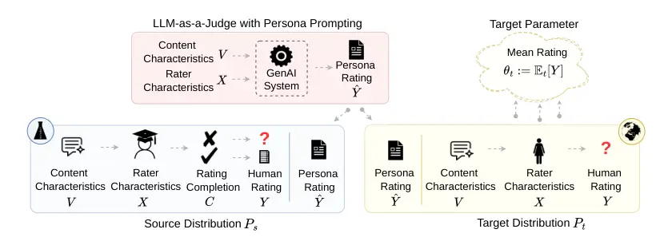

# Doubly-Robust LLM-as-a-Judge: Externally Valid Estimation with Imperfect Personas

Luke Guerdan ^(†)^(†)thanks: \$ˆ\*\$Co-first authors contributed equally
to this work (see \$§\$ 8 for statement of contributions).
Correspondence to: kltruong@cs.cmu.edu, jwhiteho@stanford.edu,
lguerdan@cs.cmu.edu.    Justin Whitehouse    Kimberly Truong     
Kenneth Holstein Affiliation: Carnegie Mellon University    Zhiwei
Steven Wu Affiliation: Carnegie Mellon University Affiliation: Stanford
University Affiliation: Co-first authors

###### Abstract

As Generative AI (GenAI) systems see growing adoption, a key concern
involves the external validity of evaluations, or the extent to which
they generalize from lab-based to real-world deployment conditions.
Threats to the external validity of GenAI evaluations arise when the
source sample of human raters and system outputs used to obtain a system
quality estimate differs from the target distribution at deployment
time. In this work, we propose a _doubly-robust_ estimation framework
designed to address this evaluation sampling bias. Key to our approach
is the use of “persona” ratings produced by prompting an LLM evaluator
(i.e., an LLM-as-a-judge) to behave as a human rater with specific
sociodemographic characteristics. Our doubly-robust framework combines
these informative yet imperfect persona ratings with human ratings
obtained under evaluation sampling bias to produce statistically valid
system quality estimates. In particular, we show that our approach
yields valid system quality estimates when either (i) a model trained to
predict human ratings using persona ratings and source data observed
under sampling bias, or (ii) a reweighting model that corrects for
sampling bias is of sufficient quality. We validate our framework
theoretically and via a novel Persona Simulation Framework (PSF)
designed to systematically manipulate persona quality and the degree of
evaluation sampling bias present in source data. Our work provides a
principled foundation for combining imperfect persona ratings with human
ratings observed under sampling bias to obtain valid system quality
estimates.

|     |
| --- |
|     |

## 1 Introduction

As Generative AI (GenAI) systems see growing adoption, a key concern
involves the external validity of evaluations, or the extent to which
they generalize from lab-based to real-world deployment conditions
(Ibrahim et al., 2024; Ouyang et al., 2023; Liao and Xiao, 2023; Liao et
al., 2021; Weidinger et al., 2025). In particular, many evaluations
report a system quality estimate, which reflects the proportion of
outputs rated to exhibit a capability (e.g., “helpfulness”) or defect
(e.g., “toxicity”) by a human with specialized characteristics (e.g.,
domain knowledge, cultural experience). However, such quality estimates
may fail to generalize when the source distribution of human raters and
system outputs available at evaluation time differs from the target
distribution encountered upon deployment. For example, in conversational
safety evaluation, covariate shift can arise if we wish to estimate the
perceived “toxicity” of a response for a specific demographic group, but
collect ratings from a general population of crowdworkers. Selection
bias may also occur if crowdworkers frequently opt out from providing
ratings on highly sensitive content (Steiger et al., 2021). Left
unaddressed, these forms of evaluation sampling bias threaten the
external validity of system quality estimates.

Recent work has proposed tools for improving system quality estimates
when human ratings are scarce but black-box predictions (e.g., from an
LLM-as-a-judge) are cheap and abundant (Chatzi et al., 2024; Fisch et
al., 2024; Eyre and Madras, 2024; Dorner et al., 2024; Saad-Falcon et
al., 2023; Fogliato et al., 2024). For instance, Prediction Powered
Inference (PPI) offers an approach for leveraging a subset of labeled
(source) data to correct for bias in black-box model predictions
(Angelopoulos et al., 2023a; Angelopoulos et al., 2023b). This bias
correction enables using black-box predictions generated over unlabeled
(target) samples to shrink confidence intervals around quality estimates
while maintaining valid coverage. However, both PPI and its extensions
(e.g., PPI++ (Angelopoulos et al., 2023b), RePPI (Ji et al., 2025))
assume that (i) source and target samples are drawn i.i.d. and (ii)
labels are missing completely at random (MCAR) (Tsiatis, 2006), i.e.
that successful completion of a rating is independent of rater and text
characteristics. However, when source data is observed under sampling
bias, these assumptions are violated and severe miscoverage occurs (see
Fig. 1).

In this work, we devise an estimator that directly corrects for
evaluation sampling bias. Like existing approaches (Angelopoulos et al.,
2023b; Ji et al., 2025), our proposal leverages black-box predictions
generated by a GenAI system over unlabeled (target) samples to improve
statistical inference. Unlike existing estimators, however, our proposal
is _doubly-robust_ (Bang and Robins, 2005; Chernozhukov et al., 2018):
it yields valid system quality estimates if either a model trained to
predict human ratings from labeled source data or a reweighting model
that corrects for sampling bias is of sufficient quality. To attain this
doubly-robust property, we leverage persona ratings — scores generated
by prompting an LLM-as-a-judge to behave as a human rater with desired
characteristics (e.g., demographics, expertise). Our framework uses
these persona ratings as an auxiliary feature when training a model to
predict human ratings from labeled source data. When persona ratings are
sufficiently correlated with human ratings, this yields a higher-quality
predictor, which in turn makes the double-robustness condition of our
estimator easier to satisfy (see $`\lx@sectionsign`$ 3).

Figure 1 illustrates the benefits of our estimation approach on three
datasets. Whereas persona ratings alone (Persona-Based) or human ratings
alone (Source Mean) fail to provide valid coverage, our approach
combines imperfect persona ratings with imperfect human ratings to
attain valid confidence intervals with low statistical bias. We
similarly find that our approach out-performs state-of-the-art baselines
(Angelopoulos et al., 2023b; Ji et al., 2025), which also combine
persona ratings with human ratings, but fail to account for evaluation
sampling bias. To summarize, our main contributions are as follows:

Figure 1: Comparison of our doubly-robust estimator with baselines on
three datasets from our Persona Simulation Framework. Red and black
dashed lines denote the true source and target mean ratings,
respectively (e.g., the average “helpfulness” rating obtained over
source vs. target distributions). Persona-Based directly averages
persona ratings to compute a system quality estimate. Sample Average
produces a system quality estimate by averaging human ratings sampled
from the source distribution. PPI++ (Angelopoulos et al., 2023b) and
RePPI (Ji et al., 2025) are two state-of-the-art statistical methods
that do not account for evaluation sampling bias. Across settings, we
observe that our Doubly-Robust (Riesz) estimator yields improved
coverage and lower bias than baselines, while maintaining informative
confidence intervals.

- •
  We formalize the problem of GenAI system quality estimation under
  evaluation sampling bias. Unlike existing statistical frameworks
  (Angelopoulos et al., 2023b; Ji et al., 2025), our formulation
  explicitly accounts for both covariate shift and selection bias in
  available human ratings to improve the external validity of system
  quality estimates.
- •
  We devise a doubly-robust estimator for GenAI system quality
  estimation under evaluation sampling bias. En route, we first advance
  doubly-robust estimation theory by generalizing the work of
  (Chernozhukov et al., 2023) to M-estimation settings with surrogate
  (persona) ratings. This generalization enables us to (i) leverage
  persona ratings to improve doubly-robust system quality
  estimates, (ii) estimate a richer set of system quality parameters
  (e.g., rating variance, quantiles) beyond means, and (iii) maintain
  valid coverage even in the presence of evaluation sampling bias, all
  desiderata not satisfied by previous works.
- •
  We advance the practical application of doubly-robust estimators to
  GenAI system quality estimation. Whereas doubly-robust estimators are
  traditionally applied on small tabular datasets, GenAI system quality
  estimation requires learning a reweighting function over high
  dimensional (e.g., text, audio) input-output spaces. We show that
  sentence transformer embedding models and a “Riesz loss” approach
  (Chernozhukov et al., 2022a) can be combined to correct for covariate
  shift in high-dimensional text input-output spaces.
- •
  We introduce a Persona Simulation Framework (PSF) that systematically
  manipulates evaluation sampling bias and persona quality over three
  experimental settings with increasing realism: Fully Synthetic,
  Semi-Synthetic PRISM (Kirk et al., 2024), and Semi-Synthetic DICES
  (Aroyo et al., 2023). Leveraging the PSF, we show our estimator
  obtains valid coverage up to a larger magnitude of sampling bias than
  state-of-the-art baselines (e.g., RePPI (Ji et al., 2025)). We
  publicly release our PSF code as a community resource.¹¹ 1 Code and
  data are available on
  [GitHub](https://github.com/lguerdan/doubly-robust-llm-judge).



Figure 2: Our framework produces estimates for the target parameter
$`\theta_{t}`$ using (i) complete rating tuples from the source
distribution (blue, left), (ii) unlabeled samples from the target
distribution (yellow, right), and (iii) persona ratings produced for
both source and target samples (red, top). _Evaluation sampling bias_
may arise both from the _covariate shift_ of $`(V,X)`$ from $`P_{s}`$ to
$`P_{t}`$, and from _selection bias_ in which rating completion $`C`$ is
non-random in $`P_{s}`$ – i.e.,
$`C\not\mathchoice{\mathrel{\hbox to0.0pt{$\displaystyle\perp$\hss}\mkern 2.0mu{\displaystyle\perp}}}{\mathrel{\hbox to0.0pt{$\textstyle\perp$\hss}\mkern 2.0mu{\textstyle\perp}}}{\mathrel{\hbox to0.0pt{$\scriptstyle\perp$\hss}\mkern 2.0mu{\scriptstyle\perp}}}{\mathrel{\hbox to0.0pt{$\scriptscriptstyle\perp$\hss}\mkern 2.0mu{\scriptscriptstyle\perp}}}(V,X)`$.

## 2 Preliminaries

We provide an overview of the data generating processes and GenAI system
quality parameters considered hereinafter. We provide detailed coverage
of all notation and assumptions in Appendix B.

Probabilistic Framework. As illustrated in Fig. 2, we model system
quality estimation under evaluation sampling bias via a tuple of random
variables $`Z=(X,V,C,Y,\hat{Y})`$. Here, $`X`$ denotes rater
characteristics (e.g., age, gender, geographic locale) and $`V`$ denotes
the content to be rated, such as the GenAI system input and output. In
experiments, we characterize the content $`V`$ via an embedding-based
projection of the input prompt and system output into a low-dimensional
space (see $`\lx@sectionsign`$ 4). We use $`W=(X,V)`$ to denote the
tuple of rater and content. $`C`$ is an indicator of rating completion
($`C=1`$ if the rater provides a rating, $`C=0`$ otherwise). For
example, a rater can fail to provide a rating if they (i) are excluded
on the basis of failed attention checks, or (ii) abandon the rating task
mid-way (i.e., self-attrition). Let $`Y`$ denote the rating a rater
would assign if they completed the task ($`C=1`$), which may be ordinal
(e.g., Likert 1–5), interval (e.g., 1–100), or binary (e.g., Yes/No).
Finally, $`\hat{Y}`$ is the rating returned by an LLM-as-a-judge with
persona prompting.

Example. Suppose we want to measure the perceived “safety” of a
conversational AI system’s response. $`X`$ captures rater demographics
(e.g., age, race, education) and $`V`$ includes the user query and
system response. Rating completion ($`C`$) denotes whether the rater
provides a rating or opts out, and $`Y`$ is the human’s “safety” rating
(e.g., on a 1–4 scale). $`\hat{Y}`$ denotes GPT-5’s predicted rating.

Evaluation Sampling Bias. To model evaluation sampling bias, we assume
there are two full-data distributions over tuples $`Z`$: a source
distribution $`P_{s}`$ and a target distribution $`P_{t}`$. Covariate
shift arises when the marginal distribution of rater and content
characteristics differs across source and target distributions. For
instance, the source distribution may consist of crowdworkers recruited
via MTurk—who tend to skew younger and more educated than the general
population (Levay et al., 2016)—while the target distribution might
reflect the demographic composition of a specific deployment context
(e.g., users of a healthcare chatbot, who happen to skew older and
female). Selection bias arises when rating completion depends on rater
and/or content characteristics — i.e.,
$`C\not\mathchoice{\mathrel{\hbox to0.0pt{$\displaystyle\perp$\hss}\mkern 2.0mu{\displaystyle\perp}}}{\mathrel{\hbox to0.0pt{$\textstyle\perp$\hss}\mkern 2.0mu{\textstyle\perp}}}{\mathrel{\hbox to0.0pt{$\scriptstyle\perp$\hss}\mkern 2.0mu{\scriptstyle\perp}}}{\mathrel{\hbox to0.0pt{$\scriptscriptstyle\perp$\hss}\mkern 2.0mu{\scriptscriptstyle\perp}}}W`$.
In our running example, this can arise if crowdworkers are more likely
to opt out of rating highly sensitive content. While our framework is
explicitly designed to handle selection bias, existing frameworks
(Angelopoulos et al., 2023b; Ji et al., 2025) assume that data are
missing completely at random (MCAR) — i.e.,
$`C\mathchoice{\mathrel{\hbox to0.0pt{$\displaystyle\perp$\hss}\mkern 2.0mu{\displaystyle\perp}}}{\mathrel{\hbox to0.0pt{$\textstyle\perp$\hss}\mkern 2.0mu{\textstyle\perp}}}{\mathrel{\hbox to0.0pt{$\scriptstyle\perp$\hss}\mkern 2.0mu{\scriptstyle\perp}}}{\mathrel{\hbox to0.0pt{$\scriptscriptstyle\perp$\hss}\mkern 2.0mu{\scriptscriptstyle\perp}}}W`$.
We show empirically that violations of this assumption lead to severe
miscoverage in system quality estimates (see $`\lx@sectionsign`$ 4).

| Parameter            | Estimand                                                  | Example                                                                                    |
| -------------------- | --------------------------------------------------------- | ------------------------------------------------------------------------------------------ |
| Mean                 | $`\theta_{t}:=\mathbb{E}_{t}[Y]`$                         | Mean “helpfulness” rating for customer service chatbot responses.                          |
| Variance             | $`\theta_{t}:=\text{Var}_{t}(Y)`$                         | Variance (disagreement) in conversational “safety” ratings.                                |
| Quantile             | $`\theta_{t}:=\inf\{y:P_{t}(Y\leq y)\geq Q\}`$            | Median “comprehensibility” score for technical documentation.                              |
| Conditional Mean     | $`\theta_{t}:=\mathbb{E}_{t}[Y\mid g(W)=1]`$              | Mean “coherence” rating assigned by domain experts to multi-turn conversational responses. |
| Conditional Variance | $`\theta_{t}:=\text{Var}_{t}[Y\mid g(W)=1]`$              | Variance in “helpfulness” ratings among novice programmers for code suggestions.           |
| Conditional Quantile | $`\theta_{t}:=\inf\{y:P_{t}(Y\leq y\mid g(W)=1)\geq Q\}`$ | 90th percentile “safety” rating for high-risk queries flagged by content moderators.       |

Table 1: Examples of statistical parameters that can be estimated via
our M-estimation framework. Each parameter summarizes information about
human ratings obtained over the target distribution. Conditional
parameters (bottom three rows) can be defined conditionally on rater
characteristics ($`X`$), content characteristics ($`V`$), or both, as
special cases of conditioning on $`W=(X,V)`$.

While we relax this MCAR assumption, we rely on several additional
assumptions (also required by existing frameworks). For instance, we
assume no concept drift, i.e., that $`P_{s}(Y|W)=P_{t}(Y|W)`$. This
requires that the rater and content characteristics are sufficiently
rich as to describe ratings across both populations. We elaborate on
this and other standard causal assumptions required by our framework in
Appendix B. Relaxing these assumptions remains a fruitful direction for
future work.

Estimation Goal. Given a sample of $`N_{s}`$ partial source observations
$`\mathcal{D}_{s}=\{(X^{s}_{j},V^{s}_{j},C^{s}_{j},C^{s}_{j}\cdot Y^{s}_{j},\hat{Y}^{s}_{j})\}_{j=1}^{N_{s}}`$
and $`N_{t}`$ partial target observations
$`\mathcal{D}_{t}=\{(X^{t}_{i},V^{t}_{i},\hat{Y}^{t}_{i})\}_{i=1}^{N_{t}}`$,
our goal is to estimate a parameter summarizing system quality over
$`P_{t}`$.²² 2 We use superscripts $`s`$, $`t`$ on random variables to
denote source and target membership. We omit these superscripts where
the distribution is clear from context (e.g., $`\mathbb{E}_{t}[Y]`$
clearly refers to the target distribution).³³ 3 In the tuple
$`\mathcal{D}_{s}`$, the shorthand $`C^{s}_{j}\cdot Y^{s}_{j}`$ denotes
that ratings are only observed when $`C^{s}_{j}=1`$. As our running
example in the main text and experiments, we consider the mean rating,
$`\theta_{t}:=\mathbb{E}_{t}[Y]`$, which describes the average “safety”
or “helpfulness” rating assigned by human raters to system outputs in
the target distribution $`P_{t}`$.

## 3 Methodology

We now introduce our doubly-robust estimator for GenAI system quality
estimation under evaluation sampling bias. The central challenge
addressed by our approach is that our data is imperfect. While persona
predictions are available, they may be a poor proxy for human ratings.
Likewise, human ratings from the source distribution may suffer from
evaluation sampling bias, leading to invalid estimates for the target
parameter. We first introduce several naive approaches which might be
used to tackle this problem ($`\lx@sectionsign`$ 3.1). Then, we show
that while each approach is insufficient in isolation, they can be
combined to obtain valid coverage. ($`\lx@sectionsign`$ 3.2). Our
results presented in this section apply not only when
$`\theta_{t}:=\mathbb{E}_{t}[Y]`$ (where they generalize Chernozhukov et
al. (2023) to simultaneous covariate shift and selection bias) but also
when $`\theta_{t}`$ is the solution to a generic M-estimation problem.
Table 1 illustrates the range of statistical parameters our framework
supports.

### 3.1 Baseline Approaches and Their Limitations

Persona-Augmented Regression. One possible estimation strategy is to
train a model to predict human ratings using source data and then use
this model to impute missing target labels. Persona-augmented regression
leverages this approach while including persona ratings as an additional
auxiliary feature in the regression function. In particular, we train a
model $`\widehat{\mu}(W,\widehat{Y})`$ predicting
$`\mu_{0}(W):=\mathbb{E}[Y\mid W]`$⁴⁴ 4 No concept drift implies
$`\mathbb{E}_{t}[Y\mid W]=\mathbb{E}_{s}[Y\mid W]`$, so we can omit
subscripts without any worry. using samples from $`\mathcal{D}_{s}`$ and
then estimate $`\theta_{t}`$ as
$`\hat{\theta}^{\text{reg}}_{t}:=\frac{1}{N_{t}}\sum_{i=1}^{N_{t}}\hat{\mu}(W^{t}_{i},\hat{Y}^{t}_{i}).`$
Observe that this persona-augmented regression estimator relies on the
persona rating in addition to covariates. While this approach may be
viable when persona ratings are highly correlated with human ratings, in
general $`\hat{\mu}`$ will converge too slowly to construct valid
confidence intervals ($`\lx@sectionsign`$ 4).

Re-weighting. Another approach is to re-weight samples from $`P_{s}`$
based on their probability of occurring under $`P_{t}`$. This approach
requires correcting for covariate shift and selection bias in parallel,
and does not use persona ratings. Formally, let
$`\omega_{0}(w)=\frac{dP_{t}}{dP_{s}}(w)`$ denote the density ratio
between $`P_{t}(W)`$ and $`P_{s}(W)`$, and let
$`\pi_{0}(w)=\mathbb{P}_{s}(C=1\mid W=w)`$ denote the probability of
rating completion. Under standard assumptions (see Appendix B), we have
$`\theta_{t}=\mathbb{E}_{s}[\alpha_{0}(W,C)Y]`$, where
$`\alpha_{0}(W,C):=C\frac{\omega_{0}(W)}{\pi_{0}(W)}`$. Thus, if one
produces an ML estimate $`\widehat{\alpha}`$ of $`\alpha_{0}`$ (say by
training models $`\widehat{\omega}`$, $`\widehat{\pi}`$ predicting
$`\omega_{0}`$, $`\pi_{0}`$), they can compute an inverse propensity
weighted (IPW) estimate
$`\hat{\theta}^{\text{ipw}}_{t}:=\frac{1}{N_{s}}\sum_{j=1}^{N_{s}}\hat{\alpha}(W^{s}_{j},C^{s}_{j})\cdot Y^{s}_{j}`$.
Again, estimates of $`\alpha_{0}`$ must converge at parametric rates in
order to maintain coverage. Further, IPW suffers from high variance when
propensities are small — a salient challenge when estimating system
quality parameters over high-dimensional (e.g., text) data
($`\lx@sectionsign`$ 4).

### 3.2 Doubly-Robust Estimator

Our doubly-robust estimator can be viewed as carefully combining the
persona-augmented regression estimator ($`\mu_{0}`$) with the
re-weighting estimator ($`\alpha_{0}`$). The functions $`\mu_{0}`$ and
$`\alpha_{0}`$ are referred to as nuisance functions because they are
used as an auxiliary information source to estimate the target
statistical parameter of interest $`\theta_{t}`$. Our estimator combines
these nuisance functions in the form:

```math
\widehat{\theta}=\frac{1}{N_{t}}\sum_{i=1}^{N_{t}}\widehat{\mu}(W_{i}^{t},\widehat{Y}_{i}^{t})+\frac{1}{N_{s}}\sum_{j=1}^{N_{s}}\widehat{\alpha}(W_{j}^{s},C_{j}^{s})\left\{Y_{j}^{s}-\hat{\mu}(W_{j}^{s},\widehat{Y}_{j}^{s})\right\}, \tag{1}
```

where $`\widehat{\mu}`$ and $`\widehat{\alpha}`$ are estimates of
$`\mu_{0}`$ and $`\alpha_{0}`$ that are assumed to be independent of the
data. In Eq. 1, the left term evaluates the regression-based estimator
over samples from the target distribution. Analogously to PPI++
(Angelopoulos et al., 2023b), this has the effect of using unlabeled
data to reduce variance in the estimate. The right term corrects for
bias in the human rating predictor $`\hat{\mu}`$ by re-weighting
residualized source data to account for covariate shift and selection
bias. This correction adjusts for bias in persona ratings via the
residual term, and evaluation sampling bias via the learned re-weighting
function $`\hat{\alpha}`$.

To construct confidence intervals, we also consider the variance
estimate:

```math
\hat{\sigma}^{2}=\frac{1}{N_{t}}\sum_{i=1}^{N_{t}}\left\{\widehat{\mu}(W_{i}^{t},\hat{Y}_{i}^{t})-\widehat{m}_{t}\right\}^{2}+\frac{\widehat{\gamma}}{N_{s}}\sum_{j=1}^{N_{s}}\widehat{\alpha}(W_{j}^{s},C_{j}^{s})^{2}\left\{Y_{j}^{s}-\widehat{\mu}(W_{j}^{s},\hat{Y}_{j}^{s})\right\}^{2}, \tag{2}
```

where
$`\widehat{m}_{t}=\frac{1}{N_{t}}\sum_{i=1}^{N_{t}}\widehat{\mu}(W_{i}^{t},\hat{Y}_{i}^{t})`$
and $`\widehat{\gamma}`$ is a scaling parameter (described in
Algorithm 1). Since our mean and variance estimators require nuisance
estimates that are independent of the data, we use $`K`$-fold
cross-fitting to maximize efficiency (Chernozhukov et al., 2018). For
each $`k\leq K`$, we train nuisance models on all data excluding the
samples in fold $`k`$. We then use our nuisance estimates to produce a
de-biased parameter estimate for the data in fold $`k`$. We finally
average the per-fold parameter and variance estimates to maintain full
data efficiency. See Algorithms 1 and 2 for full details.

Our main result establishes the asymptotic normality of our estimator.
Further, it describes how to build confidence intervals using the mean
and variance estimates recovered from Algorithm 1.

1: Input: Samples $`\mathcal{D}_{s}=\{Z_{1}^{s},\dots,Z_{N_{s}}^{s}\}`$
from $`P_{s}`$, samples
$`\mathcal{D}_{t}=\{Z_{1}^{t},\dots,Z_{N_{t}}^{t}\}`$ from $`P_{t}`$,
number of folds $`K`$.

2: Randomly split source indices $`[N_{s}]`$ random folds of equal size:
$`\mathcal{I}_{1},\dots,\mathcal{I}_{K}`$.

3: for $`k\in[K]`$ do

4:   Produce ML estimate $`\widehat{\mu}^{(-k)}`$ using
$`\mathcal{D}_{s,k}^{c}:=\mathcal{D}_{s}\setminus\mathcal{D}_{s,k}`$,
where $`\mathcal{D}_{s,k}:=(Z^{s}_{j}:j\in\mathcal{I}_{k})`$.

5:   Produce ML estimate $`\widehat{\alpha}^{(-k)}`$ using
$`\mathcal{D}_{s,k}^{c}`$ and $`\mathcal{D}_{t}`$.

6:   Construct $`\widehat{\theta}_{k}`$ per Eq. 1 with
$`\widehat{\mu}:=\widehat{\mu}^{(-k)},\widehat{\alpha}:=\widehat{\alpha}^{(-k)}`$,
and samples $`\mathcal{D}_{s,k}`$ and $`\mathcal{D}_{t}`$.

7:   Construct $`\widehat{\sigma}_{k}`$ per Eq. 2 with
$`\widehat{\mu}:=\widehat{\mu}^{(-k)},\widehat{\alpha}:=\widehat{\alpha}^{(-k)}`$,
$`\widehat{\gamma}:=\frac{N_{t}}{N_{s}}`$, and samples
$`\mathcal{D}_{s,k}`$ and $`\mathcal{D}_{t}`$.

8: Compute the average of the $`K`$ estimates:
$`\widehat{\theta}:=\frac{1}{K}\sum_{k=1}^{K}\widehat{\theta}_{k}`$ and
$`\widehat{\sigma}^{2}:=\frac{1}{K}\sum_{k=1}^{K}\widehat{\sigma}_{k}^{2}`$.

9: Return: Mean estimate $`\widehat{\theta}`$ and variance estimate
$`\widehat{\sigma}^{2}`$.

Algorithm 1 Doubly-Robust Estimator with $`K`$-fold Cross-Fitting

###### Theorem 3.1.

Assume the learner has access to samples
$`Z_{1}^{s},\dots,Z_{N_{s}}^{s}\sim P_{s}`$ and
$`Z_{1}^{t},\dots,Z_{N_{t}}^{t}\sim P_{t}`$ satisfying Assumptions 1- 2
and the assumptions of Theorems B.2 and B.4 (all outlined in
Appendix B). Then, letting $`\widehat{\theta}`$ and
$`\widehat{\sigma}^{2}`$ denote the mean and variance returned by
Algorithm 1, we have

```math
\widehat{\sigma}^{-1}\sqrt{N_{t}}\left(\widehat{\theta}-\theta\right)\Rightarrow\mathcal{N}(0,1).
```

In particular, this implies that, for any $`\delta\in(0,1)`$, the set

```math
C_{1-\delta}:=\left[\widehat{\theta}-\frac{\widehat{\sigma}}{\sqrt{N_{t}}}z_{\delta/2},\widehat{\theta}+\frac{\widehat{\sigma}}{\sqrt{N_{t}}}z_{\delta/2}\right]
```

is a $`1-\delta`$ confidence interval for $`\theta`$, where
$`z_{\delta}`$ denotes the $`\delta`$ quantile of a standard normal R.V.

A complete theorem statement can be found in Theorem B.4. In Appendix C,
we present a generalization to M-estimators (Theorems C.1 and C.4) and a
corresponding proof — the above follows as a special case. We also
provide examples of other target parameters, including rating variance
and quantiles in Remark C.2 of the same appendix, which may be of
independent interest.

Theorem 3.1 relies on several key assumptions, formally outlined in
Appendix B. Of these, the most important is double robustness, which
requires the product of nuisance estimation errors to decay at
parametric (i.e. $`\sqrt{N_{t}}`$) rates. Formally, this assumption can
be expressed via the condition that

```math
\|\widehat{\alpha}^{(-k)}-\alpha_{0}\|_{L^{2}}\cdot\|\widehat{\mu}^{(-k)}-\mu_{0}\|_{L^{2}}=o_{\mathbb{P}}(N_{t}^{-1/2}) \tag{3}
```

on each fold. See Appendix B for definition of $`L^{2}`$ norms and a
formal definition of $`o_{\mathbb{P}}`$ notation (here,
$`o_{\mathbb{P}}(N_{t}^{-\beta})`$ denotes convergence in probability at
$`N_{t}^{-\beta}`$ rates). Notably, this condition allows each
individual nuisance estimate to converge at non-parametric rates, thus
permitting coverage even when estimates of either $`\alpha_{0}`$ or
$`\mu_{0}`$ are of lower quality. For instance, one could have

```math
\max\left\{\|\widehat{\mu}^{(-k)}-\mu_{0}\|_{L^{2}},\|\widehat{\alpha}^{(-k)}-\alpha_{0}\|_{L^{2}}\right\}=o_{\mathbb{P}}(N_{t}^{-1/4})
```

and still maintain valid coverage. In other words, when we state that
our estimator will provide valid coverage when either (i) a model
trained to predict human ratings using persona ratings and source data
observed under sampling bias ($`\widehat{\mu}`$), or (ii) a reweighting
model that corrects for sampling bias ($`\hat{\alpha}`$) is of
sufficient quality, we refer precisely to this product of errors
condition (Eq. 3).

We also note that the above convergence rate does not directly depend on
the quality of persona ratings. Rather, the persona ratings serve as an
extra covariate onto which we can regress human ratings $`Y`$. When
persona ratings are highly correlated with human ratings, we may obtain
faster convergence rates for $`\hat{\mu}`$. However, this does not
prohibit convergence even when the quality of persona ratings is low.
This phenomenon is illustrated in our experiments below.

Estimation Details. In Theorem 3.1 above, estimating $`\mu_{0}`$ is a
standard regression task that can be accomplished using any
off-the-shelf model (e.g. gradient boosted trees, neural networks).
However, estimation of $`\alpha_{0}(w,c)`$, which is a complicated ratio
of likelihood ratios and propensity scores, is more subtle. The standard
approach for doubly-robust estimation would involve learning
$`\widehat{\omega}`$ and $`\widehat{\pi}`$ separately (e.g., via
gradient boosted trees) then estimating $`\widehat{\alpha}`$ by taking
the ratio of predictions produced by each model. However, because $`w`$
can occupy a high dimensional (e.g., text) space, the variance in this
ratio can be quite high. This variance in turn propagates to downstream
estimates.

To address this challenge, we leverage a “Riesz loss” (Chernozhukov et
al., 2022a; Chernozhukov et al., 2022b; Chernozhukov et al., 2023) to
estimate $`\alpha_{0}`$. Rather than learning $`\omega_{0}`$ and
$`\pi_{0}`$ independently, the Riesz loss directly learns the ratio
$`\alpha_{0}(w,c)`$. For our setting, letting
$`\beta_{0}(w):=\omega_{0}(w)/\pi_{0}(w)`$, the Riesz loss minimizer is
given by:

```math
\beta_{0}=\arg\min_{\beta}\left\{\mathbb{E}_{s}[C\cdot\beta(W^{s})^{2}]-2\mathbb{E}_{t}[\beta(W^{t})]\right\}. \tag{4}
```

Therefore, to estimate $`\alpha_{0}`$, we minimize the finite-sample
analogue of Eq. 4 using $`\mathcal{D}_{s,k}^{c}`$ and
$`\mathcal{D}_{t}`$, then plug this into Algorithm 1 (see Appendix D for
details). As we show in $`\lx@sectionsign`$ 4, this Riesz loss approach
significantly improves the quality of downstream estimates.

## 4 Experiments

Validating estimators under evaluation sampling bias requires datasets
with detailed rater characteristics, rating completion information, and
a mechanism for systematically manipulating the magnitude of covariate
shift and selection bias. Such datasets are scarce. To address this gap,
we introduce a Persona Simulation Framework (PSF) that provides complete
rating tuples $`Z=(X,V,C,Y,\hat{Y})`$ and allows us to vary (i)
covariate shift, (ii) selection bias, and (iii) persona quality in
parallel. The PSF contains three specific datasets, each of which
simulates evaluation data with increasing realism:

- •
  Fully Synthetic: All nuisance functions and target parameters are
  fully known (see Appendix E).
- •
  Semi-Synthetic PRISM: We sample 1000 real user conversations from
  PRISM (Kirk et al., 2024) and obtain the “ground truth” target
  parameter $`\theta_{t}`$ by treating ratings sampled from an
  LLM-as-a-judge as human ratings ($`Y`$). We sample 50 such LLM ratings
  per item. Unlike the fully synthetic setting, true nuisance functions
  are unknown. We sample persona ratings $`\widehat{Y}`$ by adding
  controlled error to the LLM-as-a-judge ratings (see
  $`\lx@sectionsign`$ 4.1). This task instructs raters to rate the
  “helpfulness” of outputs on a 1-100 scale.
- •
  Semi-Synthetic DICES: We sample real user conversations, rater
  characteristics (e.g., age, race), and human ratings ($`Y`$) from
  DICES (Aroyo et al., 2023), resulting in 300 conversations with 25
  human ratings each. We then sample persona ratings $`\widehat{Y}`$
  by (i) adding controlled error to human ratings (see
  $`\lx@sectionsign`$ 4.1) and (ii) via an LLM-as-a-judge with
  persona-based prompting. This dataset instructs raters to assess the
  “harmfulness” of outputs on a 1-4 scale.

Going forward, we refer to these three datasets as Synthetic, PRISM, and
DICES, respectively. In addition to providing a foundation for
validating our doubly-robust estimator, the PSF offers a resource for
the community to test future evaluation approaches under evaluation
sampling bias.

### 4.1 Dataset Generation Procedure

We now describe how both semi-synthetic datasets are generated in the
PSF. Further setup details, including prompts used for synthetic dataset
generation, are reported in Appendix E.

Source and Target Populations. In the PRISM experiment, the source
population consists of conversations where users are prompted to engage
in controversial topics, while the target population consists of
conversations with no guided prompts. In the DICES experiment, the
source population contains 300 single-turn conversations flagged by
safety experts as containing a single harm type (e.g., misinformation,
legal), while the target contains more complex conversations rated as
containing multiple types of harm. In both cases, we model each sample
as a single user–system exchange extracted from a multi-turn dialogue.
We embed the input–output pair from each exchange into a low-dimensional
space by first applying an embedding model (MiniLM-L6-v2) then
projecting to 15 dimensions via UMAP (Becht et al., 2019).⁵⁵ 5 We
selected 15 dimensions to ensure embeddings retained predictive signal
for ratings and source/target membership while keeping dimensionality
low; results remained stable for $`\geq 12`$ dimensions (Fig. 7). We
also vary the demographic composition of raters across populations. In
both PRISM and DICES, we define the source distribution $`P_{s}(X)`$
using marginal probabilities of rater characteristics reported in DICES,
and target distribution $`P_{t}(X)`$ using population statistics
released by the U.S. Census Bureau (Guzman and Kollar, 2023).

Covariate Shift. To vary the magnitude of covariate shift, we control
the mixture between the source and target populations. We vary the
content characteristics by controlling the proportion $`\zeta\in[0,1]`$
of target items contained within the source sample (sub-sampling from
the full data to ensure that source and target sample sizes remain
fixed). Additionally, we vary the rater distributions by taking the
convex combination between all groups in each demographic stratum with
normalization. The magnitude of the resulting covariate shift between
samples is then given by the Sinkhorn Distance
$`\Delta\!\left(W^{s},W^{t}\right)`$ (Feydy et al., 2019), where recall
that $`W=(X,V)`$ and $`V`$ denotes the embedded content characteristics
(MiniLM-L6-v2 + UMAP). We report the Sinkhorn distance normalized by
subtracting the baseline case where there is no covariate shift for both
semi-synthetic experiments, as it is inevitable that there will be
variation in text embeddings despite sampling i.i.d. from pre-defined
categories (e.g., harm types) within a population. This measure captures
covariate shift resulting from content characteristics and demographic
attributes in parallel.

Selection Bias. We model _rater attrition_—when raters fail to provide a
rating due to failed attention checks or task abandonment—by varying the
probability that each item is rated. In PRISM, we prompt the LLM to
output both a rating and a non-response “refusal” flag. In DICES, we use
rater self-assessments of task understanding to assign attrition scores
(see Appendix E). We then transform attrition scores into dropout
probabilities using a Beta CDF with $`\alpha=3`$ (increasing $`\beta`$
increases selection bias). We censor ratings according to these
probabilities while retaining the “true” rating. We quantify the
magnitude of selection bias via the dropout rate, i.e., the probability
that a rater fails to rate an item. The dropout rates we simulate mirror
those observed in practice. In DICES, 19 of 123 raters (15.4%) were
excluded due to failed attention checks, while in PRISM, 104 of 1500
raters (6.9%) failed to provide ratings after completing the background
survey. As we show in our results, existing methods (e.g., RePPI (Ji et
al., 2025)) exhibit severe miscoverage at these empirically observed
dropout rates. This underscores the importance of correcting for
selection bias.

Persona Quality. To manipulate the quality of persona ratings, we
perturb human ratings with controlled error. This perturbation has (i) a
bias parameter $`\eta\in[-1,1]`$, which induces a systematic shift, and
(ii) a correlation parameter $`\rho\in[-1,1]`$, which parametrizes the
Pearson correlation between human ratings and persona ratings (see
Appendix E). We verify the robustness of this perturbation approach by
performing additional experiments using persona ratings sampled from
real LLMs.

### 4.2 Setup Details

Models. We use GPT-5 to generate synthetic “human” ratings for PRISM –
i.e., used as $`Y`$ in our framework to obtain the ground truth target
parameter $`\theta_{t}`$. We use Claude-{Haiku 3.5, Sonnet 3.5} and
GPT-{5, 4o-Mini} to generate persona ratings for DICES. We report
prompts, sampling temperature and decoding methods used for each LLM in
Appendix E.

Estimators. We compare Sample Average, IPW, Persona-Based Estimation,
Persona-Augmented Regression (PAR), PPI++ (Angelopoulos et al., 2023b),
and Recalibrated PPI (RePPI) (Ji et al., 2025) estimators against two
doubly-robust variants: (i) DR (Classical), which learns nuisance
functions $`(\hat{\omega},\hat{\pi})`$, and (ii) DR (Riesz), which uses
Riesz loss minimization to directly produce an estimate $`\hat{\alpha}`$
of $`\alpha_{0}`$. Nuisance functions were tuned via hyperparameter
search (see Appendix E).

Metrics. We evaluate estimator quality using three metrics: Bias (MAE):
$`|\theta_{t}-\hat{\theta}_{t}|`$, absolute deviation from the target
parameter; Coverage:
$`\Pr(\theta_{t}\in[\hat{\theta}_{\mathrm{low}},\hat{\theta}_{\mathrm{high}}])`$,
the probability that the confidence interval covers the true parameter;
and Interval Width:
$`\hat{\theta}_{\mathrm{high}}-\hat{\theta}_{\mathrm{low}}`$, the length
of the interval.

### 4.3 Results

Finding 1: DR (Riesz) obtains lower bias and improved coverage than
baseline estimators. Figures 3 and 4 present our main findings varying
(i) covariate shift, (ii) selection bias, and (iii) persona quality over
all three datasets ($`N=40`$ trials per setting). We present
cross-sectional results in Fig. 3 and average in Fig. 4. As illustrated
in Fig. 3, DR (Riesz) obtains valid 95% CIs when (i) persona quality is
high (top), (ii) covariate shift is moderate (middle) and (iii) across
ranges of selection bias (bottom). In contrast, baseline estimators
obtain valid coverage only on Synthetic when: (i) persona quality is
very high (Fig. 3, top left) and (ii) and dropout rate is high (Fig. 3,
bottom left). While counterintuitive, the second observation highlights
the importance of examining covariate shift and selection bias in
parallel; as dropout rate increases in Synthetic, the mean of remaining
source samples more closely resembles that of the target distribution,
leading to coincidentally higher coverage. Yet coverage remains poor on
both PRISM and DICES.

Figure 3: Coverage by persona quality (top), covariate shift (center),
and selection bias (bottom). DR (Riesz) attains better coverage than all
baselines. Baselines with 0% coverage omitted to reduce clutter.
$`\eta=0.1`$; $`\rho=0.6`$ for bottom two rows. Fig. 12–14 (Appendix E)
presents analogous results for Bias (MAE) and Interval Width.

|                |                   |                   |                   |                    |                   |                   |                   |                   |                   |
| -------------- | ----------------- | ----------------- | ----------------- | ------------------ | ----------------- | ----------------- | ----------------- | ----------------- | ----------------- |
| Method         | Synthetic         |                   |                   | PRISM              |                   |                   | DICES             |                   |                   |
|                | Bias              | Coverage          | Width             | Bias               | Coverage          | Width             | Bias              | Coverage          | Width             |
| Sample Average | 0.73 $`\pm`$ 0.17 | 0.06 $`\pm`$ 0.03 | 0.35 $`\pm`$ 0.01 | 1.30 $`\pm`$ 0.02  | 0.00              | 1.49              | 0.10              | 0.00              | 0.07              |
| IPW            | 0.48 $`\pm`$ 0.05 | 0.00              | 1.00 $`\pm`$ 0.20 | 25.49 $`\pm`$ 0.02 | 0.00              | 2.62 $`\pm`$ 0.03 | 0.17              | 0.07              | 0.10              |
| PAR            | 0.06              | 0.44 $`\pm`$ 0.03 | 0.10              | 0.83 $`\pm`$ 0.01  | 0.02 $`\pm`$ 0.01 | 0.91              | 0.05              | 0.04              | 0.02              |
| Persona-Based  | 0.37 $`\pm`$ 0.01 | 0.00              | 0.17              | 10.00 $`\pm`$ 0.01 | 0.00              | 1.33              | 0.34              | 0.00              | 0.05              |
| PPI++          | 0.69 $`\pm`$ 0.16 | 0.03 $`\pm`$ 0.02 | 0.17 $`\pm`$ 0.01 | 1.03 $`\pm`$ 0.01  | 0.00              | 1.01              | 0.06              | 0.01              | 0.03              |
| RePPI          | 0.10 $`\pm`$ 0.01 | 0.56 $`\pm`$ 0.09 | 0.19              | 0.63 $`\pm`$ 0.01  | 0.66 $`\pm`$ 0.02 | 1.36              | 0.04 $`\pm`$ 0.01 | 0.40              | 0.05              |
| DR (Classical) | 0.07              | 0.85 $`\pm`$ 0.01 | 0.21              | 0.68 $`\pm`$ 0.01  | 0.82 $`\pm`$ 0.02 | 1.75              | 0.05              | 0.32              | 0.06 $`\pm`$ 0.01 |
| DR (Riesz)     | 0.03              | 1.00              | 0.28 $`\pm`$ 0.01 | 0.46 $`\pm`$ 0.01  | 0.93 $`\pm`$ 0.01 | 1.68              | 0.02              | 0.86 $`\pm`$ 0.01 | 0.09              |

Figure 4: Average Bias (MAE), Coverage, and Interval Width across
experimental conditions presented in Fig. 3. Values in parentheses
denote standard error (values $`<0.01`$ omitted to reduce clutter).

Finding 2: DR (Riesz) yields improved coverage and lower bias (MAE) than
DR (Classical). Across levels of covariate shift, selection bias, and
persona quality, we observe DR (Riesz) (Fig. 3; solid lines) obtains
improved estimates compared to DR (Classical) (Fig. 3; dashed lines).
While this behavior also appears in Synthetic (Fig. 3; left column), the
gap between DR (Classical) and DR (Riesz) is especially pronounced when
learning nuisance functions on embeddings of high-dimensional text (Fig.
3; PRISM, DICES). This illustrates the importance of directly estimating
the re-weighting term $`\alpha_{0}(W,C)`$ (Eq. 4) rather than learning
$`\omega_{0}(W)`$ and $`\pi_{0}(W)`$ separately.

Finding 3: DR (Riesz) makes better use of persona ratings than baseline
estimators. Several of our baselines — RePPI, PAR, and Persona-Based —
use persona ratings to compute estimates. However, across levels of
persona quality (Fig 3; top row), DR (Riesz) produces higher quality
estimates than these baselines (with valid coverage for $`\rho\geq.65`$
on both PRISM and DICES). Fig. 5 extends this analysis to persona
ratings obtained from varying LLMs on DICES. For all LLMs, we observe
that coverage of DR (Riesz) (solid) is markedly higher than that of
RePPI (dashed). Further substantiating our systematic perturbation study
(Fig. 3; top row), we observe that real LLMs that exhibit a higher
correlation with human ratings (e.g., GPT-5; $`\rho=0.43`$) yield
improved coverage over those with lower correlation (e.g., GPT-4o Mini;
$`\rho=0.23`$). Furthermore, despite having lower correlation
coefficients, we observe several models achieving comparable coverage to
our artificially perturbed persona ratings (Fig. 3; $`\rho=0.6`$). Taken
together, these findings illustrate that persona ratings from real
LLMs-as-judges can be used to improve downstream estimates under
evaluation sampling bias.

Figure 5: Coverage of DR (Riesz) (solid) versus RePPI (dashed) when
varying covariate shift (left) and selection bias (right) with persona
ratings from different LLM judges. Parentheses denote Pearson
correlation between persona and human ratings.

## 5 Related Work

We now provide a brief overview of related literature (see Appendix A
for a detailed discussion).

Automated Evaluation with Persona Prompting. To address evaluation
sampling bias, one strategy is to use an automated rater to rate outputs
from the target distribution. Under this LLM-as-a-judge approach, a
judge GenAI system rates the outputs of a target GenAI system (Li et
al., 2024; Elangovan et al., 2024; Ye et al., 2024; Bubeck et al., 2023;
Zheng et al., 2023). Because human raters often disagree on criteria
such as “helpfulness” or “relevance” (Kirk et al., 2024), prior work has
explored instructing judge systems to adopt personas — descriptions of
humans with specific characteristics (Castricato et al., 2024; Fröhling
et al., 2024; Orlikowski et al., 2025; Deng et al., 2025). However, work
has also shown that persona ratings are often an imperfect proxy for
human ratings (Santurkar et al., 2023; Neumann et al., 2025). Thus, our
work treats persona ratings as a useful yet incomplete proxy for human
raters to improve GenAI system quality estimates.

Frameworks for Sample Efficient Estimation. Other works propose methods
for improving statistical inference when data is scarce but ML
predictions are abundant. Prediction-Powered Inference (PPI) and its
computationally efficient variant PPI++ use ML predictions to tighten
confidence intervals through a “rectifier term” that corrects for bias
in ML predictions (Angelopoulos et al., 2023a; Chatzi et al., 2024;
Fisch et al., 2024; Angelopoulos et al., 2023b). Ji et al. (2025) show
PPI++ to be a special case of M-estimation with surrogate outcomes, a
classical problem in causal inference (Robins et al., 1994; Robins and
Rotnitzky, 1995; Tsiatis, 2006), and in turn propose recalibrated PPI
(or RePPI) to offer more efficient estimation. However, these approaches
fail to give valid coverage under evaluation sampling bias. We develop a
doubly-robust estimator (Bang and Robins, 2005; Chernozhukov et al.,
2018; Chernozhukov et al., 2023) that can handle covariate shift and
selection bias simultaneously while making use of surrogate
predictions/persona ratings. We also use “Riesz losses” (Chernozhukov et
al., 2023; Chernozhukov et al., 2022b; Chernozhukov et al., 2022a) to
estimate complicated nuisance parameters using generic ML learners.

## 6 Conclusion

Our work answers calls for greater consideration of external validity
concerns in Generative AI evaluation (Weidinger et al., 2025; Ibrahim et
al., 2024; Liao et al., 2021; Salaudeen et al., 2025) through a
theoretically rigorous and empirically validated estimation framework.
Our framework provides a path forward for combining limited human
ratings observed under sampling bias with imperfect persona ratings to
obtain statistically valid system quality estimates. Beyond our specific
doubly-robust estimation framework, our Persona Simulation Framework
(PSF) also provides a reusable community resource for validating future
methods designed to address sampling bias. While our framework relaxes
the MCAR assumption imposed by existing estimation frameworks, it also
imposes assumptions — e.g., no concept drift — on the evaluation
process. Future work should also consider how violations of this and
other assumptions in Appendices B and C might affect system quality
estimates.

## 7 Reproducibility Statement

We take several steps to ensure the reproducibility of our work. First,
we document all theoretical assumptions required by our framework and
provide complete proofs in Appendix B. Second, we provide thorough
documentation of our experiment design, hyperparameters, and datasets
required to reproduce our empirical results in Appendix E. Finally, we
publicly release all code and data so that the broader community can
build upon our framework:
[https://github.com/lguerdan/doubly-robust-llm-judge](https://github.com/lguerdan/doubly-robust-llm-judge).

## 8 Contribution Statement

KT: Led all work on experiments. Designed and implemented the Persona
Simulation Framework, collected synthetic datasets from LLMs, and
implemented estimators included in the experimental results. Supported
drafting of the main text.

JW: Led all work on theoretical development and validation of the
doubly-robust estimator. Stated and proved all results. Drafted
appendices B, C, and D. Conducted early-stage experiments on synthetic
data. Supported drafting of the main text.

LG: Led conceptual framing of the project. Designed the problem
formulation. Supported implementation of the Persona Simulation
Framework (e.g., data generation pipeline, Riesz loss). Wrote the main
text with support from JW and KT.

## 9 Acknowledgments

We thank members of the Fairness, Ethics, Accountability, and
Transparency (FEAT) reading group at CMU for their helpful feedback on
earlier versions of this work. This research was funded by the National
Institute of Standards and Technology
([https://ror.org/05xpvk416](https://ror.org/05xpvk416)) and Carnegie
Mellon University
([https://ror.org/05x2bcf33](https://ror.org/05x2bcf33)) AI Measurement
Science and Engineering Center (AIMSEC). Luke Guerdan (ORCID:
[0009-0009-3566-9429](https://orcid.org/0009-0009-3566-9429)) was funded
by NIST through Federal Award ID Number 60NANB24D231.

## References

- Abdurahman et al. (2024) S. Abdurahman, M. Atari, F.
  Karimi-Malekabadi, M. J. Xue, J. Trager, P. S. Park, P. Golazizian, A.
  Omrani, and M. Dehghani Perils and opportunities in using large
  language models in psychological research. PNAS nexus 3 (7),
  pp. pgae245. Cited by: §A.3.
- Angelopoulos et al. (2023a) A. N. Angelopoulos, S. Bates, C.
  Fannjiang, M. I. Jordan, and T. Zrnic Prediction-powered inference.
  Science 382 (6671), pp. 669–674. Cited by: §A.3, §A.4, §A.4, §1, §5.
- Angelopoulos et al. (2023b) A. N. Angelopoulos, J. C. Duchi, and T.
  Zrnic Ppi++: efficient prediction-powered inference. arXiv preprint
  arXiv:2311.01453. Cited by: §A.4, §A.4, item 5, Figure 1, 1st item,
  §1, §1, §1, §2, §3.2, §4.2, §5.
- Ao et al. (2024) R. Ao, H. Chen, and D. Simchi-Levi Prediction-guided
  active experiments. arXiv preprint arXiv:2411.12036. Cited by: §A.4.
- Argyle et al. (2023) L. P. Argyle, E. C. Busby, N. Fulda, J. R.
  Gubler, C. Rytting, and D. Wingate Out of one, many: using language
  models to simulate human samples. Political Analysis 31 (3),
  pp. 337–351. Cited by: §A.3.
- Aroyo et al. (2023) L. Aroyo, A. Taylor, M. Diaz, C. Homan, A.
  Parrish, G. Serapio-García, V. Prabhakaran, and D. Wang Dices dataset:
  diversity in conversational ai evaluation for safety. Advances in
  Neural Information Processing Systems 36, pp. 53330–53342. Cited by:
  §E.4, 4th item, 3rd item.
- Bang and Robins (2005) H. Bang and J. M. Robins Doubly robust
  estimation in missing data and causal inference models. Biometrics 61
  (4), pp. 962–973. Cited by: §A.4, §1, §5.
- Becht et al. (2019) E. Becht, L. McInnes, J. Healy, C. Dutertre, I. W.
  Kwok, L. G. Ng, F. Ginhoux, and E. W. Newell Dimensionality reduction
  for visualizing single-cell data using umap. Nature biotechnology 37
  (1), pp. 38–44. Cited by: §4.1.
- Bisbee et al. (2024) J. Bisbee, J. D. Clinton, C. Dorff, B. Kenkel,
  and J. M. Larson Synthetic replacements for human survey data? the
  perils of large language models. Political Analysis 32 (4),
  pp. 401–416. Cited by: §A.3.
- Broska et al. (2024) D. Broska, M. Howes, and A. van Loon The mixed
  subjects design: treating large language models as potentially
  informative observations. Sociological Methods & Research,
  pp. 00491241251326865. Cited by: §A.3.
- Bubeck et al. (2023) S. Bubeck, V. Chandrasekaran, R. Eldan, J.
  Gehrke, E. Horvitz, E. Kamar, P. Lee, Y. T. Lee, Y. Li, S. Lundberg,
  et al. Sparks of artificial general intelligence: early experiments
  with gpt-4. arXiv preprint arXiv:2303.12712. Cited by: §A.2, §5.
- Byun et al. (2025) Y. Byun, S. Gupta, Z. C. Lipton, R. L. Childers,
  and B. Wilder Valid inference with imperfect synthetic data. In The
  Thirty-ninth Annual Conference on Neural Information Processing
  Systems, Cited by: §A.4.
- Castricato et al. (2024) L. Castricato, N. Lile, R. Rafailov, J.
  Fränken, and C. Finn PERSONA: a reproducible testbed for pluralistic
  alignment. arXiv preprint arXiv:2407.17387. Cited by: §A.2, §5.
- Chatzi et al. (2024) I. Chatzi, E. Straitouri, S. Thejaswi, and M. G.
  Rodriguez Prediction-powered ranking of large language models. arXiv
  preprint arXiv:2402.17826. Cited by: §1, §5.
- Chernozhukov et al. (2018) V. Chernozhukov, D. Chetverikov, M.
  Demirer, E. Duflo, C. Hansen, W. Newey, and J. Robins Double/debiased
  machine learning for treatment and structural parameters. Oxford
  University Press Oxford, UK. Cited by: §A.4, §A.4, Appendix C, §1,
  §3.2, §5.
- Chernozhukov et al. (2023) V. Chernozhukov, M. Newey, W. K. Newey, R.
  Singh, and V. Srygkanis Automatic debiased machine learning for
  covariate shifts. arXiv preprint arXiv:2307.04527. Cited by: §A.4,
  §C.2, §C.2, Appendix D, 2nd item, §3.2, §3, §5.
- Chernozhukov et al. (2022a) V. Chernozhukov, W. K. Newey, and R. Singh
  Automatic debiased machine learning of causal and structural effects.
  Econometrica 90 (3), pp. 967–1027. Cited by: §A.4, Appendix D, 3rd
  item, §3.2, §5.
- Chernozhukov et al. (2022b) V. Chernozhukov, W. Newey, V. M.
  Quintas-Martınez, and V. Syrgkanis Riesznet and forestriesz: automatic
  debiased machine learning with neural nets and random forests. In
  International Conference on Machine Learning, pp. 3901–3914. Cited by:
  §A.4, Appendix D, §3.2, §5.
- Deng et al. (2025) W. H. Deng, S. S. Kim, A. Jha, K. Holstein, M.
  Eslami, L. Wilcox, and L. A. Gatys PersonaTeaming: exploring how
  introducing personas can improve automated ai red-teaming. arXiv
  preprint arXiv:2509.03728. Cited by: §5.
- Dong et al. (2024) Y. R. Dong, T. Hu, and N. Collier Can llm be a
  personalized judge?. arXiv preprint arXiv:2406.11657. Cited by: §A.2.
- Dorner et al. (2024) F. E. Dorner, V. Y. Nastl, and M. Hardt Limits to
  scalable evaluation at the frontier: llm as judge won’t beat twice the
  data. arXiv preprint arXiv:2410.13341. Cited by: §A.4, §1.
- Durrett (2019) R. Durrett Probability: theory and examples. Vol. 49,
  Cambridge university press. Cited by: §C.2.
- Egami et al. (2024) N. Egami, M. Hinck, B. M. Stewart, and H. Wei
  Using large language model annotations for the social sciences: a
  general framework of using predicted variables in downstream
  analyses.. Cited by: §A.3, footnote 6.
- Egami et al. (2023) N. Egami, M. Hinck, B. Stewart, and H. Wei Using
  imperfect surrogates for downstream inference: design-based supervised
  learning for social science applications of large language models.
  Advances in Neural Information Processing Systems 36, pp. 68589–68601.
  Cited by: §A.3, footnote 6.
- Elangovan et al. (2024) A. Elangovan, L. Xu, J. Ko, M. Elyasi, L.
  Liu, S. Bodapati, and D. Roth Beyond correlation: the impact of human
  uncertainty in measuring the effectiveness of automatic evaluation and
  llm-as-a-judge. arXiv preprint arXiv:2410.03775. Cited by: §A.2, §5.
- Eyre and Madras (2024) B. Eyre and D. Madras Auto-evaluation with few
  labels through post-hoc regression. arXiv preprint arXiv:2411.12665.
  Cited by: §A.4, §1.
- Feydy et al. (2019) J. Feydy, T. Séjourné, F. Vialard, S. Amari, A.
  Trouve, and G. Peyré Interpolating between optimal transport and mmd
  using sinkhorn divergences. In The 22nd International Conference on
  Artificial Intelligence and Statistics, pp. 2681–2690. Cited by: §4.1.
- Findley et al. (2021) M. G. Findley, K. Kikuta, and M. Denly External
  validity. Annual review of political science 24 (1), pp. 365–393.
  Cited by: §A.1.
- Fisch et al. (2024) A. Fisch, J. Maynez, R. A. Hofer, B. Dhingra, A.
  Globerson, and W. W. Cohen Stratified prediction-powered inference for
  hybrid language model evaluation. arXiv preprint arXiv:2406.04291.
  Cited by: §A.4, §1, §5.
- Fogliato et al. (2024) R. Fogliato, P. Patil, M. Monfort, and P.
  Perona A framework for efficient model evaluation through
  stratification, sampling, and estimation. In European Conference on
  Computer Vision, pp. 140–158. Cited by: §A.4, §1.
- Fröhling et al. (2024) L. Fröhling, G. Demartini, and D. Assenmacher
  Personas with attitudes: controlling llms for diverse data annotation.
  arXiv preprint arXiv:2410.11745. Cited by: §A.2, §5.
- Goodman and Paolacci (2017) J. K. Goodman and G. Paolacci
  Crowdsourcing consumer research. Journal of Consumer Research 44 (1),
  pp. 196–210. Cited by: §A.1.
- Guzman and Kollar (2023) G. Guzman and M. Kollar Income in the united
  states: 2022. United States Census Bureau. https://www. census.
  gov/content/dam/Census/library/publications/2023/demo/p60-279. pdf.
  Cited by: §E.4, Table 3, §4.1.
- Hirshberg and Wager (2021) D. A. Hirshberg and S. Wager Augmented
  minimax linear estimation. The Annals of Statistics 49 (6),
  pp. 3206–3227. Cited by: §A.4.
- Hsueh et al. (2009) P. Hsueh, P. Melville, and V. Sindhwani Data
  quality from crowdsourcing: a study of annotation selection criteria.
  In Proceedings of the NAACL HLT 2009 workshop on active learning for
  natural language processing, pp. 27–35. Cited by: §A.1.
- Ibrahim et al. (2024) L. Ibrahim, S. Huang, L. Ahmad, and M.
  Anderljung Beyond static ai evaluations: advancing human interaction
  evaluations for llm harms and risks. arXiv preprint arXiv:2405.10632.
  Cited by: §A.1, §1, §6.
- Ji et al. (2025) W. Ji, L. Lei, and T. Zrnic Predictions as
  surrogates: revisiting surrogate outcomes in the age of ai. arXiv
  preprint arXiv:2501.09731. Cited by: §A.4, §A.4, item 6, Figure 1, 1st
  item, 4th item, §1, §1, §1, §2, §4.1, §4.2, §5.
- Kirk et al. (2024) H. R. Kirk, A. Whitefield, P. Rottger, A. M.
  Bean, K. Margatina, R. Mosquera-Gomez, J. Ciro, M. Bartolo, A.
  Williams, H. He, et al. The prism alignment dataset: what
  participatory, representative and individualised human feedback
  reveals about the subjective and multicultural alignment of large
  language models. Advances in Neural Information Processing Systems 37,
  pp. 105236–105344. Cited by: §A.1, §A.2, 4th item, 2nd item, §5.
- Leemann et al. (2024) T. Leemann, P. Petridis, G. Vietri, D.
  Manousakas, A. Roth, and S. Aydore Auto-gda: automatic domain
  adaptation for efficient grounding verification in retrieval augmented
  generation. arXiv preprint arXiv:2410.03461. Cited by: §A.1.
- Levay et al. (2016) K. E. Levay, J. Freese, and J. N. Druckman The
  demographic and political composition of mechanical turk samples. Sage
  Open 6 (1), pp. 2158244016636433. Cited by: §A.1, §2.
- Li et al. (2024) D. Li, B. Jiang, L. Huang, A. Beigi, C. Zhao, Z.
  Tan, A. Bhattacharjee, Y. Jiang, C. Chen, T. Wu, et al. From
  generation to judgment: opportunities and challenges of
  llm-as-a-judge. arXiv preprint arXiv:2411.16594. Cited by: §A.2, §5.
- Liao and Xiao (2023) Q. V. Liao and Z. Xiao Rethinking model
  evaluation as narrowing the socio-technical gap. arXiv preprint
  arXiv:2306.03100. Cited by: §A.1, §1.
- Liao et al. (2021) T. Liao, R. Taori, I. D. Raji, and L. Schmidt Are
  we learning yet? a meta review of evaluation failures across machine
  learning. In Thirty-fifth Conference on Neural Information Processing
  Systems Datasets and Benchmarks Track (Round 2), Cited by: §1, §6.
- Mullinix et al. (2015) K. J. Mullinix, T. J. Leeper, J. N. Druckman,
  and J. Freese The generalizability of survey experiments. Journal of
  Experimental Political Science 2 (2), pp. 109–138. Cited by: §A.1.
- Neumann et al. (2025) T. Neumann, M. De-Arteaga, and S. Fazelpour
  Should you use llms to simulate opinions? quality checks for
  early-stage deliberation. External Links: 2504.08954,
  [Link](https://arxiv.org/abs/2504.08954) Cited by: §A.2, §5.
- Newey and McFadden (1994) W. K. Newey and D. McFadden Large sample
  estimation and hypothesis testing. Handbook of econometrics 4,
  pp. 2111–2245. Cited by: §C.2, §C.2.
- Neyman (1979) J. Neyman C ($`\alpha`$) tests and their use. Sankhyā:
  The Indian Journal of Statistics, Series A, pp. 1–21. Cited by: §A.4.
- Nwankwo et al. (2025) E. Nwankwo, L. Goldkind, and A. Zhou
  Batch-adaptive annotations for causal inference with complex-embedded
  outcomes. arXiv preprint arXiv:2502.10605. Cited by: §A.3.
- Orlikowski et al. (2025) M. Orlikowski, J. Pei, P. Röttger, P.
  Cimiano, D. Jurgens, and D. Hovy Beyond demographics: fine-tuning
  large language models to predict individuals’ subjective text
  perceptions. arXiv preprint arXiv:2502.20897. Cited by: §A.2, §5.
- Ouyang et al. (2023) S. Ouyang, S. Wang, Y. Liu, M. Zhong, Y. Jiao, D.
  Iter, R. Pryzant, C. Zhu, H. Ji, and J. Han The shifted and the
  overlooked: a task-oriented investigation of user-gpt interactions.
  arXiv preprint arXiv:2310.12418. Cited by: §A.1, §1.
- Park et al. (2024) P. S. Park, P. Schoenegger, and C. Zhu Diminished
  diversity-of-thought in a standard large language model. Behavior
  Research Methods 56 (6), pp. 5754–5770. Cited by: §A.3.
- River Dong et al. (2025) Y. River Dong, T. Hu, Y. Liu, A. Üstün,
  and N. Collier When personalization meets reality: a multi-faceted
  analysis of personalized preference learning. arXiv e-prints,
  pp. arXiv–2502. Cited by: §A.2.
- Robins et al. (1994) J. M. Robins, A. Rotnitzky, and L. P. Zhao
  Estimation of regression coefficients when some regressors are not
  always observed. Journal of the American statistical Association 89
  (427), pp. 846–866. Cited by: §A.4, §5.
- Robins and Rotnitzky (1995) J. M. Robins and A. Rotnitzky
  Semiparametric efficiency in multivariate regression models with
  missing data. Journal of the American Statistical Association 90
  (429), pp. 122–129. Cited by: §A.4, §5.
- Saad-Falcon et al. (2023) J. Saad-Falcon, O. Khattab, C. Potts, and M.
  Zaharia Ares: an automated evaluation framework for
  retrieval-augmented generation systems. arXiv preprint
  arXiv:2311.09476. Cited by: §A.1, §A.4, §1.
- Salaudeen et al. (2025) O. Salaudeen, A. Reuel, A. Ahmed, S. Bedi, Z.
  Robertson, S. Sundar, B. Domingue, A. Wang, and S. Koyejo Measurement
  to meaning: a validity-centered framework for ai evaluation. arXiv
  preprint arXiv:2505.10573. Cited by: §6.
- Santurkar et al. (2023) S. Santurkar, E. Durmus, F. Ladhak, C. Lee, P.
  Liang, and T. Hashimoto Whose opinions do language models reflect?. In
  International Conference on Machine Learning, pp. 29971–30004. Cited
  by: §A.2, §A.3, §5.
- Steiger et al. (2021) M. Steiger, T. J. Bharucha, S.
  Venkatagiri, M. J. Riedl, and M. Lease The psychological well-being of
  content moderators: the emotional labor of commercial moderation and
  avenues for improving support. In Proceedings of the 2021 CHI
  conference on human factors in computing systems, pp. 1–14. Cited by:
  §1.
- Takemoto (2024) K. Takemoto The moral machine experiment on large
  language models. Royal Society open science 11 (2), pp. 231393. Cited
  by: §A.3.
- Tsiatis (2006) A. A. Tsiatis Semiparametric theory and missing data.
  Vol. 4, Springer. Cited by: §A.4, §1, §5.
- Ulichney and Coston (2025) A. S. Ulichney and A. L. Coston Double
  machine learning evaluation under distribution shift and selection
  bias. In NeurIPS 2025 Workshop: Reliable ML from Unreliable Data,
  Cited by: footnote 7.
- Van der Vaart (2000) A. W. Van der Vaart Asymptotic statistics. Vol.
  3, Cambridge university press. Cited by: Appendix C.
- Weidinger et al. (2025) L. Weidinger, I. D. Raji, H. Wallach, M.
  Mitchell, A. Wang, O. Salaudeen, R. Bommasani, D. Ganguli, S. Koyejo,
  and W. Isaac Toward an evaluation science for generative ai systems.
  arXiv preprint arXiv:2503.05336. Cited by: §1, §6.
- Wright et al. (2024) D. Wright, A. Arora, N. Borenstein, S. Yadav, S.
  Belongie, and I. Augenstein LLM tropes: revealing fine-grained values
  and opinions in large language models. In Findings of the Association
  for Computational Linguistics: EMNLP 2024, Y. Al-Onaizan, M. Bansal,
  and Y. Chen (Eds.), Miami, Florida, USA, pp. 17085–17112. External
  Links: [Link](https://aclanthology.org/2024.findings-emnlp.995/),
  [Document](https://dx.doi.org/10.18653/v1/2024.findings-emnlp.995)
  Cited by: §A.2.
- Xu et al. (2025) Z. Xu, D. Witten, and A. Shojaie A unified framework
  for semiparametrically efficient semi-supervised learning. arXiv
  preprint arXiv:2502.17741. Cited by: §A.4.
- Ye et al. (2024) J. Ye, Y. Wang, Y. Huang, D. Chen, Q. Zhang, N.
  Moniz, T. Gao, W. Geyer, C. Huang, P. Chen, et al. Justice or
  prejudice? quantifying biases in llm-as-a-judge. arXiv preprint
  arXiv:2410.02736. Cited by: §A.2, §5.
- Zheng et al. (2023) L. Zheng, W. Chiang, Y. Sheng, S. Zhuang, Z.
  Wu, Y. Zhuang, Z. Lin, Z. Li, D. Li, E. Xing, et al. Judging
  llm-as-a-judge with mt-bench and chatbot arena. Advances in Neural
  Information Processing Systems 36, pp. 46595–46623. Cited by: §A.2,
  §5.
- Zhou and Fishbach (2016) H. Zhou and A. Fishbach The pitfall of
  experimenting on the web: how unattended selective attrition leads to
  surprising (yet false) research conclusions.. Journal of personality
  and social psychology 111 (4), pp. 493. Cited by: §A.1.

This Appendix is organized as follows: • Appendix A provides an extended
discussion of related work. • Appendix B provides formal setup of our
framework, notation, and theoretical results. • We extend our analysis
to general M-estimators under covariate shift with surrogate (persona)
ratings in Appendix C. We provide a general proof, from which our
results in Appendix B follow. • Appendix D provides details on our Riesz
loss minimizer used to perform re-weighting. • Appendix E details our
experimental setup and provides additional empirical results.

## Appendix A Extended Related Work

### A.1 Threats to the External Validity of Generative AI Evaluations

In the quantitative social sciences, external validity describes the
extent to which findings from a study generalize to different
populations, settings, and times (Findley et al., 2021). Threats to
external validity have long been studied in survey research. For
example, Levay et al. (2016) found notable discrepancies between the
demographic composition of convenience samples obtained via Amazon
Mechanical Turk (MTurk) versus nationally representative American
National Election Study (ANES) samples. While Mullinix et al. (2015)
observe that study findings often remain robust to such discrepancies,
(Zhou and Fishbach, 2016) demonstrate that differential non-compliance —
a form of selection bias in which participants drop out from studies
non-randomly — can have substantive effects on studies’ results. Myriad
factors contribute to this selection bias, such as participants’
motivation and language skills (Goodman and Paolacci, 2017).

More recently, concerns have emerged surrounding the external validity
of evaluations obtained from general purpose benchmarks (e.g., MMLU,
BigBench) and leaderboards (e.g., Chatbot Arena) (Ibrahim et al., 2024;
Ouyang et al., 2023; Liao and Xiao, 2023). As with survey research,
GenAI performance measurements can be subject to covariate shift when
the distribution of system outputs or human raters differs between a
lab-based evaluation and target deployment context (Saad-Falcon et al.,
2023; Leemann et al., 2024; Kirk et al., 2024). Likewise, differential
non-compliance can occur when raters in online rating platforms drop-out
due to failed quality checks (e.g., due to poor English language
proficiency) (Hsueh et al., 2009). Such selection bias can confound
results if common factors (e.g., English language proficiency) affect
rater drop-out and their ratings. Selection bias can also arise if some
raters are more likely to voluntarily assign ratings than others — e.g.,
when busy physicians rate complex system outputs less frequently than
more available medical students. While growing work has highlighted
external validity as an important desideratum for evaluations (Ibrahim
et al., 2024; Ouyang et al., 2023; Liao and Xiao, 2023), to our
knowledge, no existing statistical frameworks simultaneously address
covariate shift, selection bias, and high-dimensional model outputs
while leveraging imperfect automated ratings.

We address this gap by developing a statistical framework for
characterizing and mitigating threats to the external validity of GenAI
performance evaluations. We devise a data-efficient estimator that
corrects for covariate shift and selection bias in parallel, given
ratings from a source population and predictions generated by a
black-box machine learning model over both source and target
populations. Some advances in our framework provide a new perspective on
classic methodological challenges in survey research. For example, we
provide a doubly-robust alternative to the reweighting estimators
traditionally used to correct for selection bias. This approach obtains
valid coverage even when the re-weighting model is misspecified. Our
framework also addresses novel challenges that arise in the GenAI
evaluation context. In particular, we leverage embeddings to support
robust statistical inference over high-dimensional model output spaces
(e.g., text, image) as opposed to the structured data formats
traditionally used for survey research. Central to our approach is the
principled adoption of synthetic ratings generated by an AI persona,
which we discuss next.

### A.2 Automated Evaluation with LLM-as-a-Judge and Persona Prompting

Given the cost and scalability challenges associated with collecting
human ratings, automated methods are increasingly used to scale up
evaluation workflows traditionally performed by humans. In particular,
the LLM-as-a-judge paradigm introduces a second judge GenAI system to
evaluate the outputs returned by a target GenAI system (Li et al., 2024;
Elangovan et al., 2024; Ye et al., 2024; Bubeck et al., 2023; Zheng et
al., 2023). Because human raters can disagree as to whether a model
output is “helpful”, or “relevant” (Kirk et al., 2024), recent work has
proposed instructing judge systems to adopt personas–that is,
descriptions of humans with specific sociodemographic characteristics,
such as gender and race (Castricato et al., 2024; Dong et al., 2024;
Fröhling et al., 2024; Wright et al., 2024; Orlikowski et al., 2025;
River Dong et al., 2025). This persona-based prompting strategy is
designed to better-account for sources of rater-specific variation
throughout the evaluation process.

These automated evaluation methods offer a promising approach to
mitigate the external validity threats described in $`\lx@sectionsign`$
A.1. In particular, judge systems with persona prompting can generate
low-cost synthetic ratings when human ratings from the target population
are limited. However, because such ratings may be systematically biased
(Santurkar et al., 2023; Neumann et al., 2025), their direct adoption in
evaluation pipelines may yield biased performance measurements. Our
proposed doubly-robust approach addresses this challenge by treating
LLM-as-a-judge ratings as potentially informative yet biased proxies for
human ratings. This approach combines surrogate ratings with human
ratings (observed under evaluation sampling bias) to obtain
statistically valid confidence intervals in the target population of
interest.

### A.3 GenAI Systems as Human Surrogates in Social Science Studies

While our work foregrounds GenAI evaluation challenges, it bears
conceptual and methodological similarity to work investigating GenAI
systems as surrogates for human subjects in social science studies.
Inline with the turn towards crowdworkers as a low-cost surrogate for
target study populations ($`\lx@sectionsign`$ A.1), this growing line of
work introduces GenAI systems as a surrogate for more costly human
subjects (Argyle et al., 2023). Notably, such work often targets the
very same statistical parameters recovered by our general M-estimation
framework (Table 1). For example, let $`v`$ denote an item in an opinion
poll (e.g., “do you believe in the right to bear arms?”), let $`X`$
denote rater characteristics (e.g., locale and demographics, per
(Santurkar et al., 2023)), and let $`Y`$ represent a binary response
(endorse/not endorse) to the survey item. The parameter

```math
\theta_{t}(v):=\mathbb{E}_{t}[Y\mid V=v] \tag{5}
```

denotes the proportion of raters in the target population who endorse
this survey item. Thus, researchers can also leverage our methodology
when using GenAI systems as surrogates for human subjects in social
science studies. Given a finite sample of human ratings from the source
population $`\{(X_{i},V_{i},Y_{i})\}_{i=1}^{N}\sim P_{s}`$, and
surrogate data produced for the source and target population,
researchers can recover informative and statistically valid confidence
intervals for parameters defined over the target population of human
subjects.

Given the overlap between our motivating application and social science
studies, we also discuss methods advancing the principled adoption of
GenAI systems as surrogate data in social science research (Broska et
al., 2024; Egami et al., 2024; Egami et al., 2023). These works view
surrogate data as a flawed (Bisbee et al., 2024; Park et al., 2024;
Takemoto, 2024; Abdurahman et al., 2024) but potentially informative
source of information for statistical inference in social science
studies. For instance, Broska et al. (2024) leverage prediction powered
inference (Angelopoulos et al., 2023a) to correct for bias in surrogate
data. However, as discussed in $`\lx@sectionsign`$ A.4, PPI is
vulnerable to covariate shift and selection bias between source and
target study populations. Most related to our work, (Egami et al., 2024;
Egami et al., 2023) introduce a doubly robust estimation approach that
generalizes PPI by applying a bias-correction to the underlying moment
function (as opposed to the outcome variable). Critically, however, this
approach takes a design-based sampling procedure, which assumes that the
probability of labeling a sample is known by the researcher in advance.
This precludes the more general setting we study in our work, in which
the reweighting function is unknown in advance.⁶⁶ 6 As noted in (Egami
et al., 2024; Egami et al., 2023), this design-based sampling approach
is well-motivated when the full corpus of documents to be annotated and
corresponding sampling probabilities are known in advance. However, this
assumption is violated in our setting, in which the true source/target
distribution weights are unknown. As a result, the framework proposed by
(Egami et al., 2024; Egami et al., 2023) is not directly applicable in
our motivating setting with evaluation sampling bias. Moreover, (Nwankwo
et al., 2025) propose a doubly-robust estimation approach for
batch-adaptive annotation similar to the framework put forth by (Egami
et al., 2024; Egami et al., 2023), but focus on causal quantities such
as the ATE rather than M-estimation problems.

Having discussed both GenAI and social science applications of our
framework, we now turn to the underlying statistical methodology we
advance in this work.

### A.4 Statistical Frameworks for Sample Efficient-Estimation

Recent developments in black-box predictive models that can operate on
multi-modal representations has spurred significant interest in how
these predictions might be used to improve statistical inference (Byun
et al., 2025; Angelopoulos et al., 2023a; Angelopoulos et al., 2023b;
Fisch et al., 2024; Eyre and Madras, 2024; Dorner et al., 2024; Ji et
al., 2025; Saad-Falcon et al., 2023; Fogliato et al., 2024). These
frameworks address the challenge of making valid statistical inferences
when labeled data is scarce but black-box predictions cheap and
abundant. We briefly review developments in this literature before
identifying key gaps addressed by our approach.

Prediction-Powered Inference (PPI) uses predictions from a black-box
machine learning model to tighten confidence intervals when labeled data
is scarce (Angelopoulos et al., 2023a; Angelopoulos et al., 2023b). This
is done through the addition of a “rectifier” — a mean zero term that
contrasts the performance of the model’s predictions on the labeled and
unlabeled points. While initial variants of PPI were not computationally
efficient, Angelopoulos et al. (2023b) introduce a PPI++ framework,
which introduces a “trust” parameter $`\lambda`$ to control the
magnitude of the rectifier. This allows for efficiently computable
confidence sets that are provably tighter than those computed just from
labeled data. We also emphasize recent work due to Ji et al. (2025),
which shows that PPI++ is just a special parametric class of solutions
for M-estimation with surrogates outcomes — a classical, well-studied
problem in the causal inference/missing data literature (Robins et al.,
1994; Robins and Rotnitzky, 1995; Tsiatis, 2006). While the authors do
not directly mention Neyman orthogonal scores (Neyman, 1979;
Chernozhukov et al., 2018) in their work, they construct what is
implicitly a Neyman orthogonal score for the problem at hand and propose
a solution based on cross-fitting. Additional theoretical developments
along these lines have been proposed — Ao et al. (2024) propose a
framework for adaptive estimation of linear functionals based on
supplied predictions. Likewise, Xu et al. (2025) consider a general
semi-parametric framework for estimating functionals of the data
generating distribution in the presence of ML predictions.

However, none of the aforementioned works provides a framework usable in
settings where (a) unlabeled and labeled samples come from different
distributions (i.e. covariate shift) and (b) data is missing at random
(MAR), (i.e. the probability that outcomes are observed for any given
individual depend on their features).⁷⁷ 7 Concurrent work by Ulichney
and Coston (2025) also studies model evaluation under joint covariate
shift and selection bias, deriving a bias-corrected estimator based on
influence functions. While their focus is on pre-deployment risk
estimation for black-box prediction models, our framework targets
M-estimation in the context of GenAI evaluation. We additionally
leverages persona ratings as surrogate outcomes to improve inference. We
close this gap by proposing a doubly-robust estimator (Bang and Robins, 2005) and a general algorithm based on cross-fitting (Chernozhukov et
al., 2018) for solving M-estimation problems in the presence of both
covariate shift and heterogeneity in data missingness. We also
incorporate recent ideas on “Riesz losses” (Chernozhukov et al., 2022a;
Chernozhukov et al., 2023; Chernozhukov et al., 2022b; Hirshberg and
Wager, 2021), loss functions that specify complicated nuisance functions
as their minimizers. By using Riesz losses to learn the re-weighting
function $`\alpha_{0}(W,C)`$, we avoid constructing plug-in estimates
for $`\omega_{0}`$ and $`\pi_{0}`$ and computing their quotient, which
can result in high bias.

## Appendix B Assumptions, Notation, and Results From Section 3

### B.1 Assumptions on Data-Generating Distributions

We start by formally describing the data generating processes considered
throughout the paper. We start by describing the assumptions we place of
the “full-data” source and target distributions.

###### Assumption 1.

We assume there are two “full data” distributions over tuples
$`(X,V,C,\widehat{Y},Y)`$: a source distribution $`P_{s}`$ and a target
distribution $`P_{t}`$. For simplicity, we let $`W=(X,V)`$ denote the
extended set of covariates, and assume $`W\in\mathcal{W}`$ where
$`\mathcal{W}`$ is some generic measurable space. We assume the
following hold:

1.  1.  (No Concept Drift) The conditional distribution of $`Y`$ given $`W`$
        is the same under $`P_{s}`$ and $`P_{t}`$, i.e. for any $`w`$

    ```math
    P_{s}(Y\in E\mid W=w)=P_{t}(Y\in E\mid W=w)
    ```

    for any event $`E`$.

2.  2.  (Surrogates are Functions of the Data) The observed surrogate
        $`\widehat{Y}`$ satisfies:

    ```math
    \widehat{Y}=f(X,V,\epsilon),
    ```

    where $`\epsilon`$ is a random variable independent of the vector
    $`(X,V,C,Y)`$.

3.  3.  (Positivity) We have

    ```math
    0<\pi_{0}(W)\leq 1\qquad\text{where}\qquad\pi_{0}(w):=P_{s}(C=1\mid W=w).
    ```

4.  4.  (Conditional Ignorability Under Source) The outcome $`Y`$ is
        conditionally independent of $`C`$ given extended covariates $`W`$,
        i.e. we have

    ```math
    Y\mathchoice{\mathrel{\hbox to0.0pt{$\displaystyle\perp$\hss}\mkern 2.0mu{\displaystyle\perp}}}{\mathrel{\hbox to0.0pt{$\textstyle\perp$\hss}\mkern 2.0mu{\textstyle\perp}}}{\mathrel{\hbox to0.0pt{$\scriptstyle\perp$\hss}\mkern 2.0mu{\scriptstyle\perp}}}{\mathrel{\hbox to0.0pt{$\scriptscriptstyle\perp$\hss}\mkern 2.0mu{\scriptscriptstyle\perp}}}C\mid W,
    ```

    where the conditional independence is under $`P_{s}`$.

5.  5.  (Overlap) The likelihood/density ratio of $`W`$ between $`P_{t}`$
        and $`P_{s}`$, defined as

    ```math
    \omega_{0}(w):=\frac{dP_{t}}{dP_{s}}(w)
    ```

    exists and is finite almost surely.

We may interchangeably write $`P^{b}`$ or $`P_{b}`$ for $`b\in\{s,t\}`$
as the distribution over source and target samples, and
$`\mathbb{E}^{b}`$ and $`\mathbb{E}_{b}`$ interchangeably as the
corresponding expectations. We typically write
$`(X^{b},V^{b},C^{b},Y^{b},\widehat{Y}^{b})`$ and
$`W^{b}=(X^{b},V^{b})`$ for samples drawn from $`P_{b}`$.

We briefly parse the above assumptions. The first simply says that even
if the distribution of $`W=(X,V)`$ changes wildly, the conditional
distribution of $`Y`$ remains the same. The second assumption regards
the predictions/surrogate outcomes and is trivially satisfied if
$`\widehat{Y}`$ is the prediction of a generative AI model that depends
only on $`W`$ and independent, external sources of randomness. The third
assumption, positivity, states that under the source distribution there
is always some probability we observe the true outcome. The fourth
assumption is an analogue to conditional ignorability from the causal
inference literature, and says that the outcome $`Y`$ is conditionally
independent of whether or not data is observed given covariates. We note
that, under the above assumptions, $`\widehat{Y}`$ is also conditionally
independent of $`Y`$ and $`C`$ given $`W`$. Lastly, the final assumption
guarantees overlap, or that the support of $`P_{t}`$ is contained in the
support of $`P_{s}`$ — a necessary assumption in order to perform
inference under covariate shift.

The above assumption concerns fully-observed data — in practice, the
learner will only ever observe outcomes for samples where $`C=1`$. That
is, there is partial-observation of outcomes in the source population,
but outcomes are entirely absent in the target population. We formalize
this in the following assumption.

###### Assumption 2.

The learner only ever observes $`Y`$ for samples where $`C=1`$. In other
words, observed samples form each distribution take the following form:

1.  1.  (Source Samples) The learner observes samples of the form
        $`Z^{s}=(X^{s},V^{s},C^{s},C^{s}\cdot Y^{s},\widehat{Y}^{s})`$ from
        $`P_{s}`$.
2.  2.  (Target Samples) The learner observes samples of the form
        $`Z^{t}=(X^{t},V^{t},\widehat{Y}^{t})`$ from $`P_{t}`$.

An important consequence of Assumption 1 is that, even when only observe
partial data (per Assumption 2), we can still identify general classes
of estimands under the target distribution $`P_{t}`$. This is clarified
in the following lemma.

###### Lemma B.1.

Let $`f`$ be an arbitrary function of $`(Y,\widehat{Y},W)`$. Then, we
have

```math
\mathbb{E}_{t}[f(Y^{t},\widehat{Y}^{t},W^{t})]=\mathbb{E}_{s}[\alpha_{0}(W^{s},C^{s})f(Y^{s},\widehat{Y}^{s},W^{s})],
```

where $`\alpha_{0}(w,c):=c\frac{\omega_{0}(w)}{\pi_{0}(w)}`$.

###### Proof.

Observe that we have:

```math
\displaystyle\mathbb{E}_{s}[\alpha_{0}(W^{s},C^{s})f(Y^{s},\widehat{Y}^{s},W^{s})] \displaystyle=\mathbb{E}_{s}\left[C^{s}\frac{\omega_{0}(W^{s})}{\pi_{0}(W^{s})}f(Y^{s},\widehat{Y}^{s},W^{s})\right]
```

```math
\displaystyle=\mathbb{E}_{s}\left[\frac{\omega_{0}(W^{s})}{\pi_{0}(W^{s})}\mathbb{E}\left(C^{s}f(Y^{s},\widehat{Y}^{s},W^{s})\mid W^{s}\right)\right]
```

```math
\displaystyle=\mathbb{E}_{s}\left[\frac{\omega_{0}(W^{s})}{\pi_{0}(W^{s})}\mathbb{E}\left(C^{s}\mid W^{s}\right)\mathbb{E}\left(f(Y^{s},\widehat{Y}^{s},W^{s})\mid W^{s}\right)\right]
```

```math
\displaystyle=\mathbb{E}_{s}\left[\omega_{0}(W^{s})\mathbb{E}\left(f(Y^{s},\widehat{Y}^{s},W^{s})\mid W^{s}\right)\right]
```

```math
\displaystyle=\mathbb{E}_{s}\left[\omega_{0}(W^{s})f(Y^{s},\widehat{Y}^{s},W^{s})\right]
```

```math
\displaystyle=\mathbb{E}_{t}[f(Y^{t},\widehat{Y}^{t},W^{t})].
```

In the above, the second equality follows from the tower rule for
conditional expectations. The third follows from conditional
independence, i.e. that
$`C^{s}\mathchoice{\mathrel{\hbox to0.0pt{$\displaystyle\perp$\hss}\mkern 2.0mu{\displaystyle\perp}}}{\mathrel{\hbox to0.0pt{$\textstyle\perp$\hss}\mkern 2.0mu{\textstyle\perp}}}{\mathrel{\hbox to0.0pt{$\scriptstyle\perp$\hss}\mkern 2.0mu{\scriptstyle\perp}}}{\mathrel{\hbox to0.0pt{$\scriptscriptstyle\perp$\hss}\mkern 2.0mu{\scriptscriptstyle\perp}}}Y^{s},\widehat{Y}^{s}\mid W^{s}`$.
The fourth equality follows by definition of $`\pi_{0}(W^{s})`$. The
last equality follows since
$`\omega_{0}(W^{s})=\frac{dP_{t}}{dP_{s}}(W^{s})`$ and since the
conditional distribution of $`(Y,\widehat{Y})`$ is the same under
$`P_{t}`$ and $`P_{s}`$.

∎

### B.2 Notation

We now discuss some additional notation that will be leveraged in the
sequel.

We will need to condition on independent, random nuisance estimates
regularly in the sequel. For $`b\in\{s,t\}`$, if $`U`$ is another random
variable (e.g. $`U=\widehat{g}`$ where $`\widehat{g}`$ denotes a generic
nuisance estimate) and $`f(Z,U)`$ is some generic function, we define
$`P^{b}_{Z}`$ and $`\mathbb{E}^{b}_{Z}`$ as the distribution and
expectation over just the randomness in $`Z`$ while conditioning on
$`U`$, i.e.

```math
P^{b}_{Z}(f(Z,U)\in E):=P_{b}(f(Z,U)\in E\mid U)\quad\text{and}\quad\mathbb{E}^{b}_{Z}f(Z,U):=\mathbb{E}^{b}_{Z}(f(Z,U)\mid U).
```

We define the empirical distributions with respect to observations as
$`\mathbb{P}_{N_{s}}:=\frac{1}{N_{s}}\sum_{j=1}^{N_{s}}\delta_{Z_{i}^{s}}`$
and
$`\mathbb{P}_{N_{t}}:=\frac{1}{N_{t}}\sum_{i=1}^{N_{t}}\delta_{Z_{i}^{t}}`$,
where $`\delta_{z}`$ denotes the point-mass distribution on $`z`$. Thus,
for a general random function $`\widehat{g}`$ of data $`Z^{b}`$, we have
$`\mathbb{P}_{N_{s}}\widehat{g}(Z^{s}):=\frac{1}{N_{s}}\sum_{j=1}^{N_{s}}\widehat{g}(Z_{j}^{s})`$
and
$`\mathbb{P}_{N_{t}}\widehat{g}(Z^{t}):=\frac{1}{N_{t}}\sum_{i=1}^{N_{t}}\widehat{g}(Z_{i}^{t})`$.
We define the $`L^{2}(P_{Z}^{b})`$ norm of a potentially random
$`\mathbb{R}^{d}`$-valued function $`\widehat{g}`$ depending on a subset
of features $`S\subset Z`$ as

```math
\|\widehat{g}\|_{L^{2}(P^{b}_{Z})}:=\left(\mathbb{E}_{Z}^{b}\left[\|\widehat{g}(S)\|_{2}^{2}\right]\right)^{1/2}=\left(\mathbb{E}_{b}\left(\|\widehat{g}(S)\|_{2}^{2}\mid\widehat{g}\right)\right)^{1/2}.
```

We likewise define the $`L^{\infty}(P_{Z}^{b})`$ norm $`\widehat{g}`$ as
the
$`\|\widehat{g}\|_{L^{\infty}(P^{b}_{Z})}:=\inf\left\{b\in\mathbb{R}:P^{b}_{Z}(\|\widehat{g}\|_{\infty}>b)=0\right\}`$,
where $`\|x\|_{\infty}:=\max\{x_{1},\dots,x_{d}\}`$. Note that whenever
$`\widehat{g}`$ is random, these norms are random variables as well.

Given a (random or deterministic) sequence $`(X_{n})_{n\geq 1}`$ in a
normed space $`(\mathcal{X},\|\cdot\|)`$ and a deterministic scalar
sequence $`(b_{n})_{n\geq 1}`$, we say $`X_{n}=o(b_{n})`$ if
$`\lim_{n\rightarrow\infty}\frac{\|X_{n}\|}{b_{n}}=0`$ almost surely and
$`X_{n}=O(b_{n})`$ if there exists a constant $`B>0`$ such that
$`\frac{\|X_{n}\|}{b_{n}}\leq B`$ for all $`n\geq 1`$. We say a sequence
of random variables $`(X_{n})_{n\geq 1}`$ converges in probability to
zero, denoted by $`X_{n}\xrightarrow[n\rightarrow\infty]{\mathbb{P}}0`$,
if we have

```math
\lim_{n\rightarrow\infty}\mathbb{P}(\|X_{n}\|\geq\epsilon)=0\qquad\text{for any }\epsilon>0.
```

We say $`X_{n}=o_{\mathbb{P}}(b_{n})`$ if
$`X_{n}/b_{n}\xrightarrow{\mathbb{P}}0`$, and
$`X_{n}=O_{\mathbb{P}}(b_{n})`$ if for any $`\epsilon>0`$, there is a
constant $`M_{\epsilon}>0`$ such that
$`\limsup_{n\rightarrow\infty}\mathbb{P}(\|X_{n}\|/b_{n}\geq M_{\epsilon})\leq\epsilon`$.

If $`(X_{n})_{n\geq 0}`$ is a sequence of random variables in
$`\mathbb{R}^{d}`$, we always refer convergence in probability with
respect to the $`\ell_{2}`$-norm, where
$`\|x\|_{p}:=\left(\sum_{k=1}^{d}x_{k}^{p}\right)^{1/p}`$ for any
$`1\leq p<\infty`$. Likewise, if $`(X_{n})_{n\geq 0}`$ is a sequence of
random matrices, we assume convergence in probability is defined with
respect to the operator norm
$`\|X\|_{op}:=\sup_{\begin{subarray}{c}u\in\mathbb{R}^{d}\\
\|u\|_{2}=1\end{subarray}}\|Xu\|_{2}`$. For a non-singular matrix
$`A\in\mathbb{R}^{d\times d}`$, we let $`A^{-1}`$ denote its inverse,
and $`A^{-T}`$ denote the transpose of the inverse. If
$`x\in\mathbb{R}^{d}`$ is a vector, we let $`x^{\otimes 2}:=xx^{\top}`$
for convenience.

### B.3 General De-Biased Inference for an Expected Outcome

We now state and prove our main theorem for performing inference on an
expected outcome $`\theta_{t}=\mathbb{E}_{t}[Y^{t}]`$ under evaluation
sampling bias (i.e. covariate shift and selection bias). We start by
stating a result that assumes the learner is given nuisance estimates
that are independent of the entire sample of data. In the sequel, we
describe an extended, cross-fitting based result that makes more
efficient use of the data.

###### Theorem B.2.

Suppose Assumption 1 holds, and assume the learner has access to
mutually independent samples $`Z_{1}^{s},\dots,Z_{N_{s}}^{s}`$ from
$`P_{s}`$ and $`Z_{1}^{t},\dots,Z_{N_{t}}^{t}`$ from $`P_{t}`$, as
outlined in Assumption 2. Let $`\mu_{0}(w)`$ and $`\alpha_{0}(w,s)`$ be
true, unknown nuisances given by

```math
\mu_{0}(w):=\mathbb{E}_{t}[Y^{t}\mid W^{t}=w]=\mathbb{E}_{s}[Y^{s}\mid W^{s}=w]\quad\text{and}\quad\alpha_{0}(w,c)=\frac{c\omega_{0}(w)}{\pi_{0}(w)},
```

where $`\pi_{0}(w):=P_{s}(C^{s}=1\mid W^{s}=w)`$ and
$`\omega_{0}(w)=\frac{dP_{t}}{dP_{s}}(w)`$. Assume the following
conditions hold.

1.  1.  (Ratio of Sample Sizes) There is some constant $`0<\gamma<\infty`$
        such that $`N_{t}/N_{s}\rightarrow\gamma`$.
2.  2.  (Nuisance Convergence) We have access to estimates
        $`\widehat{\mu},\widehat{\alpha}`$ that are independent of the
        sample such that

    ```math
    \|\widehat{\mu}-\mu_{0}\|_{L^{2}(P_{Z}^{b})},\|\widehat{\alpha}-\alpha_{0}\|_{L^{2}(P^{b}_{Z})}=o_{\mathbb{P}}(1)
    ```

    and

    ```math
    \|\widehat{\mu}-\mu_{0}\|_{L^{2}(P^{b}_{Z})}\cdot\|\widehat{\alpha}-\alpha_{0}\|_{L^{2}(P^{b}_{Z})}=o_{\mathbb{P}}(N_{t}^{-1/2})
    ```

    for $`b\in\{s,t\}`$. Further, we assume $`\widehat{\alpha}(w,0)=0`$.

3.  3.  (Boundedness) The representer $`\alpha_{0}(W^{s},C^{s})`$ and the
        outcomes $`Y^{s}`$ are almost surely bounded.

Let the estimator $`\widehat{\theta}`$ be defined via the de-biased
equation

```math
\widehat{\theta}:=\mathbb{P}_{N_{t}}\widehat{\mu}(W^{t},\widehat{Y}^{t})+\mathbb{P}_{N_{s}}\widehat{\alpha}(W^{s},C^{s})\left\{Y^{s}-\widehat{\mu}(W^{s},\widehat{Y}^{s})\right\}.
```

Then, we have asymptotic linearity, i.e.

```math
\sqrt{N_{t}}(\widehat{\theta}-\theta_{t})=\frac{1}{\sqrt{N_{t}}}\sum_{i=1}^{N_{t}}\mu_{0}(W^{t}_{i})+\frac{\gamma}{\sqrt{N_{t}}}\sum_{j=1}^{N_{s}}\alpha_{0}(W^{s}_{j},C^{s}_{j})\left\{Y^{s}_{j}-\mu_{0}(W^{s}_{j})\right\}+o_{\mathbb{P}}(1).
```

Furthermore, we have

```math
\sqrt{N_{t}}(\widehat{\theta}-\theta_{t})\Rightarrow\mathcal{N}(0,\sigma^{2}),
```

so long as the asymptotic variance, given by

```math
\sigma^{2}=\mathrm{Var}_{t}[\mu_{0}(W^{t})]+\gamma\mathbb{E}\left[\alpha_{0}(W^{s},C^{s})^{2}\mathrm{Var}_{s}[Y^{s}\mid W^{s}]\right],
```

is non-zero.

The following corollary shows that one can use the plug-in variance
estimate to construct asymptotically valid confidence intervals.

###### Corollary B.3.

Under the same assumptions of Theorem B.2, the plug-in variance estimate

```math
\widehat{\sigma}^{2}:=\mathbb{P}_{N_{t}}\left\{\widehat{\mu}(W^{t},\widehat{Y}^{t})-\overline{\mu}\right\}^{2}+\frac{N_{t}}{N_{s}}\mathbb{P}_{N_{s}}\widehat{\alpha}(W^{s},C^{s})^{2}\left\{Y^{s}-\widehat{\mu}(W^{s})\right\}^{2}
```

is consistent, where
$`\overline{\mu}:=\sum_{i=1}^{N_{t}}\widehat{\mu}(W^{t},\widehat{Y}^{t})`$.
Consequently, if the asymptotic variance $`\sigma^{2}`$ is non-zero, we
have

```math
\frac{\sqrt{N_{t}}}{\widehat{\sigma}}(\widehat{\theta}-\theta_{t})\Rightarrow\mathcal{N}(0,1),
```

and thus

```math
C_{1-\delta}:=\left[\widehat{\theta}-\frac{\widehat{\sigma}}{\sqrt{N_{t}}}z_{\delta/2},\widehat{\theta}+\frac{\widehat{\sigma}}{\sqrt{N_{t}}}z_{\delta/2}\right]
```

is a $`1-\delta`$ confidence interval for $`\theta_{t}`$, where
$`z_{\delta}`$ denotes the $`\delta`$ quantile of a standard normal
random variable.

The proofs of Theorem B.2 and Corollary B.3 follow immediately from
applying Theorem C.1 and Corollary C.3 in Appendix C (which concerns the
case of general M-estimation) to the score $`m(w,y;\theta):=y-\theta`$.

### B.4 Cross-Fitting for Means

We now provide a cross-fitting algorithm for estimating
$`\theta_{t}=\mathbb{E}_{t}[Y]`$ and state an analogue of Theorem B.2.
In short, cross-fitting works by splitting the data in $`K`$ folds of
roughly equal size. If $`\mathcal{I}_{k}`$ denotes the $`k`$th fold of
data, the algorithm uses all data outside the $`k`$th fold (so, in the
complement set $`\mathcal{I}_{k}^{c}`$) to construct nuisance estimates.
These nuisance estimates are then used to estimate the mean on the
$`k`$th fold. This splitting strategy ensures that, on each fold, the
nuisance estimates and transformed data are independent of one another.
This allows one to apply the asymptotic linearity result of Theorem B.2
on each fold to asymptotic normality of the cross-fitting estimate.

We now state the cross-fitting algorithm (Algorithm 2) and corresponding
convergence theorem (Theorem B.4). The proof of the cross-fitting result
follows from Theorem C.4 in Appendix C, a generic result on
cross-fitting for M-estimators under sampling bias.

1: Input: Samples $`\mathcal{D}_{s}:=\{Z_{1}^{s},\dots,Z_{N_{s}}^{s}\}`$
from $`P_{s}`$, samples
$`\mathcal{D}_{t}:=\{Z_{1}^{t},\dots,Z_{N_{t}}^{t}\}`$ from $`P_{t}`$,
number of folds $`K`$.

2: Randomly split source indices $`[N_{s}]`$ into random folds of equal
size: $`\mathcal{I}_{1},\dots,\mathcal{I}_{K}`$.

3: for $`k\in[K]`$ do

4:   Produce ML regression estimate $`\widehat{\mu}^{(-k)}`$ using
$`\mathcal{D}_{s,k}^{c}`$, where
$`\mathcal{D}_{s,k}:=(Z^{s}_{i}:i\in\mathcal{I}_{k})`$.

5:   Produce ML nuisance estimate $`\widehat{\alpha}^{(-k)}`$ using
$`\mathcal{D}_{s,k}^{c}`$ and $`\mathcal{D}_{t}`$.

6:   Produce parameter and variance estimates:

```math
\displaystyle\widehat{\theta}_{k} \displaystyle:=\frac{1}{N_{t}}\sum_{i=1}^{N_{t}}\widehat{\mu}^{(-k)}(W_{i}^{t},\widehat{Y}_{i}^{t})
```

```math
\displaystyle\quad+\frac{K}{N_{s}}\sum_{j\in\mathcal{I}_{k}}\widehat{\alpha}^{(-k)}(W_{j}^{s},C_{j}^{s})\left\{Y_{j}^{s}-\widehat{\mu}^{(-k)}(W_{j}^{s},\widehat{Y}_{j}^{s})\right\},
```

```math
\displaystyle\widehat{\sigma}^{2}_{k} \displaystyle:=\frac{1}{N_{t}}\sum_{i=1}^{N_{t}}\left\{\widehat{\mu}^{(-k)}(W_{i}^{t},\widehat{Y}_{i}^{t})-\widehat{m}^{t}_{k}\right\}^{2}
```

```math
\displaystyle\quad+\frac{N_{t}}{N_{s}}\frac{K}{N_{s}}\sum_{j\in\mathcal{I}_{k}}\widehat{\alpha}^{(-k)}(W_{j}^{s},C_{j}^{s})^{2}\left\{Y_{j}^{s}-\widehat{\mu}^{(-k)}(W_{j}^{s},\widehat{Y}_{j}^{s})\right\}^{2},
```

where
$`\widehat{m}^{t}_{k}:=\frac{1}{N_{t}}\sum_{i=1}^{N_{t}}\widehat{\mu}^{(-k)}(W_{i}^{t},\widehat{Y}_{i}^{t})`$.

7: Compute the average of the $`K`$ estimates:
$`\widehat{\theta}:=\frac{1}{K}\sum_{k=1}^{K}\widehat{\theta}_{k}`$ and
$`\widehat{\sigma}^{2}:=\frac{1}{K}\sum_{k=1}^{K}\widehat{\sigma}_{k}^{2}`$.

8: Return: Mean estimate $`\widehat{\theta}`$ and variance estimate
$`\widehat{\sigma}^{2}`$.

Algorithm 2 Doubly-Robust Estimator with $`K`$-fold Cross-Fitting
(detailed version of Algorithm 1)

###### Theorem B.4.

Assume the same setup as Theorem B.2, and let
$`\widehat{\mu}^{(-k)},\widehat{\alpha}^{(-k)}`$, $`\widehat{\theta}`$,
and $`\widehat{\sigma}`$ be as in Algorithm 2. Further, suppose the
second assumption of Theorem B.2 holds for each nuisance estimate
$`\widehat{\mu}^{(-1)},\dots,\widehat{\mu}^{(-K)}`$ and
$`\widehat{\alpha}^{(-1)},\dots,\widehat{\alpha}^{(-K)}`$.Then, we have

```math
\frac{\sqrt{N_{t}}}{\widehat{\sigma}}(\widehat{\theta}-\theta_{t})\Rightarrow\mathcal{N}(0,1).
```

Thus, the set $`C_{1-\delta}`$ defined in Corollary B.3 still serves as
a $`1-\delta`$ asymptotic confidence interval for $`\theta_{t}`$.

## Appendix C General M-estimators Under Covariate Shift

In this appendix, we prove a general result on the convergence of
de-biased M-estimators under covariate and differential non-compliance.
Our results from the previous appendix, which regarded the special case
where the target parameter was the expected outcome
$`\theta_{t}=\mathbb{E}_{t}[Y]`$, follow as a special case of the
following.

###### Theorem C.1.

Suppose Assumption 1 holds, and assume the learner has access to
mutually independent samples $`Z_{1}^{s},\dots,Z_{N_{s}}^{s}`$ from
$`P_{s}`$ and $`Z_{1}^{t},\dots,Z_{N_{t}}^{t}`$ from $`P_{t}`$, as
outlined in Assumption 2. Let $`\psi_{0}(w)`$ and $`\alpha_{0}(w,c)`$ be
the true, unknown nuisances given by

```math
\psi_{0}(w):=\mathbb{E}^{t}[m(W^{t},Y^{t};\theta_{t})\mid W^{t}=w]\qquad\text{and}\qquad\alpha_{0}(w,c)=\frac{\omega_{0}(w)}{\pi_{0}(w)}c,
```

where $`\pi_{0}(w):=P^{s}(C^{s}=1\mid W^{s}=w)`$ and
$`\omega_{0}(w):=\frac{dP^{t}}{dP^{s}}(w)`$. Suppose the following
conditions hold.

1.  1.  (Ratio of Sample Sizes) There is some constant $`0<\gamma<\infty`$
        such that $`N_{t}/N_{s}\rightarrow\gamma`$.
2.  2.  (Nuisance Convergence) We have access to estimates
        $`\widehat{\psi},\widehat{\alpha}`$ that are independent of the
        sample such that

    ```math
    \|\widehat{\psi}-\psi_{0}\|_{L^{2}(P^{b}_{Z})},\|\widehat{\alpha}-\alpha_{0}\|_{L^{2}(P^{b}_{Z})}=o_{\mathbb{P}}(1)
    ```

    and

    ```math
    \|\widehat{\mu}-\mu_{0}\|_{L^{2}(P_{Z}^{b})}\cdot\|\widehat{\alpha}-\alpha_{0}\|_{L^{2}(P^{b}_{Z})}=o_{\mathbb{P}}(N_{t}^{-1/2})
    ```

    for $`b\in\{s,t\}`$. Further, we assume $`\widehat{\alpha}(w,0)=0`$.

3.  3.  (Boundedness) The representer $`\alpha_{0}(W^{s},C^{s})`$ is almost
        surely bounded.
4.  4.  (Score Regularity) The score $`m(w,y;\theta)`$ satisfies the
        following regularity conditions:

    1.  (a)
        (Continuity) $`m(w,y;\cdot):\Theta\rightarrow\mathbb{R}^{d}`$ is
        defined and continuous on a compact subset
        $`\Theta\subset\mathbb{R}^{d}`$.
    1.  (b)
        (Unique Solution) There is a unique solution
        $`\theta_{t}\in\mathbb{R}^{d}`$ to equation
        $`0=\mathbb{E}_{t}[m(W^{t},Y^{t};\theta_{t})]`$. Further,
        $`\theta_{t}\in\Theta^{int}.`$⁸⁸ 8 Here, $`\Theta^{int}`$
        denotes the interior of $`\Theta`$, i.e. the largest open set
        contained in $`\Theta`$
    1.  (c)
        (Jacobian) The score $`m(w,y;\theta)`$ is continuously
        differentiable with respect to $`\theta`$, and the Jacobian
        $`J_{0}:=\mathbb{E}_{t}[\nabla_{\theta}m(W^{t},Y^{t};\theta_{t})]`$
        is non-singular.
    1.  (d)
        (Boundedness) We have

        ```math
        \sup_{\theta,w,y}\|m(w,y;\theta)\|_{2},\sup_{\theta,w,y}\|\nabla_{\theta}m(w,y;\theta)\|_{op}\leq D,
        ```

        for some universal constant $`D>0`$.

Let $`\widehat{\theta}`$ be defined as the solution to the empirical
estimating equation:

```math
0=\mathbb{P}_{N_{t}}\widehat{\psi}(W_{i}^{t},\widehat{Y}_{i}^{t})+\mathbb{P}_{N_{s}}\widehat{\alpha}(W_{j}^{s},C_{j}^{s})\left\{m(W^{s}_{j},Y^{s}_{j};\widehat{\theta})-\widehat{\psi}(W_{j}^{s},\widehat{Y}^{s}_{j})\right\}. \tag{6}
```

Then, we have asymptotic linearity:

```math
\sqrt{N_{t}}(\widehat{\theta}-\theta_{t})=\frac{-1}{\sqrt{N_{t}}}J_{0}^{-1}\left[\sum_{i=1}^{N_{t}}\psi_{0}(W^{t})+\gamma\sum_{j=1}^{N_{s}}\alpha_{0}(W^{s},C^{s})\left\{m(W^{s},Y^{s};\theta_{t})-\psi_{0}(W^{s})\right\}\right]+o_{\mathbb{P}}(1).
```

Consequently, we have that

```math
\sqrt{N_{t}}(\widehat{\theta}-\theta_{t})\Rightarrow\mathcal{N}(0,\Sigma_{0}),
```

so long as the asymptotic variance, given by

```math
\Sigma_{0}=J_{0}^{-1}\left(\mathrm{Var}_{t}[\psi_{0}(W^{t})]+\gamma\mathbb{E}_{s}\left[\alpha_{0}(W^{s},C^{s})^{2}\mathrm{Var}\left(m(W^{s},Y^{s};\theta_{t})\mid W^{s}\right)\right]\right)J_{0}^{-T},
```

is positive definite.

###### Remark C.2.

Many statistical parameters of interest can be specified via
M-estimation problems. We consider three relevant examples below.

1.  1.  First, if we are interested in the mean outcome
        $`\theta_{t}=\mathbb{E}_{t}[Y]`$ (which was the focus of the
        previous appendix), this can be trivially specified via the
        estimating equation:

    ```math
    m(w,y;\theta):=y-\theta.
    ```

    Thus, the contributions of this appendix serve as a strict
    generalization of the results in Appendix B.

2.  2.  Next, suppose we are interested in the variance of responses under
        the target distribution, i.e.
        $`\theta_{t}:=\mathrm{Var}_{t}[Y]:=\mathbb{E}_{t}[(Y-\mathbb{E}_{t}[Y])^{2}]`$.
        Then, we can define the stacked estimating equation

    ```math
    m(w,y;(\rho,\theta)):=\begin{pmatrix}y-\rho\\
    (y-\rho)^{2}-\theta\end{pmatrix}.
    ```

    If $`\eta_{t}:=(\rho_{t},\theta_{t})`$ denotes the solution to
    $`0=\mathbb{E}_{t}[m(W^{s},Y^{s};\eta_{t})]`$, we note that
    $`\rho_{t}=\mathbb{E}_{t}[Y]`$ and consequently
    $`\theta_{t}=\mathrm{Var}_{t}[Y]`$.

3.  3.  Lastly, suppose $`Q\in(0,1)`$ and that we are interested in
        performing inference on the $`Q`$th quantile of $`Y`$ under
        $`P_{t}`$, i.e. $`\theta_{t}:=F_{Y,t}^{-1}(Q)`$ where
        $`F_{Y,t}(x):=P_{t}(Y\leq x)`$ denotes the CDF of $`Y`$ under the
        target distribution, which we assume is invertible. Define the
        estimating equation

    ```math
    m(w,y;\theta):=Q-\mathbbm{1}\left\{y\leq\theta\right\}.
    ```

    Then, one can check $`0=\mathbb{E}[m(W,Y;\theta_{t})]`$ by
    definition of the $`Q`$th quantile.

We also note that, in the aforementioned examples, the M-estimators only
depend on observed outcomes $`Y`$ and not the extended set of covariates
$`W`$. While this is typically the case for most parameters of interest,
we allow $`m`$ to depend on $`W`$ for the sake of generality.

The following corollary shows how one can use the above result to
construct asymptotically-valid confidence intervals. This is
accomplished by normalizing the parameter estimate $`\widehat{\theta}`$
by the square root the classic “sandwich” variance estimator. The
consistency of this estimator follows from standard proof techniques
(see Van der Vaart (2000); Chernozhukov et al. (2018)). With the
consistency the variance estimate, the result then follows from an
application of the continuous mapping theorem.

###### Corollary C.3.

Define the plug-in “sandwich” variance estimator as

```math
\widehat{\Sigma}:=\widehat{J}^{-1}\widehat{V}\widehat{J}^{-T},
```

where $`\widehat{V}`$ and $`\widehat{J}`$ are respectively defined as

```math
\displaystyle\widehat{V} \displaystyle=\frac{1}{N_{t}}\sum_{i=1}^{N_{t}}\widehat{\psi}(W^{t},\widehat{Y}^{t})^{\otimes 2}+\frac{N_{t}}{N_{s}}\frac{1}{N_{s}}\sum_{j=1}^{N_{s}}\widehat{\alpha}(W^{s},C^{s})^{2}\left\{m(W^{s},\widehat{Y}^{s};\widehat{\theta})-\widehat{\psi}_{0}(W^{s},\widehat{Y}^{s})\right\}^{\otimes 2}
```

```math
\displaystyle\widehat{J} \displaystyle:=\frac{1}{N_{s}}\sum_{i=1}^{N_{s}}\widehat{\alpha}(W^{s},C^{s})\nabla_{\theta}m(W^{s},Y^{s};\widehat{\theta}).
```

Then, under the same assumptions of Theorem C.1, $`\widehat{\Sigma}`$ is
consistent, and hence

```math
\sqrt{N_{t}}\widehat{\Sigma}^{-1/2}(\widehat{\theta}-\theta_{0})\Rightarrow\mathcal{N}(0,I_{d}).
```

Thus, for any fixed unit vector $`\nu\in\mathbb{R}^{d}`$, the set

```math
C_{1-\delta}:=\left[\nu^{\top}\widehat{\theta}-\sqrt{\frac{\nu^{\top}\widehat{\Sigma}\nu}{N_{t}}}z_{\delta/2},\nu^{\top}\widehat{\theta}+\sqrt{\frac{\nu^{\top}\widehat{\Sigma}\nu}{N_{t}}}z_{\delta/2}\right]
```

forms a $`1-\delta`$ confidence interval for $`\nu^{\top}\theta_{t}`$.

### C.1 Cross-Fitting for M-Estimators

As in Appendix B, we provide a cross-fitting algorithm that allows the
learner to make more efficient use of the available data. We also state
a corresponding convergence theorem (an analogue of Theorem B.4), whose
proof follows from from applying the asymptotic linearity of estimators
on each fold.

1: Input: Samples $`\mathcal{D}_{s}:=\{Z_{1}^{s},\dots,Z_{N_{s}}^{s}\}`$
from $`P_{s}`$, samples
$`\mathcal{D}_{t}:=\{Z_{1}^{t},\dots,Z_{N_{t}}^{t}\}`$ from $`P_{t}`$,
number of folds $`K`$.

2: Randomly split source indices $`[N_{s}]`$ random folds of equal size:
$`\mathcal{I}_{1},\dots,\mathcal{I}_{K}`$.

3: for $`k\in[K]`$ do

4:   Produce ML regression estimate $`\widehat{\psi}^{(-k)}`$ using
$`\mathcal{D}_{s,k}^{c}`$, where
$`\mathcal{D}_{s,k}:=(Z^{s}_{i}:i\in\mathcal{I}_{k})`$.

5:   Produce ML nuisance estimate $`\widehat{\alpha}^{(-k)}`$ using
$`\mathcal{D}_{s,k}^{c}`$ and $`\mathcal{D}_{t}`$.

6:   Let $`\widehat{\theta}^{(k)}`$ solve Equation (6), i.e.

```math
\displaystyle 0 \displaystyle=\frac{1}{N_{t}}\sum_{i=1}^{N_{t}}\widehat{\psi}^{(-k)}(W_{i}^{t},\widehat{Y}_{i}^{t})
```

```math
\displaystyle+\frac{K}{N_{s}}\sum_{j\in\mathcal{I}_{k}}\widehat{\alpha}^{(-k)}(W_{j}^{s},C_{j}^{s})\left\{m(W^{s}_{j},Y^{s}_{j};\widehat{\theta}_{k})-\widehat{\psi}^{(-k)}(W_{j}^{s},\widehat{Y}^{s}_{j})\right\}.
```

7:   Let $`\widehat{J}_{k}`$, $`\widehat{V}_{k}`$, and
$`\widehat{\Sigma}_{k}`$ be given as

```math
\displaystyle\widehat{J}_{k} \displaystyle:=\frac{K}{N_{s}}\sum_{j\in\mathcal{I}_{k}}\widehat{\alpha}^{(-k)}(W^{s}_{j},C^{s}_{j})\nabla_{\theta}m(W^{s}_{j},Y^{s}_{j};\widehat{\theta}_{k}),
```

```math
\displaystyle\widehat{V}_{k} \displaystyle:=\frac{1}{N_{t}}\sum_{i=1}^{N_{t}}\widehat{\psi}^{(-k)}(W^{t},\widehat{Y}^{t})^{\otimes 2}
```

```math
\displaystyle+\frac{N_{t}}{N_{s}}\frac{K}{N_{s}}\sum_{j\in\mathcal{I}_{k}}\widehat{\alpha}^{(-k)}(W_{j}^{s},C_{j}^{2})^{2}\left\{m(W^{s}_{j},Y^{s}_{j};\widehat{\theta}_{k})-\widehat{\psi}^{(-k)}(W_{j}^{s},\widehat{Y}_{j}^{s})\right\}^{\otimes 2},
```

```math
\displaystyle\widehat{\Sigma}_{k} \displaystyle:=\widehat{J}_{k}^{-1}\widehat{V}_{k}\widehat{J}_{k}^{-T}.
```

8: Compute the average of the $`K`$ estimates:
$`\widehat{\theta}:=\frac{1}{K}\sum_{k=1}^{K}\widehat{\theta}_{k}`$ and
$`\widehat{\Sigma}:=\frac{1}{K}\sum_{k=1}^{K}\widehat{\Sigma}_{k}`$.

9: Return: Estimate $`\widehat{\theta}`$ and variance estimate
$`\widehat{\Sigma}`$.

Algorithm 3 Doubly-Robust M-Estimation with $`K`$-fold Cross-Fitting

###### Theorem C.4.

Assume the same setup as Theorem C.1, and suppose
$`\widehat{\psi}^{(-k)},\widehat{\alpha}^{(-k)},\widehat{\theta}`$, and
$`\widehat{\Sigma}`$ are as in Algorithm 3. Further, suppose the second
Assumption of Theorem C.1 holds for each nuisance estimate
$`\widehat{\psi}^{(-1)},\dots,\widehat{\psi}^{(-K)}`$ and
$`\widehat{\alpha}^{(-1)},\dots,\widehat{\alpha}^{(-K)}`$. Then, we have

```math
\sqrt{N_{t}}\widehat{\Sigma}^{-1/2}(\widehat{\theta}-\theta_{t})\Rightarrow\mathcal{N}(0,I_{d}).
```

Thus, the set $`C_{1-\delta}`$ defined in Corollary C.3 still serves as
a $`1-\delta`$ asymptotic confidence interval for $`\theta_{t}`$.

###### Proof.

First, we know from Theorem C.1 that

```math
\displaystyle\widehat{\theta}_{k}-\theta_{t} \displaystyle=\frac{-1}{N_{t}}J_{0}^{-1}\sum_{i=1}^{N_{t}}\psi_{0}(W_{i}^{t})
```

```math
\displaystyle\quad-J_{0}^{-1}\frac{K\gamma}{N_{t}}\sum_{j\in\mathcal{I}_{k}}\alpha_{0}(W_{j}^{s},C_{j}^{s})\left\{m(W^{s}_{j},Y^{s}_{j};\theta_{t})-\psi_{0}(W_{j}^{s})\right\}+o_{\mathbb{P}}(N_{t}^{-1/2}).
```

Consequently, we have

```math
\displaystyle\widehat{\theta}-\theta_{t} \displaystyle=\frac{1}{K}\sum_{k=1}^{K}(\widehat{\theta}_{k}-\theta_{t})
```

```math
\displaystyle=\frac{1}{K}\sum_{k=1}^{K}\frac{1}{N_{t}}J_{0}^{-1}\left[\sum_{i=1}^{N_{t}}\psi_{0}(W_{i}^{t})+K\gamma\sum_{j\in\mathcal{I}_{k}}\alpha_{0}(W_{j}^{s},C_{j}^{s})\left\{m(W^{s}_{j},Y^{s}_{j};\theta_{t})-\psi_{0}(W_{j}^{s})\right\}\right]+o_{\mathbb{P}}(N_{t}^{-1/2})
```

```math
\displaystyle=\frac{1}{N_{t}}J_{0}^{-1}\left[\sum_{i=1}^{N_{t}}\psi_{0}(W_{i}^{t})+\gamma\sum_{j=1}^{N}\alpha_{0}(W_{j}^{s},C_{j}^{s})\left\{m(W_{j}^{s},Y_{j}^{s};\theta_{t})-\psi_{0}(W_{j}^{s})\right\}\right]+o_{\mathbb{P}}(N_{t}^{-1/2})
```

The result that
$`\sqrt{N_{t}}(\widehat{\theta}-\theta_{t})\Rightarrow\mathcal{N}(0,\Sigma_{0})`$
follows immediately from the above asymptotic linearity.

Next, observe that Corollary C.3 yields that, for each $`k\in[K]`$, the
variance estimate $`\widehat{\Sigma}_{k}`$ is consistent for
$`\Sigma_{0}`$, i.e. that we have
$`\widehat{\Sigma}_{k}=\Sigma_{0}+o_{\mathbb{P}}(1)`$, and consequently
we have
$`\widehat{\Sigma}:=\frac{1}{K}\sum_{k=1}^{K}\widehat{\Sigma}_{k}=\frac{1}{K}\sum_{k=1}^{K}\left\{\Sigma_{0}+o_{\mathbb{P}}(1)\right\}=\Sigma+o_{\mathbb{P}}(1)`$.
Thus, we have the consistency of the cross-fit variance estimate. Since
$`\Sigma_{0}\succ 0`$, which follows from non-singularity of $`J_{0}`$
and $`V_{t}`$, the continuous mapping theorem also implies that
$`\widehat{\Sigma}^{-1/2}-\Sigma_{0}^{-1/2}=o_{\mathbb{P}}(1)`$. As a
consequence, we have

```math
\displaystyle\widehat{\Sigma}^{-1/2}(\widehat{\theta}-\theta_{t})=\Sigma_{0}^{-1/2}(\widehat{\theta}-\theta_{t})+\left(\widehat{\Sigma}^{-1/2}-\Sigma_{0}^{-1/2}\right)(\widehat{\theta}-\theta_{t})
```

```math
\displaystyle=\Sigma_{0}^{-1/2}(\widehat{\theta}-\theta_{t})+o_{\mathbb{P}}(1)\cdot O_{\mathbb{P}}(N_{t}^{-1/2})
```

```math
\displaystyle=\Sigma^{-1/2}_{0}\frac{1}{N_{t}}J_{0}^{-1}\left[\sum_{i=1}^{N_{t}}\psi_{0}(W_{i}^{t})+\gamma\sum_{j=1}^{N}\alpha_{0}(W_{j}^{s},C_{j}^{s})\left\{m(W_{j}^{s},Y_{j}^{s};\theta_{t})-\psi_{0}(W_{j}^{s})\right\}\right]+o_{\mathbb{P}}(N_{t}^{-1/2}).
```

In particular, this implies
$`\sqrt{N_{t}}\widehat{\Sigma}^{-1/2}(\widehat{\theta}-\theta_{t})\Rightarrow\mathcal{N}(0,1)`$,
proving the other claim. ∎

### C.2 Proof of Theorem C.1

###### Proof.

Observe that, by the definition of $`\widehat{\theta}`$, we have the
identity

```math
\displaystyle 0 \displaystyle=\mathbb{P}_{N_{t}}\widehat{\psi}(W^{t},\widehat{Y}^{t})+\mathbb{P}_{N_{s}}\left\{\widehat{\alpha}(W^{s},C^{s})(m(W^{s},Y^{s};\widehat{\theta})-\widehat{\psi}(W^{s},\widehat{Y}^{s}))\right\}
```

```math
\displaystyle=\mathbb{P}_{N_{t}}\widehat{\psi}(W^{t},\widehat{Y}^{t})+\mathbb{P}_{N_{s}}\left\{\widehat{\alpha}(W^{s},C^{s})(m(W^{s},Y^{s};\theta_{0})-\widehat{\psi}(W^{s},\widehat{Y}^{s}))\right\}
```

```math
\displaystyle\qquad+\mathbb{P}_{N_{s}}\left\{\widehat{\alpha}(W^{s},C^{s})\nabla_{\theta}m(W^{s},Y^{s};\widetilde{\theta})(\widehat{\theta}-\theta_{t})\right\},
```

where the second equality follows from performing a first-order Taylor
expansion with mean-value theorem remainder and
$`\widetilde{\theta}\in[\theta_{t},\widehat{\theta}]`$, which we are
able to apply since $`m(w,y;\theta)`$ is assumed to be continuously
differentiable (this implies
$`\mathbb{P}_{N_{s}}\left\{\widehat{\alpha}(W^{s},C^{s})m(W^{s},Y^{s};\theta)\right\}`$
is also continuously differentiable w.r.t. $`\theta`$). Rearranging the
above expression, we arrive at

```math
\displaystyle\sqrt{N_{t}}(\widehat{\theta}-\theta_{t}) \displaystyle=-\sqrt{N_{t}}\underbrace{\left(\mathbb{P}_{N_{s}}\widehat{\alpha}(W^{s},C^{s})\nabla_{\theta}m(W^{s},Y^{s};\widetilde{\theta})\right)^{-1}}_{T_{1}}
```

```math
\displaystyle\qquad\times\underbrace{\left[\mathbb{P}_{N_{t}}\widehat{\psi}(W^{t},\widehat{Y}^{t})+\mathbb{P}_{N_{s}}\left\{\widehat{\alpha}(W^{s},C^{s})(m(W^{s},Y^{s};\theta_{t})-\widehat{\psi}(W^{s},\widehat{Y}^{s}))\right\}\right]}_{T_{2}}.
```

To prove the desired asymptotic linearity result, we need to show two
things.

1.  1.  We must show that $`T_{1}`$ converges in probability to the true
        Jacobian, i.e. that $`T_{1}=J_{0}^{-1}+o_{\mathbb{P}}(1)`$.
2.  2.  Next, we need to show that

    ```math
    T_{2}=\mathbb{P}_{N_{t}}\psi_{0}(W^{t})+\mathbb{P}_{N_{s}}\alpha_{0}(W^{s},C^{s})\left\{m(W^{s},Y^{s};\theta_{t})-\psi_{0}(W^{s})\right\}+o_{\mathbb{P}}(N_{t}^{-1/2})
    ```

After we have shown both desiderata above to be true, we can piece the
result together. In particular, we have

```math
\displaystyle\sqrt{N_{t}}(\widehat{\theta}-\theta_{t})=-\sqrt{N_{t}}(J_{0}^{-1}+o_{\mathbb{P}}(1))
```

```math
\displaystyle\qquad\times\left[\mathbb{P}_{N_{t}}\psi_{0}(W^{t})+\mathbb{P}_{N_{s}}\alpha_{0}(W^{s},C^{s})\left\{m(W^{s},Y^{s};\theta_{0})-\psi_{0}(W^{s})\right\}+o_{\mathbb{P}}(N_{t}^{-1/2})\right]
```

```math
\displaystyle\qquad=\frac{-1}{\sqrt{N_{t}}}\sum_{i=1}^{N_{t}}J_{0}^{-1}\psi_{0}(W^{t})+\frac{-\gamma}{\sqrt{N_{t}}}\sum_{j=1}^{N_{s}}J_{0}^{-1}\left\{\alpha_{0}(W^{s},C^{s})(m(W^{s},Y^{s};\theta_{0})-\psi_{0}(W^{s})\right\}+o_{\mathbb{P}}(1),
```

which provides the desired asymptotic linearity result. Asymptotic
normality now follows immediately from the above.

##### Analyzing $`T_{2}`$:

First, we argue that $`T_{2}`$ is asymptotically linear. To do this, we
primarily follow the proof of Theorem 1 in Chernozhukov et al. (2023).
For notational ease, let $`M^{s}:=m(W^{s},Y^{s};\theta_{0})`$. We can
rewrite $`T_{2}`$ as

```math
T_{2}=\mathbb{P}_{N_{t}}\psi_{0}(W^{t})+\mathbb{P}_{N_{s}}\alpha_{0}(W^{s},C^{s})\left\{M^{s}-\psi_{0}(W^{s})\right\}+R_{1}+R_{2}+R_{3},
```

where (letting $`\psi_{0}(w,\widehat{y}):=\psi_{0}(w)`$)

```math
\displaystyle R_{1} \displaystyle=\mathbb{P}_{N_{t}}\left\{(\widehat{\psi}-\psi_{0})(W^{s},\widehat{Y}^{s})\right\}+\mathbb{P}_{N_{s}}\left\{\alpha_{0}(W^{s},C^{s})(\psi_{0}-\widehat{\psi})(W^{s},\widehat{Y}^{s})\right\}
```

```math
\displaystyle R_{2} \displaystyle=\mathbb{P}_{N_{s}}\left\{(\widehat{\alpha}-\alpha_{0})(W^{s},C^{s})(M^{s}-\psi_{0}(W^{s}))\right\}
```

```math
\displaystyle R_{3} \displaystyle=\mathbb{P}_{N_{s}}\left\{(\widehat{\alpha}-\alpha_{0})(W^{s},C^{s})(\psi_{0}-\widehat{\psi})(W^{s},\widehat{Y}^{s})\right\}.
```

We show that $`R_{1},R_{2},R_{3}=o_{\mathbb{P}}(N_{t}^{-1/2})`$ (or
equivalently that the above terms are $`o_{\mathbb{P}}(N_{s}^{-1/2})`$
since $`N_{s}=\Theta(N_{t})`$ by assumption). Since
$`\mathbb{E}^{t}_{Z}\left[(\widehat{\psi}-\psi_{0})(W^{s},\widehat{Y}^{s})\right]=\mathbb{E}^{s}_{Z}\left[\alpha_{0}(W^{s},C^{s})(\psi_{0}-\widehat{\psi})(W^{s},\widehat{Y}^{s})\right]`$
by Lemma B.1, we have

```math
R_{1}=\underbrace{(\mathbb{P}_{N_{t}}-\mathbb{E}^{t}_{Z})\left\{(\widehat{\psi}-\psi_{0})(W^{t},\widehat{Y}^{t})\right\}}_{R_{1}^{\prime}}+\underbrace{(\mathbb{P}_{N_{s}}-\mathbb{E}^{s}_{Z})\left\{\alpha_{0}(W^{s},C^{s})(\psi_{0}-\widehat{\psi})(W^{s},\widehat{Y}^{s})\right\}}_{R_{1}^{\prime\prime}}.
```

Using the same steps from in the proof of Theorem 1 of Chernozhukov et
al. (2023) and letting $`(\widehat{\psi}-\psi_{0})_{k}`$ denote the
$`k`$ component of $`\widehat{\psi}-\psi_{0}`$, we have

```math
\displaystyle\mathbb{E}^{t}_{Z}\|R_{1}^{\prime}\|_{2}^{2} \displaystyle=\sum_{k=1}^{d}\mathbb{E}^{t}_{Z}\left((\mathbb{P}_{N_{t}}-\mathbb{E}^{t}_{Z})(\widehat{\psi}-\psi_{0})_{k}(W^{s},\widehat{Y}^{s})^{2}\right)
```

```math
\displaystyle=\frac{1}{N_{t}}\sum_{k=1}^{d}\mathrm{Var}^{t}_{Z}\left[(\widehat{\psi}-\psi_{0})_{k}(W^{s},\widehat{Y}^{s})\right]
```

```math
\displaystyle\leq\frac{1}{N_{t}}\sum_{k=1}^{d}\mathbb{E}^{t}_{Z}\left((\widehat{\psi}-\psi_{0})_{k}(W^{s},\widehat{Y}^{s})^{2}\right) \displaystyle(\text{Since }\mathrm{Var}[X]\leq\mathbb{E}X^{2})
```

```math
\displaystyle=\frac{1}{N_{t}}\|\widehat{\psi}-\psi_{0}\|_{L^{2}(P^{t}_{Z})}.
```

Thus, for any $`\epsilon>0`$, we have, via an application of the tower
rule and Chebyshev’s inequality,

```math
\displaystyle P_{t}(N_{t}^{1/2}\|R_{1}^{\prime}\|_{2}\geq\epsilon) \displaystyle=\mathbb{E}_{t}\left[P^{t}_{Z}(N_{t}^{1/2}\|R_{1}^{\prime}\|_{2}\geq\epsilon)\right]
```

```math
\displaystyle\leq\frac{1}{\epsilon^{2}}\mathbb{E}_{t}\left[\|\widehat{\psi}-\psi_{0}\|_{L^{2}(P^{t}_{Z})}^{2}\right]=o\left(1\right),
```

where the final equality follows since
$`\|\widehat{\psi}-\psi_{0}\|_{L^{2}(P^{t}_{Z})}=o_{\mathbb{P}}(1)`$ and
$`\|\widehat{\psi}-\psi_{0}\|_{L^{\infty}(P^{t}_{Z})}=O(1)`$ imply
$`\lim_{n\rightarrow\infty}\mathbb{E}_{t}\|\widehat{\psi}-\psi_{0}\|_{L^{2}(P^{t})}=0`$.
Thus, since $`\epsilon>0`$ was arbitrary,
$`R_{1}^{\prime}=o_{\mathbb{P}}(N_{t}^{-1/2}).`$

Next, since $`\|\alpha_{0}\|_{L^{\infty}(P^{s}_{Z})}=O(1)`$, an
analogous argument yields that

```math
\mathbb{E}^{s}_{Z}\|R_{1}^{\prime\prime}\|_{2}^{2}\leq\frac{1}{N_{s}}\|\widehat{\psi}-\psi_{0}\|_{L^{2}(P^{s}_{Z})},
```

and thus working through the same argument involving conditionally
applying Chebyshev’s inequality yields
$`R_{1}^{\prime\prime}=o_{\mathbb{P}}(N_{s}^{-1/2})`$, which in turn
shows
$`R_{1}=o_{\mathbb{P}}(N_{s}^{-1/2})=o_{\mathbb{P}}(N_{t}^{-1/2})`$.

Next, we bound $`R_{2}`$. Again we start by bounding the conditional
expectation of the norm of $`R_{2}`$ given $`\widehat{\alpha}`$. Since
$`\left\|\mathrm{Cov}(m(X^{s},Y^{s};\theta_{0})\mid W^{s})\right\|_{op}=O(1)`$
by the assumption that $`m(x,y;\theta)`$ is bounded, we have

```math
\displaystyle\mathbb{E}^{s}_{Z}\|R_{2}\|_{2}^{2} \displaystyle=\sum_{k=1}^{d}\mathbb{E}^{s}_{Z}\left(\left\{\mathbb{P}_{N_{s}}(\widehat{\alpha}-\alpha_{0})(W^{s},C^{s})(M^{s}_{k}-\psi_{0}(W^{s})_{k})\right\}^{2}\right)
```

```math
\displaystyle=\frac{1}{N_{s}}\sum_{k=1}^{d}\mathbb{E}^{s}_{Z}\left(\mathbb{P}_{N_{s}}\left\{(\widehat{\alpha}-\alpha_{0})(W^{s},C^{s})^{2}(M^{s}_{k}-\psi_{0}(W^{s})_{k})^{2}\right\}\right)
```

```math
\displaystyle=\frac{1}{N_{s}}\sum_{k=1}^{d}\mathbb{E}^{s}_{Z}\left((\widehat{\alpha}-\alpha_{0})(W^{s},C^{s})^{2}(M^{s}_{k}-\psi_{0}(W^{s})_{k})^{2}\right)
```

```math
\displaystyle=\frac{1}{N_{s}}\sum_{k=1}^{d}\mathbb{E}^{s}_{Z}\left((\widehat{\alpha}-\alpha_{0})(W^{s},C^{s})^{2}\mathrm{Cov}_{s}(M_{k}^{s}\mid W^{s})\right)
```

```math
\displaystyle\leq\frac{1}{N_{s}}\sup_{w}\left|\mathrm{Tr}\{\mathrm{Cov}_{s}(M^{s}\mid W^{s}=w)\}\right|\mathbb{E}^{s}_{Z}[(\widehat{\alpha}-\alpha_{0})(W^{s},C^{s})^{2}]
```

```math
\displaystyle\lesssim\frac{1}{N_{s}}\|\widehat{\alpha}-\alpha_{0}\|_{L^{2}(P^{s}_{Z})}^{2}.
```

From this, we have again via applying Chebyshev’s inequality
conditionally that $`R_{2}=o_{\mathbb{P}}(N_{s}^{-1/2})`$.

Finally, we bound $`R_{3}`$. We have

```math
\displaystyle\mathbb{E}^{s}_{Z}\|R_{3}\|_{2} \displaystyle\leq\sum_{k=1}^{d}\mathbb{E}^{s}_{Z}\left|(\widehat{\alpha}-\alpha_{0})(W^{s},C^{s})(\psi_{0}-\widehat{\psi})_{k}(W^{s},\widehat{Y}^{s})\right| \displaystyle(\text{Since }\|x\|_{2}\leq\|x\|_{1})
```

```math
\displaystyle\leq\sum_{k=1}^{d}\|\widehat{\alpha}-\alpha_{0}\|_{L^{2}(P^{s}_{Z})}\|\widehat{\psi}_{k}-\psi_{0,k}\|_{L^{2}(P^{s}_{Z})} \displaystyle(\text{Cauchy-Schwarz})
```

```math
\displaystyle\leq\sqrt{d}\|\widehat{\alpha}-\alpha_{0}\|_{L^{2}(P^{s}_{Z})}\|\widehat{\psi}-\psi_{0}\|_{L^{2}(P^{s}_{Z})}=o_{\mathbb{P}}(N_{s}^{-1/2}),
```

where the final inequality follows because
$`\|x\|_{1}\leq\sqrt{d}\|x\|_{2}`$ and the final equality follows by
assumption on nuisance estimation rates. Conditionally applying Markov’s
inequality yields that
$`R_{3}=o_{\mathbb{P}}(N_{s}^{-1/2})=o_{\mathbb{P}}(N_{t}^{-1/2})`$,
thus proving the desired asymptotic linearity result for $`T_{2}`$.

##### Analyzing $`T_{1}`$:

Next, we argue that
$`T_{1}=J_{N_{s}}(\widetilde{\theta},\widehat{\alpha})\xrightarrow[N_{s}\rightarrow\infty]{\mathbb{P}}J(\theta_{t},\alpha_{0})\equiv J_{0}`$,
where for any $`\theta\in\Theta`$ and $`\alpha\in L^{2}(P^{s})`$ we
define:

```math
\displaystyle J(\theta,\alpha) \displaystyle:=\mathbb{E}^{s}_{Z}\left[\alpha(W^{s},C^{s})\nabla_{\theta}m(W^{s},Y^{s};\theta)\right]\in\mathbb{R}^{d\times d}
```

```math
\displaystyle J_{N_{s}}(\theta,\alpha) \displaystyle:=\mathbb{P}_{N_{s}}\left\{\alpha(W^{s},C^{s})\nabla_{\theta}m(W^{s},Y^{s};\theta)\right\}\in\mathbb{R}^{d\times d}.
```

Throughout this part of the proof, we assume that $`\widehat{\theta}`$
is a consistent estimate of $`\theta_{t}`$, i.e. that
$`\|\widehat{\theta}-\theta_{t}\|_{2}=o_{\mathbb{P}}(1)`$. We formally
prove this in sequel. Note we can write

```math
\displaystyle\left\|T_{1}-J(\theta_{t},\alpha_{0})\right\|_{op} \displaystyle\leq\underbrace{\|J_{N_{s}}(\widetilde{\theta},\widehat{\alpha})-J(\widetilde{\theta},\widehat{\alpha})\|_{op}}_{R_{1}}+\underbrace{\|J(\widetilde{\theta},\widehat{\alpha})-J(\widetilde{\theta},\alpha_{0})\|_{op}}_{R_{2}}+\underbrace{\|J(\widetilde{\theta},\alpha_{0})-J(\theta_{t},\alpha_{0})\|_{op}}_{R_{3}}.
```

We show $`R_{1},R_{2},R_{3}=o_{\mathbb{P}}(1)`$, which suffices to prove
the result.

To show $`R_{1}=o_{\mathbb{P}}(1)`$, it suffices to show that
$`\sup_{\theta\in\Theta}\|J_{N_{s}}(\theta,\widehat{\alpha})-J(\theta,\widehat{\alpha})\|_{op}=o_{\mathbb{P}}(1)`$.
We know that for any fixed square-integrable function $`\alpha(w,c)`$,
since $`\nabla_{\theta}m(w,y;\theta)`$ is bounded above in operator norm
by some constant $`D`$, we have
$`\|\alpha(w,c)\nabla_{\theta}m(w,y;\theta)\|_{op}\leq D|\alpha(w,c)|`$,
and so the collection of scores possesses an integrable envelope.
Further, since $`\nabla_{\theta}m(w,y;\theta)`$ is continuous in
$`\theta`$, the score $`\alpha(w,c)\nabla_{\theta}m(w,y;\theta)`$ is
continuous as well. Lastly, since $`\Theta`$ is compact, Lemma 2.4 of
Newey and McFadden (1994) yields that
$`\{\alpha(w,c)\nabla_{\theta}m(w,y;\theta):\theta\in\Theta\}`$ is a
weak Glivenko-Cantelli class, i.e. that

```math
\sup_{\theta}\left\|J_{N_{s}}(\theta,\alpha)-J(\theta,\alpha)\right\|_{op}=o_{\mathbb{P}}(1). \tag{7}
```

Since $`\widehat{\alpha}`$ is independent of
$`Z_{1}^{s},\dots,Z_{N}^{s}`$ and bounded, we get for any $`\epsilon>0`$

```math
\displaystyle\lim_{N_{s}\rightarrow\infty}P_{s}\left(\sup_{\theta}\left\|J_{N_{s}}(\theta,\widehat{\alpha})-J(\theta,\widehat{\alpha})\right\|_{op}>\epsilon\right) \displaystyle=\lim_{N_{s}\rightarrow\infty}\mathbb{E}_{s}\Big[\underbrace{P^{s}_{Z}\left(\sup_{\theta}\left\|J_{N_{s}}(\theta,\widehat{\alpha})-J(\theta,\widehat{\alpha})\right\|_{op}>\epsilon\right)}_{\phi_{N_{s}}(\widehat{\alpha})}\Big]
```

```math
\displaystyle=0.
```

In the above, the final limit follows because
$`\lim_{N_{s}\rightarrow\infty}\phi_{N_{s}}(\widehat{\alpha})=0`$ by
Equation (7), which allows us to apply the bounded convergence theorem
(see Chapter 1 of Durrett (2019)). Thus, we have
$`\sup_{\theta}\|J_{N}(\theta,\widehat{\alpha})-J(\theta,\widehat{\alpha})\|_{op}=o_{\mathbb{P}}(1)`$.

Next, we show $`R_{2}=o_{\mathbb{P}}(1)`$. Again, it actually suffices
to show that
$`\sup_{\theta\in\Theta}\|J(\theta,\widehat{\alpha})-J(\theta,\alpha_{0})\|_{op}=o_{\mathbb{P}}(1)`$,
which we now show. Observe that, for any fixed $`\theta\in\Theta`$, we
have

```math
\displaystyle\|J(\theta,\widehat{\alpha})-J(\theta,\alpha_{0})\|_{op} \displaystyle=\left\|\mathbb{E}^{s}_{Z}\left[(\widehat{\alpha}-\alpha_{0})(W^{s},C^{s})\nabla_{\theta}m(W^{s},Y^{s};\theta)\right]\right\|_{op}
```

```math
\displaystyle\leq\mathbb{E}^{s}_{Z}\bigg[\left|(\widehat{\alpha}-\alpha_{0})(W^{s},C^{s})\right|\left\|\nabla_{\theta}m(W^{s},Y^{s};\theta)\right\|_{op}\bigg]
```

```math
\displaystyle\leq D\mathbb{E}^{s}_{Z}\left[|(\widehat{\alpha}-\alpha_{0})(W^{s},C^{s})|\right]
```

```math
\displaystyle\leq D\|\widehat{\alpha}-\alpha_{0}\|_{L^{2}(P^{s})}
```

```math
\displaystyle=o_{\mathbb{P}}(1) \displaystyle\!\!\mkern-18.0mu(\text{Nuisance consistency}).
```

Lastly, we show that $`R_{3}=o_{\mathbb{P}}(1)`$. This follows as we
have

```math
\displaystyle R_{3} \displaystyle=\left\|\mathbb{E}^{s}_{Z}\left[\alpha_{0}(W^{s},C^{s})\left\{\nabla_{\theta}m(W^{s},Y^{s};\widetilde{\theta})-\nabla_{\theta}m(W^{s},Y^{s};\theta_{t})\right\}\right]\right\|_{op}
```

```math
\displaystyle\leq\|\alpha_{0}\|_{L^{\infty}(P_{s})}\mathbb{E}^{s}_{Z}\left\|\nabla_{\theta}m(W^{s},Y^{s};\widetilde{\theta})-\nabla_{\theta}m(W^{s},Y^{s};\theta_{t})\right\|_{op}
```

```math
\displaystyle=o_{\mathbb{P}}(1),
```

where the final equality follows from the continuous mapping theorem and
the fact that $`\widetilde{\theta}`$ is consistent for $`\theta_{0}`$.
Since we have showed all three terms converge in probability to zero, we
have that
$`T_{1}-J_{0}\equiv J_{n}(\widetilde{\theta},\widehat{\alpha})-J(\theta_{t},\alpha_{0})=o_{\mathbb{P}}(1)`$,
proving the result.

##### Consistency of $`\widehat{\theta}`$:

We now argue the consistency of $`\widehat{\theta}`$. To do this, we
first show that

```math
\|\mathbb{P}_{N_{t}}\widehat{\psi}(W^{t},\widehat{Y}^{t})\|_{2}=o_{\mathbb{P}}(1)\quad\text{and}\quad\|\mathbb{P}_{N_{s}}\widehat{\alpha}(W^{s},C^{s})\widehat{\psi}(W^{s},\widehat{Y}^{s})\|_{2}=o_{\mathbb{P}}(1). \tag{8}
```

We just show the second quantity approaches zero in probability. Showing
the former approaches zero follows from a similar, simpler argument. We
have

```math
\displaystyle\mathbb{P}_{N_{s}}\widehat{\alpha}(W^{s},C^{s})\widehat{\psi}(W^{s},\widehat{Y}^{s})=\underbrace{(\mathbb{P}_{N_{s}}-\mathbb{E}^{s}_{Z})\left\{\widehat{\alpha}(W^{s},C^{s})\widehat{\psi}(W^{s},\widehat{Y}^{s})-\alpha_{0}(W^{s},C^{s})\psi_{0}(W^{s})\right\}}_{R_{1}}
```

```math
\displaystyle\qquad+\underbrace{(\mathbb{P}_{N_{s}}-\mathbb{E}^{s}_{Z})\left\{\alpha_{0}(W^{s},C^{s})\psi_{0}(W^{s})\right\}}_{R_{2}}
```

```math
\displaystyle\qquad+\underbrace{\mathbb{E}_{Z}^{s}\left[\widehat{\alpha}(W^{s},C^{s})\widehat{\psi}(W^{s},\widehat{Y}^{s})-\alpha_{0}(W^{s},C^{s})\psi_{0}(W^{s})\right]}_{R_{3}},
```

which follows since
$`\mathbb{E}^{s}_{Z}\left[\alpha_{0}(W^{s},C^{s})\psi_{0}(W^{s})\right]=0`$.

Now, since $`\alpha_{0}`$ and $`\psi_{0}`$ are almost surely bounded, we
have $`R_{2}=o_{\mathbb{P}}(1)`$ by the weak law of large numbers. Next,
we can show $`R_{1}=o_{\mathbb{P}}(1)`$ by conditionally applying
Chebyshev’s inequality. In particular, for any $`\epsilon>0`$, we have

```math
\displaystyle P_{s}(\|R_{1}\|\geq\epsilon)=\mathbb{E}_{s}\left[P^{s}_{Z}(\|R_{1}\|\geq\epsilon)\right]
```

```math
\displaystyle\qquad\leq\frac{1}{\epsilon^{2}}\mathbb{E}_{s}\left[\mathbb{E}_{Z}^{s}\left(\left\|(\mathbb{P}_{N_{s}}-\mathbb{E}^{s}_{Z})\left\{\widehat{\alpha}(W^{s},C^{s})\widehat{\psi}(W^{s},\widehat{Y}^{s})-\alpha_{0}(W^{s},C^{s})\psi_{0}(W^{s})\right\}\right\|^{2}_{2}\right)\right]
```

```math
\displaystyle\qquad=\frac{1}{\epsilon^{2}}\mathbb{E}_{s}\left[\sum_{k=1}^{d}\mathbb{E}^{s}_{Z}\left[\left((\mathbb{P}_{N_{s}}-\mathbb{E}^{s}_{Z})\left\{\widehat{\alpha}(W^{s},C^{s})\widehat{\psi}(W^{s},\widehat{Y}^{s})_{k}-\alpha_{0}(W^{s},C^{s})\psi_{0}(W^{s})_{k}\right\}\right)^{2}\right]\right]
```

```math
\displaystyle\qquad=\frac{1}{N_{s}\epsilon^{2}}\mathbb{E}_{s}\left[\sum_{k=1}^{d}\mathrm{Var}_{Z}^{s}\left[\widehat{\alpha}(W^{s},C^{s})\widehat{\psi}(W^{s},\widehat{Y}^{s})_{k}-\alpha_{0}(W^{s},C^{s})\psi_{0}(W^{s})_{k}\right]\right]
```

```math
\displaystyle\qquad\leq\frac{1}{N_{s}\epsilon^{2}}\mathbb{E}_{s}\left[\sum_{k=1}^{d}\mathbb{E}_{Z}^{s}\left(\left\{\widehat{\alpha}(W^{s},C^{s})\widehat{\psi}(W^{s},\widehat{Y}^{s})_{k}-\alpha_{0}(W^{s},C^{s})\psi_{0}(W^{s})_{k}\right\}^{2}\right)\right]
```

```math
\displaystyle\qquad\lesssim\frac{1}{N_{s}\epsilon^{2}}\mathbb{E}_{s}\left[\sum_{k=1}^{d}\mathbb{E}_{Z}^{s}\left(\left\{\widehat{\alpha}(W^{s},C^{s})\widehat{\psi}(W^{s},\widehat{Y}^{s})_{k}-\alpha_{0}(W^{s},C^{s})\widehat{\psi}(W^{s},\widehat{Y}^{s})_{k}\right\}^{2}\right)\right]
```

```math
\displaystyle\qquad\qquad+\frac{1}{N_{s}\epsilon^{2}}\mathbb{E}_{s}\left[\sum_{k=1}^{d}\mathbb{E}_{Z}^{s}\left(\left\{\alpha_{0}(W^{s},C^{s})\widehat{\psi}(W^{s},\widehat{Y}^{s})_{k}-\alpha_{0}(W^{s},C^{s})\psi_{0}(W^{s})_{k}\right\}^{2}\right)\right]
```

```math
\displaystyle\qquad\lesssim\frac{1}{N_{s}\epsilon^{2}}\left\{\mathbb{E}_{s}\left[\|\widehat{\alpha}-\alpha_{0}\|_{L^{2}(P_{s})}\right]+\mathbb{E}\left[\|\widehat{\psi}-\psi_{0}\|_{L^{2}(P_{s})}\right]\right\}
```

```math
\displaystyle\qquad=o_{\mathbb{P}}(1),
```

where the second to last inequality follows from the fact that
$`\mathrm{Var}[X]\leq\mathbb{E}X^{2}`$, the second to inequality follows
from adding and subtracting
$`\alpha_{0}(W^{s},C^{s})\widehat{\psi}(W^{s},\widehat{Y}^{s})_{k}`$,
applying the parallelogram inequality, and the final inequality follows
from the boundedness of nuisances and nuisance estimates. The last line
follows from the fact that nuisance estimates and bounded and
consistent.

Lastly, we argue that $`R_{3}=o_{\mathbb{P}}(1)`$. We have

```math
\displaystyle\|R_{3}\|_{2}=\left\|\mathbb{E}_{Z}^{s}\left[\widehat{\alpha}(W^{s},C^{s})\widehat{\psi}(W^{s},\widehat{Y}^{s})-\alpha_{0}(W^{s},C^{s})\psi_{0}(W^{s})\right]\right\|_{2}
```

```math
\displaystyle\quad=\left\|\mathbb{E}_{Z}^{s}\left[\widehat{\alpha}(W^{s},C^{s})\widehat{\psi}(W^{s},\widehat{Y}^{s})\pm\widehat{\alpha}(W^{s},C^{s})\psi_{0}(W^{s})-\alpha_{0}(W^{s},C^{s})\psi_{0}(W^{s})\right]\right\|_{2}
```

```math
\displaystyle\quad\lesssim\mathbb{E}_{Z}^{s}|\widehat{\alpha}(W^{s},C^{s})-\alpha_{0}(W^{s},C^{s})|+\mathbb{E}_{Z}^{s}\|\widehat{\psi}-\psi_{0}\|_{1}
```

```math
\displaystyle\quad\leq\|\widehat{\alpha}-\alpha_{0}\|_{L^{2}(P^{s}_{Z})}+\|\widehat{\psi}-\psi_{0}\|_{L^{2}(P^{s}_{Z})}=o_{\mathbb{P}}(1),.
```

where the last inequality follows from the monotonicity of $`L^{p}`$
norms. Thus, we have shown that both terms in Equation (8) converge to
zero in probability. Going forward, for convenience, we define the
population and sample scores respectively as

```math
M_{n}(\theta,\alpha):=\mathbb{P}_{N_{s}}\alpha(W^{s},C^{s})m(W^{s},Y^{s};\theta)\quad\text{and}\quad M(\theta,\alpha)=\mathbb{E}^{s}_{Z}\left[\alpha(W^{s},C^{s})m(W^{s},Y^{s};\theta)\right].
```

Now, by uniqueness of the solution $`\theta_{t}`$ to the equation
$`0=M(\theta,\alpha_{0})`$ and continuity of $`M`$ in $`\theta`$, to
show $`\widehat{\theta}=\theta_{t}+o_{\mathbb{P}}(1)`$, it suffices to
show that

```math
\sup_{\theta\in\Theta}\left\|M_{n}(\theta,\widehat{\alpha})-M(\theta,\alpha_{0})\right\|_{2}=o_{\mathbb{P}}(1).
```

To accomplish this, by the triangle inequality, it suffices to show that
the terms $`R_{1}`$ and $`R_{2}`$ defined respectively as

```math
R_{1}:=\sup_{\theta}\|M_{n}(\theta,\widehat{\alpha})-M(\theta,\widehat{\alpha})\|_{2},\;\;R_{2}:=\sup_{\theta}\|M(\theta,\widehat{\alpha})-M(\theta,\alpha_{0})\|_{2}
```

both converge to zero in probability. Since we have assumed
$`m(w,y;\theta)`$ is bounded by assumption, we can again use Lemma 2.4
of Newey and McFadden (1994) to obtain that
$`\sup_{\theta}\|M_{N_{s}}(\theta,\alpha)-M(\theta,\alpha)\|=o_{\mathbb{P}}(1)`$
for each fixed, square-integrable $`\alpha`$. The bounded convergence
theorem them yields that, for any $`\epsilon>0`$,

```math
\displaystyle\lim_{N_{s}\rightarrow\infty}P_{s}\left(\sup_{\theta}\|M_{N_{s}}(\theta,\widehat{\alpha})-M(\theta,\widehat{\alpha})\|_{2}>\epsilon\right)
```

```math
\displaystyle=\lim_{N_{s}\rightarrow\infty}\mathbb{E}_{s}\left[P^{s}_{Z}\left(\sup_{\theta}\|M_{N_{s}}(\theta,\widehat{\alpha})-M(\theta,\widehat{\alpha})\|_{2}>\epsilon\right)\right]
```

```math
\displaystyle=\mathbb{E}_{s}\left[\lim_{N_{s}\rightarrow\infty}P^{s}_{Z}\left(\sup_{\theta}\|M_{N_{s}}(\theta,\widehat{\alpha})-M(\theta,\widehat{\alpha})\|_{2}>\epsilon\right)\right]
```

```math
\displaystyle=0,
```

where we are able to interchange limits and integration in the third
line by the bounded convergence theorem. Thus we have
$`R_{1}=o_{\mathbb{P}}(1)`$. Next, observe that we have

```math
\displaystyle R_{2} \displaystyle=\sup_{\theta}\left\|\mathbb{E}_{s}\left[(\widehat{\alpha}-\alpha_{0})(W^{s},C^{s})m(W^{s},Y^{s};\theta)\right]\right\|_{2}
```

```math
\displaystyle\leq\sup_{\theta,w,y}\|m(w,y;\theta)\|_{2}\mathbb{E}_{s}\left|\widehat{\alpha}(W^{s},C^{s})-\alpha_{0}(W^{s},C^{s})\right|
```

```math
\displaystyle\leq D\|\widehat{\alpha}-\alpha_{0}\|_{L^{2}(P^{s})}
```

```math
\displaystyle=o_{\mathbb{P}}(1),
```

since we assume $`\sup_{\theta}\|m(w,y;\theta)\|_{2}\leq D`$ for all
$`w,y`$ and
$`\|\widehat{\alpha}-\alpha_{0}\|_{L^{2}(P^{s})}=o_{\mathbb{P}}(1)`$ by
nuisance consistency. This completes the proof of consistency. ∎

## Appendix D Details on Riesz Losses

In this section, we discuss the Riesz loss outlined in Equation (4).
Introduced in Chernozhukov et al. (2022a) and later in expanded upon in
Chernozhukov et al. (2022b); Chernozhukov et al. (2023), Riesz losses
provide a principled approach rooted in empirical risk minimization
framework for estimating complicated nuisances.

In this appendix, we specifically consider the problem of estimating the
nuisance function
$`\alpha_{0}(w,c):=c\frac{\omega_{0}(w)}{\pi_{0}(w)}`$, where
$`\omega_{0}`$ and $`\pi_{0}`$ are as outlined in Section 3. The naive
approach for estimating $`\alpha_{0}`$ would be to construct ML
estimators for $`\omega_{0}`$ and $`\pi_{0}`$, say by using the
predicted probabilities associated with a classifier. The issue with
this naive “plug-in” approach is twofold. First, a high-quality
classifier for predicting non-compliance or source/target membership
will not necessarily yield consistent conditional probability estimates.
Second, since $`\alpha_{0}`$ depends on the ratio between $`\omega_{0}`$
and $`\pi_{0}`$, any errors in nuisance estimation will compound
multiplicatively.

Instead of constructing plug-in estimates, we can directly learn
$`\alpha_{0}`$ via loss minimization. The following proposition shows
that the Riesz loss outlined in Equation (4) directly specifies as its
minimizer $`\beta_{0}(w):=\frac{\omega_{0}(w)}{\pi_{0}(w)}`$.

###### Proposition D.1.

The function $`\beta_{0}(w)`$ satisfies:

```math
\beta_{0}=\arg\min_{\beta:\mathcal{W}\rightarrow\mathbb{R}}\left\{\mathbb{E}_{s}[C\cdot\beta(W)^{2}]-2\mathbb{E}_{t}[\beta(W)]\right\},
```

where the argument minimizer is taken over all measurable functions of
$`W`$.

###### Proof.

First, observe that we trivially have

```math
\displaystyle\beta_{0} \displaystyle=\arg\min\mathbb{E}_{s}[C\cdot(\beta(W)-\beta_{0}(W))^{2}]
```

```math
\displaystyle=\arg\min\left\{\mathbb{E}_{s}[C\cdot\beta(W)^{2}]+\mathbb{E}_{s}[C\cdot\beta_{0}(W)^{2}]-2\mathbb{E}_{t}[C\beta_{0}(W)\beta(W)]\right\}
```

```math
\displaystyle=\arg\min\left\{\mathbb{E}_{s}[C\cdot\beta(W)^{2}]-2\mathbb{E}_{t}[C\beta_{0}(W)\beta(W)]\right\},
```

where the final inequality follows from noting that
$`\mathbb{E}_{s}[C\cdot\beta_{0}(W)]`$ has no bearing on argument
minimizer. Next, observe that we can equivalently write

```math
\mathbb{E}_{s}[C\cdot\beta_{0}(W)\beta(W)]=\mathbb{E}_{t}[\beta(W)].
```

Putting these two observations together yields the desired result. ∎

In the setting of Algorithm 1, we can solve the empirical version of the
loss on each fold to estimate $`\beta_{0}`$. In particular, we can let
$`\widehat{\beta}`$ be defined as

```math
\widehat{\beta}^{(-k)}:=\arg\min_{\beta\in\mathcal{F}}\left\{\frac{K}{(K-1)N_{s}}\sum_{j\notin\mathcal{I}_{k}}C_{j}^{s}\cdot\beta(W_{j})^{2}-\frac{1}{N_{t}}\sum_{i=1}^{N_{t}}\beta(W_{i}^{t})\right\}, \tag{9}
```

where $`\mathcal{F}`$ denotes a chosen class of functions. In our
applications (as discussed in Subsection E.3 of Appendix E) we choose to
learn $`\beta_{0}`$ over a class of feed-forward neural networks.

## Appendix E Experiment Setup Details

### E.1 Synthetic Dataset

Synthetic Data-Generating Process. We define the oracle nuisance
functions:

```math
\displaystyle\pi_{0}(X) \displaystyle:=P(S=1\mid X)=\sigma(\gamma_{0}+\gamma_{X}^{\top}\Phi(X)) \tag{10}
```

```math
\displaystyle\mu_{0}(X) \displaystyle:=\alpha_{0}+\alpha_{X}^{\top}\Phi(X) \tag{11}
```

```math
\displaystyle\omega_{0}(X) \displaystyle:=\frac{dP_{t}}{dP_{s}}(X)=\prod_{j=1}^{d_{x}}\left(\frac{p_{t,j}}{p_{s,j}}\right)^{\mathbf{1}[X_{j}=1]} \tag{12}
```

```math
\displaystyle\hat{\mu}(X) \displaystyle:=\text{clip}(\rho\cdot Y+\sqrt{1-\rho^{2}}\cdot Z\sigma_{Y}+\eta(y_{\max}-y_{\min}),y_{\min},y_{\max}) \tag{13}
```

where $`\Phi(X)`$ represents polynomial feature expansion with
interactions (degree 2), $`p_{s,j}`$ and $`p_{t,j}`$ are the Bernoulli
parameters for feature $`j`$ in source and target domains respectively,
$`\rho`$ controls the correlation between true and surrogate ratings,
$`y_{\min},y_{\max}`$ define the interval of the rating scale, and $`Z`$
represents independent Gaussian noise.

We produce source and target datasets $`\mathcal{D}_{s}`$ and
$`\mathcal{D}_{t}`$ via the following procedure:

1.  1.  Sample domain membership: $`A\sim\text{Bernoulli}(p_{t})`$ where
        $`p_{t}=\frac{n_{t}}{n_{s}+n_{t}}`$.
2.  2.  Sample categorical covariates: For each feature
        $`j\in\{1,\ldots,d_{x}\}`$:
    - •
      If $`A=0`$ (source):
      $`X_{j}\sim 2\cdot\text{Bernoulli}(p_{s,j})-1`$
    - •
      If $`A=1`$ (target):
      $`X_{j}\sim 2\cdot\text{Bernoulli}(p_{t,j})-1`$

    This yields $`X_{j}\in\{-1,1\}`$ with different probabilities across
    domains.

3.  3.  Sample compliance status: For source domain only ($`A=0`$):

    ```math
    S\sim\text{Bernoulli}(\pi_{0}(X))
    ```

    where compliance probability is determined by the scaled propensity
    model:

    ```math
    \pi_{0}(X)=\sigma\left(\frac{\gamma_{0}}{\beta}+\beta\cdot\gamma_{X}^{\top}\Phi(X)\right)
    ```

    and $`\beta\in[0.001,10]`$ controls non-compliance rates (higher
    $`\beta`$ = more non-compliance).

    For target domain: $`S=0`$ (no ratings available).

4.  4.  Generate true outcomes:

    ```math
    Y=\mu_{0}(X)+\epsilon_{Y},\quad\epsilon_{Y}\sim N(0,\sigma_{y}^{2})
    ```

5.  5.  Generate surrogate predictions:

    ```math
    \hat{Y}=\text{clip}(\rho\cdot Y+\sqrt{1-\rho^{2}}\cdot Z\sigma_{Y}+\eta(y_{\max}-y_{\min}),y_{\min},y_{\max})
    ```

    where $`Z\sim N(0,\sigma_{Y}^{2})`$, $`\rho\in[0,1]`$ controls
    correlation, and $`b`$ represents systematic bias.

6.  6.  Apply censoring: True ratings $`Y`$ are only observed when $`S=1`$
        (compliant source raters).

We instantiate the above procedure with the following parameters
$`d_{x}=5`$, $`\sigma_{y}=1.0`$, $`p_{s}=(0.6,0.6,0.6,0.6,0.6)`$,
$`p_{t}=(0.3,0.5,0.1,0.4,0.3)`$. All synthetic experiments are run with
$`N_{s}=2500`$ and $`N_{t}=2500`$.

### E.2 Estimation Strategies

We now more formally describe the various estimators that we compare to
our doubly-robust estimator.

1.  1.  Sample Average: The source mean estimator simply averages the
        samples coming from the source mean for which an outcome $`Y`$ is
        observed, i.e. it produces an estimate
        $`\widehat{\theta}^{\text{source}}`$ given by

    ```math
    \widehat{\theta}^{\text{source}}:=\frac{1}{\sum_{j=1}^{N_{s}}C_{j}}\sum_{j=1}^{N_{s}}C_{j}\cdot Y_{j}.
    ```

    Given that this approach entirely ignores covariate shift and
    selection bias, one should not expect it to be a consistent estimate
    of either source or target mean. We compute variance
    $`\widehat{\sigma}^{2}_{\text{source}}`$ via

    ```math
    \widehat{\sigma}^{2}_{\text{source}}:=\frac{1}{\sum_{j=1}^{N_{s}}C_{j}}\sum_{j=1}^{N_{s}}(C_{j}Y_{j}-\widehat{\theta}^{\text{source}})^{2}.
    ```

2.  2.  Persona-Based: This approach opts to ignore source samples and
        instead averages the persona prediction $`\widehat{Y}`$ from the
        target distribution. That is, it produces and estimate
        $`\widehat{\theta}^{\text{persona}}`$ given by

    ```math
    \widehat{\theta}^{\text{persona}}:=\frac{1}{N_{t}}\sum_{i=1}^{N_{t}}\widehat{Y}_{i}.
    ```

    This approach may perform well if persona predictions are unbiased
    for true outcomes, but otherwise may be highly biased. The plug-in
    variance estimate we consider is

    ```math
    \widehat{\sigma}^{2}_{\text{persona}}:=\frac{1}{N_{t}}\sum_{i=1}^{N_{t}}(\widehat{Y}_{i}-\widehat{\theta}^{\text{persona}})^{2}.
    ```

3.  3.  Persona Augmented Regression (PAR): The next approach uses the
        source data to estimate the outcome regression
        $`\mu_{0}(w):=\mathbb{E}_{t}[Y\mid W]\equiv\mathbb{E}_{s}[Y\mid W]`$.
        We use the entirety of the source data $`\mathcal{D}_{s}`$ to learn
        a model $`\widehat{\mu}(w,\widehat{y})`$ predicting $`\mu_{0}`$ (we
        describe our particular nuisance estimation strategy below in
        Subsection E.3). Then, we compute our estimate
        $`\widehat{\theta}^{\text{par}}`$ by

    ```math
    \widehat{\theta}^{\text{par}}:=\frac{1}{N_{t}}\sum_{i=1}^{N_{t}}\widehat{\mu}(W_{i},\widehat{Y}_{i}).
    ```

    We expect asymptotically normal confidence intervals constructed
    with this estimator to yield valid coverage only if we are able to
    estimate $`\mu_{0}`$ are fast, parametric rates. The corresponding
    plug-in variance estimate is

    ```math
    \widehat{\sigma}^{2}_{\text{par}}:=\frac{1}{N_{t}}\sum_{i=1}^{N_{t}}(\widehat{\mu}(W_{i},\widehat{Y})-\widehat{\theta}^{\text{par}})^{2}.
    ```

4.  4.  Inverse Propensity Weighted (IPW): Instead of estimating the
        regression function, one can instead estimate the reweighting
        coefficient $`\alpha_{0}(w,c)=c\frac{\omega_{0}(w)}{\pi_{0}(w)}`$
        and then use the estimated coefficient to re-weight labeled samples
        from the source distribution. To construct our IPW estimate, we
        again use $`K`$-fold cross-fitting, constructing an estimate
        $`\widehat{\alpha}^{(-k)}(W,C)`$ by using the data
        $`\mathcal{D}_{s,k}^{c}`$ and $`\mathcal{D}_{t}`$ on fold, as
        outlined in Algorithm 1. We discuss the specific nuisance estimator
        used below. Then, we construct our estimate as

    ```math
    \widehat{\theta}^{\text{ipw}}:=\frac{1}{N_{s}}\sum_{k=1}^{K}\sum_{j\in\mathcal{I}_{k}}\widehat{\alpha}^{(-k)}(W_{j},C_{j})Y_{j}.
    ```

    Once again, we only expect intervals constructed around this
    estimator to yield valid coverage if estimation of $`\alpha_{0}`$
    occurs at parametric rates. The corresponding variance estimate is

    ```math
    \widehat{\sigma}^{2}_{\text{ipw}}:=\frac{1}{N_{s}}\sum_{k=1}^{K}\sum_{j\in\mathcal{I}_{k}}\widehat{\alpha}^{(-k)}(W_{j},C_{j})^{2}\left\{Y_{j}-\widehat{\theta}^{ipw}\right\}^{2}.
    ```

5.  5.  PPI++: We leverage the implementation of PPI++ found in Angelopoulos
        et al. (2023b) for computing both the estimator
        $`\widehat{\theta}^{\text{PPI}}`$ itself and the sample variance
        $`\widehat{\sigma}^{2}_{\text{PPI}}`$, which we use for constructing
        confidence intervals.
6.  6.  RePPI: We implement the main algorithm in Ji et al. (2025)
        (Algorithm 1) for the point estimate
        $`\widehat{\theta}^{\text{RePPI}}`$ and leverage the variance
        estimate $`\sigma^{2}_{\text{RePPI}}`$ outlined in Theorem 2 of
        their work. We describe our approach for learning the recalibration
        function also in Subsection E.3.

### E.3 Nuisance Function Learning

We perform cross-fitting with $`K=5`$ folds for DR approaches and IPW.
We select the model for
$`\beta_{0}(w):=\frac{\omega_{0}(w)}{\pi_{0}(w)}`$ and for our outcome
regression through hyperparameter tuning. These nuisance models are used
to obtain estimates. We run this procedure separately for Synthetic,
DICES, and PRISM, and retain the same set of hyperparameters for all
settings of covariate shift and selection bias in each setting. For each
setting, we sample from a grid containing the hyperparameters shown in
Table 2. We found that weaker models (hidden dimension 32) better
learned reweighting across different magnitudes of covariate shift,
while deeper models (hidden dimension 64) better captured high
non-compliance. For results reported in this paper, we opted for the
weaker model to increase variance in the outcome regression and improve
coverage across a range of covariate shift magnitudes.

|                    |                  |                      |
| ------------------ | ---------------- | -------------------- |
| Model              | Parameter        | Values               |
| Beta Net           | Weight Decay     | $`1\times 10^{-4}`$  |
|                    | Epochs           | $`\{6,7,8,9\}`$      |
|                    | Hidden Dimension | {32, 64}             |
|                    | Learning Rate    | 0.001                |
|                    | Scheduler Epochs | 4                    |
| Outcome Regression | Model Type       | Random Forest        |
|                    | Learning Rate    | $`\{0.05,0.1,0.2\}`$ |
|                    | N Estimators     | $`\{50,100,150\}`$   |
|                    | Max Depth        | $`\{2,3\}`$          |

Table 2: Hyperparameter values used for optimizing effective sample size
and validation set $`r^{2}`$.

### E.4 Persona Simulation Framework

To simulate covariate shifts that may occur in real-world settings, we
reference statistics reported by the U.S. Census Bureau (Guzman and
Kollar, 2023) and the rater demographic distribution already present in
DICES (Aroyo et al., 2023) which are reported in table 3.

|                                       |             |             |
| ------------------------------------- | ----------- | ----------- |
| Demographic Group                     | U.S. Census | DICES-based |
| Gender                                |             |             |
|    Woman                              | 0.495       | 0.508       |
|    Man                                | 0.505       | 0.491       |
| Race / Ethnicity                      |             |             |
|    White                              | 0.605       | 0.250       |
|    Black / African American           | 0.121       | 0.224       |
|    Asian / Asian subcontinent         | 0.060       | 0.216       |
|    LatinX / Hispanic / Spanish Origin | 0.190       | 0.181       |
|    Multiracial                        | 0.128       | 0.129       |
| Age                                   |             |             |
|    Gen Z (18–28)                      | 0.250       | 0.457       |
|    Millennial (29–44)                 | 0.200       | 0.302       |
|    Gen X+ (45+)                       | 0.420       | 0.241       |
| Education                             |             |             |
|    College degree or higher           | 0.380       | 0.647       |
|    High school or below               | 0.620       | 0.353       |

Table 3: Population statistics used to define source and target rater
distributions. Source distributions $`P_{s}(X)`$ are based on
DICES-reported rater characteristics, while target distributions
$`P_{t}(X)`$ follow U.S. Census Bureau statistics (Guzman and Kollar,
2023).

Figure 6: Visualizing Sources of Covariate Shift in the DICES Dataset.
(a) Probability of sampling two demographic subgroups as a function of
rater shift magnitude. At low rater shift (magnitude = 0), Asian Gen Z
college graduates are more likely to be sampled; at high rater shift
(magnitude $`\geq 0.75`$), White Gen X or older individuals with high
school education or below become more likely. (b) Sinkhorn Distance
between source and target distributions as a function of source/target
content overlap $`\zeta`$ (x-axis) and rater shift magnitude (y-axis).
The vertical orientation of contour lines indicates that content
features have a larger impact on Sinkhorn Distance than the rater
features. (c) Examples showing how sampling probabilities of source and
target samples vary with $`\zeta`$. The top comment (Religious +
Misinformation harms) is from the target distribution and becomes more
likely to be included in source data as $`\zeta\rightarrow 1`$ (purple
cone). Conversely, the bottom comment (Regulated Goods) is from the
source distribution and becomes less likely to be retained as
$`\zeta\rightarrow 1`$ (green cone). Together, these panels illustrate
that content covariate shift plays a larger role than rater covariate
shift in the DICES dataset.

Figure 7: Average correlation between each embedding feature and human
ratings (Y) and each embedding feature and source/target membership (A).
Average is over all features recovered in the projected sub-space of a
specified embedding dimension. We observe an “elbow” shape in the plot,
where the correlation diminishes after each additional feature beyond 15.

#### E.4.1 LLM Usage

We use two LLMs (GPT-5 and GPT4o-Mini) to simulate human ratings for
PRISM and four models to produce persona-based surrogate ratings for
DICES (Claude-Sonnet-3.5, Claude-Haiku-3.5, GPT4o-Mini, and GPT-5). We
use API calls for all LLMs with temperatures of 0.7 (for results
reported in the main paper) and 0.9 for Anthropic models and 1 for
OpenAI models. We use GPT-5 with reasoning set to “low.” Our exact
system and user prompts are shown in Fig8,9,10.


Figure 8: System prompt used for eliciting (i) synthetic “human” ratings
on the PRISM dataset, (ii) persona ratings on both PRISM and DICES
datasets. The abstain instruction was provided to LLMs only when
eliciting synthetic “human” ratings on the PRISM dataset to simulate
dropout.


Figure 9: User prompt template used for eliciting (i) synthetic “human”
ratings and (ii) “persona” ratings on the PRISM dataset.


Figure 10: User prompt template used for eliciting synthetic “human”
ratings on the PRISM dataset.

### E.5 Additional Empirical Results

In addition to the coverage plots reported in the main body of this
paper, we include plots demonstrating how our method, DR (Riesz)
achieves low bias (MAE) and higher coverage across a broad range of
settings than existing methods and baselines.

Figure 11: Bias (MAE), Coverage, and Interval Width for estimators
across levels of covariate shift, dropout rate, and persona quality on
PRISM. Coverage shows 95% CI’s over $`N=40`$ trials with fixed
parameters $`\Delta\approx 0.5,\rho=0.4,`$ and 0% dropout rate.

Figure 12: Bias (MAE), Coverage, and Interval Width for estimators
across levels of covariate shift, dropout rate, and persona quality on
Synthetic. Coverage shows 95% CI’s over $`N=40`$ trials with fixed
parameters $`\Delta\approx 0.5,\rho=0.6,`$ and 0% dropout rate.

Figure 13: Bias (MAE), Coverage, and Interval Width for estimators
across levels of covariate shift, dropout rate, and persona quality on
PRISM. Coverage shows 95% CI’s over $`N=40`$ trials with fixed
parameters $`\Delta\approx 1.5,\rho=0.6,`$ and 4% dropout rate.

Figure 14: Bias (MAE), Coverage, and Interval Width for estimators
across levels of covariate shift, dropout rate, and persona quality on
DICES. Coverage shows 95% CI’s over $`N=40`$ trials with fixed
parameters $`\Delta\approx 1.5,\rho=0.6,`$ and 4% dropout rate.
