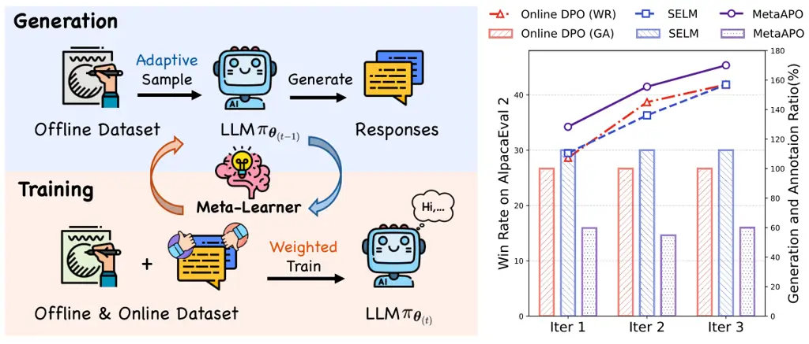

# Alignment through Meta-Weighted Online Sampling: Bridging the Gap between Data Generation and Preference Optimization

Junming Yang Affiliation: School of Computer Science and Engineering,
Southeast University, Nanjing, China Affiliation: Key Laboratory of New
Generation Artificial Intelligence Technology andIts Interdisciplinary
Applications (Southeast University), Ministry of Education, China
Email: [jmingyang@seu.edu.cn](mailto:)    Ning Xu ^(†)^(†)thanks:
Corresponding author Affiliation: School of Computer Science and
Engineering, Southeast University, Nanjing, China Affiliation: Key
Laboratory of New Generation Artificial Intelligence Technology andIts
Interdisciplinary Applications (Southeast University), Ministry of
Education, China Email: [xning@seu.edu.cn](mailto:)    Biao Liu
Affiliation: School of Computer Science and Engineering, Southeast
University, Nanjing, China Affiliation: Key Laboratory of New Generation
Artificial Intelligence Technology andIts Interdisciplinary Applications
(Southeast University), Ministry of Education, China
Email: [liubiao01@seu.edu.cn](mailto:)    Shiqi Qiao Affiliation: School
of Computer Science and Engineering, Southeast University, Nanjing,
China Affiliation: Key Laboratory of New Generation Artificial
Intelligence Technology andIts Interdisciplinary Applications (Southeast
University), Ministry of Education, China
Email: [sqqiao@seu.edu.cn](mailto:)    Xin Geng Affiliation: School of
Computer Science and Engineering, Southeast University, Nanjing, China
Affiliation: Key Laboratory of New Generation Artificial Intelligence
Technology andIts Interdisciplinary Applications (Southeast University),
Ministry of Education, China Email: [xgeng@seu.edu.cn](mailto:)

###### Abstract

Preference optimization is crucial for aligning large language models
(LLMs) with human values and intentions. A significant challenge in this
process is the distribution mismatch between pre-collected offline
preference data and the evolving model policy. Existing methods attempt
to reduce this gap using static heuristics or decoupled online sampling
strategies, but they often fail to adapt to the model’s dynamic learning
state. To bridge this gap, we propose Meta-Weighted Adaptive Preference
Optimization (MetaAPO), a novel framework that dynamically couples data
generation with model training. MetaAPO employs a lightweight
meta-learner, as an “alignment gap estimator”, to evaluate the potential
benefits of on-policy sampling in relation to offline data. This guides
targeted online generation and assigns sample-wise meta-weights to the
optimization objective, dynamically balancing the quality and
distribution of online and offline data. Experiments on AlpacaEval 2,
Arena-Hard and MT-Bench demonstrate that MetaAPO consistently
outperforms existing preference optimization approaches across various
settings, while reducing 42% in online annotation costs. Code is
available at
[https://github.com/junming-yang/MetaAPO](https://github.com/junming-yang/MetaAPO).

|     |
| --- |
|     |

## 1 Introduction

Learning from human feedback is essential for aligning large language
models (LLMs) with human values and intentions (Ouyang et al., 2022),
ensuring they are helpful, honest and harmless (Achiam et al., 2023;
Grattafiori et al., 2024). This advancement is primarily achieved in the
model alignment stage, which involves training reward models or LLMs
directly on datasets curated from human preferences. Reinforcement
learning from human feedback (RLHF) (Stiennon et al., 2020; Ouyang et
al., 2022) is a widely used method for fine-tuning LLMs to achieve this
goal. However, RLHF often faces challenges, particularly in
computational efficiency and training stability. Recently, alternative
offline algorithms like DPO (Rafailov et al., 2023), SimPO (Meng et al., 2024) and KTO (Ethayarajh et al., 2024) have been explored. These
methods reparameterize the RLHF objective to directly optimize the
policy using pre-collected offline preference datasets, simplifying the
training process and improving efficiency.

As alignment research progresses, recent studies have emphasized that
the quality and distribution of preference data are critical for
effective model alignment (Zhou et al., 2023; Deng et al., 2025; Xia et
al., 2024; Ding et al., 2024). Although offline preference datasets are
diverse and scalable, they often suffer from a distribution mismatch
between the pre-collected training data and current policy, as the
offline data is usually generated by a different model. This mismatch
leads to out-of-distribution (OOD) issues that hinder preference
alignment performance (Yan et al., 2024; Xu et al., 2024; Tajwar et al.,
2024). To improve the quality and distribution of training data,
existing methods for mitigating distribution shifts generally fall into
two categories. Some methods improve the reliability of offline data by
filtering out low-quality or OOD samples using manually designed
metrics, such as average validation loss, as exemplified by Selective
DPO (Gao et al., 2025). Others attempt to mitigate distribution shifts
by constructing training data through online sampling (Zhang et al.,
2024b; Ko et al., 2024; Badrinath et al., 2024). For instance, Iterative
DPO (Xiong et al., 2023; Guo et al., 2024b) and SPPO (Wu et al., 2024)
follow an iterative sampling-alignment loop: the current policy first
generates responses, which are then annotated by a reward model to
collect preference data for direct preference alignment. The updated
policy is subsequently used to repeat this process.



Figure 1: Left: Overview of MetaAPO. MetaAPO employs a meta-learner to
couple online data generation (top) and model training (bottom). The
meta-learner adaptively assigns weights by evaluating offline data,
guiding both targeted online sample generation and training on the
weighted combination of offline and online samples. Right: Performance
(left y-axis, line plots) and online generation and annotation ratio
relative to Online DPO (right y-axis, bar plots) across training
iterations for different methods.

While human-annotated offline data typically offers high efficiency and
quality, the distribution mismatch between static datasets and the
evolving model policy can negatively impact alignment performance. On
the other hand, model-generated data obtained through online sampling
more accurately reflects the current policy distribution, which helps
address the distribution shifts. However, online data often lacks
diversity and quality due to its reliance on the model’s capabilities
and current alignment state, leading to preference data that may be
inefficient or even noisy. This trade-off underscores the need for
adaptive mechanisms that can dynamically leverage the efficiency and
diversity of offline data while taking advantage of the distribution
benefits of online data. However, existing methods primarily depend on
heuristic, manually designed metrics (e.g., static thresholds) for data
selection and generation (Dong et al., 2024; Gao et al., 2025; Zhang et
al., 2024b; Ji et al., 2024), overlooking the interaction between the
data sampling process and preference optimization. An integrated
approach that simultaneously accounts for data quality, distribution
alignment, and the dynamics of preference optimization is essential for
more effective alignment.

Motivated by the above considerations, we propose Meta-Weighted Adaptive
Preference Optimization (MetaAPO), a novel framework that closely
couples data sampling with model alignment through a lightweight,
learnable meta-learner. As demonstrated in Figure 1 (Left), the
meta-learner acts as an “alignment gap estimator”, predicting the
potential improvements that online generations can provide relative to
offline data. This enables targeted online sampling, prioritizing
prompts expected to yield the highest alignment gains. In addition, the
meta-learner adjusts the training process by assigning sample-wise
meta-weights to a hybrid loss function, adaptively balancing the
contributions of offline data and online samples according to their
respective quality and distribution advantages. This dynamic interaction
ensures that the model continually adapts its learning focus to mitigate
distribution mismatches while avoiding redundant online sampling for
already aligned data, thus improving both training efficiency and
performance. Empirical results demonstrate that MetaAPO significantly
improves alignment across various base models, outperforming both
offline and online approaches. Our contributions can be summarized as
follows:

- •
  We propose MetaAPO, an extensible alignment framework compatible with
  various preference optimization methods. It bridges the gap between
  online data generation and model training by adaptively coupling these
  two stages, enabling a model-aware alignment process.
- •
  Our method employs a meta-learner that adaptively assigns sample-wise
  weights to data. These weights serve two purposes: guiding online data
  sampling based on the model’s training needs to mitigate distribution
  mismatches and adjusting the training by emphasizing beneficial
  samples.
- •
  Extensive experiments demonstrate that MetaAPO achieves superior
  alignment performance compared to baselines, even reducing 42% online
  annotation requirements (Figure 1, Right).

## 2 Related Work

Alignment with Preference Data. RLHF is a widely used method for
aligning LLMs with human values and intentions (Stiennon et al., 2020;
Ouyang et al., 2022; Bai et al., 2022). While effective, RLHF suffers
from high computational costs and training instability, prompting the
exploration of alternative alignment strategies. One prominent direction
is offline preference alignment (Azar et al., 2024; Dong et al., 2023;
Yuan et al., 2023; Lu et al., 2024), which directly trains models using
pre-collected datasets of human preferences, such as DPO (Rafailov et
al., 2023), SimPO (Meng et al., 2024) and KTO (Ethayarajh et al., 2024).
These methods are attractive for their efficiency and simplicity.
However, a key limitation is the distribution mismatch between static
training data and the evolving outputs of the policy model, which often
leads to poor generalization on out-of-distribution responses (Xu et
al., 2024; Yan et al., 2024; Yang et al., 2025; Tajwar et al., 2024). To
overcome this limitation, online preference alignment methods such as
Iterative DPO (Xiong et al., 2023) and SPPO (Wu et al., 2024) have been
proposed. These approaches adopt an iterative training paradigm in which
each round involves generating new responses from the current policy and
optimizing the model using annotated preferences (Yuan et al., 2024; Ko
et al., 2024; Chen et al., 2024; Kou et al., 2025). By enabling
exploration beyond the limitations of the initial static dataset, they
can improve model performance (Su et al., 2025; Xu et al., 2024; Tajwar
et al., 2024). However, they primarily rely on on-policy data and often
overlook valuable offline preference datasets. Bridging both paradigms,
hybrid methods like SELM (Zhang et al., 2024b) integrate offline and
online data by using a reward model to compare responses from both
sources, thereby constructing more diverse preference sets. Nonetheless,
these hybrid approaches lack strategic sampling and generation
mechanisms, failing to account for the distribution relationship between
offline and online data, which leads to inefficient resource utilization
and suboptimal performance.

Preference Data Selection and Augmentation. These limitations underscore
the growing importance of strategic data sampling and targeted
augmentation in preference alignment. The “less is more” principle
suggests that selecting high-quality and relevant data often leads to
better outcomes than relying on large volumes of unfiltered data (Zhou
et al., 2023; Deng et al., 2025; Liu et al., 2023; Ding et al., 2024).
Consequently, various data selection methods aim to identify the most
informative and helpful samples from general-purpose datasets to improve
training effectiveness (Wang et al., 2025; Khaki et al., 2024; Badrinath
et al., 2024). For instance, Selective DPO (Gao et al., 2025) employs
loss-based filtering to discard uninformative or harmful samples, while
MAP (Huang et al., 2025) uses internal and external reward margins to
guide sample inclusion. Beyond sample selection, data augmentation
further enhance alignment (Muldrew et al., 2024; Gou and Nguyen, 2024;
Guo et al., 2024a; Liu et al., 2024; Das et al., 2024; Liu et al.,
2025). ADPO (Ji et al., 2024) filters offline data based on a manual
threshold and then performs online augmentation on the selected samples.
The Reward-Augmented method (Zhang et al., 2024a) augments the dataset
by reversing preference pairs under the guidance of prompts. DICE (Chen
et al., 2024) and SeRA (Ko et al., 2024) combine data augmentation with
filtering methods, guided by length regularization and reward margins to
enhance training data. Despite these advancements, most prior work
treats data sampling as an auxiliary step, often decoupled from the
optimization process and guided by static heuristics. In contrast,
MetaAPO proposes a framework that closely integrates online data
generation with preference optimization via adaptive meta-weighting,
mitigating the distribution mismatch in preference alignment.

## 3 Preliminaries

Reinforcement Learning from Human Feedback. RLHF aims to align the
language model policy $`\pi_{\bm{\theta}}(\cdot|\bm{x})`$ with human
preferences over prompts $`\bm{x}\in\mathcal{X}`$. A typical RLHF
pipeline (Ouyang et al., 2022) starts by training a reward model on a
preference dataset
$`\mathcal{D}=\{(\bm{x},\bm{y}_{w},\bm{y}_{l})^{i}\}_{i=1}^{N}`$, where
each preference pair is annotated such that
$`\bm{y}_{w}\succ\bm{y}_{l}`$ indicates that $`\bm{y}_{w}`$ is preferred
over $`\bm{y}_{l}`$ for prompt $`\bm{x}`$. The reward model
$`r_{\bm{\psi}}(\bm{x},\bm{y})`$ is trained using the Bradley–Terry (BT)
model (Bradley and Terry, 1952), by minimizing a negative log-likelihood
loss that encourages larger reward gaps between preferred and
dispreferred responses:

```math
\displaystyle\mathcal{L}_{\text{RM}}(\bm{\psi})=-\mathbb{E}_{(\bm{x},\bm{y_{w}},\bm{y_{l}})\sim\mathcal{D}}\left[\sigma\left(r_{\bm{\psi}}(\bm{x},\bm{y}_{w})-r_{\bm{\psi}}(\bm{x},\bm{y}_{l})\right)\right], \tag{1}
```

where $`\sigma(\cdot)`$ denotes the logistic function. The policy
$`\pi_{\bm{\theta}}`$ is then optimized via reinforcement learning to
maximize the expected reward while staying close to a reference policy
$`\pi_{\text{ref}}`$ :

```math
\displaystyle\max_{\pi_{\bm{\theta}}}\mathbb{E}_{\bm{x}\sim\mathcal{D},\bm{y}\sim\pi_{\bm{\theta}}(\cdot|\bm{x})}[r_{\bm{\psi}}(\bm{x},\bm{y})]-\beta\mathbb{D}_{\text{KL}}[\pi_{\bm{\theta}}(\bm{y}|\bm{x})||\pi_{\text{ref}}(\bm{y}|\bm{x})], \tag{2}
```

where $`\beta`$ controls the trade-off between reward maximization and
deviation from the reference policy.

Direct Preference Optimization. While effective, RLHF can be complex,
unstable, and computationally demanding. DPO (Rafailov et al., 2023)
simplifies the process by directly optimizing the policy using a
supervised learning objective over preference data, without explicitly
learning a reward model. DPO reparameterizes the reward as
$`r(\bm{x},\bm{y})=\beta(\log\frac{\pi_{\bm{\theta}}(\bm{y}|\bm{x})}{\pi_{\text{ref}}(\bm{y}|\bm{x})}+\log Z(\bm{x}))`$,
where $`Z(\bm{x})`$ is the partition function and $`\pi_{\text{ref}}`$
is typically the supervised fine-tuned (SFT) model. By minimizing the
negative log-likelihood of reward modeling in Eq. 1, DPO derives the
following loss:

```math
\mathcal{L}_{\text{DPO}}({\bm{\theta}})=-\mathbb{E}_{(\bm{x},\bm{y_{w}},\bm{y_{l}})\sim\mathcal{D}}\left[\log\sigma\left(\beta\log\frac{\pi_{\bm{\theta}}(\bm{y}_{w}|\bm{x})}{\pi_{\text{ref}}(\bm{y}_{w}|\bm{x})}-\beta\log\frac{\pi_{\bm{\theta}}(\bm{y}_{l}|\bm{x})}{\pi_{\text{ref}}(\bm{y}_{l}|\bm{x})}\right)\right]. \tag{3}
```

DPO supports both offline preference datasets
$`\mathcal{D}_{\text{offline}}`$ (e.g., curated in advance) and online
datasets $`\mathcal{D}_{\text{online}}`$ (generated by the policy model
$`\pi_{\bm{\theta}}`$).

## 4 Method

In this section, we present the technical details of MetaAPO. The
alignment process is conducted within a single training epoch, where the
dataset is divided into sequential subsets and processed iteratively
over $`t\in\{0,1,\dots,T\}`$. In each iteration $`t`$, we start by
performing meta-weighted adaptive online sampling to generate online
data from policy $`\pi_{\bm{\theta}_{(t-1)}}`$ (Section 4.1). The policy
is then fine-tuned on the hybrid dataset using the meta-weighted
objective to obtain the updated policy $`\pi_{\bm{\theta}_{(t)}}`$
(Section 4.2). Concurrently, the meta-learner is periodically updated to
better estimate the potential gain from online data (refer to
Section 4.3). The overall workflow is illustrated in Algorithm 1.

### 4.1 Meta-Weighted Adaptive Online Sampling

We begin with a model-aware sampling strategy for acquiring new
preference data. This process involves using a preference scoring
function (derived from objectives like DPO) to assess the utility of
existing offline samples. Given a prompt $`\bm{x}`$ and a pair of
preferred and dispreferred responses $`(\bm{y}_{w},\bm{y}_{l})`$, the
instance-level preference score is computed as:

```math
\displaystyle\ell(\bm{x},\bm{y}_{w},\bm{y}_{l})=\log\sigma\left(\beta\log\frac{\pi_{\bm{\theta}}(\bm{y}_{w}|\bm{x})}{\pi_{\text{ref}}(\bm{y}_{w}|\bm{x})}-\beta\log\frac{\pi_{\bm{\theta}}(\bm{y}_{l}|\bm{x})}{\pi_{\text{ref}}(\bm{y}_{l}|\bm{x})}\right), \tag{4}
```

where a higher score $`\ell(\cdot)`$ indicates stronger agreement
between the current policy $`\pi_{\bm{\theta}}`$ and human preferences,
compared to a fixed reference policy $`\pi_{\text{ref}}`$. This scoring
function is applied to each instance in the offline preference dataset
$`\mathcal{D}_{\text{offline}}=\{(\bm{x},\bm{y}_{w}^{\text{off}},\bm{y}_{l}^{\text{off}})^{i}\}_{i=1}^{N}`$,
producing scores
$`\ell^{\text{off}}(\bm{x},\bm{y}_{w}^{\text{off}},\bm{y}_{l}^{\text{off}})`$.

To enable the sampling process to dynamically adapt to the model’s
current state and requirement, we introduce a meta-learner that
adaptively re-weights each offline sample based on its preference score.
The meta-learner $`h_{\bm{\phi}}`$, implemented as a two-layer MLP, maps
the preference score $`\ell(\cdot)`$ to a weight
$`w=h_{\bm{\phi}}(\ell^{\text{off}}(\cdot))\in[0,1]`$ (Line 7 in
Alg. 1). A high weight indicates that the sample aligns well with the
model’s current behavior, while a low weight suggests potential
misalignment that may require further online exploration. This
formulation can be extended to the multi-objective setting (Zhou et al.,
2024). Suppose we consider $`M`$ objectives (e.g., helpfulness,
harmlessness, and honesty), each inducing its own partial preference
relation and corresponding offline preference loss
$`\ell^{\text{off}}_{i}(\cdot)`$, where $`i\in\{1,...,M\}`$. We then
apply objective-wise label enhancement (Xu et al., 2019; Xu et al., 2023) by assigning an adaptive continuous label degree for each
objective:
$`d_{i}=h_{\bm{\phi}}(\ell_{i}^{\text{off}}(\cdot))\in[0,1],i\in\{1,...,M\}`$.
The normalized label distribution (Geng, 2016)
$`\mathbf{d}=[\hat{d}_{1},\dots,\hat{d}_{m}]`$, derived from the initial
vector $`[d_{1},\dots,d_{m}]`$, characterizes the model’s relative
alignment-aware importance across different objectives.

This adaptive meta-weight $`w`$ subsequently guides the online sampling
and generation phase. (Line 8-12 in Alg. 1). For each offline tuple
$`\{\bm{x},\bm{y}_{w}^{\text{off}},\bm{y}_{l}^{\text{off}}\}^{i}`$, a
value $`u_{i}`$ is sampled from $`\text{Uniform}(0,1)`$. If
$`u_{i}>w_{i}`$, the current policy $`\pi_{\bm{\theta}}`$ generates
$`K`$ candidate responses
$`\{\bm{y}_{1}^{\text{on}},\ldots,\bm{y}_{K}^{\text{on}}\}`$ for prompt
$`\bm{x}`$. These responses are then ranked by an external reward model
to produce online preference pairs
$`\bm{y}^{\text{on}}_{\text{pair}}=(\bm{y}_{w}^{\text{on}},\bm{y}_{l}^{\text{on}})`$.
Finally, both the sampled offline and corresponding online preferences
are merged into an augmentation set $`\mathcal{D}_{\text{aug}}`$. This
augmented dataset forms a dynamic training stream that evolves with the
model, enabling the model to better attend to regions where alignment
gaps may exist.

1: Input: Offline preference dataset
$`\mathcal{D}_{\text{offline}}=\{(\bm{x},\bm{y}_{w}^{\text{off}},\bm{y}_{l}^{\text{off}})^{i}\}_{i=1}^{N}`$;

2:     Language model $`\pi_{\bm{\theta}}`$, reference model
$`\pi_{\text{ref}}`$, reward model $`\mathcal{R}`$, meta-learner
$`h_{\bm{\phi}}`$

3: Initialize: Load model parameters $`\bm{\theta}`$, initialize
meta-learner parameters $`\bm{\phi}`$

4: for each iteration do

5:   Initialize augmentation dataset
$`\mathcal{D}_{\text{aug}}\leftarrow\emptyset`$ and meta buffer
$`\mathcal{B}_{\text{meta}}\leftarrow\emptyset`$

6:   for each
$`(\bm{x},\bm{y}_{w}^{\text{off}},\bm{y}_{l}^{\text{off}})^{i}\in\mathcal{D}_{\text{offline}}`$
do $`\triangleright`$ Meta-Weighted Adaptive Online Sampling

7:    Compute meta-weight:
$`w_{i}\leftarrow h_{\bm{\phi}}(\ell(\bm{x},\bm{y}_{w}^{\text{off}},\bm{y}_{l}^{\text{off}}))`$

8:    Sample $`u_{i}\sim\text{Uniform}(0,1)`$

9:    if $`u_{i}>w_{i}`$ then

10:      Generate $`K`$ responses:
$`\{\bm{y}_{1}^{\text{on}},\dots,\bm{y}_{K}^{\text{on}}\}\leftarrow\pi_{\bm{\theta}}(\cdot\mid\bm{x})`$

11:      Evaluate with $`\mathcal{R}`$:
$`\{\bm{y}_{l}^{\text{on}},\bm{y}_{w}^{\text{on}}\}\leftarrow\mathcal{R}(\bm{x},\{\bm{y}_{j}^{\text{on}}\}_{j=1}^{K})`$

12:      Add to augmentation set:
$`\mathcal{D}_{\text{aug}}\leftarrow\mathcal{D}_{\text{aug}}\cup\{(\bm{x},\bm{y}_{w}^{\text{off}},\bm{y}_{l}^{\text{off}},\bm{y}_{l}^{\text{on}},\bm{y}_{w}^{\text{on}})^{i}\}`$

13:    end if

14:   end for

15:   for each batch
$`\mathcal{D}_{\text{batch}}\sim\mathcal{D}_{\text{aug}}`$ do
$`\triangleright`$ Meta-Weighted Model Training (freeze
$`h_{\bm{\phi}}`$)

16:    Compute sample-wise meta-weight:
$`w_{j}\leftarrow h_{\bm{\phi}}(\ell(\bm{x},\bm{y}_{w}^{\text{off}},\bm{y}_{l}^{\text{off}}))`$

17:    Update language model by Eq. 5:
$`\bm{\theta}\leftarrow\bm{\theta}-\alpha\nabla_{\bm{\theta}}\mathcal{L}(\bm{\theta})`$

18:    Add batch data to meta buffer:
$`\mathcal{B}_{\text{meta}}\leftarrow\mathcal{B}_{\text{meta}}\cup\mathcal{D}_{\text{batch}}`$

19:    if batch iteration % $`T_{\text{meta}}=0`$ then
$`\triangleright`$ Meta-Learner Update (freeze $`\pi_{\bm{\theta}}`$)

20:      Update meta-learner by Eq. 6:
$`\bm{\phi}\leftarrow\bm{\phi}-\eta\nabla_{\bm{\phi}}\mathcal{L}_{\text{meta}}(\bm{\phi};\mathcal{B}_{\text{meta}})`$

21:      Reset meta buffer:
$`\mathcal{B}_{\text{meta}}\leftarrow\emptyset`$

22:    end if

23:   end for

24: end for

Algorithm 1 Training Scheme of MetaAPO

### 4.2 Meta-Weighted Preference Optimization

During preference optimization, we employ the sample-wise meta-weight
$`w`$ to dynamically balance the influence of offline preference data
and online model-generated samples (Line 16-17 in Alg. 1). The overall
objective is to minimize the meta-weighted preference loss:

```math
\displaystyle\mathcal{L}({\bm{\theta}})=-\mathbb{E}_{(\bm{x},\bm{y}^{\text{off}}_{\text{pair}},\bm{y}^{\text{on}}_{\text{pair}})\sim\mathcal{D}_{\text{aug}}}\Big[\underbrace{w\cdot\ell_{\bm{\theta}}(\bm{x},\bm{y}_{w}^{\text{off}},\bm{y}_{l}^{\text{off}})}_{\text{adaptive offline loss}}+\underbrace{(1-w)\cdot\ell_{\bm{\theta}}(\bm{x},\bm{y}_{w}^{\text{on}},\bm{y}_{l}^{\text{on}})}_{\text{adaptive online loss}}\Big], \tag{5}
```

where $`\ell_{\bm{\theta}}(\cdot)`$ denotes a standard preference
alignment objective (e.g., DPO in Eq. 4 or SimPO) used to align the
current policy $`\pi_{\bm{\theta}}`$ with the target preferences. The
first term captures contributions from offline preferences, while the
second focuses on online model-generated preference samples.

This joint optimization enriches data diversity. The balance coefficient
$`w=h_{\bm{\phi}}(\ell^{\text{off}}(\cdot))`$ is predicted by the
meta-learner and indicates the confidence in offline preference data.
When the model’s behavior aligns well with the offline preference, the
meta-learner assigns a higher weight $`w`$ to reinforce stable learning
from reliable offline human-labeled examples. Conversely, when
misalignment is detected, $`w`$ is reduced, prompting greater reliance
on adaptive corrections from online feedback.

### 4.3 Learning to Weight: Meta-Learner for Alignment Gap Estimation

The effectiveness of both adaptive online sampling (Section 4.1) and
meta-weighted preference optimization (Section 4.2) critically depends
on the quality of the dynamically assigned weights
$`w=h_{\bm{\phi}}(\ell^{\text{off}}(\cdot))`$. Instead of relying on
pre-defined heuristics or static weights, we propose to learn the
weighting function $`h_{\bm{\phi}}`$ through a meta-learning approach.
The goal is for $`h_{\bm{\phi}}`$ to act as an “alignment gap
estimator”, dynamically assessing the utility of each offline sample
relative to potential online preference data, and assigning weights that
effectively guide the alignment process. This allows training data to be
weighted based on the model’s current state, enabling continuous
adaptation throughout the alignment process.

Specifically, the meta-learner $`h_{\bm{\phi}}`$ is trained in an
alternating manner with the policy model $`\pi_{\bm{\theta}}`$. At
intervals specified by a hyperparameter $`T_{\text{meta}}`$, the
parameters of $`\pi_{\bm{\theta}}`$ are temporarily frozen, and
$`h_{\bm{\phi}}`$ is updated using data stored in the meta buffer
$`\mathcal{B}_{\text{meta}}`$ (Lines 19–21 in Alg. 1). This buffer
aggregates preference data from multiple recent training batches of
$`\pi_{\bm{\theta}}`$, enabling the meta-learner to derive a more stable
and generalized weighting strategy from accumulated experience. The
meta-learner $`h_{\bm{\phi}}`$ is optimized by minimizing the following
loss:

```math
\displaystyle\mathcal{L}_{\text{meta}}(\bm{\phi})=-\mathbb{E}_{(\bm{x},\bm{y}^{\text{off}}_{\text{pair}},\bm{y}^{\text{on}}_{\text{pair}})\sim\mathcal{B}_{\text{meta}}}\Big[\underbrace{h_{\bm{\phi}}(\ell^{\text{off}}(\cdot))\cdot\ell(\bm{x},\bm{y}_{w}^{\text{off}},\bm{y}_{l}^{\text{off}})}_{\text{adaptive offline loss}}+\underbrace{(1-h_{\bm{\phi}}(\ell^{\text{off}}(\cdot)))\cdot\ell(\bm{x},\bm{y}_{w}^{\text{on}},\bm{y}_{l}^{\text{on}})}_{\text{adaptive online loss}}\Big], \tag{6}
```

where $`\ell(\bm{x},\bm{y}_{w}^{\text{off}},\bm{y}_{l}^{\text{off}})`$
(abbreviated as $`\ell^{\text{off}}(\cdot)`$) and
$`\ell(\bm{x},\bm{y}_{w}^{\text{on}},\bm{y}_{l}^{\text{on}})`$
(abbreviated as $`\ell^{\text{on}}(\cdot)`$) denote the preference
scores for the offline and online response pairs, respectively, for the
same prompt $`\bm{x}`$.

What does meta-learner update do? For a mechanistic understanding of
meta-learner, it is useful to analyze the gradient of the loss function
$`\mathcal{L}_{\text{meta}}(\bm{\phi})`$. The gradient with respect to
the meta-learner parameters $`{\bm{\phi}}`$ can be written as:

```math
\displaystyle\nabla_{\bm{\phi}}\mathcal{L}_{\text{meta}}({\bm{\phi}}) \displaystyle=\mathbb{E}_{\mathcal{B}_{\text{meta}}}\Big[\left(\ell^{\text{on}}(\cdot)-\ell^{\text{off}}(\cdot)\right)\cdot\nabla_{\bm{\phi}}(h_{\bm{\phi}}(\ell^{\text{off}}(\cdot))\Big]. \tag{7}
```

This gradient drives the adaptation of the weighting function
$`h_{\bm{\phi}}`$. When online samples yield higher preference scores
than offline samples (i.e.,
$`\ell^{\text{on}}(\cdot)>\ell^{\text{off}}(\cdot)`$), the meta-learner
reduces the weight assigned to offline data, encouraging exploration
guided by online feedback. Conversely, when offline preferences remain
superior, their weights are increased to reinforce stable learning from
reliable human annotations. The full gradient derivation is provided in
Appendix A.1.

Moreover, we provide a theoretical guarantee for the meta-learner
$`h_{\phi}`$ in Theorem 1. The result demonstrates that the risk of the
learned weighting function is provably close to the oracle risk, with
the alignment gap controlled by the hypothesis complexity and
meta-buffer size.

###### Theorem 1 (Generalization Bound for Meta-Learner).

Let $`\hat{h}_{\bm{\phi}}`$ denote the meta-learner function learned by
minimizing the empirical meta-risk over the meta-buffer
$`\mathcal{B}_{\text{meta}}`$ of size $`m`$, and let $`h^{*}`$ be the
oracle function that minimizes the true meta-risk over the hypothesis
space $`\mathcal{H}`$. Assume the meta-loss
$`\mathcal{L}_{\text{meta}}({\bm{\phi}})`$ is bounded in $`[0,M]`$ for
any sample
$`(\bm{x},\bm{y}^{\text{off}}_{\text{pair}},\bm{y}^{\text{on}}_{\text{pair}})`$.
Then, for any $`\delta>0`$, with probability at least $`1-\delta`$, the
following inequality holds:

```math
R(\hat{h}_{\bm{\phi}})\;\leq\;R(h^{*})\;+\;4\,\mathrm{Rad}_{m}(\mathcal{L}_{\text{meta}}({\bm{\phi}})\circ\mathcal{H})\;+\;M\sqrt{\tfrac{2\ln(1/\delta)}{m}},
```

where $`R(h_{\bm{\phi}})`$ and $`\widehat{R}_{m}(h_{\bm{\phi}})`$ denote
the true and empirical risk respectively, and $`\mathrm{Rad}_{m}`$ is
the Rademacher complexity of the meta-loss hypothesis. The detailed
proof is provided in Appendix A.2.

Theorem 1 shows that as the meta-buffer size $`m`$ increases, the risk
of the learned meta-learner $`R(\hat{h}_{\bm{\phi}})`$ converges to that
of the oracle function $`R(h^{*})`$. And the Rademacher complexity term
favors a simple hypothesis space for better generalization. This
justifies that a sufficient meta-buffer combined with a simple
meta-learner can achieve effective estimation and assign near-optimal
weights.

## 5 Experiments

### 5.1 Experimental Setup

Datasets and Models. We use the Ultrafeedback dataset (Cui et al., 2024)
, which contains 64K preference annotations collected from four
LLM-generated outputs and labeled preferences by GPT-4. To demonstrate
the general effectiveness of our method, we experiment with two
supervised fine-tuned models from different-sized base model:
Llama-3.1-8B (Grattafiori et al., 2024) and Qwen2.5-7B (Yang et al.,
2024). For online preference annotation, we train the reward models on
UltraFeedback using the corresponding base model to avoid any preference
leakage. We also provide a comparison with existing open-source reward
models in Appendix C.2.

Evaluation Metric. We evaluate our method using three widely adopted
automatic evaluation benchmarks for LLMs: AlpacaEval 2 (Dubois et al.,
2024), MT-Bench (Zheng et al., 2023), and Arena-Hard (Li et al., 2024).
All evaluations are conducted using GPT-4o-latest as the judge model.
For AlpacaEval 2, we report the raw win rate (WR) and the
length-controlled win rate (LC) against the reference model
GPT-4o-2024-05-13. For Arena-Hard, we report the win rate (WR) and the
style-controlled win rate (SC), comparing our model against the
GPT-4-Preview-1106 baseline. For MT-Bench, we report the average
multi-turn score (Score) assigned by GPT-4o-latest, which rates each
response on a 10-point scale.

Baselines. We evaluate the following baseline methods relevant to the
setting of our method:

- •
  Offline Alignment: Methods that optimize models solely using offline
  human preference datasets, such as DPO (Rafailov et al., 2023),
  IPO (Azar et al., 2024), KTO (Ethayarajh et al., 2024) and
  DPO-Shift (Yang et al., 2025). This category also includes Selective
  DPO (Gao et al., 2025), which improves data quality by filtering out
  OOD samples based on a hand-crafted metric.
- •
  Online Alignment: Methods that collect model-generated responses and
  align them using preferences from an external reward model—e.g.,
  Online DPO (Xiong et al., 2023) and PPO.
- •
  Hybrid Alignment: Methods that integrate both offline annotated
  preferences and online model-generated data to optimize alignment, as
  ADPO (Ji et al., 2024) and SELM (Zhang et al., 2024b). It also
  includes methods that apply fixed-threshold data filtering before
  performing online augmentation—e.g., BeeS (Deng et al., 2025) and
  MAP (Huang et al., 2025).

Implementation. All experiments are conducted using 8$`\times`$80GB
NVIDIA H100 GPUs with a batch size of 128 and a maximum sequence length
of 4096 tokens for 1 epoch. At each iteration round, we sample responses
from the current policy using different decoding configurations:
temperature $`T=1.0`$, $`top`$-$`p=1.0`$ for the Llama3.1 setting, and
$`T=0.8`$, $`top`$-$`p=0.95`$ for the Qwen2.5 setting. For each prompt,
we generate $`K=8`$ diverse responses, which are then scored by a reward
model to construct preference pairs. The meta-learner is updated every
$`T_{\text{meta}}=8`$ steps. Additional details about model
configurations, evaluation procedure and hyperparameters are provided in
Appendix B.

|                             |              |       |            |       |          |              |       |            |       |          |
| --------------------------- | ------------ | ----- | ---------- | ----- | -------- | ------------ | ----- | ---------- | ----- | -------- |
| Models                      | Llama-3.1-8B |       |            |       |          | Qwen2.5-7B   |       |            |       |          |
|                             | AlpacaEval 2 |       | Arena-Hard |       | MT-Bench | AlpacaEval 2 |       | Arena-Hard |       | MT-Bench |
|                             | WR(%)        | LC(%) | WR(%)      | SC(%) | Score    | WR(%)        | LC(%) | WR(%)      | SC(%) | Score    |
| SFT                         | 10.02        | 17.28 | 18.5       | 21.6  | 6.63     | 34.03        | 34.08 | 48.5       | 44.3  | 7.71     |
| _Offline Alignment_         |              |       |            |       |          |              |       |            |       |          |
| DPO                         | 18.15        | 25.20 | 28.9       | 30.9  | 6.94     | 37.24        | 36.84 | 49.0       | 47.2  | 7.83     |
| IPO                         | 13.11        | 23.50 | 23.6       | 26.3  | 7.02     | 37.95        | 36.43 | 54.6       | 48.3  | 7.64     |
| KTO                         | 20.28        | 29.19 | 21.4       | 26.4  | 7.24     | 38.12        | 36.51 | 43.9       | 44.1  | 7.63     |
| SimPO                       | 37.31        | 38.20 | 37.8       | 33.0  | 7.51     | 40.03        | 40.78 | 54.6       | 48.8  | 7.58     |
| DPO-Shift                   | 19.33        | 19.39 | 28.7       | 27.6  | 7.03     | 36.05        | 34.32 | 49.6       | 47.2  | 7.53     |
| Selective DPO               | 21.35        | 20.67 | 28.5       | 31.9  | 7.11     | 38.02        | 39.21 | 51.7       | 48.2  | 7.74     |
| _Online & Hybrid Alignment_ |              |       |            |       |          |              |       |            |       |          |
| ADPO                        | 19.33        | 17.26 | 32.0       | 30.7  | 6.69     | 40.32        | 35.21 | 49.9       | 48.7  | 7.58     |
| Online DPO                  | 43.75        | 39.98 | 38.0       | 32.1  | 7.33     | 48.25        | 46.64 | 53.7       | 48.4  | 7.51     |
| PPO                         | 45.33        | 40.49 | 40.8       | 35.3  | 7.35     | 48.52        | 44.26 | 55.1       | 49.2  | 7.65     |
| SELM                        | 43.56        | 40.14 | 36.0       | 34.1  | 7.28     | 48.08        | 44.91 | 56.5       | 51.7  | 7.48     |
| BeeS                        | 41.42        | 37.45 | 39.5       | 36.4  | 7.13     | 41.87        | 37.04 | 49.3       | 48.2  | 7.38     |
| MAP                         | 43.60        | 38.97 | 40.4       | 37.2  | 7.17     | 42.11        | 39.91 | 52.1       | 49.5  | 7.52     |
| _MetaAPO_                   |              |       |            |       |          |              |       |            |       |          |
| MetaAPO                     | 47.48        | 43.21 | 43.9       | 40.8  | 7.56     | 49.14        | 47.66 | 58.4       | 53.7  | 7.78     |

Table 1: Overall performance of our proposed MetaAPO method with
Llama-3.1-8B and Qwen2.5-7B, compared with offline, online and hybrid
baseline methods on AlpacaEval 2, Arena-Hard and MT-Bench. The best
results are highlighted in bold.

### 5.2 Overall Performance

In Table 1, we present the overall results of MetaAPO compared to
offline, online and hybrid state-of-the-art alignment methods on the
AlpacaEval 2, Arena-Hard and MT-Bench benchmarks.

Figure 2: Left: The dynamic changes in Offline Score (left y-axis) and
Reward (right y-axis) across training iterations. Middle: Scatter plot
of offline implicit reward margin ($`m_{\text{off}}(\cdot)`$) versus the
online-offline implicit reward margin gap
($`m_{\text{on}}(\cdot)-m_{\text{off}}(\cdot)`$). Points are colored by
their sampling status: blue for “Sampled” (selected for online
generation) and orange for “Unsampled”. Right: Comparison of independent
reward score distributions (via kernel density estimation) for testset
responses generated by DPO and MetaAPO.

MetaAPO consistently outperforms preference optimization baselines.
Compared to offline alignment methods, which rely solely on fixed,
pre-collected datasets, MetaAPO avoids the performance degradation
caused by distribution shifts between static data and evolving policies.
Enhanced offline approaches like Selective DPO, which attempt to
mitigate this mismatch through data filtering, yield only marginal
improvements and still fall short of MetaAPO. Online and hybrid methods
leverage model-generated samples and online feedback to significantly
outperform purely offline baselines. While online and hybrid methods
significantly outperform purely offline baselines by leveraging
on-policy feedback, they are often constrained by the quality and
diversity of their own model generations. The heavy reliance on
self-generated data can introduce noisy preferences. MetaAPO surpasses
these strong baselines by avoiding regions prone to noisy feedback and
effectively leveraging diverse offline data. We also compare performance
across different reward models, preference optimization methods and
datasets in Appendix C.2, demonstrating the robustness of our approach.

MetaAPO achieves superior performance with fewer online samples. As
shown in Figure 1 (Right), MetaAPO outperforms strong baselines such as
Online DPO, SELM and PPO, while using only 58% of the online generated
and annotated samples on average compared to standard online generation
methods. This efficiency comes from a meta-weighted sampling mechanism,
which prioritizes the most informative data points and skips unnecessary
online generation for already aligned or low-gain predicted samples.
This adaptive data sampling significantly reduces labeling costs and
time consumption, cutting time by 80.1% compared to PPO and by 52.9%
compared to Online DPO (detailed in Appendix C.7).

### 5.3 Further Analyses

Training dynamics reveal an explore-integrate behavior. To examine the
dynamic interplay during training, we tracked the offline preference
score $`\ell^{\text{off}}`$ and generation reward on a held-out test set
across iterations. As shown in Figure 2 (Left), the average reward
steadily increases (from $`1.06`$ to $`1.33`$) while its standard
deviation decreases (from $`0.49`$ to $`0.37`$), indicating that MetaAPO
robustly enhances generation quality under reward guidance. In contrast,
the mean offline preference score drops sharply at Iteration 2 before
recovering, suggesting that MetaAPO does more than fit static offline
data. The drop reflects active exploration of response strategies
diverging from offline preferences, while the subsequent recovery in
Iteration 3 reflects the integration of these discoveries with
foundational offline knowledge. Overall, these dynamics highlight
MetaAPO’s adaptive behavior: it continuously identifies and addresses
gaps between the evolving policy and offline data.

The dynamics are driven by a high-gain sampling strategy. Figure 2
(Middle) shows MetaAPO’s online sampling strategy based on two signals:
the initial offline preference score $`\ell^{\text{off}}(\cdot)`$, and
the potential gain $`\ell^{\text{on}}(\cdot)-\ell^{\text{off}}(\cdot)`$.
For visualization purposes, we replace the original preference score
$`\ell(\cdot)=\log\sigma(\beta\cdot m(\cdot))`$ with the implicit reward
margin
$`m(\cdot)=\log\frac{\pi_{\bm{\theta}}(\bm{y}_{w}|\bm{x})}{\pi_{\text{ref}}(\bm{y}_{w}|\bm{x})}-\log\frac{\pi_{\bm{\theta}}(\bm{y}_{l}|\bm{x})}{\pi_{\text{ref}}(\bm{y}_{l}|\bm{x})}`$,
which allows us to more clearly visualize the distribution in
well-aligned regions (right x-axis). This rescaling only changes the
numerical magnitude of the values and does not affect their relative
ordering or the qualitative sampling trends. Each point represents an
offline sample, marked as “Sampled” (blue) if selected for generation,
or “Unsampled” (orange) otherwise. Two trends drive sampling. First,
points with low $`m^{\text{off}}(\cdot)`$ (indicating weak alignment or
OOD) receive smaller meta-learner weights $`w`$, increasing their
selection probability. Second, the meta-learner prioritizes samples with
high potential gain ($`m^{\text{on}}(\cdot)>m^{\text{off}}(\cdot)`$),
concentrating its selection in the upper-left region where these two
factors converge. In contrast, samples with high offline scores or
minimal online gain are less likely to be selected, avoiding redundant
computation.

Effectiveness of the meta-learner. A key component of MetaAPO is the
meta-learner, a simple two-layer MLP that effectively captures the
model’s dynamic alignment state. Its effectiveness stems from two
factors. First, we observed a clear, learnable relationship between the
offline score $`\ell^{\text{off}}(\cdot)`$ and potential online-offline
gain $`\ell^{\text{on}}(\cdot)-\ell^{\text{off}}(\cdot)`$, as shown in
Figure 2 (Middle). This discovery allows even a lightweight network to
serve as a reliable "alignment gap estimator." Second, the meta-learner
is continuously updated alongside the policy, adapting its sampling and
weighting decisions to the evolving model state. Experiments with deeper
networks and more complex inputs (Appendix C.5) show that the two-layer
MLP provides sufficient expressive power, confirming its efficiency and
effectiveness. Additional analyses further confirm the generalizability
of MetaAPO. As shown in Figure 2 (Right), its generated responses on the
test set achieve higher scores distribution under an independent reward
model OpenRLHF/Llama-3-8b-rm-mixture.

| Model                     | AlpacaEval 2       |                    | Arena-Hard         |                    | MT-Bench           | Annotations             |
| ------------------------- | ------------------ | ------------------ | ------------------ | ------------------ | ------------------ | ----------------------- |
|                           | WR(%) $`\uparrow`$ | LC(%) $`\uparrow`$ | WR(%) $`\uparrow`$ | SC(%) $`\uparrow`$ | Score $`\uparrow`$ | Ratio(%) $`\downarrow`$ |
| MetaAPO                   | 47.48              | 43.21              | 43.9               | 40.8               | 7.56               | 58.4                    |
| w/ Random Sampling        | 42.61              | 38.53              | 37.3               | 32.1               | 7.14               | 50.0                    |
| w/ Threshold Sampling     | 44.13              | 42.92              | 40.7               | 38.5               | 7.14               | 53.3                    |
| w/ All Sampling           | 46.13              | 42.04              | 40.2               | 37.5               | 6.96               | 100.0                   |
| w/ Uniform Loss Weighting | 39.25              | 37.70              | 39.2               | 33.3               | 7.15               | 67.1                    |
| w/ Semantic Similarity    | 47.83              | 42.88              | 43.7               | 40.5               | 7.50               | 59.4                    |
| w/ Fixed Meta-Learner     | 45.01              | 40.03              | 39.9               | 36.4               | 7.22               | 60.6                    |
| w/o Meta-Learner          | 43.07              | 40.48              | 38.3               | 33.1               | 7.06               | 61.1                    |

Table 2: Ablation study on key components of MetaAPO. We assess the
impact of the sampling strategy, loss weighting, and meta-learner.
Metrics include AlpacaEval2, Arena-Hard, MT-Bench and the proportion of
annotations used during training.

### 5.4 Ablation Study

To analyze the impact of each core component in MetaAPO, we conduct a
series of ablation studies under the Llama-3.1-8B setting with the DPO
objective. Table 2 summarizes the effectiveness of different sampling
strategies, loss weighting mechanisms and the meta-learner.

Effects of sampling strategies. The choice of which offline samples to
augment with online responses is a critical factor to achieve efficient
and effective alignment. We ablate three design choices and keep the
preference optimization and meta-learner training process consistent
with the original MetaAPO setup: (1) Random Sampling selects half of the
offline data uniformly for online augmentation. (2) Threshold Sampling
selects samples whose initial preference scores fall below a fixed
threshold (resulting in a 53.3% annotation ratio). (3) All Sampling
disables the meta-learner’s adaptive sampling mechanism and applies
online sampling to all samples without any selection. The meta loss
weighting and meta-learner update still follow the MetaAPO formulation.
As shown in Table 2, MetaAPO outperforms both random and threshold
sampling across all metrics. All Sampling leverages a larger volume of
data, yet the absence of consideration for the dynamic distribution
relationship between offline and online data during sampling results in
suboptimal alignment performance.

Effects of loss weighting. We evaluate the impact of meta-weighted
preference optimization by replacing the learned weights $`w`$ in Eq. 5
with a uniform coefficient of $`0.5`$ for all augmented samples,
assigning equal importance to offline and online preference pairs during
training. Other components, including adaptive sampling and meta-learner
updates, remain unchanged. As shown in Table 2, this modification leads
to a significant performance drop with consistent declines on all
benchmarks. These results suggest that assigning equal importance forces
the model to learn from low-margin online data for already-aligned
samples, which provides a weak signal and can destabilize learning,
underscoring the need for a dynamic balancing mechanism.

Effects of meta-learner. To investigate the informative and adaptive
design of the meta-learner, we ablate three variants while keeping the
overall preference optimization and training pipeline consistent with
MetaAPO: (1) Semantic Similarity augments the meta-learner input by
incorporating the embedding similarity between the chosen and rejected
responses from the offline data. Results show that adding semantic
similarity leads to comparable performance, indicating that the original
preference score already provides sufficient information for
meta-learner. (2) Fixed Meta-Learner initialize a new meta-learner with
the weights learned by MetaAPO and freeze it during training. Both
sampling weights and loss weights remain static. (3) We also evaluate
the necessity of a trainable meta-learner by replacing meta-learner
function $`h_{\bm{\phi}}`$ with a fixed sigmoid-based heuristic (w/o
Meta-Learner in Table 2). This heuristic also uses offline preference
scores as input but remains static during the meta-learner update phase.
The results show performance drops across all metrics. For example,
AlpacaEval 2 WR decreased from $`47.48\%`$ to $`43.07\%`$, and
Arena-Hard WR dropped from $`43.9\%`$ to $`38.3\%`$. Despite using more
online annotations ($`61.1\%`$ vs. $`58.4\%`$), the fixed heuristic
underperformed, confirming the importance of a learnable meta-learner
for adaptive weighting and effective alignment. Further details, along
with additional ablation studies on reward model annotations and offline
data usage, are provided in Appendix C.2 and C.5.

## 6 Conclusion

In this paper, we propose MetaAPO, a novel framework that bridges the
gap between data generation and model training in LLM alignment. The
core idea is to leverage a meta-learner to assess the alignment of the
current policy and identify the potential for online exploration. To
achieve this, we introduce the techniques of adaptive online sampling,
meta-weighted optimization and meta-learner update, which jointly enable
dynamic integration of data and training. Experiments across three
alignment benchmarks validate the effectiveness of MetaAPO in
consistently outperforming existing alignment methods. While our current
approach effectively utilizes preference scores as input, it may be
beneficial to explore additional input signals, such as gradient or
representation-based features, to further enhance flexibility and
generalization.

## Acknowledgments

This research was supported by the Jiangsu Science Foundation
(BG2024036, BK20243012), the National Science Foundation of China
(62576093, 62125602, U24A20324, and 92464301), the Fundamental Research
Funds for the Central Universities (2242025K3002, 2242025K30024), the
New Cornerstone Science Foundation through the XPLORER PRIZE, and the
Big Data Computing Center of Southeast University.

## References

- Achiam et al. (2023) J. Achiam, S. Adler, S. Agarwal, L. Ahmad, I.
  Akkaya, F. L. Aleman, D. Almeida, J. Altenschmidt, S. Altman, S.
  Anadkat, et al. Gpt-4 technical report. arXiv preprint
  arXiv:2303.08774. Cited by: §1.
- Azar et al. (2024) M. G. Azar, Z. D. Guo, B. Piot, R. Munos, M.
  Rowland, M. Valko, and D. Calandriello A general theoretical paradigm
  to understand learning from human preferences. In International
  Conference on Artificial Intelligence and Statistics, pp. 4447–4455.
  Cited by: 1st item, §2, 1st item.
- Badrinath et al. (2024) A. Badrinath, P. Agarwal, and J. Xu Hybrid
  preference optimization: augmenting direct preference optimization
  with auxiliary objectives. arXiv preprint arXiv:2405.17956. Cited by:
  §1, §2.
- Bai et al. (2022) Y. Bai, A. Jones, K. Ndousse, A. Askell, A. Chen, N.
  DasSarma, D. Drain, S. Fort, D. Ganguli, T. Henighan, et al. Training
  a helpful and harmless assistant with reinforcement learning from
  human feedback. arXiv preprint arXiv:2204.05862. Cited by: §2.
- Bradley and Terry (1952) R. A. Bradley and M. E. Terry Rank analysis
  of incomplete block designs: i. the method of paired comparisons.
  Biometrika 39 (3/4), pp. 324–345. Cited by: §3.
- Chen et al. (2024) C. Chen, Z. Liu, C. Du, T. Pang, Q. Liu, A.
  Sinha, P. Varakantham, and M. Lin Bootstrapping language models with
  dpo implicit rewards. arXiv preprint arXiv:2406.09760. Cited by: §2,
  §2.
- Cui et al. (2024) G. Cui, L. Yuan, N. Ding, G. Yao, B. He, W. Zhu, Y.
  Ni, G. Xie, R. Xie, Y. Lin, et al. ULTRAFEEDBACK: boosting language
  models with scaled ai feedback. In International Conference on Machine
  Learning, pp. 9722–9744. Cited by: §5.1.
- Das et al. (2024) N. Das, S. Chakraborty, A. Pacchiano, and S. R.
  Chowdhury Active preference optimization for sample efficient rlhf.
  arXiv preprint arXiv:2402.10500. Cited by: §2.
- Deng et al. (2025) X. Deng, H. Zhong, R. Ai, F. Feng, Z. Wang, and X.
  He Less is more: improving llm alignment via preference data
  selection. arXiv preprint arXiv:2502.14560. Cited by: 8th item, §1,
  §2, 3rd item.
- Ding et al. (2024) B. Ding, C. Qin, R. Zhao, T. Luo, X. Li, G.
  Chen, W. Xia, J. Hu, L. A. Tuan, and S. Joty Data augmentation using
  llms: data perspectives, learning paradigms and challenges. In
  Findings of the Association for Computational Linguistics ACL 2024,
  pp. 1679–1705. Cited by: §1, §2.
- Dong et al. (2023) H. Dong, W. Xiong, D. Goyal, Y. Zhang, W. Chow, R.
  Pan, S. Diao, J. Zhang, K. Shum, and T. Zhang Raft: reward ranked
  finetuning for generative foundation model alignment. arXiv preprint
  arXiv:2304.06767. Cited by: §2.
- Dong et al. (2024) Q. Dong, L. Dong, X. Zhang, Z. Sui, and F. Wei
  Self-boosting large language models with synthetic preference data.
  arXiv preprint arXiv:2410.06961. Cited by: §B.4, §1.
- Dubois et al. (2024) Y. Dubois, B. Galambosi, P. Liang, and T. B.
  Hashimoto Length-controlled alpacaeval: a simple way to debias
  automatic evaluators. arXiv preprint arXiv:2404.04475. Cited by: §B.2,
  §5.1.
- Ethayarajh et al. (2024) K. Ethayarajh, W. Xu, N. Muennighoff, D.
  Jurafsky, and D. Kiela Kto: model alignment as prospect theoretic
  optimization. arXiv preprint arXiv:2402.01306. Cited by: §1, §2, 1st
  item.
- Gao et al. (2025) C. Gao, H. Li, L. Liu, Z. Xie, P. Zhao, and Z. Xu
  Principled data selection for alignment: the hidden risks of difficult
  examples. arXiv preprint arXiv:2502.09650. Cited by: 2nd item, §1, §1,
  §2, 1st item.
- Geng (2016) X. Geng Label distribution learning. IEEE Transactions on
  Knowledge and Data Engineering 28 (7), pp. 1734–1748. Cited by: §4.1.
- Gou and Nguyen (2024) Q. Gou and C. Nguyen Mixed preference
  optimization: reinforcement learning with data selection and better
  reference model. arXiv preprint arXiv:2403.19443. Cited by: §2.
- Grattafiori et al. (2024) A. Grattafiori, A. Dubey, A. Jauhri, A.
  Pandey, A. Kadian, A. Al-Dahle, A. Letman, A. Mathur, A. Schelten, A.
  Vaughan, et al. The llama 3 herd of models. arXiv preprint
  arXiv:2407.21783. Cited by: §1, §5.1.
- Guo et al. (2024a) H. Guo, Y. Yao, W. Shen, J. Wei, X. Zhang, Z. Wang,
  and Y. Liu Human-instruction-free llm self-alignment with limited
  samples. arXiv preprint arXiv:2401.06785. Cited by: §2.
- Guo et al. (2024b) S. Guo, B. Zhang, T. Liu, T. Liu, M. Khalman, F.
  Llinares, A. Rame, T. Mesnard, Y. Zhao, B. Piot, et al. Direct
  language model alignment from online ai feedback. arXiv preprint
  arXiv:2402.04792. Cited by: §1.
- Huang et al. (2025) K. Huang, J. Wu, Z. Chen, X. Wang, J. Gao, B.
  Ding, J. Wu, X. He, and X. Wang Larger or smaller reward margins to
  select preferences for alignment?. arXiv preprint arXiv:2503.01864.
  Cited by: 9th item, §2, 3rd item.
- Ji et al. (2024) K. Ji, J. He, and Q. Gu Reinforcement learning from
  human feedback with active queries. arXiv preprint arXiv:2402.09401.
  Cited by: 4th item, §1, §2, 3rd item.
- Khaki et al. (2024) S. Khaki, J. Li, L. Ma, L. Yang, and P.
  Ramachandra Rs-dpo: a hybrid rejection sampling and direct preference
  optimization method for alignment of large language models. arXiv
  preprint arXiv:2402.10038. Cited by: §2.
- Ko et al. (2024) J. Ko, S. Dingliwal, B. Ganesh, S. Sengupta, S.
  Bodapati, and A. Galstyan SeRA: self-reviewing and alignment of large
  language models using implicit reward margins. arXiv preprint
  arXiv:2410.09362. Cited by: §1, §2, §2.
- Kou et al. (2025) Z. Kou, Y. Xie, H. Wang, J. Wang, M. Xie, S.
  Chen, Y. Jia, T. Liu, and X. Geng RankMatch: a novel approach to
  semi-supervised label distribution learning leveraging rank
  correlation between labels. In Proceedings of the 39th Conference on
  Neural Information Processing Systems (NeurIPS 2025), San Diego,
  California, USA. Cited by: §2.
- Li et al. (2024) T. Li, W. Chiang, E. Frick, L. Dunlap, T. Wu, B.
  Zhu, J. E. Gonzalez, and I. Stoica From crowdsourced data to
  high-quality benchmarks: arena-hard and benchbuilder pipeline. arXiv
  preprint arXiv:2406.11939. Cited by: §B.2, §5.1.
- Liu et al. (2024) B. Liu, N. Xu, and X. Geng Progressively label
  enhancement for large language model alignment. arXiv preprint
  arXiv:2408.02599. Cited by: §2.
- Liu et al. (2025) B. Liu, N. Xu, J. Yang, and X. Geng Preference
  orchestrator: prompt-aware multi-objective alignment for large
  language models. arXiv preprint arXiv:2511.10656. Cited by: §2.
- Liu et al. (2023) W. Liu, W. Zeng, K. He, Y. Jiang, and J. He What
  makes good data for alignment? a comprehensive study of automatic data
  selection in instruction tuning. arXiv preprint arXiv:2312.15685.
  Cited by: §2.
- Lu et al. (2024) C. Lu, S. Holt, C. Fanconi, A. Chan, J. Foerster, M.
  van der Schaar, and R. Lange Discovering preference optimization
  algorithms with and for large language models. Advances in Neural
  Information Processing Systems 37, pp. 86528–86573. Cited by: §2.
- Meng et al. (2024) Y. Meng, M. Xia, and D. Chen Simpo: simple
  preference optimization with a reference-free reward. Advances in
  Neural Information Processing Systems 37, pp. 124198–124235. Cited by:
  §A.3, 1st item, §1, §2.
- Mohri et al. (2018) M. Mohri, A. Rostamizadeh, and A. Talwalkar
  Foundations of machine learning. MIT press. Cited by: §A.2.2,
  Definition 3.
- Muldrew et al. (2024) W. Muldrew, P. Hayes, M. Zhang, and D. Barber
  Active preference learning for large language models. In International
  Conference on Machine Learning, pp. 36577–36590. Cited by: §2.
- Ouyang et al. (2022) L. Ouyang, J. Wu, X. Jiang, D. Almeida, C.
  Wainwright, P. Mishkin, C. Zhang, S. Agarwal, K. Slama, A. Ray, et al.
  Training language models to follow instructions with human feedback.
  Advances in neural information processing systems 35, pp. 27730–27744.
  Cited by: 6th item, §B.4, §1, §2, §3.
- Peng et al. (2025) Y. Peng, G. Zhang, M. Zhang, Z. You, J. Liu, Q.
  Zhu, K. Yang, X. Xu, X. Geng, and X. Yang Lmm-r1: empowering 3b lmms
  with strong reasoning abilities through two-stage rule-based rl. arXiv
  preprint arXiv:2503.07536. Cited by: §B.4.
- Rafailov et al. (2023) R. Rafailov, A. Sharma, E. Mitchell, C. D.
  Manning, S. Ermon, and C. Finn Direct preference optimization: your
  language model is secretly a reward model. Advances in Neural
  Information Processing Systems 36, pp. 53728–53741. Cited by: 1st
  item, §1, §2, §3, 1st item.
- Stiennon et al. (2020) N. Stiennon, L. Ouyang, J. Wu, D. Ziegler, R.
  Lowe, C. Voss, A. Radford, D. Amodei, and P. F. Christiano Learning to
  summarize with human feedback. Advances in neural information
  processing systems 33, pp. 3008–3021. Cited by: §1, §2.
- Su et al. (2025) X. Su, Y. Wang, J. Zhu, M. Yi, F. Xu, Z. Ma, and Y.
  Liu Reveal the mystery of dpo: the connection between dpo and rl
  algorithms. arXiv preprint arXiv:2502.03095. Cited by: §2.
- Tajwar et al. (2024) F. Tajwar, A. Singh, A. Sharma, R. Rafailov, J.
  Schneider, T. Xie, S. Ermon, C. Finn, and A. Kumar Preference
  fine-tuning of llms should leverage suboptimal, on-policy data. In
  International Conference on Machine Learning, pp. 47441–47474. Cited
  by: §1, §2.
- Wang et al. (2025) Y. Wang, R. Chen, B. Li, D. Cho, Y. Deng, R.
  Zhang, T. Chen, Z. Wang, A. Grama, and J. Hong More is less: the
  pitfalls of multi-model synthetic preference data in dpo safety
  alignment. arXiv preprint arXiv:2504.02193. Cited by: §2.
- Wu et al. (2024) Y. Wu, Z. Sun, H. Yuan, K. Ji, Y. Yang, and Q. Gu
  Self-play preference optimization for language model alignment. arXiv
  preprint arXiv:2405.00675. Cited by: §1, §2.
- Xia et al. (2024) M. Xia, S. Malladi, S. Gururangan, S. Arora, and D.
  Chen Less: selecting influential data for targeted instruction tuning.
  arXiv preprint arXiv:2402.04333. Cited by: §1.
- Xiong et al. (2023) W. Xiong, H. Dong, C. Ye, Z. Wang, H. Zhong, H.
  Ji, N. Jiang, and T. Zhang Iterative preference learning from human
  feedback: bridging theory and practice for rlhf under kl-constraint.
  arXiv preprint arXiv:2312.11456. Cited by: §1, §2, 2nd item.
- Xu et al. (2019) N. Xu, Y. Liu, and X. Geng Label enhancement for
  label distribution learning. IEEE Transactions on Knowledge and Data
  Engineering 33 (4), pp. 1632–1643. Cited by: §4.1.
- Xu et al. (2023) N. Xu, J. Shu, R. Zheng, X. Geng, D. Meng, and M.
  Zhang Variational label enhancement. IEEE Transactions on Pattern
  Analysis & Machine Intelligence 45 (05), pp. 6537–6551. Cited by:
  §4.1.
- Xu et al. (2024) S. Xu, W. Fu, J. Gao, W. Ye, W. Liu, Z. Mei, G.
  Wang, C. Yu, and Y. Wu Is dpo superior to ppo for llm alignment? a
  comprehensive study. In International Conference on Machine Learning,
  pp. 54983–54998. Cited by: 3rd item, §B.4, §1, §2.
- Yan et al. (2024) Y. Yan, Y. Miao, J. Li, Y. Zhang, J. Xie, Z. Deng,
  and D. Yan 3d-properties: identifying challenges in dpo and charting a
  path forward. arXiv preprint arXiv:2406.07327. Cited by: §1, §2.
- Yang et al. (2024) A. Yang, B. Yang, B. Zhang, B. Hui, B. Zheng, B.
  Yu, C. Li, D. Liu, F. Huang, H. Wei, et al. Qwen2.5 technical report.
  arXiv preprint arXiv:2412.15115. Cited by: §5.1.
- Yang et al. (2025) X. Yang, F. Jiang, Q. Zhang, L. Zhao, and X. Li
  DPO-shift: shifting the distribution of direct preference
  optimization. arXiv preprint arXiv:2502.07599. Cited by: 7th item, §2,
  1st item.
- Yuan et al. (2023) H. Yuan, Z. Yuan, C. Tan, W. Wang, S. Huang, and F.
  Huang Rrhf: rank responses to align language models with human
  feedback. Advances in Neural Information Processing Systems 36,
  pp. 10935–10950. Cited by: §2.
- Yuan et al. (2024) W. Yuan, R. Y. Pang, K. Cho, S. Sukhbaatar, J. Xu,
  and J. E. Weston Self-rewarding language models. ArXiv abs/2401.10020.
  Cited by: §2.
- Zhang et al. (2024a) S. Zhang, Z. Liu, B. Liu, Y. Zhang, Y. Yang, Y.
  Liu, L. Chen, T. Sun, and Z. Wang Reward-augmented data enhances
  direct preference alignment of llms. arXiv preprint arXiv:2410.08067.
  Cited by: §2.
- Zhang et al. (2024b) S. Zhang, D. Yu, H. Sharma, H. Zhong, Z. Liu, Z.
  Yang, S. Wang, H. Hassan, and Z. Wang Self-exploring language models:
  active preference elicitation for online alignment. arXiv preprint
  arXiv:2405.19332. Cited by: 5th item, §1, §1, §2, 3rd item.
- Zheng et al. (2023) L. Zheng, W. Chiang, Y. Sheng, S. Zhuang, Z.
  Wu, Y. Zhuang, Z. Lin, Z. Li, D. Li, E. Xing, et al. Judging
  llm-as-a-judge with mt-bench and chatbot arena. Advances in Neural
  Information Processing Systems 36, pp. 46595–46623. Cited by: §B.2,
  §5.1.
- Zhou et al. (2023) C. Zhou, P. Liu, P. Xu, S. Iyer, J. Sun, Y. Mao, X.
  Ma, A. Efrat, P. Yu, L. Yu, et al. Lima: less is more for alignment.
  Advances in Neural Information Processing Systems 36, pp. 55006–55021.
  Cited by: §1, §2.
- Zhou et al. (2024) Z. Zhou, J. Liu, J. Shao, X. Yue, C. Yang, W.
  Ouyang, and Y. Qiao Beyond one-preference-fits-all alignment:
  multi-objective direct preference optimization. In Findings of the
  Association for Computational Linguistics: ACL 2024, pp. 10586–10613.
  Cited by: §4.1.

## Appendix

In the appendix, we provide the following supplementary materials: (A)
Details of the formulation derivation, including meta-learner gradient
derivation, theorem proof and SimPO objective formulation. (B)
Implementation details of the experimental setup, including models and
datasets, evaluation benchmarks, baselines, model training and
hyperparameters. (C) presents further experimental analyses, including
robustness of reward models, our tuning strategy for the meta-learner
update interval $`T_{\text{meta}}`$, deeper investigations into the
meta-learner’s behavior with supporting visualizations, and results from
an extended ablation study. (D) provides qualitative case studies that
illustrate MetaAPO’s output quality in comparison to baseline methods.

## Appendix A Mathematical Derivations and Formulations

### A.1 Derivation of the Meta-Learner Loss Gradient

The meta-learner aims to capture the trade-off between offline and
online preference and maximize the expected weighted sum of these
preference scores. Therefore, its update is guided by minimizing the
following loss:

```math
\displaystyle\mathcal{L}_{\text{meta}}({\bm{\phi}}) \displaystyle=-\mathbb{E}_{\mathcal{B}_{\text{meta}}}\Big[h_{\bm{\phi}}(\ell^{\text{off}}(\cdot))\cdot\ell^{\text{off}}(\cdot)+(1-h_{\bm{\phi}}(\ell^{\text{off}}(\cdot)))\cdot\ell^{\text{on}}(\cdot)\Big]. \tag{A.1}
```

This expression can be reformulated to more effectively represent the
optimal objective $`h_{\bm{\phi}}(\ell^{\text{off}}(\cdot))`$:

```math
\displaystyle\mathcal{L}_{\text{meta}}({\bm{\phi}})= \displaystyle-\mathbb{E}_{\mathcal{B}_{\text{meta}}}\Big[\left(\ell^{\text{off}}(\cdot)-\ell^{\text{on}}(\cdot)\right)\cdot h_{\bm{\phi}}(\ell^{\text{off}}(\cdot))+\ell^{\text{on}}(\cdot)\Big] \tag{A.2}
```

```math
\displaystyle= \displaystyle\mathbb{E}_{\mathcal{B}_{\text{meta}}}\Big[\left(\ell^{\text{on}}(\cdot)-\ell^{\text{off}}(\cdot)\right)\cdot h_{\bm{\phi}}(\ell^{\text{off}}(\cdot))-\ell^{\text{on}}(\cdot)\Big].
```

Differentiating both sides of $`\mathcal{L}_{\text{meta}}`$ with respect
to the meta-learner parameters $`{\bm{\phi}}`$ yields:

```math
\displaystyle\nabla_{\bm{\phi}}\mathcal{L}_{\text{meta}}({\bm{\phi}}) \displaystyle=\mathbb{E}_{\mathcal{B}_{\text{meta}}}\Big[\left(\ell^{\text{on}}(\cdot)-\ell^{\text{off}}(\cdot)\right)\cdot\nabla_{\bm{\phi}}(h_{\bm{\phi}}(\ell^{\text{off}}(\cdot))\Big]. \tag{A.3}
```

This gradient governs the meta-learner’s update. The term
($`\ell^{\text{on}}(\cdot)-\ell^{\text{off}}(\cdot)`$) can be seen as an
“advantage” signal, indicating how much better (or worse) the online
score is compared to the offline score for the same underlying prompt.

Interpretation. When online samples yield higher preference scores than
their offline counterparts (i.e.,
$`\ell^{\text{on}}(\cdot)>\ell^{\text{off}}(\cdot)`$), the factor
($`\ell^{\text{on}}(\cdot)-\ell^{\text{off}}(\cdot)`$) is positive. The
gradient update will then tend to adjust $`\bm{\phi}`$ such that
$`h_{\bm{\phi}}(\ell^{\text{off}}(\cdot))`$ (the weight assigned to the
offline sample) decreases. This encourages more reliance on online
exploration and data for instances where it proves more beneficial.
Conversely, when offline samples yield scores that are comparable to or
better than online samples (i.e.,
$`\ell^{\text{off}}(\cdot)\geq\ell^{\text{on}}(\cdot)`$), the factor
$`\ell^{\text{on}}(\cdot)-\ell^{\text{off}}(\cdot)`$ is zero or
negative. This leads to updates that preserve or increase the weight
$`h_{\bm{\phi}}(\ell^{\text{off}}(\cdot))`$, thereby promoting stable
exploitation of reliable, curated offline data.

### A.2 Proof of Theorem 1

We provide a complete proof of Theorem 1. First, we establish a uniform
convergence bound between the empirical and true risk of the
meta-learner, using the Rademacher complexity of the meta-loss
hypothesis class. Then, we decompose the excess risk of the learned
meta-learner relative to the oracle into terms that can be bounded by
the uniform convergence result. Finally, we obtain a high-probability
generalization guarantee for $`\hat{h}_{\bm{\phi}}`$ as stated in the
theorem.

#### A.2.1 Preliminaries

###### Definition 1 (Meta-Loss Function).

For a meta-sample
$`(\bm{x},\bm{y}^{\text{off}}_{\text{pair}},\bm{y}^{\text{on}}_{\text{pair}})`$
and a meta-learner $`h_{\bm{\phi}}`$, the meta-loss is defined as:

```math
\mathcal{L}_{\text{meta}}(h_{\bm{\phi}};\bm{x},\bm{y}^{\text{off}}_{\text{pair}},\bm{y}^{\text{on}}_{\text{pair}})\in[0,M].
```

where $`M`$ is an upper bound on the loss. The meta-loss is always
non-negative and does not exceed $`M`$ for any samples
$`(\bm{x},\bm{y}^{\text{off}}_{\text{pair}},\bm{y}^{\text{on}}_{\text{pair}})`$.

###### Definition 2 (True Risk and Empirical Risk).

Let $`\mathcal{D}`$ be the distribution over meta-samples, and
$`\mathcal{B}_{\text{meta}}=\{(\bm{x}_{i},\bm{y}^{\text{off}}_{i},\bm{y}^{\text{on}}_{i})\}_{i=1}^{m}`$
a meta-buffer of size $`m`$. The true and empirical risk of
$`h_{\bm{\phi}}`$ are defined as:

```math
R(h_{\bm{\phi}})=\mathbb{E}_{(\bm{x},\bm{y}^{\text{off}}_{\text{pair}},\bm{y}^{\text{on}}_{\text{pair}})\sim\mathcal{D}}[\mathcal{L}_{\text{meta}}(h_{\bm{\phi}})],\quad\widehat{R}_{m}(h_{\bm{\phi}})=\frac{1}{m}\sum_{i=1}^{m}\mathcal{L}_{\text{meta}}(h_{\bm{\phi}};\bm{x}_{i},\bm{y}^{\text{off}}_{i},\bm{y}^{\text{on}}_{i}).
```

###### Definition 3 (Rademacher Complexity).

For a function class $`\mathcal{F}`$, the empirical Rademacher
complexity with respect to the meta-buffer $`\mathcal{B}_{\text{meta}}`$
is:

```math
\widehat{\mathrm{Rad}}_{m}(\mathcal{F})=\mathbb{E}_{\sigma}\Big[\sup_{f\in\mathcal{F}}\frac{1}{m}\sum_{i=1}^{m}\sigma_{i}f(\bm{x}_{i},\bm{y}^{\text{off}}_{i},\bm{y}^{\text{on}}_{i})\,\Big|\,\mathcal{B}_{\text{meta}}\Big],
```

where $`\sigma_{i}`$ are i.i.d. Rademacher variables. Its expectation
over $`\mathcal{B}_{\text{meta}}`$ defines
$`\mathrm{Rad}_{m}(\mathcal{F})`$. This quantity captures the
capacity/complexity of the meta-loss hypothesis class and is a standard
tool in statistical learning theory (Mohri et al., 2018).

#### A.2.2 Proof of Theorem 1

##### Step 1: Uniform Convergence.

By standard results in statistical learning theory (Mohri et al., 2018),
for any function class $`\mathcal{F}`$ bounded in $`[0,M]`$, with
probability at least $`1-\delta`$ over the choice of the meta-buffer
$`\mathcal{B}_{\text{meta}}`$:

```math
\sup_{f\in\mathcal{F}}\big|\mathbb{E}[f]-\widehat{\mathbb{E}}_{m}[f]\big|\;\leq\;2\,\mathrm{Rad}_{m}(\mathcal{F})+M\sqrt{\tfrac{\ln(1/\delta)}{2m}}. \tag{A.4}
```

##### Step 2: Excess Risk Decomposition.

Let
$`\Delta=\sup_{h_{\bm{\phi}}\in\mathcal{H}}|R(h_{\bm{\phi}})-\widehat{R}_{m}(h_{\bm{\phi}})|`$.
For the empirical minimizer
$`\hat{h}_{\bm{\phi}}=\arg\min_{h_{\bm{\phi}}\in\mathcal{H}}\widehat{R}_{m}(h_{\bm{\phi}})`$
and the oracle
$`h^{*}=\arg\min_{h_{\bm{\phi}}\in\mathcal{H}}R(h_{\bm{\phi}})`$, we
have

```math
\displaystyle R(\hat{h}_{\bm{\phi}})-R(h^{*}) \displaystyle=\underbrace{R(\hat{h}_{\bm{\phi}})-\widehat{R}_{m}(\hat{h}_{\bm{\phi}})}_{\leq\Delta}+\underbrace{\widehat{R}_{m}(\hat{h}_{\bm{\phi}})-\widehat{R}_{m}(h^{*})}_{\leq 0}+\underbrace{\widehat{R}_{m}(h^{*})-R(h^{*})}_{\leq\Delta} \tag{A.5}
```

```math
\displaystyle\leq 2\sup_{h_{\bm{\phi}}\in\mathcal{H}}|R(h_{\bm{\phi}})-\widehat{R}_{m}(h_{\bm{\phi}})|.
```

##### Step 3: Substituting the Uniform Bound.

Applying (A.4) to the meta-loss class
$`\mathcal{L}_{\text{meta}}(\bm{\phi})\circ\mathcal{H}`$, with
probability at least $`1-\delta`$:

```math
\sup_{h_{\bm{\phi}}\in\mathcal{H}}|R(h_{\bm{\phi}})-\widehat{R}_{m}(h_{\bm{\phi}})|\leq 2\,\mathrm{Rad}_{m}(\mathcal{L}_{\text{meta}}(\bm{\phi})\circ\mathcal{H})+M\sqrt{\frac{\ln(1/\delta)}{2m}}. \tag{A.6}
```

Combining with (A.5) yields the desired bound:

```math
R(\hat{h}_{\bm{\phi}})\leq R(h^{*})+4\,\mathrm{Rad}_{m}(\mathcal{L}_{\text{meta}}(\bm{\phi})\circ\mathcal{H})+M\sqrt{\frac{2\ln(1/\delta)}{m}}. \tag{A.7}
```

This completes the proof. ∎

### A.3 MetaAPO with SimPO Objective

The MetaAPO framework is designed to be largely agnostic to the choice
of the underlying preference optimization loss, enabling it to be
applied in conjunction with various alignment algorithms. To showcase
this flexibility, we demonstrate its integration with Simple Preference
Optimization (SimPO) (Meng et al., 2024), a reference-free alignment
method. This integration results in the MetaAPO-SimPO variant.

The original objective of SimPO involves minimizing the following loss
function:

```math
\mathcal{L}_{\text{SimPO}}(\pi_{\bm{\theta}})=-\mathbb{E}_{(\bm{x},\bm{y_{w}},\bm{y_{l}})\sim\mathcal{D}}\left[\log\sigma\left(\frac{\beta}{{|{\bm{y}_{w}|}}}\log\pi_{\bm{\theta}}(\bm{y}_{w}|\bm{x})-\frac{\beta}{{|{\bm{y}_{l}|}}}\log\pi_{\bm{\theta}}(\bm{y}_{l}|\bm{x})-\gamma\right)\right]. \tag{A.8}
```

From this formulation, the corresponding instance-level preference score
$`\ell(\bm{x},\bm{y}^{\text{off}}_{w},\bm{y}^{\text{off}}_{l})`$ in
SimPO, used to quantify how well the current policy
$`\pi_{\bm{\theta}}`$ aligns with the given preference pair
($`\bm{y}_{w}`$, $`\bm{y}_{l}`$) for a prompt $`\bm{x}`$, is defined as
the term whose negative log-likelihood is minimized in the SimPO
objective:

```math
\ell(\bm{x},\bm{y}_{w},\bm{y}_{l})=\log\sigma\left(\frac{\beta}{{|{\bm{y}_{w}|}}}\log\pi_{\bm{\theta}}(\bm{y}_{w}|\bm{x})-\frac{\beta}{{|{\bm{y}_{l}|}}}\log\pi_{\bm{\theta}}(\bm{y}_{l}|\bm{x})-\gamma\right). \tag{A.9}
```

When applying MetaAPO in conjunction with SimPO (i.e., MetaAPO-SimPO),
this SimPO-specific preference score (as shown in Eq. A.9) is used in
place of the DPO-based preference score within the MetaAPO framework.

## Appendix B Experimental Setup

### B.1 Models and Dataset

For the SFT models used in training, we adopt existing open-source
models that have been supervised fine-tuned, specifically:
allenai/Llama-3.1-Tulu-3-8B-SFT based on the Llama architecture, and
FuseAI/FuseChat-Qwen-2.5-7B-SFT based on the Qwen architecture. All
methods are trained on UltraFeedback-Binarized dataset, which contains
64K preference data.

Reward models. For the external reward model annotation, we trained the
reward model for one epoch on the UltraFeedback-Binarized dataset from
the SFT model corresponding to the policy model. This procedure ensures
that any online improvement does not stem from potential leakage of the
reward model, thus providing a fully fair comparison between online and
offline methods. We also report experimental results using other
open-source reward models in the Appendix.

Meta-Learner architecture. The meta-learner $`h_{\bm{\phi}}`$ is a
compact two-layer MLP that maps the scalar offline preference score
$`\ell^{\text{off}}(\cdot)`$ to a weight $`w\in[0,1]`$. It uses a
100-dimensional hidden layer with Tanh activation, followed by a Sigmoid
output. Due to its small size and simple input, the meta-learner adds
negligible overhead in both prediction and training.

### B.2 Evaluation Benchmarks

We evaluate our models on three representative alignment benchmarks:
AlpacaEval 2(Dubois et al., 2024), MT-Bench(Zheng et al., 2023), and
Arena-Hard (Li et al., 2024). These benchmarks are widely adopted for
their comprehensive coverage of diverse tasks and their effectiveness in
assessing the subjective preference capabilities of LLMs.

- •
  AlpacaEval 2 includes 805 instructions from five different datasets
  and assesses models using two metrics: length-controlled (LC) win rate
  and raw win rate (WR). In this benchmark, GPT-4o-2024-05-13 serves as
  the baseline model and GPT-4o-latest as the evaluator for the other
  models.
- •
  Arena-Hard is a more challenging benchmark that closely aligns with
  the human preference ranking from Chatbot Arena, a crowd-sourced
  platform for evaluating LLMs. It spans 250 high-quality topic
  clusters, including 500 well-defined technical problem-solving
  queries. We report the Win Rate against GPT-4-0314 using GPT-4o as the
  judge model.
- •
  MT-Bench contains 80 multi-turn dialogues with 160 questions across
  eight categories, including writing, roleplay, reasoning, math,
  coding, extraction, STEM, and humanities. Each response is evaluated
  by GPT-4o on a scale from 1 to 10, with the average score reported for
  each dialogue turn across the 80 dialogues. Different from the
  official setting, we follow the latest works to adopt GPT-4o as the
  evaluator and baseline.

### B.3 Baselines.

To evaluate the effectiveness of MetaAPO, we compare it against a range
of SOTA baseline methods from current LLM alignment literature. These
baselines include purely offline approaches, methods that enhance
offline data processing, techniques incorporating online data
generation, and hybrid strategies:

- •
  Offline Preference Alignment: These methods, such as DPO (Rafailov et
  al., 2023), SimPO (Meng et al., 2024), and IPO (Azar et al., 2024),
  directly learn from a fixed, pre-collected preference dataset,
  typically by optimizing a log-likelihood objective.
- •
  Selective DPO (Gao et al., 2025): This approach aims to improve data
  quality by splitting the dataset into training and validation sets. It
  calculates the average loss of all samples on the validation set and
  then filters out samples presumed to be low-quality (those with higher
  validation loss) to curate a sub-dataset for model training.
- •
  Online DPO (Xu et al., 2024): Online DPO follows an iterative process
  of data generation and preference optimization. In each iteration, the
  current model generates multiple responses for given prompts. These
  responses are subsequently evaluated by an external reward model to
  identify the best (chosen, $`\bm{y}_{w}^{\text{on}}`$) and worst
  (rejected, $`\bm{y}_{l}^{\text{on}}`$) options, forming new preference
  pairs. The policy optimization then exclusively utilizes these
  self-generated preference pairs. Then the policy model and reference
  model are updated and continue next iteration.
- •
  ADPO (Ji et al., 2024): Active DPO (ADPO) heuristically selects
  offline samples for online augmentation if their preference loss falls
  below a fixed threshold. New online preference pairs are generated for
  these selected prompts. These newly created online pairs are then used
  in conjunction with the original offline samples for preference
  optimization via a standard DPO algorithm.
- •
  SELM (Zhang et al., 2024b): Self-Exploring Language Model (SELM)
  operates with an iterative generation and annotation cycle similar to
  Online DPO. However, when ranking the multiple responses generated by
  the current policy (using a reward model), SELM distinctively includes
  the original chosen $`\bm{y}_{w}^{\text{off}}`$ and rejected
  $`\bm{y}_{l}^{\text{on}}`$ responses from the offline dataset (for the
  same prompt) within the ranking pool. This method allows for a more
  integrated utilization of both offline and newly generated online data
  to construct the training preference pairs.
- •
  PPO (Ouyang et al., 2022): Proximal Policy Optimization (PPO) is a
  foundational online alignment method from Reinforcement Learning from
  Human Feedback. Unlike direct preference methods, PPO first trains a
  separate reward model on a human preference dataset. Subsequently, the
  policy model generates responses to prompts, and the RM scores these
  responses to provide a reward signal. PPO then uses this reward to
  update the policy and critic model, aiming to maximize the expected
  reward while a KL-divergence penalty keeps the policy from straying
  too far from a reference model.
- •
  DPO-Shift (Yang et al., 2025): DPO-Shift is an enhanced direct
  preference optimization approach designed to address the “likelihood
  shift” issue inherent in traditional DPO methods. By introducing a
  parametric function $`f(\lambda)`$ into the Bradley-Terry model,
  DPO-Shift enables controlled adjustment of the probability
  distribution for selected responses. Specifically, it adds
  $`f(\lambda)`$ to the reward of rejected responses, thereby reducing
  the simultaneous decline in probabilities of both preferred and
  non-preferred responses while maximizing the reward gap between them.
  In our experiments, we used the parameters that reported the best
  performance in the paper, with $`f(\lambda)`$ linearly increasing from
  $`0.95`$ to $`1.0`$.
- •
  BeeS (Deng et al., 2025): BeeS is an enhanced data selection strategy
  designed to address OOD issue inherent in DPO training caused by noisy
  preference data. By introducing a Bayesian aggregation approach into
  the margin-based selection framework, BeeS enables robust
  identification of high-quality training samples. Specifically, it
  unifies multiple reward margin sources, including both external reward
  models and implicit DPO rewards, prioritizing preference pairs that
  exhibit low reward margins from any single source to mitigate
  potential noise. In our experiments, we used the 25% sample ratio that
  demonstrated optimal efficiency in the paper.
- •
  MAP (Huang et al., 2025): MAP is an enhanced data selection metric
  designed to address the contradictory evaluation signals inherent in
  preference data selection. By introducing a gap-based quantification
  approach into the margin-based selection framework, MAP enables the
  identification of high-quality training samples. Specifically, it
  unifies explicit reward model margins and implicit policy reward
  margins, prioritizing preference pairs where the target explicit
  reward substantially exceeds the current implicit reward margin,
  thereby precisely estimating alignment enhancement potential. In our
  experiments, we used the 40% sample ratio that demonstrated optimal
  performance as reported in the paper.

### B.4 Model Training

In our main experiments, we integrate MetaAPO into the iterative
alignment framework (Ouyang et al., 2022; Xu et al., 2024; Dong et al.,
2024; Peng et al., 2025), which consists of two stages: data generation
and preference optimization. To obtain the policy and reference models,
we first warm up the SFT model on the UltraFeedback-Binarized dataset
using the DPO loss. The warmed-up model serves as the initial policy
model and the SFT model is used as the reference model for MetaAPO
training. For a fair comparison, all models are trained for 1 epoch over
the dataset and run for 3 alignment iterations.

During each generation phase, we first employ the meta-learner to assign
sampling probabilities for the offline data. Based on these
probabilities, a subset of offline preference data is sampled. For each
sampled prompt, the current policy model generates $`K=8`$ candidate
responses. An external reward model is then used to annotate scores for
each prompt–response pair, from which we select the highest and lowest
scoring responses as the chosen and rejected samples, respectively.

In the optimization phase, we jointly leverage both the original offline
preference pairs and the newly generated online preference pairs for
each augmented instance, forming the dataset
$`\mathcal{D}_{\text{aug}}`$. These pairs are integrated through our
meta-weighting mechanism, as defined in the preference optimization
objective (Eq. 5). Specifically, for each instance
$`(\bm{x},\bm{y}^{\text{off}}_{\text{pair}},\bm{y}^{\text{on}}_{\text{pair}})\in\mathcal{D}_{\text{aug}}`$,
the meta-learner computes a dynamic weight
$`w=h_{\bm{\phi}}(\ell_{\text{off}}(\bm{x},\bm{y}^{\text{off}}_{w},\bm{y}^{\text{off}}_{l}))`$,
which determines the relative importance of the offline component
$`\ell_{\bm{\theta}}(\bm{x},\bm{y}^{\text{off}}_{w},\bm{y}^{\text{off}}_{l})`$
and the online component
$`\ell_{\bm{\theta}}(\bm{x},\bm{y}^{\text{on}}_{w},\bm{y}^{\text{on}}_{l})`$
in the total loss.

The policy model $`\pi_{\bm{\theta}}`$ is then updated for one epoch
over the weighted dataset $`\mathcal{D}_{\text{aug}}`$. Concurrently,
the meta-learner $`h_{\bm{\phi}}`$ is updated every $`T_{\text{meta}}`$
steps using its dedicated meta-objective (Eq. 6), based on the data
stored in the meta buffer $`\mathcal{B}_{\text{meta}}`$, as described in
Algorithm 1.

|                         |                       |                     |            |
| ----------------------- | --------------------- | ------------------- | ---------- |
| Hyperparameters         | Notation              | Llama-3.1-8B        | Qwen2.5-7B |
| Generation              |                       |                     |            |
| Temperature             | \-                    | 1                   | 0.8        |
| Top-p                   | \-                    | 1                   | 0.95       |
| Rollout nums            | K                     | 8                   |            |
| Max new token           | $`L_{\text{new}}`$    | 2048                |            |
| Training                |                       |                     |            |
| Learning rate           | $`\alpha`$            | 5e-7                |            |
| Meta-learner lr         | $`\eta`$              | 5e-3                |            |
| Batch size              | B                     | 128                 |            |
| Max prompt length       | $`L_{\text{prompt}}`$ | 2048                |            |
| Max generation length   | $`L_{\text{gen}}`$    | 2048                |            |
| Training max length     | $`L_{\text{train}}`$  | 4096                |            |
| Reward model max length | $`L_{\text{reward}}`$ | 4096                |            |
| KL loss                 | $`\beta`$             | 0.1 (2.5 for SimPO) |            |
| Target reward margin    | $`\gamma`$            | 0.6                 |            |
| Update Interval         | $`T_{\text{meta}}`$   | 8                   |            |
| Epochs                  | \-                    | 1                   |            |

Table 3: Hyperparameters for Llama-3.1-8B and Qwen2.5-7B during
generation and training.

### B.5 Hyperparameters

We list the key hyperparameters used in our experiments for both
Llama-3.1-8B and Qwen2.5-7B in Table 3. The generation settings (e.g.,
temperature, top-p, and number of responses per prompt) are adjusted to
suit each model’s characteristics, while training-related parameters
such as learning rates, batch size, and sequence length are kept
consistent to ensure fair comparison. For MetaAPO, we adopt a moderate
meta-learner update interval and use shared weighting hyperparameters
across all models and baselines.

For PPO training, we set the rollout batch size to 1024 to ensure a
small distribution shift. All other hyperparameters, such as the batch
size and learning rate, are kept consistent with those used in the other
methods to enable a fair comparison.

Evaluation. We follow the generation protocols specified by each
benchmark. The maximum generation length is set to 4096, while the
temperature is determined according to the default configuration of the
respective benchmarks.

## Appendix C Additional Experimental Results and Analyses

In this section, we provide extended experiments and analyses to further
validate MetaAPO. (C.1) examines its impact on general downstream tasks
to ensure no degradation of broad capabilities. (C.2) test robustness
under different reward models and datasets. (C.4) analyzes the effect of
the meta-learner update interval and its dynamic behavior during
training. Finally, we conduct extended ablation studies (C.5) and report
time efficiency comparisons (C.7).

### C.1 Performance on General Tasks

We evaluated the aligned model’s performance on other tasks involving
mathematics, logical reasoning, general knowledge and instruction
following. To ensure the reliability of our results, we followed the
standard evaluation setup provided by the LM-Evaluation-Harness, where
the number in parentheses denotes the few-shot examples provided for
each task. The results for Llama-3.1-8B are shown in the table,
indicating that MetaAPO’s alignment does not lead to significant
performance degradation on general tasks.

| Models     | GSM8K(8) | MMLU(5) | ARC(25) | EQBench(0) | TruthfulQA(0) | IFEval(0) | Average |
| ---------- | -------- | ------- | ------- | ---------- | ------------- | --------- | ------- |
| SFT        | 72.71    | 64.81   | 57.59   | 65.51      | 46.85         | 70.98     | 63.08   |
| DPO        | 74.22    | 64.98   | 59.39   | 67.58      | 48.62         | 70.24     | 64.17   |
| Online DPO | 76.50    | 64.93   | 60.24   | 63.27      | 54.40         | 63.40     | 63.79   |
| SELM       | 76.33    | 65.03   | 61.01   | 63.92      | 55.21         | 61.74     | 63.87   |
| MetaAPO    | 77.18    | 65.15   | 61.43   | 67.27      | 55.47         | 68.21     | 65.79   |

Table 4: We evaluated the performance of the Llama-3.1-8B aligned models
on tasks related to mathematics, logical reasoning, general knowledge,
et al. The numbers in parentheses indicate the few-shot examples given
for each task, and the results are presented in the table.

### C.2 Experiments on Other Reward Models and Datasets.

We further evaluate MetaAPO under different reward models to examine its
robustness and generalizability. Specifically, we adopt an open-source
reward model, OpenRLHF/Llama-3-8b-rm-mixture, which is trained on
preference data disjoint from our alignment datasets. As shown in
Table 5, MetaAPO consistently outperforms both offline and online
baseline methods across AlpacaEval 2, Arena-Hard, and MT-Bench. We note
that online and hybrid methods inherently depend on the accuracy and
preference biases of the reward model, which can introduce variability
in performance. Nevertheless, under the same reward model, our approach
achieves stable and superior improvements, demonstrating the general
applicability and robustness of MetaAPO. In our MetaAPO-SimPO setting,
warmup is not required because SimPO can directly compute preference
scores without relying on a reference model. As a result, we can
initialize training without performing any warmup stage, while still
obtaining meaningful preference signals for the meta-learner.

We also evaluated Llama-3.1-8B trained on the Argilla/DPO-Mix-7k
dataset, which consistently demonstrates the stability and effectiveness
of MetaAPO across different data sources.

|                             |              |       |            |       |          |              |       |            |       |          |
| --------------------------- | ------------ | ----- | ---------- | ----- | -------- | ------------ | ----- | ---------- | ----- | -------- |
| Models                      | Llama-3.1-8B |       |            |       |          | Qwen2.5-7B   |       |            |       |          |
|                             | AlpacaEval 2 |       | Arena-Hard |       | MT-Bench | AlpacaEval 2 |       | Arena-Hard |       | MT-Bench |
|                             | WR(%)        | LC(%) | WR(%)      | SC(%) | Score    | WR(%)        | LC(%) | WR(%)      | SC(%) | Score    |
| _Online & Hybrid Alignment_ |              |       |            |       |          |              |       |            |       |          |
| ADPO                        | 18.24        | 18.32 | 32.0       | 31.9  | 6.64     | 44.04        | 38.90 | 61.9       | 53.2  | 7.97     |
| Online DPO                  | 48.11        | 40.09 | 48.7       | 32.0  | 7.37     | 50.80        | 50.45 | 65.5       | 54.1  | 8.00     |
| PPO                         | 50.07        | 48.95 | 54.1       | 43.5  | 7.43     | 48.11        | 42.53 | 65.2       | 56.2  | 7.78     |
| SELM                        | 48.61        | 36.55 | 50.4       | 37.0  | 7.60     | 51.33        | 50.99 | 65.7       | 52.3  | 7.60     |
| _MetaAPO_                   |              |       |            |       |          |              |       |            |       |          |
| MetaAPO-DPO                 | 50.19        | 50.37 | 55.2       | 43.6  | 7.57     | 52.62        | 52.28 | 67.1       | 57.0  | 7.99     |
| MetaAPO-SimPO               | 49.11        | 50.56 | 52.5       | 41.4  | 7.66     | 51.06        | 51.34 | 66.5       | 58.6  | 7.96     |

Table 5: Overall performance of our proposed MetaAPO method with
Llama-3.1-8B and Qwen2.5-7B, compared with offline and online baseline
methods on AlpacaEval 2, Arena-Hard and MT-Bench with the reward model
OpenRLHF/Llama-3-8b-rm-mixture. The best and second-best results are
highlighted in bold and underline.

| Model      | AlpacaEval2 WR (%) | AlpacaEval2 LR (%) | Arena-Hard WR (%) | Arena-Hard SC (%) |
| ---------- | ------------------ | ------------------ | ----------------- | ----------------- |
| SFT        | 10.02              | 17.28              | 18.5              | 21.6              |
| Online DPO | 26.10              | 25.43              | 27.3              | 32.6              |
| SELM       | 27.66              | 25.91              | 28.1              | 31.5              |
| PPO        | 27.12              | 25.01              | 28.7              | 31.5              |
| MetaAPO    | 28.56              | 27.27              | 30.4              | 34.0              |

Table 6: Performance comparison of different alignment methods on
Argilla/DPO-Mix-7k dataset with Llama-3.1-8B.

Figure 3: Left: Impact of meta-Learner update interval
($`T_{\text{meta}}`$) on MetaAPO performance. Performance (AlpacaEval 2
WR/LC (%)) is shown for different $`T_{\text{meta}}`$ values. Middel:
Meta-Learner input-output relationship across training iterations.
Right: Comparison of offline implicit reward margin
$`m^{\text{off}}(\cdot)`$ distribution and online implicit reward margin
$`m^{\text{on}}(\cdot)`$ distributions (via histogram density
estimation).

### C.3 Tuning Strategies for Meta-Learner Update Interval $`T_{\text{meta}}`$

In MetaAPO, we introduce a meta-learner update interval
$`T_{\text{meta}}`$ to accumulate experiences in the meta buffer
$`\mathcal{B}_{\text{meta}}`$ for more stable and generalizable updates
to $`h_{\bm{\phi}}`$. We investigate how varying $`T_{\text{meta}}`$
affects alignment performance.

As shown in Figure 3 (Left), the choice of $`T_{\text{meta}}`$
significantly impacts performance on AlpacaEval 2 Win Rate (WR) and
Length-Controlled win rate (LC). When $`T_{\text{meta}}`$ is small
(e.g., 1 or 2), $`\mathcal{B}_{\text{meta}}`$ contains limited training
data, leading to unstable or suboptimal updates of $`h_{\bm{\phi}}`$ and
degraded alignment performance. As $`T_{\text{meta}}`$ gradually
increases (e.g., to 4 and 8), the meta-learner benefits from a more
comprehensive set of recent experiences stored in the buffer. This
richer information allows for more stable and generalizable updates to
$`h_{\bm{\phi}}`$, leading to a consistent improvement in alignment
performance. The results indicate that performance tends to plateau or
stabilize for $`T_{\text{meta}}\geq 8`$. Balancing responsiveness and
stability, we set $`T_{\text{meta}}=8`$ in our main experiments. This
observation is consistent with Theorem 1, which guarantees improved
generalization when the meta-learner is updated with a sufficiently rich
set of meta-samples.

### C.4 Further Analysis of Meta-Learner Behavior

To understand how the meta-learner $`h_{\bm{\phi}}`$ adapts during
training, we visualize its input-output relationship over time
(Figure 3, Middle). The input is the offline preference score
$`\ell_{\text{off}}(\cdot)`$, and the output is the weight $`w`$, which
determines the likelihood of selecting a sample for online generation
(lower $`w`$ → higher sampling probability). At initialization (gray
curve), the output resembles a scaled sigmoid: highly negative scores
(indicating misalignment) receive low weights, encouraging augmentation.
Positive scores receive moderate weights (about 0.5), allowing some
exploration of well-aligned samples. After the first iteration (blue
dashed), the meta-learner becomes more selective: weights for moderately
negative and near-zero scores drop further, increasing focus on
less-aligned samples. Weights for positive scores start to decrease,
reducing redundant augmentation. This trend continues (red and green
curves): weights for well-aligned samples steadily decline, while those
for poorly aligned ones remain low. By iteration 3, the function
stabilizes, showing convergence to an effective sampling policy.
Overall, the meta-learner dynamically adjusts its strategy based on
policy alignment, focusing augmentation where it is most needed and
avoiding overfitting to already aligned data.

| Model                    | AlpacaEval 2       |                    | Arena-Hard         |                    | MT-Bench           | Annotations             |
| ------------------------ | ------------------ | ------------------ | ------------------ | ------------------ | ------------------ | ----------------------- |
|                          | WR(%) $`\uparrow`$ | LC(%) $`\uparrow`$ | WR(%) $`\uparrow`$ | SC(%) $`\uparrow`$ | Score $`\uparrow`$ | Ratio(%) $`\downarrow`$ |
| MetaAPO                  | 50.19              | 50.37              | 55.2               | 43.6               | 7.57               | 59.4                    |
| w/ All Offline Samples   | 50.32              | 38.40              | 50.8               | 40.1               | 7.23               | 62.7                    |
| w/ 5-layers Meta-Learner | 47.28              | 45.62              | 46.0               | 39.7               | 7.41               | 63.0                    |
| w/ Multi-Feature Input   | 49.33              | 49.17              | 53.1               | 41.3               | 7.56               | 61.4                    |

Table 7: Further ablation study on key components of MetaAPO. We assess
the impact of the offline samples and the influence of the
meta-learner’s network and input features. Metrics include AlpacaEval2,
Arena-Hard, MT-Bench and the proportion of annotations used during
training.

### C.5 Extended Ablation Study

Detailed implementation of semantic similarity input. We conducted
experiments incorporating semantic similarity as an additional input to
the meta-learner in 5.4. Specifically, we used Qwen/Qwen3-Embedding-0.6B
to compute embeddings for the chosen and rejected responses in the
offline dataset. We then computed their cosine similarity and fed this
feature with the original offline preference score $`\ell`$ into the
meta-learner for weight prediction, which then drives both sample
selection, model optimization and meta-learner updates.

We conduct additional ablation studies to further examine two key
components of MetaAPO: (i) the effect of its selective utilization
strategy for offline samples, and (ii) the influence of the
meta-learner’s network complexity along with the incorporation of richer
preference information. All experiments are carried out under the
Llama-3.1-8B setting with the DPO objective, using the reward model
OpenRLHF/Llama-3-8b-rm-mixture. The results are summarized in Table 7.

Impact of Utilizing All Offline Data. In the standard MetaAPO setup, the
augmented dataset $`\mathcal{D}_{\text{aug}}`$ comprises tuples formed
by pairing selected offline preference samples with their corresponding
online counterparts. Only those offline samples identified by the
meta-learner as beneficial for augmentation are included. The remaining
offline samples, those not selected for online augmentation, are
excluded from the policy training phase.

To evaluate the effect of this selective inclusion, we tested a variant
(denoted w/ All Offline Samples) in which the training set was expanded
to include all original offline samples. In this setting, augmented
pairs in $`\mathcal{D}_{\text{aug}}`$ are still weighted by $`w`$ and
$`1-w`$ as usual, while the additional unaugmented offline samples are
incorporated with a fixed weight of 1. As shown in Table 7, this broader
inclusion leads to a notable drop in overall performance compared to
standard MetaAPO. The performance degrades on AlpacaEval 2 LC,
Arena-Hard WR and MT-Bench score. These results suggest that MetaAPO’s
selective augmentation strategy is more effective, likely because the
policy is already sufficiently trained on the offline data via DPO warm
up. Consequently, the meta-learner can effectively identify samples that
are either well-aligned or less informative, thus excluding them from
redundant retraining. Including these may dilute the effect of the more
informative online augmentations or risk overfitting to noise and less
impactful preferences.

The Sufficiency of Meta-Learner. To further investigate the capacity of
the two-layer MLP, we experimented with a deeper 5-layer meta-learner.
As shown in Table 7, the two-layer network is sufficient to map scalar
preference scores to effective weights. Given the simplicity of the
input and output, increasing model complexity introduces a higher risk
of overfitting without noticeable performance gains. This observation is
consistent with Theorem 1, which guarantees improved generalization when
the meta-learner with low complexity.

In addition, we investigate a more flexible input setting, where the
meta-learner is provided with $`\ell^{\text{off}}(\cdot)`$,
$`\log\frac{\pi_{\bm{\theta}}(\bm{y}_{w}|\bm{x})}{\pi_{\text{ref}}(\bm{y}_{w}|\bm{x})}`$,
and
$`\log\frac{\pi_{\bm{\theta}}(\bm{y}_{l}|\bm{x})}{\pi_{\text{ref}}(\bm{y}_{l}|\bm{x})}`$
as inputs, denoted as Multi-Feature Input. As shown in Table 7,
incorporating these richer inputs does not lead to further improvements.
A possible explanation is that, as discussed in Section 5.3, there
exists a clear mapping between the offline score and the potential gain.
The single offline score input already captures this relationship,
whereas introducing additional inputs may require a more complex
learning mechanism to effectively exploit the mapping.

Figure 4: Left: Impact of rollout generation size ($`K`$) on MetaAPO
performance. Right: Human evaluation results for model response win
rates.

Impact of Sampling Size $`K`$. For all baselines that rely on online
sampling, we use the same number of candidates ($`K=8`$) to ensure a
fair comparison. To further analyze the sensitivity of MetaAPO to the
choice of K, we conducted additional experiments on Llama-3.1-8B with
different values of $`K`$ (4, 12, 16). As summarized in Figure 4 (Left),
the results show that MetaAPO remains robust within this range. Notably,
even with a small number of online candidates (K=4), MetaAPO still
outperforms the baselines, indicating that the improvements do not rely
on a particular choice of $`K`$.

### C.6 Human Evaluation

To further validate the reliability of our evaluation, we conducted a
small-scale human study using $`50`$ randomly sampled prompts and
responses from AlpacaEval2. Human annotators compared each model’s
response against the same reference model (GPT-4o-2024-05-13) following
the LLM-Arena protocol—i.e., anonymizing model identities and presenting
paired responses in randomized order to ensure fairness and reduce bias.
As shown in Figure 4 (Right), the results indicate that MetaAPO achieves
the highest win rate (48%) and the lowest loss rate (40%) among all
compared methods, suggesting that it produces responses more aligned
with human preferences. In contrast, SELM shows the lowest win rate
(34%) and the highest loss rate (62%), highlighting the limitations of
static preference optimization.

### C.7 Time Consumption

Despite introducing an additional meta-learner module, MetaAPO remains
highly efficient thanks to its simple structure and scalar input, making
both its training and inference extremely lightweight. As shown in
Table 8, we compare MetaAPO’s time cost against strong online baselines:
Online DPO and SELM. In the online sampling phase, MetaAPO completes in
just 106 minutes on 8$`\times`$H100 GPUs, more than 3$`\times`$ faster
than Online DPO (337m) and SELM (363m). This substantial speedup stems
from MetaAPO’s adaptive sampling, which selectively augments only a
subset of offline samples—drastically reducing the number of costly
response generations and reward model queries. In the training phase,
despite the added meta-learner and joint optimization over both offline
and online data, MetaAPO’s training time (59m) remains comparable to
Online DPO (58m) and SELM (60m), since fewer preference pairs are used.
Overall, MetaAPO completes the entire process in just 186 minutes, less
than half the time required by Online DPO (395m) and SELM (423m).
Compared to PPO, MetaAPO reduces the overall training time by 80.1%,
primarily due to eliminating the costly sampling and annotation process
as well as the additional critic model training. This highlights
MetaAPO’s scalability and efficiency in achieving high-quality
alignment.

| Method     | Sampling Time(m) | Training(m) | Overall(m) | Annotation Ratio(%) |
| ---------- | ---------------- | ----------- | ---------- | ------------------- |
| Online DPO | 337              | 58          | 395        | 100                 |
| SELM       | 363              | 60          | 423        | 125                 |
| PPO        | \-               | \-          | 936        | 100                 |
| MetaAPO    | 106              | 59          | 186        | 58                  |

Table 8: Comparison of time consumption in minutes for the sampling
phase, training phase and overall between MetaAPO, Online DPO and SELM.

## Appendix D Case Study

We further demonstrate the effectiveness of MetaAPO through qualitative
examples from AlpacaEval 2, a challenging benchmark for subjective
instruction-following evaluation. We compare responses generated by
MetaAPO with those from SimPO, Online DPO, and SELM. As shown in
Figure 5, when answering a concise factual question, SimPO tends to
over-provide information in a lengthy and rigid manner. In contrast,
MetaAPO delivers a more concise and direct response, better aligning
with human conversational preferences. In Figure 6, SELM fails to
identify and explain all the errors in the input transcription. MetaAPO,
however, demonstrates more comprehensive and helpful error correction.
In Figure 7, MetaAPO produces a more natural, engaging, and
context-aware response than Online DPO, showcasing stronger
interactivity and scenario alignment. Figure 9 shows that in terms of
safety issues, not only harmful questions are rejected but also some
reasonable topics for asking are provided to guide the user. Figure 10
demonstrates the helpful task completion ability in a multi-round
dialogue scenario. Overall, these examples illustrate that MetaAPO is
capable of generating more helpful, user-friendly, safety and
human-aligned responses, highlighting its effectiveness in instruction
alignment tasks.


Figure 5: A concise alignment example.


Figure 6: A comprehensive alignment example.


Figure 7: An engaging alignment example.


Figure 8: An concise alignment example.


Figure 9: An safety alignment example.


Figure 10: An multi-turn alignment example.
