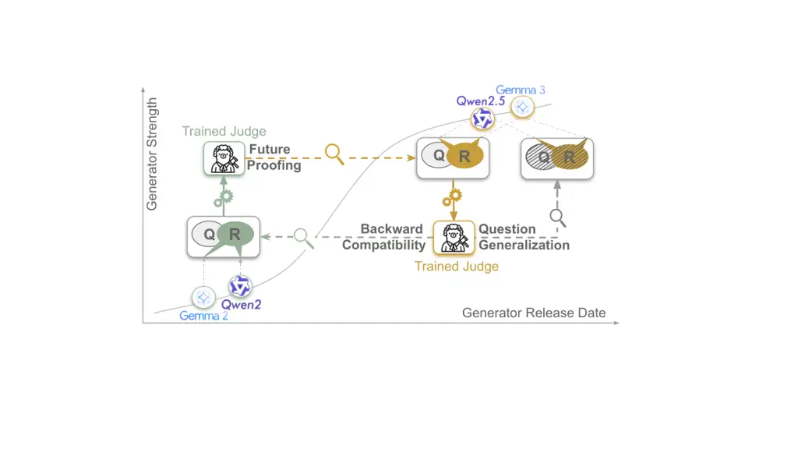

# On the Shelf Life of Fine-Tuned LLM-Judges: Future-Proofing, Backward-Compatibility, and Question Generalization

Janvijay Singh^(1,2) Austin Xu¹ Yilun Zhou¹²²footnotemark: 2  Yefan
Zhou^(1,3)¹¹footnotemark: 1 Dilek Hakkani-Tür² Shafiq Joty¹ ¹Salesforce
AI Research  ²University of Illinois Urbana-Champaign  ³Dartmouth
College ^(†)^(†)thanks: Work done during an internship at Salesforce AI
Research.^(†)^(†)thanks: Work done at Salesforce AI Research.

###### Abstract

The LLM-as-a-judge paradigm is widely used in both evaluating free-text
model responses and reward modeling for model alignment and fine-tuning.
Recently, fine-tuning judges with judge-specific data has emerged as an
often preferred choice over directly prompting frontier models as
judges, as the former achieves better performance with smaller model
sizes while being more robust to common biases. However, the standard
evaluation ignores several practical concerns of fine-tuned judges
regarding their real-world deployment. In this paper, we identify and
formalize three aspects that affect the shelf life of these judges:
future-proofing and backward-compatibility – how well judges fine-tuned
on responses by today’s generator models perform on responses by future
models or past models, as well as question generalization – how well
judges generalize to unseen questions at test time. We study these three
aspects under a unified framework with varying train and test
distributions in two reasoning datasets, three SFT- and DPO-based
fine-tuning algorithms, and three different backbone models. Experiments
suggest that future-proofing is challenging for most models, while
backward-compatibility is relatively easy, with DPO-trained models
consistently improving performance. We further find that continual
learning provides a more balanced adaptation to shifts between older and
newer response distributions than training solely on stronger or weaker
responses. Moreover, all models exhibit some degree of performance
degradation when moving from questions seen during training to unseen
ones, showing that current judges do not fully generalize to unseen
questions. These findings provide insights into practical considerations
for developing and deploying judge models in the face of ever-changing
generators.

Code & Data:
[https://github.com/iamjanvijay/judge-training-analysis](https://github.com/iamjanvijay/judge-training-analysis)

Project Page:
[https://iamjanvijay.github.io/judge-training-analysis](https://iamjanvijay.github.io/judge-training-analysis)

|     |
| --- |
|     |

## 1 Introduction

Automatic evaluators have become a central part of the large language
model (LLM) development cycle. They serve both as reward models during
training (Stiennon et al., 2020; Ouyang et al., 2022; Yuan et al., 2024)
and as verifiers in inference-time compute scaling (Zhou et al., 2025;
Kim et al., 2025; Singhi et al., 2025). In the LLM-as-judge paradigm, a
generative language model evaluates the outputs of other models for a
given input question, providing a scalable approach to automatic
evaluation. Past work on LLM-as-judges began with zero-shot prompting of
capable LLMs (Liu et al., 2023; Dubois et al., 2023). However, such
judges have been shown to be prone to various biases, such as stylistic
bias (Zeng et al., 2024; Raina et al., 2024), length bias (Zheng et al.,
2023; Zeng et al., 2024), and positional bias (Wang et al., 2023;
Pezeshkpour and Hruschka, 2024). As a result, recent efforts have
fine-tuned specialized evaluators Li et al. (2024b); Kim et al. (2024a);
Vu et al. (2024), which have been shown to be more robust to common
forms of bias (Zhu et al., 2025; Wang et al., 2024a; Park et al., 2024b)
while matching the performance of larger prompted models.

Although recent advances in judge model fine-tuning have largely focused
on developing training methodology Chen et al. (2025a); Chen et al.
(2025c), little attention has been devoted to understanding how these
models behave as a function of their training inputs. In this work, we
investigate this gap by asking three key questions: First, can judge
models trained on fixed datasets of input questions, model responses,
and ground-truth verdicts accurately evaluate the responses of newer
models, i.e., are judges future-proof? Second, if we train a judge on
up-to-date responses from newer models, can it reliably evaluate
responses from older models, i.e., is the trained judge
backward-compatible? Third, fixing the response generating models, how
reliably can judges assess questions that differ from those seen during
training, i.e., do they generalize to new questions? We examine these
questions, as illustrated in Figure 1, through the lens of
generalization and robustness, aiming to understand the shelf life of
trained judges.



Figure 1: High-level overview of our setup for studying Future-Proofing,
Backward-Compatibility, and Question Generalization through the lens of
generalization and robustness to input distribution shifts. Q and R
represent questions and responses, respectively, with responses
generated by the shown generator models (Gemma2, Qwen2, Gemma3,
Qwen2.5). Future-Proofing evaluates how well judges trained on responses
from weaker, older generators (green: Gemma2, Qwen2) assess responses
from stronger, newer generators (yellow: Gemma3, Qwen2.5).
Backward-Compatibility examines the reverse direction. Question
Generalization measures performance on in-distribution questions and
corresponding responses that were both not included (dashed Q and R) in
the training.

In this work, we propose a dual-distribution formulation of automatic
evaluation. Concretely, we model the judge’s input as comprising
elements drawn from two distinct distributions: the question
distribution, which characterizes the input questions to be evaluated,
and the response distribution, which characterizes the responses to be
judged. We study the performance of trained judges when responses are
drawn from relatively weak and strong generators, henceforth referred to
as weak responses and strong responses. We also examine how well trained
judges evaluate questions that are (1) seen during training but paired
with new responses, and (2) completely unseen during training. By
focusing on weak and strong generators and novel questions, we gain
insights into the shelf life of trained judge models through four
practical questions:

- •
  Future-proofing. Given a judge trained on responses from older
  (“weak”) models, how accurately can it evaluate responses from newer
  (“strong”) models? If the goal is to evaluate strong responses, how
  much benefit do practitioners gain by training on strong responses
  rather than weak ones?
- •
  Backward-compatibility. Given a judge trained on responses from newer
  (“strong”) models, can it reliably assess responses from older
  (“weak”) models? If the goal is to evaluate weak responses, does
  training a judge on strong responses provide any benefit?
- •
  Continual learning. Compared to judges trained only on weak or strong
  responses, how well does a continually trained judge adapt to
  distribution shifts between the two response distributions?
- •
  Question generalization. Does judge performance depend on whether a
  question was seen during training? Even for seen questions, can a
  judge reliably assess new responses?

Using two verifiable datasets (DeepScaleR and MMLU-Pro), we set up a
suite of controlled experiments to analyze the shelf life of judge
models, training across three backbone models of varying sizes and
capabilities and three popular judge-training recipes. Our findings
reveal that fine-tuned judges struggle to evaluate newer, stronger model
responses and therefore require training on an up-to-date response
distribution. Once trained on newer, stronger responses, judges exhibit
some degree of backward-compatibility. Continual training provides a
more balanced adaptation to shifts between older and newer response
distributions than training solely on stronger or solely on weaker
responses. Finally, we find that fine-tuned judges struggle to
generalize to new questions. In all, our findings inform the development
and deployment of future generations of fine-tuned judge models.

## 2 Background and Related Work

### 2.1 An overview of fine-tuned judges.

LLM-based judges are automatic evaluators that evaluate LLM outputs
given some evaluation criteria. While many judges accommodate different
evaluation tasks, such as single rating (“Rate this response on a scale
of 1-5”) (Hu et al., 2024) or classification (“Is this response
appropriate?”) (Vu et al., 2024), the dominant evaluation paradigm
LLM-based judges are deployed with is pairwise evaluation. Here, a judge
is given a question and two candidate responses, and tasked with
selecting the “better” response according to some criteria. Formally,
the judge performs the transformation

```math
\displaystyle(Q,R_{1},R_{2})\;\;\longrightarrow\;\;(C,\hat{V}),\quad C\;\text{optional}, \tag{1}
```

where $`Q`$ is the question, $`R_{1},R_{2}`$ are the two candidate
responses, $`C`$ is an optional chain-of-thought explanation, and
$`\hat{V}`$ is the verdict of which response is better. We denote
$`x=(Q,R_{1},R_{2})\sim\mathcal{X}`$ to be the judge input and
$`y=(C,\hat{V})`$ to be the judge output. Pairwise judges are typically
evaluated using accuracy or consistent accuracy, the latter accounting
for response-order bias as detailed in Appendix D. Due to its popularity
and practicality, pairwise evaluation forms the focus of our study.

Past work in judge fine-tuning uses supervised fine-tuning (SFT) (Li et
al., 2024b; Kim et al., 2024b; Zhu et al., 2025), preference
optimization methods, like direct preference optimization (DPO) (Wang et
al., 2024a; Ye et al., 2024; Saad-Falcon et al., 2024), or more
recently, reinforcement learning with verifiable rewards (RLVR) (Chen et
al., 2025a; Chen et al., 2025c; Whitehouse et al., 2025; Xu et al.,
2025b). Starting from a dataset of $`(x,V^{\star}(x))`$ pairs, where
$`V^{\star}`$ denotes the ground-truth verdict/label, each approach
constructs training samples differently: SFT and DPO approaches sample
judge outputs from a teacher model, then use $`V^{\star}(x)`$ to
categorize judge outputs as either correct outputs $`y^{+}`$ or
incorrect outputs $`y^{-}`$. Then, the judge is trained on $`(x,y^{+})`$
pairs for SFT and $`(x,y^{+},y^{-})`$ triplets for DPO. On the other
hand, RL approaches directly make use of the $`(x,V^{\star}(x))`$ pairs,
omitting the need for teacher model explanations.

### 2.2 Related work

#### Distribution Shifts and Generalization.

Distribution shift, the mismatch between training and evaluation data,
is a long-standing challenge in machine learning (Hendrycks and
Dietterich, 2019; Koh et al., 2021). Early computer vision studies
demonstrated significant accuracy drops under minor
perturbations (Hendrycks and Dietterich, 2019), and WILDS extended this
to real-world domain shifts (Koh et al., 2021). In LLMs, the problem is
amplified as both data and model capabilities evolve over time (Shi et
al., 2025). Recent frameworks explore how models transfer across
distributions. _Easy-to-hard generalization_ examines whether training
on easier tasks transfers to harder ones (Sun et al., 2024), which
relates to scalable oversight where only easy tasks can be reliably
supervised (Amodei et al., 2016); task-difficulty can be estimated using
either model or data-centric measures (Swayamdipta et al., 2020).
_Weak-to-strong generalization_ investigates improving strong models
using supervision derived from weaker ones (Burns et al., 2023). Our
setting complements these efforts by focusing on distribution shifts
that arise from an _evolving population of generators_ and by evaluating
how judge models adapt to both weak-to-strong and strong-to-weak shifts.

#### Analyzing LLM-as-a-Judge.

Prior work analyzes systematic judge biases such as positional (Wang et
al., 2023; Li et al., 2024b), length (Zeng et al., 2024; Park et al.,
2024a), and self-preference (Panickssery et al., 2024; Chen et al.,
2025b). Prompt design, instructions, and scoring format strongly affect
reliability (Li et al., 2024a), with pairwise judgments often reducing
noise and aligning better with human preferences than pointwise
scores (Tripathi et al., 2025; Jeong et al., 2024). Other works have
emphasized the importance of carefully selecting reference
answers (Krumdick et al., 2025), linking to how generator capabilities
influence the judge’s inputs (Tan et al., 2025). While most studies
consider _static_ judges on _fixed_ datasets, we instead analyze judges
in a dynamic setting where generators change over time, introducing
response-distribution shifts that motivate our metrics for
_future-proofing_, _backward-compatibility_, and _question
generalization_.

## 3 Automatic Evaluation as a Dual-Distribution Problem

We propose a novel formulation of the automatic evaluation problem in
terms of two distributions: the question distribution and the response
distribution. Concretely, let $`\mathcal{Q}`$ denote the distribution of
questions $`Q`$, and let $`\mathcal{R}`$ denote the distribution of
responses $`R`$. For pairwise judges, the input distribution
$`\mathcal{X}`$ therefore takes the form

```math
\displaystyle\mathcal{X}=\mathcal{Q}\times\mathcal{R}\times\mathcal{R} \tag{2}
```

The question distribution is defined by characteristics such as semantic
content (e.g., domains like medical, legal, finance, scientific, or
math) and question difficulty (e.g., difficulty can be defined by
pedagogical levels, such as high school vs. olympiad-level math
problems). For example, we can consider all questions in GSM8K (Cobbe et
al., 2021) to come from the same question distribution, as they are all
arguably of similar difficulty and semantic content. The response
distribution defines the characteristics of the model responses being
evaluated, such as style, capability-specific content, or
model-family-specific quirks. We denote the training and test input
distributions to be

```math
\displaystyle\mathcal{X}^{{train}}=\mathcal{Q}^{{train}}\times\mathcal{R}^{{train}}\times\mathcal{R}^{{train}}\quad\text{ and }\quad\mathcal{X}^{{test}}=\mathcal{Q}^{{test}}\times\mathcal{R}^{{test}}\times\mathcal{R}^{{test}} \tag{3}
```

respectively. Notably, the two responses come from the same generating
model, as described in the data construction details in Section 4.2.
Separating the _question distribution_ $`\mathcal{Q}`$ from the
_response distribution_ $`\mathcal{R}`$ reflects two real-world sources
of shift: (1) the emergence of more capable generators (an evolving
$`\mathcal{R}`$), and (2) the introduction of new questions (an evolving
$`\mathcal{Q}`$). This decomposition allows us to isolate and quantify
the impact of each factor on judge performance. In Section 5, we
instantiate this framework using the weak response distribution
$`\mathcal{R}_{weak}`$ and the strong response distribution
$`\mathcal{R}_{strong}`$ to simulate a model-development timeline
(older, weaker vs. newer, stronger responses and LLMs), along with
question splits $`Q`$ drawn from $`\mathcal{Q}`$ that are either seen or
unseen during training. Informally, weak (strong) responses are drawn
from LLMs with relatively low (high) accuracy on questions $`Q`$; we
precisely describe generator strength in Section 4. This instantiation
enables us to investigate the four practical questions mentioned
in Section 1 regarding the shelf life of judges. The specifics of how
dual-distribution formalization supports our analysis are detailed
in Section 5, with a concise connection provided in Appendix E.

## 4 Experimental Setup

Figure 2: Generator strength on the DeepScaleR dataset, measured using
pass@1 with $`20`$ independently sampled responses. Models fall into two
well-separated strength clusters: weak (0.17–0.26) and strong
(0.42–0.50). No models occupy the 0.26–0.42 gap (a 0.16-wide gap),
making the clustering robust to any threshold chosen within this
interval. This clustering also aligns with model release dates, with
stronger, newer models (yellow) outperforming weaker, older ones
(green).

### 4.1 Gauging Generator Strength.

We ground our study in two datasets with verifiable solutions:
DeepScaleR (Luo et al., 2025) and MMLU-Pro (Wang et al., 2024c).
DeepScaleR contains 40K Olympiad-style, reasoning-intensive math
problems with gold answers. MMLU-Pro, by contrast, provides verifiable
MCQ-style, knowledge-intensive questions spanning 14 diverse domains,
including STEM, humanities, social sciences, law, business, psychology,
and philosophy, enabling us to study judge shelf-life across a broad
range of domains. For generators, we utilize a diverse set of popular
instruction-tuned models, listed in Table 1 (in Appendix B). For each
generator, we sample 20 responses per question and measure its strength
using Pass@1. Pass@1 captures the probability that a uniformly sampled
attempt is correct and yields two clearly separated clusters, as shown
in Figure 2 and Figure 8 (in Appendix B), where recent or larger models
achieve substantially higher scores than smaller or older models. Based
on this distinguishable performance difference, we cluster low- and
high-performing generators into weak (Gemma-2-9B, Qwen-2-7B,
Llama-3.1-8B, Ministral-8B) and strong (Gemma-3-12B, Qwen-2.5-7B,
Qwen-2.5-32B, Llama-3.3-70B, Mistral-Small-24B) groups, respectively,
and use these clusters to define our response-distribution shifts.
Further details on generator selection and strength estimation are
provided in Appendix B.

### 4.2 Training Setup.

#### Dataset Construction.

To create the training and evaluation splits, we first construct
pairwise input samples for the judge, following prior work (Tan et al.,
2025; Wang et al., 2024b). For each question, we sample multiple
responses from each generator, and each response is then labeled as
“correct” or “incorrect” according to the ground-truth answer
$`A^{\star}`$. We then form response pairs, where each pair consists of
one correct response and one incorrect response, resulting in a pairwise
sample with an objectively correct answer. Importantly, responses in a
pair are drawn from a single generator only. Based on the generator
strengths defined above, we construct datasets of aggregated pairwise
samples consisting exclusively of either weak or strong responses, which
we refer to as our weak dataset and strong dataset, respectively.

#### Judge Data Distillation & Training Objectives.

We train judges using three commonly adopted recipes: supervised
fine-tuning (SFT) (Li et al., 2024b; Kim et al., 2024a; Vu et al.,
2024), direct preference optimization (DPO) (Hu et al., 2024; Wang et
al., 2024b), and a combined SFT and DPO objective (Wang et al., 2024a;
Ye et al., 2024; Saad-Falcon et al., 2024). As these recipes require
supervision, specifically, the CoT explanation $`C`$ (Sec. 2), we adopt
the common teacher model convention (Li et al., 2024b; Wang et al.,
2024a). Based on the ground-truth verdict $`V^{*}`$, we categorize
responses as correct (positive) samples $`y^{+}`$ or incorrect
(negative) samples $`y^{-}`$. Positive samples are then used for SFT,
whereas positive-negative pairs are used for DPO-based recipes.

#### Training and Evaluation Splits.

To analyze the four practical questions described in Section 1 using the
dual-distribution framework from Section 3, we split the weak and strong
datasets into training and test sets. For testing, we construct two
distinct splits: an unseen-questions split and a seen-questions split.
The unseen-questions split contains questions not present during
training, while the seen-questions split reuses training questions but
samples new responses, with pairs constructed following the same process
as described above. Unless otherwise specified, we use the
unseen-questions split for evaluation. We choose three models to train:
Llama-3.1-8B, Ministral-8B, and Mistral-24B, covering a range of model
sizes and intrinsic strengths.

We provide more details on different aspects of the training setup
in Appendix C.

(a) FutureProof.

(b) RefreshAdvantage.

Figure 3: Future-Proofing of DeepScaler-Trained Judges. (a)
Future-proofing measured by FutureProof; negative values show degraded
performance on stronger responses. All models and recipes show
performance degradation, indicating poor evaluation of newer, stronger
responses. (b) Benefits of re-training on strong responses, measured by
RefreshAdvantage. Re-training consistently improves performance, with
the largest gains under DPO.

(a) BackCompatibility.

(b) CompatibilityShift.

Figure 4: Backward-Compatibility of DeepScaler-Trained Judges. (a)
BackCompatibility of judges trained on strong responses when evaluating
older responses; positive values indicate improved performance relative
to older-judge baselines. Judges trained on newer responses show good
BackCompatibility, with minimal drops—or even absolute gains. (b)
Despite strong absolute performance, newer judges still face a
distribution shift, reflected by CompatibilityShift, with performance
drops relative to evaluating strong responses. (c) Compared with
future-proofing metrics in Figure 3, backward-compatibility metrics are
smaller, indicating that strong-response–trained judges are more
backward-compatible than weak-response–trained judges are future-proof.

## 5 Experimental Results

In this section, we present our analysis setup and findings on
future-proofing, backward-compatibility, and question generalization of
judge models. Our analysis builds on the dual-distribution framework
introduced in Section 3, where judge inputs are factorized into a
question distribution $`\mathcal{Q}`$ and a response distribution
$`\mathcal{R}`$. We instantiate the response distribution at two levels
of generator strength: $`\mathcal{R}_{{weak}}`$ (older, less capable
models) and $`\mathcal{R}_{{strong}}`$ (newer, more capable models). The
question distribution $`\mathcal{Q}`$ remains fixed but varies in
whether a question was seen or unseen during training. In this way, our
setup simulates model development timelines. We measure judge
performance using consistent accuracy, as defined in Appendix D. Raw
consistent accuracy scores are reported in Table 4 of Appendix D, and
serve as the foundation for the results below.

#### Notation.

For clarity, we denote the consistent accuracy of a judge $`J_{t}`$
trained on response distribution $`t`$ as $`\mathrm{Acc}_{e}(J_{t})`$,
where $`t\in\{\text{weak},\text{strong}\}`$. The subscript $`e`$
indicates the evaluation distribution, with
$`e\in\{\text{weak},\text{strong}\}`$. Thus, $`\mathrm{Acc}_{e}(J_{t})`$
ties back to our dual-distribution formalism: it measures the accuracy
of a judge trained on distribution $`t`$ when evaluated on responses
from distribution $`e`$.

### 5.1 How future-proof are judge models?

Experimental Setup. To study future-proofing in our simulated model
development timeline, we design the following setup: weak generators
serve as proxies for existing LLMs, and judges are trained on their
responses. Strong generators represent newly released LLMs with greater
capabilities. By future-proofing, we refer to how well
weak-response-trained judges can evaluate responses from newer, stronger
LLMs. Specifically, we quantify future-proofing using the following
metrics:

FutureProof is defined as the difference in the performance of a
weak-response-trained judge between the weak and strong evaluation sets:

```math
\displaystyle\texttt{FutureProof}=\mathrm{Acc}_{strong}(J_{weak})-\mathrm{Acc}_{weak}(J_{weak}). \tag{4}
```

This measures the change in performance when the evaluation distribution
shifts from $`\mathcal{R}_{weak}^{{test}}`$ to
$`\mathcal{R}_{strong}^{{test}}`$, i.e., a weak-to-strong response
distribution shift. A positive value indicates relatively better
performance on strong responses, while a negative value indicates
degradation; thus, higher values correspond to more future-proof judges.

RefreshAdvantage is defined as the gain from re-training judges with
strong responses:

```math
\displaystyle\texttt{RefreshAdvantage}=\mathrm{Acc}_{strong}(J_{strong})-\mathrm{Acc}_{strong}(J_{weak}). \tag{5}
```

This can be viewed as the data advantage from changing the training
response distribution from $`\mathcal{R}_{{weak}}^{{train}}`$ to
$`\mathcal{R}_{{strong}}^{{train}}`$ when evaluating on
$`\mathcal{R}_{{strong}}^{{test}}`$. Higher values indicate greater
benefit from re-training judges with the latest and stronger responses.

FutureProof Findings: For all models and training recipes, we plot the
FutureProof values on DeepScaleR in Figure 3(a). Across all settings, we
do not observe any instance where judges generalize to new or stronger
responses, with all FutureProof values being negative. Interestingly, no
discernible trend emerges across training recipes or model families.
Generally, we find that SFT leads to greater degradations in smaller
models, but a smaller degradation in the large judge. In all, our
results show that current judge training approaches do not produce
judges capable of reliably generalizing to new, more capable model
responses. Beyond lack of generalization, current judge recipes do not
exhibit consistent trends across models or scales. These findings align
with those on MMLU-Pro, which we discuss in more detail in Section F.1.
In the absence of recipe-specific or model-specific trends, we recommend
evaluating FutureProof on a model-by-model basis.

RefreshAdvantage Findings. Our results on DeepScaleR, presented
in Figure 3(b), indicate that re-training with up-to-date responses
consistently leads to performance gains. In particular, across all
training recipes and backbone models, we observe positive
RefreshAdvantage values. Training recipes also follow a clear trend:
retraining with SFT yields minimal but positive gains, whereas DPO
yields the largest improvements, providing up to 7.6 absolute percentage
points for larger models. The SFT+DPO loss provides additional benefit
over DPO alone for a couple of models. We further observe that as judge
model size increases, updating training data has a larger impact for
DPO-based approaches. For example, with DPO, Mistral-24B exhibits an
absolute gain of 7.6 percentage points compared to its 8B counterpart,
Mistral-8B, which improves by 4.3 points. These trends are consistent
with corresponding findings on MMLU-Pro, discussed further
in Section F.1. Overall, we conclude that evaluating the most capable
models requires training judges on their outputs; relying on stale
training data leaves substantial performance gains unrealized.

Figure 5: Changes in future-proofing metrics when replacing a
weak-response-trained judge (solid) with a continually trained judge
(dashed). We observe a decrease in RefreshAdvantage and an increase in
FutureProof, with values approaching zero for a couple of models. This
suggests that continual training enables judges to evaluate strong
responses more effectively than weak-trained judges, as well as
strong-trained judges, and adapts better to the weak-to-strong response
shift.

Figure 6: Changes in backward-compatibility metrics when replacing a
strong-response-trained judge (solid) with a continually-trained judge
(dashed). We see an increase in BackCompat for a couple of models,
suggesting that continual training can help models better evaluate weak
responses than purely strong-trained judges. We also observe an increase
in CompatShift, showing that continually trained judges adapt better to
the strong-to-weak response shift.

### 5.2 How backward-compatible are judge models?

Experimental setup. Now, we extend our setup for future-proofing
in Section 5.1 to study backward-compatibility in a simulated model
development timeline. A judge trained on strong or newer generator
responses represents the current judge, which is adept at evaluating new
responses, while weak generators represent older LLMs with lower
capabilities. By backward-compatibility, we refer to how well
strong-response-trained judges can evaluate the responses of older,
weaker generators. Specifically, we quantify backward-compatibility
using the following metrics:

BackCompatibility measures the performance gap when evaluating older,
weaker responses with the refreshed strong-response-trained judge
instead of the weak-response-trained judge:

```math
\displaystyle\texttt{BackCompatibility}=\mathrm{Acc}_{weak}(J_{strong})-\mathrm{Acc}_{weak}(J_{weak}). \tag{6}
```

This setting is particularly important for established evaluation
pipelines: if an old judge is replaced by a new one while the task
remains the same, how much does performance differ? We view this as the
data disadvantage from changing training data from
$`\mathcal{R}_{{weak}}^{{train}}`$ to
$`\mathcal{R}_{{strong}}^{{train}}`$ when evaluating on
$`\mathcal{R}_{{weak}}^{{test}}`$. A positive BackCompatibility
indicates that the strong-trained judge outperforms the weak-trained
judge on weak responses (good backward-compatibility), while a negative
value reflects performance degradation (poor backward-compatibility).

CompatibilityShift quantifies the weak-to-strong distribution shift when
evaluating older, weaker responses with a strong-response-trained,
refreshed judge. As noted in the previous section, the reverse shift
(strong-to-weak) can strongly affect judge performance. Here, we measure
how the out-of-distribution nature of backward-compatibility impacts the
newly trained judge:

```math
\displaystyle\texttt{CompatibilityShift}=\mathrm{Acc}_{weak}(J_{strong})-\mathrm{Acc}_{strong}(J_{strong}). \tag{7}
```

This captures the response-distribution shift opposite to FutureProof,
i.e., from $`\mathcal{R}_{\text{strong}}^{\text{test}}`$ to
$`\mathcal{R}_{\text{weak}}^{\text{test}}`$ or strong-to-weak. It
measures how far a strong-trained judge falls below its potential under
in-distribution evaluation. A positive value indicates better relative
performance on weak responses, while a negative value indicates
degradation.

BackCompatibility Findings. In Figure 4(a), we visualize the backward
compatibility of judge models trained on strong responses for the
DeepScaleR dataset. When evaluating on weak responses, there is little
drop in absolute performance between judges trained on strong responses
and those trained on in-distribution weak responses. While methods
involving SFT consistently cause small performance drops, our results
show that DPO training can enable newly trained judges to outperform
weak-judge models. The drop due to incompatibility is smaller than the
advantage gained when moving from weak to strong responses, as noted in
the RefreshAdvantage findings. This indicates that judges trained on
newer responses are indeed backward-compatible: they closely mimic the
performance of weak-trained judges, even in out-of-distribution
settings. Likewise on MMLU-Pro, strongly trained judges perform on par
with or better than weak-trained judges when evaluating weak responses,
as discussed in Section F.2. Thus, combined with our findings
in Section 5.1, we conclude that re-training with updated responses is
universally beneficial: such refreshed judges are not only much better
at evaluating new model responses but can also serve as drop-in
replacements for their older counterparts with minimal loss in
performance.

CompatibilityShift Findings. As shown above, judges trained on strong
responses roughly match the performance of those trained on weak
responses when evaluating older responses. Despite strong absolute
performance, such newer judges are evaluating under a strong-to-weak
distribution shift; Figure 4(b) plots the drop in performance due to
this shift on DeepScaleR dataset. Here, we observe that across all
judges and recipes, judges still experience degradation due to the
out-of-distribution nature of evaluation, with the lone exception being
SFT-trained Llama3.1-8B. Surprisingly, here, the largest model,
finetuned from Mistral-24B, experiences the largest absolute drops
across all training recipes. These findings highlight that, while
stronger trained judges can serve as appropriate drop-in replacements
for weaker judges, distribution shift causes them to underperform
relative to their potential. We see the same pattern on MMLU-Pro, where
strong-trained judges also degrade under response-distribution shift, as
discussed in Section F.2. However, on DeepScaleR, compared to the
degradation from the weak-to-strong response-distribution shift (as
measured by FutureProof in Section 5.1), these degradations are
relatively smaller. This suggests that the weak-to-strong evaluation
response-distribution shift is a harder setting than strong-to-weak,
again highlighting the importance of re-training judges on new model
responses.

### 5.3 Can continual training improve future-proofing and backward-compatibility of judge models?

Experimental setup. Sections 5.1 and 5.2 show that training a judge
_from scratch_ on responses from newer generators is advantageous in
evaluations. An alternative is to _continually update_ a judge
originally trained on older responses by incrementally fine-tuning it on
newer, stronger responses. We simulate this continual-learning paradigm
by further training $`J_{\text{weak}}`$ on responses from stronger
generators, denoting the resulting model as
$`J_{\text{weak}\rightarrow\text{strong}}`$ (details in Appendix C). All
experiments in this section are restricted to training judges on
DeepScaler with DPO due to compute constraints.

To assess the effect of continual training, we evaluate
$`J_{{weak}\rightarrow{strong}}`$ on both future-proofing and
backward-compatibility metrics, comparing its performance against that
of the original weakly trained judge and the strongly trained judge,
respectively. Specifically, we compare FutureProof and RefreshAdvantage
when replacing $`J_{{weak}}`$ with $`J_{{weak}\rightarrow{strong}}`$ in
Equations (4)–(5), as shown in Figure 5. We also compare
CompatibilityShift and BackCompat when replacing $`J_{{strong}}`$ with
$`J_{{weak}\rightarrow{strong}}`$ in Equations (6)–(7), as shown
in Figure 6. Together, these comparisons reveal how continual training
helps weak judges adapt to future distribution shifts while retaining
compatibility with weaker responses, relative to training from scratch.

Changes in Future-Proofing. Figure 5 shows that continual training
consistently improves future-proofing. FutureProof scores increase
across all three models, while RefreshAdvantage decreases, approaching
zero for Ministral-8B and Mistral-24B. The reduction in RefreshAdvantage
indicates that the benefit of retraining a strong model from scratch,
relative to continual training, largely disappears when evaluating
stronger responses. At the same time, the higher FutureProof scores of
$`J_{{weak}\rightarrow{strong}}`$ demonstrate that continual training
enables better adaptation to the weak-to-strong distribution shift than
simply retaining the weak model.

Changes in Backward-Compatibility. Figure 6 shows mixed but informative
results on backward-compatibility. BackCompatibility scores increase for
Mistral-24B and Llama-3.1-8B but decrease for Ministral-8B. Higher
BackCompatibility indicates that a continually trained judge remains
closer to the weakly trained judge when evaluating weak responses,
compared to a model trained solely on strong responses. We also observe
a notable increase in CompatibilityShift, highlighting that continual
training improves adaptation to older, weaker responses relative to
purely strong-trained models. Together, these results suggest that
continual training can better preserve backward-compatibility in several
settings while also enhancing adaptability to distribution shifts.

Figure 7: Question Generalization of DeepScaler-Trained Judges.
Generalization of judges trained on weak vs. strong responses to seen
(dashed bars) and unseen (solid bars) questions. Judges typically fail
to generalize to unseen questions, showing large performance drops
relative to evaluating unseen responses on seen questions.

### 5.4 How do judges generalize to unseen questions and responses?

Experimental setup. As LLMs advance, both responses and questions evolve
(e.g., AIME24 vs. AIME25). We therefore examine how judges perform on
previously unseen questions by sampling from $`\mathcal{Q}`$ in our
dual-distribution framework. To quantify the benefits of question
exposure during judge training, we define two evaluation splits. In the
first, we select a subset of training questions and sample new responses
for them, which we call the seen-questions, unseen-responses split. In
the second, we draw questions from $`\mathcal{Q}^{\text{train}}`$ that
were excluded from training and pair them with new responses, defining
the unseen-questions, unseen-responses split. Comparing judge
performance across these splits reveals the performance gap due to
question generalization.

```math
\displaystyle\texttt{QuestionGen}_{weak} \displaystyle=\mathrm{Acc}_{weak,unseen}(J_{weak})-\mathrm{Acc}_{weak,seen}(J_{weak}) \tag{8}
```

```math
\displaystyle\texttt{QuestionGen}_{strong} \displaystyle=\mathrm{Acc}_{strong,unseen}(J_{strong})-\mathrm{Acc}_{strong,seen}(J_{strong}). \tag{9}
```

These metrics capture how well judges generalize across questions:
responses are drawn from the same generator, with only the question
split (seen vs. unseen during training) varied. A positive value of
QuestionGen indicates better performance on unseen questions, while a
negative value indicates failure to generalize to unseen questions.

QuestionGen Findings. As shown in Figure 7, current judge models do not
generalize well to unseen questions, with nearly all judges exhibiting
performance drops compared to evaluating on seen questions with unseen
responses. Surprisingly, we find that SFT enables the best
generalization, with SFT-trained judges showing the smallest absolute
drops in most cases. Mistral-24B, however, exhibits the largest drops
within each training recipe, indicating poorer generalization compared
to smaller models. These trends are consistent with the corresponding
findings on MMLU-Pro, discussed in detail in Section F.3. Overall, our
experiments reveal that exposing judges to the questions they are likely
to evaluate can lead to significant performance gains.

## 6 Conclusion

We present a dual-distribution framework for automatic evaluation and
analyze four key questions surrounding finetuned LLM-as-judge models, a
crucial component of the LLM development cycle. First, we study
future-proofing and show that judges trained on older responses struggle
to evaluate outputs from newer, stronger LLMs, but re-training on newer
responses yields substantial gains. Second, we examine
backward-compatibility and find that judges trained on newer responses
incur only minor drops, or even improvements, when evaluating older
responses. Third, we demonstrate that continual learning provides a more
balanced adaptation to both older and newer response distributions
compared to training solely on stronger or weaker responses. Finally, we
investigate question generalization and find that judges experience
large drops in performance on questions unseen during training. Overall,
our work highlights critical challenges and actionable strategies for
developing robust, future-proof, and backward-compatible judge models.

## References

- Amodei et al. (2016) D. Amodei, C. Olah, J. Steinhardt, P. F.
  Christiano, J. Schulman, and D. Mané Concrete problems in ai safety.
  ArXiv abs/1606.06565. External Links:
  [Link](https://api.semanticscholar.org/CorpusID:10242377) Cited by:
  §2.2.
- Axolotl maintainers and contributors (2023) Axolotl: post-training for
  ai models External Links:
  [Link](https://github.com/axolotl-ai-cloud/axolotl) Cited by: Appendix
  C.
- Burns et al. (2023) C. Burns, P. Izmailov, J. H. Kirchner, B.
  Baker, L. Gao, L. Aschenbrenner, Y. Chen, A. Ecoffet, M. R.
  Joglekar, J. Leike, I. Sutskever, J. Wu, and OpenAI Weak-to-strong
  generalization: eliciting strong capabilities with weak supervision.
  ArXiv abs/2312.09390. External Links:
  [Link](https://api.semanticscholar.org/CorpusID:266312608) Cited by:
  §2.2.
- Chen et al. (2025a) N. Chen, Z. Hu, Q. Zou, J. Wu, Q. Wang, B. Hooi,
  and B. He JudgeLRM: large reasoning models as a judge. ArXiv
  abs/2504.00050. External Links:
  [Link](https://api.semanticscholar.org/CorpusId:277467872) Cited by:
  §1, §2.1.
- Chen et al. (2025b) W. Chen, Z. Wei, X. Zhu, S. Feng, and Y. Meng Do
  llm evaluators prefer themselves for a reason?. arXiv preprint
  arXiv:2504.03846. Cited by: Appendix C, §2.2.
- Chen et al. (2025c) X. Chen, G. Li, Z. Wang, B. Jin, C. Qian, Y.
  Wang, H. Wang, Y. Zhang, D. Zhang, T. Zhang, H. Tong, and H. Ji RM-r1:
  reward modeling as reasoning. ArXiv abs/2505.02387. External Links:
  [Link](https://api.semanticscholar.org/CorpusID:278327900) Cited by:
  §1, §2.1.
- Cobbe et al. (2021) K. Cobbe, V. Kosaraju, M. Bavarian, M. Chen, H.
  Jun, L. Kaiser, M. Plappert, J. Tworek, J. Hilton, R. Nakano, C.
  Hesse, and J. Schulman Training verifiers to solve math word problems.
  ArXiv abs/2110.14168. External Links:
  [Link](https://api.semanticscholar.org/CorpusID:239998651) Cited by:
  §3.
- Dubey et al. (2024) A. Dubey, A. Jauhri, A. Pandey, A. Kadian, A.
  Al-Dahle, A. Letman, A. Mathur, A. Schelten, A. Yang, A. Fan, A.
  Goyal, A. S. Hartshorn, A. Yang, A. Mitra, A. Sravankumar, A.
  Korenev, A. Hinsvark, A. Rao, A. Zhang, A. Rodriguez, A. Gregerson, A.
  Spataru, B. Rozière, B. Biron, B. Tang, B. Chern, C. Caucheteux, C.
  Nayak, C. Bi, C. Marra, C. McConnell, C. Keller, C. Touret, C. Wu, C.
  Wong, C. C. Ferrer, C. Nikolaidis, D. Allonsius, D. Song, D. Pintz, D.
  Livshits, D. Esiobu, D. Choudhary, D. Mahajan, D. Garcia-Olano, D.
  Perino, D. Hupkes, E. Lakomkin, E. A. AlBadawy, E. Lobanova, E.
  Dinan, E. M. Smith, F. Radenovic, F. Zhang, G. Synnaeve, G. Lee, G. L.
  Anderson, G. Nail, G. Mialon, G. Pang, G. Cucurell, H. Nguyen, H.
  Korevaar, H. Xu, H. Touvron, I. Zarov, I. A. Ibarra, I. M.
  Kloumann, I. Misra, I. Evtimov, J. Copet, J. Lee, J. Geffert, J.
  Vranes, J. Park, J. Mahadeokar, J. Shah, J. van der Linde, J.
  Billock, J. Hong, J. Lee, J. Fu, J. Chi, J. Huang, J. Liu, J. Wang, J.
  Yu, J. Bitton, J. Spisak, J. Park, J. Rocca, J. Johnstun, J. Saxe, J.
  Jia, K. V. Alwala, K. Upasani, K. Plawiak, K. Li, K. neth
  Heafield, K. R. Stone, K. El-Arini, K. Iyer, K. Malik, K. Chiu, K.
  Bhalla, L. Rantala-Yeary, L. van der Maaten, L. Chen, L. Tan, L.
  Jenkins, L. Martin, L. Madaan, L. Malo, L. Blecher, L. Landzaat, L. de
  Oliveira, M. Muzzi, M. Pasupuleti, M. Singh, M. Paluri, M. Kardas, M.
  Oldham, M. Rita, M. Pavlova, M. H. M. Kambadur, M. Lewis, M. Si, M. K.
  Singh, M. Hassan, N. Goyal, N. Torabi, N. Bashlykov, N.
  Bogoychev, N. S. Chatterji, O. Duchenne, O. cCelebi, P. Alrassy, P.
  Zhang, P. Li, P. Vasić, P. Weng, P. Bhargava, P. Dubal, P.
  Krishnan, P. S. Koura, P. Xu, Q. He, Q. Dong, R. Srinivasan, R.
  Ganapathy, R. Calderer, R. S. Cabral, R. Stojnic, R. Raileanu, R.
  Girdhar, R. Patel, R. Sauvestre, R. Polidoro, R. Sumbaly, R.
  Taylor, R. Silva, R. Hou, R. Wang, S. Hosseini, S. Chennabasappa, S.
  Singh, S. Bell, S. S. Kim, S. Edunov, S. Nie, S. Narang, S. C.
  Raparthy, S. Shen, S. Wan, S. Bhosale, S. Zhang, S. Vandenhende, S.
  Batra, S. Whitman, S. Sootla, S. Collot, S. Gururangan, S.
  Borodinsky, T. Herman, T. Fowler, T. Sheasha, T. Georgiou, T.
  Scialom, T. Speckbacher, T. Mihaylov, T. Xiao, U. Karn, V. Goswami, V.
  Gupta, V. Ramanathan, V. Kerkez, V. Gonguet, V. Do, V. Vogeti, V.
  Petrovic, W. Chu, W. Xiong, W. Fu, W. Meers, X. Martinet, X.
  Wang, X. E. Tan, X. Xie, X. Jia, X. Wang, Y. Goldschlag, Y. Gaur, Y.
  Babaei, Y. Wen, Y. Song, Y. Zhang, Y. Li, Y. Mao, Z. D. Coudert, Z.
  Yan, Z. Chen, Z. Papakipos, A. K. Singh, A. Grattafiori, A. Jain, A.
  Kelsey, A. Shajnfeld, A. Gangidi, A. Victoria, A. Goldstand, A.
  Menon, A. Sharma, A. Boesenberg, A. Vaughan, A. Baevski, A.
  Feinstein, A. Kallet, A. Sangani, A. Yunus, A. Lupu, A. Alvarado, A.
  Caples, A. Gu, A. Ho, A. Poulton, A. Ryan, A. Ramchandani, A.
  Franco, A. Saraf, A. Chowdhury, A. Gabriel, A. Bharambe, A.
  Eisenman, A. Yazdan, B. James, B. Maurer, B. Leonhardi, P. (.
  Huang, B. Loyd, B. de Paola, B. Paranjape, B. Liu, B. Wu, B. Ni, B.
  Hancock, B. Wasti, B. Spence, B. Stojkovic, B. Gamido, B. Montalvo, C.
  Parker, C. Burton, C. Mejia, C. Wang, C. Kim, C. Zhou, C. Hu, C.
  Chu, C. Cai, C. Tindal, C. Feichtenhofer, D. Civin, D. Beaty, D.
  Kreymer, S. Li, D. Wyatt, D. Adkins, D. Xu, D. Testuggine, D.
  David, D. Parikh, D. Liskovich, D. Foss, D. Wang, D. Le, D.
  Holland, E. Dowling, E. Jamil, E. Montgomery, E. Presani, E. Hahn, E.
  Wood, E. Brinkman, E. Arcaute, E. Dunbar, E. Smothers, F. Sun, F.
  Kreuk, F. Tian, F. Ozgenel, F. Caggioni, F. Guzm’an, F. J. Kanayet, F.
  Seide, G. M. Florez, G. Schwarz, G. Badeer, G. Swee, G. Halpern, G.
  Thattai, G. Herman, G. G. Sizov, G. Zhang, G. Lakshminarayanan, H.
  Shojanazeri, H. Zou, H. Wang, H. Zha, H. Habeeb, H. Rudolph, H.
  Suk, H. Aspegren, H. Goldman, I. Molybog, I. Tufanov, I. Veliche, I.
  Gat, J. Weissman, J. Geboski, J. Kohli, J. Asher, J. Gaya, J.
  Marcus, J. Tang, J. Chan, J. Zhen, J. Reizenstein, J. Teboul, J.
  Zhong, J. Jin, J. Yang, J. Cummings, J. Carvill, J. Shepard, J.
  McPhie, J. Torres, J. Ginsburg, J. Wang, K. Wu, U. KamHou, K.
  Saxena, K. Prasad, K. Khandelwal, K. Zand, K. Matosich, K.
  Veeraraghavan, K. Michelena, K. Li, K. Huang, K. Chawla, K.
  Lakhotia, K. Huang, L. Chen, L. Garg, A. Lavender, L. Silva, L.
  Bell, L. Zhang, L. Guo, L. Yu, L. Moshkovich, L. Wehrstedt, M.
  Khabsa, M. Avalani, M. Bhatt, M. Tsimpoukelli, M. Mankus, M.
  Hasson, M. Lennie, M. Reso, M. Groshev, M. Naumov, M. Lathi, M.
  Keneally, M. L. Seltzer, M. Valko, M. Restrepo, M. Patel, M.
  Vyatskov, M. Samvelyan, M. Clark, M. Macey, M. Wang, M. J. Hermoso, M.
  Metanat, M. Rastegari, M. Bansal, N. Santhanam, N. Parks, N. White, N.
  Bawa, N. Singhal, N. Egebo, N. Usunier, N. P. Laptev, N. Dong, N.
  Zhang, N. Cheng, O. Chernoguz, O. Hart, O. Salpekar, O. Kalinli, P.
  Kent, P. Parekh, P. Saab, P. Balaji, P. Rittner, P. Bontrager, P.
  Roux, P. Dollár, P. Zvyagina, P. Ratanchandani, P. Yuvraj, Q.
  Liang, R. Alao, R. Rodriguez, R. Ayub, R. Murthy, R. Nayani, R.
  Mitra, R. Li, R. Hogan, R. Battey, R. Wang, R. Maheswari, R. Howes, R.
  Rinott, S. J. Bondu, S. Datta, S. Chugh, S. Hunt, S. Dhillon, S.
  Sidorov, S. Pan, S. Verma, S. Yamamoto, S. Ramaswamy, S. Lindsay, S.
  Feng, S. Lin, S. C. Zha, S. Shankar, S. Zhang, S. Wang, S. Agarwal, S.
  Sajuyigbe, S. Chintala, S. Max, S. Chen, S. Kehoe, S. Satterfield, S.
  Govindaprasad, S. K. Gupta, S. Cho, S. Virk, S. Subramanian, S.
  Choudhury, S. Goldman, T. Remez, T. Glaser, T. Best, T. Kohler, T.
  Robinson, T. Li, T. Zhang, T. Matthews, T. Chou, T. Shaked, V.
  Vontimitta, V. Ajayi, V. Montanez, V. Mohan, V. S. Kumar, V.
  Mangla, V. Ionescu, V. A. Poenaru, V. T. Mihailescu, V. Ivanov, W.
  Li, W. Wang, W. Jiang, W. Bouaziz, W. Constable, X. Tang, X. Wang, X.
  Wu, X. Wang, X. Xia, X. Wu, X. Gao, Y. Chen, Y. Hu, Y. Jia, Y. Qi, Y.
  Li, Y. Zhang, Y. Zhang, Y. Adi, Y. Nam, Y. Wang, Y. Hao, Y. Qian, Y.
  He, Z. Rait, Z. DeVito, Z. Rosnbrick, Z. Wen, Z. Yang, and Z. Zhao The
  llama 3 herd of models. ArXiv abs/2407.21783. External Links:
  [Link](https://api.semanticscholar.org/CorpusID:271571434) Cited by:
  Appendix B.
- Dubois et al. (2023) Y. Dubois, X. Li, R. Taori, T. Zhang, I.
  Gulrajani, J. Ba, C. Guestrin, P. Liang, and T. Hashimoto AlpacaFarm:
  a simulation framework for methods that learn from human feedback.
  ArXiv abs/2305.14387. External Links:
  [Link](https://arxiv.org/pdf/2305.14387.pdf) Cited by: §1.
- Hendrycks and Dietterich (2019) D. Hendrycks and T. Dietterich
  Benchmarking neural network robustness to common corruptions and
  perturbations. In International Conference on Learning
  Representations, External Links:
  [Link](https://openreview.net/forum?id=HJz6tiCqYm) Cited by: §2.2.
- Hu et al. (2024) X. Hu, L. Lin, M. Gao, X. Yin, and X. Wan Themis: a
  reference-free nlg evaluation language model with flexibility and
  interpretability. arXiv preprint arXiv:2406.18365. Cited by: Appendix
  C, §2.1, §4.2.
- Ivison et al. (2023) H. Ivison, Y. Wang, V. Pyatkin, N. Lambert, M.
  Peters, P. Dasigi, J. Jang, D. Wadden, N. A. Smith, I. Beltagy, et al.
  Camels in a changing climate: enhancing lm adaptation with tulu 2.
  arXiv preprint arXiv:2311.10702. Cited by: Appendix C.
- Jeong et al. (2024) H. Jeong, chaeHun Park, J. Hong, and J. Choo The
  comparative trap: pairwise comparisons amplifies biased preferences of
  llm evaluators. External Links:
  [Link](https://api.semanticscholar.org/CorpusID:270562681) Cited by:
  §2.2.
- Kamath et al. (2025) G. T. A. Kamath, J. Ferret, S. Pathak, N.
  Vieillard, R. Merhej, S. Perrin, T. Matejovicova, A. Ram’e, M.
  Rivière, L. Rouillard, T. Mesnard, G. Cideron, J. Grill, S. Ramos, E.
  Yvinec, M. Casbon, E. Pot, I. Penchev, G. Liu, F. Visin, K.
  Kenealy, L. Beyer, X. Zhai, A. Tsitsulin, R. I. Busa-Fekete, A.
  Feng, N. Sachdeva, B. Coleman, Y. Gao, B. Mustafa, I. Barr, E.
  Parisotto, D. Tian, M. Eyal, C. Cherry, J. Peter, D. Sinopalnikov, S.
  Bhupatiraju, R. Agarwal, M. Kazemi, D. Malkin, R. Kumar, D. Vilar, I.
  Brusilovsky, J. Luo, A. Steiner, A. Friesen, A. Sharma, A.
  Sharma, A. M. Gilady, A. Goedeckemeyer, A. Saade, A. Kolesnikov, A.
  Bendebury, A. Abdagic, A. Vadi, A. Gyorgy, A. S. Pinto, A. Das, A.
  Bapna, A. Miech, A. Yang, A. Paterson, A. Shenoy, A. Chakrabarti, B.
  Piot, B. Wu, B. Shahriari, B. Petrini, C. Chen, C. L. Lan, C. A.
  Choquette-Choo, C. Carey, C. Brick, D. Deutsch, D. Eisenbud, D.
  Cattle, D. Cheng, D. Paparas, D. S. Sreepathihalli, D. Reid, D.
  Tran, D. Zelle, E. Noland, E. Huizenga, E. Kharitonov, F. Liu, G.
  Amirkhanyan, G. Cameron, H. Hashemi, H. Klimczak-Pluci’nska, H.
  Singh, H. Mehta, H. T. Lehri, H. Hazimeh, I. Ballantyne, I.
  Szpektor, I. Nardini, J. Pouget-Abadie, J. Chan, J. Stanton, J. M.
  Wieting, J. Lai, J. Orbay, J. Fernandez, J. Newlan, J. Ji, J.
  Singh, K. Black, K. Yu, K. Hui, K. Vodrahalli, K. Greff, L. Qiu, M.
  Valentine, M. Coelho, M. Ritter, M. Hoffman, M. Watson, M.
  Chaturvedi, M. Moynihan, M. Ma, N. Babar, N. Noy, N. Byrd, N. Roy, N.
  Momchev, N. Chauhan, O. Bunyan, P. Botarda, P. Caron, P. K.
  Rubenstein, P. Culliton, P. Schmid, P. G. Sessa, P. Xu, P.
  Stańczyk, P. D. Tafti, R. Shivanna, R. Wu, R. Pan, R. A. Rokni, R.
  Willoughby, R. Vallu, R. Mullins, S. Jerome, S. Smoot, S. Girgin, S.
  Iqbal, S. Reddy, S. Sheth, S. Põder, S. Bhatnagar, S. R. Panyam, S.
  Eiger, S. Zhang, T. Liu, T. Yacovone, T. Liechty, U. Kalra, U.
  Evci, V. Misra, V. Roseberry, V. Feinberg, V. Kolesnikov, W. Han, W.
  Kwon, X. Chen, Y. Chow, Y. Zhu, Z. Wei, Z. Egyed, V. Cotruta, M.
  Giang, P. Kirk, A. Rao, J. Lo, E. Moreira, L. G. Martins, O.
  Sanseviero, L. Gonzalez, Z. Gleicher, T. Warkentin, V. S. Mirrokni, E.
  Senter, E. Collins, J. Barral, Z. Ghahramani, R. Hadsell, Y.
  Matias, D. Sculley, S. Petrov, N. Fiedel, N. M. Shazeer, O.
  Vinyals, J. Dean, D. Hassabis, K. Kavukcuoglu, C. Farabet, E.
  Buchatskaya, J. Alayrac, R. Anil, D. Lepikhin, S. Borgeaud, O.
  Bachem, A. Joulin, A. Andreev, C. Hardin, R. Dadashi, and L. Hussenot
  Gemma 3 technical report. ArXiv abs/2503.19786. External Links:
  [Link](https://api.semanticscholar.org/CorpusID:277313563) Cited by:
  Appendix B.
- Kim et al. (2024a) S. Kim, J. Shin, Y. Cho, J. Jang, S. Longpre, H.
  Lee, S. Yun, S. Shin, S. Kim, J. Thorne, and M. Seo Prometheus:
  inducing fine-grained evaluation capability in language models. In The
  Twelfth International Conference on Learning Representations, External
  Links: [Link](https://openreview.net/forum?id=8euJaTveKw) Cited by:
  Appendix C, §1, §4.2.
- Kim et al. (2024b) S. Kim, J. Suk, S. Longpre, B. Y. Lin, J. Shin, S.
  Welleck, G. Neubig, M. Lee, K. Lee, and M. Seo Prometheus 2: an open
  source language model specialized in evaluating other language models.
  ArXiv abs/2405.01535. External Links:
  [Link](https://api.semanticscholar.org/CorpusID:269502688) Cited by:
  §2.1.
- Kim et al. (2025) S. Kim, I. Wu, J. Lee, X. Yue, S. Lee, M. Moon, K.
  Gashteovski, C. Lawrence, J. Hockenmaier, G. Neubig, and S. Welleck
  Scaling evaluation-time compute with reasoning models as process
  evaluators. ArXiv abs/2503.19877. External Links:
  [Link](https://api.semanticscholar.org/CorpusId:277313538) Cited by:
  §1.
- Koh et al. (2021) P. W. Koh, S. Sagawa, H. Marklund, S. M. Xie, M.
  Zhang, A. Balsubramani, W. Hu, M. Yasunaga, R. L. Phillips, I. Gao, T.
  Lee, E. David, I. Stavness, W. Guo, B. Earnshaw, I. Haque, S. M.
  Beery, J. Leskovec, A. Kundaje, E. Pierson, S. Levine, C. Finn, and P.
  Liang WILDS: a benchmark of in-the-wild distribution shifts. In
  Proceedings of the 38th International Conference on Machine
  Learning, M. Meila and T. Zhang (Eds.), Proceedings of Machine
  Learning Research, Vol. 139, pp. 5637–5664. External Links:
  [Link](https://proceedings.mlr.press/v139/koh21a.html) Cited by: §2.2.
- Krumdick et al. (2025) M. Krumdick, C. Lovering, V. Reddy, S. Ebner,
  and C. Tanner No free labels: limitations of llm-as-a-judge without
  human grounding. arXiv preprint arXiv:2503.05061. Cited by: §2.2.
- Li et al. (2024a) H. Li, Q. Dong, J. Chen, H. Su, Y. Zhou, Q. Ai, Z.
  Ye, and Y. Liu LLMs-as-judges: a comprehensive survey on llm-based
  evaluation methods. ArXiv abs/2412.05579. External Links:
  [Link](https://api.semanticscholar.org/CorpusID:274596907) Cited by:
  §2.2.
- Li et al. (2024b) J. Li, S. Sun, W. Yuan, R. Fan, hai zhao, and P. Liu
  Generative judge for evaluating alignment. In The Twelfth
  International Conference on Learning Representations, External Links:
  [Link](https://openreview.net/forum?id=gtkFw6sZGS) Cited by: Appendix
  C, Appendix D, §1, §2.1, §2.2, §4.2.
- Liu et al. (2023) Y. Liu, D. Iter, Y. Xu, S. Wang, R. Xu, and C. Zhu
  G-eval: nlg evaluation using gpt-4 with better human alignment. In
  Conference on Empirical Methods in Natural Language Processing,
  External Links: [Link](https://arxiv.org/pdf/2303.16634.pdf) Cited by:
  §1.
- Luo et al. (2025) M. Luo, S. Tan, J. Wong, X. Shi, W. Tang, M.
  Roongta, C. Cai, J. Luo, T. Zhang, E. Li, R. A. Popa, and I. Stoica
  DeepScaleR: surpassing o1-preview with a 1.5b model by scaling rl.
  Note: Notion Blog Cited by: Appendix B, §4.1.
- Ouyang et al. (2022) L. Ouyang, J. Wu, X. Jiang, D. Almeida, C.
  Wainwright, P. Mishkin, C. Zhang, S. Agarwal, K. Slama, A. Gray, J.
  Schulman, J. Hilton, F. Kelton, L. Miller, M. Simens, A. Askell, P.
  Welinder, P. Christiano, J. Leike, and R. Lowe Training language
  models to follow instructions with human feedback. In Advances in
  Neural Information Processing Systems, A. H. Oh, A. Agarwal, D.
  Belgrave, and K. Cho (Eds.), External Links:
  [Link](https://openreview.net/forum?id=TG8KACxEON) Cited by: §1.
- Panickssery et al. (2024) A. Panickssery, S. R. Bowman, and S. Feng
  LLM evaluators recognize and favor their own generations. In The
  Thirty-eighth Annual Conference on Neural Information Processing
  Systems, External Links:
  [Link](https://openreview.net/forum?id=4NJBV6Wp0h) Cited by: Appendix
  C, §2.2.
- Park et al. (2024a) J. Park, S. Jwa, M. Ren, D. Kim, and S. Choi
  Offsetbias: leveraging debiased data for tuning evaluators. arXiv
  preprint arXiv:2407.06551. Cited by: §2.2.
- Park et al. (2024b) J. Park, S. Jwa, M. Ren, D. Kim, and S. Choi
  OffsetBias: leveraging debiased data for tuning evaluators. ArXiv
  abs/2407.06551. External Links:
  [Link](https://arxiv.org/pdf/2407.06551.pdf) Cited by: §1.
- Pezeshkpour and Hruschka (2024) P. Pezeshkpour and E. Hruschka Large
  language models sensitivity to the order of options in multiple-choice
  questions. In Findings of the Association for Computational
  Linguistics: NAACL 2024, K. Duh, H. Gomez, and S. Bethard (Eds.),
  Mexico City, Mexico, pp. 2006–2017. External Links:
  [Link](https://aclanthology.org/2024.findings-naacl.130/),
  [Document](https://dx.doi.org/10.18653/v1/2024.findings-naacl.130)
  Cited by: §1.
- Raina et al. (2024) V. Raina, A. Liusie, and M. J. F. Gales Is
  llm-as-a-judge robust? investigating universal adversarial attacks on
  zero-shot llm assessment. ArXiv abs/2402.14016. External Links:
  [Link](https://api.semanticscholar.org/CorpusId:267770121) Cited by:
  §1.
- Riviere et al. (2024) G. T. M. Riviere, S. Pathak, P. G. Sessa, C.
  Hardin, S. Bhupatiraju, L. Hussenot, T. Mesnard, B. Shahriari, A.
  Ram’e, J. Ferret, P. Liu, P. D. Tafti, A. Friesen, M. Casbon, S.
  Ramos, R. Kumar, C. L. Lan, S. Jerome, A. Tsitsulin, N. Vieillard, P.
  Stańczyk, S. Girgin, N. Momchev, M. Hoffman, S. Thakoor, J. Grill, B.
  Neyshabur, A. Walton, A. Severyn, A. Parrish, A. Ahmad, A.
  Hutchison, A. Abdagic, A. Carl, A. Shen, A. Brock, A. Coenen, A.
  Laforge, A. Paterson, B. Bastian, B. Piot, B. Wu, B. Royal, C.
  Chen, C. Kumar, C. Perry, C. A. Welty, C. A. Choquette-Choo, D.
  Sinopalnikov, D. Weinberger, D. Vijaykumar, D. Rogozi’nska, D.
  Herbison, E. Bandy, E. Wang, E. Noland, E. Moreira, E. Senter, E.
  Eltyshev, F. Visin, G. Rasskin, G. Wei, G. Cameron, G. Martins, H.
  Hashemi, H. Klimczak-Pluci’nska, H. Batra, H. Dhand, I. Nardini, J.
  Mein, J. Zhou, J. Svensson, J. Stanway, J. Chan, J. Zhou, J.
  Carrasqueira, J. Iljazi, J. Becker, J. Fernandez, J. R. van
  Amersfoort, J. Gordon, J. Lipschultz, J. Newlan, J. Ji, K. Mohamed, K.
  Badola, K. Black, K. Millican, K. McDonell, K. Nguyen, K. Sodhia, K.
  Greene, L. L. Sjoesund, L. Usui, L. Sifre, L. Heuermann, L. Lago, L.
  McNealus, L. B. Soares, L. Kilpatrick, L. Dixon, L. Martins, M.
  Reid, M. Singh, M. Iverson, M. Gorner, M. Velloso, M. Wirth, M.
  Davidow, M. Miller, M. Rahtz, M. Watson, M. Risdal, M. Kazemi, M.
  Moynihan, M. Zhang, M. Kahng, M. Park, M. Rahman, M. Khatwani, N.
  Dao, N. Bardoliwalla, N. Devanathan, N. Dumai, N. Chauhan, O.
  Wahltinez, P. Botarda, P. Barnes, P. Barham, P. Michel, P. Jin, P.
  Georgiev, P. Culliton, P. Kuppala, R. Comanescu, R. Merhej, R.
  Jana, R. A. Rokni, R. Agarwal, R. Mullins, S. Saadat, S. M. Carthy, S.
  Perrin, S. M. R. Arnold, S. Krause, S. Dai, S. Garg, S. Sheth, S.
  Ronstrom, S. Chan, T. Jordan, T. Yu, T. Eccles, T. Hennigan, T.
  Kociský, T. Doshi, V. Jain, V. Yadav, V. Meshram, V. Dharmadhikari, W.
  Barkley, W. Wei, W. Ye, W. Han, W. Kwon, X. Xu, Z. Shen, Z. Gong, Z.
  Wei, V. Cotruta, P. Kirk, A. Rao, M. Giang, L. Peran, T. Warkentin, E.
  Collins, J. Barral, Z. Ghahramani, R. Hadsell, D. Sculley, J.
  Banks, A. Dragan, S. Petrov, O. Vinyals, J. Dean, D. Hassabis, K.
  Kavukcuoglu, C. Farabet, E. Buchatskaya, S. Borgeaud, N. Fiedel, A.
  Joulin, K. Kenealy, R. Dadashi, and A. Andreev Gemma 2: improving open
  language models at a practical size. ArXiv abs/2408.00118. External
  Links: [Link](https://api.semanticscholar.org/CorpusID:270843326)
  Cited by: Appendix B.
- Saad-Falcon et al. (2024) J. Saad-Falcon, R. Vivek, W. Berrios, N. S.
  Naik, M. Franklin, B. Vidgen, A. Singh, D. Kiela, and S. Mehri Lmunit:
  fine-grained evaluation with natural language unit tests. arXiv
  preprint arXiv:2412.13091. Cited by: Appendix C, §2.1, §4.2.
- Shi et al. (2025) H. Shi, Z. Xu, H. Wang, W. Qin, W. Wang, Y. Wang, Z.
  Wang, S. Ebrahimi, and H. Wang Continual learning of large language
  models: a comprehensive survey. ACM Comput. Surv.. Note: Just Accepted
  External Links: ISSN 0360-0300,
  [Link](https://doi.org/10.1145/3735633),
  [Document](https://dx.doi.org/10.1145/3735633) Cited by: §2.2.
- Singhi et al. (2025) N. Singhi, H. Bansal, A. Hosseini, A. Grover, K.
  Chang, M. Rohrbach, and A. Rohrbach When to solve, when to verify:
  compute-optimal problem solving and generative verification for llm
  reasoning. ArXiv abs/2504.01005. External Links:
  [Link](https://api.semanticscholar.org/CorpusId:277467695) Cited by:
  §1.
- Stiennon et al. (2020) N. Stiennon, L. Ouyang, J. Wu, D. Ziegler, R.
  Lowe, C. Voss, A. Radford, D. Amodei, and P. F. Christiano Learning to
  summarize with human feedback. In Advances in Neural Information
  Processing Systems, H. Larochelle, M. Ranzato, R. Hadsell, M.F.
  Balcan, and H. Lin (Eds.), Vol. 33, pp. 3008–3021. External Links:
  [Link](https://proceedings.neurips.cc/paper_files/paper/2020/file/1f89885d556929e98d3ef9b86448f951-Paper.pdf)
  Cited by: §1.
- Sun et al. (2024) Z. Sun, L. Yu, Y. Shen, W. Liu, Y. Yang, S. Welleck,
  and C. Gan Easy-to-hard generalization: scalable alignment beyond
  human supervision. In The Thirty-eighth Annual Conference on Neural
  Information Processing Systems, External Links:
  [Link](https://openreview.net/forum?id=qwgfh2fTtN) Cited by: §2.2.
- Swayamdipta et al. (2020) S. Swayamdipta, R. Schwartz, N. Lourie, Y.
  Wang, H. Hajishirzi, N. A. Smith, and Y. Choi Dataset cartography:
  mapping and diagnosing datasets with training dynamics. In Proceedings
  of the 2020 Conference on Empirical Methods in Natural Language
  Processing (EMNLP), B. Webber, T. Cohn, Y. He, and Y. Liu (Eds.),
  Online, pp. 9275–9293. External Links:
  [Link](https://aclanthology.org/2020.emnlp-main.746/),
  [Document](https://dx.doi.org/10.18653/v1/2020.emnlp-main.746) Cited
  by: §2.2.
- Tan et al. (2025) S. Tan, S. Zhuang, K. Montgomery, W. Y. Tang, A.
  Cuadron, C. Wang, R. Popa, and I. Stoica JudgeBench: a benchmark for
  evaluating LLM-based judges. In The Thirteenth International
  Conference on Learning Representations, External Links:
  [Link](https://openreview.net/forum?id=G0dksFayVq) Cited by: Appendix
  C, Appendix C, Appendix D, §2.2, §4.2.
- \[38\] M. Team Mistral small 3. External Links:
  [Link](https://mistral.ai/news/mistral-small-3) Cited by: Appendix B.
- \[39\] M. Team Un ministral, des ministraux. External Links:
  [Link](https://mistral.ai/news/ministraux) Cited by: Appendix B.
- Tripathi et al. (2025) T. Tripathi, M. Wadhwa, G. Durrett, and S.
  Niekum Pairwise or pointwise? evaluating feedback protocols for bias
  in LLM-based evaluation. In Second Conference on Language Modeling,
  External Links: [Link](https://openreview.net/forum?id=uyX5Vnow3U)
  Cited by: §2.2.
- Vu et al. (2024) T. Vu, K. Krishna, S. Alzubi, C. Tar, M. Faruqui,
  and Y. Sung Foundational autoraters: taming large language models for
  better automatic evaluation. In Proceedings of the 2024 Conference on
  Empirical Methods in Natural Language Processing, Y. Al-Onaizan, M.
  Bansal, and Y. Chen (Eds.), Miami, Florida, USA, pp. 17086–17105.
  External Links: [Link](https://aclanthology.org/2024.emnlp-main.949/),
  [Document](https://dx.doi.org/10.18653/v1/2024.emnlp-main.949) Cited
  by: Appendix C, §1, §2.1, §4.2.
- Wang et al. (2024a) P. Wang, A. Xu, Y. Zhou, C. Xiong, and S. Joty
  Direct judgement preference optimization. arXiv preprint
  arXiv:2409.14664. Cited by: Appendix C, §1, §2.1, §4.2.
- Wang et al. (2023) P. Wang, L. Li, L. Chen, D. Zhu, B. Lin, Y. Cao, Q.
  Liu, T. Liu, and Z. Sui Large language models are not fair evaluators.
  ArXiv abs/2305.17926. External Links:
  [Link](https://api.semanticscholar.org/CorpusID:258960339) Cited by:
  Appendix D, §1, §2.2.
- Wang et al. (2024b) T. Wang, I. Kulikov, O. Golovneva, P. Yu, W.
  Yuan, J. Dwivedi-Yu, R. Y. Pang, M. Fazel-Zarandi, J. Weston, and X.
  Li Self-taught evaluators. arXiv preprint arXiv:2408.02666. Cited by:
  Appendix C, Appendix C, §4.2, §4.2.
- Wang et al. (2024c) Y. Wang, X. Ma, G. Zhang, Y. Ni, A. Chandra, S.
  Guo, W. Ren, A. Arulraj, X. He, Z. Jiang, T. Li, M. Ku, K. Wang, A.
  Zhuang, R. Fan, X. Yue, and W. Chen MMLU-pro: a more robust and
  challenging multi-task language understanding benchmark. In Advances
  in Neural Information Processing Systems, A. Globerson, L. Mackey, D.
  Belgrave, A. Fan, U. Paquet, J. Tomczak, and C. Zhang (Eds.), Vol. 37,
  pp. 95266–95290. External Links:
  [Document](https://dx.doi.org/10.52202/079017-3018),
  [Link](https://proceedings.neurips.cc/paper_files/paper/2024/file/ad236edc564f3e3156e1b2feafb99a24-Paper-Datasets_and_Benchmarks_Track.pdf)
  Cited by: Appendix B, §4.1.
- Whitehouse et al. (2025) C. Whitehouse, T. Wang, P. Yu, X. Li, J.
  Weston, I. Kulikov, and S. Saha J1: incentivizing thinking in
  llm-as-a-judge via reinforcement learning. arXiv preprint
  arXiv:2505.10320. Cited by: §2.1.
- Xu et al. (2025a) A. Xu, S. Bansal, Y. Ming, S. Yavuz, and S. Joty
  Does context matter? contextualjudgebench for evaluating llm-based
  judges in contextual settings. arXiv preprint arXiv:2503.15620. Cited
  by: Appendix D.
- Xu et al. (2025b) A. Xu, Y. Zhou, X. Nguyen, C. Xiong, and S. Joty
  J4R: learning to judge with equivalent initial state group relative
  policy optimization. ArXiv abs/2505.13346. External Links:
  [Link](https://api.semanticscholar.org/CorpusID:278768650) Cited by:
  Appendix D, §2.1.
- Yang et al. (2024a) A. Yang, B. Yang, B. Hui, B. Zheng, B. Yu, C.
  Zhou, C. Li, C. Li, D. Liu, F. Huang, G. Dong, H. Wei, H. Lin, J.
  Tang, J. Wang, J. Yang, J. Tu, J. Zhang, J. Ma, J. Xu, J. Zhou, J.
  Bai, J. He, J. Lin, K. Dang, K. Lu, K. Chen, K. Yang, M. Li, M.
  Xue, N. Ni, P. Zhang, P. Wang, R. Peng, R. Men, R. Gao, R. Lin, S.
  Wang, S. Bai, S. Tan, T. Zhu, T. Li, T. Liu, W. Ge, X. Deng, X.
  Zhou, X. Ren, X. Zhang, X. Wei, X. Ren, Y. Fan, Y. Yao, Y. Zhang, Y.
  Wan, Y. Chu, Z. Cui, Z. Zhang, and Z. Fan Qwen2 technical report.
  ArXiv abs/2407.10671. External Links:
  [Link](https://api.semanticscholar.org/CorpusID:271212307) Cited by:
  Appendix B.
- Yang et al. (2024b) Q. A. Yang, B. Yang, B. Zhang, B. Hui, B.
  Zheng, B. Yu, C. Li, D. Liu, F. Huang, G. Dong, H. Wei, H. Lin, J.
  Yang, J. Tu, J. Zhang, J. Yang, J. Yang, J. Zhou, J. Lin, K. Dang, K.
  Lu, K. Bao, K. Yang, L. Yu, M. Li, M. Xue, P. Zhang, Q. Zhu, R.
  Men, R. Lin, T. Li, T. Xia, X. Ren, X. Ren, Y. Fan, Y. Su, Y.
  Zhang, Y. Wan, Y. Liu, Z. Cui, Z. Zhang, Z. Qiu, S. Quan, and Z. Wang
  Qwen2.5 technical report. ArXiv abs/2412.15115. External Links:
  [Link](https://api.semanticscholar.org/CorpusID:274859421) Cited by:
  Appendix B.
- Ye et al. (2024) Z. Ye, X. Li, Q. Li, Q. Ai, Y. Zhou, W. Shen, D. Yan,
  and Y. Liu Beyond scalar reward model: learning generative judge from
  preference data. arXiv preprint arXiv:2410.03742. Cited by: Appendix
  C, §2.1, §4.2.
- Yuan et al. (2024) W. Yuan, R. Y. Pang, K. Cho, S. Sukhbaatar, J. Xu,
  and J. E. Weston Self-rewarding language models. ArXiv abs/2401.10020.
  External Links: [Link](https://arxiv.org/pdf/2401.10020.pdf) Cited by:
  §1.
- Zeng et al. (2024) Z. Zeng, J. Yu, T. Gao, Y. Meng, T. Goyal, and D.
  Chen Evaluating large language models at evaluating instruction
  following. In The Twelfth International Conference on Learning
  Representations, External Links:
  [Link](https://openreview.net/forum?id=tr0KidwPLc) Cited by: §1, §2.2.
- Zheng et al. (2023) L. Zheng, W. Chiang, Y. Sheng, S. Zhuang, Z.
  Wu, Y. Zhuang, Z. Lin, Z. Li, D. Li, E. Xing, H. Zhang, J. E.
  Gonzalez, and I. Stoica Judging LLM-as-a-judge with MT-bench and
  chatbot arena. In Thirty-seventh Conference on Neural Information
  Processing Systems Datasets and Benchmarks Track, External Links:
  [Link](https://openreview.net/forum?id=uccHPGDlao) Cited by: §1.
- Zhou et al. (2025) Y. Zhou, A. Xu, P. Wang, C. Xiong, and S. Joty
  Evaluating judges as evaluators: the jetts benchmark of llm-as-judges
  as test-time scaling evaluators. ArXiv abs/2504.15253. External Links:
  [Link](https://api.semanticscholar.org/CorpusId:277955867) Cited by:
  §1.
- Zhu et al. (2025) L. Zhu, X. Wang, and X. Wang JudgeLM: fine-tuned
  large language models are scalable judges. In The Thirteenth
  International Conference on Learning Representations, External Links:
  [Link](https://openreview.net/forum?id=xsELpEPn4A) Cited by: §1, §2.1.

## Appendix Contents

## Appendix A LLM Usage

Other than being used as part of the experiments conducted in this work,
LLMs were used solely as a writing assistance tool in preparing this
paper submission. Their role was limited to polishing language,
improving clarity, and reducing redundancy. The prompt used for this
purpose was similar to “Please revise the writing of this, making sure
to remove any grammatical mistakes.” All research ideas, experimental
designs, analyses, and claims presented in the paper are entirely the
original work of the authors. No part of the conceptual, methodological,
or empirical contributions relies on or originates from LLM outputs.

## Appendix B Generators and Generator Strengths

| Shorthand         | Full Hugging Face Identifier                                                                                       |
| ----------------- | ------------------------------------------------------------------------------------------------------------------ |
| Llama3.3-70B      | [meta-llama/Llama-3.3-70B-Instruct](https://huggingface.co/meta-llama/Llama-3.3-70B-Instruct)                      |
| Llama3.1-8B       | [meta-llama/Llama-3.1-8B-Instruct](https://huggingface.co/meta-llama/Llama-3.1-8B-Instruct)                        |
| Qwen2-7B          | [Qwen/Qwen2-7B-Instruct](https://huggingface.co/Qwen/Qwen2-7B-Instruct)                                            |
| Qwen2.5-7B        | [Qwen/Qwen2.5-7B-Instruct](https://huggingface.co/Qwen/Qwen2.5-7B-Instruct)                                        |
| Qwen2.5-14B       | [Qwen/Qwen2.5-14B-Instruct](https://huggingface.co/Qwen/Qwen2.5-14B-Instruct)                                      |
| Qwen2.5-32B       | [Qwen/Qwen2.5-32B-Instruct](https://huggingface.co/Qwen/Qwen2.5-32B-Instruct)                                      |
| Gemma2-9B         | [google/gemma-2-9b-it](https://huggingface.co/google/gemma-2-9b-it)                                                |
| Gemma3-12B        | [google/gemma-3-12b-it](https://huggingface.co/google/gemma-3-12b-it)                                              |
| Ministral-8B      | [mistralai/Ministral-8B-Instruct-2410](https://huggingface.co/mistralai/Ministral-8B-Instruct-2410)                |
| Mistral-Small-24B | [mistralai/Mistral-Small-24B-Instruct-2501](https://huggingface.co/mistralai/Mistral-Small-24B-Instruct-2501)      |
| DeepScaleR        | [agentica-org/DeepScaleR-Preview-Dataset](https://huggingface.co/datasets/agentica-org/DeepScaleR-Preview-Dataset) |
| MMLU-Pro          | [TIGER-Lab/MMLU-Pro](https://huggingface.co/datasets/TIGER-Lab/MMLU-Pro)                                           |

Table 1: Mapping from shorthand model and dataset names to their
corresponding Hugging Face identifiers.

Figure 8: Generator strength on the MMLU-Pro dataset, measured using
pass@1 with $`20`$ independently sampled responses. The same two-tier
structure emerges: weak (0.34–0.43) vs. strong (0.56–0.69), with no
models in the intermediate 0.43–0.56 range (a 0.13-wide gap). This
clustering aligns with the weak–strong separation observed in DeepScaleR
(Figure 2), suggesting that the pattern reflects underlying model
strength rather than threshold choice or dataset-specific artifacts.

To curate generator responses, we begin with a set of candidate
generators and a collection of questions $`Q`$, along with verifiable
ground-truth answers $`A^{\star}`$. For each question, we sample $`20`$
responses from each generator using temperature sampling and compute a
pass@1 score. This score represents the probability of obtaining at
least one correct solution when randomly selecting one solution from the
20 samplings, where correctness is determined by matching the
generator’s responses against $`A^{\star}`$.

Concretely, we use two verifiable datasets, as shown in Table 1:
DeepScaleR (Luo et al., 2025) and MMLU-Pro (Wang et al., 2024c).
DeepScaleR contains 40K challenging Olympiad-level math problems
spanning multiple years, each paired with a ground-truth answer. In
contrast, MMLU-Pro contains 12K multiple-choice problems, spanning 57
subjects across 14 categories and drawing from diverse sources such as
MMLU, STEM websites, TheoremQA, and SciBench. We include MMLU-Pro to
demonstrate the broader applicability of our results beyond mathematics.
For all experiments, we use popular open-source instruction-tuned
models, as listed in Table 1. Gemma-2-9B (Riviere et al., 2024),
Gemma-3-12B (Kamath et al., 2025), Llama-3.1-8B, Llama-3.3-70B Dubey et
al. (2024), Ministral-8B (Team, ), and Mistral-Small-24B (Team, ),
Qwen2-7B (Yang et al., 2024a), Qwen2.5-7B (Yang et al., 2024b), and
Qwen2.5-32B (Yang et al., 2024b).

Figure 2, which plots the pass@1 scores of all candidate generators,
reveals two clearly separated capability bands on DeepScaleR. Weak
models fall in the 0.17–0.26 range, whereas strong models fall in the
0.42–0.50 range, leaving a 0.16-wide empty gap (0.26–0.42) with no model
in the intermediate region. Thus, any threshold chosen within this
interval produces the same weak-strong grouping. This separation also
aligns well with model release dates, as shown in Figure 2. We observe
the same two-tier pattern on MMLU-Pro, as shown in Figure 8: weak models
score 0.34–0.43, while strong models score 0.56–0.69, again with no
models occupying the 0.43–0.56 interval (a 0.13-wide gap). The alignment
of weak–strong groups across two very different datasets indicates that
the distinction captures genuine differences in underlying model
strength, rather than artifacts of a particular dataset or threshold
choice.

## Appendix C Training Setup Details

| Judge Backbone LLM              | Weak Response Dataset             | Strong Response Dataset                   |
| ------------------------------- | --------------------------------- | ----------------------------------------- |
| Ministral-8B, Mistral-Small-24B | Gemma2-9B, Qwen2-7B, Llama3.1-8B  | Qwen2.5-7B, Gemma3-12B, Llama3.3-70B      |
| Llama3.1-8B                     | Gemma2-9B, Qwen2-7B, Ministral-8B | Qwen2.5-7B, Gemma3-12B, Mistral-Small-24B |

Table 2: Overview of training data composition on a per-backbone LLM
basis. To mitigate bias from the difficulty of evaluating self-generated
responses, we avoid training judge models on their own responses. This
produces per-judge training datasets composed of different generator
responses.

#### Dataset Construction.

To create the training and evaluation splits, we first construct
pairwise input samples for the judge, following prior work (Tan et al.,
2025; Wang et al., 2024b). For each question, we sample multiple
responses from each generator, and each response is then labeled as
“correct” or “incorrect” according to the ground-truth answer
$`A^{\star}`$. We then form response pairs, where each pair consists of
one correct response and one incorrect response, resulting in a pairwise
sample with an objectively correct answer. Importantly, responses in a
pair are drawn from a single generator only. This choice ensures that
the judge learns to distinguish correctness based on reasoning quality
rather than relying on stylistic differences between models, which could
occur if responses from different generators were mixed in a single
pair. For each generator and question, we only keep samples where there
is at least one correct and one incorrect response and if this condition
is not met, the question is discarded for that generator. In Table 3, we
report the percentage of questions retained for each generator after
applying this discarding criterion. Further, in Figure 9, we show that
weak models discard many hard questions because all 20 samples are
incorrect, whereas strong models discard many easy questions because all
20 samples are correct. Mid-tier models retain the most questions
because they more frequently produce mixed outcomes, resulting in a
clear U-shaped trend in the rank–retention plot. Thus, the retained
subset is enriched for borderline questions near each model’s decision
boundary, naturally inducing a medium-difficulty selection bias.
Following this, and based on the generator strengths defined
in Appendix B, we construct aggregated pairwise datasets consisting
exclusively of either weak or strong responses, which we refer to as the
weak dataset and strong dataset, respectively.

| Generator         | DeepScaleR $`\mathrm{Ret}\%_{\mathrm{rank}}`$ | MMLU-Pro $`\mathrm{Ret}\%_{\mathrm{rank}}`$ |
| ----------------- | --------------------------------------------- | ------------------------------------------- |
| Gemma-2-9B        | $`36.1_{1}`$                                  | $`63.83_{2}`$                               |
| Gemma-3-12B       | $`57.2_{8}`$                                  | $`49.23_{6}`$                               |
| Qwen-2-7B         | $`52.2_{3}`$                                  | $`79.31_{3}`$                               |
| Qwen-2.5-7B       | $`63.7_{5}`$                                  | $`58.75_{5}`$                               |
| Qwen-2.5-32B      | $`62.9_{7}`$                                  | $`43.61_{8}`$                               |
| Llama-3.1-8B      | $`52.2_{2}`$                                  | $`76.38_{4}`$                               |
| Llama-3.3-70B     | $`47.1_{9}`$                                  | $`34.29_{9}`$                               |
| Ministral-8B      | $`62.5_{4}`$                                  | $`62.32_{1}`$                               |
| Mistral-Small-24B | $`64.6_{6}`$                                  | $`50.73_{7}`$                               |

Table 3: Retention percentage ($`\mathrm{Ret}\%`$) across DeepScaleR and
MMLU-Pro for various generators. The subscript $`\mathrm{rank}`$ denotes
each model’s Pass@1 rank; higher ranks correspond to models with
superior performance, as shown in Figure 2 and Figure 8. Retention
measures the fraction of questions where a generator produces both a
correct and an incorrect sample across 20 generations.

Figure 9: Retention vs. Pass@1 rank, derived from Table 3. Weak
generators drop hard questions because all sampled responses are
incorrect, whereas strong generators drop easy questions because all
sampled responses are correct. Mid-tier generators retain the most
questions by producing responses with mixed correctness. As a result,
the retained set concentrates on borderline, medium-difficulty items
near each generator’s decision boundary.

#### Judge Data Distillation & Training Objectives.

We train judges using three commonly adopted recipes: supervised
fine-tuning (SFT) (Li et al., 2024b; Kim et al., 2024a; Vu et al.,
2024), direct preference optimization (DPO) (Hu et al., 2024; Wang et
al., 2024b), and a combined SFT and DPO objective (Wang et al., 2024a;
Ye et al., 2024; Saad-Falcon et al., 2024). As these recipes require
supervision, specifically, the CoT explanation $`C`$ (Sec. 2), we adopt
the common teacher model convention (Li et al., 2024b; Wang et al.,
2024a). We prompt GPT-4o with $`(Q,R_{1},R_{2})`$ inputs, sampling
multiple responses $`(C,\hat{V})`$ per input. Based on the ground-truth
verdict $`V^{*}`$, we categorize responses as correct (positive) samples
$`y^{+}`$ or incorrect (negative) samples $`y^{-}`$. We only keep inputs
for which at least one $`y^{+}`$ and $`y^{-}`$ exists. This ensures that
the inputs are exactly comparable for SFT and DPO. Positive samples are
then used for SFT, whereas positive-negative pairs are used for
DPO-based recipes.

#### Train and Evaluation Splits.

To analyze the four practical questions described in Section 1 using the
dual-distribution framework from Section 3, we split the weak and strong
datasets into training and test splits. For testing, we construct two
distinct splits: an unseen-questions split and a seen-questions split.
The unseen-questions split contains questions not present during
training, while the seen-questions split reuses training questions but
samples new responses, with pairs constructed following the same process
as described above. Unless otherwise specified, we use the
unseen-questions split for evaluation. Note that the corresponding weak
and strong splits use exactly the same set of questions; we remove any
question that appears in only one split. This prevents
question-difficulty differences from confounding our findings. Overall,
for DeepScaleR each training split contains 70K samples, whereas for
MMLU-Pro each contains 10K samples. For both datasets, each evaluation
split includes 2.5K response-order-unflipped samples (5K after
response-order flips).

Generator and Judge Backbone Details. We choose three backbone models to
finetune: Llama-3.1-8B, Ministral-8B, and Mistral-24B, covering a range
of model sizes and intrinsic strengths. Prior work (Tan et al., 2025)
has shown that models often struggle to judge the correctness of pairs
of their own sampled responses. Another line of work (Chen et al.,
2025b; Panickssery et al., 2024) has shown that models can recognize
their own responses and exhibit self-bias. Thus, to disentangle any
effects of training a judge on self-generated responses, we exclude the
backbone judge model from serving as a generator. Specifically, we
create two training sets (each with weak and strong splits), ensuring
that the backbone judge model is not included in the list of generators.
We summarize these training sets and the associated backbone models
in Table 2.

Hyperparameters. All experiments with SFT, DPO, SFT+DPO are implemented
using the Axolotl framework Axolotl maintainers and contributors (2023).
For SFT, we sweep learning rates in
$`\{1\times 10^{-6},\,2.5\times 10^{-6},\,5\times 10^{-6},\,1\times 10^{-5}\}`$
with a cosine decay scheduler. Across all evaluation splits, a learning
rate of $`2.5\times 10^{-6}`$ consistently yields the best performance.
For DPO, we adopt standard hyperparameter choices from prior
work (Ivison et al., 2023), using a learning rate of $`5\times 10^{-7}`$
and a preference strength parameter $`\beta=0.1`$. For SFT+DPO, we
optimize a joint loss with equal weighting between the SFT and DPO
objectives, using the same DPO hyperparameters (learning rate
$`5\times 10^{-7}`$, $`\beta=0.1`$). DeepScaler weak and strong judges
are trained for 3 epochs (2,800 gradient steps). In contrast, MMLU-Pro
weak and strong judges are trained for 10 epochs (1,500 gradient steps).
For continual training experiments (section 5.3), we start from a
weak-response DPO-trained judge (trained for 3 epochs) and further train
it on strong responses for 1 additional epoch, amounting to roughly
1,000 additional gradient steps. We sweep $`\beta\in\{0.1,1.0\}`$ and
report results in the main text using $`\beta=1.0`$; additional results
are included in Table 4 and in Appendix D.

## Appendix D Consistent Accuracy and Judge’s Performance Across Splits

Consistent Accuracy. Since judge models are prone to positional
biases (Wang et al., 2023; Li et al., 2024b; Xu et al., 2025b)—where
their preference shifts depending on whether $`R_{1}`$ or $`R_{2}`$
appears first in the prompt—it is standard practice to evaluate judges
using both response orderings (Tan et al., 2025; Xu et al., 2025a; Xu et
al., 2025b). Concretely, for input $`x=(Q,R_{1},R_{2})`$, let
$`\bar{x}`$ denote the same sample, but with response order flipped in
the input prompt, i.e., $`\bar{x}=(Q,R_{2},R_{1})`$. Then, evaluation
with consistent accuracy considers the judge correct only if it
correctly identifies the better response under both orderings:

```math
\displaystyle\mathrm{Acc}=\frac{1}{|P|}\sum_{x\in P}\mathbbm{1}[\hat{V}(x)=V^{*}(x)\wedge\hat{V}(\overline{x})=V^{*}(\overline{x})], \tag{10}
```

where $`\mathbbm{1}[\cdot]`$ is the indicator function, $`P`$ is the
evaluation set consisting of pairs $`(x,V^{\star}(x))`$, and the judge’s
verdicts $`\hat{V}(x)`$ are compared against the ground-truth verdicts
$`V^{\star}(x)`$.

Judge’s Performance. We report all consistent-accuracy scores of our
trained judges for both DeepScaler and MMLU-Pro across the different
evaluation splits in Table 4.

## Appendix E Research Questions in the Dual-Distribution Formulation

As described in Section 3, the dual-distribution formulation separates
the _question distribution_ $`\mathcal{Q}`$ from the _response
distribution_ $`\mathcal{R}`$, reflecting two real-world sources of
shift: (1) more capable generators (an evolving $`\mathcal{R}`$) and (2)
new questions (an evolving $`\mathcal{Q}`$). This decomposition allows
us to isolate and quantify the impact of each factor on judge
performance. Building on this, we investigate several practical
questions about the shelf life of trained judges, focusing on four
distinct settings:

How future-proof are judge models? For a judge to be future-proof, it
must be able to evaluate responses from newer, stronger models. To study
this, we examine how a judge trained on responses from the current
generation of weak models performs when evaluating responses from strong
models. Specifically, we train a judge on
$`\mathcal{R}_{{weak}}^{{train}}`$ and evaluate it on both
$`\mathcal{R}_{{weak}}^{{test}}`$ and
$`\mathcal{R}_{{strong}}^{{test}}`$. This setup characterizes how robust
judges are to a distribution shift from weak to strong responses.
Additionally, we quantify the gains from retraining a judge on strong
responses by replacing training data from
$`\mathcal{R}_{{weak}}^{{train}}`$ with responses from
$`\mathcal{R}_{{strong}}^{{train}}`$.

How backward-compatible are judge models? Newly trained judges are
fine-tuned to evaluate newer, stronger response-generating models.
However, does this focus on state-of-the-art generators come at the
expense of performance on older, more established generators? To
complement our future-proofing experiments, we examine
backward-compatibility. Specifically, given a judge trained on responses
from $`\mathcal{R}_{{strong}}^{{train}}`$, we ask: how well does it
match a judge trained on weaker responses from
$`\mathcal{R}_{{weak}}^{{train}}`$ when both are evaluating
$`\mathcal{R}_{{weak}}^{{test}}`$ responses? Beyond this comparison,
evaluating weaker responses with a judge trained on strong responses
also introduces a distribution shift from strong to weak responses. We
quantify any performance losses that result from this shift.

Can continual learning improve future-proofing and
backward-compatibility of judge models? Rather than training a new judge
from scratch on $`\mathcal{R}_{{strong}}`$, we start with a judge
trained on $`\mathcal{R}_{{weak}}^{{train}}`$ and continually fine-tune
it on $`\mathcal{R}_{{strong}}^{{train}}`$ to obtain a continually
trained judge. In parallel to the settings above, we ask whether the
continually trained judge narrows the gap on
$`\mathcal{R}_{{strong}}^{{test}}`$ relative to one trained only on
$`\mathcal{R}_{{weak}}^{{train}}`$, and whether it retains performance
on $`\mathcal{R}_{{weak}}^{{test}}`$ relative to a judge trained from
scratch on $`\mathcal{R}_{{strong}}^{{train}}`$. This setup tests
whether continual training helps a weak judge adapt to the weak to
strong response shift while preserving compatibility with older
responses.

How do judges generalize across unseen questions? As new questions are
introduced for evaluating LLMs, judge models must accurately assess
responses to these questions. Here, we quantify the benefit of a judge
model having seen a question during training. To study this form of
generalization, we construct two evaluation splits. The first is a
seen-questions, unseen-responses split, created by selecting questions
that appeared in the training set and sampling a new set of responses
for these questions from $`\mathcal{R}^{{train}}`$. The second is an
unseen-questions, unseen-responses split, generated by sampling
questions from $`\mathcal{Q}^{{train}}`$ that were not included in the
training data, along with their corresponding responses from
$`\mathcal{R}^{{train}}`$. Comparing performance across these splits
enables us to assess how well judges generalize to previously seen
questions versus entirely new ones.

(a) FutureProof.

(b) RefreshAdvantage.

Figure 10: Future-proofing of MMLU-Pro–trained judges. (a)
Future-proofing measured by FutureProof; negative values indicate
degraded performance on stronger responses. All models and training
recipes degrade, reflecting poor evaluation of newer, stronger
responses. (b) Benefits of re-training on strong responses, measured by
RefreshAdvantage. Re-training consistently improves performance, with
larger gains under DPO-based recipes. These results largely follow the
trends observed on DeepScaler (Figure 10), except with smaller absolute
magnitudes, indicating that response-distribution shift can depend on
the domain.

(a) BackCompatibility.

(b) CompatibilityShift.

Figure 11: Backward-Compatibility of MMLU-Pro-Trained Judges. (a)
BackCompatibility measures how well judges trained on strong responses
evaluate older responses; positive values indicate improvements over
weak-judge baselines. Strong-trained judges show clear gains, larger
than those on DeepScaler Figure 4(a), suggesting that strong judges are
as good as or better than weak judges when evaluating weak responses.
(b) Despite strong absolute performance, newer judges still face
distribution shift, reflected in CompatibilityShift, which captures
performance drops relative to evaluating strong responses. These shifts
are similar to those observed on DeepScaler Figure 4(b).

Figure 12: Question Generalization of MMLU-Pro-Trained Judges.
Generalization of judges trained on weak and strong responses to seen
(dashed bars) and unseen (solid bars) questions. Judges consistently
fail to generalize to unseen questions, showing large performance drops
relative to their performance on seen questions. These trends align with
our findings on DeepScaler dataset in Figure 7.

## Appendix F Detailed Findings from MMLU-Pro Dataset

In this section, we present the future-proofing, backward-compatibility,
and question-generalization results for the MMLU-Pro dataset and place
them in context with the corresponding findings on DeepScaleR. As
discussed in Section 5, the overall trends on MMLU-Pro closely match
those observed on DeepScaler. However, compared to DeepScaleR, which is
math-oriented and reasoning-intensive, MMLU-Pro exhibits noticeably
smaller degradations across all metrics. Since MMLU-Pro is more
knowledge-centered, this suggests that the severity of
response-distribution shift is domain dependent. These observations
imply that a judge model’s shelf-life metrics can vary meaningfully with
task domain, even when the training recipe and backbone model are held
constant. Below, we describe the results for each metric on MMLU-Pro.

### F.1 How future-proof are judge models?

FutureProof Findings. Figure 10(a) reports the FutureProof values for
all models and training recipes. Consistent with DeepScaleR, we do not
observe any case where judges generalize to newer or stronger responses:
all FutureProof values are negative. However, the magnitudes on MMLU-Pro
are noticeably smaller than those on DeepScaleR (see Figure 3(a)),
suggesting that degradation under response-distribution shift is less
severe on knowledge-oriented, non-math tasks than on reasoning-intensive
math-olympiad problems. This highlights that the extent of
future-proofing failure can vary by domain.

RefreshAdvantage Findings. As shown in Figure 10(b), re-training on
up-to-date responses consistently improves evaluation performance: all
training recipes and backbone models exhibit positive RefreshAdvantage
values. Mirroring DeepScaleR, DPO-based recipes yield larger gains than
SFT alone, and the benefits grow with judge model size. For instance,
under SFT+DPO, Mistral-24B gains 4.4 absolute points, compared to 3.2
points for its 8B counterpart, Mistral-8B. Overall, these results
reinforce the DeepScaleR observation that reliably evaluating stronger
generators requires judges trained on strong, contemporary responses.
However, the gains on MMLU-Pro are slightly weaker compared to
DeepScaleR, again indicating that the absolute advantage from refreshing
is domain-dependent.

### F.2 How backward-compatible are judge models?

BackCompatibility Findings. In Figure 11(a), we visualize the
backward-compatibility of judge models trained on strong responses. When
evaluated on weak responses, these judges show little improvement over
judges trained directly on in-distribution weak responses. In
comparison, on DeepScaleR (see Section 5.2), we observed a minimal
performance drop, with the BackCompatibility metric slightly negative.
Taken together, these results indicate that judges trained on newer,
stronger responses are indeed backward-compatible: they perform on par
with weak-trained judges, even when evaluated out of distribution.

CompatibilityShift Findings. Our findings in BackCompatibility show that
judges trained on strong responses perform comparably to, or better
than, weak-trained judges when scoring older responses. However, these
stronger judges are evaluated under a strong-to-weak distribution
mismatch, and Figure 11(b) illustrates the resulting drop in accuracy.
These drops are consistent across models and training recipes. Thus,
even though stronger judges can effectively replace weaker ones,
distribution shift still limits their realized performance. We observed
a similar pattern on the DeepScaleR dataset, as discussed
in Section 5.2.

### F.3 How do judges generalize to unseen questions and responses?

QuestionGen Findings. From Figure 12, we observe that judges trained on
MMLU-Pro do not generalize well to unseen questions, with nearly all
judges showing performance drops compared to evaluating on seen
questions with unseen responses. The trends are similar to those for
DeepScaleR in Figure 7: more performant judges using the DPO recipe and
larger backbones such as Mistral-24B exhibit larger drops when evaluated
on in-distribution questions not encountered during training.

## Appendix G Prompts and Sampling Hyperparameters

To obtain generator responses, we sample multiple completions from each
generator in order to better capture the diversity of its reasoning
behaviors. We use five temperature–sampling configurations, where $`n`$
denotes the number of sampled completions and $`t`$ the sampling
temperature: $`(n{=}1,t{=}0.0)`$, $`(n{=}4,t{=}0.4)`$,
$`(n{=}5,t{=}0.5)`$, $`(n{=}5,t{=}0.6)`$, and $`(n{=}5,t{=}0.7)`$, with
top-$`p`$ fixed at $`1.0`$. This yields $`20`$ total responses per
question for each generator model.

To reduce prompt-format bias and further increase response diversity, we
randomly select one of four generator prompt templates (Prompts 1–4) for
each sampled completion in the DeepScaleR dataset. For multi-domain
experiments using MMLU-Pro, we use the prompt in Prompt 5.

For the judge models, we provide the original question along with two
generator responses, each containing both the intermediate reasoning and
the final numerical answer. Judge models are decoded greedily using
$`(n{=}1,t{=}0.0)`$, as we found pass@$`{k}`$ judge accuracies to be
highly correlated with greedy decoding while being more computationally
efficient.

We use the prompt in Prompt 6 for judge evaluation.

| Generator Prompt Template 1 — DeepScaleR                                                 |
| ---------------------------------------------------------------------------------------- |
| Instruction:                                                                             |
| Solve the following math problem step by step. The last line of your response should be: |
| `Answer: $Answer`                                                                        |
| where `$Answer` is the final answer.                                                     |
| Problem:                                                                                 |
| {{problem}}                                                                              |
| Output Format:                                                                           |
| `Answer: <your answer here>`                                                             |
|                                                                                          |

Prompt 1: Generator prompt template used in DeepScaleR for structured,
step-by-step solutions.

Generator Prompt Template 2 — DeepScaleR Instruction:  
Solve the following math problem efficiently and clearly.  
• For simple problems (2 steps or fewer): give a concise solution with
minimal explanation.  
• For complex problems: use the structured step-by-step format:  
 `## Step 1: [Concise description]`  
 \[Explanation / calculations\]  
 `## Step 2: [Concise description]`  
 \[Explanation / calculations\]  
 ...  
Important:  
Always conclude with:  
`Therefore, the final answer is: $\boxed{answer}$.`  
where answer is the final numeric answer.  
Problem:  
Problem: {{problem}}

Prompt 2: Generator prompt template used in DeepScaleR that adapts to
problem complexity, producing either concise explanations or multi-step
structured reasoning.

| Generator Prompt Template 3 — DeepScaleR                         |
| ---------------------------------------------------------------- |
| Instruction:                                                     |
| Read the problem, reason through it, and provide a final answer. |
| Problem:                                                         |
| {{problem}}                                                      |
| Output Requirement:                                              |
| Your response must end with:                                     |
| `The final answer is [answer]`                                   |
| where \[answer\] is the final computed answer.                   |
|                                                                  |

Prompt 3: Generator prompt template that prompts models to reason and
explicitly report a final answer.

| Generator Prompt Template 4 — DeepScaleR |
| ---------------------------------------- |
| Problem:                                 |
| {{problem}}                              |
|                                          |

Prompt 4: A minimal generator prompt template presenting only the raw
problem.

| Generator Prompt Template — MMLU-Pro                                                                                                                                                                                                   |
| -------------------------------------------------------------------------------------------------------------------------------------------------------------------------------------------------------------------------------------- |
| Instruction:                                                                                                                                                                                                                           |
| You are given a multiple-choice question from the domain of {{domain}}. Each answer option corresponds to a lettered choice.                                                                                                           |
| Question:                                                                                                                                                                                                                              |
| {{question}}                                                                                                                                                                                                                           |
| Options:                                                                                                                                                                                                                               |
| {{options}}                                                                                                                                                                                                                            |
| Task:                                                                                                                                                                                                                                  |
| Provide a careful, step-by-step analysis of the question. Use your reasoning to evaluate all relevant information and identify the correct option. After completing your reasoning, produce your final choice in the following format: |
| `<answer>X</answer>`                                                                                                                                                                                                                   |
| where X is the letter of the correct option.                                                                                                                                                                                           |
|                                                                                                                                                                                                                                        |

Prompt 5: Prompt template used for reasoning over multiple-choice
questions in MMLU-Pro.

| Judge Prompt Template                                                                                                                                              |
| ------------------------------------------------------------------------------------------------------------------------------------------------------------------ |
| Task:                                                                                                                                                              |
| You are a rigorous evaluator comparing two responses to the same math question. Judge which response is better, based solely on logical soundness and correctness. |
| You are given:                                                                                                                                                     |
| - A Question                                                                                                                                                       |
| - Response A                                                                                                                                                       |
| - Response B                                                                                                                                                       |
| Evaluation Guidelines:                                                                                                                                             |
| 1. Correctness is top priority. Prefer responses with correct reasoning and correct final answers.                                                                 |
| 2. If both have reasoning flaws, choose the one that still reaches the correct final answer.                                                                       |
| 3. Ignore style, length, formatting, verbosity, or fluency.                                                                                                        |
| ---                                                                                                                                                                |
| Output Format (JSON):                                                                                                                                              |
| Your final output must be exactly one of the following:                                                                                                            |
| `{"verdict": "A"}`                                                                                                                                                 |
| `{"verdict": "B"}`                                                                                                                                                 |
| ---                                                                                                                                                                |
| Question:                                                                                                                                                          |
| {{question}}                                                                                                                                                       |
| Response A:                                                                                                                                                        |
| {{response_a}}                                                                                                                                                     |
| Response B:                                                                                                                                                        |
| {{response_b}}                                                                                                                                                     |
|                                                                                                                                                                    |

Prompt 6: Judge prompt template used to compare two generator responses
based on final-answer correctness and reasoning quality.

|                                             |        |            |       |       |         |          |       |       |         |
| ------------------------------------------- | ------ | ---------- | ----- | ----- | ------- | -------- | ----- | ----- | ------- |
|                                             |        | DeepScaler |       |       |         | MMLU-Pro |       |       |         |
| Train                                       | Eval   | 0-Shot     | SFT   | DPO   | SFT+DPO | 0-Shot   | SFT   | DPO   | SFT+DPO |
| Llama3.1-8B                                 |        |            |       |       |         |          |       |       |         |
| $`J_{\text{Wk}}`$                           | Wk, Sn | 32.44      | 48.14 | 43.95 | 63.40   | –        | –     | –     | –       |
|                                             | St, Sn | 28.41      | 44.66 | 36.62 | 60.48   | –        | –     | –     | –       |
|                                             | Wk, Un | 30.79      | 46.06 | 39.41 | 58.47   | –        | –     | –     | –       |
|                                             | St, Un | 27.76      | 41.91 | 33.94 | 55.29   | –        | –     | –     | –       |
| $`J_{\text{St}}`$                           | Wk, Sn | 32.44      | 45.33 | 42.53 | 61.72   | –        | –     | –     | –       |
|                                             | St, Sn | 28.41      | 46.41 | 43.74 | 65.15   | –        | –     | –     | –       |
|                                             | Wk, Un | 30.79      | 44.12 | 39.61 | 57.60   | –        | –     | –     | –       |
|                                             | St, Un | 27.76      | 42.21 | 40.91 | 59.27   | –        | –     | –     | –       |
| $`J_{\text{Wk}\rightarrow\text{St}}^{0.1}`$ | Wk, Sn | 32.44      | –     | 44.69 | –       | –        | –     | –     | –       |
|                                             | St, Sn | 28.41      | –     | 41.19 | –       | –        | –     | –     | –       |
|                                             | Wk, Un | 30.79      | –     | 40.09 | –       | –        | –     | –     | –       |
|                                             | St, Un | 27.76      | –     | 38.41 | –       | –        | –     | –     | –       |
| $`J_{\text{Wk}\rightarrow\text{St}}^{1.0}`$ | Wk, Sn | 32.44      | –     | 45.43 | –       | –        | –     | –     | –       |
|                                             | St, Sn | 28.41      | –     | 39.13 | –       | –        | –     | –     | –       |
|                                             | Wk, Un | 30.79      | –     | 40.07 | –       | –        | –     | –     | –       |
|                                             | St, Un | 27.76      | –     | 37.22 | –       | –        | –     | –     | –       |
| Ministral-8B                                |        |            |       |       |         |          |       |       |         |
| $`J_{\text{Wk}}`$                           | Wk, Sn | 33.87      | 48.06 | 61.04 | 61.39   | 26.87    | 34.86 | 47.24 | 47.81   |
|                                             | St, Sn | 28.72      | 41.94 | 55.55 | 56.41   | 27.14    | 34.04 | 46.38 | 47.08   |
|                                             | Wk, Un | 33.81      | 45.93 | 56.41 | 56.72   | 27.05    | 33.72 | 44.54 | 45.03   |
|                                             | St, Un | 29.14      | 41.91 | 54.86 | 53.26   | 25.74    | 33.62 | 43.56 | 43.96   |
| $`J_{\text{St}}`$                           | Wk, Sn | 33.87      | 45.05 | 60.60 | 62.25   | 26.87    | 35.20 | 46.32 | 48.04   |
|                                             | St, Sn | 28.72      | 43.31 | 64.69 | 67.30   | 27.14    | 36.34 | 48.98 | 50.38   |
|                                             | Wk, Un | 33.81      | 42.62 | 57.15 | 58.82   | 27.05    | 34.46 | 44.48 | 46.18   |
|                                             | St, Un | 29.14      | 43.90 | 59.15 | 60.86   | 25.74    | 34.90 | 45.82 | 47.12   |
| $`J_{\text{Wk}\rightarrow\text{St}}^{0.1}`$ | Wk, Sn | 33.87      | –     | 62.11 | –       | –        | –     | –     | –       |
|                                             | St, Sn | 28.72      | –     | 60.43 | –       | –        | –     | –     | –       |
|                                             | Wk, Un | 33.81      | –     | 54.67 | –       | –        | –     | –     | –       |
|                                             | St, Un | 29.14      | –     | 53.13 | –       | –        | –     | –     | –       |
| $`J_{\text{Wk}\rightarrow\text{St}}^{1.0}`$ | Wk, Sn | 33.87      | –     | 59.24 | –       | –        | –     | –     | –       |
|                                             | St, Sn | 28.72      | –     | 58.51 | –       | –        | –     | –     | –       |
|                                             | Wk, Un | 33.81      | –     | 55.28 | –       | –        | –     | –     | –       |
|                                             | St, Un | 29.14      | –     | 54.84 | –       | –        | –     | –     | –       |
| Mistral-24B                                 |        |            |       |       |         |          |       |       |         |
| $`J_{\text{Wk}}`$                           | Wk, Sn | 41.00      | 52.18 | 76.57 | 76.90   | 38.51    | 45.14 | 57.14 | 57.53   |
|                                             | St, Sn | 37.69      | 45.34 | 72.16 | 71.94   | 37.17    | 44.81 | 55.25 | 56.42   |
|                                             | Wk, Un | 40.75      | 47.49 | 68.56 | 71.41   | 37.64    | 43.81 | 53.58 | 53.92   |
|                                             | St, Un | 38.03      | 46.57 | 65.36 | 65.21   | 36.25    | 42.02 | 52.86 | 52.92   |
| $`J_{\text{St}}`$                           | Wk, Sn | 41.00      | 47.55 | 73.75 | 75.69   | 38.51    | 44.92 | 56.13 | 57.75   |
|                                             | St, Sn | 37.69      | 50.07 | 79.12 | 81.31   | 37.17    | 46.22 | 59.20 | 61.82   |
|                                             | Wk, Un | 40.75      | 45.85 | 66.30 | 68.52   | 37.64    | 43.62 | 54.92 | 55.31   |
|                                             | St, Un | 38.03      | 47.70 | 69.73 | 71.14   | 36.25    | 43.98 | 55.81 | 57.31   |
| $`J_{\text{Wk}\rightarrow\text{St}}^{0.1}`$ | Wk, Sn | 41.00      | –     | 73.70 | –       | –        | –     | –     | –       |
|                                             | St, Sn | 37.69      | –     | 73.80 | –       | –        | –     | –     | –       |
|                                             | Wk, Un | 40.75      | –     | 64.45 | –       | –        | –     | –     | –       |
|                                             | St, Un | 38.03      | –     | 62.37 | –       | –        | –     | –     | –       |
| $`J_{\text{Wk}\rightarrow\text{St}}^{1.0}`$ | Wk, Sn | 41.00      | –     | 78.22 | –       | –        | –     | –     | –       |
|                                             | St, Sn | 37.69      | –     | 75.45 | –       | –        | –     | –     | –       |
|                                             | Wk, Un | 40.75      | –     | 66.83 | –       | –        | –     | –     | –       |
|                                             | St, Un | 38.03      | –     | 66.08 | –       | –        | –     | –     | –       |

Table 4: Judge’s Consistent Accuracy. Left block: DeepScaler; right
block: MMLU-Pro. _Train_ indicates whether the judge is trained on Weak
data ($`J_{\text{Wk}}`$), Strong data ($`J_{\text{St}}`$), or via
continual weak-to-strong training
($`J_{\text{Wk}\rightarrow\text{St}}^{\beta}`$). _Eval_ indicates the
type of evaluation split defined by the source of responses among Weak
(Wk) or Strong (St) and whether questions are Seen (Sn) or Unseen (Un).
Within each dataset, columns correspond to the judge-training
configurations: Zero-Shot, SFT, DPO, and SFT+DPO. For both datasets,
backbone (zero-shot) values are repeated across all blocks to facilitate
direct comparison across judge-training strategies.
