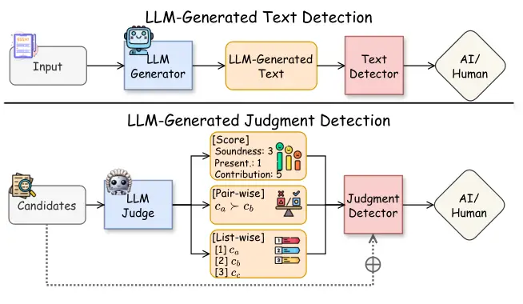
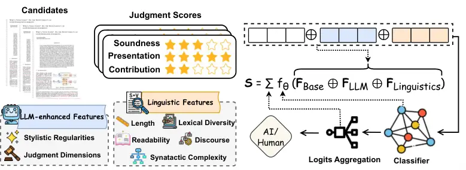
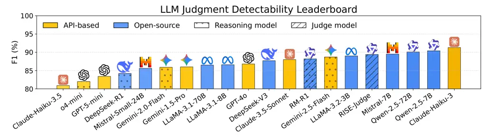

# ![[Uncaptioned image]](arxiv-2509-25154v1--d39be051b870.figures/figure-1.webp) Who’s Your Judge? On the Detectability of LLM-Generated Judgments

Dawei Li Affiliation: Arizona State University    Zhen Tan Affiliation:
Arizona State University    Chengshuai Zhao Affiliation: Arizona State
University    Bohan Jiang Affiliation: Arizona State University   
Baixiang Huang Affiliation: Emory University    Pingchuan Ma
Affiliation: Arizona State University    Abdullah Alnaibari Affiliation:
Arizona State University    Kai Shu Affiliation: Emory University   
Huan Liu Affiliation: Arizona State University

###### Abstract

Large Language Model (LLM)-based judgments leverage powerful LLMs to
efficiently evaluate candidate content and provide judgment scores.
However, the inherent biases and vulnerabilities of LLM-generated
judgments raise concerns, underscoring the urgent need for
distinguishing them in sensitive scenarios like academic peer reviewing.
In this work, we propose and formalize the task of judgment detection
and systematically investigate the detectability of LLM-generated
judgments. Unlike LLM-generated text detection, judgment detection
relies solely on judgment scores and candidates, reflecting real-world
scenarios where textual feedback is often unavailable in the detection
process. Our preliminary analysis shows that existing LLM-generated text
detection methods perform poorly given their incapability to capture the
interaction between judgment scores and candidate content—an aspect
crucial for effective judgment detection. Inspired by this, we introduce
J-Detector, a lightweight and transparent neural detector augmented with
explicitly extracted linguistic and LLM-enhanced features to link LLM
judges’ biases with candidates’ properties for accurate detection.
Experiments across diverse datasets demonstrate the effectiveness of
J-Detector and show how its interpretability enables quantifying biases
in LLM judges. Finally, we analyze key factors affecting the
detectability of LLM-generated judgments and validate the practical
utility of judgment detection in real-world scenarios.

[https://github.com/David-Li0406/Judgment-Detection](https://github.com/David-Li0406/Judgment-Detection)  
![[Uncaptioned
image]](arxiv-2509-25154v1--d39be051b870.figures/figure-2.webp)
[https://huggingface.co/datasets/wjldw/JD-Bench](https://huggingface.co/datasets/wjldw/JD-Bench)  
[https://llm-as-a-judge.github.io/](https://llm-as-a-judge.github.io)

## 1 Introduction

Taking advantage of the powerful Large Language Models (LLMs), the
paradigm of LLM-based judgment (Zheng et al., 2023; Li et al., 2024) has
been proposed, designed to automate and scale up various annotation and
reviewing applications (Lee et al., ; Zhu et al., 2025; Chang et al.,
2025). By combining powerful LLMs with well-designed prompting
strategies, LLM-based judgment enables human-like evaluation of
long-form and open-ended generation in a more cost-efficient manner. For
example, LLM-based judgment has been increasingly used in the peer
review of leading AI conferences (Liang et al., 2024).

Despite this remarkable progress, many recent studies point out various
biases of LLM-generated judgment toward spurious features, such as
length and affinity (Ye et al., 2024; Li et al., 2025a; Zhao et al.,
2025a). Besides, the vulnerability of the LLM judgment system has also
been revealed, that several maliciously-designed and hard-to-detect
tokens or words can fool the LLM judges to give much inconsistent scores
despite the candidates’ genuine quality (Shi et al., 2024; Zhao et al.,
2025b). Recently, in the scenario of academic peer reviewing, some
researchers sneak prompts, which are usually concealed as white text on
a white background, into their papers to instruct LLMs to only provide
positive feedback and thus trick AI reviewers¹¹ 1
[https://www.theregister.com/2025/07/07/scholars_try_to_fool_llm_reviewers/](https://www.theregister.com/2025/07/07/scholars_try_to_fool_llm_reviewers/).
All these challenges highlight the importance of distinguishing
LLM-generated judgments to guarantee the assessment’s fairness and
reliability.



Figure 1: Comparison between LLM-generated judgment detection and text
detection.

To address this concern, we propose the judgment detection task, which
aims at examining the detectability of LLM-generated judgments across
diverse scenarios. Unlike existing machine-generated text detection task
that focuses on textual content (Mitchell et al., 2023), judgment
detection targets at distinguishing LLM-generated from human-produced
judgments solely based on the candidate content and judgment scores (as
illustrated in Figure 1). For instance, in academic paper reviewing,
judgment detection will be performed using only the candidate paper and
its assigned ratings (e.g., soundness, novelty, overall score), without
accessing the full review text. This setting is particularly important
for real-world scenarios where textual feedback is often unavailable in
the detection process. For example, reviewers who adopt AI-generated
reviews may intentionally submit minimal textual content, such as “N/A”
to evade detection. Moreover, in the evaluation data labeling scenario,
annotators are typically required to provide only the judgment scores.
Score-based judgment detection is especially critical in these scenarios
to identify the illegal use of LLM-generated judgment and guarantee
assessment reliability.

Developing a good LLM-generated judgment detector is not trivial. In our
warm-up analysis, we identify two key types of information for judgment
detection which are not jointly considered in existing related
approaches: ❶ Judgment-Intrinsic Features, which capture patterns within
the judgment score distribution, and ❷ Judgment-Candidate Interaction
Features, which capture the interaction between judgment scores and
candidate content. Building on them, we find that existing LLM-generated
text detection methods fail to capture Judgment-Candidate Interaction
Features, leading to subpar performance—especially in single-dimension
settings, where each judgment consists of a single score assessing one
aspect of the candidates. To address this, we introduce J-Detector, a
lightweight and interpretable neural detector designed specifically for
LLM-generated judgment detection. J-Detector is augmented with
explicitly extracted linguistic and LLM-enhanced features to capture
systematic correlations between judgment scores and candidate features
that LLM judges are often biased toward, thereby effectively leveraging
these biases for more accurate detection.

Experiments across diverse judgment datasets demonstrate the
effectiveness of J-Detector and the two types of augmented features.
Besides, we showcase how to leverage the interpretability of J-Detector
to enable bias quantification in LLM judges. Finally, we analyze key
factors affecting the detectability of LLM-generated judgments and
demonstrate a real-world application that integrates judgment detection
with text-based detection to identify AI-generated reviews in an
academic peer reviewing scenario. In summary, our key contributions are:

- •
  We propose, for the first time, the judgment detection task, which
  aims at distinguishing human and LLM judgments based on judgment
  scores and candidate content.
- •
  We design J-Detector, a lightweight and interpretable detection
  method, that effectively bridges candidate and judgment information
  with linguistic and LLM-enhanced features.
- •
  Through extensive experiments, we demonstrate the advantages of
  J-Detector, identify key factors driving judgment detectability, and
  show the utility of judgment detection in real-world applications.

## 2 Related Work

LLM-as-a-judge, first introduced by Zheng et al. (2023), leverages
powerful LLMs Zhang et al. (2024a); Zhang et al. (2024b); Wang et al.
(2024a) to automatically evaluate candidate content and assign scores as
judgment results. This paradigm has been expanded to diverse
applications to judge various types of candidates, including paper
quality assessing (Jin et al., 2024), document relevance measurement
(Gao et al., 2023; Rahmani et al., 2024), and reasoning trace
correctness verification (Zhang et al., ), driving substantial progress
in automatic assessment (Li et al., 2025b; Tan et al., 2025; Beigi et
al., 2024; Hu et al., ; Hu et al., 2024; Jeong et al., 2024). Despite
these advances, recent studies highlight notable limitations. Research
has uncovered systematic biases in LLM-generated judgments, where
evaluations are influenced by spurious features such as response length
or superficial affinity rather than genuine content quality (Ye et al.,
2024; Li et al., 2025a; Jiang et al., 2024; Yang et al., 2024).
Moreover, adversarial work demonstrates that LLM judges can be
manipulated with a few carefully crafted, hard-to-detect tokens or
phrases, which induce disproportionately high scores misaligned with
actual candidate quality (Shi et al., 2024; Zhao et al., 2025b). To
mitigate these issues, methods such as bias quantification (Ye et al., 2024) and human-in-the-loop calibration (Wang et al., 2023a) have been
proposed. Building on this line of research, we introduce a new task,
judgment detection, that aims to distinguish and prevent the misuse of
LLM-generated judgments.

AI-generated Text Detection aims to distinguish machine-generated from
human-produced text, evolving from early stylometric and
perplexity-based methods (Gehrmann et al., 2019; Zellers et al., 2019)
to supervised classifiers (Ippolito et al., 2020; Mitchell et al.,
2023), and more recently toward robust, generalizable approaches such as
zero-shot prompting and watermarking (Sun and Lv, 2025; Mao et al.,
2025). Another relevant line of work for us is the detection of
LLM-generated peer reviews (Tao et al., ; Yu et al., ; Rao et al.,
2025), where detectors are designed to distinguish machine-written
reviews from human-authored ones. However, these approaches rely on
textual review content, which is often unavailable in broader judgment
settings. In this work, we borrow insights from both fields and propose
judgment detection to explore the detectability of LLM-produced
judgment, using judgment scores without accessing textual feedback.

## 3 Task Statement

A _judgment_ refers to an assessment made over one or more candidates
$`c\in\mathcal{C}`$, where $`|\mathcal{C}|`$ denotes the size of the
candidate set. A judgment score is denoted by
$`j=(j_{1},\dots,j_{d})\in\mathcal{Y}^{d}`$. It can be either
_single-dimensional_ ($`d=1`$), reflecting an assessment toward a single
aspect, or _multi-dimensional_ ($`d>1`$), where each component $`J_{i}`$
corresponds to a distinct evaluation aspect (e.g., relevance, fluency,
coherence). With these definitions, we formulate the task as follows:

###### Definition 3.1 (Judgment Detection).

LLM-generated judgment detection is defined over _judgment groups_. A
judgment group is given by $`G=\{(c^{i},j^{i})\}_{i=1}^{k}`$, where each
candidate $`c^{i}\in\mathcal{C}`$ is paired with a judgment score
$`j^{i}\in\mathcal{J}`$. The task is to classify whether a group $`G`$
originates from a human judge or from an LLM. Formally, the label space
is $`L=\{0,1\}`$, where $`\ell=0`$ denotes human-produced judgments and
$`\ell=1`$ denotes LLM-generated judgments. The goal is to learn a
function $`f_{\theta}:G\to[0,1]`$, where $`f_{\theta}(G)`$ outputs the
probability that $`G`$ was generated by an LLM. The final prediction is
obtained as $`\hat{y}=\mathbb{I}[f_{\theta}(G)\geq\tau]`$, with
threshold $`\tau\in[0,1]`$ and indicator function $`\mathbb{I}[\cdot]`$.

When the group size is 1, i.e., $`|G|=1`$, the task is degraded to an
i.i.d. (instance-level) detection setting, where each judgment is
treated independently. When $`|G|>1`$, the group setting better reflects
real practice, since judgments are usually produced in batches (e.g., a
reviewer scores multiple papers or an annotator evaluates a set of model
outputs), and collective patterns across the group can reveal whether
the judgments are human-produced or LLM-generated.

## 4 Warm-up Analysis: What Matters for LLM-generated Judgment Detection?

Figure 2: Multi- vs Single-dimension and Candidate Effect.

To understand the key ingredients of a reliable judgment detector, we
first conduct a warm-up study by adapting LLM-generated text detection
methods to the judgment detection setting. Specifically, we employ small
language models (SLM)-based detectors (Wu et al., 2024), _RoBERTa_ and
_Longformer_, as $`f_{\theta}`$ and evaluate them on four datasets:
_Helpsteer2_, _Helpsteer3_, _NeurIPS_, and _ANTIQUE_. More information
about implementation and dataset can be found in Section 6.1.

Multi-dimension vs Single-dimension performance. As shown in Figure 2
(a), both RoBERTa and Longformer achieve high accuracy in the
_multi-dimension_ scenarios (Helpsteer2 and NeurIPS) but perform poorly
in the _single-dimension_ scenarios (Helpsteer3 and ANTIQUE). We assume
that this discrepancy arises because, in multi-dimension settings, the
detectors can exploit distributional differences in how humans and LLMs
assign scores across multiple judgment dimensions, whereas in
single-dimensional settings, such distributional cues are almost absent.

Adding candidate information. We further extend the single-dimension
setting by providing candidate texts alongside their judgments,
exploring whether the detectors can extract and leverage
judgment–candidate interaction information. As shown in Figure 2 (b),
however, adding candidates does not lead to any performance improvement.
This suggests that SLM-based detectors are unable to directly capture
and utilize the interaction between judgments and candidate content from
raw input.

Takeaway. From this warm-up study, we identify two complementary types
of information that a reliable judgment detector should exploit: ❶
Judgment-Intrinsic Features, revealed by the large performance gap
between multi-dimension and single-dimension settings, indicating that
distributional patterns within judgment scores themselves can be highly
informative; and ❷ Judgment-Candidate Interaction Features, which
capture how judgment scores relate to the underlying candidate content
but remain largely unexplored by existing methods. These findings
highlight that existing SLM-based text detection methods mainly leverage
judgment-intrinsic patterns but fail to capture judgment–candidate
interactions, which are especially critical in single-dimension
scenarios.

## 5 J-Detector: A Lightweight and interpretable Detector



Figure 3: The overview pipeline of our J-Detector for LLM-generated
judgment detection.

To address the limitation of existing text detectors and design an
effective and robust approach for LLM-generated judgment detection, we
first identify three criteria that a good LLM-generated judgment
detector should embody:

- •
  (Accurate) The detection method should be able to leverage both
  Judgment-Intrinsic Features and Judgment-Candidate Interaction
  Features to deliver reliable detection results in various scenarios.
- •
  (Efficient) Both the training and inference of the detector should
  incur minimal computational overhead, enabling the method to be
  deployed in large-scale judgment detection scenarios.
- •
  (Interpretable) The detection method should be interpretable to
  support bias analysis in LLM judges.

Following these principles, we design J-Detector, an accurate,
lightweight and interpretable detector involving the following
components. The overview pipeline is presented in Figure 3.

Feature Augmentation. Let $`\mathbf{F}`$ denote the instance-level
feature vector used by J-Detector. We construct it by concatenating
three types of features together:

```math
\mathbf{F}\;=\;\mathbf{F}_{\text{base}}\;\oplus\;\mathbf{F}_{\text{LLM}}\;\oplus\;\mathbf{F}_{\text{linguistic}}, \tag{1}
```

where $`\mathbf{F}_{\text{base}}`$ contains the _given judgment scores_.
$`\mathbf{F}_{\text{LLM}}`$ and $`\mathbf{F}_{\text{linguistic}}`$ are
_LLM-enhanced features_ and _linguistic features_ we extract from
candidates content, which act as distilled information of candidates and
are leveraged to link judgment scores with candidates’ content.

LLM-enhanced Features. Borrowing insights from LLM-based text detection
methods (Bao et al., 2024), we propose LLM-enhanced features to produce
the following types of features:

- •
  Stylistic regularities: scores reflecting surface polish and
  presentation patterns of the candidates, including _style_, _wording_,
  and _format_. These aim to capture the spurious preference LLM judges
  tend to have over superficial attributes (Li et al., 2025a).
- •
  Judgment-aligned dimensions: scores aligned to the same dimensions
  used in the given judgment scores. These aim to enhance features by
  leveraging the similarity of biases across LLM judges.

By injecting these high-level, bias-informed signals, LLM-enhanced
Features enable the detector to better capture subtle judgment patterns
that are difficult to learn from raw candidate content alone.

Linguistic Features. We further introduce linguistic features
$`\mathbf{F}_{\text{linguistic}}`$ to capture low-level linguistic
regularities that often correlate with systematic biases of LLM judges.
Specifically, we extract the following aggregated features from the
candidate content:

- •
  Length: total token and character counts, as well as average sentence
  length, to capture the _length bias_ where LLM judges favor lengthy
  content and responses (Wei et al., ).
- •
  Lexical diversity: unique-token ratio and average word length, which
  reflect the _surface beauty bias_ of LLM-generated judgments compared
  to human-produced ones (Chen et al., 2024).
- •
  Readability: a composite readability index (e.g., Coleman–Liau),
  measuring the _fluency bias_ where LLMs tend to favor superficially
  fluent texts, disregarding their true quality (Wu and Aji, 2025).
- •
  Syntactic complexity: dependency tree depth and average dependency
  distance, used to identify the _complexity bias_ often observed in LLM
  judges (Ye et al., 2024).
- •
  Discourse/hedging: the frequency of discourse markers and hedging
  expressions, capturing the _presentation bias_ of LLM, which prefer
  content with confident tones (Kharchenko et al., 2025).

These features provide a compact yet informative summary of linguistic
cues, enabling the detector to exploit stable and interpretable signals
that are complementary to LLM-enhanced features.

Model Training. Given labeled instances $`(\mathbf{F},y)`$, we train a
lightweight binary classifier $`f_{\theta}`$ (e.g., RandomForest
(Breiman, 2001)) to output a _logit_ $`z\in\mathbb{R}`$ indicating the
likelihood that the judgment was generated by an LLM ($`y=1`$) or by a
human ($`y=0`$). The classifier is trained using the augmented feature
$`\mathbf{F}`$ and serves as the instance-level building block for
group-level decisions.

Group-level Aggregation. To enable the group-level detection setting, we
propose a simple aggregation method to produce the group-level label
give each single prediction. Given a group $`G`$ consisting of $`k`$
judgments with instance-level logits
$`\{\hat{z}_{1},\dots,\hat{z}_{k}\}`$, we aggregate the evidence using
sum aggregation: $`\mathrm{score}(G)\;=\;\sum_{i=1}^{k}\hat{z}_{i}`$.

In summary, J-Detector is designed to satisfy the three criteria
identified at the beginning of this section. First, by incorporating
both LLM-enhanced and linguistic features, it is able to capture not
only Judgment-Intrinsic Features but also critical Judgment–Candidate
Interaction Features, enabling accurate detection across
single-dimensional and multi-dimensional scenarios. Second, it builds on
a lightweight binary classifier, making both training and inference
highly efficient and thus suitable for large-scale deployment. Third,
since the features are semantically clear and the classifier itself is
simple, the framework offers strong interpretability, which can be
leveraged to systematically quantify and analyze the biases of LLM
judges.

## 6 Main Experiment

### 6.1 Experiment Settings

Datasets. We build a comprehensive LLM-generated judgment detection
dataset, JD-Bench, which integrates four representative datasets
covering three judgment types: pointwise, pairwise and listwise (Li et
al., 2024). Among them, _HelpSteer2_ provides large-scale pointwise
human ratings of LLM responses for helpfulness evaluation, while
_HelpSteer3_ extends this with pairwise human preference comparisons.
The _NeurIPS Review dataset_ offers expert peer reviews with
multi-dimensional scores such as soundness and novelty, representing
high-stakes evaluation. Finally, _ANTIQUE_ supplies listwise human
judgments for ranking documents in non-factoid question answering. All
four datasets contain human-labeled judgments as reliable references,
and we further collect LLM-generated judgments from a diverse pool of
models. In total, JD-Bench covers a wide spectrum of model families,
including _OpenAI_, _Anthropic_, and _Google_ for closed-source models,
and _LLaMA_, _Qwen_, _Mistral_, and _DeepSeek_ for open-source models,
ensuring diversity in judgment patterns.

Compared Methods. In our main experiment, we compare our proposed
J-Detector against a series of baseline methods, all of which are listed
as follows:

- •
  SLM-based Detector. In line with SLM-based text detectors (Yu et al.,
  2025), this approach feeds either the judgment scores alone or the
  judgment scores together with the candidate content (w/ candidates) to
  train a small language model-based classifier to predict whether the
  judgment was produced by a human or from an LLM.
- •
  LLM-as-a-judge-detector. Inspired by logits-based detection in
  AI-generated text detection (Mitchell et al., 2023), where a surrogate
  LLM is used to compute likelihoods, we adopt a single LLM that first
  generates judgment scores and then compares them with the judgment
  scores to be detected, making the detection decision based on their
  similarity.
- •
  Sample-level LLM-based Analysis. Inspired by recent agent-based
  frameworks that maintain guideline banks for distinguishing human and
  AI text (Li et al., 2025c), we let the LLM analyze Human–LLM
  judgment-candidate pairs to extract concise instance-level features
  (e.g., length bias in LLM judgments), which are stored in a feature
  bank to capture regularities useful for detection.
- •
  Distribution-level LLM-based Analysis. Drawing inspiration from recent
  work that guides LLMs in structured extraction and analysis of visual
  summaries (Liu et al., 2025), we provide the model with dataset-level
  summaries (e.g., per-label histograms and correlations), enabling it
  to incorporate global and distributional cues into the detection
  decision.

Implementation Details. We implement our J-Detector using three models
from the Scikit-learn library (Pedregosa et al., 2011): LGBM (Ke et al.,
2017), RandomForest (Breiman, 2001), and XGB (Chen and Guestrin, 2016).
We employ _Qwen-3-8B_ for both feature augmentation and as the backbone
for LLM-based baselines. For SLM-based methods, we use _RoBERTa-base_
and _Longformer-4096_. For SLM training, we use a batch size of 8 and
fine-tune the SLM for 3 epochs on each dataset. In the main experiments,
the group size is fixed to $`k`$=4. More details, including the JD-Bench
construction, design of baseline methods, and implementation specifics
are provided in Appendix B.

### 6.2 Main Result

|                                          |            |       |            |       |         |       |         |       |      |       |
| ---------------------------------------- | ---------- | ----- | ---------- | ----- | ------- | ----- | ------- | ----- | ---- | ----- |
| Method                                   | Helpsteer2 |       | Helpsteer3 |       | NeurIPS |       | ANTIQUE |       | AVG  |       |
|                                          | F1         | AUROC | F1         | AUROC | F1      | AUROC | F1      | AUROC | F1   | AUROC |
| SLM-based methods                        |            |       |            |       |         |       |         |       |      |       |
| RoBERTa                                  | 98.1       | 99.6  | 50.9       | 64.5  | 96.2    | 99.4  | 30.0    | 56.8  | 68.8 | 80.1  |
| RoBERTa w/ candidates                    | 98.1       | 99.6  | 50.0       | 63.4  | 96.3    | 99.3  | 27.6    | 56.6  | 68.0 | 79.7  |
| Longformer                               | 98.1       | 99.7  | 54.5       | 65.7  | 96.2    | 99.5  | 30.6    | 56.6  | 69.9 | 80.4  |
| Longformer w/ candidates                 | 98.1       | 99.7  | 51.4       | 64.3  | 96.2    | 99.4  | 21.8    | 48.8  | 66.9 | 78.0  |
| LLM-based methods                        |            |       |            |       |         |       |         |       |      |       |
| LLM                                      | 51.5       | 50.3  | 50.3       | 50.1  | 43.9    | 50.2  | 49.6    | 49.9  | 48.8 | 50.1  |
| LLM w/ Sample-level                      | 49.8       | 49.7  | 49.6       | 50.2  | 50.5    | 50.4  | 50.9    | 50.3  | 50.2 | 50.2  |
| LLM w/ Distribution-level                | 52.1       | 50.0  | 48.8       | 50.3  | 49.6    | 49.8  | 50.7    | 50.1  | 50.3 | 50.1  |
| LLM w/ Sample-level + Distribution-level | 58.7       | 50.4  | 49.4       | 49.6  | 51.2    | 50.2  | 50.2    | 49.9  | 52.4 | 50.0  |
| J-Detector (ours)                        |            |       |            |       |         |       |         |       |      |       |
| LGBM                                     | 99.6       | 100.0 | 68.1       | 73.3  | 98.7    | 99.9  | 85.4    | 93.3  | 88.0 | 91.6  |
| RandomForest                             | 99.5       | 100.0 | 74.0       | 77.0  | 97.0    | 99.7  | 82.6    | 90.6  | 88.3 | 91.8  |
| XGB                                      | 99.8       | 100.0 | 68.5       | 73.6  | 98.4    | 99.8  | 84.2    | 92.3  | 87.7 | 91.4  |

Table 1: Main experimental results on JD-Bench. We report F1 and AUROC
scores, with the best results highlighted in bold. Each experiment is
repeated five times, and average scores are reported.

SLM-based Methods Analysis. As we discussed in Section 4, SLM-based
methods perform strongly on multi-dimensional datasets like Helpsteer2
(98.1% F1 on RoBERTa) and NeurIPS (96.2% on RoBERTa), but drop to around
50–55% F1 on single-dimensional datasets like Helpsteer3 and Antique.
Even adding candidates barely helps. This shows SLMs rely on
inter-dimension patterns and fail to link judgments with candidates when
such distributional cues are absent.

LLM-based Methods Analysis. Furthermore, all LLM-based methods hover
near 50% F1 score across datasets, indicating almost random guessing.
When combining with sample-level comparative analysis and
distribution-level chart reasoning, LLM-based detection methods yield
some gains in multi-dimensional datasets (e.g., from 51.5% to 58.7% F1
score). While this improvement doesn’t appear in Helpsteer3 and ANTIQUE,
we conclude that LLM-based detectors also suffer from leveraging
judgments-candidates interaction, with either sample- or
distribution-level methods.

J-Detector Analysis. Compared with them, J-Detector achieves the best
detection performance across all 4 datasets and 2 metrics, far
surpassing all baselines. Noted that in the single-dimensional judgment
scenarios, J-Detector yields much better detection performance compared
with other baselines. This demonstrates that explicitly modeling the
distributional patterns and biases of LLM judgments is crucial for
accurate detection, enabling robust performance in both
single-dimensional and multi-dimensional judgment detection scenarios.

Figure 4: Ablation study on LLM-enhanced and linguistic features.

Ablation Study. Figure 4 shows that both LLM-enhanced and linguistic
features consistently improve performance across all group sizes.
Removing either feature causes the F1 score to drop at every group
size—for example, at k = 16, removing linguistic features lowers F1 by
5.3%, and removing both leads to a 12.3% drop. This demonstrates that
the two augmented features are complementary and beneficial across all
datasets and group-size settings.

Bias Quantification with J-Detector. Additionally, we illustrate how the
transparency and interpretability of J-Detector can be leveraged to
quantify biases in LLM-as-a-judge by analyzing which features most
strongly influence the detector’s decisions. Specifically, we select the
top 20 most important features ranked by their absolute coefficient
values, and report the results on the Helpsteer2 and NeurIPS datasets in
Figure 5. The analysis reveals that base judgment score features provide
strong signals for distinguishing LLM-generated judgments from
human-produced ones, highlighting the critical role of
Judgment-Intrinsic Features. As shown in the figure, LLM judges exhibit
the strongest bias in the complexity and confidence dimensions for the
two datasets, respectively, consistent with prior findings that LLMs
tend to favor more complex responses (Ye et al., 2024; Yang et al., 2024) and often display overconfidence (Kadavath et al., 2022). In
addition, we observe common cross-dataset biases such as length bias
(captured by average_dependency_length) and beauty bias (reflected in
style-related scores), which echo broader concerns about spurious
preference and correlations in LLM-based judgments (Wang et al., 2023b;
Shi et al., 2024).

Figure 5: LLM-as-a-judge bias quantification on Helpsteer2 and NeurIPS.

## 7 Further Analysis

In this section, we empirically analyze the key factors that influence
the detectability of the LLM-generated judgment, as well as present a
real-world application to combine LLM-based judgment detection with text
detection in real-world academic peer reviewing scenarios.

### 7.1 Detectability Analysis

Figure 6: Detectability analysis on group size, judgment dimensions and
rating scale.

Detectability analysis across group size, judgment dimensions, and
rating scale. Figure 6 shows that group size is a key factor in the
detectability of LLM-generated judgments: the F1 score consistently
improves as the group size increases across all four datasets (e.g., F1
score in Helpsteer3 rises from 63.9% at $`k=1`$ to 85.0% at $`k=16`$).
The number of judgment dimensions also plays an important role; for
instance, when only a single dimension out of the five is used in the
NeurIPS dataset, the F1 score drops substantially (from 97.2% to 72.3%).
This confirms that multi-dimensional judgments provide richer
distributional signals as Judgment-Intrinsic Features for detection.



Figure 7: Detectability leaderboard on 20 LLMs. RM-R1 and RISE-Judge are
based on Qwen-2.5-7B.

Figure 8: Correlation between judge LLMs’ detectability and LMArena
score.

In addition, the granularity of the rating scale further impacts
detectability: collapsing to a coarse scale (e.g., merging $`-3/-2/-1`$
into $`-1`$ and $`1/2/3`$ into $`1`$ in Helpsteer3) leads to degraded
performance (e.g., F1 drops from 72.9% to 57.7%). Overall, these results
underscore that group size, the number of dimensions, and the rating
scale collectively shape how detectable LLM-generated judgments are.

Detectability of Various LLM Judges. Additionally, Figure 7 summarizes
the detectability leaderboard across 20 LLMs, averaged over different
group sizes. We observe that API-based models (yellow bars) are
generally more difficult to detect than open-source models (blue bars),
indicating that closed commercial systems such as GPT-5-mini and
Claude-Haiku-3 produce judgments that more closely resemble human
annotations.

Within the same model families, larger models tend to be less detectable
than smaller ones: for instance, among LLaMA-3 and Qwen-2.5 families,
larger models consistently achieve lower detectability. Moreover,
reasoning models (dotted bars) and specialized judge models (striped
bars) consistently achieve higher robustness than standard LLMs,
suggesting that models explicitly optimized for reasoning or evaluation
align more closely with human judgment distributions and are therefore
harder to distinguish from human judges.

As presented in Figure 8, we also study the correlation between the
detectability of different LLM judges and their LMArena score (Chiang et
al., 2024), which is a proxy of LLMs’ alignment degree with human
preference and value. We find a clear negative correlation: models with
higher alignment scores are systematically less detectable. This
observation reinforces our previous findings, supporting the hypothesis
that as models become better aligned with human values, the gap between
their judgments and human annotations narrows, making their outputs
increasingly difficult to distinguish from those of human judges.

For LLM-generated judgment detectability, we also theoretically prove
and demonstrate each influence factor’s effect and put it in Appendix C.

### 7.2 Judgment Detection with Multiple LLM Judges

Figure 9: Detectability of LLM-generated judgment in multiple LLM judges
setting.

In this section, we examine how the detectability of LLM-generated
judgments changes when multiple LLM judges are involved. This setting
reflects real-world scenarios where judgments may come from a diverse
pool of LLMs. As shown in Figure 9, we randomly sample 2, 3, 5, or 10
LLMs from our JD-Bench and mix their judgments in both the training and
testing sets. We observe a substantial drop in detection performance
across all four datasets (e.g., the F1 score decreases from 99.8% to
66.9% on Helpsteer2). This suggests that detecting LLM-generated
judgments becomes significantly more challenging when multiple LLM
judges are present, as detectors must learn to recognize distinct
patterns from different models. Notably, the performance drop is
relatively small on the NeurIPS dataset, indicating stronger shared
biases among LLM judges in that domain. One promising direction for
future work is to explore effective LLM-generated judgment detection
methods under multiple judges’ settings.

### 7.3 Judgment-Text Co-Detection: An Application

In this section, we explore two real-world scenarios where LLM-generated
judgment detection can support peer review authenticity checking. First,
the few-shot detection setting simulates cases where a new conference is
launched or the review form has changed. Here, we set the number of
training samples to be 60. Second, the missing-text detection setting
addresses the common case where reviews lack enough textual feedback. We
simulate this setting by masking 15% of the text reviews.

| Method                       | Few-shot | Missing review |
| ---------------------------- | -------- | -------------- |
| w/ RoBERTa-text              | 67.2     | 90.5           |
| w/ J-Detector                | 64.4     | 86.2           |
| w/ RoBERTa-text & J-Detector | 74.6     | 99.3           |

Table 2: An application to leverage judgment and text feedback for
AI-generated review detection in few-shot and missing review scenarios.

The results in Table 2 show that combining the J-Detector with a
text-based detector (RoBERTa-text) achieves the best performance in both
settings (74.6% vs. 67.2% in few-shot, and 99.3% vs. 90.5% in
missing-text), outperforming either method alone. This demonstrates that
LLM-generated judgment detection provides complementary signals to
text-based detectors and is highly valuable in real-world low-resource
or judgment score-only scenarios for robust and reliable detection.

## 8 Conclusion

In this work we introduced judgment detection as the task of
distinguishing human from LLM-generated judgments and proposed
J-Detector, a lightweight, interpretable detector enhanced with
linguistic and LLM-based features. Experiments on JD-Bench show that
J-Detector consistently outperforms baselines, while our theoretical and
empirical analyses reveal that detectability improves with larger group
size, richer dimensions, finer rating scales, and greater human–LLM
divergence. Using J-Detector’s transparency, we further quantified
systematic biases in LLM judges, such as complexity, confidence, and
length biases, and demonstrated practical value in peer-review
authenticity checking. These findings establish LLM-generated judgment
detection as a key safeguard for ensuring fairness and accountability in
LLM-as-a-judge systems.

## Ethics Statement

We adhere to the ICLR Code of Ethics. No private, sensitive, or
personally identifiable data are involved. Our work does not raise
foreseeable ethical concerns or produce harmful societal outcomes.

## Reproducibility Statement

Reproducibility is central to our work. All datasets used in our
experiments are standard benchmarks that are publicly available. We
provide full details of the training setup, model architectures, and
evaluation metrics in the main paper and appendix. Upon acceptance, we
will release our codebase, including scripts for preprocessing,
training, and evaluation, along with configuration files and
documentation to facilitate exact reproduction of our results. Random
seeds and hyperparameters will also be included to further ensure
reproducibility.

\nobibliography

\*

## References

- Bao et al. (2024) G. Bao, Y. Zhao, Z. Teng, L. Yang, and Y. Zhang.
  Fast-detectgpt: Efficient zero-shot detection of machine-generated
  text via conditional probability curvature. In _ICLR_, 2024.
- Beigi et al. (2024) A. Beigi, Z. Tan, N. Mudiam, C. Chen, K. Shu,
  and H. Liu. Model attribution in llm-generated disinformation: A
  domain generalization approach with supervised contrastive learning.
  In _2024 IEEE 11th International Conference on Data Science and
  Advanced Analytics (DSAA)_, pages 1–10. IEEE, 2024.
- Breiman (2001) L. Breiman. Random forests. _Machine learning_,
  45(1):5–32, 2001.
- Chang et al. (2025) Y. Chang, Z. Li, H. Zhang, Y. Kong, Y. Wu, Z.
  Guo, and N. Wong. Treereview: A dynamic tree of questions framework
  for deep and efficient llm-based scientific peer review. _arXiv
  preprint arXiv:2506.07642_, 2025.
- Chen et al. (2024) G. Chen, S. Chen, Z. Liu, F. Jiang, and B. Wang.
  Humans or llms as the judge? a study on judgement bias. In
  _Proceedings of the 2024 Conference on Empirical Methods in Natural
  Language Processing_, pages 8301–8327, 2024.
- Chen and Guestrin (2016) T. Chen and C. Guestrin. Xgboost: A scalable
  tree boosting system. In _Proceedings of the 22nd ACM SIGKDD
  International Conference on Knowledge Discovery and Data Mining_,
  pages 785–794. ACM, 2016.
- Chiang et al. (2024) W.-L. Chiang, L. Zheng, Y. Sheng, A. N.
  Angelopoulos, T. Li, D. Li, B. Zhu, H. Zhang, M. Jordan, J. E.
  Gonzalez, et al. Chatbot arena: An open platform for evaluating llms
  by human preference. In _Forty-first International Conference on
  Machine Learning_, 2024.
- Gao et al. (2023) M. Gao, J. Ruan, R. Sun, X. Yin, S. Yang, and X.
  Wan. Human-like summarization evaluation with chatgpt. _arXiv preprint
  arXiv:2304.02554_, 2023.
- Gehrmann et al. (2019) S. Gehrmann, H. Strobelt, and A. M. Rush.
  Gltr: Statistical detection and visualization of generated text. In
  _Proceedings of the 57th Annual Meeting of the Association for
  Computational Linguistics: System Demonstrations_, pages 111–116.
  Association for Computational Linguistics, 2019. URL
  [https://aclanthology.org/P19-3019](https://aclanthology.org/P19-3019).
- Hashemi et al. (2020) H. Hashemi, M. Aliannejadi, H. Zamani,
  and W. B. Croft. Antique: A non-factoid question answering benchmark.
  In _European Conference on Information Retrieval_, pages 166–173.
  Springer, 2020.
- (11) L. Hu, C. Ren, Z. Hu, H. Lin, C.-L. Wang, Z. Tan, W. Lyu, J.
  Zhang, H. Xiong, and D. Wang. Editable concept bottleneck models. In
  _Forty-second International Conference on Machine Learning_.
- Hu et al. (2024) L. Hu, L. Liu, S. Yang, X. Chen, Z. Tan, M. A.
  Ali, M. Li, and D. Wang. Understanding reasoning in chain-of-thought
  from the hopfieldian view. _arXiv preprint arXiv:2410.03595_, 2024.
- Ippolito et al. (2020) D. Ippolito, D. Duckworth, C. Callison-Burch,
  and D. Eck. Automatic detection of generated text is easiest when
  humans are fooled. In _Proceedings of the 58th Annual Meeting of the
  Association for Computational Linguistics_, pages 1808–1822.
  Association for Computational Linguistics, 2020. URL
  [https://aclanthology.org/2020.acl-main.164](https://aclanthology.org/2020.acl-main.164).
- Jeong et al. (2024) U. Jeong, B. Jiang, Z. Tan, R. Bernard, and H.
  Liu. Bluetempnet: A temporal multi-network dataset of social
  interactions in bluesky social. _IEEE Data Descriptions_, 2024.
- Jiang et al. (2024) B. Jiang, D. Li, Z. Tan, X. Zhou, A. Rao, K.
  Lerman, H. R. Bernard, and H. Liu. Assessing the impact of conspiracy
  theories using large language models. _arXiv preprint
  arXiv:2412.07019_, 2024.
- Jin et al. (2024) Y. Jin, Q. Zhao, Y. Wang, H. Chen, K. Zhu, Y. Xiao,
  and J. Wang. Agentreview: Exploring peer review dynamics with llm
  agents. In _EMNLP_, 2024.
- Kadavath et al. (2022) S. Kadavath, A. Z. Lin, D. Ganguli, A.
  Askell, Y. Bai, A. Chen, A. Goldie, A. Jones, N. S. Joseph, D.
  Krueger, S. M. Nisan, D. Amodei, T. B. Brown, C. Olsson, J. Kaplan, J.
  Clark, P. Christiano, J. Leike, and A. Cotra. Language models (mostly)
  know what they know. In _Advances in Neural Information Processing
  Systems (NeurIPS)_, 2022.
- Ke et al. (2017) G. Ke, Q. Meng, T. Finley, T. Wang, W. Chen, W.
  Ma, Q. Ye, and T.-Y. Liu. Lightgbm: A highly efficient gradient
  boosting decision tree. In _Advances in Neural Information Processing
  Systems_, 2017.
- Kharchenko et al. (2025) J. Kharchenko, T. Roosta, A. Chadha, and C.
  Shah. I think, therefore i am under-qualified? a benchmark for
  evaluating linguistic shibboleth detection in llm hiring evaluations.
  _arXiv preprint arXiv:2508.04939_, 2025.
- (20) H. Lee, S. Phatale, H. Mansoor, K. R. Lu, T. Mesnard, J.
  Ferret, C. Bishop, E. Hall, V. Carbune, and A. Rastogi. Rlaif: Scaling
  reinforcement learning from human feedback with ai feedback.
- Li et al. (2024) D. Li, B. Jiang, L. Huang, A. Beigi, C. Zhao, Z.
  Tan, A. Bhattacharjee, Y. Jiang, C. Chen, T. Wu, et al. From
  generation to judgment: Opportunities and challenges of
  llm-as-a-judge. _arXiv preprint arXiv:2411.16594_, 2024.
- Li et al. (2025a) D. Li, R. Sun, Y. Huang, M. Zhong, B. Jiang, J.
  Han, X. Zhang, W. Wang, and H. Liu. Preference leakage: A
  contamination problem in llm-as-a-judge. _arXiv preprint
  arXiv:2502.01534_, 2025a.
- Li et al. (2025b) D. Li, Z. Tan, P. Qian, Y. Li, K. Chaudhary, L. Hu,
  and J. Shen. Smoa: Improving multi-agent large language models with
  sparse mixture-of-agents. In _Pacific-Asia Conference on Knowledge
  Discovery and Data Mining_, pages 54–65. Springer, 2025b.
- Li et al. (2025c) J. Li, M. Ye, C. Peng, X. Yin, and X. Wan. Agent-x:
  Adaptive guideline-based expert network for threshold-free
  ai-generated text detection. _arXiv preprint arXiv:2505.15261_, 2025c.
- Liang et al. (2024) W. Liang, Z. Izzo, Y. Zhang, H. Lepp, H. Cao, X.
  Zhao, L. Chen, H. Ye, S. Liu, Z. Huang, et al. Monitoring ai-modified
  content at scale: a case study on the impact of chatgpt on ai
  conference peer reviews. In _Proceedings of the 41st International
  Conference on Machine Learning_, pages 29575–29620, 2024.
- Liu et al. (2025) H. Liu, H. Kamarthi, Z. Zhao, S. Xu, S. Wang, Q.
  Wen, T. Hartvigsen, F. Wang, and B. A. Prakash. How can time series
  analysis benefit from multiple modalities? a survey and outlook.
  _arXiv preprint arXiv:2503.11835_, 2025.
- Mao et al. (2025) M. Mao, D. Wei, Z. Chen, X. Fang, and M. Chau.
  Watermarking large language models: An unbiased and low-risk method.
  In _Proceedings of the 63rd Annual Meeting of the Association for
  Computational Linguistics (Volume 1: Long Papers)_, pages
  7939–7960, 2025.
- Mitchell et al. (2023) E. Mitchell, Y. Lee, A. Khazatsky, C. D.
  Manning, and C. Finn. Detectgpt: Zero-shot machine-generated text
  detection using probability curvature. _arXiv preprint
  arXiv:2301.11305_, 2023. URL
  [https://arxiv.org/abs/2301.11305](https://arxiv.org/abs/2301.11305).
- Pedregosa et al. (2011) F. Pedregosa, G. Varoquaux, A. Gramfort, V.
  Michel, B. Thirion, O. Grisel, M. Blondel, P. Prettenhofer, R.
  Weiss, V. Dubourg, J. Vanderplas, A. Passos, D. Cournapeau, M.
  Brucher, M. Perrot, and E. Duchesnay. Scikit-learn: Machine learning
  in Python. _Journal of Machine Learning Research_, 12:2825–2830, 2011.
- Rahmani et al. (2024) H. A. Rahmani, E. Yilmaz, N. Craswell, B.
  Mitra, P. Thomas, C. L. Clarke, M. Aliannejadi, C. Siro, and G.
  Faggioli. Llmjudge: Llms for relevance judgments. In _LLM4Eval@
  SIGIR_, 2024.
- Rao et al. (2025) V. Rao, A. Kumar, H. Lakkaraju, and N. B. Shah.
  Detecting llm-generated peer reviews. _arXiv preprint
  arXiv:2503.15772_, 2025.
- Shi et al. (2024) J. Shi, Z. Yuan, Y. Liu, Y. Huang, P. Zhou, L. Sun,
  and N. Z. Gong. Optimization-based prompt injection attack to
  llm-as-a-judge. In _Proceedings of the 2024 on ACM SIGSAC Conference
  on Computer and Communications Security_, pages 660–674, 2024.
- Sun and Lv (2025) J. Sun and Z. Lv. Zero-shot detection of
  llm-generated text via text reorder. _Neurocomputing_,
  631:129829, 2025.
- Tan et al. (2025) Z. Tan, J. Yan, I. Hsu, R. Han, Z. Wang, L. T.
  Le, Y. Song, Y. Chen, H. Palangi, G. Lee, et al. In prospect and
  retrospect: Reflective memory management for long-term personalized
  dialogue agents. _arXiv preprint arXiv:2503.08026_, 2025.
- (35) Z. Tao, D. Xi, Z. Li, J. Zhao, and W. Xu. Human or llm? a
  syntactic-semantic collaborative framework for detecting llm-generated
  peer reviews. _A Syntactic-Semantic Collaborative Framework for
  Detecting Llm-Generated Peer Reviews_.
- Wang et al. (2023a) P. Wang, L. Li, L. Chen, Z. Cai, D. Zhu, B.
  Lin, Y. Cao, Q. Liu, T. Liu, and Z. Sui. Large language models are not
  fair evaluators. _ArXiv preprint_, abs/2305.17926, 2023a. URL
  [https://arxiv.org/abs/2305.17926](https://arxiv.org/abs/2305.17926).
- Wang et al. (2024a) S. Wang, Y. Tong, H. Zhang, D. Li, X. Zhang,
  and T. Chen. Bpo: Towards balanced preference optimization between
  knowledge breadth and depth in alignment. _arXiv preprint
  arXiv:2411.10914_, 2024a.
- Wang et al. (2023b) X. Wang, J. Wei, D. Zhou, E. Chi, Q. Le, and D.
  Schuurmans. Adversarial attacks reveal spurious correlations in large
  language model evaluations. In _Proceedings of the 61st Annual Meeting
  of the Association for Computational Linguistics (ACL)_, 2023b.
- Wang et al. (2024b) Z. Wang, Y. Dong, O. Delalleau, J. Zeng, G.
  Shen, D. Egert, J. Zhang, M. N. Sreedhar, and O. Kuchaiev. Helpsteer
  2: Open-source dataset for training top-performing reward models.
  _Advances in Neural Information Processing Systems_, 37:1474–1501,
  2024b.
- Wang et al. (2025) Z. Wang, J. Zeng, O. Delalleau, H.-C. Shin, F.
  Soares, A. Bukharin, E. Evans, Y. Dong, and O. Kuchaiev.
  Helpsteer3-preference: Open human-annotated preference data across
  diverse tasks and languages. _arXiv preprint arXiv:2505.11475_, 2025.
- (41) H. Wei, S. He, T. Xia, F. Liu, A. Wong, J. Lin, and M. Han.
  Systematic evaluation of llm-as-a-judge in llm alignment tasks:
  Explainable metrics and diverse prompt templates. In _ICLR 2025
  Workshop on Building Trust in Language Models and Applications_.
- Wu et al. (2024) J. Wu, R. Zhan, D. Wong, S. Yang, X. Yang, Y. Yuan,
  and L. Chao. Detectrl: Benchmarking llm-generated text detection in
  real-world scenarios. _Advances in Neural Information Processing
  Systems_, 37:100369–100401, 2024.
- Wu and Aji (2025) M. Wu and A. F. Aji. Style over substance:
  Evaluation biases for large language models. In _Proceedings of the
  31st International Conference on Computational Linguistics_, pages
  297–312, 2025.
- Yang et al. (2024) S. Yang, J. Wu, W. Ding, N. Wu, S. Liang, M.
  Gong, H. Zhang, and D. Zhang. Quantifying the robustness of
  retrieval-augmented language models against spurious features in
  grounding data. _arXiv preprint arXiv:2503.05587_, 2024.
- Ye et al. (2024) J. Ye, Y. Wang, Y. Huang, D. Chen, Q. Zhang, N.
  Moniz, T. Gao, W. Geyer, C. Huang, P.-Y. Chen, et al. Justice or
  prejudice? quantifying biases in llm-as-a-judge. _arXiv preprint
  arXiv:2410.02736_, 2024.
- (46) S. Yu, M. Luo, A. Madasu, V. Lal, and P. Howard. Is your paper
  being reviewed by an llm? investigating ai text detectability in peer
  review. In _Neurips Safe Generative AI Workshop 2024_.
- Yu et al. (2025) S. Yu, M. Luo, A. Madusu, V. Lal, and P. Howard. Is
  your paper being reviewed by an llm? benchmarking ai text detection in
  peer review. _arXiv preprint arXiv:2502.19614_, 2025.
- Zellers et al. (2019) R. Zellers, A. Holtzman, H. Rashkin, Y.
  Bisk, A. Farhadi, F. Roesner, and Y. Choi. Defending against neural
  fake news. In _Advances in Neural Information Processing Systems_,
  volume 32, 2019. URL
  [https://arxiv.org/abs/1905.12616](https://arxiv.org/abs/1905.12616).
- Zhang et al. (2024a) H. Zhang, C. Shang, S. Wang, D. Zhang, F.
  Yao, R. Sun, Y. Yu, Y. Yang, and F. Wei. Shifcon: Enhancing
  non-dominant language capabilities with a shift-based contrastive
  framework. _arXiv preprint arXiv:2410.19453_, 2024a.
- Zhang et al. (2024b) H. Zhang, Y. Wu, D. Li, S. Yang, R. Zhao, Y.
  Jiang, and F. Tan. Balancing speciality and versatility: a coarse to
  fine framework for supervised fine-tuning large language model. In
  _Findings of the Association for Computational Linguistics ACL 2024_,
  pages 7467–7509, 2024b.
- (51) L. Zhang, A. Hosseini, H. Bansal, M. Kazemi, A. Kumar, and R.
  Agarwal. Generative verifiers: Reward modeling as next-token
  prediction. In _The Thirteenth International Conference on Learning
  Representations_.
- Zhao et al. (2025a) C. Zhao, Z. Tan, P. Ma, D. Li, B. Jiang, Y.
  Wang, Y. Yang, and H. Liu. Is chain-of-thought reasoning of llms a
  mirage? a data distribution lens. _arXiv preprint arXiv:2508.01191_,
  2025a.
- Zhao et al. (2025b) Y. Zhao, H. Liu, D. Yu, S. Kung, H. Mi, and D.
  Yu. One token to fool llm-as-a-judge. _arXiv preprint
  arXiv:2507.08794_, 2025b.
- Zheng et al. (2023) L. Zheng, W.-L. Chiang, Y. Sheng, S. Zhuang, Z.
  Wu, Y. Zhuang, Z. Lin, Z. Li, D. Li, E. Xing, et al. Judging
  llm-as-a-judge with mt-bench and chatbot arena. _Advances in Neural
  Information Processing Systems_, 36:46595–46623, 2023.
- Zhu et al. (2025) M. Zhu, Y. Weng, L. Yang, and Y. Zhang. Deepreview:
  Improving llm-based paper review with human-like deep thinking
  process. _arXiv preprint arXiv:2503.08569_, 2025.

## Appendix A The Use of LLMs for Writing

We employed Google’s Gemini 2.5 Pro and OpenAI’s GPT-5 as writing
assistance tools during the preparation of this manuscript. Their role
was exclusively for language refinement, such as improving readability
and rephrasing for clarity in an academic writing style. This usage
aligns with standard academic practices for language polishing.

## Appendix B Experiment Implementation Details

### B.1 Detailed Definition of Various Judgment Types

Depending on the evaluation protocol, judgments can take multiple forms
(Li et al., 2024): (i) Score-based judgments: $`j\in\mathbb{R}`$, such
as a numerical rating on one or several dimensions; (ii) Pairwise
judgments: $`j\in\{(c_{a}\succ c_{b}),(c_{b}\succ c_{a})\}`$, indicating
a preference between two candidates $`c_{a},c_{b}\in\mathcal{C}`$; (iii)
Listwise judgments: $`j\in\pi(\mathcal{C})`$, representing a permutation
(ranking) $`\pi`$ over a candidate set.

### B.2 JD-Bench Details

To systematically study the detectability of LLM-generated judgments, we
introduce JD-Bench, a large-scale benchmark that integrates diverse
applications, judgment types, and model sources. JD-Bench provides a
unified testbed for evaluating both existing and newly proposed
detectors under realistic settings.

##### Dataset Selection.

We construct JD-Bench by aggregating data from multiple domains and
judgment types, ensuring broad coverage of evaluation practices:

- •
  HelpSteer2 (Wang et al., 2024b): HelpSteer2 is an open-source dataset
  designed to train and evaluate reward models for helpfulness
  assessment of LLM-generated responses. It contains large-scale
  human-annotated pointwise judgments that assign numerical scores to
  responses across diverse instruction-following tasks. The dataset
  covers multiple domains and languages, enabling robust generalization
  of reward models. Its fine-grained annotations make it a strong
  benchmark for pointwise/score-based evaluation.
- •
  HelpSteer3 (Wang et al., 2025): HelpSteer3 extends HelpSteer2 by
  collecting pairwise human preference data on LLM responses. Instead of
  absolute scores, annotators compare two candidate responses to the
  same prompt and indicate which is better, yielding high-quality
  comparative judgments. The dataset spans a wide range of tasks and
  languages, supporting cross-lingual preference modeling and
  fine-grained ranking evaluation.
- •
  NeurIPS Review Dataset (Yu et al., 2025): This dataset comprises a
  large collection of real academic peer reviews from the NeurIPS
  conference, annotated with multi-dimensional scores such as soundness,
  novelty, clarity, and overall rating. It represents a domain where
  judgments are structured, multi-faceted, and highly consequential. The
  dataset captures nuanced reviewing language and decision rationales,
  providing a challenging benchmark for modeling human-like expert
  evaluation. It is especially valuable for studying judgment behavior
  in formal and high-stakes settings.
- •
  ANTIQUE (Hashemi et al., 2020): ANTIQUE is a benchmark for non-factoid
  question answering, focused on ranking passages based on their
  relevance to user queries. It includes listwise relevance judgments
  collected from crowdworkers, where multiple candidate documents are
  ordered according to their usefulness. The questions are open-ended
  and require deeper understanding rather than simple fact retrieval,
  making the ranking task more challenging.

Each dataset provides _human-labeled_ judgments as a reliable reference.
To complement these, we collect _LLM-generated_ judgments following the
judging principles outlined in the respective papers, ensuring
consistency in evaluation criteria.

##### LLM Selection.

To obtain LLM-generated judgments, we employ a diverse set of both
closed-source and open-source models across a wide range of sizes and
model families. This diversity is essential to cover heterogeneous
judgment patterns and to test detector generalization. Specifically,
JD-Bench includes judgments from:

- •
  Closed-source models:
  - –
    OpenAI series: GPT-4o, GPT-5-mini, o4-mini.
  - –
    Anthropics series: Claude-Haiku-3.5, Claude-Haiku-3,
    Claude-3.5-Sonnet.
  - –
    Google series: Gemini-2.0-Flash, Gemini-2.5-Flash, Gemini-1.5-Pro.

- •
  Open-source models:
  - –
    LLaMA family: LLaMA-3.2-3B, LLaMA-3.1-8B, LLaMA-3.1-70B.
  - –
    Qwen family: Qwen-2.5-7B, Qwen-2.5-72B, RM-R1, RISE-Judge.
  - –
    Mistral family: Mistral-7B, Mistral-Small-24B.
  - –
    DeepSeek series: DeepSeek-V3, DeepSeek-R1.

This mixture of datasets and models results in a benchmark that is both
large-scale and diverse: JD-Bench covers _multiple application
scenarios_, _different judgment types_ (score, pairwise, listwise), and
_a wide spectrum of LLM families_, making it a comprehensive resource
for advancing judgment detection research. Table 3 presents the
statistics of JD-Bench.

| Dataset          | HelpSteer2                                                 | HelpSteer3      | NeurIPS                                                    | ANTIQUE          |
| ---------------- | ---------------------------------------------------------- | --------------- | ---------------------------------------------------------- | ---------------- |
| Application      | Resp. Eval.                                                | Resp. Eval.     | Peer Review                                                | Doc Ranking      |
| Judgment Type    | Pointwise                                                  | Pairwise        | Pointwise                                                  | Listwise         |
| Judgment Dims    | Helpfulness, Correctness, Coherence, Complexity, Verbosity | Overall         | Overall, Confidence, Soundness, Presentation, Contribution | Relevance        |
| Rating Scale     | 0–4                                                        | –3–3            | 1–10 / 1–5 / 1–4                                           | 1–4              |
| \#Train / \#Test | 62,961 / 21,778                                            | 62,880 / 42,317 | 63,210 / 62,664                                            | 102,417 / 61,909 |

Table 3: Overview of datasets included in JD-Bench.

##### Prompt for JD-Bench Construction


### B.3 J-Detector Details

#### B.3.1 Linguistic Features

We extract a comprehensive set of surface, lexical, syntactic, and
discourse indicators from each candidate response using spaCy-based
parsing pipelines.

- •
  Length & Structure: word_count, char_count, sentence_count,
  avg_sentence_length, list_count (bullet or numbered lists),
  paragraph_count, punctuation_count, reference_count (e.g., URLs).
- •
  Lexical Diversity: unique_words, vocab_diversity (unique/total word
  ratio), average_word_length, noun_verb_ratio, adjective_ratio,
  adverb_ratio, pronoun_ratio, contraction_rate.
- •
  Readability: coleman_liau index.
- •
  Syntactic Complexity: syntax_tree_depth (maximum dependency depth),
  average_dependency_length, passive_voice_ratio (fraction of sentences
  with nsubjpass/csubjpass), subordinate_clause_rate (rate of mark
  tokens).
- •
  Discourse/hedging: hedging_frequency (occurrence of hedge words such
  as “may”, “possibly”), discourse_marker_rate (connectives such as
  “however”, “moreover”).

These features are computed for each response independently. For
pairwise or listwise datasets (e.g., HelpSteer3, ANTIQUE), we
additionally compute _difference features_ such as $`r_{1}-r_{2}`$ on
each scalar dimension when comparing two responses.

#### B.3.2 LLM-Enhanced Features

Beyond surface-level indicators, we harness powerful large language
models (e.g., Qwen3-8B) to derive task-aligned evaluation features. For
each dataset, the model is prompted with the original instruction or
query together with its candidate responses, and asked to generate
structured JSON judgments that include detailed rationales and
aspect-specific scores.

##### Pointwise Setting (e.g., HelpSteer2).

Each response is scored independently along eight stylistic and content
dimensions:

- •
  Style, Format, Wording
- •
  Helpfulness, Correctness, Coherence
- •
  Complexity, Verbosity

The model outputs both a natural language rationale and numeric scores
(0–4) per dimension plus an overall_score.

##### Pairwise Setting (e.g., HelpSteer3).

Two responses are jointly compared under criteria such as _helpfulness_,
_correctness_, _coherence_, _complexity_, and _verbosity_. The LLM
produces a signed comparison score from $`-3`$ (Response 1 $`\gg`$
Response 2) to $`+3`$ (Response 2 $`\gg`$ Response 1) and a supporting
rationale.

##### Listwise Setting (e.g., ANTIQUE).

Three responses are simultaneously ranked by relevance. The LLM assigns
a 1–4 relevance score to each response and outputs an ordered ranking
list $`[0,1,2]`$ to indicate relative quality.

##### Long-form Paper Evaluation (e.g., NeurIPS Submissions).

For full papers, we ask the model to return review-like signals: style,
format, wording (0–4), rating (1–10), confidence (1–5),
soundness/presentation/contribution (1–4 each), together with detailed
reasoning.

| Dataset Setting        | LLM-Generated Feature Dimensions                                                               |
| ---------------------- | ---------------------------------------------------------------------------------------------- |
| HelpSteer2 (pointwise) | Style, Format, Wording, Helpfulness, Correctness, Coherence, Complexity, Verbosity, Overall    |
| HelpSteer3 (pairwise)  | Helpfulness, Correctness, Coherence, Complexity, Verbosity, Pairwise Score ($`-3`$ – $`+3`$)   |
| ANTIQUE (listwise)     | Response relevance scores (1–4), Ranking order, Rationale                                      |
| NeurIPS (pointwise)    | Style, Format, Wording, Rating (1–10), Confidence (1–5), Soundness, Presentation, Contribution |

Table 4: Example LLM-enhanced feature dimensions by dataset.

These LLM-enhanced features provide semantically rich, high-level
signals that complement the surface-level linguistic statistics,
enabling our detector to exploit both human-interpretable cues and
task-specific, model-derived evaluations.

### B.4 SLM-based Method Details

To benchmark the ability of small language models (SLMs) to discriminate
between human and LLM-generated judgments, we adapt text classification
pipelines with two input configurations: _judgment-only_ (w/o
candidates) and _judgment+candidate_ (w/ candidates). Both settings
train a binary classifier to predict whether a group of judgments
originates from a human annotator (label $`0`$) or an LLM (label $`1`$).
We employ roberta-base and allenai/longformer-base-4096 as backbones,
with max sequence lengths $`512`$ and $`4096`$, respectively.

- •
  Judgment-Only Inspired by SLM-based text detection, this setting feeds
  only the _judgment artifacts_ into the model. Each group is
  represented by a textualized summary of available signals, including:
  - –
    _Numeric scores_: fields such as rating, score, confidence,
    soundness, presentation, contribution, etc.
  - –
    _Pairwise comparisons_: keys such as pairwise, pairs, comparisons,
    or prefs.
  - –
    _Ranking lists_: an explicit ranking field if available.
  - –
    _Metadata_: optional question/prompt/task descriptions to provide
    minimal context.

  The resulting text is tokenized and directly used as the classifier
  input.

- •
  Judgment + Candidate In this richer setting, we augment the above
  judgment text with the _candidate contents_ being judged. Candidate
  responses are extracted from dataset fields such as:
  - –
    examples\[\*\].docs for passage-style corpora (e.g., ANTIQUE);
  - –
    examples\[\*\].context for conversational datasets (e.g.,
    HelpSteer3), where only assistant turns are kept;
  - –
    top-level docs, candidates, or answers if present.

  Since candidate texts can be long, we apply a _head+tail trimming_
  strategy per candidate to respect the model’s maximum input length.
  Judgment tokens are prioritized to remain intact. The final input is a
  concatenation:

  ```math
  \texttt{JudgmentText}\;||\;\texttt{=== Candidates ===}\;||\;\texttt{Candidate}_{1}\;||\;\dots\;||\;\texttt{Candidate}_{n}.
  ```

| Mode           | Input Composition                   | Example Fields Used                      |
| -------------- | ----------------------------------- | ---------------------------------------- |
| w/o candidates | Judgments only                      | ratings, scores, pairwise, ranking, task |
| w/ candidates  | Judgments + trimmed candidate texts | docs, context (assistant turns), answers |

Table 5: Two input modes for SLM-based judgment detection.

During training, both settings use the HuggingFace Trainer with standard
hyperparameters (AdamW, learning rate $`2\times 10^{-5}`$, batch size
$`8`$, weight decay $`0.01`$). Labels are mapped to $`\{0,1\}`$, with
Human$`\mapsto 0`$ and LLM$`\mapsto 1`$. Evaluation reports accuracy,
F1, and AUROC on held-out test splits.

### B.5 LLM-based Method Details

#### B.5.1 LLM-as-a-Judge Detector

Inspired by logits-based AI-generated text detection (Mitchell et al.,
2023), we design a single-pass detector that treats an LLM as a
surrogate judge. Given a group of judgments $`G`$, we build a compact
textual payload including:

- •
  Judgment-only signals: helpfulness, correctness, coherence,
  complexity, verbosity, ranking, and pairwise preferences.
- •
  Optional candidates: trimmed prompt/response or passage text to
  provide weak context.

We prompt the detector LLM with an instruction template asking it to
decide whether the judgments were written by a Human or by an LLM, based
on style, consistency, and calibration artifacts:

```ltx_verbatim
{
  "Rationale": "<brief explanation>",
  "Prediction": "Human" | "LLM"
}
```

Two modes are supported:

- •
  judgment_only: only judgment artifacts are provided.
- •
  enable_candidate: judgment artifacts plus trimmed candidate texts.

This baseline does not use any explicit feature engineering but
leverages the LLM’s implicit ability to reason about stylistic and
distributional cues.

#### B.5.2 Sample-Level LLM-Based Analysis

We further design an agentic feature mining procedure to expose
regularities in Human vs. LLM judgments at the _instance level_. Given a
training set of groups, we:

1.  1.  Flatten them into a table of _prompt, response, label, scores_, and
        derived metrics such as length and average score.
2.  2.  Mine Human–LLM pairs using two strategies:
    - •
      scoring: select $`k`$ pairs with the largest average-score gaps
      under the same prompt.
    - •
      pairwise: sample $`k`$ random Human–LLM pairs.

3.  3.  Feed each pair to an LLM agent that proposes actions to maintain a
        Feature Bank:

    ```ltx_verbatim
        Add:    {"name": "...", "description": "..."}
        Delete: {"name": "..."}
        Merge:  {"name": "...", "description": "...", "existing": "..."}

    ```

4.  4.  Typical mined features include:
    - •
      Length or verbosity bias;
    - •
      Overly smooth or formulaic score patterns;
    - •
      Deterministic tone and calibration artifacts.

The resulting Feature Bank $`\mathcal{F}_{\text{sample}}`$ captures
diagnostic cues distilled by the LLM itself and is later injected into
the final detection prompt.

#### B.5.3 Distribution-Level LLM-Based Analysis

Beyond individual samples, we analyze dataset-wide statistics to extract
global signals of LLM-generated judgments:

1.  1.  Compute per-label histograms and descriptive statistics for all
        available judgment dimensions (e.g., helpfulness, correctness,
        coherence, complexity).
2.  2.  Analyze correlations:
    - •
      Length–score Spearman correlations within Human/LLM groups;
    - •
      Cross-dimension correlations (e.g., helpfulness vs. coherence).

3.  3.  Summarize these findings as structured text and feed them to an LLM
        to propose additional high-level features, such as:
    - •
      Consistent score calibration (LLM often shows smaller variance);
    - •
      Stronger length–score coupling in LLM judgments;
    - •
      Reduced inter-dimension diversity compared to human raters.

The discovered global patterns augment the feature bank as
$`\mathcal{F}_{\text{dist}}`$, complementing sample-level cues with
distributional regularities.

#### B.5.4 Final Detection

The final detector integrates:

- •
  A Feature Bank
  $`\mathcal{F}=\mathcal{F}_{\text{sample}}\cup\mathcal{F}_{\text{dist}}`$;
- •
  Group-level summaries (judgments + optional candidates).

An LLM receives this structured prompt and outputs the final label
prediction:

```math
\hat{y}=f_{\text{LLM}}(\mathrm{summary}(G),\mathcal{F}),
```

where $`f_{\text{LLM}}`$ denotes the LLM-based reasoning process
conditioned on both the mined features and the group payload.

| Method             | Uses Candidates? | Feature Bank                                              | Level of Analysis  |
| ------------------ | ---------------- | --------------------------------------------------------- | ------------------ |
| LLM-as-a-Judge     | Optional         | None                                                      | Per-group          |
| Sample-level       | Optional         | $`\mathcal{F}_{\text{sample}}`$                           | Instance-level     |
| Distribution-level | Optional         | $`\mathcal{F}_{\text{sample}}+\mathcal{F}_{\text{dist}}`$ | Global + per-group |

Table 6: Comparison of the three LLM-based detection strategies.

In practice, the multilevel detector (sample + distribution)
consistently improves accuracy by guiding the LLM with both fine-grained
instance cues and global dataset regularities.

## Appendix C Theoretically Analysis on LLM-generated Judgment Detectability

We model the detectability of whether a group of judgments $`G`$
(scores, pairwise preferences, or listwise rankings) was produced by a
human or an LLM. Let $`m`$ denote the group size, $`d`$ the number of
attribute dimensions, and $`S`$ the effective rating scale cardinality:

```math
S=\begin{cases}L,&\text{for $L$-level scoring;}\\[2.0pt]
2x+1,&\text{for pairwise judgments with $x\in\mathbb{Z}_{\geq 1}$ superiority levels per side (including tie);}\\[2.0pt]
k!,&\text{for a full ranking over $k$ candidates.}\end{cases}
```

The per-judgment information is $`\log S`$ nats.²² 2 For listwise
$`k!`$, Stirling’s approximation gives $`\log(k!)\approx k\log k-k`$.
For continuous pairwise margins, discretization into $`B`$ bins yields
$`S=B`$.

Let $`P_{H}`$ and $`P_{M}`$ be the conditional distributions over
judgment outcomes induced by humans and LLMs, respectively. Denote
$`\Delta=\mathrm{TV}(P_{H},P_{M})`$ as their total variation distance.

##### From sample complexity to group detectability.

With $`n`$ i.i.d. observations, the total variation between product
distributions grows as

```math
\mathrm{TV}\big(P_{H}^{\otimes n},P_{M}^{\otimes n}\big)=1-\exp\{-nI_{c}(P_{H},P_{M})+o(n)\},
```

where $`I_{c}`$ is the Chernoff information, scaling quadratically with
$`\Delta`$. In our setting, the effective observation budget is

```math
n_{\text{eff}}=m\cdot d\cdot\log S,
```

which accounts for group size, dimensionality, and rating resolution.

##### Detectability index.

Thus, the detectability index becomes

```math
\mathsf{Det}(G)=1-\exp\{-\,\beta\,md\log S\,\Delta^{2}\},
```

where $`\beta>0`$ is dataset- and model-dependent. The detectability
increases monotonically with four factors: (i) rating scale $`S`$, (ii)
attribute dimensions $`d`$, (iii) group size $`m`$, and (iv)
distribution gap $`\Delta`$.

##### Instantiation by type.

For $`L`$-level scores, use $`S=L`$. For pairwise preferences, use
$`S=L_{\text{pair}}`$ (e.g., $`7`$ for {-3,…,3}). For listwise ranking
over $`k`$ items, use $`S=k!`$ (or $`\log S\approx k\log k-k`$). For
mixed-type groups, sum $`md\log S`$ across instances.
