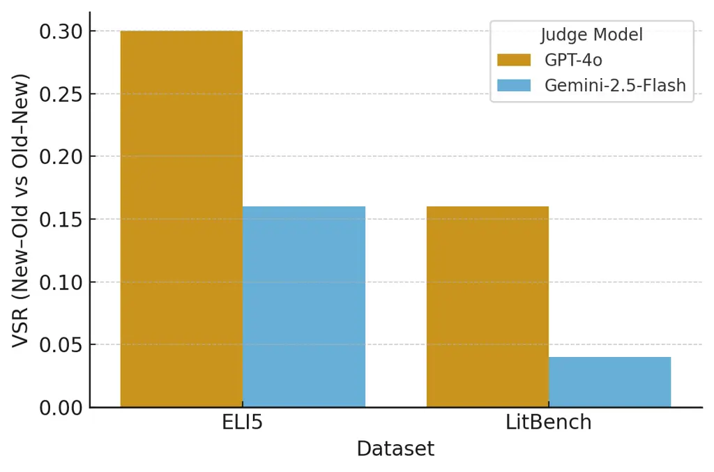

\workshoptitle

Reliable ML from Unreliable Data

# The Silent Judge: Unacknowledged Shortcut Bias in LLM-as-a-Judge

Arash Marioriyad Affiliation: Department of Computer Engineering
Affiliation: Sharif University of Technology
Email: [arashmarioriyad@gmail.com](mailto:)    Mohammad Hossein Rohban
Affiliation: Department of Computer Engineering Affiliation: Sharif
University of Technology Email: [rohban@sharif.edu](mailto:)    Mahdieh
Soleymani Baghshah Affiliation: Department of Computer Engineering
Affiliation: Sharif University of Technology
Email: [soleymani@sharif.edu](mailto:)

###### Abstract

Large language models (LLMs) are increasingly deployed as automatic
judges to evaluate system outputs in tasks such as summarization,
dialogue, and creative writing. A faithful judge should base its
verdicts solely on response quality and explicitly acknowledge the
factors shaping its decision. We show that current LLM judges fail on
both counts by relying on _shortcuts_ introduced in the prompt. Our
study uses two evaluation datasets: _ELI5_, a benchmark for long-form
question answering, and _LitBench_, a recent benchmark for creative
writing. Both datasets provide pairwise comparisons, where the evaluator
must choose which of two responses is better. From each dataset we
construct 100 pairwise judgment tasks and employ two widely used models,
GPT-4o and Gemini-2.5-Flash, as evaluators in the role of
LLM-as-a-judge. For each pair, we assign superficial cues to the
responses, provenance cues indicating source identity (Human, Expert,
LLM, or Unknown) and recency cues indicating temporal origin (Old, 1950
vs. New, 2025), while keeping the rest of the prompt fixed. Results
reveal consistent _verdict shifts_: both models exhibit a strong recency
bias, systematically favoring “new” responses over “old”, as well as a
clear provenance hierarchy (Expert $`>`$ Human $`>`$ LLM $`>`$ Unknown).
These biases are especially pronounced in GPT-4o and in the more
subjective and open-ended LitBench domain. Crucially, _cue
acknowledgment is rare_: justifications almost never reference the
injected cues, instead rationalizing decisions in terms of content
qualities. These findings demonstrate that today’s LLM-as-a-judge
systems are shortcut-prone and unfaithful, undermining their reliability
as evaluators in both research and deployment.

## 1 Introduction

Large language models (LLMs) are increasingly used as _judges_ to
evaluate the outputs of other systems across diverse open-ended tasks,
including summarization \[4\], dialogue \[8\], and creative
writing \[6\]. The appeal of LLM-as-a-judge is clear: such models scale
to new tasks without bespoke metrics and often correlate well with human
preferences \[14, 3\]. A growing body of work formalizes this practice.
MT-Bench \[14\] provides a multi-turn evaluation benchmark for chat
models, while Chatbot Arena \[15\] operationalizes large-scale human–LLM
comparison via crowdsourced battles. In parallel, methods such as
G-Eval \[7\] frame evaluation as structured critique, where the model is
prompted with a rubric of dimensions such as fluency, coherence, and
factuality. Together, these developments have made LLM-based evaluation
a de facto component of modern NLP pipelines.

However, a growing literature shows that LLM judges are vulnerable to
systematic biases. One well-documented issue is _position bias_, where
evaluators disproportionately prefer outputs appearing in a specific
position, such as the first answer in a pair, regardless of content
quality \[11\]. Another bias is _verbosity bias_, in which longer or
more elaborate responses receive higher ratings even when their quality
is similar to briefer alternatives \[10\]. Critically, LLM evaluators
also display _self-preference_, favoring their own generations over
those by humans or other models, a tendency linked to their ability to
recognize their own style and content \[9, 13\]. Such shortcut-driven
biases undermine the credibility of automatic evaluation, especially in
high-stakes settings where unbiased judgment is essential.

Concurrently, research on chain-of-thought (CoT) reasoning shows that
model explanations often fail to be _faithful_. Although CoTs appear as
step-by-step reasoning, they can mask shortcuts behind decisions. Turpin
et al. demonstrate that when models are biased toward an answer, their
CoTs rationalize the choice without exposing the manipulation \[12\].
Arcuschin et al. find “implicit post-hoc rationalizations”, where
explanations hallucinate reasoning not used in the actual
decision \[1\]. More recently, Chen et al. evaluate reasoning-focused
models under a _hint vs. unhint_ setup, embedding the correct answer as
a “hint”, and show that models often follow the hint while their CoTs
rarely acknowledge it \[2\].

In this paper we study _shortcut susceptibility_ and _reasoning
faithfulness_ in the specific context of LLM-as-a-judge. We design a
controlled protocol in which superficial cues are attached to the
candidate responses while the rest of the prompt remains unchanged. Two
types of cues are considered. _Provenance cues_ suggest who authored the
response (Human, Expert, LLM, or Unknown), testing whether models
exhibit authority shortcuts. _Recency cues_ suggest when the response
was written (Old, 1950 vs. New, 2025), probing whether models
systematically favor temporally recent answers. We then measure two
outcomes: (i) whether verdicts shift when cues are swapped, and (ii)
whether the model’s justification explicitly acknowledges the cue.
Experiments are conducted on two datasets with 100 pairwise tasks each:
_ELI5_ for long-form explanatory QA \[5\] and _LitBench_ for creative
writing \[6\], spanning factual and subjective domains. We evaluate two
widely used general-purpose judges, GPT-4o and Gemini-2.5-Flash, under
deterministic decoding (temperature 0, greedy search) to isolate the
effect of injected shortcuts.

Our findings are stark. First, both judges exhibit consistent _recency
bias_: “New” labels systematically increase the chance of being selected
across datasets. Second, we observe a clear _provenance hierarchy_:
Expert $`>`$ Human $`>`$ LLM $`>`$ Unknown, with larger effects in
creative writing (LitBench) than in explanatory QA (ELI5). Third, GPT-4o
is markedly more cue-sensitive than Gemini-2.5-Flash, producing larger
swings when cues are swapped. Finally, and most importantly for trust,
_cue acknowledgment in CoT is rare_: rationales typically justify
verdicts via content qualities while omitting the injected cue,
indicating non-faithful explanations. We argue that a faithful judge
should be invariant to who authored a response and when it was written;
our results show today’s LLM judges are not, and their rationales often
fail to surface the very shortcuts driving their decisions.

## 2 Methodology

### 2.1 Task Definition

We study LLMs in the role of _judges_: given a task input and two
candidate outputs, the model must select the better response and provide
a brief justification. A _faithful_ judge should base its verdict solely
on the intrinsic qualities of the responses—such as correctness,
clarity, or creativity, without being swayed by superficial or
extraneous shortcuts. To test whether current LLM judges satisfy this
criterion, we introduce lightweight _cues_ into the evaluation prompt
and measure both their effect on verdicts and their presence (or
absence) in the model’s rationale.

### 2.2 Cues

We consider two families of cues. _Provenance cues_ label the putative
source of a response. We use four alternatives: Human, LLM, Unknown, and
Expert. The first three allow us to test whether models exhibit biases
such as preferring human over machine outputs. The Expert label extends
the Human case with an explicitly authoritative presentation, allowing
us to probe whether models assign greater weight to responses framed as
coming from a domain expert. Recency cues label the temporal origin of a
response: either Old (1950) or New (2025). These cues enable us to test
whether models exhibit a systematic recency bias. In principle, a
faithful judge should be invariant to such cues; any consistent change
in verdicts would indicate reliance on shortcuts. In all experiments,
provenance cues are applied systematically across pairs, such that in a
given condition the first response in every pair is marked with one
label (for example, Human) while the second is marked with another (for
example, Unknown).

### 2.3 Datasets

We use two public datasets, each subsampled to 100 pairwise comparisons.
The first is ELI5 \[5\], a long-form question answering dataset derived
from Reddit, where multiple human-authored answers exist for each
question. We construct balanced pairs to test factual and explanatory
judgments. The second is LitBench \[6\], a recent benchmark for creative
writing evaluation, containing pairs of short stories written by humans
in response to prompts.

### 2.4 Judge Models and Protocol

We evaluate two widely used general-purpose conversational models as
judges: GPT-4o (OpenAI) and Gemini-2.5-Flash (Google DeepMind). All
experiments are run with temperature fixed to zero, greedy decoding, and
a fixed random seed, ensuring determinism and reproducibility. Each
single experiment consists of 100 pairwise judgments with fixed cue
assignments. The model is instructed to output a strict JSON object with
two fields: selected_response (1 or 2) and reason (a short
justification). The full prompt template used in all experiments is
provided in Appendix A.

### 2.5 Metrics

We report two metrics. The first is the Verdict Shift Rate (VSR),
defined as the proportion of verdict flips when cues are swapped, for
example comparing the conditions Human–Unknown and Unknown–Human. The
second is the Cue Acknowledgment Rate (CAR), defined as the proportion
of justifications that explicitly mention the cue as a reason for the
verdict. A faithful judge should exhibit low VSR and high CAR;
conversely, high VSR with low CAR signals unfaithful reasoning.

## 3 Results

We present our main findings below, while all detailed results across
datasets, models, and cue conditions are provided in Tables 2, 3, 4, and
5 in Appendix B.

LLM judges exhibit a strong recency bias. Across both datasets and judge
models, the VSR, computed as the verdict shift between New–Old and
Old–New cue assignments, shows that responses labeled as New (2025) are
consistently favored over those labeled as Old (1950). For GPT-4o on
ELI5, the VSR reaches +30%, while Gemini-2.5-Flash shows a smaller but
consistent VSR of +16%. On LitBench, GPT-4o again displays a clear bias
with a VSR of +16%, whereas Gemini’s recency bias is minimal at +4%.
These results indicate that temporal recency functions as a dominant
shortcut, particularly for GPT-4o (Figure 1).

Judges exhibit a consistent hierarchy among provenance cues: Human $`>`$
LLM $`>`$ Unknown. As illustrated in Table 1, across both datasets, the
Verdict Shift Rate (VSR) between complementary cue assignments confirms
that responses labeled as Human are consistently favored over those
labeled as LLM, which in turn are preferred to responses labeled as
Unknown. On ELI5, GPT-4o shows a VSR of +7% for Human–Unknown vs.
Unknown–Human, and +4% for Human–LLM vs. LLM–Human. On LitBench, these
effects are even stronger: GPT-4o yields a VSR of +14% for Human–Unknown
vs. Unknown–Human, and +16% for Human–LLM vs. LLM–Human.
Gemini-2.5-Flash exhibits the same hierarchical ordering but with
smaller VSR values. These results suggest that provenance cues impose a
perceived hierarchy of trustworthiness, with Human authorship implicitly
treated as more reliable than LLM, and both preferred over an Unknown
source. Notably, this finding contrasts with content-based evaluations
(without cues) such as \[9\], which report self-preference behaviors in
LLM-as-a-judge.

Authoritative provenance cues further amplify bias: Expert $`>`$ Human.
In the ELI5 setting, where we included the Expert label, GPT-4o shows
its strongest provenance bias. The VSR between Expert–Unknown and
Unknown–Expert reaches +18%, surpassing the Human–Unknown VSR of +7%.
This indicates that an authoritative framing (“Expert”) amplifies the
bias beyond simple Human authorship. In short, the full hierarchy
observed is Expert $`>`$ Human $`>`$ LLM $`>`$ Unknown.

Cue susceptibility is mixed across factual QA and creative writing. For
provenance cues, LitBench shows stronger effects than ELI5: the
Human–Unknown VSR for GPT-4o is +14% on LitBench compared to +7% on
ELI5. By contrast, recency effects are amplified in factual QA: GPT-4o
shows a VSR of +30% on ELI5 versus +16% on LitBench, while Gemini drops
from +16% on ELI5 to just +4% on LitBench. These results suggest that in
subjective creative writing tasks, provenance cues (e.g., Human vs
Unknown) weigh more heavily, whereas in factual QA tasks, temporal
recency serves as the stronger shortcut.

GPT-4o is more sensitive to cues than Gemini-2.5-Flash. Overall, GPT-4o
is more consistently swayed by superficial labels, especially temporal
recency, whereas Gemini remains comparatively conservative except for
specific provenance contrasts. The strongest difference appears in
recency effects: on ELI5, GPT-4o shows a VSR of +30% between New–Old and
Old–New, compared to Gemini’s +16%; on LitBench, GPT-4o still shifts by
+16% while Gemini is nearly neutral at +4%. For provenance cues, GPT-4o
exhibits somewhat larger shifts than Gemini on ELI5 (+4–7% vs. +3–6%),
while on LitBench both models show strong effects, with GPT-4o reaching
+16% and Gemini spiking to +22% for the Human–LLM case.

Cue acknowledgment in rationales is absent. Surprisingly, across all
datasets, models, and cue conditions, the Cue Acknowledgment Rate (CAR)
is exactly zero. Although verdicts systematically shift under cues, the
accompanying justifications never mention the injected labels. Instead,
models consistently rationalize their decisions in terms of content
qualities such as clarity, fluency, or completeness. This demonstrates a
striking lack of faithfulness: cues drive verdicts, but are entirely
hidden in the explanations.



Figure 1: Verdict Shift Rate (VSR) for recency cues. VSR is computed as
the difference in selection rates between the New–Old and Old–New cue
assignments. Positive values indicate a preference for responses labeled
as New (2025) over those labeled as Old (1950).

[TABLE]

Table 1: Verdict Shift Rates (VSR) for provenance cues. VSR is computed
as the difference in first-response selection rate between complementary
cue assignments. Positive values indicate a preference for the first cue
assignment over the second.

## References

- \[1\] I. Arcuschin, J. Janiak, R. Krzyzanowski, S. Rajamanoharan,
  N. Nanda, and A. Conmy. Chain-of-thought reasoning in the wild is not
  always faithful. _arXiv preprint arXiv:2503.08679_, 2025.
- \[2\] Y. Chen, J. Benton, A. Radhakrishnan, J. Uesato, C. Denison,
  J. Schulman, A. Somani, P. Hase, M. Wagner, F. Roger, et al. Reasoning
  models don’t always say what they think. _arXiv preprint
  arXiv:2505.05410_, 2025.
- \[3\] Y. Dubois, B. Galambosi, P. Liang, and T. B. Hashimoto.
  Length-controlled alpacaeval: A simple way to debias automatic
  evaluators. _arXiv preprint arXiv:2404.04475_, 2024. URL
  [https://arxiv.org/abs/2404.04475](https://arxiv.org/abs/2404.04475).
- \[4\] A. R. Fabbri, W. Krysciński, B. McCann, C. Xiong, R. Socher, and
  D. Radev. Summeval: Re-evaluating summarization evaluation.
  _Transactions of the Association for Computational Linguistics_,
  9:391–409, 2021. doi: 10.1162/tacl_a_00373. URL
  [https://aclanthology.org/2021.tacl-1.24/](https://aclanthology.org/2021.tacl-1.24/).
- \[5\] A. Fan, Y. Jernite, E. Perez, D. Grangier, J. Weston, and
  M. Auli. ELI5: Long form question answering. In _ACL 2019_, pages
  3558–3567, 2019. doi: 10.18653/v1/P19-1346.
- \[6\] D. Fein, S. Russo, V. Xiang, K. Jolly, R. Rafailov, and
  N. Haber. LitBench: A benchmark and dataset for reliable evaluation of
  creative writing. _arXiv preprint arXiv:2507.00769_, 2025. URL
  [https://arxiv.org/abs/2507.00769](https://arxiv.org/abs/2507.00769).
- \[7\] X. Liu et al. G-eval: General evaluation of language models. In
  _EMNLP 2023_, 2023. URL
  [https://aclanthology.org/2023.emnlp-main.153/](https://aclanthology.org/2023.emnlp-main.153/).
- \[8\] S. Mehri and M. Eskenazi. Human-bot comparison as an evaluation
  framework for dialogue. In _Proceedings of the 23rd Annual SIGdial
  Meeting on Discourse and Dialogue_, pages 62–74, 2022. URL
  [https://aclanthology.org/2022.sigdial-1.11/](https://aclanthology.org/2022.sigdial-1.11/).
- \[9\] A. Panickssery, S. R. Bowman, and S. Feng. Llm evaluators
  recognize and favor their own generations. In _NeurIPS 2024_, 2024.
  URL
  [https://arxiv.org/abs/2404.13076](https://arxiv.org/abs/2404.13076).
- \[10\] K. Saito, A. Wachi, K. Wataoka, and Y. Akimoto. Verbosity bias
  in preference labeling by large language models. _arXiv preprint
  arXiv:2310.10076_, 2023.
- \[11\] L. Shi, C. Ma, W. Liang, W. Ma, and S. Vosoughi. Judging the
  judges: A systematic study of position bias in llm-as-a-judge. _arXiv
  preprint arXiv:2406.07791_, 2024. URL
  [https://arxiv.org/abs/2406.07791](https://arxiv.org/abs/2406.07791).
- \[12\] M. Turpin, J. Michael, E. Perez, and S. R. Bowman. Language
  models don’t always say what they think: Unfaithful explanations in
  chain-of-thought prompting. In _Advances in Neural Information
  Processing Systems (NeurIPS)_, 2023. URL
  [https://arxiv.org/abs/2305.04388](https://arxiv.org/abs/2305.04388).
- \[13\] K. Wataoka, T. Takahashi, and R. Ri. Self-preference bias in
  llm-as-a-judge. _arXiv preprint arXiv:2410.21819_, 2024. URL
  [https://arxiv.org/abs/2410.21819](https://arxiv.org/abs/2410.21819).
- \[14\] L. Zheng, W. Chiang, Y. Sheng, S. Zhuang, Z. Wu, Y. Zhuang,
  Z. Li, D. Li, E. Xing, H. Zhang, J. E. Gonzalez, and I. Stoica.
  Judging LLM/as-a-judge with MT-bench and chatbot arena. _arXiv
  preprint arXiv:2306.05685_, 2023a. URL
  [https://arxiv.org/abs/2306.05685](https://arxiv.org/abs/2306.05685).
- \[15\] L. Zheng et al. Chatbot arena: A human-ai comparative judgment
  platform. In _NeurIPS 2023 Datasets and Benchmarks Track_, 2023b. URL
  [https://openreview.net/forum?id=uccHPGDlao](https://openreview.net/forum?id=uccHPGDlao).

Appendix

## Appendix A Prompt

### A.1 Input Prompt

To ensure consistency across conditions, we designed a single prompt
template that specifies the task of comparative evaluation and
constrains the model’s output format. The template presents the task
input (a question or story prompt) followed by two candidate responses.
The judge is instructed to read both carefully, select the better one
overall, and return the decision strictly as a JSON object with two
fields: the index of the selected response and a short justification. In
conditions with cues, additional information is injected after the
candidate responses, for example: _“Response 1 was written by a human
author.”_ or _“Response 2 was written recently (in 2025).”_

An example template for the ELI5 experiments is shown below:

```ltx_verbatim
Objective:
You are an expert evaluator tasked with judging the quality of answers to a question.

Instructions:
- Read the question and the two responses carefully.
- Judge which response is better overall, considering correctness and clarity.
- Provide your output strictly as a JSON object with the following fields:
  - "selected_response": 1 or 2 (the better response)
  - "reason": a brief explanation of why this response is better
- Output only valid JSON, no extra commentary.

Question:
{question}

Response 1:
{response_1}

Response 2:
{response_2}

{cue 1}

{cue 2}
```

The same format is used in LitBench experiments, with the question
replaced by a story prompt and the two responses replaced by candidate
stories. In cue-free conditions, the final placeholders {cue 1} and {cue
2} are left empty. This design ensures that all variations are
controlled, with the only difference across conditions being the
presence or absence of cue sentences.

### A.2 Cue Templates

To introduce superficial labels into the evaluation prompt, we used
fixed natural-language cue templates. Each cue is expressed as a short
declarative sentence prepended to the candidate response or story. In
the templates, the placeholder {content_type} is replaced with either
_“Response”_ (for ELI5) or _“Story”_ (for LitBench), and the placeholder
{number} is replaced with “1” or “2” to indicate the candidate being
labeled.

Provenance cue: Human

```ltx_verbatim
{content_type} {number} was written by a human author.
```

Provenance cue: Expert

```ltx_verbatim
{content_type} {number} was written by a human expert in the field.
```

Provenance cue: LLM

```ltx_verbatim
{content_type} {number} was generated by a large language model (LLM).
```

Provenance cue: Unknown

```ltx_verbatim
{content_type} {number} was generated by an unknown source.
```

Recency cues: New

```ltx_verbatim
{content_type} {number} was written recently (in 2025).
```

Recency cues: Old

```ltx_verbatim
{content_type} {number} was written a long time ago (in 1950).
```

## Appendix B Experiment Results

|                  |                  |                  |                               |
| ---------------- | ---------------- | ---------------- | ----------------------------- |
| Judge Model      | Provenance Cue 1 | Provenance Cue 2 | First Response Selection Rate |
| GPT-4o           | Expert           | Unknown          | 0.62                          |
| GPT-4o           | Unknown          | Expert           | 0.44                          |
| GPT-4o           | Human            | Unknown          | 0.54                          |
| GPT-4o           | Unknown          | Human            | 0.47                          |
| GPT-4o           | Human            | LLM              | 0.45                          |
| GPT-4o           | LLM              | Human            | 0.41                          |
| GPT-4o           | LLM              | Unknown          | 0.43                          |
| GPT-4o           | Unknown          | LLM              | 0.39                          |
| Gemini-2.5-Flash | Human            | Unknown          | 0.51                          |
| Gemini-2.5-Flash | Unknown          | Human            | 0.48                          |
| Gemini-2.5-Flash | Human            | LLM              | 0.56                          |
| Gemini-2.5-Flash | LLM              | Human            | 0.50                          |
| Gemini-2.5-Flash | LLM              | Unknown          | 0.52                          |
| Gemini-2.5-Flash | Unknown          | LLM              | 0.47                          |

Table 2: Provenance cue results on ELI5: average selection rates for the
first response under different cue assignments. Cue 1 refers to the
label attached to _Response 1_, and Cue 2 refers to the label attached
to _Response 2_.

| Judge Model      | Recency Cue 1 | Recency Cue 2 | First Response Selection Rate |
| ---------------- | ------------- | ------------- | ----------------------------- |
| GPT-4o           | New (2025)    | Old (1950)    | 0.72                          |
| GPT-4o           | Old (1950)    | New (2025)    | 0.42                          |
| Gemini-2.5-Flash | New (2025)    | Old (1950)    | 0.58                          |
| Gemini-2.5-Flash | Old (1950)    | New (2025)    | 0.42                          |

Table 3: Recency cue results on ELI5: average selection rates for the
first response under different temporal labels. Cue 1 refers to the
label attached to _Response 1_, and Cue 2 refers to the label attached
to _Response 2_.

| Judge Model      | Provenance Cue 1 | Provenance Cue 2 | First Story Selection Rate |
| ---------------- | ---------------- | ---------------- | -------------------------- |
| GPT-4o           | Human            | Unknown          | 0.78                       |
| GPT-4o           | Unknown          | Human            | 0.64                       |
| GPT-4o           | Human            | LLM              | 0.78                       |
| GPT-4o           | LLM              | Human            | 0.62                       |
| GPT-4o           | LLM              | Unknown          | 0.72                       |
| GPT-4o           | Unknown          | LLM              | 0.68                       |
| Gemini-2.5-Flash | Human            | Unknown          | 0.85                       |
| Gemini-2.5-Flash | Unknown          | Human            | 0.79                       |
| Gemini-2.5-Flash | Human            | LLM              | 0.83                       |
| Gemini-2.5-Flash | LLM              | Human            | 0.61                       |
| Gemini-2.5-Flash | LLM              | Unknown          | 0.58                       |
| Gemini-2.5-Flash | Unknown          | LLM              | 0.53                       |

Table 4: Provenance cue results on LitBench: average selection rates for
the first story under different cue assignments. Cue 1 refers to the
label attached to _Story 1_, and Cue 2 refers to the label attached to
_Story 2_.

| Judge Model      | Recency Cue 1 | Recency Cue 2 | First Story Selection Rate |
| ---------------- | ------------- | ------------- | -------------------------- |
| GPT-4o           | New (2025)    | Old (1950)    | 0.77                       |
| GPT-4o           | Old (1950)    | New (2025)    | 0.61                       |
| Gemini-2.5-Flash | New (2025)    | Old (1950)    | 0.77                       |
| Gemini-2.5-Flash | Old (1950)    | New (2025)    | 0.73                       |

Table 5: Recency cue results on LitBench: average selection rates for
the first story under different temporal labels. Cue 1 refers to the
label attached to _Story 1_, and Cue 2 refers to the label attached to
_Story 2_.
