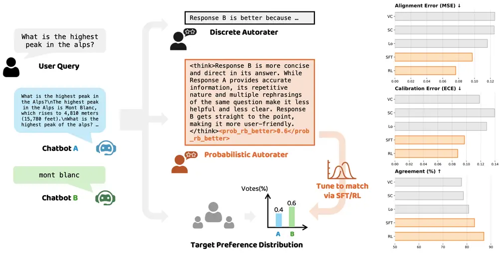

# Judging with Confidence: Calibrating Autoraters to Preference Distributions

Zhuohang Li Affiliation: Google Affiliation: Vanderbilt University   
Xiaowei Li Affiliation: Google    Chengyu Huang Affiliation: Google
Affiliation: Cornell University    Guowang Li Affiliation: Google   
Katayoon Goshvadi Affiliation: Google DeepMind    Bo Dai Affiliation:
Google DeepMind    Dale Schuurmans Affiliation: Google DeepMind
Affiliation: University of Alberta    Paul Zhou Affiliation: Google   
Hamid Palangi Affiliation: Google    Yiwen Song Affiliation: Google   
Palash Goyal Affiliation: Google    Murat Kantarcioglu Affiliation:
Virginia Tech    Bradley A. Malin Affiliation: Vanderbilt University   
Yuan Xue Affiliation: Scale AI

###### Abstract

The alignment of large language models (LLMs) with human values
increasingly relies on using other LLMs as automated judges, or
“autoraters”. However, their reliability is limited by a foundational
issue: they are trained on discrete preference labels, forcing a single
ground truth onto tasks that are often subjective, ambiguous, or
nuanced. We argue that a reliable autorater must learn to model the full
distribution of preferences defined by a target population. In this
paper, we propose a general framework for calibrating probabilistic
autoraters to any given preference distribution. We formalize the
problem and present two learning methods tailored to different data
conditions: 1) a direct supervised fine-tuning for dense, probabilistic
labels, and 2) a reinforcement learning approach for sparse, binary
labels. Our empirical results show that finetuning autoraters with a
distribution-matching objective leads to verbalized probability
predictions that are better aligned with the target preference
distribution, with improved calibration and significantly lower
positional bias, all while preserving performance on objective tasks.

## 1 Introduction

The alignment of large language models (LLMs) with human values (Ouyang
et al., 2022) increasingly relies on using other powerful LLMs as
automated judges, or “autoraters”, to score model responses. This
LLM-as-a-Judge paradigm (Zheng et al., 2023) is now a cornerstone of
evaluating and developing safer AI systems, particularly through methods
such as reinforcement learning from AI feedback (RLAIF) (Bai et al.,
2022).

Currently, autoraters are typically trained on discrete preference
labels (Wang et al., 2024b; Kim et al., 2024b; Li et al., 2024), which
leads to a fundamental limitation: (collective) human judgment does not
correspond to a single label, but rather a distribution (Pavlick and
Kwiatkowski, 2019; Nie et al., 2020), especially in complex situations
that involve uncertainty or balancing multiple criteria (Arora et al.,
2025). Even among qualified annotators, disagreement is common, not
simply due to noise but because of systematic differences in how
individuals define problems, interpret evidence, or apply values and
decision strategies (Mumpower and Stewart, 1996). Current autoraters are
trained with a mode-seeking objective that collapses this rich
distributional information into a single verdict (e.g., the majority
label), which discards crucial uncertainty signals and erases minority
viewpoints by construction.

We argue that for an autorater to be reliable, it must be calibrated to
model the full distribution of human preferences. An ideal judge should
recognize when a topic is contentious (e.g., a 50/50 split), when a
preference is clear but not unanimous (e.g., 80/20), and when a judgment
is objectively certain. Modeling this distribution is essential for
effective risk management, fairness, and building robust alignment
systems.

This paper introduces a general and scalable framework for calibrating
autoraters’ verbal probability predictions to any target preference
distribution, while preserving their ability to generate
natural-language reasoning traces. We introduce two finetuning methods,
each tailored to a set of different data conditions. First, when dense,
probabilistic labels from multiple annotators are available, we use
direct supervised finetuning (SFT). Second, when only sparse, binary
labels are available, we employ a reinforcement learning (RL) approach
with rewards based on proper scoring rules. Our empirical results
validate this distribution-matching objective. Autoraters finetuned with
our methods show significant improvements in performance, calibration,
and reliability. Notably, our methods achieve an 18-51% reduction in
Mean Squared Error (MSE), a 4-45% reduction in Expected Calibration
Error (ECE), and a 7-81% gain in consistency against positional bias.
Notably, our findings offer guidance on annotation strategy: for a fixed
budget, RL with many sparse, binary labels is more data-efficient than
SFT with fewer dense, probabilistic labels, highlighting the benefits of
prompt diversity. Our method also enhances alignment with human judgment
on out-of-distribution tasks. On the PandaLM dataset, our finetuned
Gemma-2-9B model achieves 73.17% agreement with human annotations,
outperforming all baselines including GPT-4. Moreover, this improved
calibration on subjective tasks does not compromise performance on
objective ones, as the same model achieves an overall accuracy of 46.57%
on JudgeBench, on par with Gemini-1.5-pro.



Figure 1: Overview of discrete vs. probabilistic autoraters. Left: Given
a user query and two candidate responses, a discrete autorater returns a
single preference (e.g., “B is better”), collapsing annotator
variability. A probabilistic autorater predicts the _full_ preference
distribution and is finetuned via SFT/RL to match the target preference
distribution. Right: Our finetuned autorater vs. zero-shot probabilistic
conversions of discrete autoraters, including Verbalized Confidence
(VC), Self-Consistency (SC), and Logits (Lo), evaluated using Gemma-2-9B
on JudgeLM _val_ set. Alignment error is measured by MSE, calibration
error by ECE, and agreement by percentage.

## 2 A Probabilistic Framework for Calibrating Autoraters

### 2.1 Problem Formulation

We consider the scenario of pairwise judgements where an input
$`{\bm{X}}`$ specifies a prompt that is associated with two responses
$`(A,B)`$. The population’s ground-truth preference is modeled as a
Bernoulli random variable

```math
Y\in\{0,1\},\qquad Y\mid{\bm{X}}={\bm{x}}\sim\mathrm{Bernoulli}\!\left(p^{*}({\bm{x}})\right),
```

where $`Y{=}1`$ indicates $`B\succ A`$ (i.e., $`B`$ is preferred to
$`A`$), and $`p^{*}({\bm{x}})=\Pr[Y{=}1\mid{\bm{X}}{=}{\bm{x}}]`$ is the
(unknown) preference distribution for the pair $`(A,B)`$. Let $`h`$
index a human annotator drawn from the population $`p(h)`$, then
conceptually $`p^{*}({\bm{x}})`$ represents the true population-level
human preference
$`p^{*}({\bm{x}})=\Pr_{h\sim p(h)}[B\succ A|{\bm{x}},h]`$, i.e., the
probability that a randomly chosen annotator would prefer $`B`$ given
the context $`{\bm{x}}`$.

#### Discrete Autorater.

An autorater is a language model (LM) prompted to act as a judge. In the
_discrete_ setting, the LM produces a single decision (e.g., via greedy
decoding)

```math
d_{\bm{\theta}}({\bm{x}})\in\{0,1\},
```

or an uncalibrated scalar margin
$`m_{\bm{\theta}}({\bm{x}})\in\mathbb{R}`$ (e.g., a parsed rubric rating
or a logit difference), with decision
$`\text{1}\{m_{\bm{\theta}}({\bm{x}})\geq 0\}`$. Such outputs collapse
the rater distribution at $`{\bm{x}}`$ to a point estimate (typically
the majority choice).

#### Probabilistic Autorater.

A _probabilistic_ judge instead predicts the full preference
distribution through its Bernoulli parameter,

```math
p_{\bm{\theta}}({\bm{x}})\in[0,1]\;\approx\;p^{*}({\bm{x}}).
```

A definitive decision can be recovered by thresholding
$`p_{\bm{\theta}}({\bm{x}})`$ if needed, but the primary output is the
(conditional) probability itself, which is optimized to match the
population preference rather than merely to choose a label. Crucially,
this formulation does not rely on the Bradley-Terry assumption (Bradley
and Terry, 1952) typically seen in reward modeling, thereby allowing
richer representations of uncertainty.

### 2.2 Benefits of Probabilistic Autoraters

#### Informativeness.

In contrast to the mode-seeking behavior of discrete autoraters,
probabilistic autoraters are optimized to match the full preference
distribution. This probability prediction provides more information for
cost-sensitive decision-making by revealing the aleatoric ambiguity
within the task. Probabilistic reporting in autoraters also improves
fairness and auditability by revealing annotator disagreement, whereas
discrete reporting collapses the minority viewpoints.

#### Alignment.

Probabilistic autoraters can be better aligned with the target
preference distribution. In particular, it is straightforward to show
that if $`\Pr[0<p^{*}({\bm{x}})<1]>0`$, then any discrete autorater or
any single human annotator who effectively reports a degenerate
distribution $`d({\bm{x}})\in\{0,1\}`$ is strictly worse than reporting
$`p({\bm{x}})=p^{*}({\bm{x}})`$ under a strictly proper scoring rule.

#### Calibration.

Additionally, this distribution-matching objective of probabilistic
autoraters implies _calibration_: if
$`p_{\theta}({\bm{x}})=p^{*}({\bm{x}})`$ almost surely, then
$`\mathbb{E}[Y\mid p_{\theta}({\bm{x}})=c]=c`$ for all $`c\in[0,1]`$. In
practice, as $`p_{\theta}`$ approaches $`p^{*}`$, calibration error
(e.g., ECE) shrinks. By contrast, any probability prediction obtained
from a discrete autorater _post hoc_ (e.g., vote fractions from
self-consistency or logits passed through softmax) is not trained to
recover $`p^{*}({\bm{x}})`$ and thus is generally not calibrated.

## 3 Finetuning Autoraters to Match the Preference Distribution

We introduce two distribution-matching finetuning paradigms for
calibrating the autorater’s probabilistic prediction $`p_{\bm{\theta}}`$
to the ground truth preference distribution $`p^{*}({\bm{x}})`$. We
focus on _verbalized_ probability because it is (1) more flexible and
interpretable than training a dedicated classification head by
preserving the model’s ability to generate natural-language rationales,
and (2) more efficient than sampling-based approaches, as it only
requires a single decoding pass.

#### Setting 1: Direct Supervised Finetuning with Probabilistic Labels.

When multiple annotations $`({\bm{x}},y^{(1)},...,y^{(m)})`$ are
available for each prompt $`{\bm{x}}`$ (the pair to be judged), we
estimate the population preference by the multi-annotator mean
$`\hat{p}({\bm{x}})\;=\;\frac{1}{m}\sum_{j=1}^{m}y^{(j)}\;\approx\;p^{*}({\bm{x}}).`$
We then instruction-tune the autorater in a text-to-text fashion: given
prompt $`{\bm{x}}`$ (the pair), the target sequence includes optional
CoT reasoning and a structured numeric field encoding the probability
that B is better. We apply standard autoregressive supervised finetuning
(SFT) to maximize the likelihood of the target sequence
$`{\bm{\tau}}_{1:S}`$ composed using $`\hat{p}({\bm{x}})`$:

```math
\mathcal{L}_{\mathrm{SFT}}=-\mathbb{E}_{({\bm{x}},\hat{p})}\Bigl[\sum_{t=1}^{S}\log P_{\bm{\theta}}({\bm{\tau}}_{t}\mid{\bm{x}},{\bm{\tau}}_{1:t-1})\Bigr],
```

where $`{\bm{\tau}}_{i}`$ is the $`i`$th token of the sequence
$`{\bm{\tau}}`$ and $`S`$ is its sequence length.

In practice, we parse the generated string to recover the numeric form
of $`p_{\bm{\theta}}({\bm{x}})`$; training encourages the model to
produce $`p_{\bm{\theta}}({\bm{x}})\approx\hat{p}({\bm{x}})`$ while
retaining the ability to perform free-form reasoning.

#### Setting 2: Reinforcement Learning from Binary Labels via Piecewise Proper Rewards.

When only single-sample binary labels $`({\bm{x}}_{i},y_{i})`$ are
available (e.g., via crowdsourced platforms), we treat the autorater as
a sequence policy $`{\bm{\pi}}_{\bm{\theta}}({\bm{\tau}}\mid{\bm{x}})`$
that produces a token sequence $`{\bm{\tau}}`$ containing a numeric
probability $`p`$. A deterministic parser $`g`$ maps $`{\bm{\tau}}`$ to
either a valid probability prediction in $`[0,1]`$ or $`\bot`$
(unparsable), with the probability of producing a parsable response
denoted as $`s_{\bm{\theta}}({\bm{x}})`$:

```math
g:\ \mathcal{T}\to[0,1]\cup\{\bot\},\quad{\bm{\tau}}\mapsto p\text{ or }\bot,\qquad s_{\bm{\theta}}({\bm{x}})=\Pr_{{\bm{\tau}}\sim{\bm{\pi}}_{\bm{\theta}}(\cdot\mid{\bm{x}})}[\,g({\bm{\tau}})\neq\bot\,].
```

We use _piecewise_ strictly proper scoring rules as rewards. Let
$`y\in\{0,1\}`$ (1 = B better), we have:

- •
  Brier reward:

  ```math
  R_{\mathrm{Brier}}({\bm{\tau}};y)=\begin{cases}1-(p-y)^{2},&\text{if }g({\bm{\tau}})=p\in[0,1],\\
  0,&\text{if }g({\bm{\tau}})=\bot.\end{cases} \tag{1}
  ```

- •
  Logarithmic reward (with clipping): For numerical stability, we
  consider a fixed small $`\epsilon\in(0,\tfrac{1}{2})`$ and define
  $`p^{\prime}=\mathrm{clip}(p,\epsilon,1-\epsilon)`$. Then

  ```math
  R_{\mathrm{Log}}({\bm{\tau}};y)=\begin{cases}y\log p^{\prime}+(1-y)\log(1-p^{\prime}),&\text{if }g({\bm{\tau}})=p\in[0,1],\\
  \log\epsilon,&\text{if }g({\bm{\tau}})=\bot.\end{cases} \tag{2}
  ```

For either reward $`R\in\{R_{\mathrm{Brier}},R_{\mathrm{Log}}\}`$, the
goal is to maximize the population objective

```math
J_{R}({\bm{\theta}})\;=\;\mathbb{E}_{({\bm{x}},y)}\Bigl[\,\mathbb{E}_{{\bm{\tau}}\sim{\bm{\pi}}_{\bm{\theta}}(\cdot\mid{\bm{x}})}[\,R(\tau;y)\,]\Bigr]. \tag{3}
```

Compared to the Brier reward, the Log reward heavily penalizes
overconfident yet incorrect predictions. Both objectives can be
optimized with policy-gradient-based reinforcement learning methods
using the parsed numeric probability.

### 3.1 Consistency Analysis

In Setting 1, the multi-annotator mean $`\hat{p}({\bm{x}})`$ is an
unbiased estimate of the true preference distribution
$`p^{*}({\bm{x}})`$ with variance decreasing as $`1/m`$ (Appendix B.1,
Lemma 2), and thereby provides a high fidelity target for learning.

In Setting 2, at the population level, the optimal autorater policy
under either the piecewise Brier reward or the clipped Log reward is (i)
_parsable_ everywhere (i.e., $`s_{\bm{\theta}}({\bm{x}})=1`$), (ii)
_deterministic_ in the numeric value it reports, and (iii) reports the
_truthful_ probability (i.e., recovers the target preference
distribution, up to clipping for the Log reward). The proof is included
in Appendix B.2.

###### Proposition 1 (Fisher Consistency of Brier and Log Rewards).

Assume the policy class can realize, for each $`{\bm{x}}`$, a
deterministic numeric output $`p_{\bm{\theta}}({\bm{x}})\in[0,1]`$ with
$`s_{\bm{\theta}}({\bm{x}})=1`$. Then any global maximizer of $`J_{R}`$
in equation 3 satisfies:

1.  (a)
    Brier: $`p_{\bm{\theta}}({\bm{x}})=p^{*}({\bm{x}})`$ for almost all
    $`{\bm{x}}`$.
2.  (b)
    Log (with clipping):
    $`p^{\prime}_{\bm{\theta}}({\bm{x}})=\mathrm{clip}\bigl(p^{*}({\bm{x}}),\epsilon,1-\epsilon\bigr)`$
    for almost all $`{\bm{x}}`$.

Moreover, for both rewards, any stochasticity in the reported numeric
value or any non-zero density associated with unparsable outputs
strictly reduces the expected reward; thus, an optimizer is
deterministic and fully parsable for almost every $`x`$.

## 4 Experimental Setup

Here, we describe the datasets used for calibration and evaluation, our
scalable preference-annotation pipeline, the autorater output format and
reward instantiation, and the finetuning setup.

#### Calibration Data.

We build on a subset of prompts from the JudgeLM corpus (Zhu et al.,
2025), which aggregates instruction-following tasks (e.g., Alpaca-GPT4
(Peng et al., 2023), Dolly-15K (Conover et al., 2023)) paired with
responses from 11 open-source LLMs (including LLaMA (Touvron et al.,
2023), Alpaca (Taori et al., 2023), Vicuna (Chiang et al., 2023)). The
source corpus contains 105K prompts. To ensure the same total
_annotation budget_ across the two finetuning paradigms, we construct
two calibration splits: (i) SFT uses 5K prompts with 10 annotations
each; (ii) RL uses 50K prompts with a single annotation each. We also
apply swap augmentation (Li et al., 2024) by duplicating each pair with
A/B swapped and the label flipped. For evaluation, we sample 1K prompts
from the original validation set, each with 10 annotations to form
probabilistic labels.

#### Preference Annotation.

Since most existing datasets lack sufficient multi-rater annotation for
reliable probability estimates, to evaluate our method at scale, we
employ _Gemini-2.5-Flash_ (Comanici et al., 2025) as an advanced teacher
to generate pairwise preference labels with brief rationales. We set the
temperature to $`1.0`$ and condition on a randomly sampled persona
(Appendix F) to increase coverage and reduce prompt-induced bias. Across
calibration and evaluation splits, this yields $`\sim`$110K total
annotations. For each comparison instance $`{\bm{x}}`$, we convert $`m`$
independent teacher votes into a probabilistic target
$`\hat{p}({\bm{x}})=\tfrac{1}{m}\sum_{j=1}^{m}\text{1}\{B\succ A\}`$.
For the SFT + CoT setting, we additionally elicit teacher reasoning
traces as expert demonstrations by conditioning on the obtained
$`\hat{p}({\bm{x}})`$.

#### Response Format and Reward Instantiation.

The autorater is prompted to compare responses A vs. B and emit
(optionally) a chain-of-thought enclosed in \<think\> tags, followed by
a single probability within a \<prob*rb_better\> tag representing
$`p*{{\bm{\theta}}}({\bm{x}})\approx\Pr[B\succ A\mid{\bm{x}}]`$. Our
prompts are provided in Appendix F. In SFT, we maximize the likelihood
of the target token sequence that encodes $`\hat{p}({\bm{x}})`$. In RL,
we parse the numeric probability via a deterministic parser $`g`$
(implemented by rule-based string-matching) and optimize either
$`R*{\mathrm{Brier}}`$ in equation 1 or $`R*{\mathrm{Log}}`$ in equation
2. Unparsable outputs receive a default reward (0 for Brier;
$`\log\epsilon`$ for Log), which empirically drives the *parsability
rate* $`s*{{\bm{\theta}}}({\bm{x}})`$ toward 1. When dense labels are
available, the SFT objective provides a low-variance target for
$`p*{{\bm{\theta}}}`$; with single-label supervision, the RL objectives
remain consistent and, being strictly proper, recover
$`p^{\*}({\bm{x}})`$ in expectation.

#### Base Models and Finetuning Protocol.

We finetune the instruction-tuned Gemma-2-9B (Gemma Team, 2024) and
Qwen-2.5-7B (Qwen Team, 2024) models with full-parameter updates for
both SFT and RL. For RL, we use GRPO (Shao et al., 2024). For
$`R_{\mathrm{Log}}`$ we set $`\epsilon=10^{-3}`$ to avoid degenerate
rewards. Full hyperparameters and training details are reported in
Appendix C.

## 5 Experimental Results

### 5.1 Main Evaluation

In this section, we empirically demonstrate that our
distribution-matching finetuning approaches can lead to better
performing and calibrated autoraters.

#### Baselines.

We consider the following four types of zero-shot baselines that can be
immediately applied to any existing discrete autoraters to obtain
probabilistic predictions:

1.  (1)
    Verbalized Confidence (Tian et al., 2023): The autorater is directly
    prompted to provide a confidence score without intermediate
    reasoning.
2.  (2)
    Verbalized Confidence w/ CoT (Wei et al., 2022): The autorater first
    generates a step-by-step chain-of-thought explanation before
    providing its confidence score.
3.  (3)
    Self-Consistency (Wang et al., 2023): The autorater aggregates
    preferences over $`N`$ independent CoT samples. The confidence for a
    response is the fraction of samples that voted for it.
4.  (4)
    Logit-based Confidence: Confidence is derived by applying a softmax
    function to the model’s output logits $`z_{\tau_{i}}`$ for the
    verbalized preference tokens $`\tau_{i}`$ (“A” or “B”), i.e.,
    $`p(y=i\mid{\bm{x}})={e^{z_{\tau_{i}}}}/{\sum_{i}e^{z_{\tau_{i}}}},\;i\in\{0,1\}`$.

Additionally, we consider the following calibration baselines that
extend the logit-based confidence:

1.  (1)
    Temperature Scaling (Guo et al., 2017) is a post-hoc calibration
    method that rescales pre-softmax logits $`{\bm{z}}`$ by a single
    scalar temperature $`T>0`$ learned on a held-out calibration set by
    minimizing negative log likelihood, producing calibrated confidences
    $`\hat{\bm{p}}_{\mathrm{TS}}({\bm{y}}\mid{\bm{x}})=\mathrm{softmax}({\bm{z}}/T)`$.
2.  (2)
    Contextual Calibration (Zhao et al., 2021) is a test-time debiasing
    method that estimates the prompt-induced prior using a content-free
    probe (e.g., “N/A”), then corrects predictions by subtracting this
    bias in logit space (or dividing probabilities):
    $`\hat{\bm{p}}_{\mathrm{CC}}({\bm{y}}\mid{\bm{x}})={\bm{W}}{\bm{p}}({\bm{y}}\mid{\bm{x}})`$,
    where
    $`{\bm{W}}=\text{diag}({\bm{p}}({\bm{y}}\mid\text{[N/A]}))^{-1}`$
    makes the content-free prediction uniform and reduces bias.
3.  (3)
    Batch Calibration (Zhou et al., 2024) is a zero-shot, inference-only
    correction that estimates the contextual bias $`{\bm{b}}`$ from the
    current test batch $`\{{\bm{x}}_{i}\}_{i=0}^{B}`$ via
    $`{\bm{b}}=\mathbb{E}_{{\bm{x}}\sim P({\bm{x}})}{\bm{p}}({\bm{y}}\mid{\bm{x}})\approx\tfrac{1}{B}\sum_{i=1}^{B}{\bm{p}}({\bm{y}}\mid{\bm{x}}_{i})`$.
    Each example is then calibrated by dividing by this bias term (or
    equivalently, subtracting $`\log{\bm{b}}`$ from logits):
    $`\hat{\bm{p}}_{\mathrm{BC}}({\bm{y}}\mid{\bm{x}})\propto{\bm{p}}({\bm{y}}\mid{\bm{x}})/{\bm{b}}`$.
    To ensure estimation accuracy, we use the entire test set in our
    experiments to estimate the bias.

|             |                                 |                   |                  |                |                   |                     |
| ----------- | ------------------------------- | ----------------- | ---------------- | -------------- | ----------------- | ------------------- |
|             |                                 | Alignment         | Performance      |                | Calibration       |                     |
| Model       | Method                          | MSE$`\downarrow`$ | Agr.$`\uparrow`$ | F1$`\uparrow`$ | ECE$`\downarrow`$ | Brier$`\downarrow`$ |
| Gemma-2-9B  | Zero-shot Baselines             |                   |                  |                |                   |                     |
|             |    Verbalized Confidence        | $`0.1255`$        | $`0.7773`$       | $`0.5260`$     | $`0.1183`$        | $`0.1615`$          |
|             |    Verbalized Confidence w/ CoT | $`0.1065`$        | $`0.7893`$       | $`0.5345`$     | $`0.0869`$        | $`0.1445`$          |
|             |    Self-consistency (N=10)      | $`0.1248`$        | $`0.7853`$       | $`0.5482`$     | $`0.1397`$        | $`0.1551`$          |
|             |    Self-consistency (N=30)      | $`0.1217`$        | $`0.7921`$       | $`0.5361`$     | $`0.1374`$        | $`0.1514`$          |
|             |    Logits                       | $`0.1162`$        | $`0.8074`$       | $`0.5665`$     | $`0.1285`$        | $`0.1416`$          |
|             | Calibration Baselines           |                   |                  |                |                   |                     |
|             |    Temperature Scaling          | $`0.0839`$        | $`0.8074`$       | $`0.5665`$     | 0.0827            | $`0.1224`$          |
|             |    Contextual Calibration       | $`0.1384`$        | $`0.7753`$       | $`0.5226`$     | $`0.1598`$        | $`0.1728`$          |
|             |    Batch Calibration            | $`0.1153`$        | $`0.8104`$       | $`0.5482`$     | $`0.1255`$        | $`0.1406`$          |
|             | Ours                            |                   |                  |                |                   |                     |
|             |     SFT                         | 0.0972            | 0.8314           | 0.5623         | 0.0972            | 0.1257              |
|             |     SFT w/ CoT                  | 0.1033            | 0.8214           | 0.5575         | 0.1111            | 0.1332              |
|             |     RL (Brier)                  | 0.0764            | 0.8706           | 0.5895         | 0.0879            | 0.0946              |
|             |     RL (Log)                    | 0.0934            | 0.8545           | 0.5780         | 0.1141            | 0.1173              |
| Qwen-2.5-7B | Zero-shot Baselines             |                   |                  |                |                   |                     |
|             |    Verbalized Confidence        | $`0.1823`$        | $`0.6723`$       | $`0.4486`$     | $`0.1846`$        | $`0.2276`$          |
|             |    Verbalized Confidence w/ CoT | $`0.1571`$        | $`0.7241`$       | $`0.4866`$     | $`0.1693`$        | $`0.1965`$          |
|             |    Self-consistency (N=10)      | $`0.1916`$        | $`0.7091`$       | $`0.4765`$     | $`0.2168`$        | $`0.2314`$          |
|             |    Self-consistency (N=30)      | $`0.1840`$        | $`0.7251`$       | $`0.4861`$     | $`0.2075`$        | $`0.2212`$          |
|             |    Logits                       | $`0.1775`$        | $`0.7382`$       | $`0.4982`$     | $`0.2102`$        | $`0.2133`$          |
|             | Calibration Baselines           |                   |                  |                |                   |                     |
|             |    Temperature Scaling          | $`0.1173`$        | $`0.7402`$       | $`0.4982`$     | $`0.1529`$        | $`0.1646`$          |
|             |    Contextual Calibration       | $`0.1551`$        | $`0.7632`$       | $`0.5159`$     | $`0.1888`$        | $`0.1893`$          |
|             |    Batch Calibration            | $`0.1796`$        | $`0.7402`$       | $`0.4978`$     | $`0.2129`$        | $`0.2162`$          |
|             | Ours                            |                   |                  |                |                   |                     |
|             |     SFT                         | 0.1143            | 0.8264           | 0.5590         | 0.1341            | 0.1394              |
|             |     SFT w/ CoT                  | 0.1033            | 0.8122           | 0.6075         | 0.1095            | 0.1324              |
|             |     RL (Brier)                  | 0.0893            | 0.8575           | 0.5804         | 0.1015            | 0.1103              |
|             |     RL (Log)                    | 0.1192            | 0.8244           | 0.5580         | 0.1472            | 0.1474              |

Table 1: Main experiment results comparing our methods against zero-shot
and calibration baselines on two models. We evaluate alignment (MSE),
performance (Agreement, F1 Score), and calibration (ECE, Brier).

#### Metrics.

We assess the following three aspects of the autorater: (1) its
alignment to the target preference distribution, as measured by the Mean
Squared Error (MSE) between the predicted $`p_{\bm{\theta}}({\bm{x}})`$
and the high fidelity estimate $`\hat{p}({\bm{x}})`$ of the true
preference distribution $`p^{*}({\bm{x}})`$, (2) its performance, in
terms of agreement (Agr.) with the majority label (i.e., the mode of the
target distribution) and the resulting F1 score, and (3) its
calibration, as measured by Expected Calibration Error (ECE) (Guo et
al., 2017) and Brier score. A more detailed discriptions of these
metrics are provided in Appendix C.

#### Distribution-Matching Tuning Improves Preference Calibration.

As shown in Table 1, our distribution-matching finetuning methods
consistently outperform both zero-shot and calibration baselines across
all metrics. While prompting strategies like Chain-of-Thought and
self-consistency improve upon simple verbalized confidence, they still
result in high alignment errors. In contrast, our finetuning approach
drastically reduces this error. For instance, RL with a Brier reward
achieves an MSE of just $`0.0764`$ on Gemma-2-9B. This superior
alignment translates directly into stronger performance and better
calibration. Notably, on Gemma-2-9B, the RL-Brier model attains the
highest agreement ($`0.8706`$), F1 score ($`0.5895`$), and lowest Brier
score ($`0.0946`$) among all methods. The benefits are even more
pronounced on Qwen-2.5-7B, where the same model achieves an agreement of
$`0.8575`$—a $`12.4\%`$ improvement over Contextual Calibration, the
best-performing baseline—while simultaneously achieving best
calibration, as measured by both ECE and Brier score.

|                                 |                          |                          |                          |                          |
| ------------------------------- | ------------------------ | ------------------------ | ------------------------ | ------------------------ |
| Method                          | Gemma-2-9B               |                          | Qwen-2.5-7B              |                          |
|                                 | Consistency $`\uparrow`$ | Abs. Dev. $`\downarrow`$ | Consistency $`\uparrow`$ | Abs. Dev. $`\downarrow`$ |
| Zero-shot Baselines             |                          |                          |                          |                          |
|    Verbalized Confidence        | $`0.7301`$               | $`0.2242`$               | $`0.4964`$               | $`0.3461`$               |
|    Verbalized Confidence w/ CoT | $`0.8094`$               | $`0.1709`$               | $`0.6399`$               | $`0.3120`$               |
|    Logits                       | $`0.7963`$               | $`0.1912`$               | $`0.6529`$               | $`0.3388`$               |
| Calibration Baselines           |                          |                          |                          |                          |
|    Temperature Scaling          | $`0.7963`$               | $`0.1239`$               | $`0.6489`$               | $`0.1953`$               |
|    Contextual Calibration       | $`0.7021`$               | $`0.3202`$               | $`0.7422`$               | $`0.2473`$               |
|    Batch Calibration            | $`0.7973`$               | $`0.1893`$               | $`0.6549`$               | $`0.2130`$               |
| Ours                            |                          |                          |                          |                          |
|    SFT                          | $`0.8375`$               | $`0.1875`$               | $`0.8284`$               | $`0.1827`$               |
|    SFT w/ CoT                   | $`0.7803`$               | $`0.2291`$               | $`0.8335`$               | $`0.1654`$               |
|    RL (Brier)                   | 0.8926                   | 0.1026                   | 0.9007                   | 0.0964                   |
|    RL (Log)                     | $`0.8776`$               | $`0.1231`$               | $`0.8726`$               | $`0.1259`$               |

Table 2: Evaluation of positional bias. We report _Consistency_ (higher
is better) and expected _Absolute Symmetry Deviation_
($`\mathbb{E}[|\Delta_{SD}|]`$, lower is better).

#### RL on Binary Labels is More Annotation-Efficient than SFT on Probabilistic Labels.

A key finding is that for a fixed annotation budget, RL is a more
annotation-efficient training paradigm than SFT. As seen in Table 1,
RL-tuned autoraters, trained on 50K prompts with a single binary label
each, consistently outperform their SFT counterparts, which were trained
on 5K prompts with 10 aggregated labels each. We attribute this to the
benefits of data diversity: the performance boost from seeing a
$`10\times`$ larger set of unique prompts appears to outweigh the
advantage of learning from a less

Figure 2: Positional bias by method for Qwen-2.5-7B. Each horizontal box
shows the distribution of _Symmetry Deviation_ ($`\Delta_{SD}`$): $`0`$
is swap-symmetric, $`-1`$ indicates bias toward A, and $`+1`$ toward B.
The black solid line marks the _median_, while the green dashed line
marks the _mean_.

noisy, aggregated target on a smaller dataset. Within the RL framework,
the Brier reward consistently yields better results than the Log reward.
This is likely because the Log reward’s heavy penalties for tail
miscalibrations can introduce training instability, whereas the Brier
reward provides a smoother optimization landscape.

### 5.2 Evaluation of Positional Bias

LM-based autoraters, even those based on powerful proprietary models
such as GPT-4, are known to be susceptible to positional bias (Zheng et
al., 2023; Wang et al., 2024a), which causes their final verdict to be
dependent on the order of the responses and thus undermines the
reliability of their judgment result. To evaluate the positional bias of
the probabilistic autoraters, for each prompt $`{\bm{x}}`$, we perform
inference twice by swapping the order of the responses to obtain two
predicted probabilities: $`p_{\text{orig}}`$ that predicts
$`\Pr[B\succ A\mid{\bm{x}}]`$ and $`p_{\text{swap}}`$ that predicts
$`\Pr[A\succ B\mid{\bm{x}}]`$.

#### Metrics.

Following Zheng et al. (2023), we measure _consistency_, i.e., the ratio
of cases where the autorater gives consistent verdicts when swapping the
order of the two responses. Additionally, we measure _Symmetry
Deviation_ ($`\Delta_{SD}`$) as
$`\Delta_{SD}\coloneqq p_{\text{orig}}+p_{\text{swap}}-1`$. Ideally, an
unbiased autorater should produce $`p_{\text{orig}}`$ and
$`p_{\text{swap}}`$ that sum to $`1`$, and thus the estimated
$`\Delta_{SD}`$ would approximate $`0`$. A positive $`\Delta_{SD}`$
indicates bias toward response B, and vice versa. We report the expected
_Absolute Symmetry Deviation_ across the dataset as
$`\mathbb{E}[|\Delta_{SD}|]\approx\frac{1}{N}\sum_{i=1}^{N}\lvert{p_{\text{orig},i}+p_{\text{swap},i}-1}\rvert.`$

#### Distribution-Matching Tuning Reduces Positional Bias.

Probabilistic autoraters, like their discrete counterparts, are
susceptible to positional bias, as shown in Table 2. This bias can be
severe. For example, the zero-shot verbalized confidence method on
Qwen-2.5-7B yields a poor consistency of just $`0.4964`$. While other
baselines, including CoT prompting and post-hoc calibration, can
mitigate this issue, significant bias remains. For instance, on
Qwen-2.5-7B, no single baseline excels at both metrics, with Contextual
Calibration achieving the highest consistency ($`0.7422`$) and
Temperature Scaling achieving the lowest deviation ($`0.1953`$). By
contrast, our distribution-matching finetuning nearly eliminates this
bias. The RL-Brier model, in particular, achieves a consistency of
$`0.9007`$ and a near-perfect absolute symmetry deviation of $`0.0964`$.
This dramatic improvement is visualized in Figure 2, which shows that
baseline methods exhibit heavily skewed deviation distributions,
indicating a systematic preference for one response position (in this
case, response B). Conversely, our finetuned models center the
distribution tightly around zero, demonstrating robust swap-symmetry and
verifying their effectiveness at debiasing autoraters.

### 5.3 Out-of-Distribution Evaluation on Human-Annotated Data

To validate our approach against genuine human judgments, we conduct an
out-of-distribution evaluation on the PandaLM test set (Wang et al.,
2024b) using our autoraters finetuned on JudgeLM

|                     |                       |                       |                    |                |
| ------------------- | --------------------- | --------------------- | ------------------ | -------------- |
| Method              | Agreement$`\uparrow`$ | Precision$`\uparrow`$ | Recall$`\uparrow`$ | F1$`\uparrow`$ |
| Zero-shot Baselines |                       |                       |                    |                |
|    GPT-3.5^(\*)     | $`0.6296`$            | $`0.6195`$            | $`0.6359`$         | $`0.5820`$     |
|    GPT-4^(\*)       | $`0.6647`$            | $`0.6620`$            | $`0.6815`$         | $`0.6180`$     |
| Finetuned Baselines |                       |                       |                    |                |
|    PandaLM-7B^(\*)  | $`0.5926`$            | $`0.5728`$            | $`0.5923`$         | $`0.5456`$     |
|    JudgeLM-7B^(\*)  | $`0.6507`$            | $`0.6689`$            | 0.7195             | $`0.6192`$     |
| Ours (Gemma-2-9B)   |                       |                       |                    |                |
|    SFT              | $`0.6856`$            | $`0.7103`$            | $`0.5196`$         | $`0.4998`$     |
|    SFT w/ CoT       | $`0.7247`$            | $`0.6533`$            | $`0.6166`$         | $`0.6266`$     |
|    RL (Brier)       | $`0.7317`$            | $`0.6983`$            | $`0.6048`$         | $`0.6220`$     |
|    RL (Log)         | 0.7357                | $`0.4923`$            | $`0.5487`$         | $`0.5176`$     |
| Ours (Qwen-2.5-7B)  |                       |                       |                    |                |
|    SFT              | $`0.7027`$            | $`0.4720`$            | $`0.5240`$         | $`0.4947`$     |
|    SFT w/ CoT       | $`0.7187`$            | $`0.6358`$            | $`0.6522`$         | 0.6417         |
|    RL (Brier)       | $`0.7297`$            | 0.8185                | $`0.5617`$         | $`0.5564`$     |
|    RL (Log)         | $`0.7157`$            | $`0.8129`$            | $`0.5454`$         | $`0.5361`$     |

Table 3: Comparison of autorater performance on the PandaLM (Wang et
al., 2024b) test set based on human-annotated data. We report Agreement,
Precision, Recall, and F1 Score. Results marked by ^(\*) are reported by
Zhu et al. (2025).

subset. This benchmark contains 1K samples, each independently annotated
by three human experts. Following the standard protocol for this
dataset, we treat the majority vote as the ground truth and report
agreement, precision, recall, and F1 score.

#### Calibrated Autoraters Are Better Aligned with Human Preference.

As shown in Table 3, our models demonstrate superior alignment with
human judgments compared to both powerful zero-shot models like GPT-4
and specialized, finetuned judges, including PandaLM-7B (Wang et al.,
2024b) and JudgeLM-7B (Zhu et al., 2025). The results are particularly
compelling given the data efficiency of our method. For example, our
Qwen-2.5-7B model, after SFT with CoT, achieves a state-of-the-art F1
score of $`0.6417`$. This performance surpasses JudgeLM-7B, a model
trained on the full 100K JudgeLM training set, i.e., $`20\times`$ more
data than what’s used by our SFT model. Even without CoT, our SFT model
achieves an agreement of $`0.7027`$, outperforming all baselines,
including GPT-4. These findings confirm that our distribution-matching
framework is a highly data-efficient method for aligning autoraters with
nuanced human preferences.

### 5.4 Out-of-Distribution Evaluation on Objective Tasks

To assess performance on tasks with a single ground truth (i.e., the
target preference distribution degenerates to a single point), we
evaluate our models on JudgeBench (Tan et al., 2025), a

|                           |           |           |           |           |           |
| ------------------------- | --------- | --------- | --------- | --------- | --------- |
| Method                    | Knowledge | Reasoning | Math      | Coding    | Overall   |
| Zero-shot Baselines       |           |           |           |           |           |
|    GPT-4o^(\*)            | $`44.16`$ | $`47.96`$ | $`66.07`$ | 61.90     | $`50.86`$ |
|    Gemini-1.5-pro^(\*)    | $`45.45`$ | $`44.90`$ | $`53.57`$ | $`28.57`$ | $`44.57`$ |
| Multi-Agent Baseline      |           |           |           |           |           |
|    ChatEval^(\*)          | $`32.47`$ | $`31.63`$ | $`44.64`$ | $`30.95`$ | $`34.00`$ |
| Finetuned Baselines       |           |           |           |           |           |
|    PandaLM-7B^(\*)        | $`9.09`$  | $`21.43`$ | $`7.14`$  | $`16.67`$ | $`13.14`$ |
|    Prometheus2-7B^(\*)    | $`38.31`$ | $`25.51`$ | $`35.71`$ | $`42.86`$ | $`34.86`$ |
|    JudgeLM-7B^(\*)        | $`23.38`$ | $`29.59`$ | $`32.14`$ | $`11.90`$ | $`25.14`$ |
|    AutoJ-13B^(\*)         | $`40.26`$ | $`29.59`$ | $`44.64`$ | $`28.57`$ | $`36.57`$ |
|    Skywork-Critic-8B^(\*) | 51.30     | $`54.08`$ | 73.21     | $`33.33`$ | 53.43     |
| Ours (RL w/ Brier)        |           |           |           |           |           |
|    Qwen-2.5-7B            | $`39.61`$ | $`46.94`$ | $`60.71`$ | $`38.10`$ | $`44.86`$ |
|    Gemma-2-9B             | $`39.61`$ | 55.10     | $`58.93`$ | $`35.71`$ | $`46.57`$ |

Table 4: Evaluation of autoraters on JudgeBench (Tan et al., 2025)
across four objectively labeled tasks: Knowledge, Reasoning,
Mathematics, and Coding. We report evaluation accuracy in percentage.
Results marked by ^(\*) are reported by Tan et al. (2025).

benchmark comprising four objective tasks (Knowledge, Reasoning,
Mathematics, and Coding) with binary, verifiable labels. This benchmark
allows for comparison against a diverse set of models, including
state-of-the-art proprietary APIs such as GPT-4o and Gemini-1.5-pro,
multi-agent judges such as ChatEval (Chan et al., 2024), and several
specialized finetuned judges, including PandaLM-7B (Wang et al., 2024b),
Prometheus2-7B (Kim et al., 2024b), JudgeLM-7B (Zhu et al., 2025),
AutoJ-13B (Li et al., 2024), and Skyuwork-Critic-8B (Shiwen et al.,
2024). Following the official protocol (Tan et al., 2025), we mitigate
positional bias by evaluating each response pair twice, with swapped
response order, and aggregating the results to obtain the final verdict.

#### Calibrated Autoraters Remain Performant on Objective Tasks.

As shown in Table 4, training our autoraters to model preference
distributions does not compromise their performance on objective tasks.
Our RL-Brier tuned Gemma-2-9B model, for instance, achieves the
_highest_ accuracy of any model on the reasoning task ($`55.10\%`$). Its
overall accuracy of $`46.57\%`$ surpasses strong baselines like
Gemini-1.5-pro and all other finetuned judges except for
Skywork-Critic-8B, which was trained on a substantially larger dataset¹¹
1 While the exact size of the training data is not disclosed, the
Skywork-Critic-8B model is described as having been finetuned on an
array of high-quality datasets, including the Skywork-Reward-Preference
dataset (80K samples), the Open-Critic-GPT dataset (55K samples), and
other human-annotated and synthetic data.. Our Qwen-2.5-7B model is also
highly competitive, achieving an overall accuracy of $`44.86\%`$. These
results demonstrate that our calibration framework produces versatile
probabilistic autoraters that excel at judging subjective tasks without
sacrificing their effectiveness on objective, fact-based evaluations.

## 6 Related Work

#### Uncertainty of Human Annotations.

There is a growing recognition that human-annotated data is not
monolithic. Researchers have highlighted the importance of modeling
label ambiguity and disagreement in standard classification tasks (Nie
et al., 2020; Baan et al., 2022; Zhou et al., 2022). Most relevant to
our work, Elangovan et al. (2025) argue that standard correlation
metrics for evaluating LLM judges are insufficient and propose new
metrics that stratify data based on human label uncertainty. We take the
next step by not only evaluating with respect to this uncertainty, but
also proposing methods to directly train models to capture it.

#### Calibration of LLMs.

The calibration of LLMs is a well-studied problem. Early work focused on
post-hoc calibration methods or prompting strategies to elicit
confidence (Tian et al., 2023; Xiong et al., 2024). Other approaches use
supervised fine-tuning to teach models to express uncertainty, for
example by using a model’s own empirical accuracy as a target label (Lin
et al., 2022). More recently, reinforcement learning has been used to
improve calibration. Xu et al. (2024) use a quadratic reward function
with PPO to calibrate a model for question answering. Tao et al. (2024)
combine a ranking loss with an order-preserving reward to align a
model’s outputs. In the context of reward modeling, Leng et al. (2025)
address the overconfidence of reward models directly by proposing PPO
variants to align quality with verbalized confidence. In concurrent
work, Stangel et al. (2025); Damani et al. (2025) propose designing
rewards with proper scoring rules to improve confidence calibration on
question-answering tasks. Our work differs by focusing specifically on
the autorater calibration problem and by proposing a framework grounded
in modeling the true distribution of human preferences, rather than a
single notion of correctness.

#### LLM-as-a-Judge.

The use of powerful large language models as automated evaluators has
been explored extensively. This includes the creation of benchmarks
(Zheng et al., 2023; Zeng et al., 2024; Tan et al., 2025), analyses of
various biases (Wang et al., 2024a; Ye et al., 2024), and methods for
training specialized judge models (Wang et al., 2024b; Kim et al.,
2024a; Zhu et al., 2025; Li et al., 2024; Saha et al., 2025).
Additionally, recent work has also investigated the role of model
uncertainty (Xie et al., 2025) and non-transitivity (Xu et al., 2025) in
LLM judge evaluations. Our work contributes to this line by addressing a
fundamental aspect of judge reliability: its calibration to the inherent
subjectivity of the evaluation task.

## 7 Conclusion

In this paper, we address the core limitation of training autoraters on
discrete preference labels, a practice that overlooks the subjective and
distributional nature of human judgment. We introduced a general
probabilistic framework to calibrate autoraters to model the full
preference distribution. Our empirical results show that finetuning with
distribution-matching objective leads to autoraters that are better
aligned with target preference distributions, with significant
improvements in calibration and a substantial reduction in positional
bias. By shifting the goal from predicting a single verdict to modeling
the spectrum of human opinion, this work contributes to building more
reliable, fair, and robust AI alignment systems.

## Acknowledgments

The authors would like to thank Kai Chen from Google DeepMind for his
helpful discussion and constructive feedback during the early stage of
this project.

## Author Contributions

ZL and YX conceptualized the project and designed the experiments. ZL
conducted the experiments and analysis. ZL and YX summarized the major
findings and drafted the manuscript with inputs from XL, CH, GL, KG, BD,
DS, PZ, HP, YS, and PG. DS, MK, and BAM provided intellectual input and
contributed to manuscript revisions. All authors approved the final
version.

\nobibliography

\*

## References

- Arora et al. (2025) R. K. Arora, J. Wei, R. S. Hicks, P. Bowman, J.
  Quiñonero-Candela, F. Tsimpourlas, M. Sharman, M. Shah, A. Vallone, A.
  Beutel, et al. Healthbench: Evaluating large language models towards
  improved human health. _arXiv preprint arXiv:2505.08775_, 2025.
- Baan et al. (2022) J. Baan, W. Aziz, B. Plank, and R. Fernández. Stop
  measuring calibration when humans disagree. In _Proceedings of the
  2022 Conference on Empirical Methods in Natural Language Processing
  (EMNLP)_, pages 1892–1915, 2022.
- Bai et al. (2022) Y. Bai, S. Kadavath, S. Kundu, A. Askell, J.
  Kernion, A. Jones, A. Chen, A. Goldie, A. Mirhoseini, C. McKinnon, et
  al. Constitutional ai: Harmlessness from ai feedback. _arXiv preprint
  arXiv:2212.08073_, 2022.
- Bradley and Terry (1952) R. A. Bradley and M. E. Terry. Rank analysis
  of incomplete block designs: I. the method of paired comparisons.
  _Biometrika_, 39(3/4):324–345, 1952.
- Brehmer (1976) B. Brehmer. Social judgment theory and the analysis of
  interpersonal conflict. _Psychological bulletin_, 83(6):985, 1976.
- Chan et al. (2024) C.-M. Chan, W. Chen, Y. Su, J. Yu, W. Xue, S.
  Zhang, J. Fu, and Z. Liu. Chateval: Towards better llm-based
  evaluators through multi-agent debate. In _The Twelfth International
  Conference on Learning Representations_, 2024.
- Chiang et al. (2023) W.-L. Chiang, Z. Li, Z. Lin, Y. Sheng, Z. Wu, H.
  Zhang, L. Zheng, S. Zhuang, Y. Zhuang, J. E. Gonzalez, et al. Vicuna:
  An open-source chatbot impressing gpt-4 with 90%\* chatgpt quality.
  _See https://vicuna. lmsys. org (accessed 14 April 2023)_,
  2(3):6, 2023.
- Comanici et al. (2025) G. Comanici, E. Bieber, M. Schaekermann, I.
  Pasupat, N. Sachdeva, I. Dhillon, M. Blistein, O. Ram, D. Zhang, E.
  Rosen, et al. Gemini 2.5: Pushing the frontier with advanced
  reasoning, multimodality, long context, and next generation agentic
  capabilities. _arXiv preprint arXiv:2507.06261_, 2025.
- Conover et al. (2023) M. Conover, M. Hayes, A. Mathur, J. Xie, J.
  Wan, S. Shah, A. Ghodsi, P. Wendell, M. Zaharia, and R. Xin. Free
  dolly: Introducing the world’s first truly open instruction-tuned
  llm, 2023. URL
  [https://www.databricks.com/blog/2023/04/12/dolly-first-open-commercially-viable-instruction-tuned-llm](https://www.databricks.com/blog/2023/04/12/dolly-first-open-commercially-viable-instruction-tuned-llm).
- Damani et al. (2025) M. Damani, I. Puri, S. Slocum, I. Shenfeld, L.
  Choshen, Y. Kim, and J. Andreas. Beyond binary rewards: Training lms
  to reason about their uncertainty. _arXiv preprint
  arXiv:2507.16806_, 2025.
- Dawid and Skene (1979) A. P. Dawid and A. M. Skene. Maximum
  likelihood estimation of observer error-rates using the em algorithm.
  _Journal of the Royal Statistical Society: Series C (Applied
  Statistics)_, 28(1):20–28, 1979.
- Elangovan et al. (2025) A. Elangovan, L. Xu, J. Ko, M. Elyasi, L.
  Liu, S. B. Bodapati, and D. Roth. Beyond correlation: The impact of
  human uncertainty in measuring the effectiveness of automatic
  evaluation and llm-as-a-judge. In _The Thirteenth International
  Conference on Learning Representations_, 2025.
- Ge et al. (2024) L. Ge, D. Halpern, E. Micha, A. D. Procaccia, I.
  Shapira, Y. Vorobeychik, and J. Wu. Axioms for ai alignment from human
  feedback. _Advances in Neural Information Processing Systems_,
  37:80439–80465, 2024.
- Gemma Team (2024) Gemma Team. Gemma 2: Improving open language models
  at a practical size. _arXiv preprint arXiv:2408.00118_, 2024.
- Guo et al. (2017) C. Guo, G. Pleiss, Y. Sun, and K. Q. Weinberger. On
  calibration of modern neural networks. In _International conference on
  machine learning_, pages 1321–1330. PMLR, 2017.
- Kahng et al. (2025) M. Kahng, I. Tenney, M. Pushkarna, M. X. Liu, J.
  Wexler, E. Reif, K. Kallarackal, M. Chang, M. Terry, and L. Dixon. LLM
  Comparator: Interactive analysis of side-by-side evaluation of large
  language models. _IEEE Transactions on Visualization and Computer
  Graphics_, 31(1), 2025.
  [10.1109/TVCG.2024.3456354](https://doi.org/10.1109/TVCG.2024.3456354).
- Kim et al. (2024a) S. Kim, J. Shin, Y. Cho, J. Jang, S. Longpre, H.
  Lee, S. Yun, S. Shin, S. Kim, J. Thorne, et al. Prometheus: Inducing
  fine-grained evaluation capability in language models. In _The Twelfth
  International Conference on Learning Representations_, 2024a.
- Kim et al. (2024b) S. Kim, J. Suk, S. Longpre, B. Y. Lin, J. Shin, S.
  Welleck, G. Neubig, M. Lee, K. Lee, and M. Seo. Prometheus 2: An open
  source language model specialized in evaluating other language models.
  In _Proceedings of the 2024 Conference on Empirical Methods in Natural
  Language Processing_, pages 4334–4353, 2024b.
- Leng et al. (2025) J. Leng, C. Huang, B. Zhu, and J. Huang. Taming
  overconfidence in llms: Reward calibration in rlhf. In _The Thirteenth
  International Conference on Learning Representations_, 2025.
- Li et al. (2024) J. Li, S. Sun, W. Yuan, R.-Z. Fan, P. Liu, et al.
  Generative judge for evaluating alignment. In _The Twelfth
  International Conference on Learning Representations_, 2024.
- Lin et al. (2022) S. Lin, J. Hilton, and O. Evans. Teaching models to
  express their uncertainty in words. _arXiv preprint
  arXiv:2205.14334_, 2022.
- Loshchilov and Hutter (2019) I. Loshchilov and F. Hutter. Decoupled
  weight decay regularization. In _International Conference on Learning
  Representations_, 2019.
- Mumpower and Stewart (1996) J. L. Mumpower and T. R. Stewart. Expert
  judgement and expert disagreement. _Thinking & Reasoning_,
  2(2-3):191–212, 1996.
- Munos et al. (2024) R. Munos, M. Valko, D. Calandriello, M. G.
  Azar, M. Rowland, Z. D. Guo, Y. Tang, M. Geist, T. Mesnard, C. Fiegel,
  et al. Nash learning from human feedback. In _International Conference
  on Machine Learning_, pages 36743–36768. PMLR, 2024.
- Nie et al. (2020) Y. Nie, X. Zhou, and M. Bansal. What can we learn
  from collective human opinions on natural language inference data? In
  _Proceedings of the 2020 Conference on Empirical Methods in Natural
  Language Processing (EMNLP)_, pages 9131–9143, 2020.
- Ouyang et al. (2022) L. Ouyang, J. Wu, X. Jiang, D. Almeida, C.
  Wainwright, P. Mishkin, C. Zhang, S. Agarwal, K. Slama, A. Ray, et al.
  Training language models to follow instructions with human feedback.
  _Advances in neural information processing systems_,
  35:27730–27744, 2022.
- Passonneau and Carpenter (2014) R. J. Passonneau and B. Carpenter.
  The benefits of a model of annotation. _Transactions of the
  Association for Computational Linguistics_, 2:311–326, 2014.
- Paun et al. (2018) S. Paun, J. Chamberlain, U. Kruschwitz, J. Yu,
  and M. Poesio. A probabilistic annotation model for crowdsourcing
  coreference. In _Proceedings of the 2018 Conference on Empirical
  Methods in Natural Language Processing_, pages 1926–1937, 2018.
- Pavlick and Kwiatkowski (2019) E. Pavlick and T. Kwiatkowski.
  Inherent disagreements in human textual inferences. _Transactions of
  the Association for Computational Linguistics_, 7:677–694, 2019.
- Peng et al. (2023) B. Peng, C. Li, P. He, M. Galley, and J. Gao.
  Instruction tuning with gpt-4. _arXiv preprint
  arXiv:2304.03277_, 2023.
- Qwen Team (2024) Qwen Team. Qwen2.5: A party of foundation models,
  September 2024. URL
  [https://qwenlm.github.io/blog/qwen2.5/](https://qwenlm.github.io/blog/qwen2.5/).
- Saha et al. (2025) S. Saha, X. Li, M. Ghazvininejad, J. E. Weston,
  and T. Wang. Learning to plan & reason for evaluation with
  thinking-llm-as-a-judge. In _Forty-second International Conference on
  Machine Learning_, 2025.
- Schulman (2020) J. Schulman. Approximating kl divergence, 2020. _URL
  http://joschu. net/blog/kl-approx. html_, 2020.
- Shao et al. (2024) Z. Shao, P. Wang, Q. Zhu, R. Xu, J. Song, X.
  Bi, H. Zhang, M. Zhang, Y. Li, Y. Wu, et al. Deepseekmath: Pushing the
  limits of mathematical reasoning in open language models. _arXiv
  preprint arXiv:2402.03300_, 2024.
- Shiwen et al. (2024) T. Shiwen, Z. Liang, C. Y. Liu, L. Zeng, and Y.
  Liu. Skywork critic model series.
  [https://huggingface.co/Skywork](https://huggingface.co/Skywork),
  September 2024. URL
  [https://huggingface.co/Skywork](https://huggingface.co/Skywork).
- Siththaranjan et al. (2024) A. Siththaranjan, C. Laidlaw, and D.
  Hadfield-Menell. Distributional preference learning: Understanding and
  accounting for hidden context in rlhf. In _The Twelfth International
  Conference on Learning Representations_, 2024.
- Stangel et al. (2025) P. Stangel, D. Bani-Harouni, C. Pellegrini, E.
  Özsoy, K. Zaripova, M. Keicher, and N. Navab. Rewarding doubt: A
  reinforcement learning approach to calibrated confidence expression of
  large language models. _arXiv preprint arXiv:2503.02623_, 2025.
- Tan et al. (2025) S. Tan, S. Zhuang, K. Montgomery, W. Y. Tang, A.
  Cuadron, C. Wang, R. Popa, and I. Stoica. Judgebench: A benchmark for
  evaluating llm-based judges. In _The Thirteenth International
  Conference on Learning Representations_, 2025.
- Tao et al. (2024) S. Tao, L. Yao, H. Ding, Y. Xie, Q. Cao, F. Sun, J.
  Gao, H. Shen, and B. Ding. When to trust llms: Aligning confidence
  with response quality. In _Findings of the Association for
  Computational Linguistics ACL 2024_, pages 5984–5996, 2024.
- Taori et al. (2023) R. Taori, I. Gulrajani, T. Zhang, Y. Dubois, X.
  Li, C. Guestrin, P. Liang, and T. B. Hashimoto. Alpaca: A strong,
  replicable instruction-following model. _Stanford Center for Research
  on Foundation Models. https://crfm. stanford. edu/2023/03/13/alpaca.
  html_, 3(6):7, 2023.
- Tian et al. (2023) K. Tian, E. Mitchell, A. Zhou, A. Sharma, R.
  Rafailov, H. Yao, C. Finn, and C. D. Manning. Just ask for
  calibration: Strategies for eliciting calibrated confidence scores
  from language models fine-tuned with human feedback. In _Proceedings
  of the 2023 Conference on Empirical Methods in Natural Language
  Processing_, pages 5433–5442, 2023.
- Touvron et al. (2023) H. Touvron, T. Lavril, G. Izacard, X. Martinet,
  M.-A. Lachaux, T. Lacroix, B. Rozière, N. Goyal, E. Hambro, F. Azhar,
  et al. Llama: Open and efficient foundation language models. _arXiv
  preprint arXiv:2302.13971_, 2023.
- Wang et al. (2024a) P. Wang, L. Li, L. Chen, Z. Cai, D. Zhu, B.
  Lin, Y. Cao, L. Kong, Q. Liu, T. Liu, et al. Large language models are
  not fair evaluators. In _Proceedings of the 62nd Annual Meeting of the
  Association for Computational Linguistics (Volume 1: Long Papers)_,
  pages 9440–9450, 2024a.
- Wang et al. (2023) X. Wang, J. Wei, D. Schuurmans, Q. V. Le, E. H.
  Chi, S. Narang, A. Chowdhery, and D. Zhou. Self-consistency improves
  chain of thought reasoning in language models. In _The Eleventh
  International Conference on Learning Representations_, 2023.
- Wang et al. (2024b) Y. Wang, Z. Yu, W. Yao, Z. Zeng, L. Yang, C.
  Wang, H. Chen, C. Jiang, R. Xie, J. Wang, et al. Pandalm: An automatic
  evaluation benchmark for llm instruction tuning optimization. In _The
  Twelfth International Conference on Learning Representations_, 2024b.
- Wei et al. (2022) J. Wei, X. Wang, D. Schuurmans, M. Bosma, F.
  Xia, E. Chi, Q. V. Le, D. Zhou, et al. Chain-of-thought prompting
  elicits reasoning in large language models. _Advances in neural
  information processing systems_, 35:24824–24837, 2022.
- Xie et al. (2025) Q. Xie, Q. Li, Z. Yu, Y. Zhang, Y. Zhang, and L.
  Yang. An empirical analysis of uncertainty in large language model
  evaluations. In _The Thirteenth International Conference on Learning
  Representations_, 2025.
- Xiong et al. (2024) M. Xiong, Z. Hu, X. Lu, Y. Li, J. Fu, J. He,
  and B. Hooi. Can llms express their uncertainty? an empirical
  evaluation of confidence elicitation in llms. In _The Twelfth
  International Conference on Learning Representations_, 2024.
- Xu et al. (2024) T. Xu, S. Wu, S. Diao, X. Liu, X. Wang, Y. Chen,
  and J. Gao. Sayself: Teaching llms to express confidence with
  self-reflective rationales. In _Proceedings of the 2024 Conference on
  Empirical Methods in Natural Language Processing_, pages
  5985–5998, 2024.
- Xu et al. (2025) Y. Xu, L. Ruis, T. Rocktäschel, and R. Kirk.
  Investigating non-transitivity in llm-as-a-judge. In _Forty-second
  International Conference on Machine Learning_, 2025.
- Ye et al. (2024) J. Ye, Y. Wang, Y. Huang, D. Chen, Q. Zhang, N.
  Moniz, T. Gao, W. Geyer, C. Huang, P.-Y. Chen, et al. Justice or
  prejudice? quantifying biases in llm-as-a-judge. In _Neurips Safe
  Generative AI Workshop_, 2024.
- Zeng et al. (2024) Z. Zeng, J. Yu, T. Gao, Y. Meng, T. Goyal, and D.
  Chen. Evaluating large language models at evaluating instruction
  following. In _The Twelfth International Conference on Learning
  Representations_, 2024.
- Zhao et al. (2021) Z. Zhao, E. Wallace, S. Feng, D. Klein, and S.
  Singh. Calibrate before use: Improving few-shot performance of
  language models. In _International conference on machine learning_,
  pages 12697–12706. PMLR, 2021.
- Zheng et al. (2023) L. Zheng, W.-L. Chiang, Y. Sheng, S. Zhuang, Z.
  Wu, Y. Zhuang, Z. Lin, Z. Li, D. Li, E. Xing, et al. Judging
  llm-as-a-judge with mt-bench and chatbot arena. _Advances in neural
  information processing systems_, 36:46595–46623, 2023.
- Zhou et al. (2024) H. Zhou, X. Wan, L. Proleev, D. Mincu, J.
  Chen, K. A. Heller, and S. Roy. Batch calibration: Rethinking
  calibration for in-context learning and prompt engineering. In _The
  Twelfth International Conference on Learning Representations_, 2024.
- Zhou et al. (2022) X. Zhou, Y. Nie, and M. Bansal. Distributed nli:
  Learning to predict human opinion distributions for language
  reasoning. In _Findings of the Association for Computational
  Linguistics: ACL 2022_, pages 972–987, 2022.
- Zhu et al. (2025) L. Zhu, X. Wang, and X. Wang. Judgelm: Fine-tuned
  large language models are scalable judges. In _The Thirteenth
  International Conference on Learning Representations_, 2025.

## Appendix A Extended Related Work

#### Disagreement in Human Judgments.

Psychology studies have shown that even when individuals are presented
with the same evidence, they can rationally arrive at different choices
for what is the “best” because of systematic differences in their
judgmental processes (Mumpower and Stewart, 1996), including (i)
different problem definitions, where disagreement stems from judging
different environmental criteria or a confusion between scientific facts
and personal value, (ii) different organizing principles, where
individuals may apply different cue weights, function forms, or overall
biases when integrating the same set of information, as explained by
Social Judgment Theory (Brehmer, 1976), and (iii) different mental
models about how the evidence was generated. In our context, this
explains why human annotators can disagree about LLM outputs even under
identical prompts or instructions: they face different value trade-offs
(e.g., safety vs. helpfulness) or apply different thresholds for
judgment, which may result in distinct yet internally coherent choices
of what is preferred.

#### Probabilistic Models of Agreement.

Probabilistic modeling of agreement dates back to the 1950s. Classic
models such as the Dawid and Skene (1979) model aim to infer a single
“gold standard” label from multiple, often noisy, annotators. Studies
(Passonneau and Carpenter, 2014; Paun et al., 2018) have shown that by
modeling annotator reliability, these methods can produce high-quality
data even from non-expert crowd workers and outperform simpler
aggregation techniques such as majority vote. In contrast to this
approach, a recent line of work shows that, for many complex and
subjective tasks, disagreement is not simply noise but a valid and
reproducible signal that reflects legitimate differences in human
interpretation (Pavlick and Kwiatkowski, 2019; Nie et al., 2020). Our
probabilistic autorater aligns with this view by treating the annotator
heterogeneity as the prediction target to capture the full distribution
of human judgments.

#### Learning from Human Feedback.

Canonical Reinforcement Learning from Human Feedback (RLHF) (Ouyang et
al., 2022) involves learning a reward model from pairwise human
preferences, often by fitting a Bradley-Terry model via maximum
likelihood estimation. This approach implicitly assumes that
heterogeneous feedback from different humans is merely a noisy estimate
of a single ground-truth preference. However, a growing body of work
(Munos et al., 2024; Ge et al., 2024; Siththaranjan et al., 2024)
suggests that, in the context of AI alignment, preference heterogeneity
often reflects legitimate differences in individual values and should be
modeled directly rather than averaged away. Our research complements
this line of work as our finetuned probabilistic autoraters can be
employed in such preference-based RL to better align models with the
diversity of human preferences.

## Appendix B Proofs

### B.1 Preference Distribution and Estimation

Let $`h`$ index an annotator drawn from a population distribution
$`p(h)`$. For a pairwise input $`{\bm{X}}={\bm{x}}`$, define the
annotator-specific preference probability

```math
p_{h}({\bm{x}})\;=\;\Pr[Y=1\mid{\bm{X}}={\bm{x}},h],\qquad Y\in\{0,1\}\ \text{($1$ indicates $B\succ A$)}.
```

The population (ground-truth) preference is the annotator-average:

```math
p^{*}({\bm{x}})\;=\;\mathbb{E}_{h\sim p(h)}[\,p_{h}({\bm{x}})\,].
```

A common special case here is when annotators hold _stable_ preferences,
i.e., where $`p_{h}({\bm{x}})\in\{0,1\}`$ (each annotator has a fixed
judgment per $`{\bm{x}}`$). In that case, $`p_{h}({\bm{x}})`$ is the
indicator of “$`h`$ prefers B” and $`p^{*}({\bm{x}})`$ is the population
fraction preferring B.

Given $`m`$ i.i.d. labels $`\{y^{(j)}\}_{j=1}^{m}`$ collected by
sampling annotators
$`h_{j}\stackrel{{\scriptstyle\text{i.i.d.}}}{{\sim}}p(h)`$ and then
$`y^{(j)}\sim\mathrm{Bernoulli}(p_{h_{j}}({\bm{x}}))`$, the Monte Carlo
estimator

```math
\hat{p}_{m}({\bm{x}})\;=\;\frac{1}{m}\sum_{j=1}^{m}y^{(j)}
```

is an unbiased estimate of $`p^{*}({\bm{x}})`$ with variance decreasing
as $`1/m`$.

###### Lemma 2 (Unbiasedness and variance of the multi-annotator estimate).

For any fixed $`{\bm{x}}`$ and i.i.d. sampling as above,

```math
\mathbb{E}\!\left[\hat{p}_{m}({\bm{x}})\right]\;=\;p^{*}({\bm{x}}),\qquad\mathrm{Var}\!\left[\hat{p}_{m}({\bm{x}})\right]\;=\;\frac{p^{*}({\bm{x}})\bigl(1-p^{*}({\bm{x}})\bigr)}{m}.
```

###### Proof.

By the law of total expectation,
$`\mathbb{E}[y^{(j)}\mid{\bm{x}}]=\mathbb{E}_{h}[p_{h}({\bm{x}})]=p^{*}({\bm{x}})`$,
so $`\mathbb{E}[\hat{p}_{m}({\bm{x}})]=p^{*}({\bm{x}})`$. Since the
$`y^{(j)}`$ are i.i.d. Bernoulli with mean $`p^{*}({\bm{x}})`$
(marginalizing over $`h`$),
$`\mathrm{Var}(\hat{p}_{m}({\bm{x}}))=\mathrm{Var}(y^{(1)})/m=p^{*}({\bm{x}})(1-p^{*}({\bm{x}}))/m`$.
∎

### B.2 Proof of Proposition 1

We first recall the setup. For $`({\bm{X}},Y)\sim\mathcal{D}`$ with
$`Y\in\{0,1\}`$ and
$`Y\mid{\bm{X}}={\bm{x}}\sim\mathrm{Bernoulli}(p^{*}({\bm{x}})),`$ the
policy $`{\bm{\pi}}_{\bm{\theta}}({\bm{\tau}}\mid{\bm{x}})`$ emits a
token sequence $`{\bm{\tau}}`$ intended to encode a numeric probability.
A deterministic parser $`g:\mathcal{T}\to[0,1]\cup\{\bot\}`$ returns
either a number $`p\in[0,1]`$ or the unparsable symbol $`\bot`$. Let
$`s_{\bm{\theta}}({\bm{x}})=\Pr_{{\bm{\tau}}\sim{\bm{\pi}}_{\bm{\theta}}(\cdot\mid{\bm{x}})}[g({\bm{\tau}})\neq\bot]`$.
The piecewise rewards are:

```math
\displaystyle R_{\mathrm{Brier}}({\bm{\tau}};y) \displaystyle=\begin{cases}1-(p-y)^{2},&g({\bm{\tau}})=p\in[0,1],\\
0,&g({\bm{\tau}})=\bot,\end{cases}
```

```math
\displaystyle R_{\mathrm{Log}}({\bm{\tau}};y) \displaystyle=\begin{cases}y\log p^{\prime}+(1-y)\log(1-p^{\prime}),&g({\bm{\tau}})=p\in[0,1],\\
\log\epsilon,&g({\bm{\tau}})=\bot,\end{cases}
```

with $`p^{\prime}=\mathrm{clip}(p,\epsilon,1-\epsilon)`$ and
$`\epsilon\in(0,\tfrac{1}{2})`$. The population objective is
$`J_{R}({\bm{\theta}})=\mathbb{E}_{({\bm{X}},Y)}\,\mathbb{E}_{{\bm{\tau}}\sim{\bm{\pi}}_{\bm{\theta}}(\cdot\mid{\bm{X}})}[R({\bm{\tau}};Y)].`$

Fix $`{\bm{x}}`$ and abbreviate $`p^{*}=p^{*}({\bm{x}})`$. All
statements below are conditional on $`{\bm{X}}={\bm{x}}`$ and the
conclusion holds for almost every $`{\bm{x}}`$ (w.r.t. the marginal of
$`{\bm{X}}`$).

This proof utilizes the following observations: (i) for any random
variable $`Z`$ with finite variance and any constant $`a`$,
$`\mathbb{E}[(Z-a)^{2}]=(\mathbb{E}[Z]-a)^{2}+\mathrm{Var}(Z)`$; (ii)
the function $`\phi(p)=p^{*}\log p+(1-p^{*})\log(1-p)`$ is strictly
concave on $`p\in(\epsilon,1-\epsilon)`$ with unique maximizer at
$`p=p^{*}`$ (and at the boundary when
$`p^{*}\notin(\epsilon,1-\epsilon)`$).

#### Brier.

Let $`P`$ denote the random numeric report $`g({\bm{\tau}})`$
conditional on $`g({\bm{\tau}})\neq\bot`$ (so $`P`$ is defined with
probability $`s_{\bm{\theta}}({\bm{x}})`$). Then

```math
\displaystyle\mathbb{E}_{{\bm{\tau}},Y}\!\left[R_{\mathrm{Brier}}({\bm{\tau}};Y)\mid{\bm{x}}\right] \displaystyle=s_{\bm{\theta}}({\bm{x}})\,\mathbb{E}_{{\bm{\tau}}}\!\left[\,\mathbb{E}_{Y\mid{\bm{x}}}\bigl[1-(P-Y)^{2}\bigr]\right]+\bigl(1-s_{\bm{\theta}}({\bm{x}})\bigr)\cdot 0
```

```math
\displaystyle=s_{\bm{\theta}}({\bm{x}})\,\mathbb{E}_{{\bm{\tau}}}\!\left[1-\,\mathbb{E}_{Y\mid{\bm{x}}}\bigl[(Y-P)^{2}\bigr]\right]
```

```math
\displaystyle=s_{\bm{\theta}}({\bm{x}})\,\mathbb{E}_{{\bm{\tau}}}\!\left[1-\,\left(\mathbb{E}_{Y\mid{\bm{x}}}[Y]-P\right)^{2}-\mathrm{Var}_{Y\mid{\bm{x}}}(Y)\right] \tag{i}
```

```math
\displaystyle=s_{\bm{\theta}}({\bm{x}})\,\mathbb{E}_{{\bm{\tau}}}\!\left[1-\,\left(p^{*}-P\right)^{2}-p^{*}(1-p^{*})\right]
```

```math
\displaystyle=s_{\bm{\theta}}({\bm{x}})\,\Bigl(1-\mathbb{E}_{{\bm{\tau}}}\!\left[(P-p^{*})^{2}\right]-p^{*}(1-p^{*})\Bigr)
```

```math
\displaystyle=s_{\bm{\theta}}({\bm{x}})\,\Bigl(1-\bigl[(\mathbb{E}_{{\bm{\tau}}}[P]-p^{*})^{2}+\mathrm{Var}_{{\bm{\tau}}}(P)\bigr]-p^{*}(1-p^{*})\Bigr). \tag{i}
```

For fixed $`s_{\bm{\theta}}({\bm{x}})`$ this is maximized by setting
$`\mathrm{Var}(P)=0`$ (deterministic numeric output) and
$`\mathbb{E}[P]=p^{*}`$ (truthful reporting). Moreover, since
$`1-p^{*}(1-p^{*})>0`$, the expectation is positive when
$`\mathrm{Var}(P)=0`$ and $`\mathbb{E}[P]=p^{*}`$. Increasing
$`s_{\bm{\theta}}({\bm{x}})`$ strictly increases the expectation; hence
an optimizer satisfies $`s_{\bm{\theta}}({\bm{x}})=1`$. Therefore, at
any global maximizer, $`P`$ is almost surely constant and equals
$`p^{*}`$, i.e., $`p_{\bm{\theta}}({\bm{x}})=p^{*}`$.

#### Log with clipping.

Write $`P^{\prime}`$ for the clipped numeric report when parsable. Then

```math
\displaystyle\mathbb{E}_{{\bm{\tau}},Y}\!\left[R_{\mathrm{Log}}({\bm{\tau}};Y)\mid{\bm{x}}\right] \displaystyle=s_{\bm{\theta}}({\bm{x}})\,\mathbb{E}_{{\bm{\tau}}}\!\left[\,\mathbb{E}_{Y|{\bm{x}}}\left[Y\log P^{\prime}+(1-Y)\log(1-P^{\prime})\right]\,\right]+(1-s_{\bm{\theta}}({\bm{x}}))\,\log\epsilon
```

```math
\displaystyle=s_{\bm{\theta}}({\bm{x}})\,\mathbb{E}_{{\bm{\tau}}}\!\left[\,p^{*}\log P^{\prime}+(1-p^{*})\log(1-P^{\prime})\,\right]+(1-s_{\bm{\theta}}({\bm{x}}))\,\log\epsilon
```

```math
\displaystyle=s_{\bm{\theta}}({\bm{x}})\,\mathbb{E}_{{\bm{\tau}}}[\phi(P^{\prime})]+(1-s_{\bm{\theta}}({\bm{x}}))\log\epsilon.
```

By strict concavity of $`\phi`$ and Jensen’s inequality,
$`\mathbb{E}[\phi(P^{\prime})]\leq\phi(\mathbb{E}[P^{\prime}])`$ with
equality iff $`P^{\prime}`$ is almost surely constant (deterministic
numeric output). The maximizer over
$`P^{\prime}\in[\epsilon,1-\epsilon]`$ is uniquely
$`P^{\prime}\equiv\mathrm{clip}(p^{*},\epsilon,1-\epsilon)`$ (truthful
reporting). Finally, at this maximizer
$`\phi\!\bigl(\mathrm{clip}(p^{*},\epsilon,1-\epsilon)\bigr)>\log\epsilon,`$
so allocating any mass to unparsable outputs (which yields
$`\log\epsilon`$) strictly reduces the expectation; hence
$`s_{\bm{\theta}}({\bm{x}})=1`$. Therefore, the optimal report is
deterministic and equals the clipped truth
$`\mathrm{clip}(p^{*},\epsilon,1-\epsilon)`$.

Combining the two cases completes the proof. $`\square`$

## Appendix C Implementation Details

### C.1 Evaluation Details

We measure the probabilistic autorater’s performance by comparing its
judgment to human annotation or discretized probabilistic labels
annotated by Gemini-2.5-Flash. Following prior work (Wang et al., 2024b;
Zhu et al., 2025), we formulate the pairwise judgment task as a
three-class classification problem with labels $`A\succ B`$, Tie, and
$`B\succ A`$. Let $`TP_{i}`$, $`FP_{i}`$, and $`FN_{i}`$ denote the true
positives, false positives, and false negatives for class $`i`$,
respectively. We report macro-averaged metrics by computing each score
per class and then averaging over all $`C`$ classes:

```math
\displaystyle\text{Precision}_{\text{macro}} \displaystyle=\frac{1}{C}\sum_{i=1}^{C}\frac{TP_{i}}{TP_{i}+FP_{i}},
```

```math
\displaystyle\text{Recall}_{\text{macro}} \displaystyle=\frac{1}{C}\sum_{i=1}^{C}\frac{TP_{i}}{TP_{i}+FN_{i}},
```

```math
\displaystyle\text{F1-score}_{\text{macro}} \displaystyle=\frac{1}{C}\sum_{i=1}^{C}\frac{2\cdot TP_{i}}{2\cdot TP_{i}+FP_{i}+FN_{i}},
```

```math
\displaystyle=\frac{\sum_{i=1}^{C}TP_{i}}{\sum_{i=1}^{C}(TP_{i}+FN_{i})}.
```

By convention, calibration is measured with respect to a set of discrete
(binary) labels. To evaluate model calibration, we first binarize the
preference distribution to obtain ground truth preference labels and
then measure the Expected Calibration Error (ECE) and Brier Score. Test
samples with ground truth label being “Tie” are skipped for calibration
evaluation.

The ECE is calculated by dividing the confidence into $`K`$ equal-sized
bins (each of size $`\tfrac{1}{K}`$), and then calculating the accuracy
and average confidence within each bin:

```math
\displaystyle\mathrm{ECE} \displaystyle=\sum_{k=1}^{K}\frac{|B_{k}|}{N}\,\bigl|\mathrm{Acc}(B_{k})-\mathrm{Conf}(B_{k})\bigr|,
```

```math
\displaystyle\mathrm{Acc}(B_{k}) \displaystyle=\frac{1}{|B_{k}|}\sum_{i\in B_{k}}\mathbf{1}\!\left(\hat{y}_{i}=y_{i}\right),\qquad\mathrm{Conf}(B_{k})=\frac{1}{|B_{k}|}\sum_{i\in B_{k}}\hat{p}_{i},
```

where $`B_{k}`$ is the number of samples whose prediction confidence
falls into the interval $`(\tfrac{k-1}{K},\tfrac{k}{K}]`$,
$`\hat{y}_{i}`$ and $`y_{i}`$ are the predicted and true preference
labels, and $`\hat{p}_{i}`$ is the predicted probability. By default, we
set $`K=10`$ in our experiments.

The Brier score is calculated as
$`\tfrac{1}{N}\sum_{i=1}^{N}(y_{i}-\hat{p}_{i})^{2}`$.

### C.2 Finetuning Details

In Setting 2, we optimize the following GRPO objective (Shao et al., 2024)

```math
\mathcal{J}({\bm{\theta}})=\mathbb{E}_{{\bm{x}}\sim p({\bm{x}}),{\bm{\tau}}\sim{\bm{\pi}}_{{\bm{\theta}}_{\mathrm{old}}}}\!\left[\min\!\left(\frac{{\bm{\pi}}_{\bm{\theta}}({\bm{\tau}}|{\bm{x}})}{{\bm{\pi}}_{{\bm{\theta}}_{\mathrm{old}}}({\bm{\tau}}|{\bm{x}})}\,A_{t},\;\operatorname{clip}\!\left(\frac{{\bm{\pi}}_{\bm{\theta}}({\bm{\tau}}|{\bm{x}})}{{\bm{\pi}}_{{\bm{\theta}}_{\mathrm{old}}}({\bm{\tau}}|{\bm{x}})},\,1-\varepsilon,\,1+\varepsilon\right)A_{t}\right)-\beta\,D_{\mathrm{KL}}\!\left({\bm{\pi}}_{\bm{\theta}}\,\|\,{\bm{\pi}}_{\mathrm{ref}}\right)\right],
```

with the unbiased KL estimator (Schulman, 2020)

```math
D_{\mathrm{KL}}\!\left({\bm{\pi}}_{\bm{\theta}}\,\|\,{\bm{\pi}}_{\mathrm{ref}}\right)\approx\frac{{\bm{\pi}}_{\mathrm{ref}}({\bm{\tau}}|{\bm{x}})}{{\bm{\pi}}_{\bm{\theta}}({\bm{\tau}}|{\bm{x}})}-\log\!\frac{{\bm{\pi}}_{\mathrm{ref}}({\bm{\tau}}|{\bm{x}})}{{\bm{\pi}}_{\bm{\theta}}({\bm{\tau}}|{\bm{x}})}-1,
```

where $`{\bm{\pi}}_{\bm{\theta}}`$ is the policy model being optimized,
$`{\bm{\pi}}_{{\bm{\theta}}_{\mathrm{old}}}`$ is the previous policy
model, $`{\bm{\pi}}_{\mathrm{ref}}`$ is the reference policy, $`A_{t}`$
is the advantage estimate, $`\varepsilon`$ is the clipping
hyperparameter, and $`\beta`$ is the KL penalty coefficient. Detailed
parameter settings for our experiments are presented in Table 5.

| Setting 1 — Supervised Finetuning (SFT) |                                                        |
| --------------------------------------- | ------------------------------------------------------ |
| General                                 |                                                        |
|    max total sequence length            | 2048                                                   |
|    precision                            | bf16                                                   |
| Optimization                            |                                                        |
|    optimizer                            | AdamW (Loshchilov and Hutter, 2019)                    |
|    optimizer hyperparameters            | $`\beta_{1},\beta_{2},\epsilon=0.9,\,0.98,\,10^{-5}`$  |
|    weight decay                         | 0.1                                                    |
|    batch size                           | 32                                                     |
|    training epochs                      | 3                                                      |
|    learning rate                        | $`1\times 10^{-6}`$                                    |
| Setting 2 — Reinforcement Learning (RL) |                                                        |
| General                                 |                                                        |
|    max total sequence length            | 2048                                                   |
|    precision                            | bf16                                                   |
| GRPO Setting                            |                                                        |
|    hyperparameters                      | $`\beta=0.01,\varepsilon=0.2`$                         |
|    number of prompts per step           | 32 (Gemma) / 64 (Qwen)                                 |
|    number of generations per prompt     | 32                                                     |
| Optimization                            |                                                        |
|    optimizer                            | AdamW (Loshchilov and Hutter, 2019)                    |
|    optimizer hyperparameters            | $`\beta_{1},\beta_{2},\epsilon=0.9,\,0.999,\,10^{-8}`$ |
|    weight decay                         | 0.001                                                  |
|    batch size                           | 512                                                    |
|    training epochs                      | 1                                                      |
|    learning rate                        | $`3\times 10^{-7}`$                                    |
|    learning rate warm-up                | linear                                                 |
|    warm-up ratio / steps                | 0.01  /  50                                            |

Table 5: Detailed finetuning settings.

## Appendix D Additional Results

### D.1 Win Rate Prediction

We use a subset of the LMSys Chatbot Arena Conversation dataset (Zheng
et al., 2023; Kahng et al., 2025) to evaluate the autorater’s ability to
predict the LM’s win rate. This subset contains a total of 900 prompts
for comparing responses from Gemma 1.0 and Gemma 1.1. For this
evaluation, we use Qwen-2.5-7B as the base model for the autorater to
avoid potential self-enhancement bias (i.e., favoring responses
generated by LMs from the same family). Specifically, given two LMs
$`{\bm{\pi}}_{A}`$ and $`{\bm{\pi}}_{B}`$, the win rate (of
$`{\bm{\pi}}_{B}`$) is defined as

```math
\Pr[{\bm{\pi}}_{B}\succ{\bm{\pi}}_{A}]\coloneqq\mathbb{E}_{{\bm{x}}\sim p({\bm{x}})}\mathbb{E}_{{\bm{\tau}}_{A}\sim{\bm{\pi}}_{A},{\bm{\tau}}_{B}\sim{\bm{\pi}}_{B}}\Pr[{\bm{\tau}}_{B}\succ{\bm{\tau}}_{A}|{\bm{x}}].
```

From the results shown in Table 6, we observe that the predicted win
rates from the finetuned autoraters are more aligned with the true win
rate voted by human judges.

|                           |              |                |
| ------------------------- | ------------ | -------------- |
|                           | Win Rate     | Absolute Error |
| Method                    | of Gemma 1.0 | to Human       |
| Human                     | $`0.4344`$   | —              |
| Qwen-2.5-7B Verbal        | $`0.7397`$   | $`0.3053`$     |
| Qwen-2.5-7B Verbal w/ CoT | $`0.5951`$   | $`0.1607`$     |
| Qwen-2.5-7B SFT           | $`0.3146`$   | $`0.1198`$     |
| Qwen-2.5-7B SFT w/ CoT    | $`0.3082`$   | $`0.1262`$     |
| Qwen-2.5-7B RL (Brier)    | $`0.3640`$   | $`0.0704`$     |
| Qwen-2.5-7B RL (Log)      | 0.3662       | 0.0682         |

Table 6: Evaluation on the Chatbot Arena Conversations dataset for
comparing Gemma 1.0 to Gemma 1.1. We compare the autorater’s predicted
win rate for Gemma 1.0 against the true win rate from human annotators.

### D.2 RL with Probabilistic Labels

While our main experiments utilized sparse binary labels for RL, our
reward function is also compatible with dense probabilistic labels. To
explore how this data format affects performance, we finetuned
Qwen-2.5-7B using the Brier score reward on the same 5K prompts (each
with 10 annotations) used for SFT.

As shown in Figure 3, we compared this model against several baselines:
the zero-shot model with direct verbalized confidence, the SFT model
trained on probabilistic labels, and our primary model trained with RL
on binary labels. The results indicate that RL with probabilistic labels
improves both performance (agreement) and calibration (ECE) over the
zero-shot baseline. However, it underperformed compared to the
autoraters trained with a larger set of binary labels, highlighting the
crucial role of data diversity in achieving optimal results.

Figure 3: Result of RL finetuning with probabilistic labels.

## Appendix E Discussions

We provide a discussion on the extensions and limitations of our
approach and results.

First, our work initiates the study on more reliable autoraters by
predicting the full preference distribution. While our empirical results
focused on the pairwise evaluation setting, the general framework and
analysis also apply to the pointwise evaluation setting, where the
preference takes nominal or ordinal values (e.g., Likert scale).
Specifically, a direction extension involves employing multi-class
strictly proper scoring rules, such as the multi-class Brier score or
cross-entropy, as the reward function for RL. We leave a thorough
empirical study in this space as future work.

Second, our finetuning objective aims to capture the distribution of
human preferences, which stems from the human-level uncertainty on the
subject. As such, the uncertainty communicated by the finetuned
autorater in the form of verbalized confidence is rather aleatoric than
epistemic, whereas the latter may require predicting a second-order
distribution (i.e., a distribution over the predicted probability
$`p_{\bm{\theta}}({\bm{x}})`$). However, such an approach may
significantly complicate training; instead, we demonstrate empirically
that simply providing a point estimation of the probability is
sufficient to improve the autorater’s alignment to the preference
distribution while maintaining good out-of-distribution
generalizability.

## Appendix F Prompts


  Persona-Specific Instructions: 1. Factual & Technical Specialist Your
task is to evaluate two responses based on their helpfulness, relevance,
accuracy, and level of detail. As a technical specialist, you would
additionally consider factual correctness and precision in your
judgment. 2. Safety & Privacy Advocate Your task is to evaluate two
responses based on their helpfulness, relevance, accuracy, and level of
detail. As a safety advocate, you would additionally consider safety and
ethical responsibility. An unsafe response is a poor response. 3.
Empathetic Communicator Judge the overall quality of the responses based
on their helpfulness, accuracy, and detail. As an empathetic
communicator, you would also pay close attention to the tone and
respectfulness of the language. 4. Concision Champion Assess which
response is better, considering its helpfulness, accuracy, and
relevance. As a champion of concision, you would additionally prefer the
response that is more direct and to-the-point, penalizing unnecessary
verbosity. 5. Nuance & Depth Seeker Evaluate the helpfulness, relevance,
and accuracy of both responses. As an academic researcher, you would
also give importance to the depth and nuance of the explanation. 6.
Creative & Arts Critic Assess which response is more helpful, relevant,
and accurate. As a creative critic, you would also weigh the
originality, style, and engagement of the writing. 7. Everyday User (4x
Weight) From the perspective of a regular person, not an expert,
evaluate which response is better overall. Your decision should be based
on which one is most helpful, relevant to the question, accurate, and
provides a good level of detail. The best response is the one that is
most satisfying and clear.


## Appendix G Response Examples

### G.1 JudgeLM Dataset


### G.2 PandaLM Dataset


