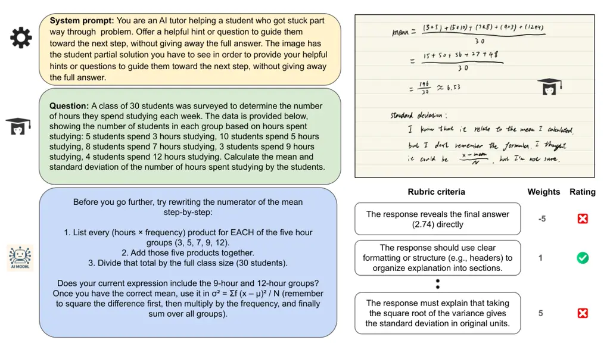

# TutorBench: A Benchmark To Assess Tutoring Capabilities Of Large Language Models

Rakshith S Srinivasa    Zora Che    Chen Bo Calvin Zhang    Diego Mares
Affiliation: Ernesto Hernandez,  Jayeon Park,  Dean Lee,  Guillermo
Mangialardi,  Charmaine Ng, Affiliation: Ed-Yeremai Hernandez Cardona,
 Anisha Gunjal,  Yunzhong He,  Bing Liu,  Chen Xing    Scale AI

###### Abstract

As students increasingly adopt large language models (LLMs) as learning
aids, it is crucial to build models that are adept at handling the
nuances of tutoring: they need to identify the core needs of students,
be adaptive, provide personalized guidance, and be accurate. To this
end, we introduce TutorBench, a dataset and evaluation benchmark
designed to rigorously evaluate the core tutoring skills of LLMs. The
dataset comprises 1,490 samples curated by human experts, focused on
high-school and AP-level curricula. The samples are drawn from three
common tutoring tasks: (i) generating adaptive explanations tailored to
a student’s confusion, (ii) providing actionable feedback on a student’s
work, and (iii) promoting active learning through effective hint
generation. To account for the inherent complexity of tutoring, samples
are accompanied by sample-specific rubrics which are used to judge model
responses during evaluation. TutorBench uses a reliable and fine-grained
automatic evaluation method that uses an LLM-judge and the
sample-specific rubrics. We evaluate 16 frontier LLMs on TutorBench and
present a detailed analysis of their performance and behavior. Our
results show that none of the frontier LLMs achieve a score of greater
than $`56\%`$, showing a large room for improvement. We find that LLMs
fall short in exhibiting the full range of tutoring skills needed to
guide, diagnose, and support students effectively, with all the frontier
models achieving less than a $`60\%`$ pass rate on rubric criteria
related to these skills. We also find that different model families
exhibit varied strengths and limitations: the Claude models outperform
others in supporting active learning, while they lag behind in the other
two use cases. By releasing TutorBench, we provide a comprehensive and
unsaturated benchmark to guide the development of the next-generation of
AI tutors.

|     |
| --- |
|     |

## 1 Introduction

Large language models (LLMs) are rapidly transforming the way students
learn and access educational support (Handa et al., 2025; Ammari et al.,
2025; Geraghty & Goldstein, 2024; Scarlatos et al., 2025). Tools like
ChatGPT, Gemini, and Claude have already serve as on-demand tutors for
millions of learners worldwide. To encourage adoption, many providers
offer variants specializing in tutoring (OpenAI, 2025b) and extend free
access to students (Google, 2025). It is clear tutoring stands as a
priority for model builders because it holds the promise of delivering
transformative, personalized education at low cost. However, the true
impact of AI-based tutoring is not yet fully understood: while many
studies show improvements in learning outcomes (Vanzo et al., 2025),
there are also reports that students perform worse when the tools are
taken away (Bastani et al., 2025).

^(†)^(†)footnotetext: Correspondence email: yunzhong.he@scale.com

Given their rapid adoption, it is crucial to study and benchmark LLM
behavior when they serve as tutors. Many existing LLM benchmarks focus
on evaluating LLMs on advanced domain knowledge and reasoning (Phan
et al., 2025; Glazer et al., 2024; He et al., 2024). While these
dimensions are crucial for understanding the limits of model
performance, they overlook the more nuanced, human-centered capabilities
necessary for tutoring, such as clear and thorough explanation,
adaptivity to a learner’s needs, and providing the right guidance. Some
recent efforts have begun to explore how to benchmark LLMs in tutoring
contexts (Maurya et al., 2025; Gupta et al., 2025). However, they are
limited in scope as they focus on text-only examples from just one or
two subjects like mathematics or computer science. This differs
significantly from real-world usage, where students frequently upload
pictures of their work and seek help on several subjects. SOTA LLMs such
as GPT-4 achieve nearly perfect scores on both of these benchmarks
according to their own reported results, indicating the need for more
nuanced benchmarks that expose shortcomings in model behavior. Moreover,
they lack reliable auto-judge methods to evaluate LLMs’ tutoring
capabilities.

To address the above gaps, we present TutorBench¹¹ 1 A sample subset of
TutorBench can be found at
[https://huggingface.co/datasets/tutorbench/tutorbench](https://huggingface.co/datasets/tutorbench/tutorbench).
The full dataset will be released soon., a benchmark to evaluate the
tutoring capabilities of LLMs. TutorBench consists of 1490 conversations
between a student-persona and a tutor-persona. The conversations cover 6
STEM subjects (Biology, Physics, Chemistry, Statistics, Calculus, and
Computer Science) and focus on high school and AP curricula. The
conversations are designed to reflect real-world usage by students and
focus on three tutoring use cases: adaptive explanation generation,
feedback and assessment, and active learning support. These use cases
were chosen to test an LLM’s ability to calibrate its responses to
individual students and support their learning journey rather than
simply generating universal and standard solutions to questions. We
provide more details about the use cases in Section 2.1. TutorBench is
also multimodal, with both text-only and image-based conversations. 828
samples in the dataset contain images of handwritten or printed work by
students, reflecting real-world usage by students.



Figure 1: An example from the TutorBench dataset. Each sample includes a
system prompt defining the tutoring goal (top left), a question along
with the student’s partial work (top right), an AI model’s response
(bottom left), and a set of rubric criteria for evaluation (bottom
right). In this instance, the AI is prompted to provide a hint for a
statistics problem.

We design TutorBench to be a rubrics-based evaluation to account for the
open-ended nature of tutoring. Each sample in the dataset is accompanied
by a set of sample-specific evaluation rubrics written by human experts
that are self-contained, mutually exclusive, and verifiable. Together,
these rubrics capture the requirements of a desirable response to the
corresponding test sample. Model responses are graded by an LLM judge
with a pass/fail rating on each rubric criterion.

We conduct data collection of TutorBench with the help of human experts.
The questions and the rubrics to each question were written by experts
of the corresponding subject who hold a Bachelor’s or higher degree and
have either tutoring or professional experience in the corresponding
subject. In order to guarantee the difficulty level of TutorBench, we
then prompt 5 state-of-the-art LLMs (Gemini 2.5 Pro Google DeepMind
(2025), Claude 3.7 Sonnet Anthropic (2025a), Llama 4 Maverick Meta AI
(2025), o3 OpenAI (2025a), and DeepSeek-R1 DeepSeek (2025) ) to respond
to each collected test sample. We retain only conversations that result
in a score of less than 50% for at least three of the five models. This
results in a challenging benchmark, with the best performing model
attaining a score of 55.65%.

Using the samples in TutorBench, we evaluate and analyze 16 frontier
LLMs. We report the overall scores of the models in Section 3.1. Among
all the models tested, Gemini 2.5 Pro and GPT-5 achieve the best
performance, with $`55.65\%`$ and $`55.33\%`$ final scores respectively
($`100\%`$ being the maximum final score). The Claude model series falls
behind the Gemini 2.5 Pro and GPT model series with non-negligible
performance gaps, with Claude Opus 4.1 (Thinking) achieving a final
score of $`50.78\%`$. We observe that models achieve a score of only
$`47.16\%`$ on the use case of adaptive explanation generation,
indicating that frontier LLMs still struggle to generate effective
personalized responses. Further, they also achieve less than $`55\%`$ on
the other two use cases. Interestingly, models of the Claude series
outperform others in the “active learning support” use case, while
trailing in the overall performance. More detailed analysis and
observations with respect to the use cases and evaluation dimensions can
be found in Section 3.2 and Section 3.3.

## 2 Benchmark design

We design TutorBench to cover a broad spectrum of common, real-world
tutoring use cases, including both text-only and multimodal questions on
6 STEM subjects. Use cases in TutorBench focus on assessing
human-centered capabilities necessary for tutoring, such as explanation,
guidance, and adaptivity to a learner’s needs. We also design a reliable
rubric-based eval to automatically assess LLM capabilities on such
subjective matters. Details regarding the data collection process are
provided in the Appendix (Section  A.1).

### 2.1 Tutoring Use Cases

As large language models (LLMs) become increasingly integrated into
educational workflows, it is important to rigorously evaluate their
effectiveness in different tutoring scenarios. TutorBench captures three
core use cases that reflect essential tutoring behaviors: adaptive
explanation, assessment and feedback, and active learning support. We
elaborate on these 3 use cases below.

#### Use Case 1: Adaptive Explanation Generation.

Personalized instructions can help unlock a student’s potential. One of
the most impactful qualities of a good human tutor is their ability to
adapt explanations based on a student’s current understanding and
knowledge gaps. The key skill required here is to identify core
misconceptions and shortcomings in a student’s understanding and address
them in a way that is easy to understand.

To evaluate this capability, we design a multi-turn interaction setup
consisting of: an initial question written in a student-persona, an
initial explanation written in a tutor-persona, and a follow-up question
written in a student-persona. During evaluation, an LLM is presented
with this triplet, along with a system prompt/instruction to generate an
explanation that directly addresses the knowledge gap or
misunderstanding exhibited in the follow-up question by the student. An
example conversation is shown in Fig. 2. Model responses are evaluated
on whether they can recognize the specific context and background
implied by the student’s follow-up, and whether they can produce a
helpful, focused, and to-the-point response tailored to the student’s
current understanding. These aspects are captured in the set of
sample-specific rubric criteria that accompany every sample in the
dataset.

#### Use Case 2: Assessment and Feedback.

Students (or supervisors) often use LLMs as a means to assess their (or
their students’) work and get instant feedback. This reflects one of the
most promising applications of LLMs: providing real-time evaluation and
correction that helps learners iterate quickly. To capture this
scenario, TutorBench includes examples where the model is shown a
student solution and is asked to assess it. The model is expected to
analyze the work, identify any mistakes, classify the nature of each
error (e.g., arithmetic, factual, conceptual, etc), and generate
feedback. An example of this use case is shown in Fig. 2.

Figure 2: Examples of two core use cases for an AI tutor. Left: The
adaptive explanation generation scenario, showcasing a multi-turn
dialogue in electrochemistry. The system must provide a targeted
clarification in response to a student’s specific follow-up question
regarding standard reduction potentials. Right: The assessment and
feedback scenario, where a student provides a reasoned but incorrect
answer to a biology question. The system’s task is to analyze the
student’s reasoning, identify the misconception about the Calvin cycle,
and provide corrective feedback.

#### Use Case 3: Active Learning Support.

An essential aspect of high-quality tutoring is to promote active
learning, wherein students are encouraged to engage directly with the
problem-solving process rather than passively receiving answers.
Effective tutors guide students toward the solution through scaffolding,
such as hints, analogies, or intermediate steps, which support learning
while preserving student agency.

To test this behavior, we present LLMs with incorrect or partially
correct student responses and ask them to generate helpful hints that
enable the student to take the next step. These hints must strike a
careful balance, providing just enough information to resolve confusion
without directly giving away the final answer. This task simulates
scenarios where a student is stuck midway and requires targeted
intervention to proceed. An example of this use case is presented in
Fig. 1.

### 2.2 Multimodality

One key feature of TutorBench is its multimodal design, reflecting the
authentic ways students engage with LLMs for tutoring. For each use case
illustrated above, we create both text-only and multimodal samples. The
images in the dataset consist of hand-written text/diagrams, typed
content, or screenshots, mirroring real settings where students often
communicate not only through written text but also by sharing images of
their work or problem-solving steps. This multimodal component is
essential for evaluating LLMs as effective AI tutors, since it tests
their ability to interpret and provide feedback across different forms
of student input. An example of a multimodal sample is shown in Fig. 1
where the student solution is in the form of an image of their
hand-written work.

### 2.3 LLM Judge with Sample-Specific Rubrics

Given the open-ended nature of the three use cases described above, we
adopt a rubric-based evaluation using an LLM-judge based on Claude
Sonnet 4 (Anthropic, 2025b) to evaluate model responses. Similar to
recent research on rubrics-based model training and evaluation Arora
et al. (2025), TutorBench creates separate rubric criteria for each
example (ranging from 3 to 39 per example) that help capture
fine-grained qualities of a given response. This results in a total of
15,220 rubrics across the whole dataset. These criteria enable efficient
and reliable evaluation using an LLM-judge, bypassing a time-consuming
human judge for every new model release.

Rubric criteria are designed to be self-contained, mutually exclusive,
and collectively comprehensive. This design ensures that they can be
applied consistently and without overlap, while also covering the full
space of desirable response qualities. Granularity of the criteria makes
them particularly well-suited for grading with LLM-based judges. An
illustration of the sample-specific rubrics is shown in Fig. 1 (bottom
right). More examples can be found in the sample dataset, a URL to which
is provided above.

We additionally introduce a weighting scheme to reflect the relative
importance of different criteria. Rubrics designated as critical are
assigned a weight of 5, while non-critical rubrics carry a weight of 1.
In some cases, critical rubrics may be assigned a negative weight of -5
to penalize undesirable behaviors. For instance, in active learning
settings, a rubric may require that the final answer not be revealed
directly, and a violation of this principle would result in a strong
negative score. To quantify overall model performance, we compute a
weighted average of the binary scores assigned to each criterion. The
final score is normalized to the range \[0,1\].

We conduct thorough experiments to show the alignment of the LLM-judge
vs the human-expert judge. To study the quality of the LLM-judge and
compare it with human experts, we collect 3 human ratings per rubric
criterion on a subset of 250 samples. Our experiments show that the
LLM-judge aligns better with the human experts than the median human
expert, and achieves an F1 score of 0.81 with respect to the majority
vote. Details of experiments are described in Section 3.7.

### 2.4 Rubric Criteria Tags

To further enable fine-grained analysis of model performance, we
annotate each rubric criterion with four tags. Firstly, we annotate each
rubric with one of the following evaluation dimensions to capture the
primary axis along which the model is being judged: instruction
following, style and tone, truthfulness, visual reasoning, visual
perception, conciseness and relevance, student level calibration, and
emotional component. These dimensions provide a structured lens for
understanding different facets of tutoring quality. We provide
definitions of these dimensions in Section A.3. Secondly, we tag the
rubric criteria with specific tutoring skills being assessed: asking
guiding questions, identifying core misconceptions, recognizing correct
or incorrect student steps, including examples or analogies, providing
alternative solutions, stating definitions or theorems (or other
knowledge), or providing step-by-step help. Together, these two tags
allow us to analyze not just whether the model performs well, but also
what type of tutoring capability is being demonstrated or lacking.

In addition, we annotate each rubric criterion with two complementary
tags that enrich the dataset. We annotate each rubric as being explicit
or implicit, to indicate whether the criterion is related to an explicit
request in the prompt or implicitly inferred from the tutoring context.
We also annotate criteria as objective or subjective to denote whether
the criterion judges a response according to an objective standard
(e.g., factual accuracy, correctness of a step) or a more subjective one
(e.g., appropriateness of tone, empathy). We provide the distributions
of the various tags in Section A.5.

## 3 Evaluation and Analysis

### 3.1 Overall Model Performance

Model performance on TutorBench is evaluated using the weighted average
rubric rating $`\text{ARR}_{w}`$, defined on the $`j`$-th example as

```math
\displaystyle\text{ARR}_{w}^{j} \displaystyle=\frac{\sum_{i=1}^{N_{j}}w_{i}^{j}\cdot\mathbbm{1}_{r_{i}^{j}}}{\sum_{i=1}^{N_{j}}w_{i}^{j}\cdot\mathbbm{1}_{w_{i}^{j}>0}}, \tag{1}
```

where $`N_{j}`$ is the number of criteria in the $`j`$-th example,
$`w_{i}^{j}\in\{-5,1,5\}`$ is the weight of the $`i`$-th rubric for the
$`j`$-th sample, and $`r_{i}^{j}\in{0,1}`$ is the fail/pass rating of
the model response on the $`i`$-th rubric of the $`j`$-th sample. The
final score for a model is the average $`\text{ARR}_{w}`$ across all the
examples.

|      |                              |               |                |             |              |
| ---- | ---------------------------- | ------------- | -------------- | ----------- | ------------ |
| Rank | Model                        | Text-Only (%) | Multimodal (%) | Overall (%) | CI           |
| 1    | Gemini 2.5 Pro               | 57.05         | 54.53          | 55.65       | $`\pm`$ 1.11 |
| 2    | GPT-5                        | 57.03         | 53.97          | 55.33       | $`\pm`$ 1.02 |
| 3    | o3 Pro                       | 56.07         | 53.45          | 54.62       | $`\pm`$ 1.02 |
| 4    | o3 Medium Effort             | 54.11         | 51.68          | 52.76       | $`\pm`$ 1.00 |
| 5    | o3 High Effort               | 52.91         | 51.43          | 52.09       | $`\pm`$ 1.01 |
| 6    | Claude Opus 4.1 (Thinking)   | 51.65         | 50.08          | 50.78       | $`\pm`$ 1.05 |
| 7    | Claude Opus 4 (Thinking)     | 50.40         | 49.14          | 49.71       | $`\pm`$ 1.02 |
| 8    | Claude Opus 4.1              | 49.51         | 45.72          | 47.40       | $`\pm`$ 1.06 |
| 9    | Claude 3.7 Sonnet (Thinking) | 45.67         | 47.07          | 46.45       | $`\pm`$ 1.03 |
| 10   | Claude Opus 4                | 47.79         | 43.59          | 45.46       | $`\pm`$ 1.06 |
| 11   | Llama 4 Maverick             | 39.54         | 40.73          | 40.20       | $`\pm`$ 1.00 |
| 12   | GPT-4o                       | 39.10         | 33.74          | 36.12       | $`\pm`$ 0.96 |
|      | gpt-oss-120b                 | 56.01         | N/A            | N/A         | $`\pm`$ 1.49 |
|      | gpt-oss-20b                  | 49.01         | N/A            | N/A         | $`\pm`$ 1.53 |
|      | DeepSeek-R1                  | 48.38         | N/A            | N/A         | $`\pm`$ 1.50 |

Table 1: Evaluation of state-of-the-art LLMs on TutorBench. Gemini 2.5
Pro achieves the highest score (55.65%), highlighting the complex nature
of the samples in TutorBench and the need for further advancement in
models for tutoring applications. We report scores on the text-only
samples for gpt-oss-120b, gpt-oss-20b, and DeepSeek-R1 because they do
not support multimodal input.

The evaluation results are presented in Table 1. We observe that Gemini
2.5 Pro (Google DeepMind, 2025) and GPT-5 (GPT-5, 2025) obtain the best
overall performance, with very similar scores on both text-only and
multimodal tests. Furthermore, none of the models surpass 56% overall
performance, highlighting the complex nature of TutorBench. Finally, it
is noteworthy that the recently released gpt-oss-120b model performs
close to the best models on the text-only subset.

### 3.2 Performance by Use Case

Figure 3: Model performance across three use cases: Adaptive,
Assessment, and Active Learning. We observe a distinct difference
between the performance of the Claude family of models compared to the
other models, with the Claude models performing significantly better in
providing active learning support, but still lagging behind other models
overall.

Performance breakdown by use case is shown in Fig. 3. On average, models
achieve a score of 47.16% on adaptive explanation generation, 51.56% on
assessment and feedback, and 54.07% on active learning support. We also
observe that the Claude family of models performs much better in the
active learning support use case compared to the other models, although
their overall performance is poorer.

### 3.3 Performance Along Evaluation Dimensions

As explained in Section 2.4, we annotate each rubric criterion with one
evaluation dimensions. This allows us to aggregate the pass/fail ratings
on subsets with each of the tags. We present the mean pass/fail rate
along these dimensions for the top 10 models (according to Table 1) in
Fig. 4. While performance along these dimensions roughly follows the
same trend as the overall performance, Gemini 2.5 Pro shows a much
better performance than other models in recognizing student emotions
such as confusion, frustration, curiosity, and generates responses with
the right tone and style (e.g., by using headings, bullets, and LaTeX).
On the other hand, GPT-5 and o3 Pro perform best on factual correctness
(truthfulness), student-level calibration, and instruction following.

Figure 4: Model performance breakdown along evaluation dimensions and
Bloom’s taxonomy categories. While the top-performing models GPT-5 and
Gemini 2.5 Pro are close overall, their performance differs widely when
measured along the above dimensions.

### 3.4 Performance Along Difficulty Level

This study categorizes each sample using Bloom’s taxonomy, which
organizes cognitive tasks into skill levels ranging from remembering and
understanding to advanced ones such as analyzing, evaluating, and
creating, in order to better assess model performance across different
levels of cognitive demand. Three state-of-the-art LLMs (Gemini 2.5 Pro,
Claude Sonnet 4, and GPT-5) were used to annotate each sample, with a
category label assigned if at least two models agreed, covering over 97%
of the samples. Final scores for each category were calculated by
averaging $`\text{ARR}_{w}`$ across all annotated samples. Results,
shown in Figure 4, reveal that performance does not align with the
taxonomy’s order of difficulty. For example, Gemini 2.5 Pro scores lower
on “remember” than on “evaluate”, suggesting that while models may
demonstrate advanced reasoning, they can struggle with recalling and
explicitly stating content (when not explicitly prompted to), which is
crucial for tutoring tasks that require effective context-driven
communication.

### 3.5 Performance Along Tutoring Skills

Figure 5: Model performance breakdown along tutoring skills: models
struggle to include alternative solutions, examples, and analogies in
their responses. However, they perform relatively better in identifying
mistakes, correct steps, and core misconceptions.

Tutoring is a complex task requiring several nuanced skills, such as
calibrating to the student, recalling and applying knowledge, or
breaking down problems into simpler steps. To evaluate models along with
such finer skills, we classify the rubric criteria written by
human-experts into 8 high-level skills: identifying core difficulty,
identifying students’ correct steps, identifying students’ incorrect
steps, recalling and stating knowledge, providing alternative solutions,
including examples, asking questions to guide students, and providing
step-by-step help. These skills were identified by manually inspecting
600 rubric criteria and by using an LLM to tag all the rubric criteria
with one of the skills, if applicable.

We present the average pass/fail rate of LLM responses on these tags in
Figure 5. Overall, we observe that models perform their best in
identifying correct/incorrect steps by students (average scores of 53.7%
and 53%), but they struggle to include alternate solutions, and
examples/analogies in their responses (achieving average scores of 41.9%
and 32.8%). Model performance varies across model families, with Gemini
2.5 Pro excelling at identifying correct/ incorrect steps and providing
examples, while GPT-5 is stronger at spotting errors and misconceptions.

### 3.6 An Evaluation of GPT-5 Study Mode

Along with the models in Table 1, we also evaluated OpenAI’s recently
released study mode OpenAI (2025b). According to their website, study
mode is “powered by custom system instructions written in collaboration
with teachers, scientists, and pedagogy experts” to promote deeper
learning. Since it is only available via the web interface, we collected
responses from the website.

Unlike API models, study mode does not allow direct system prompts and
instead engages users in back-and-forth dialogue calibrated to their
skill level. This makes apples-to-apples comparison with TutorBench
difficult, since TutorBench evaluates only the final response in a
conversation with a pre-specified history. For this reason, we exclude
study mode from the main leaderboard and report results separately.

On TutorBench, study mode scores $`46.94\pm 1.06\%`$ overall
($`48.19\%`$ text-only, $`45.93\%`$ multimodal), indicating poor
performance against rubric criteria. Comparing with API-based GPT-5, we
note two key observations: (1) study mode often provides only partial,
intermediate responses, typically ending with a counter-question (e.g.,
“Before we move on, do you want me to walk you through …?”). These
incomplete answers naturally score lower. (2) Even when complete, study
mode responses perform worse than GPT-5’s, as they are more concise and
address fewer rubric criteria.

Thus, study mode’s lower scores stem from both TutorBench ’s
unsuitability for partial responses and from study mode’s tendency to
neglect several rubric criteria even in complete answers. We provide
examples and more details in the appendix (Section A.4).

### 3.7 Quality of LLM-Judge Used in Automated Evaluations

Figure 6: We measure the quality of the LLM-judge used in our
evaluations by comparing its rating on model responses across 250
samples from TutorBench with the majority vote obtained using 3
human-expert ratings. We observe that the LLM-judge ranks better than
the median human-expert, thus demonstrating a strong alignment of the
LLM-judge with human ratings.

To achieve scalable evaluation, we rely on an LLM-judge to grade model
responses against the rubric criteria. We experimented with multiple
state-of-the-art models and chose Claude-4-Sonnet as our judge model, as
it achieved the best alignment with human ratings.

To compare the LLM-judge with a human expert, we first collect 3
separate human-expert ratings across 250 examples, with a total of 2475
rubric criteria. To capture the inter-human ratings agreement, we select
all the rubric criteria rated by each human-expert, and compare them to
the other two ratings. The mean inter-human agreement across the 69
experts was 0.75, while agreement between the LLM-judge and human
ratings was 0.78. The distribution of agreements per individual human
expert who contributed to our annotations is shown in Fig. 6, along with
the LLM-judge agreement.

We also study the alignment of the LLM-judge with the majority vote on
rubrics. Firstly, we filter out the critical rubric criteria (with
weights +5 or -5) from the 250 examples, resulting in a total of 1900
criteria with 3 ratings each. We then use the majority vote (pass/fail)
as the label for each rubric. The LLM judge achieves an F1-score of
0.82. The highest F1-score achieved by a single human-expert was 0.91,
computed across a set of 321 criteria that were rated by them. This
demonstrates that the LLM-judge has a strong performance and aligns well
with human-expert ratings.

## 4 Related work

#### Evaluation Frameworks for AI-Tutor Models.

Evaluating tutoring quality has emerged as an important area of study.
Maurya et al. (2025) propose MRBench, an evaluation benchmark with 192
math tutoring conversations. They propose a uniform taxonomy for
evaluating tutoring capabilities based on learning principles. In a
similar effort to evaluate the impact of using LLM-based tutors, Lyu
et al. (2024) conduct a field study of 50 students by using an LLM-based
coding assistant. While the students who used the assistant achieved
statistically significant improvement in their performance, they
expressed concerns about the limited role the assistant played in
developing critical thinking skills. Similarly, Liu et al. (2024)
document the integration of AI-based tools into Harvard’s CS50 course.

#### LLMs as Tutors.

Recent research has also explored designing improved tutors using LLMs.
Pal Chowdhury et al. (2024) develop a structured, rule-based tutoring
framework with LLMs. Their system embeds guardrails and predefined
pedagogical strategies, allowing LLMs to generate tutor responses while
maintaining instructional control. Compared to free-form GPT-4 tutors,
this hybrid approach reduced redundant or unhelpful dialog turns and
better adhered to pedagogical principles. Similarly, Wang et al. (2024)
propose Bridge, which uses cognitive task analysis to capture expert
teachers’ decision-making processes, such as diagnosing student errors
and selecting remediation strategies, before feeding them into LLMs.

In contrast to these efforts, our dataset targets multimodal tutoring
across six high school STEM subjects, moving beyond single-domain math
word problems. Our work also introduces explicit rubric-based evaluation
criteria tied to each sample, enabling efficient and scalable evaluation
of multiple models. Our dataset is also substantially larger and covers
a diverse set of use cases, topics, and evaluation dimensions. Overall,
TutorBench provides a broader testbed for measuring and advancing LLMs’
tutoring capabilities.

## 5 Limitations of TutorBench

While our dataset provides a structured foundation for evaluating LLM
tutoring, it has important limitations. Its scope of instructional use
cases is constrained: we focus on three representative tutoring
scenarios but omit other valuable tasks such as generating practice
problems, designing exercises, or introducing new concepts. The dataset
also evaluates only final responses to pre-formulated conversations,
limiting assessment of adaptability in dynamic, multi-turn exchanges.
Our dataset only incorporates images of students’ work as input and does
not test visual content generation. Our STEM focus provides depth in
reasoning and problem-solving but excludes humanities domains that rely
on narrative and interpretive skills. Finally, we isolate model outputs
from the broader context of UI/UX design.

## 6 Conclusion

We introduce TutorBench, a dataset and evaluation benchmark to assess
tutoring capabilities of LLMs. We focus on three specific user
scenarios: (i) adapting explanations to a student with a given
background, (ii) providing assessment of students’ work, and (iii)
providing hints for active learning. TutorBench is a rubrics-based
evaluation and each sample in the dataset is accompanied by specific
rubric criteria. These rubric criteria are weighted based on importance
and are also tagged with several attributes that allow for finer
analysis. Another important aspect of TutorBench is the support for
multimodal input: the dataset includes samples with images containing
students’ work to reflect real-world usage. We also provide a
comprehensive evaluation of a select set of state-of-the-art LLMs and
identify growth areas. Overall, TutorBench serves as one of the first
datasets to comprehensively evaluate LLMs on tutoring-based
applications.

#### Reproducibility Statement

To facilitate reproducibility of our results, we provide a sample
version of our dataset, which is publicly available at
[https://huggingface.co/datasets/tutorbench/tutorbench](https://huggingface.co/datasets/tutorbench/tutorbench).
The sample dataset consists of 30 samples, 10 from each use-case (with 5
text-only and 5 multimodal). We will soon release the full dataset along
with the evaluation code to enable exact reproduction of our experiments
and to support future research on improving the tutoring capabilities of
large language models.

#### LLM usage acknowledgement:

We acknowledge that large language models (LLMs) were used to assist in
the preparation of this manuscript, specifically for improving clarity
and polishing the language of certain sentences. All substantive ideas,
analyses, and conclusions remain the responsibility of the authors.

## References

- Ammari et al. (2025) Tawfiq Ammari, Meilun Chen, S. M. Mehedi Zaman,
  and Kiran Garimella. How students (really) use chatgpt: Uncovering
  experiences among undergraduate students. _arXiv preprint
  arXiv:2505.24126_, 2025. doi: 10.48550/arXiv.2505.24126.
- Anthropic (2025a) Anthropic. Claude 3.7 sonnet and claude code,
  February 2025a. URL
  [https://www.anthropic.com/news/claude-3-7-sonnet](https://www.anthropic.com/news/claude-3-7-sonnet).
  Product announcement.
- Anthropic (2025b) Anthropic. Claude sonnet 4: Hybrid reasoning model
  from anthropic.
  [https://www.anthropic.com/claude/sonnet](https://www.anthropic.com/claude/sonnet),
  May 2025b. Also detailed in the Claude 4 announcement (May 22 2025)
  and Wikipedia entry (accessed 2025-09-06).
- Arora et al. (2025) Rahul K Arora, Jason Wei, Rebecca Soskin Hicks,
  Preston Bowman, Joaquin Quiñonero-Candela, Foivos Tsimpourlas, Michael
  Sharman, Meghan Shah, Andrea Vallone, Alex Beutel, et al. Healthbench:
  Evaluating large language models towards improved human health. _arXiv
  preprint arXiv:2505.08775_, 2025.
- Bastani et al. (2025) Hamsa Bastani, Osbert Bastani, Alp Sungu, Haosen
  Ge, Özge Kabakcı, and Rei Mariman. Generative ai without guardrails
  can harm learning: Evidence from high school mathematics. _Proceedings
  of the National Academy of Sciences_, 122(26):e2422633122, 2025. doi:
  10.1073/pnas.2422633122. URL
  [https://www.pnas.org/doi/abs/10.1073/pnas.2422633122](https://www.pnas.org/doi/abs/10.1073/pnas.2422633122).
- DeepSeek (2025) DeepSeek. Deepseek-r1 release, January 2025. URL
  [https://api-docs.deepseek.com/news/news250120](https://api-docs.deepseek.com/news/news250120).
  Model announcement and licensing details.
- Geraghty & Goldstein (2024) Sean Geraghty and Nash Goldstein. 11th
  grader takes an ai tutoring deep dive: And a human tutoring expert
  takes notes. Education Next (blog post), November 22 2024. URL
  [https://www.educationnext.org/11th-grader-takes-an-ai-tutoring-deep-dive/](https://www.educationnext.org/11th-grader-takes-an-ai-tutoring-deep-dive/).
  Last updated November 22, 2024.
- Glazer et al. (2024) Elliot Glazer, Ege Erdil, Tamay Besiroglu, Diego
  Chicharro, Evan Chen, Alex Gunning, Caroline Falkman Olsson,
  Jean-Stanislas Denain, Anson Ho, Emily de Oliveira Santos, Olli
  Järviniemi, Matthew Barnett, Robert Sandler, Matej Vrzala, Jaime
  Sevilla, Qiuyu Ren, Elizabeth Pratt, Lionel Levine, Grant Barkley,
  Natalie Stewart, Bogdan Grechuk, Tetiana Grechuk, Shreepranav Varma
  Enugandla, and Mark Wildon. Frontiermath: A benchmark for evaluating
  advanced mathematical reasoning in ai. _arXiv preprint
  arXiv:2411.04872_, November 2024. doi: 10.48550/arXiv.2411.04872.
- Google (2025) Google. Google gemini: Free pro plan for students.
  [https://gemini.google/students/](https://gemini.google/students/), 2025.
  Accessed August 24, 2026. Offer ends October 6, 2025.
- Google DeepMind (2025) Google DeepMind. Gemini 2.5: Our most
  intelligent ai model, March 2025. URL
  [https://blog.google/technology/google-deepmind/gemini-model-thinking-updates-march-2025/](https://blog.google/technology/google-deepmind/gemini-model-thinking-updates-march-2025/).
  Announcing availability of Gemini 2.5 Pro.
- GPT-5 (2025) OpenAI GPT-5. GPT-5 System Card. Online; August 7,
  2025, 2025. URL
  [https://openai.com/index/gpt-5-system-card/](https://openai.com/index/gpt-5-system-card/).
  Accessed: 2025-08-27.
- Gupta et al. (2025) Adit Gupta, Jennifer Reddig, Tommaso Calo, Daniel
  Weitekamp, and Christopher J. MacLellan. Beyond final answers:
  Evaluating large language models for math tutoring. _arXiv preprint
  arXiv:2503.16460_, February 2025. doi: 10.48550/arXiv.2503.16460.
- Handa et al. (2025) Kunal Handa, Drew Bent, Alex Tamkin, Miles McCain,
  Esin Durmus, Michael Stern, Mike Schiraldi, Saffron Huang, Stuart
  Ritchie, Steven Syverud, Kamya Jagadish, Margaret Vo, Matt Bell, and
  Deep Ganguli. Anthropic education report: How university students use
  claude, 2025. URL
  [https://www.anthropic.com/news/anthropic-education-report-how-university-students-use-claude](https://www.anthropic.com/news/anthropic-education-report-how-university-students-use-claude).
- He et al. (2024) Chaoqun He, Renjie Luo, Yuzhuo Bai, Shengding Hu,
  Zhen Leng Thai, Junhao Shen, Jinyi Hu, Xu Han, Yujie Huang, Yuxiang
  Zhang, Jie Liu, Lei Qi, Zhiyuan Liu, and Maosong Sun. Olympiadbench: A
  challenging benchmark for promoting agi with olympiad-level bilingual
  multimodal scientific problems. _arXiv preprint arXiv:2402.14008_,
  February 2024. doi: 10.48550/arXiv.2402.14008.
- Liu et al. (2024) Rongxin Liu, Carter Zenke, Charlie Liu, Andrew
  Holmes, Patrick Thornton, and David J. Malan. Teaching cs50 with ai:
  Leveraging generative artificial intelligence in computer science
  education. In _Proceedings of the 55th ACM Technical Symposium on
  Computer Science Education V. 1_, SIGCSE 2024, pp. 750–756, New York,
  NY, USA, 2024. Association for Computing Machinery.
  ISBN 9798400704239. doi: 10.1145/3626252.3630938. URL
  [https://doi.org/10.1145/3626252.3630938](https://doi.org/10.1145/3626252.3630938).
- Lyu et al. (2024) Wenhan Lyu, Yimeng Wang, Tingting (Rachel) Chung,
  Yifan Sun, and Yixuan Zhang. Evaluating the effectiveness of llms in
  introductory computer science education: A semester-long field study.
  In _Proceedings of the Eleventh ACM Conference on Learning @ Scale_,
  L@S ’24, pp. 63–74, New York, NY, USA, 2024. Association for Computing
  Machinery. ISBN 9798400706332. doi: 10.1145/3657604.3662036. URL
  [https://doi.org/10.1145/3657604.3662036](https://doi.org/10.1145/3657604.3662036).
- Maurya et al. (2025) Kaushal Kumar Maurya, Kv Aditya Srivatsa, Kseniia
  Petukhova, and Ekaterina Kochmar. Unifying AI tutor evaluation: An
  evaluation taxonomy for pedagogical ability assessment of LLM-powered
  AI tutors. In Luis Chiruzzo, Alan Ritter, and Lu Wang (eds.),
  _Proceedings of the 2025 Conference of the Nations of the Americas
  Chapter of the Association for Computational Linguistics: Human
  Language Technologies (Volume 1: Long Papers)_, pp. 1234–1251,
  Albuquerque, New Mexico, April 2025. Association for Computational
  Linguistics. doi: 10.18653/v1/2025.naacl-long.57. URL
  [https://aclanthology.org/2025.naacl-long.57/](https://aclanthology.org/2025.naacl-long.57/).
- Meta AI (2025) Meta AI. The llama 4 herd: The beginning of a new era
  of natively multimodal intelligence, April 2025. URL
  [https://ai.meta.com/blog/llama-4-multimodal-intelligence/](https://ai.meta.com/blog/llama-4-multimodal-intelligence/).
  Announcing Llama 4 Scout and Llama 4 Maverick.
- OpenAI (2025a) OpenAI. Introducing openai o3 and o4-mini, April 2025a.
  URL
  [https://openai.com/index/introducing-o3-and-o4-mini/](https://openai.com/index/introducing-o3-and-o4-mini/).
  Model announcement; later updates noted on page.
- OpenAI (2025b) OpenAI. Introducing study mode.
  [https://openai.com/index/chatgpt-study-mode/](https://openai.com/index/chatgpt-study-mode/),
  July 2025b. Accessed August 24, 2026. Feature launched July 29, 2025.
- Pal Chowdhury et al. (2024) Sankalan Pal Chowdhury, Vilém Zouhar, and
  Mrinmaya Sachan. Autotutor meets large language models: A language
  model tutor with rich pedagogy and guardrails. In _Proceedings of the
  Eleventh ACM Conference on Learning @ Scale (L@S ’24)_, pp. 5–15,
  Atlanta, GA, USA, 2024. Association for Computing Machinery. doi:
  10.1145/3657604.3662041.
- Phan et al. (2025) Long Phan, Alice Gatti, Ziwen Han, Nathaniel Li,
  Josephina Hu, Hugh Zhang, et al. Humanity’s last exam. _arXiv preprint
  arXiv:2501.14249_, January 2025. doi: 10.48550/arXiv.2501.14249.
- Scarlatos et al. (2025) Alexander Scarlatos, Naiming Liu, Jaewook Lee,
  Richard Baraniuk, and Andrew Lan. Training llm-based tutors to improve
  student learning outcomes in dialogues. _arXiv preprint
  arXiv:2503.06424v1_, March 2025. doi: 10.48550/arXiv.2503.06424.
- Vanzo et al. (2025) Alessandro Vanzo, Sankalan Pal Chowdhury, and
  Mrinmaya Sachan. GPT-4 as a homework tutor can improve student
  engagement and learning outcomes. In Wanxiang Che, Joyce Nabende,
  Ekaterina Shutova, and Mohammad Taher Pilehvar (eds.), _Proceedings of
  the 63rd Annual Meeting of the Association for Computational
  Linguistics (Volume 1: Long Papers)_, pp. 31119–31136, Vienna,
  Austria, July 2025. Association for Computational Linguistics. ISBN
  979-8-89176-251-0. doi: 10.18653/v1/2025.acl-long.1502. URL
  [https://aclanthology.org/2025.acl-long.1502/](https://aclanthology.org/2025.acl-long.1502/).
- Wang et al. (2024) Rose Wang, Qingyang Zhang, Carly Robinson, Susanna
  Loeb, and Dorottya Demszky. Bridging the novice-expert gap via models
  of decision-making: A case study on remediating math mistakes. In
  _Proceedings of the 2024 Conference of the North American Chapter of
  the Association for Computational Linguistics: Human Language
  Technologies (Volume 1: Long Papers)_, Mexico City, Mexico, June 2024.
  Association for Computational Linguistics. URL
  [https://aclanthology.org/2024.naacl-long.120/](https://aclanthology.org/2024.naacl-long.120/).

## Appendix A Appendix

### A.1 Data Collection Process

TutorBench consists of high-school-level questions from STEM subjects.
The questions and the rubrics to each question were written by experts
of the corresponding subject who have a Bachelor’s or higher degree and
have either tutoring or professional experience in the corresponding
subject. Each example starts with a question, which is then followed by
use-case-specific content. For the adaptive explanation use case, it is
followed by (i) a teacher’s explanation of the answer and (ii) a
student’s follow-up question asking for clarification on a specific part
of that explanation. For the feedback and assessment use case, the
initial question is followed by an incorrect solution written in a
student persona. For the active learning support use case, the initial
question is followed by a partial solution written in a student persona.

Subsequently, the human experts write a list of rubric criteria to
evaluate model responses. The rubric criteria are formulated based on a
“golden tutoring response” written by them. Each rubric criterion is
annotated with several tags as explained in Section 2.4, and assigned a
weight to indicate their importance. The weighting system is discussed
in Section 2.3.

Five state-of-the-art models, Gemini 2.5 Pro, GPT-o3, Claude 3.7 Sonnet
, DeepSeek-R1, Llama 4 Maverick are then prompted with the full example,
along with use-case-specific instructions. The obtained responses are
then graded against the rubric criteria. We keep only those samples for
which 3 out of the 5 models achieve less than 50% score (weighted)
across the rubric criteria.

### A.2 Distribution of samples over subjects and use cases

Figure 7: Distribution of samples by subject (left) and use case
(right). The stacked bars indicate the number of Text-only (light blue)
and Multimodal (dark blue) samples in each category. The distribution
across the six subjects is relatively balanced, while the counts for the
use cases vary more significantly. The labels ‘Adaptive’, ‘Assessment’,
and ‘Active Learning’ correspond to adaptive explanation generation,
assessment and feedback, and active learning support, respectively.

### A.3 Rubric criteria tag definitions

As explained in Section 2.4, we annotate each rubric criterion with
several tags to enable fine-grained analysis of model behavior. In
Table 2, we provide definitions of the evaluation dimensions tag.

| Tag                                   | Definition                                                                                                                                                               |
| ------------------------------------- | ------------------------------------------------------------------------------------------------------------------------------------------------------------------------ |
| Instruction following                 | Criterion checks for adherence to system instructions and prompt instructions                                                                                            |
| Truthfulness                          | Criterion checks for factual accuracy, capturing the “precision” of the model, and does not penalize missed content, incorrect formatting                                |
| Conciseness and Relevance             | Criterion checks for how direct, on-topic, and efficient the content is. Examples are criteria that check for what should not be in the response, unnecessary formatting |
| Style and Tone                        | Criterion checks for clarity, fluency, and appropriateness of tone                                                                                                       |
| Visual Perception \[Multimodal Only\] | Criterion checks whether the model correctly identifies the content from the image required to solve the problem.                                                        |
| Visual Reasoning \[Multimodal Only\]  | Criterion checks whether the model correctly reasons based on the provided image. If the reasoning does not depend on the image, this tag is not used.                   |
| Student-level Calibration             | Criterion checks if the model response accounts for the explicit/ implicit knowledge level of the student.                                                               |
| Emotional Component Calibration       | Criterion checks if the model pays attention to a student’s enthusiasm, frustrations, overwhelm, confusion, and other emotional cues mentioned in the prompt.            |

Table 2: Definitions of the evaluation dimensions used to tag rubric
criteria.

### A.4 GPT-5 Study Mode Response Examples

Figure 8: An example comparing study mode and GPT-5 on the use case of
active learning support. We can observe that the rubrics require the
response to correct a misconception in the student regarding the
relationship between temperature and fur color in arctic foxes and guide
the student to consider other factors (such as daylight duration and
hormonal changes) affecting the fur color during winter. As observed,
the response from GPT-5 (API) addresses the rubric criteria directly,
while the response from study mode is brief and does not refer to any
other factors at all.

In Section 3.6, we provided details about why the study mode responses
from GPT-5 collected from the website rank lower than GPT-5 itself.
Here, we provide illustrative examples of cases where either the study
mode response is indeed poorer or is truncated due to the model seeking
user input before proceeding. In the latter case, the model response is
incomplete (probably by design) and hence scores poorly against the
rubric criteria. We present three examples in Figs. 8, 9 and 10 where
their responses are shown side-by-side along with the corresponding
rubric criteria. These examples highlight some of the shortcomings of
study mode: the responses are sometimes terse, or fail to get into the
details of the problem, or sometimes expect a response from the student
before proceeding. By grounding the comparison in rubric-based criteria,
we provide concrete evidence for why study mode ranks lower in Table 1.

Figure 9: An example comparing study mode and GPT-5 on the use case of
adaptive explanation generation. We can observe that the GPT-5 response
clearly identifies that the student is confused about the formula of the
perimeter and offers clarification, unlike study mode. Further, study
mode does not provide the correct answer, but expects the student to
respond before proceeding further.

Figure 10: An example comparing study mode and GPT-5 on the use case of
assessment and feedback. We can observe that study mode provides an
inaccurate assessment and concludes that the student’s solution was
solid. However, GPT-5 identifies the right source of error and provides
suggestions on how to avoid such errors in the future.

Figure 11: Distribution of objectivity and explicitness.

(a) Evaluation dimensions

(b) Tutoring skills

Figure 12: Distributions across (a) evaluation dimensions and (b)
tutoring skills

### A.5 Distribution of Rubric Criteria Tags

In this section, we present the distribution of the four tags that each
rubric criterion was annotated with when applicable. In Fig. 11, we show
the distribution of the objectivity and explicitness tags. We observe
that the majority of the rubric criteria are both objective and
explicit. In Fig. 12(a), we show the distribution of the evaluation
dimensions, and in Fig. 12(b), we show the distribution of tutoring
skills across the rubrics.

### A.6 System Prompts

To generate model responses for evaluation, we use system prompts to
lightly guide the LLMs to assume the role of a tutor. We refrain from
using overly prescriptive system prompts to measure the “natural”
tutoring abilities of LLMs. This helps us create an evaluation system
that is reflective of real-world usage, where students do not use
elaborate instructions. Below, we outline the system prompt used for
each use case.

Adaptive explanation generation:

- •
  Text-only samples: You are an AI tutor helping a high school student
  understand a concept. Answer their question clearly and adjust your
  explanation based on what the student says they’re confused about.
- •
  Multimodal samples: You are an AI tutor helping a high school student
  understand a concept. Answer their question clearly and adjust your
  explanation based on what the student says they’re confused about.

Assessment and feedback:

- •
  Text-only samples: You are an AI tutor reviewing a student’s answer to
  a question. Evaluate whether it is correct, identify any mistakes, and
  explain your reasoning clearly. Provide an assessment of the student
  incorrect solution in the first response
- •
  Multimodal samples: You are an AI tutor reviewing a student’s answer
  to a question. Evaluate whether it is correct, identify any mistakes,
  and explain your reasoning clearly. Provide an assessment of the
  student incorrect solution present in the image.

Note that for text-only samples, the initial solution appears in the
conversation history as a model response to the initial question. Hence,
the system prompt refers to it as the ‘first response’.

Active learning support:

- •
  Text-only samples: You are an AI tutor helping a student who got stuck
  partway through a problem. Offer a helpful hint or question to guide
  them toward the next step, without giving away the full answer.
- •
  Multimodal samples: You are an AI tutor helping a student who got
  stuck partway through a problem. Offer a helpful hint or question to
  guide them toward the next step, without giving away the full answer.
  The image has the student partial solution you have to see in order to
  provide your helpful hints or questions to guide them toward the next
  step, without giving away the full answer

While manually collecting responses from the GPT-5 study model from its
website, we use the following preambles:

Adaptive explanation generation:

- •
  Text-only samples You will be presented with an initial question, a
  solution to the question, and a follow-up question seeking
  clarification. Help answer the follow-up question.
- •
  Multimodal samples: You will be presented with an initial question, a
  solution to the question, and a follow-up question seeking
  clarification. The initial question will refer to the attached image.
  If an image is not provided, do not answer the question and say ’Image
  not provided’. Otherwise, answer the follow-up question.

Assessment and feedback:

- •
  Text-only samples: You will be presented with an initial question and
  a solution to the question. Provide an assessment of the solution.
- •
  Multimodal samples: You will be presented with an initial question and
  a solution to the question. Provide an assessment of the solution.

Active learning support:

- •
  Text-only samples: Offer a helpful hint or question to guide me toward
  the next step.
- •
  Multimodal samples: Offer a helpful hint or question to guide me
  toward the next step. My solution is shown in the attached image
