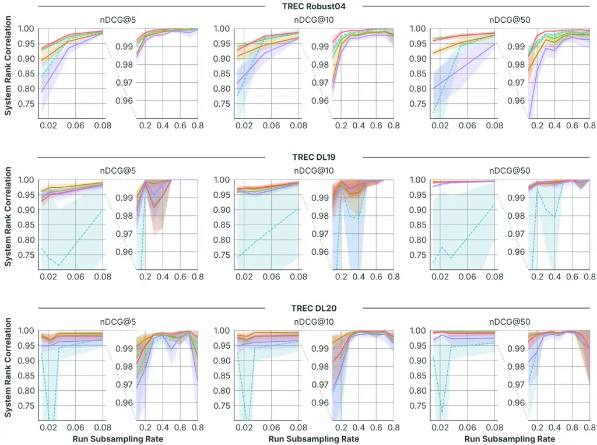

# Topic-Specific Classifiers are Better Relevance Judges than Prompted LLMs

Lukas Gienapp Affiliation: University of Kassel, hessian.AI & ScaDS.AI,
Kassel, Germany , Martin Potthast Affiliation: University of Kassel,
hessian.AI & ScaDS.AI, Kassel, Germany , Andrew Yates
Affiliation: HLTCOE, Johns Hopkins University, Baltimore, USA , Harrisen
Scells Affiliation: University of Tübingen, Tübingen, Germany and Eugene
Yang Affiliation: HLTCOE, Johns Hopkins University, Baltimore, USA

###### Abstract.

The unjudged document problem, where systems that did not contribute to
the original judgement pool may retrieve documents without a relevance
judgement, is a key obstacle to the reuseability of test collections in
information retrieval. While the de facto standard to deal with the
problem is to treat unjudged documents as non-relevant, many
alternatives have been proposed, such as the use of large language
models (LLMs) as a relevance judge (LLM-as-a-judge). However, this has
been criticized, among other things, as circular, since the same LLM can
be used as the ranker and the judge. We propose to train topic-specific
relevance classifiers instead: By finetuning monoT5 with independent
LoRA weight adaptation on the judgments of a single assessor for a
single topic’s pool, we align it to that assessor’s notion of relevance
for the topic. The system rankings obtained through our classifier’s
relevance judgments achieve a Spearmans’ $`\rho`$ correlation
of $`>0.94`$ with ground truth system rankings. As little as 128 initial
human judgments per topic suffice to improve the comparability of
models, compared to treating unjudged documents as non-relevant, while
achieving more reliability than existing LLM-as-a-judge approaches.
Topic-specific relevance classifiers are thus a lightweight and
straightforward way to tackle the unjudged document problem, while
maintaining human judgments as the gold standard for retrieval
evaluation. Code, models, and data are made openly available.¹¹ 1
[https://github.com/webis-de/conf26-topic-adapters-as-judges](https://github.com/webis-de/conf26-topic-adapters-as-judges)

## 1. Introduction

An ad hoc retrieval experiment usually consists of a large collection of
documents, several dozen search topics each specifying an information
need, and relevance judgments on a representative sample of the
documents for each topic Cleverdon, 1967; Voorhees, 2018. For large
collections, the manual effort involved in collecting relevance
judgments usually prevents a complete assessment of all documents for
all topics. Furthermore, most documents in a collection are typically
not relevant to a specific topic. To find a compromise between
evaluation costs and experimental validity, it is therefore necessary to
build a focused subset of the documents for each topic, obtained by
combining the top-$`k`$ documents from the various search engines to be
evaluated, i.e., pooling, where $`k`$ can range from a handful to a few
hundred documents per search engine.

Figure 1. Conceptual illustration of how the naïve basline, the
LLM-as-a-judge paradigm, and our proposed use of topic-specific judge
adapters each operationalize the unjudged document problem.

While this evaluation setup allows for a valid and fair comparison
between the systems that initially contribute to the document pool of
each topic, any new systems that are implemented after the experiment is
complete are at a disadvantage Lipani, 2016; Parry et al., 2025. These
often retrieve documents that are not yet included in any given topic’s
pool, leading to the so-called unjudged document problem, namely the
still mostly unresolved question of how to deal with such documents.
Heuristic solutions such as simply omitting these documents, or deeming
them non-relevant, have been proposed and frequently applied. However,
none of the heuristics put new and initial systems on an equal footing.
As research progresses and more unjudged but potentially relevant
documents are uncovered by new retrieval systems, past evaluation
experiments and test collections lose the capability to reliably
distinguish between them, diminishing their reusability. At the same
time, updating a test collection with new judgments is costly and the
new judgments for a topic may be incongruent with those from the
previous judges Voorhees et al., 2022.

Recent work has proposed to simply prompt instruction-tuned large
language models (LLMs) to supplement or completely replace human
judgments Abbasiantaeb et al., 2025; Upadhyay et al., 2025; Arabzadeh
and Clarke, 2025; Rahmani et al., 2025a; Abbasiantaeb et al., 2024;
Upadhyay et al., 2024, collectively called LLM-as-a-judge approaches.
However, any LLM used as a judge for evaluation (together with its
judgment prompt) can simultaneously be used as a ranker in a retrieval
system Soboroff, 2025; Dietz et al., 2025. This may lead to an LLM
confirming its own ranking decisions Panickssery et al., 2024; Wataoka
et al., 2024 during relevance judgment, biasing evaluation results Ye et
al., 2025 in favor of a particular LLM. Moreover, since LLMs inevitably
encode social biases picked up from their pre-training data, evaluating
retrieval models with LLMs may amplify them in retrieval models Dai et
al., 2024.

We show that the key to address both, the unjudged document problem, and
the bias due to using LLMs for both ranking and evaluation, is to train
one relevance classifier for each topic based on the judgments of a
single human assessor. A topic-specific classifier can only be used to
judge documents for that topic, and it ideally closely approximates the
notion of relevance originally applied by the human assessor. To
demonstrate the effectiveness of this approach, we conduct experiments
using the TREC Robust04 Voorhees, 2004, the TREC Deep
Learning 2019 Craswell et al., 2020a, and the TREC Deep
Learning 2020 Craswell et al., 2020b passage ranking test collections.
We show that the system rankings produced by our topic-specific
relevance classifiers strongly correlates with the rankings produced by
the available human judgments. We analyze our approach with respect to
shallow vs. deep human judgments, and in comparison to zero and few-shot
LLM-as-a-judge approaches. Our relevance classifier correlates reliably
with human judgments even under limited judgment depth, while
outperforming LLM-as-a-judge approaches. These results strongly indicate
the feasibility of using topic-specific relevance classifiers to
automate retrieval evaluation after bootstrapping one classifier for
every topic from gold standard human judgments.

## 2. Related Work

We review the literature, relating our work to attempts at automating
relevance judgments, with a particular focus on recent approaches, and
how they differ from ours.

#### Ranking as Relevance Classification

The notion of treating document ranking as a classification problem has
been established early in information retrieval with the binary
independence model Robertson and Jones, 1976. Despite the fact that this
paradigm to ranking was, for a long time, less effective than other
approaches, the idea of exploiting relevance judgments to tune relevance
classifiers has also been proposed a long time ago, using logistic
regression Gey, 1994, investigating active learning as a means to
minimize the number of human judgments Lewis and Gale, 1994, and more
recently, using modern re-ranking models Meng et al., 2026. Unlike our
approach, this notion of ranking attempts to train a generic relevance
classifier for ranking instead of judging, which requires a lot of
judgments, since the notion of relevance may differ wildly between
topics and between human assessors. Later learning to rank approaches
succeeded only once large query logs have been identified as source of
implicit relevance feedback Joachims, 2002.

Topic-specific relevance classifiers for ranking have been studied at
the TREC Filtering tracks 1994 to 2002 Robertson and Soboroff, 2002,
where participants trained many different kinds of classifiers to filter
(classify) documents by their relevance with respect to various
different settings. Since each TREC topic is typically assigned to a
single assessor, this implicitly means that all these classifiers also
approximated the notion of relevance of that specific assessor, just
like we propose in this paper.

#### Efficient Relevance Annotation

Assisting human assessors with automatic means during relevance
annotation to increase the efficiency of judgment efforts has been a
long-standing problem in information retrieval Soboroff et al., 2001.
Documents worthwhile to annotate can be identified before labeling
commences, e.g., through metric-based heuristics Moffat et al., 2007;
Carterette et al., 2006 or LLM-assisted annotation Takehi et al., 2025.
Or, akin to active learning, during labeling in iterative
rounds Soboroff, 2021, e.g., by enabling eDiscovery through
technology-assisted review Cormack and Grossman, 2014, at the TREC Total
Recall tracks 2015 and 2016 Grossman et al., 2016, and by training
classifiers to judge documents outside domain-specific tasks (Zhang et
al., 2022). We envision the approach described in this paper not as an
alternative to such efficient annotation techniques, but complementary
to. Our approach allows for more reliable evaluation of test collections
after the judgments have been collected, with many ways the initial
judgments could be collected.

#### LLM-as-a-Judge

LLMs have been demonstrated numerous times to have a general sense of
relevance Pradeep et al., 2023b; Pradeep et al., 2023a. Many studies
have thus investigated their applicability at collecting relevance
judgments Abbasiantaeb et al., 2025; Upadhyay et al., 2025; Rahmani et
al., 2025c; Rahmani et al., 2025a; Abbasiantaeb et al., 2024; Upadhyay
et al., 2024 or even generating partial or fully synthetic test
collections Bonifacio et al., 2022; Rahmani et al., 2025b; Rahmani et
al., 2024. The general technique is to develop a prompt that encodes
assessment instructions and to input this prompt alongside a query and
unjudged documents. We argue that instead, topic specialization (i.e.,
learning from as much topic expertise as can be obtained) is key to
automating relevance judgment in Cranfield-style evaluations, which the
current zero-shot approach of LLM-as-a-judge forgoes in favor of generic
instructions. While these studies have shown LLM judges to be correlated
with human assessment, there are three main issues that current
approaches do not address, namely that an LLM-as-a-judge (1) exhibits
biases and reliability issues Soboroff, 2025; Panickssery et al., 2024;
Wataoka et al., 2024; Ye et al., 2025, (2) is highly susceptible to
prompt variations Arabzadeh and Clarke, 2025, and (3) can lead to
invalid conclusions about evaluation, especially due to
circularity Dietz et al., 2025; Soboroff, 2025. Our approach is similar
to the idea of LLMs-as-a-judge in that the judgment instructions are
encoded into the model. However, rather than the prompt being used as
the medium for storing what should be relevant, we directly encode what
should be relevant into the parameters of the judging model. In doing
so, we avoid the common pitfalls associated with LLMs-as-a-judge.

#### Relevance Judge Classifiers.

The idea to predict relevance judgments and expand the overall set of
relevance judgments was first proposed by Büttcher et al. (2007). The
general idea was to train a binary SVM classifier using TF–IDF features
from documents to determine relevance. There are three main issues with
these experiments that we address in this paper: (1) Their approach did
not work well for deep assessments. Our approach effectively predicts
relevance at much deeper depth. (2) Their approach relies heavily on
lexical features. Today, effective ranking models use much more complex,
semantic scoring functions and our approach models semantics much more
effectively. (3) Their approach trains classifiers from scratch, while
we opt for adaptation of existing ranking models, leveraging their
strong relevance priors.

## 3. Topic-Specific Relevance Classifiers for Judging

Given a document corpus $`D`$ and a topic $`t`$ with query $`q_{t}`$ and
partial binary relevance judgments
$`J_{t}=\{(q_{t},d_{i}\in D,\{0,1\})\}_{i=1}^{n},n\ll|D|`$, our goal is
to learn a topic-specific classifier $`f_{t}:(q_{t},d)\rightarrow[0,1]`$
that assigns relevance scores to unjudged documents not in $`J_{t}`$, in
the same way a human judge would when initially creating the test
collection. Unlike traditional ranking models where cross-topic
generalization is desirable, we deliberately overfit to the judgment
patterns of a single assessor on a single topic. This inverts the
standard bias-variance tradeoff in ranking models, and gives rise to
judge models, where topic-specific accuracy matters more than
generalization across the topic space.

We leverage pretrained ranking models as initialization rather than
training classifiers from scratch. Models pretrained on large-scale
relevance data provide strong semantic representations and implicit
priors over document-query relevance Pradeep et al., 2023b; Pradeep et
al., 2023a. We experiment with base ranking models from three
archetypes: bi-encoders (representation-based), cross-encoders
(interaction-based), and mono-decoders (generative scoring). Yet, full
fine-tuning per topic is computationally prohibitive and produces large
model weights unfit for distribution. We thus rely on LoRA Hu et al.,
2022 to inject topic-specific behavior while keeping base model weights
frozen. LoRA learns a low-rank approximation of the weight modifications
attained during training. This allows each topic to receive independent
adapter weights with no parameter sharing, preventing cross-topic
interference. It further allows for lightweight distribution: one base
model, many shareable topic-specific adapters.

## 4. Experimental Setup

We conduct three experiments. The first investigates if, given a deep
pool of judged data, training judge models is feasible. The second
investigates how this changes if the pool changes to a shallow one, and
how the predicted relevance judgments produced by a finetuned LoRA
adapter (“judge adapter”) impact ranking evaluation results. Finally,
the third investigates how the approach compares to LLM-as-a-judge
methods, and if those can likewise benefit from topic-specific alignment
through few-shot prompting.

#### Experiment 1: Model Judges from Deep Relevance Judgments

We select 47 topics with at least 100 relevant documents from the deeply
judged official _eval_ set of the TREC Robust04 dataset Voorhees, 2004.
Annotated graded relevance labels are cast to binary relevance. This
yields, on average, $`1350.31(444.23)`$ non-relevant and
$`183.02(78.76)`$ relevant documents per topic. We divide the available
judgments in each topic into a train and a test set with a 80/20 split,
with stratified sampling per label to ensure similar relevancy
distribution in both sets. Then, for each of the three pointwise model
archetypes bi-encoder Reimers and Gurevych, 2019, cross-encoder Reimers
and Gurevych, 2019, and mono-decoder Nogueira et al., 2020, we select
representative pretrained models as listed in Table 1. We separately
finetune topic-specific judge models for each topic and archetype, over
10 epochs, with a batch size of 64 query/doc pairs of a combined
sequence length of 512 tokens, and a learning rate of 1e⁻⁴. We train two
version per topic: a native finetuning of the full model weights, and a
LoRA adapter Hu et al., 2022 with parameters $`r=64`$ and
$`\alpha=128`$. The number of trainable parameters in each setting and
for each model is also listed in Table 1. Given the high class imbalance
in each topic, we use a weighted MSE loss, with weights 0.95 and 0.05
for relevant/non-relevant labels. This corresponds to the inverse
average relevance distribution in judgments.

| Archetype     | Model                                                                        | Parameters |        |
| ------------- | ---------------------------------------------------------------------------- | ---------- | ------ |
|               |                                                                              | Native     | LoRA   |
| Bi-Encoder    | [all-MiniLM-L6-v2](https://hf.co/sentence-transformers/all-MiniLM-L6-v2)     | 22.7 M     | 5.4 M  |
| Cross-Encoder | [ms-marco-MiniLM-L12-v2](https://hf.co/cross-encoder/ms-marco-MiniLM-L12-v2) | 33.4 M     | 6.1 M  |
| Mono-Decoder  | [monot5-base-msmarco-10k](https://hf.co/castorini/monot5-base-msmarco-10k)   | 222.0 M    | 26.0 M |

Table 1. Overview of the models investigated as topic-specific judges in
this paper.

| Model        | Checkpoint                                                                             | Param. | Reas. |
| ------------ | -------------------------------------------------------------------------------------- | ------ | ----- |
| Ministral-3  | [Ministral-3-14B-Instruct-2512](https://hf.co/mistralai/Ministral-3-14B-Instruct-2512) | 114 B  | ✗     |
| Qwen-3 Next  | [Qwen3-Next-80B-A3B-Instruct](https://hf.co/Qwen/Qwen3-Next-80B-A3B-Instruct)          | 180 B  | ✗     |
| GPT-OSS      | [gpt-oss-120b](https://hf.co/openai/gpt-oss-120b)                                      | 120 B  | ✓     |
| MiniMax-M2.1 | [MiniMax-M2.1](https://hf.co/MiniMaxAI/MiniMax-M2.1)                                   | 229 B  | ✓     |
| GPT-4o       | gpt-4o-2024-11-20                                                                      | —      | ✓     |

Table 2. Overview of the LLMs backbones investigated for LLM-as-a-judge
in this paper.

#### Experiment 2: Model Judges from Shallow Relevance Judgments

For the second experiment, we simulate a shallow train set by stratified
sampling of $`k\in\{64,128,192,256\}`$ documents per topic, of which, on
average, 12.5% are relevant, depending on availability of relevant
documents in the pool. We then finetune topic-specific judge LoRA
adapters based on the mono decoder model, using the same hyperparameters
as before. We conduct experiments both on the previously used topics of
TREC Robust04, and additionally on 29 and 28 topics with more than 50
relevant documents from the TREC Deep Learning 2019 (DL19, Craswell et
al., 2020a) and 2020 (DL20, Craswell et al., 2020b) passage ranking
tracks. Topics with higher counts of relevance labels were chosen to
ensure sufficient label variety in both train and test sets even under
subsampling conditions.

#### Experiment 3: Comparison to LLM-as-a-judge

To compare our proposed judge adapters to established LLM-as-a-judge
approaches, we compute relevance labels for the complete TREC DL20
passage pool, using all available topics. We apply two established
zero-shot prompts for relevance judgment: (1) UMBRELA Upadhyay et al.,
2024 (yielding graded relevance labels which we cast to binary) and
(2) the best human-written prompt from Arabzadeh and Clarke (2025)
(directly yielding binary relevance labels). Furthermore, we test if
access to topic-specific information yields improvements in
LLM-as-a-judge by adding 8 few-shot examples (4 relevant, 4
non-relevant, in random order) to each prompt. Examples are drawn from
the training set of our judge adapter for $`t=256`$ for comparability.
We limit few-shot examples to 8 due to inference cost outweighing
additional effectiveness benefit. Inference was carried out using varied
open LLMs including both reasoning and non-reasoning models (see
Table 2). Additionally, we include the closed model GPT-4o for
reference, since Arabzadeh and Clarke (2025) found it to be performing
best for judging tasks.

Figure 2. Effectiveness of our topic-specific ranker approach in terms
of F₁, precision, recall, and accuracy when fine-tuning versus when
using LoRA between different model architectures.

## 5. Results & Discussion

We evaluate topic-specific relevance judges across three experimental
conditions: (1) deep pooling with abundant training data; (2) shallow
pooling with limited annotations, and (3) comparison against LLM-based
approaches.

### 5.1. Model Judges from Deep Relevance Judgments

In the first experiment, we investigate whether ranking models can
successfully be specialized as single-topic judges in a deeply judged
setting, i.e., without restricting the quantity of training data.

#### Can ranking models be finetuned to judge topic-specific relevance?

Using the train/test set as described in Section 4, we first evaluate
the fully finetuned topic judge models w.r.t. precision, recall, F₁, and
accuracy. Results are shown in the first row of Figure 2. Overall,
training topic-specific judge models is successful across all tested
model types. Their effectiveness exceeds 0.88 average F₁ in all cases,
with near-perfect recall and accuracy. Lower precision reflects class
imbalance: only 6% of Robust04 documents are relevant, causing false
positive bias despite weighted loss training. Between the different
model types, the mono-decoder was the most effective, exhibiting both
the highest average scores and the lowest variance over topics.
Cross-encoders are second, scoring slightly higher than bi-encoders on
average, yet also exhibiting greater variance.

#### How do LoRA adapters compare to full finetuning?

To reduce the computational overhead in training judge models and make
them “portable” for dissemination, we investigate the use of LoRA
adapters instead of full finetuning. Using the same evaluation procedure
as before, the second row of Figure 2 shows that adapter-based judges
only exhibit minimal deviation in evaluation metrics compared to their
fully finetuned counterparts. Accuracy and recall remain the same, while
a slight drop of 0.05 - 0.1 in precision (and thus F₁) is observable,
varying by model type. Cross-encoder adapters perform worse than
bi-encoder and mono-decoder adapters, both in absolute terms and in
relative difference to full finetuning. Mono-decoder adapters remain the
best choice overall, and their adapter versions are a suitable
replacement for full finetuning.

### 5.2. Model Judges from Shallow Relevance Judgments

We next investigate whether the effectiveness of judge adapters carries
over to a shallow data regime. Using the best-performing ranker from
before (monoT5), we tune judge adapters per topic on different datasets
and amounts of training data.

#### How much data is needed to tune a judge adapter?

We compare the four variants of judge adapters, trained with 64, 128,
192, or 256 training examples, respectively, by their accuracy,
precision, recall, and F₁ on the remaining judgment data per topic.
Figure 3 shows that results are similar across all metrics and models
for DL19 and DL20 datasets, reaching near-perfect precision at slightly
lower but still excellent recall and accuracy. Recall on Robust04
remains comparable to the DL datasets, yet accuracy is reduced in
low-data variants, and precision drops to between 0.7 and 0.75 on
average. Overall, we see a trend of more training data yielding better
predictions at diminishing returns for $`>128`$ samples. The high scores
throughout assert the viability of judge adapters even on shallow pools.

Figure 3. Precision, recall, F₁, and Accuracy for binary relevance
classification by adapter models using different amounts of training
samples. Colors indicate datasets: X TREC Robust04, X TREC DL19, X TREC
DL20. The DL datasets are in-domain (MSMARCO) for the base ranking
model, Robust04 is not.

#### Can judge adapters reliably fill missing relevance judgments?

To measure the impact using judge adapters has on system rankings in a
realistic scenario, we simulate missing judgments through reduced pools,
and then compare the rank correlation between system rankings derived
from predicted judgments to those derived from the ground-truth human
relevance judgments. Reduced pools are simulated through run
subsampling, where the top 100 documents of all chosen runs are assigned
their ground-truth scores, i.e., the train set for the adapter model,
while the additional documents from non-chosen runs are treated as
‘new’, i.e., unjudged, and receive scores as predicted by the respective
trained topic judge adapter. This allows us to simulate realistic
unjudged documents patterns. In a bootstrapping-like setup, each such
simulation is repeated 20 times with different seeds. Note that very
small pools (1-3 runs) might not include enough documents to train some
adapters with larger train set sizes, so these are omitted. As baseline
and lower bound to compare to, we use evaluation results where missing
relevance judgments are deemed irrelevant by default.

Figure 4. Spearmans’ $`\rho`$ rank correlation of system orderings at
different depths of nDCG to human judgments at different run-subsampling
rates for simulated pooling. Missing relevance judgments infilled by X
assuming non-relevance (baseline, dashed), and judge adapter relevancy
predictions for X $`t=256`$, X $`t=192`$, X $`t=128`$, X $`t=64`$, where
$`t`$ is adapter training set size. Bootstrapped uncertainty as shaded
areas ($`n=20`$).

Figure 4 plots the correlation values over run subsampling rates for the
different datasets and adapter train set sizes. Throughout, the system
rankings on predicted relevance judgments very strongly correlate with
the ground truth system ranking. Here, too, higher amounts of training
data yield more reliable judge adapters. As pooling sizes increases,
i.e., the ratio of predicted to ground-truth relevance labels shifts
towards the ground-truth, the ranking quickly approach perfect
correlation ($`>0.99`$) at run subsampling rates of 0.2 and above across
all datasets. However, also with extremely sparse pools of around 3-4
runs, given enough training data in each topic, judge adapters can
successfully infer the correct system ranking, reaching correlation
values of around 0.95. In comparison, the naïve common practice of
deeming unjudged documents as non-relevant scores worse for extremely
shallow pools, while difference even out as the proportion of
ground-truth judgments increases. Judge adapters furthermore offer much
stabler results, showing less variance across the 20 iterations of run
subsampling.

#### Does domain shift influence judge reliability?

Comparing the effectiveness of judges across the three datasets as per
Figure 3, we can observe differences coinciding with data domain: judges
are consistently better in the two in-domain evaluation datasets DL19
and DL20, which both derive from MSMARCO Nguyen et al., 2016, the corpus
the monoT5 base ranker was trained on, opposed to Robust04, which is
more out-of-domain. The same trend is apparent in Figure 4, where both
the absolute attained scores are lower for Robust04, and the relative
difference to the baseline is smaller. Yet, while using effective
in-domain base models is favorable for judge training, transferring
rankers to other data domains is still feasible, but might require
slightly more initial human judgments.

|                        |                           |             |     |                   |                |                   |               |                  |               |                    |                |                 |
| ---------------------- | ------------------------- | ----------- | --- | ----------------- | -------------- | ----------------- | ------------- | ---------------- | ------------- | ------------------ | -------------- | --------------- |
| Approach               |                           |             |     | $`\rho`$ / NDCG@k |                | $`\rho`$ / Prec@k |               | $`\rho`$ / Rec@k |               | $`\rho`$ / RRank@k |                | $`\alpha`$      |
| A                      | P                         | M           | R   | $`k=10`$          | $`k=50`$       | $`k=10`$          | $`k=50`$      | $`k=10`$         | $`k=50`$      | $`k=10`$           | $`k=50`$       |                 |
| Baseline (0-filling)   |                           |             |     | $`0.33\pm 17`$    | $`0.49\pm 13`$ | $`0.52\pm 10`$    | $`0.70\pm 9`$ | $`0.52\pm 10`$   | $`0.70\pm 9`$ | $`0.52\pm 19`$     | $`0.44\pm 14`$ | $`-0.335\,331`$ |
| Zero-Shot LLM          | Arabzadeh and Clarke,2025 | Ministral-3 | ✗   | $`0.76\pm 7`$     | $`0.85\pm 4`$  | $`0.84\pm 4`$     | $`0.87\pm 4`$ | $`0.84\pm 4`$    | $`0.87\pm 4`$ | $`0.76\pm 8`$      | $`0.79\pm 7`$  | $`0.485\,582`$  |
|                        | Arabzadeh and Clarke,2025 | Qwen3-Next  | ✗   | 0.81(5)           | 0.86(5)        | 0.86(4)           | 0.88(4)       | 0.86(4)          | 0.88(4)       | $`0.82\pm 7`$      | $`0.83\pm 6`$  | 0.546054        |
|                        | Arabzadeh and Clarke,2025 | GPT-OSS     | ✓   | $`0.79\pm 7`$     | $`0.84\pm 5`$  | $`0.84\pm 5`$     | $`0.88\pm 5`$ | $`0.84\pm 5`$    | $`0.88\pm 5`$ | 0.83(8)            | 0.84(7)        | $`0.497\,943`$  |
|                        | Arabzadeh and Clarke,2025 | Minimax-M1  | ✓   | $`0.77\pm 7`$     | $`0.83\pm 5`$  | $`0.84\pm 5`$     | $`0.87\pm 5`$ | $`0.84\pm 5`$    | $`0.87\pm 5`$ | $`0.78\pm 9`$      | $`0.80\pm 8`$  | $`0.485\,085`$  |
|                        | Arabzadeh and Clarke,2025 | GPT-4o      | ✓   | $`0.73\pm 8`$     | $`0.82\pm 6`$  | $`0.79\pm 6`$     | $`0.85\pm 6`$ | $`0.79\pm 6`$    | $`0.85\pm 6`$ | $`0.81\pm 8`$      | $`0.82\pm 7`$  | $`0.395\,021`$  |
|                        | Upadhyay et al.,2024      | Ministral-3 | ✗   | $`0.82\pm 5`$     | $`0.84\pm 6`$  | $`0.87\pm 3`$     | $`0.87\pm 5`$ | $`0.87\pm 3`$    | $`0.87\pm 5`$ | $`0.81\pm 7`$      | $`0.81\pm 7`$  | $`0.332\,389`$  |
|                        | Upadhyay et al.,2024      | Qwen3-Next  | ✗   | $`0.82\pm 5`$     | $`0.85\pm 5`$  | $`0.87\pm 3`$     | $`0.88\pm 4`$ | $`0.87\pm 3`$    | $`0.88\pm 4`$ | $`0.81\pm 6`$      | $`0.82\pm 6`$  | $`0.533\,297`$  |
|                        | Upadhyay et al.,2024      | GPT-OSS     | ✓   | $`0.82\pm 5`$     | $`0.85\pm 6`$  | $`0.88\pm 4`$     | $`0.88\pm 5`$ | $`0.88\pm 4`$    | $`0.88\pm 5`$ | $`0.81\pm 7`$      | $`0.81\pm 7`$  | $`0.490\,345`$  |
|                        | Upadhyay et al.,2024      | Minimax-M1  | ✓   | 0.84(5)           | $`0.84\pm 7`$  | 0.89(3)           | $`0.88\pm 5`$ | 0.89(3)          | $`0.88\pm 5`$ | $`0.83\pm 7`$      | $`0.84\pm 6`$  | $`0.462\,812`$  |
|                        | Upadhyay et al.,2024      | GPT-4o      | ✓   | $`0.83\pm 5`$     | 0.87(4)        | $`0.88\pm 3`$     | 0.90(4)       | $`0.88\pm 3`$    | 0.90(4)       | 0.83(6)            | 0.84(6)        | 0.538728        |
| Few-Shot LLM ($`n=8`$) | Arabzadeh and Clarke,2025 | Ministral-3 | ✗   | $`0.64\pm 8`$     | $`0.79\pm 6`$  | $`0.75\pm 6`$     | $`0.86\pm 4`$ | $`0.75\pm 6`$    | $`0.86\pm 4`$ | $`0.60\pm 10`$     | $`0.61\pm 10`$ | $`0.319\,731`$  |
|                        | Arabzadeh and Clarke,2025 | Qwen3-Next  | ✗   | 0.81(6)           | 0.86(4)        | 0.87(4)           | 0.89(4)       | 0.87(4)          | 0.89(4)       | $`0.82\pm 8`$      | $`0.83\pm 8`$  | 0.575372        |
|                        | Arabzadeh and Clarke,2025 | GPT-OSS     | ✓   | $`0.81\pm 7`$     | $`0.86\pm 5`$  | $`0.87\pm 4`$     | $`0.89\pm 4`$ | $`0.87\pm 4`$    | $`0.89\pm 4`$ | 0.85(6)            | 0.86(6)        | $`0.528\,008`$  |
|                        | Arabzadeh and Clarke,2025 | Minimax-M1  | ✓   | $`0.79\pm 7`$     | $`0.84\pm 6`$  | $`0.85\pm 5`$     | $`0.87\pm 5`$ | $`0.85\pm 5`$    | $`0.87\pm 5`$ | $`0.80\pm 9`$      | $`0.81\pm 8`$  | $`0.514\,433`$  |
|                        | Arabzadeh and Clarke,2025 | GPT-4o      | ✓   | $`0.73\pm 9`$     | $`0.82\pm 7`$  | $`0.79\pm 7`$     | $`0.86\pm 6`$ | $`0.79\pm 7`$    | $`0.86\pm 6`$ | $`0.81\pm 9`$      | $`0.82\pm 8`$  | $`0.425\,477`$  |
|                        | Upadhyay et al.,2024      | Ministral-3 | ✗   | $`0.81\pm 5`$     | $`0.87\pm 4`$  | $`0.87\pm 4`$     | $`0.89\pm 4`$ | $`0.87\pm 4`$    | $`0.89\pm 4`$ | $`0.81\pm 7`$      | $`0.81\pm 6`$  | $`0.471\,275`$  |
|                        | Upadhyay et al.,2024      | Qwen3-Next  | ✗   | 0.85(5)           | 0.87(4)        | 0.90(3)           | 0.89(4)       | 0.90(3)          | 0.89(4)       | 0.84(7)            | 0.85(6)        | 0.526543        |
|                        | Upadhyay et al.,2024      | GPT-OSS     | ✓   | $`0.85\pm 5`$     | $`0.83\pm 8`$  | $`0.89\pm 3`$     | $`0.87\pm 6`$ | $`0.89\pm 3`$    | $`0.87\pm 6`$ | $`0.81\pm 7`$      | $`0.81\pm 7`$  | $`0.489\,223`$  |
|                        | Upadhyay et al.,2024      | Minimax-M1  | ✓   | $`0.83\pm 5`$     | $`0.86\pm 6`$  | $`0.88\pm 3`$     | $`0.88\pm 4`$ | $`0.88\pm 3`$    | $`0.88\pm 4`$ | $`0.83\pm 7`$      | $`0.83\pm 6`$  | $`0.468\,209`$  |
|                        | Upadhyay et al.,2024      | GPT-4o      | ✓   | $`0.83\pm 5`$     | $`0.87\pm 5`$  | $`0.88\pm 4`$     | $`0.89\pm 4`$ | $`0.88\pm 4`$    | $`0.89\pm 4`$ | $`0.81\pm 8`$      | $`0.83\pm 7`$  | $`0.507\,997`$  |
| Adapt. (Ours)          | monoT5 ($`t=64`$)         |             |     | $`0.87\pm 5`$     | $`0.96\pm 2`$  | $`0.91\pm 3`$     | $`0.98\pm 1`$ | $`0.91\pm 3`$    | $`0.98\pm 1`$ | 0.92(4)            | 0.93(4)        | $`0.809\,898`$  |
|                        | monoT5 ($`t=128`$)        |             |     | $`0.84\pm 5`$     | $`0.96\pm 1`$  | $`0.89\pm 4`$     | $`0.98\pm 1`$ | $`0.89\pm 4`$    | $`0.98\pm 1`$ | $`0.86\pm 6`$      | $`0.87\pm 6`$  | $`0.807\,580`$  |
|                        | monoT5 ($`t=192`$)        |             |     | $`0.85\pm 5`$     | $`0.96\pm 2`$  | $`0.90\pm 4`$     | $`0.98\pm 1`$ | $`0.90\pm 4`$    | $`0.98\pm 1`$ | $`0.89\pm 6`$      | $`0.90\pm 6`$  | $`0.830\,581`$  |
|                        | monoT5 ($`t=256`$)        |             |     | 0.89(4)           | 0.97(1)        | 0.93(3)           | 0.99(0)       | 0.93(3)          | 0.99(0)       | $`0.91\pm 6`$      | $`0.91\pm 6`$  | 0.876776        |

Table 3. Comparison between original human judgments and and relevance
predicted by each automatic approach (A = archetype, P = prompt, M =
model, R = reasoning). Spearmans $`\rho`$ rank correlation between
system rankings from original judgments and predicted relevance per
topic, mean and 95% CI over topics, for different depths $`k`$ of
different retrieval measures; and Krippendorff’s $`\alpha`$ agreement
for nominal scales between original judgments and predicted relevance.
Highest per archetype and column marked bold. Highest adapter colored
green; highest LLM-as-a-judge colored blue.

### 5.3. Comparison to LLM-as-a-judge

In the third experiment, we compare our proposed approach to established
LLM-as-a-judge methods, which have recently been proposed as effective
solutions to the unjudged document problem. Furthermore, given the
demonstrated benefits of topic specialization for judges, we investigate
whether establishing specific topic context through few-shot prompting
increases LLM-as-a-judge effectiveness. As before, we sample 256
documents per topic as train set for all topics of DL20. These retain
their ground truth relevance annotations, and are used both to train
judge adapters, as well as to sample 4 relevant and 4 non-relevant
few-shot examples from. We then use each of the five different LLMs,
each with both prompt variants and in zero- and few-shot configurations,
to judge the remaining unjudged documents from the TREC DL20 pool.

To evaluate label source quality, we compare system rankings induced by
different label sources at varying retrieval depths
($`k\in\{5,10,50\}`$) across five metrics: Reciprocal Rank (RR),
normalized Discounted Cumulative Gain (NDCG), Mean Average Precision
(MAP), Recall, and Precision. The systems being ranked are the original
TREC DL20 submissions; only the relevance judgments differ across label
sources. For each metric, we calculate Spearman’s $`\rho`$ rank
correlation between system rankings computed using complete human label
ground truth versus system rankings computed using the hybrid judgment
sets (initial 256 human judgments plus automatic labels for remaining
documents). Correlation is measured per-topic and then averaged over all
evaluation topics of TREC DL20. Additionally, we measure direct
inter-annotator agreement between each automatic labeling approach and
the ground truth labels using Krippendorff’s $`\alpha`$ for nominal
scales. Agreement is measured on the complete label set across all
topics. Table 3 lists results. We interpret our findings through the
lens of LLM evaluation tropes proposed by Dietz et al. (2025), which
identify common failure modes when using LLMs as evaluators.

#### How do judge adapters compare to LLM-as-a-judge?

Judge adapters provide the best approximation of human judgments,
exhibiting both highest rank correlations and inter-annotator agreement
($`\alpha=0.81`$–$`0.88`$) across all configurations. At $`k=10`$,
adapters achieve $`\rho\geq 0.84`$ across all metrics; at $`k=50`$,
correlations reach $`\rho\geq 0.96`$ for NDCG, Precision, and Recall.
RR@k correlations are notably lower ($`\rho=0.87`$–$`0.93`$). Across all
metrics and evaluation depths, judge adapters consistently outscore
LLM-as-a-judge approaches for completing the judgment pool.

While differences in system rankings between judge adapters and
LLM-as-a-judge remain moderate
($`\Delta_{k=10}\approx 0.04,\Delta_{k=50}\approx 0.09`$), the
inter-annotator agreement for LLMs is much lower
($`\alpha=0.32`$–$`0.58`$) compared to adapters. Generally,
$`\alpha\geq 0.80`$ indicates good reliability, while
$`0.67\leq\alpha<0.80`$ allows only tentative conclusions Artstein and
Poesio, 2008. This exemplifies what Dietz et al. (2025) term the
_Ignored Label Correlation_ trope: high system-level correlation can
obscure important disagreements at the judgment level Faggioli et al., 2023. LLMs seemingly apply a consistent but more lenient relevance
threshold, flagging substantially more documents as relevant than human
annotators, but do so systematically across all systems rather than
favoring particular retrieval approaches. Thus, LLMs preserve the
relative ordering of systems. Examining correlation patterns across
depths $`k\in\{10,50\}`$, this further indicates that with deeper
unjudged pools, LLMs may introduce more false positive ratings of
relevance, thus producing lower system-level correlation compared to the
adapter approaches. We further observe that RR@k exhibits the largest
spread across label sources, particularly when few-shot prompting
destabilizes smaller models (e.g., Ministral-3 drops to $`\rho=0.60`$
for RR@10). NDCG@k, Recall@k, and Precision@k remain comparatively
stable. This suggests that disagreements between label sources primarily
manifest in the very top ranks, affecting which systems appear best at
identifying the single most relevant document, while set-level
assessment remains robust.

Furthermore, the naive baseline of assuming non-relevance, which
exhibits negative agreement ($`\alpha=-0.34`$), achieves passable
system-level correlation at $`k=50`$ (Precision, Recall: $`\rho=0.70`$).
This provides further evidence that system-level orderings are rather
robust while on the label-level, judgments can be drastically different,
corroborating the interpretation that $`\alpha`$-values are more
indicative of label source quality.

#### Does the backbone LLM model influence LLM-as-a-judge effectiveness?

Model choice demonstrates measurable but inconsistent effects on both
ranking correlation and inter-annotator agreement. No clear pattern
emerges favoring larger or reasoning-capable models: Qwen3-Next, a
smaller open-weight model without reasoning, obtains the highest
$`\alpha`$ values ($`0.53`$–$`0.58`$), while GPT-4o, identified as best
annotation model by Arabzadeh and Clarke (2025) shows surprisingly
variable agreement ($`\alpha=0.40`$–$`0.54`$) depending on prompt
choice, even at its much higher parameter count and reasoning
capability. This suggests that relevance assessment may be a calibration
task rather than a reasoning task. Inter-annotator agreement ranges from
$`\alpha=0.33`$ to $`0.55`$ across zero-shot configurations. This
pattern suggests that while different models disagree on the threshold
for relevance, they maintain similar system ranking behavior, i.e., do
not favor particular documents or contributing systems, which would
manifest in diverging system orderings.

However, this similarity may indicate susceptibility to the _Loss of
Variety of Opinion_ trope: if all LLMs converge on similar ranking
behaviors due to shared training paradigms or data sources, the
community loses the diversity of perspectives that human assessors
provide, and which topic-specific adapters can reproduce. Furthermore,
while the training data for our adapter backbone model is known, we
cannot guarantee that the open-weight LLMs did not see test set data
from TREC-DL20 during pretraining, i.e., a threat of _Test Set Leak_ as
identified by Dietz et al. (2025), inflating their scoring effectiveness
on this collection.

#### Does prompt variation influence LLM-as-a-judge effectiveness?

Comparing the two prompt variants across identical model configurations,
we observe minimal systematic differences in ranking correlations. Both
the prompt of Arabzadeh and Clarke (2025) and Upadhyay et al. (2024)
achieve comparable $`\rho`$ values (typically within $`0.01`$–$`0.03`$),
with neither consistently outperforming the other. This stability
suggests that system ranking validity is relatively robust to prompt
formulation. However, inter-annotator agreement varies substantially
($`\Delta\alpha`$ up to $`0.15`$ for identical models with different
prompts, e.g., Ministral-3), indicating that prompt design affects the
relevance threshold applied by the LLM. Comparing zero-shot and few-shot
variants, few-shot prompting yields mixed results. For Qwen3-Next with
Arabzadeh and Clarke’s (2025) prompt, few-shot examples increase
agreement from $`\alpha=0.55`$ to $`\alpha=0.58`$. However, for
Ministral-3 with the same prompt, few-shot prompting causes substantial
degradation (RR@10 drops from $`0.76`$ to $`0.60`$; $`\alpha`$ drops
from $`0.49`$ to $`0.32`$). Overall, few-shot prompting at $`n=8`$
examples does not yield consistent improvements. At the same time, it
increases token budget and computational cost. The susceptibility of
$`\alpha`$-values to model and prompt choice illustrates Dietz et al.’s
(2025) _LLM Evolution_ trope, i.e., evaluation outcomes depend on model
choice, configuration, and prompt usage.

#### Statistical Significance

Table 4 lists significance levels for comparing adapters against the
best-performing LLM per archetype-prompt configuration. These confirm
that adapters significantly outperform LLM-as-a-judge at greater
evaluation depths ($`k=50`$, $`p<0.001`$ in all cases), while with
shallow depth ($`k=10`$) differences are statistically significant for 3
out of the 4 comparisons for $`t=256`$, and 2 out of 4 for $`t=64`$.
Since the comparisons are not independent (sharing the same system
pool), and we test against the best-performing LLM rather than all
configurations (a conservative choice), we do not apply multiple testing
correction. However, even under Bonferroni correction, the $`k=50`$
results remain highly significant ($`0.05/16=0.003`$). This reinforces
that adapters are reliably advantageous to LLM-as-a-judge when
evaluating beyond the very top ranks, i.e., extending (shallow)
human-judged pools.

|                |         |                                               |                |                |                |                |
| -------------- | ------- | --------------------------------------------- | -------------- | -------------- | -------------- | -------------- |
|                |         |                                               | Adapter (Ours) |                |                |                |
|                |         |                                               | $`t=64`$       | $`t=128`$      | $`t=192`$      | $`t=256`$      |
| LLM-as-a-judge | NDCG@10 | Qwen3-Next, Arabzadeh and Clarke,2025         | $`0.044\,021`$ | 0.193785       | 0.124780       | $`0.015\,102`$ |
|                |         | GPT-4o, Upadhyay et al.,2024                  | 0.107041       | 0.322934       | 0.215874       | $`0.023\,833`$ |
|                |         | Qwen3-Next, few-s., Arabzadeh and Clarke,2025 | $`0.049\,942`$ | 0.210349       | 0.140160       | $`0.024\,902`$ |
|                |         | Qwen3-Next, few-s., Upadhyay et al.,2024      | 0.309613       | 0.607447       | 0.493067       | 0.124205       |
|                | NDCG@50 | Qwen3-Next, Arabzadeh and Clarke,2025         | $`0.000\,012`$ | $`0.000\,086`$ | $`0.000\,053`$ | $`0.000\,012`$ |
|                |         | GPT-4o, Upadhyay et al.,2024                  | $`0.000\,045`$ | $`0.000\,154`$ | $`0.000\,106`$ | $`0.000\,022`$ |
|                |         | Qwen3-Next, few-s., Arabzadeh and Clarke,2025 | $`0.000\,002`$ | $`0.000\,031`$ | $`0.000\,017`$ | $`0.000\,004`$ |
|                |         | Qwen3-Next, few-s., Upadhyay et al.,2024      | $`0.000\,076`$ | $`0.000\,508`$ | $`0.000\,384`$ | $`0.000\,074`$ |

Table 4. Significance level for comparing system correlations between
adapter judges and best-performing LLM-as-a-judge approach per archetype
and prompt for NDCG@10 and NDCG@50; paired one-sided $`t`$-test,
$`n=54`$. Non-significant values ($`p>0.05`$) greyed out.

## 6. Practical Considerations for Using Judge Adapters

To drive adoption of our approach within the wider research community,
enabling the comparison of models on test collections that were
previously not possible due to the retrieval of too many unjudged
documents, we distribute code to train new judge adapters, and our
existing judge adapters for DL19, DL20, and Robust04. However, we do so
with the caveat that these models are only ever to be used for the
specific use case of assessing unjudged documents for the intended
topic. For practitioners looking to train judge adapters on new test
collections, several considerations emerge from our experiments.

#### Data.

Our experiments suggest that between 100 and 200 judged documents per
topic are needed to yield highly reliable judge adapters. The natural
class imbalance in judgment pools (typically between 3-12% relevant
documents) should be handled through adapting the loss function class
weights to the specific test collection at hand. We found that
oversampling strategies did not improve over loss weighting, and thus
recommend it as the simpler approach.

#### Base Model.

The choice of base ranking model impacts both adapter effectiveness and
computational requirements. Mono-decoders consistently outperformed
other architectures in our experiments, with a justifiable increase in
parameter budget. LoRA-adapted monoT5 models can be trained and run for
inference on most consumer GPUs, or even CPUs, in contrast to
LLM-as-a-judge methods. Domain alignment between the base model’s
pretraining corpus and the target test collection improves
effectiveness, though cross-domain transfer remains feasible with
slightly more training data to compensate for domain shift.

#### Advantages.

Dietz et al. (2025) identify fourteen evaluation tropes that can
compromise the validity of LLM-based evaluation. Judge adapters
inherently avoid several of these failure modes:

1.  (i)
    Circularity avoidance: Unlike LLM-as-a-judge approaches, where the
    same model can serve as both ranker and evaluator (Dietz et al.,
    2025, Tropes \#1–2), judge adapters are topic-specific classifiers
    that cannot function as general-purpose rankers. Their deliberate
    overfitting to individual topics prevents dual use.
2.  (ii)
    Preservation of assessor perspective: LLM judges risk homogenizing
    relevance judgments and losing variety of opinion (Dietz et al.,
    2025, Trope \#4). Judge adapters instead encode the specific
    relevance criteria of individual human assessors, preserving the
    diversity inherent in human judgment.
3.  (iii)
    Reproducibility and stability: LLM-based evaluators suffer from
    model evolution, where behavior changes across versions without
    notice (Dietz et al., 2025, Trope \#7). Judge adapters produce
    deterministic, versioned outputs that remain stable over time,
    enabling reproducible evaluation.
4.  (iv)
    Robustness to self-preference bias: LLMs tend to favor text from
    their own model family (Dietz et al., 2025, Trope \#3). Judge
    adapters are not subject to this bias, and instead closely reproduce
    human judgment.
5.  (v)
    Computational efficiency: When scalability is required or inference
    costs are a concern, judge adapters offer substantial advantages, as
    LLM-as-a-judge approaches require significantly more computational
    resources, particularly with few-shot prompting. However, the cost
    of initially assembling a human-sourced label set has to be
    acknowledged as bottleneck.

#### Limitations and Validity Constraints.

Judge adapters are designed specifically to extend existing judgment
pools by approximating how a particular assessor would judge previously
unseen documents for a specific topic. This design imposes strict
validity constraints that must be observed to maintain evaluation
integrity:

1.  (i)
    No cross-topic transfer: The assessment of similar topics or using
    judge adapters trained on one topic for another is invalid,
    violating the topic-specific alignment they are intended for.
2.  (ii)
    No system integration: The inclusion of judge adapters within a
    retrieval system, whether for re-ranking, filtering, or any purpose
    other than post-hoc evaluation, constitutes training on the test
    set. This directly instantiates the _Circularity_ trope (Dietz et
    al., 2025, Trope \#1) and invalidates any resulting evaluation.
3.  (iii)
    No distillation or knowledge transfer: Using judge adapter
    predictions to train or improve retrieval models would create the
    feedback loops characteristic of *Goodhart-style Overfitting* (Dietz
    et al., 2025, Trope \#10), where systems optimize for the evaluation
    signal rather than genuine relevance.
4.  (iv)
    Test set leak considerations: Unlike LLMs that may have been trained
    on publicly available test collections (Dietz et al., 2025, Trope
    \#8), the base model for adapters (monoT5 in our case) has
    documented training data. However, practitioners training adapters
    on new collections should verify that their base model was not
    exposed to the target test collection.
5.  (v)
    Comparability to original judgments: Expanding the judgment pool
    makes comparisons to systems that previously treated unjudged
    documents as non-relevant incompatible. Both systems must be
    evaluated on the new, expanded judgments.

To support responsible use, we recommend releasing judge adapters
alongside documentation specifying their intended scope. We encourage
the community to treat these models as evaluation infrastructure rather
than as components for system development, thereby preserving the
separation between optimization and assessment that valid IR evaluation
requires.

#### When to Prefer Alternatives.

Judge adapters are not universally optimal. LLM-as-a-judge approaches
may be preferable when no existing human judgments are available for the
target topic, precluding adapter training, or rapid prototyping across
many new topics outweighs the need for precise alignment with specific
assessor behavior. Practitioners should apply the guardrails recommended
by Dietz et al. (2025) to mitigate these associated validity risks.

## 7. Conclusion

The assumption that unjudged documents are non-relevant can lead to
unreliable and incomparable results, especially as retrieval models
improve beyond the systems that contributed to judgment pools. However,
using LLM-as-a-judge approaches instead to extend the labeled pool
yields poor agreement with human judgment.

We address this shortcoming through topic-specific judge adapters:
LoRA-based fine-tuning of pretrained rankers that deliberately overfit
to individual assessors’ relevance criteria for individual topics.
Aligning the predictions of pre-trained ranking models with
topic-specific judgments addresses key limitations of previous LLM-based
approaches, namely circularity, amplification of biases, and extreme
resource usage. Judge adapters offer a reliable and scalable way to
extend shallow pools to greater depth through automatic judgment.

Our experiments across three test collections demonstrate that judge
adapters trained on as few as 64–256 examples per topic achieve strong
correlation with ground truth system rankings, reaching
$`\rho\geq 0.96`$ for NDCG, Precision, and Recall at $`k=50`$, with more
moderate but consistent advantages at $`k=10`$ ($`\rho\geq 0.84`$).
Paired significance tests confirm that adapters significantly outperform
all LLM-as-a-judge configurations at higher evaluation depths
($`p<0.001`$), while differences at $`k=10`$ are in favor of adapter
approaches but not always statistically significant. Judge adapters
further exhibit substantially higher agreement with ground truth labels
(Krippendorff’s $`\alpha=0.81`$–$`0.88`$ vs. $`0.32`$–$`0.58`$ for
LLMs). Notably, reasoning-capable LLMs do not outperform simpler models
on this task, suggesting relevance judgment is a calibration task rather
than a reasoning task. While LLMs maintain moderately high system
ranking correlations (up to $`\rho=0.90`$ for the most effective
configurations), they systematically over-label documents as relevant.
Yet, they do so consistently across systems, preserving relative
orderings.

These results establish judge adapters as a practical solution that
preserves human judgment as the gold standard while extending test
collection utility. More broadly, our findings reveal that
topic-specific alignment, i.e., capturing how a particular assessor
judges a particular topic, is both feasible with limited training data
and more effective than seeking general-purpose relevance classifiers or
relying on LLMs’ pretrained relevance priors. Through topic-specific
weight adaptation and the use of LoRA, topic adapters offer lightweight
distribution and deterministic evaluation at negligible training and
inference cost, while avoiding the evaluation tropes Dietz et al., 2025
that compromise LLM-as-a-judge approaches.

#### Future Work

The ability to accurately encode human rater preferences about texts has
benefits beyond being able to judge the relevance of an unjudged
document in an information retrieval system without the involvement of
the original human judge. Firstly, it enables the assessment of
relevance from many more perspectives. We are able to very precisely
model a human rater with relatively few judgments from them. Given that
in many search scenarios dimensions like trustworthiness and
understandability are key to evaluating effectiveness, we plan to
investigate if the approach we developed in this paper can be used to
model dimensions beyond topical relevance. Another major open problem
facing the information retrieval community at the moment is the reliable
offline evaluation of RAG responses, as these are generated at query
time and thus not able to be evaluated within the Cranfield paradigm.
Disregarding the evaluation of attribution and focusing exclusively on
the textual content, we plan to investigate the same technique presented
in this paper to evaluate the quality of RAG responses according to
different utility dimensions.

## References

- Abbasiantaeb et al. (2024) Z. Abbasiantaeb, C. Meng, L. Azzopardi,
  and M. Aliannejadi Can we use large language models to fill relevance
  judgment holes?. In Proc. of EMTCIR/UM-CIR@sigir-AP, External Links:
  [Link](https://ceur-ws.org/Vol-3854/emtcir-2.pdf),
  [Document](https://dx.doi.org/) Cited by: §1, §2.
- Abbasiantaeb et al. (2025) Z. Abbasiantaeb, C. Meng, L. Azzopardi,
  and M. Aliannejadi Improving the reusability of conversational search
  test collections. In Proc. of ECIR, C. Hauff, C. Macdonald, D.
  Jannach, G. Kazai, F. M. Nardini, F. Pinelli, F. Silvestri, and N.
  Tonellotto (Eds.), Lecture Notes in Computer Science, Vol. 15572,
  pp. 196–213. External Links:
  [Link](https://doi.org/10.1007/978-3-031-88708-6%5C_13),
  [Document](https://dx.doi.org/10.1007/978-3-031-88708-6%5F13) Cited
  by: §1, §2.
- Arabzadeh and Clarke (2025) N. Arabzadeh and C. L. A. Clarke A
  human-ai comparative analysis of prompt sensitivity in llm-based
  relevance judgment. In Proc. of SIGIR, N. Ferro, M. Maistro, G.
  Pasi, O. Alonso, A. Trotman, and S. Verberne (Eds.), pp. 2784–2788.
  External Links: [Link](https://doi.org/10.1145/3726302.3730159),
  [Document](https://dx.doi.org/10.1145/3726302.3730159) Cited by: §1,
  §2, §4, §5.3, §5.3, Table 3, Table 3, Table 3, Table 3, Table 3, Table
  3, Table 3, Table 3, Table 3, Table 3, Table 4, Table 4, Table 4,
  Table 4.
- Artstein and Poesio (2008) R. Artstein and M. Poesio Inter-coder
  agreement for computational linguistics. Comput. Linguistics 34 (4),
  pp. 555–596. External Links:
  [Link](https://doi.org/10.1162/coli.07-034-R2),
  [Document](https://dx.doi.org/10.1162/COLI.07-034-R2) Cited by: §5.3.
- Bonifacio et al. (2022) L. H. Bonifacio, H. Q. Abonizio, M. Fadaee,
  and R. Nogueira InPars: unsupervised dataset generation for
  information retrieval.. In Proc. of SIGIR, pp. 2387–2392. External
  Links: [Link](https://doi.org/10.1145/3477495.3531863),
  [Document](https://dx.doi.org/10.1145/3477495.3531863) Cited by: §2.
- Büttcher et al. (2007) S. Büttcher, C. L. A. Clarke, P. C. K. Yeung,
  and I. Soboroff Reliable information retrieval evaluation with
  incomplete and biased judgements.. In Proc. of SIGIR, pp. 63–70.
  External Links: [Link](https://doi.org/10.1145/1277741.1277755),
  [Document](https://dx.doi.org/10.1145/1277741.1277755) Cited by: §2.
- Carterette et al. (2006) B. Carterette, J. Allan, and R. Sitaraman
  Minimal test collections for retrieval evaluation. In Proceedings of
  the 29th Annual International ACM SIGIR Conference on Research and
  Development in Information RetrievalProc. of SIGIR, New York, NY, USA,
  pp. 268–275. External Links: ISBN 1595933697,
  [Link](https://doi.org/10.1145/1148170.1148219),
  [Document](https://dx.doi.org/10.1145/1148170.1148219) Cited by: §2.
- Cleverdon (1967) C. Cleverdon The cranfield tests on index language
  devices. In Aslib Proceedings, Vol. 19, pp. 173–194. Cited by: §1.
- Cormack and Grossman (2014) G. V. Cormack and M. R. Grossman
  Evaluation of machine-learning protocols for technology-assisted
  review in electronic discovery. In Proc. of SIGIR, S. Geva, A.
  Trotman, P. Bruza, C. L. A. Clarke, and K. Järvelin (Eds.),
  pp. 153–162. External Links:
  [Link](https://doi.org/10.1145/2600428.2609601),
  [Document](https://dx.doi.org/10.1145/2600428.2609601) Cited by: §2.
- Craswell et al. (2020a) N. Craswell, B. Mitra, E. Yilmaz, D. Campos,
  and E. M. Voorhees Overview of the trec 2019 deep learning track.. In
  Proc. of TREC, External Links:
  [Link](https://trec.nist.gov/pubs/trec28/papers/OVERVIEW.DL.pdf),
  [Document](https://dx.doi.org/) Cited by: §1, §4.
- Craswell et al. (2020b) N. Craswell, B. Mitra, E. Yilmaz, and D.
  Campos Overview of the trec 2020 deep learning track.. In Proc. of
  TREC, External Links:
  [Link](https://trec.nist.gov/pubs/trec29/papers/OVERVIEW.DL.pdf),
  [Document](https://dx.doi.org/) Cited by: §1, §4.
- Dai et al. (2024) S. Dai, C. Xu, S. Xu, L. Pang, Z. Dong, and J. Xu
  Bias and unfairness in information retrieval systems: new challenges
  in the llm era.. In Proc. of KDD, pp. 6437–6447. External Links:
  [Link](https://doi.org/10.1145/3637528.3671458),
  [Document](https://dx.doi.org/10.1145/3637528.3671458) Cited by: §1.
- Dietz et al. (2025) L. Dietz, O. Zendel, P. Bailey, C. L. A.
  Clarke, E. Cotterill, J. Dalton, F. Hasibi, M. Sanderson, and N.
  Craswell Principles and guidelines for the use of llm judges. In Proc.
  of ICTIR, pp. 218–229. External Links:
  [Document](https://dx.doi.org/10.1145/3731120.3744588) Cited by: §1,
  §2, §5.3, §5.3, §5.3, §5.3, item (i), item (ii), item (iii),
  item (iv), item (ii), item (iii), item (iv), §6, §6, §7.
- Faggioli et al. (2023) G. Faggioli, L. Dietz, C. L. A. Clarke, G.
  Demartini, M. Hagen, C. Hauff, N. Kando, E. Kanoulas, M. Potthast, B.
  Stein, and H. Wachsmuth Perspectives on large language models for
  relevance judgment. In Proc. of ICTIR, M. Yoshioka, J. Kiseleva,
  and M. Aliannejadi (Eds.), pp. 39–50. External Links:
  [Link](https://doi.org/10.1145/3578337.3605136),
  [Document](https://dx.doi.org/10.1145/3578337.3605136) Cited by: §5.3.
- Gey (1994) F. C. Gey Inferring probability of relevance using the
  method of logistic regression. In SIGIR Forum, W. B. Croft and C. J.
  van Rijsbergen (Eds.), pp. 222–231. External Links:
  [Link](https://doi.org/10.1007/978-1-4471-2099-5%5C_23),
  [Document](https://dx.doi.org/10.1007/978-1-4471-2099-5%5F23) Cited
  by: §2.
- Grossman et al. (2016) M. R. Grossman, G. V. Cormack, and A. Roegiest
  TREC 2016 total recall track overview. In Proc. of TREC, E. M.
  Voorhees and A. Ellis (Eds.), NIST Special Publication, Vol. 500-321.
  External Links:
  [Link](http://trec.nist.gov/pubs/trec25/papers/Overview-TR.pdf) Cited
  by: §2.
- Hu et al. (2022) E. J. Hu, Y. Shen, P. Wallis, Z. Allen-Zhu, Y. Li, S.
  Wang, L. Wang, and W. Chen LoRA: low-rank adaptation of large language
  models.. In Proc. of ICLR, External Links:
  [Link](https://openreview.net/forum?id=nZeVKeeFYf9),
  [Document](https://dx.doi.org/) Cited by: §3, §4.
- Joachims (2002) T. Joachims Optimizing search engines using
  clickthrough data. In Proc. of SIGKDD, pp. 133–142. External Links:
  [Link](https://doi.org/10.1145/775047.775067),
  [Document](https://dx.doi.org/10.1145/775047.775067) Cited by: §2.
- Lewis and Gale (1994) D. D. Lewis and W. A. Gale A sequential
  algorithm for training text classifiers. In SIGIR Forum, W. B. Croft
  and C. J. van Rijsbergen (Eds.), pp. 3–12. External Links:
  [Link](https://doi.org/10.1007/978-1-4471-2099-5%5C_1),
  [Document](https://dx.doi.org/10.1007/978-1-4471-2099-5%5F1) Cited by:
  §2.
- Lipani (2016) A. Lipani Fairness in information retrieval. In Proc. of
  SIGIR, R. Perego, F. Sebastiani, J. A. Aslam, I. Ruthven, and J. Zobel
  (Eds.), pp. 1171. External Links:
  [Link](https://doi.org/10.1145/2911451.2911473),
  [Document](https://dx.doi.org/10.1145/2911451.2911473) Cited by: §1.
- Meng et al. (2026) C. Meng, J. Liu, M. Aliannejadi, F. Mo, J. Dalton,
  and M. de Rijke Re-rankers as relevance judges. External Links:
  [Link](http://arxiv.org/abs/2601.04455v1) Cited by: §2.
- Moffat et al. (2007) A. Moffat, W. Webber, and J. Zobel Strategic
  system comparisons via targeted relevance judgments. In Proc. of
  SIGIR, New York, NY, USA, pp. 375–382. External Links: ISBN
  9781595935977, [Link](https://doi.org/10.1145/1277741.1277806),
  [Document](https://dx.doi.org/10.1145/1277741.1277806) Cited by: §2.
- Nguyen et al. (2016) T. Nguyen, M. Rosenberg, X. Song, J. Gao, S.
  Tiwary, R. Majumder, and L. Deng MS marco: a human generated machine
  reading comprehension dataset.. In Proc. of CoCo@NIPS, External Links:
  [Link](https://ceur-ws.org/Vol-1773/CoCoNIPS_2016_paper9.pdf),
  [Document](https://dx.doi.org/) Cited by: §5.2.
- Nogueira et al. (2020) R. Nogueira, Z. Jiang, R. Pradeep, and J. Lin
  Document ranking with a pretrained sequence-to-sequence model. In
  Findings of the Association for Computational Linguistics: EMNLP 2020,
  Online Event, 16-20 November 2020, T. Cohn, Y. He, and Y. Liu (Eds.),
  Findings of ACL, Vol. Proc. of EMNLP, pp. 708–718. External Links:
  [Link](https://doi.org/10.18653/v1/2020.findings-emnlp.63),
  [Document](https://dx.doi.org/10.18653/V1/2020.FINDINGS-EMNLP.63)
  Cited by: §4.
- Panickssery et al. (2024) A. Panickssery, S. R. Bowman, and S. Feng
  LLM evaluators recognize and favor their own generations. In Proc. of
  NeurIPS, A. Globersons, L. Mackey, D. Belgrave, A. Fan, U.
  Paquet, J. M. Tomczak, and C. Zhang (Eds.), External Links:
  [Link](http://papers.nips.cc/paper%5C_files/paper/2024/hash/7f1f0218e45f5414c79c0679633e47bc-Abstract-Conference.html)
  Cited by: §1, §2.
- Parry et al. (2025) A. Parry, M. Fröbe, H. Scells, F. Schlatt, G.
  Faggioli, S. Zerhoudi, S. MacAvaney, and E. Yang Variations in
  relevance judgments and the shelf life of test collections.. In Proc.
  of SIGIR, pp. 3387–3397. External Links:
  [Link](https://doi.org/10.1145/3726302.3730308),
  [Document](https://dx.doi.org/10.1145/3726302.3730308) Cited by: §1.
- Pradeep et al. (2023a) R. Pradeep, S. Sharifymoghaddam, and J. Lin
  RankVicuna: zero-shot listwise document reranking with open-source
  large language models. External Links:
  [Link](http://arxiv.org/abs/2309.15088v1) Cited by: §2, §3.
- Pradeep et al. (2023b) R. Pradeep, S. Sharifymoghaddam, and J. Lin
  RankZephyr: effective and robust zero-shot listwise reranking is a
  breeze!. External Links: [Link](http://arxiv.org/abs/2312.02724v1)
  Cited by: §2, §3.
- Rahmani et al. (2024) H. A. Rahmani, N. Craswell, E. Yilmaz, B. Mitra,
  and D. Campos Synthetic test collections for retrieval evaluation.. In
  Proc. of SIGIR, pp. 2647–2651. External Links:
  [Link](https://doi.org/10.1145/3626772.3657942),
  [Document](https://dx.doi.org/10.1145/3626772.3657942) Cited by: §2.
- Rahmani et al. (2025a) H. A. Rahmani, C. Siro, M. Aliannejadi, N.
  Craswell, C. L. A. Clarke, G. Faggioli, B. Mitra, P. Thomas, and E.
  Yilmaz Judging the judges: a collection of llm-generated relevance
  judgements. External Links: [Link](http://arxiv.org/abs/2502.13908v1)
  Cited by: §1, §2.
- Rahmani et al. (2025b) H. A. Rahmani, X. Wang, E. Yilmaz, N.
  Craswell, B. Mitra, and P. Thomas SynDL: a large-scale synthetic test
  collection for passage retrieval.. In Proc. of WWW, pp. 781–784.
  External Links: [Link](https://doi.org/10.1145/3701716.3715311),
  [Document](https://dx.doi.org/10.1145/3701716.3715311) Cited by: §2.
- Rahmani et al. (2025c) H. A. Rahmani, E. Yilmaz, N. Craswell, and B.
  Mitra JudgeBlender ensembling automatic relevance judgments.. In Proc.
  of WWW, pp. 1268–1272. External Links:
  [Document](https://dx.doi.org/10.1145/3701716.3715536) Cited by: §2.
- Reimers and Gurevych (2019) N. Reimers and I. Gurevych Sentence-bert:
  sentence embeddings using siamese bert-networks. In Proc. of
  EMNLP-IJCNLP, K. Inui, J. Jiang, V. Ng, and X. Wan (Eds.),
  pp. 3980–3990. External Links:
  [Link](https://doi.org/10.18653/v1/D19-1410),
  [Document](https://dx.doi.org/10.18653/V1/D19-1410) Cited by: §4.
- Robertson and Jones (1976) S. E. Robertson and K. S. Jones Relevance
  weighting of search terms. Journal of the American Society for
  Information science 27 (3), pp. 129–146. Cited by: §2.
- Robertson and Soboroff (2002) S. E. Robertson and I. Soboroff The TREC
  2002 filtering track report. In Proc. of TREC, E. M. Voorhees
  and L. P. Buckland (Eds.), NIST Special Publication, Vol. 500-251.
  External Links:
  [Link](http://trec.nist.gov/pubs/trec11/papers/OVER.FILTERING.pdf)
  Cited by: §2.
- Soboroff et al. (2001) I. Soboroff, C. K. Nicholas, and P. Cahan
  Ranking retrieval systems without relevance judgments.. In Proc. of
  SIGIR, pp. 66–73. External Links:
  [Link](https://doi.org/10.1145/383952.383961),
  [Document](https://dx.doi.org/10.1145/383952.383961) Cited by: §2.
- Soboroff (2021) I. Soboroff Overview of trec 2021.. In Proc. of TREC,
  External Links:
  [Link](https://trec.nist.gov/pubs/trec30/papers/Overview-2021.pdf),
  [Document](https://dx.doi.org/) Cited by: §2.
- Soboroff (2025) I. Soboroff Don’t use llms to make relevance
  judgments. Information Retrieval Research 1 (1), pp. 29–46. External
  Links: [Document](https://dx.doi.org/10.54195/irrj.19625) Cited by:
  §1, §2.
- Takehi et al. (2025) R. Takehi, E. M. Voorhees, T. Sakai, and I.
  Soboroff LLM-assisted relevance assessments: when should we ask llms
  for help?. In Proc. of SIGIR, N. Ferro, M. Maistro, G. Pasi, O.
  Alonso, A. Trotman, and S. Verberne (Eds.), pp. 95–105. External
  Links: [Link](https://doi.org/10.1145/3726302.3729916),
  [Document](https://dx.doi.org/10.1145/3726302.3729916) Cited by: §2.
- Upadhyay et al. (2025) S. Upadhyay, R. Pradeep, N. Thakur, D.
  Campos, N. Craswell, I. Soboroff, and J. Lin A large-scale study of
  relevance assessments with large language models using umbrela. In
  Proc. of ICTIR, pp. 358–368. External Links:
  [Document](https://dx.doi.org/10.1145/3731120.3744605) Cited by: §1,
  §2.
- Upadhyay et al. (2024) S. Upadhyay, R. Pradeep, N. Thakur, N.
  Craswell, and J. Lin Umbrela: umbrela is the (open-source reproduction
  of the) bing relevance assessor. arXiv preprint arXiv:2406.06519.
  Cited by: §1, §2, §4, §5.3, Table 3, Table 3, Table 3, Table 3, Table
  3, Table 3, Table 3, Table 3, Table 3, Table 3, Table 4, Table 4,
  Table 4, Table 4.
- Voorhees et al. (2022) E. M. Voorhees, I. Soboroff, and J. Lin Can old
  trec collections reliably evaluate modern neural retrieval models?.
  arXiv preprint arXiv:2201.11086. Cited by: §1.
- Voorhees (2004) E. M. Voorhees Overview of the trec 2004 robust
  track.. In Proc. of TREC, External Links:
  [Link](http://trec.nist.gov/pubs/trec13/papers/ROBUST.OVERVIEW.pdf),
  [Document](https://dx.doi.org/) Cited by: §1, §4.
- Voorhees (2018) E. M. Voorhees On building fair and reusable test
  collections using bandit techniques. In Proc. of CIKM, pp. 407–416.
  Cited by: §1.
- Wataoka et al. (2024) K. Wataoka, T. Takahashi, and R. Ri
  Self-preference bias in llm-as-a-judge. CoRR abs/2410.21819. External
  Links: [Link](https://doi.org/10.48550/arXiv.2410.21819),
  [Document](https://dx.doi.org/10.48550/ARXIV.2410.21819), 2410.21819
  Cited by: §1, §2.
- Ye et al. (2025) J. Ye, Y. Wang, Y. Huang, D. Chen, Q. Zhang, N.
  Moniz, T. Gao, W. Geyer, C. Huang, P. Chen, N. V. Chawla, and X. Zhang
  Justice or prejudice? quantifying biases in llm-as-a-judge. In Proc.
  of ICLR, External Links:
  [Link](https://openreview.net/forum?id=3GTtZFiajM) Cited by: §1, §2.
- Zhang et al. (2022) Z. Zhang, E. Strubell, and E. H. Hovy A survey of
  active learning for natural language processing.. In Proc. of EMNLP,
  pp. 6166–6190. External Links:
  [Link](https://doi.org/10.18653/v1/2022.emnlp-main.414),
  [Document](https://dx.doi.org/10.18653/V1/2022.EMNLP-MAIN.414) Cited
  by: §2.
