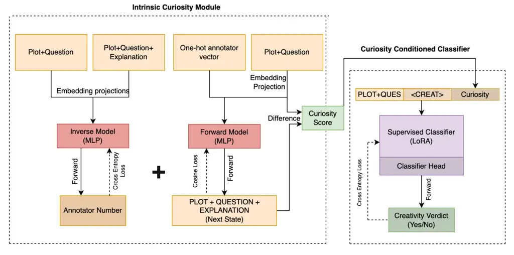
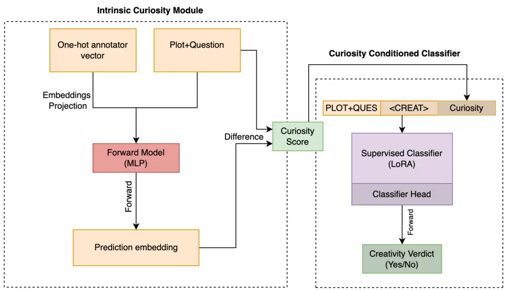
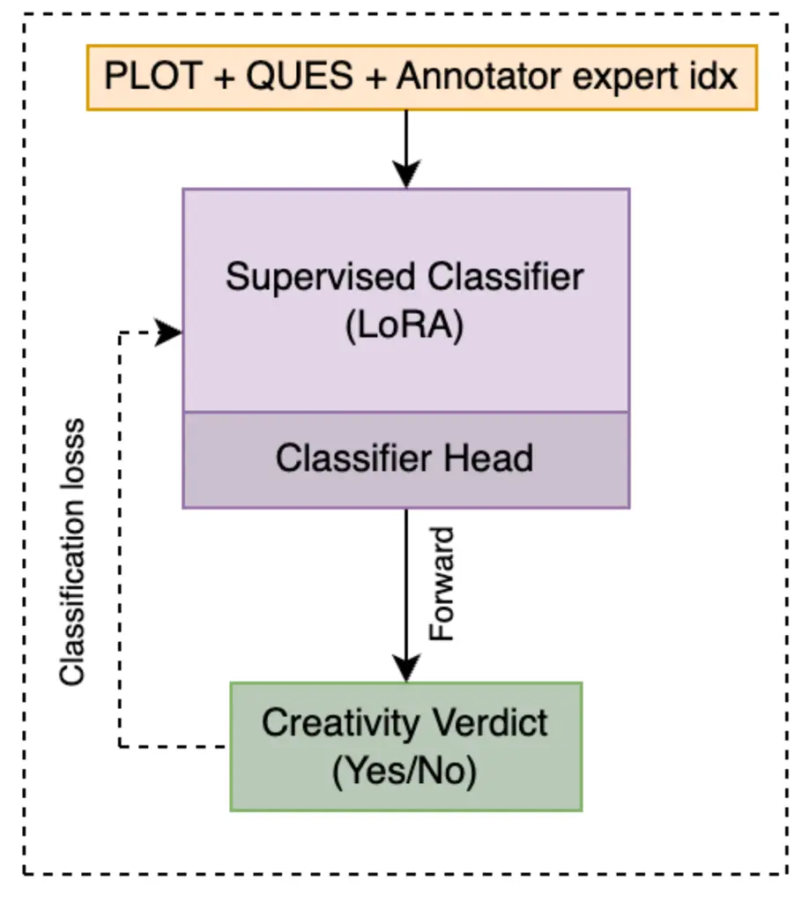
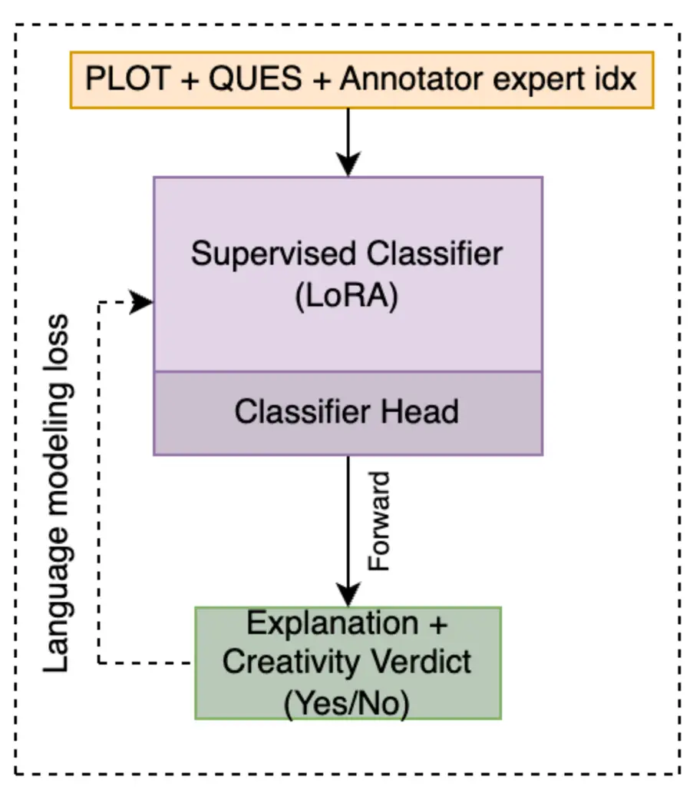
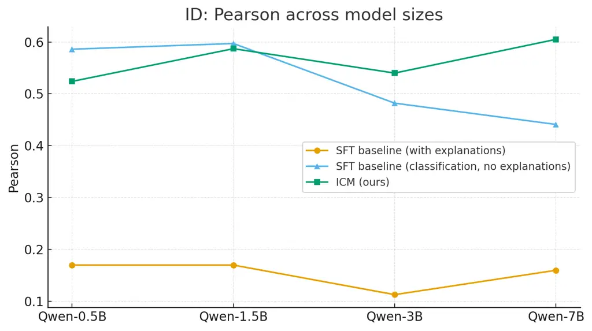
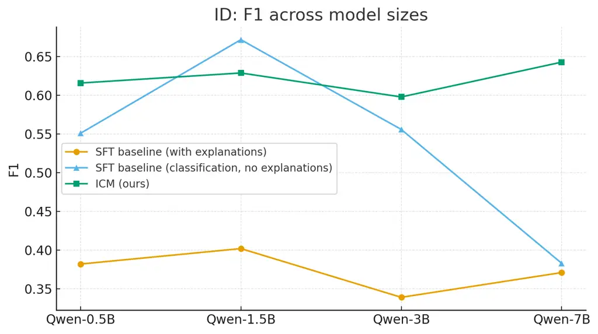
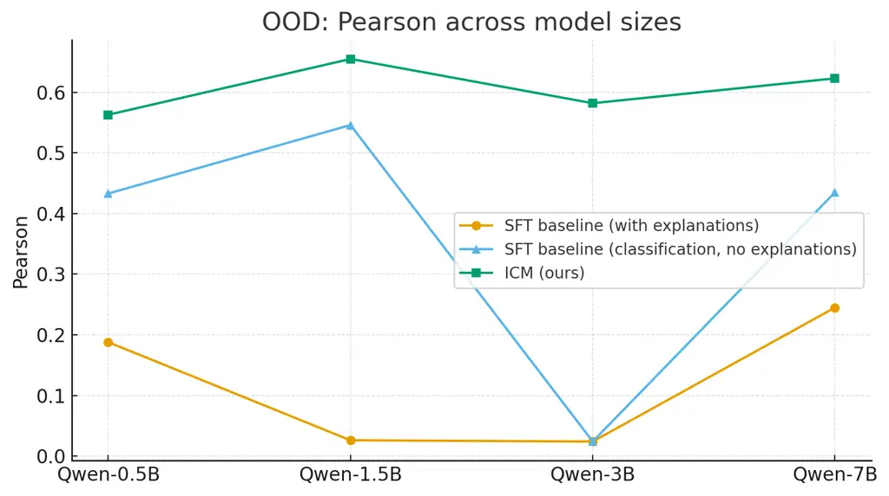
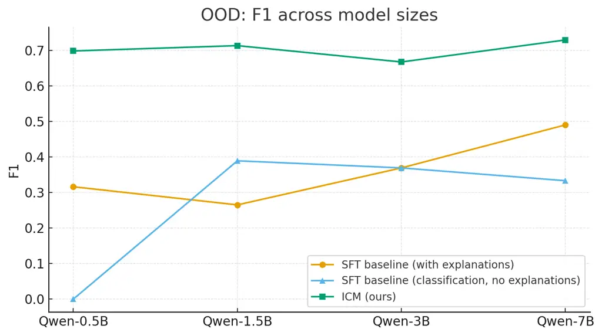
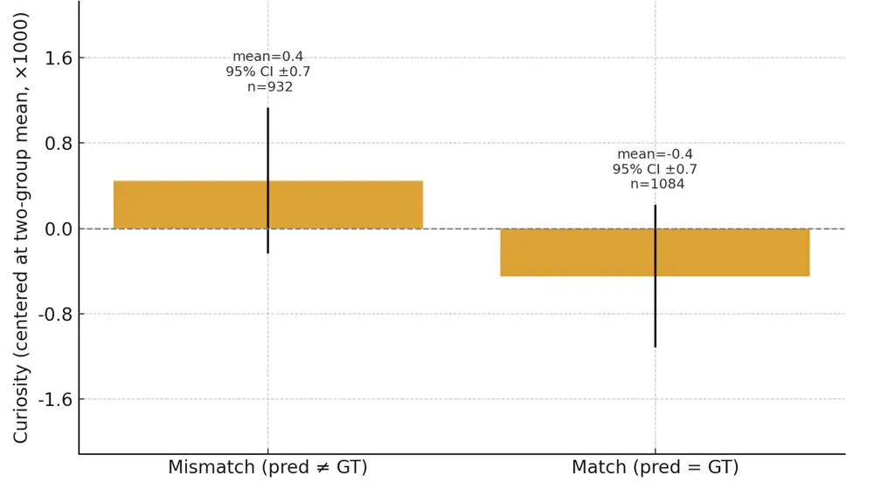

# Curiosity-Driven LLM-as-a-judge for Personalized Creative Judgment

Vanya Bannihatti Kumar Affiliation: Adobe Inc.
Email: [vbannihatti@adobe.com](mailto:)    Divyanshu Goyal
Affiliation: Adobe Inc. Email: [divgoyal@adobe.com](mailto:)    Akhil
Eppa Affiliation: Adobe Inc. Email: [aeppa@adobe.com](mailto:)    Neel
Bhandari Affiliation: Adobe Inc. Email: [neelb@adobe.com](mailto:)

###### Abstract

Modern large language models (LLMs) excel at objective tasks such as
evaluating mathematical reasoning and factual accuracy, yet they falter
when faced with the nuanced, subjective nature of assessing creativity.
In this work, we propose a novel curiosity-driven LLM-as-a-judge for
evaluating creative writing which is personlized to each individual’s
creative judgments. We use the Torrance Test of Creative Thinking(TTCW)
benchmark introduced in Chakrabarty et al. (2024), which has stories
annotated by expert humans across various subjective dimensions like
_Originality_, to test our hypothesis. We show that our method enables
models across various sizes, to learn the nuanced creative judgments of
different individuals, by showing improvements over baseline supervised
finetuning(SFT) method across various evaluation metrics like Pearson
correlation, Cohen’s $`\kappa`$ and F1 values. Our method is especially
useful in subjective evaluations where not all the annotators agree with
each other.

|     |
| --- |
|     |

## 1 Introduction

Rigorous, standardized evaluation has repeatedly catalyzed progress in
machine learning, from ImageNetRussakovsky et al. (2015) and GLUEWang
et al. (2019), driving leaps in the fields of computer vision and
Natural Language Processing, respectively. The same effect is evident in
objective math reasoning, where benchmarks like GSM8KCobbe et al.
(2021), together with RL-trained reasoning models such as OpenAI’s
o1OpenAI et al. (2024) and DeepSeek-R1DeepSeek-AI et al. (2025) have
obtained strong results on hard contests like AIME and IMO.

While robust evaluation metrics exist for objective tasks such as
mathematical reasoning and factual verification, subjective tasks like
creativity remain difficult to assess reliably. There are many previous
works Panickssery et al. (2024a); Wataoka et al. (2025) which show that
using Large Language Models(LLM) as a judge prefer their own generations
making them unreliable. Despite the success of LLMs on objective
benchmarks, they still struggle to evaluate creativity in a manner
aligned with human judgment. As shown in Chakrabarty et al. (2024) and
Table 12 and Table 2, even state-of-the-art models fall short in
consistently evaluating the subjective dimensions of the story as well
as a human expert. This can be attributed to the fact that individual
preferences shape creativity and rarely align uniformly across people.

To address this gap, we present an enhanced LLM-as-a-judge that not only
learns from a diverse pool of annotations but also adapts its scoring to
align with individual annotators or experts. This allows for more
faithful and preference-aware evaluation of creativity. We emphasize
personalization in our framework because the task of assessing
subjective criteria is inherently variable across individuals. To this
end, we propose a curiosity-driven LLM-as-a-judge for evaluating
creativity in text generation, drawing inspiration from the
curiosity-based Reinforcement Learning (RL) framework of Pathak et al.
(2017). However, unlike the RL setting in Pathak et al. (2017), we
reinterpret curiosity as an _belief-shift signal_ for creative
evaluation. Specifically, when the model is “surprised” by an expert’s
explanation, it signals a mismatch between the LLM’s prior belief and
the expert’s preference; conversely, low surprise indicates alignment
between the LLM and the expert (see Fig 5. To implement this, we first
train an Intrinsic Curiosity Model (ICM) that measures the LLM’s
surprise at a given explanation while simultaneously predicting which
expert or annotator produced the explanation. The intuition behind
predicting the annotator is that the model can learn which annotator
caused the belief shift, allowing it to calibrate the curiosity signal
for each annotator individually, thereby improving personalization. The
resulting _curiosity score_ is then fed as an auxiliary, self-supervised
signal to improve a supervised fine-tuning (SFT) model (see Fig 1).

In our experiments, we establish a baseline using an SFT model that
predicts annotators’ binary judgments from the story and question (see
Fig 3(a)). To evaluate the effect of curiosity, we enhance this baseline
with an ICM-derived curiosity score. More concretely we append the
curiosity score to story and question in the baseline model. This helps
us do a fair comparison on effect of curiosity signal on the final
judgment and thereby measure the lift in performance our methodology
provides over the baseline.

We conduct extensive experiments across various model sizes to ensure
our method scales well with model size. Since the TTCW dataset size is
extremely small, we do a 5-fold cross validation in order to ensure that
our results are statistically significant. We also test our method in
out-of-distribution scenarios to ensure that our method generalizes
well. Averaged across model sizes, ICM significantly improves Pearson
correlation and F1 scores. More details about the results can be found
in Fig 4.



Figure 1: Overview of Architecture during training for Curiosity Driven
LLM-as-a-judge



Figure 2: Overview of Architecture during inference for Curiosity Driven
LLM-as-a-judge



(a) Baseline without using explanations



(b) Baseline using explanations

Figure 3: Comparison of baselines with and without using explanations.

## 2 Methodology

In this section, we describe our curiosity-driven LLM-as-a-judge for
evaluating creativity in text generation, which combines belief shift
estimation with expert attribution. Our method leverages the TTCW
dataset Chakrabarty et al. (2024), which is based on the Torrance Test
of Creative Thinking Torrance (1966) but adapted for LLMs. We focus on a
subset of five creativity dimensions particularly relevant for
evaluating the creative judgments of generative language models. We
detail the dataset structure, model architecture, loss functions, and
the formulation of our curiosity signal.

### 2.1 Dataset

The TTCW dataset¹¹ 1 [Huggingface TTCW
dataset](https://huggingface.co/datasets/Salesforce/ttcw_creativity_eval)
provides expert human-annotated creativity judgments across 14 distinct
dimensions. All the distinct dimensions in the TTCW dataset are
mentioned in Appendix A.1. For this study, we focus on five dimensions,
3 of which are categorised under Originality and 2 under flexibility:
Originality in Thought, Originality in Form, Originality in Theme and
Content, Structural Flexibility, and Perspective and Voice Flexibility.
Our analysis is restricted to these five dimensions, encompassing all
dimensions under Originality and two representative dimensions from
Flexibility. We picked these 5 dimensions among the 14(Table 4) as these
are more subjective in nature and hence the most ideal to evaluate our
methodology. We defer exploration of the remaining dimensions to future
work. Questions associated with each dimension can be found in appendix 6.

### 2.2 Data Format and Task Setup

Each example in the dataset consists of a story $`S`$, a
creativity-focused question $`Q_{d}`$ specific to dimension $`d`$, an
expert ID $`z_{i}`$ where $`i\in\{1,2,3\}`$ for each annotation by an
expert, three expert-provided explanations
$`\mathcal{E}=\{e_{1},e_{2},e_{3}\}`$, and corresponding binary verdicts
$`V_{i}\in\{\texttt{yes},\texttt{no}\}`$ for each explanation.

The task is to improve the model’s performance on producing judgments
similar to that of a particular expert when the model is presented with
the story and the creative question

### 2.3 Intrinsic Curiosity Model Overview

Our model operates in two stages:

1.  1.  Belief Shift Estimation (Forward Score): The model measures the
        impact of an expert explanation on their prediction of creativity.
2.  2.  Expert Attribution (Backward Score): The model identifies which
        expert wrote a given explanation.

#### 2.3.1 Forward Score: Belief Shift via Cosine Loss

We define two states:

- •
  State A: Input consisting of the story and question and one-hot vector
  of the expert ID $`z_{i}`$ represented as $`(S,Q_{d},onehot(z_{i}))`$
  where $`i\in\{1,2,3\}`$ as each story-question pair is annotated by 3
  experts.
- •
  State B: Input augmented with one expert explanation
  $`(S,Q_{d},e_{i})`$ where $`i\in\{1,2,3\}`$.

Let $`f_{\theta}^{(A)}=f_{\theta}(S,Q_{d},onehot(z_{i}))`$ and
$`f_{\theta}^{(B)}=f_{\theta}(S,Q_{d},e_{i})`$, where $`f_{\theta}`$
denote the judge’s scoring function (logit head) with parameters
$`\theta`$ that maps the input to a scalar judgment logit.

The forward loss is defined as the cosine loss between these two
predictions:

```math
\mathcal{L}_{\text{forward}}=1-\frac{f_{\theta}^{(A)}\cdot f_{\theta}^{(B)}}{\|f_{\theta}^{(A)}\|\|f_{\theta}^{(B)}\|}
```

This loss captures how much the model’s belief about creativity of the
story shifts when it incorporates the explanation by the annotator,
which we define as the intrinsic curiosity measure.

#### 2.3.2 Backward Score: Expert Attribution via Cross-Entropy

To help the model to understand the distinct reasoning styles of
different experts, we introduce an auxiliary classification task. Given
$`(S,Q_{d},e_{i})`$, the model predicts the identity of the expert
$`z_{i}\in\{1,2,3\}`$ who authored explanation $`e_{i}`$:

```math
p_{\phi}(z_{i}\mid S,Q_{d},e_{i})=\text{softmax}(g_{\phi}(S,Q_{d},e_{i}))
```

The backward loss is the cross-entropy between the predicted and true
expert label:

```math
\mathcal{L}_{\text{backward}}=-\log p_{\phi}(z_{i}\mid S,Q_{d},e_{i})
```

#### 2.3.3 Loss function of Intrinsic curiosity model(ICM)

We define the ICM model’s loss as a weighted combination of the forward
and backward components:

```math
\mathcal{L}_{\text{curiosity}}=\mathcal{L}_{\text{forward}}+\lambda\cdot\mathcal{L}_{\text{backward}}
```

where $`\lambda`$ is a tunable hyperparameter that balances the two
objectives. In our experiments we set $`\lambda`$ as 1.

#### 2.3.4 Incorporating the Curiosity Signal to SFT

To evaluate the utility of the learned curiosity signal, we use it as a
conditioning input to a supervised fine-tuning (SFT) model trained to
predict expert verdicts. For each instance, we append the scalar
curiosity score to the original input using a special delimiter token
\<CREAT\>, resulting in the following input format:

```math
\texttt{Input:}\quad Q_{d}+S+\texttt{<CREAT>}+{Curiosity}_{\text{Score}}\quad\longrightarrow\quad\texttt{Target: }V_{i}
```

```math
\text{Curiosity}_{\text{score}}\;=\;f_{\theta}\!\big(S,\,Q_{d},\,e_{i}\big)\;-\;f_{\theta}\!\big(S,\,Q_{d},\,\mathrm{onehot}(\text{expert\_idx})\big)
```

$`V_{i}\in\{\texttt{yes},\texttt{no}\}`$ is the binary verdict
associated with explanation $`e_{i}`$. The model uses the
$`{Curiosity}_{\text{Score}}`$ as a signal to predict the verdict of the
given annotator. We use cross-entropy loss for training this classifier
model

### 2.4 Inference

During inference(see Fig 2), the story and creativity-focused questions
are first passed through the intrinsic curiosity model (ICM) to compute
a curiosity score. This score reflects the model’s internal belief shift
in response to the input for that particular annotator. The resulting
curiosity score is then appended to the original input, using a special
delimiter token \<CREAT\>—and passed to the SFT classifier model. This
classifier then predicts the binary creativity verdict (yes or no) for
the given story-question pair. .

### 2.5 Baseline with explanations

For the baseline comparison , we use a standard SFT model that produces
the explanation and binary verdict given the input(see fig. 3(b)). The
model input is structured as:

```math
\texttt{Input:}\quad Q_{d}+S+z_{i}\quad\longrightarrow\quad\texttt{Target:}\{V_{i},e_{i}\}
```

At inference time, we provide $`Q_{d}`$, $`S`$, and $`z_{i}`$ as input,
and the model outputs a JSON structure, from which the predicted verdict
is parsed and compared to the ground truth. This baseline is trained
using language modeling loss.

### 2.6 Baseline without explanations

We ensure to compare our method against the baseline SFT in a
classification setting rather than a causal language model setting to
ensure fairness in comparison(see fig. 3(a)). Since we set up the
baseline SFT in a classification setting, we do not include the
explanations as neither part of the input or the output of the
classification task. In this classification setting we use the question
and the story as part of input and the verdict as part of the output.

```math
\texttt{Input:}\quad Q_{d}+S+z_{i}\quad\longrightarrow\quad\texttt{Target:}\{V_{i}\}
```

### 2.7 Evaluation

Evaluating subjective tasks like creativity presents unique challenges,
as even human annotators often disagree on what constitutes a "correct"
judgment. Rather than attempting to define a universal metric for
creativity, our approach embraces this subjectivity by focusing on
personalization. We aim to adapt evaluation signals to individual
experts by learning from a small number of their labeled examples. This
allows us to model subjective preferences more faithfully and use this
personalized model to assess creativity in a user-aligned manner. To
quantify model performance in capturing individual judgments, we report
Pearson Correlation Benesty et al. (2009) and Cohen’s $`\kappa`$ Cohen
(1960), along with Precision, Recall, and F1-score. These metrics enable
us to assess both the predictive accuracy and ranking consistency of our
models in aligning with subjective human evaluations.

## 3 Theory: Why Curiosity Beats Using Explanation Text Directly

Let $`e`$ denote the expert’s explanation, x = $`Q_{d}+S`$,
$`s_{\text{base}}(x)=f_{\theta}\!\big(S,\,Q_{d},\,\mathrm{onehot}(\text{$z*{i}$})\big)`$
the pre-explanation logit, and
$`s*{\text{expl}}(x,e*{i})=f*{\theta}\!\big(S,\,Q*{d},\,e*{i}\big)`$ the
post-explanation logit produced by the model when conditioned on $`e`$.
The $`\text{Curiosity}\_{\text{Score}}`$ is defined as the belief shift.

```math
\text{Curiosity}_{\text{score}}\;=\;f_{\theta}\!\big(S,\,Q_{d},\,e_{i}\big)-f_{\theta}\!\big(S,\,Q_{d},\,\mathrm{onehot}(\text{$z_{i}$})\big),
```

and _discard_ $`e`$ thereafter. We train a predictor
$`\hat{p}_{\theta}(V{=}1\mid x,\text{Curiosity}_{\text{score}})=\sigma\!\big(h_{\theta}(x,\text{Curiosity}_{\text{score}})\big)`$
where $`V`$ is the verdict, $`h`$ is the LLM judge model and $`\sigma`$
represents softmax. This yields three advantages grounded in standard
theory.

##### (1) Weight-of-evidence sufficiency.

In logit/Bayesian updates, additional information acts _additively_ on
log-odds via a log-likelihood ratio (_weight of evidence_) (Agresti,
2013):

```math
\log\frac{\Pr(V=1\mid x,e_{i})}{\Pr(V=0\mid x,e_{i})}\,=\,\log\frac{\Pr(V=1\mid x)}{\Pr(V=0\mid x)}\,+\,\underbrace{\log\frac{p(e\mid V=1,x)}{p(e\mid V=0,x)}}_{\text{weight of evidence}}.
```

In our methodology,
$`\text{Curiosity}_{\text{Score}}=s_{\text{expl}}-s_{\text{base}}`$ is
an _empirical estimate_ of this increment on the log-odds scale, so it
preserves the decision-relevant effect of $`e`$ while removing
lexical/style nuisance. Consequently, conditioning on
$`\text{Curiosity}_{\text{Score}}`$ approximates the theoretically
“right” sufficient update in a logistic decision rule (Agresti, 2013).

##### (2) Variance reduction via a control-variate effect.

Let $`Z`$ be the random quantity we wish to estimate more stably (e.g.,
per-example loss), and let $`C=\text{Curiosity}_{\text{Score}}`$ be the
control signal. With Pearson correlation

```math
\rho\;=\;\mathrm{Corr}(Z,C)\;=\;\frac{\mathrm{Cov}(Z,C)}{\sqrt{\mathrm{Var}(Z)\,\mathrm{Var}(C)}}\in[-1,1],
```

the classic control-variate construction implies that the optimally
adjusted estimator $`Z^{\star}=Z-\alpha^{\star}(C-\mathbb{E}[C])`$
achieves

```math
\mathrm{Var}(Z^{\star})\;=\;\mathrm{Var}(Z)\,\bigl(1-\rho^{2}\bigr)\quad\text{at}\quad\alpha^{\star}=\frac{\mathrm{Cov}(Z,C)}{\mathrm{Var}(C)}.
```

Thus any nonzero correlation with $`c`$ strictly reduces variance (Owen,
2013, Ch. 8). Here, $`Z=\ell_{i}(\theta)`$ (per-example cross-entropy
loss) to reduce risk variance. Lower variance improves sample efficiency
and stabilizes training.

##### (3)Curiosity as a Model of Annotator Behaviour and Generalization

Subjective labels reflect both item difficulty and rater idiosyncrasy. A
classic way to formalize this is a random–effects logit (Dawid and
Skene, 1979; Agresti, 2013):

```math
\mathrm{logit}\,\Pr(V{=}1\mid x,z_{i})\;=\;f(x)\;+\;b_{z_{i}}(x), \tag{1}
```

where $`f(x)`$ captures item evidence and $`b_{a}(x)`$ represents the
(possibly context-dependent) strictness/leniency of annotator $`a`$.
Since the curiosity score is able to model the annotator behaviour
without considering the idiosyncrasies of the explanation text, it is
able to better generalize to out-of-distribution dimensions for that
annotator.

| Model    | Exp. | LoRA $`\alpha`$/R | Pearson            | Cohen’s $`\kappa`$ | F1                 | Precision          | Recall             |
| -------- | ---- | ----------------- | ------------------ | ------------------ | ------------------ | ------------------ | ------------------ |
| Qwen0.5B | SFT  | 256/256           | 0.170 $`\pm`$0.049 | 0.155 $`\pm`$0.046 | 0.382 $`\pm`$0.049 | 0.452 $`\pm`$0.059 | 0.334 $`\pm`$0.060 |
|          | ICM  | 32/16             | 0.524 $`\pm`$0.092 | 0.383 $`\pm`$0.076 | 0.616 $`\pm`$0.048 | 0.494 $`\pm`$0.046 | 0.818 $`\pm`$0.067 |
| Qwen1.5B | SFT  | 256/256           | 0.170 $`\pm`$0.048 | 0.155 $`\pm`$0.048 | 0.402 $`\pm`$0.049 | 0.432 $`\pm`$0.020 | 0.383 $`\pm`$0.083 |
|          | ICM  | 32/16             | 0.587 $`\pm`$0.061 | 0.406 $`\pm`$0.065 | 0.629 $`\pm`$0.045 | 0.506 $`\pm`$0.045 | 0.836 $`\pm`$0.056 |
| Qwen3B   | SFT  | 256/256           | 0.113 $`\pm`$0.083 | 0.110 $`\pm`$0.081 | 0.339 $`\pm`$0.051 | 0.401 $`\pm`$0.067 | 0.298 $`\pm`$0.060 |
|          | ICM  | 32/16             | 0.540 $`\pm`$0.057 | 0.356 $`\pm`$0.081 | 0.598 $`\pm`$0.054 | 0.481 $`\pm`$0.050 | 0.794 $`\pm`$0.070 |
| Qwen7B   | SFT  | 128/128           | 0.160 $`\pm`$0.050 | 0.168 $`\pm`$0.085 | 0.371 $`\pm`$0.021 | 0.443 $`\pm`$0.050 | 0.324 $`\pm`$0.038 |
|          | ICM  | 32/16             | 0.605 $`\pm`$0.083 | 0.429 $`\pm`$0.082 | 0.643 $`\pm`$0.053 | 0.518 $`\pm`$0.051 | 0.850 $`\pm`$0.072 |

Table 1: ICM method results against the SFT baseline with explanations



(a) ID Pearson



(b) ID F1



(c) OOD Pearson



(d) OOD F1

Figure 4: Three-way comparison across model sizes for ICM (ours), SFT
baseline (classification, no explanations), and SFT baseline (with
explanations). Panels show Pearson and F1 for in-distribution (top) and
out-of-distribution (bottom). For exact results of the ID and OOD
experiments of _baseline without explanation(classification)_, refer to
Table 13 and Table 14

| Model    | Exp. | Pearson              | F1                   | Precision            | Recall               |
| -------- | ---- | -------------------- | -------------------- | -------------------- | -------------------- |
| Qwen0.5B | ICM  | 0.524 $`\pm`$0.092   | 0.616 $`\pm`$0.048   | 0.494 $`\pm`$0.046   | 0.818 $`\pm`$0.067   |
| Qwen1.5B | ICM  | 0.587 $`\pm`$0.061   | 0.629 $`\pm`$0.045   | 0.506 $`\pm`$0.045   | 0.836 $`\pm`$0.056   |
| Qwen3B   | ICM  | 0.540 $`\pm`$0.057   | 0.598 $`\pm`$0.054   | 0.481 $`\pm`$0.050   | 0.794 $`\pm`$0.070   |
| Qwen7B   | ICM  | 0.605 $`\pm`$0.083   | 0.643 $`\pm`$0.053   | 0.518 $`\pm`$0.051   | 0.850 $`\pm`$0.072   |
| GPT-5    | ICM  | 0.2409 $`\pm`$0.1379 | 0.3467 $`\pm`$0.1592 | 0.5698 $`\pm`$0.2305 | 0.2608 $`\pm`$0.1378 |

Table 2: Comparison of ICM method against GPT-5 one-shot

## 4 Experiments

We evaluate our Intrinsic Curiosity Modeling (ICM) approach against a
supervised fine-tuning (SFT) baseline (see Section 2) across multiple
model sizes. For a fair comparison in terms of identical input and
outputs, we compare the ICM setup against SFT baseline with
explanations. We also compare the ICM setup against FT baseline without
explanations in order to ensure the same classification loss is used.

##### Dataset

TTCW contains 48 stories annotated on 5 dimensions with three expert
judgments per story–dimension pair, yielding 720 examples. We use 5-fold
cross-validation with an 80/20 split, giving approximately 576 training
and 144 test items per fold. Because individual folds are small, we
report means across folds for all metrics (Table 1; see also
Section 2.7). Splits are stratified to preserve the positive/negative
label ratio.

##### Training setup.

The _baseline with explanations_ uses a causal language modeling
objective and our ICM model uses a classification objective. We align
shared hyperparameters—learning rate, LoRA Hu et al. (2022) rank, and
batch size—wherever applicable to ensure comparability. The ICM combined
loss uses $`\lambda=1`$. All fine-tuning (ICM and SFT baselines) uses
LoRA; full details are in Table 5. For the _baseline without
explanations_, which also uses a classification loss, we match all of
the ICM hyperparameters.

##### Compute and precision.

All runs use a single NVIDIA A100 (80 GB) GPU. Mixed precision with
bfloat16 is enabled when supported. When base models are loaded with
8-bit quantization, matrix multiplies in bitsandbytes execute in FP16
while LoRA heads operate in bfloat16.

##### Convergence and reproducibility.

We train to loss convergence in all runs and fix random seeds for data
splits and initialization. Hyperparameters and implementation details
appear in Table 5.

## 5 Analysis

### 5.1 Effect of model scale

From Fig 4 we can see that our ICM method improves across model sizes
whereas the _baseline classification method with no explanation_
degrades with increase in model size for both ID and OOD settings. The
reason why the _baseline classification method with no explanation_
maybe degrading with scale is because this method primarily overfits on
the small dataset with larger model sizes. Although the _baseline with
explanation_ improves with increase in model size, it remains uniformly
low compared to the ICM method.

### 5.2 Generalization

To understand the generalization ability of the baseline and the ICM
models, we use the same setup as earlier but train the model in both
methods on 4 dimensions - Originality in Form, Originality in Theme and
Content, Structural Flexibility, and Perspective and Voice Flexibility,
and test these trained models on the held out dimension of Originality
in Thought. In this way there is absolutely no data leakage since the
dimension the model is tested on was never seen during the training.
From figure 4, we can see that gains of the ICM method over both the
baseline methods are much more in the OOD settings rather than ID
settings. This suggests the generalizability of our method because we
are essentially allowing the model to understand the user behavior
before predicting which is much more generalizable as compared to both
baseline SFT methods.

### 5.3 Comparison with GPT-5

Table 2 has the results of the ICM setup against GPT-5. We can see that
even Qwen-0.5B model is able to beat GPT-5 model across all evaluation
metrics except precision. The GPT-5 model was prompted with the same
story, question and annotator index along with one shot example(randomly
picked from training set) by the same annotator. GPT-5 model was more
biased towards the answer "no" and whenever "yes" was predicted, it was
almost always wrong. This further proves the effectiveness of our
method.

| Model    | Experiment | LoRA $`\alpha`$/Rank | Pearson | Cohen’s $`\kappa`$ | F1    | Precision | Recall |
| -------- | ---------- | -------------------- | ------- | ------------------ | ----- | --------- | ------ |
| Qwen0.5B | SFT        | 256/256              | 0.188   | 0.147              | 0.316 | 0.632     | 0.211  |
|          | ICM        | 32/16                | 0.563   | 0.458              | 0.698 | 0.625     | 0.790  |
| Qwen1.5B | SFT        | 256/256              | 0.026   | 0.023              | 0.265 | 0.423     | 0.193  |
|          | ICM        | 32/16                | 0.655   | 0.486              | 0.713 | 0.639     | 0.807  |
| Qwen3B   | SFT        | 256/256              | 0.024   | 0.024              | 0.369 | 0.413     | 0.333  |
|          | ICM        | 32/16                | 0.582   | 0.403              | 0.667 | 0.597     | 0.754  |
| Qwen7B   | SFT        | 128/128              | 0.245   | 0.237              | 0.490 | 0.585     | 0.421  |
|          | ICM        | 32/16                | 0.623   | 0.514              | 0.729 | 0.653     | 0.825  |

Table 3: ICM method results against the SFT baseline with explanations
on Out-of-distribution data

## 6 Conclusion and Future Work

We introduced a curiosity-driven LLM-as-a-judge for evaluating
creativity in text generation, addressing the limitations of baseline
SFT for inherently subjective tasks. Our approach leverages a two-part
curiosity signal, capturing belief shifts via model responses to expert
explanations and incorporating expert attribution through a backward
prediction task. This signal enhances a SFT setup, leading to stronger
alignment with human judgments across multiple creativity dimensions in
the TTCW dataset. Experiments show that incorporating curiosity-based
modeling consistently improves performance across model scales,
surpassing standard SFT baselines in both correlation with human ratings
and classification accuracy. Not only does it scale with model size, it
also improves the performance in out-of-distribution scenarios, where we
test the models on one heldout test dimension by training the models on
the other 4 creativity dimension. Future work includes extending the
curiosity-driven LLM-as-a-judge to other domains like marketing,
evaluating novelty of scientific ideas etc,. We also plan to use the
curiosity signal as a reward signal in RL setup to further improve our
current results.

## 7 Literature Review

The evaluation of creativity in language models builds upon decades of
work in creativity research, where the Torrance Tests of Creative
Thinking (TTCT) assess fluency, flexibility, originality, and
elaboration Torrance (1966), and the Consensual Assessment Technique
(CAT) uses aggregated expert judgments, a reliable but labour-intensive
process Patterson et al. (2024). The authors of Chakrabarty et al.
(2024) adapted TTCT into the Torrance Tests for Creative Writing (TTCW),
designing fourteen binary tests and enlisting creative-writing experts
to evaluate 48 stories; their study showed that large language models
pass these tests three to ten times less often than human writers
Chakrabarty et al. (2024), highlighting a sizable gap in creative
competence. Alternative evaluation paradigms, such as the
Leap-of-Thought (LoT) framework for humorous, associative reasoning,
argue that step-by-step chain-of-thought prompting can limit creativity
and instead encourage non-sequential “leaps” Zhong et al. (2024).
Efforts to automate creativity scoring (e.g., distributional-semantics
proxies for novelty) often align weakly with expert judgments,
reinforcing the need for human-aligned signals.

Because creativity judgments are _subjective_, collapsing rater
perspectives via majority vote can erase systematic, meaningful
disagreement. Following work on multi-annotator modeling, we treat
annotators as distributions to be modeled rather than aggregated away
Mostafazadeh Davani et al. (2022), rather than use the classical
aggregation methods that infer a single latent “truth” Whitehill et al.
(2009); Hovy et al. (2013). In parallel, recent results caution against
naïve _LLM-as-judge_ usage: evaluators can recognize and prefer their
own generations, introducing self-preference bias Panickssery et al.
(2024b). Calibrated autoraters offer a partial mitigation via broad
multi-task training and bias auditing Vu et al. (2024). These findings
motivate rater-aware or human-anchored evaluation signals for
creativity.

Intrinsic-motivation signals from reinforcement learning offer a
principled lens on novelty seeking. Information-gain and
prediction-error formulations—VIME Houthooft et al. (2017), ICM Pathak
et al. (2017), and Random Network Distillation Burda et al. (2018)—are
effective for exploration under sparse extrinsic reward. By analogy,
curiosity-style signals can inform language evaluation by rewarding
“useful novelty” (divergent yet coherent), complementing
semantic-distance and rater-based methods. Our work instantiates this by
modeling belief shifts when a language model incorporates expert
explanations (a prediction-error–like signal) and combining it with
expert attribution, yielding a more interpretable and _personalized_
measure of creativity.

## References

- Agresti \[2013\] Alan Agresti. _Categorical Data Analysis_. John Wiley
  & Sons, 3rd edition, 2013.
- Bai et al. \[2023\] Jinze Bai, Shuai Bai, Yunfei Chu, Zeyu Cui, Kai
  Dang, Xiaodong Deng, Yang Fan, Wenbin Ge, Yu Han, Fei Huang, et al.
  Qwen technical report. _arXiv preprint arXiv:2309.16609_, 2023.
- Bellemare et al. \[2016\] Marc G. Bellemare, Sriram Srinivasan, Georg
  Ostrovski, Tom Schaul, David Saxton, and Remi Munos. Unifying
  count-based exploration and intrinsic motivation, 2016. URL
  [https://arxiv.org/abs/1606.01868](https://arxiv.org/abs/1606.01868).
- Benesty et al. \[2009\] Jacob Benesty, Jingdong Chen, Yiteng Huang,
  and Israel Cohen. Pearson correlation coefficient. In _Noise reduction
  in speech processing_, pages 1–4. Springer, 2009.
- Burda et al. \[2018\] Yuri Burda, Harrison Edwards, Amos Storkey, and
  Oleg Klimov. Exploration by random network distillation. _arXiv
  preprint arXiv:1810.12894_, 2018.
- Chakrabarty et al. \[2024\] Tuhin Chakrabarty, Philippe Laban,
  Divyansh Agarwal, Smaranda Muresan, and Chien-Sheng Wu. Art or
  artifice? large language models and the false promise of
  creativity, 2024. URL
  [https://arxiv.org/abs/2309.14556](https://arxiv.org/abs/2309.14556).
- Cobbe et al. \[2021\] Karl Cobbe, Vineet Kosaraju, Mohammad Bavarian,
  Mark Chen, Heewoo Jun, Lukasz Kaiser, Matthias Plappert, Jerry Tworek,
  Jacob Hilton, Reiichiro Nakano, Christopher Hesse, and John Schulman.
  Training verifiers to solve math word problems. _arXiv preprint
  arXiv:2110.14168_, 2021.
- Cohen \[1960\] Jacob Cohen. A coefficient of agreement for nominal
  scales. _Educational and psychological measurement_,
  20(1):37–46, 1960.
- Dawid and Skene \[1979\] A. Philip Dawid and Allan Skene. Maximum
  likelihood estimation of observer error-rates using the em algorithm.
  _Journal of The Royal Statistical Society Series C-applied
  Statistics_, 28:20–28, 1979. URL
  [https://api.semanticscholar.org/CorpusID:45813168](https://api.semanticscholar.org/CorpusID:45813168).
- DeepSeek-AI et al. \[2025\] DeepSeek-AI, Daya Guo, Dejian Yang, Haowei
  Zhang, Junxiao Song, Ruoyu Zhang, Runxin Xu, Qihao Zhu, Shirong Ma,
  Peiyi Wang, Xiao Bi, Xiaokang Zhang, Xingkai Yu, Yu Wu, Z. F. Wu,
  Zhibin Gou, Zhihong Shao, Zhuoshu Li, Ziyi Gao, Aixin Liu, Bing Xue,
  Bingxuan Wang, Bochao Wu, Bei Feng, Chengda Lu, Chenggang Zhao,
  Chengqi Deng, Chenyu Zhang, Chong Ruan, Damai Dai, Deli Chen, Dongjie
  Ji, Erhang Li, Fangyun Lin, Fucong Dai, Fuli Luo, Guangbo Hao,
  Guanting Chen, Guowei Li, H. Zhang, Han Bao, Hanwei Xu, Haocheng Wang,
  Honghui Ding, Huajian Xin, Huazuo Gao, Hui Qu, Hui Li, Jianzhong Guo,
  Jiashi Li, Jiawei Wang, Jingchang Chen, Jingyang Yuan, Junjie Qiu,
  Junlong Li, J. L. Cai, Jiaqi Ni, Jian Liang, Jin Chen, Kai Dong, Kai
  Hu, Kaige Gao, Kang Guan, Kexin Huang, Kuai Yu, Lean Wang, Lecong
  Zhang, Liang Zhao, Litong Wang, Liyue Zhang, Lei Xu, Leyi Xia,
  Mingchuan Zhang, Minghua Zhang, Minghui Tang, Meng Li, Miaojun Wang,
  Mingming Li, Ning Tian, Panpan Huang, Peng Zhang, Qiancheng Wang,
  Qinyu Chen, Qiushi Du, Ruiqi Ge, Ruisong Zhang, Ruizhe Pan, Runji
  Wang, R. J. Chen, R. L. Jin, Ruyi Chen, Shanghao Lu, Shangyan Zhou,
  Shanhuang Chen, Shengfeng Ye, Shiyu Wang, Shuiping Yu, Shunfeng Zhou,
  Shuting Pan, S. S. Li, Shuang Zhou, Shaoqing Wu, Shengfeng Ye, Tao
  Yun, Tian Pei, Tianyu Sun, T. Wang, Wangding Zeng, Wanjia Zhao, Wen
  Liu, Wenfeng Liang, Wenjun Gao, Wenqin Yu, Wentao Zhang, W. L. Xiao,
  Wei An, Xiaodong Liu, Xiaohan Wang, Xiaokang Chen, Xiaotao Nie, Xin
  Cheng, Xin Liu, Xin Xie, Xingchao Liu, Xinyu Yang, Xinyuan Li,
  Xuecheng Su, Xuheng Lin, X. Q. Li, Xiangyue Jin, Xiaojin Shen, Xiaosha
  Chen, Xiaowen Sun, Xiaoxiang Wang, Xinnan Song, Xinyi Zhou, Xianzu
  Wang, Xinxia Shan, Y. K. Li, Y. Q. Wang, Y. X. Wei, Yang Zhang,
  Yanhong Xu, Yao Li, Yao Zhao, Yaofeng Sun, Yaohui Wang, Yi Yu, Yichao
  Zhang, Yifan Shi, Yiliang Xiong, Ying He, Yishi Piao, Yisong Wang,
  Yixuan Tan, Yiyang Ma, Yiyuan Liu, Yongqiang Guo, Yuan Ou, Yuduan
  Wang, Yue Gong, Yuheng Zou, Yujia He, Yunfan Xiong, Yuxiang Luo,
  Yuxiang You, Yuxuan Liu, Yuyang Zhou, Y. X. Zhu, Yanhong Xu, Yanping
  Huang, Yaohui Li, Yi Zheng, Yuchen Zhu, Yunxian Ma, Ying Tang, Yukun
  Zha, Yuting Yan, Z. Z. Ren, Zehui Ren, Zhangli Sha, Zhe Fu, Zhean Xu,
  Zhenda Xie, Zhengyan Zhang, Zhewen Hao, Zhicheng Ma, Zhigang Yan,
  Zhiyu Wu, Zihui Gu, Zijia Zhu, Zijun Liu, Zilin Li, Ziwei Xie, Ziyang
  Song, Zizheng Pan, Zhen Huang, Zhipeng Xu, Zhongyu Zhang, and Zhen
  Zhang. Deepseek-r1: Incentivizing reasoning capability in llms via
  reinforcement learning, 2025. URL
  [https://arxiv.org/abs/2501.12948](https://arxiv.org/abs/2501.12948).
- Fisch et al. \[2025\] Adam Fisch, Jacob Eisenstein, Vicky Zayats,
  Alekh Agarwal, Ahmad Beirami, Chirag Nagpal, Pete Shaw, and Jonathan
  Berant. Robust preference optimization through reward model
  distillation, 2025. URL
  [https://arxiv.org/abs/2405.19316](https://arxiv.org/abs/2405.19316).
- Guilford \[1967\] J Paul Guilford. Creativity: Yesterday, today and
  tomorrow. _Journal of Creative Behavior_, 1:3–14, 1967. URL
  [https://api.semanticscholar.org/CorpusID:143529843](https://api.semanticscholar.org/CorpusID:143529843).
- Houthooft et al. \[2017\] Rein Houthooft, Xi Chen, Yan Duan, John
  Schulman, Filip De Turck, and Pieter Abbeel. Vime: Variational
  information maximizing exploration, 2017. URL
  [https://arxiv.org/abs/1605.09674](https://arxiv.org/abs/1605.09674).
- Hovy et al. \[2013\] Dirk Hovy, Taylor Berg-Kirkpatrick, Ashish
  Vaswani, and Eduard Hovy. Learning whom to trust with MACE. In Lucy
  Vanderwende, Hal Daumé III, and Katrin Kirchhoff, editors,
  _Proceedings of the 2013 Conference of the North American Chapter of
  the Association for Computational Linguistics: Human Language
  Technologies_, pages 1120–1130, Atlanta, Georgia, June 2013.
  Association for Computational Linguistics. URL
  [https://aclanthology.org/N13-1132/](https://aclanthology.org/N13-1132/).
- Hu et al. \[2022\] Edward J Hu, Yelong Shen, Phillip Wallis, Zeyuan
  Allen-Zhu, Yuanzhi Li, Shean Wang, Lu Wang, Weizhu Chen, et al. Lora:
  Low-rank adaptation of large language models. _ICLR_, 1(2):3, 2022.
- Jiang et al. \[2023\] Dongfu Jiang, Xiang Ren, and Bill Yuchen Lin.
  Llm-blender: Ensembling large language models with pairwise ranking
  and generative fusion, 2023. URL
  [https://arxiv.org/abs/2306.02561](https://arxiv.org/abs/2306.02561).
- Madotto et al. \[2020\] Andrea Madotto, Mahdi Namazifar, Joost
  Huizinga, Piero Molino, Adrien Ecoffet, Huaixiu Zheng, Alexandros
  Papangelis, Dian Yu, Chandra Khatri, and Gokhan Tur. Exploration based
  language learning for text-based games, 2020. URL
  [https://arxiv.org/abs/2001.08868](https://arxiv.org/abs/2001.08868).
- Mostafazadeh Davani et al. \[2022\] Aida Mostafazadeh Davani, Mark
  Díaz, and Vinodkumar Prabhakaran. Dealing with disagreements: Looking
  beyond the majority vote in subjective annotations. _Transactions of
  the Association for Computational Linguistics_, 10:92–110, 2022. doi:
  10.1162/tacl_a_00449. URL
  [https://aclanthology.org/2022.tacl-1.6/](https://aclanthology.org/2022.tacl-1.6/).
- Nath et al. \[2025\] Abhijnan Nath, Changsoo Jung, Ethan Seefried, and
  Nikhil Krishnaswamy. Simultaneous reward distillation and preference
  learning: Get you a language model who can do both, 2025. URL
  [https://arxiv.org/abs/2410.08458](https://arxiv.org/abs/2410.08458).
- OpenAI et al. \[2024\] OpenAI, :, Aaron Jaech, Adam Kalai, Adam Lerer,
  Adam Richardson, Ahmed El-Kishky, Aiden Low, Alec Helyar, Aleksander
  Madry, Alex Beutel, Alex Carney, Alex Iftimie, Alex Karpenko,
  Alex Tachard Passos, Alexander Neitz, Alexander Prokofiev, Alexander
  Wei, Allison Tam, Ally Bennett, Ananya Kumar, Andre Saraiva, Andrea
  Vallone, Andrew Duberstein, Andrew Kondrich, Andrey Mishchenko, Andy
  Applebaum, Angela Jiang, Ashvin Nair, Barret Zoph, Behrooz Ghorbani,
  Ben Rossen, Benjamin Sokolowsky, Boaz Barak, Bob McGrew, Borys
  Minaiev, Botao Hao, Bowen Baker, Brandon Houghton, Brandon McKinzie,
  Brydon Eastman, Camillo Lugaresi, Cary Bassin, Cary Hudson, Chak Ming
  Li, Charles de Bourcy, Chelsea Voss, Chen Shen, Chong Zhang, Chris
  Koch, Chris Orsinger, Christopher Hesse, Claudia Fischer, Clive Chan,
  Dan Roberts, Daniel Kappler, Daniel Levy, Daniel Selsam, David Dohan,
  David Farhi, David Mely, David Robinson, Dimitris Tsipras, Doug Li,
  Dragos Oprica, Eben Freeman, Eddie Zhang, Edmund Wong, Elizabeth
  Proehl, Enoch Cheung, Eric Mitchell, Eric Wallace, Erik Ritter, Evan
  Mays, Fan Wang, Felipe Petroski Such, Filippo Raso, Florencia Leoni,
  Foivos Tsimpourlas, Francis Song, Fred von Lohmann, Freddie Sulit,
  Geoff Salmon, Giambattista Parascandolo, Gildas Chabot, Grace Zhao,
  Greg Brockman, Guillaume Leclerc, Hadi Salman, Haiming Bao, Hao Sheng,
  Hart Andrin, Hessam Bagherinezhad, Hongyu Ren, Hunter Lightman,
  Hyung Won Chung, Ian Kivlichan, Ian O’Connell, Ian Osband,
  Ignasi Clavera Gilaberte, Ilge Akkaya, Ilya Kostrikov, Ilya Sutskever,
  Irina Kofman, Jakub Pachocki, James Lennon, Jason Wei, Jean Harb,
  Jerry Twore, Jiacheng Feng, Jiahui Yu, Jiayi Weng, Jie Tang, Jieqi Yu,
  Joaquin Quiñonero Candela, Joe Palermo, Joel Parish, Johannes
  Heidecke, John Hallman, John Rizzo, Jonathan Gordon, Jonathan Uesato,
  Jonathan Ward, Joost Huizinga, Julie Wang, Kai Chen, Kai Xiao, Karan
  Singhal, Karina Nguyen, Karl Cobbe, Katy Shi, Kayla Wood, Kendra
  Rimbach, Keren Gu-Lemberg, Kevin Liu, Kevin Lu, Kevin Stone, Kevin Yu,
  Lama Ahmad, Lauren Yang, Leo Liu, Leon Maksin, Leyton Ho, Liam Fedus,
  Lilian Weng, Linden Li, Lindsay McCallum, Lindsey Held, Lorenz Kuhn,
  Lukas Kondraciuk, Lukasz Kaiser, Luke Metz, Madelaine Boyd, Maja
  Trebacz, Manas Joglekar, Mark Chen, Marko Tintor, Mason Meyer, Matt
  Jones, Matt Kaufer, Max Schwarzer, Meghan Shah, Mehmet Yatbaz,
  Melody Y. Guan, Mengyuan Xu, Mengyuan Yan, Mia Glaese, Mianna Chen,
  Michael Lampe, Michael Malek, Michele Wang, Michelle Fradin, Mike
  McClay, Mikhail Pavlov, Miles Wang, Mingxuan Wang, Mira Murati,
  Mo Bavarian, Mostafa Rohaninejad, Nat McAleese, Neil Chowdhury, Neil
  Chowdhury, Nick Ryder, Nikolas Tezak, Noam Brown, Ofir Nachum, Oleg
  Boiko, Oleg Murk, Olivia Watkins, Patrick Chao, Paul Ashbourne, Pavel
  Izmailov, Peter Zhokhov, Rachel Dias, Rahul Arora, Randall Lin,
  Rapha Gontijo Lopes, Raz Gaon, Reah Miyara, Reimar Leike, Renny Hwang,
  Rhythm Garg, Robin Brown, Roshan James, Rui Shu, Ryan Cheu, Ryan
  Greene, Saachi Jain, Sam Altman, Sam Toizer, Sam Toyer, Samuel
  Miserendino, Sandhini Agarwal, Santiago Hernandez, Sasha Baker, Scott
  McKinney, Scottie Yan, Shengjia Zhao, Shengli Hu, Shibani Santurkar,
  Shraman Ray Chaudhuri, Shuyuan Zhang, Siyuan Fu, Spencer Papay, Steph
  Lin, Suchir Balaji, Suvansh Sanjeev, Szymon Sidor, Tal Broda, Aidan
  Clark, Tao Wang, Taylor Gordon, Ted Sanders, Tejal Patwardhan,
  Thibault Sottiaux, Thomas Degry, Thomas Dimson, Tianhao Zheng, Timur
  Garipov, Tom Stasi, Trapit Bansal, Trevor Creech, Troy Peterson, Tyna
  Eloundou, Valerie Qi, Vineet Kosaraju, Vinnie Monaco, Vitchyr Pong,
  Vlad Fomenko, Weiyi Zheng, Wenda Zhou, Wes McCabe, Wojciech Zaremba,
  Yann Dubois, Yinghai Lu, Yining Chen, Young Cha, Yu Bai, Yuchen He,
  Yuchen Zhang, Yunyun Wang, Zheng Shao, and Zhuohan Li. Openai o1
  system card, 2024. URL
  [https://arxiv.org/abs/2412.16720](https://arxiv.org/abs/2412.16720).
- Owen \[2013\] Art B Owen. Monte carlo theory, methods and
  examples, 2013.
- Pan \[2025\] Sarah Pan. Tiny reward models, 2025. URL
  [https://arxiv.org/abs/2507.09973](https://arxiv.org/abs/2507.09973).
- Panickssery et al. \[2024a\] Arjun Panickssery, Samuel Bowman, and Shi
  Feng. Llm evaluators recognize and favor their own generations.
  _Advances in Neural Information Processing Systems_, 37:68772–68802,
  2024a.
- Panickssery et al. \[2024b\] Arjun Panickssery, Samuel R. Bowman, and
  Shi Feng. Llm evaluators recognize and favor their own generations,
  2024b. URL
  [https://arxiv.org/abs/2404.13076](https://arxiv.org/abs/2404.13076).
- Pathak et al. \[2017\] Deepak Pathak, Pulkit Agrawal, Alexei A. Efros,
  and Trevor Darrell. Curiosity-driven exploration by self-supervised
  prediction, 2017. URL
  [https://arxiv.org/abs/1705.05363](https://arxiv.org/abs/1705.05363).
- Patterson et al. \[2024\] John D Patterson, Baptiste Barbot, James
  Lloyd-Cox, and Roger E Beaty. Audra: An automated drawing assessment
  platform for evaluating creativity. _Behavior Research Methods_,
  56(4):3619–3636, 2024.
- Russakovsky et al. \[2015\] Olga Russakovsky, Jia Deng, Hao Su,
  Jonathan Krause, Sanjeev Satheesh, Sean Ma, Zhiheng Huang, Andrej
  Karpathy, Aditya Khosla, Michael Bernstein, Alexander C. Berg, and
  Li Fei-Fei. Imagenet large scale visual recognition challenge, 2015.
  URL
  [https://arxiv.org/abs/1409.0575](https://arxiv.org/abs/1409.0575).
- Schmidhuber \[2010\] J. Schmidhuber. Formal theory of creativity, fun,
  and intrinsic motivation. _IEEE Trans. on Auton. Ment. Dev._,
  2(3):230–247, September 2010. ISSN 1943-0604. doi:
  10.1109/TAMD.2010.2056368. URL
  [https://doi.org/10.1109/TAMD.2010.2056368](https://doi.org/10.1109/TAMD.2010.2056368).
- Sidahmed et al. \[2024\] Hakim Sidahmed, Samrat Phatale, Alex
  Hutcheson, Zhuonan Lin, Zhang Chen, Zac Yu, Jarvis Jin, Simral
  Chaudhary, Roman Komarytsia, Christiane Ahlheim, Yonghao Zhu, Bowen
  Li, Saravanan Ganesh, Bill Byrne, Jessica Hoffmann, Hassan Mansoor,
  Wei Li, Abhinav Rastogi, and Lucas Dixon. Parameter efficient
  reinforcement learning from human feedback, 2024. URL
  [https://arxiv.org/abs/2403.10704](https://arxiv.org/abs/2403.10704).
- Torrance \[1966\] E. Paul Torrance. _Torrance Tests of Creative
  Thinking: Norms–Technical Manual (Research Edition)_. Personnel Press,
  Princeton, NJ, 1966.
- Vu et al. \[2024\] Tu Vu, Kalpesh Krishna, Salaheddin Alzubi, Chris
  Tar, Manaal Faruqui, and Yun-Hsuan Sung. Foundational autoraters:
  Taming large language models for better automatic evaluation, 2024.
  URL
  [https://arxiv.org/abs/2407.10817](https://arxiv.org/abs/2407.10817).
- Wan et al. \[2025\] Yanming Wan, Jiaxing Wu, Marwa Abdulhai, Lior
  Shani, and Natasha Jaques. Enhancing personalized multi-turn dialogue
  with curiosity reward, 2025. URL
  [https://arxiv.org/abs/2504.03206](https://arxiv.org/abs/2504.03206).
- Wang et al. \[2019\] Alex Wang, Amanpreet Singh, Julian Michael, Felix
  Hill, Omer Levy, and Samuel R. Bowman. Glue: A multi-task benchmark
  and analysis platform for natural language understanding, 2019. URL
  [https://arxiv.org/abs/1804.07461](https://arxiv.org/abs/1804.07461).
- Wang et al. \[2023\] Xuezhi Wang, Jason Wei, Dale Schuurmans, Quoc Le,
  Ed Chi, Sharan Narang, Aakanksha Chowdhery, and Denny Zhou.
  Self-consistency improves chain of thought reasoning in language
  models, 2023. URL
  [https://arxiv.org/abs/2203.11171](https://arxiv.org/abs/2203.11171).
- Wataoka et al. \[2025\] Koki Wataoka, Tsubasa Takahashi, and Ryokan
  Ri. Self-preference bias in llm-as-a-judge, 2025. URL
  [https://arxiv.org/abs/2410.21819](https://arxiv.org/abs/2410.21819).
- Wei et al. \[2023\] Jason Wei, Xuezhi Wang, Dale Schuurmans, Maarten
  Bosma, Brian Ichter, Fei Xia, Ed Chi, Quoc Le, and Denny Zhou.
  Chain-of-thought prompting elicits reasoning in large language
  models, 2023. URL
  [https://arxiv.org/abs/2201.11903](https://arxiv.org/abs/2201.11903).
- Whitehill et al. \[2009\] Jacob Whitehill, Ting-fan Wu, Jacob Bergsma,
  Javier Movellan, and Paul Ruvolo. Whose vote should count more:
  Optimal integration of labels from labelers of unknown expertise. In
  Y. Bengio, D. Schuurmans, J. Lafferty, C. Williams, and A. Culotta,
  editors, _Advances in Neural Information Processing Systems_,
  volume 22. Curran Associates, Inc., 2009. URL
  [https://proceedings.neurips.cc/paper_files/paper/2009/file/f899139df5e1059396431415e770c6dd-Paper.pdf](https://proceedings.neurips.cc/paper_files/paper/2009/file/f899139df5e1059396431415e770c6dd-Paper.pdf).
- Zar \[2005\] Jerrold H Zar. Spearman rank correlation. _Encyclopedia
  of Biostatistics_, 7, 2005.
- Zhang et al. \[2025\] Yudi Zhang, Lu Wang, Meng Fang, Yali Du,
  Chenghua Huang, Jun Wang, Qingwei Lin, Mykola Pechenizkiy, Dongmei
  Zhang, Saravan Rajmohan, and Qi Zhang. Distill not only data but also
  rewards: Can smaller language models surpass larger ones?, 2025. URL
  [https://arxiv.org/abs/2502.19557](https://arxiv.org/abs/2502.19557).
- Zhao et al. \[2025\] Yunpu Zhao, Rui Zhang, Wenyi Li, and Ling Li.
  Assessing and understanding creativity in large language models.
  _Machine Intelligence Research_, 22(3):417–436, April 2025. ISSN
  2731-5398. doi: 10.1007/s11633-025-1546-4. URL
  [http://dx.doi.org/10.1007/s11633-025-1546-4](http://dx.doi.org/10.1007/s11633-025-1546-4).
- Zhong et al. \[2024\] Shanshan Zhong, Zhongzhan Huang, Shanghua Gao,
  Wushao Wen, Liang Lin, Marinka Zitnik, and Pan Zhou. Let’s think
  outside the box: Exploring leap-of-thought in large language models
  with creative humor generation. In _Proceedings of the IEEE/CVF
  Conference on Computer Vision and Pattern Recognition (CVPR)_, pages
  13246–13257, June 2024.

## Appendix A Appendix

### A.1 Dimensions in dataset

In Table 4, all the dimensions that are part of the TTCW dataset are
mentioned.

| Dimension   | Facets                                  |
| ----------- | --------------------------------------- |
| Fluency     | Understandability & Coherence           |
|             | Narrative Pacing                        |
|             | Scene vs Exposition                     |
|             | Literary Devices & Language Proficiency |
|             | Narrative Ending                        |
| Flexibility | Emotional Flexibility                   |
|             | Perspective & Voice Flexibility         |
|             | Structural Flexibility                  |
| Originality | Originality in Form                     |
|             | Originality in Thought                  |
|             | Originality in Theme & Content          |
| Elaboration | World Building & Setting                |
|             | Character Development                   |
|             | Rhetorical Complexity                   |

Table 4: Dimensions of TTCW dataset

### A.2 More experiment and compute details

|                             |                                         |
| --------------------------- | --------------------------------------- |
| max_length                  | 4096                                    |
| lora_dropout                | 0.1                                     |
| target_modules              | `["q_proj","k_proj","v_proj","o_proj",` |
|                             | `"gate_proj","up_proj","down_proj"]`    |
| lr_scheduler                | cosine (warmup_ratio $`=0.1`$)          |
| per_device_train_batch_size | 4                                       |
| gradient_accumulation_steps | 8                                       |
| weight_decay                | 0.01                                    |
| max_grad_norm               | 0.5                                     |
| num_train_epochs            | 3                                       |
| seed                        | 42                                      |

Table 5: Core hyperparameters used in all runs.

### A.3 Limitations

Our study has some limitations that we hope to address in future work.
First, the empirical scope is narrow: we evaluate only on TTCW dataset.
Our current method is text-only; extending to richer modalities and
subjective tasks beyond TTCW remains future work. In addition, the
dataset is small (48 stories × 5 dimensions with three expert judgments
per story–dimension, totaling 720 instances). We therefore rely on
5-fold cross-validation and report means and deviation across 5 folds.
Finally, model coverage is limited to one family (Qwen2.5 0.5B–7B),
leaving generalization across architectures untested, which we aim to do
in future work.

### A.4 Question for each dimension

| Category                          | Question                                                                                                                                           |
| --------------------------------- | -------------------------------------------------------------------------------------------------------------------------------------------------- |
| Originality in Thought            | Is the story an original piece of writing without any cliches?                                                                                     |
| Originality in Form and Structure | Does the story show originality in its form and/or structure?                                                                                      |
| Originality in Theme and Content  | Will an average reader of this story obtain a unique and original idea from reading it?                                                            |
| Perspective and Voice Flexibility | Does the story provide diverse perspectives, and if there are unlikeable characters, are their perspectives presented convincingly and accurately? |
| Structural Flexibility            | Does the story contain turns that are both surprising and appropriate?                                                                             |

Table 6: Creativity evaluation categories and questions

### A.5 Statistical significance testing

| Metric   | SFT(with expl) (mean$`\pm`$SD) | ICM (mean$`\pm`$SD) | $`\Delta`$ (ICM$`-`$SFT) | $`p`$ (paired $`t`$) | Statistically significant? |
| -------- | ------------------------------ | ------------------- | ------------------------ | -------------------- | -------------------------- |
| Pearson  | 0.160 $`\pm`$ 0.055            | 0.524 $`\pm`$ 0.092 | 0.364                    | 0.002                | Yes                        |
| Spearman | 0.160 $`\pm`$ 0.055            | 0.484 $`\pm`$ 0.078 | 0.324                    | $`<\!0.001`$         | Yes                        |
| F1       | 0.371 $`\pm`$ 0.054            | 0.616 $`\pm`$ 0.048 | 0.245                    | $`<\!0.001`$         | Yes                        |

Table 7: Statistical significance test across 5 folds for Qwen-0.5b
model

| Metric   | SFT(with expl) (mean$`\pm`$SD) | ICM (mean$`\pm`$SD) | $`\Delta`$ (ICM$`-`$SFT) | $`p`$ (paired $`t`$) | Statistically significant? |
| -------- | ------------------------------ | ------------------- | ------------------------ | -------------------- | -------------------------- |
| Pearson  | 0.170 $`\pm`$ 0.058            | 0.586 $`\pm`$ 0.064 | 0.416                    | $`<\!0.001`$         | Yes                        |
| Spearman | 0.170 $`\pm`$ 0.058            | 0.522 $`\pm`$ 0.069 | 0.352                    | $`<\!0.001`$         | Yes                        |
| F1       | 0.402 $`\pm`$ 0.050            | 0.629 $`\pm`$ 0.045 | 0.227                    | $`<\!0.001`$         | Yes                        |

Table 8: Statistical significance test across 5 folds for Qwen-1.5b
model

| Metric   | SFT(with expl) (mean$`\pm`$SD) | ICM (mean$`\pm`$SD) | $`\Delta`$ (ICM$`-`$SFT) | $`p`$ (paired $`t`$) | Statistically significant? |
| -------- | ------------------------------ | ------------------- | ------------------------ | -------------------- | -------------------------- |
| Pearson  | 0.113 $`\pm`$ 0.092            | 0.540 $`\pm`$ 0.074 | 0.427                    | $`<\!0.001`$         | Yes                        |
| Spearman | 0.113 $`\pm`$ 0.092            | 0.494 $`\pm`$ 0.091 | 0.381                    | $`<\!0.001`$         | Yes                        |
| F1       | 0.339 $`\pm`$ 0.053            | 0.618 $`\pm`$ 0.061 | 0.279                    | $`<\!0.001`$         | Yes                        |

Table 9: Statistical significance test across 5 folds for Qwen-3b model.

| Metric   | SFT(with expl) (mean$`\pm`$SD) | ICM (mean$`\pm`$SD) | $`\Delta`$ (ICM$`-`$SFT) | $`p`$ (paired $`t`$) | Statistically significant? |
| -------- | ------------------------------ | ------------------- | ------------------------ | -------------------- | -------------------------- |
| Pearson  | 0.170 $`\pm`$ 0.058            | 0.606 $`\pm`$ 0.084 | 0.436                    | $`<\!0.001`$         | Yes                        |
| Spearman | 0.170 $`\pm`$ 0.058            | 0.542 $`\pm`$ 0.089 | 0.373                    | $`<\!0.001`$         | Yes                        |
| F1       | 0.381 $`\pm`$ 0.029            | 0.663 $`\pm`$ 0.058 | 0.282                    | $`<\!0.001`$         | Yes                        |

Table 10: Statistical significance test across 5 folds for Qwen-7b
model.

|             |                                 |         |       |             |            |                   |
| ----------- | ------------------------------- | ------- | ----- | ----------- | ---------- | ----------------- |
| Dimension   | Test                            | GPT-3.5 | GPT-4 | Claude v1.3 | New Yorker | Expert $`\kappa`$ |
| Fluency     | Understandability & Coherence   | 22.2    | 33.3  | 55.6        | 91.7       | 0.27              |
|             | Narrative Pacing                | 8.3     | 52.8  | 61.1        | 94.4       | 0.39              |
|             | Scene vs Exposition             | 8.3     | 50.0  | 58.3        | 91.7       | 0.27              |
|             | Literary Devices & Language     | 5.6     | 36.1  | 13.9        | 88.9       | 0.37              |
|             | Narrative Ending                | 8.3     | 19.4  | 33.3        | 91.7       | 0.48              |
| Flexibility | Emotional Flexibility           | 16.7    | 19.4  | 36.1        | 91.7       | 0.32              |
|             | Perspective & Voice Flexibility | 8.3     | 16.7  | 19.4        | 72.2       | 0.44              |
|             | Structural Flexibility          | 11.1    | 19.4  | 30.6        | 88.9       | 0.39              |
| Originality | Originality in Form             | 2.8     | 8.3   | 0.0         | 63.9       | 0.41              |
|             | Originality in Thought          | 2.8     | 44.4  | 19.4        | 91.7       | 0.40              |
|             | Originality in Theme & Content  | 0.0     | 19.4  | 11.1        | 75.0       | 0.66              |
| Elaboration | World Building & Setting        | 16.7    | 41.7  | 58.3        | 94.4       | 0.33              |
|             | Character Development           | 8.3     | 16.7  | 16.7        | 61.1       | 0.31              |
|             | Rhetorical Complexity           | 2.8     | 11.1  | 5.6         | 88.9       | 0.66              |
| Average     |                                 | 8.7     | 27.9  | 30.0        | 84.7       | 0.41              |

Table 11: Average passing rate (%) on individual TTCW, based on
annotations of 10 creative writing experts across 48 stories; last
column reports Fleiss’ $`\kappa`$ (expert agreement).

|             |                                |         |       |        |
| ----------- | ------------------------------ | ------- | ----- | ------ |
| Dimension   | Test                           | GPT-3.5 | GPT-4 | Claude |
| Fluency     | Understandability & Coherence  | -0.01   | -0.01 | -0.17  |
|             | Narrative Pacing               | 0.05    | 0.00  | -0.22  |
|             | Scene vs Exposition            | -0.03   | -0.08 | -0.23  |
|             | Literary Devices & Language    | 0.04    | -0.09 | -0.11  |
|             | Narrative Ending               | -0.02   | 0.02  | 0.02   |
| Flexibility | Emotional Flexibility          | -0.04   | 0.00  | 0.09   |
|             | Perspective & Voice            | 0.00    | 0.26  | 0.14   |
|             | Structural Flexibility         | -0.04   | 0.00  | -0.07  |
| Originality | Originality in Form            | 0.08    | 0.09  | 0.03   |
|             | Originality in Thought         | 0.19    | 0.31  | 0.15   |
|             | Originality in Theme & Content | 0.06    | -0.01 | 0.18   |
| Elaboration | World Building & Setting       | 0.00    | 0.00  | 0.09   |
|             | Character Development          | -0.08   | 0.02  | 0.00   |
|             | Rhetorical Complexity          | 0.00    | 0.00  | 0.02   |
| Average     |                                | 0.016   | 0.035 | -0.006 |

Table 12: Correlation between LLM-administered TTCW and expert
annotations (Cohen’s $`\kappa`$) on all 48 stories.

### A.6 ICM results against SFT baseline without explanations

| Model                          | Experiment type | pearson             | precision | recall | f1                  |
| ------------------------------ | --------------- | ------------------- | --------- | ------ | ------------------- |
| Qwen-0.5B (SFT-Classification) | ID              | 0.586 $`\pm`$ 0.085 | 0.769     | 0.461  | 0.551 $`\pm`$ 0.198 |
| Qwen-0.5B (ICM)                | ID              | 0.524 $`\pm`$ 0.092 | 0.494     | 0.818  | 0.616 $`\pm`$ 0.048 |
| Qwen-1.5B (SFT-Classification) | ID              | 0.602 $`\pm`$ 0.064 | 0.787     | 0.602  | 0.663 $`\pm`$ 0.070 |
| Qwen-1.5B (ICM)                | ID              | 0.586 $`\pm`$ 0.064 | 0.481     | 0.794  | 0.629 $`\pm`$ 0.045 |
| Qwen-3B (SFT-Classification)   | ID              | 0.482 $`\pm`$ 0.160 | 0.670     | 0.573  | 0.556 $`\pm`$ 0.094 |
| Qwen-3B (ICM)                  | ID              | 0.540 $`\pm`$ 0.074 | 0.481     | 0.794  | 0.618 $`\pm`$ 0.061 |
| Qwen-7B (SFT-Classification)   | ID              | 0.441 $`\pm`$ 0.130 | 0.535     | 0.342  | 0.383 $`\pm`$ 0.251 |
| Qwen-7B (ICM)                  | ID              | 0.606 $`\pm`$ 0.084 | 0.518     | 0.850  | 0.663 $`\pm`$ 0.058 |

Note. SDs for _precision_ and _recall_ were not available in the
provided per-fold summaries; once those per-fold values are supplied, I
will fill in their $`\pm`$ SD as well. Pearson/F1 SDs are computed
across 5 folds.

Table 13: ICM method results against the SFT baseline without
explanations (classification). Means$`\pm`$SD are shown where SD was
available from 5-fold runs.

| Model                        | Experiment type | pearson | precision | recall | f1    |
| ---------------------------- | --------------- | ------- | --------- | ------ | ----- |
| Qwen-0.5B(SFT-Classifcation) | OOD             | 0.433   | 0.000     | 0.000  | 0.000 |
| Qwen-0.5B(ICM)               | OOD             | 0.563   | 0.625     | 0.790  | 0.698 |
| Qwen-1.5B(SFT-Classifcation) | OOD             | 0.604   | 0.962     | 0.439  | 0.602 |
| Qwen-1.5B(ICM)               | OOD             | 0.655   | 0.639     | 0.807  | 0.713 |
| Qwen-3B(SFT-Classifcation)   | OOD             | 0.546   | 0.933     | 0.246  | 0.389 |
| Qwen-3B(ICM)                 | OOD             | 0.582   | 0.597     | 0.754  | 0.667 |
| Qwen-7B(SFT-Classifcation)   | OOD             | 0.435   | 0.800     | 0.211  | 0.333 |
| Qwen-7B(ICM)                 | OOD             | 0.623   | 0.653     | 0.825  | 0.729 |

Table 14: ICM method results against the SFT baseline without
explanations(classification) on Out-of-distribution data

### A.7 Curiosity scores based on non-finetuned base Qwen-0.5B model’s prediction and ground truth match and mismatch



Figure 5: Curiosity scores based on match and mismatch of predictions
from Qwen-0.5B base non-finetuned model and the ground truth

### A.8 Why is inverse model necessary?

When we ablated for the inverse model in our ICM setup with the given
expert annotated data we do not see any difference in the results with
using the inverse model or without using it. But the inverse model
becomes necessary when we have a non-expert annotator like GPT-2, since
it helps to clearly distinguish such outliers. This shows that our
forward model of the ICM is good enough to distinguish between multiple
expert annotators but we do need the inverse model for outlier cases.
The details of our experiments can be found in Table 15, we used
Qwen-0.5B model for this experiment.

| Method              | Annotations   | Pearson             | Precision           | Recall              | F1                  | Cohen’s $`\kappa`$  |
| ------------------- | ------------- | ------------------- | ------------------- | ------------------- | ------------------- | ------------------- |
| ICM with Inverse    | Without GPT-2 | 0.503 $`\pm`$ 0.014 | 0.552 $`\pm`$ 0.014 | 0.728 $`\pm`$ 0.017 | 0.628 $`\pm`$ 0.015 | 0.347 $`\pm`$ 0.027 |
| ICM without Inverse | Without GPT-2 | 0.500 $`\pm`$ 0.027 | 0.551 $`\pm`$ 0.011 | 0.727 $`\pm`$ 0.009 | 0.627 $`\pm`$ 0.010 | 0.346 $`\pm`$ 0.017 |
| ICM with Inverse    | With GPT-2    | 0.151 $`\pm`$ 0.300 | 0.153 $`\pm`$ 0.265 | 0.233 $`\pm`$ 0.403 | 0.185 $`\pm`$ 0.320 | 0.093 $`\pm`$ 0.166 |
| ICM without Inverse | With GPT-2    | 0.002 $`\pm`$ 0.041 | 0.333 $`\pm`$ 0.577 | 0.001 $`\pm`$ 0.002 | 0.002 $`\pm`$ 0.004 | 0.000 $`\pm`$ 0.004 |

Table 15: Inverse model ablations

\*
