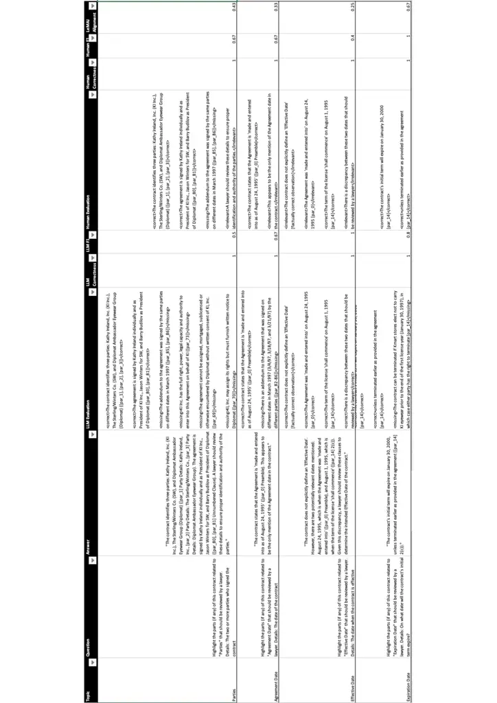

# LeMAJ (Legal LLM-as-a-Judge): Bridging Legal Reasoning and LLM Evaluation

Joseph Enguehard Affiliation: Robin AI    Morgane Van Ermengem
Affiliation: Robin AI    Kate Atkinson Affiliation: Robin AI    Sujeong
Cha Affiliation: Amazon Web Services    Arijit Ghosh Chowdhury
Affiliation: Amazon Web Services    Prashanth Kallur Ramaswamy
Affiliation: Amazon Web Services    Jeremy Roghair Affiliation: Amazon
Web Services    Hannah R Marlowe Affiliation: Amazon Web Services   
Carina Suzana Negreanu Affiliation: Robin AI    Kitty Boxall
Affiliation: Robin AI    Diana Mincu Affiliation: Robin AI

###### Abstract

Evaluating large language model (LLM) outputs in the legal domain
presents unique challenges due to the complex and nuanced nature of
legal analysis. Current evaluation approaches either depend on reference
data, which is costly to produce, or use standardized assessment
methods, both of which have significant limitations for legal
applications.

Although LLM-as-a-Judge has emerged as a promising evaluation technique,
its reliability and effectiveness in legal contexts depend heavily on
evaluation processes unique to the legal industry and how trustworthy
the evaluation appears to the human legal expert. This is where existing
evaluation methods currently fail and exhibit considerable variability.

This paper aims to close the gap: a) we break down lengthy responses
into "Legal Data Points" (LDPs) — self-contained units of information —
and introduce a novel, reference-free evaluation methodology that
reflects how lawyers evaluate legal answers; b) we demonstrate that our
method outperforms a variety of baselines on both our proprietary
dataset and an open-source dataset (LegalBench); c) we show how our
method correlates more closely with human expert evaluations and helps
improve inter-annotator agreement; and finally d) we open source our
Legal Data Points for a subset of LegalBench used in our experiments,
allowing the research community to replicate our results and advance
research in this vital area of LLM evaluation on legal
question-answering.

## 1 Introduction

Figure 1: Based on a legal document, a question and an answer, our LeMAJ
framework performs an automated evaluation by segmenting the answer into
Legal Data Points (LDPs) and evaluating each one. A domain expert might
also use this framework to manually evaluate each LDP and produce their
own scores.

Large language models (LLMs) are increasingly integrated into legal
workflows, supporting tasks such as contract analysis (Narendra et al.,
2024), document classification (Prasad et al., 2024), information
extraction (Bommarito II et al., 2021) and court case outcome prediction
(Chalkidis et al., 2019). Lawyers and legal professionals are relying
more and more on legal outputs generated by an LLM to counter increasing
pressure to ’do more for less’ and this shows no sign of slowing down as
the quality of legal AI tools increases (Gartner, 2024).

Among these applications, question-answering over legal documents has
emerged as a particularly valuable task. Legal evaluation (commonly
referred to as ’legal review’ in legal circles) is a crucial component
of legal tasks, as it ensures that legal outputs are correct, complete
and relevant. However, there are many challenges plaguing the evaluation
of such outputs; among other things, it is time-consuming, requires
highly specialized, expensive human experts and is prone to subjectivity
(Sun et al., 2024; Gu et al., 2025; Rastogi et al., 2024; Guha et al.,
2023a).

Traditional automated evaluation methods, which rely on high-quality
reference answers (’ground truths’) (Lin, 2004; Zhang et al., 2019),
have partially mitigated these challenges. Yet, their reliance on
multiple expert lawyers to construct comprehensive ground truths (Wang
et al., 2023) significantly limits their scalability, particularly in
the legal domain, where the nuance and variability of legal language
amplifies the requirements for large, representative datasets for
reliable real-world evaluation.

LLM-as-a-Judge has emerged as a promising evaluation paradigm that can
assess outputs without reference data and provide explanatory feedback
(Zheng et al., 2023; Fu et al., 2023). However, these techniques can
rely on hard to verify assessment approaches and can be prone to bias
and task variability (Bavaresco et al., 2024). Existing
question-answering methods that assess the whole answer as a unit (Ryu
et al., 2023) fail to capture the granular assessment process that legal
professionals employ (Pagnoni et al., 2021). Recent research (Krumdick
et al., 2025) has also shown that LLM-as-a-Judge methods perform
significantly worse without good quality references.

Our research reveals a critical insight: automated evaluations correlate
significantly better with human expert judgments, even without human
references, when they mirror how lawyers actually evaluate answers. From
interviews with legal experts, we understand that there is added
complexity and logic to legal reasoning that needs to be built into the
LLM-as-a-Judge paradigm, bridging the gap between both methods for
better alignment.

We propose LeMAJ (Legal LLM-as-a-Judge), a novel evaluation methodology
specifically designed to emulate lawyers’ evaluation processes. Our
approach decomposes LLM-generated answers into discrete "Legal Data
Points"—self-contained units of information—and systematically evaluates
each for correctness and relevance while identifying critical omissions.
This granular assessment provides the detailed feedback legal
practitioners require beyond simple accuracy scores, drawing inspiration
both from techniques in summary evaluation (Liu et al., 2023a; Liu
et al., 2023b; Tan et al., 2024) and from our own user study.

Through empirical studies, we first demonstrate that using LDPs improves
alignment between human and LLM evaluation and correlation with
gold-standard meta-reviews. We will present how our LeMAJ framework
consists of two core elements: the LeMAJ automated evaluation based on
LDP segmentation resulting in Correctness and Relevance scores, as well
as a user interface, displaying LDPs for annotation by human legal
experts. We then show how our LeMAJ automated evaluation substantially
outperforms various LLM and non-LLM baselines when evaluated on both
LegalBench (Guha et al., 2023a)—an open-source legal dataset—and
proprietary legal data. Next, we show how the LeMAJ user interface
component improved inter-annotator agreement between human legal experts
when reviewing with LeMAJ. Finally, we introduce a commercial use case
for the use of LeMAJ by showing time savings through the triaging of
answers for review.

To sum up, the main contributions of this article are the following:

- •
  We introduce LeMAJ, a novel automated evaluation framework for
  question-answering on legal documents that mimics lawyers’ reasoning
  process, without requiring reference data.
- •
  We demonstrate that its performance is superior on both open-source
  and proprietary datasets when compared to other methods, improving
  alignment with human evaluation and inter-annotator agreement.
- •
  We provide a breakdown of time savings in a commercial use case.
- •
  We open source our Legal Data Points for a subset of LegalBench used
  in our experiments, allowing the research community to replicate our
  results and advance research in this vital area of LLM evaluation.

## 2 Related Work

Automatic evaluation: There are a number of evaluation methods used in
the NLP space - N-gram based methods such as ROUGE (Lin, 2004) and BLEU
(Papineni et al., 2002), or token level model-based methods such as
BertScore (Zhang et al., 2020) or BartScore (Yuan et al., 2021).
However, these methods require a human reference. We also look at
LLM-as-a-Judge methods, such as DeepEval (Ip and Vongthongsri, 2025),
but while they can be used without references, they tend to perform
poorly when used in a reference-free setting, especially when the LLM
itself is not able to produce a correct answer (Krumdick et al., 2025).
Furthermore, model-based methods like LLM-as-a-Judge suffer from task
variability (Li et al., 2024; Gu et al., 2025), meaning that one
solution to fit all tasks is unlikely to exist and people often tend to
customize any existing offering. This calls for adapting existing
LLM-as-a-Judge methods to legal specific tasks such as legal Q&A.

Replicating the reasoning process: Automated evaluation methods are
usually evaluated by computing a correlation against human scores (Li
et al., 2024). Given the reliance on correlation with humans, it becomes
imperative that higher levels of inter-annotator agreement are reached.
There are a few factors that can contribute to rating disagreements such
as problems with the study setup, insufficient information provided on
the rating scale, complex or highly subjective tasks, or even the
annotator’s background (Rastogi et al., 2024). As a result, being able
to reduce these factors has become a big research area, especially in
situations where the answers being evaluated are verbose. Work in this
space has proposed dissecting the answer into easier to evaluate units
(Liu et al., 2023a; Tan et al., 2024), splitting the evaluation pipeline
into interpretable measures (Liu et al., 2023b), or in cases where a
high-quality reference output is available, measuring the similarity
between the two (Zha et al., 2023). But issues still persist as the
actual measure is dependent on the task at hand, with some favoring
factuality and reducing hallucinations (Min et al., 2023), while others
focus on correctness and human alignment. Therefore we identify a need
for a flexible and easily adaptable metric.

## 3 Method

### 3.1 Aligning with Human Legal Evaluation: Legal Data Points (LDPs)

Our evaluation methodology, LeMAJ, draws inspiration from two
sources: 1) the systematic evaluation process employed by legal
professionals when reviewing legal answers, and 2) recent advances in
automated summary evaluation techniques. We propose that legal answers,
similar to summaries, consist of discrete informational units. This
granular assessment approach aligns with recent innovations in summary
evaluation methodologies (Liu et al., 2023a; Liu et al., 2023b; Tan
et al., 2024; Min et al., 2023), which similarly break down content into
atomic units of information for comprehensive evaluation.

A key difference with summarization evaluation methods such as ACU (Liu
et al., 2023b) however is that applying summarization techniques to
legal Q&A requires adding a step, since summarization and legal Q&A
outputs serve a different purpose. Q&A requires all atomic units of
information to create a whole and answer a specific question, whereas
summarization units are a condensed list of information.

To better understand the legal reasoning process, we performed a user
study with four lawyers, asking them two simple questions: how would
they approach a legal review step-by-step, and what do they look out for
in an answer to grade the answer as satisfactory? We present their
answers in Appendix A. Our findings show that legal professionals
typically evaluate responses in a similar fashion:

- •
  Assessing answers by mentally decomposing them into individual
  assertions, sentences or by referencing the citation linked to each
  assertion. This would usually happen in an ad hoc way, with lawyers
  either annotating directly on a document or splitting the individual
  assertions mentally as they progress through the answer.
- •
  Verifying the factual correctness of each assertion (against a
  reference if available, e.g. a contract or a summary).
- •
  Assessing the relevance of each factually correct assertion to the
  question at hand.
- •
  Identifying any critical omissions from the source document, if
  available.

For examples of LDPs, we refer to Appendix F. We present a detailed
breakdown of the evaluation process in the following section.

### 3.2 Evaluation process

|                             |                                                                                                                                                                                                                                                                                      |                                                                                                                                                                                                                                                                                                                                                                                                                                           |
| --------------------------- | ------------------------------------------------------------------------------------------------------------------------------------------------------------------------------------------------------------------------------------------------------------------------------------ | ----------------------------------------------------------------------------------------------------------------------------------------------------------------------------------------------------------------------------------------------------------------------------------------------------------------------------------------------------------------------------------------------------------------------------------------- |
| Question                    | Output                                                                                                                                                                                                                                                                               | Evaluation                                                                                                                                                                                                                                                                                                                                                                                                                                |
| What are the payment terms? | "The payment terms depend on the schedule set forth in the applicable Statement of Services. If customer chooses to bill through an invoice, payment is due within 45 days after the customer receives the invoice, unless otherwise specified on the applicable Order Form (6.3). " | \<Correct\>Payment terms depend on the schedule set forth in the applicable Statement of Services. \<Correct\>For invoices, payment must be received within 45 days after customer receives the invoice. \<Irrelevant\>Different payment terms may be specified on the applicable Order Form. \<Missing\>Services may be suspended in the event of payment delinquency, unless payment is suspended due to a dispute between the Parties. |

Table 1: Payment Terms Evaluation. The answer is split into LDPs, each
individually assessed according to our tagging system.

Our LeMAJ methodology emulates the legal reasoning process described
above through two stages. First, given the inputs of a legal document, a
question, an answer and (optionally) a ground truth answer, we employ an
LLM to decompose the answer into distinct assertions made within the
answer, which we define as Legal Data Points. Then, within the same
prompt, we ask the LLM to tag each of the LDPs using the following
classification system:

- •
  Correctness: first, if the LDP contains a factual error or a
  hallucination, it is marked as \<Incorrect\>;
- •
  Relevance: factually correct LDPs are then assessed on their relevance
  to the question asked. This can be a rather subjective assessment in
  the absence of good reference data. Through prompting techniques we
  are able to tweak our LLM to be more or less stringent in its
  interpretation of relevance, similarly to how different lawyers might
  assess this criterion. If the LDP is considered irrelevant to the
  question, it is marked \<irrelevant\>; in a standard confusion matrix,
  this would be similar to a false positive classification;
- •
  Correct and Relevant: LDPs that are both factually accurate and
  relevant are marked as \<correct\>; similar to the true positive
  classification;
- •
  Critical Omissions: missing information that should have been included
  in the answer is added as new LDPs and marked as \<missing\>; this is
  based on the false negative classification.

Table 1 illustrates this tagging process with a practical example,
pulled from the payment terms in a Master Service Agreement.

Based on the Legal Data Point classifications, we derive the following
quantitative metrics:

- •
  $`\text{Correctness}=\frac{\text{\# Correct LDPs}}{\text{\# Correct LDPs}+\text{\# Incorrect LDPs}}`$,
  measures factual accuracy by penalizing errors and hallucinations
- •
  $`\text{Precision}=\frac{\text{\# Correct LDPs}}{\text{\# Correct LDPs}+\text{\# Irrelevant LDPs}}`$,
  measures relevance by penalizing irrelevant content
- •
  $`\text{Recall}=\frac{\text{\# Correct LDPs}}{\text{\# Correct LDPs}+\text{\# Missing LDPs}}`$,
  measures completeness by penalizing omissions
- •
  $`\text{F1}=\frac{2\times\text{Precision}\times\text{Recall}}{\text{Precision }+\text{ Recall}}`$,
  the classic F1 metric that balances precision and recall to provide an
  overall Relevance score

Importantly, this proposed metric is highly adaptable, enabling the
scores to be adjusted according to the specific priorities of the legal
evaluation task. For instance, when identifying missing information is
critical, greater emphasis can be placed on Recall or Critical Omissions
in the final score, offering a more contextually relevant and precise
evaluation.

## 4 Experiments and Results

### 4.1 Datasets

Proprietary: To evaluate our method’s real-world effectiveness and
refine our judge creation approach, we sourced an internal real-world
dataset. It contains 9 distinct contract types, with a total of 5
different contracts per type, totaling 1000 pairs of Q&As. Subject
matter experts developed specific questions for each contract type,
along with corresponding ground truth answers to enable accurate
assessment and quick iterations. The breakdown for the total amount of
questions split by training and test sets can be seen in Appendix C.

LegalBench: For the purpose of validating our method, we ran it on an
open-source dataset, curated by a collaborative team across educational
institutions under the auspices of Stanford University as a benchmark to
test LLMs’ legal reasoning in the English language (Guha et al., 2023b).
We selected a subset of twelve contracts from this database at random
and 150 questions that contained both relatively simple topics (e.g.
governing law) and more complex ones (e.g. competitive restriction
exceptions). A breakdown of the data set can be seen in Appendix C. We
selected a subset only through our in-house legal experts, prioritizing
more complex questions that would be a challenge to both evaluation
methods and human review. Moreover, due to the low amount of
LLM-generated incorrect answers, we augmented this dataset with 20
manually created incorrect or partially incorrect answers, bringing the
size of this dataset to 170.

### 4.2 Improving alignment with legal experts

Our core claim is that using the LeMAJ automated evaluation improves
alignment with human evaluation on legal question-answering. We test our
method against several baselines on both our proprietary dataset and the
LegalBench dataset by comparing the scores produced by each method to
the scores produced by human legal experts. Each answer is evaluated
based on two criteria, as defined in the Section 3 above:

- •
  Correctness: is the answer factually correct given the question?
- •
  Relevance (i.e F1): is the answer relevant to the question? Are there
  any critical omissions?

Both scores are graded on scale between 0 and 1. In the absence of an
industry standard scoring mechanism (Belz et al., 2023), we computed a
human score whereby the human legal expert attributes a score between 1
and 5 for relevance and correctness respectively of an answer which is
then converted to 0, 0.25, 0.5, 0.75 and 1 (see Appendix B).

#### 4.2.1 Baselines

We compare our method against the following non-LLM baselines which
require a reference (ground truth):

- •
  BLEU (Papineni et al., 2002) and ROUGE (Lin, 2004): BLEU and ROUGE are
  evaluation metrics for generated text that analyze n-gram overlap
  between generated and reference texts. While BLEU focuses on precision
  with a brevity penalty, ROUGE emphasizes recall, with variants
  including ROUGE-1 (unigrams), ROUGE-2 (bigrams), and ROUGE-L (longest
  common subsequence).
- •
  BERTScore (Zhang et al., 2019) and BARTScore (Yuan et al., 2021):
  Advanced text evaluation metrics that leverage pre-trained language
  models to assess text generation quality. BERTScore computes
  token-level similarities using contextual BERT embeddings and cosine
  similarity, while BARTScore evaluates text by measuring the
  conditional log-likelihood between generated and reference texts using
  a BART sequence-to-sequence model.

On the other hand, we also compare our method against some
out-of-the-box LLM-as-a-Judge methods (Ip and Vongthongsri, 2025). We
use these methods reference-free, to draw a fair comparison against
LeMAJ.

For Relevance, we use the following:

- •
  Answer Relevancy: This metric assesses how relevant an output is in
  relation to an input, specifically aiming to compare the relevancy of
  each part of the answer to the question.
- •
  Faithfulness: Faithfulness aims at assessing how much an answer
  factually aligns with a context (in this context the contract used to
  produce an answer).

For Correctness, we use:

- •
  Correctness: Correctness aims to assess how correct an answer is given
  a question, an answer and a contract (the context). To compute this
  score, we use the G-Eval method of DeepEval with a prompt we reproduce
  in Appendix G.
- •
  Hallucination: This metric is an out-of-the-box method from DeepEval
  which aims at assessing whether an answer is factually correct given a
  contract.

#### 4.2.2 Metrics

|                           |                                 |                   |                                 |                   |
| ------------------------- | ------------------------------- | ----------------- | ------------------------------- | ----------------- |
|                           | Proprietary Dataset             |                   | LegalBench                      |                   |
| Method                    | Pearson (p-value)               | Bucketed Accuracy | Pearson (p-value)               | Bucketed Accuracy |
| BLEU-1                    | 0.049 ($`1.52\times 10^{-1}`$)  | 0.05              | 0.142 ($`6.48\times 10^{-2}`$)  | 0.08              |
| BLEU-2                    | 0.095 ($`5.26\times 10^{-3}`$)  | 0.04              | 0.207 ($`6.75\times 10^{-3}`$)  | 0.08              |
| BLEU-3                    | 0.113 ($`8.67\times 10^{-4}`$)  | 0.03              | 0.241 ($`1.55\times 10^{-3}`$)  | 0.09              |
| BLEU-4                    | 0.105 ($`1.98\times 10^{-3}`$)  | 0.03              | 0.248 ($`1.09\times 10^{-3}`$)  | 0.08              |
| ROUGE-1                   | 0.095 ($`5.11\times 10^{-3}`$)  | 0.04              | 0.210 ($`6.05\times 10^{-3}`$)  | 0.09              |
| ROUGE-2                   | 0.133 ($`8.65\times 10^{-5}`$)  | 0.03              | 0.229 ($`2.70\times 10^{-3}`$)  | 0.09              |
| ROUGE-L                   | 0.107 ($`1.58\times 10^{-3}`$)  | 0.04              | 0.193 ($`1.16\times 10^{-2}`$)  | 0.09              |
| BERTScore                 | 0.174 ($`2.52\times 10^{-7}`$)  | 0.02              | 0.055 ($`4.78\times 10^{-1}`$)  | 0.05              |
| BARTScore                 | 0.105 ($`2.02\times 10^{-3}`$)  | 0.02              | 0.205 ($`7.40\times 10^{-3}`$)  | 0.08              |
| DeepEval-Answer Relevancy | 0.000 ($`9.92\times 10^{-1}`$)  | 0.37              | 0.079 ($`3.07\times 10^{-1}`$)  | 0.45              |
| DeepEval-Faithfulness     | 0.053 ($`1.20\times 10^{-1}`$)  | 0.48              | -0.130 ($`9.22\times 10^{-2}`$) | 0.41              |
| LeMAJ                     | 0.370 ($`1.46\times 10^{-29}`$) | 0.50              | 0.354 ($`2.13\times 10^{-6}`$)  | 0.35              |

Table 2: Results on Proprietary Dataset and LegalBench, measuring
relevancy. The first set of methods (BLEU, ROUGE, BERT and BARTscore)
use references, while the second set (DeepEval and LeMAJ) evaluate
answers without human references. LeMAJ shows high performance on both
datasets.

We evaluated our method and each baseline using two metrics:

- •
  Pearson Correlation: given a score produced by a baseline or LeMAJ, we
  compute its correlation with human gold standard scores.
- •
  Bucketed Accuracy: We round each score to the nearest lower quarter
  point (0, 0.25, 0.5, 0.75 or 1) bringing the continuous scores to the
  same scale as the human review for accuracy correlation computation.
  We opted for this metric due to an issue with Pearson correlation
  (Elangovan et al., 2025), where if many answers are fully correct or
  relevant, a single change in a prediction can swing the correlation
  very differently. This is particularly true for Correctness, as our
  answers are typically fully correct more than 90% of the time,
  particularly on LegalBench.

We introduce a third metric for our method only: LeMAJ Alignment. This
metric is measured by: (1) mapping each LDP annotated by LeMAJ to an LDP
annotated by a human reviewer. This mapping is done using an OpenAI
Embedding model; and (2) comparing the tags in each LDP pair to produce
an accuracy score, where any remaining unmapped LDP is considered
irrelevant if added by the LLM or missing if added by a human reviewer.
Due to the nature of this metric, it can only be computed on our method
and is not used for comparisons.

#### 4.2.3 Results

Experiment set-up: To ensure a fair comparison between LLM-based
methods, we used the same LLM: Claude 3.5 Sonnet v2. Moreover,
following (Ye et al., 2024), we used a different LLM (Claude 3.5 Sonnet
v1) to generate the answers in order to avoid introducing
"self-enhancement biases".

Relevance: We present our results when measuring Relevance in Table 2.
Overall, LeMAJ significantly outperforms both non-LLM and LLM methods on
our proprietary dataset, despite requiring no references (compared with
non-LLM methods). LeMAJ also outperforms all other methods in terms of
correlation with human scores on the LegalBench dataset. While DeepEval
methods achieve a higher Bucketed Accuracy, these methods actually do
not provide accurate information: they tend to give a nearly perfect
score to each answer, and since 48.2% of the answers are fully relevant,
DeepEval methods are correct around half of the time. This is confirmed
by the low correlation (0.079) with human scores.

Correctness: We present our results on Correctness in Table 3. LeMAJ
outperforms all other methods on both our proprietary dataset and
LegalBench, achieving a higher correlation with human evaluations than
the baselines.

|                        |                                 |                   |                                 |                   |
| ---------------------- | ------------------------------- | ----------------- | ------------------------------- | ----------------- |
| Method                 | Proprietary Dataset             |                   | LegalBench                      |                   |
|                        | Pearson (p-value)               | Bucketed Accuracy | Pearson (p-value)               | Bucketed Accuracy |
| BLEU-1                 | 0.104 ($`1.52\times 10^{-3}`$)  | 0.02              | 0.135 ($`7.99\times 10^{-2}`$)  | 0.05              |
| BLEU-2                 | 0.116 ($`6.15\times 10^{-4}`$)  | 0.02              | 0.172 ($`2.51\times 10^{-2}`$)  | 0.06              |
| BLEU-3                 | 0.111 ($`9.92\times 10^{-4}`$)  | 0.02              | 0.195 ($`1.06\times 10^{-2}`$)  | 0.08              |
| BLEU-4                 | 0.090 ($`7.78\times 10^{-3}`$)  | 0.02              | 0.158 ($`3.94\times 10^{-2}`$)  | 0.08              |
| ROUGE-1                | 0.139 ($`3.94\times 10^{-5}`$)  | 0.01              | 0.167 ($`2.97\times 10^{-2}`$)  | 0.05              |
| ROUGE-2                | 0.128 ($`1.46\times 10^{-4}`$)  | 0.02              | 0.203 ($`7.89\times 10^{-3}`$)  | 0.07              |
| ROUGE-L                | 0.131 ($`1.05\times 10^{-4}`$)  | 0.01              | 0.170 ($`2.69\times 10^{-2}`$)  | 0.06              |
| BERTScore              | 0.164 ($`1.11\times 10^{-6}`$)  | 0.01              | 0.128 ($`9.72\times 10^{-2}`$)  | 0.02              |
| BARTScore              | 0.074 ($`2.91\times 10^{-2}`$)  | 0.02              | 0.201 ($`8.57\times 10^{-3}`$)  | 0.08              |
| DeepEval-Correctness   | 0.077 ($`2.35\times 10^{-2}`$)  | 0.43              | 0.018 ($`8.13\times 10^{-1}`$)  | 0.24              |
| DeepEval-Hallucination | 0.080 ($`1.79\times 10^{-2}`$)  | 0.04              | -0.001 ($`9.95\times 10^{-1}`$) | 0.14              |
| LeMAJ                  | 0.259 ($`7.54\times 10^{-15}`$) | 0.95              | 0.700 ($`2.52\times 10^{-26}`$) | 0.88              |

Table 3: Results on Proprietary Dataset and LegalBench, measuring
correctness. LeMAJ outperforms both DeepEval and non-LLM evaluation
method on our proprietary dataset and on LegalBench.

### 4.3 Reducing inter-annotator disagreement

Through our research, we understood that in traditional evaluation
methods there is a high degree of variability and subjectivity between
different human reviewers (Rastogi et al., 2024). This is a barrier to
the reproducibility of evaluation results (Belz et al., 2023). Through
the experiment below, we show that we can use the LeMAJ user interface
to guide human legal experts by pre-determining the segmentation of
information in order to reduce the risk of arbitrary misalignment
between humans. To do so, we computed two different human scores: the
first relies on the LeMAJ framework to break down an answer into LDPs,
after which the human legal expert uses the user interface to assess
each LDP and annotate it according to our tagging system outlined above
(as represented in Figure 1). The second human score is manual and
consists of a more rudimentary evaluation schema (in the absence of an
industry standard scoring mechanism (Belz et al., 2023)), asking the
human legal expert to assess the relevance and correctness of an answer
on a 5-point scale (which is then converted to 0, 0.25, 0.5, 0.75 and 1,
see Appendix B).

Experiment setup: We tested whether the segmentation into LDPs can
improve IAA between human reviewers. We performed this experiment on the
LegalBench open-source dataset only and compared the following
evaluations:

- •
  the evaluation by two human legal experts using a 5-point scale, as
  outlined in Appendix B; and
- •
  the evaluation performed by human legal experts using LeMAJ, whereby
  human legal experts score every LDP using our mechanism outlined
  above.

Next, we measure the difference between both human legal experts’
respective evaluations in their manual evaluations and in their
evaluations using the LeMAJ tool.

Results: The average inter-annotator agreement between different
reviewers improves by 11% when evaluating outputs for Correctness,
indicating that the reviewers are more aligned in their assessment when
using LeMAJ (Table 4 below). This can be explained by the fact that
Correctness evaluates the factuality of the LDPs, which is arguably less
prone to subjectivity and legal interpretation.

| Contract Type                        | \# QA pairs | Correctness |            | Relevance   |            |
| ------------------------------------ | ----------- | ----------- | ---------- | ----------- | ---------- |
|                                      |             | IAA: manual | IAA: LeMAJ | IAA: manual | IAA: LeMAJ |
| Co-Promotion Agreement               | 19          | 0.579       | 0.789      | 0.421       | 0.526      |
| Consulting Agreement                 | 12          | 0.833       | 1          | 0.667       | 0.5        |
| Cooperation Agreement                | 10          | 0.7         | 0.7        | 0.4         | 0.5        |
| Distributor Agreement                | 17          | 1           | 0.824      | 0.588       | 0.765      |
| Endorsement Agreement                | 16          | 0.75        | 0.875      | 0.562       | 0.438      |
| Intellectual Property Agreement      | 8           | 1           | 1          | 0.5         | 0.625      |
| License Agreement                    | 10          | 0.6         | 0.7        | 0.4         | 0.6        |
| Licensing and Distribution Agreement | 5           | 1           | 1          | 0.8         | 0.2        |
| Outsourcing Agreement                | 15          | 0.867       | 1          | 0.467       | 0.267      |
| Promotion Agreement                  | 17          | 0.765       | 1          | 0.471       | 0.471      |
| Strategic Alliance Agreement         | 11          | 0.636       | 0.909      | 0.546       | 0.818      |
| Website Hosting Agreement            | 10          | 0.6         | 0.8        | 0.8         | 0.7        |
| Total                                | 150         | 0.77        | 0.88       | 0.53        | 0.54       |

Table 4: Inter-Annotator Agreement (IAA) on Correctness and Relevance

A different picture emerges when assessing Relevance; due to the
inherently subjective nature of Relevance, reviewers still present low
inter-annotator agreement to a similar degree as between the manual
evaluations. We believe that this is to be expected, as this is a
notoriously subjective assessment in the legal sphere and typically
defined by a given task, as opposed to a broad industry standard. The
added value of our approach in using LeMAJ is that we obtain a more
granular picture of the elements that were considered irrelevant, making
the assessment by the reviewer more transparent and auditable
(addressing some of the concerns raised in (Pagnoni et al., 2021)), and
generating actionable insights that can be used to tweak the prompting
strategy further.

### 4.4 Scaling evaluations

Given the high computational cost of developing, deploying and
maintaining large models as judges (Li et al., 2024; Gu et al., 2025),
as well as the reduction in speed during inference, we explored various
options to reduce the size of the model while maintaining performance.

We explored a) prompt optimization techniques, b) data augmentation, and
c) an LLM Jury framework involving multiple fine-tuned models. We found
that the LLM Jury framework was most performant, but when balancing
against cost, fine-tuning with augmentation brought the best tradeoffs.
More results can be found in Appendix D.

## 5 Commercial use case: reduce human review efforts through triage

Considering the significant amount of time, effort and resources
required for human evaluations, if we can use LeMAJ to triage less
controversial answers, then we can reserve review by human legal experts
for the contentious or at-risk answers only. As our LeMAJ Alignment
score, and in parallel confidence in the LeMAJ evaluation, increases, we
can rely more and more on LeMAJ to detect those answers that do not need
meticulous human expert review.

We measure this by showing the potential time savings created through
this triaging system. First, we track the time spent by human legal
experts doing both the manual evaluations and the evaluations using the
LeMAJ tool. Next, we use the results of the automated LeMAJ evaluation
on both our proprietary dataset and the LegalBench dataset and apply a
set of thresholds to triage all results that LeMAJ has given a
Correctness score of 1 and a Relevance score of at least 0.80 (for our
proprietary dataset) and 0.85 (for the LegalBench dataset). This enables
us to create a split between answers that should be flagged for review
and answers that are cleared. Our findings show that this results in
time savings of up to 50% on our proprietary dataset and up to 30% on
LegalBench (Tables 19 and 21 in Appendix H). When running against
production-level tools it enables organizations to bucket information
for training and iteration, gives users confidence in what to review,
and other use cases.

## 6 Conclusion

We introduced LeMAJ, a novel evaluation framework that seeks to closely
emulate the legal reasoning process. We have shown that by splitting up
a legal answer into single units of information (Legal Data Points) we
can use LLMs to evaluate the Correctness and Relevance of a given answer
at more granular level. The results of this methodology show a stronger
correlation between the LeMAJ evaluation and a human gold standard than
existing benchmarks on both our proprietary dataset and a subset of an
open-source dataset, LegalBench. Additionally, we demonstrate that LeMAJ
can improve inter-annotator agreement on Correctness, addressing a
critical issue in the development of high-quality reference data and for
the effective evaluation of assessment methods. Finally, we showcase the
time savings in a practical application and a potential deployment
pathway for LeMAJ.

Future work will look at increasing the accuracy of the method,
improving its ability to detect incorrect and missing information even
further, as well as extending the scalability work to a multi-agent
framework that can detect the needs of a task and adapt the metric on
the fly, attempting to improve issues around task variability in a
single LLM-as-a-Judge framework.

## References

- Bavaresco et al. (2024) Anna Bavaresco, Raffaella Bernardi, Leonardo
  Bertolazzi, Desmond Elliott, Raquel Fernández, Albert Gatt, Esam
  Ghaleb, Mario Giulianelli, Michael Hanna, Alexander Koller, André
  F. T. Martins, Philipp Mondorf, Vera Neplenbroek, Sandro Pezzelle,
  Barbara Plank, David Schlangen, Alessandro Suglia, Aditya K Surikuchi,
  Ece Takmaz, and Alberto Testoni. 2024. [Llms instead of human judges?
  a large scale empirical study across 20 nlp evaluation
  tasks](https://arxiv.org/abs/2406.18403). _Preprint_,
  arXiv:2406.18403.
- Belz et al. (2023) Anya Belz, Craig Thomson, Ehud Reiter, and Simon
  Mille. 2023. [Non-repeatable experiments and non-reproducible results:
  The reproducibility crisis in human evaluation in
  NLP](https://doi.org/10.18653/v1/2023.findings-acl.226). In _Findings
  of the Association for Computational Linguistics: ACL 2023_, pages
  3676–3687, Toronto, Canada. Association for Computational Linguistics.
- Bommarito II et al. (2021) Michael J Bommarito II, Daniel Martin Katz,
  and Eric M Detterman. 2021. Lexnlp: Natural language processing and
  information extraction for legal and regulatory texts. In _Research
  handbook on big data law_, pages 216–227. Edward Elgar Publishing.
- Chalkidis et al. (2019) Ilias Chalkidis, Ion Androutsopoulos, and
  Nikolaos Aletras. 2019. Neural legal judgment prediction in english.
  _arXiv preprint arXiv:1906.02059_.
- Elangovan et al. (2025) Aparna Elangovan, Lei Xu, Jongwoo Ko, Mahsa
  Elyasi, Ling Liu, Sravan Bodapati, and Dan Roth. 2025. [Beyond
  correlation: The impact of human uncertainty in measuring the
  effectiveness of automatic evaluation and
  llm-as-a-judge](https://arxiv.org/abs/2410.03775). _Preprint_,
  arXiv:2410.03775.
- Fu et al. (2023) Jinlan Fu, See-Kiong Ng, Zhengbao Jiang, and Pengfei
  Liu. 2023. Gptscore: Evaluate as you desire. _arXiv preprint
  arXiv:2302.04166_.
- Gartner (2024) Gartner. 2024. Ai in the legal industry.
  [https://www.gartner.com/en/legal-compliance/trends/ai-in-legal-industry](https://www.gartner.com/en/legal-compliance/trends/ai-in-legal-industry).
  Accessed: 2025-03-26.
- Gu et al. (2025) Jiawei Gu, Xuhui Jiang, Zhichao Shi, Hexiang Tan,
  Xuehao Zhai, Chengjin Xu, Wei Li, Yinghan Shen, Shengjie Ma, Honghao
  Liu, Saizhuo Wang, Kun Zhang, Yuanzhuo Wang, Wen Gao, Lionel Ni, and
  Jian Guo. 2025. [A survey on
  llm-as-a-judge](https://arxiv.org/abs/2411.15594). _Preprint_,
  arXiv:2411.15594.
- Guha et al. (2023a) Neel Guha, Julian Nyarko, Daniel Ho, Christopher
  Ré, Adam Chilton, Alex Chohlas-Wood, Austin Peters, Brandon Waldon,
  Daniel Rockmore, Diego Zambrano, and 1 others. 2023a. Legalbench: A
  collaboratively built benchmark for measuring legal reasoning in large
  language models. _Advances in Neural Information Processing Systems_,
  36:44123–44279.
- Guha et al. (2023b) Neel Guha, Julian Nyarko, Daniel E. Ho,
  Christopher Ré, Adam Chilton, Aditya Narayana, Alex Chohlas-Wood,
  Austin Peters, Brandon Waldon, Daniel N. Rockmore, Diego Zambrano,
  Dmitry Talisman, Enam Hoque, Faiz Surani, Frank Fagan, Galit Sarfaty,
  Gregory M. Dickinson, Haggai Porat, Jason Hegland, and 21 others.
  2023b. [Legalbench: A collaboratively built benchmark for measuring
  legal reasoning in large language
  models](https://arxiv.org/abs/2308.11462). _Preprint_,
  arXiv:2308.11462.
- Ip and Vongthongsri (2025) Jeffrey Ip and Kritin Vongthongsri. 2025.
  [deepeval](https://confident-ai.com).
- Krumdick et al. (2025) Michael Krumdick, Charles Lovering, Varshini
  Reddy, Seth Ebner, and Chris Tanner. 2025. No free labels: Limitations
  of llm-as-a-judge without human grounding. _arXiv preprint
  arXiv:2503.05061_.
- Li et al. (2024) Haitao Li, Qian Dong, Junjie Chen, Huixue Su, Yujia
  Zhou, Qingyao Ai, Ziyi Ye, and Yiqun Liu. 2024. [Llms-as-judges: A
  comprehensive survey on llm-based evaluation
  methods](https://arxiv.org/abs/2412.05579). _Preprint_,
  arXiv:2412.05579.
- Lin (2004) Chin-Yew Lin. 2004. Rouge: A package for automatic
  evaluation of summaries. In _Text summarization branches out_, pages
  74–81.
- Liu et al. (2023a) Yixin Liu, Alex Fabbri, Pengfei Liu, Yilun Zhao,
  Linyong Nan, Ruilin Han, Simeng Han, Shafiq Joty, Chien-Sheng Wu,
  Caiming Xiong, and Dragomir Radev. 2023a. [Revisiting the gold
  standard: Grounding summarization evaluation with robust human
  evaluation](https://doi.org/10.18653/v1/2023.acl-long.228). In
  _Proceedings of the 61st Annual Meeting of the Association for
  Computational Linguistics (Volume 1: Long Papers)_, pages 4140–4170,
  Toronto, Canada. Association for Computational Linguistics.
- Liu et al. (2023b) Yixin Liu, Alexander Fabbri, Yilun Zhao, Pengfei
  Liu, Shafiq Joty, Chien-Sheng Wu, Caiming Xiong, and Dragomir Radev.
  2023b. [Towards interpretable and efficient automatic reference-based
  summarization
  evaluation](https://doi.org/10.18653/v1/2023.emnlp-main.1018). In
  _Proceedings of the 2023 Conference on Empirical Methods in Natural
  Language Processing_, pages 16360–16368, Singapore. Association for
  Computational Linguistics.
- Min et al. (2023) Sewon Min, Kalpesh Krishna, Xinxi Lyu, Mike Lewis,
  Wen-tau Yih, Pang Koh, Mohit Iyyer, Luke Zettlemoyer, and Hannaneh
  Hajishirzi. 2023. [FActScore: Fine-grained atomic evaluation of
  factual precision in long form text
  generation](https://doi.org/10.18653/v1/2023.emnlp-main.741). In
  _Proceedings of the 2023 Conference on Empirical Methods in Natural
  Language Processing_, pages 12076–12100, Singapore. Association for
  Computational Linguistics.
- Narendra et al. (2024) Savinay Narendra, Kaushal Shetty, and Adwait
  Ratnaparkhi. 2024. Enhancing contract negotiations with llm-based
  legal document comparison. In _Proceedings of the Natural Legal
  Language Processing Workshop 2024_, pages 143–153.
- Pagnoni et al. (2021) Artidoro Pagnoni, Vidhisha Balachandran, and
  Yulia Tsvetkov. 2021. [Understanding factuality in abstractive
  summarization with FRANK: A benchmark for factuality
  metrics](https://doi.org/10.18653/v1/2021.naacl-main.383). In
  _Proceedings of the 2021 Conference of the North American Chapter of
  the Association for Computational Linguistics: Human Language
  Technologies_, pages 4812–4829, Online. Association for Computational
  Linguistics.
- Papineni et al. (2002) Kishore Papineni, Salim Roukos, Todd Ward, and
  Wei-Jing Zhu. 2002. [Bleu: a method for automatic evaluation of
  machine translation](https://doi.org/10.3115/1073083.1073135). In
  _Proceedings of the 40th Annual Meeting on Association for
  Computational Linguistics_, ACL ’02, page 311–318, USA. Association
  for Computational Linguistics.
- Prasad et al. (2024) Nishchal Prasad, Mohand Boughanem, and Taoufiq
  Dkaki. 2024. Exploring large language models and hierarchical
  frameworks for classification of large unstructured legal documents.
  In _European Conference on Information Retrieval_, pages 221–237.
  Springer.
- Rastogi et al. (2024) Charvi Rastogi, Tian Huey Teh, Pushkar Mishra,
  Roma Patel, Zoe Ashwood, Aida Mostafazadeh Davani, Mark Diaz, Michela
  Paganini, Alicia Parrish, Ding Wang, Vinodkumar Prabhakaran, Lora
  Aroyo, and Verena Rieser. 2024. [Insights on disagreement patterns in
  multimodal safety perception across diverse rater
  groups](https://arxiv.org/abs/2410.17032). _Preprint_,
  arXiv:2410.17032.
- Ryu et al. (2023) Cheol Ryu, Seolhwa Lee, Subeen Pang, Chanyeol Choi,
  Hojun Choi, Myeonggee Min, and Jy-Yong Sohn. 2023. Retrieval-based
  evaluation for llms: a case study in korean legal qa. In _Proceedings
  of the Natural Legal Language Processing Workshop 2023_, pages
  132–137.
- Sun et al. (2024) Chongyan Sun, Ken Lin, Shiwei Wang, Hulong Wu,
  Chengfei Fu, and Zhen Wang. 2024. [Lalaeval: A holistic human
  evaluation framework for domain-specific large language
  models](https://arxiv.org/abs/2408.13338). _Preprint_,
  arXiv:2408.13338.
- Tan et al. (2024) Shao Min Tan, Quentin Grail, and Lee Quartey. 2024.
  [Towards an automated pointwise evaluation metric for generated
  long-form legal
  summaries](https://doi.org/10.18653/v1/2024.nllp-1.10). In
  _Proceedings of the Natural Legal Language Processing Workshop 2024_,
  pages 129–142, Miami, FL, USA. Association for Computational
  Linguistics.
- Wang et al. (2023) Steven H Wang, Antoine Scardigli, Leonard Tang, Wei
  Chen, Dimitry Levkin, Anya Chen, Spencer Ball, Thomas Woodside, Oliver
  Zhang, and Dan Hendrycks. 2023. Maud: An expert-annotated legal nlp
  dataset for merger agreement understanding. _arXiv preprint
  arXiv:2301.00876_.
- Ye et al. (2024) Jiayi Ye, Yanbo Wang, Yue Huang, Dongping Chen, Qihui
  Zhang, Nuno Moniz, Tian Gao, Werner Geyer, Chao Huang, Pin-Yu Chen,
  and 1 others. 2024. Justice or prejudice? quantifying biases in
  llm-as-a-judge. _arXiv preprint arXiv:2410.02736_.
- Yuan et al. (2021) Weizhe Yuan, Graham Neubig, and Pengfei Liu. 2021.
  Bartscore: Evaluating generated text as text generation. _Advances in
  neural information processing systems_, 34:27263–27277.
- Zha et al. (2023) Yuheng Zha, Yichi Yang, Ruichen Li, and Zhiting
  Hu. 2023. [AlignScore: Evaluating factual consistency with a unified
  alignment function](https://doi.org/10.18653/v1/2023.acl-long.634). In
  _Proceedings of the 61st Annual Meeting of the Association for
  Computational Linguistics (Volume 1: Long Papers)_, pages 11328–11348,
  Toronto, Canada. Association for Computational Linguistics.
- Zhang et al. (2019) Tianyi Zhang, Varsha Kishore, Felix Wu, Kilian Q
  Weinberger, and Yoav Artzi. 2019. Bertscore: Evaluating text
  generation with bert. _arXiv preprint arXiv:1904.09675_.
- Zhang et al. (2020) Tianyi Zhang, Varsha Kishore, Felix Wu, Kilian Q.
  Weinberger, and Yoav Artzi. 2020. [Bertscore: Evaluating text
  generation with bert](https://arxiv.org/abs/1904.09675). _Preprint_,
  arXiv:1904.09675.
- Zheng et al. (2023) Lianmin Zheng, Wei-Lin Chiang, Ying Sheng, Siyuan
  Zhuang, Zhanghao Wu, Yonghao Zhuang, Zi Lin, Zhuohan Li, Dacheng Li,
  Eric Xing, and 1 others. 2023. Judging llm-as-a-judge with mt-bench
  and chatbot arena. _Advances in Neural Information Processing
  Systems_, 36:46595–46623.

| Contract Type                         | Training | Testing | Total |
| ------------------------------------- | -------- | ------- | ----- |
| Lease Agreements                      | 60       | 40      | 100   |
| Supplier Agreements                   | 60       | 40      | 100   |
| SaaS Agreements                       | 60       | 40      | 100   |
| Master Service Agreements (MSAs)      | 60       | 40      | 100   |
| Limited Partnership Agreements (LPAs) | 60       | 60      | 120   |
| Side Letters                          | 66       | 88      | 154   |
| Shareholder’s Agreements (SHAs)       | 60       | 40      | 100   |
| Non-Disclosure Agreements (NDAs)      | 60       | 40      | 100   |
| Sale and Purchase Agreements (SPAs)   | 51       | 34      | 85    |
| Total                                 | 537      | 422     | 959   |

Table 5: Distribution of Legal Contract Types in Proprietary Dataset

| Contract Type                                    | Total |
| ------------------------------------------------ | ----- |
| Hosting Agreement                                | 10    |
| Cooperation Agreement                            | 10    |
| Promotion Agreements                             | 36    |
| Endorsement Agreement                            | 16    |
| Licensing, Distribution and Marketing Agreements | 32    |
| Outsourcing Agreement                            | 15    |
| Intellectual Property Agreement                  | 8     |
| Consulting Agreement                             | 12    |
| Strategic Alliance Agreement                     | 11    |
| Total                                            | 150   |

Table 6: Distribution of Legal Contract Types in LegalBench Subset

## Appendix A Appendix A. User study on lawyers’ approach to evaluation

We interviewed four lawyers of varying level of seniority (junior to 5
years Post-Qualification Experience or PQE) who are currently working in
the legal industry and we asked them to answer the following two
questions:

- •
  When you are reviewing the output of another lawyer, how would you
  describe your process step-by-step?
- •
  What elements would you assess to check that an output is
  satisfactory?

Below is a breakdown of their answers.

Lawyer 1: "I would read the answer and read the corresponding part of
the contract. I would then compare each sentence of the answer to the
relevant section of the contract and decide how correct that part of the
answer is. I would check sentence-by-sentence that the answer is
correct."

Lawyer 2: “I would identify key elements that I would check, for example
if there are 5 exceptions I check that they are all present in the
output.”

Lawyer 3: "Legal Analysis Check + Quality Control. - Verify accuracy,
breadth of response and citations. How I review for accuracy is as
follows:

1.  1.  Read the report question and the answer provided.
2.  2.  Is the answer directly answering the question?
3.  3.  If so, is the content factually correct - click and read through the
        citation(s) where the information was pulled from
4.  4.  If so, confirm that the report has not missed information about the
        topic from anywhere else in the contract. Do a Ctrl F search in the
        contract for key words relating to the question/answer.
5.  5.  If the report has missed information from the contract, I would
        re-review the prompt and potentially amend it to be more
        prescriptive. If the prompt appears fine, I would manually add in
        the information from the contract into the report aligning to the
        answer type - if a summary, I would potentially use Claude to
        summarise concisely.¹¹ 1 Author’s note: the reviewer is referring to
        answers generated by an LLM
6.  6.  Once complete for every section, do a final 2 eye scroll of the
        contract confirming all key aspects have been included."

## Appendix B Appendix B. Inter-annotator agreement grading mechanism

Lawyer 4: "Process

- •
  Substantive Legal Analysis
  - –
    Verify that the responses provided accurately reflect the underlying
    documents - clicking into each citation to check the response
  - –
    Identify any gaps in analysis that should be addressed, ensuring
    that the document has been read and references as a whole, taking
    into account the interrelation between separate provisions /
    definitions
  - –
    Ensure that the form of output provided aligns with the client’s
    needs

- •
  Accuracy & Consistency
  - –
    Confirm factual accuracy, ensuring no misstatements or oversights
  - –
    Ensure that the format of the output for each issue is consistent
    across each document

- •
  Clarity & Readability
  - –
    Evaluate if the language is clear, concise, and appropriate for the
    audience.
  - –
    Identify and eliminate unnecessary jargon or overly complex
    phrasing.
  - –
    Ensure any explanations are easy to follow for the intended reader.

- •
  Formatting & Citation Check
  - –
    Ensure consistency of formatting throughout
  - –
    Verify correct citation style
  - –
    Ensure the document meets firm or client formatting standards

- •
  Final Review
  - –
    Proofread for grammar, spelling, and punctuation
  - –
    Cross-check all numerical or financial figures if applicable
  - –
    Ensure overall consistency and completeness

Assessment of Output:

- •
  Legal Accuracy – All outputs accurately reflect the contents of each
  agreement
- •
  Citations - all outputs contain accurate citations
- •
  Comprehensiveness – All issues are addressed and the outputs take into
  account the document(s) as a whole
- •
  Clarity – The language is clear, concise, and free of ambiguity.
- •
  Professionalism – Proper and consistent formatting and citations."

| Error Category                                                                                                                                                      | Occurrences (count of total) | Occurrences (sum of total) |
| ------------------------------------------------------------------------------------------------------------------------------------------------------------------- | ---------------------------- | -------------------------- |
| Data points from answer missing from LeMAJ evaluation. These are errors whereby the evaluation by LeMAJ has missed data points from the answer into its evaluation. | 34                           | 41                         |
| The errors are due to LeMAJ splitting up a data point into further data points, causing the evaluation to no longer align with the reference data.                  | 34                           | 34                         |
| LeMAJ tagged the data point wrong.                                                                                                                                  | 38                           | 44                         |
| LeMAJ is too lenient concerning level of detail when grading a data point.                                                                                          | 57                           | 90                         |
| Additional data points are added by LeMAJ that are not in the ground truth or answer.                                                                               | 1                            | 3                          |
| Total reviewed errors                                                                                                                                               | 164                          | 212                        |

Table 7: LeMAJ Error Analysis

We provide in Table 7 an error analysis for each of the steps in the
pipeline:

- •
  On datapoints splitting only: In our first experiments, we iterated
  using reference data, i.e. a proprietary dataset which contained each
  answer split into individual data points by human legal experts. We
  then did some limited testing on how well the model was aligned with
  the human split and what the margins of error were.
  - –
    Our human reference data contained 2144 LDPs.
  - –
    LeMAJ (Claude Sonnet 3.5 v2) split the same dataset into 1964 LDPs,
    a difference of less than 10%.

- •
  When looking at the end-to-end pipeline: When analysing the errors
  made by the LLM-as-a-Judge, we counted how many of these errors were
  due to different splitting by the human (reference data) and the
  LLM-as-a-Judge. Our error analysis showed that out of 212 tagging
  errors made by LeMAJ, 34 were due to difference in LDP split, or 16%
  of all errors. We consider this an acceptable margin of error.
- •
  We also performed a meta-review to account for the discrepancy between
  humans and the LLM. The meta-reviewers did not know which reviews came
  from LeMAJ and which reviews came from humans. Aside from that, they
  also had the ground truth at their disposal in case the reviews
  differed drastically.

## Appendix C Appendix C. Datasets

Below in Table 8 is the grading mechanism used by lawyers to perform a
fully ’manual’ evaluation, i.e. without the involvement of LeMAJ or any
LLM-as-a-Judge tool.

|                               |       |                                 |       |
| ----------------------------- | ----- | ------------------------------- | ----- |
| Correctness                   |       | Relevance                       |       |
| Category                      | Score | Category                        | Score |
| Completely correct            | 1     | Completely relevant             | 1     |
| Mostly correct                | 0.75  | Mostly relevant                 | 0.75  |
| Equally correct and incorrect | 0.50  | Equally relevant and irrelevant | 0.50  |
| Mostly incorrect              | 0.25  | Mostly irrelevant               | 0.25  |
| Completely incorrect          | 0     | Completely irrelevant           | 0     |

Table 8: Scoring Categories for Correctness and Relevance

## Appendix D Appendix D. LeMAJ Iterations

The below iterations have been performed solely on the proprietary
dataset. The best model in terms of the trade-off between cost and
performance was chosen to be represented in the final LegalBench
evaluation. We present two accuracy metrics - a base and an adjusted
version, with the adjusted version incorporating an additional text
matching process alongside category evaluation.

## Appendix E Appendix E. Baseline performance

In our evaluation of base models without fine-tuning, Claude 3.5 Sonnet
v2 demonstrated promising performance with an adjusted LeMAJ accuracy of
0.75. While the exact count of color tags did not precisely match the
human evaluation, the overall proportion showed notable similarity,
indicating a good baseline understanding of the task.

| EXP \#       | Foundation Model | LeMAJ Accuracy | LeMAJ Accuracy Adjusted |
| ------------ | ---------------- | -------------- | ----------------------- |
| Baseline 1-1 | Sonnet 3.5 v2    | 0.716          | 0.757                   |
| Baseline 2-1 | Haiku            | 0.469          | 0.447                   |

Table 9: Baseline performance without finetuning

In contrast, Haiku scored 0.44 without fine-tuning, performing
approximately 30% worse than Sonnet. This performance gap is
understandable given that Haiku is a significantly smaller model
compared to Sonnet. However, a concerning pattern emerged in Haiku’s
output: the proportion of green tags was disproportionately high, and
the model produced no red tags at all. This skewed distribution suggests
that Haiku’s base performance lacks the nuanced understanding required
for accurate legal judgments. You can see those results in tables 9
and 10.

| Experiment   | Foundation Model | Correct | Incorrect | Irrelevant | Missing | Total Count |
| ------------ | ---------------- | ------- | --------- | ---------- | ------- | ----------- |
| Human        | -                | 901     | 24        | 362        | 857     | 2144        |
| Baseline 1-1 | Sonnet 3.5 v2    | 791     | 41        | 347        | 785     | 1964        |
| Baseline 1-2 | Haiku            | 1229    | 0         | 177        | 445     | 1851        |

Table 10: Baseline LDP splitting without finetuning

Despite this, the results indicate substantial room for improvement
through fine-tuning, particularly for the Haiku model, where targeted
training could potentially address the imbalance in tag distribution and
enhance overall performance.

### E.1 Finetuning hyperparameter search

Learning Rate Multiplier: Learning Rate Multiplier (LRM) controls the
maximum learning rate during the training process. When LRM is 1, the
maximum learning rate during the training is 0.5. When LRM is 0.1, the
maximum learning rate is 0.5 x 0.1 = 0.05. To be more specific, Claude 3
model customization on Amazon Bedrock employs a Piecewise Linear
Learning Rate Scheduler, which starts with a learning rate of zero →
gradually increases to a maximum learning rate during the first 5% of
training steps → remains constant until 80% of steps are completed →
proceeds to a linear cooldown to zero. Through extensive
experimentation, we determined that a learning rate multiplier of 1.0
was optimal for our use cases.

Epoch: In contrast, the number of epochs demonstrated a more substantial
influence on model performance. We observed a significant improvement in
learning capabilities between epochs 2 and 3, with accuracy jumping from
0.694 in one experiment to 0.836 in another. Additionally, we noticed an
increasing proportion of "Missing" tags compared to "Correct" tags as
the number of epochs increased. However, it’s crucial to emphasize that
while epochs showed a more pronounced effect in our experiments, this is
not universally applicable. The optimal number of epochs can vary
depending on factors such as training set size, necessitating careful
experimentation for each specific use case.

### E.2 Prompt iterations

We explored a range of prompts, the results of which we can see in Table
 11. Our findings revealed that prompt engineering can have a
significant impact on the performance of baseline models. However, once
the models were fine-tuned (EXP 1, 2 and 3), the differences in
performance across various prompts became notably marginal.

| Experiment   | Foundation Model | Prompt | LeMAJ Accuracy | LeMAJ Accuracy Adjusted |
| ------------ | ---------------- | ------ | -------------- | ----------------------- |
| Baseline 2-1 | Haiku            | v1     | 0.469          | 0.447                   |
| Baseline 2-2 | Haiku            | v2     | 0.551          | 0.483                   |
| Baseline 2-3 | Haiku            | v3     | 0.564          | 0.515                   |
| EXP1         | Haiku            | v1     | 0.796          | 0.813                   |
| EXP2         | Haiku            | v2     | 0.805          | 0.821                   |
| EXP3         | Haiku            | v3     | 0.796          | 0.812                   |

Table 11: Performance of prompt iterations

For instance, when applied to the baseline model, prompt v3 demonstrated
the highest accuracy, followed by v2 and v1 respectively. Interestingly,
this order shifted when the same prompts were applied to the fine-tuned
model. In this scenario, prompt version 2 emerged as the top performer,
achieving an accuracy of 0.821. These results suggest that while careful
prompt design can enhance the performance of base models, the benefits
of prompt engineering become less pronounced after fine-tuning, as the
model adapts more comprehensively to the specific task at hand.

To better analyze what part of the information the judge would
frequently misclassify, we look at the LDP tagging variability for each
experiment in Table 12. We see that some of the critical pieces it tends
to misclassify are the "Incorrect" and "Missing" data points.

| Experiment   | Foundation Model | Prompt | Correct | Incorrect | Irrelevant | Missing | Total Count |
| ------------ | ---------------- | ------ | ------- | --------- | ---------- | ------- | ----------- |
| Human        | -                | \-     | 901     | 24        | 362        | 857     | 2144        |
| Baseline 2-1 | Haiku            | v1     | 1229    | 0         | 177        | 445     | 1851        |
| Baseline 2-2 | Haiku            | v2     | 1666    | 0         | 247        | 74      | 1987        |
| Baseline 2-3 | Haiku            | v3     | 1250    | 3         | 190        | 425     | 1868        |
| EXP1         | Haiku            | v1     | 1019    | 3         | 306        | 718     | 2046        |
| EXP2         | Haiku            | v2     | 988     | 0         | 343        | 714     | 2045        |
| EXP3         | Haiku            | v3     | 1018    | 1         | 326        | 651     | 1996        |

Table 12: LDP distribution for prompt iterations

### E.3 Data Augmentation

Our hypothesis was that the misclassification was happening as a result
of data skew in our training set and as a result we employed a set of
data augmentation techniques meant to supplement some of the lacking
LDPs in our training set (listed in Table 13).

| Type               | Description                                                                                                                                                                                                        |
| ------------------ | ------------------------------------------------------------------------------------------------------------------------------------------------------------------------------------------------------------------ |
| remove_info        | Find a "Correct" data point from the evaluation and remove the matching data point from the answer. Change its tag from "Correct" to "Missing".                                                                    |
| incomplete_info    | Find a "Correct" data point from the evaluation and modify the matching data point from the answer so that the information it conveys becomes incomplete. Change its tag from "Correct and Relevant" to "Missing". |
| change_value       | Modify a specific number or named entity in the answer and tag it with "Incorrect" in the evaluation.                                                                                                              |
| add_extra_info     | Add 1-2 sentences to the answer using LLM’s own legal knowledge and tag it with "Incorrect" in the evaluation.                                                                                                     |
| contradicting_info | Rewrite the answer so that it contradicts with the ground truth. Keep the original data points in the evaluation as "Missing" and add the rewritten data point with "Incorrect" tags.                              |

Table 13: Data augmentation process

Contrary to our expectations, models fine-tuned with the augmented
dataset showed a slight decrease in accuracy (Table 14). For instance,
the non-augmented model (EXP2-1) achieved a score of 0.821, while the
"Incorrect, Missing" augmented model (EXP9) scored 0.798. However, the
augmented models did return more "Incorrect" and "Missing" samples
(Table 15), suggesting that they were learning the distribution present
in the training set.

| EXP \# | Foundation Model | Augmentation       | LeMAJ Accuracy | LeMAJ Accuracy Adjusted |
| ------ | ---------------- | ------------------ | -------------- | ----------------------- |
| EXP1   | Haiku            | None               | 0.80513        | 0.82148                 |
| EXP2   | Haiku            | Incorrect          | 0.77439        | 0.80571                 |
| EXP3   | Haiku            | Incorrect, Missing | 0.78164        | 0.79887                 |
| EXP4   | Haiku            | None               | 0.80695        | 0.83697                 |
| EXP5   | Haiku            | Incorrect (n=10)   | 0.79519        | 0.81477                 |
| EXP6   | Haiku            | Incorrect (n=15)   | 0.81386        | 0.82679                 |

Table 14: Performance with different augmentations

| EXP \# | Foundation Model | Augmentation       | Correct | Incorrect | Irrelevant | Missing | Total Count |
| ------ | ---------------- | ------------------ | ------- | --------- | ---------- | ------- | ----------- |
| Human  | -                | -                  | 901     | 24        | 362        | 857     | 2144        |
| EXP1   | Haiku            | None               | 988     | 0         | 343        | 714     | 2045        |
| EXP2   | Haiku            | Incorrect          | 1046    | 23        | 338        | 669     | 2076        |
| EXP3   | Haiku            | Incorrect, Missing | 1006    | 7         | 350        | 720     | 2083        |
| EXP4   | Haiku            | None               | 841     | 1         | 433        | 888     | 2163        |
| EXP5   | Haiku            | Incorrect (n=10)   | 869     | 4         | 372        | 802     | 2047        |
| EXP6   | Haiku            | Incorrect (n=15)   | 821     | 12        | 376        | 917     | 2126        |

Table 15: LDP distribution with different augmentations

These data augmentation experiments suggest that while data augmentation
is a popular technique in LLM trainings generally, its application in
the legal domain may be challenging and require extensive human
evaluation. However, from the customer’s perspective, it would be more
sensible to focus on annotating the available training set rather than
reviewing synthetic samples. Thus, data augmentation should be
considered as a last resort when no other data is available.

### E.4 LLM Jury

In our pursuit of optimizing the LLM Judge model’s performance, we
explored several ensemble approaches, collectively referred to as the
LLM Jury. These methods aim to leverage the strengths of multiple
fine-tuned models to enhance overall accuracy and robustness. We tried
four different flavors of LLM Jury:

Rule-based: This approach employs heuristics to determine the final
verdict. This method assigns greater weight to non-green labels,
prioritizing them in the order of red, grey, orange, and green, in
accordance with the customer’s emphasis on detecting incorrect (red)
data points.

Majority Voting: This approach compares the outputs of three judges and
selects the most common color label for each data point.

Rule-based + Majority Voting: Building upon the aboves, we developed a
hybrid approach that combines majority voting with rule-based
decision-making. This method prioritizes red labels when identified by
any judge, otherwise defaulting to the majority rule.

Chain-of-verification: This approach, utilizing a base Claude 3.5 Sonnet
v2 as a final judge to refine the output generated by the fine-tuned
model. This method leverages the LLM’s inherent reasoning and
self-verification capabilities.

| Jury Method                  | Accuracy | Correct | Incorrect | Irrelevant | Missing | Total Count |
| ---------------------------- | -------- | ------- | --------- | ---------- | ------- | ----------- |
| Human                        | \-       | 901     | 24        | 362        | 857     | 2144        |
| Rule Based                   | 0.842    | 841     | 1         | 452        | 916     | 2210        |
| Majority Voting              | 0.854    | 978     | 1         | 446        | 793     | 2218        |
| Majority Voting + Rule Based | 0.852    | 912     | 3         | 447        | 847     | 2209        |
| Majority Voting + Rule Based | 0.845    | 858     | 20        | 444        | 924     | 2246        |
| Chain of Verification        | 0.806    | 830     | 1         | 423        | 841     | 2095        |

Table 16: LLM Jury accuracy and LDP splits

Among these four approaches, the combination of majority voting and
rule-based decision-making demonstrated the best overall performance
(0.852). Notably, we discovered that by combining two models with
"Incorrect" data augmentation and one without, we could maximize the
ability to discern "Incorrect" cases. This configuration, corresponding
to the fifth row in Table 16, achieved an accuracy of 0.844, only 0.1%
lower than the best-performing method while generating significantly
more red samples.

## Appendix F Appendix F. Examples of Legal Data Points

We provide in Table 17 and Figure 2 several examples of pairs of
questions and answers, as well as the evaluation of each answer using
the LeMAJ framework: spitting an answer into LDPs, and evaluating each
one of them.

| Issue          | Question                                                                                                                                                                                     | Answer                                                                                                                                                                                                                          | Evaluation                                                                                                                                                                                                                        |
| -------------- | -------------------------------------------------------------------------------------------------------------------------------------------------------------------------------------------- | ------------------------------------------------------------------------------------------------------------------------------------------------------------------------------------------------------------------------------- | --------------------------------------------------------------------------------------------------------------------------------------------------------------------------------------------------------------------------------- |
| Document Name  | Highlight the parts (if any) of this contract related to "Document Name" that should be reviewed by a lawyer. Details: The name of the contract                                              | The name of the contract is ’WEB SITE HOSTING AGREEMENT’ (\[par_1\] Preamble).                                                                                                                                                  | \<correct\>The name of the contract is "WEB SITE HOSTING AGREEMENT" \[par_1\]                                                                                                                                                     |
| Agreement Date | Highlight the parts (if any) of this contract related to "Agreement Date" that should be reviewed by a lawyer. Details: The date of the contract                                             | The agreement date is April 6, 1999 (\[par_1\] Unnumbered Clause).                                                                                                                                                              | \<correct\>The agreement date is April 6, 1999 (\[par_1\]) \<missing\>The agreement also mentions April 1, 1999 as the commencement date (\[par_36\])                                                                             |
| Effective Date | Highlight the parts (if any) of this contract related to "Effective Date" that should be reviewed by a lawyer. Details: The date when the contract is effective                              | The contract specifies that it is entered into on April 6, 1999 (\[par_1\] 1). This date appears to be the effective date of the contract, though the term ’Effective Date’ is not explicitly defined or used in the agreement. | \<correct\>The contract is entered into on April 6, 1999 \[par_1\] \<irrelevant\>This date appears to be the effective date of the contract, though the term ’Effective Date’ is not explicitly defined or used in the agreement. |
| Governing Law  | Highlight the parts (if any) of this contract related to "Governing Law" that should be reviewed by a lawyer. Details: Which state/country’s law governs the interpretation of the contract? | The contract specifies that the laws of the State of Florida govern its validity, construction, interpretation, and legal effect (\[par_46\] 46).                                                                               | \<correct\>The contract is governed by the laws of the State of Florida \[par_46\]                                                                                                                                                |

Table 17: Examples of Q&A pairs with an evaluation of each answer
following the LeMAJ framework. These evaluations can be done
automatically or by a domain expert.

Figure 2: An example of LDPs with both the LLM evaluation performed by
LeMAJ and the human evaluation by a human legal expert, resulting in the
LeMAJ Alignment score.

## Appendix G Appendix G. DeepEval Correctness Prompt

We use the following prompt with the G-Eval method of DeepEval to assess
the correctness of an answer: You are a legal expert, tasked with
evaluating an answer to a question about a legal contract. You have been
provided with the following information:

- •
  A legal contract
- •
  A question about the legal contract
- •
  An answer to the question

Evaluate the correctness of the answer.

## Appendix H Appendix H. Commercial use case: reduce human review efforts through triage

### H.1 Time savings on our proprietary dataset

We applied the thresholds outlined above to obtain the breakdown in
Table 18. For verification purposes, the table also includes the
Correctness and Relevance scores as verified by human review. We can see
that a sizable chunk of answers pass both thresholds, while their
average Correctness and Relevance scores remain very high. In addition,
the LeMAJ Alignment score gives us confidence that LeMAJ has evaluated
these answers in a manner very closely aligned to how humans would have.
We can therefore assume that this portion of answers have been evaluated
correctly and do not need human review.

[TABLE]

Table 18: Triaging of answers with Correctness = 1 and Relevance
$`\geq`$ 0.80

To translate that into time savings, we measured time spent on reviewing
a set of answers by contract type, as summarized in the Table 19, and
calculated how the triaging would affect time spent on reviewing the
remainder of answers.

[TABLE]

Table 19: QA Pairs and Human Review Time Distribution

### H.2 Time savings on LegalBench

On average, a manual review by a human legal expert of the LegalBench
dataset would take a little under eight hours, with around 3 to 4
minutes on average spent per question (this is of course an average and
can vary significantly depending on the complexity of the question). We
applied thresholds of a Correctness score of 1 and a Relevance score of
at least 0.85, resulting in the triage included in Table 20 below.
Rather than include a breakdown per contract type, we have included the
same review, performed by different reviewers, to illustrate consistency
in the results of our approach.

|                                       |            |            |
| ------------------------------------- | ---------- | ---------- |
| Evaluation by                         | Reviewer A | Reviewer B |
| QA pairs                              | 150        | 150        |
| QA pairs passing triage               | 51         | 51         |
| LeMAJ Alignment of triaged QA pairs   | 0.72       | 0.78       |
| QA pairs to review                    | 99         | 99         |
| LeMAJ Alignment of QA pairs to review | 0.49       | 0.5        |

Table 20: Triaging of answers based on Correctness and Relevance
thresholds on LegalBench

|                                 |            |            |
| ------------------------------- | ---------- | ---------- |
| Evaluation by                   | Reviewer A | Reviewer B |
| QA pairs                        | 150        | 150        |
| Time spent (in hours)           | 8.25       | 7.55       |
| Answers to review               | 99         | 99         |
| New estimated human review time | 5.45       | 4.98       |
| Approx. time saving             | 30%        | 30%        |

Table 21: Illustrative potential time savings on LegalBench

A human review of those triaged answers reveals an average Correctness
score of 0.96 and an average Relevance score of 0.86, remaining very
close to LeMAJ scores. We are then able to create an approximation of
time savings that this triaging would allow. In a commercial context,
such as that of an in-house legal team or a legal AI team, this
methodology can save reviewing teams time and effort spent on exercises
like quality assessments of answers and legal review.
