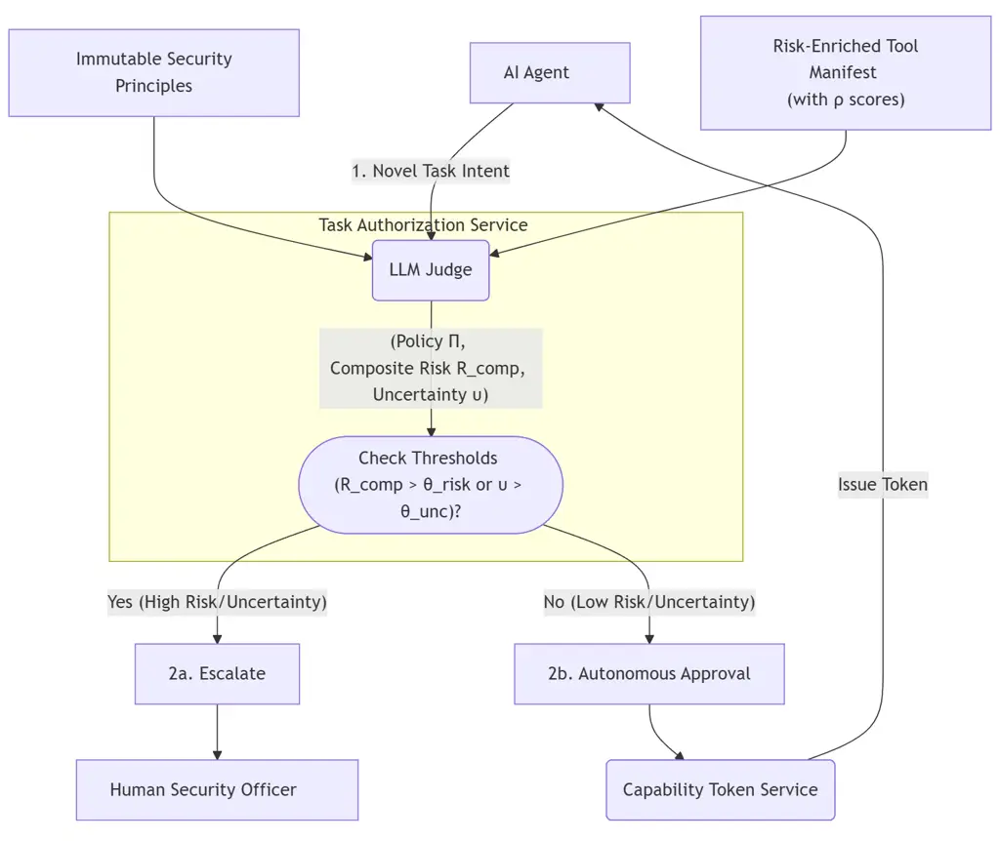
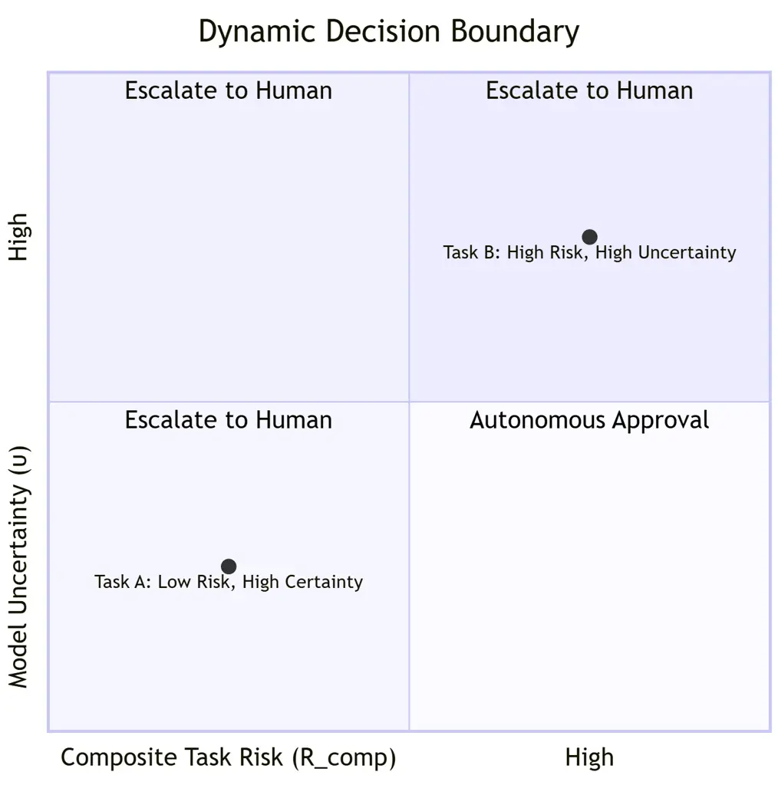

# Uncertainty-Aware, Risk-Adaptive Access Control for Agentic Systems using an LLM-Judged TBAC Model

Charles Fleming Affiliation: Cisco Systems  
San Jose, USA  
chflemin@cisco.com    Ashish Kundu Affiliation: Cisco Systems  
San Jose, USA  
ashkundu@cisco.com    Ramana Kompella Affiliation: Cisco Systems  
San Jose, USA  
rkompell@cisco.com

###### Abstract

The proliferation of autonomous AI agents within enterprise environments
introduces a critical security challenge: managing access control for
emergent, novel tasks for which no predefined policies exist. This paper
introduces an advanced security framework that extends the Task-Based
Access Control (TBAC) model by using a Large Language Model (LLM) as an
autonomous, risk-aware judge. This model makes access control decisions
not only based on an agent’s intent but also by explicitly considering
the inherent risk associated with target resources and the LLM’s own
model uncertainty in its decision-making process. When an agent proposes
a novel task, the LLM judge synthesizes a just-in-time policy while also
computing a composite risk score for the task and an uncertainty
estimate for its own reasoning. High-risk or high-uncertainty requests
trigger more stringent controls, such as requiring human approval. This
dual consideration of external risk and internal confidence allows the
model to enforce a more robust and adaptive version of the principle of
least privilege, paving the way for safer and more trustworthy
autonomous systems.

###### Index Terms: 

agentic systems, access control, large language models, risk management,
model uncertainty, zero trust

## I Introduction

The advent of sophisticated AI agents marks a pivotal moment in digital
transformation, but their capacity for emergent behavior poses a
fundamental challenge to traditional security models. Existing
frameworks like Role-Based Access Control (RBAC) and Attribute-Based
Access Control (ABAC) are ill-equipped to handle novel tasks for which
no policies exist. The consequence of a flawed access decision is
magnified when the actor is an autonomous agent capable of executing
complex actions at machine speed. While using a Large Language Model
(LLM) to interpret agent intent and generate policies is a promising
direction, it introduces two new critical questions. First, how does the
system account for the inherent risk of the resources an agent wishes to
access? A request to read a test database is fundamentally different
from a request to modify a production firewall. Second, how can we trust
the LLM’s judgment? An LLM may generate a syntactically correct but
logically flawed plan with a high degree of confidence, failing to
recognize its own knowledge gaps.

This paper argues that for an autonomous authorization system to be
trustworthy, it must be both risk-aware and self-aware. To this end, we
propose an Uncertainty-Aware, Risk-Adaptive TBAC model. This framework
enhances the LLM Judge by requiring it to explicitly reason about two
additional dimensions:

1.  1.  Resource Risk: Each tool, API, or data source is assigned a risk
        score based on its criticality.
2.  2.  Model Uncertainty: The LLM provides a confidence estimate for its
        generated plan, quantifying its certainty in the proposed course of
        action.

The final authorization decision is a function of the task’s intent, its
composite risk score, and the LLM’s uncertainty. This creates a dynamic,
multi-faceted control plane that can distinguish between a low-risk,
certain request and a high-risk, uncertain one, enabling a truly
adaptive and robust implementation of the principle of least privilege.
This paper proceeds as follows: Section II reviews related work. Section
III defines the foundational TBAC model. Section IV introduces the
extension of TBAC using an LLM Judge. Section V details our proposed
uncertainty-aware, risk-adaptive framework. Section VI provides use-case
analyses. Section VII discusses practical implementation challenges, and
Section VIII concludes the paper.



Fig. 1: High-level architecture of the proposed TBAC model. The LLM
Judge within the Task Authorization Service (TAS) synthesizes a policy
while also assessing task risk and its own uncertainty, feeding a
dynamic decision engine.

## II Background and Related Work

Our work is situated at the intersection of access control theory, risk
management, and uncertainty quantification in machine learning.

### II-A Evolution of Access Control Models

Access control has evolved from static, identity-centric models to more
dynamic, context-aware paradigms. Role-Based Access Control (RBAC) \[1\]
simplified administration by assigning permissions to roles rather than
individual users. However, RBAC struggles with dynamic environments
where access needs cannot be neatly categorized by job function.
Attribute-Based Access Control (ABAC) \[2\] offered more granularity by
evaluating policies based on attributes of the user, resource, and
environment. While flexible, ABAC requires authoring complex policies
and does not inherently understand the ”intent” behind an access
request.

Task-Based Access Control (TBAC) \[3\] and related workflow-based models
\[4\] represented a shift toward intent-driven authorization. In TBAC,
permissions are bundled into tasks, ensuring users receive the minimal
set of privileges needed for a specific activity, for the duration of
that activity. Our work uses TBAC as its foundation due to this natural
alignment with the goal-oriented nature of AI agents.

### II-B Risk and Uncertainty in Access Control

The concept of incorporating risk into authorization is not new.
Risk-Adaptive Access Control (RAAC) models \[5\] dynamically adjust
permissions based on real-time risk assessments. These models often
calculate risk based on contextual factors like user location, device
posture, time of day, or behavioral anomalies. However, they typically
rely on predefined rules and do not address the challenge of assessing
the risk of novel, agent-generated tasks based on the composition of
resources they intend to use.

Simultaneously, the field of machine learning has developed robust
techniques for quantifying model uncertainty. It is well understood that
deep learning models can be unreliable when faced with
out-of-distribution data. This uncertainty is often categorized as
either aleatoric (inherent randomness in the data) or epistemic (due to
model limitations). Our work focuses on epistemic uncertainty.
Techniques like Bayesian approximation using Monte Carlo dropout \[6\]
or conformal prediction \[7\] provide statistically grounded methods for
a model to express ”I don’t know.” Applying this concept to an LLM Judge
is critical; an LLM that can communicate its own uncertainty is
inherently safer than one that is always confidently wrong. Our model is
the first, to our knowledge, to synthesize these two lines of
research—task-based risk assessment and model uncertainty—into a
cohesive framework for securing autonomous agents.

## III Task-Based Access Control: The Foundational Model

The core of our system is rooted in the Task-Based Access Control (TBAC)
model. Unlike models centered on user roles, TBAC grants permissions
based on the specific tasks an agent needs to perform. This
intent-driven approach is a natural fit for agentic systems.

### III-A Formal Model Definition

In a standard TBAC framework, we define the core entities:

- •
  A set of agents, $`A=\{a_{1},a_{2},\dots\}`$.
- •
  A set of tasks, $`T=\{t_{1},t_{2},\dots\}`$.
- •
  A set of available tools (or resources),
  $`S_{tool}=\{s_{1},s_{2},\dots\}`$.
- •
  A set of possible transactions on tools,
  $`S_{trans}=\{\text{read},\text{write},\text{execute},\dots\}`$.

An authorization for an agent $`a\in A`$ to perform a task $`t\in T`$ is
a policy, $`\Pi`$. This policy is the set of permissions required to
complete the task:

```math
\Pi=\{(s,tx)|s\in\tau_{tools}(t),tx\in\tau_{trans}(t,s)\}
```

where $`\tau_{tools}:T\rightarrow 2^{S_{tool}}`$ is a function mapping a
task to the set of tools it needs, and
$`\tau_{trans}:T\times S_{tool}\rightarrow 2^{S_{trans}}`$ is a function
mapping a task and a tool to the set of required transactions. This
authorization is granted at the start of task $`t`$ and is valid only
for its duration.

### III-B Reference Architecture and Limitations

The traditional TBAC architecture consists of three main components:

- •
  Task Authorization Service (TAS): A central entity that evaluates a
  task request and grants a policy.
- •
  Capability Token Service (CTS): Issues a short-lived,
  cryptographically signed token (e.g., a JWT) that encodes the policy
  $`\Pi`$.
- •
  Policy Enforcement Points (PEPs): Services or gateways that protect
  resources. They intercept requests, validate the token from the CTS,
  and enforce the encoded policy.

The primary limitation of this traditional architecture is that the TAS
relies on a static, predefined database mapping known tasks to their
required permissions. This model breaks down in the face of emergent
agent behavior, which generates novel tasks not present in any database.

## IV Adapting TBAC for Emergent Tasks with an LLM Judge

To overcome the limitations of static TBAC, we extend the model by
replacing the predefined task-policy database with a dynamic,
intelligent component: a Large Language Model (LLM) Judge, situated
within the TAS.

### IV-A The LLM as a Policy Synthesizer

When an agent needs to perform a novel task, instead of looking up a
policy, the TAS invokes the LLM Judge to synthesize one in real time.
The workflow is as follows:

1.  1.  Task Intent Submission: An agent submits its high-level goal (e.g.,
        ”Debug the performance issue in the user-authentication service”) to
        the TAS.
2.  2.  Policy Synthesis: The LLM Judge receives the goal, along with a
        manifest of available tools and a set of immutable security
        principles (e.g., ”Always prefer read-only access”). It reasons
        about the required steps and generates a just-in-time policy
        $`\Pi`$.
3.  3.  Token Issuance: The TAS validates the syntactic correctness of the
        policy and instructs the CTS to issue a capability token encoding
        $`\Pi`$.

### IV-B New Risks and Challenges

This architecture enables dynamic authorization but introduces new,
significant risks:

- •
  Lack of Risk Awareness: The LLM may generate a functionally correct
  plan that involves unnecessarily risky operations (e.g., requesting
  write access to a production database for a read-only task) without
  understanding the security implications.
- •
  Model Fallibility: LLMs can ”hallucinate” or generate flawed logic,
  especially for complex or out-of-distribution requests. A ”naive” LLM
  judge has no mechanism to recognize its own knowledge gaps,
  potentially leading it to confidently approve a dangerous policy.
- •
  Prompt Injection Vulnerability: A malicious agent could craft its task
  description to manipulate the LLM into generating an over-privileged
  policy.

Addressing the first two challenges—risk awareness and model
fallibility—is the primary focus of our proposed extension.

## V Uncertainty-Aware and Risk-Adaptive Policy Synthesis

To address these new challenges, we introduce our primary contribution:
an enhanced framework where the LLM Judge is made both risk-aware and
self-aware of its own uncertainty.

### V-A Formal Model Extension

We augment the foundational model with formalisms for risk and
uncertainty.

- •
  We define a static risk function,
  $`\rho:S_{tool}\rightarrow\mathbb{R}^{+}`$, which maps each tool or
  resource to a non-negative risk score based on its business
  criticality.

The LLM-generated authorization for an agent $`a`$ and task $`t`$
becomes a more comprehensive tuple,
$`\mathcal{A}_{a,t}=(\Pi,R_{comp},\upsilon)`$, where:

- •
  $`\Pi`$ is the set of permitted tool-transaction pairs (the policy).
- •
  $`R_{comp}=f(\{\rho(s)|s\in\tau_{tools}(t)\})`$ is the composite risk
  score of the task, calculated by the LLM as an aggregate function
  (e.g., maximum or weighted sum) of the risks of all resources in the
  policy.
- •
  $`\upsilon\in[0,1]`$ is the model uncertainty estimate, representing
  the LLM’s confidence in the generated policy $`\Pi`$. A value close to
  1 indicates high uncertainty.

### V-B Deep Dive: Risk and Uncertainty Components

#### V-B1 Composite Risk ($`R_{comp}`$)

The static risk score $`\rho(s)`$ for each tool can be sourced from
enterprise systems like a Configuration Management Database (CMDB), data
classification labels (e.g., Public, Internal, Confidential), or
manually assigned based on business impact analysis. The composite
function $`f`$ is critical; using the maximum risk of any single tool
($`f=\max(\{\rho(s)\})`$) is a simple, conservative choice, ensuring
that a task touching even one high-risk system is treated as high-risk
overall.

#### V-B2 Model Uncertainty ($`\upsilon`$)

Estimating epistemic uncertainty for an LLM is an active area of
research. Practical methods include:

- •
  MC Dropout: If the LLM architecture allows, running inference multiple
  times with dropout enabled and measuring the variance in the outputs,
  as proposed by Gal and Ghahramani \[6\].
- •
  Ensemble Methods: Querying a small ensemble of diverse LLM judges and
  measuring the disagreement in their proposed policies.
- •
  Stochastic Outputs: For a single model, performing multiple inference
  passes with a non-zero temperature setting and calculating the
  semantic variance of the generated plans.

The chosen method provides a quantifiable measure of the model’s
confidence in its own plan.

### V-C Architecture of the Enhanced LLM Judge

The enhanced LLM Judge executes an enriched, multi-stage workflow:

1.  1.  Contextual Prompting: The TAS constructs a detailed prompt
        containing the agent’s goal, security principles, and a
        Risk-Enriched Tool Manifest. This manifest now includes the static
        risk score $`\rho(s)`$ for each tool and its available transactions.
2.  2.  LLM Reasoning and Multi-faceted Output: The LLM is instructed to
        perform three tasks in a chain-of-thought manner:
    - •
      First, synthesize the policy $`\Pi`$ to achieve the goal.
    - •
      Second, based on the tools in $`\Pi`$ and their scores from the
      manifest, calculate the composite risk score $`R_{comp}`$.
    - •
      Third, reflect on the complexity and novelty of the request to
      estimate its own model uncertainty $`\upsilon`$.

3.  3.  Dynamic Decision and Escalation: A central decision engine evaluates
        the LLM’s output against configurable thresholds. The logic is:

    IF ($`R_{comp}>\theta_{risk}`$) OR
    ($`\upsilon>\theta_{uncertainty}`$) THEN
    - •
      Escalate to a human security officer for review and approval.

    ELSE
    - •
      Autonomously approve the request and instruct the CTS to mint a
      token.

4.  4.  Immutable Auditing: The entire tuple—the goal, the generated policy
        $`\Pi`$, the risk score $`R_{comp}`$, and the uncertainty
        $`\upsilon`$—is cryptographically logged for full auditability and
        future model training.



Fig. 2: Decision boundaries for the LLM Judge. Requests are
auto-approved only if both composite risk and model uncertainty are
below their respective thresholds.

## VI Use-Case Analysis

We analyze two contrasting scenarios to illustrate the model’s behavior.

### VI-A Use Case 1: High-Risk, High-Uncertainty Incident Response

Consider an incident response agent, ‘sec-agent-01‘, detecting a novel
threat.

Execution Flow:

1.  1.  The agent formulates the task, $`T_{response}`$: ”Goal: Isolate
        compromised database ‘db-prod-123‘, analyze its outbound traffic by
        mirroring traffic to a sandbox, and provision a replacement from the
        latest backup.”
2.  2.  It submits this to the TAS. The enhanced LLM Judge is invoked.
3.  3.  Enhanced LLM Reasoning: The LLM consults the risk-enriched manifest.
        It sees that ‘networkAPI.updateFirewallRule()‘ has a risk score
        $`\rho=9.5/10`$ and ‘dbAPI.restoreFromBackup()‘ has a score
        $`\rho=7.0/10`$.
    - •
      It generates the policy $`\Pi`$ containing permissions for both
      APIs.
    - •
      It calculates a high composite risk score,
      $`R_{comp}=\max(9.5,7.0)=9.5`$, due to the critical network
      change.
    - •
      As this is a novel, complex, and high-impact scenario, its
      internal confidence is low, resulting in a high uncertainty
      estimate, $`\upsilon=0.75`$.

4.  4.  Dynamic Decision: The decision engine checks against thresholds, say
        $`\theta_{risk}=8.0`$ and $`\theta_{uncertainty}=0.6`$. Since both
        $`R_{comp}>\theta_{risk}`$ and $`\upsilon>\theta_{uncertainty}`$,
        the request is automatically flagged and escalated to a human
        security analyst’s dashboard.
5.  5.  The analyst reviews the LLM’s complete plan, its risk assessment,
        and its stated uncertainty. Agreeing with the plan, the analyst
        provides a one-time approval.
6.  6.  The TAS now instructs the CTS to issue a very short-lived token
        (e.g., 10 minutes) with heavy auditing enabled. The agent proceeds
        under strict supervision.

### VI-B Use Case 2: Low-Risk, Low-Uncertainty Business Analytics

Consider a business intelligence agent, ‘bi-agent-04‘, performing a
routine task.

Execution Flow:

1.  1.  The agent formulates the task, $`T_{report}`$: ”Goal: Read the daily
        new leads from the ‘sales-crm‘ system and post a summary count to
        the ‘#sales-updates‘ Slack channel.”
2.  2.  It submits this to the TAS. The LLM Judge is invoked.
3.  3.  Enhanced LLM Reasoning: The LLM consults the manifest. It sees
        ‘crmAPI.readLeads()‘ has $`\rho=3.0/10`$ and
        ‘slackAPI.postMessage()‘ has $`\rho=2.0/10`$.
    - •
      It generates the policy $`\Pi`$ with read-only CRM access and
      Slack posting rights.
    - •
      It calculates a low composite risk score,
      $`R_{comp}=\max(3.0,2.0)=3.0`$.
    - •
      This is a very common and straightforward request, so the model is
      highly confident, resulting in a low uncertainty estimate,
      $`\upsilon=0.10`$.

4.  4.  Dynamic Decision: The decision engine checks against the same
        thresholds ($`\theta_{risk}=8.0,\theta_{uncertainty}=0.6`$). Since
        $`R_{comp}<\theta_{risk}`$ and $`\upsilon<\theta_{uncertainty}`$,
        the request falls into the ”Auto-Approve” quadrant.
5.  5.  The TAS autonomously approves the request and instructs the CTS to
        issue a standard-duration token. The agent completes its task
        without human intervention.

## VII Implementation Considerations and Discussion

Deploying this model in a production environment requires addressing
several practical challenges.

- •
  Scalability and Latency: LLM inference is computationally expensive
  and can introduce latency into the authorization path. For
  time-sensitive operations, this could be prohibitive. A potential
  mitigation is to implement a caching layer that stores the full
  authorization tuple ($`\Pi,R_{comp},\upsilon`$) for previously seen,
  auto-approved tasks, bypassing the LLM for identical future requests.
- •
  Tool Manifest Management: The accuracy of the risk scores in the tool
  manifest is paramount. This requires tight integration with enterprise
  asset management and data governance tools (like a CMDB) to ensure
  risk scores are automatically updated as systems are provisioned,
  patched, or have their data classification changed.
- •
  Human-in-the-Loop Workflow: The escalation dashboard for security
  analysts must be designed to prevent alert fatigue. It should clearly
  present the agent’s goal, the LLM’s proposed plan, and critically, the
  \*reasons\* for escalation (e.g., ”High Risk: Touches ‘firewallAPI‘”)
  and the model’s stated uncertainty. This allows for rapid, informed
  decisions.

## VIII Conclusion and Future Work

The Uncertainty-Aware, Risk-Adaptive TBAC model provides a robust and
trustworthy framework for securing autonomous AI agents. By making the
LLM Judge explicitly reason about resource risk and its own uncertainty,
we transform the access control system from a simple gatekeeper into a
sophisticated risk management engine. This allows for a safer balance
between agent autonomy and enterprise security.

Key areas for future work are critical for maturing this model:

- •
  Calibrating Uncertainty: Further research into methods to ensure the
  LLM’s uncertainty estimates are well-calibrated, meaning its stated
  confidence accurately reflects the true probability of its plan being
  correct and safe.
- •
  Dynamic Risk Assessment: Evolving the static risk function $`\rho`$
  into a dynamic one that can update resource risk scores in real-time
  based on threat intelligence feeds, active security incidents, or
  anomalous system behavior.
- •
  LLM Security and Robustness: Developing strong defenses against prompt
  injection attacks specifically aimed at manipulating the LLM’s risk or
  uncertainty calculations. This could involve using separate,
  specialized LLMs for plan generation versus risk assessment.
- •
  Explainable AI (XAI) for Auditing: Enhancing the audit trail with
  clear, human-understandable explanations for \*why\* the LLM arrived
  at a particular risk score or uncertainty level, potentially by
  forcing the model to output its chain-of-thought reasoning for every
  decision.

As agentic systems become more integrated into critical workflows, a
security paradigm that is self-aware of its own limitations will be
paramount. This model offers a foundational step in that direction.

## References

- \[1\] R. S. Sandhu, E. J. Coyne, H. L. Feinstein, and C. E. Youman,
  “Role-based access control models,” _Computer_, vol. 29, no. 2, pp.
  38–47, 1996.
- \[2\] V. C. Hu, D. Ferraiolo, R. Kuhn, A. Schnitzer, K. Sandlin,
  R. Miller, and K. Scarfone, “Guide to attribute based access control
  (abac) definition and considerations,” NIST Special Publication
  800-162, Tech. Rep., 2014.
- \[3\] R. K. Thomas and R. S. Sandhu, “Task-based authorization
  controls (tbac): a family of models for active and enterprise-oriented
  authorization management,” in _Proceedings of the Workshop on New
  Security Paradigms_, 1997, pp. 166–176.
- \[4\] V. Atluri and W.-K. Huang, “An authorization model for
  workflows,” in _European Symposium on Research in Computer
  Security_. Springer, 1996, pp. 44–64.
- \[5\] S. Das, M. T. Islam, A. Ghose, and A. K. Majumdar, “An adaptive
  risk-based access control model for web services,” in _2017 4th
  International Conference on Advances in Electrical Engineering
  (ICAEE)_. IEEE, 2017, pp. 334–339.
- \[6\] Y. Gal and Z. Ghahramani, “Dropout as a bayesian approximation:
  Representing model uncertainty in deep learning,” in _international
  conference on machine learning_. PMLR, 2016, pp. 1050–1059.
- \[7\] A. N. Angelopoulos and S. Bates, “A gentle introduction to
  conformal prediction and distribution-free uncertainty
  quantification,” _arXiv preprint arXiv:2107.07511_, 2021.
