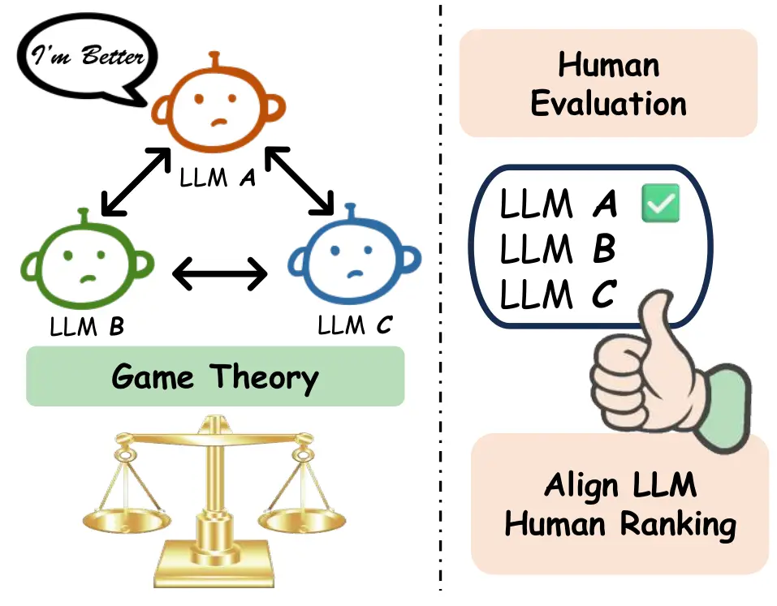
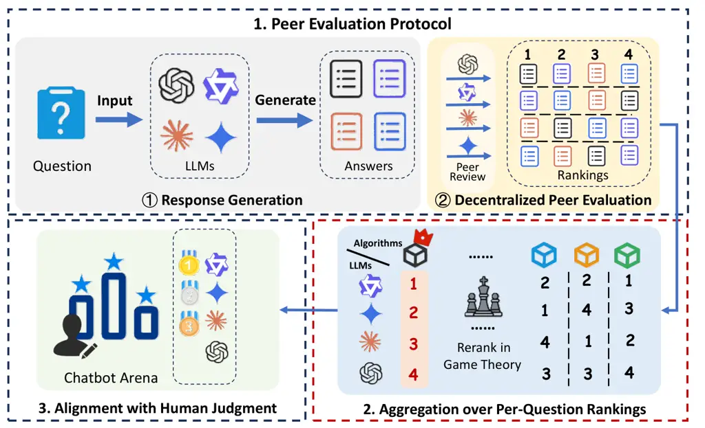
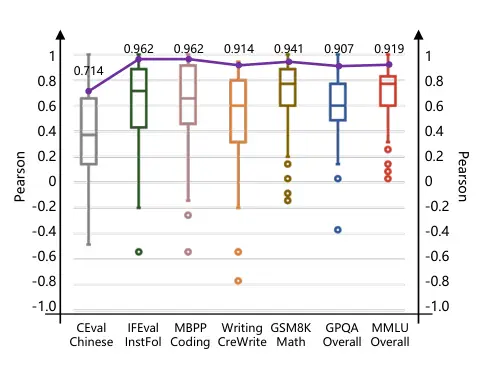

# LLMs Judge Themselves: A Game-Theoretic Framework for Human-Aligned Evaluation

Yang Gao Affiliation:  Beijing Institute of Technology, Beijing, China
Affiliation:  Southeast Academy of Information Technology, China   
Yuhang Liu Affiliation:  Beijing Institute of Technology, Beijing, China
Affiliation:  Southeast Academy of Information Technology, China    Siyu
Miao Affiliation:  Beijing Institute of Technology, Beijing, China   
Xinyue Liang Affiliation:  Beijing Institute of Technology, Beijing,
China    Zhengyang Liu Affiliation:  Beijing Institute of Technology,
Beijing, China Affiliation:  Southeast Academy of Information
Technology, China Correspondence to: <zhengyang@bit.edu.cn>    Heyan
Huang Affiliation:  Beijing Institute of Technology, Beijing, China
Affiliation:  Southeast Academy of Information Technology, China

###### Abstract

Ideal or real—that is the question. In this work, we explore whether
principles from game theory can be effectively applied to the evaluation
of large language models (LLMs). This inquiry is motivated by the
growing inadequacy of conventional evaluation practices, which often
rely on fixed-format tasks with reference answers and struggle to
capture the nuanced, subjective, and open-ended nature of modern LLM
behavior. To address these challenges, we propose a novel alternative:
automatic mutual evaluation, where LLMs assess each other’s output
through self-play and peer review. These peer assessments are then
systematically compared with human voting behavior to evaluate their
alignment with human judgment. Our framework incorporates game-theoretic
voting algorithms to aggregate peer reviews, enabling a principled
investigation into whether model-generated rankings reflect human
preferences. Empirical results reveal both convergences and divergences
between theoretical predictions and human evaluations, offering valuable
insights into the promises and limitations of mutual evaluation. To the
best of our knowledge, this is the first work to jointly integrate
mutual evaluation, game-theoretic aggregation, and human-grounded
validation for evaluating the capabilities of LLMs.

###### Keywords: 

Large Language Models, Evaluation, Game Theory

^(†)^(†)affiliationnotice: Equal contribution

## 1 Introduction



Figure 1: Illustration of game-theoretic peer evaluation for LLM
performance ranking.

As Large Language Models (LLMs) (Qiu et al., 2025; DeepSeek-AI et al.,
2025; Jaech et al., 2024) are increasingly deployed in real-world
applications, evaluation has shifted from isolated performance
measurement to comparative model ranking (Liu et al., 2025; Chiang et
al., 2024). However, existing evaluation methodologies (Lin and Chen, 2023) often simplify assessment to single-model judgments or scalar
metrics, resulting in misalignment with human comparative judgments.
Humans typically navigate such contexts by aggregating partial rankings
from diverse perspectives, then synthesizing them into a globally
optimized consensus (Yuan et al., 2025; Lyon and Pacuit, 2013). In
contrast, LLM-based evaluations tend to produce singular,
context-insensitive outputs, lacking mechanisms for balancing competing
preferences or integrating different judgments (Wang et al., 2025). To
bridge this gap, this paper introduces a game-theoretic ranking
framework into LLM evaluation, designed to emulate human-like consensus
formation through preference aggregation and optimization. Our approach
aims to enhance the alignment, fairness, and robustness of LLM
assessments, especially in complex, subjective, or multi-stakeholder
environments.

Game theory, as a theoretical framework for analyzing strategy
selection (Hansen et al., 2025) and utility distribution (Mirfakhar et
al., 2025) among interacting agents, emphasizes mechanisms of
competition, cooperation, and dynamic feedback (Zhu et al., 2024; Fabbri
et al., 2021). These properties naturally align with the inherent
capability differences, judgment conflicts, and task adaptability among
LLMs, enabling game-theoretic approaches to effectively simulate complex
human evaluation processes (Pasch, 2025; Jaech et al., 2024). Recent
surveys have noted this emerging connection between game-theoretic
perspectives and LLMs (Sun et al., 2025). Conversely, LLMs also offer an
ideal testbed for empirically validating theoretical insights from game
theory. Motivated by these observations, we ask: Can game-theoretic
methodologies yield model rankings that align with human judgments in
evaluating the capabilities of LLMs? Figure 1 provides an illustrative
overview of this central question.

To validate the aforementioned hypothesis, one key challenge lies in the
presence of self-preference bias (Liu et al., 2024; Dietz et al., 2025),
where models tend to favor their own outputs when serving as evaluators.
Such bias can distort evaluation outcomes and undermine their fairness
and reliability. To address this, we adopt an automated peer evaluation
mechanism utilizing large models (Chen et al., 2024; Chu et al., 2024b)
to simulate a game-theoretic assessment process. Specifically, we
formalize this process as a game-theoretic voting system and introduce
the decentralized peer ranking framework, where each LLM simultaneously
serves as both an evaluatee and an evaluator without relying on a
central judge. For each evaluation problem, evaluators produce complete
rankings over candidate model outputs, forming a ranking matrix that
summarizes judgments across evaluators. Based on this ranking matrix, we
apply a suite of aggregation algorithms (Zhang et al., 2025; Charikar et
al., 2024a; Charikar et al., 2024b; Xia and Zheng, 2022; Wood et al., 2024) to derive a consensus ranking that reflects the aggregated
preferences of all evaluators, and systematically compare aggregation
methods in terms of their alignment with human evaluations.

This decentralized peer ranking framework replaces centralized judgment
with mutual model-based assessment, enabling collective evaluation
without a single authoritative judge, while its reliability and fairness
depend on several key factors. Before presenting the experimental
design, it is important to clarify the core research objectives our
study seeks to address.

During the peer evaluation, how well do different game-theoretic peer
evaluation algorithms align with human judgments in ranking LLMs? We
find that aggregation-based ranking methods, which derive a consensus
ranking from multiple evaluator-provided rankings, achieve substantially
stronger and more stable alignment with human judgments than
single-model evaluations. Among these methods, consensus-based
aggregation method, particularly the Kemeny–Young method (Kemeny, 1959),
consistently exhibit the highest alignment across benchmarks. Moreover,
such game-theoretic aggregation approaches also outperform rankings
induced by standard accuracy-based benchmarks, highlighting their
advantage in capturing human-aligned preferences beyond correctness
alone. Importantly, this scalability is achieved without changing the
aggregation method, indicating that game-theoretic ranking remains
effective even when only sparse comparisons are available.

Can game-theoretic ranking algorithms mitigate such self-bias and
produce more reliable evaluation rankings? Consistent with prior
studies (Liu et al., 2024; Dietz et al., 2025), our results confirm that
LLMs exhibit systematic self-preference bias, with self-assigned
rankings showing weak and unstable alignment with human judgment. We
further find that game-theoretic aggregation substantially reduces the
impact of this bias. In particular, consensus-based aggregation produces
stable rankings that remain well aligned with human preferences even
when self-assigned rankings are included, demonstrating the robustness
of game-theoretic methods to self-preference bias.

Are there specific LLM capabilities where game-theoretic evaluation
exhibits varying alignment with human judgment? LLMs possess diverse
capabilities across a wide range of tasks, from logical reasoning to
creative generation. Our results show that alignment with human judgment
varies substantially across different capability domains. Game-theoretic
aggregation achieves the strongest and most stable alignment on tasks
with clear and objective correctness signals, such as mathematical
reasoning tasks, while exhibiting weaker and more variable alignment on
more subjective tasks, including creative writing and linguistically
nuanced benchmarks. Nevertheless, even in such settings, aggregate
rankings can still capture human consensus at the dataset level overall.

In summary, we propose a decentralized, game-theoretic peer ranking
framework in which each LLM simultaneously serves as an evaluatee and an
evaluator, with each evaluator producing a ranking over candidate models
and a consensus ranking obtained by aggregating these individual
rankings using principled aggregation algorithms. Using this framework,
we conduct a systematic analysis of aggregation-based ranking methods
across multiple benchmarks and evaluation settings, comparing their
alignment with human judgments, robustness to self-preference bias, and
consistency across capability domains. Our results show that
consensus-based aggregation methods, particularly the Kemeny–Young
method, consistently produce rankings that are more stable and more
closely aligned with human preferences than both single-model
evaluations and accuracy-based benchmarks. We further demonstrate that
game-theoretic aggregation substantially reduces the impact of
self-preference bias and remains reliable even when self-assigned
rankings are included, while revealing clear differences in reliability
across task types, with the strongest performance on tasks with clear
and objective correctness signals. Taken together, these findings
highlight the importance of treating LLM evaluation as a structured
aggregation and decision-making problem, and suggest that future
evaluation protocols should prioritize consensus-oriented and bias-aware
aggregation mechanisms to achieve fair and human-aligned assessment.



Figure 2: The proposed framework for game-theoretic evaluation of LLMs.

## 2 Related Work

### 2.1 Evaluation Methods for LLMs

Evaluating LLMs remains challenging due to their rapidly expanding
capabilities. Existing approaches can be broadly divided into two
paradigms: human annotated evaluation and LLM as a judge evaluation.
Traditional benchmarks such as MMLU (Hendrycks et al., 2021) and
GSM8K (Chiang et al., 2024) rely on curated datasets with reference
answers and human or rule based grading, offering consistency and
reproducibility for model comparison. However, increasing benchmark
saturation has raised concerns about the ability of static test sets to
reflect generalizable model performance (Fu et al., 2025; An et al.,
2025). An alternative paradigm uses LLMs as evaluators, enabling
scalable assessment for open ended and subjective tasks. Prior work
often selects a single LLM as the judge (Chu et al., 2024a), which may
introduce evaluator bias and limit perspective. In contrast, our
approach adopts a decentralized evaluation setting in which all
participating models contribute evaluations, and a game theoretic
aggregation method is applied to derive a consensus ranking, thereby
reducing individual bias and yielding a more robust assessment.

### 2.2 Game-Theoretic Approaches to Evaluation

Game theoretic methods provide a general evaluation framework (Duan et
al., 2024) based on relative comparisons, without relying on fixed
ground truth labels. Prior work in this area largely follows two
directions. The first constructs game inspired environments, such as
matrix games or auctions, to study decision making and strategic
behavior of language models under different payoff
structures (Cipolina-Kun et al., 2025). While effective for behavioral
analysis, these settings are mainly used for probing model behavior
rather than performance evaluation or ranking. The second direction
draws on preference aggregation techniques from social choice theory to
derive consensus rankings from pairwise comparisons, which improve
robustness and reduce evaluator bias in subjective settings. For
example, Zhang et al. (2025) apply an enhanced Borda count to re rank
mathematical reasoning responses. Similar aggregation strategies have
also been adopted in LLM evaluation and related domains where absolute
ground truth is unavailable.

## 3 Methodology

### 3.1 Overview of Our Evaluation Framework

Conventional evaluation methods for LLMs often rely on comparisons
against predefined reference answers, which emphasize correctness with
respect to fixed outputs. While effective for many benchmark settings,
such approaches do not explicitly model the comparative and
preference-based nature of human judgment that arises in many real-world
evaluation scenarios.

As shown in Figure 2, we propose an automated peer evaluation framework
in which LLMs assess the outputs of all candidate models, including
their own. Each model acts as both an evaluatee and an evaluator,
producing rankings over peer-generated responses. These decentralized
judgments are aggregated using game theoretic voting algorithms to yield
a consensus ranking over all candidate models at each question, which
supports analysis of alignment with human preferences. The framework
consists of three core components: the peer evaluation protocol,
aggregation of per question rankings, and alignment with human judgment.

### 3.2 Peer Evaluation Protocol

Let $`\mathcal{M}=\{LLM_{1},\ldots,LLM_{M}\}`$ denote a collection of
$`M`$ language models, and let $`\mathcal{Q}=\{q_{1},\ldots,q_{N}\}`$ be
a shared set of evaluation questions. For each model
$`LLM_{i}\in\mathcal{M}`$, we collect a set of responses
$`A_{i}^{\mathcal{Q}}=\{a_{ij}\}_{j=1}^{N}`$, where $`a_{ij}`$ denotes
the response produced by $`LLM_{i}`$ for question $`q_{j}`$.

As illustrated in the upper portion of Figure 2, the evaluation
procedure consists of two stages.

Response Generation. Each model independently responds every question
$`q_{j}\in\mathcal{Q}`$, producing a response $`a_{ij}`$ for each
$`LLM_{i}\in\mathcal{M}`$.

Decentralized Peer Evaluation. For each question $`q_{j}`$, every model
$`LLM_{i}`$ simultaneously serves as an evaluator and is presented with
a randomly ordered and anonymized set of responses
$`A^{(j)}=\{a_{1j},a_{2j},\dots,a_{Mj}\}`$, including its own. The
evaluator provides a complete ranking
$`\pi_{i}^{(j)}\in\mathcal{S}_{M}`$ over the candidate responses based
on their quality with respect to the given question, where
$`\mathcal{S}_{M}`$ denotes the set of all permutations over the $`M`$
candidate models. The ranking $`\pi_{i}^{(j)}`$ represents the model’s
subjective preference ordering for question $`q_{j}`$, analogous in form
to a human-provided ranking. Collectively, the set
$`\Pi^{(j)}=\{\pi_{i}^{(j)}\}_{i=1}^{M}`$ constitutes a decentralized
preference profile for question $`q_{j}`$.

### 3.3 Aggregation over Per-Question Rankings

Given the decentralized preference profiles $`\Pi^{(j)}`$ obtained from
peer evaluation for a given evaluation question $`q_{j}`$, the
aggregation problem maps the preference profile $`\Pi^{(j)}`$ to a
consensus ranking $`\pi^{(j)}\in\mathcal{S}_{M}`$, which reconciles
potentially conflicting judgments from different evaluators.

Since rankings may vary across evaluators due to differences in model
capabilities, evaluation noise, or systematic biases, the aggregation
method must be robust and consistent. We consider multiple ranking
aggregation algorithms, including Borda count, Copeland voting,
Kemeny–Young and so on. In our experiments, aggregation-based methods
consistently exhibit stronger alignment with human rankings than
individual model judgments. Among them, the Kemeny–Young method achieves
the highest and most stable alignment with human preferences and is
therefore adopted as the default aggregation strategy. For each question
$`q_{j}`$, Kemeny–Young identifies the ranking $`\pi^{(j)}`$ that
minimizes the total Kendall–Tau distance to the input rankings in
$`\Pi^{(j)}`$, equivalently minimizing total pairwise disagreement.
Alternative aggregation strategies are discussed in Appendix D.

### 3.4 Alignment with Human Judgment

To evaluate the validity of our framework, we compare the rankings
produced by game-theoretic evaluation method against human preference
ranking. Specifically, we align our rankings with those derived from
Chatbot Arena (Chiang et al., 2024), a large-scale crowdsourced
evaluation platform in which human annotators express preferences
through pairwise comparisons of model outputs. Aggregating these
pairwise votes across annotators and prompts yields a consensus ranking
that reflects collective human preferences over LLMs. This aggregated
ranking has been widely adopted as a reference for human-aligned model
comparison and therefore serves as our benchmark for alignment analysis.
We compute several alignment metrics to quantify the similarity between
our game-theoretic rankings and those derived from Chatbot Arena.
Specifically, we consider the Pearson correlation coefficient, which
measures the linear correlation between model scores under the two
rankings, and Kendall’s $`\tau`$ (Kendall, 1948), which measures the
rank correlation between the two rankings.

High alignment scores indicate that decentralized model-driven
evaluation can effectively approximate aggregated human judgments,
offering a scalable and label-free alternative to traditional human
evaluation pipelines.

|         |      | 4o11   | Sn10   | 4o05   | 4o08   | Op02   | Hk10   | Avg    | Dod    | Cop    | Bor    | Irv    | Spm    | Kem    | Ken    |
| ------- | ---- | ------ | ------ | ------ | ------ | ------ | ------ | ------ | ------ | ------ | ------ | ------ | ------ | ------ | ------ |
| Pearson | Mean | 0.296  | 0.156  | 0.311  | 0.313  | 0.169  | 0.024  | 0.300  | 0.313  | 0.342  | 0.302  | -0.151 | 0.289  | 0.367  | 0.345  |
|         | Std. | 0.494  | 0.511  | 0.511  | 0.499  | 0.504  | 0.493  | 0.530  | 0.521  | 0.536  | 0.526  | 0.475  | 0.517  | 0.540  | 0.539  |
|         | Min  | -0.829 | -0.829 | -0.771 | -0.771 | -0.771 | -0.714 | -0.784 | -0.771 | -0.771 | -0.771 | -1.000 | -0.771 | -0.771 | -0.771 |
|         | 25%  | 0.014  | -0.271 | -0.043 | 0.029  | -0.314 | -0.257 | -0.203 | -0.214 | -0.214 | -0.214 | -0.657 | -0.214 | -0.214 | -0.214 |
|         | 50%  | 0.343  | 0.257  | 0.371  | 0.343  | 0.343  | -0.086 | 0.504  | 0.543  | 0.514  | 0.514  | -0.143 | 0.457  | 0.571  | 0.486  |
|         | 75%  | 0.671  | 0.486  | 0.671  | 0.671  | 0.500  | 0.371  | 0.683  | 0.714  | 0.771  | 0.671  | 0.200  | 0.671  | 0.786  | 0.771  |
|         | Max  | 1.000  | 0.943  | 1.000  | 1.000  | 0.943  | 0.943  | 0.968  | 1.000  | 1.000  | 1.000  | 0.714  | 0.943  | 1.000  | 1.000  |
| Kendall | Mean | 0.245  | 0.131  | 0.291  | 0.261  | 0.139  | 0.092  | 0.322  | 0.370  | 0.322  | 0.348  | -0.237 | 0.328  | 0.362  | 0.350  |
|         | Std. | 0.336  | 0.326  | 0.343  | 0.357  | 0.317  | 0.345  | 0.359  | 0.340  | 0.328  | 0.358  | 0.386  | 0.368  | 0.355  | 0.353  |
|         | Min  | -0.600 | -0.600 | -0.467 | -0.467 | -0.467 | -0.733 | -0.467 | -0.467 | -0.467 | -0.467 | -0.867 | -0.467 | -0.467 | -0.467 |
|         | 25%  | 0.067  | -0.067 | 0.067  | 0.067  | -0.067 | -0.133 | 0.067  | 0.133  | 0.133  | 0.067  | -0.467 | 0.067  | 0.133  | 0.067  |
|         | 50%  | 0.333  | 0.133  | 0.333  | 0.200  | 0.200  | 0.067  | 0.414  | 0.467  | 0.467  | 0.467  | -0.333 | 0.333  | 0.467  | 0.467  |
|         | 75%  | 0.467  | 0.333  | 0.467  | 0.467  | 0.433  | 0.333  | 0.552  | 0.600  | 0.600  | 0.600  | 0.067  | 0.600  | 0.600  | 0.600  |
|         | Max  | 0.867  | 0.733  | 1.000  | 1.000  | 0.733  | 0.867  | 1.000  | 1.000  | 0.867  | 1.000  | 0.600  | 1.000  | 1.000  | 1.000  |

Table 1: Distribution of Pearson and Kendall correlation coefficients
between automated rankings and human ranking on the GenOverall dataset.
Correlations are computed at the micro level as the alignment between
model rankings and human rankings for each question. The left columns
show the results for individual LLMs, while the right columns report
outcomes after applying different aggregation algorithms. Summary
statistics include the mean, standard deviation, minimum, quartiles, and
maximum. Higher values indicate stronger alignment with human judgment.
Color intensity reflects correlation strength. Abbreviations:
Avg(average voting), Dod(Dodgson), Cop(Copeland), Bor(Borda),
Irv(instant-runoff voting), Spm(Spearman), Kem(Kemeny-Young),
Ken(Kendall). Models: 4o11(gpt-4o-20241120), 4o05(gpt-4o-20240513),
4o08(gpt-4o-20240806), Sn10(claude-3.5-Sonnet-20241022),
Hk10(claude-3.5-haiku-20241022), Op02(claude-3-opus-20240229).

## 4 Experiments and Analysis

### 4.1 Experimental Setups

#### Datasets.

We evaluate model reasoning across a diverse set of benchmarks,
including GSM8K (Chiang et al., 2024), MMLU (Hendrycks et al., 2021),
GPQA (Rein et al., 2023), CEval (Huang et al., 2023), IFEval (Zhou et
al., 2023a), MBPP (Austin et al., 2021), and the Creative Writing
benchmark (Wu et al., 2025). All datasets are subsampled for
tractability while preserving diversity across domains and reasoning
types. To further mitigate the effects of benchmark saturation, we
additionally prompt GPT-4 to construct 3 synthetic evaluation sets,
namely GenOverall, GenMath, and GenChinese, which are designed to cover
broad reasoning abilities, mathematical reasoning, and Chinese language
understanding, respectively. Details of the dataset construction process
are provided in Appendix E.

#### Models.

Our experiments include 6 recent LLMs from OpenAI (GPT-4o variants) and
Anthropic (Claude-3 and 3.5 series), chosen for their consistently
top-tier performance in recent benchmarks.

#### Human Preference Reference.

To evaluate how well our framework aligns with human preferences, we
compare the resulting model rankings against those from Chatbot
Arena (Chiang et al., 2024). Since Chatbot Arena provides system-level
rankings across multiple domains, we match each benchmark to the most
relevant leaderboard subset. Specifically, we use the GSM8K and GenMath
for math-specific ranking, the MMLU, GPQA and GenOverall for overall
ranking, the CEval and GenChinese for Chinese ranking, the IFEval for
instruction-following ranking, and the MBPP for code-related rankings.
This task-to-domain mapping ensures that our comparisons reflect the
most appropriate human preference signals. Alignment is quantified using
both Pearson and Kendall (Kendall, 1948) correlation coefficients
between our aggregated rankings and those from Chatbot Arena.

#### Evaluation Levels.

To assess how well model-generated rankings align with human
preferences, we evaluate correlation at two complementary levels:
micro-level and macro-level respectively.

Micro-level correlation measures alignment at the level of individual
questions. For each question, we compute the correlation between
rankings produced by a given aggregation method and the corresponding
human reference, yielding a set of correlation scores. We then analyze
their distribution using summary statistics such as the mean, standard
deviation, and percentiles to assess both alignment quality and
consistency. For example, a higher 25th percentile generally indicates
that most questions exhibit strong alignment with human judgments.

Macro-level correlation computes the average of per-question rankings to
obtain a single overall ranking of models for the entire dataset, and
then computes a single correlation score with the human-provided global
ranking. This captures overall alignment at the dataset level but does
not reflect per-question variability.

#### Ranking Algorithms.

To produce a final ranking over models from decentralized peer
evaluations, we implement nine classical aggregation methods from social
choice theory and voting literature: Average, Borda Count (Saari, 1985),
Copeland (Saari and Merlin, 1996), Dodgson (Brandt, 2009),
Instant-Runoff Voting (IRV) (Brandt, 2009), Kemeny-Young (Kemeny, 1959),
Kendall (Kendall, 1948), and Spearman. These algorithms take as input
either ranking lists or pairwise preferences collected across evaluation
questions and produce an overall consensus ranking of models. They cover
a broad range of principles, including positional scoring methods such
as Borda, pairwise comparison approaches such as Copeland, and
consistency-based objectives such as Kemeny. Further implementation
details are provided in Appendix D.

### 4.2 Q1: Can Game-Theoretic Evaluation Align with Human Judgment?

To evaluate alignment with human judgment, we measure the alignment
between rankings produced by different aggregation algorithms and the
Chatbot Arena leaderboard (Chiang et al., 2024) using Pearson and
Kendall correlations. To reduce the impact of benchmark saturation, we
primarily report results on GenOverall (Table 1), while results on
additional datasets are provided in Appendix F.

|     |     | CEval | Writing | GSM8K | GPQA  | MMLU  |
| --- | --- | ----- | ------- | ----- | ----- | ----- |
| Prs | Acc | 0.227 | \-      | 0.319 | 0.311 | 0.932 |
|     | Kem | 0.714 | 0.914   | 0.941 | 0.907 | 0.919 |
| Ken | Acc | 0.138 | \-      | 0.086 | 0.298 | 0.894 |
|     | Kem | 0.467 | 0.867   | 0.867 | 0.733 | 0.733 |

Table 2: Alignment Between Macro-Level Model Rankings and Human
Preferences. Acc denotes the correlation score between human rankings
and the model rankings induced by overall accuracy. Kem denotes the
correlation score between human rankings and the model rankings derived
from Kemeny-young aggregation over per-question peer evaluations.
Pearson (Prs) and Kendall (Ken) coefficients are reported, with higher
values indicating stronger alignment with human judgments from Chatbot
Arena.

#### Re-ranking Methods Achieve Higher Alignment with Human Judgment than Single-Model Evaluations.

As shown in Table 1, most rank aggregation algorithms achieve
substantially stronger alignment with human judgment than individual
models, with the exception of IRV. This advantage is evident in both
higher average correlations and greater stability. For example, the
Kemeny method achieve a median Pearson correlation of 0.571,
substantially outperforming the strongest individual model,
gpt-4o-20241120, which attains a median of 0.343 with considerably
higher variance. These results indicate that aggregation methods not
only improve average alignment with human preferences, but also yield
more consistent evaluation outcomes across questions.

#### Kemeny Aggregation Emerges as the Most Effective Re-ranking Strategy.

On the aggregation side, the Kemeny-Young algorithm exhibits strong
performance, achieving the highest median correlations with human
preferences and relatively narrow interquartile ranges, indicating both
high alignment and low variance. In contrast, methods such as IRV
exhibit lower mean correlations and wider distribution spreads,
suggesting greater inconsistency in capturing human-aligned rankings.
Across Tables 6-13, Kendall and Kemeny--Young exhibit similar
performance in most settings. However, Kemeny--Young shows more
consistent generalization across benchmarks, making it the most robust
aggregation method overall.

#### Kemeny Aggregation Achieves Stronger Alignment with Human Judgment than Accuracy-Based Rankings.

While overall accuracy is commonly used to summarize a model’s
performance, its alignment with human preferences remains unclear. To
address this, we evaluate macro-level correlation, which measures the
correlation between model rankings and human judgments at the dataset
level. We compare rankings based on overall accuracy with those obtained
through game theoretic aggregation of per question peer evaluations. As
shown in Table 2, per question rankings are first derived using the
Kemeny-Young algorithm and then averaged to produce a macro level
ranking, which is compared against human preferences. Across all
benchmarks, this approach consistently achieves higher alignment with
human judgments than accuracy based rankings. Notably, on the Creative
Writing dataset, where no definitive reference answers are available,
game theoretic aggregation continues to show strong correlation with
human assessments, highlighting its robustness in subjective evaluation
settings.

Among individual models, performance varies across datasets:
gpt-4o-20240513 performs best on GenOverall (Table 1), while
gpt-4o-20241120 leads on the remaining datasets, as shown in
Tables 6–13. In contrast, models such as claude-3.5-sonnet and
claude-3.5-haiku exhibit lower correlations and higher variability,
indicating less consistent alignment with human rankings. Overall, these
results further highlight the benefit of game-theoretic rank
aggregation, which not only improves alignment with human preferences
relative to individual models but also yields more consistent and robust
rankings across evaluation settings.

Figure 3: Pearson correlation distributions between human rankings and
Kemeny–Young aggregated rankings under the sparse expander-graph
setting. Solid boxes correspond to the full comparison graph, while
dashed boxes correspond to the expander-based sparse graph.

#### Scalable Evaluation with Expander Graphs.

To improve scalability, we adopt an extension based on expander
graphs (Deac et al., 2022), which provide sparse yet well-connected
comparison structures. Specifically, we consider two evaluation settings
that differ in the density of model comparisons. In the Full setting,
each evaluator produces a complete ranking over all $`M`$ candidate
LLMs, resulting in a dense comparison graph with $`O(M^{2})`$ total
comparisons. In contrast, in the Exp setting, each evaluator is only
required to rank a small subset of $`K`$ models (we use $`K=3`$ in all
experiments), sampled according to an expander graph construction. This
yields a sparse yet well-connected comparison graph with total
complexity reduced to $`O(KM)`$, where $`K\ll M`$. Figure 3 compares the
Pearson correlation between human rankings and Kemeny–Young aggregated
rankings under the Full and Exp settings. Despite the drastic reduction
in per-evaluator comparison load, from ranking 6 candidate models to
ranking only 3, the resulting aggregated rankings remain highly
consistent with those obtained under the full comparison graph. Across
all benchmarks, the correlation distributions under the expander-based
sparse setting closely match those of the full setting, indicating that
substantial sparsification of evaluator judgments does not degrade
alignment with human judgment. These results demonstrate that the
proposed peer-ranking framework can scale to large model pools while
preserving ranking stability and human alignment. Additional
experimental details are provided in Appendix A.

| Dataset | Method | 4o-1120        | Sn-1022        | 4o-0513        | 4o-0806        | Hk-1022        | Op-0229        |
| ------- | ------ | -------------- | -------------- | -------------- | -------------- | -------------- | -------------- |
| GenOL   | SR     | 2.521          | 2.313          | 3.625          | 4.146          | 3.021          | 3.208          |
|         | PR     | 2.929(+0.408)↑ | 2.433(+0.121)↑ | 3.733(+0.108)↑ | 4.342(+0.196)↑ | 3.925(+0.904)↑ | 4.071(+0.863)↑ |
|         | SIA    | 2.396          | 2.333          | 3.479          | 4.604          | 3.979          | 4.208          |
|         | SFA    | 2.708(+0.313)↑ | 2.354(+0.021)↑ | 3.604(+0.125)↑ | 4.521(-0.083)  | 4.021(+0.042)↑ | 4.125(-0.083)  |
| GenMT   | SR     | 2.082          | 3.224          | 3.633          | 3.653          | 2.878          | 4.020          |
|         | PR     | 2.739(+0.657)↑ | 2.551(-0.673)  | 3.482(-0.151)  | 3.739(+0.086)↑ | 3.727(+0.849)↑ | 5.065(+1.045)↑ |
|         | SIA    | 2.245          | 2.367          | 3.469          | 3.857          | 3.694          | 5.367          |
|         | SFA    | 2.510(+0.265)↑ | 2.327(-0.041)  | 3.551(+0.082)↑ | 3.776(-0.082)  | 3.694(+0.)     | 5.286(-0.082)  |
| GenCN   | SR     | 2.280          | 1.820          | 4.140          | 4.340          | 2.740          | 3.620          |
|         | PR     | 2.876(+0.596)↑ | 2.008(+0.188)↑ | 4.200(+0.060)↑ | 4.424(+0.084)↑ | 3.440(+0.700)↑ | 4.464(+0.844)  |
|         | SIA    | 2.400          | 1.820          | 4.140          | 4.440          | 3.500          | 4.700          |
|         | SFA    | 2.660(+0.260)↑ | 1.900(+0.080)↑ | 4.280(+0.140)↑ | 4.500(+0.060)↑ | 3.580(+0.080)↑ | 4.600(-0.100)  |

Table 3: Model Rankings under Different Evaluation Protocols. This table
reports model rankings under four evaluation protocols (SR, PR, SIA, and
SFA) on the GenOL (GenOverall), GenMT (GenMath) and GenCN(GenChinese),
where lower values indicate better performance (1 = best, 6 = worst).

Figure 4: Pearson correlation distributions between model rankings and
human preferences under SR, PR, SIA, and SFA. Higher values and narrower
distributions indicate stronger and more stable alignment. Additional
results are in the Appendix G.



Figure 5: Micro-level Pearson correlation distributions between human
rankings and Kemeny-Young aggregated rankings across benchmarks. Purple
dots indicate macro-level correlations. “CreWrite” and “InstFol” denote
creative writing and instruction following.

### 4.3 Q2: Can Game-Theoretic Re-ranking Mitigate Self-Preference Bias in LLMs?

Recent research has demonstrated that LLMs commonly exhibit
self-preference bias when evaluating their own outputs (Liu et al.,
2024; Dietz et al., 2025). In such cases, models tend to assign
favorable scores to their own generations, compromising the objectivity
of evaluation outcomes. This phenomenon raises concerns about the
reliability of LLMs as autonomous evaluators, particularly in
decentralized or multi-agent settings where self-assessment can distort
collective judgment.

To investigate self preference bias, we compare 4 evaluation protocols
that differ in whether self rankings are used and whether rankings are
aggregated. In both Self Ranking (SR) and Peer Ranking (PR), each model
produces a complete ranking over all models, and model scores are
derived directly from these rankings without applying consensus
aggregation. Under (SR), a model is scored using the rank it assigns to
itself, reflecting pure self assessment. Under (PR), a model is scored
by averaging the ranks assigned to it by all peer models, thereby
capturing peer based assessment while excluding self judgments. Under
Self Inclusive Aggregation (SIA), each model provides a ranking over all
models, including itself. All such rankings are aggregated using the
Kemeny-Young method to produce a consensus ranking that reflects
collective judgments while retaining the influence of self evaluations.
Under Self Free Aggregation (SFA), self assigned ranks are excluded and
treated as missing, and only rankings assigned to other models are
retained. These partially observed rankings are aggregated using the
same Kemeny-Young procedure, yielding a consensus ranking based solely
on peer assessments and isolating the effect of self preference bias.

#### Game-Theoretic Aggregation Mitigates Self-Preference Bias.

As shown in Table 3, rankings produced under SR are consistently more
favorable than those obtained from PR across all benchmarks,
corroborating observations reported in prior studies on LLM
self-evaluation bias (Liu et al., 2024; Dietz et al., 2025). For
example, on GenOverall, gpt-4o-20241120 improves by 0.408 ranking
positions under peer based evaluation, moving from 2.521 with SR to
2.929 with PR. Similar trends are consistently observed on GenMath and
GenChinese. Additional experiments on other benchmarks lead to the same
qualitative conclusions and are reported in the Table 14. To assess
whether game theoretic aggregation mitigates this bias, we compare
rankings from SIA and SFA using the Kemeny-Young method. In contrast to
the pronounced SR–PR gaps, differences between SIA and SFA are
consistently small across benchmarks, suggesting that aggregation
substantially attenuates the influence of self preference bias and
yields more balanced rankings in practice.

To examine alignment with human judgment, Figure 4 reports the
distribution of Pearson correlations between model generated rankings
and human preferences. Rankings from the SR show the weakest and most
variable alignment, indicating the inherent unreliability of self
assigned rankings. In contrast, the SIA achieves the strongest overall
alignment, while the SFA yields comparable results, demonstrating that
game theoretic aggregation effectively mitigates self preference bias
even when self evaluations are included. Due to space limitations, we
present results on 3 representative benchmarks in Table 3 and Figure 4,
with full results provided in Appendix G.

### 4.4 Q3: Which Abilities of LLMs Can Be Reliably Evaluated Through Game Theory?

#### Game-Theoretic Evaluation Yields the Most Human-Aligned Rankings in Math Tasks.

Figure 5 shows how well game-theoretic aggregation using the
Kemeny-Young algorithm aligns with human preferences across different
types of LLM capabilities. For each benchmark, we report both
micro-level and macro-level Pearson correlations with human rankings
from the Chatbot Arena. The box plots display the distribution of
micro-level correlations across individual questions, while the purple
dots represent macro-level correlations aggregated over the dataset.
Among all tasks, the GSM8K benchmark shows the strongest alignment with
human judgment. Game-theoretic aggregation achieves both the highest
median micro-level correlation and the smallest interquartile range,
indicating stable and consistent alignment across questions. At the
macro level, it reaches a Pearson correlation of 0.941, outperforming
all other datasets. In contrast, benchmarks involving CEval or Creative
Writing exhibit lower and more variable correlations, a pattern
consistent with the difficulty of capturing human preferences in
linguistically nuanced tasks.

These findings suggest that game-theoretic aggregation is particularly
effective in tasks with clearer evaluation criteria, such as math and
code generation. While it also shows promise in more subjective tasks,
additional factors such as task context or stylistic variation may need
to be considered to better align with human judgment. Notably, despite
high micro-level variance, the Creative Writing benchmark achieves
remarkably high macro-level alignment with human preferences (0.914),
indicating that aggregate judgments can still reliably reflect human
consensus. Overall, the results highlight the applicability of
peer-based evaluation across diverse capabilities while also revealing
its current limitations.

## 5 Conclusion

We study LLM evaluation from a game-theoretic perspective and argue that
assessing model capabilities is fundamentally a ranking aggregation
problem rather than a purely score-based comparison. We propose a
decentralized peer ranking framework in which LLMs act as both
evaluators and evaluatees, and individual rankings are aggregated using
principled aggregation methods. Across diverse benchmarks, we show that
aggregation-based approaches, particularly consensus-based methods such
as Kemeny–Young, achieve stronger and more stable alignment with human
judgments than single-model or accuracy-based evaluations, while
substantially mitigating self-preference bias. Importantly, these
advantages persist under sparse comparison regimes, enabling scalable
evaluation without modifying the aggregation procedure. While alignment
varies across task types, being strongest for domains with clear
correctness signals and weaker for more subjective tasks such as
creative writing, aggregate rankings nevertheless capture meaningful
human consensus at the dataset level.

## Impact Statement

This work investigates ranking aggregation methods rooted in social
choice theory, which can be viewed as a form of game-theoretic reasoning
in a broad sense. These methods aggregate multiple, potentially biased
preference rankings into a consensus outcome, analogous to human
evaluation scenarios where individual judges may exhibit self-serving or
inconsistent behavior. By applying principled aggregation rules, such as
Kemeny–Young, the framework mitigates the influence of individual
distortions and yields more reliable rankings. The proposed approach
contributes to fairer and more robust evaluation of large language
models in decentralized and large-scale settings, without introducing
new mechanisms for strategic manipulation. Our study focuses on
aggregation under fixed preferences and does not address strategic
decision-making in the narrower game-theoretic sense, such as incentive
design or adaptive strategies, which we leave for future work.

## References

- An et al. (2025) S. An, X. Cai, X. Cao, X. Li, Y. Lin, J. Liu, X.
  Lv, D. Ma, X. Wang, Z. Wang, and S. Zhou AMO-bench: large language
  models still struggle in high school math competitions. CoRR
  abs/2510.26768. External Links:
  [Link](https://doi.org/10.48550/arXiv.2510.26768),
  [Document](https://dx.doi.org/10.48550/ARXIV.2510.26768), 2510.26768
  Cited by: §2.1.
- Austin et al. (2021) J. Austin, A. Odena, M. I. Nye, M. Bosma, H.
  Michalewski, D. Dohan, E. Jiang, C. J. Cai, M. Terry, Q. V. Le, and C.
  Sutton Program synthesis with large language models. CoRR
  abs/2108.07732. External Links:
  [Link](https://arxiv.org/abs/2108.07732), 2108.07732 Cited by: 6th
  item, §4.1.
- Brandt (2009) F. Brandt Some remarks on dodgson’s voting rule.
  Mathematical Logic Quarterly 55 (4), pp. 460–463. Cited by: Table 4,
  Table 4, §4.1.
- Charikar et al. (2024a) M. Charikar, A. Lassota, P. Ramakrishnan, A.
  Vetta, and K. Wang Six candidates suffice to win a voter majority.
  CoRR abs/2411.03390. External Links:
  [Link](https://doi.org/10.48550/arXiv.2411.03390),
  [Document](https://dx.doi.org/10.48550/ARXIV.2411.03390), 2411.03390
  Cited by: §1.
- Charikar et al. (2024b) M. Charikar, P. Ramakrishnan, K. Wang, and H.
  Wu Breaking the metric voting distortion barrier. J. ACM 71 (6),
  pp. 42:1–42:33. External Links:
  [Link](https://doi.org/10.1145/3689625),
  [Document](https://dx.doi.org/10.1145/3689625) Cited by: §1.
- Chen et al. (2024) J. Chen, W. Su, Z. Chu, H. Li, Q. Ai, Y. Liu, M.
  Zhang, and S. Ma An automatic and cost-efficient peer-review framework
  for language generation evaluation. CoRR abs/2410.12265. External
  Links: [Link](https://doi.org/10.48550/arXiv.2410.12265),
  [Document](https://dx.doi.org/10.48550/ARXIV.2410.12265), 2410.12265
  Cited by: §1.
- Chiang et al. (2024) W. Chiang, L. Zheng, Y. Sheng, A. N.
  Angelopoulos, T. Li, D. Li, B. Zhu, H. Zhang, M. I. Jordan, J. E.
  Gonzalez, and I. Stoica Chatbot arena: an open platform for evaluating
  llms by human preference. In Forty-first International Conference on
  Machine Learning, ICML 2024, Vienna, Austria, July 21-27, 2024,
  External Links: [Link](https://openreview.net/forum?id=3MW8GKNyzI)
  Cited by: 1st item, Appendix F, §1, §2.1, §3.4, §4.1, §4.1, §4.2.
- Chu et al. (2024a) Z. Chu, Q. Ai, Y. Tu, H. Li, and Y. Liu Automatic
  large language model evaluation via peer review. In Proceedings of the
  33rd ACM International Conference on Information and Knowledge
  Management, CIKM 2024, Boise, ID, USA, October 21-25, 2024, E. Serra
  and F. Spezzano (Eds.), pp. 384–393. External Links:
  [Link](https://doi.org/10.1145/3627673.3679677),
  [Document](https://dx.doi.org/10.1145/3627673.3679677) Cited by: §2.1.
- Chu et al. (2024b) Z. Chu, Q. Ai, Y. Tu, H. Li, and Y. Liu PRE: A peer
  review based large language model evaluator. CoRR abs/2401.15641.
  External Links: [Link](https://doi.org/10.48550/arXiv.2401.15641),
  [Document](https://dx.doi.org/10.48550/ARXIV.2401.15641), 2401.15641
  Cited by: §1.
- Cipolina-Kun et al. (2025) L. Cipolina-Kun, M. Nezhurina, and J.
  Jitsev Game reasoning arena: A framework and benchmark for assessing
  reasoning capabilities of large language models via game play. CoRR
  abs/2508.03368. External Links:
  [Link](https://doi.org/10.48550/arXiv.2508.03368),
  [Document](https://dx.doi.org/10.48550/ARXIV.2508.03368), 2508.03368
  Cited by: §2.2.
- Deac et al. (2022) A. Deac, M. Lackenby, and P. Veličković Expander
  graph propagation. In Learning on Graphs Conference, pp. 38–1. Cited
  by: §4.2.
- DeepSeek-AI et al. (2025) DeepSeek-AI, D. Guo, D. Yang, H. Zhang, J.
  Song, R. Zhang, R. Xu, Q. Zhu, S. Ma, P. Wang, X. Bi, X. Zhang, X.
  Yu, Y. Wu, Z. F. Wu, Z. Gou, Z. Shao, Z. Li, Z. Gao, A. Liu, B.
  Xue, B. Wang, B. Wu, B. Feng, C. Lu, C. Zhao, C. Deng, C. Zhang, C.
  Ruan, D. Dai, D. Chen, D. Ji, E. Li, F. Lin, F. Dai, F. Luo, G.
  Hao, G. Chen, G. Li, H. Zhang, H. Bao, H. Xu, H. Wang, H. Ding, H.
  Xin, H. Gao, H. Qu, H. Li, J. Guo, J. Li, J. Wang, J. Chen, J.
  Yuan, J. Qiu, J. Li, J. L. Cai, J. Ni, J. Liang, J. Chen, K. Dong, K.
  Hu, K. Gao, K. Guan, K. Huang, K. Yu, L. Wang, L. Zhang, L. Zhao, L.
  Wang, L. Zhang, L. Xu, L. Xia, M. Zhang, M. Zhang, M. Tang, M. Li, M.
  Wang, M. Li, N. Tian, P. Huang, P. Zhang, Q. Wang, Q. Chen, Q. Du, R.
  Ge, R. Zhang, R. Pan, R. Wang, R. J. Chen, R. L. Jin, R. Chen, S.
  Lu, S. Zhou, S. Chen, S. Ye, S. Wang, S. Yu, S. Zhou, S. Pan,
  and S. S. Li DeepSeek-r1: incentivizing reasoning capability in llms
  via reinforcement learning. CoRR abs/2501.12948. External Links:
  [Link](https://doi.org/10.48550/arXiv.2501.12948),
  [Document](https://dx.doi.org/10.48550/ARXIV.2501.12948), 2501.12948
  Cited by: §1.
- Dietz et al. (2025) L. Dietz, O. Zendel, P. Bailey, C. Clarke, E.
  Cotterill, J. Dalton, F. Hasibi, M. Sanderson, and N. Craswell
  LLM-evaluation tropes: perspectives on the validity of
  llm-evaluations. External Links: 2504.19076,
  [Link](https://arxiv.org/abs/2504.19076) Cited by: §1, §1, §4.3, §4.3.
- Duan et al. (2024) J. Duan, R. Zhang, J. Diffenderfer, B.
  Kailkhura, L. Sun, E. Stengel-Eskin, M. Bansal, T. Chen, and K. Xu
  GTBench: uncovering the strategic reasoning limitations of llms via
  game-theoretic evaluations. CoRR abs/2402.12348. External Links:
  [Link](https://doi.org/10.48550/arXiv.2402.12348),
  [Document](https://dx.doi.org/10.48550/ARXIV.2402.12348), 2402.12348
  Cited by: §2.2.
- Fabbri et al. (2021) A. R. Fabbri, W. Kryscinski, B. McCann, C.
  Xiong, R. Socher, and D. R. Radev SummEval: re-evaluating
  summarization evaluation. Trans. Assoc. Comput. Linguistics 9,
  pp. 391–409. External Links:
  [Link](https://doi.org/10.1162/tacl%5C_a%5C_00373),
  [Document](https://dx.doi.org/10.1162/TACL%5FA%5F00373) Cited by: §1.
- Fu et al. (2025) L. Fu, X. Ding, Y. Zhu, S. Zhang, L. Qiu, W. Liu, W.
  Zhang, X. Cao, X. Cai, J. Ding, and Y. Yu CATArena: evaluation of LLM
  agents through iterative tournament competitions. CoRR abs/2510.26852.
  External Links: [Link](https://doi.org/10.48550/arXiv.2510.26852),
  [Document](https://dx.doi.org/10.48550/ARXIV.2510.26852), 2510.26852
  Cited by: §2.1.
- Hansen et al. (2025) K. A. Hansen, R. Ibsen-Jensen, and A. Neyman
  Stochastic games with limited public memory. External Links:
  2505.02623, [Link](https://arxiv.org/abs/2505.02623) Cited by: §1.
- Hendrycks et al. (2021) D. Hendrycks, C. Burns, S. Basart, A. Zou, M.
  Mazeika, D. Song, and J. Steinhardt Measuring massive multitask
  language understanding. In 9th International Conference on Learning
  Representations, ICLR 2021, Virtual Event, Austria, May 3-7, 2021,
  External Links: [Link](https://openreview.net/forum?id=d7KBjmI3GmQ)
  Cited by: 2nd item, Appendix F, §2.1, §4.1.
- Huang et al. (2023) Y. Huang, Y. Bai, Z. Zhu, J. Zhang, J. Zhang, T.
  Su, J. Liu, C. Lv, Y. Zhang, J. Lei, Y. Fu, M. Sun, and J. He C-eval:
  A multi-level multi-discipline chinese evaluation suite for foundation
  models. In Advances in Neural Information Processing Systems 36:
  Annual Conference on Neural Information Processing Systems 2023,
  NeurIPS 2023, New Orleans, LA, USA, December 10 - 16, 2023, A. Oh, T.
  Naumann, A. Globerson, K. Saenko, M. Hardt, and S. Levine (Eds.),
  External Links:
  [Link](http://papers.nips.cc/paper%5C_files/paper/2023/hash/c6ec1844bec96d6d32ae95ae694e23d8-Abstract-Datasets%5C_and%5C_Benchmarks.html)
  Cited by: 4th item, §4.1.
- Jaech et al. (2024) A. Jaech, A. Kalai, A. Lerer, A. Richardson, A.
  El-Kishky, A. Low, A. Helyar, A. Madry, A. Beutel, A. Carney, A.
  Iftimie, A. Karpenko, A. T. Passos, A. Neitz, A. Prokofiev, A. Wei, A.
  Tam, A. Bennett, A. Kumar, A. Saraiva, A. Vallone, A. Duberstein, A.
  Kondrich, A. Mishchenko, A. Applebaum, A. Jiang, A. Nair, B. Zoph, B.
  Ghorbani, B. Rossen, B. Sokolowsky, B. Barak, B. McGrew, B.
  Minaiev, B. Hao, B. Baker, B. Houghton, B. McKinzie, B. Eastman, C.
  Lugaresi, C. Bassin, C. Hudson, C. M. Li, C. de Bourcy, C. Voss, C.
  Shen, C. Zhang, C. Koch, C. Orsinger, C. Hesse, C. Fischer, C.
  Chan, D. Roberts, D. Kappler, D. Levy, D. Selsam, D. Dohan, D.
  Farhi, D. Mely, D. Robinson, D. Tsipras, D. Li, D. Oprica, E.
  Freeman, E. Zhang, E. Wong, E. Proehl, E. Cheung, E. Mitchell, E.
  Wallace, E. Ritter, E. Mays, F. Wang, F. P. Such, F. Raso, F.
  Leoni, F. Tsimpourlas, F. Song, F. von Lohmann, F. Sulit, G.
  Salmon, G. Parascandolo, G. Chabot, G. Zhao, G. Brockman, G.
  Leclerc, H. Salman, H. Bao, H. Sheng, H. Andrin, H. Bagherinezhad, H.
  Ren, H. Lightman, H. W. Chung, I. Kivlichan, I. O’Connell, I.
  Osband, I. C. Gilaberte, and I. Akkaya OpenAI o1 system card. CoRR
  abs/2412.16720. External Links:
  [Link](https://doi.org/10.48550/arXiv.2412.16720),
  [Document](https://dx.doi.org/10.48550/ARXIV.2412.16720), 2412.16720
  Cited by: §1, §1.
- Kemeny (1959) J. G. Kemeny Mathematics without numbers. Daedalus 88
  (4), pp. 577–591. Cited by: Appendix D, Table 4, §1, §4.1.
- Kendall (1948) M. G. Kendall Rank correlation methods.. Cited by:
  Table 4, §3.4, §4.1, §4.1.
- Lin and Chen (2023) Y. Lin and Y. Chen LLM-eval: unified
  multi-dimensional automatic evaluation for open-domain conversations
  with large language models. External Links: 2305.13711,
  [Link](https://arxiv.org/abs/2305.13711) Cited by: §1.
- Liu et al. (2025) Y. Liu, H. Zhou, Z. Guo, E. Shareghi, I. Vulić, A.
  Korhonen, and N. Collier Aligning with human judgement: the role of
  pairwise preference in large language model evaluators. External
  Links: 2403.16950, [Link](https://arxiv.org/abs/2403.16950) Cited by:
  §1.
- Liu et al. (2024) Y. Liu, N. S. Moosavi, and C. Lin LLMs as
  narcissistic evaluators: when ego inflates evaluation scores. In
  Findings of the Association for Computational Linguistics, ACL 2024,
  Bangkok, Thailand and virtual meeting, August 11-16, 2024, L. Ku, A.
  Martins, and V. Srikumar (Eds.), pp. 12688–12701. External Links:
  [Link](https://doi.org/10.18653/v1/2024.findings-acl.753),
  [Document](https://dx.doi.org/10.18653/V1/2024.FINDINGS-ACL.753) Cited
  by: §1, §1, §4.3, §4.3.
- Lyon and Pacuit (2013) A. Lyon and E. Pacuit The wisdom of crowds:
  methods of human judgement aggregation. In Handbook of human
  computation, pp. 599–614. Cited by: §1.
- Mirfakhar et al. (2025) A. Mirfakhar, X. Wang, J. Zuo, Y. Zick, and M.
  Hajiesmaili Heterogeneous multi-agent bandits with parsimonious hints.
  In AAAI-25, Sponsored by the Association for the Advancement of
  Artificial Intelligence, February 25 - March 4, 2025, Philadelphia,
  PA, USA, T. Walsh, J. Shah, and Z. Kolter (Eds.), pp. 19467–19474.
  External Links: [Link](https://doi.org/10.1609/aaai.v39i18.34143),
  [Document](https://dx.doi.org/10.1609/AAAI.V39I18.34143) Cited by: §1.
- Pasch (2025) S. Pasch AI vs. human judgment of content moderation:
  llm-as-a-judge and ethics-based response refusals. External Links:
  2505.15365, [Link](https://arxiv.org/abs/2505.15365) Cited by: §1.
- Qiu et al. (2025) R. Qiu, W. W. Zeng, J. Ezick, C. Lott, and H. Tong
  How efficient is LLM-generated code? a rigorous & high-standard
  benchmark. In The Thirteenth International Conference on Learning
  Representations, External Links:
  [Link](https://openreview.net/forum?id=suz4utPr9Y) Cited by: §1.
- Rein et al. (2023) D. Rein, B. L. Hou, A. C. Stickland, J.
  Petty, R. Y. Pang, J. Dirani, J. Michael, and S. R. Bowman GPQA: A
  graduate-level google-proof q&a benchmark. CoRR abs/2311.12022.
  External Links: [Link](https://doi.org/10.48550/arXiv.2311.12022),
  [Document](https://dx.doi.org/10.48550/ARXIV.2311.12022), 2311.12022
  Cited by: 3rd item, §4.1.
- Saari and Merlin (1996) D. G. Saari and V. R. Merlin The copeland
  method: i.: relationships and the dictionary. Economic theory 8 (1),
  pp. 51–76. Cited by: Table 4, §4.1.
- Saari (1985) D. G. Saari The optimal ranking method is the borda
  count. Technical report Discussion paper. Cited by: Table 4, §4.1.
- Sun et al. (2025) H. Sun, Y. Wu, Y. Cheng, and X. Chu Game theory
  meets large language models: A systematic survey. In Proceedings of
  the Thirty-Fourth International Joint Conference on Artificial
  Intelligence, IJCAI 2025, Montreal, Canada, August 16-22, 2025,
  pp. 10669–10677. External Links:
  [Link](https://doi.org/10.24963/ijcai.2025/1184),
  [Document](https://dx.doi.org/10.24963/IJCAI.2025/1184) Cited by: §1.
- Wang et al. (2025) R. Wang, J. Guo, C. Gao, G. Fan, C. Y. Chong,
  and X. Xia Can llms replace human evaluators? an empirical study of
  llm-as-a-judge in software engineering. Proceedings of the ACM on
  Software Engineering 2 (ISSTA), pp. 1955–1977. External Links: ISSN
  2994-970X, [Link](http://dx.doi.org/10.1145/3728963),
  [Document](https://dx.doi.org/10.1145/3728963) Cited by: §1.
- Wood et al. (2024) K. Wood, H. Mendes, and J. Pulaj Distributed
  agreement in the arrovian framework. In 28th International Conference
  on Principles of Distributed Systems, OPODIS 2024, December 11-13,
  2024, Lucca, Italy, S. Bonomi, L. Galletta, E. Rivière, and V.
  Schiavoni (Eds.), LIPIcs, Vol. 324, pp. 32:1–32:18. External Links:
  [Link](https://doi.org/10.4230/LIPIcs.OPODIS.2024.32),
  [Document](https://dx.doi.org/10.4230/LIPICS.OPODIS.2024.32) Cited by:
  §1.
- Wu et al. (2025) Y. Wu, J. Mei, M. Yan, C. Li, S. Lai, Y. Ren, Z.
  Wang, J. Zhang, M. Wu, Q. Jin, and F. Huang WritingBench: A
  comprehensive benchmark for generative writing. CoRR abs/2503.05244.
  External Links: [Link](https://doi.org/10.48550/arXiv.2503.05244),
  [Document](https://dx.doi.org/10.48550/ARXIV.2503.05244), 2503.05244
  Cited by: 7th item, §4.1.
- Xia and Zheng (2022) L. Xia and W. Zheng Beyond the worst case:
  semi-random complexity analysis of winner determination. In Web and
  Internet Economics - 18th International Conference, WINE 2022, Troy,
  NY, USA, December 12-15, 2022, Proceedings, K. A. Hansen, T. X. Liu,
  and A. Malekian (Eds.), Lecture Notes in Computer Science, Vol. 13778,
  pp. 330–347. External Links:
  [Link](https://doi.org/10.1007/978-3-031-22832-2%5C_19),
  [Document](https://dx.doi.org/10.1007/978-3-031-22832-2%5F19) Cited
  by: §1.
- Xu et al. (2024) R. Xu, Z. Wang, R. Fan, and P. Liu Benchmarking
  benchmark leakage in large language models. CoRR abs/2404.18824.
  External Links: [Link](https://doi.org/10.48550/arXiv.2404.18824),
  [Document](https://dx.doi.org/10.48550/ARXIV.2404.18824), 2404.18824
  Cited by: Appendix F.
- Yuan et al. (2025) M. Yuan, J. Chen, Z. Xing, G. Mohammadi, and A.
  Quigley A case study of scalable content annotation using multi-llm
  consensus and human review. External Links: 2503.17620,
  [Link](https://arxiv.org/abs/2503.17620) Cited by: §1.
- Zhang et al. (2025) D. Zhang, J. Wu, J. Lei, T. Che, J. Li, T. Xie, X.
  Huang, S. Zhang, M. Pavone, Y. Li, W. Ouyang, and D. Zhou LLaMA-berry:
  pairwise optimization for olympiad-level mathematical reasoning via
  o1-like monte carlo tree search. In Proceedings of the 2025 Conference
  of the Nations of the Americas Chapter of the Association for
  Computational Linguistics: Human Language Technologies, NAACL 2025 -
  Volume 1: Long Papers, Albuquerque, New Mexico, USA, April 29 - May 4,
  2025, L. Chiruzzo, A. Ritter, and L. Wang (Eds.), pp. 7315–7337.
  External Links:
  [Link](https://doi.org/10.18653/v1/2025.naacl-long.375),
  [Document](https://dx.doi.org/10.18653/V1/2025.NAACL-LONG.375) Cited
  by: §1, §2.2.
- Zhou et al. (2023a) J. Zhou, T. Lu, S. Mishra, S. Brahma, S. Basu, Y.
  Luan, D. Zhou, and L. Hou Instruction-following evaluation for large
  language models. CoRR abs/2311.07911. External Links:
  [Link](https://doi.org/10.48550/arXiv.2311.07911),
  [Document](https://dx.doi.org/10.48550/ARXIV.2311.07911), 2311.07911
  Cited by: 5th item, §4.1.
- Zhou et al. (2023b) K. Zhou, Y. Zhu, Z. Chen, W. Chen, W. X. Zhao, X.
  Chen, Y. Lin, J. Wen, and J. Han Don’t make your LLM an evaluation
  benchmark cheater. CoRR abs/2311.01964. External Links:
  [Link](https://doi.org/10.48550/arXiv.2311.01964),
  [Document](https://dx.doi.org/10.48550/ARXIV.2311.01964), 2311.01964
  Cited by: Appendix F.
- Zhu et al. (2024) K. Zhu, J. Wang, Q. Zhao, R. Xu, and X. Xie Dynamic
  evaluation of large language models by meta probing agents. In
  Forty-first International Conference on Machine Learning, ICML 2024,
  Vienna, Austria, July 21-27, 2024, External Links:
  [Link](https://openreview.net/forum?id=DwTgy1hXXo) Cited by: §1.

## Appendix A Expander-Graph-Based Sparse Evaluation

To further examine the scalability of our evaluation framework, we
conduct additional experiments using expander-graph-based sparse
comparison structures. Instead of requiring each model to rank the
outputs of all others, the expander graph restricts comparisons to a
small, well-connected subset per model while preserving global
connectivity. This design reduces the evaluation complexity from
$`O(M^{2})`$ to $`O(KM)`$, where $`K\ll M`$ denotes the average number
of comparisons per model.

Experiments are conducted on the IFEval, CEval, MBPP, and WritingBench
benchmarks, using 6 language models: Qwen2.5-32B-Instruct, Qwen3-32B,
DeepSeek-V3.1, DeepSeek-V3.2-Instruct, DeepSeek-V3.2, and
DeepSeek-V3-250324. We consider two comparison settings. In the full
setting, each model evaluates the outputs of all other models, resulting
in a fully connected comparison graph over the 6 models. In the exp
setting, each model evaluates only three other models, corresponding to
an average comparison degree of $`K=3`$ under the expander-graph-based
sparse structure, substantially reducing the comparison budget.

Figure 3 reports micro-level Pearson correlation distributions between
human rankings and Kemeny–Young aggregated rankings under both settings.
Despite the significantly reduced number of comparisons in the exp
setting, the resulting rankings remain largely consistent with those
obtained from the full comparison graph, indicating that the
expander-based design provides a practical trade-off between evaluation
cost and ranking fidelity.

## Appendix B Kendall–Tau Distance and Coefficient

The Kendall–Tau distance between two permutations $`\pi`$ and $`\sigma`$
is defined as the number of discordant pairs:

```math
D(\pi,\sigma)=\sum_{i<j}\mathbf{1}\left[\text{sign}(\pi(i)-\pi(j))\neq\text{sign}(\sigma(i)-\sigma(j))\right], \tag{1}
```

where $`\text{sign}(\cdot)`$ returns $`+1`$ or $`-1`$ for strict
orderings.

The Kendall–Tau coefficient measures normalized alignment between two
rankings:

```math
\tau(\pi,\sigma)=\frac{C-D}{\binom{n}{2}},
```

where $`C`$ and $`D`$ denote the numbers of concordant and discordant
pairs, respectively.

#### Example.

For $`\pi=[A,B,C]`$ and $`\sigma=[B,A,C]`$, the only discordant pair is
$`(A,B)`$, yielding $`D=1`$ and $`\tau=\frac{2-1}{3}=\frac{1}{3}`$.

## Appendix C Kemeny–Young Rank Aggregation

Given a set of input rankings $`\{\pi_{k}\}_{k=1}^{m}`$, the
Kemeny–Young method seeks a consensus ranking $`\sigma^{*}`$ that
minimizes the total Kendall–Tau distance to all inputs:

```math
\sigma^{*}=\arg\min_{\sigma}\sum_{k=1}^{m}D(\sigma,\pi_{k}).
```

This optimization problem is NP-hard in general, though effective
heuristics are available in practice.

#### Procedure.

1.  1.  Pairwise Comparison: For each pair of candidates $`(i,j)`$, count
        how many rankings place $`i`$ above $`j`$.
2.  2.  Preference Graph Construction: Build a directed graph where each
        edge $`(i\rightarrow j)`$ is weighted by the number of times $`i`$
        is preferred over $`j`$.
3.  3.  Feedback Arc Set Removal: Remove a minimum-weight set of edges to
        make the graph acyclic; a topological ordering of the resulting
        graph yields the consensus ranking.

#### Example.

Given rankings $`[A,B,C]`$, $`[B,A,C]`$, and $`[C,A,B]`$, the resulting
pairwise preferences induce conflicts among candidates. The ranking that
minimizes the total pairwise disagreement is $`[B,A,C]`$.

In our implementation, we adapt this formulation by maximizing the total
Kendall–Tau coefficient $`\sum_{k}\tau(\sigma,\pi_{k})`$, which is
equivalent to minimizing the total Kendall–Tau distance.

### C.1 Theoretical Properties of Kemeny–Young Aggregation

The strong empirical performance of the Kemeny–Young method can be
understood from the structure of its objective, which explicitly
optimizes alignment across all pairwise comparisons.

#### Maximizing Aggregate Pairwise Alignment.

Minimizing the sum of Kendall–Tau distances is equivalent to minimizing
the total number of pairwise inversions between the consensus ranking
and the input rankings. Each inversion represents a local disagreement
between two candidates. By globally minimizing such disagreements, the
Kemeny–Young solution preserves the largest possible fraction of
pairwise preferences expressed by the evaluators, making it well suited
to settings with noisy or partially inconsistent rankings.

#### Interpretation as Social Welfare Maximization.

The Kemeny–Young objective admits a natural social choice
interpretation. If each evaluator assigns unit utility to each pairwise
ordering it agrees with, then the total Kendall–Tau alignment
corresponds to aggregate utility across evaluators. Under this view, the
Kemeny–Young ranking maximizes total group utility, providing a
principled justification for its robustness in collective ranking
scenarios.

#### Robustness to Conflicting and Biased Rankings.

Unlike methods based on local elimination or score accumulation,
Kemeny–Young optimizes a global objective defined over all pairwise
comparisons simultaneously. This global optimization property reduces
sensitivity to anomalous or biased individual rankings, including
self-preference bias, as no single evaluator can disproportionately
influence the outcome. As a result, the method tends to produce stable
and human-aligned rankings even when individual inputs are noisy or
partially unreliable.

Together, these properties help explain why Kemeny–Young aggregation
consistently achieves strong alignment with human judgment in our
experiments, particularly in settings characterized by evaluator
disagreement and heterogeneous preferences.

## Appendix D Ranking Aggregation Methods

Table 4 summarizes the ranking aggregation methods evaluated in this
work and their core aggregation principles.

| Method                                     | Aggregation Principle                                                                                                                                                                                                       |
| ------------------------------------------ | --------------------------------------------------------------------------------------------------------------------------------------------------------------------------------------------------------------------------- |
| Average                                    | Computes the average ranking position of each model across all rankings and orders models by their mean rank.                                                                                                               |
| Borda Count (Saari, 1985)                  | Assigns each model a score based on its position in each ranking, with higher-ranked positions receiving more points; models are ranked by total score.                                                                     |
| Copeland Method (Saari and Merlin, 1996)   | Aggregates rankings by counting pairwise wins and losses between models and ranking them by net win count.                                                                                                                  |
| Dodgson Method (Brandt, 2009)              | Measures the minimum number of adjacent swaps required to make a model a Condorcet winner.                                                                                                                                  |
| IRV (Instant-Runoff Voting) (Brandt, 2009) | Iteratively eliminates the model with the fewest first-choice votes and redistributes votes until a complete ranking is obtained.                                                                                           |
| Kendall Aggregation (Kendall, 1948)        | Selects the ranking that maximizes the total Kendall–Tau correlation with the input rankings, operating directly in the ranking space and typically assuming complete rankings.                                             |
| Spearman Aggregation                       | Selects the ranking that maximizes the total Spearman correlation with the input rankings.                                                                                                                                  |
| Kemeny–Young (Kemeny, 1959)                | Finds the ranking that maximizes alignment with pairwise majority preferences induced by the input rankings, equivalently minimizing total pairwise disagreement; this formulation naturally accommodates partial rankings. |

Table 4: Summary of ranking aggregation methods evaluated in this work.

#### Average Rank Aggregation.

The average rank method assigns each candidate a score equal to its mean
ranking position across evaluators. Formally, the aggregated score of
candidate $`i`$ is

```math
s_{i}=\frac{1}{m}\sum_{k=1}^{m}\pi_{k}(i),
```

and candidates are ordered in ascending order of $`s_{i}`$, with lower
scores indicating better ranks.

#### Borda Count.

Borda count assigns each candidate a score based on its position in each
ranking, with higher-ranked positions receiving more points. For $`n`$
candidates, the Borda score of candidate $`i`$ is

```math
s_{i}=\sum_{k=1}^{m}(n-\pi_{k}(i)),
```

and candidates are ranked by decreasing $`s_{i}`$.

#### Copeland Method.

The Copeland method aggregates rankings via pairwise comparisons. For
each pair of candidates $`(i,j)`$, let

```math
w(i,j)=\sum_{k=1}^{m}\mathbf{1}[\pi_{k}\text{ ranks }i\text{ above }j].
```

Candidate $`i`$ receives one point for each pairwise win
$`w(i,j)>w(j,i)`$, and the final ranking is determined by the net number
of pairwise wins.

#### Dodgson Method.

The Dodgson method seeks the ranking that is closest to being a
Condorcet winner. For each candidate, it computes the minimum number of
adjacent swaps in the input rankings required to make that candidate
beat all others in pairwise comparisons. Candidates are ranked by
increasing swap distance.

#### Instant-Runoff Voting (IRV).

IRV iteratively eliminates the candidate with the fewest first-place
votes. At each round, first-choice votes are counted, the candidate with
the minimum count is removed, and ballots are redistributed according to
the next preferred candidate. The elimination order induces the final
ranking.

#### Kendall–Tau Aggregation.

Kendall–Tau aggregation selects the ranking that minimizes the total
Kendall–Tau distance to the input rankings:

```math
\sigma^{*}=\arg\min_{\sigma\in\mathcal{S}_{n}}\sum_{k=1}^{m}D(\sigma,\pi_{k}),
```

where $`D(\cdot,\cdot)`$ denotes the Kendall–Tau distance. This
formulation operates directly on complete rankings and typically assumes
that all input rankings are total orderings.

#### Spearman Aggregation.

Spearman aggregation selects the ranking that maximizes total Spearman
rank correlation with the input rankings, equivalently minimizing
squared rank deviations:

```math
\sigma^{*}=\arg\min_{\sigma\in\mathcal{S}_{n}}\sum_{k=1}^{m}\sum_{i=1}^{n}\left(\sigma(i)-\pi_{k}(i)\right)^{2}.
```

#### Kendall–Tau Aggregation vs. Kemeny–Young under Partial Rankings.

Kendall–Tau aggregation and the Kemeny–Young method are closely related
but not identical in general. When all input rankings are complete and
strictly ordered, maximizing the total Kendall–Tau correlation is
equivalent to the Kemeny–Young objective of minimizing total pairwise
disagreement (Kemeny, 1959). However, this equivalence breaks down in
the presence of partial or missing rankings, where the two methods
differ fundamentally in how they utilize available information.

To illustrate this difference, consider a setting with 6 candidate
models and 6 evaluators, whose rankings are given by

```math
\begin{array}[]{c|cccccc}&\text{model A}&\text{model B}&\text{model C}&\text{model D}&\text{model E}&\text{model F}\\
\hline\cr\pi_{1}&5&1&2&4&6&3\\
\pi_{2}&2&1&3&4&5&6\\
\pi_{3}&2&3&1&4&5&6\\
\pi_{4}&3&2&1&4&5&6\\
\pi_{5}&1&3&2&4&\bot&\bot\\
\pi_{6}&2&3&1&4&6&5\\
\end{array}
```

where $`\bot`$ denotes missing ranks. Applying Kendall–Tau aggregation
yields the consensus ranking $`[3,2,1,4,5,6],`$ whereas the Kemeny–Young
method produces $`[2,3,1,4,5,6].`$

The discrepancy arises from the fundamentally different treatment of
incomplete information. Kendall–Tau aggregation operates on complete
rankings and therefore discards any evaluator with missing values,
effectively ignoring the partial ranking $`\pi_{5}`$. In contrast, the
Kemeny–Young method aggregates pairwise majority preferences and can
incorporate all available pairwise comparisons. Although $`\pi_{5}`$
does not specify a full ordering, it provides additional pairwise
evidence favoring model A over model B, which alters the majority
relation between these two models and leads to a different consensus
outcome. This example illustrates that Kendall–Tau aggregation and
Kemeny–Young coincide under complete rankings, while Kemeny–Young is
more robust to sparse or incomplete evaluations, a property that is
particularly important in decentralized peer evaluation settings.

## Appendix E Dataset Statistics and Selection Criteria

To comprehensively evaluate the reasoning capabilities of LLMs, we adopt
a multi-level, multi-dimensional evaluation framework. We carefully
select three representative benchmark datasets—GSM8K, MMLU, and
GPQA—that span tasks of varying difficulty levels and reasoning demands,
as summarized in Table 5.

These benchmarks are widely recognized for their effectiveness in
probing high-level cognitive capabilities in LLMs, each emphasizing
distinct dimensions of reasoning:

| Dataset          | Domain Focus                 | Sampled |
| ---------------- | ---------------------------- | ------- |
| CEval            | Standardized Exams (Chinese) | 100     |
| IFEval           | Instruction Following        | 100     |
| MBPP             | Program Synthesis            | 100     |
| GSM8K            | Elementary Math Reasoning    | 100     |
| MMLU             | Interdisciplinary Knowledge  | 114     |
| GPQA             | Complex Problem Solving      | 50      |
| Creative Writing | Open-ended Generation        | 100     |

Table 5: Key Properties of Evaluation Datasets

- •
  GSM8K (Chiang et al., 2024) focuses on basic mathematical reasoning.
  We sample 100 elementary-level arithmetic word problems to assess the
  model’s capabilities in computation, basic logic, and semantic
  understanding.
- •
  MMLU (Hendrycks et al., 2021) extends the evaluation to
  interdisciplinary knowledge integration. We select 114 multiple-choice
  questions across 57 subjects, spanning STEM fields (e.g., mathematics,
  physics) as well as humanities and social sciences (e.g., history,
  law), to evaluate the model’s cross-domain reasoning and conceptual
  abstraction skills.
- •
  GPQA (Rein et al., 2023) is a high-level benchmark specifically
  introduced in this study. It comprises 50 open-ended generative
  questions that require comprehensive problem solving, often involving
  multimodal information fusion, multi-constraint optimization, and
  counterfactual reasoning. Models are required to produce full natural
  language solutions, posing greater demands on deep reasoning, creative
  thinking, and knowledge transfer.
- •
  CEval (Huang et al., 2023) is a Chinese-language exam-style benchmark
  that evaluates model performance on national-level standardized test
  questions across subjects such as law, medicine, and finance. We use a
  100-example subset drawn from its development set, covering both
  humanities and STEM domains.
- •
  IFEval (Zhou et al., 2023a) evaluates instruction-following
  capabilities of large language models. It includes a diverse range of
  tasks involving goal specification, constraint satisfaction, and
  multi-step procedural reasoning. We sample 100 instances across
  different task categories to assess general instruction comprehension.
- •
  MBPP (Austin et al., 2021) targets program synthesis. Each instance
  consists of a short programming task described in natural language
  along with a set of unit tests. We sample 100 problems to evaluate
  coding proficiency and functional reasoning ability.
- •
  Creative Writing (Wu et al., 2025) consists of open-ended generation
  tasks such as story continuation, character development, and stylistic
  rewriting. We sample 100 prompts to assess creativity, coherence, and
  narrative fluency under subjective evaluation.
- •
  GenMath. GenMath is a newly constructed generative evaluation set
  designed to assess mathematical ability. All questions are generated
  using GPT-4 and are not observed during model pretraining. The prompt
  templates used for data generation are provided in Section H.
- •
  GenChinese. GenChinese is a generative evaluation set targeting
  Chinese language understanding and generation. It consists of newly
  generated questions covering reading comprehension, semantic
  reasoning, and instruction understanding in Chinese. All instances are
  generated using GPT-4 and are not observed during model pretraining.
  The prompt templates used for data generation are provided in
  Section H.
- •
  GenOverall. GenOverall is designed to evaluate general comprehension
  and reasoning ability across diverse domains. The dataset includes
  open-ended questions spanning everyday knowledge, abstract reasoning,
  and cross-domain understanding. All questions are generated using
  GPT-4 and are not observed during model pretraining. The prompt
  templates used for data generation are provided in Section H.

## Appendix F Supplementary experiment on Q1

|         |      | 4o11   | Sn10   | 4o05  | 4o08   | Op02   | Hk10   | Avg    | Dod    | Cop    | Bor    | Irv    | Spm    | Kem    | Ken    |
| ------- | ---- | ------ | ------ | ----- | ------ | ------ | ------ | ------ | ------ | ------ | ------ | ------ | ------ | ------ | ------ |
| Pearson | Mean | 0.645  | 0.291  | 0.616 | 0.555  | 0.426  | 0.262  | 0.664  | 0.659  | 0.665  | 0.670  | 0.569  | 0.666  | 0.695  | 0.678  |
|         | Std. | 0.222  | 0.427  | 0.233 | 0.280  | 0.293  | 0.381  | 0.250  | 0.266  | 0.278  | 0.264  | 0.402  | 0.264  | 0.277  | 0.295  |
|         | Min  | -0.086 | -0.829 | 0.029 | -0.486 | -0.600 | -0.429 | -0.127 | -0.143 | -0.143 | -0.143 | -0.371 | -0.143 | -0.143 | -0.200 |
|         | 25%  | 0.486  | 0.029  | 0.429 | 0.371  | 0.257  | 0.043  | 0.562  | 0.543  | 0.557  | 0.600  | 0.143  | 0.600  | 0.600  | 0.614  |
|         | 50%  | 0.714  | 0.314  | 0.771 | 0.657  | 0.486  | 0.257  | 0.764  | 0.714  | 0.743  | 0.771  | 0.429  | 0.771  | 0.771  | 0.771  |
|         | 75%  | 0.771  | 0.600  | 0.771 | 0.771  | 0.657  | 0.543  | 0.809  | 0.871  | 0.871  | 0.829  | 0.543  | 0.829  | 0.886  | 0.886  |
|         | Max  | 0.943  | 0.943  | 0.886 | 0.943  | 0.829  | 0.943  | 0.975  | 1.000  | 1.000  | 1.000  | 0.734  | 1.000  | 1.000  | 1.000  |
| Kendall | Mean | 0.517  | 0.243  | 0.496 | 0.440  | 0.333  | 0.232  | 0.535  | 0.560  | 0.568  | 0.563  | 0.464  | 0.555  | 0.597  | 0.584  |
|         | Std. | 0.200  | 0.350  | 0.189 | 0.229  | 0.235  | 0.301  | 0.236  | 0.231  | 0.253  | 0.236  | 0.402  | 0.236  | 0.243  | 0.252  |
|         | Min  | -0.067 | -0.600 | 0.067 | -0.333 | -0.467 | -0.333 | -0.067 | -0.067 | -0.067 | -0.067 | -0.333 | -0.067 | -0.067 | -0.067 |
|         | 25%  | 0.367  | 0.067  | 0.333 | 0.333  | 0.200  | 0.067  | 0.414  | 0.467  | 0.467  | 0.467  | 0.067  | 0.467  | 0.467  | 0.467  |
|         | 50%  | 0.600  | 0.200  | 0.600 | 0.467  | 0.333  | 0.200  | 0.574  | 0.600  | 0.600  | 0.600  | 0.200  | 0.600  | 0.600  | 0.600  |
|         | 75%  | 0.600  | 0.467  | 0.600 | 0.600  | 0.467  | 0.467  | 0.690  | 0.733  | 0.733  | 0.733  | 0.333  | 0.733  | 0.733  | 0.733  |
|         | Max  | 0.867  | 0.867  | 0.733 | 0.867  | 0.733  | 0.867  | 1.000  | 1.000  | 0.467  | 1.000  | 1.000  | 1.000  | 1.000  | 1.000  |

Table 6: Distribution of Pearson and Kendall correlation coefficients
between model-generated rankings and human preferences on the GSM8K
dataset. Each value reflects micro-level alignment, computed as the
correlation between a model-generated ranking and the corresponding
human ranking per question. The left columns show the results for
individual LLMs, while the right columns report outcomes after applying
different aggregation algorithms. Summary statistics include the mean,
standard deviation, minimum, quartiles, and maximum. Higher values
indicate stronger alignment with human judgment. Color intensity
reflects correlation strength. Abbreviations: Avg(average voting),
Dod(Dodgson), Cop(Copeland), Bor(Borda), Irv(instant-runoff voting),
Spm(Spearman), Kem(Kemeny-Young), Ken(Kendall). Models:
4o11(gpt-4o-20241120), 4o05(gpt-4o-20240513), 4o08(gpt-4o-20240806),
Sn10(claude-3.5-Sonnet-20241022), Hk10(claude-3.5-haiku-20241022),
Op02(claude-3-opus-20240229).

|         |      | 4o11   | Sn10   | 4o05   | 4o08   | Op02   | Hk10   | Avg    | Dod    | Cop    | Bor    | Irv    | Spm    | Kem    | Ken    |
| ------- | ---- | ------ | ------ | ------ | ------ | ------ | ------ | ------ | ------ | ------ | ------ | ------ | ------ | ------ | ------ |
| Pearson | Mean | 0.376  | 0.165  | 0.367  | 0.315  | 0.166  | -0.025 | 0.317  | 0.351  | 0.326  | 0.321  | -0.083 | 0.301  | 0.365  | 0.335  |
|         | Std. | 0.348  | 0.334  | 0.343  | 0.360  | 0.287  | 0.362  | 0.396  | 0.385  | 0.377  | 0.367  | 0.468  | 0.372  | 0.396  | 0.385  |
|         | Min  | -0.371 | -0.486 | -0.486 | -0.486 | -0.543 | -0.771 | -0.576 | -0.486 | -0.486 | -0.486 | -0.829 | -0.486 | -0.486 | -0.486 |
|         | 25%  | 0.257  | -0.086 | 0.257  | 0.043  | 0.029  | -0.329 | 0.160  | 0.143  | 0.143  | 0.143  | -0.486 | 0.086  | 0.143  | 0.129  |
|         | 50%  | 0.371  | 0.200  | 0.371  | 0.371  | 0.200  | 0.029  | 0.316  | 0.371  | 0.343  | 0.343  | -0.143 | 0.286  | 0.371  | 0.371  |
|         | 75%  | 0.600  | 0.357  | 0.643  | 0.600  | 0.371  | 0.257  | 0.597  | 0.657  | 0.657  | 0.600  | 0.371  | 0.600  | 0.657  | 0.600  |
|         | Max  | 0.943  | 0.829  | 1.000  | 0.943  | 0.771  | 0.714  | 0.968  | 1.000  | 0.943  | 1.000  | 0.886  | 1.000  | 1.000  | 1.000  |
| Kendall | Mean | 0.328  | 0.141  | 0.307  | 0.275  | 0.142  | -0.019 | 0.239  | 0.312  | 0.282  | 0.270  | -0.124 | 0.255  | 0.339  | 0.306  |
|         | Std. | 0.264  | 0.250  | 0.275  | 0.297  | 0.202  | 0.257  | 0.304  | 0.329  | 0.303  | 0.310  | 0.353  | 0.307  | 0.332  | 0.322  |
|         | Min  | -0.200 | -0.333 | -0.333 | -0.333 | -0.333 | -0.600 | -0.333 | -0.333 | -0.333 | -0.333 | -0.733 | -0.333 | -0.333 | -0.333 |
|         | 25%  | 0.200  | -0.067 | 0.200  | 0.067  | 0.067  | -0.200 | 0.067  | 0.067  | 0.167  | 0.067  | -0.367 | 0.067  | 0.200  | 0.067  |
|         | 50%  | 0.333  | 0.067  | 0.333  | 0.333  | 0.133  | 0.000  | 0.200  | 0.333  | 0.200  | 0.267  | -0.133 | 0.200  | 0.333  | 0.333  |
|         | 75%  | 0.467  | 0.300  | 0.467  | 0.467  | 0.300  | 0.200  | 0.354  | 0.600  | 0.467  | 0.467  | 0.067  | 0.467  | 0.600  | 0.467  |
|         | Max  | 0.867  | 0.733  | 1.000  | 0.867  | 0.600  | 0.467  | 0.966  | 1.000  | 0.867  | 1.000  | 0.733  | 1.000  | 1.000  | 1.000  |

Table 7: Distribution of Pearson and Kendall correlation coefficients
between automated rankings and human ranking on the CEval dataset. Each
value reflects micro-level alignment computed per individual problem.
The left columns show the results for individual LLMs, while the right
columns report outcomes after applying different aggregation algorithms.
Summary statistics include the mean, standard deviation, minimum,
quartiles, and maximum. Higher values indicate stronger alignment with
human judgment. Color intensity reflects correlation strength.
Abbreviations: Avg(average voting), Dod(Dodgson), Cop(Copeland),
Bor(Borda), Irv(instant-runoff voting), Spm(Spearman),
Kem(Kemeny-Young), Ken(Kendall). Models: 4o11(gpt-4o-20241120),
4o05(gpt-4o-20240513), 4o08(gpt-4o-20240806),
Sn10(claude-3.5-Sonnet-20241022), Hk10(claude-3.5-haiku-20241022),
Op02(claude-3-opus-20240229).

|         |      | 4o11   | Sn10   | 4o05   | 4o08   | Op02   | Hk10   | Avg    | Dod    | Cop    | Bor    | Irv    | Spm    | Kem    | Ken    |
| ------- | ---- | ------ | ------ | ------ | ------ | ------ | ------ | ------ | ------ | ------ | ------ | ------ | ------ | ------ | ------ |
| Pearson | Mean | 0.466  | 0.419  | 0.557  | 0.443  | 0.323  | 0.335  | 0.562  | 0.551  | 0.556  | 0.559  | 0.110  | 0.544  | 0.592  | 0.569  |
|         | Std. | 0.355  | 0.378  | 0.319  | 0.368  | 0.388  | 0.376  | 0.304  | 0.318  | 0.288  | 0.299  | 0.392  | 0.323  | 0.285  | 0.310  |
|         | Min  | -0.371 | -0.543 | -0.429 | -0.371 | -0.714 | -0.543 | -0.328 | -0.543 | -0.371 | -0.143 | -0.829 | -0.371 | -0.371 | -0.371 |
|         | 25%  | 0.257  | 0.143  | 0.386  | 0.143  | 0.100  | 0.029  | 0.376  | 0.371  | 0.371  | 0.371  | -0.143 | 0.371  | 0.486  | 0.429  |
|         | 50%  | 0.486  | 0.400  | 0.629  | 0.486  | 0.314  | 0.371  | 0.633  | 0.600  | 0.600  | 0.600  | 0.143  | 0.600  | 0.600  | 0.600  |
|         | 75%  | 0.714  | 0.757  | 0.771  | 0.771  | 0.586  | 0.600  | 0.787  | 0.771  | 0.771  | 0.771  | 0.429  | 0.771  | 0.771  | 0.771  |
|         | Max  | 1.000  | 1.000  | 1.000  | 1.000  | 1.000  | 0.943  | 0.945  | 1.000  | 1.000  | 1.000  | 0.771  | 1.000  | 1.000  | 1.000  |
| Kendall | Mean | 0.371  | 0.347  | 0.459  | 0.344  | 0.264  | 0.263  | 0.420  | 0.450  | 0.448  | 0.448  | -0.045 | 0.437  | 0.497  | 0.472  |
|         | Std. | 0.330  | 0.343  | 0.282  | 0.326  | 0.337  | 0.288  | 0.290  | 0.296  | 0.282  | 0.284  | 0.318  | 0.297  | 0.279  | 0.292  |
|         | Min  | -0.333 | -0.333 | -0.333 | -0.333 | -0.467 | -0.467 | -0.276 | -0.467 | -0.333 | -0.200 | -0.733 | -0.200 | -0.333 | -0.333 |
|         | 25%  | 0.200  | 0.067  | 0.333  | 0.067  | 0.067  | 0.067  | 0.200  | 0.333  | 0.333  | 0.200  | -0.333 | 0.200  | 0.333  | 0.333  |
|         | 50%  | 0.333  | 0.333  | 0.467  | 0.333  | 0.200  | 0.333  | 0.414  | 0.467  | 0.467  | 0.467  | 0.067  | 0.467  | 0.467  | 0.467  |
|         | 75%  | 0.600  | 0.600  | 0.600  | 0.600  | 0.467  | 0.467  | 0.600  | 0.600  | 0.600  | 0.600  | 0.200  | 0.600  | 0.600  | 0.600  |
|         | Max  | 1.000  | 1.000  | 1.000  | 1.000  | 1.000  | 0.867  | 0.867  | 1.000  | 1.000  | 1.000  | 0.600  | 1.000  | 1.000  | 1.000  |

Table 8: Distribution of Pearson and Kendall correlation coefficients
between automated rankings and human ranking on the GPQA dataset. Each
value reflects micro-level alignment computed per individual problem.
The left columns show the results for individual LLMs, while the right
columns report outcomes after applying different aggregation algorithms.
Summary statistics include the mean, standard deviation, minimum,
quartiles, and maximum. Higher values indicate stronger alignment with
human judgment. Color intensity reflects correlation strength.
Abbreviations: Avg(average voting), Dod(Dodgson), Cop(Copeland),
Bor(Borda), Irv(instant-runoff voting), Spm(Spearman),
Kem(Kemeny-Young), Ken(Kendall). Models: 4o11(gpt-4o-20241120),
4o05(gpt-4o-20240513), 4o08(gpt-4o-20240806),
Sn10(claude-3.5-Sonnet-20241022), Hk10(claude-3.5-haiku-20241022),
Op02(claude-3-opus-20240229).

|         |      | 4o11   | Sn10   | 4o05   | 4o08   | Op02   | Hk10   | Avg    | Dod    | Cop    | Bor    | Irv    | Spm    | Kem    | Ken    |
| ------- | ---- | ------ | ------ | ------ | ------ | ------ | ------ | ------ | ------ | ------ | ------ | ------ | ------ | ------ | ------ |
| Pearson | Mean | 0.550  | 0.241  | 0.600  | 0.493  | 0.110  | -0.048 | 0.535  | 0.600  | 0.570  | 0.565  | -0.015 | 0.543  | 0.621  | 0.587  |
|         | Std. | 0.350  | 0.460  | 0.319  | 0.342  | 0.520  | 0.440  | 0.396  | 0.362  | 0.358  | 0.370  | 0.431  | 0.379  | 0.366  | 0.374  |
|         | Min  | -0.371 | -0.829 | -0.314 | -0.600 | -0.829 | -0.943 | -0.743 | -0.600 | -0.600 | -0.657 | -1.000 | -0.657 | -0.543 | -0.543 |
|         | 25%  | 0.386  | -0.029 | 0.429  | 0.271  | -0.314 | -0.371 | 0.338  | 0.429  | 0.371  | 0.371  | -0.314 | 0.314  | 0.429  | 0.371  |
|         | 50%  | 0.657  | 0.314  | 0.714  | 0.571  | 0.143  | -0.029 | 0.638  | 0.714  | 0.657  | 0.600  | 0.086  | 0.600  | 0.714  | 0.714  |
|         | 75%  | 0.829  | 0.586  | 0.829  | 0.714  | 0.543  | 0.300  | 0.835  | 0.829  | 0.829  | 0.829  | 0.257  | 0.829  | 0.886  | 0.829  |
|         | Max  | 0.943  | 0.943  | 0.943  | 0.943  | 0.886  | 0.829  | 0.959  | 1.000  | 1.000  | 1.000  | 0.771  | 1.000  | 1.000  | 1.000  |
| Kendall | Mean | 0.453  | 0.203  | 0.501  | 0.397  | 0.094  | -0.045 | 0.450  | 0.518  | 0.486  | 0.483  | -0.080 | 0.459  | 0.548  | 0.505  |
|         | Std. | 0.306  | 0.379  | 0.289  | 0.297  | 0.412  | 0.359  | 0.347  | 0.331  | 0.330  | 0.345  | 0.354  | 0.356  | 0.336  | 0.337  |
|         | Min  | -0.333 | -0.733 | -0.200 | -0.467 | -0.733 | -0.867 | -0.600 | -0.467 | -0.467 | -0.600 | -1.000 | -0.600 | -0.333 | -0.333 |
|         | 25%  | 0.333  | -0.067 | 0.333  | 0.200  | -0.200 | -0.333 | 0.215  | 0.333  | 0.333  | 0.333  | -0.333 | 0.200  | 0.333  | 0.333  |
|         | 50%  | 0.533  | 0.267  | 0.600  | 0.467  | 0.067  | -0.067 | 0.467  | 0.600  | 0.600  | 0.467  | -0.067 | 0.467  | 0.600  | 0.600  |
|         | 75%  | 0.733  | 0.467  | 0.733  | 0.600  | 0.467  | 0.200  | 0.690  | 0.733  | 0.733  | 0.733  | 0.200  | 0.733  | 0.733  | 0.733  |
|         | Max  | 0.867  | 0.867  | 0.867  | 0.867  | 0.733  | 0.733  | 1.000  | 1.000  | 1.000  | 1.000  | 0.600  | 1.000  | 1.000  | 1.000  |

Table 9: Distribution of Pearson and Kendall correlation coefficients
between automated rankings and human ranking on the IFEval dataset. Each
value reflects micro-level alignment computed per individual problem.
TThe left columns show the results for individual LLMs, while the right
columns report outcomes after applying different aggregation algorithms.
Summary statistics include the mean, standard deviation, minimum,
quartiles, and maximum. Higher values indicate stronger alignment with
human judgment. Color intensity reflects correlation strength.
Abbreviations: Avg(average voting), Dod(Dodgson), Cop(Copeland),
Bor(Borda), Irv(instant-runoff voting), Spm(Spearman),
Kem(Kemeny-Young), Ken(Kendall). Models: 4o11(gpt-4o-20241120),
4o05(gpt-4o-20240513), 4o08(gpt-4o-20240806),
Sn10(claude-3.5-Sonnet-20241022), Hk10(claude-3.5-haiku-20241022),
Op02(claude-3-opus-20240229).

|         |      | 4o11   | Sn10   | 4o05   | 4o08   | Op02   | Hk10   | Avg    | Dod    | Cop    | Bor    | Irv    | Spm    | Kem    | Ken    |
| ------- | ---- | ------ | ------ | ------ | ------ | ------ | ------ | ------ | ------ | ------ | ------ | ------ | ------ | ------ | ------ |
| Pearson | Mean | 0.555  | 0.209  | 0.515  | 0.380  | 0.261  | -0.016 | 0.555  | 0.613  | 0.551  | 0.540  | 0.086  | 0.527  | 0.596  | 0.574  |
|         | Std. | 0.303  | 0.340  | 0.316  | 0.397  | 0.364  | 0.439  | 0.382  | 0.348  | 0.373  | 0.366  | 0.397  | 0.368  | 0.343  | 0.348  |
|         | Min  | -0.543 | -0.714 | -0.600 | -0.543 | -0.714 | -0.771 | -0.696 | -0.543 | -0.543 | -0.543 | -1.000 | -0.543 | -0.543 | -0.543 |
|         | 25%  | 0.429  | -0.029 | 0.371  | 0.200  | 0.029  | -0.300 | 0.440  | 0.457  | 0.371  | 0.371  | -0.143 | 0.371  | 0.457  | 0.429  |
|         | 50%  | 0.629  | 0.257  | 0.514  | 0.371  | 0.314  | 0.086  | 0.596  | 0.657  | 0.600  | 0.543  | 0.200  | 0.543  | 0.657  | 0.600  |
|         | 75%  | 0.771  | 0.471  | 0.757  | 0.714  | 0.529  | 0.257  | 0.866  | 0.886  | 0.857  | 0.829  | 0.371  | 0.829  | 0.914  | 0.829  |
|         | Max  | 0.886  | 0.771  | 0.943  | 0.886  | 0.886  | 0.886  | 0.990  | 1.000  | 1.000  | 1.000  | 0.714  | 1.000  | 1.000  | 1.000  |
| Kendall | Mean | 0.447  | 0.157  | 0.419  | 0.320  | 0.219  | 0.003  | 0.436  | 0.549  | 0.489  | 0.464  | 0.004  | 0.450  | 0.538  | 0.518  |
|         | Std. | 0.246  | 0.273  | 0.281  | 0.321  | 0.296  | 0.339  | 0.326  | 0.301  | 0.326  | 0.316  | 0.301  | 0.309  | 0.312  | 0.312  |
|         | Min  | -0.333 | -0.600 | -0.467 | -0.467 | -0.600 | -0.600 | -0.414 | -0.333 | -0.333 | -0.333 | -1.000 | -0.333 | -0.333 | -0.333 |
|         | 25%  | 0.333  | -0.067 | 0.233  | 0.200  | 0.067  | -0.200 | 0.200  | 0.400  | 0.333  | 0.200  | -0.200 | 0.200  | 0.333  | 0.333  |
|         | 50%  | 0.467  | 0.200  | 0.467  | 0.333  | 0.200  | 0.067  | 0.414  | 0.600  | 0.467  | 0.467  | 0.067  | 0.467  | 0.600  | 0.467  |
|         | 75%  | 0.600  | 0.333  | 0.600  | 0.600  | 0.467  | 0.200  | 0.690  | 0.800  | 0.733  | 0.733  | 0.200  | 0.733  | 0.800  | 0.733  |
|         | Max  | 0.733  | 0.600  | 0.867  | 0.733  | 0.733  | 0.733  | 1.000  | 1.000  | 1.000  | 1.000  | 0.467  | 1.000  | 1.000  | 1.000  |

Table 10: Distribution of Pearson and Kendall correlation coefficients
between automated rankings and human ranking on the MBPP dataset. Each
value reflects micro-level alignment computed per individual problem.
The left columns show the results for individual LLMs, while the right
columns report outcomes after applying different aggregation algorithms.
Summary statistics include the mean, standard deviation, minimum,
quartiles, and maximum. Higher values indicate stronger alignment with
human judgment. Color intensity reflects correlation strength.
Abbreviations: Avg(average voting), Dod(Dodgson), Cop(Copeland),
Bor(Borda), Irv(instant-runoff voting), Spm(Spearman),
Kem(Kemeny-Young), Ken(Kendall). Models: 4o11(gpt-4o-20241120),
4o05(gpt-4o-20240513), 4o08(gpt-4o-20240806),
Sn10(claude-3.5-Sonnet-20241022), Hk10(claude-3.5-haiku-20241022),
Op02(claude-3-opus-20240229).

|         |      | 4o11   | Sn10   | 4o05   | 4o08   | Op02   | Hk10   | Avg    | Dod    | Cop    | Bor    | Irv    | Spm    | Kem    | Ken    |
| ------- | ---- | ------ | ------ | ------ | ------ | ------ | ------ | ------ | ------ | ------ | ------ | ------ | ------ | ------ | ------ |
| Pearson | Mean | 0.656  | 0.389  | 0.618  | 0.503  | 0.345  | 0.198  | 0.648  | 0.681  | 0.664  | 0.662  | 0.050  | 0.644  | 0.707  | 0.675  |
|         | Std. | 0.267  | 0.359  | 0.265  | 0.305  | 0.362  | 0.368  | 0.243  | 0.237  | 0.252  | 0.249  | 0.406  | 0.258  | 0.236  | 0.253  |
|         | Min  | -0.200 | -0.829 | -0.371 | -0.200 | -0.829 | -0.543 | -0.138 | -0.429 | -0.200 | -0.086 | -1.000 | -0.257 | 0.029  | -0.086 |
|         | 25%  | 0.543  | 0.143  | 0.429  | 0.257  | 0.143  | -0.029 | 0.557  | 0.600  | 0.600  | 0.543  | -0.143 | 0.543  | 0.600  | 0.600  |
|         | 50%  | 0.771  | 0.429  | 0.657  | 0.600  | 0.371  | 0.229  | 0.687  | 0.771  | 0.771  | 0.771  | 0.029  | 0.714  | 0.771  | 0.771  |
|         | 75%  | 0.829  | 0.643  | 0.829  | 0.771  | 0.600  | 0.471  | 0.824  | 0.829  | 0.829  | 0.829  | 0.371  | 0.829  | 0.829  | 0.829  |
|         | Max  | 1.000  | 1.000  | 1.000  | 1.000  | 1.000  | 0.829  | 0.978  | 1.000  | 1.000  | 1.000  | 0.771  | 1.000  | 1.000  | 1.000  |
| Kendall | Mean | 0.533  | 0.302  | 0.496  | 0.399  | 0.274  | 0.164  | 0.528  | 0.574  | 0.566  | 0.556  | -0.043 | 0.536  | 0.607  | 0.574  |
|         | Std. | 0.259  | 0.284  | 0.264  | 0.272  | 0.289  | 0.280  | 0.241  | 0.221  | 0.240  | 0.239  | 0.329  | 0.242  | 0.235  | 0.246  |
|         | Min  | -0.067 | -0.600 | -0.333 | -0.067 | -0.600 | -0.467 | -0.138 | -0.200 | -0.200 | -0.067 | -1.000 | -0.200 | -0.067 | -0.200 |
|         | 25%  | 0.333  | 0.067  | 0.333  | 0.200  | 0.067  | -0.067 | 0.414  | 0.467  | 0.467  | 0.467  | -0.333 | 0.467  | 0.467  | 0.467  |
|         | 50%  | 0.600  | 0.333  | 0.533  | 0.467  | 0.200  | 0.200  | 0.552  | 0.600  | 0.600  | 0.600  | -0.067 | 0.600  | 0.600  | 0.600  |
|         | 75%  | 0.733  | 0.467  | 0.733  | 0.600  | 0.467  | 0.333  | 0.690  | 0.733  | 0.733  | 0.733  | 0.200  | 0.733  | 0.733  | 0.733  |
|         | Max  | 1.000  | 1.000  | 1.000  | 1.000  | 1.000  | 0.733  | 1.000  | 1.000  | 1.000  | 1.000  | 0.600  | 1.000  | 1.000  | 1.000  |

Table 11: Distribution of Pearson and Kendall correlation coefficients
between automated rankings and human ranking on the MMLU dataset. Each
value reflects micro-level alignment computed per individual problem.
The left columns show the results for individual LLMs, while the right
columns report outcomes after applying different aggregation algorithms.
Summary statistics include the mean, standard deviation, minimum,
quartiles, and maximum. Higher values indicate stronger alignment with
human judgment. Color intensity reflects correlation strength.
Abbreviations: Avg(average voting), Dod(Dodgson), Cop(Copeland),
Bor(Borda), Irv(instant-runoff voting), Spm(Spearman),
Kem(Kemeny-Young), Ken(Kendall). Models: 4o11(gpt-4o-20241120),
4o05(gpt-4o-20240513), 4o08(gpt-4o-20240806),
Sn10(claude-3.5-Sonnet-20241022), Hk10(claude-3.5-haiku-20241022),
Op02(claude-3-opus-20240229).

|         |      | 4o11   | Sn10   | 4o05   | 4o08   | Op02   | Hk10   | Avg    | Dod    | Cop    | Bor    | Irv    | Spm    | Kem    | Ken    |
| ------- | ---- | ------ | ------ | ------ | ------ | ------ | ------ | ------ | ------ | ------ | ------ | ------ | ------ | ------ | ------ |
| Pearson | Mean | 0.375  | 0.135  | 0.465  | 0.303  | 0.197  | 0.105  | 0.410  | 0.482  | 0.445  | 0.406  | -0.113 | 0.386  | 0.486  | 0.449  |
|         | Std. | 0.413  | 0.475  | 0.328  | 0.469  | 0.377  | 0.422  | 0.490  | 0.469  | 0.448  | 0.489  | 0.442  | 0.509  | 0.447  | 0.474  |
|         | Min  | -0.486 | -0.829 | -0.543 | -0.600 | -0.600 | -0.771 | -0.894 | -0.886 | -0.886 | -0.886 | -1.000 | -0.886 | -0.771 | -0.771 |
|         | 25%  | 0.029  | -0.200 | 0.257  | -0.071 | -0.086 | -0.200 | 0.283  | 0.371  | 0.286  | 0.286  | -0.400 | 0.257  | 0.314  | 0.257  |
|         | 50%  | 0.371  | 0.086  | 0.429  | 0.429  | 0.114  | 0.114  | 0.643  | 0.657  | 0.600  | 0.543  | -0.086 | 0.543  | 0.600  | 0.600  |
|         | 75%  | 0.714  | 0.543  | 0.700  | 0.714  | 0.543  | 0.371  | 0.741  | 0.829  | 0.743  | 0.686  | 0.200  | 0.686  | 0.800  | 0.800  |
|         | Max  | 0.943  | 0.943  | 0.943  | 1.000  | 0.943  | 0.886  | 0.876  | 0.943  | 0.943  | 0.943  | 0.714  | 0.943  | 0.943  | 0.943  |
| Kendall | Mean | 0.299  | 0.105  | 0.368  | 0.259  | 0.133  | 0.117  | 0.296  | 0.406  | 0.368  | 0.338  | -0.153 | 0.312  | 0.424  | 0.381  |
|         | Std. | 0.347  | 0.385  | 0.301  | 0.391  | 0.297  | 0.312  | 0.433  | 0.401  | 0.386  | 0.412  | 0.357  | 0.426  | 0.385  | 0.415  |
|         | Min  | -0.333 | -0.733 | -0.467 | -0.467 | -0.467 | -0.600 | -0.828 | -0.733 | -0.733 | -0.733 | -1.000 | -0.733 | -0.600 | -0.600 |
|         | 25%  | 0.067  | -0.200 | 0.200  | -0.067 | -0.067 | -0.067 | 0.200  | 0.267  | 0.200  | 0.200  | -0.333 | 0.200  | 0.267  | 0.200  |
|         | 50%  | 0.333  | 0.067  | 0.333  | 0.333  | 0.067  | 0.067  | 0.333  | 0.467  | 0.467  | 0.467  | -0.067 | 0.333  | 0.467  | 0.467  |
|         | 75%  | 0.467  | 0.333  | 0.567  | 0.600  | 0.333  | 0.333  | 0.600  | 0.733  | 0.600  | 0.600  | 0.067  | 0.600  | 0.667  | 0.667  |
|         | Max  | 0.867  | 0.867  | 0.867  | 1.000  | 0.867  | 0.733  | 0.828  | 0.867  | 0.867  | 0.867  | 0.467  | 0.867  | 0.867  | 0.867  |

Table 12: Distribution of Pearson and Kendall correlation coefficients
between automated rankings and human ranking on the Creative Writing
dataset. Each value reflects micro-level alignment computed per
individual problem. The left columns show the results for individual
LLMs, while the right columns report outcomes after applying different
aggregation algorithms. Summary statistics include the mean, standard
deviation, minimum, quartiles, and maximum. Higher values indicate
stronger alignment with human judgment. Color intensity reflects
correlation strength. Abbreviations: Avg(average voting), Dod(Dodgson),
Cop(Copeland), Bor(Borda), Irv(instant-runoff voting), Spm(Spearman),
Kem(Kemeny-Young), Ken(Kendall). Models: 4o11(gpt-4o-20241120),
4o05(gpt-4o-20240513), 4o08(gpt-4o-20240806),
Sn10(claude-3.5-Sonnet-20241022), Hk10(claude-3.5-haiku-20241022),
Op02(claude-3-opus-20240229).

|            |      | 4o11   | Sn10   | 4o05   | 4o08   | Op02   | Hk10   | Avg    | Dod    | Cop    | Bor    | Spm    | Kem    | Ken    |
| ---------- | ---- | ------ | ------ | ------ | ------ | ------ | ------ | ------ | ------ | ------ | ------ | ------ | ------ | ------ |
| GenOverall | Mean | 0.307  | 0.163  | 0.371  | 0.331  | 0.167  | 0.116  | 0.384  | 0.452  | 0.401  | 0.414  | 0.390  | 0.436  | 0.425  |
|            | Std. | 0.449  | 0.446  | 0.445  | 0.449  | 0.427  | 0.439  | 0.453  | 0.389  | 0.418  | 0.432  | 0.446  | 0.426  | 0.431  |
|            | Min  | -0.771 | -0.771 | -0.657 | -0.657 | -0.657 | -0.829 | -0.683 | -0.657 | -0.657 | -0.657 | -0.657 | -0.657 | -0.657 |
|            | 25%  | -0.029 | -0.143 | -0.029 | -0.029 | -0.143 | -0.200 | 0.166  | 0.143  | 0.143  | 0.143  | 0.114  | 0.114  | 0.086  |
|            | 50%  | 0.486  | 0.229  | 0.486  | 0.429  | 0.257  | 0.086  | 0.532  | 0.600  | 0.543  | 0.543  | 0.486  | 0.600  | 0.600  |
|            | 75%  | 0.643  | 0.543  | 0.714  | 0.686  | 0.543  | 0.457  | 0.736  | 0.743  | 0.714  | 0.743  | 0.714  | 0.743  | 0.743  |
|            | Max  | 0.943  | 0.829  | 1.000  | 1.000  | 0.829  | 0.943  | 0.983  | 1.000  | 0.943  | 1.000  | 1.000  | 1.000  | 1.000  |
| GenMath    | Mean | 0.553  | 0.217  | 0.506  | 0.239  | 0.203  | 0.320  | 0.486  | 0.562  | 0.513  | 0.528  | 0.502  | 0.563  | 0.536  |
|            | Std. | 0.294  | 0.441  | 0.324  | 0.415  | 0.426  | 0.427  | 0.393  | 0.378  | 0.391  | 0.366  | 0.384  | 0.342  | 0.337  |
|            | Min  | -0.200 | -0.943 | -0.429 | -0.714 | -0.886 | -0.714 | -0.713 | -0.714 | -0.714 | -0.714 | -0.714 | -0.314 | -0.314 |
|            | 25%  | 0.429  | -0.129 | 0.314  | -0.029 | -0.129 | 0.043  | 0.302  | 0.429  | 0.371  | 0.371  | 0.257  | 0.371  | 0.371  |
|            | 50%  | 0.600  | 0.257  | 0.543  | 0.200  | 0.257  | 0.371  | 0.559  | 0.657  | 0.657  | 0.600  | 0.600  | 0.657  | 0.600  |
|            | 75%  | 0.771  | 0.600  | 0.829  | 0.586  | 0.586  | 0.643  | 0.772  | 0.829  | 0.771  | 0.829  | 0.829  | 0.829  | 0.829  |
|            | Max  | 0.943  | 0.943  | 0.943  | 0.943  | 0.943  | 0.943  | 0.962  | 1.000  | 1.000  | 1.000  | 0.943  | 1.000  | 1.000  |
| GenChinese | Mean | 0.458  | 0.227  | 0.431  | 0.425  | 0.274  | 0.178  | 0.466  | 0.535  | 0.491  | 0.482  | 0.475  | 0.514  | 0.489  |
|            | Std. | 0.415  | 0.417  | 0.412  | 0.428  | 0.400  | 0.437  | 0.448  | 0.409  | 0.415  | 0.440  | 0.442  | 0.423  | 0.436  |
|            | Min  | -0.600 | -0.543 | -0.771 | -0.771 | -0.771 | -0.543 | -0.903 | -0.714 | -0.714 | -0.886 | -0.943 | -0.714 | -0.714 |
|            | 25%  | 0.286  | -0.086 | 0.286  | 0.243  | -0.086 | -0.300 | 0.271  | 0.386  | 0.157  | 0.286  | 0.286  | 0.200  | 0.157  |
|            | 50%  | 0.571  | 0.371  | 0.543  | 0.543  | 0.429  | 0.257  | 0.563  | 0.657  | 0.600  | 0.600  | 0.600  | 0.600  | 0.600  |
|            | 75%  | 0.771  | 0.600  | 0.700  | 0.771  | 0.600  | 0.543  | 0.813  | 0.829  | 0.829  | 0.829  | 0.829  | 0.829  | 0.814  |
|            | Max  | 1.000  | 0.829  | 1.000  | 0.943  | 0.886  | 0.943  | 0.968  | 1.000  | 1.000  | 1.000  | 1.000  | 1.000  | 1.000  |

Table 13: Distribution of Pearson correlation coefficients between
model-generated rankings and human preferences on the GenOverall,
GenMath and GenChinese dataset. Correlations are computed at the micro
level as the aglinment between model rankings and human rankings for
each question. The left columns show the results for individual LLMs,
while the right columns report outcomes after applying different
aggregation algorithms. Summary statistics include the mean, standard
deviation, minimum, quartiles, and maximum. Higher values indicate
stronger alignment with human judgment. Color intensity reflects
correlation strength. Abbreviations: Avg(average voting), Dod(Dodgson),
Cop(Copeland), Bor(Borda), Irv(instant-runoff voting), Spm(Spearman),
Kem(Kemeny-Young), Ken(Kendall). Models: 4o11(gpt-4o-20241120),
4o05(gpt-4o-20240513), 4o08(gpt-4o-20240806),
Sn10(claude-3.5-Sonnet-20241022), Hk10(claude-3.5-haiku-20241022),
Op02(claude-3-opus-20240229).

Traditional evaluation of LLMs often depends on static datasets, which
are fixed sets of benchmark questions accompanied by reference answers,
such as MMLU (Hendrycks et al., 2021) and GSM8K (Chiang et al., 2024).
While these datasets consisten consistent and reproducible comparisons,
they suffer from inherent limitations. In particular, many static
benchmarks have become publicly available and widely used, increasing
the risk of data leakage (Zhou et al., 2023b) and benchmark
saturation (Xu et al., 2024), leading to inflated performance estimates.

As shown in Table 13, despite being constructed synthetically, the
generated datasets yield alignment results highly consistent with those
observed in Experiment 4.2 Q1. Our game-theoretic evaluation framework
continues to produce rankings that strongly correlate with human
preferences across both Pearson and Kendall metrics. Notably, methods
such as Kemeny-Young (Kem) again demonstrate the highest median and
upper-quartile correlations, reaffirming their robustness. These
findings demonstrate that our peer-based aggregation approach is robust
to potential data leakage in the benchmark. Furthermore, it maintains
strong alignment with human preferences even on entirely novel,
LLM-generated datasets, highlighting its reliability across a wide range
of evaluation conditions.

## Appendix G Supplementary experiment on Q2

| Dataset | Method | 4o-1120         | Sn-1022         | 4o-0513         | 4o-0806         | Hk-1022         | Op-0229         |
| ------- | ------ | --------------- | --------------- | --------------- | --------------- | --------------- | --------------- |
| GSM8K   | SR     | 2.000           | 3.000           | 3.420           | 3.44            | 3.860           | 5.000           |
|         | PR     | 2.44(+0.44) ↑   | 2.764(-0.236)   | 3.188(-0.232)   | 3.256(-0.184)   | 4.352(+0.492) ↑ | 5.056(+0.056) ↑ |
|         | SIA    | 1.74            | 2.520           | 3.08            | 3.48            | 4.68            | 5.500           |
|         | SFA    | 1.920(+0.180) ↑ | 2.700(+0.180) ↑ | 3.060(-0.020)   | 3.320(-0.160)   | 4.720(+0.04) ↑  | 5.460(-0.04)    |
| GPQA    | SR     | 1.900           | 3.74            | 3.060           | 4.460           | 3.714           | 4.020           |
|         | PR     | 1.897(-0.003)   | 3.451(-0.289)   | 2.927(-0.133)   | 4.552(+0.092) ↑ | 3.952(+0.238) ↑ | 4.244(+0.224) ↑ |
|         | SIA    | 1.48            | 3.44            | 2.760           | 4.900           | 4.020           | 4.4             |
|         | SFA    | 1.520(+0.04) ↑  | 3.520(+0.08) ↑  | 2.820(+0.060) ↑ | 4.78(-0.120) ↑  | 4.08(+0.060) ↑  | 4.24(-0.160)    |
| MMLU    | SR     | 1.64            | 3.500           | 2.167           | 4.632           | 3.886           | 4.265           |
|         | PR     | 2.061(+0.420) ↑ | 3.381(-0.119)   | 2.881(+0.714) ↑ | 4.461(-0.170)   | 3.958(+0.072) ↑ | 4.437(+0.171) ↑ |
|         | SIA    | 1.386           | 3.325           | 2.272           | 5.000           | 4.211           | 4.807           |
|         | SFA    | 1.649(+0.263) ↑ | 3.377(+0.053) ↑ | 2.535(+0.263) ↑ | 4.702(-0.298)   | 4.211(0.0)      | 4.895(+0.088) ↑ |
| CEval   | SR     | 3.000           | 3.100           | 2.820           | 3.160           | 4.375           | 3.674           |
|         | PR     | 3.433(+0.433) ↑ | 2.887(-0.213)   | 3.489(+0.669) ↑ | 2.828(-0.332)   | 4.932(+0.557) ↑ | 3.604(-0.070)   |
|         | SIA    | 3.260           | 2.760           | 2.980           | 2.840           | 5.280           | 3.880           |
|         | SFA    | 3.500(+0.240) ↑ | 2.620(-0.140)   | 3.220(+0.240) ↑ | 2.680(-0.160)   | 5.120(-0.160)   | 3.740(-0.140)   |
| IFEval  | SR     | 1.840           | 3.580           | 3.420           | 3.360           | 3.580           | 3.265           |
|         | PR     | 2.756(+0.916) ↑ | 3.160(-0.420)   | 3.423(+0.003) ↑ | 3.512(+0.152) ↑ | 4.843(+1.263) ↑ | 3.692(+0.427) ↑ |
|         | SIA    | 1.760           | 2.880           | 3.380           | 3.560           | 5.360           | 4.060           |
|         | SFA    | 2.180(+0.420) ↑ | 3.040(+0.160) ↑ | 3.500(+0.120) ↑ | 3.460(-0.100)   | 5.300(-0.060)   | 4.000(-0.060)   |
| MBPP    | SR     | 1.729           | 3.320           | 3.560           | 3.449           | 3.900           | 3.460           |
|         | PR     | 2.557(+0.828) ↑ | 3.528(+0.208) ↑ | 3.273(-0.287)   | 3.590(+0.141) ↑ | 4.486(+0.586) ↑ | 3.872(+0.412) ↑ |
|         | SIA    | 1.580           | 3.120           | 3.360           | 3.800           | 4.960           | 4.180           |
|         | SFA    | 1.780(+0.200) ↑ | 3.380(+0.260) ↑ | 3.260(-0.100)   | 3.760(-0.040)   | 4.820(-0.140)   | 4.300(+0.120) ↑ |
| Writing | SR     | 2.420           | 3.314           | 3.200           | 3.740           | 3.460           | 3.825           |
|         | PR     | 2.665(+0.245) ↑ | 3.215(-0.099)   | 3.482(+0.282) ↑ | 3.552(-0.188)   | 4.385(+0.925) ↑ | 3.952(+0.127) ↑ |
|         | SIA    | 1.960           | 3.040           | 3.220           | 3.600           | 4.900           | 4.280           |
|         | SFA    | 2.220(+0.260) ↑ | 3.040(0.0)      | 3.300(+0.08) ↑  | 3.480(-0.120)   | 4.880(-0.020)   | 4.280(0.0)      |

Table 14: Model Rankings under Different Evaluation Protocols. This
table presents model rankings on four representative benchmarks (GSM8K,
GPQA, MMLU, CEval, IFEval, MBPP, WritingBench) under four evaluation
protocols: SR, PR, SIA, and SFA, where lower values indicate better
rankings (1 = best, 6 = worst). The SIA and SFA rankings are computed
via Kemeny-Young aggregation, with and without the target model’s own
votes, respectively. Comparing these values allows us to assess the
impact of self-preference and the robustness of aggregation. Models:
4o-1120 = gpt-4o-20241120, 4o-0513 = gpt-4o-20240513, 4o-0806 =
gpt-4o-20240806, Sn-1022 = Claude-3.5-Sonnet-20241022, Hk-1022 =
Claude-3.5-Haiku-20241022, Op-0229 = Claude-3-Opus-20240229. Due to
space constraints, results on additional benchmarks are provided in the
appendix.

Figure 6: Alignment with Human Judgments under Different Evaluation
Protocols. This figure reports the distribution of Pearson correlation
coefficients between model-generated rankings and human preferences
(from Chatbot Arena) across seven benchmarks under four evaluation
protocols: SR (Self Ranking), PR (Peer Ranking), SIA (Self-Inclusive
Aggregation), and SFA (Self-Free Aggregation). In each boxplot, a higher
box indicates stronger alignment with human rankings, while a shorter
box implies lower variance and thus more stable alignment. Compared to
SR and PR, the SIA and SFA protocols yield both higher and tighter
boxes, suggesting that game-theoretic aggregation not only enhances
ranking accuracy but also improves robustness against self-bias.
Additional results are provided in the appendix due to space
constraints.

## Appendix H Generation Prompts for Capability-Specific Benchmarks


## Appendix I Prompts


