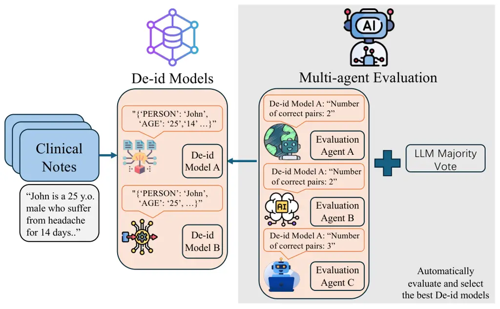

# Towards Automatic Evaluation and Selection of PHI De-identification Models via Multi-Agent Collaboration

Guanchen Wu Affiliation: Department of Computer Science, Emory
University Email: [guanchen.wu@emory.edu](mailto:)    Zuhui Chen
Affiliation: Department of Statistics, Columbia University
Email: [yuzhang.xie@emory.edu](mailto:)    Yuzhang Xie
Affiliation: Department of Computer Science, Emory University
Email: [j.carlyang@emory.edu](mailto:)    Carl Yang
Affiliation: Department of Computer Science, Emory University
Email: [zc2748@columbia.edu](mailto:)

###### Abstract

Protected health information (PHI) de-identification is critical for
enabling the safe reuse of clinical notes, yet evaluating and comparing
PHI de-identification models typically depends on costly, small-scale
expert annotations. We present TEAM-PHI, a _multi-agent evaluation and
selection framework_ that uses large language models (LLMs) to
automatically measure de-identification quality and select the
best-performing model without heavy reliance on gold labels. TEAM-PHI
deploys multiple Evaluation Agents, each independently judging the
correctness of PHI extractions and outputting structured metrics. Their
results are then consolidated through an LLM-based majority voting
mechanism that integrates diverse evaluator perspectives into a single,
stable, and reproducible ranking. Experiments on a real-world clinical
note corpus demonstrate that TEAM-PHI produces consistent and accurate
rankings: despite variation across individual evaluators, LLM-based
voting reliably converges on the same top-performing systems. Further
comparison with ground-truth annotations and human evaluation confirms
that the framework’s automated rankings closely match supervised
evaluation. By combining independent evaluation agents with LLM majority
voting, TEAM-PHI offers a practical, secure, and cost-effective solution
for _automatic evaluation and best-model selection_ in PHI
de-identification, even when ground-truth labels are limited. ¹¹ 1 The
implementation details, prompt designs, and codes are available in the
anonymous repository at
[https://anonymous.4open.science/r/SAFE-0915](https://anonymous.4open.science/r/SAFE-0915).

   

|     |
| --- |
|     |

## 1 Introduction

Clinical notes—such as discharge summaries, nursing notes, and radiology
or ECG reports—capture rich context like clinical reasoning,
observations, and social factors that are often missing in structured
electronic health records (Seinen et al., 2025; Tayefi et al., 2021;
Zhang et al., 2024). Despite their value for research and downstream
applications, clinical notes often contain protected health information
(PHI), including names, dates, and addresses, and their reuse is
strictly regulated under privacy laws such as HIPAA (Moore and Frye,
2019; Cohen and Mello, 2018). To enable safe sharing and analysis, PHI
de-identification is typically applied as a preprocessing step,
automatically detecting and removing or replacing personal
identifiers—for example, transforming “John Smith was admitted on
03/15/2024 at Hospital A” into “\[NAME\] was admitted on \[DATE\] at
\[HOSPITAL\]”.

Existing PHI de-identification (De-id) systems have progressed from
handcrafted rules and feature-based machine learning to deep learning
and transformer-based models (Kovačević et al., 2024). More recently,
large language models (LLMs) have opened new avenues for clinical NLP
tasks such as named entity recognition, relation extraction, and note
summarization (Lehman et al., 2023; Wu et al., 2024). Studies show that
multiple kinds of LLMs can effectively extract PHI entities, generate
structured representations from free text, and assist in clinical
decision-making (Wu et al., 2025; Liu et al., 2023)

Although LLM-based PHI de-identification has significantly advanced the
field, methods for systematically evaluating and automatically selecting
the best de-identification model remain underexplored. Conventional
evaluation relies on costly, small, institution-specific expert
annotations, which impede the creation of reliable, generalizable
benchmarks (Altalla’ et al., 2025). LLMs have shown broad prior
knowledge and strong zero-shot capabilities (Chang et al., 2024),
offering a promising route to assess de-identification models without
gold labels. However, using LLMs as verifiers raises new challenges: how
to design efficient, calibrated, and robust evaluation pipelines that
are insensitive to prompt phrasing or choice of verifier, and how to
ensure their judgments are trustworthy across use cases (Chang et al.,
2024; de Oliveira et al., 2025).

In this paper, we propose TEAM-PHI (Trusted Evaluation and Automatic
Model selection for PHI), a multi-agent framework to automatically
evaluate LLM-based de-identification methods and select the
best-performing model. TEAM-PHI first runs multiple LLMs as De-id models
that extract PHI from raw clinical text in a structured format. Multiple
evaluation agents then assess those De-id outputs without relying on
gold annotations. We validate the framework on a real-world
clinical-note corpus and find that (1) aggregating Evaluation Agents by
majority voting improves reliability relative to single-model
assessments, (2) the multi-agent evaluators operate efficiently and
produce consistent relative rankings, and (3) Llama-70B consistently
emerges as the most reliable De-id model — a result supported by
ablation studies using a limited manually annotated test set and
independent human expert review.

Our contributions are threefold: (i) we introduce TEAM-PHI, a
multi-agent framework that uses multiple LLMs to perform automated PHI
evaluation and select the best de-identification model without heavy
reliance on human labels; (ii) we demonstrate through extensive
experiments that the multi-agent design yields consistent and accurate
estimates of de-identification quality and that voting aggregation
improves evaluator reliability; and (iii) we show that TEAM-PHI is a
practical, secure, and cost-effective tool for guiding deployment of
privacy-preserving data pipelines in healthcare settings.

## 2 Related Work

#### PHI De-identification.

De-identification of PHI has evolved from rule-based systems with
handcrafted dictionaries and regexes (Uzuner et al., 2007; Meystre et
al., 2010) to statistical learners (CRFs, SVMs) (He et al., 2015; Jiang
et al., 2017), then to deep models (BiLSTM-CRF) (Dernoncourt et al.,
2017; Tang et al., 2020) and transformer-based architectures (e.g.,
BioBERT) (Lee et al., 2020; Johnson et al., 2020), improving accuracy
while reducing manual feature engineering. Recently, LLMs have been
leveraged for many clinical tasks (Xie et al., 2024; Wu et al., 2024),
including PHI de-identification, because of their strong contextual
reasoning and zero-/few-shot learning abilities (Bhasuran et al., 2025).
Recent work has demonstrated the promise of large language models (LLMs)
for PHI De-id. For example, DeID-GPT leverages GPT-4 for zero-shot
de-identification of medical text, achieving competitive performance
without task-specific fine-tuning (Liu et al., 2023). Similarly, Wu et
al. (2025) proposed the LPPA framework, which combines synthetic data
generation with instruction tuning to fine-tune local LLMs for PHI
extraction. LPPA offers a privacy-preserving solution while notably
improving recall—a critical metric for safeguarding sensitive health
data—and its hybrid models (LPPA-4K and LPPA-5K) are also adopted in our
implementation of De-id models. Despite these advances, existing systems
still lack robust methods for systematically evaluating and
automatically selecting the best De-id model, motivating the development
of our proposed framework.

#### Evaluation of De-identification Systems.

Traditionally, PHI de-identification systems are evaluated against
gold-standard corpora such as the i2b2 shared tasks (Stubbs et al.,
2015). Metrics typically include precision, recall, and F1-score.
However, such datasets are costly to create and limited in scope.
Alternative evaluation approaches include weak supervision, ensemble
frameworks, and extensible benchmarking systems designed to assess
de-identification tools across multiple corpora and settings (Heider and
Meystre, 2024). Despite recent progress, robust evaluation without
gold-standard annotations, as in this study, is still largely
unexplored.

#### Large Language Models as Judges.

Some researchers has begun to examine the use of LLMs as evaluators, or
“judges,” in a range of NLP tasks including summarization, dialogue, and
machine translation. These studies show that LLMs can approximate human
judgments with promising consistency (Zhu et al., 2023; Hada et al.,
2023; Xie et al., 2025; Pan et al., 2024). Specialized evaluator models
such as Prometheus incorporate rubric-based scoring to align more
closely with human ratings (Kim et al., 2023). However, concerns of
bias, calibration, and fairness remain when deploying LLM-based judges
at scale (Wang et al., 2023). Our work extends this line of research to
the sensitive domain of PHI de-identification, systematically evaluating
whether Evaluation Agents can replicate gold-standard and human
assessments when ground truth is limited or masked.

## 3 Method

### 3.1 Problem Formulation

#### Notation.

All notations used throughout the paper are summarized in Appendix A.

#### Task Definition.

Let $`\mathcal{X}`$ denote the space of clinical notes, and let
$`\mathcal{C}=\{c_{1},\ldots,c_{m}\}`$ be the finite set of PHI
categories (e.g., PERSON, DATE/TIME, LOCATION, ORGANIZATION). For a
given note $`x\in\mathcal{X}`$, the de-identification output is a set of
labeled entity spans:

```math
\texttt{PHI}(x)=\{(c_{i},e_{i})\}_{i=1}^{k}, \tag{1}
```

where $`c_{i}\in\mathcal{C}`$ and $`e_{i}\subseteq x`$ is a contiguous
text span corresponding to an entity of type $`c_{i}`$. Our objective is
to select the best-performing de-identification model from a candidate
set $`\mathcal{M}=\{M_{1},\ldots,M_{R}\}`$ by maximizing a utility
function that does not require gold-standard annotations:

```math
M^{*}=\arg\max_{M\in\mathcal{M}}\ \mathbb{E}_{x\sim\mathcal{D}}\ \texttt{PHI-EV}(M,x), \tag{2}
```

where $`\texttt{PHI-EV}(M,x)`$ denotes the evaluation score for model
$`M`$ on input $`x`$.

#### Conventional Evaluation.

In traditional settings, given a model $`M`$, its prediction
$`\texttt{PHI}_{M}(x)`$, and the corresponding gold annotations
$`y^{*}(x)`$, the evaluation score is computed via a standard metric:

```math
\texttt{PHI-EV}(M,x)=f\big(\texttt{PHI}(M,x),\ y^{*}(x)\big), \tag{3}
```

where $`f`$ is typically precision, recall, or F1-score.

#### TEAM-PHI Evaluation.

Due to the scarcity of large-scale annotated corpora
$`\{(x,y^{*}(x))\}`$ in real-world applications, we propose replacing
$`f`$ with a multi-agent evaluation function $`g`$ that aggregates
judgments from $`A`$ independent LLM-based evaluation agents
$`\{E_{a}\}_{a=1}^{A}`$:

```math
\texttt{PHI-EV}(M,x)=g\big(\texttt{PHI}(M,x)\big),\qquad g=\mathrm{Aggregate}(E_{1},\ldots,E_{A})\quad\text{(e.g., majority voting)}. \tag{4}
```

### 3.2 Framework Overview



Figure 1: Framework of TEAM-PHI.

To meet this objective, we propose a multi-agent evaluation framework 1
that decouples PHI extraction from quality assessment. First, raw
clinical notes are processed in parallel by multiple De-id models, each
producing a set of PHI predictions. These predictions are then evaluated
by a pool of independent Evaluation Agents—LLM-based judges that assess
the correctness of every predicted PHI entity without relying on gold
annotations. Their judgments are aggregated through majority voting and
further verified by targeted human review to generate trustworthy model
comparisons and rankings. This modular design supports large-scale
benchmarking of de-identification systems without human-labeled corpora
and can flexibly incorporate new de-identification or evaluation models
without altering the overall protocol.

### 3.3 De-id Models

We employ a diverse set of De-id models—eight LLMs, including two LPPA
hybrids trained on synthetic clinical notes (Wu et al., 2025). Each
model receives the same prompt and outputs predictions as a JSON
dictionary of PHI entities, ensuring a unified, machine-readable format
across heterogeneous architectures. Although these models differ in
scale, training data, and internal reasoning, our framework treats them
purely as black boxes and focuses on rigorous and reproducible
evaluation and selection through multi-agent collaboration. The process
are described in Eq.(3).

### 3.4 Multi-agent Evaluation

Evaluation Agents serve as independent judges of the quality of PHI
de-identification. Given a clinical note $`x`$ and the predicted output
$`\texttt{PHI}=\{(c_{1},e_{1}),\cdots,(c_{i},e_{i})\}`$, the Evaluation
Agents $`\{E_{a}\}_{a=1}^{A}`$ will evaluate De-id model outputs and
select the best performing model follow Eq.(4). Evaluation Agents face
challenges distinct from those of De-id models, and our design addresses
them explicitly.

#### Normalization of linguistic variation.

PHI entities may appear in multiple surface forms, such as different
name prefixes, diverse date formats, or varied expressions of age. To
handle these cases we introduce a normalization procedure that
standardizes entity spans (e.g., mapping “Dr. Smith” and “Smith” to the
same PERSON mention, or converting “03/15/2024” and “March 15, 2024” to
a canonical date).

#### Consistent and machine-readable output.

To ensure reproducibility and facilitate automated scoring, each
Evaluation Agent is constrained to output its decision as a strict JSON
object of the form {"Number of Correct Pairs":N}, where $`N`$ is the
integer total of validated predictions. This removes ambiguity caused by
formatting differences and allows direct aggregation of results across
agents.

#### Mitigating evaluator bias.

While De-id models must identify all PHI entities, Evaluation Agents
must critically verify predictions without over-accepting incorrect ones
or missing valid but differently expressed entities. To reduce
individual bias and quantify reliability, multiple Evaluation Agents are
deployed in parallel, and their outputs are combined through ensemble
strategies such as majority voting.

#### LLM Majority Voting.

To consolidate the independent judgments from multiple Evaluation Agents
into a single, reproducible ranking of De-id models, we introduce an LLM
majority voting mechanism. This mechanism treats each Evaluation Agent’s
summary of correctness counts as a “ballot” and uses an LLM to aggregate
these ballots. Two complementary modes are employed: (i) _Independent
voting_ in which the LLM inspects one Evaluation Agent’s summary table
at a time and nominates the best-performing De-id model based on that
single table; the final winner is determined by majority across all
tables. (ii) _Cross-informed voting_ in which the LLM simultaneously
reviews all Evaluation Agents’ tables and chooses a single best model
after considering the combined evidence.

This dual-mode design serves several purposes. First, independent voting
captures diverse evaluator perspectives and guards against a single
evaluator dominating the decision. Second, cross-informed voting enables
the LLM to reason globally across evaluators, potentially identifying
consensus patterns or compensating for individual evaluator noise. By
applying natural-language reasoning to structured numerical evidence,
LLM majority voting provides an automated and explainable way to
integrate heterogeneous assessments. It does not re-evaluate the
clinical content itself but instead transforms multiple correctness
counts into a reliable and reproducible model ranking.

Together, these design elements enable the framework to automatically
evaluate and select the best-performing De-id models, even when
gold-standard annotations are masked, while maintaining transparency and
reproducibility in the aggregation process.

## 4 Experimental Settings

Our experiments evaluate the proposed multi-agent framework for PHI
de-identification in clinical notes. We focus on two questions: (1) can
Evaluation Agents provide consistent and reliable judgments of
de-identification quality when gold-standard annotations are hidden, and
(2) how well do these judgments align with supervised evaluation and
human assessment.

### 4.1 Dataset

We use a dataset of 100 fully annotated clinical notes provided by a
large U.S. hospital. Each note averages about 1,000 tokens and contains
a diverse set of PHI mentions that were meticulously annotated by
medical experts. While gold-standard labels are available, they are
masked in the main experiments and used only for a final supervised
check (Table 8).

### 4.2 LLM Choices

Eight LLMs act as De-id models, including commercial APIs and
open-source models, as well as two hybrid LPPA models trained on
synthetic clinical notes (Wu et al., 2025). Six LLMs are employed as
Evaluation Agents. To ensure fair comparison, all De-id models receive
the same prompt and must output a structured JSON dictionary of
predicted PHI entities, and Evaluation Agents judge these outputs and
return the number of correct predictions in a fixed JSON format.

For readability in our results tables, we use short model names such as
_Mistral-7b_, _GPT-3.5_, _GPT-4o_, _Llama-8b_, and _Llama-70b_.

More implementation details—including dataset details, model links,
evaluation metrics, validation details, and compute resources—are
provided in the Appendix B.

## 5 Experimental Results

### 5.1 TEAM-PHI Evaluation Results

#### Single Agent Evaluation.

Tables 1 to 6 report results when each of the six Evaluation Agents
serves as the judge. Although absolute scores vary considerably across
Evaluation Agents, several consistent patterns emerge. Llama-70B is
repeatedly judged as one of the top-performing De-id models, appearing
in the top-2 in 2 of 6 evaluations ($`\approx`$33%) and in the top-3 in
4 of 6 evaluations ($`\approx`$67%). It maintains a high average
Recall-Proxy ($`\approx`$0.62), strong Num Correct values
(mean$`\approx`$1,018), and consistently achieves $`\geq`$0.80 in PERSON
recognition, underscoring its stable, evaluator-independent performance.
GPT-4o also demonstrates strong performance, particularly in
recall-proxy and DATE/TIME recognition. In contrast, smaller models such
as GPT-3.5 and Gemma-2 show greater variability: GPT-3.5’s Recall-Proxy
spans 0.27–0.87 (mean$`\approx`$0.66, std$`\approx`$0.19), while Gemma-2
spans 0.26–0.69 (mean$`\approx`$0.53, std$`\approx`$0.13). Hybrid models
tend to achieve higher precision but exhibit lower coverage, suggesting
a trade-off between accuracy and completeness.

#### Entity-Level Performance.

The entity-specific metrics in Tables 1 to 6 highlight additional
insights. For the PERSON category, several models, including Llama-70B
and GPT-4o, consistently achieve high recognition rates, often exceeding
0.90. This indicates that models are well attuned to detecting personal
identifiers such as names. By contrast, performance on DATE/TIME varies
more substantially. Some Evaluation Agents judge GPT-4o and Llama-8B as
strong performers, while others favor Gemma-2 or Mistral-7B. This
divergence reflects differences in how Evaluation Agents interpret
temporal expressions, suggesting that date and time recognition remains
a challenging subtask for LLM-based de-identification.

| De-id Model | Precision | Coverage | Num Correct | Recall-Proxy | PERSON | DATE/TIME |
| ----------- | --------- | -------- | ----------- | ------------ | ------ | --------- |
| Gemma-2     | 0.6169    | 1.37%    | 984         | 0.5989       | 0.9120 | 0.6903    |
| Mistral-7b  | 0.5364    | 1.44%    | 900         | 0.5477       | 0.8626 | 0.6754    |
| GPT-3.5     | 0.5513    | 1.84%    | 1187        | 0.7224       | 0.8601 | 0.5928    |
| GPT-4o      | 0.5836    | 1.45%    | 991         | 0.6031       | 0.8659 | 0.5248    |
| Llama-8b    | 0.5555    | 1.72%    | 1116        | 0.6792       | 0.9021 | 0.5975    |
| Llama-70b   | 0.5906    | 1.47%    | 1010        | 0.6147       | 0.9071 | 0.5981    |
| LPPA4k      | 0.5609    | 1.02%    | 668         | 0.4065       | 0.8778 | 0.5016    |
| LPPA5k      | 0.5743    | 0.95%    | 638         | 0.3883       | 0.8803 | 0.5919    |

Table 1: Evaluation Results (Evaluation Agent: Gemma-2)

| De-id Model | Precision | Coverage | Num Correct | Recall-Proxy | PERSON | DATE/TIME |
| ----------- | --------- | -------- | ----------- | ------------ | ------ | --------- |
| Gemma-2     | 0.5241    | 1.37%    | 836         | 0.5088       | 0.8944 | 0.4230    |
| Mistral-7b  | 0.5459    | 1.44%    | 916         | 0.5575       | 0.9010 | 0.6421    |
| GPT-3.5     | 0.4663    | 1.84%    | 1004        | 0.6110       | 0.9336 | 0.4362    |
| GPT-4o      | 0.5595    | 1.45%    | 950         | 0.5782       | 0.9534 | 0.4575    |
| Llama-8b    | 0.4858    | 1.72%    | 976         | 0.5940       | 0.8932 | 0.3363    |
| Llama-70b   | 0.5497    | 1.47%    | 940         | 0.5721       | 0.9214 | 0.5395    |
| LPPA4k      | 0.6188    | 1.02%    | 737         | 0.4485       | 0.9704 | 0.5064    |
| LPPA5k      | 0.6373    | 0.95%    | 708         | 0.4309       | 0.9691 | 0.5414    |

Table 2: Evaluation Results (Evaluation Agent: Mistral-7b)

| De-id Model | Precision | Coverage | Num Correct | Recall-Proxy | PERSON | DATE/TIME |
| ----------- | --------- | -------- | ----------- | ------------ | ------ | --------- |
| Gemma-2     | 0.2742    | 0.91%    | 431         | 0.2600       | 0.7425 | 0.5609    |
| Mistral-7b  | 0.2301    | 0.97%    | 387         | 0.2335       | 0.7348 | 0.6465    |
| GPT-3.5     | 0.2035    | 1.26%    | 442         | 0.2667       | 0.8127 | 0.4511    |
| GPT-4o      | 0.2566    | 1.01%    | 446         | 0.2691       | 0.7695 | 0.4470    |
| Llama-8b    | 0.2271    | 1.18%    | 464         | 0.2800       | 0.7681 | 0.5410    |
| Llama-70b   | 0.2677    | 1.01%    | 468         | 0.2824       | 0.8358 | 0.4564    |
| LPPA4k      | 0.2620    | 0.69%    | 311         | 0.1876       | 0.8282 | 0.6646    |
| LPPA5k      | 0.2650    | 0.65%    | 296         | 0.1786       | 0.8221 | 0.6903    |

Table 3: Evaluation Results (Evaluation Agent: GPT-3.5)

| De-id Model | Precision | Coverage | Num Correct | Recall-Proxy | PERSON | DATE/TIME |
| ----------- | --------- | -------- | ----------- | ------------ | ------ | --------- |
| Gemma-2     | 0.6177    | 0.91%    | 971         | 0.5859       | 0.6343 | 0.9013    |
| Mistral-7b  | 0.5279    | 0.97%    | 888         | 0.5358       | 0.6796 | 0.9130    |
| GPT-3.5     | 0.5787    | 1.26%    | 1257        | 0.7584       | 0.6890 | 0.8324    |
| GPT-4o      | 0.6559    | 1.01%    | 1140        | 0.6878       | 0.6796 | 0.8874    |
| Llama-8b    | 0.6089    | 1.18%    | 1244        | 0.7506       | 0.6777 | 0.9306    |
| Llama-70b   | 0.7094    | 1.01%    | 1240        | 0.7482       | 0.8139 | 0.9071    |
| LPPA4k      | 0.6664    | 0.69%    | 791         | 0.4773       | 0.7786 | 0.9541    |
| LPPA5k      | 0.6723    | 0.65%    | 751         | 0.4531       | 0.7905 | 0.9428    |

Table 4: Evaluation Results (Evaluation Agent: GPT-4o)

| De-id Model | Precision | Coverage | Num Correct | Recall-Proxy | PERSON | DATE/TIME |
| ----------- | --------- | -------- | ----------- | ------------ | ------ | --------- |
| Gemma-2     | 0.5808    | 0.91%    | 913         | 0.5509       | 0.9552 | 0.7731    |
| Mistral-7b  | 0.5511    | 0.97%    | 927         | 0.5593       | 0.9724 | 0.6554    |
| GPT-3.5     | 0.5506    | 1.26%    | 1196        | 0.7216       | 0.9223 | 0.6940    |
| GPT-4o      | 0.6007    | 1.01%    | 1044        | 0.6299       | 0.9581 | 0.6800    |
| Llama-8b    | 0.5546    | 1.18%    | 1133        | 0.6836       | 0.9699 | 0.7087    |
| Llama-70b   | 0.5749    | 1.01%    | 1005        | 0.6064       | 0.9745 | 0.6750    |
| LPPA4k      | 0.6318    | 0.69%    | 750         | 0.4525       | 0.9771 | 0.7468    |
| LPPA5k      | 0.6741    | 0.65%    | 753         | 0.4543       | 0.9684 | 0.6627    |

Table 5: Evaluation Results (Evaluation Agent: Llama-8b)

| De-id Model | Precision | Coverage | Num Correct | Recall-Proxy | PERSON | DATE/TIME |
| ----------- | --------- | -------- | ----------- | ------------ | ------ | --------- |
| Gemma-2     | 0.7284    | 0.91%    | 1145        | 0.6909       | 0.9478 | 0.9118    |
| Mistral-7b  | 0.6599    | 0.97%    | 1110        | 0.6697       | 0.8564 | 0.8845    |
| GPT-3.5     | 0.6653    | 1.26%    | 1445        | 0.8719       | 0.9117 | 0.8571    |
| GPT-4o      | 0.8096    | 1.01%    | 1407        | 0.8489       | 0.9551 | 0.8852    |
| Llama-8b    | 0.7347    | 1.18%    | 1501        | 0.9056       | 0.9578 | 0.8941    |
| Llama-70b   | 0.8278    | 1.01%    | 1447        | 0.8731       | 1.0000 | 0.9241    |
| LPPA4k      | 0.7944    | 0.69%    | 943         | 0.5690       | 0.9313 | 0.9241    |
| LPPA5k      | 0.8147    | 0.65%    | 910         | 0.5491       | 0.9447 | 0.9566    |

Table 6: Evaluation Results (Evaluation Agent: Llama-70b)

#### LLM Majority Voting.

| Models     | Independent | Cross-Informed |
| ---------- | ----------- | -------------- |
| Gemma-2    | Llama-70b   | Llama-70b      |
| Mistral-7b | Llama-70b   | Llama-70b      |
| GPT-3.5    | Llama-70b   | Llama-70b      |
| GPT-4o     | Llama-70b   | Llama-70b      |
| Llama-8b   | Llama-8b    | Llama-70b      |
| Llama-70b  | Llama-8b    | Llama-70b      |

Table 7: LLM voting: best De-id model selected independently or with
cross-informed context.

To reduce individual evaluator bias of De-id models, we apply the LLM
majority voting procedure described in Section 3.4. This procedure
aggregates the numerical judgments produced by multiple Evaluation
Agents and asks an LLM to determine the best-performing De-id model
under two complementary modes: (i) _Independent voting_, in which the
voting LLM reviews one Evaluation Agent’s summary table at a time and
casts a vote for the best model on that table; and (ii) _Cross-informed
voting_, in which the voting LLM reviews all Evaluation Agents’ tables
together and selects the best model after considering the combined
evidence. The two modes capture different perspectives: independent
voting prevents a single evaluator from dominating the decision, while
cross-informed voting allows global reasoning across evaluators.

As shown in Table 7, both voting schemes consistently select Llama-70B
as the top-performing De-id model. Under independent voting, 4 of 6
evaluation agents (67%) selected Llama-70B as best, while under
cross-informed voting, all 6 of 6 agents (100%) agreed on Llama-70B.
This high level of agreement indicates that ensemble judgments are more
stable and less biased than those derived from any single evaluator and
that LLM majority voting provides a robust mechanism to automatically
evaluate and select the best De-id models when gold-standard annotations
are unavailable.

### 5.2 External Validation

| Models     | Overall             |                     |                     | PERSON              |                 |                     | DATE/TIME       |                      |                     |
| ---------- | ------------------- | ------------------- | ------------------- | ------------------- | --------------- | ------------------- | --------------- | -------------------- | ------------------- |
|            | Pr                  | Re                  | F1                  | Pr                  | Re              | F1                  | Pr              | Re                   | F1                  |
| Gemma-2    | 0.52$`\pm`$0.01     | 0.45$`\pm`$0.01     | 0.48$`\pm`$0.01     | 0.53$`\pm`$0.01     | 0.47$`\pm`$0.01 | 0.50$`\pm`$0.02     | 0.88$`\pm`$0.02 | 0.41$`\pm`$0.01      | 0.56$`\pm`$0.02     |
| Mistral-7b | 0.52$`\pm`$0.01     | 0.50$`\pm`$0.01     | 0.51$`\pm`$0.01     | 0.58$`\pm`$0.01     | 0.36$`\pm`$0.01 | 0.44$`\pm`$0.02     | 0.87$`\pm`$0.02 | 0.50$`\pm`$0.01      | 0.63$`\pm`$0.02     |
| GPT-3.5    | 0.43$`\pm`$0.02     | 0.60$`\pm`$0.01     | 0.48$`\pm`$0.02     | 0.60$`\pm`$0.04     | 0.50$`\pm`$0.01 | 0.54$`\pm`$0.02     | 0.74$`\pm`$0.03 | 0.44$`\pm`$0.02^(\*) | 0.55$`\pm`$0.02     |
| GPT-4o     | 0.53$`\pm`$0.01^(∗) | 0.69^(∗)            | 0.58$`\pm`$0.01^(∗) | 0.60$`\pm`$0.02^(∗) | 0.57$`\pm`$0.01 | 0.58$`\pm`$0.01^(∗) | 0.80$`\pm`$0.01 | 0.57$`\pm`$0.02^(∗)  | 0.67$`\pm`$0.02^(∗) |
| Llama-8b   | 0.46$`\pm`$0.02     | 0.59$`\pm`$0.03     | 0.50$`\pm`$0.02     | 0.53$`\pm`$0.01     | 0.55$`\pm`$0.02 | 0.53$`\pm`$0.01     | 0.79$`\pm`$0.03 | 0.39$`\pm`$0.02      | 0.52$`\pm`$0.01     |
| Llama-70b  | 0.60$`\pm`$0.01^(∗) | 0.68$`\pm`$0.01^(∗) | 0.62$`\pm`$0.01^(∗) | 0.59$`\pm`$0.01^(∗) | 0.53$`\pm`$0.01 | 0.56$`\pm`$0.01^(∗) | 0.83$`\pm`$0.01 | 0.50$`\pm`$0.01^(∗)  | 0.63$`\pm`$0.01^(∗) |
| LPPA4k     | 0.65$`\pm`$0.01^(∗) | 0.54$`\pm`$0.02     | 0.57$`\pm`$0.01^(∗) | 0.59$`\pm`$0.02^(∗) | 0.53$`\pm`$0.02 | 0.56$`\pm`$0.02     | 0.82$`\pm`$0.03 | 0.40$`\pm`$0.03      | 0.54$`\pm`$0.03     |
| LPPA5k     | 0.64$`\pm`$0.01^(∗) | 0.55$`\pm`$0.02     | 0.57$`\pm`$0.01^(∗) | 0.59$`\pm`$0.03^(∗) | 0.53$`\pm`$0.02 | 0.56$`\pm`$0.01^(∗) | 0.82$`\pm`$0.02 | 0.35$`\pm`$0.02      | 0.50$`\pm`$0.01     |

Table 8: Ground Truth evaluation results.

| Models     | Q1 ($`\uparrow`$) | Q2 ($`\downarrow`$) | Q3 ($`\uparrow`$) |
| ---------- | ----------------- | ------------------- | ----------------- |
| Gemma-2    | 0.00              | 2.20                | 1.60              |
| Mistral-7b | 0.00              | 2.24                | 1.40              |
| GPT-3.5    | 0.00              | 4.28                | 1.68              |
| GPT-4o     | 0.18              | 2.22                | 3.85              |
| Llama-8b   | 0.20              | 2.08                | 3.75              |
| Llama-70b  | 0.18              | 1.62                | 4.20              |

Table 9: Human evaluation of Evaluation Agents. Q1: correctness; Q2:
missed-PHI severity; Q3: overall trustworthiness.

#### Ground-truth Evaluation.

Although the multi-agent framework is designed to operate without
human-labeled data, we also perform _ground-truth evaluation_ to further
validate the evaluation conclusions of TEAM-PHI described in Section
5.1. Table 8 reports precision, recall, and F1 scores computed against
manually annotated PHI labels. Llama-70B achieves the highest overall F1
(0.62), followed by GPT-4o (0.58) and the hybrid models (0.57). The
agreement between ground-truth evaluation and LLM-based judging is
striking: models ranked highest by Evaluation Agents and LLM majority
voting are the same models that perform best under gold-standard
supervision. This demonstrates that the proposed framework can reproduce
supervised rankings even when gold annotations are hidden.

#### Human Evaluation.

To further verify the quality of Evaluation Agents’ judgments, we also
conduct a _human evaluation_ of a representative sample of notes. Two
biomedical experts, supported by LLM-generated checklists and
highlights, inspect each case to confirm correctness counts, estimate
the number of missed PHI entities, and rate overall trustworthiness. As
summarized in Table 9, human reviewers consistently rate Llama-70B
outputs highest on overall quality. It achieves the lowest missed-PHI
severity (Q2 = 1.62, best among all models) and the highest overall
trustworthiness (Q3 = 4.20), while tying with GPT-4o for second place in
correctness (Q1 = 0.18; Llama-8B leads slightly at 0.20). All other
models have Q1 $`\leq`$ 0.18 and Q3 $`\leq`$ 3.85, underscoring the
clear human preference for Llama-70B.

Together, these supervised and human assessments demonstrate that our
multi-agent framework can reliably approximate gold-standard evaluation
and produce reproducible, trustworthy rankings of De-id models even when
ground-truth annotations are intentionally withheld.

### 5.3 Summary of Findings.

Overall, the experiments demonstrate that while Evaluation Agents differ
in absolute scoring, they consistently reveal relative performance
trends. Llama-70B emerges as the most reliable De-id model. Hybrid
models offer precision advantages but at the cost of coverage.
Entity-specific analysis shows that PERSON recognition is relatively
robust, while DATE/TIME detection remains less stable. The convergence
of LLM-based evaluation, gold-standard comparison, voting, and human
judgment underscores the robustness of our proposed framework and
highlights its practical utility in real-world clinical text processing
where annotated datasets are unavailable.

## 6 Conclusion

We introduced TEAM-PHI, a multi-agent framework that enables automatic
evaluation and selection of PHI de-identification models in clinical
notes without heavy reliance on manually annotated data. In this
framework, large language models (LLMs) operate as independent
Evaluation Agents that assess de-identification quality, while their
judgments are consolidated through LLM-based majority voting to produce
stable and reproducible model rankings.

Experiments on a real-world clinical-note corpus demonstrate that
TEAM-PHI provides consistent and trustworthy evaluations: despite
variation across individual evaluators, majority voting converges on the
same top-performing systems, with Llama-70B and GPT-4o repeatedly
identified as leading models. Entity-level analysis further shows that
recognition of PERSON entities is highly stable, whereas DATE/TIME
remains more variable, suggesting areas for targeted improvement.

Validation against a manually annotated test set confirms that the
rankings produced by TEAM-PHI closely align with ground-truth
evaluation, and additional human review reinforces the reliability of
the automated judgments.

Overall, this work establishes that LLMs can act not only as PHI
de-identifiers but also as scalable and dependable evaluators. TEAM-PHI
provides three key contributions: (1) a practical framework for
benchmarking and selecting PHI de-identification models without
extensive human labeling; (2) empirical evidence that multi-agent
evaluation and majority voting effectively mitigate individual evaluator
bias; and (3) fine-grained insights that guide refinement of PHI
coverage and accuracy. Future work will extend this framework to
additional PHI categories and larger datasets, and explore techniques to
better calibrate Evaluation Agents and integrate limited human oversight
for even greater robustness.

## AI Agent Setup

In this work, we used OpenAI’s GPT-5 model as the sole AI agent to
support experimental design, implementation, data analysis, and
manuscript preparation. All interactions with GPT-5 were conducted
through the official web interface, without employing orchestration
frameworks such as LangChain or AutoGen. The model generated initial
implementations of the multi-agent evaluation framework, suggested
experimental setups, analyzed results, and drafted sections of the
paper. Human authors executed and validated the AI-generated code,
refined analyses, and ensured the accuracy of interpretations. No
external tools were integrated beyond standard Python environments and
model inference interfaces described in the Experimental Settings. All
de-identification and evaluation experiments were conducted using the
LLMs listed in Appendix B, through a combination of API-based and local
runs on the Azure platform. This streamlined configuration shows that a
single, general-purpose LLM agent can effectively support the entire
research workflow for PHI de-identification evaluation without complex
orchestration or additional infrastructure.

## References

- Altalla’ et al. (2025) B. Altalla’, S. Abdalla, A. Altamimi, L.
  Bitar, A. Al Omari, R. Kardan, and I. Sultan Evaluating gpt models for
  clinical note de-identification. Scientific Reports 15 (1), pp. 3852.
  Cited by: §1.
- Bhasuran et al. (2025) B. Bhasuran, Q. Jin, Y. Xie, C. Yang, K.
  Hanna, J. Costa, C. Shavor, W. Han, Z. Lu, and Z. He Preliminary
  analysis of the impact of lab results on large language model
  generated differential diagnoses. npj Digital Medicine 8 (1), pp. 166.
  Cited by: §2.
- Chang et al. (2024) Y. Chang, X. Wang, J. Wang, Y. Wu, L. Yang, K.
  Zhu, H. Chen, X. Yi, C. Wang, Y. Wang, et al. A survey on evaluation
  of large language models. ACM transactions on intelligent systems and
  technology 15 (3), pp. 1–45. Cited by: §1.
- Cohen and Mello (2018) I. G. Cohen and M. M. Mello HIPAA and
  protecting health information in the 21st century. Jama 320 (3),
  pp. 231–232. Cited by: §1.
- de Oliveira et al. (2025) R. de Oliveira, M. Garber, J. M.
  Gwinnutt, E. Rashidi, J. Hwang, W. Gilmour, J. Nanavati, K. Zine El
  Abidine, and C. D. Mack A study of calibration as a measurement of
  trustworthiness of large language models in biomedical natural
  language processing. JAMIA open 8 (4), pp. ooaf058. Cited by: §1.
- Dernoncourt et al. (2017) F. Dernoncourt, J. Y. Lee, O. Uzuner, and P.
  Szolovits De-identification of patient notes with recurrent neural
  networks. Journal of the American Medical Informatics Association 24
  (3), pp. 596–606. Cited by: §2.
- Hada et al. (2023) R. Hada, V. Gumma, A. de Wynter, H. Diddee, M.
  Ahmed, M. Choudhury, K. Bali, and S. Sitaram Are large language
  model-based evaluators the solution to scaling up multilingual
  evaluation?. arXiv preprint arXiv:2309.07462. Cited by: §2.
- He et al. (2015) B. He, Y. Guan, J. Cheng, K. Cen, and W. Hua CRFs
  based de-identification of medical records. Journal of biomedical
  informatics 58, pp. S39–S46. Cited by: §2.
- Heider and Meystre (2024) P. M. Heider and S. M. Meystre An extensible
  evaluation framework applied to clinical text deidentification natural
  language processing tools: multisystem and multicorpus study. Journal
  of medical Internet research 26, pp. e55676. Cited by: §2.
- Jiang et al. (2017) Z. Jiang, C. Zhao, B. He, Y. Guan, and J. Jiang
  De-identification of medical records using conditional random fields
  and long short-term memory networks. Journal of biomedical informatics
  75, pp. S43–S53. Cited by: §2.
- Johnson et al. (2020) A. E. Johnson, L. Bulgarelli, and T. J. Pollard
  Deidentification of free-text medical records using pre-trained
  bidirectional transformers. In Proceedings of the ACM conference on
  health, inference, and learning, pp. 214–221. Cited by: §2.
- Kim et al. (2023) S. Kim, J. Shin, Y. Cho, J. Jang, S. Longpre, H.
  Lee, S. Yun, S. Shin, S. Kim, J. Thorne, et al. Prometheus: inducing
  fine-grained evaluation capability in language models. In The Twelfth
  International Conference on Learning Representations, Cited by: §2.
- Kovačević et al. (2024) A. Kovačević, B. Bašaragin, N. Milošević,
  and G. Nenadić De-identification of clinical free text using natural
  language processing: a systematic review of current approaches.
  Artificial intelligence in medicine 151, pp. 102845. Cited by: §1.
- Lee et al. (2020) J. Lee, W. Yoon, S. Kim, D. Kim, S. Kim, C. H. So,
  and J. Kang BioBERT: a pre-trained biomedical language representation
  model for biomedical text mining. Bioinformatics 36 (4),
  pp. 1234–1240. Cited by: §2.
- Lehman et al. (2023) E. Lehman, E. Hernandez, D. Mahajan, J.
  Wulff, M. J. Smith, Z. Ziegler, D. Nadler, P. Szolovits, A. Johnson,
  and E. Alsentzer Do we still need clinical language models?. In
  Conference on health, inference, and learning, pp. 578–597. Cited by:
  §1.
- Liu et al. (2023) Z. Liu, Y. Huang, X. Yu, L. Zhang, Z. Wu, C. Cao, H.
  Dai, L. Zhao, Y. Li, P. Shu, et al. Deid-gpt: zero-shot medical text
  de-identification by gpt-4. arXiv preprint arXiv:2303.11032. Cited by:
  §1, §2.
- Meystre et al. (2010) S. M. Meystre, F. J. Friedlin, B. R. South, S.
  Shen, and M. H. Samore Automatic de-identification of textual
  documents in the electronic health record: a review of recent
  research. BMC medical research methodology 10 (1), pp. 70. Cited by:
  §2.
- Moore and Frye (2019) W. Moore and S. Frye Review of hipaa, part 1:
  history, protected health information, and privacy and security rules.
  Journal of nuclear medicine technology 47 (4), pp. 269–272. Cited by:
  §1.
- Pan et al. (2024) B. Pan, Z. Xiong, G. Wu, Z. Zhang, Y. Zhang, and L.
  Zhao GraphNarrator: generating textual explanations for graph neural
  networks. arXiv preprint arXiv:2410.15268. Cited by: §2.
- Seinen et al. (2025) T. M. Seinen, J. A. Kors, E. M. van Mulligen,
  and P. R. Rijnbeek Using structured codes and free-text notes to
  measure information complementarity in electronic health records:
  feasibility and validation study. Journal of Medical Internet Research
  27, pp. e66910. Cited by: §1.
- Stubbs et al. (2015) A. Stubbs, C. Kotfila, and Ö. Uzuner Automated
  systems for the de-identification of longitudinal clinical narratives:
  overview of 2014 i2b2/uthealth shared task track 1. Journal of
  biomedical informatics 58, pp. S11–S19. Cited by: §2.
- Tang et al. (2020) B. Tang, D. Jiang, Q. Chen, X. Wang, J. Yan, and Y.
  Shen De-identification of clinical text via bi-lstm-crf with neural
  language models. In AMIA Annual Symposium Proceedings, Vol. 2019,
  pp. 857. Cited by: §2.
- Tayefi et al. (2021) M. Tayefi, P. Ngo, T. Chomutare, H. Dalianis, E.
  Salvi, A. Budrionis, and F. Godtliebsen Challenges and opportunities
  beyond structured data in analysis of electronic health records. Wiley
  Interdisciplinary Reviews: Computational Statistics 13 (6), pp. e1549.
  Cited by: §1.
- Uzuner et al. (2007) Ö. Uzuner, Y. Luo, and P. Szolovits Evaluating
  the state-of-the-art in automatic de-identification. Journal of the
  American Medical Informatics Association 14 (5), pp. 550–563. Cited
  by: §2.
- Wang et al. (2023) P. Wang, L. Li, L. Chen, Z. Cai, D. Zhu, B. Lin, Y.
  Cao, Q. Liu, T. Liu, and Z. Sui Large language models are not fair
  evaluators. arXiv preprint arXiv:2305.17926. Cited by: §2.
- Wu et al. (2024) G. Wu, C. Ling, I. Graetz, and L. Zhao Ontology
  extension by online clustering with large language model agents.
  Frontiers in Big Data 7, pp. 1463543. Cited by: §1, §2.
- Wu et al. (2025) G. Wu, L. Zheng, H. Xie, Z. Xiang, J. Lu, D. Liu, D.
  Bold, B. Li, X. Hu, and C. Yang Large language model empowered
  privacy-protected framework for phi annotation in clinical notes.
  arXiv preprint arXiv:2504.18569. Cited by: §1, §2, §3.3, §4.2.
- Xie et al. (2025) Y. Xie, H. Cui, Z. Zhang, J. Lu, K. Shu, F.
  Nahab, X. Hu, and C. Yang KERAP: a knowledge-enhanced reasoning
  approach for accurate zero-shot diagnosis prediction using multi-agent
  llms. arXiv preprint arXiv:2507.02773. Cited by: §2.
- Xie et al. (2024) Y. Xie, J. Lu, J. Ho, F. Nahab, X. Hu, and C. Yang
  PromptLink: leveraging large language models for cross-source
  biomedical concept linking. In Proceedings of the 47th International
  ACM SIGIR Conference on Research and Development in Information
  Retrieval, pp. 2589–2593. Cited by: §2.
- Zhang et al. (2024) Z. Zhang, H. Cui, R. Xu, Y. Xie, J. C. Ho, and C.
  Yang Tacco: task-guided co-clustering of clinical concepts and patient
  visits for disease subtyping based on ehr data. In Proceedings of the
  30th ACM SIGKDD Conference on Knowledge Discovery and Data Mining,
  pp. 6324–6334. Cited by: §1.
- Zhu et al. (2023) L. Zhu, X. Wang, and X. Wang Judgelm: fine-tuned
  large language models are scalable judges. arXiv preprint
  arXiv:2310.17631. Cited by: §2.

## Appendix

## Appendix A Notation Table

The notations in this paper are summarized in Table 10.

| Symbol                                 | Description                                                                                       |
| -------------------------------------- | ------------------------------------------------------------------------------------------------- |
| $`\mathcal{X}`$                        | Space of clinical notes.                                                                          |
| $`\mathcal{C}=\{c_{1},\ldots,c_{m}\}`$ | Set of PHI categories; $`m`$ is the number of categories.                                         |
| $`x\in\mathcal{X}`$                    | A clinical note.                                                                                  |
| $`c_{i}\in\mathcal{C}`$                | A PHI category label.                                                                             |
| $`e_{i}\subseteq x`$                   | A contiguous text span (entity) in $`x`$.                                                         |
| $`k`$                                  | Number of predicted entities in $`\texttt{PHI}(x)`$.                                              |
| $`\texttt{PHI}(x)`$                    | Set of predicted (category, span) pairs for $`x`$, $`\{(c_{i},e_{i})\}_{i=1}^{k}`$.               |
| $`\mathcal{M}=\{M_{1},\ldots,M_{R}\}`$ | Candidate set of de-identification models; $`R`$ is its size.                                     |
| $`M,\,M^{*}`$                          | A candidate model; $`M^{*}`$ is the selected (best) model by Eq. (2).                             |
| $`\mathcal{D}`$                        | Data distribution over notes used in the expectation in Eq. (2).                                  |
| $`\texttt{PHI\mbox{-}EV}(M,x)`$        | Evaluation score for model $`M`$ on input $`x`$.                                                  |
| $`\texttt{PHI}_{M}(x)`$                | Prediction of model $`M`$ on $`x`$ (also written as $`\texttt{PHI}(M,x)`$).                       |
| $`y^{*}(x)`$                           | Gold-standard annotation for $`x`$ (used in conventional evaluation).                             |
| $`f`$                                  | Supervised metric comparing $`\texttt{PHI}_{M}(x)`$ and $`y^{*}(x)`$ (e.g., precision/recall/F1). |
| $`A`$                                  | Number of LLM-based Evaluation Agents.                                                            |
| $`E_{a}`$                              | The $`a`$-th Evaluation Agent, $`a=1,\ldots,A`$.                                                  |
| $`g`$                                  | Multi-agent evaluator that aggregates $`\{E_{a}\}_{a=1}^{A}`$ (e.g., majority voting).            |
| $`\mathrm{Aggregate}(\cdot)`$          | Aggregation operator combining agent judgments.                                                   |

Table 10: Notation used in the paper.

## Appendix B Additional Experimental Details

### B.1 Dataset Details

Access to real-world clinical notes is highly restricted by privacy
regulations, and fully annotated datasets are expensive and rare. For
this study we obtained 100 authentic clinical notes, each averaging
about 1,000 tokens, in which all PHI entities were meticulously
annotated by multiple medical experts. These notes retain their original
structure and contain diverse, detailed patient information. Although
gold-standard annotations exist, we masked them in the main experiments
to test whether our proposed framework can assess PHI de-identification
performance without relying on annotated references. The gold labels
were used only for a separate supervised evaluation (Table 8) to
externally validate findings derived from LLM-based judgments.

### B.2 Model Links

For reproducibility, we provide the URLs of all language models used as
De-id models or Evaluation Agents:

- •
  Gemma-2:
  [https://huggingface.co/google/gemma-2-9b-it](https://huggingface.co/google/gemma-2-9b-it)
- •
  Mistral-7B-Instruct:
  [https://huggingface.co/mistralai/Mistral-7B-Instruct-v0.3](https://huggingface.co/mistralai/Mistral-7B-Instruct-v0.3)
- •
  Llama-3-8B-Instruct:
  [https://huggingface.co/meta-llama/Meta-Llama-3-8B-Instruct](https://huggingface.co/meta-llama/Meta-Llama-3-8B-Instruct)
- •
  Llama-3-70B-Instruct:
  [https://huggingface.co/meta-llama/Meta-Llama-3-70B-Instruct](https://huggingface.co/meta-llama/Meta-Llama-3-70B-Instruct)
- •
  GPT-3.5-turbo-0125:
  [https://platform.openai.com/docs/models/gpt-3.5-turbo](https://platform.openai.com/docs/models/gpt-3.5-turbo)
- •
  GPT-4o-mini:
  [https://platform.openai.com/docs/models/gpt-4o-mini](https://platform.openai.com/docs/models/gpt-4o-mini)
- •
  LPPA4k:
  [https://huggingface.co/spacebetweenus/108mix4ktest1](https://huggingface.co/spacebetweenus/108mix4ktest1)
- •
  LPPA5k:
  [https://huggingface.co/spacebetweenus/107mix5k](https://huggingface.co/spacebetweenus/107mix5k)

### B.3 Evaluation Metrics

We report four core metrics to quantify De-id models performance under
Evaluation Agents:

```math
\displaystyle\text{Precision}_{d} \displaystyle=\frac{|C_{d}|}{|P_{d}|},
```

```math
\displaystyle\text{Coverage}_{d} \displaystyle=\frac{\sum_{n}|P_{d}(n)|}{\sum_{n}T(n)},
```

```math
\displaystyle\text{CorrectCount}_{d} \displaystyle=|C_{d}|,
```

```math
\displaystyle\text{RecallProxy}_{d} \displaystyle=\frac{|C_{d}|}{N_{\text{avg}}}.
```

Here $`P_{d}`$ is the set of PHI predictions by De-id model $`d`$,
$`C_{d}`$ the subset judged correct, $`T(n)`$ the token count of note
$`n`$, and $`N_{\text{avg}}`$ the average number of PHI predictions
across all agents. We also compute category-specific precision for
PERSON and DATE/TIME, and in a separate supervised evaluation (Table 8)
compute true precision, recall, and F1 against gold annotations.

### B.4 Validation and Human Assessment

To confirm the reliability of the multi-agent evaluation, we performed
two complementary validations. (i) We conducted a direct supervised
evaluation of all de-identification models against the gold-standard
annotations (Table 8) to verify that the rankings produced by our
framework align with conventional precision, recall, and F1 metrics.
(ii) We carried out a human expert review of a representative subset of
Evaluation Agent outputs (Table 9), in which biomedical experts assessed
correctness, missed-PHI severity, and overall trustworthiness.

These validations demonstrate that the multi-agent evaluation and LLM
majority voting used in our main experiments provide rankings that are
consistent with both gold-standard supervision and independent human
judgment.

### B.5 Compute Resources

All experiments with Llama models (Llama-8B and Llama-70B) and LPPA
hybrid models (LPPA4k and LPPA5k) were conducted on a server equipped
with two NVIDIA H100 GPUs (80GB memory each). Experiments with GPT
models (GPT-3.5 and GPT-4o) were performed through the Azure OpenAI
Service, which provides HIPAA-compliant secure inference. Smaller
open-source models, including Gemma-2 and Mistral-7B, were run locally
on an Apple MacBook (M2 Pro, 32GB RAM). These experiments were
inference-only; each H100 run required less than two hours and the total
compute time was about 200 GPU-hours. API-based GPT experiments incurred
standard usage costs but required no additional hardware.

## Appendix C Limitations

This study has several limitations. First, evaluation was conducted on a
single set of 100 annotated clinical notes, which may not capture the
diversity of clinical documentation across institutions, specialties, or
languages; larger and more heterogeneous datasets are needed to confirm
generalizability. Second, our framework assumes that cross-agent
agreement is a reliable proxy for recall when ground truth is masked.
This may be violated if multiple agents share systematic biases (e.g.,
under-detecting specific PHI types), potentially inflating recall-proxy
values. Third, performance depends on practical factors such as prompt
design, model size, and context length; small prompt or tokenization
changes can affect results, and while majority voting reduces variance,
complete stability is not guaranteed. Fourth, deploying multiple large
LLMs for both de-identification and evaluation incurs significant
computational cost, which limits scalability and real-time use;
lightweight or distilled models could address this. Finally, although
designed for privacy protection, the framework does not inherently
ensure fairness or mitigate demographic or linguistic bias, and it
targets PHI categories defined under U.S. HIPAA regulations, requiring
adaptation for other legal or linguistic contexts.

## Agents4Science AI Involvement Checklist

1.  1.  Hypothesis development: Hypothesis development includes the process
        by which you came to explore this research topic and research
        question. This can involve the background research performed by
        either researchers or by AI. This can also involve whether the idea
        was proposed by researchers or by AI.

    Answer: \[A\]

    Explanation: The authors proposed the TEAM-PHI framework and
    formulated the research problem, including multi-agent evaluation
    and LLM majority voting, through human background research and
    scientific reasoning. LLMs were not used to generate hypotheses or
    define research questions.

2.  2.  Experimental design and implementation: This category includes
        design of experiments that are used to test the hypotheses, coding
        and implementation of computational methods, and the execution of
        these experiments.

    Answer: \[C\]

    Explanation: Large language models designed the experimental
    framework, generated the prompts, and produced the complete code and
    implementation details. Human authors’ role was limited to executing
    the AI-generated code and verifying that it ran successfully.

3.  3.  Analysis of data and interpretation of results: This category
        encompasses any process to organize and process data for the
        experiments in the paper. It also includes interpretations of the
        results of the study.

    Answer: \[C\]

    Explanation: After executing the LLM-generated code, humans supplied
    the resulting data back to the LLM, which carried out the analysis,
    derived key findings, and produced the conclusions. Human authors’
    role was limited to verifying that these AI-generated
    interpretations matched the actual results.

4.  4.  Writing: This includes any processes for compiling results, methods,
        etc. into the final paper form. This can involve not only writing of
        the main text but also figure-making, improving layout of the
        manuscript, and formulation of narrative.

    Answer: \[C\]

    Explanation: LLMs generated initial drafts of some sections and
    assisted with figure captions and language polishing. Human authors
    reviewed, corrected, and extended these drafts with domain-specific
    details and final structure to ensure accuracy and completeness.

5.  5.  Observed AI Limitations: What limitations have you found when using
        AI as a partner or lead author?

    Description: When asked to search for related works and generate
    complete LaTEX entries, LLMs occasionally produced incorrect
    references, such as mismatched authors, inaccurate paper titles, or
    invalid citations.

## Agents4Science Paper Checklist

1.  1.  Claims
2.  Question: Do the main claims made in the abstract and introduction
    accurately reflect the paper’s contributions and scope?
3.  Answer: \[Yes\]
4.  Justification: The abstract and introduction accurately describe the
    multi-agent TEAM-PHI framework, experiments with multiple LLMs, and
    validation via ground truth labels and human evaluation. These
    claims match the results in Sections 5.1–5.3 and the conclusions.
5.  Guidelines:
    - •
      The answer NA means that the abstract and introduction do not
      include the claims made in the paper.
    - •
      The abstract and/or introduction should clearly state the claims
      made, including the contributions made in the paper and important
      assumptions and limitations. A No or NA answer to this question
      will not be perceived well by the reviewers.
    - •
      The claims made should match theoretical and experimental results,
      and reflect how much the results can be expected to generalize to
      other settings.
    - •
      It is fine to include aspirational goals as motivation as long as
      it is clear that these goals are not attained by the paper.

6.  2.  Limitations
7.  Question: Does the paper discuss the limitations of the work
    performed by the authors?
8.  Answer: \[Yes\]
9.  Justification: Appendix C (Limitations) details dataset size
    constraints, potential evaluator bias, prompt sensitivity, compute
    costs, and fairness and regulatory adaptation issues.
10. Guidelines:
    - •
      The answer NA means that the paper has no limitation while the
      answer No means that the paper has limitations, but those are not
      discussed in the paper.
    - •
      The authors are encouraged to create a separate "Limitations"
      section in their paper.
    - •
      The paper should point out any strong assumptions and how robust
      the results are to violations of these assumptions (e.g.,
      independence assumptions, noiseless settings, model
      well-specification, asymptotic approximations only holding
      locally). The authors should reflect on how these assumptions
      might be violated in practice and what the implications would be.
    - •
      The authors should reflect on the scope of the claims made, e.g.,
      if the approach was only tested on a few datasets or with a few
      runs. In general, empirical results often depend on implicit
      assumptions, which should be articulated.
    - •
      The authors should reflect on the factors that influence the
      performance of the approach. For example, a facial recognition
      algorithm may perform poorly when image resolution is low or
      images are taken in low lighting.
    - •
      The authors should discuss the computational efficiency of the
      proposed algorithms and how they scale with dataset size.
    - •
      If applicable, the authors should discuss possible limitations of
      their approach to address problems of privacy and fairness.
    - •
      While the authors might fear that complete honesty about
      limitations might be used by reviewers as grounds for rejection, a
      worse outcome might be that reviewers discover limitations that
      aren’t acknowledged in the paper. Reviewers will be specifically
      instructed to not penalize honesty concerning limitations.

11. 3.  Theory assumptions and proofs
12. Question: For each theoretical result, does the paper provide the
    full set of assumptions and a complete (and correct) proof?
13. Answer: \[NA\]
14. Justification: The paper focuses on empirical methodology and
    algorithms rather than formal theorems or proofs.
15. Guidelines:
    - •
      The answer NA means that the paper does not include theoretical
      results.
    - •
      All the theorems, formulas, and proofs in the paper should be
      numbered and cross-referenced.
    - •
      All assumptions should be clearly stated or referenced in the
      statement of any theorems.
    - •
      The proofs can either appear in the main paper or the supplemental
      material, but if they appear in the supplemental material, the
      authors are encouraged to provide a short proof sketch to provide
      intuition.

16. 4.  Experimental result reproducibility
17. Question: Does the paper fully disclose all the information needed
    to reproduce the main experimental results of the paper to the
    extent that it affects the main claims and/or conclusions of the
    paper (regardless of whether the code and data are provided or not)?
18. Answer: \[Yes\]
19. Justification: Sections 3–4 describe all steps of the framework,
    prompts, and evaluation metrics. Appendix B provides dataset
    description, model links, metric definitions, validation procedure,
    and compute resources, enabling reproducibility even with masked
    ground truth labels.
20. Guidelines:
    - •
      The answer NA means that the paper does not include experiments.
    - •
      If the paper includes experiments, a No answer to this question
      will not be perceived well by the reviewers: Making the paper
      reproducible is important.
    - •
      If the contribution is a dataset and/or model, the authors should
      describe the steps taken to make their results reproducible or
      verifiable.
    - •
      We recognize that reproducibility may be tricky in some cases, in
      which case authors are welcome to describe the particular way they
      provide for reproducibility. In the case of closed-source models,
      it may be that access to the model is limited in some way (e.g.,
      to registered users), but it should be possible for other
      researchers to have some path to reproducing or verifying the
      results.

21. 5.  Open access to data and code
22. Question: Does the paper provide open access to the data and code,
    with sufficient instructions to faithfully reproduce the main
    experimental results, as described in supplemental material?
23. Answer: \[No\]
24. Justification: The repository link for code is provided in the
    Abstract, but the real clinical note dataset cannot be shared due to
    PHI restrictions.
25. Guidelines:
    - •
      The answer NA means that paper does not include experiments
      requiring code.
    - •
      Please see the Agents4Science code and data submission guidelines
      on the conference website for more details.
    - •
      While we encourage the release of code and data, we understand
      that this might not be possible, so “No” is an acceptable answer.
      Papers cannot be rejected simply for not including code, unless
      this is central to the contribution (e.g., for a new open-source
      benchmark).
    - •
      The instructions should contain the exact command and environment
      needed to run to reproduce the results.
    - •
      At submission time, to preserve anonymity, the authors should
      release anonymized versions (if applicable).

26. 6.  Experimental setting/details
27. Question: Does the paper specify all the training and test details
    (e.g., data splits, hyperparameters, how they were chosen, type of
    optimizer, etc.) necessary to understand the results?
28. Answer: \[Yes\]
29. Justification: Section 4 details dataset size, model use, and
    evaluation agents. Appendix B explains metrics and model links, and
    Section 3.4 defines aggregation and normalization procedures.
30. Guidelines:
    - •
      The answer NA means that the paper does not include experiments.
    - •
      The experimental setting should be presented in the core of the
      paper to a level of detail that is necessary to appreciate the
      results and make sense of them.
    - •
      The full details can be provided either with the code, in
      appendix, or as supplemental material.

31. 7.  Experiment statistical significance
32. Question: Does the paper report error bars suitably and correctly
    defined or other appropriate information about the statistical
    significance of the experiments?
33. Answer: \[Yes\]
34. Justification: Table 8 reports mean ± standard deviation for
    precision, recall, and F1. Variability across evaluators and
    entities is discussed in Section 5.
35. Guidelines:
    - •
      The answer NA means that the paper does not include experiments.
    - •
      The authors should answer "Yes" if the results are accompanied by
      error bars, confidence intervals, or statistical significance
      tests, at least for the experiments that support the main claims
      of the paper.
    - •
      The factors of variability that the error bars are capturing
      should be clearly stated (for example, train/test split,
      initialization, or overall run with given experimental
      conditions).

36. 8.  Experiments compute resources
37. Question: For each experiment, does the paper provide sufficient
    information on the computer resources (type of compute workers,
    memory, time of execution) needed to reproduce the experiments?
38. Answer: \[Yes\]
39. Justification: Appendix B.5 lists hardware (e.g., dual NVIDIA H100
    GPUs, M2 Pro 32GB), per-run times (under two hours for H100 runs),
    and total compute ( 200 GPU-hours), and describes Azure API use for
    GPT models.
40. Guidelines:
    - •
      The answer NA means that the paper does not include experiments.
    - •
      The paper should indicate the type of compute workers CPU or GPU,
      internal cluster, or cloud provider, including relevant memory and
      storage.
    - •
      The paper should provide the amount of compute required for each
      of the individual experimental runs as well as estimate the total
      compute.

41. 9.  Code of ethics
42. Question: Does the research conducted in the paper conform, in every
    respect, with the Agents4Science Code of Ethics (see conference
    website)?
43. Answer: \[Yes\]
44. Justification: The work adheres to HIPAA privacy standards, uses
    de-identification methods to protect PHI, and carefully handles
    sensitive data as detailed in Sections 1 and 4 and Appendix C.
45. Guidelines:
    - •
      The answer NA means that the authors have not reviewed the
      Agents4Science Code of Ethics.
    - •
      If the authors answer No, they should explain the special
      circumstances that require a deviation from the Code of Ethics.

46. 10. Broader impacts
47. Question: Does the paper discuss both potential positive societal
    impacts and negative societal impacts of the work performed?
48. Answer: \[Yes\]
49. Justification: The paper notes that the proposed framework can
    advance secure and large-scale reuse of clinical notes for
    healthcare research while protecting patient privacy, and it also
    warns of risks such as evaluator bias, fairness concerns, and
    possible misuse of de-identified data. Sections 5–6 and Appendix C.6
    describe these impacts and outline mitigations like ensemble voting
    and human verification.
50. Guidelines:
    - •
      The answer NA means that there is no societal impact of the work
      performed.
    - •
      If the authors answer NA or No, they should explain why their work
      has no societal impact or why the paper does not address societal
      impact.
    - •
      Examples of negative societal impacts include potential malicious
      or unintended uses (e.g., disinformation, generating fake
      profiles, surveillance), fairness considerations, privacy
      considerations, and security considerations.
    - •
      If there are negative societal impacts, the authors could also
      discuss possible mitigation strategies.
