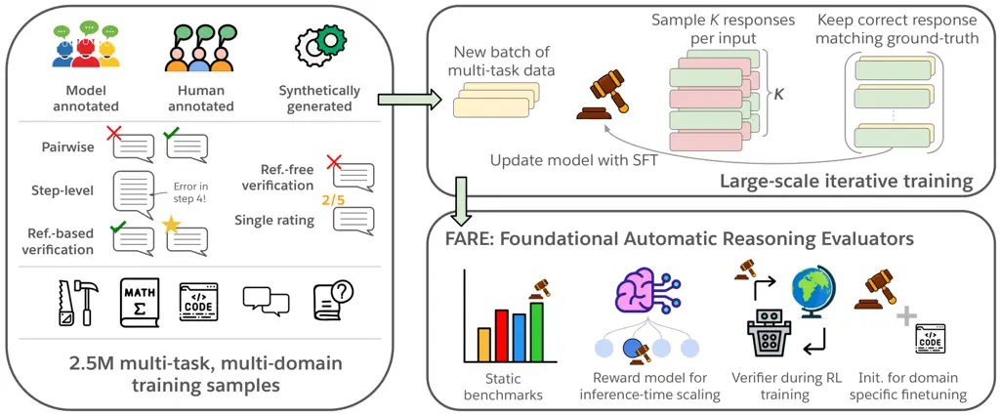

# Foundational Automatic Evaluators: Scaling Multi-Task Generative Evaluator Training for Reasoning-Centric Domains

Austin Xu, Xuan-Phi Nguyen, Yilun Zhou, Chien-Sheng Wu, Caiming Xiong,
Shafiq Joty Salesforce AI Research {austin.xu, cxiong,
sjoty}@salesforce.com  
^(†)^(†)thanks: Work done at Salesforce AI Research

###### Abstract

Finetuning specialized generative evaluators has emerged as a popular
paradigm to meet the increasing demand for scalable evaluation during
both training and test-time. However, recent work has largely focused on
applying new methodology, such as reinforcement learning (RL), to
training evaluators, shying away from large-scale, data-driven
development. In this work, we focus on data scaling, curating a set of
2.5M samples spanning five unique evaluation tasks (pairwise,
step-level, reference-free and reference-based verification, and single
rating) and multiple domains focused on reasoning evaluation. With our
data, we train Foundational Automatic Reasoning Evaluators (FARE), a
family of 8B and 20B (with 3.6B active) parameter evaluators, with a
simple iterative rejection-sampling supervised finetuning (SFT)
approach. FARE-8B challenges larger specialized RL-trained evaluators
and FARE-20B sets the new standard for open-source evaluators,
surpassing specialized 70B+ evaluators. Beyond static benchmarks, we
evaluate FARE in real-world tasks: As inference-time rerankers, FARE-20B
achieves near-oracle performance on MATH. As verifiers in RL training,
FARE improves the downstream RL-trained model performance by up to 14.1%
vs. string-matching verifiers. When initialized from FARE, a
continually-finetuned FARE-Code outperforms gpt-oss-20B by 65% on
evaluating test-case quality.

![[Uncaptioned
image]](arxiv-2510-17793--68d427e90f5a.figures/figure-1.webp)   [The
FARE family of
evaluators](https://huggingface.co/collections/Salesforce/fare-68eebc1779713d853886f67b)



Figure 1: Overview of our work. We curate 2.5M multi-task, multi-domain
training samples (left) and use large-scale iterative rejection sampling
SFT to train FARE, a family of automatic evaluators (top right). We
evaluate FARE on static benchmarks and on various real-world downstream
tasks.

|     |
| --- |
|     |

## 1 Introduction

The past two years has seen the rapid adoption of large language models
(LLMs) as automatic evaluators in response to demands for scalable
evaluation of LLM outputs. LLM-based evaluators serve as judges for
popular benchmarks (Dubois et al., 2024; Zheng et al., 2023), generative
reward models for preference optimization (Yuan et al., 2024; Wu et al.,
2024), and verifiers/critics in inference-time scaling
settings (McAleese et al., 2024; Zhou et al., 2025b). The widespread
integration of evaluators into nearly every phase of the LLM development
cycle (Wu, 2025) demands evaluators that can handle multiple evaluation
tasks while operating effectively across diverse domains.

Different settings require different evaluation abilities: Alignment
needs evaluators capable of comparing different responses, i.e.,
pairwise evaluation, whereas monitoring model outputs requires finding
minute mistakes, i.e., step-level evaluation. More recently, generative
evaluators are tasked with providing reward signals during reinforcement
learning (RL) training (Team Kimi et al., 2025; Jiang et al., 2025b),
and are expected to grow in importance as RL moves towards unverifiable
domains (Gunjal et al., 2025; Jayalath et al., 2025) in complex
reasoning settings (Ke et al., 2025a; Ferrag et al., 2025). As
evaluators take central roles in training and evaluating the next
generation of models, they must be flexible enough to evaluate as the
setting demands.

Compounding the challenges of multi-task evaluation is the expanding
number of domains requiring evaluation: RL-training has quickly moved
from math reasoning (e.g., Yu et al. (2025b)) to general-purpose
reasoning (Ma et al., 2025) (e.g., history or economics). Agentic
settings introduce additional wrinkles: With autonomously acting single
agents (OpenAI, 2025a; Nguyen et al., 2025; Wei et al., 2025) and
complex multi-agent workflows (Liang et al., 2025; Alzubi et al., 2025)
now being set free to browse the web and act on behalf of users with
minimal oversight, evaluators must assess not only agent reasoning, but
also proposed tool-use. These systems, sometimes built with intricate
model-generated (Hu et al., 2024b; Zhang et al., 2024a; Ke et al.,
2025b) interdependencies, are bottlenecked, in part, by subpar
evaluation (Cemri et al., 2025).

Unfortunately, recent work in the open-source automatic evaluation
community has failed to meet these twin demands of multi-task,
multi-domain evaluators, opting instead in training task-specialized
evaluators at relatively small data scales. We break this trend by
scaling up data, curating 2.5M multi-task, multi-domain training samples
that emphasize reasoning settings. As shown in Figure 1, our data mix
covers 5 distinct tasks and various domains like math, code, tool-use
evaluation, and natural language reasoning. With our data, we train,
Foundational Automatic Reasoning Evaluators (FARE), two best-in-class
evaluators. As shown in Figure 1, our contributions are

- •
  Multi-task, multi-domain dataset: We curate a large-scale, multi-task
  training set with an emphasis on reasoning-centric settings. We
  supplement existing human-and model-annotated data with synthetic data
  created from challenging new seed datasets.
- •
  Scalable learning via iterative rejection sampling: We show that
  iterative rejection sampling supervised finetuning (RS-SFT) is a
  stable approach for training evaluators at scale. The semi-online
  nature of RS-SFT avoids problematic teacher model distribution shifts
  while bringing computationally stable and efficient model updates.
  Through ablations, we quantify the impact of training pipeline
  features like quantity of direct judgment data and the use of a
  continuous curriculum.
- •
  The FARE family of evaluators: We train FARE-8B and FARE-20B and
  rigorously assess them with 7 challenging benchmarks and 3 practical
  downstream settings: test-time response reranking, RL-training
  verification, and domain-specific continual finetuning.

Our trained models are both well-rounded and high-performing. Out of the
box, FARE improve generator performance at test-time, achieving near
oracle reranking performance on MATH, and provide clear rewards during
general-domain RL training, boosting downstream performance by 14.1%
over typical string-matching verifiers. With minimal continual training,
FARE can be adapted to specific domains like code, beating gpt-oss-20B
by 65% in code test-case quality evaluation.

## 2 Background and Related Work

An automatic evaluator (AE)
$`\pi_{\theta}:\mathcal{X}\rightarrow\mathcal{Y}`$ maps input
$`x=(p,q,\mathcal{R})\in\mathcal{X}`$ to output
$`y=(c,j)\in\mathcal{Y}`$. Input $`x`$ consists of $`p`$, the evaluation
protocol that specifies both the evaluation task (e.g., pairwise
comparison, verification) and evaluation rubric, $`q`$, the original
question, and $`\mathcal{R}`$, set of model responses to be evaluated.
The output $`y`$ consists of a natural language critique $`c`$ and final
judgment $`j`$. The AE may also be prompted to omit the critique $`c`$
and directly output the judgment $`j`$, which we denote as
$`y=(\emptyset,j)`$. The specific evaluation protocol $`p`$ determines
the elements of set $`\mathcal{R}`$ and the exact form of judgment
$`j`$. For example, in pairwise evaluation, $`\mathcal{R}`$ consists of
two responses $`\{r_{1},r_{2}\}`$ and the judgment is a choice between
the two (“A” or “B”), whereas in single-rating, $`\mathcal{R}`$ consists
of a single response $`r`$ and the judgment is an integer on a 1-5
scale. In this work, we focus on training automatic evaluators capable
of the 5 evaluation tasks shown in Figure 1:

- •
  Pairwise comparisons: Given response set
  $`\mathcal{R}=\{r_{1},r_{2}\}`$, the AE selects the better of
  $`r_{1}`$ and $`r_{2}`$.
- •
  Step-level evaluation: Given response set
  $`\mathcal{R}=\{r_{\text{[steps]}}\}`$, where $`r_{\text{[steps]}}`$
  is a single model response broken down into steps, the AE identifies
  step-level errors.
- •
  Reference-based verification: Given response set
  $`\mathcal{R}=\{r_{\text{cand}},r_{\text{ref}}\}`$, where
  $`r_{\text{cand}}`$ is the candidate and $`r_{\text{ref}}`$ is the
  reference, the AE determines if $`r_{\text{cand}}`$ is correct based
  on $`r_{\text{ref}}`$.
- •
  Reference-free verification: Given response set $`\mathcal{R}=\{r\}`$,
  the AE determines if $`r`$ is correct.
- •
  Single rating: Given response set $`\mathcal{R}=\{r\}`$, the AE
  assigns an integer score to $`r`$.

Past work in generative automatic evaluators. Capable LLMs, like GPT-4,
were originally prompted as scalable evaluators (Wang et al., 2023a; Liu
et al., 2023b; Fu et al., 2024; Chiang and Lee, 2023). Subsequent
analysis revealed pitfalls of prompted approaches, like biases with
respect to position (Wang et al., 2023b; Li et al., 2023), length (Zeng
et al., 2023; Park et al., 2024), or self-preference (Panickssery et
al., 2024). Finetuning specialized evaluators emerged as a result, with
early approaches using teacher model outputs to do supervised finetuning
(SFT) (Kim et al., 2023; Kim et al., 2024b; Li et al., 2023; Park et
al., 2024; Shiwen et al., 2024) or direct preference optimization
(DPO) (Hu et al., 2024c; Ye et al., 2024), often focusing only on one or
two evaluation tasks. More recent methods moved to reasoning models as
teachers (Khalifa et al., 2025).

Vu et al. (2024); Wang et al. (2024a); Cao et al. (2024); Alexandru et
al. (2025) train foundational evaluators at larger data scales with
multi-protocol capabilities via offline training methods like SFT or
DPO. Such approaches take inspiration from general-purpose, large-scale
multi-task learning (Sanh et al., 2021; Raffel et al., 2020; Wei et al.,
2021), which showed broad generalization capabilities emerge with the
scaling of training data. Foundational evaluators likewise were
empirically shown to generalize to unseen evaluation tasks, prompts, and
criteria while being more robust to common biases (Vu et al., 2024; Wang
et al., 2024a).

Recent work has focused on methodological advances, either using
inference-time scaling (Liu et al., 2025d; Chan et al., 2025; Zhao et
al., 2025) or online training like reinforcement learning from
verifiable rewards (RLVR) (Chen et al., 2025a; Chen et al., 2025b;
Whitehouse et al., 2025; Xu et al., 2025b; Xiong et al., 2025b) to
improve evaluator performance. Because RLVR is computationally demanding
with relatively brittle training pipelines (Guo et al., 2025; Yang et
al., 2025), recent evaluators are typically trained on a small amount of
data for a single task. Our work bridges early work in training
foundational evaluators with more recent methodological advancements,
demonstrating that a simple semi-online training approach enables stable
multi-task training at scale.

Desiderata for a new generation of evaluators. Here, we outline our
design philosophy for FARE. Beyond accuracy and robustness, we seek
efficiency, as many evaluation settings like inference-time reranking or
RL rollout verification demand low latency. In contrast to recent long
chain-of-thought (CoT) evaluators (Chen et al., 2025b; Khalifa et al.,
2025), we select base models with either no or very compact “thinking”
CoTs. We also explicitly avoid having the evaluator generate reference
answers. Past work has used evaluators to generate references during
evaluation (Zheng et al., 2023; Li et al., 2024) or training
rollout (Chen et al., 2025b). Not only does this risk severely degrading
performance when the reference is wrong (Krumdick et al., 2025), it also
converts the relatively easier evaluation task into a harder generation
task (Zhou et al., 2025a).

## 3 FARE: data and training recipe

### 3.1 Data curation

We use two data approaches for curating our final training mix: Using
Existing high quality training datasets created for evaluator and
preference finetuning and generating Synthetic datasets through
programmatic error injection and a generate-then-grade strategy.

Existing data consists of training samples from proven sources that have
produced effective evaluators (Vu et al., 2024; Cao et al., 2024). These
datasets consist of high quality annotations from humans and frontier
LLMs, and cover evaluation tasks like step-level, single-rating, and
pairwise evaluation and domains like chat quality, code, and safety.
Following Wang et al. (2024a), we largely focus our data collection on
modern (2024 and beyond) datasets, as these datasets contain the most
up-to-date model responses and fresh annotations. Beyond
evaluator-specific training, we take advantage of existing preference
fine-tuning datasets used for RLHF (Ouyang et al., 2022) and DPO
training (Rafailov et al., 2023), converting these directly into
pairwise evaluation samples. In domains with objectively correct
answers, e.g., math, we also create verification training data with
positive responses as correct/reference responses and negative responses
as incorrect responses.

We hand-craft evaluation rubrics for each source dataset that follow
annotation instructions given to human annotators or models, if
existing. If such original instructions do not exist, we write custom
evaluation rubrics for each source dataset based on the data composition
and domain. Section E.2 provides an example rubric. Existing data lays a
solid foundation, with 1.4M samples already dwarfing data scales found
in recent work. However, upon inspection, we found three clear
shortcomings: (1) Newly relevant tasks, like verification, were
underrepresented. (2) Existing pairwise task data focused largely on
chat-related topics and less-so on reasoning-relevant domains. (3)
Questions and responses from newer, challenging datasets produced to
meet the needs of reasoning-focused RL training were absent. To address
these limitations, we supplement with synthetic data.

Figure 2: Breakdown of our curated training dataset of 2.5M samples by
task (left), domain (center), and curation approach (right). Domain
breakdown excludes step-level data, which is entirely math.

Synthetic data is generated from a diverse set of challenging seed
datasets using two approaches:

- •
  Programmatic error injection. We employ programmatic error injection
  when applicable, such as tool-use and function-calling data. For
  example, to create pairwise tool-use data, we inject errors (e.g.,
  type error, extra argument, syntax errors) in correct function calls.
  This approach increases the amount of tool-use evaluation data, adding
  both pairwise and verification samples.
- •
  Generate-then-grade. Here, we leverage a mix of recent and established
  training datasets comprised of question $`q`$ and verifiable
  ground-truth answer $`a`$. We sample up to $`20`$ responses per $`q`$
  from various generator models, then grade each responses based on
  $`a`$. After grouping responses by correctness, we create verification
  and pairwise samples. We use 12 unique generators from 6 model
  families, covering reasoning and non-reasoning models. This ensures
  that FARE are trained on a diverse array of model responses, enabling
  better generalization across distinct response distributions (Singh et
  al., 2025). Generate-then-grade enables us to incorporate problems
  from recent, challenging datasets covering frontier math and reasoning
  tasks. This enhances the quality of our pairwise and verification data
  with difficult-to-evaluate reasoning-focused samples.

Our final dataset comprises 2.5M training samples; an overview is shown
in Figure 2, with breakdowns by task, domain, and curation approach, and
exact dataset sources are described in Appendix B.

### 3.2 Model training

General training recipe. We aim to train an automatic evaluator
$`\pi_{\theta}`$, which we call the policy model parametrized by
$`\theta`$. Our data curation process yields a training dataset of $`N`$
samples $`\mathcal{D}=\{(x_{i},j_{i}^{\star})\}`$, where
$`j_{i}^{\star}`$ denotes the ground-truth judgment. Corresponding
ground truth critiques $`c^{\star}`$ are not typically available in
evaluator training data. As a result, past work has resorted to offline
teacher-model based approaches or online RL-based approaches, as
discussed in Section 2.

These established approaches have their limitations: Teacher models
introduce distribution shifts with respect to the policy model, a common
problem with imitation learning (Ross et al., 2011), with choice of
teacher model having a large impact on downstream performance (Guha et
al., 2025). On the other hand, RL training is compute and
time-intensive, making it difficult to scale to large data quantities,
with past work (Liu et al., 2025c) only exploring small (1.5B parameter)
models via ad-hoc interventions like reference policy resetting.

We borrow desirable qualities from both paradigms and use semi-online
iterative rejection sampling SFT (RS-SFT) (Touvron et al., 2023; Dong et
al., 2023), which was recently shown to be competitive with RLVR
approaches (Xiong et al., 2025a). RS-SFT avoids sub-optimal distribution
shift by finetuning on correct evaluation traces produced by the policy
model while employing a computationally lightweight policy update step.
This enables simple yet stable scaling to millions of training samples
without sampling from a teacher model. An overview of our approach is
shown in Figure 1.

Concretely, we train $`\pi_{\theta}`$ as follows. We split our $`N`$
training samples into disjoint rollout batches
$`\mathcal{B}_{t}=\{(x_{i,t},j_{i,t}^{\star})\}`$ of fixed size
$`N_{\text{rollout}}`$ and initialize the initial policy
$`\pi_{\theta_{0}}`$ to be an existing post-trained LLM (e.g.,
gpt-oss-20B). Then for step $`t=0,\ldots,T-1`$, we perform the
following:

- •
  Rollout from previous policy: For inputs $`x_{i,t}`$ from
  $`\mathcal{B}_{t}`$, sample $`K`$ responses per input from policy
  $`\pi_{\theta_{t}}`$, denoted
  $`\{\hat{y}_{i,t}^{(1)},\ldots,\hat{y}_{i,t}^{(K)}\}`$.
- •
  Rejection sampling: For each of the $`K`$ responses
  $`\{\hat{y}_{i,t}^{(1)},\ldots,\hat{y}_{i,t}^{(K)}\}`$, we determine
  correctness with ground-truth judgment $`j_{i,t}^{\star}`$. For inputs
  with correct responses, one randomly chosen response is kept. Any
  inputs without correct responses are discarded. We denote the
  collected set of inputs and corresponding correct responses as
  $`\mathcal{D}_{t}`$.
- •
  Policy update: Use $`\mathcal{D}_{t}`$ to update the policy weights
  via SFT, initializing with $`\theta_{t}`$:

  ```math
  \displaystyle\theta_{t+1}=\argmax_{\theta}\sum\limits_{(x,y)\in\mathcal{D}_{t}}\log\pi_{\theta}(y|x) \tag{1}
  ```

Our approach draws inspiration from algorithms such as STaR (Zelikman et
al., 2022) and RAFT (Dong et al., 2023), with some key differences. STaR
notably re-initializes training from $`\pi_{\theta_{0}}`$ for each
iteration $`t`$ and samples only one greedy response per input prompt,
while RAFT relies on an external reward model to rank generated outputs.
Because the automatic evaluation setting is inherently verifiable, we
omit the need for a reward model to rank sampled responses.

Specific to evaluators, the Self-Taught Evaluator (STE) paradigm of Wang
et al. (2024b) and follow-up EvalPlanner (Saha et al., 2025) are closely
related to our approach. STE follows STaR with policy re-initialization
and EvalPlanner uses multiple SFT and DPO training runs per iteration
$`t`$. Further, these works use in-the-loop synthetic data generation,
sampling responses to a small number ($`<25`$K) of seed questions from a
fixed generator. Pairwise samples are then created from
correct/incorrect responses and used to train the model. This data
generation approach cannot be adapted to create data for other tasks,
like step-level evaluation, fundamentally limiting the task abilities of
STE. A secondary concern is a lack of exposure to diverse response
distributions; Evaluations in Wang et al. (2024a) show that scaling
training data with a simpler training recipe leads to better
generalization across benchmarks compared to STE.

Batch composition. For each rollout batch $`\mathcal{B}_{t}`$, we select
unseen training samples from our curated training dataset, ensuring the
task mixture is consistent with global task composition. For example,
33% of our overall training data are pairwise tasks (Figure 2), so 33%
of the input prompts in $`\mathcal{B}_{t}`$ are sampled from unseen
pairwise samples. We then sample $`K=4`$ responses per sample with a
temperature of $`0.9`$, and determine correctness based on final
judgment.

Inclusion of direct judgment data. Past work (Wang et al., 2024a; Cao et
al., 2024) has showed the importance of including direct judgment data
samples to isolate judgment training signal. These are samples where the
critique $`c`$ is omitted, and the input protocol $`p`$ is modified to
prompt directly for a judgment. To precisely control the fraction of
direct judgment data, we convert a fixed percent of $`\mathcal{D}_{t}`$
to direct judgment data by dropping generated critiques and modifying
the input prompt accordingly. In Appendix D, we ablate the proportion of
direct judgment data and show such data enables FARE to be prompted to
exclude critiques for faster inference.

Per-batch continuous curriculum learning. We additionally use a
continuous curriculum in training: For each $`(x,y)\in\mathcal{D}_{t}`$,
we compute the pass percentage from the $`K=4`$ rollout generations for
$`x`$, then sort the dataset in descending order of pass percentage.
That is, samples where all $`4`$ sampled outputs are correct are used to
update the model first, and samples where only $`1`$ of $`4`$ sampled
outputs are correct are used to update the model last. We find this has
negligible impact on pairwise domains but large impacts in step-level
evaluation, as we show in Appendix D.

Base models. We train two models starting from Qwen3-8B-Base (Yang et
al., 2025) and gpt-oss-20B (Agarwal et al., 2025), denoted FARE-8B and
FARE-20B. We find Qwen3-8B (post-trained) to be over-trained, and
therefore cold-start Qwen3-8B-Base from SFT data from
Qwen2.5-32B-Instruct, which we denote Qwen3-8B-ColdStart.
See Section B.2 for additional details.

0=\CT@everycr\\rowc@lors     JudgeBench^(†)     RJB^(†)     PPE
Correctness     RM-Bench     When2Call^(†)     RISE-Judge-7B     44.57
    34.73     61.3     77.2     47.22     EvalPlanner-8B     30.20     -
    52.8     68.1     -     J1-8B     42.00     -     59.2     73.4
    -     RM-R1-14B     46.86     43.70     64.0     79.6     19.89    
CompassJudger-7B     49.14     37.76     60.9     82.2     41.67    
Atla Selene 8B     21.14     12.41     53.3     71.9     56.00    
CompassJudger-14B     50.29     37.69     62.0     77.7     44.56    
FARE-8B     55.71     51.05     63.8     79.2     80.33    
RISE-Judge-32B     46.86     42.35     63.5     82.2     46.44    
CompassJudger-32B     54.57     46.53     65.6     80.1     51.89    
RM-R1-32B     54.29     46.39     65.9     81.5     23.89    
EvalPlanner-70B     56.60     -     70.2     82.1     -     J1-70B    
60.00     -     72.8     82.7     -     FARE-20B     64.29     57.05    
74.4     90.5     76.67     Qwen3-8B-ColdStart     48.29     40.59    
60.5     78.07     59.67     Qwen3-8B     52.27     43.56     64.8    
79.9     64.78     gpt-oss-20B     59.43     50.51     71.7     89.9    
61.33     gpt-oss-120B     70.29     58.26     77.8     92.0     70.00
    GPT-5-nano     59.71     51.52     80.7     92.3     50.02     GPT-5
    84.86     79.57     87.0     93.8     75.78    

Table 1: Pairwise evaluation results, with best and second-best
performance in each section marked. FARE achieve best-in-class
performance, even outperforming frontier models in tool-use evaluation.
$`\dagger`$ indicates that benchmark uses consistent accuracy (25%
random baseline).

0=\CT@everycr\\rowc@lors GSM8K MATH OlympiadBench OmniMATH Overall PRM
SkyworkPRM-1.5B 59.0 48.0 19.3 19.2 36.4 PRM Math Shepherd-7B 47.9 29.5
24.8 23.8 31.5 PRM SkyworkPRM-7B 70.8 53.6 22.9 21.0 42.1 PRM ActPRM-7B
82.7 82.0 72.0 67.3 76.0 PRM Qwen2.5-7B-PRM800K 68.2 62.6 50.7 44.3 56.5
PRM Qwen2.5-Math-7B-PRM 82.4 77.6 67.5 66.3 73.5 PRM
Qwen2.5-Math-72B-PRM 87.3 80.6 74.3 71.1 78.3 Gen. Qwen2.5-Math-7B 26.8
25.7 14.2 12.7 19.9 Gen. RL Tango-7B 53.1 48.2 37.8 36.3 43.9 Gen.
StepWiser-1.5B 46.9 43.4 26.3 28.4 36.3 Gen. StepWiser-7B 72.4 68.3 54.4
52.4 61.9 Gen. FARE-8B 68.5 67.7 59.9 58.1 63.5 Gen. Llama-3.3-70B 82.9
59.4 46.7 43.0 58.0 Gen. Qwen2.5-Coder-32B 68.9 60.1 48.9 46.3 56.1 Gen.
QwQ-32B 88.0 78.7 57.8 61.3 71.5 Gen. Qwen2.5-Math-72B 65.8 52.1 32.5
31.7 45.5 Gen. GPT-4o 79.2 63.6 51.4 53.5 61.9 Gen. FARE-20B 89.8 87.8
80.0 79.9 84.4 Gen. Qwen3-8B-ColdStart 37.0 41.0 36.3 38.9 38.3 Gen.
Qwen3-8B 63.2 64.0 51.5 48.2 56.7 Gen. gpt-oss-20B 79.3 79.4 68.8 68.2
73.9 Gen. gpt-oss-120B 89.6 87.6 80.8 76.0 83.5 Gen. GPT-5-nano 83.8
87.0 80.6 77.1 82.1 Gen. GPT-5 91.4 89.5 80.6 76.9 84.6

Table 2: ProcessBench results, with best and second-best performance in
each section marked. FARE-20B almost matches GPT-5 with the same prompt,
achieving best-in-class performance, while FARE-8B beats comparably
sized generative (Gen.) evaluators.

## 4 Experiments

We evaluate FARE on both core benchmarks, static benchmarks for
automatic evaluators, and in downstream settings, which simulate real
applications of evaluators. We provide descriptions of benchmarks and
baselines in Appendix C and additional ablations and analysis
in Appendix D.

### 4.1 Core benchmarks

Setup. We evaluate along five diverse aspects: (i) reasoning with
JudgeBench (Tan et al., 2024), ReasoningJudgeBench (RJB) (Xu et al.,
2025b), and PPE Correctness (Frick et al., 2024), (ii) bias and
robustness with RM-Bench (Liu et al., 2024b), (iii) tool-use with
When2Call (Ross et al., 2025), (iv) step-level error identification with
ProcessBench (Zheng et al., 2024), and (v) reference-based verification
with VerifyBench (Yan et al., 2025).

For RM-Bench and PPE Correctness pairwise benchmarks, we adopt default
evaluation setups, running each benchmark once with a fixed random
ordering of responses. For other pairwise benchmarks, we report
consistent-accuracy (Tan et al., 2024), where each test sample is run
twice, swapping the order of response A and response B. If the evaluator
selects a different response between runs (i.e., is positionally
biased), then the sample is marked incorrect; if the evaluator is
consistent, the judgment is graded against the ground-truth. For
ProcessBench and VerifyBench, we report F1-score¹¹ 1 ProcessBench
defines their reported F1-score differently from the traditional
F1-score; See [this
link](https://github.com/QwenLM/ProcessBench/issues/1). and accuracy,
respectively. We compare FARE against other finetuned generative and
prompted evaluators. We report official numbers from past benchmarks,
reporting sources in Appendix C. If necessary, we run each baseline
using its own prompt template. For ProcessBench, we additionally compare
against non-generative process reward models (PRMs).

Results. Tables 1, 2 and 3 present our results on pairwise, step-level,
and reference-based verification benchmarks, respectively. Our prompts
are provided in Appendix E.

0=\CT@everycr\\rowc@lors VerifyBench VerifyBench-Hard Math-Verify 45.90
32.50 GPT-4o mini 92.85 72.30 Llama-3.1-8B 73.05 43.20 Qwen3-4B 92.00
72.40 Phi-4 89.35 56.60 Yi-1.5-9B 87.70 61.40 FARE-8B 93.20 78.40 GPT-4o
93.15 72.60 Llama-4-Scout 90.01 48.50 Llama3.3-70B 83.25 54.70
Qwen2.5-72B 92.35 62.40 Qwen3-32B 95.80 71.80 FARE-20B 94.95 85.10
Qwen3-8B-ColdStart 92.45 72.60 Qwen3-8B 94.00 70.90 gpt-oss-20B 91.95
83.60 gpt-oss-120B 95.35 88.30 GPT-5-nano 94.65 84.00 GPT-5 96.10 90.50

Table 3: Ref.-based verification, with best and second-best performance
marked per section. FARE beat general-purpose verifiers in hard
settings.

Table 1 shows that across diverse pairwise benchmarks, FARE exhibit
best-in-class performance, outperforming comparably sized baselines.
FARE-8B is the strongest small judge, outperforming recently released
RL-trained models like J1-8B and RM-R1-14B by 13.71 and 6.57 absolute
points on JudgeBench, respectively. FARE-20B challenges strong judges at
20B parameters, outperforming dense 70B-sized judge models despite
having 3.5x fewer total parameters and nearly 20x fewer active
parameters. The strong performance of FARE across reasoning benchmarks,
which span math to scientific domains to causal reasoning, show that our
models excel at discerning between objectively correct and incorrect
responses. Beyond reasoning settings, FARE are generally robust to
subtle, stylistic biases (RM-Bench) while excelling in tool calling
evaluation (When2Call), which is increasingly important as agentic
workflows grow in popularity.

FARE also are extremely strong step-level evaluators, as shown by
ProcessBench performance in Table 2. FARE-8B is the best small-sized
generative critic model, outperforming the recently released
StepWiser-7B (Xiong et al., 2025b), a RL-trained specialized step-level
evaluator, by 1.6 points. FARE-20B outperforms the specialized
Qwen2.5-Math-72B-PRM by 6.1 points, even matching GPT-5. Most notably,
FARE excel on the two most challenging splits, OlympiadBench and
OmniMATH, with FARE-8B beating StepWiser-7B by 5.6 points and FARE-20B
beating Qwen2.5-Math-72B-PRM by 7.3 points on average. Overall, FARE are
not only capable outcome-level evaluators, but are able to find subtle
mistakes that manifest at the step-level.

FARE are also capable verifiers, as shown in Table 3, with both models
outperforming all reported baselines on VerifyBench-Hard (Yan et al.,
2025). In particular, FARE-20B excels beats the next best model, GPT-4o,
by 12.5 absolute points. As we demonstrate in Section 4.2, when used as
verifiers during GRPO settings, FARE bring tangible benefits over
typical string-matching verifiers.

Scaling inference-time compute. Recently, sampling parallel judgments
and aggregating via majority vote, i.e., self-consistency (Wang et al.,
2022), has been used to improve evaluator performance. In Table 4, we
use self-consistency with 32 responses (SC@32) on PPE, comparing with J1
and DeepSeek-GRM (Liu et al., 2025d). DeepSeek-GRM also trains a MetaRM
to perform judgment re-ranking at test-time. Across most splits, using
SC@32 improves performance, with up to a 3.3 point improvement for
FARE-20B on the MMLU-Pro split. Even without SC@32, FARE-8B beats
DeepSeek-GRM-27B + MetaRM, with the gap widening with extra compute.
Similarly, the gap between FARE-20B and J1-70B grows with extra compute.
Interestingly, we see that across both our models, performance on MBPP+
slightly degrades, indicating that SC may not be the optimal way to use
compute across all domains. Nonetheless, we observe gains in the
aggregate.

|                               |                           |                           |                           |                           |                           |                           |
| ----------------------------- | ------------------------- | ------------------------- | ------------------------- | ------------------------- | ------------------------- | ------------------------- |
| PPE                           | MMLU-Pro                  | MATH                      | GPQA                      | MBPP+                     | IFEval                    | Overall                   |
| J1-8B w/ SC@32                | 65.6 $`\rightarrow`$ 67.5 | 70.0 $`\rightarrow`$ 76.6 | 53.2 $`\rightarrow`$ 55.7 | 53.1 $`\rightarrow`$ 54.6 | 54.0 $`\rightarrow`$ 54.9 | 59.2 $`\rightarrow`$ 61.9 |
| J1-70B w/ SC@32               | 79.0 $`\rightarrow`$ 79.9 | 86.0 $`\rightarrow`$ 88.1 | 65.9 $`\rightarrow`$ 66.5 | 66.0 $`\rightarrow`$ 66.5 | 67.3 $`\rightarrow`$ 67.2 | 72.8 $`\rightarrow`$ 73.6 |
| DeepSeek-GRM-27B w/ SC@32     | 64.8$`\rightarrow`$ 65.5  | 68.8 $`\rightarrow`$ 69.4 | 55.6 $`\rightarrow`$ 56.0 | 50.1 $`\rightarrow`$ 49.9 | 59.8 $`\rightarrow`$ 61.0 | 59.8 $`\rightarrow`$ 60.4 |
| DeepSeek-GRM-27B w/ MetaRM@32 | 64.8$`\rightarrow`$ 68.1  | 68.8 $`\rightarrow`$ 70.0 | 55.6 $`\rightarrow`$ 56.9 | 50.1 $`\rightarrow`$ 50.8 | 59.8 $`\rightarrow`$ 70.4 | 59.8 $`\rightarrow`$ 63.2 |
| FARE-8B w/ SC@32              | 69.3 $`\rightarrow`$ 70.8 | 79.7 $`\rightarrow`$ 80.4 | 58.4 $`\rightarrow`$ 58.4 | 55.7 $`\rightarrow`$ 54.9 | 55.9 $`\rightarrow`$ 56.7 | 63.8 $`\rightarrow`$ 64.2 |
| FARE-20B w/ SC@32             | 80.3 $`\rightarrow`$ 83.6 | 94.6 $`\rightarrow`$ 97.3 | 68.5 $`\rightarrow`$ 71.1 | 59.3 $`\rightarrow`$ 57.3 | 69.1 $`\rightarrow`$ 71.1 | 74.4 $`\rightarrow`$ 76.6 |

Table 4: Scaling inference-time compute for FARE typically brings
additional gains in performance: The performance gaps between
FARE-8B/DeepSeek-GRM and FARE-20B/J1-70B widens.

### 4.2 Downstream evaluation

Setup. We apply FARE on 3 downstream tasks: (i) Reward model for
inference-time scaling, (ii) verifier for GRPO training, and
(iii) initialization for continual finetuning for domain-specific
evaluation. We provide detailed explanations of our downstream
evaluation settings in Section C.2.

Figure 3: Best-of-10 performance for Llama-3.1-8B generator across 4
challenging benchmarks with baseline (red line) and oracle (green line)
performance with FARE and SFR-Judge (SFR), Skywork Critic (SC),
Compass-Judger (CJ), and Self-Taught Evaluator (STE) as baselines. FARE
are the best small ($`\leq`$14B) and large ($`\geq`$ 20B) reranking
models: FARE-20B achieves near oracle re-ranking performance on MATH,
while FARE-8B matches 70B judges.

Reward model for inference-time scaling. We use the standardized setup
in JETTS (Zhou et al., 2025b), which provides a set of 10 outputs from
various generators and various benchmarks with corresponding correctness
labels. Here, automatic evaluators rerank the responses, and performance
is measured as the final performance of the evaluator-selected
responses. We select the four most challenging benchmarks used in JETTS:
MATH (Hendrycks et al., 2021), CHAMP (Mao et al., 2024), MBPP+ (Liu et
al., 2023a), and BigCodeBench (Zhuo et al., 2024). We compare against
strong judge models benchmarked previously on JETTS:
SFR-Judge-8B,70B (Wang et al., 2024a), Skywork-Critic-8B,70B (Shiwen et
al., 2024), Self-Taught-Evaluator-70B (Wang et al., 2024b), and
CompassJudger-7B,14B (Cao et al., 2024). We utilize the default pairwise
reranking setup and prompt FARE to produce a judgment directly without
explanation, i.e., $`y=(\emptyset,j)`$.

Figure 3 shows best-of-10 performance with Llama-3.1-8B as generator
with baseline greedy (red line) and oracle re-ranking performance (green
line). FARE produce best-in-class reranking performance, with FARE-8B
roughly matching the performance of larger (70B) judges in math settings
and outperforming all similar sized judges in coding domains. FARE-20B
excels in math domains, approaching oracle-level reranking performance
on MATH, beating SFR-Judge-70B and Skywork-Critic-70B by 14 and 21
absolute points, respectively. Similarly, FARE-20B beats 70B+ judges by
large margins in challenging coding domains. As we show in Section D.6,
FARE improve the performance of other generators and FARE-20B improves
significantly over gpt-oss-20B as a reranker.

Verifer for GRPO training. We train with WebInstruct-Verified (Ma et
al., 2025), a multi-domain reasoning dataset, covering math, chemistry,
etc. Verifier impact is measured via the downstream performance of the
trained policy model on a fixed evaluation suite of MMLU-Pro (Wang et
al., 2024c), GPQA-Diamond (Rein et al., 2024), MATH-500,
Minerva-Math (Lewkowycz et al., 2022), OlympiadBench (He et al., 2024a),
and AIME24 (Avg@32). We start from Qwen2.5-7B-Base (Yang et al., 2024)
with the default reward setup as Ma et al. (2025) (see Section C.2), and
we compare against training with the string-matching and trained
verifier (General-Verifier) from Ma et al. (2025).

Figure 4: Performance of downstream GRPO-trained model with FARE as
reference-based verifiers. Moving from string based output matching or
weaker verifiers to FARE brings tangible performance gains across both
natural-language based (e.g., GPQA) and math settings.

Training with FARE-20B as a verifier improves downstream performance
from 34.3 to 45.2, a nearly 11 point absolute gain, with improvements
coming uniformly across the six benchmarks, as shown in Figure 4.
Notably, with 77% fewer gradient updates²² 2 For the same group size,
General-Reasoner-7B is trained for 700 steps with rollout batch size
768, whereas we train for 120 update steps with rollout batch size 1024.
, our model was able to slightly beat the performance of
General-Reasoner-7B (Ma et al., 2025) on several benchmarks: 38.9 vs.
38.8 on GPQA-Diamond, 38.4 vs 37.9 on OlympiadBench, and 13.9 vs. 13.8
on AIME24. This shows that using FARE-20B can significantly improve RL
training convergence. Further, using FARE-8B and FARE-20B bring 8.8% and
14.1% relative gains over typically used string matching verifiers and
4.4% and 9.4% over General-Verifier, which has been trained with
in-training-distribution verification data. These gains appear for both
natural language (MMLU-Pro, GPQA) and math domains, showing that FARE
can verify complex outputs across multiple challenging domains.

Figure 5: Continual training of FARE-20B for code evaluation with only
15K samples yields larger gains over gpt-oss-20B/120B.

Initialization for domain-specific continual finetuning. We continually
finetune FARE-20B for code evaluation with one round of RS-SFT to
produce FARE-20B-Code. We train with only 15K pairwise samples randomly
chosen from AceCoder (Zeng et al., 2025). For evaluation, we use the
recently released CodingJudgeBench (Jiang et al., 2025a), a pairwise
benchmark covering code generation, code repair, and test-case quality
evaluation tasks. Figure 5, which reports consistent accuracy across the
three splits from gpt-oss-20B, FARE-20B, FARE-20B-Code, and gpt-oss-120B
for reference, shows that the first two splits are relatively easy,
whereas test case evaluation is extremely difficult: gpt-oss-120B
achieves only 32%. On the last task, FARE-20B improves over gpt-oss-20B
by 11.67 absolute points, highlighting the benefits of large-scale
evaluation training. Specialized continual training on coding tasks
brings an additional 10.48 absolute point improvement, with
FARE-20B-Code outperforming even gpt-oss-120B on average. In all, FARE
can be readily adapted for specific applications with a small amount of
domain-specific data.

## 5 Conclusion

Using a curated multi-task, multi-domain training mix and RS-SFT, we
train FARE, a family of high performing and well-rounded automatic
evaluators. FARE-8B challenges larger specialized evaluators and
FARE-20B sets a new standard for locally hosted evaluators. Our
evaluations include 7 challenging benchmarks and 3 practical downstream
settings where we show that FARE are (1) effective reward models at
inference-time, (2) effective verifiers for GRPO training, and (3)
strong initializations for continual, domain-specific finetuning.

## References

- Agarwal et al. (2025) S. Agarwal, L. Ahmad, J. Ai, S. Altman, A.
  Applebaum, E. Arbus, R. K. Arora, Y. Bai, B. Baker, H. Bao, et al.
  Gpt-oss-120b & gpt-oss-20b model card. arXiv preprint
  arXiv:2508.10925. Cited by: §3.2.
- Alexandru et al. (2025) A. Alexandru, A. Calvi, H. Broomfield, J.
  Golden, K. Dai, M. Leys, M. Burger, M. Bartolo, R. Engeler, S.
  Pisupati, et al. Atla selene mini: a general purpose evaluation model.
  arXiv preprint arXiv:2501.17195. Cited by: 7th item, §D.4, §2.
- Alzubi et al. (2025) S. Alzubi, C. Brooks, P. Chiniya, E. Contente, C.
  von Gerlach, L. Irwin, Y. Jiang, A. Kaz, W. Nguyen, S. Oh, et al. Open
  deep search: democratizing search with open-source reasoning agents.
  arXiv preprint arXiv:2503.20201. Cited by: §1.
- Bai et al. (2022) Y. Bai, A. Jones, K. Ndousse, A. Askell, A. Chen, N.
  DasSarma, D. Drain, S. Fort, D. Ganguli, T. Henighan, et al. Training
  a helpful and harmless assistant with reinforcement learning from
  human feedback. arXiv preprint arXiv:2204.05862. Cited by: Table 5.
- Cao et al. (2024) M. Cao, A. Lam, H. Duan, H. Liu, S. Zhang, and K.
  Chen Compassjudger-1: all-in-one judge model helps model evaluation
  and evolution. arXiv preprint arXiv:2410.16256. Cited by: 6th item,
  4th item, §D.3, §2, §3.1, §3.2, §4.2.
- Cemri et al. (2025) M. Cemri, M. Z. Pan, S. Yang, L. A. Agrawal, B.
  Chopra, R. Tiwari, K. Keutzer, A. Parameswaran, D. Klein, K.
  Ramchandran, et al. Why do multi-agent llm systems fail?. arXiv
  preprint arXiv:2503.13657. Cited by: §1.
- Chakrabarty et al. (2025) T. Chakrabarty, P. Laban, and C. Wu Can ai
  writing be salvaged? mitigating idiosyncrasies and improving human-ai
  alignment in the writing process through edits. In Proceedings of the
  2025 CHI Conference on Human Factors in Computing Systems, pp. 1–33.
  Cited by: Table 5.
- Chan et al. (2025) C. Chan, C. Xu, J. Ji, Z. Ye, P. Wen, C. Jiang, Y.
  Yang, W. Xue, S. Han, and Y. Guo J1: exploring simple test-time
  scaling for llm-as-a-judge. arXiv preprint arXiv:2505.11875. Cited by:
  §2.
- Chen et al. (2025a) N. Chen, Z. Hu, Q. Zou, J. Wu, Q. Wang, B. Hooi,
  and B. He Judgelrm: large reasoning models as a judge. arXiv preprint
  arXiv:2504.00050. Cited by: §2.
- Chen et al. (2025b) X. Chen, G. Li, Z. Wang, B. Jin, C. Qian, Y.
  Wang, H. Wang, Y. Zhang, D. Zhang, T. Zhang, H. Tong, and H. Ji RM-r1:
  reward modeling as reasoning. External Links: 2505.02387,
  [Link](https://arxiv.org/abs/2505.02387) Cited by: 4th item, §2, §2.
- Chiang and Lee (2023) C. Chiang and H. Lee Can large language models
  be an alternative to human evaluations?. In Proceedings of the 61st
  Annual Meeting of the Association for Computational Linguistics
  (Volume 1: Long Papers), pp. 15607–15631. Cited by: §2.
- Cobbe et al. (2021) K. Cobbe, V. Kosaraju, M. Bavarian, M. Chen, H.
  Jun, L. Kaiser, M. Plappert, J. Tworek, J. Hilton, R. Nakano, et al.
  Training verifiers to solve math word problems. arXiv preprint
  arXiv:2110.14168. Cited by: Appendix A.
- Dong et al. (2023) H. Dong, W. Xiong, D. Goyal, Y. Zhang, W. Chow, R.
  Pan, S. Diao, J. Zhang, K. Shum, and T. Zhang Raft: reward ranked
  finetuning for generative foundation model alignment. arXiv preprint
  arXiv:2304.06767. Cited by: §3.2, §3.2.
- Dong et al. (2024) H. Dong, W. Xiong, B. Pang, H. Wang, H. Zhao, Y.
  Zhou, N. Jiang, D. Sahoo, C. Xiong, and T. Zhang Rlhf workflow: from
  reward modeling to online rlhf. arXiv preprint arXiv:2405.07863. Cited
  by: Appendix A.
- Duan et al. (2025) K. Duan, Z. Liu, X. Mao, T. Pang, C. Chen, Q.
  Chen, M. Q. Shieh, and L. Dou Efficient process reward model training
  via active learning. arXiv preprint arXiv:2504.10559. Cited by:
  Appendix A, Table 5, §C.1.
- Dubey et al. (2024) A. Dubey, A. Jauhri, A. Pandey, A. Kadian, A.
  Al-Dahle, A. Letman, A. Mathur, A. Schelten, A. Yang, A. Fan, et al.
  The llama 3 herd of models. arXiv preprint arXiv:2407.21783. Cited by:
  §B.1.
- Dubois et al. (2024) Y. Dubois, B. Galambosi, P. Liang, and T. B.
  Hashimoto Length-controlled alpacaeval: a simple way to debias
  automatic evaluators. arXiv preprint arXiv:2404.04475. Cited by: §1.
- Ferrag et al. (2025) M. A. Ferrag, N. Tihanyi, and M. Debbah From llm
  reasoning to autonomous ai agents: a comprehensive review. arXiv
  preprint arXiv:2504.19678. Cited by: §1.
- Frick et al. (2024) E. Frick, T. Li, C. Chen, W. Chiang, A. N.
  Angelopoulos, J. Jiao, B. Zhu, J. E. Gonzalez, and I. Stoica How to
  evaluate reward models for rlhf. arXiv preprint arXiv:2410.14872.
  Cited by: 3rd item, §4.1.
- Fu et al. (2024) J. Fu, S. K. Ng, Z. Jiang, and P. Liu GPTScore:
  evaluate as you desire. In Proceedings of the 2024 Conference of the
  North American Chapter of the Association for Computational
  Linguistics: Human Language Technologies (Volume 1: Long Papers),
  pp. 6556–6576. Cited by: §2.
- Ganguli et al. (2022) D. Ganguli, L. Lovitt, J. Kernion, A. Askell, Y.
  Bai, S. Kadavath, B. Mann, E. Perez, N. Schiefer, K. Ndousse, et al.
  Red teaming language models to reduce harms: methods, scaling
  behaviors, and lessons learned. arXiv preprint arXiv:2209.07858. Cited
  by: Table 5.
- Geva et al. (2021) M. Geva, D. Khashabi, E. Segal, T. Khot, D. Roth,
  and J. Berant Did aristotle use a laptop? a question answering
  benchmark with implicit reasoning strategies. Transactions of the
  Association for Computational Linguistics 9, pp. 346–361. Cited by:
  Table 5.
- Guha et al. (2025) E. Guha, R. Marten, S. Keh, N. Raoof, G.
  Smyrnis, H. Bansal, M. Nezhurina, J. Mercat, T. Vu, Z. Sprague, et al.
  OpenThoughts: data recipes for reasoning models. arXiv preprint
  arXiv:2506.04178. Cited by: §B.1, §3.2.
- Gunjal et al. (2025) A. Gunjal, A. Wang, E. Lau, V. Nath, B. Liu,
  and S. Hendryx Rubrics as rewards: reinforcement learning beyond
  verifiable domains. arXiv preprint arXiv:2507.17746. Cited by: §1.
- Guo et al. (2025) D. Guo, D. Yang, H. Zhang, J. Song, R. Zhang, R.
  Xu, Q. Zhu, S. Ma, P. Wang, X. Bi, et al. Deepseek-r1: incentivizing
  reasoning capability in llms via reinforcement learning. arXiv
  preprint arXiv:2501.12948. Cited by: §2.
- Han et al. (2022) S. Han, H. Schoelkopf, Y. Zhao, Z. Qi, M.
  Riddell, W. Zhou, J. Coady, D. Peng, Y. Qiao, L. Benson, et al. Folio:
  natural language reasoning with first-order logic. arXiv preprint
  arXiv:2209.00840. Cited by: Table 5.
- He et al. (2024a) C. He, R. Luo, Y. Bai, S. Hu, Z. L. Thai, J.
  Shen, J. Hu, X. Han, Y. Huang, Y. Zhang, et al. Olympiadbench: a
  challenging benchmark for promoting agi with olympiad-level bilingual
  multimodal scientific problems. arXiv preprint arXiv:2402.14008. Cited
  by: §4.2.
- He et al. (2024b) J. He, T. Wei, R. Yan, J. Liu, C. Wang, Y. Gan, S.
  Tu, C. Y. Liu, L. Zeng, X. Wang, B. Wang, Y. Li, F. Zhang, J. Xu, B.
  An, Y. Liu, and Y. Zhou Skywork-o1 open series. Zenodo. External
  Links: [Document](https://dx.doi.org/10.5281/zenodo.16998085),
  [Link](https://doi.org/10.5281/zenodo.16998085) Cited by: §C.1.
- Hendrycks et al. (2021) D. Hendrycks, C. Burns, S. Kadavath, A.
  Arora, S. Basart, E. Tang, D. Song, and J. Steinhardt Measuring
  mathematical problem solving with the math dataset. arXiv preprint
  arXiv:2103.03874. Cited by: Table 5, 3rd item, §4.2.
- Hosseini et al. (2024) A. Hosseini, X. Yuan, N. Malkin, A.
  Courville, A. Sordonsi, and R. Agarwal V-star: training verifiers for
  self-taught reasoners. arXiv preprint arXiv:2402.06457. Cited by:
  Appendix A.
- Hu et al. (2024a) J. Hu, X. Wu, Z. Zhu, W. Wang, D. Zhang, Y. Cao, et
  al. Openrlhf: an easy-to-use, scalable and high-performance rlhf
  framework. arXiv preprint arXiv:2405.11143. Cited by: §B.2.
- Hu et al. (2024b) S. Hu, C. Lu, and J. Clune Automated design of
  agentic systems. arXiv preprint arXiv:2408.08435. Cited by: §1.
- Hu et al. (2024c) X. Hu, L. Lin, M. Gao, X. Yin, and X. Wan Themis: a
  reference-free nlg evaluation language model with flexibility and
  interpretability. arXiv preprint arXiv:2406.18365. Cited by: §2.
- Hurst et al. (2024) A. Hurst, A. Lerer, A. P. Goucher, A. Perelman, A.
  Ramesh, A. Clark, A. Ostrow, A. Welihinda, A. Hayes, A. Radford, et
  al. Gpt-4o system card. arXiv preprint arXiv:2410.21276. Cited by:
  §B.1.
- Jayalath et al. (2025) D. Jayalath, S. Goel, T. Foster, P. Jain, S.
  Gururangan, C. Zhang, A. Goyal, and A. Schelten Compute as teacher:
  turning inference compute into reference-free supervision. arXiv
  preprint arXiv:2509.14234. Cited by: §1.
- Ji et al. (2023) J. Ji, M. Liu, J. Dai, X. Pan, C. Zhang, C. Bian, B.
  Chen, R. Sun, Y. Wang, and Y. Yang Beavertails: towards improved
  safety alignment of llm via a human-preference dataset. Advances in
  Neural Information Processing Systems 36, pp. 24678–24704. Cited by:
  Table 5.
- Jiang et al. (2023) D. Jiang, X. Ren, and B. Y. Lin Llm-blender:
  ensembling large language models with pairwise ranking and generative
  fusion. arXiv preprint arXiv:2306.02561. Cited by: Appendix A.
- Jiang et al. (2025a) H. Jiang, Y. Chen, Y. Cao, H. Lee, and R. T. Tan
  CodeJudgeBench: benchmarking llm-as-a-judge for coding tasks. arXiv
  preprint arXiv:2507.10535. Cited by: §4.2.
- Jiang et al. (2025b) Y. Jiang, Y. Xiong, Y. Yuan, C. Xin, W. Xu, Y.
  Yue, Q. Zhao, and L. Yan PAG: multi-turn reinforced llm
  self-correction with policy as generative verifier. arXiv preprint
  arXiv:2506.10406. Cited by: §1.
- Kamoi et al. (2025) R. Kamoi, Y. Zhang, N. Zhang, S. S. S. Das, and R.
  Zhang Training step-level reasoning verifiers with formal verification
  tools. arXiv preprint arXiv:2505.15960. Cited by: Table 5.
- Ke et al. (2025a) Z. Ke, F. Jiao, Y. Ming, X. Nguyen, A. Xu, D. X.
  Long, M. Li, C. Qin, P. Wang, S. Savarese, et al. A survey of
  frontiers in llm reasoning: inference scaling, learning to reason, and
  agentic systems. arXiv preprint arXiv:2504.09037. Cited by: §1.
- Ke et al. (2025b) Z. Ke, A. Xu, Y. Ming, X. Nguyen, C. Xiong, and S.
  Joty MAS-zero: designing multi-agent systems with zero supervision.
  arXiv preprint arXiv:2505.14996. Cited by: §1.
- Khalifa et al. (2025) M. Khalifa, R. Agarwal, L. Logeswaran, J.
  Kim, H. Peng, M. Lee, H. Lee, and L. Wang Process reward models that
  think. arXiv preprint arXiv:2504.16828. Cited by: §2, §2.
- Kim et al. (2023) S. Kim, J. Shin, Y. Cho, J. Jang, S. Longpre, H.
  Lee, S. Yun, S. Shin, S. Kim, J. Thorne, et al. Prometheus: inducing
  fine-grained evaluation capability in language models. In The Twelfth
  International Conference on Learning Representations, Cited by: §2.
- Kim et al. (2024a) S. Kim, J. Suk, J. Y. Cho, S. Longpre, C. Kim, D.
  Yoon, G. Son, Y. Cho, S. Shafayat, J. Baek, et al. The biggen bench: a
  principled benchmark for fine-grained evaluation of language models
  with language models. arXiv preprint arXiv:2406.05761. Cited by: §D.4.
- Kim et al. (2024b) S. Kim, J. Suk, S. Longpre, B. Y. Lin, J. Shin, S.
  Welleck, G. Neubig, M. Lee, K. Lee, and M. Seo Prometheus 2: an open
  source language model specialized in evaluating other language models.
  arXiv preprint arXiv:2405.01535. Cited by: §2.
- Krumdick et al. (2025) M. Krumdick, C. Lovering, V. Reddy, S. Ebner,
  and C. Tanner No free labels: limitations of llm-as-a-judge without
  human grounding. arXiv preprint arXiv:2503.05061. Cited by: §2.
- Lai et al. (2024) X. Lai, Z. Tian, Y. Chen, S. Yang, X. Peng, and J.
  Jia Step-dpo: step-wise preference optimization for long-chain
  reasoning of llms. arXiv preprint arXiv:2406.18629. Cited by: Table 5.
- Lambert et al. (2024) N. Lambert, J. Morrison, V. Pyatkin, S.
  Huang, H. Ivison, F. Brahman, L. J. V. Miranda, A. Liu, N. Dziri, S.
  Lyu, et al. T$`\backslash`$” ulu 3: pushing frontiers in open language
  model post-training. arXiv preprint arXiv:2411.15124. Cited by: Table 5.
- Lewkowycz et al. (2022) A. Lewkowycz, A. Andreassen, D. Dohan, E.
  Dyer, H. Michalewski, V. Ramasesh, A. Slone, C. Anil, I. Schlag, T.
  Gutman-Solo, et al. Solving quantitative reasoning problems with
  language models. Advances in neural information processing systems 35,
  pp. 3843–3857. Cited by: §4.2.
- Li et al. (2023) J. Li, S. Sun, W. Yuan, R. Fan, H. Zhao, and P. Liu
  Generative judge for evaluating alignment. arXiv preprint
  arXiv:2310.05470. Cited by: §C.2, §2.
- Li et al. (2024) T. Li, W. Chiang, E. Frick, L. Dunlap, T. Wu, B.
  Zhu, J. E. Gonzalez, and I. Stoica From crowdsourced data to
  high-quality benchmarks: arena-hard and benchbuilder pipeline. arXiv
  preprint arXiv:2406.11939. Cited by: §2.
- Liang et al. (2025) X. Liang, J. Xiang, Z. Yu, J. Zhang, S. Hong, S.
  Fan, and X. Tang OpenManus: an open-source framework for building
  general ai agents. Zenodo. External Links:
  [Document](https://dx.doi.org/10.5281/zenodo.15186407),
  [Link](https://doi.org/10.5281/zenodo.15186407) Cited by: §1.
- Lightman et al. (2023) H. Lightman, V. Kosaraju, Y. Burda, H.
  Edwards, B. Baker, T. Lee, J. Leike, J. Schulman, I. Sutskever, and K.
  Cobbe Let’s verify step by step. arXiv preprint arXiv:2305.20050.
  Cited by: Appendix A.
- Liu et al. (2024a) C. Y. Liu, L. Zeng, J. Liu, R. Yan, J. He, C.
  Wang, S. Yan, Y. Liu, and Y. Zhou Skywork-reward: bag of tricks for
  reward modeling in llms. arXiv preprint arXiv:2410.18451. Cited by:
  Appendix A.
- Liu et al. (2025a) C. Y. Liu, L. Zeng, Y. Xiao, J. He, J. Liu, C.
  Wang, R. Yan, W. Shen, F. Zhang, J. Xu, et al. Skywork-reward-v2:
  scaling preference data curation via human-ai synergy. arXiv preprint
  arXiv:2507.01352. Cited by: Appendix A.
- Liu et al. (2023a) J. Liu, C. S. Xia, Y. Wang, and L. Zhang Is your
  code generated by chatGPT really correct? rigorous evaluation of large
  language models for code generation. In Thirty-seventh Conference on
  Neural Information Processing Systems, External Links:
  [Link](https://openreview.net/forum?id=1qvx610Cu7) Cited by: 3rd item,
  §4.2.
- Liu et al. (2025b) J. Liu, Y. Fan, Z. Jiang, H. Ding, Y. Hu, C.
  Zhang, Y. Shi, S. Weng, A. Chen, S. Chen, et al. SynLogic:
  synthesizing verifiable reasoning data at scale for learning logical
  reasoning and beyond. arXiv preprint arXiv:2505.19641. Cited by: Table 5.
- Liu et al. (2025c) M. Liu, S. Diao, X. Lu, J. Hu, X. Dong, Y. Choi, J.
  Kautz, and Y. Dong Prorl: prolonged reinforcement learning expands
  reasoning boundaries in large language models. arXiv preprint
  arXiv:2505.24864. Cited by: §3.2.
- Liu et al. (2023b) Y. Liu, D. Iter, Y. Xu, S. Wang, R. Xu, and C. Zhu
  G-eval: nlg evaluation using gpt-4 with better human alignment. In
  Proceedings of the 2023 Conference on Empirical Methods in Natural
  Language Processing, pp. 2511–2522. Cited by: §2.
- Liu et al. (2024b) Y. Liu, Z. Yao, R. Min, Y. Cao, L. Hou, and J. Li
  RM-bench: benchmarking reward models of language models with subtlety
  and style. arXiv preprint arXiv:2410.16184. Cited by: 4th item, §4.1.
- Liu et al. (2025d) Z. Liu, P. Wang, R. Xu, S. Ma, C. Ruan, P. Li, Y.
  Liu, and Y. Wu Inference-time scaling for generalist reward modeling.
  arXiv preprint arXiv:2504.02495. Cited by: Appendix A, §C.1, §2, §4.1.
- Liu et al. (2024c) Z. Liu, T. Hoang, J. Zhang, M. Zhu, T. Lan, J.
  Tan, W. Yao, Z. Liu, Y. Feng, R. RN, et al. Apigen: automated pipeline
  for generating verifiable and diverse function-calling datasets.
  Advances in Neural Information Processing Systems 37, pp. 54463–54482.
  Cited by: Table 5.
- Lou et al. (2024) X. Lou, D. Yan, W. Shen, Y. Yan, J. Xie, and J.
  Zhang Uncertainty-aware reward model: teaching reward models to know
  what is unknown. arXiv preprint arXiv:2410.00847. Cited by: Appendix
  A.
- Luo et al. (2024) L. Luo, Y. Liu, R. Liu, S. Phatale, H. Lara, Y.
  Li, L. Shu, Y. Zhu, L. Meng, J. Sun, et al. Improve mathematical
  reasoning in language models by automated process supervision. arXiv
  preprint arXiv:2406.06592. Cited by: Appendix A.
- Luo et al. (2025) M. Luo, S. Tan, J. Wong, X. Shi, W. Tang, M.
  Roongta, C. Cai, J. Luo, T. Zhang, E. Li, R. A. Popa, and I. Stoica
  DeepScaleR: surpassing o1-preview with a 1.5b model by scaling rl.
  Note:
  [https://pretty-radio-b75.notion.site/DeepScaleR-Surpassing-O1-Preview-with-a-1-5B-Model-by-Scaling-RL-19681902c1468005bed8ca303013a4e2](https://pretty-radio-b75.notion.site/DeepScaleR-Surpassing-O1-Preview-with-a-1-5B-Model-by-Scaling-RL-19681902c1468005bed8ca303013a4e2)Notion
  Blog Cited by: Table 5.
- Ma et al. (2025) X. Ma, Q. Liu, D. Jiang, G. Zhang, Z. Ma, and W. Chen
  General-reasoner: advancing llm reasoning across all domains. arXiv
  preprint arXiv:2505.14652. Cited by: §C.2, §1, §4.2, §4.2.
- Mahan et al. (2024) D. Mahan, D. Van Phung, R. Rafailov, C.
  Blagden, N. Lile, L. Castricato, J. Fränken, C. Finn, and A. Albalak
  Generative reward models. arXiv preprint arXiv:2410.12832. Cited by:
  Appendix A.
- Mao et al. (2024) Y. Mao, Y. Kim, and Y. Zhou CHAMP: a
  competition-level dataset for fine-grained analyses of llms’
  mathematical reasoning capabilities. arXiv preprint arXiv:2401.06961.
  Cited by: §4.2.
- McAleese et al. (2024) N. McAleese, R. M. Pokorny, J. F. C. Uribe, E.
  Nitishinskaya, M. Trebacz, and J. Leike Llm critics help catch llm
  bugs. arXiv preprint arXiv:2407.00215. Cited by: §1.
- Nguyen et al. (2025) X. Nguyen, S. Pandit, R. G. Reddy, A. Xu, S.
  Savarese, C. Xiong, and S. Joty SFR-deepresearch: towards effective
  reinforcement learning for autonomously reasoning single agents. arXiv
  preprint arXiv:2509.06283. Cited by: §1.
- OpenAI (2025a) OpenAI Deep research system card. Technical Report
  OpenAI. External Links:
  [Link](https://cdn.openai.com/deep-research-system-card.pdf) Cited by:
  §1.
- OpenAI (2025b) OpenAI Introducing gpt-4.1 in the api. External Links:
  [Link](https://openai.com/index/gpt-4-1/) Cited by: §B.1.
- Ouyang et al. (2022) L. Ouyang, J. Wu, X. Jiang, D. Almeida, C.
  Wainwright, P. Mishkin, C. Zhang, S. Agarwal, K. Slama, A. Ray, et al.
  Training language models to follow instructions with human feedback.
  Advances in Neural Information Processing Systems 35, pp. 27730–27744.
  Cited by: Appendix A, §3.1.
- Pan et al. (2024) J. Pan, X. Wang, G. Neubig, N. Jaitly, H. Ji, A.
  Suhr, and Y. Zhang Training software engineering agents and verifiers
  with swe-gym. arXiv preprint arXiv:2412.21139. Cited by: Table 5.
- Panickssery et al. (2024) A. Panickssery, S. Bowman, and S. Feng Llm
  evaluators recognize and favor their own generations. Advances in
  Neural Information Processing Systems 37, pp. 68772–68802. Cited by:
  §2.
- Park et al. (2024) J. Park, S. Jwa, M. Ren, D. Kim, and S. Choi
  Offsetbias: leveraging debiased data for tuning evaluators. arXiv
  preprint arXiv:2407.06551. Cited by: Table 5, §2.
- Rafailov et al. (2023) R. Rafailov, A. Sharma, E. Mitchell, S.
  Ermon, C. D. Manning, and C. Finn Direct preference optimization: your
  language model is secretly a reward model. arXiv preprint
  arXiv:2305.18290. Cited by: §3.1.
- Raffel et al. (2020) C. Raffel, N. Shazeer, A. Roberts, K. Lee, S.
  Narang, M. Matena, Y. Zhou, W. Li, and P. J. Liu Exploring the limits
  of transfer learning with a unified text-to-text transformer. Journal
  of machine learning research 21 (140), pp. 1–67. Cited by: §2.
- Reddy et al. (2025) R. G. Reddy, T. Suresh, J. Doo, Y. Liu, X. P.
  Nguyen, Y. Zhou, S. Yavuz, C. Xiong, H. Ji, and S. Joty SweRank:
  software issue localization with code ranking. arXiv preprint
  arXiv:2505.07849. Cited by: Table 5, §E.2.
- Rein et al. (2024) D. Rein, B. L. Hou, A. C. Stickland, J.
  Petty, R. Y. Pang, J. Dirani, J. Michael, and S. R. Bowman Gpqa: a
  graduate-level google-proof q&a benchmark. In First Conference on
  Language Modeling, Cited by: 3rd item, §4.2.
- Ross et al. (2025) H. Ross, A. S. Mahabaleshwarkar, and Y. Suhara
  When2Call: when (not) to call tools. arXiv preprint arXiv:2504.18851.
  Cited by: Table 5, 5th item, §4.1.
- Ross et al. (2011) S. Ross, G. Gordon, and D. Bagnell A reduction of
  imitation learning and structured prediction to no-regret online
  learning. In Proceedings of the fourteenth international conference on
  artificial intelligence and statistics, pp. 627–635. Cited by: §3.2.
- Saad-Falcon et al. (2024) J. Saad-Falcon, R. Vivek, W. Berrios, N. S.
  Naik, M. Franklin, B. Vidgen, A. Singh, D. Kiela, and S. Mehri LMUnit:
  fine-grained evaluation with natural language unit tests. arXiv
  preprint arXiv:2412.13091. Cited by: §D.4.
- Saha et al. (2025) S. Saha, X. Li, M. Ghazvininejad, J. Weston, and T.
  Wang Learning to plan & reason for evaluation with
  thinking-llm-as-a-judge. arXiv preprint arXiv:2501.18099. Cited by:
  3rd item, §D.3, §3.2.
- Sanh et al. (2021) V. Sanh, A. Webson, C. Raffel, S. H. Bach, L.
  Sutawika, Z. Alyafeai, A. Chaffin, A. Stiegler, T. L. Scao, A. Raja,
  et al. Multitask prompted training enables zero-shot task
  generalization. arXiv preprint arXiv:2110.08207. Cited by: §2.
- Schulman et al. (2017) J. Schulman, F. Wolski, P. Dhariwal, A.
  Radford, and O. Klimov Proximal policy optimization algorithms. arXiv
  preprint arXiv:1707.06347. Cited by: Appendix A.
- Sheng et al. (2024) G. Sheng, C. Zhang, Z. Ye, X. Wu, W. Zhang, R.
  Zhang, Y. Peng, H. Lin, and C. Wu HybridFlow: a flexible and efficient
  rlhf framework. arXiv preprint arXiv: 2409.19256. Cited by: §C.2.
- Shiwen et al. (2024) T. Shiwen, Z. Liang, C. Y. Liu, L. Zeng, and Y.
  Liu Skywork critic model series. Note:
  [https://huggingface.co/Skywork](https://huggingface.co/Skywork)
  External Links: [Link](https://huggingface.co/Skywork) Cited by: 2nd
  item, §2, §4.2.
- Singh et al. (2025) J. Singh, A. Xu, Y. Zhou, Y. Zhou, D. Hakkani-Tur,
  and S. Joty On the shelf life of fine-tuned llm judges: future
  proofing, backward compatibility, and question generalization. arXiv
  preprint arXiv:2509.23542. Cited by: 2nd item.
- Stiennon et al. (2020) N. Stiennon, L. Ouyang, J. Wu, D. Ziegler, R.
  Lowe, C. Voss, A. Radford, D. Amodei, and P. F. Christiano Learning to
  summarize with human feedback. Advances in neural information
  processing systems 33, pp. 3008–3021. Cited by: Appendix A.
- Tan et al. (2024) S. Tan, S. Zhuang, K. Montgomery, W. Y. Tang, A.
  Cuadron, C. Wang, R. A. Popa, and I. Stoica Judgebench: a benchmark
  for evaluating llm-based judges. arXiv preprint arXiv:2410.12784.
  Cited by: 1st item, §C.2, §4.1, §4.1.
- Team et al. (2025) G. Team, A. Kamath, J. Ferret, S. Pathak, N.
  Vieillard, R. Merhej, S. Perrin, T. Matejovicova, A. Ramé, M. Rivière,
  et al. Gemma 3 technical report. arXiv preprint arXiv:2503.19786.
  Cited by: §B.1.
- Team Kimi et al. (2025) Team Kimi, Y. Bai, Y. Bao, G. Chen, J.
  Chen, N. Chen, R. Chen, Y. Chen, Y. Chen, Y. Chen, et al. Kimi k2:
  open agentic intelligence. arXiv preprint arXiv:2507.20534. Cited by:
  §1.
- Team (2024) M. Team Un ministral, des ministraux. External Links:
  [Link](https://mistral.ai/news/ministraux) Cited by: §B.1.
- Team (2025a) M. Team Mistral small 3. External Links:
  [Link](https://mistral.ai/news/mistral-small-3) Cited by: §B.1.
- Team (2025b) Q. Team QwQ-32b: embracing the power of reinforcement
  learning. External Links:
  [Link](https://qwenlm.github.io/blog/qwq-32b/) Cited by: §B.1.
- Touvron et al. (2023) H. Touvron, L. Martin, K. Stone, P. Albert, A.
  Almahairi, Y. Babaei, N. Bashlykov, S. Batra, P. Bhargava, S. Bhosale,
  et al. Llama 2: open foundation and fine-tuned chat models. arXiv
  preprint arXiv:2307.09288. Cited by: §3.2.
- Vu et al. (2024) T. Vu, K. Krishna, S. Alzubi, C. Tar, M. Faruqui,
  and Y. Sung Foundational autoraters: taming large language models for
  better automatic evaluation. arXiv preprint arXiv:2407.10817. Cited
  by: §2, §3.1.
- Wang et al. (2023a) J. Wang, Y. Liang, F. Meng, Z. Sun, H. Shi, Z.
  Li, J. Xu, J. Qu, and J. Zhou Is chatgpt a good nlg evaluator? a
  preliminary study. In Proceedings of EMNLP Workshop, pp. 1. Cited by:
  §2.
- Wang et al. (2024a) P. Wang, A. Xu, Y. Zhou, C. Xiong, and S. Joty
  Direct judgement preference optimization. arXiv preprint
  arXiv:2409.14664. Cited by: 1st item, §D.3, §D.4, §2, §3.1, §3.2,
  §3.2, §4.2.
- Wang et al. (2023b) P. Wang, L. Li, L. Chen, Z. Cai, D. Zhu, B.
  Lin, Y. Cao, Q. Liu, T. Liu, and Z. Sui Large language models are not
  fair evaluators. arXiv preprint arXiv:2305.17926. Cited by: §D.3, §2.
- Wang et al. (2023c) P. Wang, L. Li, Z. Shao, R. Xu, D. Dai, Y. Li, D.
  Chen, Y. Wu, and Z. Sui Math-shepherd: a label-free step-by-step
  verifier for llms in mathematical reasoning. arXiv preprint
  arXiv:2312.08935. Cited by: Appendix A, §C.1.
- Wang et al. (2024b) T. Wang, I. Kulikov, O. Golovneva, P. Yu, W.
  Yuan, J. Dwivedi-Yu, R. Y. Pang, M. Fazel-Zarandi, J. Weston, and X.
  Li Self-taught evaluators. arXiv preprint arXiv:2408.02666. Cited by:
  2nd item, 3rd item, §3.2, §4.2.
- Wang et al. (2022) X. Wang, J. Wei, D. Schuurmans, Q. Le, E. Chi, S.
  Narang, A. Chowdhery, and D. Zhou Self-consistency improves chain of
  thought reasoning in language models. arXiv preprint arXiv:2203.11171.
  Cited by: §4.1.
- Wang et al. (2024c) Y. Wang, X. Ma, G. Zhang, Y. Ni, A. Chandra, S.
  Guo, W. Ren, A. Arulraj, X. He, Z. Jiang, et al. Mmlu-pro: a more
  robust and challenging multi-task language understanding benchmark. In
  The Thirty-eight Conference on Neural Information Processing Systems
  Datasets and Benchmarks Track, Cited by: 3rd item, §4.2.
- Wang et al. (2024d) Z. Wang, Y. Dong, O. Delalleau, J. Zeng, G.
  Shen, D. Egert, J. Zhang, M. N. Sreedhar, and O. Kuchaiev Helpsteer 2:
  open-source dataset for training top-performing reward models.
  Advances in Neural Information Processing Systems 37, pp. 1474–1501.
  Cited by: Table 5.
- Wang et al. (2023d) Z. Wang, Y. Dong, J. Zeng, V. Adams, M. N.
  Sreedhar, D. Egert, O. Delalleau, J. P. Scowcroft, N. Kant, A. Swope,
  et al. Helpsteer: multi-attribute helpfulness dataset for steerlm.
  arXiv preprint arXiv:2311.09528. Cited by: Table 5.
- Wang et al. (2025a) Z. Wang, J. Zeng, O. Delalleau, D. Egert, E.
  Evans, H. Shin, F. Soares, Y. Dong, and O. Kuchaiev HelpSteer3:
  human-annotated feedback and edit data to empower inference-time
  scaling in open-ended general-domain tasks. arXiv preprint
  arXiv:2503.04378. Cited by: Table 5.
- Wang et al. (2025b) Z. Wang, J. Zeng, O. Delalleau, H. Shin, F.
  Soares, A. Bukharin, E. Evans, Y. Dong, and O. Kuchaiev
  HelpSteer3-preference: open human-annotated preference data across
  diverse tasks and languages. arXiv preprint arXiv:2505.11475. Cited
  by: Table 5.
- Wei et al. (2021) J. Wei, M. Bosma, V. Y. Zhao, K. Guu, A. W. Yu, B.
  Lester, N. Du, A. M. Dai, and Q. V. Le Finetuned language models are
  zero-shot learners. arXiv preprint arXiv:2109.01652. Cited by: §2.
- Wei et al. (2025) Z. Wei, W. Yao, Y. Liu, W. Zhang, Q. Lu, L. Qiu, C.
  Yu, P. Xu, C. Zhang, B. Yin, et al. Webagent-r1: training web agents
  via end-to-end multi-turn reinforcement learning. arXiv preprint
  arXiv:2505.16421. Cited by: §1.
- Whitehouse et al. (2025) C. Whitehouse, T. Wang, P. Yu, X. Li, J.
  Weston, I. Kulikov, and S. Saha J1: incentivizing thinking in
  llm-as-a-judge via reinforcement learning. arXiv preprint
  arXiv:2505.10320. Cited by: 5th item, §C.1, §D.3, Table 9, §2.
- Wu et al. (2024) T. Wu, W. Yuan, O. Golovneva, J. Xu, Y. Tian, J.
  Jiao, J. Weston, and S. Sukhbaatar Meta-rewarding language models:
  self-improving alignment with llm-as-a-meta-judge. arXiv preprint
  arXiv:2407.19594. Cited by: §1.
- Wu (2025) X. Wu Sailing ai by the stars: a survey of learning from
  rewards in post-training and test-time scaling of large language
  models. arXiv preprint arXiv:2505.02686. Cited by: §1.
- Xiong et al. (2025a) W. Xiong, J. Yao, Y. Xu, B. Pang, L. Wang, D.
  Sahoo, J. Li, N. Jiang, T. Zhang, C. Xiong, et al. A minimalist
  approach to llm reasoning: from rejection sampling to reinforce. arXiv
  preprint arXiv:2504.11343. Cited by: §3.2.
- Xiong et al. (2025b) W. Xiong, W. Zhao, W. Yuan, O. Golovneva, T.
  Zhang, J. Weston, and S. Sukhbaatar StepWiser: stepwise generative
  judges for wiser reasoning. arXiv preprint arXiv:2508.19229. Cited by:
  Appendix A, §C.1, §2, §4.1.
- Xu et al. (2025a) A. Xu, S. Bansal, Y. Ming, S. Yavuz, and S. Joty
  Does context matter? contextualjudgebench for evaluating llm-based
  judges in contextual settings. arXiv preprint arXiv:2503.15620. Cited
  by: §C.2.
- Xu et al. (2025b) A. Xu, Y. Zhou, X. Nguyen, C. Xiong, and S. Joty
  J4R: learning to judge with equivalent initial state group relative
  policy optimization. arXiv preprint arXiv:2505.13346. Cited by: 2nd
  item, §C.1, §C.2, §D.3, §2, §4.1.
- Yan et al. (2025) Y. Yan, J. Jiang, Z. Ren, Y. Li, X. Cai, Y. Liu, X.
  Xu, M. Zhang, J. Shao, Y. Shen, et al. VerifyBench: benchmarking
  reference-based reward systems for large language models. arXiv
  preprint arXiv:2505.15801. Cited by: 7th item, §C.1, §4.1, §4.1.
- Yang et al. (2025) A. Yang, A. Li, B. Yang, B. Zhang, B. Hui, B.
  Zheng, B. Yu, C. Gao, C. Huang, C. Lv, et al. Qwen3 technical report.
  arXiv preprint arXiv:2505.09388. Cited by: §B.1, §2, §3.2.
- Yang et al. (2024) A. Yang, B. Yang, B. Zhang, B. Hui, B. Zheng, B.
  Yu, C. Li, D. Liu, F. Huang, H. Wei, et al. Qwen2. 5 technical report.
  arXiv preprint arXiv:2412.15115. Cited by: §B.1, §4.2.
- Ye et al. (2023) S. Ye, D. Kim, S. Kim, H. Hwang, S. Kim, Y. Jo, J.
  Thorne, J. Kim, and M. Seo Flask: fine-grained language model
  evaluation based on alignment skill sets. arXiv preprint
  arXiv:2307.10928. Cited by: §D.4.
- Ye et al. (2024) Z. Ye, X. Li, Q. Li, Q. Ai, Y. Zhou, W. Shen, D. Yan,
  and Y. Liu Beyond scalar reward model: learning generative judge from
  preference data. arXiv preprint arXiv:2410.03742. Cited by: §2.
- Yu et al. (2025a) J. Yu, S. Sun, X. Hu, J. Yan, K. Yu, and X. Li
  Improve llm-as-a-judge ability as a general ability. arXiv preprint
  arXiv:2502.11689. Cited by: 1st item.
- Yu et al. (2025b) Q. Yu, Z. Zhang, R. Zhu, Y. Yuan, X. Zuo, Y. Yue, T.
  Fan, G. Liu, L. Liu, X. Liu, et al. Dapo: an open-source llm
  reinforcement learning system at scale. arXiv preprint
  arXiv:2503.14476. Cited by: §1.
- Yu et al. (2020) W. Yu, Z. Jiang, Y. Dong, and J. Feng Reclor: a
  reading comprehension dataset requiring logical reasoning. arXiv
  preprint arXiv:2002.04326. Cited by: Table 5.
- Yuan et al. (2024) W. Yuan, R. Y. Pang, K. Cho, X. Li, S.
  Sukhbaatar, J. Xu, and J. E. Weston Self-rewarding language models. In
  Forty-first International Conference on Machine Learning, Cited by:
  §1.
- Zelikman et al. (2022) E. Zelikman, Y. Wu, J. Mu, and N. Goodman Star:
  bootstrapping reasoning with reasoning. Advances in Neural Information
  Processing Systems 35, pp. 15476–15488. Cited by: §3.2.
- Zeng et al. (2025) H. Zeng, D. Jiang, H. Wang, P. Nie, X. Chen, and W.
  Chen Acecoder: acing coder rl via automated test-case synthesis. arXiv
  preprint arXiv:2502.01718. Cited by: §C.2, §4.2.
- Zeng et al. (2023) Z. Zeng, J. Yu, T. Gao, Y. Meng, T. Goyal, and D.
  Chen Evaluating large language models at evaluating instruction
  following. arXiv preprint arXiv:2310.07641. Cited by: §2.
- Zha et al. (2025) K. Zha, Z. Gao, M. Shen, Z. Hong, D. S. Boning,
  and D. Katabi RL tango: reinforcing generator and verifier together
  for language reasoning. arXiv preprint arXiv:2505.15034. Cited by:
  §C.1.
- Zhang et al. (2024a) J. Zhang, J. Xiang, Z. Yu, F. Teng, X. Chen, J.
  Chen, M. Zhuge, X. Cheng, S. Hong, J. Wang, et al. Aflow: automating
  agentic workflow generation. arXiv preprint arXiv:2410.10762. Cited
  by: §1.
- Zhang et al. (2024b) L. Zhang, A. Hosseini, H. Bansal, M. Kazemi, A.
  Kumar, and R. Agarwal Generative verifiers: reward modeling as
  next-token prediction. arXiv preprint arXiv:2408.15240. Cited by:
  Appendix A.
- Zhang et al. (2025) Z. Zhang, C. Zheng, Y. Wu, B. Zhang, R. Lin, B.
  Yu, D. Liu, J. Zhou, and J. Lin The lessons of developing process
  reward models in mathematical reasoning. arXiv preprint
  arXiv:2501.07301. Cited by: Appendix A, §C.1.
- Zhao et al. (2025) J. Zhao, R. Liu, K. Zhang, Z. Zhou, J. Gao, D.
  Li, J. Lyu, Z. Qian, B. Qi, X. Li, et al. Genprm: scaling test-time
  compute of process reward models via generative reasoning. arXiv
  preprint arXiv:2504.00891. Cited by: §2.
- Zheng et al. (2024) C. Zheng, Z. Zhang, B. Zhang, R. Lin, K. Lu, B.
  Yu, D. Liu, J. Zhou, and J. Lin Processbench: identifying process
  errors in mathematical reasoning. arXiv preprint arXiv:2412.06559.
  Cited by: 6th item, §C.1, Table 9, §4.1.
- Zheng et al. (2023) L. Zheng, W. Chiang, Y. Sheng, S. Zhuang, Z.
  Wu, Y. Zhuang, Z. Lin, Z. Li, D. Li, E. Xing, et al. Judging
  llm-as-a-judge with mt-bench and chatbot arena. Advances in Neural
  Information Processing Systems 36, pp. 46595–46623. Cited by: §1, §2.
- Zhou et al. (2023) J. Zhou, T. Lu, S. Mishra, S. Brahma, S. Basu, Y.
  Luan, D. Zhou, and L. Hou Instruction-following evaluation for large
  language models. arXiv preprint arXiv:2311.07911. Cited by: 3rd item.
- Zhou et al. (2025a) Y. Zhou, A. Xu, Y. Zhou, J. Singh, J. Gui, and S.
  Joty Variation in verification: understanding verification dynamics in
  large language models. arXiv preprint arXiv:2509.17995. External
  Links: [Link](https://arxiv.org/abs/2509.17995) Cited by: §2.
- Zhou et al. (2025b) Y. Zhou, A. Xu, P. Wang, C. Xiong, and S. Joty
  Evaluating judges as evaluators: the jetts benchmark of llm-as-judges
  as test-time scaling evaluators. arXiv preprint arXiv:2504.15253.
  Cited by: §1, §4.2.
- Zhuo et al. (2024) T. Y. Zhuo, M. C. Vu, J. Chim, H. Hu, W. Yu, R.
  Widyasari, I. N. B. Yusuf, H. Zhan, J. He, I. Paul, et al.
  Bigcodebench: benchmarking code generation with diverse function calls
  and complex instructions. arXiv preprint arXiv:2406.15877. Cited by:
  §4.2.
- Ziegler et al. (2019) D. M. Ziegler, N. Stiennon, J. Wu, T. B.
  Brown, A. Radford, D. Amodei, P. Christiano, and G. Irving Fine-tuning
  language models from human preferences. arXiv preprint
  arXiv:1909.08593. Cited by: Appendix A.

## Appendix

## Appendix A Extended Related Work

Here, we cover recent advances in automatic evaluation that are
non-generative. Scalar reward models (RMs) (Cobbe et al., 2021), which
output a single scalar score for a given question $`q`$ and response
$`r`$ were popularized originally within the context of reinforcement
learning from human feedback (RLHF) (Ouyang et al., 2022; Stiennon et
al., 2020; Ziegler et al., 2019). Here, pairwise human preferences were
used to train a RM, which is then applied during RL-based alignment,
e.g., with PPO (Schulman et al., 2017) or DPO (Hosseini et al., 2024).
Past work has focused on dataset curation (Jiang et al., 2023; Liu et
al., 2024a; Liu et al., 2025a; Dong et al., 2024) and experimenting with
different loss formulations (Liu et al., 2024a; Lou et al., 2024).

The above class of reward models operate at the outcome level, with the
entire response being assigned a single score. Step-level reward models,
known as process reward models, attempt to provide denser feedback by
assigning each “step” in a response a score. Training PRMs relies on
step-level labels from humans (Lightman et al., 2023) or models (Duan et
al., 2025) or using Monte Carlo simulation to estimate step-level
quality (Wang et al., 2023c; Luo et al., 2024; Xiong et al., 2025b;
Zhang et al., 2025). Both approaches have associated drawbacks:
Step-level annotation is rarely scalable, while Monte Carlo simulation
requires careful filtering to ensure high quality.

While RMs and PRMs remain popular paradigms, recent approaches have
found that generative evaluators can better leverage test-time compute
for stronger evaluation performance (Zhang et al., 2024b; Mahan et al.,
2024; Liu et al., 2025d), inspiring recent advances in generative
evaluators, as discussed in Section 2.

## Appendix B Data and Training Details

### B.1 Training data

We enumerate our training data sources in Table 5. We took efforts to
decontaminate our training sets with N-gram matching approaches,
following Guha et al. (2025). For the Synthetic data approach, we use 12
unique generators, covering a mixture of weak and strong models:
Ministral-8B (Team, 2024), Mistral-Small 24B (Team, 2025a), Gemma 3
12B (Team et al., 2025), Qwen2.5 7B, 32B (Yang et al., 2024),
Qwen-QwQ (Team, 2025b), Qwen3-30B-A3B (Yang et al., 2025), Llama-3.1-8B,
Llama-3.3-70B (Dubey et al., 2024), GPT-4o (Hurst et al., 2024), and
GPT-4.1-nano, 4.1 (OpenAI, 2025b) for seed datasets with verifiable
answers. To increase diversity we randomly select a prompt template from
a preset list for each question in the seed dataset and sample multiple
responses at varying temperatures (e.g., 0.0, 0.3, 0.5, 0.7,…). For
open-ended datasets, such as tool-use datasets, we enumerated common
errors found in tool calling outputs, such as invalid input types,
missing arguments, malformed json format, etc., and then
programmatically injected errors into ground-truth correct responses.

| Name                       |                                                                                              | Task                    | Domain             | Curation  |
| -------------------------- | -------------------------------------------------------------------------------------------- | ----------------------- | ------------------ | --------- |
|                            |                                                                                              |                         |                    | Approach  |
| ActPRM                     | Duan et al. (2025)                                                                           | Step-Level              | Math               | Existing  |
| Beavertails Preference     | Ji et al. (2023)                                                                             | Pairwise                | Safety             | Existing  |
| Code Preference Pairs      | [Vezora/Code-Preference-Pairs](https://huggingface.co/datasets/Vezora/Code-Preference-Pairs) | Pairwise                | Code               | Existing  |
| DeepScaleR                 | Luo et al. (2025)                                                                            | Pairwise, Verification  | Math               | Synthetic |
| Folio                      | Han et al. (2022)                                                                            | Pairwise, Verification  | NL Reasoning       | Synthetic |
| FoVer                      | Kamoi et al. (2025)                                                                          | Step-Level              | Math               | Existing  |
| HelpSteer                  | Wang et al. (2023d)                                                                          | Single rating           | Chat               | Existing  |
| HelpSteer2                 | Wang et al. (2024d)                                                                          | Single rating           | Chat               | Existing  |
| HelpSteer3                 | Wang et al. (2025a); Wang et al. (2025b)                                                     | Pairwise                | Code, NL Reasoning | Existing  |
| HH-RLHF Harmless           | Bai et al. (2022); Ganguli et al. (2022)                                                     | Pairwise                | Safety             | Existing  |
| LAMP                       | Chakrabarty et al. (2025)                                                                    | Pairwise, Single rating | Chat               | Existing  |
| MATH                       | Hendrycks et al. (2021)                                                                      | Pairwise, Verification  | Math               | Synthetic |
| MemGPT                     | [MemGPT/MemGPT-DPO-Dataset](https://huggingface.co/datasets/MemGPT/MemGPT-DPO-Dataset)       | Pairwise, Verification  | Tool-Use           | Existing  |
| OffsetBias                 | Park et al. (2024)                                                                           | Pairwise                | Chat               | Existing  |
| ReClor                     | Yu et al. (2020)                                                                             | Pairwise, Verification  | NL Reasoning       | Synthetic |
| StepDPO                    | Lai et al. (2024)                                                                            | Pairwise, Verification  | Math               | Existing  |
| StrategyQA                 | Geva et al. (2021)                                                                           | Pairwise, Verification  | NL Reasoning       | Synthetic |
| SWEGym                     | Pan et al. (2024)                                                                            | Verification            | Code               | Existing  |
| SWERank                    | Reddy et al. (2025)                                                                          | Verification            | Code               | Existing  |
| SynLogic                   | Liu et al. (2025b)                                                                           | Pairwise, Verification  | NL Reasoning       | Synthetic |
| Tulu-V3-IF DPO data        | Lambert et al. (2024)                                                                        | Pairwise                | Chat               | Existing  |
| WebDPO                     | [WebDPO](https://huggingface.co/datasets/wenhu/WebDPO)                                       | Pairwise, Verification  | NL Reasoning       | Existing  |
| When2Call Preference Pairs | Ross et al. (2025)                                                                           | Pairwise                | Tool-Use           | Synthetic |
| XLam-60K                   | Liu et al. (2024c)                                                                           | Pairwise, Verification  | Tool-Use           | Synthetic |

Table 5: Data sources used to create our training set.

### B.2 Training details

We train batch size 128 and a constant learning rate of 1e-6 and choose
per-iteration rollout batch sizes of 50,000 and 250,000 for FARE-8B and
FARE-20B, respectively. In the latter case, we make the practical
trade-off of RS-SFT iterations for training speed, reducing the number
of times we need to reset the model for rollouts, etc. We use a modified
version of the OpenRLHF framework (Hu et al., 2024a) for training.

Qwen3 cold-start SFT. Public discussion from members of the Qwen
organization indicate that post-trained versions of Qwen3 are difficult
to continually finetune, and recommend starting from base models³³ 3
See, for example, this [Twitter/X
post](https://x.com/JustinLin610/status/1955077542622429321): “…Instruct
models after RL will pose difficulty for finetuning, but base models I
don’t think so…”. Therefore, we opt to cold-start SFT with one iteration
of rejection sampling data collected from Qwen2.5-32B-Instruct. As we
show in Section D.5, while this cold-start model does not match
Qwen3-8B, FARE-8B outperforms the non-thinking Qwen3-8B on many static
evaluation benchmarks.

We hypothesize that a relatively short, general-purpose alignment phase
prior to evaluation-specific finetuning could further improve
performance. While we did not attempt this, we believe this line of
experimentation is of interest for future work.

## Appendix C Benchmark and Baseline Details

### C.1 Core benchmarks

For core benchmarks, we select a set of challenging and contemporary
benchmarks for evaluating automatic evaluators:

- •
  JudgeBench (Tan et al., 2024): A pairwise benchmark focused on
  evaluating LLM-as-judge models in reasoning settings, covering math,
  code, logical reasoning, and knowledge-based reasoning. Responses are
  generated using GPT-4o.
- •
  ReasoningJudgeBench (Xu et al., 2025b): A pairwise benchmark that
  covers more diverse reasoning settings, such as multi-hop, causal, and
  domain-specific reasoning. Responses are generated using GPT-4o.
- •
  PPE Correctness (Frick et al., 2024): A pairwise benchmark that covers
  reasoning and instruction following tasks with objectively correct
  answers, using seed datasets like MATH Hendrycks et al. (2021),
  GPQA (Rein et al., 2024), MBPP+ (Liu et al., 2023a), MMLU-Pro (Wang et
  al., 2024c), and IFEval (Zhou et al., 2023). Responses are generated
  using a variety of weaker models, e.g., Gemma-2-9B.
- •
  RM-Bench (Liu et al., 2024b): A pairwise benchmark that evaluates how
  robust evaluators are to stylistic biases by evaluating on pairs of
  responses with subtle yet critical differences.
- •
  When2Call (Ross et al., 2025): A pairwise benchmark that covers
  appropriate selection of tools (or refusals) in response to a user
  prompt. We use the LLM-as-judge test split, which comprises 300 unique
  prompts. Each prompt has four candidate answers (refusal, direct
  response, tool call, follow-up question), of which one response is
  correct. We form all pairs, yielding 900 total pairwise comparisons.
- •
  ProcessBench (Zheng et al., 2024): A step-level benchmark that
  evaluates the ability to identify step-level errors in mathematical
  reasoning across easy (GSM8K and MATH) and hard (Omni-Math and
  OlympiadBench) questions.
- •
  VerifyBench (Yan et al., 2025): A reference-based verification
  benchmark, comprised of Easy and Hard splits, that evaluates verifier
  ability to identify equivalent final answers.

For all core benchmarks, we utilize officially reported numbers when
available. Otherwise, we run the corresponding baseline ourselves, using
any prompt templates released with evaluators.

For pairwise benchmarks, we select our baselines from (1) existing
multi-task foundational evaluators, (2) recently released RL-trained
judge models, and (3) strong-performing specialized judges:

- •
  RISE-Judge (Yu et al., 2025a): Pairwise judges trained with SFT then
  DPO to perform pairwise evaluation.
- •
  Self-Taught Evaluators (Wang et al., 2024b): A pairwise judge trained
  with iterative SFT with training data generated in the loop.
- •
  EvalPlanner (Saha et al., 2025): Pairwise judges trained with
  iterative SFT and DPO on a small seed dataset, with an emphasis on
  learning how to plan for evaluation tasks.
- •
  RM-R1 (Chen et al., 2025b): A family of pairwise judges trained with
  GRPO, initialized from DeepSeek-distilled Qwen models.
- •
  J1 (Whitehouse et al., 2025): A pairwise and single-rating judge
  trained with GRPO.
- •
  CompassJudger (Cao et al., 2024): A family of foundational evaluators
  trained with large-scale SFT.
- •
  Atla Selene (Alexandru et al., 2025): A foundational evaluator trained
  with large-scale preference optimization.

We run gpt-oss variants with low reasoning, as (1) FARE-8B is trained
initialized from gpt-oss-20B-low, and (2) evaluation often demands
low-latency, making long CoT undesirable if they can be avoided. For
GPT-5, we use the default API settings (medium reasoning). For pairwise
benchmarks, we use reported scores from Whitehouse et al. (2025); Xu et
al. (2025b); Liu et al. (2025d).

For ProcessBench, we use officially reported numbers in Zheng et al.
(2024), which includes SkyworkPRMs (He et al., 2024b), Math Shepherd
PRM (Wang et al., 2023c), ActPRM (Duan et al., 2025), and Qwen-Math
PRMs (Zhang et al., 2025). We additionally report results from
generative baselines: RL Tango (Zha et al., 2025) and StepWiser (Xiong
et al., 2025b). For VerifyBench, we use reported scores from the
original paper (Yan et al., 2025).

### C.2 Downstream settings

Reward model for inference-time scaling. We compare our models against
the following baselines, representing best-in-class performers as
reported in JETTS. We utilize reported numbers directly except for
CompassJudger, which was not included in the original JETTS evaluation.
As such, we run CompassJudger ourselves.

- •
  SFR-Judge-8B, 70B (Wang et al., 2024a): A family of multi-task
  evaluators. Among the highest performing small and large judges on
  JETTS.
- •
  Skywork-Critic-8B, 70B (Shiwen et al., 2024): Two pairwise-specfic
  evaluators that do not output explanations. Among the highest
  performing small and large judges on JETTS.
- •
  Self-Taught-Evaluator-70B (Wang et al., 2024b): A strong performing
  large judge model.
- •
  CompassJudger-7B, 14B (Cao et al., 2024): As described above.

Verifier during GRPO training. We adopt the settings of Ma et al.
(2025), which train General-Reasoner, a family of reasoning LLMs of
varying model sizes using the WebInstruct-Verified training dataset. In
particular, we train with standard GRPO, i.e., without dynamic sampling
or clip higher modifications, initializing from Qwen2.5-7B-Base. We the
same conditional reward setup as General-Reasoner:

- •
  If the solution parsing fails, then reward is set to $`-0.5`$.
- •
  If a solution successfully parsed and is deemed correct by the
  verifier, it is assigned a reward of $`1`$ plus a length penalty of:

  ```math
  \displaystyle-0.05\times\min\{10,|\texttt{len(ground\_truth) - len(model\_response)}|\}.
  ```

The training framework is based on the verl framework (Sheng et al.,
2024). We use rollout batch size 1024, max response length of 4096,
group size of 8, a temperature of 1.0, a KL coefficient of 0.001, and a
learning rate of 5e-7.

Initialization for domain-specific finetuning. We randomly sample 15,000
pairwise samples from AceCoder (Zeng et al., 2025) and perform one round
of rejection sampling. We adopt training setup of FARE-20B: a direct
judgment ratio of 60% and continuous curriculum. We train for 3 epochs
with batch size 256 and cosine decay learning rate peaking at 1e-5. We
then evaluate on CodingJudgeBench, reporting consistency accuracy.

Note that CodingJudgeBench reports an unconventional pairwise metric,
employing Z-score normalization between the two consistency runs. Their
implementation is not publicly available, and their paper lacks concrete
implementation details. As such, we resort to consistent accuracy, which
is more commonly used in pairwise benchmarks, e.g., (Tan et al., 2024;
Li et al., 2023; Xu et al., 2025a; Xu et al., 2025b).

## Appendix D Ablations, analysis, and additional results

Figure 6: Pairwise positional robustness emerges as at large data
scales, as shown with training FARE-8B and an earlier development run
initialized with Qwen2.5-7B-Instruct.

|                        |          |                           |         |           |          |                    |         |
| ---------------------- | -------- | ------------------------- | ------- | --------- | -------- | ------------------ | ------- |
| % direct judgment data |          | Qwen3-8B-ColdStart Models |         |           |          | gpt-oss-20B Models |         |
|                        | Pairwise | ProcessBench              | Average |           | Pairwise | ProcessBench       | Average |
| 30                     | 61.36    | 52.10                     | 56.73   |           | 72.51    | 83.64              | 78.08   |
| 40                     | 61.14    | 58.03                     | 59.59   |           | 70.82    | 82.50              | 76.66   |
| 50                     | 61.56    | 56.85                     | 59.21   |           | 71.97    | 83.00              | 77.49   |
| 60                     | 62.31    | 54.73                     | 58.52   |           | 72.58    | 84.40              | 78.49   |
| 70                     | 62.67    | 56.49                     | 59.58   |           | 71.59    | 84.72              | 78.16   |
| Curriculum             | Pairwise | ProcessBench              | Average | Keep CoT? | Pairwise | ProcessBench       | Average |
| Yes                    | 61.14    | 58.03                     | 59.59   | Yes       | 67.80    | 81.64              | 74.72   |
| No                     | 61.49    | 53.43                     | 57.46   | No        | 69.81    | 82.55              | 76.18   |

Table 6: Ablation study varying proportion of direct judgment data, use
of continuous curriculum (8B model), and ablating strategies for using
direct judgment data for gpt-oss (20B model).

### D.1 Training recipe ablations.

In Table 6, we ablate three components of our training recipe and report
the average on our five pairwise benchmarks and ProcessBench. First, we
train multiple checkpoints using RS-SFT varying the proportion of direct
judgment data from 30% to 70%. Direct judgment data affects FARE-8B and
FARE-20B differently: endpoints (30% or 60-70%) show the best
performance for FARE-20B, whereas performance peaks at 40% for FARE-8B.
As such, we choose 40% and 60% to train FARE-8B and FARE-20B.

We also ablate different strategies for training with direct judgment
data specific to gpt-oss, which is trained to output an intermediate CoT
before responding. We can either keep this CoT with direct judgment data
or remove the intermediate CoT by going directly to the assistant turn.
The former more closely mimics the training distribution of gpt-oss, but
undermines the intended purpose of direct judgment data of isolating
outcome correctness training signal, as discussed in Section 3.1. The
latter is out-of-training-distribution but more effectively isolates
training signal. As seen in Table 6 (bottom right), removing the
intermediate CoT leads to gains in both pairwise and step-level
settings.

Finally, we measure the impact of the continuous curriculum as compared
to a random data shuffling strategy with FARE-8B. As shown in Table 6
(bottom left), the continuous curriculum leads to minimal drops in
pairwise performance but large gains in ProcessBench.

[TABLE]

Table 7: Performance with and without critiques (and CoT for FARE-20B)
for pairwise benchmarks (left) and ProcessBench (right). Directly
prompting for a verdict universally improves performance for FARE-8B,
but degrades performance for FARE-20B.

### D.2 How does direct judgment prompting affect performance?

Many settings demand low latency, such as inference-time reranking or
evaluating rollouts during RL training. Here, we study how performance
varies when FARE are prompted to skip the critique $`c`$ and directly
output a judgment $`j`$. For FARE-20B, this involves additionally
skipping the intermediate CoT, directly outputting from the assistant
turn, making out-of-distribution relative to gpt-oss-20B’s original
training setup. We see that performance improves for FARE-8B, but
degrades for FARE-20B. Such results for FARE-8B are in-line with prior
work, which finds that direct judgment-like inference leads to minimal
drops in performance. For FARE-20B, we hypothesize that the
post-training of gpt-oss-20B instills a strong prior in favor of
generating intermediate CoT. Even training with direct judgment data,
removing such CoT is detrimental. Nonetheless, performance does not
universally degrade, with When2Call performance increasing by nearly 13
points.

### D.3 Robustness to pairwise positional bias emerges with data scale.

A known issue in pairwise evaluation is inconsistency (Wang et al.,
2023b), a form of positional bias where the evaluator judgment changes
based on the order of responses in the input prompt. During training, we
observed that our judges become more consistent as a function of data
scale; Figure 6 shows the progression of pairwise consistency on the
five pairwise benchmarks in Section 4.1 over the course of training for
FARE-8B and an earlier training run which was initialized from
Qwen2.5-7B-Instruct. Both models steadily become positionally robust
over the course of training, with the weaker Qwen2.5-7B-Instruct showing
substantial gains. This reveals that scaling evaluator training data can
mitigate common judge biases, complementing mitigation strategies that
use data augmentation (Saha et al., 2025), label balancing (Cao et al.,
2024; Wang et al., 2024a), and RL-based reward or algorithmic
methods (Whitehouse et al., 2025; Xu et al., 2025b).

|                   |       |              |         |
| ----------------- | ----- | ------------ | ------- |
|                   | FLASK | BiGGen Bench | Average |
| GPT-4o-mini       | 0.630 | 0.600        | 0.615   |
| Glider-3.8B       | 0.615 | 0.604        | 0.610   |
| FlowAI-Judge-3.8B | 0.400 | 0.460        | 0.430   |
| Prometheus-2-7B   | 0.470 | 0.500        | 0.485   |
| Auto-J-13B        | 0.350 | 0.300        | 0.325   |
| Themis-8B         | 0.540 | 0.580        | 0.560   |
| SFR-Judge-8B      | 0.520 | 0.590        | 0.555   |
| SFR-Judge-12B     | 0.590 | 0.570        | 0.580   |
| Atla Selene 8B    | 0.613 | 0.584        | 0.599   |
| LMUnit-8B         | 0.600 | 0.645        | 0.623   |
| FARE-8B           | 0.611 | 0.616        | 0.591   |
| GPT-4o            | 0.690 | 0.650        | 0.670   |
| Prometheus-8x7B   | 0.540 | 0.520        | 0.530   |
| SFR-Judge-70B     | 0.660 | 0.650        | 0.655   |
| LMUnit-70B        | 0.720 | 0.677        | 0.699   |
| FARE-20B          | 0.649 | 0.616        | 0.633   |

Table 8: Single rating performance, with best and second-best
performance in each section marked. Despite being trained with a focus
on reasoning settings, FARE perform competitively in single-rating
evaluation in chat settings.

### D.4 Single-rating evaluation.

We additionally evaluate FARE on Single Rating tasks with
BiGGen-Bench (Kim et al., 2024a) and FLASK (Ye et al., 2023), two
chat-centric evaluation datasets with human annotated 1-5 ratings. We
measure Pearson correlation with human annotations, and report results
in Table 8. Single-rating is widely used evaluation task in reasoning
settings, and thus constituting the smallest proportion of our training
data, as shown in Figure 2. Nonetheless, FARE are competitive with
chat-focused judge models, with FARE-8B outperforming foundational judge
models like SFR-Judge-8B and 12B and FARE-20B approaching the
performance of SFR-Judge-70B. We use reported values from baseline
papers, including LMUnit (Saad-Falcon et al., 2024), Atla
Selene (Alexandru et al., 2025), and SFR-Judge (Wang et al., 2024a).

|                       | JudgeBench | ReasoningJudgeBench | PPE Correctness | RM-Bench | When2Call | Avg. consistency | ProcessBench |
| --------------------- | ---------- | ------------------- | --------------- | -------- | --------- | ---------------- | ------------ |
| Qwen3-8B-ColdStart    | 48.29      | 40.59               | 60.5            | 78.07    | 59.67     | 72.55            | 38.3         |
| Qwen3-8B-non-thinking | 52.27      | 43.56               | 64.8            | 79.9     | 64.78     | 74.04            | 56.7         |
| FARE-8B               | 55.71      | 51.05               | 63.8            | 79.2     | 80.33     | 82.28            | 63.5         |
| gpt-oss-20B (low)     | 59.43      | 50.51               | 71.7            | 89.9     | 61.33     | 77.83            | 73.9         |
| FARE-20B              | 64.29      | 57.05               | 74.4            | 90.5     | 76.67     | 82.92            | 84.4         |
| gpt-oss-120B (low)    | 70.29      | 58.26               | 77.8            | 92.0     | 70.00     | 84.09            | 83.4         |
| Deepseek-R1-671B^(†)  | 68.90      | 58.53               | 76.5            | 88.6     | 81.00     | \-               | \-           |
| GPT-4.1               | 66.29      | 59.68               | 78.4            | 87.8     | 64.00     | 85.54            | 77.8         |
| GPT-4o                | 50.29      | 45.25               | 68.9            | 80.1     | 67.44     | 78.02            | 61.9         |
| o1-mini^(†)           | 64.20      | \-                  | 71.3            | 80.8     | \-        | \-               | 87.9         |

Table 9: Comparison of FARE against their initial models and other
popular general-purpose models. ^(†) indicates some results reported
in Whitehouse et al. (2025) or Zheng et al. (2024).

### D.5 Comparison against general-purpose models

Here, we compare FARE against general-purpose LLMs, selecting popular
reasoning and non-reasoning models. Table 9 shows our results. Our
cold-start SFT for Qwen3-8B produces the weakest Qwen3 variant, as
expected. However, after undergoing iterative SFT, FARE-8B surpasses
Qwen3-8B on multiple benchmarks, improving from 43.56 to 51.05 on
ReasoningJudgeBench and 56.7 to 63.5 on ProcessBench. Likewise, we are
able to improve gpt-oss-20B across the board, yielding substantial
improvements in reasoning, tool-calling, and step-level evaluation. The
resulting checkpoint approaches gpt-oss-120B on a number of benchmarks.

| Benchmark | Generator              | Baseline    | Oracle      | FARE-8B | FARE-20B | FARE-20B           | gpt-oss-20B        |
| --------- | ---------------------- | ----------- | ----------- | ------- | -------- | ------------------ | ------------------ |
|           | Model                  | Performance | Performance |         |          | \[CritiquePrompt\] | \[CritiquePrompt\] |
| MATH      | Llama-3.1-8B-Instruct  | 24.70       | 53.47       | 35.73   | 50.83    | 49.85              | 29.83              |
|           | Llama-3.1-70B-Instruct | 43.81       | 68.35       | 53.47   | 65.41    | 64.66              | 51.06              |
|           | Qwen2.5-32B-Instruct   | 57.10       | 78.17       | 65.03   | 74.32    | 74.24              | 61.56              |
|           | Qwen2.5-72B-Instruct   | 62.99       | 82.78       | 70.17   | 79.98    | 78.70              | 70.32              |
| GSM8K     | Llama-3.1-8B-Instruct  | 85.67       | 96.44       | 92.04   | 94.77    | 94.77              | 93.78              |
|           | Llama-3.1-70B-Instruct | 95.53       | 98.48       | 96.37   | 96.74    | 96.74              | 96.06              |
|           | Qwen2.5-32B-Instruct   | 95.22       | 98.56       | 96.21   | 96.29    | 96.74              | 95.75              |
|           | Qwen2.5-72B-Instruct   | 95.68       | 97.88       | 95.98   | 95.75    | 95.98              | 95.53              |
| CHAMP     | Llama-3.1-8B-Instruct  | 29.26       | 60.00       | 34.07   | 44.07    | 42.22              | 35.93              |
|           | Llama-3.1-70B-Instruct | 47.41       | 71.48       | 51.85   | 58.52    | 56.67              | 55.56              |
|           | Qwen2.5-32B-Instruct   | 75.19       | 85.56       | 70.00   | 77.78    | 79.26              | 74.81              |
|           | Qwen2.5-72B-Instruct   | 71.48       | 85.56       | 70.00   | 73.70    | 74.81              | 67.78              |
| MBPP      | Llama-3.1-8B-Instruct  | 54.50       | 76.46       | 59.79   | 68.78    | 68.25              | 63.49              |
|           | Llama-3.1-70B-Instruct | 65.08       | 83.07       | 62.17   | 67.72    | 68.78              | 67.99              |
|           | Qwen2.5-32B-Instruct   | 75.40       | 84.13       | 76.72   | 80.42    | 79.37              | 79.10              |
|           | Qwen2.5-72B-Instruct   | 76.19       | 84.66       | 75.40   | 78.31    | 78.31              | 78.04              |
| HumanEval | Llama-3.1-8B-Instruct  | 63.35       | 79.88       | 64.02   | 74.39    | 74.39              | 68.29              |
|           | Llama-3.1-70B-Instruct | 75.61       | 90.85       | 76.83   | 88.42    | 85.98              | 84.76              |
|           | Qwen2.5-32B-Instruct   | 81.10       | 93.29       | 83.54   | 91.46    | 90.24              | 87.80              |
|           | Qwen2.5-72B-Instruct   | 82.32       | 93.90       | 86.59   | 90.24    | 90.85              | 86.59              |
| BCB       | Llama-3.1-8B-Instruct  | 31.67       | 56.84       | 34.82   | 41.84    | 41.23              | 39.30              |
|           | Llama-3.1-70B-Instruct | 45.44       | 62.63       | 43.86   | 46.93    | 47.54              | 45.88              |
|           | Qwen2.5-32B-Instruct   | 45.53       | 65.18       | 47.02   | 49.39    | 48.95              | 48.25              |
|           | Qwen2.5-72B-Instruct   | 46.67       | 60.18       | 47.54   | 49.04    | 49.30              | 48.25              |

Table 10: Full results on JETTS. Numbers in bold indicate that the judge
reranking was helpful, i.e., performance is greater than baseline
(greedy) performance.

### D.6 Additional JETTS results.

In Table 10, we present results full results on JETTS. Concretely, we
present (a) a prompt ablation, denoted \[CritiquePrompt\], where we
prompt FARE-20B and gpt-oss-20B for an critique and judgment. We
additionally report results for different generators than
Llama-3.1-8B-Instruct. Note that unlike FARE-20B, gpt-oss-20B does not
natively support prompting without intermediate CoT, making an even
comparison with our results presented in Figure 3 unfeasible. Notably,
FARE-20B is the only judge to improve performance over greedy across all
generators and benchmarks, regardless of prompt. While FARE-8B is a
relatively strong judge, it does not improve generator performance
universally, struggling with larger generators on harder benchmarks. The
trend of small evaluators struggling in helping larger generators was
noted originally in JETTS. Across the board, FARE-20B improves in
performance over gpt-oss-20B, sometimes by significant margins (e.g.,
49.85 vs 29.93 for Llama-3.1-8B-Instruct MATH performance).

## Appendix E Prompts and Examples

### E.1 Our evaluation prompts

Below we provide our evaluation prompts for pairwise, step-level, and
verification evaluation, along with our direct judgment evaluation
prompt for pairwise.


### E.2 Sample evaluation rubric

Here, we provide a sample rubric that was hand-written for
SWE-Rank (Reddy et al., 2025). SWE-Rank data consists of contrastive
pairs for training retrieval models. We re-purposed this data into a
binary verification task, asking the evaluator if the retrieved code
snippet was relevant for editing given a user request. “Positive”
samples were assigned “Correct” labels, and “Negative” samples were
assigned “Incorrect” labels.


