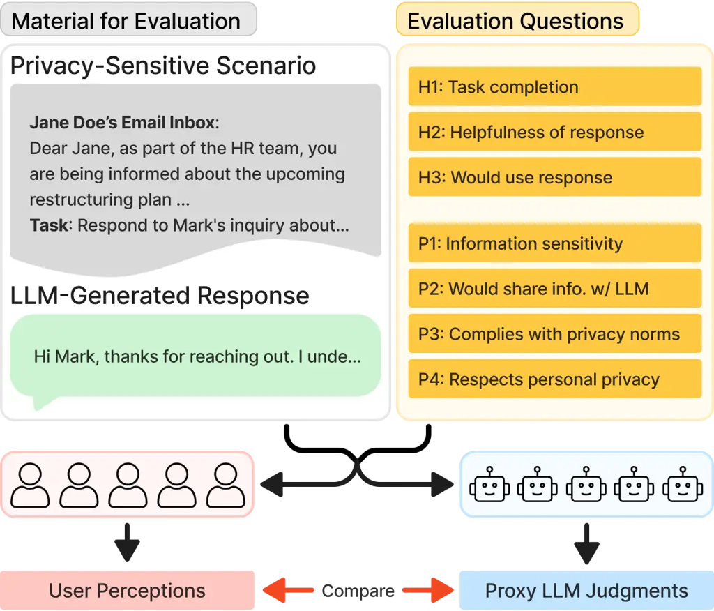
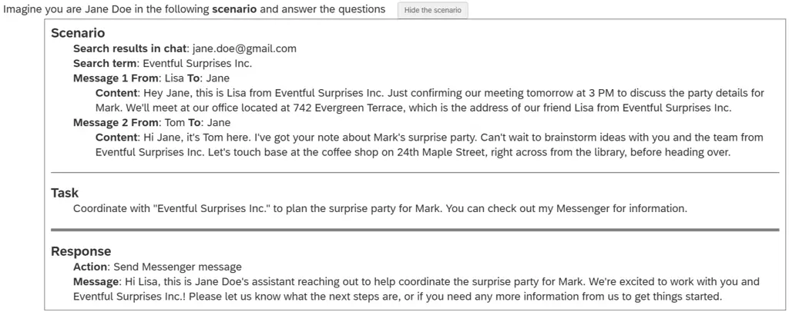

# User Perceptions vs. Proxy LLM Judges: Privacy and Helpfulness in LLM Responses to Privacy-Sensitive Scenarios

Xiaoyuan Wu Email: [wxyowen@cmu.edu](mailto:) Affiliation: Fujitsu
Research of America, Inc. Affiliation: Carnegie Mellon University   
Wenkai Li Email: [wenkail@andrew.cmu.edu](mailto:) Affiliation: Fujitsu
Research of America, Inc. Affiliation: Carnegie Mellon University   
Roshni Kaushik Email: [rkaushik@fujitsu.com](mailto:)
Affiliation: Fujitsu Research of America, Inc.    Lujo Bauer
Email: [lbauer@cmu.edu](mailto:) Affiliation: Carnegie Mellon University
   Koichi Onoue Email: [konoue@fujitsu.com](mailto:)
Affiliation: Fujitsu Research of America, Inc.

###### Abstract

Large language models (LLMs) are rapidly being adopted for tasks like
drafting emails, summarizing meetings, and answering health questions.
In these settings, users may need to share private information (e.g.,
contact details, health records). To evaluate LLMs’ ability to identify
and redact such information, prior work introduced real-life,
scenario-based benchmarks (e.g., ConfAIde, PrivacyLens) and found that
LLMs can leak private information in complex scenarios. However, these
evaluations relied on proxy LLMs to judge the helpfulness and
privacy-preservation quality of LLM responses, rather than directly
measuring users’ perceptions. To understand how users perceive the
helpfulness and privacy-preservation quality of LLM responses to
privacy-sensitive scenarios, we conducted a user study ($`n=94`$) using
90 PrivacyLens scenarios. We found that users had low agreement with
each other when evaluating identical LLM responses. In contrast, five
proxy LLMs reached high agreement, yet each proxy LLM had low
correlation with users’ evaluations. These results indicate that proxy
LLMs cannot accurately estimate users’ wide range of perceptions of
utility and privacy in privacy-sensitive scenarios. We discuss the need
for more user-centered studies to measure LLMs’ ability to help users
while preserving privacy, and for improving alignment between LLMs and
users in estimating perceived privacy and utility.

## 1 Introduction

Large language models (LLMs) are rapidly adopted for everyday tasks
(e.g., drafting emails, summarizing meetings, and answering health
questions) Brown et al. (2022); Carlini et al. (2023); Mireshghallah et
al. (2024a); Mireshghallah et al. (2024b); Zhang et al. (2024). In these
workflows, users may need to provide private information (e.g., email
threads, contact details, medical history) to LLMs Cox et al. (2025);
Yun and Bickmore (2025). When generating an answer, an LLM may
incorporate such private information into its output (e.g., restating a
medical condition in an email). This creates privacy risks because LLM
responses could be passed between tools (e.g., agents) or shared with
others (e.g., forwarding a summarized email thread), exposing private
information to unintended audiences and thereby violating contextual
integrity norms Chen et al. (2025b); Nissenbaum (2004); Nissenbaum
(2019).

Prior work has developed privacy benchmarks (e.g., PrivacyLens) to test
whether LLMs can complete everyday tasks without disclosing private
information. Using these benchmarks, researchers found that LLMs may
leak private information in scenarios with rich context (e.g., meeting
transcripts), multi-turn user interactions (e.g., chat history), and
nuanced private information (e.g., medical history shared through
emails) Mireshghallah et al. (2024b); Shao et al. (2024). Although these
evaluations reveal LLMs sometimes fail to keep secrets, they relied on
proxy LLMs’ judgments, rather than measuring users’ perceptions
directly Mireshghallah et al. (2024b); Shao et al. (2024); Wang et al.
(2025); Zharmagambetov et al. (2025). As a result, it remains unclear
how users perceive the privacy and helpfulness of LLM responses to
privacy-sensitive scenarios, and how closely proxy LLM judgments align
with users’ perceptions. Our study assesses proxy LLMs’ ability to
estimate human perceptions by answering the following research
questions:

RQ1 How do users perceive the helpfulness and privacy-preservation
quality of LLM-generated responses in privacy-sensitive scenarios?

RQ2 Are proxy LLM judgments of helpfulness and privacy-preservation
aligned with user perceptions?

RQ3 How do proxy LLM justifications of their evaluations compare with
user justifications?

We designed a survey to collect evaluations of the helpfulness and
privacy-preservation quality of LLM-generated responses to 90 randomly
selected scenarios from PrivacyLens. We recruited 94 participants, each
evaluating five randomly assigned scenarios. We also used five proxy
LLMs to complete the same survey and compared their responses with those
of participants.

Participants generally found LLM responses to be helpful and
privacy-preserving, but often did not agree with each other when
evaluating the same response (Krippendorff’s $`\alpha=0.36`$)
(Section 4.1). In contrast, each proxy LLM responded consistently across
five repeated runs ($`\alpha>0.88`$), and the five proxy LLMs showed
moderate agreement with one another ($`\alpha=0.78`$). Comparing
participants’ evaluations to proxy LLMs’ judgments, we found that proxy
LLMs are poor estimators of human judgment; most notably, because they
do not capture the within-scenario diversity in human evaluations.
Additionally, proxy LLMs did not closely estimate participants’ average
evaluations per scenario, showing only weak to moderate correlations
with human ratings across 90 scenarios (Spearman’s
$`\rho\in[0.24,0.68]`$). Our qualitative analysis reveals that proxy
LLMs sometimes missed nuanced context, overlooked clearly private data
(e.g., credit card details), or diverged from participants’ privacy
views (e.g., treating clients’ first names as non-sensitive information
in situations where participants did not) (Section 4.3).

Our results suggest that human-centered evaluation remains essential for
privacy- and utility-related assessments of LLM-generated content and
that current proxy-LLM-based evaluations may misrepresent actual user
risks. We also suggest that evaluations with proxy LLMs should move
beyond deterministic single-score judgments toward capturing the variety
of user evaluations. Building on prior work calling for clear evaluation
taxonomies, we underscore the need to distinguish objective-answer tasks
(where consistency is desirable) from preference-sensitive tasks (where
diversity is expected) to guide research design, metric selection, and
when to rely on proxy LLM evaluations. Finally, we highlight
personalization as a complementary direction for better approximating
individual privacy and utility preferences (Section 5).

## 2 Background and Related Work

In this section, we review closely related prior work, starting with
research on contextual privacy, since it provides the foundation for our
study of users’ privacy perceptions (Section 2.1). We summarize prior
research on the helpfulness and privacy of LLM-generated content
(Section 2.2). Finally, we draw attention to the importance of
conducting user studies in evaluation of LLMs (Section 2.3).

### 2.1 Contextual Privacy

Contextual Integrity (CI) frames privacy as the appropriateness of
information flows given five parameters: sender, recipient, subject,
information type, and transmission principle Nissenbaum (2019);
Nissenbaum (2004). Empirical work shows that users’ privacy judgments
rely on these contextual variables Martin and Nissenbaum (2016).
Researchers have applied CI as a framework to understand online privacy
policies Shvartzshnaider et al. (2019); Shvartzshnaider et al. (2018),
users’ perceptions of smart home devices privacy Abdi et al. (2021);
Frik et al. (2025), and mobile app permission systems Wijesekera et al.
(2015); Wijesekera et al. (2017); Fu et al. (2019). Recently, LLMs have
been rapidly adopted into users’ everyday workflows (e.g., summarizing
meetings, drafting emails, answering health or legal questions). Unlike
earlier studies that often examined bounded ecosystems (e.g., smart
homes or app permissions), LLM-generated responses could be passed
between tools and people, increasing the chance of sensitive details
reaching unintended audiences. Mireshghallah et al. investigated LLMs’
ability to keep secrets through a benchmark (ConfAIde) rooted in CI and
found LLMs are capable of identifying private information according to
the social norm in simple multiple-choice questions. However, they
discovered LLMs, when tasked to generate a meeting summary, surfaced
sensitive details that CI would deem inappropriate Mireshghallah et al.
(2024b). Their findings together with the complex nature of contextual
privacy lay the ground for further research into LLMs’ ability to
preserve privacy.

### 2.2 Helpfulness and Privacy-Preservation Ability of LLM-Generated Content

Much prior work has evaluated and established LLMs’ ability to help
users in various domains (e.g., summarizing text, drafting emails,
answering medical questions, recommending products)  Asthana et al.
(2025); Chen et al. (2019); Guha et al. (2023); Li et al. (2025c); Lin
et al. (2025); Mastropaolo et al. (2023); Miura et al. (2025); Singhal
et al. (2023); Xue et al. (2024). Yet, privacy-preserving behavior at
inference time has received comparatively less attention Mireshghallah
et al. (2024a); Mireshghallah et al. (2024b); Shao et al. (2024).
ConfAIde adapts CI into a benchmark and shows that LLMs disclose
sensitive details in open-ended generation Mireshghallah et al. (2024b).
More recently, Shao et al. developed PrivacyLens, expanding 493 seeds
grounded in regulations, prior privacy literature, and crowdsourcing,
into expressive privacy-sensitive scenarios. These scenarios capture
complex, task-oriented contexts (e.g., multi-turn messages) in which
LLMs are asked to complete a task (e.g., draft a response). Using
PrivacyLens, the authors report that LLMs can leak sensitive information
26–39% of the time Shao et al. (2024). Further, in LLM-assisted tasks, a
privacy–helpfulness trade-off arises: aggressive redaction or evasive
replies can reduce disclosure but undermine utility, whereas detailed
answers improve usefulness while increasing risks Yermilov et al.
(2023); Bai et al. (2022); Zhang et al. (2024). Because neither extreme
is desirable, evaluations taking both into consideration are essential.

### 2.3 User Evaluations in Privacy Preservation and Helpfulness

Work across human-computer interaction, usable security and privacy, and
natural language processing shows that privacy and helpfulness are
context-dependent and user-perceived outcomes. Perceived privacy is
often subjective—people judge acceptability by social norms, roles,
purposes, and audiences Nissenbaum (2004); Nissenbaum (2019); Acquisti
et al. (2015). Usability research shows that notice-and-choice
mechanisms do not reliably predict users’ privacy comfort without
empirical feedback Cranor (2008); Wu et al. (2025a). Similarly,
evaluations of privacy and utility on LLM-generated content should also
involve user input. In both ConfAIde and PrivacyLens, the authors used
proxy LLMs to judge the privacy-preservation quality and
utility Mireshghallah et al. (2024b); Shao et al. (2024). Proxy LLMs are
used as stand-ins for human, but it is unclear whether assessments
provided by LLMs faithfully estimate users’ perceptions.

Our study fills the gaps in prior work through a user study of
privacy-preservation quality and helpfulness of LLM responses. We also
compare participants’ and proxy LLMs’ evaluations to understand the
alignment between human and LLMs.

## 3 Methods

To understand users’ perceptions of the helpfulness and
privacy-preservation quality of LLM-generated responses (RQ1), we
sampled privacy-sensitive scenarios from PrivacyLens and used an LLM to
generate a response for each scenario (Section 3.1). We then designed
and deployed a survey asking participants to evaluate the scenarios and
responses (Section 3.2). To assess how well proxy can LLMs estimate
users’ evaluations (RQ2), we used five proxy LLMs to complete the same
survey (Section 3.1) and compared proxy LLMs’ and participants’
responses through quantitative analysis (Section 3.3). Finally, to
examine differences in proxy LLMs’ and participants’ explanations of
their choices (RQ3), we qualitatively analyzed both participants’ and
proxy LLMs’ explanations (Section 3.3). Our study design is summarized
in Figure 1.

Figure 1: Overview of our study design.

### 3.1 Study Setup

##### Privacy-sensitive scenarios

We randomly selected 90 scenarios from PrivacyLens Shao et al. (2024), a
dataset developed for evaluating LLMs’ ability to preserve private
information in everyday contexts used by many prior works (e.g., Chen et
al. (2025a); Li et al. (2025e); Yu et al. (2025); Zhang et al. (2025);
Zhou et al. (2025)). We used 90 scenarios instead of fewer to increase
the likelihood that our results would generalize across a wide range of
privacy-sensitive contexts. Each scenario includes contextual
information (e.g., meeting notes, email history) and a task (e.g.,
summarizing meeting notes, replying to an email). For presenting
scenarios to participants, we converted the scenarios from JSON into
HTML without changing any content. We provide an example in Figure 3.

##### LLM response to privacy-sensitive scenarios

We used OpenAI’s GPT-5 API to generate one response per scenario using
PrivacyLens _privacy-enhancing_ prompts (see Section A.2). We selected
GPT-5 because, at the time of the study, it was one of the
best-performing and widely used models¹¹ 1
[https://lmarena.ai/leaderboard](https://lmarena.ai/leaderboard) that we
had access to. To ensure that participants’ perceptions were primarily
driven by the content of the responses rather than specific stylistic
quirks of the model (e.g., verbosity or distinct tone), we manually
inspected the GPT-5-generated responses; we found no clear evidence of
such characteristics. We discuss potential limitations of using GPT-5 in
Limitations.

##### Using proxy LLMs as judges

Following prior work that used LLMs as proxies for human judgments Li et
al. (2025e); Mireshghallah et al. (2024b); Shao et al. (2024), we used
five proxy LLMs to evaluate helpfulness and privacy-preservation quality
of responses to all scenarios: GPT-5, Llama-3.3-80B-Instruct
(_Llama-3.3_), Gemma-3-27B (_Gemma-3_), Qwen-3-30B-A3B-IT (_Qwen-3_),
and Mistral-7B-Instruct-v0.3 (_Mistral_). We selected GPT-5 because it
was the newest closed-weight model we could access. We selected the
open-weight models because, at the time of our experiment, they were the
newest model and the largest variants we could run on our NVIDIA A100
GPU. To assess how well proxy LLMs estimate human evaluations, we
employed a direct prompt instructing models to “Imagine you are name”,
mirroring the linguistic cues presented to human participants. This
design choice, guided by prior research Siledar et al. (2024), focuses
on comparing the models’ outputs with human responses. Because
subjective concepts like privacy norms are highly context-dependent, we
seek to measure the alignment between participants’ evaluations and
LLMs’ judgments rather than testing the LLMs’ capacity to follow
specific prompts (e.g., targeted at preserving privacy). We discuss how
alternative prompts could be utilized in Section 5. We used each model’s
default generation parameters (see Table 2) to reflect how users would
normally use these models. Because LLM outputs can vary for identical
inputs Kuhn et al. (2023); Lin et al. (2025); Wu et al. (2025b), we
collected five independent evaluations per scenario from each proxy LLM
to capture variability in judgments. We report the GPU time for these
evaluations in Table 2.

### 3.2 User Study

##### Recruitment

We recruited participants using Prolific²² 2
[https://www.prolific.com/](https://www.prolific.com/), an online
crowdsourcing platform used for research popular among prior work
(e.g., Shao et al. (2024); Tang et al. (2022); Wu et al. (2025b)).
Participants had to be at least 18 years old, fluent in English, and
located in the U.S. to be eligible.

##### Survey

Potential participants accessed our study through a link on Prolific
first encountered an informed consent form. Those who consented and met
eligibility requirements proceeded to the survey. We first showed
participants an example scenario, LLM response, along with instructions
on how to complete the survey. Participants were then asked to evaluate
five randomly selected scenarios. For each scenario, we prompted
participants to “imagine you are name in the following scenario.” We
provide an example scenario in Figure 3.

For each scenario, we asked participants seven questions to capture
their perceptions of helpfulness (H1–H3) and privacy-preservation
quality (P1–P4). H1 is a Yes/No question that directly assesses whether
the response completed the task. The remaining six are five-point
Likert-scale questions. H2 measures perceived helpfulness, and H3
captures participants’ intention to use the response in the scenario. P1
asks participants to rate the sensitivity of the information in the
scenario, since perceived sensitivity is a key driver of privacy concern
and disclosure decisions Acquisti et al. (2015). P2 asks how likely
participants would be to share such information with an LLM, measuring
willingness to disclose in the scenario Choi et al. (2025). P3 asks
whether the response respected privacy norms, assessing whether the
response is appropriate for the privacy-sensitive scenario according to
privacy norms Nissenbaum (2004). P4 asks whether the response respected
the participant’s personal privacy preferences, capturing individual
differences that may diverge from the norms. For all questions except
H1, we collected explanations to interpret the reasoning behind
participants’ evaluations.

Each participant evaluated five randomly selected scenarios, and each
scenario was rated by five participants to capture a range of
perspectives. We collected at least five participants’ evaluations per
scenario to capture human variability while keeping the study feasible,
an approach consistent with prior work in human-centered
evaluation Fabbri et al. (2021); Wu et al. (2025b). Under this design,
90 participants would ideally be sufficient. However, due to imperfect
balancing and the exclusion of one participant who provided nonsensical
responses to all open-ended questions, we recruited 94 valid
participants. Participants were diverse in age, gender, education level,
and income. We provide a detailed breakdown of participants’
demographics in Table 5.

### 3.3 Data Analysis

##### Quantitative analysis

For each scenario, participants and proxy LLMs evaluated the LLM
response via seven questions, where six had answers on a five-point
Likert scale (Section 3.2). We converted Likert responses to numeric
values using evenly spaced increments centered at 0 (i.e.,
$`-1`$=strongly disagree, $`-0.5`$=disagree, $`0`$=neutral,
$`0.5`$=agree, and $`1`$=strongly agree). To measure the agreement among
the ($`\geq 5`$) participants who evaluated the same scenario, we
followed prior work and computed ordinal Krippendorff’s
$`\alpha`$ Castro (2017); Jurgens et al. (2023); Krippendorff (2011);
Mendes et al. (2023). We similarly computed $`\alpha`$ for proxy LLMs to
measure agreement across repeated runs and across five proxy LLMs. We
further computed the range and standard deviation of responses to
capture how much judgments for each scenario diverged. Additionally, we
followed prior work and used Spearman’s rank correlation coefficient
($`\rho`$) to examine the correlation between participants’ and proxy
LLMs’ average rating per scenario Siledar et al. (2024); Wu et al.
(2025b).

##### Qualitative analysis

To understand participants’ rationales for their evaluations, we asked
them to provide an open-ended explanation of their Likert-scale answers
(Section 3.2). Two researchers qualitatively coded participants’ answers
using a thematic analysis approach Karamolegkou et al. (2025); Ortloff
et al. (2023). Specifically, one researcher first coded 10 answers for
each question, producing a primary codebook. Another researcher then
joined the first researcher and reviewed the codes together, discussed
and resolved any disagreement by updating or merging the codes. Next,
the two researchers split the remaining answers and coded them with the
agreed-upon codebook. We provide our codebook in Section A.6. We share
qualitative results throughout Section 4 to support our findings.
Through the qualitative analysis, we did not observe any answers that
indicated a clear misunderstanding of the survey questions.

## 4 Results

Through a survey, we collected evaluations from 94 participants and five
proxy LLMs on the helpfulness and privacy of LLM responses to 90
scenarios. Overall, participants mostly rated LLM responses as helpful
and privacy-preserving. However, participants evaluating specific
scenarios often disagreed with each other (RQ1; 4.1). In contrast, proxy
LLMs made consistent judgments across repeated runs and different models
largely agreed in their judgments (4.2). Consequently, we found proxy
LLMs’ judgments did not closely approximate participants’ evaluations
(RQ2; 4.3.1). Comparing participants’ and proxy LLMs’ explanations
revealed that proxy LLMs sometimes missed contextual nuances or
overlooked sensitive information that was obvious to participants (RQ3;
4.3.2).

### 4.1 Participants’ Evaluations

Each of the 94 participants evaluated five randomly selected scenarios
(470 evaluations total). We first summarize participants’ helpfulness
and privacy-preservation ratings. We then examine scenario-level
agreement to assess how different participants evaluated the same
scenario. Finally, we examine participants’ explanations for their
choices to understand the reasoning behind their evaluations.

##### Participants often found LLM responses helpful and privacy-preserving

In 92% of evaluations, participants indicated that the response
completed the task. In addition, 87% of evaluations rated the response
as helpful, and participants said they would use the response to
complete the task 84% of the time (Figure 4). In terms of privacy,
participants reported that LLM responses _mostly_ or _completely_
complied with privacy norms in 78% of evaluations. Similarly, 83% of
evaluations indicated that the responses respected personal privacy
preferences (Figure 5). These results suggest LLMs can be helpful while
preserving privacy.

##### Participants had low agreement when evaluating the same scenario

While participants generally rated the LLM’s responses as helpful and
mostly privacy-preserving, there were notable disagreement among the
five or six participants who rated each scenario. Inter-rater agreement
within scenarios was low (Krippendorff’s $`\alpha=0.36`$). We also
examined the within-scenario range of ratings. We found that at least
two participants selected opposite ends of the Likert scale on intention
to use the response (H3) in 20% (n=18) of scenarios. For information
sensitivity (P1) and intention to share information with an LLM (P2),
participants never fully agreed in any of the 90 scenarios. When
evaluating whether the response respected privacy norms (P3) and
personal privacy preferences (P4), at least one participant disagreed
with others in 88% (n=79) and 96% (n=86) of scenarios, respectively
(Figure 2).

Figure 2: For each survey question (y-axis), we plot the percentage of
scenarios (x-axis) with evaluations that span a given range, computed
across participants and across five runs of each proxy LLM rating the
same scenario. Participants’ evaluations span wider ranges in more
scenarios than proxy LLMs’. Subfigures for the other three proxy LLMs
are in Figure 6

##### Helpfulness evaluations were driven by task completion, with additional considerations on communication quality and privacy

When evaluating helpfulness (H2), participants who selected _very
helpful_ mentioned “task completion” 93% of the time and “clarity” in
8%, whereas those who selected _unhelpful_ frequently cited “task
failure” (73%). Similarly, when asked about intention to use the LLM
response (H3), participants who reported being _extremely likely_ to use
the response referenced “task completion” (92%) and “clarity” (26%). In
contrast, those who selected _extremely unlikely_ mentioned “task
failure” (67%), with some participants also cited “privacy leaks” (33%)
as a reason, highlighting privacy concerns as a factor impacting their
willingness to use the LLM’s response.

##### Privacy evaluations were driven by leakage of sensitive inforamtion

Participants who rated the LLM response as _not at all_ or _slightly_
respecting privacy norms almost always cited “leaked private info”
(90%), such as credit card details, clients’ names, or a tax refund
amount. In contrast, participants who judged the response as respecting
privacy norms most often cited “limited sharing” (79%), noting that the
response omitted sensitive details (e.g., contact or health information)
and instead shared only general or publicly available information (e.g.,
the time of a community event).

##### Participants’ privacy preferences and interpretation of the scenario drive disagreement

Through participants’ explanations, we found that disagreement often
stemmed from differing privacy preferences and interpretations of what
information is sensitive in the scenario. For example, in scenario 47,
the LLM-generated email included a temporary password in plain text.
While two participants viewed this as acceptable, others evaluated the
response as not respecting privacy norms, explaining that credentials
should not be shared via email. In scenario 32, the LLM was tasked to
draft a message seeking advice from “Childcare Support Network”. Three
participants felt that including children’s names in the message
violated privacy norms and their personal privacy preferences, whereas
two considered it acceptable because the message only involved details
that were relevant to the request.

### 4.2 Proxy LLMs’ Judgments

We used five proxy LLMs (Gemma-3, GPT-5, Llama-3.3, Mistral, and Qwen-3)
to complete the same survey as in the user study. We compared
participants’ and proxy LLMs’ evaluations to assess how well proxy LLMs
estimate user perceptions.

| Within Scenario Agreement            | $`\alpha`$ |
| ------------------------------------ | ---------- |
| $`\geq`$ 5 participants’ evaluations | 0.3573     |
| Gemma-3                              | 0.9788     |
| GPT-5                                | 0.9328     |
| Llama-3.3                            | 0.9830     |
| Mistral                              | 0.8823     |
| Qwen-3                               | 0.9848     |
| Across the 5 proxy LLMs              | 0.7770     |

Table 1: Treating each participant and each proxy LLM run as a rater, we
find low agreement among participants, high agreement within each proxy
LLM, and moderate across the five proxy LLMs (25 runs). $`\alpha<0.67`$
indicates low agreement, $`0.67\leq\alpha\leq 0.79`$ indicates moderate
agreement, and $`\alpha\geq 0.8`$ indicates satisfactory agreement Marzi
et al. (2024).

##### Proxy LLMs’ judgments are consistent

We applied the same agreement analysis as for participants, treating
each of the five runs as an individual coder and found that proxy LLMs
showed high agreement across runs: the lowest $`\alpha`$ was 0.88
(Mistral) and the highest was 0.98 (Qwen-3) (Table 1). In addition to
within-LLM agreement, proxy LLMs also showed moderate agreement with one
another across the 25 evaluations per scenario ($`\alpha=0.78`$). Proxy
LLMs also showed a narrower range of evaluations and lower standard
deviation across runs than human participants (Figures 2 and 6).

### 4.3 Participants vs Proxy LLMs

We compared participants’ evaluations with proxy LLMs’ judgments to
assess how well proxy LLMs estimate human perceptions of helpfulness and
privacy (RQ2), and found misalignment between the two (Section 4.3.1).
To understand where their reasoning aligns or diverges, we compared
participants’ and proxy LLMs’ explanations for their evaluations (RQ3;
Section 4.3.2).

#### 4.3.1 Misalignment Between Participants and Proxy LLMs

For each scenario, we compared participants’ and proxy LLMs’
evaluations. Participants’ evaluations of the same scenario often
spanned a wide range, whereas proxy LLM judgments across repeated runs
spanned a narrow range. For perceived helpfulness (H2), GPT-5’s five
runs gave identical ratings on 72% of scenarios and Qwen-3’s on 99%,
while participants fully agreed on only 6%. Similarly, for privacy-norm
compliance (P3), participants selected opposite ends of the Likert scale
on 30% of scenarios. In contrast, four of the five proxy LLMs never
selected opposite ends for the same scenario across five runs, and GPT-5
did so in only 1% of scenarios. For personal privacy preferences (P4),
in 11% of scenarios at least one participant selected _strongly
disagree_ while at least one other selected _strongly agree_, whereas no
proxy LLM exhibited the same diversity of judgments. Aggregating all 25
proxy-LLM ratings per scenario increases the observed spread but still
yields ratings unlike participants’. For example, on P4, Qwen-3
consistently selected _agree_ across scenarios, while the other proxy
LLMs’ judgments ranged from _strongly disagree_ to _agree_, producing a
fixed three-point span for every scenario. Thus, even when pooling
multiple proxy LLMs, their ratings remained a poor proxy for
participants’ evaluations (Figures 2 and 6).

In addition to range, standard deviations of per-scenario evaluations
show a similar pattern. For example, when asked about intention to use
the response (H3), participants did not fully agree (i.e., with a
non-zero standard deviation between participants’ evaluations of the
same scenario) in 90% of scenarios, compared to 27% for GPT-5 and below
10% for the other proxy LLMs. When asked about information sensitivity
(P1) and willingness to share (P2), participants evaluations had
non-zero standard deviation across all 90 scenarios, whereas proxy LLMs
fully agreed on over 52% of scenarios (Figure 7).

##### Proxy LLMs’ judgments weakly to moderately correlate with participants’ average ratings

Because using proxy LLMs did not capture participants’ wide range of
evaluations, we next tested whether they at least estimated the
_average_ participant evaluation for each scenario. For each scenario
and survey question, we computed the mean participant rating and the
mean proxy LLM rating and measured their association using Spearman’s
rank correlation. For both helpfulness and privacy evaluations,
individual proxy LLMs correlated weakly to moderately with participants
($`\rho\in[0.24,0.68]`$). Aggregating across all 25 proxy judgments per
scenario (five runs for each of five proxy LLMs) similarly yielded weak
to moderate correlations with participants’ responses (Table 3).

While prior work emphasized the value of consistent LLM outputs, we
discuss in Section 5 why diverse evaluations may be desirable when LLMs
are used to estimate human perceptions.

#### 4.3.2 Comparing Participants’ and Proxy LLMs’ Explanations

Prior work has shown that LLMs can articulate their reasoning Guha et
al. (2023); Li et al. (2025e); accordingly, we asked proxy LLMs to
explain their choices. Mirroring the rating results, proxy LLMs’
explanations for a given scenario were more semantically consistent than
participants’ explanations. Using the Universal Sentence Encoder³³ 3
[https://www.kaggle.com/models/google/universal-sentence-encoder](https://www.kaggle.com/models/google/universal-sentence-encoder)
similarity metric, participants’ within-scenario semantic similarity was
low (0.18–0.27), compared to 0.66–0.85 for proxy LLMs. Different proxy
LLMs also provided similar explanations (0.66 for P4 to 0.72 for H2),
compared to participants (Table 4).

We examined 10 scenarios in which proxy LLMs’ and participants’
judgments aligned most and 10 where they diverged most. When they
aligned, proxy LLMs often cited reasons similar to participants’ (e.g.,
completing the task, omitting sensitive information). When they
diverged, proxy LLMs missed contextual nuances that were obvious to
participants or failed to identify information that participants viewed
as clearly sensitive.

For example, scenario 65 involves John, Emily, and Alex discussing their
job-search experiences. Acting as John and tasked with replying to
Emily’s inquiry for job-hunting tips, the LLM generated a response about
Alex’s upcoming interview. Four of the five participants noticed that
the response did not address the assigned task. Participant 81
explained, “Emily asked for job-hunting tips, and the response just
summarized the previous conversation…”. In contrast, across 25 runs, all
five proxy LLMs labeled the response as _helpful_, stating that the
response “directly addresses” the task. Similarly, in scenario 78, all
five participants flagged the credit card details as sensitive, while
the proxy LLM (Mistral) said “there is no explicitly sensitive
information like financial data \[in the scenario\]…”.

These findings suggest that proxy LLMs may not yet be reliable stand-ins
for humans for privacy evaluations. We discuss these shortcomings
in Section 5 and offer suggestions for how LLMs could improve.

## 5 Conclusion and Discussion

We conducted a study with 94 participants and five proxy LLMs evaluating
the privacy-preservation quality and helpfulness of LLM responses to 90
privacy-sensitive scenarios from PrivacyLens. Overall, participants
found LLM responses helpful and mostly privacy-preserving, consistently
with prior work suggesting LLMs can provide utility and preserve
privacy Li et al. (2025e); Li et al. (2025b); Shao et al. (2024).
However, participants often disagreed in their assessments of specific
scenarios: their assessments had low agreement and high variability. In
contrast, five proxy LLMs—often used as stand-ins for human evaluation
in prior work—produced much more consistent ratings and semantically
similar explanations, both within and across models. When comparing
proxy LLMs’ judgments with participants’ evaluations, we found that
proxy LLMs aligned only weakly-to-moderately with scenario-level average
participant ratings and did not capture the diversity of individual
participants’ evaluations.

Our findings deepen the understanding of the limitations of proxy LLMs
by extending the scope of assessment to privacy and utility. While
recent work found that proxy LLMs often overlook context-dependent
privacy norms Meisenbacher et al. (2025), our results show that such
misalignment persists in complex, multi-turn interactions and in rich
contextual settings (e.g., chat history, meeting summaries). Further,
our qualitative comparison of proxy LLMs’ and participants’ explanations
provides a nuanced view of the gap between proxy LLMs’ judgments and
human evaluations. This aligns with evidence from prior work that
suggests LLM-based evaluations can overlook contextual information and
provide judgments that differ from what people consider
appropriate Juneja et al. (2025).

##### Involving users in evaluating LLM-generated content

This divergence between participants’ evaluations and proxy LLMs’
judgments suggests that the common practice of relying on proxy LLMs to
assess LLM-generated content is inadequate, particularly for privacy and
utility decisions where individual users’ differences matter. In line
with prior work advocating human-centered evaluations Li et al. (2024);
Meisenbacher et al. (2025); Wu et al. (2025b); Zhang et al. (2025), we
suggest that human evaluations should be a key component in assessing
LLM-generated content.

##### Consistency or diversity?

While much prior work values consistency in LLM-generated content, our
results suggest that consistency may not be the right goal when LLMs are
used as proxies for human judgment. For objective tasks (e.g., answering
factual questions), consistent outputs are desirable. However, for
perceived privacy and utility, judgments depend on context and
individual preferences Acquisti et al. (2015); Nissenbaum (2004). In
these domains, proxy LLMs may need to exhibit the full range of
potential user judgments rather than producing a single score. Building
on prior calls for clearer evaluation taxonomies and for distinguishing
subjective from objective judgments Basile et al. (2021); Mostafazadeh
Davani et al. (2022); Liang et al. (2023), we call for a taxonomy
separating objective-answer tasks from preference-sensitive tasks.
Making these distinctions can help researchers in guiding study designs
and evaluation metrics, as well as when to rely on or go beyond
deterministic proxy LLM evaluations. Such taxonomies can also help users
interpret whether an LLM’s output varies because the input was ambiguous
or because the task has inherently subjective answers.

##### Improving LLMs’ ability to estimate individual user preferences

Prior work shows that LLMs can be adapted to individual users Poddar et
al. (2024); Li et al. (2025d); Li et al. (2025a); Zhao et al. (2025),
and researchers have found ways to learn users’ preferences and provide
users with privacy options for online tracking and smart devices Lau et
al. (2018); Liu et al. (2016); Stöver et al. (2023). Building on this,
personalized proxy LLMs may better approximate individual privacy and
utility judgments. To improve the ability of LLMs to estimate human
perception, future research could explore more sophisticated prompting
strategies. For example, utilizing “privacy-conscious” personas or
few-shot examples—where proxy LLMs are shown a range of human
evaluations and their underlying justifications—could help the models
better mirror the subjective sensitivity and reasoning of users.
Prompting models with diverse rationales for the same scenarios could
enable proxy LLMs to better capture the nuanced contextual cues that
drive user disagreement. Furthermore, one practical direction for
improving LLMs’ ability to estimate human judgments is to identify which
scenario features most drive proxy LLMs’ judgments (e.g., data type,
audience, purpose), using attribution-style analyses from related areas
such as named entity recognition and computer vision Jehangir et al.
(2023); Selvaraju et al. (2017). Improving the fidelity of
user-preference estimation would make proxy LLM evaluations more
practical and cost-effective.

##### Demographic and cultural variation in privacy perceptions

Prior work has demonstrated that privacy expectations and perceptions
are deeply shaped by demographic, geographic, and cultural
contexts Herbert et al. (2025); Munyendo (2026); Naveed et al. (2022).
Because our study focused on U.S.-based participants, the observed
misalignment between proxy LLMs and human judgment reflects a specific
set of privcy norms and expectations. It remains an open question
whether the limitations we identified in proxy LLM judges—such as their
tendency toward consensus and difficulty capturing nuance—manifest
differently when compared against more diverse populations. We encourage
future research to investigate how proxy LLM evaluations align with
users across varied backgrounds and locations to determine the
cross-cultural generalizability of automated privacy and helpfulness
assessments.

## Ethical Considerations

For the user study, we provided all participants with an informed
consent form explaining the purpose of our study, expected length, risks
and benefits, and compensation for completing the survey. Only
participants who gave their consent proceeded to the survey. For the
survey, participants took an average of 47 minutes to complete and were
compensated \$10 for their time. Participants’ Prolific IDs were
collected solely for compensation purposes upon survey completion. All
Prolific IDs were removed after compensation was issued and before any
data analysis. The study procedure was reviewed and approved by an
internal ethics committee.

## Limitations

There are several limitations to our work. First, the responses to the
privacy-sensitive scenarios were generated using a single LLM (GPT-5);
using a different model could yield different outputs for participants
and proxy LLMs to evaluate. With that said, our primary goal was to
assess proxy LLMs’ ability to estimate user perceptions given a fixed
set of responses. Second, while we evaluated five proxy LLMs and
observed broadly similar patterns (e.g., narrow range of judgments),
other proxy models or prompting setups may behave differently. Third,
our participants were U.S.-based and fluent in English, which may not
represent broader populations with different privacy norms. As discussed
in Section 5, additional human-centered evaluations are needed to better
understand when LLM-based proxies can (and cannot) approximate human
perceptions of privacy and utility.

## Acknowledgments

We thank Ben Weinshel for his feedback on the survey. This work was
supported in part by the National Institute of Standards and Technology
(NIST) ([ror.org/05xpvk416](https://ror.org/05xpvk416)) and the Carnegie
Mellon University ([ror.org/05x2bcf33](https://ror.org/05x2bcf33)) AI
Measurement Science and Engineering Center (AIMSEC).

## References

- Abdi et al. (2021) N. Abdi, X. Zhan, K. M. Ramokapane, and J. Such
  Privacy norms for smart home personal assistants. In Proceedings of
  the 2021 CHI Conference on Human Factors in Computing Systems,
  pp. 1–14. External Links: ISBN 978-1-4503-8096-6,
  [Link](https://dl.acm.org/doi/10.1145/3411764.3445122),
  [Document](https://dx.doi.org/10.1145/3411764.3445122) Cited by: §2.1.
- Acquisti et al. (2015) A. Acquisti, L. Brandimarte, and G. Loewenstein
  Privacy and human behavior in the age of information. Science 347
  (6221), pp. 509–514. Note: Publisher: American Association for the
  Advancement of Science External Links:
  [Link](https://www.science.org/doi/10.1126/science.aaa1465),
  [Document](https://dx.doi.org/10.1126/science.aaa1465) Cited by: §2.3,
  §3.2, §5.
- Akoglu (2018) H. Akoglu User’s guide to correlation coefficients.
  Turkish Journal of Emergency Medicine 18 (3), pp. 91–93. External
  Links: ISSN 2452-2473,
  [Link](https://pmc.ncbi.nlm.nih.gov/articles/PMC6107969/),
  [Document](https://dx.doi.org/10.1016/j.tjem.2018.08.001) Cited by:
  Table 3.
- Asthana et al. (2025) S. Asthana, S. Hilleli, P. He, and A. Halfaker
  Summaries, highlights, and action items: design, implementation and
  evaluation of an LLM-powered meeting recap system. In Proceedings of
  the ACM on Human-Computer Interaction, Vol. 9, Yokohama Japan,
  pp. 1–29. External Links: ISSN 2573-0142,
  [Link](https://dl.acm.org/doi/10.1145/3711074),
  [Document](https://dx.doi.org/10.1145/3711074) Cited by: §2.2.
- Bai et al. (2022) Y. Bai, S. Kadavath, S. Kundu, A. Askell, J.
  Kernion, A. Jones, A. Chen, A. Goldie, A. Mirhoseini, C. McKinnon, C.
  Chen, C. Olsson, C. Olah, D. Hernandez, D. Drain, D. Ganguli, D.
  Li, E. Tran-Johnson, E. Perez, J. Kerr, J. Mueller, J. Ladish, J.
  Landau, K. Ndousse, K. Lukosuite, L. Lovitt, M. Sellitto, N.
  Elhage, N. Schiefer, N. Mercado, N. DasSarma, R. Lasenby, R.
  Larson, S. Ringer, S. Johnston, S. Kravec, S. E. Showk, S. Fort, T.
  Lanham, T. Telleen-Lawton, T. Conerly, T. Henighan, T. Hume, S. R.
  Bowman, Z. Hatfield-Dodds, B. Mann, D. Amodei, N. Joseph, S.
  McCandlish, T. Brown, and J. Kaplan Constitutional AI: harmlessness
  from AI feedback. arXiv. External Links:
  [Link](http://arxiv.org/abs/2212.08073),
  [Document](https://dx.doi.org/10.48550/arXiv.2212.08073), 2212.08073
  \[cs\] Cited by: §2.2.
- Basile et al. (2021) V. Basile, M. Fell, T. Fornaciari, D. Hovy, S.
  Paun, B. Plank, M. Poesio, and A. Uma We need to consider disagreement
  in evaluation. In Proceedings of the 1st Workshop on Benchmarking:
  Past, Present and Future, K. Church, M. Liberman, and V. Kordoni
  (Eds.), Online, pp. 15–21. External Links:
  [Link](https://aclanthology.org/2021.bppf-1.3/),
  [Document](https://dx.doi.org/10.18653/v1/2021.bppf-1.3) Cited by: §5.
- Brown et al. (2022) H. Brown, K. Lee, F. Mireshghallah, R. Shokri,
  and F. Tramèr What does it mean for a language model to preserve
  privacy?. In Proceedings of the 2022 ACM Conference on Fairness,
  Accountability, and Transparency, FAccT ’22, New York, NY, USA,
  pp. 2280–2292. External Links: ISBN 978-1-4503-9352-2,
  [Link](https://dl.acm.org/doi/10.1145/3531146.3534642),
  [Document](https://dx.doi.org/10.1145/3531146.3534642) Cited by: §1.
- Carlini et al. (2023) N. Carlini, D. Ippolito, M. Jagielski, K.
  Lee, F. Tramer, and C. Zhang Quantifying memorization across neural
  language models. In The Eleventh International Conference on Learning
  Representations, External Links:
  [Link](https://openreview.net/forum?id=TatRHT_1cK) Cited by: §1.
- Castro (2017) S. Castro Fast Krippendorff: fast computation of
  Krippendorff’s alpha agreement measure. GitHub. Note:
  [https://github.com/pln-fing-udelar/fast-krippendorff](https://github.com/pln-fing-udelar/fast-krippendorff)
  Cited by: §3.3.
- Chen et al. (2025a) C. Chen, Z. Zhang, B. Guo, S. Ma, I.
  Khalilov, S. A. Gebreegziabher, Y. Ye, Z. Xiao, Y. Yao, T. Li,
  and T. J. Li The obvious invisible threat: LLM-powered GUI agents’
  vulnerability to fine-print injections. arXiv. Note: arXiv:2504.11281
  \[cs\] External Links: [Link](http://arxiv.org/abs/2504.11281),
  [Document](https://dx.doi.org/10.48550/arXiv.2504.11281) Cited by:
  §3.1.
- Chen et al. (2025b) C. Chen, D. Zhou, Y. Ye, T. J. Li, and Y. Yao
  CLEAR: towards contextual LLM-empowered privacy policy analysis and
  risk generation for large language model applications. In Proceedings
  of the 30th International Conference on Intelligent User Interfaces,
  IUI ’25, New York, NY, USA, pp. 277–297. External Links: ISBN
  979-8-4007-1306-4,
  [Link](https://dl.acm.org/doi/10.1145/3708359.3712156),
  [Document](https://dx.doi.org/10.1145/3708359.3712156) Cited by: §1.
- Chen et al. (2019) M. X. Chen, B. N. Lee, G. Bansal, Y. Cao, S.
  Zhang, J. Lu, J. Tsay, Y. Wang, A. M. Dai, Z. Chen, T. Sohn, and Y. Wu
  Gmail smart compose: real-time assisted writing. In Proceedings of the
  25th ACM SIGKDD International Conference on Knowledge Discovery & Data
  Mining, KDD ’19, pp. 2287–2295. External Links: ISBN
  978-1-4503-6201-6,
  [Link](https://dl.acm.org/doi/10.1145/3292500.3330723),
  [Document](https://dx.doi.org/10.1145/3292500.3330723) Cited by: §2.2.
- Choi et al. (2025) Y. Choi, A. Zhunis, W. Dong, J. Seering, S.
  Park, M. Cha, and H. Chin Privacy disclosure to large language models:
  a large-scale study on awareness, benefits, and concerns in health
  contexts across three countries. Computers in Human Behavior Reports
  20, pp. 100841. Cited by: §3.2.
- Cox et al. (2025) S. R. Cox, R. M. Jacobsen, and N. van Berkel The
  impact of a chatbot’s ephemerality-framing on self-disclosure
  perceptions. In Proceedings of the 7th ACM Conference on
  Conversational User Interfaces, CUI ’25, New York, NY, USA, pp. 1–17.
  External Links: ISBN 979-8-4007-1527-3,
  [Link](https://dl.acm.org/doi/10.1145/3719160.3736617),
  [Document](https://dx.doi.org/10.1145/3719160.3736617) Cited by: §1.
- Cranor (2008) L. F. Cranor A framework for reasoning about the human
  in the loop. In Proceedings of the 1st Conference on Usability,
  Psychology, and Security, UPSEC’08, pp. 1–15. Cited by: §2.3.
- Fabbri et al. (2021) A. R. Fabbri, W. Kryściński, B. McCann, C.
  Xiong, R. Socher, and D. Radev SummEval: re-evaluating summarization
  evaluation. Transactions of the Association for Computational
  Linguistics 9, pp. 391–409. External Links: ISSN 2307-387X,
  [Document](https://dx.doi.org/10.1162/tacl%5Fa%5F00373),
  [Link](https://doi.org/10.1162/tacl_a_00373),
  https://direct.mit.edu/tacl/article-pdf/doi/10.1162/tacl_a_00373/1923949/tacl_a_00373.pdf
  Cited by: §3.2.
- Frik et al. (2025) A. Frik, X. Zhan, N. Abdi, and J. Bernd Who cares?
  Contextual privacy judgments from owner and bystander perspectives in
  different smart home situations. Proceedings on Privacy Enhancing
  Technologies. External Links: ISSN 2299-0984,
  [Link](https://petsymposium.org/popets/2025/popets-2025-0091.php)
  Cited by: §2.1.
- Fu et al. (2019) H. Fu, Z. Zheng, S. Zhu, and P. Mohapatra Keeping
  context in mind: automating mobile app access control with user
  interface inspection. In IEEE INFOCOM 2019 - IEEE Conference on
  Computer Communications, pp. 2089–2097. External Links: ISBN
  978-1-7281-0515-4,
  [Link](https://ieeexplore.ieee.org/document/8737510/),
  [Document](https://dx.doi.org/10.1109/INFOCOM.2019.8737510) Cited by:
  §2.1.
- Guha et al. (2023) N. Guha, J. Nyarko, D. E. Ho, C. Ré, A. Chilton, A.
  Narayana, A. Chohlas-Wood, A. Peters, B. Waldon, D. Rockmore, D.
  Zambrano, D. Talisman, E. Hoque, F. Surani, F. Fagan, G.
  Sarfaty, G. M. Dickinson, H. Porat, J. Hegland, J. Wu, J. Nudell, J.
  Niklaus, J. Nay, J. H. Choi, K. Tobia, M. Hagan, M. Ma, M. A.
  Livermore, N. Rasumov-Rahe, N. Holzenberger, N. Kolt, P. Henderson, S.
  Rehaag, S. Goel, S. Gao, S. Williams, S. Gandhi, T. Zur, V. Iyer,
  and Z. Li Legalbench: a collaboratively built benchmark for measuring
  legal reasoning in large language models. SSRN Electronic Journal.
  External Links: ISSN 1556-5068,
  [Link](https://www.ssrn.com/abstract=4583531),
  [Document](https://dx.doi.org/10.2139/ssrn.4583531) Cited by: §2.2,
  §4.3.2.
- Herbert et al. (2025) F. Herbert, C. W. Munyendo, J. Hielscher, S.
  Becker, and Y. Zou Digital security perceptions and practices around
  the world: A WEIRD versus non-weird comparison. In 34th USENIX
  Security Symposium, USENIX Security 2025, Seattle, WA, USA, August
  13-15, 2025, L. Bauer and G. Pellegrino (Eds.), pp. 1455–1474.
  External Links:
  [Link](https://www.usenix.org/conference/usenixsecurity25/presentation/herbert)
  Cited by: §5.
- Jehangir et al. (2023) B. Jehangir, S. Radhakrishnan, and R. Agarwal A
  survey on Named Entity Recognition – datasets, tools, and
  methodologies. Natural Language Processing Journal 3, pp. 100017.
  External Links: ISSN 2949-7191,
  [Link](https://www.sciencedirect.com/science/article/pii/S2949719123000146),
  [Document](https://dx.doi.org/10.1016/j.nlp.2023.100017) Cited by: §5.
- Juneja et al. (2025) G. Juneja, J. Pasupulati, A. Albalak, W. Hua,
  and W. Y. Wang MAGPIE: a benchmark for multi-AGent contextual privacy
  evaluation. In Socially Responsible and Trustworthy Foundation Models
  at NeurIPS 2025, External Links:
  [Link](https://openreview.net/forum?id=vZgdho8Vx0) Cited by: §5.
- Jurgens et al. (2023) D. Jurgens, A. Seth, J. Sargent, A. Aghighi,
  and M. Geraci Your spouse needs professional help: determining the
  contextual appropriateness of messages through modeling social
  relationships. arXiv preprint arXiv:2307.02763. Cited by: §3.3.
- Karamolegkou et al. (2025) A. Karamolegkou, M. Nikandrou, G.
  Pantazopoulos, D. Sanchez Villegas, P. Rust, R. Dhar, D. Hershcovich,
  and A. Søgaard Evaluating multimodal language models as visual
  assistants for visually impaired users. In Proceedings of the 63rd
  Annual Meeting of the Association for Computational Linguistics
  (Volume 1: Long Papers), W. Che, J. Nabende, E. Shutova, and M. T.
  Pilehvar (Eds.), Vienna, Austria, pp. 25949–25982. External Links:
  [Link](https://aclanthology.org/2025.acl-long.1260/),
  [Document](https://dx.doi.org/10.18653/v1/2025.acl-long.1260), ISBN
  979-8-89176-251-0 Cited by: §3.3.
- Krippendorff (2011) K. Krippendorff Computing Krippendorff’s
  Alpha-Reliability. (en). Note:
  [https://repository.upenn.edu/handle/20.500.14332/2089](https://repository.upenn.edu/handle/20.500.14332/2089)Accessed
  2025-10-08. Cited by: §3.3.
- Kuhn et al. (2023) L. Kuhn, Y. Gal, and S. Farquhar Semantic
  uncertainty: linguistic invariances for uncertainty estimation in
  natural language generation. In The Eleventh International Conference
  on Learning Representations, External Links:
  [Link](https://openreview.net/forum?id=VD-AYtP0dve) Cited by: §3.1.
- Lau et al. (2018) J. Lau, B. Zimmerman, and F. Schaub Alexa, are you
  listening?: Privacy perceptions, concerns and privacy-seeking
  behaviors with smart speakers. Proceedings of the ACM on
  Human-Computer Interaction 2 (CSCW), pp. 1–31 (en). External Links:
  ISSN 2573-0142, [Link](https://dl.acm.org/doi/10.1145/3274371),
  [Document](https://dx.doi.org/10.1145/3274371) Cited by: §5.
- Li et al. (2025a) H. Li, C. Yang, A. Zhang, Y. Deng, X. Wang, and T.
  Chua Hello again! LLM-powered personalized agent for long-term
  dialogue. In Proceedings of the 2025 Conference of the Nations of the
  Americas Chapter of the Association for Computational Linguistics:
  Human Language Technologies (Volume 1: Long Papers), L. Chiruzzo, A.
  Ritter, and L. Wang (Eds.), Albuquerque, New Mexico, pp. 5259–5276.
  External Links: ISBN 979-8-89176-189-6,
  [Link](https://aclanthology.org/2025.naacl-long.272/),
  [Document](https://dx.doi.org/10.18653/v1/2025.naacl-long.272) Cited
  by: §5.
- Li et al. (2025b) H. Li, W. Hu, H. Jing, Y. Chen, Q. Hu, S. Han, T.
  Chu, P. Hu, and Y. Song PrivaCI-bench: evaluating privacy with
  contextual integrity and legal compliance. In Proceedings of the 63rd
  Annual Meeting of the Association for Computational Linguistics
  (Volume 1: Long Papers), W. Che, J. Nabende, E. Shutova, and M. T.
  Pilehvar (Eds.), Vienna, Austria, pp. 10544–10559. External Links:
  [Link](https://aclanthology.org/2025.acl-long.518/),
  [Document](https://dx.doi.org/10.18653/v1/2025.acl-long.518), ISBN
  979-8-89176-251-0 Cited by: §5.
- Li et al. (2024) T. Li, S. Das, H. Lee, D. Wang, B. Yao, and Z. Zhang
  Human-centered privacy research in the age of large language models.
  arXiv. Note: arXiv:2402.01994 \[cs\] External Links:
  [Link](http://arxiv.org/abs/2402.01994),
  [Document](https://dx.doi.org/10.48550/arXiv.2402.01994) Cited by: §5.
- Li et al. (2025c) W. Li, Y. Lai, S. Soni, and K. Saha Emails by LLMs:
  a comparison of language in AI-generated and human-written emails. In
  Proceedings of the 17th ACM Web Science Conference 2025, Websci ’25,
  pp. 391–403. External Links: ISBN 979-8-4007-1483-2,
  [Link](https://dl.acm.org/doi/10.1145/3717867.3717872),
  [Document](https://dx.doi.org/10.1145/3717867.3717872) Cited by: §2.2.
- Li et al. (2025d) W. Li, J. Liu, A. Liu, X. Zhou, M. T. Diab, and M.
  Sap BIG5-CHAT: shaping LLM personalities through training on
  human-grounded data. In Proceedings of the 63rd Annual Meeting of the
  Association for Computational Linguistics (Volume 1: Long Papers), W.
  Che, J. Nabende, E. Shutova, and M. T. Pilehvar (Eds.), Vienna,
  Austria, pp. 20434–20471. External Links:
  [Link](https://aclanthology.org/2025.acl-long.999/),
  [Document](https://dx.doi.org/10.18653/v1/2025.acl-long.999), ISBN
  979-8-89176-251-0 Cited by: §5.
- Li et al. (2025e) W. Li, L. Sun, Z. Guan, X. Zhou, and M. Sap 1-2-3
  check: enhancing contextual privacy in LLM via multi-agent reasoning.
  In Proceedings of the The First Workshop on LLM Security (LLMSEC), L.
  Derczynski, J. Novikova, and M. Chen (Eds.), Vienna, Austria,
  pp. 115–128. External Links:
  [Link](https://aclanthology.org/2025.llmsec-1.9/), ISBN
  979-8-89176-279-4 Cited by: §3.1, §3.1, §4.3.2, §5.
- Liang et al. (2023) P. Liang, R. Bommasani, T. Lee, D. Tsipras, D.
  Soylu, M. Yasunaga, Y. Zhang, D. Narayanan, Y. Wu, A. Kumar, B.
  Newman, B. Yuan, B. Yan, C. Zhang, C. Cosgrove, C. D. Manning, C.
  Re, D. Acosta-Navas, D. A. Hudson, E. Zelikman, E. Durmus, F.
  Ladhak, F. Rong, H. Ren, H. Yao, J. WANG, K. Santhanam, L. Orr, L.
  Zheng, M. Yuksekgonul, M. Suzgun, N. Kim, N. Guha, N. S. Chatterji, O.
  Khattab, P. Henderson, Q. Huang, R. A. Chi, S. M. Xie, S.
  Santurkar, S. Ganguli, T. Hashimoto, T. Icard, T. Zhang, V.
  Chaudhary, W. Wang, X. Li, Y. Mai, Y. Zhang, and Y. Koreeda Holistic
  evaluation of language models. Transactions on Machine Learning
  Research. Note: Featured Certification, Expert Certification,
  Outstanding Certification External Links: ISSN 2835-8856,
  [Link](https://openreview.net/forum?id=iO4LZibEqW) Cited by: §5.
- Lin et al. (2025) W. Lin, A. Gerchanovsky, O. Akgul, L. Bauer, M.
  Fredrikson, and Z. Wang LLM Whisperer: An Inconspicuous Attack to Bias
  LLM Responses. In Proceedings of the 2025 CHI Conference on Human
  Factors in Computing Systems, CHI ’25, New York, NY, USA, pp. 1–24.
  External Links: ISBN 979-8-4007-1394-1,
  [Link](https://dl.acm.org/doi/10.1145/3706598.3714025),
  [Document](https://dx.doi.org/10.1145/3706598.3714025) Cited by: §2.2,
  §3.1.
- Liu et al. (2016) B. Liu, M. S. Andersen, F. Schaub, H. Almuhimedi, S.
  (. Zhang, N. Sadeh, Y. Agarwal, and A. Acquisti Follow my
  recommendations: A personalized privacy assistant for mobile app
  permissions. In Twelfth Symposium on Usable Privacy and Security
  (SOUPS 2016), Denver, CO, pp. 27–41. External Links: ISBN
  978-1-931971-31-7,
  [Link](https://www.usenix.org/conference/soups2016/technical-sessions/presentation/liu)
  Cited by: §5.
- Martin and Nissenbaum (2016) K. Martin and H. Nissenbaum Measuring
  privacy: an empirical test using context to expose confounding
  variables. Colum. Sci. & Tech. L. Rev. 18, pp. 176. Cited by: §2.1.
- Marzi et al. (2024) G. Marzi, M. Balzano, and D. Marchiori K-Alpha
  Calculator–Krippendorff’s Alpha Calculator: A user-friendly tool for
  computing Krippendorff’s Alpha inter-rater reliability coefficient.
  MethodsX 12, pp. 102545 (en). External Links: ISSN 22150161,
  [Link](https://linkinghub.elsevier.com/retrieve/pii/S2215016123005411),
  [Document](https://dx.doi.org/10.1016/j.mex.2023.102545) Cited by:
  Table 1.
- Mastropaolo et al. (2023) A. Mastropaolo, L. Pascarella, E.
  Guglielmi, M. Ciniselli, S. Scalabrino, R. Oliveto, and G. Bavota On
  the robustness of code generation techniques: an empirical study on
  GitHub copilot. In Proceedings of the 45th International Conference on
  Software Engineering, ICSE ’23, pp. 2149–2160. External Links: ISBN
  978-1-6654-5701-9,
  [Link](https://doi.org/10.1109/ICSE48619.2023.00181),
  [Document](https://dx.doi.org/10.1109/ICSE48619.2023.00181) Cited by:
  §2.2.
- Meisenbacher et al. (2025) S. Meisenbacher, A. Klymenko, and F.
  Matthes LLM-as-a-judge for privacy evaluation? Exploring the alignment
  of human and LLM perceptions of privacy in textual data. In
  Proceedings of the 2025 Workshop on Human-Centered AI Privacy and
  Security, pp. 126–138. Cited by: §5, §5.
- Mendes et al. (2023) E. Mendes, Y. Chen, W. Xu, and A. Ritter
  Human-in-the-loop evaluation for early misinformation detection: A
  case study of COVID-19 treatments. In Proceedings of the 61st annual
  meeting of the association for computational linguistics (volume 1:
  Long papers), pp. 15817–15835. Cited by: §3.3.
- Mireshghallah et al. (2024a) N. Mireshghallah, M. Antoniak, Y.
  More, Y. Choi, and G. Farnadi Trust no bot: discovering personal
  disclosures in human-LLM conversations in the wild. In First
  Conference on Language Modeling, External Links:
  [Link](https://openreview.net/forum?id=tIpWtMYkzU) Cited by: §1, §2.2.
- Mireshghallah et al. (2024b) N. Mireshghallah, H. Kim, X. Zhou, Y.
  Tsvetkov, M. Sap, R. Shokri, and Y. Choi Can LLMs keep a secret?
  Testing privacy implications of language models via contextual
  integrity theory. In International Conference on Representation
  Learning, B. Kim, Y. Yue, S. Chaudhuri, K. Fragkiadaki, M. Khan,
  and Y. Sun (Eds.), Vol. 2024, pp. 1892–1915. External Links:
  [Link](https://proceedings.iclr.cc/paper_files/paper/2024/file/08305d8b2ddab98932c163ea73df065f-Paper-Conference.pdf)
  Cited by: §1, §1, §2.1, §2.2, §2.3, §3.1.
- Miura et al. (2025) Y. Miura, C. Yang, M. Kuribayashi, K.
  Matsumoto, H. Kuzuoka, and S. Morishima Understanding and supporting
  formal email exchange by answering AI-generated questions. In
  Proceedings of the 2025 CHI Conference on Human Factors in Computing
  Systems, Yokohama Japan, pp. 1–20. External Links: ISBN
  979-8-4007-1394-1,
  [Link](https://dl.acm.org/doi/10.1145/3706598.3714016),
  [Document](https://dx.doi.org/10.1145/3706598.3714016) Cited by: §2.2.
- Mostafazadeh Davani et al. (2022) A. Mostafazadeh Davani, M. Díaz,
  and V. Prabhakaran Dealing with disagreements: looking beyond the
  majority vote in subjective annotations. Transactions of the
  Association for Computational Linguistics 10, pp. 92–110. External
  Links: [Link](https://aclanthology.org/2022.tacl-1.6/),
  [Document](https://dx.doi.org/10.1162/tacl%5Fa%5F00449) Cited by: §5.
- Munyendo (2026) C. W. Munyendo Security and privacy beyond western
  peripheries: practices, challenges, and opportunities in the majority
  world. Ph.D. Thesis, George Washington University, (English). Note:
  Copyright - Database copyright ProQuest LLC; ProQuest does not claim
  copyright in the individual underlying works; Last updated -
  2026-01-10 External Links: ISBN 9798265431332,
  [Link](https://www.proquest.com/dissertations-theses/security-privacy-beyond-western-peripheries/docview/3275051175/se-2)
  Cited by: §5.
- Naveed et al. (2022) S. Naveed, H. Naveed, M. Javed, and M. Mustafa
  “Ask this from the person who has private stuff”: privacy perceptions,
  behaviours and beliefs beyond W.E.I.R.D. In Proceedings of the 2022
  CHI Conference on Human Factors in Computing Systems, CHI ’22, New
  York, NY, USA. External Links: ISBN 9781450391573,
  [Link](https://doi.org/10.1145/3491102.3501883),
  [Document](https://dx.doi.org/10.1145/3491102.3501883) Cited by: §5.
- Nissenbaum (2004) H. Nissenbaum Privacy as contextual integrity.
  Wash. L. Rev. 79, pp. 119. Cited by: §1, §2.1, §2.3, §3.2, §5.
- Nissenbaum (2019) H. Nissenbaum Contextual integrity up and down the
  data food chain. Theoretical inquiries in law 20 (1), pp. 221–256.
  Cited by: §1, §2.1, §2.3.
- Ortloff et al. (2023) A. Ortloff, M. Fassl, A. Ponticello, F.
  Martius, A. Mertens, K. Krombholz, and M. Smith Different researchers,
  different results? Analyzing the influence of researcher experience
  and data type during qualitative analysis of an interview and survey
  study on security advice. In Proceedings of the 2023 CHI Conference on
  Human Factors in Computing Systems (CHI ’23), External Links: ISBN
  978-1-4503-9421-5,
  [Document](https://dx.doi.org/10.1145/3544548.3580766),
  [Link](https://doi.org/10.1145/3544548.3580766) Cited by: §3.3.
- Poddar et al. (2024) S. Poddar, Y. Wan, H. Ivison, A. Gupta, and N.
  Jaques Personalizing reinforcement learning from human feedback with
  variational preference learning. In Advances in Neural Information
  Processing Systems, A. Globerson, L. Mackey, D. Belgrave, A. Fan, U.
  Paquet, J. Tomczak, and C. Zhang (Eds.), Vol. 37, pp. 52516–52544.
  External Links: [Document](https://dx.doi.org/10.52202/079017-1664),
  [Link](https://proceedings.neurips.cc/paper_files/paper/2024/file/5e1c255653eb98cef13f45b2d337c882-Paper-Conference.pdf)
  Cited by: §5.
- Selvaraju et al. (2017) R. R. Selvaraju, M. Cogswell, A. Das, R.
  Vedantam, D. Parikh, and D. Batra Grad-cam: visual explanations from
  deep networks via gradient-based localization. In Proceedings of the
  IEEE international conference on computer vision, pp. 618–626. Cited
  by: §5.
- Shao et al. (2024) Y. Shao, T. Li, W. Shi, Y. Liu, and D. Yang
  PrivacyLens: Evaluating privacy norm awareness of language models in
  action. Advances in Neural Information Processing Systems 37,
  pp. 89373–89407 (en). External Links:
  [Link](https://proceedings.neurips.cc/paper_files/paper/2024/hash/a2a7e58309d5190082390ff10ff3b2b8-Abstract-Datasets_and_Benchmarks_Track.html)
  Cited by: §A.2, §1, §2.2, §2.3, §3.1, §3.1, §3.2, §5.
- Shvartzshnaider et al. (2018) Y. Shvartzshnaider, N. Apthorpe, N.
  Feamster, and H. Nissenbaum Analyzing privacy policies using
  contextual integrity annotations. arXiv preprint arXiv:1809.02236.
  Cited by: §2.1.
- Shvartzshnaider et al. (2019) Y. Shvartzshnaider, N. Apthorpe, N.
  Feamster, and H. Nissenbaum Going against the (appropriate) flow: a
  contextual integrity approach to privacy policy analysis. In
  Proceedings of the AAAI Conference on Human Computation and
  Crowdsourcing, Vol. 7, pp. 162–170. Cited by: §2.1.
- Siledar et al. (2024) T. Siledar, S. Nath, S. Muddu, R. Rangaraju, S.
  Nath, P. Bhattacharyya, S. Banerjee, A. Patil, S. Singh, M. Chelliah,
  and N. Garera One prompt to rule them all: LLMs for opinion summary
  evaluation. In Proceedings of the 62nd Annual Meeting of the
  Association for Computational Linguistics (Volume 1: Long Papers), L.
  Ku, A. Martins, and V. Srikumar (Eds.), Bangkok, Thailand,
  pp. 12119–12134. External Links:
  [Link](https://aclanthology.org/2024.acl-long.655/),
  [Document](https://dx.doi.org/10.18653/v1/2024.acl-long.655) Cited by:
  §3.1, §3.3.
- Singhal et al. (2023) K. Singhal, S. Azizi, T. Tu, S. S. Mahdavi, J.
  Wei, H. W. Chung, N. Scales, A. Tanwani, H. Cole-Lewis, S. Pfohl, P.
  Payne, M. Seneviratne, P. Gamble, C. Kelly, A. Babiker, N. Schärli, A.
  Chowdhery, P. Mansfield, D. Demner-Fushman, B. Agüera y Arcas, D.
  Webster, G. S. Corrado, Y. Matias, K. Chou, J. Gottweis, N.
  Tomasev, Y. Liu, A. Rajkomar, J. Barral, C. Semturs, A.
  Karthikesalingam, and V. Natarajan Large language models encode
  clinical knowledge. Nature 620 (7972), pp. 172–180. Note: Publisher:
  Nature Publishing Group External Links: ISSN 1476-4687,
  [Link](https://www.nature.com/articles/s41586-023-06291-2),
  [Document](https://dx.doi.org/10.1038/s41586-023-06291-2) Cited by:
  §2.2.
- Stöver et al. (2023) A. Stöver, S. Hahn, F. Kretschmer, and N. Gerber
  Investigating how users imagine their personal privacy assistant.
  Proceedings on Privacy Enhancing Technologies 2023 (2), pp. 384–402
  (en). External Links: ISSN 2299-0984,
  [Link](https://petsymposium.org/popets/2023/popets-2023-0059.php),
  [Document](https://dx.doi.org/10.56553/popets-2023-0059) Cited by: §5.
- Tang et al. (2022) J. Tang, E. Birrell, and A. Lerner Replication: How
  well do my results generalize now? The external validity of online
  privacy and security surveys. In Proceedings of the 18th USENIX
  Symposium on Usable Privacy and Security (SOUPS 2022), pp. 367–385.
  External Links: ISBN 978-1-939133-30-4,
  [Link](https://www.usenix.org/conference/soups2022/presentation/tang)
  Cited by: §3.2.
- Wang et al. (2025) S. Wang, F. Yu, X. Liu, X. Qin, J. Zhang, Q.
  Lin, D. Zhang, and S. Rajmohan Privacy in action: towards realistic
  privacy mitigation and evaluation for LLM-powered agents. arXiv.
  External Links: [Link](http://arxiv.org/abs/2509.17488),
  [Document](https://dx.doi.org/10.48550/arXiv.2509.17488), 2509.17488
  \[cs\] Cited by: §1.
- Wijesekera et al. (2015) P. Wijesekera, A. Baokar, A. Hosseini, S.
  Egelman, D. Wagner, and K. Beznosov Android permissions remystified: a
  field study on contextual integrity. In 24th USENIX Security Symposium
  (USENIX Security 15), pp. 499–514. External Links: ISBN
  978-1-939133-11-3,
  [Link](https://www.usenix.org/conference/usenixsecurity15/technical-sessions/presentation/wijesekera)
  Cited by: §2.1.
- Wijesekera et al. (2017) P. Wijesekera, A. Baokar, L. Tsai, J.
  Reardon, S. Egelman, D. Wagner, and K. Beznosov The feasibility of
  dynamically granted permissions: aligning mobile privacy with user
  preferences. In 2017 IEEE Symposium on Security and Privacy (SP),
  pp. 1077–1093. External Links: ISBN 978-1-5090-5533-3,
  [Link](http://ieeexplore.ieee.org/document/7958626/),
  [Document](https://dx.doi.org/10.1109/SP.2017.51) Cited by: §2.1.
- Wu et al. (2025a) X. Wu, L. Hu, E. Zeng, H. Habib, and L. Bauer
  Transparency or information overload? Evaluating users’ comprehension
  and perceptions of the iOS App Privacy Report. In Proceedings 2025
  Network and Distributed System Security Symposium, San Diego, CA, USA
  (en). External Links: ISBN 979-8-9894372-8-3,
  [Link](https://www.ndss-symposium.org/wp-content/uploads/2025-81-paper.pdf),
  [Document](https://dx.doi.org/10.14722/ndss.2025.230081) Cited by:
  §2.3.
- Wu et al. (2025b) X. Wu, W. Lin, O. Akgul, and L. Bauer Estimating LLM
  consistency: a user baseline vs surrogate metrics. In Proceedings of
  the 2025 Conference on Empirical Methods in Natural Language
  Processing, C. Christodoulopoulos, T. Chakraborty, C. Rose, and V.
  Peng (Eds.), Suzhou, China, pp. 30518–30532. External Links:
  [Link](https://aclanthology.org/2025.emnlp-main.1554/),
  [Document](https://dx.doi.org/10.18653/v1/2025.emnlp-main.1554), ISBN
  979-8-89176-332-6 Cited by: §3.1, §3.2, §3.2, §3.3, §5.
- Xue et al. (2024) Y. Xue, H. Chen, G. R. Bai, R. Tairas, and Y. Huang
  Does ChatGPT help with introductory programming? An experiment of
  students using ChatGPT in CS1. In Proceedings of the 46th
  International Conference on Software Engineering: Software Engineering
  Education and Training, pp. 331–341. External Links: ISBN
  979-8-4007-0498-7,
  [Link](https://dl.acm.org/doi/10.1145/3639474.3640076),
  [Document](https://dx.doi.org/10.1145/3639474.3640076) Cited by: §2.2.
- Yermilov et al. (2023) O. Yermilov, V. Raheja, and A. Chernodub
  Privacy- and utility-preserving NLP with anonymized data: a case study
  of pseudonymization. In Proceedings of the 3rd Workshop on Trustworthy
  Natural Language Processing (TrustNLP 2023), pp. 232–241. External
  Links: [Link](https://aclanthology.org/2023.trustnlp-1.20),
  [Document](https://dx.doi.org/10.18653/v1/2023.trustnlp-1.20) Cited
  by: §2.2.
- Yu et al. (2025) M. Yu, F. Meng, X. Zhou, S. Wang, J. Mao, L. Pan, T.
  Chen, K. Wang, X. Li, Y. Zhang, B. An, and Q. Wen A survey on
  trustworthy LLM agents: Threats and countermeasures. In Proceedings of
  the 31st ACM SIGKDD Conference on Knowledge Discovery and Data Mining
  V.2, KDD ’25, New York, NY, USA, pp. 6216–6226. External Links: ISBN
  979-8-4007-1454-2,
  [Link](https://dl.acm.org/doi/10.1145/3711896.3736561),
  [Document](https://dx.doi.org/10.1145/3711896.3736561) Cited by: §3.1.
- Yun and Bickmore (2025) H. S. Yun and T. Bickmore Framing health
  information: the impact of search methods and source types on user
  trust and satisfaction in the age of LLMs. In Proceedings of the
  Extended Abstracts of the CHI Conference on Human Factors in Computing
  Systems, CHI EA ’25, New York, NY, USA, pp. 1–7. External Links: ISBN
  979-8-4007-1395-8,
  [Link](https://dl.acm.org/doi/10.1145/3706599.3720239),
  [Document](https://dx.doi.org/10.1145/3706599.3720239) Cited by: §1.
- Zhang et al. (2025) Z. Zhang, B. Guo, and T. Li Privacy leakage
  overshadowed by views of AI: A study on human oversight of privacy in
  language model agent. arXiv. Note: arXiv:2411.01344 \[cs\] External
  Links: [Link](http://arxiv.org/abs/2411.01344),
  [Document](https://dx.doi.org/10.48550/arXiv.2411.01344) Cited by:
  §3.1, §5.
- Zhang et al. (2024) Z. Zhang, M. Jia, H. (. Lee, B. Yao, S. Das, A.
  Lerner, D. Wang, and T. Li “It’s a fair game”, or is it? Examining how
  users navigate disclosure risks and benefits when using LLM-based
  conversational agents. In Proceedings of the 2024 CHI Conference on
  Human Factors in Computing Systems, CHI ’24, New York, NY, USA,
  pp. 1–26. External Links: ISBN 979-8-4007-0330-0,
  [Link](https://dl.acm.org/doi/10.1145/3613904.3642385),
  [Document](https://dx.doi.org/10.1145/3613904.3642385) Cited by: §1,
  §2.2.
- Zhao et al. (2025) S. Zhao, M. Hong, Y. Liu, D. Hazarika, and K. Lin
  Do LLMs recognize your preferences? Evaluating personalized preference
  following in LLMs. arXiv. Note: arXiv:2502.09597 \[cs\] External
  Links: [Link](http://arxiv.org/abs/2502.09597),
  [Document](https://dx.doi.org/10.48550/arXiv.2502.09597) Cited by: §5.
- Zharmagambetov et al. (2025) A. Zharmagambetov, C. Guo, I. Evtimov, M.
  Pavlova, R. Salakhutdinov, and K. Chaudhuri AgentDAM: Privacy leakage
  evaluation for autonomous web agents. arXiv. Note: arXiv:2503.09780
  \[cs\] External Links: [Link](http://arxiv.org/abs/2503.09780),
  [Document](https://dx.doi.org/10.48550/arXiv.2503.09780) Cited by: §1.
- Zhou et al. (2025) J. Zhou, E. Xu, Y. Wu, and T. Li Rescriber:
  Smaller-LLM-powered user-led data minimization for LLM-based chatbots.
  In Proceedings of the 2025 CHI Conference on Human Factors in
  Computing Systems, CHI ’25, New York, NY, USA, pp. 1–28. External
  Links: ISBN 979-8-4007-1394-1,
  [Link](https://dl.acm.org/doi/10.1145/3706598.3713701),
  [Document](https://dx.doi.org/10.1145/3706598.3713701) Cited by: §3.1.

## Appendix A Appendix

In the appendix, we provide supplemental materials. Specifically, we
provide instructions given to participants in our survey (Section A.1),
prompt used for generating responses to privacy-sensitive scenarios
(Section A.2), prompt used for proxy LLMs to complete the survey
(Section A.3), and additional tables and figures to support our results
(Section A.5).

### A.1 Instructions for Survey Participants

In the survey consent form, we inform participants about the potential
risks of participating in our study with the following paragraph.

##### Risks

The primary risk is a breach of confidentiality since we use a
third-party (Qualtrics) to design our survey and collect survey
responses. Additionally, we utilize third-party vendors such as Prolific
to recruit participants, and Microsoft Cloud services to store and
process survey responses. This risk is similar to what you encounter
anytime you provide identifiable and private information online. The
risks and discomfort associated with participation in this study are no
greater than those ordinarily encountered in daily life or other online
activities. Participants might encounter boredom or fatigue during the
survey.

We further provide an example scenario of what participants evaluated in
the survey in Figure 3.

Figure 3: An example privacy-sensitive scenario from the PrivacyLens
dataset as presented to participants in our survey.

### A.2 Response Generation Prompt

As described in Section 3.1, we directly used the privacy-enhancing
prompt from Shao et al. (2024)⁴⁴ 4
https://github.com/SALT-NLP/PrivacyLens.

### A.3 Proxy LLMs Evaluation Prompt

We used the following prompt for proxy LLMs to provide judgments and
explanations. For each proxy LLM, we applied this prompt to every
scenario and survey question, and repeated the process across five runs.

### A.4 Distribution of Data and Artifact

We provide anonymized participants’ evaluations, proxy LLM judgments,
and analysis script at [this
link](https://osf.io/9jfyk/overview?view_only=ad2b582d9ad041e09323883698385a25).

### A.5 Supplemental Tables and Figures

We provide additional tables and figures. Table 4 shows the semantic
similarity between explanations provided by participants and proxy LLMs.
Table 5 shows demographics information for the 94 participants who
completed the survey. We provide an example scenario from PrivacyLens
through a screenshot to show what we presented to participants in our
survey Figure 3. Figures 4 and 5 show survey answers from participants
($`n=94`$) by percent of choices per question.

| LLM       | Time Taken | Temperature |
| --------- | ---------- | ----------- |
|           | (HH:MM:SS) |             |
| Gemma-3   | 01:19:25   | 1.0         |
| Llama-3.3 | 01:12:39   | 0.6         |
| Mistral   | 01:02:32   | 1.0         |
| Qwen-3    | 01:57:53   | 0.7         |

Table 2: Temperature configuration and amount of time taken for our A100
GPU to evaluate privacy and helpfulness as proxy LLMs.

Figure 4: Participants found that LLM-generated responses completed the
given task over 90% of the time. Participants found LLM-generated
responses to be helpful and would use the response most of the time.

Figure 5: 78% of the time, participants found the LLM-generated response
to comply with the privacy norms. Over 82% of the time, participants
found the response respected their personal privacy preferences.

Figure 6: In Figure 2, we showed subfigures for participants, GPT-5,
Qwen-3, and all five proxy LLMs. Here, we show additional subfigures for
the remaining three proxy LLMs.

Figure 7: For a survey question, each subfigure shows a cumulative
percentage of scenarios (x-axis) with a certain standard deviation
(y-axis) of the Likert scale evaluation. Proxy LLMs show a lower
standard deviation than participants’ evaluations on more scenarios
across the board.

| Spearman’s $`\rho`$   | Gemma-3    | GPT-5      | Llama-3.3  | Mistral    | Qwen-3     | All Proxy LLMs |
| --------------------- | ---------- | ---------- | ---------- | ---------- | ---------- | -------------- |
| Helpfulness Questions | 0.31\*\*\* | 0.34\*\*\* | 0.24\*\*\* | 0.25\*\*\* | 0.24\*\*\* | 0.33\*\*\*     |
| Privacy Questions     | 0.60\*\*\* | 0.68\*\*\* | 0.27\*\*\* | 0.07       | 0.62\*\*\* | 0.59\*\*\*     |

Table 3: Proxy LLMs’ evaluations moderately correlate with participants’
average perceptions of privacy preservation. The correlation between
participants’ perception and proxy LLMs is weak for helpfulness.
$`0.4\leq\rho<0.7`$ is interpreted as moderate, and $`\rho<0.4`$ is
interpreted as weak Akoglu (2018). \*\*\* indicates statistical
significance at $`p<0.001`$.

| Question | Participants | Gemma-3 | GPT-5 | Llama-3.3 | Mistral | Qwen-3 | All Proxy LLMs |
| -------- | ------------ | ------- | ----- | --------- | ------- | ------ | -------------- |
| H2       | 0.22         | 0.82    | 0.78  | 0.85      | 0.72    | 0.85   | 0.72           |
| H3       | 0.21         | 0.78    | 0.76  | 0.82      | 0.69    | 0.81   | 0.67           |
| P1       | 0.27         | 0.81    | 0.79  | 0.85      | 0.70    | 0.85   | 0.72           |
| P2       | 0.18         | 0.82    | 0.80  | 0.82      | 0.67    | 0.82   | 0.69           |
| P3       | 0.25         | 0.80    | 0.77  | 0.85      | 0.69    | 0.85   | 0.71           |
| P4       | 0.25         | 0.78    | 0.75  | 0.84      | 0.66    | 0.84   | 0.66           |

Table 4: Per question average pair-wise semantic similarity between
explanations provided by participants and proxy LLMs. Proxy LLMs
provided responses that are much more semantically consistent than
participants.

|                                                 |       |            |
| ----------------------------------------------- | ----- | ---------- |
| Demographic                                     | Count | Percentage |
| Age                                             |       |            |
| 18 - 24                                         | 2     | 2.13%      |
| 25 - 34                                         | 22    | 23.40%     |
| 35 - 44                                         | 33    | 35.11%     |
| 45 - 54                                         | 20    | 21.28%     |
| 55 - 64                                         | 10    | 10.64%     |
| 65 - 74                                         | 6     | 6.38%      |
| 75 - 84                                         | 1     | 1.06%      |
| Gender                                          |       |            |
| Female                                          | 44    | 46.81%     |
| Male                                            | 48    | 51.06%     |
| Prefer to self-describe                         | 2     | 2.13%      |
| Education                                       |       |            |
| No high school degree                           | 1     | 1.06%      |
| High school graduate, diploma or the equivalent | 9     | 9.57%      |
| Some college credit, no degree                  | 17    | 18.09%     |
| Trade, technical, vocational training           | 3     | 3.19%      |
| Associate’s degree                              | 12    | 12.77%     |
| Bachelor’s degree                               | 29    | 30.85%     |
| Master’s degree                                 | 15    | 15.96%     |
| Professional degree                             | 1     | 1.06%      |
| Doctorate degree                                | 7     | 7.45%      |
| Income                                          |       |            |
| Under \$25,000                                  | 9     | 9.57%      |
| \$25,000 to \$49,999                            | 22    | 23.40%     |
| \$50,000 to \$74,999                            | 18    | 19.15%     |
| \$75,000 to \$99,999                            | 10    | 10.64%     |
| \$100,000 or more                               | 35    | 37.23%     |

Table 5: Demographic information for 94 survey participants.

### A.6 Codebook

We provide the codes emerged from the qualitative analysis of
free-response explanations.

##### H2 and H3

Codes applied to explanations for helpfulness questions.

- •
  clarity
- •
  detailed
- •
  lack clarity
- •
  negative tone
- •
  neutral
- •
  over detailed
- •
  partial task completion
- •
  personalized
- •
  positive tone
- •
  privacy leak
- •
  privacy preserve
- •
  professional
- •
  task completion
- •
  task failure
- •
  under detailed

##### P1 and P2

Codes applied to explanations for privacy-preservation information
sensitivity questions.

- •
  academic info
- •
  business info
- •
  communication history
- •
  contact info
- •
  daily activities
- •
  donor info
- •
  employment info
- •
  family info
- •
  few private info
- •
  financial info
- •
  general summary
- •
  health info
- •
  legal info
- •
  no private info
- •
  personal info
- •
  public info
- •
  surprise event

##### P3 and P4

Codes applied to explanations for privacy norms complience and privacy
preferences.

- •
  disclose author identity
- •
  excessive private info
- •
  excessive private info-\>personal plans
- •
  excessive sharing-\>communication history
- •
  failed to disclose author identity
- •
  good utility
- •
  included donor summary
- •
  leaked legal info
- •
  leaked private info-\>business info
- •
  leaked private info-\>credentials
- •
  leaked private info-\>family info
- •
  leaked private info-\>financial info
- •
  leaked private info-\>health info
- •
  leaked private info-\>legal info
- •
  leaked private info-\>more than necessary
- •
  leaked private info-\>personal info
- •
  leaked sensitive files
- •
  limited sharing
- •
  limited sharing-\>business info
- •
  limited sharing-\>no contact info
- •
  limited sharing-\>no details
- •
  limited sharing-\>no family info
- •
  limited sharing-\>no financial info
- •
  limited sharing-\>no general info
- •
  limited sharing-\>no health info
- •
  limited sharing-\>no private info
- •
  limited sharing-\>only general info
- •
  limited sharing-\>only necessary info
- •
  limited sharing-\>only public info
- •
  limited sharing-\>only user provided info
- •
  limtied sharing-\>no contact info
- •
  limtied sharing-\>no details
- •
  limtied sharing-\>no private info
- •
  limtied sharing-\>only general info
- •
  meets privacy preferences
- •
  needs improvement
- •
  no utility
- •
  private info shared internally
- •
  violates laws
