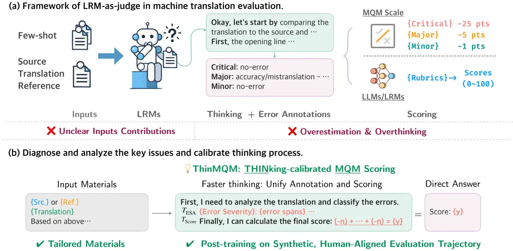
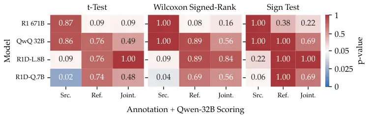

# Are Large Reasoning Models Good Translation Evaluators? Analysis and Performance Boost

Runzhe Zhan    Zhihong Huang    Xinyi Yang    Lidia S. Chao    Min
Yang    Derek F. Wong ^(†)^(†)thanks: Corresponding author.
Email: [nlp2ct.{runzhe,zhihong,xinyi}@gmail.commin.yang@siat.ac.cn,{derekfw,lidiasc}@um.edu.mo](mailto:)
Affiliation: NLPCT Lab, Department of Computer and Information Science,
University of Macau Affiliation: Shenzhen Institute of Advanced
Technology, Chinese Academy of Sciences

###### Abstract

Recent advancements in large reasoning models (LRMs) have introduced an
intermediate “thinking” process prior to generating final answers,
improving their reasoning capabilities on complex downstream tasks.
However, the potential of LRMs as evaluators for machine translation
(MT) quality remains underexplored. We provides the first systematic
analysis of LRM-as-a-judge in MT evaluation. We identify key challenges,
revealing LRMs require tailored evaluation materials, tend to
“overthink” simpler instances and have issues with scoring mechanisms
leading to overestimation. To address these, we propose to calibrate LRM
thinking by training them on synthetic, human-like thinking
trajectories. Our experiments on WMT24 Metrics benchmarks demonstrate
that this approach largely reduces thinking budgets by $`\sim`$35x while
concurrently improving evaluation performance across different LRM
scales from 7B to 32B (e.g., R1-Distill-Qwen-7B achieves a +8.7
correlation point improvement). These findings highlight the potential
of efficiently calibrated LRMs to advance fine-grained automatic MT
evaluation.

Code:  [ThinMQM](https://github.com/NLP2CT/ThinMQM)    Models:  [ThinMQM
Models](https://huggingface.co/collections/rzzhan/thinmqm-68da7cf39ee4cebdbd9f14f1)

## 1 Introduction

The development of reliable automated metrics that accurately mimic
human judgments of translation quality is vital for advancing machine
translation (MT) models \[1, 2, 3, 4, 5\]. However, modeling the
comprehensive and complex “evaluation process” inherent in human
assessment is challenging. Previous research has explored various
paradigms to capture this process, from deterministic rule-based metrics
\[6, 7\] and embedding-space similarities \[8\] to end-to-end neural
networks \[9, 10\]. More recently, the rise of large language models
(LLMs) as a judge \[11, 12\] has marked a substantial leap forward. LLMs
provide a convenient mechanism for customizing the evaluation process
through both natural language, marking a significant advancement in
evaluation methodology \[13, 14, 15\].

Despite these advancements, assessing translation quality is rarely a
simple “0-1” binary matching task. It often requires a deliberate,
analytical cognitive effort, which is akin to “System 2” thinking
\[16\], even for human annotators \[17\]. This suggests that emerging
large reasoning models (LRMs) \[18\], which enhance reasoning
capabilities by generating intermediate “thoughts” before producing
final solutions, similar to human reflective thinking, may offer a
stronger foundation for modeling the complex process of MT evaluation.
While LRMs have often demonstrated remarkable performance boosts in
solving mathematical and scientific challenges \[19, 20\], their
potential as judges, i.e., LRM-as-a-judge in the specific context of MT
evaluation remains largely unexplored.

To provide a comprehensive understanding and practical insights into the
application of LRM-as-a-judge for MT evaluation, this paper is the first
to systematically address the following key questions: 1) How do current
LRMs perform in MT evaluation tasks when compared to human judgments? 2)
What are the specific failure modes or inefficiencies encountered when
applying LRMs to MT evaluation? 3) How can we develop an efficient and
effective alignment strategy to tailor LRMs specifically for MT
evaluation?

To this end, we employ LRMs in MT evaluation under the multidimensional
quality metrics (MQM) framework \[21, 22\], following previous
state-of-the-art LLM-as-a-judge design principles \[13, 14\]. We then
perform a meta-evaluation and analysis across a wide range of model
series and sizes, including DeepSeek-R1 671B \[19\], QwQ 32B \[23\], and
R1-Distilled models \[19\]. Through careful examination of critical
factors in designing LRM-as-a-judge, our findings reveal several key
insights. We observe a disagreement between LLMs and LRMs in their
perception of evaluation materials, with strong LRMs benefiting more
significantly from alignment with human-like evaluation protocols. Our
results also suggest a need to rethink the design of multi-stage scoring
mechanisms, as there are pitfalls related to overestimation problems and
ambiguous contributions from auxiliary scoring models. Moreover,
concerning thinking behaviors, we reveal that LRMs are not always
efficient in allocating their thinking budget and tend towards
“overthinking” for easier evaluation instances.

Furthermore, based on these findings, we propose a simple yet effective
method to steer LRM perform Thinking-calibrated MQM (ThinMQM) scoring by
training them on synthetic evaluation trajectories designed to mimic
human-like scoring rubrics. Experimental results on the most recent
WMT24 Metrics benchmarks \[24, 25\] show that this method can largely
reduce thinking budgets by approximately $`\sim`$35x while improving the
evaluation performance of LRMs at different model scales (notably,
R1-Distill-Qwen-7B achieves a +8.7 correlation point improvement), as
shown in Figure 1. Follow-up analysis reveals that such trajectory
steering calibrates the scoring distribution and reduces the
overestimation problem. These results align with our analysis, revealing
substantial potential in developing LRM-as-a-judge for MT evaluation,
yet highlight the necessity of controlling thinking budgets and
performing careful calibration to fully realize this promise.

(a) Comparison of model sizes.

(b) Comparison of thinking budget of LRMs.

Figure 1: Performance comparison of various evaluation models on WMT24
metrics tasks. The ThinMQM models (Ours) achieve strong performance with
competitive efficiency. “S, R, J” denote different evaluation inputs:
Source-only, Reference-based, and Joint evaluation materials,
respectively.

## 2 Preliminaries

### 2.1 Paradigms in Machine Translation Evaluation

Formally, traditional automatic evaluation metrics for machine
translation can be abstractly defined as a mapping $`m`$ from a set of
input materials $`X`$ to an output score $`y`$. The metric $`m`$ may
take the form of a rule-based text matching algorithm \[6, 7, 26, 27\]
or a parameterized model \[8, 9, 28, 29, 10\]. Typically, the input set
$`X`$, i.e., the materials required for machine translation evaluation,
comprises three elements: the machine translation hypothesis $`h`$, the
reference translation $`r`$, and the source text $`s`$ in the original
language. Evaluation is generally based on combinations of these
elements, falling into two main categories: reference-based and
reference-free. In the reference-based setting, the model hypothesis is
compared directly with the reference translation (Ref.), i.e.,
$`X_{\mathrm{Ref.}}={(h,r)}`$. In the reference-free setting, evaluation
is performed by comparing the hypothesis with the source text (Src.),
i.e., $`X_{\mathrm{Src.}}={(h,s)}`$. Additionally, it is also possible
to use all three components jointly (Jonit.), i.e.,
$`X_{\mathrm{Joint.}}={(h,s,r)}`$, for scoring. In contrast, the
emerging LLM-as-a-judge paradigm does not strictly conform to an
end-to-end $`X\to y`$ paradigm, as it is not a parameterized regression
model but rather a generative language model. Although such models can
provide more detailed output information, such as explanations for the
given scores, in most cases the desired score $`y`$ must be extracted
post hoc from the model outputs using rule-based extractor or auxiliary
scoring models.

### 2.2 MQM Framework and Related Work

Even we can list all the possible combinations of evaluation materials,
modeling detailed scoring process remains a challenge. Earlier automated
metrics focused on providing a single score value \[6, 30\], but they
lacked consideration or transparency in aligning with human evaluation
process, especially for neural metrics. Previous practices in collecting
human annotations centered around direct assessment scores \[31, 32\],
neglecting to establish a fine-grained, unified framework for score
annotation. MQM is a professional scoring framework for translation
quality assessment, designed to guide multi-dimensional evaluation of
translations, including aspects such as fluency, terminology, and style
\[17, 22\]. Typically, human annotators perform error span annotations,
assign severity levels (e.g., major or minor), and finally, the score is
aggregated by certain severity weights. In most cases, a major error
incurs a penalty of -5 points, while a minor error results in a
deduction of -1 point (or -0.1 for fluency errors). Critical errors,
such as non-translation, are generally penalized by -25 points. The
total score for an instance is computed by aggregating the penalties of
all identified errors.

To develop more fine-grained machine translation evaluation metrics,
recent research has focused on constructing automated methods aligned
with MQM scoring. This has emerged as the primary evaluation task in the
recent WMT leaderboard \[33, 25\]. The end-to-end approach \[34, 9, 35,
29\] essentially constructed upon pre-trained language models by
finetuning on MQM scoring data. The LLM-as-judge approach to perform MQM
scoring largely mirrors human annotation procedures: first, the model is
instructed with MQM guidelines, and then it either extracts error span
annotations to compute a score, or directly outputs a quality score.
Currently, one of the most widely adopted and effective methods is the
GEMBA series \[13, 14\] based on prompting GPT models. Its GEMBA-MQM
variant further leverages in-context learning (ICL) \[36, 37\] by using
three-shot demonstrations to assist in the evaluation process. We adapt
it to LRM scope and conduct analysis in this paper.



Figure 2: Overview of our research framework. (a) We decompose the
general LRMs-as-judge pipeline for MT evaluation and identify key
issues. (b) Guided by analytical findings, we propose ThinMQM, which
establishes a more effective reasoning process.

## 3 Understanding LRM Behaviors in MT Evaluation

Figure 2 illustrates our research framework. In this section, we aim to
address the first two research questions: how well LRM performs in MT
evaluation and what failures occur in the practice.

### 3.1 Experimental Setup

#### Methodology

As introduced earlier, following the successful SOTA practice in LLMs,
we replicate GEMBA-MQM methodology on LRM as the basis for our analysis.
We first instruct the LRM to annotate error spans in the translation
according to the MQM framework, categorizing them into critical, major,
and minor errors. Based on these error spans, we then apply a rule-based
scoring mechanism to compute the final score for each translation. The
penalty scheme for each type of error follows the approach described in
Section 2.2.

Building on this, we conduct experiments with all possible input
material combinations
$`X_{\mathrm{Src.}\vee\mathrm{Ref.}\vee\mathrm{Joint.}}`$ to investigate
the influence of evaluation materials in Section 3.2. Meanwhile, the
demonstrations used in ICL follow the same format as those in the
GEMBA-MQM. It is worth noting that, since the MQM variant in the GEMBA
series is reference-free, for reference-based setups (i.e., Ref. and
Joint.), we supplement the demonstrations with reference information and
adjust the prompt templates accordingly. Detailed prompts are provided
in the Appendix C.2. We report the main results based on rule-based
scoring mechanism and will discuss alternative model-based scoring
methods (the logic is the same as the ESA prompting variant of GEMBA) in
Section 3.3.

#### Models Setups

We employ several mainstream LRM models across different sizes and
architectures, including Deepseek-R1 671B, QwQ 32B, as well as distilled
variants of R1 trained via knowledge distillation: R1-Distill-LLaMA 8B
and R1-Distill-Qwen 7B. These models have demonstrated strong
performance on complex reasoning tasks. Due to computational
constraints, we are unable to deploy the open-source version of the R1
model locally and instead access it via API for experiments. All other
models are deployed using the vLLM framework ¹¹ 1
[https://github.com/vllm-project/vllm](https://github.com/vllm-project/vllm).
The decoding parameters are set as follows: temperature is set to
$`0.6`$, top*(p) and top*(k) is set to $`0.95`$, $`20`$. Our selection
of DeepSeek-R1 is driven by its transparency of reasoning trajectories.
In contrast, other frontier models, such as o3 and Gemini-2.5 Pro, do
not expose their internal reasoning processes. This limitation makes
them unsuitable for fair and fine-grained analysis. Nevertheless, we
report the evaluation performance of Gemini-2.5 Pro in Section 4.2, but
exclude it from the analytical sections.

#### Data

We chose the WMT24 Metrics Shared Task \[24\] for our evaluation data in
order to prevent potential issues with data contamination \[38, 39,
40\]. We confirmed that the release date for the WMT24 MQM data is after
the knowledge cutoff for the models aforementioned. This task involves
assessing the correlation between the evaluation models’ scores and the
human expert MQM scores, both at the system and segment levels. The
WMT24 Metrics task includes three language pairs: English-German
(En-De), English-Spanish (En-Es), and Japanese-Chinese (Ja-Zh), with
around 20 machine translation systems for each pair.

#### Meta-Evaluation Metrics

We used the same meta-evaluation settings as WMT24 official, focusing on
key metrics such as system-level soft pairwise accuracy \[41\] (SPA) and
tie-calibrated segment-level pairwise accuracy \[42\]
($`Acc_{eq}^{*}`$). Specfically, for SPA, it can be formally expressed
as:

```math
SPA=\binom{N}{2}^{-1}\sum_{i=0}^{N-1}\sum_{j=i+1}^{N-1}\left(1-\left|p^{h}_{ij}-p^{m}_{ij}\right|\right) \tag{1}
```

where $`N`$ is the number of systems. $`p^{h}_{ij}`$ is the $`p`$-value
that system $`i`$ is better than system $`j`$ based on human judgments,
and $`p^{m}_{ij}`$ is the same based on metric scores.
$`\binom{N}{2}^{-1}`$ normalizes over all pairs. Higher values of these
metrics indicates stronger agreement between human and metric rankings.
We used the MTME²² 2
[https://github.com/google-research/mt-metrics-eval](https://github.com/google-research/mt-metrics-eval)
to maintain consistency with the official calculations. We also report
permutation-based significance testing with 1,000 resampling times
\[42\] in comparison experiments.

### 3.2 Impact of Evaluation Materials

#### Contribution Quantification

In MT evaluation, since the translation hypothesis $`h`$ is present in
all evaluation scenarios, it is necessary to assess the impact of source
and reference information on evaluation performance. While it is
feasible to enumerate and experiment with all combinations of evaluation
materials, denoted as
$`X_{\mathrm{Src.}\vee\mathrm{Ref.}\vee\mathrm{Joint.}}`$,
quantitatively isolating the contribution of each component remains
challenging due to the overlapping presence of source and reference
across multiple evaluation settings. To address this, we adopt the
Shapley Value \[43\] as a principled measure to quantify the individual
contributions of source and reference information to evaluation outcomes
across different models and evaluation settings.

Formally, the Shapley Value of the source information $`\phi_{s}`$ is
defined as:

```math
\phi_{s}=\sum_{s^{\prime}\subseteq N\setminus\{s\}}\frac{|s{{}^{\prime}}|!(|N|-|s{{}^{\prime}}|-1)!\cdot(v(s{{}^{\prime}}\cup\{s\})-v(s{{}^{\prime}}))}{|N|!} \tag{2}
```

where $`N=\{s,r\}`$ denotes the set of all materials that may affect
evaluation (source $`s`$ and reference $`r`$). The translation
hypothesis $`h`$ is always present and thus not part of the
combinatorial set. The function $`v(\cdot)`$ represents the evaluation
performance under a specific evaluation setting, which we quantify using
system-level and segment-level metrics. The set $`s^{\prime}`$ refers to
all subsets of $`N`$ excluding $`s`$, i.e., $`\{\emptyset,{r}\}`$. In
particular, the case $`\emptyset`$ corresponds to an evaluation setting
with neither source nor reference (i.e., translation-only). $`v(h)`$ is
a invalid value as translation-only is not a valid input, thus we only
approximate it using an available configuration, namely $`v(\{h,r\})`$,
to estimate $`v(h)`$. Therefore, taking into account the practical
constraints of machine translation evaluation, we refer the approximated
Shapley Value here as $`\phi_{s}^{\text{MT}}`$ in order to distinguish
from the strict definition in Eq.2. The calculation of
$`\phi_{r}^{\text{MT}}`$ follows analogously.

(a) Source contribution.

(b) Reference contribution.

Figure 3: Shapley value analysis of input contributions of evaluation
materials at different evaluation granularities. “R1D-L./Q.” refers to
the R1-Distill-Llama/-Qwen models.

#### Results and Discussion

|                     |          |                  |          |                  |         |                  |         |                  |          |
| ------------------- | -------- | ---------------- | -------- | ---------------- | ------- | ---------------- | ------- | ---------------- | -------- |
|                     | En-De    |                  | En-Es    |                  | Ja-Zh   |                  | Avg.    |                  |          |
| Materials           | SPA (%)  | $`Acc^{*}_{eq}`$ | SPA (%)  | $`Acc^{*}_{eq}`$ | SPA (%) | $`Acc^{*}_{eq}`$ | SPA (%) | $`Acc^{*}_{eq}`$ | All      |
| Deepseek-R1 671B    |          |                  |          |                  |         |                  |         |                  |          |
| Src.                | 82.1     | 47.4^(†)         | 77.8     | 68.0             | 90.4    | 46.8^(†)         | 83.4    | 54.1             | 68.8^(†) |
| Ref.                | 80.4     | 43.0             | 67.3     | 68.0             | 88.6    | 43.6             | 78.8    | 51.5             | 65.2     |
| Joint.              | 82.4     | 46.6             | 75.6     | 68.0             | 91.1    | 44.0             | 83.0    | 52.9             | 68.0     |
| QwQ 32B             |          |                  |          |                  |         |                  |         |                  |          |
| Src.                | 79.8     | 46.8^(†)         | 76.1^(†) | 68.0             | 91.9    | 46.9^(†)         | 82.6    | 53.9             | 68.3^(†) |
| Ref.                | 84.2     | 42.9             | 68.7     | 68.0             | 94.3    | 43.5             | 82.4    | 51.5             | 66.9     |
| Joint.              | 81.7     | 44.2             | 72.2     | 68.0             | 92.5    | 44.3             | 82.1    | 52.2             | 67.2     |
| R1-Distill-Llama 8B |          |                  |          |                  |         |                  |         |                  |          |
| Src.                | 72.3     | 42.9             | 65.9     | 68.0             | 74.2    | 43.5             | 70.8    | 51.5             | 61.1     |
| Ref.                | 71.8     | 42.9             | 78.5^(†) | 68.0             | 84.7    | 43.5             | 78.3    | 51.5             | 64.9^(†) |
| Joint.              | 72.9     | 42.9             | 65.1     | 68.0             | 78.7    | 43.5             | 72.2    | 51.5             | 61.9     |
| R1-Distill-Qwen 7B  |          |                  |          |                  |         |                  |         |                  |          |
| Src.                | 52.6     | 42.9             | 53.9     | 68.0             | 68.3    | 43.5             | 58.3    | 51.5             | 54.9     |
| Ref.                | 67.3^(†) | 42.9             | 61.0     | 68.0             | 83.8    | 43.5             | 70.7    | 51.5             | 61.1     |
| Joint.              | 58.4     | 42.9             | 57.0     | 68.0             | 86.1    | 43.5             | 67.2    | 51.5             | 59.3     |

Table 1: Comparison of different evaluation material setups. The highest
value in each model is bolded, and $`\dagger`$ indicates results that
are significantly better ($`p<0.05`$) based on permutation tests.

The results presented in Table 1 along with the significance tests,
intuitively suggest that using either source or reference information as
evaluation materials represents the most effective choice for LRM-based
evaluation. However, this observation is contingent on model scale. The
illustrative results shown in Figure 3, derived from Shapley Value
$`\phi^{\text{MT}}`$ analysis, reveal a pattern: for smaller-scale LRMs
(7/8B), source information is detrimental to evaluation quality, whereas
reference information contributes positively. This trend is reversed in
larger LRMs, such as QwQ 32B and R1 671B, where source information
becomes beneficial and reference information less so.

Previous work \[44\] on the LLM-as-a-judge observed that LLMs tend to
become “lost in source” during MT evaluation, regardless of model size.
However, our findings suggest that this phenomenon may not generalize to
the LRM-as-a-judge setting. This distinction is plausible, given that
LRMs typically have stronger reasoning capabilities on complex tasks
\[45, 19, 20\] compared to general-purpose LLMs. Earlier LLMs may have
lacked the capacity to effectively model the cross-lingual relationships
between source and translation.

As for the observed adverse impact of reference information on LRM-based
evaluation, we hypothesize two possible factors. First, MQM human
annotations are inherently reference-free, focusing solely on the source
and translation without relying on references. Second, the quality of
the reference itself significantly affects the correlation of automatic
metrics with human judgment, as prior work \[46, 33\] has pointed out,
“BLEU (or Metrics) might be guilty, but reference not innocent”. These
findings highlight the need for scale-aware design evaluation setups:
the choice of evaluation materials should be informed by the
capabilities and limitations of the model size in question.

### 3.3 Pitfalls of Scoring Mechanisms

#### Dilemma in Post-Scoring

| Model           | Src.  | Joint. | Ref.  | Avg. $`\Delta`$ |
| --------------- | ----- | ------ | ----- | --------------- |
| R1 671B         | +0.60 | +0.60  | -0.50 | +0.23           |
| QwQ 32B         | +0.20 | +0.50  | +0.30 | +0.33           |
| R1D-L.8B        | -1.20 | -0.20  | -0.80 | -0.73           |
| R1D-Q.7B        | -0.10 | -0.30  | -1.10 | -0.50           |
| Avg. $`\Delta`$ | -0.13 | +0.15  | -0.53 | –               |

Table 2: Effect of changing the rule-based scoring weights on average
correlation Avg. $`\Delta`$ ($`Acc^{*}_{eq}`$., SPA) metrics.



Figure 4: Significance testing of the contribution of the auxiliary
scoring model (Qwen-2.5 32B). Test results ($`p<0.05`$) are highlighted
in distinct colors and scales.

Since LRM-based evaluators generate descriptive outputs in an
autoregressive manner, an additional critical factor influencing scoring
is how error spans are extracted and scored. In this work, we consider
two commonly adopted paradigms: rule-based and model-based re-scoring.
The rule-based scoring introduced before aggregate scores under MQM
standard, offering transparency. In contrast, the model-based scoring
paradigm allows for an additional stage of reflection but lacks
transparency. Naturally, for a rule-based scorer, the robustness to rule
changes is worth noticing. Furthermore, when auxiliary models are used
for scoring, it becomes difficult to disentangle whether observed
improvements stem from the LRM or auxiliary scorer.

We first investigate using the LRM itself to score error spans annotated
via the GEMBA-ESA protocol. The results show no improvement over the
rule-based scorer; in fact, we observe a slight performance drop (e.g.,
QwQ 32B yields a mean performance 68.3 $`\rightarrow`$ 68.1), along with
significantly higher inference costs. Next, we employ an auxiliary model
(Qwen-2.5 32B) to perform the same scoring procedure. In this setting,
we find that the meta-evaluation results of LRM closely align with the
that of the auxiliary model itself. This raises a critical question: are
the observed gains attributable to the LRM outputs, or simply to the
auxiliary model? To address this, we conduct statistical significance
testing and in-depth comparison of score distributions.

#### Results and Discussions

To answer above question, we perform significance testing between the
scores produced by the “LRM + auxilary” setup and those from the
auxiliary model alone. The results in Figure 4 demonstrate that the
re-scoring process using an external model fails to provide clear
attribution regarding the source of evaluation performance. This finding
highlights the need to either enhance the scoring capabilities of the
original LRM or adopt transparent, rule-based extraction and scoring
mechanisms. Figure 5 further compares the distributions of two scoring
paradigms.

Figure 5: Distribution of evaluation scores across different scoring
paradigms.

The results reveal a persistent overestimation issue in model-based
evaluation. The instances that human annotators consider error-free are
still judged as erroneous by the LRM. This indirectly confirms that the
improvements brought by auxiliary models do not fundamentally resolve
the shortcomings of LRM-based scoring and are insufficient to mitigate
the overestimation problem, requiring for a more human-centric
evaluation process that mirrors human judgment rules for better
correlations.

Another remaining concern with a rule-based scorer is how sensitive the
results are to the choice of scoring scheme. To study this, we conducted
an experiment using an alternative severity weighting scheme (i.e.,
-3/-2/-1). Table 2 reports the average change $`\Delta`$ across all
correlation metrics. We observe that although adjusting the weights does
slightly shift the absolute correlation values, the differences are
modest. A likely explanation is that meta-evaluation metrics are
primarily sensitive to the rank order of segments. As long as the
ordinal structure of the penalties is preserved, the rankings remain
relatively stable, supporting the robustness of the rule-based scoring
approach.

### 3.4 “Overthinking” Process: When More is Not Better

Figure 6: Analysis of thinking budget attribution across model scale and
evaluation difficulty. Appendix B.4 includes all the results under
different settings.

Figure 7: Comparison between LRM and its corresponding LLM.

#### Thinking Budgets

LRMs typically benefit from scaling test-time thinking budget.
Intuitively, we investigate whether such scaling is both effective and
efficient in MT evaluation. We quantify the thinking budget along two
dimensions: 1) the number of tokens generated during the reasoning
process, and 2) the number of reasoning turns³³ 3 Empirically, we
observe that these LRMs use output delimiter across reasoning turns..
Additionally, since two of the used LRMs also have corresponding
general-purpose LLMs, we also examine their performance to assess
whether LRM post-training contributes to improved performance⁴⁴ 4 We
exclude R1-Distill-Qwen 7B from this comparison, as its original model
is not general-purpose LLM..

#### Results and Discussions

The results in Figure 6(a) show that reasoning cost is not necessarily
tied to model size. For example, QwQ, despite not being the most
powerful LRM-as-a-judge model, incurs the highest reasoning cost.

Moreover, the thinking budget is also unrelated to instance difficulty.
As shown in Figure 6(b), median thinking tokens remain stable across
difficulty levels. An exception appears at the extremes of evaluation
difficulty, where human scores are either very high or very low. The
correctly aligned (i.e., model scores consistent with human judgment)
predictions require more effort, while misaligned ones are cheaper. This
is the only case where the thinking budget shows a hint of rational
allocation.

On the other hand, we compute meta-evaluation metrics across different
languages and evaluation levels, comparing LRMs with their corresponding
general-purpose LLMs. Statistical significance testing is used to
categorize outcomes as wins, ties, or losses, shown in Figure 7. “Tie”
is considered as failed significance test. The results show that LRMs
underperform in nearly half of the evaluation settings, indicating that
current general-purpose LRMs, despite their “slow-thinking” process,
still struggle to consistently enhance evaluation performance.

## 4 Improving LRM via Human-Aligned Thinking Trajectory

### 4.1 Methodology

#### Motivations

Our analysis reveals that standard practices of LLMs in MT evaluation
are not universally optimal for LRMs. The unconstrained “thinking”
processes within LRMs can be inefficient and may lead to overestimated
score. Key insights derived from this analysis include: 1)
Reference-free evaluation is preferable for strong LRMs, while
reference-based evaluation remains suitable for weaker LRMs. 2) Aligning
the LRM’s reasoning process with specific scoring rubrics is crucial. 3)
Extensive budget allocated to LRM “thinking” do not consistently improve
performance.

#### ThinMQM

Drawing from previous observations, we introduce Thinking-calibrated MQM
(ThinMQM) scoring method, a methodology designed to adapt LRMs to
emulate human evaluation process. The core idea is intuitive: generating
synthetic data that mirrors the human MQM workflow, thereby calibrating
and aligning the LRM’s internal thinking process with the pipeline of
human evaluation.

Given human MQM annotations which consist of error spans
$`E=\{e_{1},e_{2},\dots,e_{n}\}`$ and their associated severity levels
$`L=\{l_{1},l_{2},\dots,l_{n}\}`$, we aim to model the human two-phase
evaluation process. This process involves an initial error span
annotation (ESA) stage, $`T_{\mathrm{ESA}}:X\rightarrow(E,S)`$, followed
by a scoring stage based on a rubric,
$`T_{\mathrm{score}}:(E,S)\rightarrow\text{Score}_{MQM}`$. We transform
this sequence into a concise yet effective structured thinking chain,
intended to serve as a proxy for human annotation steps. The resulting
synthesized data,
$`\mathcal{D}_{\mathrm{synth}}=\{(X_{\mathrm{Src.\vee Ref.}},[T_{\mathrm{ESA}}(X),T_{\mathrm{score}}(T_{\mathrm{ESA}}(X))]\}`$,
adheres to the structure shown in Figure 2 (b). The LRM, denoted by
$`M_{\theta}`$, would be post-trained on the dataset
$`\mathcal{D}_{\mathrm{synth}}`$, with parameters $`\theta`$ producing
the output sequences. The fine-tuning process seeks to update $`\theta`$
to $`\theta^{\prime}`$ by minimizing the cross-entropy loss function
$`\mathcal{L}_{\mathrm{CE}}`$ over all instances in
$`\mathcal{D}_{\mathrm{synth}}`$:

```math
\theta^{\prime}\leftarrow\arg\min_{\theta}\sum_{\mathcal{D}_{\mathrm{synth}}}\mathcal{L}_{\mathrm{CE}}(M(X_{\mathrm{Src.\vee Ref.}};\theta),[T_{\mathrm{ESA}}(X),T_{\mathrm{score}}(T_{\mathrm{ESA}}(X))]) \tag{3}
```

### 4.2 Experiments

#### Data

We synthesized ThinMQM training data based on the human-annotated MQM
dataset from WMT23, which includes two evaluation tasks: English–German
and Chinese-English. Synthetic data instances were constructed based on
the methodology described above and the prompt templates detailed in
Appendix C.4. Due to an imbalance distribution across the two language
pairs, we downsampled the larger set to ensure balanced training data.
The final dataset consists of approximately 5,980 instances per language
pair, yielding a total of 11,960 training instances.

|                       | Avg.         | En-De         |                  | En-Es         |                  | Ja-Zh        |                  |
| --------------------- | ------------ | ------------- | ---------------- | ------------- | ---------------- | ------------ | ---------------- |
| Metric/Model          | All          | SPA (%)       | $`Acc^{*}_{eq}`$ | SPA (%)       | $`Acc^{*}_{eq}`$ | SPA (%)      | $`Acc^{*}_{eq}`$ |
| BLEU \[6\]            | 58.9         | 73.7          | 43.1             | 51.4          | 68.0             | 73.6         | 43.5             |
| COMET-22 \[9\]        | 68.9         | 87.9          | 48.2             | 77.9          | 68.3             | 81.4         | 49.6             |
| xCOMET \[10\]         | 71.9         | 90.6          | 53.0^(†)         | 78.9          | 68.8             | 88.9         | 51.0             |
| GEMBA-ESA \[13\]      | 71.1         | 79.1          | 50.7             | 84.0          | 68.3             | 90.8         | 53.9             |
| Gemini-2.5-Pro \[47\] | 71.0         | 82.3          | 51.2             | 76.9          | 68.0             | 94.8         | 53.1             |
| Deepseek-R1 \[19\]    | 68.8         | 82.1          | 47.4             | 77.8          | 68.0             | 90.4         | 46.8             |
| QwQ 32B               | 68.3         | 79.8          | 46.8             | 76.1          | 68.0             | 91.9         | 46.9             |
| + ThinMQM             | 72.2\_(+3.9) | 83.2\_(+3.4)  | 52.5\_(+5.7)     | 80.7\_(+4.6)  | 69.2^(†)\_(+1.2) | 91.3\_(-0.6) | 56.1^(†)\_(+9.2) |
| R1-Distill-Llama-8B   | 64.9         | 71.8          | 42.9             | 78.5          | 68.0             | 84.7         | 43.5             |
| + ThinMQM             | 70.8\_(+5.9) | 85.5\_(+13.7) | 48.6\_(+5.7)     | 81.3\_(+2.8)  | 68.2\_(+0.2)     | 90.5\_(+5.8) | 51.0\_(+7.5)     |
| R1-Distill-Qwen-7B    | 61.1         | 67.3          | 42.9             | 61.0          | 68.0             | 83.8         | 43.5             |
| + ThinMQM             | 69.8\_(+8.7) | 84.5\_(+17.2) | 48.5\_(+5.6)     | 77.8\_(+16.8) | 68.0\_(+0.0)     | 89.0\_(+5.2) | 51.3\_(+7.8)     |

Table 3: Performance comparison of different models. The highest value
is bolded, and the second-best is underlined. $`\dagger`$ denotes
significantly better ($`p<0.05`$) results based on permutation tests.

#### Model and Setups

To verify the effectiveness of ThinMQM on various model sizes, we
fine-tune 7B, 8B, and 32B models. Based on earlier analysis, we adopt a
reference-based evaluation setup (Ref.) for the 7B and 8B models in both
training and inference, while the 32B model employed a reference-free
setup (Src.). All models are fine-tuned for $`4`$ epochs with a learning
rate of $`1e-5`$, and the total batch size is $`32`$. Other training
hyper-parameters are detailed in Appendix C.1.

#### Main Results

The results in Table 3 clearly demonstrate that post-training
calibration with ThinMQM significantly improves LRM performance under
the same evaluation setups. Specifically, the 7B model shows gains of up
to +8.7 points in meta-evaluation metrics, while the 32B model achieves
a +3.9 points improvement, reaching performance comparable to
state-of-the-art metrics such as xCOMET, despite those relying on
training on large-scale MQM data and have different model architectures.
Notably, within the LLM/LRM evaluation paradigm, our ThinMQM-32B model
achieves superior average performance compared to the baselines, though
not necessarily on every individual language pair.

### 4.3 Analysis

Figure 8: Comparison of scoring distributions between ThinMQM and
QwQ-32B.

Figure 9: Distribution of ThinMQM-32B–human judgment discrepancies
across MQM error types.

#### Scoring Distribution

As shown in Figure 9, the primary reason behind the improvement brought
by ThinMQM lies in the calibrated scoring distribution⁵⁵ 5 Please refer
to Appendix B.1 for detailed language-specific distributions due to
space limitation.. Specifically, ThinMQM effectively mitigates the
overestimation problem, aligning the model predicted scores more closely
with the human MQM distribution, particularly in cases with non-error
cases. This finding echoes the earlier observations in Figure 5,
indicating that the performance gains from ThinMQM are both meaningful
and justified.

#### Error Typology

To analyze cases where ThinMQM-32B diverges from human judgments, we
categorize these discrepancies according to the MQM translation error
taxonomy (Critical, Major, Minor), as shown in Figure 9. The analysis
shows that the largest misalignment arises from Minor-level errors.
Moreover, within the Minor category, accuracy/mistranslation accounts
for the highest proportion of discrepancies, highlighting areas where
future improvements should be targeted.

#### Efficiency

As illustrated in Figure 1 (b), ThinMQM reduced the unnecessary thinking
budget while maintaining high evaluation performance. This indicates
that post-training alignment not only improves effectiveness but also
enhances efficiency. In practice, This represents a substantial decrease
in the computational cost of LRM-based translation evaluation. For
example, when evaluating English–German translations with QwQ 32B under
the vLLM framework using four A100 GPUs, inference time is reduced from
12 minutes per 1,000 examples to 40 seconds on average.

### 4.4 Ablation Study

|             |              |              |                  |              |                  |              |                  |
| ----------- | ------------ | ------------ | ---------------- | ------------ | ---------------- | ------------ | ---------------- |
|             | Avg.         | En-De        |                  | En-Es        |                  | Ja-Zh        |                  |
| Model       | All          | SPA (%)      | $`Acc^{*}_{eq}`$ | SPA (%)      | $`Acc^{*}_{eq}`$ | SPA (%)      | $`Acc^{*}_{eq}`$ |
| ThinMQM 32B | 72.0\_(.003) | 80.7\_(.026) | 53.1\_(.006)     | 80.8\_(.002) | 68.9\_(.002)     | 92.5\_(.011) | 55.9\_(.002)     |
| ThinMQM 8B  | 70.4\_(.004) | 83.1\_(.021) | 48.6\_(.003)     | 81.3\_(.020) | 68.2\_(.001)     | 90.3\_(.013) | 51.0\_(.001)     |
| ThinMQM 7B  | 70.0\_(.002) | 85.4\_(.011) | 48.2\_(.004)     | 77.6\_(.002) | 68.1\_(.001)     | 89.3\_(.004) | 51.4\_(.003)     |

Table 4: Multi-run evaluation of ThinMQM at temperature 0.6. Each score
is presented as $`{\mathrm{Mean}}_{\mathrm{Std.}}`$ over 3 independent
runs.

| Model       | Sys. $`\rho`$ | Seg. $`\tau`$ |
| ----------- | ------------- | ------------- |
| XCOMET-XXL  | 62.5          | 47.8          |
| ThinMQM 32B | 63.4          | 57.4          |
| ThinMQM 7B  | 51.3          | 49.1          |
| ThinMQM 8B  | 50.3          | 47.5          |

Table 5: Performance comparison in Hindi-Chinese MQM.

#### Stability

Figure 10: Performance of different models under varying temperature
setups.

Figure 10 demonstrates that ThinMQM is robust to test-time
hyperparameter choices. We evaluate performance under various decoding
settings and compare meta-metrics’ scores. For example, QwQ-32B’s
system-level evaluation is sensitive under greedy decoding, whereas
ThinMQM remains stable, nit with only a drop at the segment level. To
further verify stability, we conduct three runs at a fixed temperature
of 0.6. As shown in Table 4, the low standard deviation confirms that
ThinMQM’s performance is consistent and not subject to significant
random fluctuations. Overall, these results validate our chosen decoding
configuration as a broadly robust setup for LRM-based evaluation.

#### Generalization

To perform a more stringent out-of-distribution test on a low-resource
language pair, we sourced a recently released Hindi-Chinese dataset with
MQM annotations \[48\], which was published after our LRMs’ knowledge
cutoff date. Since this dataset contains translations from fewer than
four systems, we use system-level Pearson $`\rho`$ and Kendall
correlation $`\tau`$ as meta-evaluation metrics. As shown in Table 5,
ThinMQM demonstrates generalization capabilities under low-resource
scenarios, outperforming the xCOMET-XXL baseline.

#### Prompting Templates

Figure 11: Comparison of ThinMQM with baselines using paraphrased
prompts.

To further strengthen the comparison between our proposed ThinMQM and
alternative baseline prompting templates, we used GPT-4o to paraphrase
our GEMBA-MQM prompt and generated three additional variants, which we
denote as P1-P3. Figure 11 (details in Section B.3) shows that ThinMQM
consistently maintains a performance advantage across model sizes.
Besides, additional interesting observations emerge from these results.
For LRM baselines, large models (32B) are relatively insensitive to
prompt variation, exhibiting only minimal differences in performance. In
contrast, smaller models (7-8B) are more sensitive to prompts. However,
the resulting fluctuations are limited and still do not surpass the
ThinMQM.

## 5 Conclusions

In this paper, we presented a systematic investigation into
LRM-as-a-judge for machine translation evaluation, exploring their
capacity to model the process of MQM assessment task. Our analysis
across various LRMs revealed that there is a need to tailor evaluation
materials for evaluation and they “overthink” simple instances,
exhibiting overestimation biases. To address this, we introduced a
simple yet effective method of calibrating LRM thinking by training them
on synthetic, human-like MQM evaluation trajectories. This approach
substantially reduced thinking budgets while improving evaluation
performance on WMT24 Metrics benchmarks, primarily by calibrating
scoring distributions and reducing overestimation. Our findings
demonstrate the potential of LRMs for MT evaluation but highlight the
critical need for controlled thinking and careful calibration to realize
their full potential in translation evaluation, paving the way for
future advancements in developing better LRM-as-a-judge in MT
evaluation. Future work will extend evaluation to more diverse
languages.

## Acknowledgments

This work was supported in part by the Science and Technology
Development Fund of Macau SAR (Grant No. FDCT/0070/2022/AMJ, China
Strategic Scientific and Technological Innovation Cooperation Project
Grant No. 2022YFE0204900), the Science and Technology Development Fund
of Macau SAR (Grant No. FDCT/0007/2024/AKP), the Science and Technology
Development Fund of Macau SAR (Grant No. FDCT/060/2022/AFJ, National
Natural Science Foundation of China Grant No. 62261160648), the UM and
UMDF (Grant Nos. MYRG-GRG2023-00006-FST-UMDF,
MYRG-GRG2024-00165-FST-UMDF, EF2023-00151-FST, EF2023-00090-FST,
EF2024-00185-FST), and the National Natural Science Foundation of China
(Grant No. 62266013). We would like to thank the anonymous reviewers for
their insightful comments.

## References

- \[1\] Dzmitry Bahdanau, Kyunghyun Cho, and Yoshua Bengio. Neural
  machine translation by jointly learning to align and translate. In
  Yoshua Bengio and Yann LeCun, editors, 3rd International Conference on
  Learning Representations, ICLR 2015, 2015.
- \[2\] Ashish Vaswani, Noam Shazeer, Niki Parmar, Jakob Uszkoreit,
  Llion Jones, Aidan N. Gomez, Lukasz Kaiser, and Illia Polosukhin.
  Attention is all you need. In Isabelle Guyon, Ulrike von Luxburg, Samy
  Bengio, Hanna M. Wallach, Rob Fergus, S. V. N. Vishwanathan, and Roman
  Garnett, editors, Advances in Neural Information Processing Systems
  30: Annual Conference on Neural Information Processing Systems 2017,
  December 4-9, 2017, Long Beach, CA, USA, pages 5998–6008, 2017.
- \[3\] Felix Stahlberg. Neural machine translation: A review. Journal
  of Artificial Intelligence Research, 69:343–418, 2020.
- \[4\] Yinhan Liu, Jiatao Gu, Naman Goyal, Xian Li, Sergey Edunov,
  Marjan Ghazvininejad, Mike Lewis, and Luke Zettlemoyer. Multilingual
  denoising pre-training for neural machine translation. Transactions of
  the Association for Computational Linguistics, 8:726–742, 2020.
- \[5\] Marta R Costa-jussà, James Cross, Onur Çelebi, Maha Elbayad,
  Kenneth Heafield, Kevin Heffernan, Elahe Kalbassi, Janice Lam, Daniel
  Licht, Jean Maillard, et al. No language left behind: Scaling
  human-centered machine translation. ArXiv preprint,
  abs/2207.04672, 2022.
- \[6\] Kishore Papineni, Salim Roukos, Todd Ward, and Wei-Jing Zhu.
  Bleu: a method for automatic evaluation of machine translation. In
  Pierre Isabelle, Eugene Charniak, and Dekang Lin, editors, Proceedings
  of the 40th Annual Meeting of the Association for Computational
  Linguistics, pages 311–318. Association for Computational
  Linguistics, 2002.
- \[7\] Maja Popović. chrF: character n-gram F-score for automatic MT
  evaluation. In Ondřej Bojar, Rajan Chatterjee, Christian Federmann,
  Barry Haddow, Chris Hokamp, Matthias Huck, Varvara Logacheva, and
  Pavel Pecina, editors, Proceedings of the Tenth Workshop on
  Statistical Machine Translation, pages 392–395. Association for
  Computational Linguistics, 2015.
- \[8\] Tianyi Zhang, Varsha Kishore, Felix Wu, Kilian Q. Weinberger,
  and Yoav Artzi. Bertscore: Evaluating text generation with BERT. In
  8th International Conference on Learning Representations, ICLR 2020.
  OpenReview.net, 2020.
- \[9\] Ricardo Rei, Craig Stewart, Ana C Farinha, and Alon Lavie.
  COMET: A neural framework for MT evaluation. In Bonnie Webber, Trevor
  Cohn, Yulan He, and Yang Liu, editors, Proceedings of the 2020
  Conference on Empirical Methods in Natural Language Processing
  (EMNLP), pages 2685–2702. Association for Computational
  Linguistics, 2020.
- \[10\] Nuno M Guerreiro, Ricardo Rei, Daan van Stigt, Luisa Coheur,
  Pierre Colombo, and André FT Martins. xcomet: Transparent machine
  translation evaluation through fine-grained error detection.
  Transactions of the Association for Computational Linguistics,
  12:979–995, 2024.
- \[11\] Jiawei Gu, Xuhui Jiang, Zhichao Shi, Hexiang Tan, Xuehao Zhai,
  Chengjin Xu, Wei Li, Yinghan Shen, Shengjie Ma, Honghao Liu, et al. A
  survey on llm-as-a-judge. ArXiv preprint, abs/2411.15594, 2024.
- \[12\] Yann Dubois, Balázs Galambosi, Percy Liang, and Tatsunori B
  Hashimoto. Length-controlled alpacaeval: A simple way to debias
  automatic evaluators. ArXiv preprint, abs/2404.04475, 2024.
- \[13\] Tom Kocmi and Christian Federmann. GEMBA-MQM: Detecting
  translation quality error spans with GPT-4. In Philipp Koehn, Barry
  Haddow, Tom Kocmi, and Christof Monz, editors, Proceedings of the
  Eighth Conference on Machine Translation, pages 768–775. Association
  for Computational Linguistics, 2023.
- \[14\] Tom Kocmi and Christian Federmann. Large language models are
  state-of-the-art evaluators of translation quality. In Mary Nurminen,
  Judith Brenner, Maarit Koponen, Sirkku Latomaa, Mikhail Mikhailov,
  Frederike Schierl, Tharindu Ranasinghe, Eva Vanmassenhove,
  Sergi Alvarez Vidal, Nora Aranberri, Mara Nunziatini, Carla Parra
  Escartín, Mikel Forcada, Maja Popovic, Carolina Scarton, and Helena
  Moniz, editors, Proceedings of the 24th Annual Conference of the
  European Association for Machine Translation, pages 193–203. European
  Association for Machine Translation, 2023.
- \[15\] Patrick Fernandes, Daniel Deutsch, Mara Finkelstein, Parker
  Riley, André Martins, Graham Neubig, Ankush Garg, Jonathan Clark,
  Markus Freitag, and Orhan Firat. The devil is in the errors:
  Leveraging large language models for fine-grained machine translation
  evaluation. In Philipp Koehn, Barry Haddow, Tom Kocmi, and Christof
  Monz, editors, Proceedings of the Eighth Conference on Machine
  Translation, pages 1066–1083. Association for Computational
  Linguistics, 2023.
- \[16\] Keith Frankish. Dual-process and dual-system theories of
  reasoning. Philosophy Compass, 5(10):914–926, 2010.
- \[17\] Markus Freitag, George Foster, David Grangier, Viresh Ratnakar,
  Qijun Tan, and Wolfgang Macherey. Experts, errors, and context: A
  large-scale study of human evaluation for machine translation.
  Transactions of the Association for Computational Linguistics,
  9:1460–1474, 2021.
- \[18\] Fengli Xu, Qianyue Hao, Chenyang Shao, Zefang Zong, Yu Li,
  Jingwei Wang, Yunke Zhang, Jingyi Wang, Xiaochong Lan, Jiahui Gong,
  et al. Toward large reasoning models: A survey of reinforced reasoning
  with large language models. Patterns, 6(10), 2025.
- \[19\] Daya Guo, Dejian Yang, Haowei Zhang, Junxiao Song, Ruoyu Zhang,
  Runxin Xu, Qihao Zhu, Shirong Ma, Peiyi Wang, Xiao Bi, et al.
  Deepseek-r1: Incentivizing reasoning capability in llms via
  reinforcement learning. ArXiv preprint, abs/2501.12948, 2025.
- \[20\] Zhong-Zhi Li, Duzhen Zhang, Ming-Liang Zhang, Jiaxin Zhang,
  Zengyan Liu, Yuxuan Yao, Haotian Xu, Junhao Zheng, Pei-Jie Wang, Xiuyi
  Chen, et al. From system 1 to system 2: A survey of reasoning large
  language models. ArXiv preprint, abs/2502.17419, 2025.
- \[21\] Aljoscha Burchardt. Multidimensional quality metrics: a
  flexible system for assessing translation quality. In Proceedings of
  Translating and the Computer 35. Aslib, 2013.
- \[22\] Arle Lommel, Serge Gladkoff, Alan Melby, Sue Ellen Wright,
  Ingemar Strandvik, Katerina Gasova, Angelika Vaasa, Andy Benzo,
  Romina Marazzato Sparano, Monica Foresi, et al. The multi-range theory
  of translation quality measurement: Mqm scoring models and statistical
  quality control. ArXiv preprint, abs/2405.16969, 2024.
- \[23\] An Yang, Baosong Yang, Beichen Zhang, Binyuan Hui, Bo Zheng,
  Bowen Yu, Chengyuan Li, Dayiheng Liu, Fei Huang, Haoran Wei, Huan Lin,
  Jian Yang, Jianhong Tu, Jianwei Zhang, Jianxin Yang, Jiaxi Yang,
  Jingren Zhou, Junyang Lin, Kai Dang, Keming Lu, Keqin Bao, Kexin Yang,
  Le Yu, Mei Li, Mingfeng Xue, Pei Zhang, Qin Zhu, Rui Men, Runji Lin,
  Tianhao Li, Tingyu Xia, Xingzhang Ren, Xuancheng Ren, Yang Fan, Yang
  Su, Yichang Zhang, Yu Wan, Yuqiong Liu, Zeyu Cui, Zhenru Zhang, and
  Zihan Qiu. Qwen2.5 technical report. ArXiv preprint,
  abs/2412.15115, 2024.
- \[24\] Tom Kocmi, Eleftherios Avramidis, Rachel Bawden, Ondřej Bojar,
  Anton Dvorkovich, Christian Federmann, Mark Fishel, Markus Freitag,
  Thamme Gowda, Roman Grundkiewicz, et al. Findings of the wmt24 general
  machine translation shared task: the llm era is here but mt is not
  solved yet. In Proceedings of the Ninth Conference on Machine
  Translation, pages 1–46, 2024.
- \[25\] Markus Freitag, Nitika Mathur, Daniel Deutsch, Chi-Kiu Lo,
  Eleftherios Avramidis, Ricardo Rei, Brian Thompson, Frédéric Blain,
  Tom Kocmi, Jiayi Wang, et al. Are llms breaking mt metrics? results of
  the wmt24 metrics shared task. In Proceedings of the Ninth Conference
  on Machine Translation, pages 47–81, 2024.
- \[26\] Matthew Snover, Bonnie Dorr, Rich Schwartz, Linnea Micciulla,
  and John Makhoul. A study of translation edit rate with targeted human
  annotation. In Proceedings of the 7th Conference of the Association
  for Machine Translation in the Americas: Technical Papers, pages
  223–231. Association for Machine Translation in the Americas, 2006.
- \[27\] Matthew G Snover, Nitin Madnani, Bonnie Dorr, and Richard
  Schwartz. Ter-plus: paraphrase, semantic, and alignment enhancements
  to translation edit rate. Machine Translation, 23:117–127, 2009.
- \[28\] Thibault Sellam, Dipanjan Das, and Ankur Parikh. BLEURT:
  Learning robust metrics for text generation. In Dan Jurafsky, Joyce
  Chai, Natalie Schluter, and Joel Tetreault, editors, Proceedings of
  the 58th Annual Meeting of the Association for Computational
  Linguistics, pages 7881–7892. Association for Computational
  Linguistics, 2020.
- \[29\] Juraj Juraska, Mara Finkelstein, Daniel Deutsch, Aditya
  Siddhant, Mehdi Mirzazadeh, and Markus Freitag. MetricX-23: The Google
  submission to the WMT 2023 metrics shared task. In Philipp Koehn,
  Barry Haddow, Tom Kocmi, and Christof Monz, editors, Proceedings of
  the Eighth Conference on Machine Translation, pages 756–767.
  Association for Computational Linguistics, 2023.
- \[30\] Eirini Chatzikoumi. How to evaluate machine translation: A
  review of automated and human metrics. Natural Language Engineering,
  26(2):137–161, 2020.
- \[31\] Tharindu Ranasinghe, Constantin Orasan, and Ruslan Mitkov.
  TransQuest at WMT2020: Sentence-level direct assessment. In Loïc
  Barrault, Ondřej Bojar, Fethi Bougares, Rajen Chatterjee, Marta R.
  Costa-jussà, Christian Federmann, Mark Fishel, Alexander Fraser,
  Yvette Graham, Paco Guzman, Barry Haddow, Matthias Huck,
  Antonio Jimeno Yepes, Philipp Koehn, André Martins, Makoto Morishita,
  Christof Monz, Masaaki Nagata, Toshiaki Nakazawa, and Matteo Negri,
  editors, Proceedings of the Fifth Conference on Machine Translation,
  pages 1049–1055. Association for Computational Linguistics, 2020.
- \[32\] Qingsong Ma, Johnny Wei, Ondřej Bojar, and Yvette Graham.
  Results of the WMT19 metrics shared task: Segment-level and strong MT
  systems pose big challenges. In Ondřej Bojar, Rajen Chatterjee,
  Christian Federmann, Mark Fishel, Yvette Graham, Barry Haddow,
  Matthias Huck, Antonio Jimeno Yepes, Philipp Koehn, André Martins,
  Christof Monz, Matteo Negri, Aurélie Névéol, Mariana Neves, Matt Post,
  Marco Turchi, and Karin Verspoor, editors, Proceedings of the Fourth
  Conference on Machine Translation (Volume 2: Shared Task Papers),
  pages 62–90. Association for Computational Linguistics, 2019.
- \[33\] Markus Freitag, Nitika Mathur, Chi-kiu Lo, Eleftherios
  Avramidis, Ricardo Rei, Brian Thompson, Tom Kocmi, Frederic Blain,
  Daniel Deutsch, Craig Stewart, Chrysoula Zerva, Sheila Castilho, Alon
  Lavie, and George Foster. Results of WMT23 metrics shared task:
  Metrics might be guilty but references are not innocent. In Philipp
  Koehn, Barry Haddow, Tom Kocmi, and Christof Monz, editors,
  Proceedings of the Eighth Conference on Machine Translation, pages
  578–628. Association for Computational Linguistics, 2023.
- \[34\] Chi-kiu Lo. YiSi - a unified semantic MT quality evaluation and
  estimation metric for languages with different levels of available
  resources. In Ondřej Bojar, Rajen Chatterjee, Christian Federmann,
  Mark Fishel, Yvette Graham, Barry Haddow, Matthias Huck,
  Antonio Jimeno Yepes, Philipp Koehn, André Martins, Christof Monz,
  Matteo Negri, Aurélie Névéol, Mariana Neves, Matt Post, Marco Turchi,
  and Karin Verspoor, editors, Proceedings of the Fourth Conference on
  Machine Translation (Volume 2: Shared Task Papers), pages 507–513.
  Association for Computational Linguistics, 2019.
- \[35\] Yu Wan, Dayiheng Liu, Baosong Yang, Haibo Zhang, Boxing Chen,
  Derek Wong, and Lidia Chao. UniTE: Unified translation evaluation. In
  Smaranda Muresan, Preslav Nakov, and Aline Villavicencio, editors,
  Proceedings of the 60th Annual Meeting of the Association for
  Computational Linguistics (Volume 1: Long Papers), pages 8117–8127.
  Association for Computational Linguistics, 2022.
- \[36\] Qingxiu Dong, Lei Li, Damai Dai, Ce Zheng, Jingyuan Ma, Rui Li,
  Heming Xia, Jingjing Xu, Zhiyong Wu, Tianyu Liu, et al. A survey on
  in-context learning. ArXiv preprint, abs/2301.00234, 2023.
- \[37\] Sewon Min, Xinxi Lyu, Ari Holtzman, Mikel Artetxe, Mike Lewis,
  Hannaneh Hajishirzi, and Luke Zettlemoyer. Rethinking the role of
  demonstrations: What makes in-context learning work? In Yoav Goldberg,
  Zornitsa Kozareva, and Yue Zhang, editors, Proceedings of the 2022
  Conference on Empirical Methods in Natural Language Processing, pages
  11048–11064. Association for Computational Linguistics, 2022.
- \[38\] Shahriar Golchin and Mihai Surdeanu. Time travel in llms:
  Tracing data contamination in large language models. In The Twelfth
  International Conference on Learning Representations, ICLR 2024, 2024.
- \[39\] Simone Balloccu, Patrícia Schmidtová, Mateusz Lango, and Ondrej
  Dusek. Leak, cheat, repeat: Data contamination and evaluation
  malpractices in closed-source LLMs. In Yvette Graham and Matthew
  Purver, editors, Proceedings of the 18th Conference of the European
  Chapter of the Association for Computational Linguistics (Volume 1:
  Long Papers), pages 67–93. Association for Computational
  Linguistics, 2024.
- \[40\] Yihong Dong, Xue Jiang, Huanyu Liu, Zhi Jin, Bin Gu, Mengfei
  Yang, and Ge Li. Generalization or memorization: Data contamination
  and trustworthy evaluation for large language models. ArXiv preprint,
  abs/2402.15938, 2024.
- \[41\] Brian Thompson, Nitika Mathur, Daniel Deutsch, and Huda
  Khayrallah. Improving statistical significance in human evaluation of
  automatic metrics via soft pairwise accuracy. In Barry Haddow, Tom
  Kocmi, Philipp Koehn, and Christof Monz, editors, Proceedings of the
  Ninth Conference on Machine Translation, pages 1222–1234. Association
  for Computational Linguistics, 2024.
- \[42\] Daniel Deutsch, George Foster, and Markus Freitag. Ties matter:
  Meta-evaluating modern metrics with pairwise accuracy and tie
  calibration. In Houda Bouamor, Juan Pino, and Kalika Bali, editors,
  Proceedings of the 2023 Conference on Empirical Methods in Natural
  Language Processing, pages 12914–12929. Association for Computational
  Linguistics, 2023.
- \[43\] Alvin E Roth. The Shapley value: essays in honor of Lloyd S.
  Shapley. Cambridge University Press, 1988.
- \[44\] Xu Huang, Zhirui Zhang, Xiang Geng, Yichao Du, Jiajun Chen, and
  Shujian Huang. Lost in the source language: How large language models
  evaluate the quality of machine translation. In Lun-Wei Ku, Andre
  Martins, and Vivek Srikumar, editors, Findings of the Association for
  Computational Linguistics: ACL 2024, pages 3546–3562. Association for
  Computational Linguistics, 2024.
- \[45\] Aaron Jaech, Adam Kalai, Adam Lerer, Adam Richardson, Ahmed
  El-Kishky, Aiden Low, Alec Helyar, Aleksander Madry, Alex Beutel, Alex
  Carney, et al. Openai o1 system card. ArXiv preprint,
  abs/2412.16720, 2024.
- \[46\] Markus Freitag, David Grangier, and Isaac Caswell. BLEU might
  be guilty but references are not innocent. In Bonnie Webber, Trevor
  Cohn, Yulan He, and Yang Liu, editors, Proceedings of the 2020
  Conference on Empirical Methods in Natural Language Processing
  (EMNLP), pages 61–71. Association for Computational Linguistics, 2020.
- \[47\] Gheorghe Comanici, Eric Bieber, Mike Schaekermann, Ice Pasupat,
  Noveen Sachdeva, Inderjit S. Dhillon, Marcel Blistein, Ori Ram, Dan
  Zhang, Evan Rosen, Luke Marris, Sam Petulla, Colin Gaffney, Asaf
  Aharoni, Nathan Lintz, Tiago Cardal Pais, Henrik Jacobsson, Idan
  Szpektor, Nan-Jiang Jiang, Krishna Haridasan, Ahmed Omran, Nikunj
  Saunshi, Dara Bahri, Gaurav Mishra, Eric Chu, Toby Boyd, Brad Hekman,
  Aaron Parisi, Chaoyi Zhang, Kornraphop Kawintiranon, Tania
  Bedrax-Weiss, Oliver Wang, Ya Xu, Ollie Purkiss, Uri Mendlovic, Ilaï
  Deutel, Nam Nguyen, Adam Langley, Flip Korn, Lucia Rossazza, Alexandre
  Ramé, Sagar Waghmare, Helen Miller, Nathan Byrd, Ashrith Sheshan, Raia
  Hadsell Sangnie Bhardwaj, Pawel Janus, Tero Rissa, Dan Horgan, Sharon
  Silver, Ayzaan Wahid, Sergey Brin, Yves Raimond, Klemen Kloboves,
  Cindy Wang, Nitesh Bharadwaj Gundavarapu, Ilia Shumailov, Bo Wang,
  Mantas Pajarskas, Joe Heyward, Martin Nikoltchev, Maciej Kula, Hao
  Zhou, Zachary Garrett, Sushant Kafle, Sercan Arik, Ankita Goel,
  Mingyao Yang, Jiho Park, Koji Kojima, Parsa Mahmoudieh, Koray
  Kavukcuoglu, Grace Chen, Doug Fritz, Anton Bulyenov, Sudeshna Roy,
  Dimitris Paparas, Hadar Shemtov, Bo-Juen Chen, Robin Strudel, David
  Reitter, Aurko Roy, Andrey Vlasov, Changwan Ryu, Chas Leichner,
  Haichuan Yang, Zelda Mariet, Denis Vnukov, Tim Sohn, Amy Stuart, Wei
  Liang, Minmin Chen, Praynaa Rawlani, Christy Koh, JD Co-Reyes, Guangda
  Lai, Praseem Banzal, Dimitrios Vytiniotis, Jieru Mei, and Mu Cai.
  Gemini 2.5: Pushing the frontier with advanced reasoning,
  multimodality, long context, and next generation agentic capabilities.
  CoRR, abs/2507.06261, 2025.
- \[48\] Jianhao Yan, Pingchuan Yan, Yulong Chen, Jing Li, Xianchao Zhu,
  and Yue Zhang. Benchmarking gpt-4 against human translators: A
  comprehensive evaluation across languages, domains, and expertise
  levels. arXiv preprint arXiv:2411.13775, 2024.

## Appendix

## Appendix A Limitations

Our proposed calibration method relies on synthetic thinking
trajectories designed to be “human-like” and “findings-driven”. However,
these synthetic datasets may not fully capture the diversity of human
cognitive processes during MT evaluation. Additionally, since WMT24
includes MQM human ratings for only three language pairs, previous
benchmarks have faced risks of data contamination. Our evaluations were
primarily conducted using the WMT24 benchmarks, which may not represent
all language pairs or domains equally. Lastly, this work follows an
“understanding and then improving” approach. While we focus on analyzing
the behavior of the LRM, the current calibration method primarily
targets the efficiency of the thinking process (reducing “overthinking”)
and calibrating scoring distributions. More nuanced aspects of the
reasoning process, such as the LRM’s ability to consistently identify
specific error types with fine granularity, may require more targeted or
advanced alignment techniques.

## Appendix B Supplementary Details

### B.1 Language-specific Scoring Distributions

Figure 12 presents all the scoring distributions when evaluating
instances of different languages.

Figure 12: Distribution of MQM scores for QwQ-32B (top row) and
ThinMQM-32B (bottom row) compared to human evaluations across different
language pairs.

### B.2 Data Contamination Prevention

To ensure the integrity of our evaluation and prevent data
contamination, we implemented the following rigorous measures. For all
LRMs evaluated, we rigorously verified that their official knowledge
cutoff date or public release date precedes the release date of our
evaluation benchmarks. This chronological separation guarantees that the
models were not exposed to the test data during their original training
phase. Our synthetic training data, ThinMQM, is derived from the WMT23
dataset. The source data utilized for the synthesis of the synthetic set
was finalized prior to the public release of the WMT24 MQM evaluation
benchmark. This temporal order ensures no overlap between our training
data and the final test set. To provide full transparency, we detail the
relevant dates for all major components used in this study in Table 6.

|                          |                      |                                 |
| ------------------------ | -------------------- | ------------------------------- |
| Component                | Type                 | Release Date / Knowledge Cutoff |
| WMT24 MQM                | Evaluation Benchmark | Oct 4, 2024                     |
| Hindi-Chinese Expert MQM | Evaluation Benchmark | Nov 26, 2024                    |
| QwQ 32B                  | LRM                  | Sep 19, 2024 (Qwen 2.5 Base)    |
| R1-Distill-Llama 8B      | LRM                  | Dec, 2023 (Llama 3.1 Base)      |
| R1-Distill-Qwen 7B       | LRM                  | Sep 19, 2024 (Qwen 2.5 Base)    |
| WMT23                    | Training Data Source | Aug 10, 2023                    |

Table 6: Knowledge cutoff and release dates for all models, data
sources, and benchmarks used in this work. This chronology confirms the
prevention of data contamination.

### B.3 Supplementary Ablation Results

#### Effect of ICL Demonstrations

|                             |         |                  |         |                  |         |                  |         |                  |      |
| --------------------------- | ------- | ---------------- | ------- | ---------------- | ------- | ---------------- | ------- | ---------------- | ---- |
|                             | En-De   |                  | En-Es   |                  | Ja-Zh   |                  | Avg.    |                  |      |
| Model                       | SPA (%) | $`Acc^{*}_{eq}`$ | SPA (%) | $`Acc^{*}_{eq}`$ | SPA (%) | $`Acc^{*}_{eq}`$ | SPA (%) | $`Acc^{*}_{eq}`$ | All  |
| QwQ 32B                     |         |                  |         |                  |         |                  |         |                  |      |
| Joint                       | 81.7    | 44.2             | 72.2    | 68.0             | 92.5    | 44.3             | 67.2    | 82.1             | 52.2 |
| $`\hookrightarrow`$ w/o ICL | 80.6    | 42.9             | 68.4    | 68.0             | 90.2    | 43.5             | 65.6    | 79.7             | 51.5 |
| Src.                        | 79.8    | 46.8             | 76.2    | 68.0             | 91.9    | 46.9             | 68.3    | 82.6             | 53.9 |
| $`\hookrightarrow`$ w/o ICL | 78.0    | 44.8             | 76.5    | 68.0             | 92.6    | 45.7             | 67.6    | 82.4             | 52.8 |
| Ref.                        | 84.2    | 42.9             | 68.8    | 68.0             | 94.2    | 43.5             | 66.9    | 82.4             | 51.5 |
| $`\hookrightarrow`$ w/o ICL | 74.8    | 42.9             | 64.0    | 68.0             | 90.0    | 43.5             | 63.9    | 76.3             | 51.5 |

Table 7: Effects of ICL. The highest value in each block is bolded.

We further analyze the effects of ICL on the baseline model in Table 7
using QwQ-32B model. The results indicate that ICL is generally
beneficial, improving the average score for both the Joint and Src.
settings, with the Src. variant achieving the best overall performance.
The effect on the Ref. setting is more nuanced; while ICL significantly
boosts the average SPA (%) (82.4 vs. 76.3), it has no discernible impact
on the $`Acc^{*}_{eq}`$ score, resulting in an identical average score
of 51.5 for both configurations. These results confirm that ICL is
generally an effective strategy for improving overall model performance.

|                             |                        |
| --------------------------- | ---------------------- |
| Hyperparameter              | Value                  |
| Batch size per device       | 2 for 7B/8B, 1 for 32B |
| Gradient accumulation steps | 4                      |
| Learning rate               | $`1.0\times 10^{-5}`$  |
| Training epochs             | 4.0                    |
| Learning rate scheduler     | cosine                 |
| Warmup ratio                | 0.1                    |
| Mixed precision (bfloat16)  | Enabled                |

Table 8: Details of Training configuration.

#### Detailed Results of Prompt Variation

|                           | En-De   |                  | En-Es   |                  | Ja-Zh   |                  | Avg.    |                  |      |
| ------------------------- | ------- | ---------------- | ------- | ---------------- | ------- | ---------------- | ------- | ---------------- | ---- |
| Model                     | SPA (%) | $`Acc^{*}_{eq}`$ | SPA (%) | $`Acc^{*}_{eq}`$ | SPA (%) | $`Acc^{*}_{eq}`$ | SPA (%) | $`Acc^{*}_{eq}`$ | All  |
| ThinMQM 32B               | 83.2    | 52.5             | 80.7    | 69.2             | 91.3    | 56.1             | 85.1    | 59.3             | 72.2 |
| QwQ 32B (Gemba P.)        | 79.8    | 46.8             | 76.1    | 68.0             | 91.9    | 46.9             | 82.6    | 53.9             | 68.3 |
| $`\hookrightarrow`$ w/ P1 | 77.8    | 47.4             | 79.3    | 68.0             | 89.8    | 47.4             | 82.3    | 54.3             | 68.3 |
| $`\hookrightarrow`$ w/ P2 | 77.0    | 46.9             | 74.4    | 68.0             | 93.7    | 48.4             | 81.7    | 54.4             | 68.1 |
| $`\hookrightarrow`$ w/ P3 | 79.3    | 46.9             | 78.2    | 68.0             | 90.9    | 46.4             | 82.8    | 53.8             | 68.3 |
| ThinMQM 8B                | 85.5    | 48.6             | 81.3    | 68.2             | 90.5    | 51.0             | 85.8    | 55.9             | 70.8 |
| R1D-L. 8B (Gemba P.)      | 71.8    | 42.9             | 78.5    | 68.0             | 84.7    | 43.5             | 78.3    | 51.5             | 64.9 |
| $`\hookrightarrow`$ w/ P1 | 74.5    | 42.9             | 72.3    | 68.0             | 85.7    | 43.5             | 77.5    | 51.5             | 64.5 |
| $`\hookrightarrow`$ w/ P2 | 71.1    | 42.9             | 65.5    | 68.0             | 84.3    | 43.5             | 73.6    | 51.5             | 62.6 |
| $`\hookrightarrow`$ w/ P3 | 70.2    | 42.9             | 72.2    | 68.0             | 83.3    | 43.5             | 75.2    | 51.5             | 63.4 |
| ThinMQM 7B                | 84.5    | 48.5             | 77.8    | 68.0             | 89.0    | 51.3             | 83.8    | 55.9             | 69.8 |
| R1D-Q. 7B (Gemba P.)      | 67.3    | 42.9             | 61.0    | 68.0             | 83.8    | 43.5             | 70.7    | 51.5             | 61.1 |
| $`\hookrightarrow`$ w/ P1 | 70.8    | 42.9             | 70.0    | 68.0             | 79.6    | 43.5             | 73.5    | 51.5             | 62.5 |
| $`\hookrightarrow`$ w/ P2 | 63.1    | 42.9             | 58.5    | 68.0             | 82.4    | 43.5             | 68.0    | 51.5             | 59.7 |
| $`\hookrightarrow`$ w/ P3 | 66.5    | 42.9             | 69.6    | 68.0             | 81.9    | 43.5             | 72.7    | 51.5             | 62.1 |

Table 9: Performance comparison of baseline using different prompts. The
highest value in each model is bolded and the second-best is underlined.

As shown in Table 9, the ThinMQM model family still establishes a strong
performance baseline when changing the prompt templates of baselines,
outperforming all other tested model variants across all the scales. Our
investigation into prompt sensitivity for the QwQ and R1-Distill models
reveals inconsistent effects. For the QwQ 32B model, performance is
relatively stable, with prompts P1 and P3 matching the GEMBA prompt
baseline. Conversely, for the R1-Distill-Qwen 7B model, prompt P1
provides a notable improvement, boosting the average score from 61.1 to
62.5. Prompt P2, however, consistently degrades performance across all
models. Most strikingly, for both the 8B and 7B models, the
$`Acc^{*}_{eq}`$ scores remain completely static regardless of the
prompt, suggesting that while prompt engineering can influence SPA (%),
it fails to improve $`Acc^{*}_{eq}`$ for these models, supporting the
choice of GEMBA prompting template.

### B.4 Scoring Distribution of Different Evaluation Difficulty

Figure 13 presents all the scoring distributions when evaluating
instances at varying difficulty level.

Figure 13: Distribution of thinking tokens under different evaluation
difficulty.

## Appendix C Supplementary Setups

### C.1 Training Setups

We train the 7B/8B models using 4 A100 GPUs and the 32B model using 8
A100 GPUs. To enhance training efficiency, we utilize the DeepSpeed
(Zero3) framework⁶⁶ 6
[https://github.com/deepspeedai/DeepSpeed](https://github.com/deepspeedai/DeepSpeed)
for offloading. The settings are detailed in Table 8.

### C.2 LRM-as-a-judge Prompt

For different prompting templates, we present only one specific
evaluation setup as a demonstration. For the others, we simply remove or
add some information.


### C.3 Auxiliary Scoring Model


### C.4 ThinMQM Template


