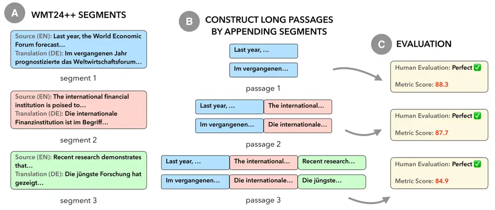

# Penalizing Length: Uncovering Systematic Bias in Quality Estimation Metrics

Yilin Zhang ^(†)^(†)thanks: Correspondence to: Yilin Zhang
\<yilinjz@google.com, jasonzh3@andrew.cmu.edu\> Affiliation: Carnegie
Mellon University Affiliation: Google    Wenda Xu Affiliation: Google
DeepMind    Zhongtao Liu Affiliation: Google DeepMind    Tetsuji
Nakagawa Affiliation: Google    Markus Freitag Affiliation: Google
DeepMind

###### Abstract

Quality Estimation (QE) metrics are vital in machine translation for
reference-free evaluation and increasingly serve as selection criteria
in data filtering and candidate reranking. However, the prevalence and
impact of length bias in QE metrics have been underexplored. Through a
systematic study of top-performing learned and LLM-as-a-Judge QE metrics
across 10 diverse language pairs, we reveal two critical length effects:
First, QE metrics consistently over-predict errors with increasing
translation length, even for high-quality, error-free texts. Second,
when candidates of comparable quality are available for the same source
text, learned QE metrics tend to favor shorter translations, whereas
LLM-as-a-Judge metrics range from being approximately length-neutral to
favoring longer translations. These metric-dependent length effects can
favor or penalize translations based on length rather than quality and
can propagate into downstream pipelines that rely on QE signals for data
selection or system optimization. We trace the root cause of MetricX-24
QE’s cumulative-length penalty to skewed supervision distributions, in
which longer error-free examples are underrepresented in training data.
As a diagnostic intervention, we apply length normalization during
training and show that this simple modification effectively decouples
error prediction from sequence length, yielding more reliable QE signals
across translations of varying length.

|     |
| --- |
|     |



Figure 1: QE metrics exhibit a length-related penalty when evaluating
long-form translations, as metric scores decrease when translations
become longer despite being error-free. As shown, concatenating
consecutive gold-standard segments from the same document leads to
progressively lower predicted scores, in contrast to human evaluations.

## 1 Introduction

Quality Estimation (QE) predicts the quality of machine-translated text
without relying on reference translations, serving as a vital signal for
applications where ground truth is unavailable. Broadly, top-performing
QE methods fall into two categories: learned metrics, such as MetricX
(Juraska et al., 2024) and COMET (Rei et al., 2020), which learn to
assess the hypothesis directly from annotated data, and off-the-shelf
LLM-as-a-Judge approaches, such as GEMBA (Kocmi and Federmann, 2023),
InstructScore (Xu et al., 2023) and AutoMQM (Fernandes et al., 2023),
which leverage large language models to generate error ratings that
approximate human judgments.

Both paradigms ultimately rely on error aggregation schemes rooted in
Multidimensional Quality Metrics (MQM) (Freitag et al., 2021):
segment-level quality is computed by linearly accumulating error
penalties, and system-level performance is typically obtained by
averaging these scores across an evaluation set. While intuitive, this
linear aggregation approach introduces several systematic deficiencies.
First, as sequence length increases, minor and major errors naturally
accumulate, causing long yet high-quality translations to be penalized
disproportionately relative to shorter, lower-quality ones. Second,
because raw MQM scores are unbounded and scale with text length, longer
segments mathematically dominate corpus-level averages, effectively
diluting the quality signals of shorter sequences. Prior work has
documented related length effects in LLM-as-a-Judge settings (Domhan and
Zhu, 2025) and reward models (Zhao et al., 2026), yet the extent to
which QE metrics suffer from these failure modes remains largely
underexplored. This gap is consequential: length bias can distort system
comparisons, impose metric-dependent length preferences in data
selection and candidate reranking, and ultimately misguide model
development.

In this study, we design two complementary experiments to systematically
investigate length bias in QE metrics across 10 language pairs. The
first evaluates length invariance by concatenating high-quality,
error-free segments into progressively longer translations, assessing
whether metric scores remain stable as content accumulates. The second
directly compares quality-matched paraphrases of different lengths for
the same source. All evaluated metrics assign lower quality as
cumulative passages grow (e.g., Figure 1), but the matched-paraphrase
experiment reveals model-dependent behavior: learned QE metrics tend to
favor shorter hypotheses, whereas LLM-as-a-Judge metrics range from
being approximately length-neutral to favoring longer translations.

To probe the root cause of the cumulative-length penalty in a learned
metric, we analyze the training data of MetricX-24 QE and find that
longer error-free examples are severely underrepresented, inducing a
spurious association between sequence length and predicted error.
Increasing model capacity does not reliably reduce the effect (§5.2),
indicating that it is not simply a consequence of underfitting. Applying
a simple length normalization during training restores alignment with
the ground-truth score distribution, confirming that MetricX’s bias
originates from data skew rather than insufficient model capacity.

## 2 Related Work

### 2.1 Length Bias in Evaluation Models

Learned evaluation metrics have increasingly been shown to be sensitive
to input and output sequence length in ways that are unrelated to output
quality. In MT evaluation, neural metrics are vulnerable to
perturbations such as omissions and repetitions, which often correlate
with atypical translation lengths (Karpinska et al., 2022). More
directly, Domhan and Zhu (2025) show that longer inputs cause LLM-based
MT evaluators to identify fewer error spans and yield less accurate
system rankings. Similarly, at the document level, existing MT
evaluation methodologies remain constrained to sentence-level assessment
due to token limits in metrics and rigid sentence boundaries, motivating
segmentation-and-alignment methods for book-length translation
evaluation (Wang et al., 2025). These issues are not limited to MT. In
LLM-as-a-Judge settings, verbosity bias, the tendency to prefer longer
outputs regardless of quality, has been identified as a systematic
failure mode (Zheng et al., 2023). RLHF reward models exhibit similar
behavior: they inherit length biases from preference data to the point
where a simple length-based reward can reproduce much of the observed
performance gains (Singhal et al., 2024).

Despite growing evidence that length sensitivity is a recurring issue
across learned evaluators, QE metrics, which increasingly serve as
selection criteria in data filtering and candidate reranking, have not
been systematically compared across learned and LLM-as-a-Judge paradigms
along two distinct axes: accumulating correct content and varying
verbosity while holding content and quality fixed. We address this gap
by auditing length bias across both learned and LLM-as-a-Judge QE
metrics.

### 2.2 Training Data Artifacts in Learned Metrics

Biases in learned metrics often originate from imbalances in the
training data. For example, Yan et al. (2023) identify universal
adversarial translations in BLEURT and BARTScore and trace these
robustness defects partly to these distributional imbalances. QE models
trained on standard datasets tend to rely heavily on target-side fluency
rather than accurately assessing fidelity to the source, a pattern that
can be traced back to how training examples are constructed (Behnke et
al., 2022). Similarly, metrics trained primarily on MT outputs often
assign lower scores to human translations, failing to capture their
greater lexical and structural diversity (Deutsch et al., 2025).

Such biases can arise even earlier, during data collection. LLM-based
preference annotators can favor more verbose answers even when quality
is comparable, introducing length bias into supervision before model
training begins (Saito et al., 2023). More broadly, distributional
biases across domains and languages have been widely documented (Zouhar
et al., 2024).

Building on this line of work, we focus on length as a specific source
of bias in QE. In particular, we analyze MetricX-24 QE as a case study,
investigating whether the underrepresentation of long, error-free
examples in its training data leads the model to associate longer
sequences with higher error rates.

## 3 Preliminaries

#### Definition of Length Bias.

Length bias describes a systematic preference for certain output lengths
irrespective of true quality. We formalize this using the standard
statistical definition of bias, conditioned on sequence length. Given a
source text $`x`$ and a model-generated hypothesis $`y`$, a QE model
produces a quality prediction $`\hat{\theta}(x,y)`$. Let $`l`$ denote a
length measure of interest (e.g., the token count of $`x`$ or $`y`$). We
define the length bias as:

```math
\textrm{Bias}(\hat{\theta},l)=\mathbb{E}[\hat{\theta}(x,y)]-\theta \tag{1}
```

where $`\theta`$ denotes the true translation quality, derived from
human assessments following annotation guidelines such as MQM (Freitag
et al., 2021), and the expectation is taken over all source–hypothesis
pairs $`(x,y)`$ whose relevant length measure equals $`l`$. In our
normalized scoring convention, higher scores indicate better quality.
When $`\textrm{Bias}(\hat{\theta},l)>0`$, the model overestimates
quality at length $`l`$, effectively favoring translations of that
length; when $`\textrm{Bias}(\hat{\theta},l)<0`$, it underestimates
quality, penalizing translations of that length.

In our study, all instances within a comparison group are constructed to
share the same true quality $`\theta`$. An unbiased QE model should
therefore produce predictions $`\mathbb{E}[\hat{\theta}(x,y)]`$ that
remain constant across lengths. A length-biased model, by contrast,
yields predictions that vary systematically with $`l`$. As we show in
subsequent sections, the dominant pattern is increasingly negative bias
as $`l`$ increases, indicating that QE metrics systematically penalize
longer translations.

## 4 Measuring Length Bias in QE Metrics

### 4.1 Evaluation Settings

#### Task Definition.

A QE metric, $`M_{\text{QE}}`$, assesses the quality of a system’s
hypothesis $`h`$ given a source text $`x`$ without relying on human
references, assigning a score based on predefined criteria. We
investigate the phenomenon of _length bias_ by comparing the scores of
groups of source–hypothesis pairs $`(x,h)`$ with the same human-rated
translation quality, where instances in each group are formed by either
varying the sequence length of error-free translations or selecting
alternative hypotheses of differing lengths for the same source.

#### Dataset.

We use the WMT24++ data (Deutsch et al., 2025), which contains human
translation and post-edit data for 55 en$`\rightarrow`$xx language
pairs. We focus on a subset of 10 languages—German, Chinese, Spanish,
French, Japanese, Korean, Hindi, Arabic, Russian, and
Portuguese—selected as the most widely spoken languages in the dataset.
WMT24++ translations were produced by professional vendors provided with
full document-level context rather than sentence-level segments. As
noted by Deutsch et al. (2025), these post-edits often constitute
complete rewrites to maximize fluency and accuracy, representing a
high-quality gold standard superior to traditional minimal-edit
post-editing, and are thus considered error-free. The post-edits also
preserve cross-sentential discourse markers and pronominal references,
ensuring that the concatenation of contiguous segments reconstructs
natural, cohesive paragraphs.

#### Quality Estimation Metrics.

We evaluate six QE metrics spanning two paradigms: (i) two learned
metrics, MetricX-24 QE (Juraska et al., 2024) and CometKiwi (Rei et al.,
2022), and (ii) four AutoMQM variants: a fine-tuned model based on
Gemini-2.0 (Fernandes et al., 2023; Finkelstein et al., 2024) and three
few-shot-prompted models based on Llama-3.1-8B (Dubey et al., 2024),
Qwen3-8B (Yang et al., 2025), and Gemini-2.5-Pro (Comanici et al.,
2025). The few-shot prompt is provided in Appendix A.9.

#### Hypotheses.

We investigate two forms of length bias: (i) bias with respect to source
text length and (ii) bias with respect to translation length. For (i),
we construct multiple source–translation pairs of equivalent quality to
test whether metrics show systematic preferences related to source text
length. For (ii), we compare pairs of translations of equal quality
generated from the same source, categorize them by relative length, and
analyze whether metrics display a consistent preference for a particular
category.

### 4.2 Bias in Source Text Length

|     |
| --- |
|     |

Figure 2: Metric scores with increasing source text length. Each data
point denotes the score change relative to the first passage.

#### Experiment Setup.

For each language pair, we collect the first 5 segments from each
document in the WMT24++ data, denoted $`s_{1},\dots,s_{5}`$, where each
segment is approximately 1–2 sentences. We reconstruct the original
document flow by gradually appending contiguous segments: for each
document $`d`$, we construct 5 passages $`p_{1},\dots,p_{5}`$, where
$`p_{i}=s_{1}+\dots+s_{i}`$. Each passage is a strict prefix of the next
($`p_{1}\subset p_{2}\subset\dots\subset p_{5}`$), ensuring that the
resulting sequences represent original, coherent discourse rather than
arbitrary concatenations. Since the underlying translations are
error-free, appending additional segments can only add correct content;
any observed score degradation is therefore attributable to length
rather than quality.

This construction has two properties. First, selecting segments from the
same document keeps passages within a single domain and minimizes
confounds from topic variation. Second, concatenating consecutive
segments preserves inter-segment fluency and reduces boundary-induced
disfluency.

Since metrics inherit different context-window limits from their base
models (e.g., 512 tokens for MetricX-24 QE), we standardize the context
window to the smallest across metrics and discard documents whose first
5 segments exceed 500 tokens using MetricX-24’s tokenizer.¹¹ 1
[https://huggingface.co/google/mt5-xl](https://huggingface.co/google/mt5-xl)
To control for score variations across language pairs, we normalize
scores within each group by subtracting the score of $`p_{1}`$ from
subsequent passages and report score differences. Figure 2 presents the
resulting trends across language pairs and metrics. When references are
available, the bias is attenuated but not eliminated (Appendix A.1),
confirming that the effect is most pronounced in the reference-free QE
setting.

#### Results.

After orienting all metrics so that higher scores indicate better
quality and expressing score changes on a common 0–100 scale, all six
metrics assign lower quality to five-segment passages than to
one-segment passages across every language pair. Extending the source
from 1 to 5 segments results in score drops of 4.0–8.0 points for
MetricX-24 QE, 1.5–5.6 for CometKiwi, 2.5–9.3 for few-shot AutoMQM
(Llama-3.1-8B), 5.4–13.5 for few-shot AutoMQM (Qwen3-8B), 1.7–5.3 for
fine-tuned AutoMQM (Gemini 2.0), and 1.8–8.6 for few-shot AutoMQM
(Gemini 2.5 Pro). Because all passages are error-free, their true
quality $`\theta`$ is constant; under Section 3, an unbiased metric’s
score change from $`p_{1}`$ to $`p_{i}`$ should therefore be
approximately zero. Appendix A.7 reports that approximately 80% of
documents exhibit this decreasing trend.

Under the MQM error scheme (Freitag et al., 2021), penalties of –1
(minor) and –5 (major) on a 25-point scale correspond to –4 and –20 on
our 100-point scale. While a marginal decrease might be expected from
the cumulative probability of minor imperfections in longer sequences
($`P^{N}_{error\text{-}free}`$), the observed magnitude, particularly
for LLM-as-a-Judge metrics (up to 13.5 points), far exceeds the
theoretical decay, indicating a systematic bias against length rather
than a valid accumulation of errors.

### 4.3 Bias in Error Type and Severity

|     |
| --- |
|     |

Figure 3: Trends of MetricX-24 QE score with different severity/error
types, evaluated on WMT24++ en$`\rightarrow`$de and en$`\rightarrow`$zh.

|     |
| --- |
|     |

Figure 4: Trends of fine-tuned AutoMQM score with different
severity/error types, evaluated on WMT24++ en$`\rightarrow`$de and
en$`\rightarrow`$zh.

The preceding experiments establish length bias on error-free
translations. We next investigate whether this bias persists when
translations contain explicit errors, and whether it interacts with
error severity and type. Building on the setup in Section 4.2, we modify
the first segment of each passage by inserting one of four controlled
error categories: (a) major accuracy, (b) major fluency, (c) minor
accuracy, or (d) minor fluency. Error definitions and few-shot prompts
are provided in Appendix A.8. We evaluate using MetricX-24 QE and
fine-tuned AutoMQM and report results for en$`\rightarrow`$de and
en$`\rightarrow`$zh in Figures 3 and 4.

For MetricX-24 QE, inserting a major error in the first segment reduces
score fluctuations as additional error-free segments are appended,
whereas inserting a minor error has little influence on the existing
length bias. Major errors provide a strong signal that outweighs the
length effect, delineating a clearer boundary between erroneous and
correct content; minor errors contribute substantially weaker cues. For
fine-tuned AutoMQM, the results show no consistent interaction between
length bias and error severity. Across both metrics, fluency errors have
a smaller impact on score changes than accuracy errors, consistent with
the observation that metrics are generally more sensitive to accuracy
errors, while fluency errors exhibit higher inter-rater disagreement in
the training data.

### 4.4 Bias in Translation Length

#### Experiment Setup.

The preceding experiments vary source text length while holding quality
constant. We next test whether metrics also exhibit biased preferences
among translations of different lengths derived from the same source.
Here we evaluate MetricX-24 QE, CometKiwi, xCOMET-XL (Guerreiro et al.,
2023), and few-shot AutoMQM based on Llama-3.1-8B, Qwen3-8B, and
Gemini-2.5-Flash.

We pre-process source and reference translations from WMT24++ into
chunks within a 500-token context window, discarding those shorter than
200 tokens to ensure rephrasing is possible. For each source–reference
pair, we prompt Qwen3.5-9B (Qwen Team, 2026) to generate $`n=5`$
rephrased translations preserving comparable accuracy and fluency, using
temperature $`t=1`$ and top-$`p=0.95`$.

To isolate length as the sole variable, we apply a two-stage quality
control procedure. First, we compute the reference-based MetricX score
between each generated candidate and the original reference. We use
reference-based metrics as initial quality gates as they are
substantially less susceptible to length bias than their QE counterparts
(Appendix A.1), making them suitable quality gates for this purpose.
Then, we select the two candidates with the best scores and compute the
score difference. Candidates whose score differs by less than
$`\epsilon=0.1`$ are treated as near-duplicates offering insufficient
variation, while those differing by more than $`\delta=1.0`$ are treated
as potential quality degradations; both cases are discarded. The
$`\delta=1.0`$ threshold reflects the inherent subjectivity of
segment-level evaluation: WMT metrics shared tasks have repeatedly shown
that professional annotators frequently disagree on minor errors at the
1-point level (Deutsch et al., 2025; Kocmi et al., 2024), so score
differences within this range are as likely to reflect subjective
variance as genuine quality differences. This automatic stage retained
1,851 pairs. Second, two professional bilingual annotators per language
pair independently assessed both variants under MQM without being told
which was designated shorter. We retained a pair only when both raters
judged its variants equal in quality. This rejected 92 pairs and left
1,759; Appendix A.2 gives the instructions and per-language counts.

Ultimately, each source chunk is paired with two translations—one
shorter and one longer. AutoMQM pairs for which either output cannot be
parsed are excluded. For every valid pair, a shorter win, tie, and
longer win receive preference credit of 1, 0.5, and 0, respectively. The
table reports the macro-average across language pairs.

|                                     |      |      |      |      |      |      |      |      |      |      |      |
| ----------------------------------- | ---- | ---- | ---- | ---- | ---- | ---- | ---- | ---- | ---- | ---- | ---- |
| Metric                              | de   | zh   | es   | fr   | ja   | ko   | hi   | ar   | ru   | pt   | Avg  |
| en $`\rightarrow`$ xx               |      |      |      |      |      |      |      |      |      |      |      |
| MetricX-24 QE                       | 47.3 | 51.9 | 60.6 | 60.9 | 56.8 | 61.5 | 55.8 | 63.7 | 47.5 | 57.6 | 56.4 |
| CometKiwi                           | 41.8 | 45.5 | 56.4 | 57.5 | 51.5 | 55.1 | 44.2 | 52.7 | 53.8 | 45.9 | 50.4 |
| xCOMET-XL                           | 48.4 | 53.2 | 52.1 | 58.6 | 42.4 | 48.7 | 55.8 | 59.3 | 57.5 | 48.2 | 52.4 |
| Few-shot AutoMQM (Llama-3.1-8B)     | 49.0 | 52.6 | 42.9 | 61.5 | 44.4 | 50.0 | 45.2 | 56.9 | 37.5 | 65.3 | 50.5 |
| Few-shot AutoMQM (Qwen3-8B)         | 54.9 | 50.0 | 50.0 | 52.0 | 42.4 | 48.9 | 51.4 | 48.0 | 47.7 | 53.6 | 49.9 |
| Few-shot AutoMQM (Gemini-2.5-Flash) | 36.8 | 43.5 | 37.2 | 43.7 | 43.9 | 35.3 | 43.7 | 40.7 | 39.4 | 42.4 | 40.6 |
| xx $`\rightarrow`$ en               |      |      |      |      |      |      |      |      |      |      |      |
| MetricX-24 QE                       | 63.2 | 44.0 | 53.0 | 53.7 | 47.1 | 44.9 | 49.1 | 58.5 | 51.7 | 53.7 | 51.9 |
| CometKiwi                           | 60.4 | 65.3 | 56.4 | 55.3 | 75.7 | 67.3 | 56.5 | 50.0 | 60.7 | 55.8 | 60.4 |
| xCOMET-XL                           | 68.1 | 48.0 | 52.5 | 60.6 | 48.6 | 50.0 | 46.3 | 47.9 | 56.2 | 56.8 | 53.5 |
| Few-shot AutoMQM (Llama-3.1-8B)     | 46.9 | 48.1 | 43.5 | 56.7 | 60.9 | 48.9 | 55.6 | 48.3 | 56.0 | 48.8 | 51.4 |
| Few-shot AutoMQM (Qwen3-8B)         | 42.5 | 56.0 | 47.7 | 48.2 | 44.1 | 54.2 | 46.9 | 50.0 | 52.3 | 46.8 | 48.9 |
| Few-shot AutoMQM (Gemini-2.5-Flash) | 50.0 | 39.3 | 44.6 | 42.0 | 37.1 | 49.0 | 40.7 | 34.6 | 39.9 | 44.7 | 42.2 |

Table 1: Preference for shorter translations (%) by metric and language
pair. An unbiased metric should show 50%. Green cells indicate bias
toward shorter translations, while red cells indicate bias toward longer
translations. Ties receive half credit; Avg is the macro-average over
the ten language pairs.

#### Results.

Table 1 reveals metric-class-dependent behavior rather than a universal
shorter preference. The learned QE metrics generally favor shorter
candidates: the en$`\rightarrow`$xx/xx$`\rightarrow`$en macro-averages
(%) are 56.4/51.9 for MetricX-24 QE, 50.4/60.4 for CometKiwi, and
52.4/53.5 for xCOMET-XL. In contrast, the open-weight AutoMQM judges are
close to the 50–50 baseline (50.5/51.4 for Llama-3.1-8B and 49.9/48.9
for Qwen3-8B), while Gemini-2.5-Flash consistently favors the longer
candidate (40.6/42.2 shorter preference). Thus, the cumulative-passage
experiment in Section 4.2 and this matched-paraphrase experiment probe
distinct axes: increasing content length elicits penalty inflation
across metrics, whereas changing verbosity for fixed content produces
model-dependent preferences.

#### Tie and parse robustness.

Drop-ties and half-credit estimates differ by at most 0.1 percentage
points for Llama and Qwen, indicating that their near-neutral results
are not artifacts of tie handling. Parsing retains 731 and 940 pairs for
Llama and Qwen, respectively, and failure rates increase with absolute
candidate length. However, among pairs for which exactly one candidate
fails to parse, we find no evidence of directional asymmetry (Llama: 297
shorter-side vs. 289 longer-side failures, two-sided exact binomial
$`p=0.77`$; Qwen: 259 vs. 275, $`p=0.52`$). The preference estimates
therefore apply to successfully parsed pairs, which are somewhat shorter
on average than the excluded pairs; Appendix A.4 provides the full
audit.

#### Natural expansion.

Because translations naturally expand or contract at different rates
across language pairs and directions, the observed shorter-candidate
preferences could reflect language-specific expected length ratios
rather than length alone. To test whether natural expansion plays such a
role, we estimate each language pair’s mean target/source token ratio
from WMT24++ references and correlate it with shorter-candidate
preference across the ten language pairs, separately for each metric and
direction. The correlations vary in sign and magnitude. Only the Pearson
correlation for CometKiwi xx$`\rightarrow`$en is nominally significant
($`r=0.686`$, $`p=0.028`$); the corresponding Spearman correlation is
not significant, and the pattern does not hold for other metrics. Thus,
we find no consistent evidence that language-pair-specific natural
expansion explains the observed preferences; Appendix A.5 gives the full
analysis.

## 5 Analysis

The experiments in Section 4 show pervasive penalty inflation as correct
content accumulates, while matched-paraphrase preferences vary by model
class. We now investigate the cumulative-length penalty in MetricX-24
QE, presenting three complementary pieces of evidence: the training
distribution is skewed against long error-free examples (§5.1);
increasing model capacity does not reliably reduce the effect (§5.2);
and switching from raw error scores to error density at training time
substantially reduces it (§5.3). Together, these results identify skewed
supervision, rather than underfitting, as the primary source of
MetricX’s bias.

### 5.1 Distribution of MQM Scores in Training Data

We examine the distribution of gold-standard MQM scores in the training
data used by learned QE models. We construct blob-level MQM test sets
from WMT data, where a blob is a contiguous block of source–translation
segments concatenated into a single evaluation instance, with a
test-set-specific token limit of 500, 1k, or 2k. Figure 5 presents the
distribution of gold-standard scores and MetricX-24 QE’s output scores
on these test sets. The distribution of output scores is skewed relative
to the gold standard, and as the number of input tokens increases, the
proportion of perfect translations (gold score $`=0`$) in the data
diminishes. The output distribution mirrors this pattern, with the
frequency of zero-score predictions dropping accordingly. The model has
learned to associate sequence length with error probability, reflecting
the distributional properties of its training data rather than a genuine
relationship between length and quality.

|     |
| --- |
|     |

Figure 5: Distribution of MetricX QE outputs and gold-standard scores.
Top: without normalization. Bottom: with length normalization at
training time. Normalization restores alignment with the ground-truth
distribution across translations of varying length.

### 5.2 Effect of Model Capacity

One hypothesis is that the bias stems from underfitting: smaller models
may lack the capacity to disentangle length from quality in skewed
training distributions. If so, scaling to larger models should
progressively reduce the bias. We test this using the three publicly
available MetricX-24 variants (Large, XL, and XXL) and repeat the
translation length preference experiment from Section 4.4.

| Direction             | Model | de   | zh   | es   | fr   | ja   | ko   | hi   | ar   | ru   | pt   | Avg  |
| --------------------- | ----- | ---- | ---- | ---- | ---- | ---- | ---- | ---- | ---- | ---- | ---- | ---- |
| en $`\rightarrow`$ xx | Large | 58.2 | 64.9 | 48.9 | 56.3 | 39.4 | 43.6 | 56.8 | 58.2 | 40.0 | 49.4 | 51.6 |
|                       | XL    | 44.0 | 51.9 | 57.4 | 58.6 | 51.5 | 59.0 | 52.6 | 60.4 | 48.8 | 54.1 | 53.8 |
|                       | XXL   | 49.5 | 57.1 | 55.3 | 50.6 | 45.5 | 61.5 | 54.7 | 63.7 | 51.2 | 57.6 | 54.7 |
| xx $`\rightarrow`$ en | Large | 49.5 | 44.0 | 49.5 | 43.6 | 45.7 | 54.1 | 49.1 | 53.2 | 52.8 | 54.7 | 49.6 |
|                       | XL    | 63.7 | 42.7 | 50.5 | 50.0 | 48.6 | 42.9 | 48.1 | 58.5 | 48.3 | 51.6 | 50.5 |
|                       | XXL   | 52.7 | 54.7 | 49.5 | 48.9 | 45.7 | 56.1 | 56.5 | 48.9 | 53.9 | 44.2 | 51.1 |

Table 2: Effect of MetricX model size on preference for shorter
translations (%) by translation direction. An unbiased metric should
show 50.0. Green cells indicate bias toward shorter translations, while
red cells indicate bias toward longer translations. Colored cells
deviate from 50.0 by more than 5 percentage points.

Table 2 shows that increasing model capacity does not reliably reduce
length bias. The average short-translation preference (%) does not
decrease with model size (en$`\rightarrow`$xx: Large 51.6, XL 53.8, XXL
54.7), and all three variants exhibit substantial per-language biases in
both directions. Larger models shift _which_ languages are affected and
_which direction_ the bias takes, but do not systematically reduce it.
Since all three models are trained on the same data with the same
distributional skew, the persistence of bias across scales suggests that
the root cause lies in the training distribution itself, rather than in
the model’s capacity.

### 5.3 Diagnostic Intervention: Length Normalization

|     |
| --- |
|     |

Figure 6: Performance of MetricX-24 QE with and without length
normalization. We report the slope of score changes to show that length
normalization mitigates length bias.

Section 5.2 shows that scaling model capacity does not resolve the bias,
pointing to the training distribution as the root cause. We now test
this directly by applying length normalization at training time as a
diagnostic intervention. If correcting for the distributional skew
substantially reduces the bias, the hypothesis would be supported.

With normalization, the model is trained to predict the error density of
a hypothesis translation, defined as
$`\textrm{Density}(\hat{\theta},l)=\hat{\theta}(x,y)/l`$, where
$`\hat{\theta}(x,y)`$ is the error rating of hypothesis $`y`$ for source
$`x`$ and $`l`$ denotes its segment length. Because error density is
largely invariant to segment length in the gold-standard annotations,
this reformulation removes the skew that the unnormalized objective
inherits. At inference time, predictions are rescaled back to error
ratings via
$`\hat{\theta}(x,y)=\textrm{Density}(\hat{\theta},l)\cdot l`$ for
comparison with the unnormalized baseline. Error density is therefore
only a training-time diagnostic rather than a new definition of
translation quality; human MQM ratings remain the quality target. On
standard WMT meta-evaluation, the density-trained model remains within
1.5 points of the unnormalized baseline on SPA and Acc-23 across
sentence and blob granularities (Appendix A.6).

We train a MetricX QE model with this normalization. Figure 5
(bottom-left) shows the resulting output distribution: the curves for
different lengths collapse onto a single, invariant density function,
mirroring the ground-truth human distribution (Figure 5, bottom-right).
The unnormalized baseline fails to capture this property.

We further replicate the concatenation experiment from Section 4.2 and
report results in Figure 6. Normalization reduces the magnitude of
length bias beyond three segments, consistent with the distributional
analysis above.

## 6 Conclusion

In this work, we show that reference-free QE models are not
length-invariant when assessing long-form translations: they inflate
predicted error as translations grow longer, while matched-paraphrase
comparisons reveal model-dependent behavior—learned QE metrics tend to
favor shorter candidates, whereas LLM-as-a-Judge metrics range from
being approximately length-neutral to favoring longer candidates. We
trace MetricX-24 QE’s cumulative-length penalty to a training pipeline
artifact: the under-representation of long, error-free examples in
supervision data. Scaling model capacity does not reliably reduce the
bias, ruling out underfitting as the explanation. Instead, switching
from raw error scores to error density at training time, which corrects
for the distributional skew, substantially reduces the bias and restores
closer alignment with human ground-truth distributions, supporting the
conclusion that the bias is distributional in origin. While aggregate
benchmarks often miss these tail-end failures, our findings highlight
the necessity of auditing length invariance to ensure reliable
evaluation in long-context applications.

## References

- Behnke et al. (2022) H. Behnke, M. Fomicheva, and L. Specia Bias
  mitigation in machine translation quality estimation. In Proceedings
  of the 60th Annual Meeting of the Association for Computational
  Linguistics (Volume 1: Long Papers), S. Muresan, P. Nakov, and A.
  Villavicencio (Eds.), Dublin, Ireland, pp. 1475–1487. External Links:
  [Link](https://aclanthology.org/2022.acl-long.104/),
  [Document](https://dx.doi.org/10.18653/v1/2022.acl-long.104) Cited by:
  §2.2.
- Comanici et al. (2025) G. Comanici, E. Bieber, M. Schaekermann, I.
  Pasupat, N. Sachdeva, I. S. Dhillon, M. Blistein, O. Ram, D. Zhang, E.
  Rosen, et al. Gemini 2.5: pushing the frontier with advanced
  reasoning, multimodality, long context, and next generation agentic
  capabilities. External Links: 2507.06261,
  [Link](https://arxiv.org/abs/2507.06261) Cited by: §4.1.
- Deutsch et al. (2025) D. Deutsch, E. Briakou, I. Caswell, M.
  Finkelstein, R. Galor, J. Juraska, G. Kovacs, A. Lui, R. Rei, J.
  Riesa, et al. WMT24++: expanding the language coverage of wmt24 to 55
  languages & dialects. Association for Computational Linguistics.
  External Links: 2502.12404, [Link](https://arxiv.org/abs/2502.12404),
  [Document](https://dx.doi.org/10.18653/v1/2025.findings-acl.634) Cited
  by: §2.2, §4.1, §4.4.
- Domhan and Zhu (2025) T. Domhan and D. Zhu Same evaluation, more
  tokens: on the effect of input length for machine translation
  evaluation using large language models. In Proceedings of the 2025
  Conference on Empirical Methods in Natural Language Processing, C.
  Christodoulopoulos, T. Chakraborty, C. Rose, and V. Peng (Eds.),
  Suzhou, China, pp. 7929–7947. External Links:
  [Link](https://aclanthology.org/2025.emnlp-main.402/),
  [Document](https://dx.doi.org/10.18653/v1/2025.emnlp-main.402), ISBN
  979-8-89176-332-6 Cited by: §1, §2.1.
- Dubey et al. (2024) A. Dubey, A. Jauhri, A. Pandey, A. Kadian, A.
  Al-Dahle, A. Letman, A. Mathur, A. Schelten, A. Yang, A. Fan, et al.
  The llama 3 herd of models. arXiv. External Links: 2407.21783,
  [Link](https://arxiv.org/abs/2407.21783) Cited by: §4.1.
- Fernandes et al. (2023) P. Fernandes, D. Deutsch, M. Finkelstein, P.
  Riley, A. F. T. Martins, G. Neubig, A. Garg, J. H. Clark, M. Freitag,
  and O. Firat The devil is in the errors: leveraging large language
  models for fine-grained machine translation evaluation. Association
  for Computational Linguistics. External Links: 2308.07286,
  [Link](https://arxiv.org/abs/2308.07286),
  [Document](https://dx.doi.org/10.18653/v1/2023.wmt-1.100) Cited by:
  §1, §4.1.
- Finkelstein et al. (2024) M. Finkelstein, D. Deutsch, P. Riley, J.
  Juraska, G. Kovacs, and M. Freitag From jack of all trades to master
  of one: specializing llm-based autoraters to a test set. External
  Links: 2411.15387, [Link](https://arxiv.org/abs/2411.15387),
  [Document](https://dx.doi.org/10.48550/arXiv.2411.15387) Cited by:
  §4.1.
- Freitag et al. (2021) M. Freitag, G. Foster, D. Grangier, V.
  Ratnakar, Q. Tan, and W. Macherey Experts, errors, and context: a
  large-scale study of human evaluation for machine translation.
  Transactions of the Association for Computational Linguistics 9,
  pp. 1460–1474. External Links:
  [Link](https://aclanthology.org/2021.tacl-1.87/),
  [Document](https://dx.doi.org/10.1162/tacl%5Fa%5F00437) Cited by: §1,
  §3, §4.2.
- Guerreiro et al. (2023) N. M. Guerreiro, R. Rei, D. v. Stigt, L.
  Coheur, P. Colombo, and A. Martins XCOMET: transparent machine
  translation evaluation through fine-grained error detection.
  Transactions of the Association for Computational Linguistics 12,
  pp. 979–995. External Links:
  [Link](https://aclanthology.org/2024.tacl-1.54/),
  [Document](https://dx.doi.org/10.1162/tacl%5Fa%5F00683) Cited by:
  §4.4.
- Juraska et al. (2024) J. Juraska, D. Deutsch, M. Finkelstein, and M.
  Freitag MetricX-24: the google submission to the wmt 2024 metrics
  shared task. Association for Computational Linguistics. External
  Links: 2410.03983, [Link](https://arxiv.org/abs/2410.03983),
  [Document](https://dx.doi.org/10.18653/v1/2024.wmt-1.35) Cited by: §1,
  §4.1.
- Karpinska et al. (2022) M. Karpinska, N. Raj, K. Thai, Y. Song, A.
  Gupta, and M. Iyyer DEMETR: diagnosing evaluation metrics for
  translation. In Proceedings of the 2022 Conference on Empirical
  Methods in Natural Language Processing, Y. Goldberg, Z. Kozareva,
  and Y. Zhang (Eds.), Abu Dhabi, United Arab Emirates, pp. 9540–9561.
  External Links: [Link](https://aclanthology.org/2022.emnlp-main.649/),
  [Document](https://dx.doi.org/10.18653/v1/2022.emnlp-main.649) Cited
  by: §2.1.
- Kocmi et al. (2024) T. Kocmi, E. Avramidis, R. Bawden, O. Bojar, A.
  Dvorkovich, C. Federmann, M. Fishel, M. Freitag, T. Gowda, R.
  Grundkiewicz, B. Haddow, M. Karpinska, P. Koehn, B. Marie, C. Monz, K.
  Murray, M. Nagata, M. Popel, M. Popović, M. Shmatova, S.
  Steingrímsson, and V. Zouhar Findings of the WMT24 general machine
  translation shared task: the LLM era is here but MT is not solved yet.
  In Proceedings of the Ninth Conference on Machine Translation, B.
  Haddow, T. Kocmi, P. Koehn, and C. Monz (Eds.), Miami, Florida, USA,
  pp. 1–46. External Links:
  [Link](https://aclanthology.org/2024.wmt-1.1/),
  [Document](https://dx.doi.org/10.18653/v1/2024.wmt-1.1) Cited by:
  §4.4.
- Kocmi and Federmann (2023) T. Kocmi and C. Federmann Large language
  models are state-of-the-art evaluators of translation quality.
  External Links: 2302.14520, [Link](https://arxiv.org/abs/2302.14520),
  [Document](https://dx.doi.org/10.48550/arXiv.2302.14520) Cited by: §1.
- Qwen Team (2026) Qwen Team Qwen3.5: towards native multimodal agents.
  External Links: [Link](https://qwen.ai/blog?id=qwen3.5) Cited by:
  §4.4.
- Rei et al. (2020) R. Rei, C. Stewart, A. C. Farinha, and A. Lavie
  COMET: a neural framework for MT evaluation. In Proceedings of the
  2020 Conference on Empirical Methods in Natural Language Processing
  (EMNLP), B. Webber, T. Cohn, Y. He, and Y. Liu (Eds.), Online,
  pp. 2685–2702. External Links:
  [Link](https://aclanthology.org/2020.emnlp-main.213/),
  [Document](https://dx.doi.org/10.18653/v1/2020.emnlp-main.213) Cited
  by: §1.
- Rei et al. (2022) R. Rei, M. Treviso, N. M. Guerreiro, C. Zerva, A. C.
  Farinha, C. Maroti, J. G. C. de Souza, T. Glushkova, D. Alves, L.
  Coheur, A. Lavie, and A. F. T. Martins CometKiwi: IST-unbabel 2022
  submission for the quality estimation shared task. In Proceedings of
  the Seventh Conference on Machine Translation (WMT), P. Koehn, L.
  Barrault, O. Bojar, F. Bougares, R. Chatterjee, M. R. Costa-jussà, C.
  Federmann, M. Fishel, A. Fraser, M. Freitag, Y. Graham, R.
  Grundkiewicz, P. Guzman, B. Haddow, M. Huck, A. Jimeno Yepes, T.
  Kocmi, A. Martins, M. Morishita, C. Monz, M. Nagata, T. Nakazawa, M.
  Negri, A. Névéol, M. Neves, M. Popel, M. Turchi, and M. Zampieri
  (Eds.), Abu Dhabi, United Arab Emirates (Hybrid), pp. 634–645.
  External Links: [Link](https://aclanthology.org/2022.wmt-1.60/),
  [Document](https://dx.doi.org/10.18653/v1/2022.wmt-1.60) Cited by:
  §4.1.
- Saito et al. (2023) K. Saito, A. Wachi, K. Wataoka, and Y. Akimoto
  Verbosity bias in preference labeling by large language models.
  External Links: 2310.10076, [Link](https://arxiv.org/abs/2310.10076),
  [Document](https://dx.doi.org/10.48550/arXiv.2310.10076) Cited by:
  §2.2.
- Singhal et al. (2024) P. Singhal, T. Goyal, J. Xu, and G. Durrett A
  long way to go: investigating length correlations in rlhf. External
  Links: 2310.03716, [Link](https://arxiv.org/abs/2310.03716),
  [Document](https://dx.doi.org/10.48550/arXiv.2310.03716) Cited by:
  §2.1.
- Wang et al. (2025) K. Wang, S. Ding, C. H. Yang, P. Hsieh, W. Peng, V.
  Lavrukhin, and B. Ginsburg Extending automatic machine translation
  evaluation to book-length documents. In Proceedings of the 2025
  Conference on Empirical Methods in Natural Language Processing, C.
  Christodoulopoulos, T. Chakraborty, C. Rose, and V. Peng (Eds.),
  Suzhou, China, pp. 32323–32339. External Links:
  [Link](https://aclanthology.org/2025.emnlp-main.1645/),
  [Document](https://dx.doi.org/10.18653/v1/2025.emnlp-main.1645), ISBN
  979-8-89176-332-6 Cited by: §2.1.
- Xu et al. (2023) W. Xu, D. Wang, L. Pan, Z. Song, M. Freitag, W. Wang,
  and L. Li INSTRUCTSCORE: towards explainable text generation
  evaluation with automatic feedback. In Proceedings of the 2023
  Conference on Empirical Methods in Natural Language Processing, H.
  Bouamor, J. Pino, and K. Bali (Eds.), Singapore, pp. 5967–5994.
  External Links: [Link](https://aclanthology.org/2023.emnlp-main.365/),
  [Document](https://dx.doi.org/10.18653/v1/2023.emnlp-main.365) Cited
  by: §1.
- Yan et al. (2023) Y. Yan, T. Wang, C. Zhao, S. Huang, J. Chen, and M.
  Wang BLEURT has universal translations: an analysis of automatic
  metrics by minimum risk training. In Proceedings of the 61st Annual
  Meeting of the Association for Computational Linguistics (Volume 1:
  Long Papers), A. Rogers, J. Boyd-Graber, and N. Okazaki (Eds.),
  Toronto, Canada, pp. 5428–5443. External Links:
  [Link](https://aclanthology.org/2023.acl-long.297/),
  [Document](https://dx.doi.org/10.18653/v1/2023.acl-long.297) Cited by:
  §2.2.
- Yang et al. (2025) A. Yang, A. Li, B. Yang, B. Zhang, B. Hui, B.
  Zheng, B. Yu, C. Gao, C. Huang, C. Lv, et al. Qwen3 technical report.
  External Links: 2505.09388, [Link](https://arxiv.org/abs/2505.09388)
  Cited by: §4.1.
- Zhao et al. (2026) K. Zhao, J. Cai, J. Zhu, R. Sun, D. Xue, W.
  Zhou, L. Li, and H. Li Bias fitting to mitigate length bias of reward
  model in rlhf. Association for Computational Linguistics. External
  Links: 2505.12843, [Link](https://arxiv.org/abs/2505.12843),
  [Document](https://dx.doi.org/10.18653/v1/2026.acl-long.133) Cited by:
  §1.
- Zheng et al. (2023) L. Zheng, W. Chiang, Y. Sheng, S. Zhuang, Z.
  Wu, Y. Zhuang, Z. Lin, Z. Li, D. Li, E. P. Xing, et al. Judging
  llm-as-a-judge with mt-bench and chatbot arena. Neural Information
  Processing Systems Foundation, Inc. (NeurIPS). External Links:
  2306.05685, [Link](https://arxiv.org/abs/2306.05685),
  [Document](https://dx.doi.org/10.52202/075280-2020) Cited by: §2.1.
- Zouhar et al. (2024) V. Zouhar, P. Chen, T. K. Lam, N. Moghe, and B.
  Haddow Pitfalls and outlooks in using COMET. In Proceedings of the
  Ninth Conference on Machine Translation, B. Haddow, T. Kocmi, P.
  Koehn, and C. Monz (Eds.), Miami, Florida, USA, pp. 1272–1288.
  External Links: [Link](https://aclanthology.org/2024.wmt-1.121/),
  [Document](https://dx.doi.org/10.18653/v1/2024.wmt-1.121) Cited by:
  §2.2.

## Appendix A Appendix

### A.1 Length Bias in Reference-Based Metrics

We compare reference-based, source-based (QE), and hybrid versions of
MetricX-24 under the experimental setup described in Section 4.2.
Figure 7 shows that metrics with access to references exhibit attenuated
length bias, plausibly because the reference translation provides an
implicit prior on the expected length of a well-formed hypothesis.
Nonetheless, residual length bias persists, indicating that reference
access alone does not fully eliminate the effect.

|     |
| --- |
|     |

Figure 7: Performance of three classes of MetricX-24: reference-based,
source-based (QE), and hybrid. We report the slope of score changes to
illustrate that metrics with access to references exhibit reduced length
bias, though the effect nonetheless persists.

### A.2 Human Rating and Quality Control

Two professional bilingual annotators were assigned to each language
pair through a translation vendor and were paid \$55 USD/hour. For every
pair, each annotator saw the source and both candidate translations,
without shorter/longer labels, and assessed their accuracy and fluency
under MQM. Annotators were instructed to decide whether the variants had
equal overall quality; a pair was retained only when both independently
judged them equal. Of 1,851 pairs passing automatic quality control, 92
were rejected at this stage, leaving the 1,759 pairs summarized in
Table 3.

| Language           | en$`\to`$xx | xx$`\to`$en | Total |
| ------------------ | ----------- | ----------- | ----- |
| German (de_DE)     | 91          | 91          | 182   |
| Chinese (zh_CN)    | 77          | 75          | 152   |
| Spanish (es_MX)    | 94          | 101         | 195   |
| French (fr_FR)     | 87          | 94          | 181   |
| Japanese (ja_JP)   | 66          | 70          | 136   |
| Korean (ko_KR)     | 78          | 98          | 176   |
| Hindi (hi_IN)      | 95          | 108         | 203   |
| Arabic (ar_EG)     | 91          | 94          | 185   |
| Russian (ru_RU)    | 80          | 89          | 169   |
| Portuguese (pt_BR) | 85          | 95          | 180   |
| Total              | 844         | 915         | 1,759 |

Table 3: Human-validated translation pairs retained for the
translation-length experiment.

### A.3 Full Results for Translation Length Preference Experiments

Tables 4 and 5 present the full per-language breakdown of
shorter-translation preference rates across all token count difference
bins for MetricX-24 QE and CometKiwi, respectively, complementing the
aggregated results of the translation length preference experiments in
Section 4.4. Ties receive half credit in all cells.

|      | en $`\rightarrow`$ xx |           |           |           | xx $`\rightarrow`$ en |           |           |           |
| ---- | --------------------- | --------- | --------- | --------- | --------------------- | --------- | --------- | --------- |
| Lang | 0–20                  | 20–40     | 40–60     | 60+       | 0–20                  | 20–40     | 40–60     | 60+       |
| de   | 38.2 (55)             | 60.9 (23) | 80.0 (5)  | 50.0 (8)  | 61.5 (61)             | 75.0 (16) | 50.0 (8)  | 66.7 (6)  |
| zh   | 52.4 (42)             | 59.1 (22) | 45.5 (11) | –         | 44.4 (36)             | 35.0 (20) | 61.5 (13) | 33.3 (6)  |
| es   | 63.2 (57)             | 56.5 (23) | 50.0 (10) | –         | 51.4 (72)             | 65.0 (20) | 8.3 (6)   | –         |
| fr   | 58.1 (43)             | 65.2 (23) | 58.3 (12) | 66.7 (9)  | 57.7 (65)             | 57.9 (19) | 25.0 (8)  | –         |
| ja   | 47.9 (47)             | 60.0 (10) | 100.0 (9) | –         | 50.0 (36)             | 35.7 (14) | 40.0 (10) | 60.0 (10) |
| ko   | 61.2 (49)             | 52.4 (21) | 83.3 (6)  | –         | 38.5 (65)             | 64.0 (25) | 37.5 (8)  | –         |
| hi   | 47.2 (53)             | 66.7 (18) | 61.5 (13) | 72.7 (11) | 45.5 (66)             | 50.0 (32) | 83.3 (6)  | –         |
| ar   | 69.0 (42)             | 57.1 (21) | 53.3 (15) | 69.2 (13) | 53.6 (56)             | 60.0 (20) | 58.3 (12) | 100.0 (6) |
| ru   | 43.6 (39)             | 57.1 (14) | 57.1 (14) | 38.5 (13) | 49.0 (49)             | 51.5 (33) | 66.7 (6)  | –         |
| pt   | 56.4 (55)             | 50.0 (16) | 63.6 (11) | –         | 60.3 (63)             | 47.6 (21) | 30.0 (10) | –         |

Table 4: Preference for shorter translations (%) by token count
difference, MetricX-24 QE. Each column contains instances where the
longer candidate exceeds the shorter by the stated token count range.
Cells with fewer than 5 instances are shown as –. Count of instances
shown in parentheses.

|      | en $`\rightarrow`$ xx |           |           |           | xx $`\rightarrow`$ en |           |           |            |
| ---- | --------------------- | --------- | --------- | --------- | --------------------- | --------- | --------- | ---------- |
| Lang | 0–20                  | 20–40     | 40–60     | 60+       | 0–20                  | 20–40     | 40–60     | 60+        |
| de   | 43.6 (55)             | 39.1 (23) | 80.0 (5)  | 12.5 (8)  | 57.4 (61)             | 62.5 (16) | 75.0 (8)  | 66.7 (6)   |
| zh   | 38.1 (42)             | 54.5 (22) | 54.5 (11) | –         | 58.3 (36)             | 60.0 (20) | 76.9 (13) | 100.0 (6)  |
| es   | 57.9 (57)             | 56.5 (23) | 50.0 (10) | –         | 52.8 (72)             | 60.0 (20) | 66.7 (6)  | –          |
| fr   | 58.1 (43)             | 52.2 (23) | 66.7 (12) | 55.6 (9)  | 50.8 (65)             | 63.2 (19) | 62.5 (8)  | –          |
| ja   | 51.1 (47)             | 50.0 (10) | 55.6 (9)  | –         | 61.1 (36)             | 85.7 (14) | 90.0 (10) | 100.0 (10) |
| ko   | 59.2 (49)             | 42.9 (21) | 66.7 (6)  | –         | 55.4 (65)             | 92.0 (25) | 87.5 (8)  | –          |
| hi   | 49.1 (53)             | 16.7 (18) | 53.8 (13) | 54.5 (11) | 48.5 (66)             | 75.0 (32) | 33.3 (6)  | –          |
| ar   | 45.2 (42)             | 52.4 (21) | 60.0 (15) | 69.2 (13) | 46.4 (56)             | 50.0 (20) | 58.3 (12) | 66.7 (6)   |
| ru   | 61.5 (39)             | 64.3 (14) | 50.0 (14) | 23.1 (13) | 55.1 (49)             | 63.6 (33) | 83.3 (6)  | –          |
| pt   | 41.8 (55)             | 43.8 (16) | 54.5 (11) | –         | 47.6 (63)             | 71.4 (21) | 70.0 (10) | –          |

Table 5: Preference for shorter translations (%) by token count
difference, CometKiwi. Each column contains instances where the longer
candidate exceeds the shorter by the stated token count range. Cells
with fewer than 5 instances are shown as –. Count of instances shown in
parentheses.

### A.4 Tie Handling and Parse-Failure Robustness

Table 6 compares strict shorter wins, dropping ties, and assigning ties
half credit after pooling all language pairs and directions. The strict
rule treats every tie as a shorter loss and therefore understates
shorter preference for discrete AutoMQM scores. Drop-ties and
half-credit agree closely. For Llama and Qwen, parse failure is driven
primarily by absolute candidate length but is direction-symmetric: among
pairs for which exactly one side failed, the longer side did not fail
more often ($`p=0.77`$ and $`0.52`$). The retained samples therefore
show no directional attrition, although they underrepresent the longest
inputs.

| Metric           | Valid (N) | Parse S/L (%) | Ties (%) | Strict (%) | Drop ties (%) | Half credit (%) |
| ---------------- | --------- | ------------- | -------- | ---------- | ------------- | --------------- |
| MetricX-24 QE    | 1,759     | –             | 0.5      | 54.0       | 54.2          | 54.2            |
| CometKiwi        | 1,759     | –             | 0.0      | 55.3       | 55.3          | 55.3            |
| xCOMET-XL        | 1,759     | –             | 0.0      | 53.2       | 53.2          | 53.2            |
| Llama-3.1-8B     | 731       | 58.0/58.4     | 14.5     | 43.5       | 50.9          | 50.8            |
| Qwen3-8B         | 940       | 69.1/68.2     | 18.2     | 40.4       | 49.4          | 49.5            |
| Gemini-2.5-Flash | 1,759     | 100/100       | 11.7     | 35.7       | 40.4          | 41.5            |

Table 6: Tie and parse-failure audit pooled across language pairs and
translation directions. Parse S/L gives candidate-level parse success
for the shorter/longer side; learned metrics do not require
structured-output parsing.

### A.5 Robustness to Natural Translation Expansion

Because translations naturally expand or contract at different rates
across language pairs and directions, shorter-candidate preferences
could reflect language-specific expected length ratios rather than
length alone. For each language pair and direction, we compute the
natural expansion ratio as the mean target/source token ratio over
WMT24++ human gold references, using the MetricX tokenizer. We then
compute each metric’s Section 4.4 bias score as the mean
shorter-candidate preference rate, assigning half credit to ties.
Table 7 reports Spearman and Pearson correlations between expansion
ratio and bias score across the ten language pairs, separately for each
metric and direction. Correlations vary in sign and magnitude. Although
the Pearson correlation for CometKiwi xx$`\to`$en is nominally
significant, its Spearman correlation is not, and the pattern is not
consistent across other metrics. The results therefore do not support
natural translation expansion as the primary explanation for the
observed shorter-candidate preferences.

| Metric                   | Direction   | Spearman $`\rho`$ ($`p`$) | Pearson $`r`$ ($`p`$)  | $`N`$ |
| ------------------------ | ----------- | ------------------------- | ---------------------- | ----- |
| MetricX-24 QE            | en$`\to`$xx | $`+0.491`$ ($`0.150`$)    | $`+0.212`$ ($`0.556`$) | 10    |
|                          | xx$`\to`$en | $`-0.127`$ ($`0.726`$)    | $`-0.276`$ ($`0.440`$) | 10    |
| CometKiwi                | en$`\to`$xx | $`+0.273`$ ($`0.446`$)    | $`-0.066`$ ($`0.856`$) | 10    |
|                          | xx$`\to`$en | $`+0.491`$ ($`0.150`$)    | $`+0.686`$ ($`0.028`$) | 10    |
| xCOMET-XL                | en$`\to`$xx | $`+0.406`$ ($`0.244`$)    | $`+0.469`$ ($`0.172`$) | 10    |
|                          | xx$`\to`$en | $`+0.018`$ ($`0.960`$)    | $`-0.128`$ ($`0.726`$) | 10    |
| Llama-3.1-8B AutoMQM     | en$`\to`$xx | $`+0.370`$ ($`0.293`$)    | $`+0.067`$ ($`0.854`$) | 10    |
|                          | xx$`\to`$en | $`-0.139`$ ($`0.701`$)    | $`+0.113`$ ($`0.756`$) | 10    |
| Qwen3-8B AutoMQM         | en$`\to`$xx | $`+0.365`$ ($`0.300`$)    | $`+0.463`$ ($`0.178`$) | 10    |
|                          | xx$`\to`$en | $`-0.079`$ ($`0.829`$)    | $`+0.079`$ ($`0.829`$) | 10    |
| Gemini-2.5-Flash AutoMQM | en$`\to`$xx | $`+0.006`$ ($`0.987`$)    | $`+0.000`$ ($`1.000`$) | 10    |
|                          | xx$`\to`$en | $`-0.370`$ ($`0.293`$)    | $`-0.306`$ ($`0.390`$) | 10    |

Table 7: Correlation between language-pair-level natural expansion ratio
and shorter-candidate preference. Expansion is the mean target/source
token ratio over WMT24++ human gold references; preference assigns half
credit to ties. Correlations are computed across ten language pairs for
each metric and direction; $`p`$-values are in parentheses.

### A.6 Standard Meta-Evaluation after Error-Density Training

In our analysis, density normalization is used only to test whether
length bias arises from the supervision signal (Sections 5.1 and 5.3);
it removes the length-conditioned skew during training, and predictions
are rescaled to raw error ratings at inference.

To verify that this intervention does not harm standard evaluation
quality, we evaluate the density-trained model on standard WMT
meta-evaluation at sentence and blob granularities. Table 8 shows that
it remains within 1.5 points of the unnormalized baseline on both Soft
Pairwise Accuracy (SPA) and Acc-23 across all granularities and closely
matches the baseline at the sentence level. Thus, the reduction in
length bias does not come at the cost of agreement with human judgments.

|              | SPA      |                 | Acc-23   |                 |
| ------------ | -------- | --------------- | -------- | --------------- |
| Test data    | Baseline | Density-trained | Baseline | Density-trained |
| Sentence     | 86.89    | 87.76           | 58.81    | 58.87           |
| Blob (500)   | 87.22    | 87.66           | 66.38    | 65.45           |
| Blob (1,000) | 86.62    | 86.57           | 71.55    | 70.67           |
| Blob (2,000) | 85.86    | 84.70           | 74.53    | 73.09           |

Table 8: Standard WMT meta-evaluation for the baseline and
error-density-trained models. Parentheses in the blob rows give the
token limit. Higher values are better.

### A.7 Proportion of Scores with Decreasing Trends in Data Filtering

We analyze the proportion of documents exhibiting a decreasing trend in
translation scores. For each language pair, we compare the score of
passage 1 (containing segment 1) with passage 5 (containing segments
1–5), and report (i) the total number of documents and (ii) the
proportion displaying a decreasing trend. Results for MetricX-24 QE are
summarized in Table 9. Approximately 80% of documents across 10
languages show a decreasing trend.

| Language           | \# of Documents | Proportion of scores with decreasing trends (%) |
| ------------------ | --------------- | ----------------------------------------------- |
| German (de_DE)     | 48              | 85.4                                            |
| Chinese (zh_CN)    | 53              | 79.2                                            |
| Spanish (es_MX)    | 47              | 74.5                                            |
| French (fr_FR)     | 45              | 82.2                                            |
| Japanese (ja_JP)   | 54              | 90.7                                            |
| Korean (ko_KR)     | 46              | 82.6                                            |
| Hindi (hi_IN)      | 37              | 75.7                                            |
| Arabic (ar_EG)     | 48              | 68.8                                            |
| Russian (ru_RU)    | 48              | 79.2                                            |
| Portuguese (pt_BR) | 46              | 80.4                                            |
| Total              | 472             | 80.1                                            |

Table 9: Proportion of scores with decreasing trends with MetricX-24 QE

### A.8 Error Type / Severity Perturbation Prompt

Figures 8–12 present the prompts used for error perturbation with
different types and severity using Gemini-2.5-Pro.

|     |
| --- |
|     |

Figure 8: Error perturbation prompt

|     |
| --- |
|     |

Figure 9: Major accuracy prompt

|     |
| --- |
|     |

Figure 10: Major fluency prompt

|     |
| --- |
|     |

Figure 11: Minor accuracy prompt

|     |
| --- |
|     |

Figure 12: Minor fluency prompt

### A.9 Few-shot AutoMQM Prompt

Figure 13 presents the shared prompt used by all few-shot AutoMQM
evaluators: Llama-3.1-8B, Qwen3-8B, Gemini-2.5-Pro, and
Gemini-2.5-Flash.

|     |
| --- |
|     |

Figure 13: Few-shot AutoMQM prompt
