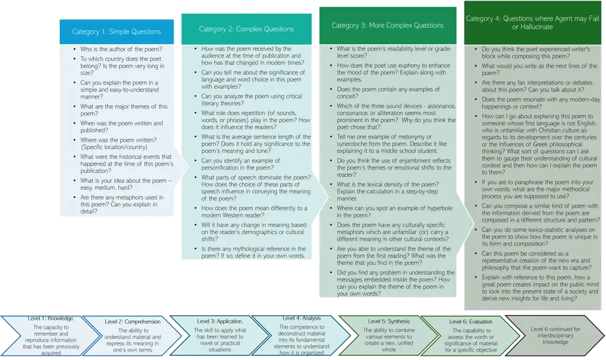
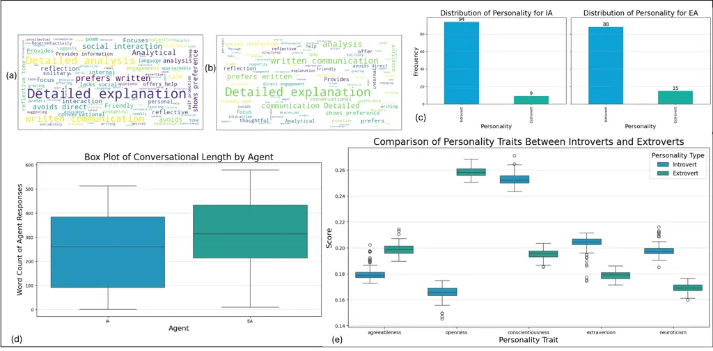

# Large Language Model Agent Personality and Response Appropriateness: Evaluation by Human Linguistic Experts, LLM-as-Judge, and Natural Language Processing Model Thanks: Citation: Authors. Title. Pages…. DOI:000000/11111.

Eswari Jayakumar Affiliation: Faculty of Computer Science
Affiliation: University of New Brunswick Affiliation: Fredericton
Email: [eswarijayakumar27@gmail.com](mailto:)    Niladri Sekhar Dash
Affiliation: Linguistic Research Unit Affiliation: Indian Statistical
Institute Affiliation: Kolkata Email: [ns_dash@yahoo.com](mailto:)   
Debasmita Mukherjee ^(†)^(†)thanks: Corresponding author
Affiliation: Department of Electrical and Computer Engineering
Affiliation: University of New Brunswick Affiliation: Fredericton
Email: [debasmita.mukherjee@unb.ca](mailto:)

###### Abstract

While Large Language Model (LLM)-based agents can be used to create
highly engaging interactive applications through prompting personality
traits and contextual data, effectively assessing their personalities
has proven challenging. This novel interdisciplinary approach addresses
this gap by combining agent development and linguistic analysis to
assess the prompted personality of LLM-based agents in a poetry
explanation task. We developed a novel, flexible question bank, informed
by linguistic assessment criteria and human cognitive learning levels,
offering a more comprehensive evaluation than current methods. By
evaluating agent responses with natural language processing models,
other LLMs, and human experts, our findings illustrate the limitations
of purely deep learning solutions and emphasize the critical role of
interdisciplinary design in agent development.

   

|     |
| --- |
|     |

*K*eywords Large Language Model-based Agent $`\cdot`$ Personality of
Agents $`\cdot`$ Linguistic Analysis $`\cdot`$ Big Five Personality
$`\cdot`$ Judge LLM $`\cdot`$ LLM-as-Judge

## 1 Introduction and Related Works

Large language model (LLM)- based agents are increasingly being used for
a wide variety of applications: from providing companionship \[1\], to
task planning \[2\], to role-playing games \[3\] to name a few. “Agents”
as the term is widely used today refer to generative agents which are
software entities that leverage generative artificial intelligence
models to simulate and mimic human behaviour and responses \[4, 5, 6,
7\]. The role of an artificial agent in interactive linguistic
activities has been an area of active research due to the basic reason
that human interactants require the agent to behave in a more human-like
manner so that responses look like to be endowed with acceptable human
qualities and efficiencies \[8, 9, 10\]. One way to humanise an agent is
to give it a task-congruent personality. An agent for disseminating
dense, medical text in easy-to-understand format to the user must
maintain a personality exuding authority while one that suggests
sightseeing tours for instance, may fare better with an extroverted,
friendly demeanour.

From a linguistic perspective, one has to incorporate linguistic
information (e.g., phonetic and phonological properties, linguistic
knowledge, information of semantics, syntax and discourse, information
from the domains of culture and society) into the agent to validate it
for consistency, appropriateness of responses, an area of research which
has not been much explored to date \[11\]. Additionally, there remains a
gap in research in proper evaluation of encoded personality in agents or
the holistic development of agents through an interdisciplinary effort.
This work thus, attempts to mitigate this gap by using natural language
processing (NLP) models, other LLMs, as well as human linguistic experts
to validate responses.

Personality of humans are assigned based on psychometric questionnaires
like the Big Five personality traits model \[12\]. This consists of
standard questions with fixed choices for response. \[13, 14, 15\] are
several previous works that administer this questionnaire to their
agents for measurement of personality traits through selection of
pre-set choices. While these are effective in validating through the
standard questionnaires, their scope is limited and cannot be used to
ensure that the responses generated by the agent in a conversation with
the user retains the prompted personality markers and in turn
behaviours. The personality markers in the conversation are required to
be maintained so as to ensure consistency in interactions and to
leverage the naturalistic speech arising from generative capabilities of
the LLM-based agent. Therefore, the need was felt to validate the
generated responses of the agent given an interaction scenario and
prompt, instead of answers to the set questionnaire. Therefore, a
flexible approach to design of a question bank is required that has been
attempted in this work by using the basis of Bloom’s taxonomy of
educational goals to foster learning \[16\].

Recent studies in personality assessment have used other LLMs as judges
\[17, 18, 19\], and NLP models \[20, 21, 22\]. A significant challenge
is that these models are black boxes. This is especially true for Judge
LLMs whose training data information is vast and may be subject to
biases that are not immediately evident during usage of their APIs or
there may be overlaps in training corpora of the judge and subject LLMs
leading to similar errors or biases. Thus, the agent’s responses would
benefit from a linguistic analysis as well and it is crucial that human
experts in personality assessment through linguistic markers be employed
for this task \[23, 24\].

## 2 Contributions

We designed an human-agent interaction task wherein an agent is provided
the context of a poem, “Dover Beach” by Matthew Arnold in order to
provide answers to user’s questions on the same. This poetry agent is an
“expert” on this poem and is prompted to respond to questions in this
capacity. We developed two agents: with introvert personality traits
(introverted agent: IA) and extrovert (extroverted agent: EA) in order
to validate that personality traits are obvious and consistent, and to
evaluate the appropriateness of the responses, an aspect of research
that is not tackled by previous works in LLM chat agents. Addressing the
limitations highlighted in current research, this study offers the
following key contributions:

- •
  Three methods are used in evaluating the responses: using natural
  language processing (NLP) models, a different LLM as judge (Judge
  LLM), and evaluation by human expert to provide comprehensive critique
  of the prompted personality.
- •
  Instead of using questions from standard and limited psychometric
  tests, we used Bloom’s taxonomy of levels of learning and linguistic
  evaluation criteria to create a flexible rationale for open-ended
  questions of increasing complexity constituting a question bank. This
  approach is field and topic agnostic and can be applied to any type of
  learning task. A detailed explanation is provided in the Methodology
  section.

## 3 Methodology for Design of Agent with Personalities

This section presents the design and evaluation considerations for the
poetry expert agents. In order to study the capacity of LLM-based agents
to demonstrate prompted personality traits for specific conversational
tasks, we developed dedicated agents that were "experts" is explaining
specific poems given as contextual documents. This task was chosen in
order to demonstrate the creativity and deep linguistic analysis that
would be required to properly explain the poem, "Dover Beach" for
different levels of understanding of the humans. For this study, the two
common personality tests selected were extraversion and introversion,
leading to the development of two agents with the same poem for
training, being posed the same questions of increasing complexity, and
then evaluation of their responses to gauge if their prompted
personality traits were evident. This particular poem was selected since
it contains a variety of literary devices and is culturally situated in
Victorian sensibilities \[25, 26, 27\] and thus is a good candidate for
a plethora of explanatory and creative questions.

### 3.1 Design of LLM-based Agent

To analyse the impact of agent personalities, Large Language Models
(LLMs) are used to create conversational agents. The conversational
agent for this work is designed as a poetry expert by training it with a
curated list of poems. The conversational agents are built using the
Langchain framework \[28\] and consists of multiple components for
creating the embeddings, and vector store to store the embeddings.
Prompting techniques are used to embed the personalities in the agents.
The agent has the capability to maintain the chat history to provide
contextual continuity, enabling the agent to generate coherent,
human-like and meaningful responses. The LLM model used for this study
is the GPT-4o mini provided by OpenAI. The framework and the components
are described in detail.

#### 3.1.1 Langchain Framework and Retrieval Augmented Generation (RAG)

The curated list of poems was first fed into the agent by using the
Directory Loaders available in the Langchain framework. The poems were
stored in a PDF file format within a folder/directory. The Directory
loaders parsed the files within the directory and loaded into the system
which are then split into multiple chunks. The OpenAI Embedding model
“text-embedding-ada-002” \[29\] is used to produce the vector
representation of the poems to generate and store the embeddings so as
to easily traverse through the external data sources (in this case,
documents containing the poems) and find the related information based
on the chat conversations. Embeddings of the poems are stored in a
vector store for storing, searching and retrieving the embeddings, in
this case, ChromaDB \[30\]. The relevant documents are retrieved from
the vector database using the semantic similarity between the user’s
query and the document information.

Langchain’s retrieval mechanism is powered by the Retrieval Augmented
Generation (RAG) technique \[31\]. It uses a retrieval chain with a
retriever to fetch relevant documents based on the user’s query and chat
history. A document chain then sends these documents, along with the
query and conversational context, to the LLM. This method provides the
LLM with external context, allowing it to generate accurate,
domain-specific responses on material—such as poetry—even if it was not
included in the original training data.

#### 3.1.2 Agent Interface

Gradio is an open-source python library which was used for creating an
interactive, user-friendly conversational chat web interface for the
agents. The users can type their thoughts and queries, the agent will in
turn provide a contextual response based on the chat history and
configured agent personality.

#### 3.1.3 Agent Personality Prompting

Using the Big Five model, personality is typically assessed along 5
dimensions according to \[32\]:

- •
  Extraversion vs. Introversion (sociable, assertive, playful vs. aloof,
  reserved, shy)
- •
  Openness to experience (intellectual, insightful vs. shallow,
  unimaginative)
- •
  Agreeableness vs. Disagreeableness (friendly, cooperative vs.
  antagonistic, faultfinding)
- •
  Conscientiousness vs. Unconscientiousness (self- disciplined,
  organised vs. inefficient, careless)
- •
  Emotional stability vs. Neuroticism (calm, unemotional vs. insecure,
  anxious)

For this study, the poetry agents are classified into two different
poetry expert agents – Introvert Agent (IA) and Extrovert Agent (EA)
trained on the specific poem “Dover Beach” given as contextual document.
The personality of both the agents are inculcated using the technique of
Prompt Engineering.

- •
  IA’s introverted nature means it will offer accurate and expert
  response without unnecessary emotions or conversations.
- •
  EA’s extroverted nature means, the agent will be talkative, social and
  friendly agent which will also be knowledgeable about the specific
  poetry.

The following prompts were given to develop the two agents:

- •
  Poetry Specialist - Introvert: You are a Canadian friendly poetry
  expert with deep knowledge of various forms and styles of poetry. Use
  the following context to answer the question like a human by quoting
  poetry lines as evidence without a lot of repetition.Tone:
  Conversational, Introverted Personality
- •
  Poetry Specialist - Extrovert You are a Canadian friendly poetry
  expert. Use the following context to answer the question like a human.
  Tone: Conversational, Extroverted Personality

### 3.2 Design of Novel Question Bank

To access the capabilities of the agents developed and validate their
adherence to the personality prompts, a comprehensive question bank was
created, addressing the limitations of existing multiple-choice
evaluations that do not assess free-form or higher-order learning
\[33\]. Existing questionnaires in literature do not test for free-form
answers and do not test for higher orders of learning. Furthermore,
since it is not theoretically possible to include the entire range of
questions that might be generated from a piece of literary text, it is
pragmatic to adopt a workable strategy that might help at the initial
stage of the application with a future scope for further augmentation of
new sets of questions produced by the end users into the question
databank of the system. Thus, we crafted a novel question bank taking
inspiration from Bloom’s taxonomy of levels of cognitive learning \[34\]
that help assess complexity of knowledge gained, merging them with
linguistic principles.

#### 3.2.1 Linguistic criteria for design of Question Bank:

From a linguistic perspective, the aim was to collect and classify a
large number of questions of increasing complexity that are possible to
generate from a poetic text into different types following other
significant rationales such as content, form, and structure of a poem,
linguistic diversities involved in the text, and the nature of questions
that can be asked by learners. All the questions are manually classified
into the following four types leading to 94 in total (samples in Figure
1).

1.  1.  Simple Questions (Bloom’s levels 1, 2): have direct answers that can
        be retrieved from the text without deep analysis. The agent simply
        needs to locate and present the information.
2.  2.  Complex Questions (Bloom’s levels 3, 4): require the agent to
        perform a detailed analysis of the text to find non-obvious answers.
        The agent must go beyond surface-level retrieval to synthesize
        information.
3.  3.  More Complex Questions (Bloom’s level 5, 6): demand critical
        analysis and may require the agent to consult external resources
        like dictionaries, encyclopedias, or language corpora to generate a
        complete answer. AI agent may help learners develop advanced
        knowledge.
4.  4.  Questions where the agent may fail (or hallucinate) (Bloom’s level 6
        across disciplines): The agent may hallucinate or fail on questions
        that are not directly answerable from the text. This includes
        queries involving imaginative, introspective, or highly nuanced
        concepts like anaphora or socio-cultural context, which are
        currently beyond the agent’s cognitive grasp. Answers may relate to
        issues of acculturalization of the content of a text based on
        sociocultural and geo-climatic backgrounds of the learners; the AI
        agent may not be trained with this information.

Figure 1: Sample questions from the novel question bank crafted in this
work based categorised by complexity and Bloom’s taxonomy of levels of
learning

## 4 Evaluation

With the agents and conversational interfaces developed, the next step
is to measure and ensure the personality of the agents are set properly
based on the configured prompts. To measure the extraversion and
introversion in each agent, we have used a Transformer model as well as
a separate LLM to validate the responses generated by the two agents to
the questions posed from our question bank.

### 4.1 Using Personality Transformer Model

For this study, we utilized a pre-trained transformer-based personality
model \[35\] to predict and perform the inferences on the agent
responses to detect the personality of the agent. This transformer model
was developed by finetuning a RoBERTA-based model \[36\] which was
already trained on a text-based sentiment analysis task. The model was
then trained end-to-end using mixed strategies such as multi-layer
perceptron (MLP) and hyper parameter tuning, thereby enabling it for
regression based, real-valued personality predictions. This model was
trained on the PANDORA dataset, which is a collection of Reddit
comments, labelled with Big five personality scores after psychometric
assessment. It is specifically designed for precise personality
detection and the outputs are five real-valued scores (between 0 and 1)
representing each personality traits: Extraversion, Agreeableness,
Conscientiousness, Neuroticism and Openness, instead of doing binary
classification such as “high” or “low” for each traits. This particular
model was selected due to its highest accuracy (80%) and robustness in
predicting the personality of textual data.

The conversations produced by the poetry agents are fed into this
transformer-based personality model for making inferences to evaluate
whether the agent is consistently reflecting the right personality on
which it is designed for. For each agent conversation, the transformer
model will generate a score for every big five personality traits, which
can be then analyzed to find out the dominant personality trait of the
agent.

### 4.2 Large Language Model as a Judge

This method involves evaluating the current LLM responses by using
another LLM as a “Judge” \[37\]. LLM as a Judge is a concept where the
Large Language Models will act as a “judge" to evaluate the responses of
the another LLM by using evaluation prompts. It is helpful for
evaluating more open-ended questions and when the evaluation task is
subjective and hard to quantify. Research shows that LLM Judges can
closely match human preferences, agreeing with the human judgements more
than 80% of the time.

For this study, we employed the Single answer grading LLM Judge approach
in which the LLM will evaluate the agent’s responses and classify the
underlying personality of each response as either Introvert or
Extrovert. The evaluation prompt defines the input to the LLM and also
specifies the format in which the Judge LLM should return its output.
The one used for this study is:

You are an intelligent and unbiased judge in personality detection with
expertise with the Big five personality model. You are to evaluate and
assign the personality for the sentences along with reasoning within 50
characters. These sentences are responses of a Poetry Specialist
conversation. Evaluate the language used and the content stressed when
evaluating these specialists and evaluate the levels of
extroversion/introversion of the specialist. Base your assessment of
this upon this definition: individuals who score high on extraversion
tend to be sociable, talkative, assertive, and active; those who score
low tend to be retiring, reserved, and cautious. Rate between only 2
levels, Extrovert and Introvert. Also provide a reasoning for your
rating.

To act as a LLM Judge, we have chosen the Google’s Gemini model, a
multimodal Large Language Model, to analyze the personality traits in
the agent responses. As these responses from Poetry agents are generated
by OpenAI LLM, we chose to use a different model as a judge to avoid
potential self-agreement bias if the same model is used for both
generating and evaluating the response.

### 4.3 Evaluation by Linguistic Experts

Our linguistic assessment uses a heuristic model to compare new and
existing information leveraging human pragmatic knowledge to provide a
more accurate measure of the agent’s precision employing four
established human assessment mechanisms:

1.  1.  Linguistic competence of native language expert: systematically
        applies the linguistic knowledge of syntax and semantics of human
        experts to assess if sentences, which are produced by the AI agent,
        are grammatically valid, conceptually relevant, easy to comprehend,
        and semantically informative to the topic under discussion.
2.  2.  Linguistic structure and content: provides scope to assess sentence
        structure (short/simple vs. large/complex), the embedding of
        dependent clauses, and any syntactic transformations used, records
        the types and varieties of lexical items (forms and meanings of the
        words), judging if they are easily comprehensible and appropriate
        for target learners.
3.  3.  Discourse and pragmatics: The linguistic knowledge of a human expert
        plays a crucial role here in examining the discourse structure and
        pragmatic level of information of a text that is prepared by an AI
        agent for human learners. Here the requirements of target learners
        and the texts produced by an AI agent are cross-examined by human
        experts to check if the generated texts are produced in accordance
        with the requirement of the learners; if the produced text is
        appropriate to a particular discourse frame (e.g., topic, situation,
        deixis, context, function) and if the inherent pragmatic constraints
        (e.g., need, motive, goal, agents, content, coherence) are rightly
        addressed in the text.
4.  4.  Contextualization: involves a human expert to critically evaluate to
        affirm or negate if the responses are actually contextualized with
        respect to the questions and the theme or content of a piece of
        text, if the actual requirement of the learners are rightly
        addressed.

## 5 Results

The questions from the question bank were posed to the agents (Introvert
Agent: IA and Extrovert Agent: EA). The agents’ responses were then
evaluated by the Personality Transformer, Judge LLM, and human
linguistic expert.

### 5.1 Evaluation by Personality Transformer and Judge LLM

The outputs of the Judge LLM were in the form of assigned personality
and reasoning. A sample of the inputs (agent responses) versus outputs
are shown for both IA and EA in Table 1 along with evaluations. The
reasonings for IA and EA were individually captured in word clouds
(Figure 2 (a) and (b) respectively). The most common reasoning used by
the Judge LLM to assess agent personality was “detailed explanation” and
its variants followed by “written communication”, “analytical”, “prefers
written”. These are common words that are used to describe an expert,
regardless of personality and they feature disproportionately over any
other personality indicators. While these reasons indicate that the LLM
agents follow the prompt well to act as an expert, there are some
glaring anomalies in terms of the personality traits assessed.

Figure 2: Evaluation Results of Chat with Introvert Agent (IA) and
Extrovert Agent (EA): (a) word cloud of Judge LLM reasoning for IA
response evaluations, (b)word cloud of Judge LLM reasoning for EA
response evaluations, (c) Frequency distribution of Personality assessed
in IA and EA responses by Judge LLM, (d) box plot of conversational
lengths of responses from IA and EA, (e) Comparison of Personality
Traits from Big Five Personality Model Between IA and EA by Personality
Transformer Model

In (b), we can see presence of the words “friendly”, “talkative”,
“social interaction”, “engagement” which are expected given the
definition of the extrovert personality, but “friendly” features more
prominently for IA versus EA which is anomalous. The IA features
“reflection”, “lacks social”, “avoids direct”, and “solitary” which are
to be expected from the definition of introverted-ness. In (c) the
frequency distribution of IA and EA shows that Judge LLM assigned
introvert personality to both agents regardless of design prompt. While
for EA, extrovert frequency is higher, but only by 4 points. This seems
to indicate that the Judge LLM is biased towards introvert traits.
Examining Table 1, EA responses contain usage of emojis, friendlier
language than the IA. Even so, these have been flagged as introvert for
both IA and EA. At odds with this assessment, is Figure 2 (d) which
shows the box plots of conversational lengths of IA and EA. As is
expected from a friendly, outgoing, engaging demeanour, the
conversational length of EA is on average higher than IA. This fact and
that the EA uses emojis in all conversations should have indicated to
the Judge LLM that there are strong extrovert traits, but they failed to
register in the reasoning.

For assessment by the personality transformer, the outputs were
continuous values between 0 and 1 between the five traits with the total
of the five adding up to 1. The highest score for IA across all
responses was for conscientiousness which is in-accord with being as
“expert” while this is not reflected by EA, even though the responses
given by EA and IA contain the same information for each question, as
evaluated by the human expert. In Figure 2 (e), openness is highest for
EA. While some research maintain that the five traits are independent
\[38\], numerous other studies and meta-analyses have reported
significant intercorrelations among the Big Five traits \[39\], and
extraversion and openness often exhibit a positive correlation \[39\].
Yet, this consideration has not permeated in NLP or Deep Learning
research or the datasets available to train models. Therefore, a pure
NLP or Judge LLM approach cannot suffice in identifying prompted
personality in LLM-based agents.

The correlations between the traits aside, if we were to treat the
traits as independent as the transformer has been trained for, we can
ignore the other traits and only consider the extraversion one. For both
agents, extraversion scores are low indicating that both agents are
highly introverted, with another anomalous observation that extraversion
is lower for EA than for IA. This observation that both agents are
indicated as introverted is strongly explained by the fact that the
transformer model used is trained on the PANDORA dataset \[40\] which is
a dataset of Reddit comments of 10k users. The dataset is unbalanced
with number of extrovert users (1920) much lower than introvert (7134).
This may indicate a strong plausibility of biasing the transformer which
led to both agents in this work to be indicated with high introversion.
While we do not know what the Judge LLM has been trained on, but it too
is biased towards introverted traits much like the transformer. Thus,
both instances suggest that the responses be evaluated by human
linguistic experts.

![[Uncaptioned
image]](arxiv-2510-23875v1--d8c3167cff91.figures/figure-3.webp)

Table 1: Sample User and Agent Responses along with assessment by Human
Expert

### 5.2 Evaluation by Linguistic Experts

Preliminary assessments demonstrate that correct personality is evident
from most conversations while answers to the first three category of
questions may contain incorrect responses. This is a consequence of the
lack of training material for the agent. A critical observation is the
system’s inconsistent ability to interpret data reflecting personality
traits. This highlights a fundamental challenge in truly aligning LLM
cognition with the complexities of human understanding. Consequently, we
cannot yet claim that the system consistently generates correct or
reliable answers. Furthermore, the current iteration exhibits
variability in its information delivery; at times, it provides excessive
detail, while in other instances, simple queries receive inadequate
responses. Sometimes, the evaluations by the expert and the NLP model
are at odds regarding the assessed personalities (Table 1). This lends
more weight to the inference that the NLP model is biased: even in the
instances where personality is not clearly indicated (observed from
expert comments), the model assigns introvert personality.

Both agents perform much better when questions are meant for complex and
more complex questions: answers are more organized, systematic,
to-the-point and explicit. The degree of clarity and the pattern of
representation of information are quite cohesive thereby giving learners
better understandings of the themes and composition of the poem. Except
in one example (i.e., the use of anaphora) all the questions, which
require elaborate and critical replies, are well responded by the AI
agent.

In conclusion, the agents sometimes struggled to consistently interpret
complex literary concepts and personality traits. Biases in the NLP
models and the Judge LLM also made agent evaluations unreliable. To fill
this gap, we will undertake psychometric testing of agent responses by
participants as well as mitigate the bias of the NLP model.

## References

- \[1\] Zhenyu Xu, Hailin Xu, Zhouyang Lu, Yingying Zhao, Rui Zhu,
  Yujiang Wang, Mingzhi Dong, Yuhu Chang, Qin Lv, Robert P. Dick, Fan
  Yang, Tun Lu, Ning Gu, and Li Shang. Can large language models be good
  companions? an llm-based eyewear system with conversational common
  ground, 2023.
- \[2\] Cong Zhang, Derrick Goh Xin Deik, Dexun Li, Hao Zhang, and Yong
  Liu. Planning with multi-constraints via collaborative language
  agents, 2024.
- \[3\] Quan Tu, Shilong Fan, Zihang Tian, and Rui Yan. Charactereval: A
  chinese benchmark for role-playing conversational agent
  evaluation, 2024.
- \[4\] Zhiqiu Xia, Lang Zhu, Bingzhe Li, Feng Chen, Qiannan Li, Chunhua
  Liao, Feiyi Wang, and Hang Liu. Analyzing 16,193 llm papers for fun
  and profits, 2025.
- \[5\] Debasmita Mukherjee and Kimia Poozesh. Towards inclusive
  gendered embodiment: Designing ai agents based on sociological gender
  theories. In ACM Multimedia Asia (MMAsia ’25). ACM, 2025.
- \[6\] Debasmita Mukherjee and Homayoun Najjaran. Statistically
  informed multimodal (domain adaptation by transfer) learning
  framework: A domain adaptation use-case for industrial human–robot
  communication. Electronics, 14(7):1419, 2025.
- \[7\] Debasmita Mukherjee. Statistically-informed multimodal domain
  adaptation in industrial human-robot collaboration environments. PhD
  thesis, University of British Columbia, 2023.
- \[8\] Umarpreet Singh and Parham Aarabhi. Can ai have a personality?
  pages 205–206, 06 2023.
- \[9\] Debasmita Mukherjee, Kashish Gupta, and Homayoun Najjaran. An
  ai-powered hierarchical communication framework for robust human-robot
  collaboration in industrial settings. In 2022 31st IEEE International
  Conference on Robot and Human Interactive Communication (RO-MAN),
  pages 1321–1326. IEEE, 2022.
- \[10\] Debasmita Mukherjee, Kashish Gupta, and Homayoun Najjaran. A
  critical analysis of industrial human-robot communication and its
  quest for naturalness through the lens of complexity theory. Frontiers
  in Robotics and AI, 9, 2022.
- \[11\] Maciej Karwowski, Izabela Lebuda, Ewa Wisniewska, and Jacek
  Gralewski. Big five personality traits as the predictors of creative
  self-efficacy and creative personal identity: Does gender matter? The
  Journal of creative behavior, 47:215–232, 09 2013.
- \[12\] Sonia Roccas, Lilach Sagiv, Shalom H. Schwartz, and Ariel
  Knafo. The big five personality factors and personal values.
  Personality and Social Psychology Bulletin, 28:789 – 801, 2002.
- \[13\] Graham Caron and Shashank Srivastava. Identifying and
  manipulating the personality traits of language models, 2022.
- \[14\] Guangyuan Jiang, Manjie Xu, Song-Chun Zhu, Wenjuan Han, Chi
  Zhang, and Yixin Zhu. Evaluating and inducing personality in
  pre-trained language models, 2023.
- \[15\] Keyu Pan and Yawen Zeng. Do llms possess a personality? making
  the mbti test an amazing evaluation for large language models, 2023.
- \[16\] B.S. Bloom and D.R. Krathwohl. Taxonomy of Educational
  Objectives: The Classification of Educational Goals. Number v. 1 in
  Taxonomy of Educational Objectives: The Classification of Educational
  Goals. Longmans, Green, 1956.
- \[17\] Jinlan Fu, See-Kiong Ng, Zhengbao Jiang, and Pengfei Liu.
  Gptscore: Evaluate as you desire, 2023.
- \[18\] Fabrizio Gilardi, Meysam Alizadeh, and Maël Kubli. Chatgpt
  outperforms crowd workers for text-annotation tasks. Proceedings of
  the National Academy of Sciences, 120(30), July 2023.
- \[19\] Lianmin Zheng, Wei-Lin Chiang, Ying Sheng, Siyuan Zhuang,
  Zhanghao Wu, Yonghao Zhuang, Zi Lin, Zhuohan Li, Dacheng Li, Eric P.
  Xing, Hao Zhang, Joseph E. Gonzalez, and Ion Stoica. Judging
  llm-as-a-judge with mt-bench and chatbot arena, 2023.
- \[20\] Sverker Sikström, Ieva Valavičiūtė, and Petri Kajonius.
  Personality in just a few words: Assessment using natural language
  processing. Personality and Individual Differences, 238:113078, 2025.
- \[21\] Dipika Jain, Akshi Kumar, and Rohit Beniwal. Personality bert:
  A transformer-based model for personality detection from textual data.
  In Ali Kashif Bashir, Giancarlo Fortino, Ashish Khanna, and Deepak
  Gupta, editors, Proceedings of International Conference on Computing
  and Communication Networks, pages 515–522, Singapore, 2022. Springer
  Nature Singapore.
- \[22\] S Bhavya, Anitha S Pillai, and Giuliana Guazzaroni. Personality
  identification from social media using deep learning: a review. Soft
  Computing for Problem Solving: SocProS 2018, Volume 2, pages
  523–534, 2020.
- \[23\] Melanie Mitchell and David C Krakauer. The debate over
  understanding in ai’s large language models. Proceedings of the
  National Academy of Sciences, 120(13):e2215907120, 2023.
- \[24\] Laura Parks-Leduc, Gilad Feldman, and Anat Bardi. Personality
  traits and personal values: A meta-analysis. Personality and Social
  Psychology Review, 19(1):3–29, 2015.
- \[25\] Nils Clausson. Arnold’s coleridgean conversation poem: ’dover
  beach’ and ’the eolian harp’. Papers on Language and Literature,
  44:276–304, 11 2015.
- \[26\] He Tang and CHEN author). On the sea image in dover beach.
  Journal of Literature and Art Studies, 12, 08 2022.
- \[27\] Euis Meinawati and Lisnawati Lisnawati. Imagery in dover beach
  poem: Psychoanalytic perspective. Wanastra: Jurnal Bahasa dan Sastra,
  12:65–72, 03 2020.
- \[28\] Oguzhan Topsakal and T. Cetin Akinci. Creating large language
  model applications utilizing langchain: A primer on developing llm
  apps fast. International Conference on Applied Engineering and Natural
  Sciences, 1:1050–1056, 07 2023.
- \[29\] OpenAI. New and improved embedding model, 2022.
- \[30\] James Jie Pan, Jianguo Wang, and Guoliang Li. Survey of vector
  database management systems, 2023.
- \[31\] Patrick Lewis, Ethan Perez, Aleksandra Piktus, Fabio Petroni,
  Vladimir Karpukhin, Naman Goyal, Heinrich Küttler, Mike Lewis, Wen tau
  Yih, Tim Rocktäschel, Sebastian Riedel, and Douwe Kiela.
  Retrieval-augmented generation for knowledge-intensive nlp
  tasks, 2021.
- \[32\] Francois Mairesse, Marilyn Walker, Matthias Mehl, and Roger
  Moore. Using linguistic cues for the automatic recognition of
  personality in conversation and text. J. Artif. Intell. Res. (JAIR),
  30:457–500, 09 2007.
- \[33\] Yuzhen Huang, Yuzhuo Bai, Zhihao Zhu, Junlei Zhang, Jinghan
  Zhang, Tangjun Su, Junteng Liu, Chuancheng Lv, Yikai Zhang, Jiayi Lei,
  Yao Fu, Maosong Sun, and Junxian He. C-eval: A multi-level
  multi-discipline chinese evaluation suite for foundation models, 2023.
- \[34\] Benjamin S Bloom, Max D Engelhart, EJ Furst, Walker H Hill, and
  David R Krathwohl. Handbook i: cognitive domain. New York: David
  McKay, pages 483–498, 1956.
- \[35\] Rong Wang and Kun Sun. Continuous output personality detection
  models via mixed strategy training, 2024.
- \[36\] Jose Camacho-Collados, Kiamehr Rezaee, Talayeh Riahi, Asahi
  Ushio, Daniel Loureiro, Dimosthenis Antypas, Joanne Boisson, Luis
  Espinosa-Anke, Fangyu Liu, Eugenio Martínez-Cámara, Gonzalo Medina,
  Thomas Buhrmann, Leonardo Neves, and Francesco Barbieri. Tweetnlp:
  Cutting-edge natural language processing for social media, 2022.
- \[37\] Lianmin Zheng, Wei-Lin Chiang, Ying Sheng, Siyuan Zhuang,
  Zhanghao Wu, Yonghao Zhuang, Zi Lin, Zhuohan Li, Dacheng Li, Eric P.
  Xing, Hao Zhang, Joseph E. Gonzalez, and Ion Stoica. Judging
  llm-as-a-judge with mt-bench and chatbot arena, 2023.
- \[38\] Sonia Roccas, Lilach Sagiv, Shalom Schwartz, and Ariel
  Knafo-Noam. The big five personality factors and personal values.
  Personality and Social Psychology Bulletin, 28:789–801, 06 2002.
- \[39\] Dimitri Linden and Jan te Nijenhuis. The general factor of
  personality: A meta-analysis of big five intercorrelations and a
  criterion-related validity study. Journal of Research in Personality,
  44:315–327, 06 2010.
- \[40\] Matej Gjurković, Mladen Karan, Iva Vukojević, Mihaela Bošnjak,
  and Jan Šnajder. Pandora talks: Personality and demographics on
  reddit, 2021.
