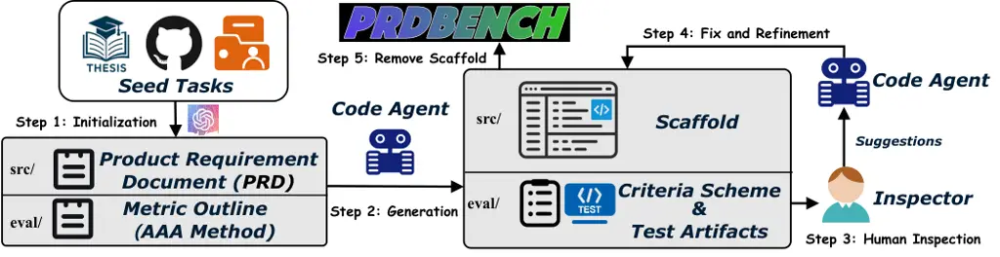
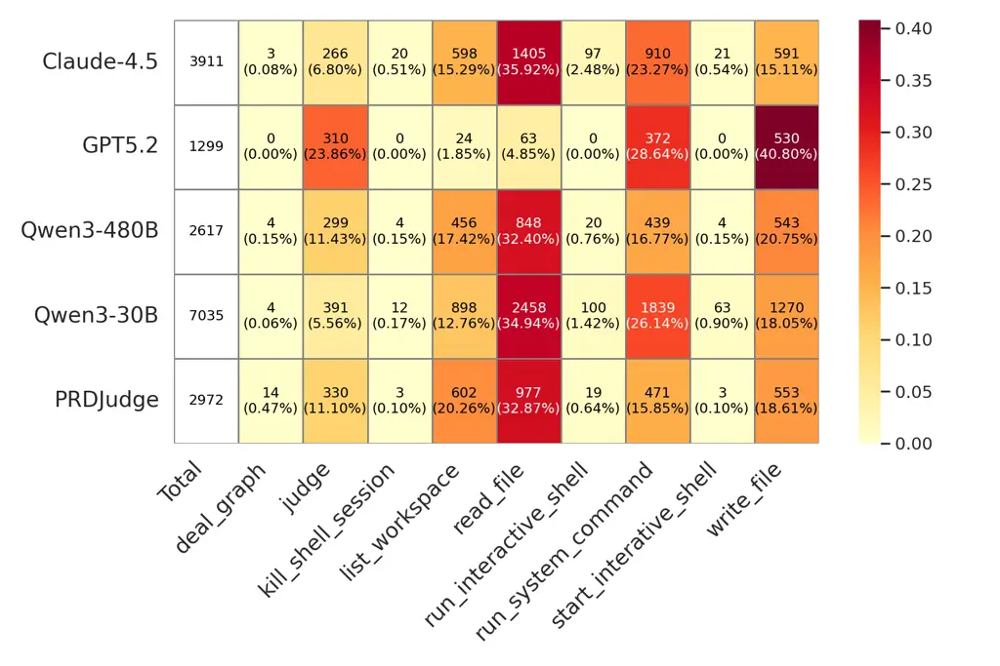
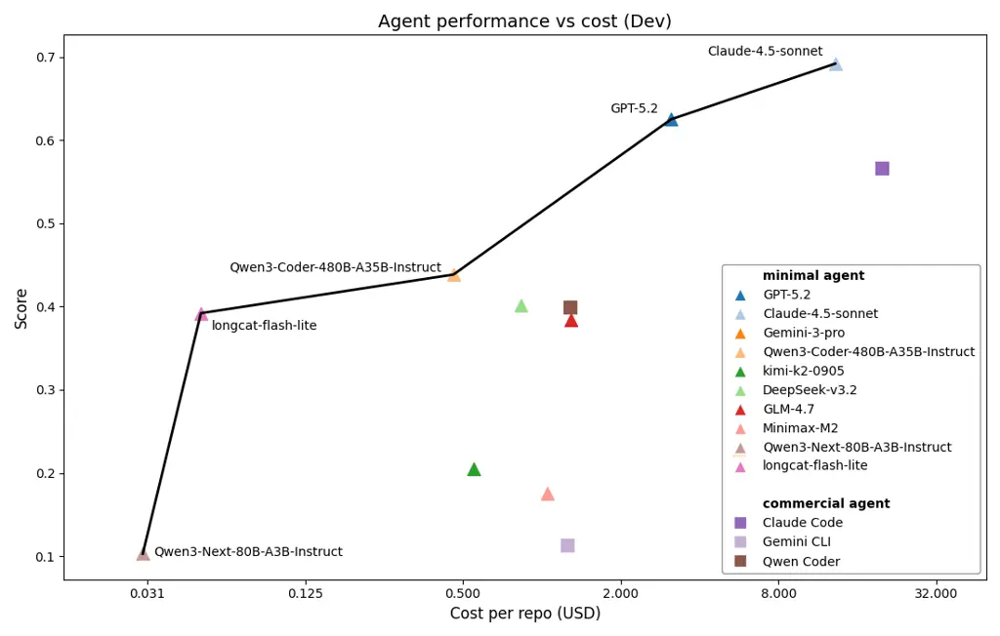
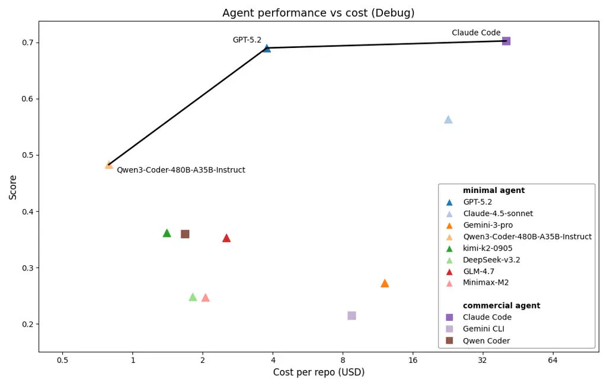

\doi

HJFB4234 C. Amato, L. Dennis, V. Mascardi, J. Thangarajah (eds.)

# Automatically Benchmarking LLM Code Agents through Agent-driven Annotation and Evaluation

Conference: Proc. of the 25th International Conference on Autonomous
Agents and Multiagent Systems (AAMAS 2026); May 25 – 29, 2026; Paphos,
Cyprus

Lingyue Fu Note: Work done while intern at Meituan.
Affiliation: Shanghai Jiao Tong University, Shanghai, China , Bolun
Zhang Affiliation: Shanghai Jiao Tong University, Shanghai, China , Hao
Guan Affiliation: Shanghai Jiao Tong University, Shanghai, China ,
Yaoming Zhu Affiliation: Meituan, Shanghai, China , Lin Qiu
Affiliation: Meituan, Shanghai, China , Weiwen Liu Note: Corresponding
Author. wwliu@sjtu.edu.cn, wnzhang@sjtu.edu.cn, yyu@sjtu.edu.cn.
Affiliation: Shanghai Jiao Tong University, Shanghai, China , Xuezhi Cao
Affiliation: Meituan, Shanghai, China , Xunliang Cai
Affiliation: Meituan, Shanghai, China , Weinan Zhang
Affiliation: Shanghai Jiao Tong University, Shanghai, China and Yong Yu
Affiliation: Shanghai Jiao Tong University, Shanghai, China

2026

###### Abstract.

Recent advances in code agents have enabled automated software
development at the project level, supported by large language models
(LLMs). However, existing benchmarks for code agent evaluation face two
major limitations. First, creating high-quality project-level evaluation
datasets requires extensive domain expertise, leading to prohibitive
annotation costs and limited diversity. Second, while recent
Agent-as-a-Judge paradigms address the rigidity of traditional unit
tests by enabling flexible metrics, their reliance on In-Context
Learning (ICL) with general LLMs often results in inaccurate assessments
that misalign with human standards. To address these challenges, we
propose an agent-driven benchmark construction pipeline that leverages
human supervision to efficiently generate diverse project-level tasks.
Based on this, we introduce PRDBench, comprising 50 real-world Python
projects across 20 domains, each with structured Product Requirement
Documents (PRDs) and comprehensive criteria. Furthermore, to overcome
the inaccuracy of general LLM judges, we propose a highly reliable
evaluation framework powered by a specialized, fine-tuned model. Based
on Qwen3-Coder-30B, our dedicated PRDJudge achieves over 90% human
alignment in fixed-interface scenarios. Extensive experiments
demonstrate that our suite provides a scalable, robust, and highly
accurate framework for assessing state-of-the-art code agents.

###### Keywords: 

Code Agent, Evaluation, Agent-as-a-Judge

## 1. Introduction

In recent years, code agents have made significant progress, capable of
solving increasingly complex programming tasks. From initially focusing
on single-file code generation to now advancing towards complete
project-level software development, Code Agents are demonstrating
powerful capabilities in building comprehensive systems. LLM-based Code
Agents such as CursorAgent (Inc., 2025), Claude Code (Anthropic, 2025a)
and Gemini CLI (Mullen and Salva, 2025) have been widely adopted in
real-world development scenarios, accelerating the proliferation of
automated programming tools.

As code agents continue to advance, a variety of benchmarks have emerged
to evaluate their capabilities. Several works (Chan et al., 2024; Huang
et al., 2024; Daghighfarsoodeh et al., 2025) focus on assessing LLMs and
code agents in data science tasks, including subtasks such as data
processing and machine learning training. Other benchmarks (Jimenez et
al., 2023; Fu et al., 2025; Vergopoulos et al., 2025) select complex
code repositories from GitHub pull requests and transform them, often
with minimal human intervention, into testable scenarios. In addition,
PaperBench (Starace et al., 2025) evaluates the ability of agents to
reproduce paper-level code implementations, providing a more rigorous
assessment of their research reproducibility.

| Benchmark                         | Area                    | \# Project | Annotator     | \# Metrics | Judger           | Claude Code Score |
| --------------------------------- | ----------------------- | ---------- | ------------- | ---------- | ---------------- | ----------------- |
| SWE-Bench (Jimenez et al., 2023)  | Pull Requests           | 12         | Web Crawler   | 2,294      | Unit Test        | 70.3%^(∗)         |
| MLEBench (Chan et al., 2024)      | AI Competition          | 75         | Human         | 75         | Test Set         | 51.1%             |
| DevAI (Zhuge et al., 2024)        | Developement            | 55         | Human         | 365        | Agent            | 73.0%^(†)         |
| PaperBench (Starace et al., 2025) | AI Research             | 20         | Human (PhD.)  | 8,316      | Human/LLM        | 21.0%             |
| PRDBench                          | Engineering Development | 50         | Agent & Human | 1,258      | Agent (PRDJudge) | 45.5%             |

Table 1. Comparison between PRDBench and project-level code agent
benchmarks. We employ the performance of code agents with Claude as a
benchmark indicator for assessing the task difficulty of our proposed
evaluation suite. The results from external report (Anthropic, 2025a) is
denoted by $`*`$, from our implementation is denoted by $`\dagger`$,
otherwise we use the best results from the original paper with author
specified Claude-driven agents.

Despite these advancements, current benchmarks face two major
limitations. First, the creation of high-quality evaluation datasets
requires substantial human effort and expertise. Generating reliable
unit tests or grading tasks often depends on expert annotators,
especially when migrating real-world scenarios such as Kaggle
competitions or GitHub pull requests. These tasks demand domain-level
verification and annotation to produce usable test cases. As code agents
advance rapidly, the requirements for annotators’ expertise and time
investment continue to increase. For example, PaperBench (Starace et
al., 2025) recruited ICML authors as annotators, with each annotation
task demanding several days of work from PhD-level experts. This process
not only incurs high annotation costs, but also restricts the diversity
of evaluation data, as recruiting experts from various domains is
challenging and often leads to datasets being sourced from a single
domain.

Second, the rigidity of the evaluation limits the broad applicability of
current benchmarks. Existing benchmarks (Jimenez et al., 2023) primarily
rely on unit test pass rates to assess code agent performance. While
unit tests are effective for verifying specific functions or components,
they are limited in scope and overly restrictive, enforcing strict
requirements on project interfaces and implementation details. To
address this rigidity and introduce broader validation methods, recent
works have explored LLM-as-a-Judge or Agent-as-a-Judge paradigms.
However, these approaches predominantly rely on In-Context Learning
(ICL), using zero-shot or few-shot prompts to guide general-purpose LLMs
for specific scoring tasks. Relying solely on ICL for complex,
project-level evaluation often leads to inaccurate assessments. General
LLMs struggle to correctly interpret intricate execution logs or subtle
file differences, resulting in significant misalignment with human
judgments. For instance, the LLM judger introduced in
PaperBench (Starace et al., 2025) achieves a maximum human alignment
rate of only 83%. Thus, achieving both evaluation flexibility and high
scoring accuracy remains a critical challenge.

To address the two aforementioned challenges, we propose an agent-driven
construction approach that enables the creation of project-level
benchmarks with flexible metrics at low human cost. Specifically, a
state-of-the-art code agent is used to generate both the project
scaffolding and a Product Requirement Document (PRD) along with an
executable criteria scheme. Human annotators are only required to verify
whether the criteria scheme is compatible with the scaffolding
interfaces and whether the expected outputs are reasonable, without the
need to manually create detailed evaluation standards or reference
solutions. This significantly reduces annotation complexity: for
PRDBench, annotators with undergraduate-level knowledge in software
engineering related fields are able to complete the annotation, with an
average of only eight hours needed to finish the scaffolding and metrics
for each project, greatly improving annotation efficiency.

Based on this approach, we build a Product Requirement
Document (PRD)-centered benchmark, named PRDBench¹¹ 1 Source of PRDBench
is available in
[https://github.com/AGI-Eval-Official/PRDBench](https://github.com/AGI-Eval-Official/PRDBench)..
PRDBench consists of 50 real-world coding tasks, each defined by a
structured PRD, a well-specified and verifiable criteria scheme, and a
standard solution code repository. The coding tasks are sourced from
real-world requirements, academic projects, and thesis work, spanning 20
common subdomains. For each task, the PRD provides a criteria scheme
that facilitates comprehensive human-like quality assurance (QA) checks.
We present a comparison between PRDBench and previous code agent
benchmarks in Table 1, where PRDBench offers a comprehensive,
multifaceted, project-level benchmark for code agents. During
evaluation, we employ the Agent-as-a-Judge paradigm to score code
according to the criteria scheme, enabling the evaluation of a wide
range of test types beyond unit tests. However, relying on off-the-shelf
general LLMs as judges often leads to instability and hallucinations in
complex project-level assessments. To ensure highly reliable evaluation,
we further introduce a specialized, fine-tuned PRDJudge based on
Qwen3-Coder-30B. By training on a curated dataset of evaluation
trajectories, our dedicated PRDJudge overcomes the limitations of
general models, achieving an over 90% human alignment rate in
fixed-interface scenarios.

In summary, our contributions include:

- •
  We design an agent-driven data production pipeline, where human
  supervision guides agents to efficiently generate challenging test
  cases that go beyond current agents capabilities. This pipeline
  alleviates the need for expertise annotators.
- •
  We construct PRDBench, which covers 20 common domains in Python
  software development. Each benchmark item includes a PRD and
  evaluation metrics, and we design three categories of agent-friendly
  test types for comprehensive evaluation.
- •
  We adopt the Agent-as-a-Judge paradigm powered by a specialized
  fine-tuned model. Based on Qwen3-Coder-30B, our PRDJudge²² 2 Model
  weights are publicly available at:
  [https://huggingface.co/AGI-Eval/PRDjudge](https://huggingface.co/AGI-Eval/PRDjudge)
  achieves over 90% human alignment in fixed-interface scenarios,
  enabling flexible, human-like QA assessment beyond traditional unit
  tests.
- •
  We conduct extensive experiments on PRDBench, detailing the training
  process and data construction of the evaluation agent, and providing
  useful insights into both state-of-the-art code agents and the
  evaluation paradigm.



Figure 1. Overview of the PRDBench data production workflow. Step1: PRD
and Test Plan Initialization; Step 2: Code Scaffold and Criteria Scheme
Generation; Step 3: Human Inspection; Step 4: Agent-based Fix and
Refinement; Step 5: Remove scaffold.

## 2. Related Work

### 2.1. Code Agent Evaluation

To keep pace with the rapid development of LLMs’ and agents’ coding
capabilities, recent benchmarks increasingly emphasize the construction
of executable and complex tasks within real software projects. These
benchmarks are typically built by mining human-generated data from
online platforms or through extensive manual annotation. Some
benchmarks (Li et al., 2024a; Huang et al., 2024) require annotators to
manually create test points for each step, while others (Jimenez et al.,
2024; Yang et al., 2024; Pan et al., 2024; Wu et al., 2024; Hai et al., 2025) rely on authentic submission records, using the inherent
difficulty of submitted code as a basis for evaluation. Additionally,
some benchmarks (Li et al., 2024b; Zhuo et al., 2025; Peng et al., 2024)
leverage existing resources and require expert-driven rewriting, which
demands significant manual effort. As code agents become more capable,
these annotation paradigms require increasingly specialized expertise,
making the recruitment of expert annotators for each domain costly and
limiting the scalability and diversity of benchmark construction.

In terms of evaluation metrics, most existing benchmarks adopt
relatively narrow criteria, such as unit test pass rates (Jimenez et
al., 2023; Li et al., 2024a; Xiang et al., 2025), which primarily assess
functional correctness. ProjectEval (Liu et al., 2025) simulates user
interaction to evaluate projects, focusing on specific types of tasks.
However, these evaluation criteria are limited to specific task types
and cannot comprehensively assess diverse, complex software projects.

Figure 2. A task example of PRDBench.

### 2.2. Agent-as-a-Judge

Due to the inherent limitations of unit test-based benchmarks, recent
studies have begun to explore the use of LLMs as judges for agent
evaluation, a paradigm often referred to as LLM-as-a-Judge. LLMs can
provide capabilities such as image recognition (Chen et al., 2024), code
alignment (Weyssow et al., 2024), and question-answering (Ho et al.,
2025), breaking the restriction that benchmark metrics must be
executable. With the emergence of agents equipped with tools, LLMs are
able to read large volumes of files and perform extensive analyses,
offering new possibilities for evaluation. DevAI (Zhuge et al., 2024) is
the first work to apply the agent-as-a-judge paradigm to code agent
evaluation. It focuses on checking program execution and output format,
but lacks comprehensive assessment of overall engineering effectiveness.
Some studies(Wang et al., 2025), have explored LLM-based agent
frameworks for evaluating code generation, improving the accuracy of
Agent-as-a-Judge through architectural innovations. However, the lack of
well-defined metrics and code agents has limited the use of
agent-as-a-judge. PRDBench fills this gap with structured criteria and
dedicated tools, enabling more robust evaluation.

### 2.3. Fine-tuned LLMs as Judges

Recent studies suggest that for most tasks, evaluating outputs is
inherently easier than generating them (AI, 2024), motivating a line of
work that fine-tunes smaller open-source LLMs as dedicated judges.
PandaLM (Wang et al., 2024), Prometheus (Kim et al., 2024), JudgeLM (Zhu
et al., 2025), and Auto-J (Li et al., 2023) demonstrate that fine-tuned
models of 7B–33B parameters can match or even surpass GPT-4 on targeted
evaluation tasks, while offering significant advantages in cost, speed,
and privacy. Notably, Huang et al. (Huang et al., 2025) further reveal
that such fine-tuned judges essentially operate as highly effective
task-specific classifiers, consistently achieving state-of-the-art
performance on in-domain benchmarks. These findings motivate our
approach of fine-tuning a dedicated PRDJudge specifically for
project-level code evaluation, where domain-specific expertise is
critical for accurate and reliable scoring.

## 3. PRDBench

### 3.1. Seed Tasks

Our seed tasks are carefully curated from three primary sources to
ensure diversity and real-world relevance: (1) real-world user
development requests collected from an internal AI product development
platform; (2) publicly available final projects from Computer Science
(CS) courses hosted on GitHub; and (3) code reproduction tasks derived
from academic theses in the CS domain. To ensure the suitability and
consistency of tasks for PRDBench, we apply a rigorous filtering
process. Specifically, we require that each selected task can be fully
implemented in Python and that all its associated datasets are publicly
accessible. We choose Python as the programming language for PRDBench
primarily due to its versatility and comprehensive ecosystem, which
supports a wide range of programming paradigms and application domains.
This ensures that PRDBench tasks are representative of diverse,
real-world scenarios.

### 3.2. Agent-Driven Data Production

Figure 1 illustrates the agent-driven data production workflow of
PRDBench. Throughout the annotation process, we apply SOTA code agents
to generate the project scaffold and criteria scheme. Human annotators
are only required to supervise the quality of criteria scheme, i.e.,
whether the criteria aligns with the scaffold interfaces and whether the
expected outputs meet the requirements specified in the PRD. It is worth
mentioning that manual metric annotation and code modification are not
necessary, which greatly reduces both the complexity and time required
for annotation.

Step 1: PRD and Test Plan Initialization. After selecting seed tasks, we
utilize code agents (such as Claude Code) to generate detailed and
standardized PRD documents, ensuring clarity and completeness in task
specification. The PRD serves as the evaluation blueprint for PRDBench,
and includes sections such as Requirement Overview, Functional
Requirements, and Data Requirements. Based on the PRD, we employ GPT-4.1
to generate a corresponding metric outline, structuring test cases using
the Arrange-Act-Assert (AAA) methodology (Wei et al., 2025). The Arrange
step sets up the test case by preparing the necessary files, input data,
and environment configurations. The Act step focuses on the core
behavior to be tested, such as running the program or performing
interaction tests to obtain output results. The Assert step verifies the
expected outcomes by checking the system’s response or state, ultimately
determining whether the test passes or fails. This structure is
applicable to a wide range of code-related testing scenarios, providing
PRDBench with a executable testing plan.

Figure 3. Domain distribution of PRDBench.

Step 2: Scaffold and Criteria Generation. After initializing with the
PRDs and metric outlines, we employ state-of-the-art code agents to
generate the code scaffold for each task. The scaffold includes both
module design and interface design, serving as the core framework of the
entire project. In some cases, particularly for complex algorithms, the
implementation may not be fully correct as long as it does not affect
the annotation process. Building upon the scaffold, we further utilize
code agents to expand and refine the metric outline into a specific
criteria scheme, which includes necessary test interfaces and test
artifacts. The presence of well-defined code interfaces in the scaffold
simplifies and standardizes the generation of the criteria scheme,
making the process more efficient and consistent.

Step 3: Human Inspection. With the scaffold and the criteria scheme in
place, the inspection process for human annotators becomes
straightforward. Annotators conduct inspection only by running the tests
to verify whether the interfaces function correctly and whether the
expected outputs in the criteria scheme align with the PRD requirements.
Notably, even for tasks sourced from expertise projects or academic
papers, annotators only need basic computer science knowledge to perform
effective annotation.

Step 4: Agent-Based Fix and Refinement. If any issues are identified
during step 3, annotators shall provide targeted feedback to the code
agent for refining the scaffold or criteria scheme. The code agent then
revises the relevant components, and the inspection process is repeated.
This iterative process continues until all issues are resolved. To
ensure the rigorous quality and sufficient complexity of our benchmark,
we establish a strict inclusion criterion: only tasks that have
undergone at least 5 rounds of such iterative human-agent refinement are
retained.

Step 5: Remove Scaffold. Finally, the scaffold is removed, retaining
only the PRD, criteria scheme, test artifacts, and data. This forces the
evaluated agents to generate code from scratch, enabling a rigorous
assessment of their end-to-end development capabilities.

An overall example of a PRDBench task is illustrated in Figure 2. Each
PRDBench testcase consists of a PRD document and an evaluation suite,
which includes a criteria scheme and test artifacts.

### 3.3. Data Statistics

PRDBench comprises 50 project-level Python tasks that span 20 distinct
application domains. To ensure broad and balanced coverage, we utilized
GPT-4 to assign domain labels to all candidate tasks before
strategically sampling the final dataset. As illustrated in Figure 3, we
include at least one representative task from less common domains. For
more prevalent areas, such as data processing and machine learning, we
select tasks that demand a diverse array of technical approaches and
sub-skills. This sampling strategy ensures that PRDBench accurately
represents diverse, real-world Python development scenarios.

Figure 4. Scaffold line counts distribution.

These tasks exhibit substantial complexity. On average, each structured
PRD contains 105.22 lines of detailed requirements. Furthermore,
Figure 4 presents the distribution of scaffold line counts recorded
during the annotation process, highlighting the realistic scale of the
projects.

For comprehensive evaluation, PRDBench encompasses a total of 1,258
evaluation metrics. These metrics collectively simulate the different
stages of quality assurance (QA) in real-world software engineering and
are categorized into three main types:

- •
  Unit Test (408 metrics): As in previous benchmark studies (Jimenez et
  al., 2023), unit tests remain the most effective approach for
  verifying the functional correctness of individual components and
  modules. PRDBench retains this rigorous testing paradigm and provides
  auxiliary pytest-based test scripts.
- •
  Shell Interaction (732 metrics): For tasks involving command-line
  interaction or external system operations, predefined shell commands
  are executed to compare actual outputs against expected results. This
  ensures the code correctly handles system-level operations and user
  inputs. PRDBench supplies comprehensive simulated user input files and
  program entry commands for this purpose.
- •
  File Comparison (118 metrics): For project-level tasks that generate
  files or require specific directory structures, the produced artifacts
  are compared against reference solutions to verify correctness in
  content, format, and organization. PRDBench provides the raw data for
  target file generation, the corresponding Python commands, and the
  reference solution files.

## 4. PRDJudge

In this section, we present PRDJudge, a specialized evaluation agent
developed to automatically and reliably assess code submissions on
PRDBench. We elaborate on its tool-augmented evaluation framework, and
the fine-tuning methodology designed to align its scoring with human
standards.

### 4.1. Evaluation Framework

Figure 5. Overview of PRDJudge. PRDJudge executes tests based on the
criteria scheme using various tools, compares outputs (files or results)
with expected outputs, and generates a report for the submitted code.

To automate the validation of code generated by code agents, we
introduce PRDJudge, a lightweight evaluation agent tailored for the
predefined criteria schemes of PRDBench (illustrated in Figure 5). For
each item in the criteria scheme, PRDJudge leverages the executable
terminal commands and expected outputs provided by the benchmark to
conduct systematic verification.

To interact effectively with the testing environment, PRDJudge is
equipped with six core tools, including file reading and writing,
command-line execution, image handling, and a specialized judge tool.
Among these, the deal graph tool offers a multimodal LLM interface
(powered by GPT-4o in this paper), allowing the agent to process visual
outputs by submitting both the image and a descriptive prompt to obtain
verification results—this is particularly useful for tasks requiring UI
or plot validation. Furthermore, the judge tool is specifically designed
for PRDBench. It accepts files containing simulated user inputs,
enabling the generation of comprehensive terminal logs for thorough
analysis without the need for manual input specification.

By leveraging this toolset, PRDJudge automatically adapts to specific
code repositories and seamlessly executes the three categories of tests
(Unit Test, Shell Interaction, and File Comparison) defined in
Section 3.3. Since all supporting files and test categories are
self-contained within PRDBench, the complexity of evaluation is greatly
reduced. PRDJudge only needs to execute each test, analyze the execution
logs or file differences, and generate a detailed report on the
performance and correctness of the code agent submissions. However,
accurately interpreting complex execution logs and aligning the final
scores with human quality assurance standards requires exceptional
reasoning capabilities, which motivates the training of a specialized
evaluation model, as detailed in the following section.

### 4.2. Fine-tuning PRDJudge

#### 4.2.1. Human Annotation Protocol

To establish a high-quality ground truth for both training data
filtering and final evaluation, we employ a rigorous human annotation
process. Detailed information of our annotators is provided in
Appendix A. Each scoring point in the benchmark is independently
evaluated by two human annotators. In cases of disagreement, a third
senior annotator serves as an arbitrator to make the final decision. The
annotation follows a strict three-tier ordinal scoring system:

- •
  Score 2 (Pass): The code executes perfectly, and the output strictly
  matches the expected requirements specified in the criteria scheme.
- •
  Score 1 (Partial): The code runs successfully (i.e., the interfaces
  are correct and no execution crashes occur), but the final output or
  behavior does not fully align with the expected results.
- •
  Score 0 (Fail): The code fails to execute entirely, typically due to
  syntax errors, missing dependencies, or severe runtime exceptions.

#### 4.2.2. Training Data Construction

The training data for PRDJudge consists of high-quality evaluation
trajectories. To collect these trajectories, we deploy a highly capable
model, Qwen3-Coder-480B-A3B (Team, 2025g), as the initial judge within
the PRDJudge framework. We then apply this judge to score code
submissions from 11 code agents spanning diverse backbone LLMs and agent
frameworks, collecting the resulting evaluation trajectories as
candidate training data. To ensure diversity in the training
distribution, we randomly sample 8 repositories for each agent to form
the training pool.

Crucially, to prevent the model from learning hallucinated or flawed
reasoning, we apply a strict two-stage filtering mechanism. Initially,
Qwen3-Coder-480B-A3B generated a total of 2,147 evaluation trajectories.
In the first stage, we only retain the 1,742 trajectories where the
final score predicted by the model exactly matches our human-annotated
ground truth. It is worth noting that while the generation of PRDBench
tasks is highly efficient and scalable (as discussed in Section 1),
establishing this ground truth required a substantial human annotation
effort. However, we consider this intensive labeling process a
necessary, one-time investment to build a reliable automated judge,
which subsequently enables zero-cost, scalable evaluations for any
future code agents. Furthermore, to ensure the efficiency and accuracy
of the agent’s testing trajectories, we apply an additional rule-based
filter to eliminate trajectories that are excessively long or exhibit
invalid tool usage. Although these discarded trajectories achieved the
correct final score, their inaccurate tool usage could introduce noise
into the evaluation agent’s scoring behavior. Ultimately, this rigorous
filtering process yields a final dataset of 911 high-quality training
trajectories for fine-tuning.

## 5. Experiments and Results

### 5.1. Code Agents

|            |                                     |                                      |           |         |
| ---------- | ----------------------------------- | ------------------------------------ | --------- | ------- |
| Agent Type | Agent Framework                     | Model                                | Agent OSS | LLM OSS |
| Minimal    | Basic code tools                    | Qwen3-Coder-480B-A3B (Team, 2025g)   | ✓         | ✓       |
|            |                                     | GPT-5.2 (OpenAI, 2025b)              | ✓         | ✗       |
|            |                                     | Claude-4.5-Sonnet (Anthropic, 2025b) | ✓         | ✗       |
|            |                                     | Gemini-3-pro (Team, 2025a)           | ✓         | ✗       |
|            |                                     | Kimi-K2-Instruct-0905 (Team, 2025d)  | ✓         | ✓       |
|            |                                     | DeepSeek-V3.2                        | ✓         | ✓       |
|            |                                     | GLM-4.7 (Team, 2025c)                | ✓         | ✓       |
|            |                                     | Minimax-M2 (Team, 2025e)             | ✓         | ✓       |
| Commercial | Gemini CLI (Mullen and Salva, 2025) | Gemini-2.5-pro (Team, 2025b)         | ✓         | ✗       |
|            | Claude Code (Anthropic, 2025a)      | Claude-4.5-Sonnet (Anthropic, 2025b) | ✗         | ✗       |
|            | CodeX (OpenAI, 2025a)               | GPT-5 (OpenAI, 2025c)                | ✓         | ✗       |
|            | Qwen Code (Team, 2025f)             | Qwen3-Coder-480B-A3B (Team, 2025g)   | ✓         | ✓       |
| EvalAgent  | PRDJudge                            | Qwen3-Coder-30B-A3B (Team, 2025g)    | ✓         | ✓       |

Table 2. Agent Specifications and Open-Source Status.

We evaluate two categories of code agents in our experiments:

1.  (1)
    Minimal Agents³³ 3 Code is available in
    https://github.com/AGI-Eval-Official/Minimal-CodeAgent., implemented
    using the Agent Development Kit (ADK). These agents are equipped
    with essential tools for file manipulation, bash scripting, and
    Python execution. We integrate state-of-the-art LLMs
    (Qwen3-Coder-480B-A3B, GPT-5.2, Claude-4.5-Sonnet, Gemini-3-Pro,
    Kimi-K2-Instruct-0905, DeepSeek-v3.2, GLM-4.7, and Minimax-M2) to
    systematically assess their core capabilities in strategy
    implementation. Hereafter we denote the models as Qwen3-Coder,
    GPT-5.2, Claude-4.5, Gemini-3-Pro, Kimi-K2, DeepSeek-v3.2, GLM-4.7,
    and Minimax-M2 respectively for simplicity.
2.  (2)
    Commercial Code Agents, including advanced CLI-based agents (Claude
    Code, CodeX, Gemini CLI, and Qwen Code). These agents offer enhanced
    integration with command-line interfaces and external tools,
    representing the current state-of-the-art in code agent development.

Each commercial agent and minimal agent utilizes a corresponding
backbone LLM. Commercial agents typically benefit from vendor-specific
fine-tuning and optimization, resulting in more stable and robust
performance within their respective frameworks. While minimal agents are
designed to facilitate fair comparison across different LLMs, commercial
agents provide an assessment of the latest advancements in agent
capabilities. The mapping between agent frameworks and backbone models
is summarized in Table 2.

### 5.2. Experimental Setups

For code agents, we select the latest model from each family that is
compatible with the agent framework. For all LLMs used in our work, we
set the temperature to be $`0.1`$, and the max tokens identical to their
official APIs’ setting. We set top-p to $`1.0`$, top-k to $`100`$, and
presence penalty to be default to the API. Each code agent is executed
using a Python virtual environment that contains necessary and useful
packages for the agents. If the code agent need other packages, we allow
it use pip to install them.

For PRDJudge training, we adopt Qwen3-Coder-30B (Team, 2025g) as our
base model, balancing strong coding capabilities with deployment
efficiency. To optimize training costs while maintaining performance, we
employ Low-Rank Adaptation (LoRA) for parameter-efficient fine-tuning.
The LoRA rank is set to 16. The model is trained for 1 epoch using a
learning rate of $`2.0\times 10^{-4}`$ and a warmup ratio of 0.03. The
fine-tuning process is conducted on a cluster of 8 NVIDIA H800 GPUs.

### 5.3. PRDJudge Evaluation

#### 5.3.1. Evaluation Setup

To evaluate the reliability and generalizability of PRDJudge, we
construct two complementary test sets with full human annotation. (1)
In-Domain Test Set. We collect code submissions generated by the same 11
code agents whose outputs were scored by the judge during training data
construction. For each agent, we randomly sample 2 repositories
(different from those used in training), yielding a total of 513 scoring
metrics for human annotation. This test set is designed to assess
PRDJudge’s alignment with human judgment under familiar agent and
repository distributions. (2) Out-of-Domain Test Set. To evaluate the
generalization capability of PRDJudge beyond the training distribution,
we additionally construct an out-of-domain test set, where the code
agents whose outputs are evaluated did not appear in the training data.
This set comprises 26 repositories spanning diverse domains, resulting
in a total of 605 scoring metrics. This setting more closely reflects
real-world deployment scenarios, where PRDJudge may encounter previously
unseen agent behaviors and implementation styles.

All annotations undergo a rigorous two-round labeling process to ensure
quality and consistency. Specifically, each metric is independently
annotated by two annotators. For cases where both annotators reach the
same score, we randomly sample 10% of such instances for a third-round
quality check by a dedicated inspector. For cases where the two
annotators disagree, the inspector reviews both annotations and provides
a final adjudicated score, taking into account the reasoning of both
parties. This multi-stage annotation pipeline ensures high
inter-annotator reliability and minimizes subjective bias in the
ground-truth labels.

#### 5.3.2. Evaluation Metric

To assess the reliability of PRDJudge against human standards, we employ
the Human Alignment Rate (HAR) as our primary evaluation metric. HAR
calculates the exact match accuracy between the scores predicted by the
evaluation model and the human-annotated ground truth. It intuitively
reflects the overall correctness and reliability of the judge.

| Model              | In-Domain | Out-of-Domain | Avg. Token | Avg. Time |
| ------------------ | --------- | ------------- | ---------- | --------- |
| Human              | 95.83     | 95.83         | \-         | \> 600    |
| Qwen3-Coder (480B) | 90.32     | 87.91         | 91,985     | 114.96    |
| Claude-4.5         | 90.64     | 88.10         | 166,386    | 174.64    |
| GPT-5.2            | 89.76     | 87.09         | 33,182     | 133.96    |
| Qwen3-Coder (30B)  | 70.52     | 55.46         | 151,411    | 162.34    |
| PRDJudge (ours)    | 91.75     | 92.69         | 103,712    | 107.85    |

Table 3. Performance comparison of PRDJudge and baseline models on the
In-Domain and Out-of-Domain test sets. The accuracy is measured by the
Human Alignment Rate (HAR, %). Avg. Token and Avg. Time (in seconds)
denote the average context length and inference time required per metric
evaluation.

#### 5.3.3. Human Alignment

Table 3 presents the evaluation results against human annotations,
leading to three key conclusions: (1) PRDJudge achieves state-of-the-art
human alignment. PRDJudge outperforms all baseline models, including
massive proprietary LLMs, and approaches the human inter-annotator
agreement upper bound. The massive improvement over its base model
(Qwen3-Coder 30B) highlights the necessity of specialized training for
complex, long-context PRD-based evaluation. (2) PRDJudge exhibits
exceptional out-of-domain generalizability. Zero-shot baseline models
experience a noticeable performance drop on the out-of-domain test set,
indicating this set is intrinsically harder (likely due to complex edge
cases from unseen, stronger agents). Despite this challenge, PRDJudge
maintains highly stable performance. This proves it genuinely
internalizes the underlying evaluation criteria rather than merely
overfitting to the training agents’ specific error patterns. (3)
PRDJudge offers superior computational efficiency. Alongside the highest
accuracy, PRDJudge records the lowest average inference time. Compared
to its base model, it significantly reduces token consumption and
inference time, suggesting that specialized training enables more
concise, targeted reasoning. This makes PRDJudge a highly practical and
scalable solution for real-world automated evaluation.

#### 5.3.4. Stability Analysis

To evaluate scoring stability, we conduct three independent evaluation
runs for each metric and measure the Unanimous Agreement Rate (UAR) and
Pairwise Agreement Rate (PAR). Detailed results are provided in Appendix
B. PRDJudge demonstrates the highest stability among all evaluated
models, achieving a UAR of 94.19% and a PAR of 96.07%. The superior
consistency indicates that our specialized fine-tuning helps PRDJudge
internalize a deterministic evaluation mapping from PRDs to code,
significantly mitigating the reasoning variance and generation
randomness typically observed in general-purpose LLMs.

#### 5.3.5. Case Study

To intuitively understand why PRDJudge achieves superior performance and
efficiency, we trace and analyze the tool-use trajectories of different
models during the evaluation process. The complete tool usage
distribution and case study is provided in Appendix C. First, PRDJudge
follows a logical explore-then-evaluate workflow, prioritizing
repository exploration and file reading to understand code logic before
making judgments. In contrast, GPT-5.2 exhibits a blind action pattern,
characterized by excessive command execution and file writing with
minimal code inspection. Second, PRDJudge demonstrates high precision.
While its base model (Qwen3-30B) suffers from tool spamming due to
convoluted reasoning, PRDJudge requires significantly fewer, more
targeted calls than even Claude-4.5. This confirms that specialized
training enables the model to optimally gather evidence rather than
merely increasing tool-use frequency.

### 5.4. Code Agent Evaluation

#### 5.4.1. Overall Results

Table 4 presents agent performances across two phases: Round 1 (DEV)
assesses zero-shot project implementation based on PRDs, while Round 2
(DEBUG) evaluates iterative refinement using PRDJudge feedback. Our main
findings are: (1) Foundation models dictate zero-shot development
ceilings. Frontier models (e.g., Claude-4.5, GPT-5.2) consistently
dominate the DEV phase, indicating a strong correlation between
intrinsic LLM reasoning capacity and the ability to generate
project-level scaffolds from scratch. (2) Commercial frameworks
constrain initial generation but excel in iterative debugging. Minimal
agents generally outperform their Commercial counterparts in DEV,
suggesting that complex tool-use guardrails in commercial frameworks
restrict zero-shot generation. Conversely, commercial agents demonstrate
superior debugging capabilities, effectively utilizing feedback for
targeted fixes. (3) Unconstrained models risk performance degradation
during long-context debugging. High-performing Minimal agents (e.g.,
Claude-4.5, DeepSeek-V3.2) experience substantial drops in the DEBUG
phase. Without robust agentic scaffolding to manage global states,
attempting localized modifications frequently breaks previously
functioning modules, underscoring the necessity of structured designs
for safe code maintenance. (4) LLMs exhibit divergent generation and
refinement profiles. Within Minimal agents, we observe three archetypes:
(i) strong zero-shot generation but high variance in context
maintenance, causing debugging regressions (Claude-4.5, DeepSeek-V3.2);
(ii) limited initial generation but strong instruction-following for
localized fixes, yielding significant improvements (Kimi-K2,
Gemini-3-Pro); and (iii) consistent performance across both phases
(GPT-5.2, Qwen3-Coder). This suggests future agent designs must adapt to
the specific reasoning characteristics of their backbone models.

|            |               |                 |                   |                     |
| ---------- | ------------- | --------------- | ----------------- | ------------------- |
| Agent Type | Agent         | DEV$`\uparrow`$ | DEBUG$`\uparrow`$ | Enhance$`\uparrow`$ |
| Minimal    | GPT-5.2       | 62.49           | 69.00             | +6.51               |
|            | Claude-4.5    | 69.19           | 56.40             | -12.79              |
|            | Gemini-3-Pro  | 22.76           | 27.28             | +4.52               |
|            | Qwen3-Coder   | 43.84           | 48.29             | +4.45               |
|            | Kimi-K2       | 20.52           | 36.17             | +15.65              |
|            | DeepSeek-V3.2 | 40.11           | 24.80             | -15.31              |
|            | GLM-4.7       | 38.39           | 35.33             | -3.06               |
|            | Minimax-M2    | 17.60           | 24.75             | +7.15               |
| Commercial | CodeX         | 62.09           | 65.02             | +2.97               |
|            | Claude Code   | 56.65           | 70.25             | +13.60              |
|            | Gemini CLI    | 11.29           | 21.51             | +10.22              |
|            | Qwen Code     | 39.91           | 35.95             | -3.96               |

Table 4. Average pass rate of code agents on PRDBench (in %). The best
results are highlighted in bold, and the second-best results are
underlined.

Figure 6. Error rates of code agents on different types of test cases.

#### 5.4.2. Cost of Code Agents

Appendix D details the computational expenditures of the evaluated
LLM-based code agents across two experimental iterations, revealing
distinct operational patterns. First, the generation and maintenance
profiles diverge significantly across agent configurations. The
execution of minimal LLM agents is characterized by high-volume initial
code generation, followed by high volatility during the debugging phase,
where modifications vary from minor syntax corrections to extensive
logic restructuring within the context window. Conversely, commercial
LLM frameworks operate under highly constrained generation parameters.
Their maintenance phase is defined by localized modifications, which
restricts code alterations to a stable and minimal scope regardless of
task complexity. Second, the underlying drivers of computational
overhead differ fundamentally. For minimal agents, token consumption and
inference latency scale directly with the volume of generated code. In
contrast, commercial agents incur substantial token expenditures and
latency that remain largely decoupled from the actual volume of code
modification. This resource distribution reflects an architectural
reliance on complex tool-use reasoning, continuous environment
synchronization, and iterative state management rather than baseline
zero-shot drafting speed.

#### 5.4.3. Error Analysis of Code Agent

Figure 6 shows the error rates of code agents across different types of
test cases. The error rate reflects the proportion of failed test cases
within each category for the code generated by the agents. This
comparison highlights the strengths and weaknesses of various agents
when handling diverse evaluation scenarios. We observe two main findings
from the results. First, there is no single category of test cases that
is consistently easy for code agents. The error rates are relatively
uniform across the three types of test cases, indicating that PRDBench’s
test case design is well-balanced and effectively covers a broad
spectrum of code implementation scenarios. Second, unit test cases are
noticeably more challenging to debug compared to the other two types.
Most code agents fail to resolve these issues even after the debugging
phase. This is primarily because unit test cases require agents to read
and understand the test function code before making corrections, whereas
the other two test types only require agents to compare actual and
expected outputs, which lowers the reasoning complexity.

#### 5.4.4. Free Development

Figure 7. Comparison of code agent scores under fixed inference and free
development modes on PRDBench.

In real-world scenarios, developers often build from scratch based
solely on a PRD. Thanks to its scaffold-removal design, PRDBench
inherently supports this unconstrained free development setting. To
explore this, we prompted PRDJudge to dynamically adapt test interfaces
to the agents’ free-form code.

Figure 7 compares agent performance across both modes. While relative
rankings remain stable, the performance variance decreases significantly
under free development. This highlights a key confounding variable: it
is difficult to disentangle agent logic errors from PRDJudge’s failures
in dynamically rewriting test interfaces. Due to this evaluation noise,
we conclude that Fixed Inference remains the most reliable benchmarking
setting at present. The free development mode serves as a
proof-of-concept, underscoring the inherent difficulties of
unconstrained evaluation that we aim to address in future work.

## 6. Conclusion

In this paper, we introduce PRDBench, a comprehensive benchmark for
evaluating repository-level code agents against Product Requirement
Documents (PRDs). To address the scalability limitations of human
evaluation and the inherent inefficiencies of general-purpose LLM
judges, we propose PRDJudge, a specialized evaluator fine-tuned for
code-to-PRD alignment. PRDJudge achieves state-of-the-art human
alignment and exceptional out-of-domain generalizability. Trajectory
analysis demonstrates that PRDJudge adopts a systematic verification
strategy, effectively mitigating the redundant tool invocations and
execution-heavy inefficiencies prevalent in general LLMs, thereby
providing a robust evaluation infrastructure. Leveraging this framework,
our extensive evaluations on PRDBench reveal critical insights into
current code agents. We observe that while the intrinsic capabilities of
foundation models determine the ceiling for zero-shot development,
commercial frameworks constrain initial generation but significantly
enhance iterative debugging. Furthermore, unconstrained LLMs frequently
introduce regressions during long-context refinement, and system-level
interactions pose far greater challenges than isolated unit tests.
Ultimately, by shifting the focus from isolated functional correctness
to comprehensive PRD alignment, this work establishes a scalable and
robust evaluation paradigm, providing a critical foundation for the
future development and assessment of code agents.

Future Work. While PRDBench excels in fixed-interface settings,
evaluating unconstrained Free Development introduces noise when
dynamically adapting test scripts to unpredictable code. Future work
will focus on enhancing PRDJudge’s dynamic interface-mapping
capabilities to achieve reliable automated evaluation in fully
unconstrained scenarios.

###### Acknowledgements.

The Shanghai Jiao Tong University team is partially supported by
National Natural Science Foundation of China (62322603, 62177033,
62502310). We extend our sincere gratitude to Shuang Zhou, Yuan Zhang
(张元), Yuan Zhang (张源), Ying Xie, Hao Zheng, Yan Wang, Zhiqiang Li,
Cheng Li, Bangpeng Wei and Huaying Xia for their contributions to data
annotation.

## References

- AI (2024) T. AI Fine-tuning open llm judges to outperform gpt-4. Note:
  Accessed: 2024-05-20 External Links:
  [Link](https://www.together.ai/blog/fine-tuning-open-llm-judges-to-outperform-gpt-5-2)
  Cited by: §2.3.
- Anthropic (2025a) Anthropic Claude 3.7 sonnet and claude code. Note:
  Accessed:
  2025-02-25[https://www.anthropic.com/news/claude-3-7-sonnet](https://www.anthropic.com/news/claude-3-7-sonnet)
  Cited by: Table 1, Table 1, §1, Table 2.
- Anthropic (2025b) Anthropic Introducing claude sonnet 4.5. Note:
  Accessed:
  2025-09-25[https://www.anthropic.com/news/claude-sonnet-4-5](https://www.anthropic.com/news/claude-sonnet-4-5)
  Cited by: Table 2, Table 2.
- Chan et al. (2024) J. S. Chan, N. Chowdhury, O. Jaffe, J. Aung, D.
  Sherburn, E. Mays, G. Starace, K. Liu, L. Maksin, T. Patwardhan, et
  al. Mle-bench: evaluating machine learning agents on machine learning
  engineering. arXiv preprint arXiv:2410.07095. Cited by: Table 1, §1.
- Chen et al. (2024) D. Chen, R. Chen, S. Zhang, Y. Wang, Y. Liu, H.
  Zhou, Q. Zhang, Y. Wan, P. Zhou, and L. Sun Mllm-as-a-judge: assessing
  multimodal llm-as-a-judge with vision-language benchmark. In
  Forty-first International Conference on Machine Learning, Cited by:
  §2.2.
- Daghighfarsoodeh et al. (2025) A. Daghighfarsoodeh, C. Wang, H.
  Taherkhani, M. Sepidband, M. Abdollahi, H. Hemmati, and H. V. Pham
  Deep-bench: deep learning benchmark dataset for code generation.
  External Links: 2502.18726, [Link](https://arxiv.org/abs/2502.18726)
  Cited by: §1.
- Fu et al. (2025) L. Fu, H. Guan, B. Zhang, H. Yuan, Y. Zhu, J. Xu, Z.
  Wang, L. Qiu, X. Cai, X. Cao, et al. CoreCodeBench: a configurable
  multi-scenario repository-level benchmark. arXiv preprint
  arXiv:2507.05281. Cited by: §1.
- Hai et al. (2025) N. L. Hai, D. M. Nguyen, and N. D. Q. Bui On the
  impacts of contexts on repository-level code generation. External
  Links: 2406.11927, [Link](https://arxiv.org/abs/2406.11927) Cited by:
  §2.1.
- Ho et al. (2025) X. Ho, J. Huang, F. Boudin, and A. Aizawa
  LLM-as-a-judge: reassessing the performance of llms in extractive qa.
  arXiv preprint arXiv:2504.11972. Cited by: §2.2.
- Huang et al. (2025) H. Huang, X. Bu, H. Zhou, Y. Qu, J. Liu, M.
  Yang, B. Xu, and T. Zhao An empirical study of llm-as-a-judge for llm
  evaluation: fine-tuned judge model is not a general substitute for
  gpt-4. External Links: 2403.02839,
  [Link](https://arxiv.org/abs/2403.02839) Cited by: §2.3.
- Huang et al. (2024) Y. Huang, J. Luo, Y. Yu, Y. Zhang, F. Lei, Y.
  Wei, S. He, L. Huang, X. Liu, J. Zhao, and K. Liu DA-code: agent data
  science code generation benchmark for large language models. External
  Links: 2410.07331, [Link](https://arxiv.org/abs/2410.07331) Cited by:
  §1, §2.1.
- Inc. (2025) A. Inc. Cursor: the ai powered code editor. Note:
  [https://cursor.com/](https://cursor.com/)AI assistant code editor
  announcement, Anysphere blog Cited by: §1.
- Jimenez et al. (2023) C. E. Jimenez, J. Yang, A. Wettig, S. Yao, K.
  Pei, O. Press, and K. Narasimhan Swe-bench: can language models
  resolve real-world github issues?. arXiv preprint arXiv:2310.06770.
  Cited by: Table 1, §1, §1, §2.1, 1st item.
- Jimenez et al. (2024) C. E. Jimenez, J. Yang, A. Wettig, S. Yao, K.
  Pei, O. Press, and K. Narasimhan SWE-bench: can language models
  resolve real-world github issues?. External Links: 2310.06770,
  [Link](https://arxiv.org/abs/2310.06770) Cited by: §2.1.
- Kim et al. (2024) S. Kim, J. Shin, Y. Cho, J. Jang, S. Longpre, H.
  Lee, S. Yun, S. Shin, S. Kim, J. Thorne, and M. Seo Prometheus:
  inducing fine-grained evaluation capability in language models.
  External Links: 2310.08491, [Link](https://arxiv.org/abs/2310.08491)
  Cited by: §2.3.
- Li et al. (2024a) B. Li, W. Wu, Z. Tang, L. Shi, J. Yang, J. Li, S.
  Yao, C. Qian, B. Hui, Q. Zhang, Z. Yu, H. Du, P. Yang, D. Lin, C.
  Peng, and K. Chen Prompting large language models to tackle the full
  software development lifecycle: a case study. External Links:
  2403.08604, [Link](https://arxiv.org/abs/2403.08604) Cited by: §2.1,
  §2.1.
- Li et al. (2024b) J. Li, G. Li, X. Zhang, Y. Dong, and Z. Jin
  EvoCodeBench: an evolving code generation benchmark aligned with
  real-world code repositories. External Links: 2404.00599,
  [Link](https://arxiv.org/abs/2404.00599) Cited by: §2.1.
- Li et al. (2023) J. Li, S. Sun, W. Yuan, R. Fan, H. Zhao, and P. Liu
  Generative judge for evaluating alignment. External Links: 2310.05470,
  [Link](https://arxiv.org/abs/2310.05470) Cited by: §2.3.
- Liu et al. (2025) K. Liu, Y. Pan, Y. Xiang, D. He, J. Li, Y. Du,
  and T. Gao ProjectEval: a benchmark for programming agents automated
  evaluation on project-level code generation. External Links:
  2503.07010, [Link](https://arxiv.org/abs/2503.07010) Cited by: §2.1.
- Mullen and Salva (2025) T. Mullen and R. J. Salva Gemini cli: your
  open source ai agent. Note:
  [https://blog.google/technology/developers/introducing-gemini-cli-open-source-ai-agent/](https://blog.google/technology/developers/introducing-gemini-cli-open-source-ai-agent/)Google
  Developers Blog, Jun 2025 Cited by: §1, Table 2.
- OpenAI (2025a) OpenAI CodeX cli. Note: Accessed:
  2025-05-16[https://github.com/openai/codex](https://github.com/openai/codex)
  Cited by: Table 2.
- OpenAI (2025b) OpenAI Introducing gpt-5.2. Note: Accessed:
  2025-12-11[https://openai.com/zh-Hans-CN/index/introducing-gpt-5-2/](https://openai.com/zh-Hans-CN/index/introducing-gpt-5-2/)
  Cited by: Table 2.
- OpenAI (2025c) OpenAI Introducing gpt-5. Note: Accessed:
  2025-08-07[https://openai.com/index/introducing-gpt-5/](https://openai.com/index/introducing-gpt-5/)
  Cited by: Table 2.
- Pan et al. (2024) Z. Pan, R. Cao, Y. Cao, Y. Ma, B. Li, F. Huang, H.
  Liu, and Y. Li Codev-bench: how do llms understand developer-centric
  code completion?. External Links: 2410.01353,
  [Link](https://arxiv.org/abs/2410.01353) Cited by: §2.1.
- Peng et al. (2024) Q. Peng, Y. Chai, and X. Li HumanEval-xl: a
  multilingual code generation benchmark for cross-lingual natural
  language generalization. External Links: 2402.16694,
  [Link](https://arxiv.org/abs/2402.16694) Cited by: §2.1.
- Starace et al. (2025) G. Starace, O. Jaffe, D. Sherburn, J.
  Aung, J. S. Chan, L. Maksin, R. Dias, E. Mays, B. Kinsella, W.
  Thompson, et al. PaperBench: evaluating ai’s ability to replicate ai
  research. arXiv preprint arXiv:2504.01848. Cited by: Table 1, §1, §1,
  §1.
- Team (2025a) G. Team Best for complex tasks and bringing creative
  concepts to life. Cited by: Table 2.
- Team (2025b) G. Team Gemini 2.5: pushing the frontier with advanced
  reasoning, multimodality, long context, and next generation agentic
  capabilities. External Links: 2507.06261,
  [Link](https://arxiv.org/abs/2507.06261) Cited by: Table 2.
- Team (2025c) G. Team GLM-4.5: agentic, reasoning, and coding (arc)
  foundation models. External Links: 2508.06471,
  [Link](https://arxiv.org/abs/2508.06471) Cited by: Table 2.
- Team (2025d) K. Team Kimi k2: open agentic intelligence. External
  Links: 2507.20534, [Link](https://arxiv.org/abs/2507.20534) Cited by:
  Table 2.
- Team (2025e) M. Team MiniMax m2 & agent: ingenious in simplicity.
  Note:
  [https://www.minimax.io/news/minimax-m2](https://www.minimax.io/news/minimax-m2)
  Cited by: Table 2.
- Team (2025f) Q. Team Qwen code brings the capabilities of advanced
  code models to your terminal in an interactive read-eval-print loop
  (repl) environment. Note: Accessed:
  2025-07-22[https://qwenlm.github.io/qwen-code-docs/en/](https://qwenlm.github.io/qwen-code-docs/en/)
  Cited by: Table 2.
- Team (2025g) Q. Team Qwen3 technical report. External Links:
  2505.09388, [Link](https://arxiv.org/abs/2505.09388) Cited by: §4.2.2,
  §5.2, Table 2, Table 2, Table 2.
- Vergopoulos et al. (2025) K. Vergopoulos, M. N. Müller, and M. Vechev
  Automated benchmark generation for repository-level coding tasks.
  External Links: 2503.07701, [Link](https://arxiv.org/abs/2503.07701)
  Cited by: §1.
- Wang et al. (2025) X. Wang, P. Gao, C. Peng, R. Hu, and C. Gao
  CodeVisionary: an agent-based framework for evaluating large language
  models in code generation. External Links: 2504.13472,
  [Link](https://arxiv.org/abs/2504.13472) Cited by: §2.2.
- Wang et al. (2024) Y. Wang, Z. Yu, Z. Zeng, L. Yang, C. Wang, H.
  Chen, C. Jiang, R. Xie, J. Wang, X. Xie, W. Ye, S. Zhang, and Y. Zhang
  PandaLM: an automatic evaluation benchmark for llm instruction tuning
  optimization. External Links: 2306.05087,
  [Link](https://arxiv.org/abs/2306.05087) Cited by: §2.3.
- Wei et al. (2025) C. Wei, L. Xiao, T. Yu, S. Wong, and A. Clune How do
  developers structure unit test cases? an empirical analysis of the aaa
  pattern in open source projects. IEEE Transactions on Software
  Engineering. Cited by: §3.2.
- Weyssow et al. (2024) M. Weyssow, A. Kamanda, X. Zhou, and H. Sahraoui
  CodeUltraFeedback: an llm-as-a-judge dataset for aligning large
  language models to coding preferences. External Links: 2403.09032,
  [Link](https://arxiv.org/abs/2403.09032) Cited by: §2.2.
- Wu et al. (2024) Q. Wu, C. Peng, P. Gao, R. Hu, H. Gan, B. Jiang, J.
  Tang, Z. Deng, Z. Guan, C. Gao, X. Liu, and P. Yang RepoMasterEval:
  evaluating code completion via real-world repositories. External
  Links: 2408.03519, [Link](https://arxiv.org/abs/2408.03519) Cited by:
  §2.1.
- Xiang et al. (2025) Y. Xiang, H. Yan, S. Ouyang, L. Gui, and Y. He
  SciReplicate-bench: benchmarking llms in agent-driven algorithmic
  reproduction from research papers. External Links: 2504.00255,
  [Link](https://arxiv.org/abs/2504.00255) Cited by: §2.1.
- Yang et al. (2024) J. Yang, J. Zhang, J. Yang, K. Jin, L. Zhang, Q.
  Peng, K. Deng, Y. Miao, T. Liu, Z. Cui, B. Hui, and J. Lin
  ExecRepoBench: multi-level executable code completion evaluation.
  External Links: 2412.11990, [Link](https://arxiv.org/abs/2412.11990)
  Cited by: §2.1.
- Zhu et al. (2025) L. Zhu, X. Wang, and X. Wang JudgeLM: fine-tuned
  large language models are scalable judges. External Links: 2310.17631,
  [Link](https://arxiv.org/abs/2310.17631) Cited by: §2.3.
- Zhuge et al. (2024) M. Zhuge, C. Zhao, D. Ashley, W. Wang, D.
  Khizbullin, Y. Xiong, Z. Liu, E. Chang, R. Krishnamoorthi, Y. Tian, et
  al. Agent-as-a-judge: evaluate agents with agents. arXiv preprint
  arXiv:2410.10934. Cited by: Table 1, §2.2.
- Zhuo et al. (2025) T. Y. Zhuo, M. C. Vu, J. Chim, H. Hu, W. Yu, R.
  Widyasari, I. N. B. Yusuf, H. Zhan, J. He, I. Paul, S. Brunner, C.
  Gong, T. Hoang, A. R. Zebaze, X. Hong, W. Li, J. Kaddour, M. Xu, Z.
  Zhang, P. Yadav, N. Jain, A. Gu, Z. Cheng, J. Liu, Q. Liu, Z. Wang, B.
  Hui, N. Muennighoff, D. Lo, D. Fried, X. Du, H. de Vries, and L. V.
  Werra BigCodeBench: benchmarking code generation with diverse function
  calls and complex instructions. External Links: 2406.15877,
  [Link](https://arxiv.org/abs/2406.15877) Cited by: §2.1.

## Appendix A Recruitment and Compensation of Annotators

We employ a total of 9 annotators, including six full-time annotators
and three part-time annotators. We list their educational background in
Table 5.

Among them, F1 to F6 and P1 participants in PRDBench construction and
each of them contribute at least 5 problems.

F1, F2, P2 and P3 participants in data examination.

F1 to F6, P2 and P3 participants in human score annotation to evaluate
and train PRDJudge.

| Type      | ID  | Major                          | Degree               | Years of Experience as Developer |
| --------- | --- | ------------------------------ | -------------------- | -------------------------------- |
| Full-time | F1  | Computer Science               | Master               | 10                               |
| Full-time | F2  | Software Engineering           | Master               | 6                                |
| Full-time | F3  | Applied Statistics             | Master               | 1                                |
| Full-time | F4  | Health Service and Management  | Bachelor             | 2                                |
| Full-time | F5  | Information Management         | Bachelor             | 4                                |
| Full-time | F6  | Economics and Trade Management | Bachelor             | 6                                |
| Part-time | P1  | Computer Science               | Bachelor             | 9                                |
| Part-time | P2  | Computer Science               | Senior Undergraduate | \-                               |
| Part-time | P3  | Computer Science               | Senior Undergraduate | \-                               |

Table 5. Background of annotators.

All annotators receive daily wages (part-time) or monthly
salaries (full-time) according to local labor regulations.

## Appendix B Stability Analysis of PRDJudge

In this section, we provide the detailed evaluation metrics and the
complete results for the stability analysis discussed in the main text.

### B.1. Metrics Definition

Due to the inherent probabilistic nature of Large Language Models, their
generated evaluations can exhibit variance across different runs,
especially when dealing with long-context reasoning tasks like PRD-based
code evaluation. To rigorously quantify scoring stability, we conduct
three independent evaluation runs for each metric and employ two
criteria:

- •
  Unanimous Agreement Rate (UAR): This metric calculates the percentage
  of evaluation instances where the model predicts the exact same score
  across all three independent runs. Let $`s_{1},s_{2},s_{3}`$ be the
  predicted scores in three runs. The UAR for a single metric is 1 if
  $`s_{1}=s_{2}=s_{3}`$, and 0 otherwise. It represents the strictest
  measure of consistency.
- •
  Pairwise Agreement Rate (PAR): This metric computes the average
  agreement rate across all three possible pairs of the runs (i.e., Run
  1 vs. Run 2, Run 2 vs. Run 3, and Run 1 vs. Run 3). It provides a more
  granular view of stability, accounting for partial agreements even
  when unanimous agreement is not reached.

### B.2. Results and Discussion

As shown in Table 6, evaluating code based on complex PRDs is a highly
challenging task that can induce reasoning fluctuations in
general-purpose LLMs. Even state-of-the-art proprietary models like
Claude-4.5 and GPT-5.2 exhibit noticeable variance, failing to reach
unanimous agreement in approximately 7% to 9% of the cases. This
variance often stems from the models attending to different constraints
within the lengthy PRD context across different runs. In contrast,
PRDJudge achieves the highest stability with a UAR of 94.19% and a PAR
of 96.07%. Through specialized fine-tuning on domain-specific evaluation
trajectories, PRDJudge has learned a more robust and deterministic
mapping between PRD requirements and code implementations. This
significantly mitigates the generation randomness, making PRDJudge a
more reliable evaluator for automated pipelines where consistent
feedback is critical.

| Model              | UAR (%) $`\uparrow`$ | PAR (%) $`\uparrow`$ |
| ------------------ | -------------------- | -------------------- |
| Qwen3-Coder (480B) | 91.95                | 94.57                |
| Claude-4.5         | 93.07                | 95.32                |
| GPT-5.2            | 91.22                | 94.14                |
| Qwen3-Coder (30B)  | 70.92                | 79.42                |
| PRDJudge (ours)    | 94.19                | 96.07                |

Table 6. Stability analysis of different models across three independent
runs. UAR denotes Unanimous Agreement Rate, and PAR denotes Pairwise
Agreement Rate. Higher values indicate better scoring stability.

## Appendix C EvalAgent Analysis

### C.1. Tool Use Distribution

Figure 8 illustrates the distribution and total frequency of tool calls
made by different models during the evaluation process. This behavioral
analysis provides deeper insights into the reasoning strategies adopted
by each evaluator.



Figure 8. Tool Use Distribution of Agents.

The heatmap highlights several critical anomalies in general-purpose
LLMs when confronted with complex, repository-level evaluation tasks:

- •
  GPT-5.2’s Skewed Trajectory: GPT-5.2 exhibits a highly irregular
  pattern. It rarely uses exploration tools like list workspace (1.85%)
  and read file (4.85%). Instead, it heavily relies on write file
  (40.80%) and run system command (28.64%). This suggests that GPT-5.2
  attempts to solve the evaluation by aggressively executing
  trial-and-error operations rather than systematically reading the
  codebase.
- •
  Qwen3-Coder (30B)’s Inefficiency: The base model, Qwen3-30B, records
  an exorbitant 7,035 total tool calls. This massive volume indicates
  that the model frequently falls into reasoning loops or hallucinates
  incorrect tool parameters, forcing it to retry repeatedly without
  progressing toward a final judgment.

Conversely, PRDJudge demonstrates an optimal balance. It dedicates the
highest proportion among all models to repository exploration (list
workspace, 20.26%), ensuring a solid grasp of the project structure. Its
total call volume (2,972) is less than half of its base model’s, proving
that the fine-tuning process effectively instills a disciplined,
evidence-driven evaluation methodology.

### C.2. Case Study

In this section, we provide detailed tool-use trajectories to illustrate
the behavioral differences between PRDJudge and baseline models. These
cases highlight the logical exploration, decision precision, and control
stability of our model.

#### C.2.1. Case Study I: Logical Exploration (Explore-then-Evaluate)

Metric: 0.1.1 Environment and Documentation: Provide clear documentation
(README.md)  
Repository: ADK_claude_3_7_1  
PRDJudge: 2

As shown in the trajectory below, PRDJudge demonstrates a systematic
approach to documentation verification. Unlike baselines that failed to
locate the relevant files, PRDJudge first maps the workspace and then
cross-references the actual file with the benchmark’s expected template.


Behavioral Contrast: PRDJudge reaches the correct judgment purely via
static reasoning over documentation. It avoids unnecessary system
commands, showing a tight evidence chain between the PRD requirement and
the source artifacts.

### C.3. Case Study II: Blind Action vs. Grounded Review

Metric: 2.1.4b CSV Batch Import  
Repository: ADK_gpt_5_4  
Scores: Human: 2 \| GPT-5.2: 1 \| PRDJudge: 2

##### Analysis.

This case highlights the Blind Action failure mode in general LLMs.
GPT-5.2 acts as a tester rather than a reviewer, relying solely on
execution logs without understanding the underlying code or
specification.

| Step | GPT-5.2 (Blind Action)                     | PRDJudge (Grounded Review)                   |
| ---- | ------------------------------------------ | -------------------------------------------- |
| 1    | judge: Run main.py with input script.      | list workspace: Map project structure.       |
| 2    | write file: Assign Score 1 (log mismatch). | read file: Inspect CSV template and PRD.     |
| 3    | exit loop                                  | judge: Verify CLI flow against PRD.          |
| 4    | -                                          | write file: Assign Score 2 (semantic match). |
| 5    | -                                          | exit loop                                    |

Table 7. Comparison of Tool-use Trajectories for Case II.

Behavioral Contrast: GPT-5.2 suffers from brittleness by checking for
literal string matches in terminal logs. Conversely, PRDJudge integrates
execution into a broader evidence chain, ensuring the decision is based
on semantic alignment with the PRD.

### C.4. Case Study III: Tool Spamming and Control Stability

Metric: 0.1.1 Environment and Documentation: Provide a clear  
README.md  
Repository: ADK_gpt_5_4  
Scores: All models agree on Score 2, but efficiency varies
significantly.

##### Analysis.

While both models reach the correct score, the base model (Qwen3-Coder
30B) exhibits severe tool spamming, failing to terminate efficiently in
a complex tool environment.

- •
  Qwen3-Coder (30B) Trajectory (347 messages):

  ```math
  \displaystyle\texttt{list workspace}\rightarrow\texttt{read file}\rightarrow\texttt{write file}
  ```

  ```math
  \displaystyle\rightarrow\underbrace{\texttt{exit loop}\rightarrow\dots\rightarrow\texttt{exit loop}}_{\text{Repeated 170 times}}
  ```

- •
  PRDJudge Trajectory (9 messages):

  ```math
  \texttt{list workspace}\rightarrow\texttt{read file}\times 2\rightarrow\texttt{write file}\rightarrow\texttt{exit loop}
  ```

Behavioral Contrast: The base model lacks decision determinism, getting
stuck in redundant loops. PRDJudge, through specialized fine-tuning,
exhibits stable, low-entropy control, collecting exactly the evidence
needed and exiting immediately.

## Appendix D Cost of Code Agents

|                  |                       |            |             |              |                 |            |             |                         |
| ---------------- | --------------------- | ---------- | ----------- | ------------ | --------------- | ---------- | ----------- | ----------------------- |
|                  | Round 1 (DEVELOPMENT) |            |             |              | Round 2 (DEBUG) |            |             |                         |
|                  | Time (s)              | Avg. Input | Avg. Output | Code (lines) | Time (s)        | Avg. Input | Avg. Output | $`\Delta`$ Code (lines) |
| Minimal Agent    |                       |            |             |              |                 |            |             |                         |
| GPT-5.2          | 898.05                | 1614722.40 | 20243.60    | 1748.24      | 906.14          | 328124.94  | 5880.08     | 87.78                   |
| Claude-4.5       | 1986.97               | 4167292.81 | 45362.87    | 3035.36      | 1387.24         | 3031463.60 | 26578.81    | 1247.45                 |
| Gemini-3-Pro     | 1838.73               | 2487502.55 | 57020.49    | 3149.24      | 2077.41         | 2834587.39 | 62862.83    | 178.83                  |
| Qwen3-Coder      | 677.83                | 1973132.60 | 21926.21    | 2136.44      | 544.11          | 1447580.76 | 13683.88    | 217.46                  |
| Kimi-K2          | 1507.05               | 1241962.54 | 33457.28    | 2851.24      | 2382.83         | 2040627.56 | 28273.62    | 1254.37                 |
| DeepSeek-V3.2    | 3148.31               | 3114625.31 | 65983.08    | 6232.84      | 1400.76         | 3733697.44 | 33686.88    | 934.06                  |
| GLM-4.7          | 2011.51               | 3176073.60 | 41262.10    | 4132.25      | 1386.35         | 3105477.64 | 31583.20    | 500.20                  |
| Minimax-M2       | 1238.56               | 3869757.84 | 61623.16    | 2996.82      | 1411.54         | 3739755.16 | 42433.44    | 276.26                  |
| Commercial Agent |                       |            |             |              |                 |            |             |                         |
| CodeX            | \-                    | \-         | \-          | 1907.72      | \-              | \-         | \-          | 109.58                  |
| Claude Code      | 2973.0                | 6469458.40 | 31599.4     | 2717.50      | 1257.51         | 6695643.42 | 19727.84    | 207.38                  |
| Gemini CLI       | 2740.70               | 834125.00  | 20238.96    | 1729.04      | 2067.61         | 5776370.08 | 24611.50    | 277.80                  |
| Qwen Coder       | 1183.42               | 3108353.62 | 31400.28    | 2610.16      | 9582.81         | 988041.65  | 5604.89     | 112.41                  |

Table 8. Cost statistics of code agents. Code indicates the average
number of lines generated in Round 1 (development) and the average
number of lines modified in Round 2 (debug). Avg. Input and Avg. Output
is the average number of token costs of code agents. Relevant log data
for CodeX is unavailable, so its results are not reported.



((a))



((b))

Figure 9. Cost-Effectiveness Analysis (Performance vs. USD Price) of
Code Agents. The left figure shows the productivity in the development
phase, while the right figure illustrates the debugging phase.

Table 8 presents detailed cost statistics for each code agent across two
phases: Round 1 (Development) and Round 2 (Debug). An analysis of the
empirical data yields three primary observations.

- •
  Divergent Generation Strategies: Minimal agents generally demonstrate
  a higher volume of initial code generation. For instance,
  DeepSeek-V3.2 generated an average of 6,232.84 lines in Round 1,
  significantly exceeding the output of commercial agents. This
  indicates that minimal agents are often optimized for comprehensive,
  end-to-end generation in a single pass, whereas commercial frameworks
  typically employ more modular or constrained protocols.
- •
  Logic Stability in Debugging: Debugging strategies reveal distinct
  patterns between the two categories. Minimal agents show significant
  variability, ranging from localized interventions to extensive
  architectural restructuring. Conversely, commercial agents adhere to a
  uniform, conservative protocol characterized by a consistently low
  volume of code changes. This suggests that commercial frameworks
  prioritize incremental adjustments to maintain codebase integrity,
  while minimal agents remain highly dependent on the model’s initial
  output quality.
- •
  Decoupling of Time and Modification Scale: For commercial agents, time
  expenditure operates independently of the scale of modification. While
  minimal agents’ time costs scale proportionally with output,
  commercial systems often incur disproportionately high latency during
  debugging relative to their minimal $`\Delta`$ Code. For example, the
  commercial version of Qwen Coder requires 9,582.81 seconds to modify
  only 112.41 lines, suggesting that temporal costs stem from intensive
  backend processes like multi-step verification and environment
  synchronization.

Furthermore, according to Figure 9, the performance-cost trade-off
analysis indicates that minimal agents, which are highly dependent on
initial output quality, exhibit a significant cost-effectiveness
advantage during the Dev phase. Conversely, in the iterative Debug
phase, because commercial agents generally adopt conservative,
incremental adjustments to maintain codebase integrity, only Claude Code
achieves a higher performance ceiling despite its higher cost, while
other commercial frameworks do not show significant debugging dividends.

## Appendix E Full Prompts

### E.1. Prompt of code agents

Prompt for Round 1 (development):

Please develop a complete Python project (ID:{ID}) according to the
requirements specified in the project documentation (src/PRD.md), and
with reference to the expected test metrics
(evaluation/detailed_test_plan.json).

\### Requirements

1. Strictly implement all functional requirements described in PRD.md,
   ensuring that every feature is fully realized and that no requirements
   are omitted.

2. Closely follow the testing schemes defined in
   detailed_test_plan.json, ensuring that your implementation process and
   interfaces fully comply with the testing specifications, so that QA
   testing can be carried out directly using detailed_test_plan.

3. Submit all project code and related files completely under the src/
   directory, ensuring that the project structure is clear and
   maintainable.

4. Do not ask any intermediate questions during the development process.
   Complete the entire project and submit directly.

Prompt for Round 2 (debug):

You are provided with the following resources:

- The project requirements and code in src/ (including PRD. md and
  source code)

- The evaluation criteria and related files in evaluation/

- The development score report of code in src/ is in reports/

Please analyze the items in the score report where points were deducted,
and modify the code to address these issues. Ensure that your revised
code fully complies with both the evaluation criteria and the
requirements specified in PRD.md.

Prompt for free development in Section 4.7:

Please develop a complete Python project (ID:{ID}) according to the
requirements specified in the project documentation (src/PRD.md).

\### Requirements

1. Strictly implement all functional requirements described in PRD.md,
   ensuring that every feature is fully realized and that no requirements
   are omitted.

2. Independently design the implementation details, including process
   flows and interfaces, based on the requirements in PRD.md, so that each
   function can be clearly and completely used via the CLI.

3. Submit all project code and related files completely under the src/
   directory, ensuring that the project structure is clear and
   maintainable.

4. Do not ask any intermediate questions during the development process.
   Complete the entire project and submit directly.

### E.2. Prompt of PRDJudge

Prompt for PRDJudge:

\# Role & Objective

Evaluate the project implementation at ‘{project_dir}‘ against the
metric: ‘{metric_name}‘.

\*\*Core Rule\*\*: Strict adherence to the evaluation criteria. Do NOT
modify any project or evaluation files.

\# Context & Paths

- \*\*Project Root\*\*: ‘{project_dir}‘ (Source code in ‘src/‘)

- \*\*Evaluation Files\*\*: ‘{project_dir}/evaluation‘

- \*\*Output Report\*\*: ‘{metric_report_file}‘

- \*\*Working Directory\*\*: {os.path.dirname(project_dir)}. You can use
  parameter ‘workspace_dir‘ in tools to change cwd of your code execution
  (Usually is the project directory).

\# Evaluation Metric Data

{json.dumps(metric_data, ensure_ascii=False, indent=2)}

- ’metric’: the metric name

- ’description’(Important): Arrange-Act-Assert description of the test
  metric

- ’type’: the type of the test metric, can be ’unit_test’,
  ’shell_interaction’ and ’file_comparison’

- ’testcases’ (Important): reference execution commands and input files

- ’expected_output’ / ’expected_output_files’ (Important): expected
  output after executing the testcases

- ’input_files’: input files for the testcases, check the file existence
  in the project directory.

\# Standard Execution Trajectory (Strict Sequence)

For the metric above, you \*\*MUST\*\* follow this exact trajectory. Do
NOT improvise.

\*\*Step 1: Extraction & Freeze\*\*

- Extract the ‘test_command‘ and ‘test_input‘ from the ‘testcases‘
  field.

- \*\*IMMUTABLE RULE\*\*: You are \*\*FORBIDDEN\*\* from modifying the
  ‘test_command‘ string.

- Do NOT change ‘python‘ to ‘python3‘.

- Do NOT fix apparent typos.

- Do NOT alter relative paths.

- \*\*Execute the command string VERBATIM (exactly as provided).\*\*

\*\*Step 2: Execution (Select Tool)\*\*

- If ‘type‘ is \*\*shell_interaction\*\*:

- Call ‘judge(entry_command=test_command, input_file=test_input,
  workspace_dir=...)‘.

- If ‘type‘ is \*\*unit_test\*\* or \*\*file_comparison\*\*:

- Call ‘run_system_command(command=test_command, workspace_dir=...)‘.

- \*Note\*: For ‘file_comparison‘, delete old output files before
  running.

\*\*Step 3: Verification & Scoring\*\*

- Apply the \*\*Scoring Criteria\*\* below based on the execution
  result.

\# Execution & Scoring Criteria (Strict)

Assess the code based on the ‘type‘ field in the metric data above.

DO NOT modify testcases commands in the metric data. Execute the
testcases commands as they are.

\*\*\[Global Fatal Errors\] (Score 0 immediately)\*\*

1. \*\*Environment/Syntax\*\*: ‘ImportError‘, ‘No module named‘,
   ‘SyntaxError‘, ‘IndentationError‘.

2. \*\*Runtime Blocks\*\*: ‘TypeError‘, ‘AttributeError‘, ‘NameError‘
   (if they prevent the main logic from running).

3. \*\*Status\*\*: "no test run" or Timeout (\> 1 min).

4. \*\*Multi-Req\*\*: If a test point has multiple requirements, ONE
   failure = Score 0.

\## \[Scoring by Type\]

\*\*1. unit_test\*\*

\*\*\[Execution Strategy\]\*\*

1. Run the provided ‘testcases‘ command (usually ‘pytest‘).

2. Check the terminal output for "FAILURES" or "ERRORS".

3. \*\*Do NOT\*\* manually check code logic; rely on the pytest result.

\*\*\[Scoring Rules\]\*\*

- \*\*0\*\*: Code broken by \[Global Fatal Errors\] or meets
  \*\*interface mismatch\*\* (Function signature mismatch (wrong
  name/args) causing TypeError/AttributeError).

- \*\*1\*\*: Code runs but fails ‘AssertionError‘, no matter what the
  reason is.

- \*\*2\*\*: All tests run successfully.

\*\*2. file_comparison\*\*

\*\*\[Execution Strategy\]\*\*

1. \*\*Clean\*\*: Delete the output file (not expected_output_files) if
   it already exists (to ensure new generation).

2. \*\*Run\*\*: Execute the ‘testcases‘ command. If Program crashes
   \*before\* generating the file, stop the execution and give the score of
3.

4. \*\*Locate\*\*: If the path is not printed, \*\*READ SOURCE CODE\*\*
   to find where the file is saved.

5. \*\*Compare\*\*: Read the generated file and compare content with
   ‘expected_output‘.

\*\*\[Scoring Rules\]\*\*

- \*\*0\*\*: Program crashes \*before\* generating the file, or file not
  found.

- \*\*1\*\*: File is generated successfully, but content differs from
  ‘expected_output‘.

- \*\*2\*\*: File content matches exactly.

\*\*Note1\*\*: If the file is generated and correct, ignore terminal
errors occurring \*after\* generation.

\*\*Note2\*\*: If the file path is not explicitly printed to the
terminal, you \*\*MUST\*\* read the sourcecode to locate the generated
file and verify it.

\*\*3. shell_interaction\*\*

\*\*\[Execution Strategy\]\*\*

1. \*\*Run\*\*: Execute the testcases command and use given input to
   test the program.

2. \*\*Verify Pre-steps\*\*: Check if the program accepts the input
   without crashing immediately.

3. \*\*Verify Output\*\*: Compare the terminal output (stdout) with
   ‘expected_output‘.

- \*\*0\*\*:

- Input mismatch (Cannot handle ‘. in‘ file).

- Program crashes \*before\* producing the target output.

- Pre-steps fail.

- \*\*1\*\*:

- Pre-steps correct (handles ‘. in‘), but final output is wrong/empty.

- \*\*2\*\*:

- Main function output matches ‘expected_output‘.

- \*\*Crucial Exception\*\*:

Check if the content of input_file exists in the judge log, if not,
score = 0.(more important than the next rule)

If the expected output is printed, ignore errors occurring
\*afterwards\* (e.g., crash on exit menu), unless ‘description‘ strictly
demands a clean exit.

\*\*\[Conflict Rule\]\*\*

If ‘description‘ conflicts with ‘expected_output‘, \*\*‘expected_output‘
prevails\*\*.

\*\*\[Reference Scoring\]\*\*

- If the code exits before inputting the test_input, the score is 0.

\# Execution Guidelines

1. \*\*Environment\*\*: If you encounter ’No module named xxx’, try:
   ‘source activate
   /mnt/dolphinfs/hdd_pool/docker/user/hadoop-aipnlp/EVA/zhangbolun06/env/evalADK‘.

2. \*\*Tools\*\*:

- Use ‘deal_graph‘ if image analysis is required.

- Use ‘write_file‘ to save the final report.

3. \*\*Working Directory\*\*: You can explicitly pass the
   ‘workspace_dir‘ parameter to tools to change the execution CWD. (Default
   is ‘{os.path.dirname(project_dir)}‘).

\# Tips

If the code is unable to run, please give the score of 0 and report it
in the report.

If the detailed_test_plan mentions that image analysis is required, use
the "deal_graph" tool to analyze the images.

Use the write_file tool to write the report content into a file, passing
it to the content variable as a string type when writing.

If the metric has more than one testcase, you can choose to use
"start_interative_shell" tool to start a new shell session for each
testcase. And if you need to input content to the new shell, use the
"run_interactive_shell" tool.

\# Output Requirement

Save the result to ‘{metric_report_file}‘ in JSON format.

\*\*JSON Structure:\*\*

{{

"metric": "{metric_name}",

"description": "{description}",

"score": \<0, 1, or 2\>,

"explanation": "Concise reasoning. Mention specific error types (e.g.,
ImportError) or logic gaps."

}}

\# Examples:

\<example_1\>

\<metric_data\>

{{

"metric": "Model Visualization Output",

"description": "1. \*\*Pre-validation (User Path):\*\* Is there an
option to generate visualization charts?\\n2. \*\*Act:\*\* After running
th model, choose the generate chart option.\\n3. \*\*Assert:\*\* Verify
the generated image file clearly displays f(x).",

"type": "file_comparison",

"testcases": \[

{{

"test_command": "python -c \\import sys; sys.path.append(’src’); from
models.draw import draw_visualization; draw_visualization()\\",

"test_input": null

}}

\],

"input_files": null,

"expected_output_files": \[’evaluation/expected_fx.png’\],

"expected_output": "The file output/images/fx.png has been successfully
created, The image clearly displays f(x) (increases monotonically from 0
to 1)."

}}

\</metric_data\>

\<expected_trajectory\>

Model: OK, I will evaluate the project against the metric: Model
Visualization Output.

I will execute the testcases command to evalaute the metric. The command
is: python -c \\import sys; sys.path.append(’src’); from models.draw
import draw_visualization; draw_visualization()\\.

\[tool_call: list_workspace_files(workspace_dir=’/path/to/project’)\].

\[tool_call:
read_file(file_path="/path/to/project/src/models/draw.py")\].

The visulization figure will be saved in the output/images/fx.png file.
Now, I will delete the existing file output/images/fx.png first.

\[tool_call: run_system_command(command="rm -f output/images/fx.png",
workspace_dir=’/path/to/project’)\].

Now, I will execute the testcases command and start my evaluation.

\[tool_call: run_system_command(command="python -c \\import sys;
sys.path.append(’src’); from models.draw import draw_visualization;
draw_visualization()\\", workspace_dir=’/path/to/project’)\].

The program runs successfully! Then I will check the generated file
output/images/fx.png.

Before check the file, I will check the file existence in the project
directory.

\[tool_call: run_system_command(command="ls -l output/images/fx.png",
workspace_dir=’/path/to/project’)\].

The file exists. Now, I will examine the generated file.

\[tool_call: deal_graph(graph_path_list=\["output/images/fx.png"\],
’prompt’:’Please check if the image clearly displays f(x) (increases
monotonically from 0 to 1).’)\].

deal_graph tool returns the result: The image is clearly displaying
f(x), but the f(x) curve is not increasing monotonically. According to
the scoring criteria, the file is generated successfully, but content
differs from ‘expected_output‘. Thus the score is 1. Now, I will write
the report content into a file.

\[tool_call: write_file(content="{{"metric": "Model Visualization
Output", "description": "1. \*\*Pre-validation (User Path):\*\* Is there
an option to generate visualization charts?\\n2. \*\*Act:\*\* After
running th model, choose the generate chart option.\\n3. \*\*Assert:\*\*
Verify the generated image file clearly displays f(x).", "score": 1,
"explanation": "The image is clearly displaying f(x), but the f(x) curve
is not increasing monotonically. According to the scoring criteria, the
file is generated successfully, but content differs from
‘expected_output‘. Thus the score is 1."}}", file_path="reports/Model
Visualization Output.json")\].

\[tool_call: exit_loop()\]

\</expected_trajectory\>

\</example_1\>

\<example_2\>

\<metric_data\>

{{

"metric": "2.1.2b SIR Model R0 Calculation",

"description": "1. \*\*Pre-validation (User Path):\*\* After running the
SIR model, does it provide an option for R0 calculation?\\n2.
\*\*Act:\*\* After running the SIR model, choose the option to calculate
the basic reproduction number R0.\\n3. \*\*Assert:\*\* Verify that the
R0 calculation is correct (R0 = beta/gamma = 0.05/0.1 = 0.5) and
displays the calculation process and results.",

"type": "shell_interaction",

"testcases": \[

{{

"test_command": "python -c \\import sys; sys.path.append(’src’); from
models.sir_model import SIRModel; model = SIRModel();
model.run_simulation()\\ \| grep -E ’Basic regeneration number\|R0’",

"test_input": null

}}

\],

"input_files": null,

"expected_output_files": null,

"expected_output": "During the SIR model operation, the R0 calculation
result should be displayed, including the calculation formula ’R0 =
beta/gamma’ and specific numerical results. If default parameters are
used, R0 should show a reasonable value"

}}

\</metric_data\>

\<expected_trajectory\>

Model: OK, I will evaluate the project against the metric: 2.1.2b SIR
Model R0 Calculation. This is a shell interaction metric.

I will execute the testcases command to evalaute the metric.

\[tool_call: run_system_command(command="python -c \\import sys;
sys.path.append(’src’); from models.sir_model import SIRModel; model =
SIRModel(); model.run_simulation()\\ \| grep -E ’Basic regeneration
number\|R0’", workspace_dir=’/path/to/project’)\].

The program runs successfully! Then I will check the terminal output.
The terminal outputs an error ’No module named SIRModel’. According to
the scoring criteria, the program crashes \*before\* producing the
target output. Thus the score is 0. Now, I will write the report content
into a file.

\[tool_call: write_file(content="{{"metric": "2.1.2b SIR Model R0
Calculation", "description": "1. \*\*Pre-validation (User Path):\*\*
After running the SIR model, does it provide an option for R0
calculation?\\n2. \*\*Act:\*\* After running the SIR model, choose the
option to calculate the basic reproduction number R0.\\n3.
\*\*Assert:\*\* Verify that the R0 calculation is correct (R0 =
beta/gamma = 0.05/0.1 = 0.5) and displays the calculation process and
results.", "score": 0, "explanation": "The program crashes \*before\*
producing the target output. Thus the score is 0."}}",
file_path="reports/2.1.2b SIR Model R0 Calculation.json")\].

\[tool_call: exit_loop()\]

\</expected_trajectory\>

\</example_2\>

\<example_3\>

\<metric_data\>

{{

"metric": "Pytest Example",

"description": "1. \*\*Pre-validation:\*\* Check data contents in the
table.\\n2. \*\*Act:\*\* Check the data in the table is complete.",

"type": "unit_test",

"testcases": \[

{{

"test_command": "cd evaluation && python -m pytest
tests/pytest_example.py::TestPytestExample::test_table_display_data_integrity_validation
-v",

"test_input": null

}}

\],

"input_files": null,

"expected_output_files": null,

"expected_output": "The pytest shall display the test status as
’PASSED’."

}}

\</metric_data\>

\<expected_trajectory\>

Model: OK, I will evaluate the project against the metric: Pytest
Example. This is a unit test metric.

I will execute the testcases command to evalaute the metric.

\[tool_call: run_system_command(command="cd evaluation && python -m
pytest
tests/pytest_example.py::TestPytestExample::test_table_display_data_integrity_validation
-v", workspace_dir=’/path/to/project’)\].

The program runs successfully, but the test fails. According to the
scoring criteria, the program runs successfully, but the test fails.
Thus the score is 1. Now, I will write the report content into a file.

\[tool_call: write_file(content="{{"metric": "Pytest Example",
"description": "1. \*\*Pre-validation:\*\* Check data contents in the
table.\\n2. \*\*Act:\*\* Check the data in the table is complete.",
"score": 1, "explanation": "The program runs successfully, but the test
fails. According to the scoring criteria, the program runs successfully,
but the test fails. Thus the score is 1."}}", file_path="reports/Pytest
Example.json")\].

\[tool_call: exit_loop()\]

\</expected_trajectory\>

\</example_3\>

Prompts for PRDJudge in free development setting:

Please evaluate the {project_dir} project by running its tests and
generating an evaluation report according to the evaluation criteria.
The evaluation criteria are provided in
evaluation/detailed_test_plan.json, and the project code is located in
the src/ directory.

Please carefully read the code, rewrite the test file interface to adapt
to the current code under src/, and offer reliable evaluation for
current code.

The detailed evaluation report must be saved to reports/round2.jsonl in
JSON format. Entries in the report should follow this structure:

{

"metric": "1.3 Menu Navigation - Export Results Submenu",

"description": "1. \*\*Act:\*\* Start the program and select main menu
’3’ to enter the export results submenu.\\n2. \*\*Assert:\*\* Check
whether the submenu displays ’Export Huffman codes to CSV’, ’Export
Huffman tree to JSON’, and ’Return to main menu’.",

"score": 0,

"explanation": "When attempting to export results without having
generated Huffman codes, the program does not enter the export submenu
but instead prompts ’No available Huffman codes, please generate them
first.’ and returns to the main menu, which does not meet the expected
behavior."

},

{

"metric": "3.2 Unit Test - Generate Huffman Codes",

"description": "1. \*\*Pre-check (User Path):\*\* Is there a unit test
for the ‘generate_huffman_codes‘ function in ‘src/tests/‘ or a similar
directory?\\n2. \*\*Arrange:\*\* Prepare test data, such as a
constructed Huffman tree and the expected encoding dictionary.\\n3.
\*\*Act:\*\* Run the unit test command ‘pytest
src/tests/test_huffman.py::TestHuffman::test_generate_huffman_codes
-v‘.\\n4. \*\*Assert:\*\* Observe whether the test passes.",

"score": 2,

"explanation": "The test command ‘pytest
src/tests/test_huffman.py::TestHuffman::test_generate_huffman_codes -v‘
executed successfully, and the result was ’PASSED’, which matches the
expected output ’Unit test passed’."

}

Please strictly follow the evaluation criteria in
evaluation/detailed_test_plan.json, rewrite the inference in the
evaluation files, run the relevant tests, and generate a comprehensive
evaluation report as described above. Save the report to
reports/round2.jsonl in the specified format.

Note: The prompt design for the Free Development mode requires PRDJudge
to act as both an interface-adapter and an evaluator. As discussed in
Section 5.4.4, this dual requirement introduces complexity and potential
evaluation noise. We provide this prompt as a baseline for future
research into unconstrained agent evaluation.

## Appendix F Model Name Abbreviations

For brevity and formatting constraints—particularly within tables and
figures—various foundation models and code agents are referred to by
their abbreviated names throughout this paper. To prevent any ambiguity,
we provide a comprehensive mapping between the official full names of
the models and their corresponding abbreviations used in our text,
tables, and figures.

Table 9 summarizes the nomenclature for all baseline models, backbone
LLMs, and our evaluation agents.

|                       |                       |                                    |
| --------------------- | --------------------- | ---------------------------------- |
|                       | Official Full Name    | Abbreviation(s)                    |
| Minimal Agent LLMs    |                       |                                    |
|                       | Qwen3-Coder-480B-A3B  | Qwen3-Coder(480B), Qwen-Coder      |
|                       | Claude-4.5-Sonnet     | Claude-4.5, Claude                 |
|                       | GPT-5.2               | GPT-5.2                            |
|                       | Gemini-3-Pro          | Gemini-3-Pro, Gemini               |
|                       | Kimi-K2-Instruct-0905 | Kimi-K2                            |
|                       | DeepSeek-v3.2         | DeepSeek-V3.2                      |
|                       | GLM-4.7               | GLM-4.7                            |
|                       | Minimax-M2            | Minimax-M2                         |
| Commercial Agent LLMs |                       |                                    |
|                       | Gemini-2.5-Pro        | Gemini-2.5-Pro                     |
|                       | GPT-5                 | GPT-5                              |
| Evaluation Agent LLM  |                       |                                    |
|                       | Qwen3-Coder-30B-A3B   | Qwen3-Coder (30B), Qwen3-Coder 30B |

Note: In Section 5.1, we explicitly declare the primary abbreviations
for the Minimal Agents. However, in certain dense visualizations such as
Figure 6 and Figure 7, further truncated names like “Qwen3”, “Claude”,
and “Gemini” are employed to accommodate spatial limits.

Table 9. Full Name and Abbreviation Mapping for Models and Agents
