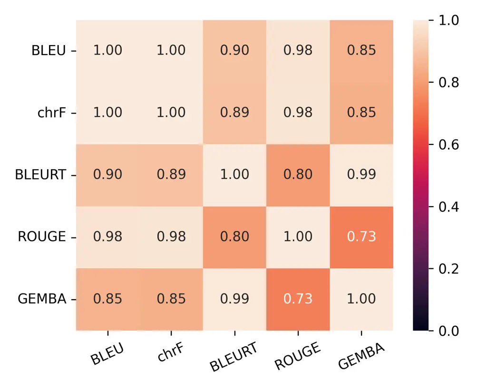
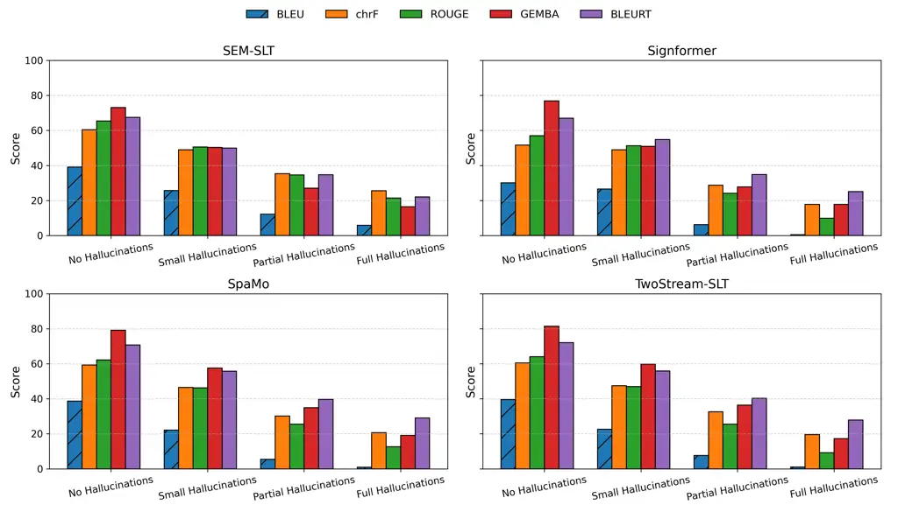
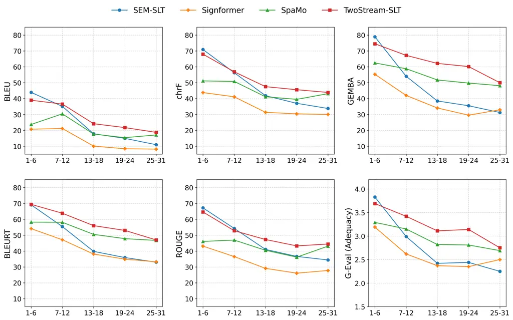

# A Critical Study of Automatic Evaluation in Sign Language Translation

###### Abstract

Automatic evaluation metrics are crucial for advancing sign language
translation (SLT). Current SLT evaluation metrics, such as BLEU and
ROUGE, are only text-based, and it remains unclear to what extent
text-based metrics can reliably capture the quality of SLT outputs. To
address this gap, we investigate the limitations of text-based SLT
evaluation metrics by analyzing six metrics, including BLEU, chrF, and
ROUGE, as well as BLEURT on the one hand, and large language model
(LLM)-based evaluators such as G-Eval and GEMBA zero-shot direct
assessment on the other hand. Specifically, we assess the consistency
and robustness of these metrics under three controlled conditions:
paraphrasing, hallucinations in model outputs, and variations in
sentence length. Our analysis highlights the limitations of lexical
overlap metrics and demonstrates that while LLM-based evaluators better
capture semantic equivalence often missed by conventional metrics, they
can also exhibit bias toward LLM-paraphrased translations. Moreover,
although all metrics are able to detect hallucinations, BLEU tends to be
overly sensitive, whereas BLEURT and LLM-based evaluators are
comparatively lenient toward subtle cases. This motivates the need for
multimodal evaluation frameworks that extend beyond text-based metrics
to enable a more holistic assessment of SLT outputs.

Keywords: sign language translation, automatic evaluation, LLM
evaluators

|                                                                                               |
| --------------------------------------------------------------------------------------------- |
| Shakib Yazdani¹, Yasser Hamidullah¹, Cristina España-Bonet^(1,2),                             |
| Eleftherios Avramidis¹, Josef van Genabith¹                                                   |
| ¹German Research Center for Artificial Intelligence (DFKI GmbH),                              |
| Saarland Informatics Campus, Saarbrücken, Germany                                             |
| ²Barcelona Supercomputing Center (BSC-CNS), Barcelona, Catalonia, Spain                       |
| {shakib.yazdani,yasser.hamidullah,cristinae,eleftherios.avramidis,josef.van_genabith}@dfki.de |

Abstract content

## 1.  Introduction

Sign languages are the primary communication systems for millions of
deaf and hard-of-hearing people across the globe. They are highly
expressive visual languages that convey meaning through hand signs,
facial expressions, mouthings, and body posture (Stokoe, 1980).
Automatic sign language translation (SLT) aims to translate sign
language videos into spoken language text to help bridge the
communication gap between the deaf and hearing communities (Camgoz et
al., 2018). However, evaluating SLT systems remains a significant
challenge, since current evaluation practices rely solely on textual
outputs, offering little insight into how effectively the
visual-linguistic nature of sign language is captured. Human evaluation,
though often the most reliable and serving as the gold standard in
evaluating SLT, is costly and time-consuming, making it difficult to
scale. As a result, current SLT models typically rely on text-based
automatic evaluation metrics. Consequently, a valid measure of
translation quality that accounts for this cross-modal grounding is
still missing in SLT (Müller et al., 2023). In addition to the
limitations of current evaluation metrics, SLT systems are also prone to
hallucinations (Zhang et al., 2023; Hamidullah et al., 2025a), fluent
but incorrect translations that misrepresent the signed input.
Evaluating how metrics respond to such cases is crucial for
understanding their reliability.

When translating from sign language to spoken language text, traditional
lexical overlap machine translation (MT) metrics such as BLEU (Papineni
et al., 2002) and ROUGE (Lin, 2004) are commonly adopted. However, these
text-based metrics fall short in capturing the multimodal complexity of
sign language. To address this gap, recent studies have proposed
evaluation metrics tailored to sign language tasks. SignBLEU (Kim et
al., 2024), for instance, operates at the gloss level and aligns better
with human judgments, while SiLVERScore (Imai et al., 2025) introduces
an embedding-based approach for assessing sign language generation. Yet,
SignBLEU depends on gloss annotations, and SiLVERScore has not been
evaluated in the context of SLT. Beyond these, embedding-based and large
language model (LLM)-based metrics developed for text-to-text MT—such as
BLEURT (Sellam et al., 2020) and GEMBA (Kocmi and Federmann, 2023) have
shown strong correlations with human judgments in text-to-text MT
(Freitag et al., 2024). Nevertheless, these approaches remain
underexplored in SLT, and there is still no comprehensive analysis of
their strengths and limitations for evaluating SLT systems.

In this work, we systematically examine this evaluation gap through a
comparative analysis of three lexical overlap metrics (BLEU, ROUGE, and
chrF), one embedding-based metric (BLEURT), and two LLM-based evaluators
(G-Eval and GEMBA), applied to four recent off-the-shelf SLT models, one
gloss-based (TwoStream-SLT) and three gloss-free (SEM-SLT, SpaMo, and
Signformer). The evaluation is performed under three controlled
scenarios: paraphrasing (including word reordering), hallucinations in
model outputs, and variations in sentence length. We summarize our
contributions as follows: (1) we show that automatic lexical overlap
metrics such as BLEU, chrF, and ROUGE are sensitive to surface-level
lexical variation (paraphrasing) rather than true semantic equivalence.
In contrast, embedding-based metric BLEURT and LLM-based evaluators
G-Eval and GEMBA better reflect semantic similarity and meaning
preservation in SLT outputs; (2) our analysis shows that all metrics are
able to reliably distinguish hallucinated from non-hallucinated outputs.
However, BLEU is highly sensitive in cases of extreme hallucination,
whereas BLEURT and LLM-based evaluators are able to better capture
meaning, though they tend to under-penalize subtle hallucinations when
the translation remains fluent; (3) a fine-grained analysis by sentence
length indicates systematic inconsistencies between metric types:
lexical overlap metrics often rank models differently than BLEURT or
LLM-based evaluators, highlighting that evaluation outcomes can vary
depending on the chosen metric and sentence length.

## 2.  Related Work

### 2.1.  Evaluation Metrics

SLT models have traditionally relied on lexical overlap MT metrics for
automatic translation. Specifically, BLEU (Papineni et al., 2002) and
ROUGE (Lin, 2004) have been widely used following the neural SLT work by
Camgoz et al. (2018). Following Müller et al. (2022), studies in SLT
have adopted the embedding-based metric BLEURT (Sellam et al., 2020).
However, these metrics do not take the visual source input into account.
Recently, Kim et al. (2024) proposed SignBLEU, an evaluation metric
designed to reduce information loss when assessing SLT outputs. By
operating at the gloss level, it achieves stronger alignment with human
judgments than prior text-based metrics. Nevertheless, SignBLEU remains
constrained to the text modality and relies on manually curated gloss
annotations, which limits scalability. More recently, Imai et al. (2025)
introduced SiLVERScore, an embedding-based metric that evaluates sign
language generation in a multimodal semantic space. While it shows
promising results, SiLVERScore was not evaluated on SLT.

The progress and advancements in LLMs have motivated research into their
potential applications for automated assessment across various tasks.
Liu et al. (2023) pioneered LLM-based automated assessment by proposing
G-Eval, a framework that uses Chain-of-Thought reasoning (Wei et al., 2022) along with task descriptions and evaluation metrics to evaluate
performance on tasks including text summarization and dialogue
generation. Following this direction, Kocmi and Federmann (2023)
proposed GEMBA, a GPT-based evaluation metric to assess the MT quality
both with- and without reference in a zero-shot prompting fashion.
Recently, inspired by G-Eval, Tong et al. (2025) extended the framework
to image and video caption evaluation using GPT-4o, achieving a high
correlation with human judgments.

### 2.2.  Sign Language Translation

SLT aims to convert sign language videos into spoken language text. SLT
models are often categorized into gloss-free and methods with gloss
supervision. Camgoz et al. (2018) pioneered SLT by framing it as a
neural machine translation (NMT) task, and further extending it by
leveraging transformers for end-to-end SLT (Camgoz et al., 2020).
MSKA-SLT (Guan et al., 2025) sets a new state-of-the-art on the
Phoenix-2014T (Camgoz et al., 2018) and CSL-Daily (Zhou et al., 2021)
benchmarks as a gloss-based model, with BLEU scores of $`29.03`$ and
$`25.52`$, respectively. The approach models keypoints extracted from
the face, body, and both hands using an attention mechanism, and is
jointly optimized with a CTC loss and a self-distillation loss. However,
glosses require manual human annotation, which is labor-intensive and
difficult to scale. In contrast, recent approaches attempt to model SLT
at the sentence level and a gloss-free fashion. Building on this
objective, recent works have incorporated LLMs into SLT frameworks (Gong
et al., 2024; Wong et al., 2024; Chen et al., 2024), employed
contrastive learning objectives (Cheng et al., 2023), replaced gloss
supervision with sentence-level embeddings (Hamidullah et al., 2024),
and extended SLT to multilingual scenarios (Yin et al., 2022; Yazdani et
al., 2025; Tan et al., 2025; Hamidullah et al., 2025b).

### 2.3.  Hallucination

A model is said to hallucinate when it generates content that either
lacks logical coherence or diverges from the source material, asserting
information or events that are unfounded or inconsistent with the known
facts (Ji et al., 2023). While hallucination detection has received
increasing attention in the MT community, with studies on multilingual
comparisons (Guerreiro et al., 2023) and LLM-based approaches for both
low- and high-resource languages (Benkirane et al., 2024), research on
hallucination in SLT remains limited. Zhang et al. (2023) reported,
based on manual analysis, that SLT models such as SLTUNET suffer greatly
from hallucinations, where the generated translations often show limited
correlation with the sign video. More recently, Hamidullah et al.
(2025a) proposed a hallucination detection framework and further
demonstrated that gloss-free SLT models are particularly prone to severe
hallucinations compared to their gloss-based counterparts. These
findings highlight the need for a deeper understanding of how evaluation
metrics respond to hallucinated outputs and how robust current SLT
models are under such conditions.

## 3.  Experimental Setup

### 3.1.  Task and Datasets

In our experiments, we evaluate the limitations of current SLT metrics
with respect to paraphrasing (including word reordering), hallucination
sensitivity, and variation in translation length. We use the
Phoenix-2014T ¹¹ 1 Phoenix-2014T was selected because it is the most
widely used benchmark in SLT research and contains gloss-level
annotations necessary for evaluating gloss-based models. dataset (Camgoz
et al., 2018), covering weather forecasts in German sign language (DGS)
to evaluate and compare the performance of various models in the above
aspects.

#### Impact of paraphrasing on SLT evaluation.

For this aspect of our study, we compare recent off-the-shelf SLT models
(Sec. 3.3) across both traditional evaluation metrics and LLM-based ones
(Sec. 3.2) when we paraphrase the translation predicted by the model. We
focus on paraphrasing, which naturally captures surface-level variations
such as synonym substitution. We use GPT-4o-mini with the following
prompt to generate paraphrased versions of model translations, which are
then compared against their original references.

Paraphrase the following sentence into anatural and fluent form. Do not
alter anynumbers written in words into digits orvice versa — keep the
format as it is inthe original text.

For lexical overlap metrics (BLEU, chrF, and ROUGE) and embedding-based
BLEURT, and to ensure robustness against paraphrasing variations, we
include a multi-reference evaluation in which the model’s translated and
paraphrased output is compared against an augmented set of eleven
references comprising the original human reference and ten gold-standard
paraphrases.

#### Impact of hallucination on SLT evaluation.

SLT models are prone to hallucinations, where the generated text
diverges from the visual input. Yet, there has been no systematic
investigation into how such hallucinations affect translation quality or
the reliability of automatic SLT evaluation metrics. Motivated by
findings from Benkirane et al. (2024), which demonstrate the
effectiveness of LLMs for hallucination detection in MT, we employ
Llama-3-70B to identify hallucinated outputs in a reference-based
setting.²² 2 The prompt used for hallucination detection is available in
Appendix A.1. To analyze how evaluation metrics behave under varying
degrees of hallucination, we consider a Severity Ranking scheme that
categorizes outputs into four levels: No Hallucination, Small
Hallucination, Partial Hallucination, and Full Hallucination.

#### Impact of sentence length on SLT evaluation.

In SLT, most studies report only the average evaluation score over the
entire dataset, which can obscure important performance variations. To
investigate the sensitivity of evaluation metrics to sentence length, we
conduct a fine-grained analysis by segmenting the test set based on the
number of words per sentence. Specifically, we group sentences into five
ranges: 1–6 (42 sentences), 7–12 (286 sentences), 13–18 (220 sentences),
19–24 (78 sentences), and 25–31 (16 sentences). This segmentation allows
us to investigate how translation quality varies with sentence
complexity and length, providing deeper insights into where existing
models struggle and how hallucination patterns may correlate with
sentence structure.

| Method        | Setting     | BLEU                        | chrF                        | BLEURT                         | ROUGE                       |
| ------------- | ----------- | --------------------------- | --------------------------- | ------------------------------ | --------------------------- |
| Signformer    | Original    | $`14.8\scriptstyle\pm 1.4`$ | $`35.0\scriptstyle\pm 1.2`$ | $`0.425\scriptstyle\pm 0.016`$ | $`32.8\scriptstyle\pm 2.0`$ |
|               | Paraphrased | $`5.7\scriptstyle\pm 0.8`$  | $`31.7\scriptstyle\pm 0.9`$ | $`0.452\scriptstyle\pm 0.015`$ | $`27.7\scriptstyle\pm 1.8`$ |
|               | Multi-Ref   | $`18.6\scriptstyle\pm 1.4`$ | $`38.8\scriptstyle\pm 1.3`$ | $`0.509\scriptstyle\pm 0.016`$ | $`36.5\scriptstyle\pm 1.8`$ |
| SEM-SLT       | Original    | $`23.7\scriptstyle\pm 2.1`$ | $`45.8\scriptstyle\pm 1.6`$ | $`0.484\scriptstyle\pm 0.012`$ | $`47.9\scriptstyle\pm 1.9`$ |
|               | Paraphrased | $`10.0\scriptstyle\pm 1.3`$ | $`38.3\scriptstyle\pm 1.1`$ | $`0.537\scriptstyle\pm 0.014`$ | $`38.0\scriptstyle\pm 1.6`$ |
|               | Multi-Ref   | $`26.8\scriptstyle\pm 2.4`$ | $`47.0\scriptstyle\pm 1.7`$ | $`0.594\scriptstyle\pm 0.013`$ | $`49.8\scriptstyle\pm 1.8`$ |
| SpaMo         | Original    | $`22.2\scriptstyle\pm 2.0`$ | $`44.2\scriptstyle\pm 1.2`$ | $`0.542\scriptstyle\pm 0.015`$ | $`43.2\scriptstyle\pm 2.1`$ |
|               | Paraphrased | $`9.3\scriptstyle\pm 1.0`$  | $`38.6\scriptstyle\pm 0.9`$ | $`0.558\scriptstyle\pm 0.013`$ | $`35.3\scriptstyle\pm 1.7`$ |
|               | Multi-Ref   | $`26.1\scriptstyle\pm 1.8`$ | $`48.1\scriptstyle\pm 1.1`$ | $`0.618\scriptstyle\pm 0.015`$ | $`46.7\scriptstyle\pm 1.3`$ |
| TwoStream-SLT | Original    | $`28.2\scriptstyle\pm 2.1`$ | $`50.5\scriptstyle\pm 1.4`$ | $`0.597\scriptstyle\pm 0.013`$ | $`50.3\scriptstyle\pm 2.1`$ |
|               | Paraphrased | $`12.7\scriptstyle\pm 0.8`$ | $`43.3\scriptstyle\pm 0.9`$ | $`0.604\scriptstyle\pm 0.011`$ | $`40.5\scriptstyle\pm 1.6`$ |
|               | Multi-Ref   | $`34.2\scriptstyle\pm 1.6`$ | $`54.5\scriptstyle\pm 1.1`$ | $`0.670\scriptstyle\pm 0.009`$ | $`53.7\scriptstyle\pm 1.4`$ |

Table 1: Performance comparison of SLT models on the Phoenix-2014T test
set under original, paraphrased, and multi-reference conditions across
multiple evaluation metrics.

### 3.2.  Evaluation Metrics

For our analysis, we consider the metrics as per Müller et al. (2022);
Müller et al. (2023), specifically BLEU³³ 3
BLEU\|nrefs:1\|bs:25\|tok:none\|eff:no\|
case:mixed\|smooth:exp\|version:2.5.1 (Post, 2018, via SacreBLEU;) for
lexical overlap, ROUGE (Lin, 2004)⁴⁴ 4 ROUGE\|metrics:rougeL\|nrefs:1\|
stemmer:true\|bs:25\|version:0.1.2 for recall-oriented n-gram overlap,
chrF (Popović, 2015)⁵⁵ 5 chrF\|nrefs:1\|bs:25\|case:mixed\|eff:yes\|
nc:6\|nw:2\|space:no\|version:2.5.1 that uses character $`n`$-grams, and
embedding-based BLEURT (Sellam et al., 2020)⁶⁶ 6 BLEURT v0.0.2 using
checkpoint BLEURT-20. for semantic quality. We use bootstrap resampling
for statistical significance reporting.

We also extend the traditional range of SLT evaluation metrics by
presenting a sign language adapted version of G-Eval (Liu et al., 2023).
G-Eval introduces a framework that leverages prompting techniques to
generate evaluation scores that strongly correlate with human
preferences. The prompt is organized into three modules: (1) evaluation
dimensions, which specify the aspects to be judged; (2) step-by-step
reasoning, where Chain-of-Thought (CoT) (Wei et al., 2022) guides the
LLM through the evaluation procedure; and (3) scoring with references,
which constrains the output format and incorporates human translations
as ground truth. Following Sato et al. (2024), we prompt the LLMs to
evaluate the translation quality of the models in Section 3.3 for
Adequacy and Fluency, each rated on a 5-point Likert scale
($`1`$–$`5`$). Following Fomicheva et al. (2022); Kocmi and Federmann
(2023), we further include GEMBA zero-shot Direct Assessment (Kocmi and
Federmann, 2023), where the LLM is prompted to evaluate each translation
hypothesis and provide a quality score ranging from $`0`$ (completely
incorrect) to $`100`$ (perfect translation). Our LLM experimental setup
includes four models: GPT-4.1-nano, Qwen3-8B, Llama-3.1-8B, and QWQ-32B.
These were chosen to include both a proprietary LLM and also the
open-source ones.⁷⁷ 7 All prompts used for G-Eval and GEMBA are provided
in Appendices A.2 and A.3.

### 3.3.  SLT Models

SLT models are either gloss-based or gloss-free. We include three
gloss-free models: SpaMo (Hwang et al., 2025), SEM-SLT (Hamidullah et
al., 2024), and Signformer (Yang, 2024). We also include TwoStream-SLT
(Chen et al., 2022b) as a gloss-based model. We retrain these models to
reproduce their reported results when the original model checkpoints are
unavailable; however, our reproduced scores differ slightly from those
originally reported.

#### SpaMo.

This model works by combining spatial and motion visual features using a
multi-layer perceptron (MLP) and feeding them together with a prompt to
an LLM for decoding and translation. Following the original setup, we
set learning rate to $`6\times 10^{-4}`$ and train for a maximum of 100
epochs.

#### SEM-SLT.

SLT models have traditionally relied on glosses for training. SEM-SLT
avoids this reliance by supervising on sentence embeddings instead of
glosses. The full pipeline sign2(sem+text) module, with an mBART decoder
from SEM-SLT, was trained with a per-device batch size of 4 for both
training and validation. The learning rate was set to
$`1\times 10^{-5}`$. Training was carried out with all other
hyperparameters left at their default Hugging Face Trainer settings.

#### Signformer.

With the goal of edge AI, Signformer uses a combination of novel
convolution, attention, and positional encoding to achieve competitive
performance compared to gloss-based models while being quite smaller.
Since the original paper did not specify how video features were
extracted, we instead employ the S3D model pre-trained on both WLASL for
ASL word recognition (Li et al., 2020) and the Kinetics-400 dataset for
human action recognition (Kay et al., 2017), following the approach by
(Chen et al., 2022a). We set learning rate to 0.001 and train it for a
maximum of 100 epochs.

#### TwoStream-SLT.

Unlike most SLT methods that extract visual embeddings from raw videos
only, TwoStream-SLT leverages both key points (of hands, face, and upper
body) and visual embeddings from raw videos to train a novel gloss-based
network for sign language recognition and SLT. We used the pretrained
Sign2Gloss and the Gloss2Text modules from the TwoStream-SLT repository
to reproduce their results and outputs.

| Method              | Model        | G-Eval Adequacy | G-Eval Fluency | GEMBA             |
| ------------------- | ------------ | --------------- | -------------- | ----------------- |
|                     |              | (Orig / Para)   | (Orig / Para)  |     (Orig / Para) |
| Signformer          | gpt-4.1-nano | 2.54 / 2.57     | 3.34 / 3.48    | 38.45 / 38.33     |
|                     | qwen3:8b     | 2.70 / 2.71     | 3.49 / 3.60    | 74.82 / 75.27     |
|                     | qwq:32b      | 2.76 / 2.83     | 3.73 / 3.87    | 64.56 / 67.25     |
|                     | llama3.1:8b  | 3.50 / 3.56     | 4.65 / 4.60    | 57.44 / 59.58     |
| SEM-SLT             | gpt-4.1-nano | 2.76 / 2.91     | 3.26 / 3.60    | 47.53 / 53.17     |
|                     | qwen3:8b     | 2.97 / 3.21     | 3.50 / 3.95    | 79.79 / 81.93     |
|                     | qwq:32b      | 3.00 / 3.20     | 3.59 / 3.92    | 63.50 / 71.04     |
|                     | llama3.1:8b  | 3.42 / 3.86     | 4.25 / 4.63    | 60.63 / 65.99     |
| SpaMo               | gpt-4.1-nano | 3.00 / 3.06     | 3.66 / 3.73    | 55.36 / 57.31     |
|                     | qwen3:8b     | 3.33 / 3.40     | 4.02 / 4.12    | 82.26 / 83.11     |
|                     | qwq:32b      | 3.29 / 3.31     | 3.99 / 4.00    | 73.66 / 75.52     |
|                     | llama3.1:8b  | 3.95 / 4.07     | 4.79 / 4.72    | 68.32 / 70.25     |
| TwoStream-SLT       | gpt-4.1-nano | 3.28 / 3.33     | 3.77 / 3.82    | 64.63 / 66.69     |
|                     | qwen3:8b     | 3.67 / 3.76     | 4.26 / 4.38    | 85.67 / 85.98     |
|                     | qwq:32b      | 3.61 / 3.61     | 4.09 / 4.06    | 77.85 / 79.32     |
|                     | llama3.1:8b  | 4.20 / 4.33     | 4.81 / 4.70    | 73.85 / 75.33     |
| Signformer (Avg)    | -            | 2.88 / 2.92     | 3.80 / 3.89    | 58.82 / 60.11     |
| SEM-SLT (Avg)       | -            | 3.04 / 3.30     | 3.65 / 4.03    | 62.86 / 68.03     |
| SpaMo (Avg)         | -            | 3.39 / 3.46     | 4.12 / 4.14    | 69.90 / 71.55     |
| TwoStream-SLT (Avg) | -            | 3.69 / 3.76     | 4.23 / 4.24    | 75.50 / 76.83     |

Table 2: G-Eval adequacy and fluency scores, along with GEMBA, for
original and paraphrased translations on the Phoenix-2014T test set.

## 4.  Evaluation Results

### 4.1.  Impact of Paraphrasing on SLT Evaluation

One of the main limitations of lexical overlap metrics is their
sensitivity to paraphrasing. We provide a comparison of the scores with
and without paraphrasing for every metric and model in Table 1. Most
prominently, we observe that lexical overlap metrics (BLEU, chrF, and
ROUGE) are highly sensitive to variations in word order, even though our
paraphrasing prompt preserves the overall sentence structure. Notably,
the BLEU score drops to slightly less than half of its original value,
while metrics such as chrF and ROUGE also decrease but to a much lesser
extent. Interestingly, embedding-based BLEURT scores increase across all
methods when comparing paraphrased translations to the original ones.
This increase is particularly pronounced for SEM-SLT, increasing from
$`0.484`$ to $`0.537`$. This is most likely because the SEM-SLT model is
trained with a contrastive learning method using sentence-level
embeddings, which allows it to generalize better to semantically
equivalent paraphrases. To alleviate the sensitivity of lexical overlap
metrics to paraphrasing and failure of capturing the overall semantics,
we compare the metrics in a multi-reference setting, as shown in Table

1. We observe that including a multi-reference setting ensures that
   evaluation metrics fairly reward semantic equivalence when evaluating
   models that exhibit high surface-level variation, such as those subject
   to paraphrasing.

We present the results of LLM-based evaluators, G-Eval (Adequacy and
Fluency) and GEMBA, comparing paraphrased and original translations on
the Phoenix-2014T test set in Table 2. Most notably, paraphrasing
generally improves G-Eval Adequacy and Fluency and GEMBA scores,
consistent with the pattern observed for BLEURT. Llama3.1:8b is the only
model that rates paraphrased translations as less fluent than the
original ones. Among all evaluated LLMs, Llama3.1:8b tends to assign the
highest Adequacy and Fluency scores, whereas gpt-4.1-nano assigns the
lowest. We observe that LLM-based evaluators tend to prefer paraphrased
translations over the original ones. This tendency likely arises because
the paraphrases are themselves generated by an LLM, which may introduce
stylistic patterns or linguistic preferences that align with the
evaluator’s own training distribution, thereby biasing its judgments.
Interestingly, this observation aligns with previous studies suggesting
that LLMs exhibit a bias toward LLM-generated or paraphrased text (Xu et
al., 2024; Liu et al., 2023). To be able to make more general statements
about evaluation metrics, we show the Pearson correlation between the
lexical metrics, BLEURT, and GEMBA, computed using the average scores
from Table 2 in Figure 1. We notice a high correlation among lexical
overlap metrics, and GEMBA is also highly correlated with BLEURT, as
both incorporate learned language model representations in their
scoring. Our previous observations from Tables 1 and 2 are confirmed,
with lexical metrics (BLEU, chrF, ROUGE) yielding consistent rankings,
while LLM-based evaluations align closely with BLEURT, ranking
TwoStream-SLT highest, followed by SpaMo, SEM-SLT, and Signformer.

Figure 1: Pearson correlation between lexical metrics (BLEU, chrF,
ROUGE), BLEURT, and GEMBA.

Figure 2: Examination of the sensitivity of evaluation metrics,
including BLEU, chrF, ROUGE, GEMBA, and BLEURT, to hallucinations in SLT
outputs on the Phoenix-2014T test set.

### 4.2.  Impact of Hallucination on SLT Evaluation

We first analyze how hallucinations impact automatic metrics and then
examine how robust SLT models are in the case of hallucination. Figure 2
illustrates the impact of hallucinations, categorized by their severity
ranking, on various evaluation metrics across four SLT models. We
omitted G-Eval in this setting because its results are reported on a
Likert scale. ⁸⁸ 8 Typically ranging from 1 (strongly disagree/poor) to
5 (strongly agree/excellent) (Likert, 1932). Moreover, we report
hallucination detection results for GEMBA using gpt-4.1-nano. Notably,
results show that there is a monotonic decline across all metrics,
meaning that as hallucination severity level increases, translation
quality drops. However, BLEU is an extremely sensitive metric; in cases
such as Partial Hallucinations or Full Hallucinations, even minor
rephrasings that remain semantically correct can cause a sharp decrease
in BLEU scores. ROUGE and chrF decline more smoothly, since they account
for partial overlaps at the subword or character level, respectively.
GEMBA and BLEURT follow a similar trend, as they can still capture some
semantic meaning even in extreme Full Hallucination cases where the
surface wording differs substantially. However, we suspect that these
metrics may under-penalize subtle hallucinations when the generated text
is fluent, thereby overestimating the overall score. Similar
observations regarding BLEURT’s overestimation and the data leakage
issues in LLMs have been discussed by Zeng et al. (2024).

Figure 3: Evaluation of four SLT models (SEM-SLT, Signformer, SpaMo,
TwoStream-SLT) across sentence length bins (1–6, 7–12, 13–18, 19–24,
25–31) on the Phoenix-2014T test set.

Different from the main focus of the paper that concentrates on
evaluating evaluation metrics, here we briefly take the opportunity to
investigate the behavior of SLT models when hallucinations occurs.
Overall, TwoStream-SLT and SpaMo demonstrate a consistent trend across
all evaluation metrics, showing less hallucinations compared to other
models. In contrast, Signformer exhibits notably lower average
performance, aligning with the results presented in Table 1. To analyze
the extent to which SLT models produce hallucinations, we present in
Table 3 a breakdown of the number of hallucinated translations according
to severity level. The results reveal that gloss-based TwoStream-SLT
yields the lowest Full Hallucinations (24), indicating higher robustness
to severe errors, whereas Signformer produces the highest number (177),
confirming our earlier observations regarding its overall vulnerability
to hallucination. This finding is in line with previous work showing
that gloss-free models exhibit higher hallucination rates than
gloss-based models (Hamidullah et al., 2025a).

| Model         | No  | Small | Partial | Full |
| ------------- | --- | ----- | ------- | ---- |
| Signformer    | 87  | 193   | 185     | 177  |
| SEM-SLT       | 187 | 222   | 174     | 59   |
| SpaMo         | 204 | 231   | 138     | 69   |
| TwoStream-SLT | 296 | 228   | 94      | 24   |

Table 3: Number of hallucinations based on severity level (No, Small,
Partial, and Full Hallucinations) across SLT models.

### 4.3.  Impact of Sentence Length on SLT Evaluation

To highlight the limitations of text-based automatic metrics in SLT, we
evaluate their performance across five sentence-length bins, as shown in
Figure 3. We omitted G-Eval (Fluency) for this experiment as we are
concerned with the overall translation quality. Across all evaluation
metrics, performance consistently decreases with sentence length,
indicating that longer sentences pose greater challenges for current SLT
models, though the rate and shape of decline vary by metric. Notably, we
observe that SEM-SLT ranks third according to BLEURT or LLM-based (GEMBA
and G-Eval) metrics but first or second under lexical overlap ones,
revealing a metric inconsistency.

Additionally, we analyze how translation quality varies with sentence
length across different SLT models. Notably, gloss-based TwoStream-SLT
demonstrates the strongest overall performance and exhibits the least
sensitivity to longer sequences. SEM-SLT performs competitively on short
sentences (1–6 tokens) but its performance declines more sharply for
longer sentences, particularly on BLEU, GEMBA, and G-Eval. SpaMo shows
moderate yet consistent performance, with relatively smaller drops for
longer sequences compared to the other models. Finally, Signformer
underperforms across all metrics and sentence-length bins, consistent
with the trends observed in our earlier experiments.

## 5.  Qualitative Analysis

To better understand the impact of paraphrasing and hallucination on
translation quality, we analyze specific examples exhibiting extreme
cases of hallucination. Specifically, Partial Hallucinations and Full
Hallucinations, where the GEMBA score exceeds 50. Notably, we did not
find any instances of Full Hallucinations with a GEMBA score above 50
across all SLT models. Table 4 presents one illustrative example per SLT
model. We observe that paraphrasing tends to increase the GEMBA score in
cases of Partial Hallucinations across all models. By examining the
paraphrased examples, we find that paraphrased translations are
generally more fluent and natural than the original outputs, even though
hallucinations persist. However, this is not always the case, as in most
examples, paraphrasing either leaves the GEMBA score unchanged or leads
to a decrease.

|         |                                                                                         |
| ------- | --------------------------------------------------------------------------------------- |
| Model   | SpaMo                                                                                   |
| GEMBA   | 65 $`\rightarrow`$ 85                                                                   |
| Ref.    | am wochenende beruhigt sich dann das wetter langsam .                                   |
|         | (Over the weekend, the weather gradually calms down.)                                   |
| Pred.   | am wochenende erwartet uns dann verbreitet ruhiges recht trockenes winterwetter .       |
| Paraph. | am wochenende erwartet uns weitgehend ruhiges und recht trockenes winterwetter .        |
| Model   | SEM-SLT                                                                                 |
| GEMBA   | 65 $`\rightarrow`$ 85                                                                   |
| Ref.    | im norden und nordosten bleibt es meist bedeckt mitunter fällt dort etwas regen .       |
|         | (In the north and northeast, it mostly stays cloudy, with occasional light rain there.) |
| Pred.   | im norden und nordosten fällt regen sonst ist es meist trocken .                        |
| Paraph. | im norden und nordosten regnet es, während es andernorts meist trocken bleibt .         |
| Model   | TwoStream-SLT                                                                           |
| GEMBA   | 75 $`\rightarrow`$ 85                                                                   |
| Ref.    | in der südhälfte muss dazu mit nachtfrost gerechnet werden .                            |
|         | (In the southern half, one must expect nighttime frost.)                                |
| Pred.   | im süden gibt es heute nacht teilweise strengen frost .                                 |
| Paraph. | im süden wird es heute nacht teilweise sehr frostig sein .                              |
| Model   | Signformer                                                                              |
| GEMBA   | 75 $`\rightarrow`$ 85                                                                   |
| Ref.    | südlich des mains morgen verbreitet freundlich .                                        |
|         | (South of the Main, it will be generally sunny tomorrow.)                               |
| Pred.   | vor allem in der südwesthälfte ist es länger freundlich .                               |
| Paraph. | insbesondere in der südwestlichen hälfte bleibt es länger freundlich .                  |

Table 4: Qualitative examples in the presence of Partial Hallucinations
with paraphrased predictions.

## 6.  Conclusion

In this work, we present a systematic analysis of text-based automatic
evaluation metrics for SLT, including traditional lexical overlap
metrics such as BLEU and ROUGE, and recent embedding- and LLM-based
metrics such as BLEURT, GEMBA, and G-Eval. Our results highlight the
limitations of both categories: lexical metrics (BLEU, chrF, ROUGE)
often fail to capture semantic adequacy, particularly under
paraphrasing, whereas embedding-based BLEURT and LLM-based evaluators
(G-Eval and GEMBA), despite being more semantically aware, tend to
overestimate the quality of fluent but hallucinated outputs. Based on
these findings, we recommend using BLEURT or LLM-based evaluators such
as GEMBA and G-Eval along with traditional lexical overlap metrics.
Furthermore, we advocate for the development and adoption of multimodal
evaluation frameworks that extend beyond text-based metrics to provide a
more holistic and comprehensive assessment of SLT outputs.

## Limitations

In this work, we investigate the limitations of text-based automatic
evaluation metrics in SLT through empirical experiments. While our study
covers large and controlled settings, it has several limitations. First,
our evaluation relies solely on automatic metrics, as no human
evaluation was conducted to serve as a gold standard. This limitation
stems from the lack of available native signers for large-scale
annotation. Future work should include human judgments from native sign
language users to establish a more reliable evaluation benchmark.
Second, our experiments are restricted to the Phoenix-2014T dataset,
which contains German Sign Language (DGS) data primarily focused on
weather forecasts. This narrow domain may limit the generalizability of
our findings to broader SLT contexts. Finally, although our results
consistently highlight the weaknesses of lexical overlap metrics, we
rely primarily on BLEU for quantitative evaluation. However, BLEU scores
can be unreliable when computed on small test sets: prior work has shown
that BLEU’s correlation with human judgments becomes unstable when
sample sizes are low (Mathur et al., 2020). To mitigate this issue, we
applied bootstrap resampling to estimate confidence intervals, which
provides a more robust assessment of metric stability and significance.
We emphasize that these experiments are part of an ongoing research
effort, and the findings reported here are preliminary and should not be
deployed or regarded as final without community approval.

## 7.  Bibliographical References

##

- Benkirane et al. (2024) K. Benkirane, L. Gongas, S. Pelles, N.
  Fuchs, J. Darmon, P. Stenetorp, D. I. Adelani, and E. Sánchez Machine
  translation hallucination detection for low and high resource
  languages using large language models. In Findings of the Association
  for Computational Linguistics: EMNLP 2024, Y. Al-Onaizan, M. Bansal,
  and Y. Chen (Eds.), Miami, Florida, USA, pp. 9647–9665. External
  Links: [Link](https://aclanthology.org/2024.findings-emnlp.564/),
  [Document](https://dx.doi.org/10.18653/v1/2024.findings-emnlp.564)
  Cited by: §2.3, §3.1.
- Camgoz et al. (2018) N. C. Camgoz, S. Hadfield, O. Koller, H. Ney,
  and R. Bowden Neural sign language translation. In 2018 IEEE/CVF
  Conference on Computer Vision and Pattern Recognition, Vol. ,
  pp. 7784–7793. External Links:
  [Document](https://dx.doi.org/10.1109/CVPR.2018.00812) Cited by: §1,
  §2.1, §2.2, §3.1.
- Camgoz et al. (2020) N. C. Camgoz, O. Koller, S. Hadfield, and R.
  Bowden Sign language transformers: joint end-to-end sign language
  recognition and translation. In IEEE Conference on Computer Vision and
  Pattern Recognition (CVPR), Cited by: §2.2.
- Chen et al. (2022a) Y. Chen, F. Wei, X. Sun, Z. Wu, and S. Lin A
  simple multi-modality transfer learning baseline for sign language
  translation. 2022 IEEE/CVF Conference on Computer Vision and Pattern
  Recognition (CVPR), pp. 5110–5120. External Links:
  [Link](https://api.semanticscholar.org/CorpusID:247315595) Cited by:
  §3.3.
- Chen et al. (2022b) Y. Chen, R. Zuo, F. Wei, Y. Wu, S. Liu, and B. Mak
  Two-stream network for sign language recognition and translation. In
  Proceedings of the 36th International Conference on Neural Information
  Processing Systems, NIPS ’22, Red Hook, NY, USA. External Links: ISBN
  9781713871088 Cited by: §3.3.
- Chen et al. (2024) Z. Chen, B. Zhou, J. Li, J. Wan, Z. Lei, N.
  Jiang, Q. Lu, and G. Zhao Factorized learning assisted with large
  language model for gloss-free sign language translation. In
  Proceedings of the 2024 Joint International Conference on
  Computational Linguistics, Language Resources and Evaluation
  (LREC-COLING 2024), Torino, Italia, pp. 7071–7081. External Links:
  [Link](https://aclanthology.org/2024.lrec-main.620/) Cited by: §2.2.
- Cheng et al. (2023) Y. Cheng, F. Wei, B. Jianmin, D. Chen, and W. Q.
  Zhang CiCo: domain-aware sign language retrieval via cross-lingual
  contrastive learning. In CVPR, Cited by: §2.2.
- et al. (2024) O. et al. GPT-4o system card. ArXiv. External Links:
  2410.21276, [Link](https://arxiv.org/abs/2410.21276)
- Fomicheva et al. (2022) M. Fomicheva, S. Sun, E. Fonseca, C. Zerva, F.
  Blain, V. Chaudhary, F. Guzmán, N. Lopatina, L. Specia, and A. F. T.
  Martins MLQE-PE: a multilingual quality estimation and post-editing
  dataset. In Proceedings of the Thirteenth Language Resources and
  Evaluation Conference, N. Calzolari, F. Béchet, P. Blache, K.
  Choukri, C. Cieri, T. Declerck, S. Goggi, H. Isahara, B. Maegaard, J.
  Mariani, H. Mazo, J. Odijk, and S. Piperidis (Eds.), Marseille,
  France, pp. 4963–4974. External Links:
  [Link](https://aclanthology.org/2022.lrec-1.530/) Cited by: §3.2.
- Freitag et al. (2024) M. Freitag, N. Mathur, D. Deutsch, C. Lo, E.
  Avramidis, R. Rei, B. Thompson, F. Blain, T. Kocmi, J. Wang, D. I.
  Adelani, M. Buchicchio, C. Zerva, and A. Lavie Are LLMs breaking MT
  metrics? results of the WMT24 metrics shared task. In Proceedings of
  the Ninth Conference on Machine Translation, B. Haddow, T. Kocmi, P.
  Koehn, and C. Monz (Eds.), Miami, Florida, USA, pp. 47–81. External
  Links: [Link](https://aclanthology.org/2024.wmt-1.2/),
  [Document](https://dx.doi.org/10.18653/v1/2024.wmt-1.2) Cited by: §1.
- Gong et al. (2024) J. Gong, L. G. Foo, Y. He, H. Rahmani, and J. Liu
  LLMs are good sign language translators. In Proceedings of the
  IEEE/CVF Conference on Computer Vision and Pattern Recognition (CVPR),
  pp. 18362–18372. Cited by: §2.2.
- Guan et al. (2025) M. Guan, Y. Wang, G. Ma, J. Liu, and M. Sun MSKA:
  multi-stream keypoint attention network for sign language recognition
  and translation. Pattern Recogn. 165 (C). External Links: ISSN
  0031-3203, [Link](https://doi.org/10.1016/j.patcog.2025.111602),
  [Document](https://dx.doi.org/10.1016/j.patcog.2025.111602) Cited by:
  §2.2.
- Guerreiro et al. (2023) N. M. Guerreiro, D. M. Alves, J.
  Waldendorf, B. Haddow, A. Birch, P. Colombo, and A. F. T. Martins
  Hallucinations in large multilingual translation models. Transactions
  of the Association for Computational Linguistics 11, pp. 1500–1517.
  External Links: [Link](https://aclanthology.org/2023.tacl-1.85/),
  [Document](https://dx.doi.org/10.1162/tacl%5Fa%5F00615) Cited by:
  §2.3.
- Hamidullah et al. (2025a) Y. Hamidullah, K. D. Chowdury, Y.
  Al-Ghussin, S. Yazdani, C. Oguz, J. van Genabith, and C. España-Bonet
  Grounding or guessing? visual signals for detecting hallucinations in
  sign language translation. arXiv preprint arXiv:2510.18439. Cited by:
  §1, §2.3, §4.2.
- Hamidullah et al. (2024) Y. Hamidullah, J. van Genabith, and C.
  España-Bonet Sign language translation with sentence embedding
  supervision. In Proceedings of the 62nd Annual Meeting of the
  Association for Computational Linguistics (Volume 2: Short Papers), L.
  Ku, A. Martins, and V. Srikumar (Eds.), Bangkok, Thailand,
  pp. 425–434. External Links:
  [Link](https://aclanthology.org/2024.acl-short.40/),
  [Document](https://dx.doi.org/10.18653/v1/2024.acl-short.40) Cited by:
  §2.2, §3.3.
- Hamidullah et al. (2025b) Y. Hamidullah, S. Yazdani, C. Oguz, J. Van
  Genabith, and C. España-Bonet SONAR-SLT: multilingual sign language
  translation via language-agnostic sentence embedding supervision. In
  Proceedings of the Tenth Conference on Machine Translation, B.
  Haddow, T. Kocmi, P. Koehn, and C. Monz (Eds.), Suzhou, China,
  pp. 301–313. External Links:
  [Link](https://aclanthology.org/2025.wmt-1.18/),
  [Document](https://dx.doi.org/10.18653/v1/2025.wmt-1.18), ISBN
  979-8-89176-341-8 Cited by: §2.2.
- Hwang et al. (2025) E. J. Hwang, S. Cho, J. Lee, and J. C. Park An
  efficient gloss-free sign language translation using spatial
  configurations and motion dynamics with LLMs. In Proceedings of the
  2025 Conference of the Nations of the Americas Chapter of the
  Association for Computational Linguistics: Human Language Technologies
  (Volume 1: Long Papers), L. Chiruzzo, A. Ritter, and L. Wang (Eds.),
  Albuquerque, New Mexico, pp. 3901–3920. External Links:
  [Link](https://aclanthology.org/2025.naacl-long.197/),
  [Document](https://dx.doi.org/10.18653/v1/2025.naacl-long.197), ISBN
  979-8-89176-189-6 Cited by: §3.3.
- Imai et al. (2025) S. Imai, M. Inan, A. B. Sicilia, and M. Alikhani
  SiLVERScore: semantically-aware embeddings for sign language
  generation evaluation. In Proceedings of the 15th International
  Conference on Recent Advances in Natural Language Processing - Natural
  Language Processing in the Generative AI era, Varna, Bulgaria,
  pp. 452–461. External Links:
  [Link](https://aclanthology.org/2025.ranlp-1.54) Cited by: §1, §2.1.
- Ji et al. (2023) Z. Ji, N. Lee, R. Frieske, T. Yu, D. Su, Y. Xu, E.
  Ishii, Y. J. Bang, A. Madotto, and P. Fung Survey of hallucination in
  natural language generation. ACM Comput. Surv. 55 (12). External
  Links: ISSN 0360-0300, [Link](https://doi.org/10.1145/3571730),
  [Document](https://dx.doi.org/10.1145/3571730) Cited by: §2.3.
- Kay et al. (2017) W. Kay, J. Carreira, K. Simonyan, B. Zhang, C.
  Hillier, S. Vijayanarasimhan, F. Viola, T. Green, T. Back, A.
  Natsev, M. Suleyman, and A. Zisserman The kinetics human action video
  dataset. ArXiv abs/1705.06950. External Links:
  [Link](https://api.semanticscholar.org/CorpusID:27300853) Cited by:
  §3.3.
- Kim et al. (2024) J. Kim, M. Huerta-Enochian, C. Ko, and D. H. Lee
  SignBLEU: automatic evaluation of multi-channel sign language
  translation. In Proceedings of the 2024 Joint International Conference
  on Computational Linguistics, Language Resources and Evaluation
  (LREC-COLING 2024), N. Calzolari, M. Kan, V. Hoste, A. Lenci, S.
  Sakti, and N. Xue (Eds.), Torino, Italia, pp. 14796–14811. External
  Links: [Link](https://aclanthology.org/2024.lrec-main.1289/) Cited by:
  §1, §2.1.
- Kocmi and Federmann (2023) T. Kocmi and C. Federmann GEMBA-MQM:
  detecting translation quality error spans with GPT-4. In Proceedings
  of the Eighth Conference on Machine Translation, P. Koehn, B.
  Haddow, T. Kocmi, and C. Monz (Eds.), Singapore, pp. 768–775. External
  Links: [Link](https://aclanthology.org/2023.wmt-1.64/),
  [Document](https://dx.doi.org/10.18653/v1/2023.wmt-1.64) Cited by: §1,
  §2.1, §3.2.
- Li et al. (2020) D. Li, C. Rodriguez, X. Yu, and H. Li Word-level deep
  sign language recognition from video: a new large-scale dataset and
  methods comparison. In The IEEE Winter Conference on Applications of
  Computer Vision, pp. 1459–1469. Cited by: §3.3.
- Likert (1932) R. Likert A technique for the measurement of attitudes.
  Archives of Psychology 22 (140), pp. 1–55. Cited by: footnote 8.
- Lin (2004) C. Lin ROUGE: a package for automatic evaluation of
  summaries. In Text Summarization Branches Out, Barcelona, Spain,
  pp. 74–81. External Links: [Link](https://aclanthology.org/W04-1013/)
  Cited by: §1, §2.1, §3.2.
- Liu et al. (2023) Y. Liu, D. Iter, Y. Xu, S. Wang, R. Xu, and C. Zhu
  G-eval: NLG evaluation using gpt-4 with better human alignment. In
  Proceedings of the 2023 Conference on Empirical Methods in Natural
  Language Processing, H. Bouamor, J. Pino, and K. Bali (Eds.),
  Singapore, pp. 2511–2522. External Links:
  [Link](https://aclanthology.org/2023.emnlp-main.153/),
  [Document](https://dx.doi.org/10.18653/v1/2023.emnlp-main.153) Cited
  by: §2.1, §3.2, §4.1.
- Mathur et al. (2020) N. Mathur, T. Baldwin, and T. Cohn Tangled up in
  BLEU: reevaluating the evaluation of automatic machine translation
  evaluation metrics. In Proceedings of the 58th Annual Meeting of the
  Association for Computational Linguistics, D. Jurafsky, J. Chai, N.
  Schluter, and J. Tetreault (Eds.), Online, pp. 4984–4997. External
  Links: [Link](https://aclanthology.org/2020.acl-main.448/),
  [Document](https://dx.doi.org/10.18653/v1/2020.acl-main.448) Cited by:
  Limitations.
- Müller et al. (2023) M. Müller, M. Alikhani, E. Avramidis, R.
  Bowden, A. Braffort, N. Cihan Camgöz, S. Ebling, C. España-Bonet, A.
  Göhring, R. Grundkiewicz, M. Inan, Z. Jiang, O. Koller, A.
  Moryossef, A. Rios, D. Shterionov, S. Sidler-Miserez, K. Tissi, and D.
  Van Landuyt Findings of the second WMT shared task on sign language
  translation (WMT-SLT23). In Proceedings of the Eighth Conference on
  Machine Translation, P. Koehn, B. Haddow, T. Kocmi, and C. Monz
  (Eds.), Singapore, pp. 68–94. External Links:
  [Link](https://aclanthology.org/2023.wmt-1.4),
  [Document](https://dx.doi.org/10.18653/v1/2023.wmt-1.4) Cited by: §1,
  §3.2.
- Müller et al. (2022) M. Müller, S. Ebling, E. Avramidis, A.
  Battisti, M. Berger, R. Bowden, A. Braffort, N. Cihan Camgöz, C.
  España-Bonet, R. Grundkiewicz, Z. Jiang, O. Koller, A. Moryossef, R.
  Perrollaz, S. Reinhard, A. Rios, D. Shterionov, S. Sidler-Miserez, K.
  Tissi, and D. Van Landuyt Findings of the First WMT Shared Task on
  Sign Language Translation (WMT-SLT22). In Proceedings of the Seventh
  Conference on Machine Translation, Abu Dhabi, pp. 744–772. External
  Links: [Link](https://aclanthology.org/2022.wmt-1.71) Cited by: §2.1,
  §3.2.
- Papineni et al. (2002) K. Papineni, S. Roukos, T. Ward, and W. Zhu
  Bleu: a method for automatic evaluation of machine translation. In
  Proceedings of the 40th Annual Meeting of the Association for
  Computational Linguistics, P. Isabelle, E. Charniak, and D. Lin
  (Eds.), Philadelphia, Pennsylvania, USA, pp. 311–318. External Links:
  [Link](https://aclanthology.org/P02-1040/),
  [Document](https://dx.doi.org/10.3115/1073083.1073135) Cited by: §1,
  §2.1.
- Popović (2015) M. Popović ChrF: character n-gram F-score for automatic
  MT evaluation. In Proceedings of the Tenth Workshop on Statistical
  Machine Translation, pp. 392–395. External Links:
  [Document](https://dx.doi.org/10.18653/v1/W15-3049) Cited by: §3.2.
- Post (2018) M. Post A call for clarity in reporting BLEU scores. In
  Proceedings of the Third Conference on Machine Translation: Research
  Papers, Brussels, Belgium, pp. 186–191. External Links:
  [Link](https://aclanthology.org/W18-6319),
  [Document](https://dx.doi.org/10.18653/v1/W18-6319) Cited by: §3.2.
- Sato et al. (2024) A. Sato, K. Nakajima, H. Kim, Z. Chen, and M.
  Komachi TMU-HIT’s submission for the WMT24 quality estimation shared
  task: is GPT-4 a good evaluator for machine translation?. In
  Proceedings of the Ninth Conference on Machine Translation, B.
  Haddow, T. Kocmi, P. Koehn, and C. Monz (Eds.), Miami, Florida, USA,
  pp. 529–534. External Links:
  [Link](https://aclanthology.org/2024.wmt-1.38/),
  [Document](https://dx.doi.org/10.18653/v1/2024.wmt-1.38) Cited by:
  §3.2.
- Sellam et al. (2020) T. Sellam, D. Das, and A. Parikh BLEURT: learning
  robust metrics for text generation. In Proceedings of the 58th Annual
  Meeting of the Association for Computational Linguistics, D.
  Jurafsky, J. Chai, N. Schluter, and J. Tetreault (Eds.), Online,
  pp. 7881–7892. External Links:
  [Link](https://aclanthology.org/2020.acl-main.704/),
  [Document](https://dx.doi.org/10.18653/v1/2020.acl-main.704) Cited by:
  §1, §2.1, §3.2.
- Stokoe (1980) W. C. Stokoe Sign language structure. Annual Review of
  Anthropology 9, pp. 365–390. External Links:
  [Document](https://dx.doi.org/10.1146/annurev.an.09.100180.002053)
  Cited by: §1.
- Tan et al. (2025) S. Tan, T. Miyazaki, and K. Nakadai Multilingual
  gloss-free sign language translation: towards building a sign language
  foundation model. In Proceedings of the 63rd Annual Meeting of the
  Association for Computational Linguistics (Volume 2: Short Papers),
  Vienna, Austria, pp. 553–561. External Links:
  [Link](https://aclanthology.org/2025.acl-short.43/),
  [Document](https://dx.doi.org/10.18653/v1/2025.acl-short.43), ISBN
  979-8-89176-252-7 Cited by: §2.2.
- Tong et al. (2025) T. C. Tong, S. He, Z. Shao, and D. Yeung G-veval: a
  versatile metric for evaluating image and video captions using gpt-4o.
  Proceedings of the AAAI Conference on Artificial Intelligence 39 (7),
  pp. 7419–7427. External Links:
  [Link](https://ojs.aaai.org/index.php/AAAI/article/view/32798),
  [Document](https://dx.doi.org/10.1609/aaai.v39i7.32798) Cited by:
  §2.1.
- Wei et al. (2022) J. Wei, X. Wang, D. Schuurmans, M. Bosma, B.
  Ichter, F. Xia, E. H. Chi, Q. V. Le, and D. Zhou Chain-of-thought
  prompting elicits reasoning in large language models. In Proceedings
  of the 36th International Conference on Neural Information Processing
  Systems, NIPS ’22, Red Hook, NY, USA. External Links: ISBN
  9781713871088 Cited by: §2.1, §3.2.
- Wong et al. (2024) R. Wong, N. C. Camgoz, and R. Bowden Sign2GPT:
  leveraging large language models for gloss-free sign language
  translation. In The Twelfth International Conference on Learning
  Representations, External Links:
  [Link](https://openreview.net/forum?id=LqaEEs3UxU) Cited by: §2.2.
- Xu et al. (2024) W. Xu, G. Zhu, X. Zhao, L. Pan, L. Li, and W. Wang
  Pride and prejudice: LLM amplifies self-bias in self-refinement. In
  Proceedings of the 62nd Annual Meeting of the Association for
  Computational Linguistics (Volume 1: Long Papers), L. Ku, A. Martins,
  and V. Srikumar (Eds.), Bangkok, Thailand, pp. 15474–15492. External
  Links: [Link](https://aclanthology.org/2024.acl-long.826/),
  [Document](https://dx.doi.org/10.18653/v1/2024.acl-long.826) Cited by:
  §4.1.
- Yang (2024) E. Yang Signformer is all you need: towards edge ai for
  sign language. ArXiv. External Links: 2411.12901,
  [Link](https://arxiv.org/abs/2411.12901) Cited by: §3.3.
- Yazdani et al. (2025) S. Yazdani, J. V. Genabith, and C. España-Bonet
  Continual learning in multilingual sign language translation. In
  Proceedings of the 2025 Conference of the Nations of the Americas
  Chapter of the Association for Computational Linguistics: Human
  Language Technologies (Volume 1: Long Papers), Albuquerque, New
  Mexico, pp. 10923–10938. External Links:
  [Link](https://aclanthology.org/2025.naacl-long.546/),
  [Document](https://dx.doi.org/10.18653/v1/2025.naacl-long.546) Cited
  by: §2.2.
- Yin et al. (2022) A. Yin, Z. Zhao, W. Jin, M. Zhang, X. Zeng, and X.
  He MLSLT: towards multilingual sign language translation. In 2022
  IEEE/CVF Conference on Computer Vision and Pattern Recognition (CVPR),
  Vol. , pp. 5099–5109. External Links:
  [Document](https://dx.doi.org/10.1109/CVPR52688.2022.00505) Cited by:
  §2.2.
- Yin et al. (2023) A. Yin, T. Zhong, L. Tang, W. Jin, T. Jin, and Z.
  Zhao Gloss attention for gloss-free sign language translation. In
  Proceedings of the IEEE/CVF Conference on Computer Vision and Pattern
  Recognition (CVPR), pp. 2551–2562.
- Zeng et al. (2024) X. Zeng, Y. Liu, F. Meng, and J. Zhou Towards
  multiple references era – addressing data leakage and limited
  reference diversity in machine translation evaluation. In Findings of
  the Association for Computational Linguistics: ACL 2024, L. Ku, A.
  Martins, and V. Srikumar (Eds.), Bangkok, Thailand, pp. 11939–11951.
  External Links:
  [Link](https://aclanthology.org/2024.findings-acl.710/),
  [Document](https://dx.doi.org/10.18653/v1/2024.findings-acl.710) Cited
  by: §4.2.
- Zhang et al. (2023) B. Zhang, M. Müller, and R. Sennrich SLTUNET: a
  simple unified model for sign language translation. In The Eleventh
  International Conference on Learning Representations, External Links:
  [Link](https://openreview.net/forum?id=EBS4C77p_5S) Cited by: §1,
  §2.3.
- Zhou et al. (2021) H. Zhou, W. Zhou, W. Qi, J. Pu, and H. Li Improving
  sign language translation with monolingual data by sign
  back-translation. In Proceedings of the IEEE/CVF Conference on
  Computer Vision and Pattern Recognition (CVPR), pp. 1316–1325. Cited
  by: §2.2.

## Appendix A Prompts

### A.1.  Hallucination Detection

System:You are an expert evaluator of Sign Language Translation (SLT)
outputs.You will be given:- A human reference translation- A model
predicted translationYour task is to determine \*\*how severe\*\* the
hallucination is in thepredicted translation.Definition:A word in the
translated text is considered a hallucination if it
introducesinformation that is completely unrelated to the source
text.Assign one severity level according to these guidelines:• No
hallucination: The translated text does not contain any hallucinated
words.• Small hallucination: The translated text contains 1-2
hallucinated words.• Partial hallucination: The translated text includes
at least 3hallucinated words, but not all words are hallucinated.• Full
hallucination: Nearly all words in the translated text arehallucinated,
with the exception of perhaps 1-2 words.Note: The labels are mutually
exclusive; for example, a translation witha partial hallucination does
not qualify as a full hallucination.User:Reference Translation:
{ref_text}Predicted Translation: {mt_text}Provide exactly one of the
following labels as your response. Do not include anyadditional text or
explanation:• No hallucination• Small hallucination• Partial
hallucination• Full hallucination

### A.2.  G-Eval

You will be given a generated translation for a short sign language
video segment,along with reference translation.Your task is to rate the
generated translation based on its Adequacy and Fluencyin capturing the
intended meaning of the original signing as conveyedin the reference
translation.Evaluation Criteria:Score Range: 1 to 5 (integer) - The
generated translation should:- Correctly convey the meaning expressed in
the reference translation.- Include all key information without
introducing unrelated or incorrect content.- Be written in clear and
natural language.- Stay true to the meaning of the original
signing.Evaluation Dimensions:1. Adequacy — Does the translation
correctly convey the meaning?2. Fluency — Is the translation
grammatically correct, coherent, and easy to read?Evaluation Steps:1.
Examine the reference translation to understand themeaning, key
elements, and tone.2. Read the generated translation thoroughly.3.
Compare the generated translation with the references and judge how well
it: - Captures meaning accurately. - Covers all important elements. -
Maintains grammatical fluency. - Stays faithful to the original
intent.4. Penalize for: - Missing key elements. - Introducing unrelated
or incorrect details. - Awkward or unclear phrasing. - Changing the tone
or meaning.5. Assign an integer score from 1 to 5 for each dimension: -
Adequacy score - Fluency scoreReference
Translation:{{Reference}}Generated Translation:{{Translation}}Format of
Output:You should first give an explanation for each score, then end
withtwo separate sentences:..... The Adequacy score:
{{Adequacy_score}}..... The Fluency score: {{fluency_score}}

### A.3.  GEMBA

Score the following translation from German Sign Language to Germanwith
respect to the human reference, on a continuous scale from 0 to
100,where 0 means no meaning preserved and 100 means perfect meaning and
grammar.Scoring guidelines:0–10: Incorrect translation (no relation to
the source meaning).11–29: Contains a few correct keywords, but the
overall meaningdiffers significantly.30–50: Major mistakes that distort
meaning.51–69: Understandable and conveys the main meaning but includes
noticeablegrammatical or lexical errors.70–90: Closely preserves the
semantics of the source sentence,with only minor issues.91–100: Perfect
translation—fully accurate, fluent, and natural.Human
reference:{{Reference}}Model translation:{{Translation}}..... Score:
{{score}}

\*
