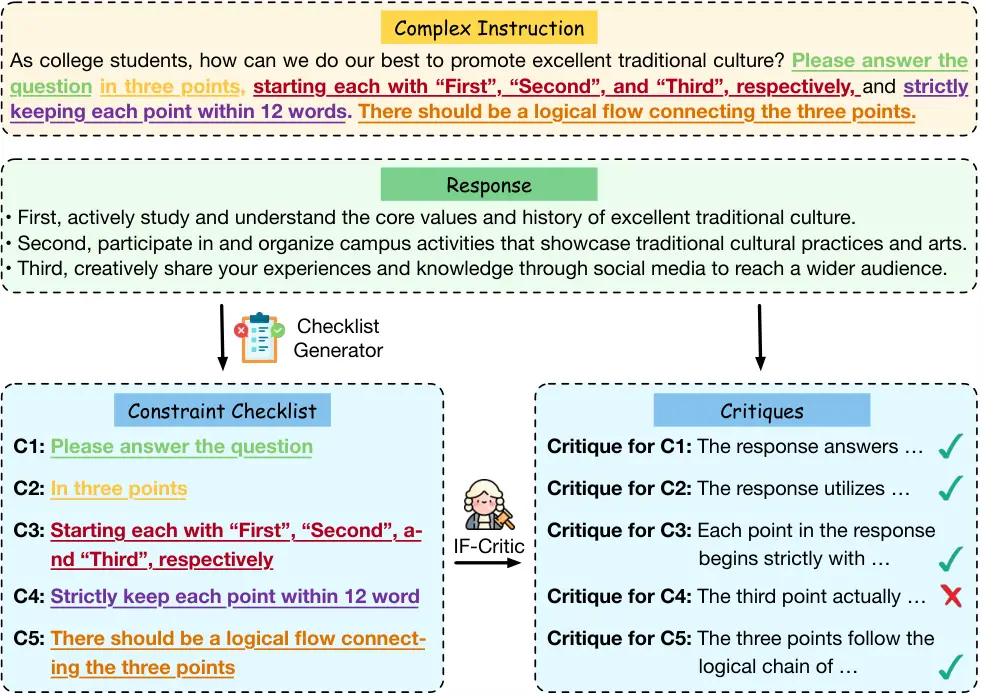
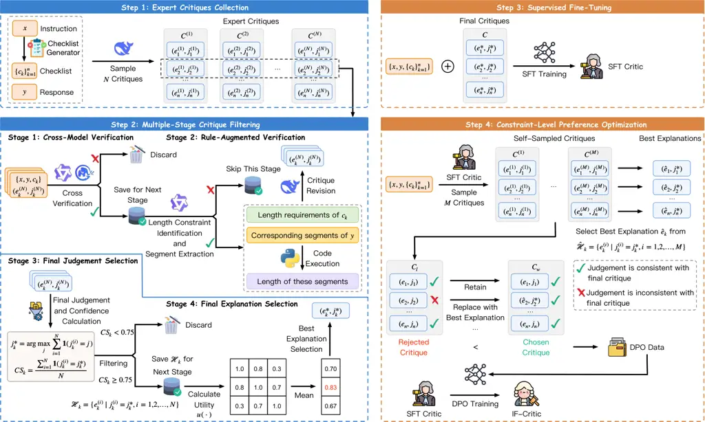
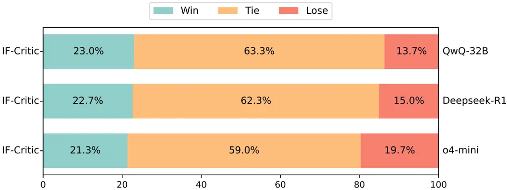
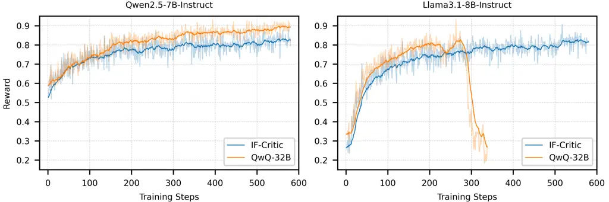
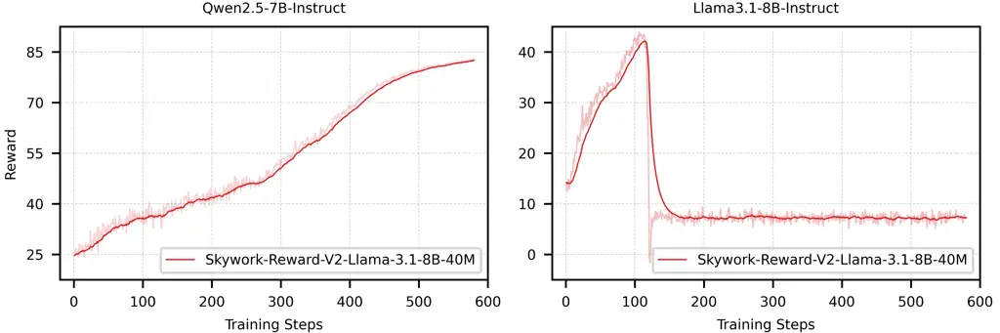

# IF-Critic: Towards a Fine-Grained LLM Critic for Instruction-Following Evaluation

Bosi Wen Affiliation: The Conversational Artificial Intelligence (CoAI)
Group, Tsinghua University Email: <wbs23@mails.tsinghua.edu.cn>    Yilin
Niu Affiliation: Zhipu AI Email: <aihuang@tsinghua.edu.cn>    Cunxiang
Wang Affiliation: Zhipu AI    Pei Ke Affiliation: University of
Electronic Science and Technology of China    Xiaoying Ling
Affiliation: Zhipu AI    Ying Zhang  Aohan Zeng  Hongning Wang   Minlie
Huang Affiliation: The Conversational Artificial Intelligence (CoAI)
Group, Tsinghua University Affiliation: Zhipu AI Affiliation: The
Knowledge Engineering Group (KEG), Tsinghua University

###### Abstract

Instruction-following is a fundamental ability of Large Language Models
(LLMs), requiring their generated outputs to follow multiple constraints
imposed in input instructions. Numerous studies have attempted to
enhance this ability through preference optimization or reinforcement
learning based on reward signals from LLM-as-a-Judge. However, existing
evaluation models for instruction-following still possess many
deficiencies, such as substantial costs and unreliable assessments. To
this end, we propose IF-Critic, an LLM critic for fine-grained,
efficient, and reliable instruction-following evaluation. We first
develop a checklist generator to decompose instructions and generate
constraint checklists. With the assistance of the checklists, we collect
high-quality critique training data through a multi-stage critique
filtering mechanism and employ a constraint-level preference
optimization method to train IF-Critic. Extensive experiments show that
the evaluation performance of IF-Critic can beat strong LLM-as-a-Judge
baselines, including o4-mini and Gemini-3-Pro. With the reward signals
provided by IF-Critic, LLMs can achieve substantial performance gains in
instruction-following optimization under lower computational overhead
compared to strong LLM critic baselines. Our code and model are
available at
[https://github.com/thu-coai/IF-CRITIC](https://github.com/thu-coai/IF-CRITIC).

^(†)^(†) ^(†)Work done when this author interned at Zhipu AI.^(†)^(†)
^(∗)Equal contribution^(†)^(†) ^(‡)Corresponding author

## 1 Introduction

Large language models (LLMs) have demonstrated remarkable capabilities
in various NLP tasks Zhao et al. (2023). Among these,
instruction-following stands out as one of the most crucial requirements
for LLM applications Ouyang et al. (2022). In the real-world use of
LLMs, nearly all tasks are formulated as instruction-following, where
human instructions specify task requirements and impose corresponding
constraints on the model output Jiang et al. (2024). Accurately
following instructions serves as a key factor in ensuring the
helpfulness and reliability of LLMs Huang et al. (2024).

However, LLMs still fall short in instruction-following, especially when
dealing with complex instructions that involve numerous constraints
Jiang et al. (2024). Many research attempts have been made to improve
the instruction-following ability of LLMs. They often leverage LLMs to
synthesize complex instructions and employ LLM-as-a-Judge to evaluate
compliance with each constraint, thereby deriving reward signals to
perform preference optimization or reinforcement learning Zhang et al.
(2025); He et al. (2024a); Ren et al. (2025); Liu et al. (2025c); Peng
et al. (2025a).



Figure 1: A usage example of IF-Critic: Given an instruction and a
response, a checklist generator first decomposes the instruction to
generate a constraint checklist. Then, IF-Critic can provide
fine-grained evaluations for the response with respect to its compliance
with all included constraints in one inference pass.

Despite these efforts, the usage of LLM-as-a-Judge for
instruction-following still faces two major yet underexplored
challenges: (1) Substantial Costs: Existing methods typically rely on
proprietary LLMs (e.g., GPT-4o) or large reasoning models (e.g.,
QwQ-32B) to judge each constraint in an instruction separately and use
the resulting judgments as reward signals. Since complex instructions
often involve multiple constraints, these methods require repeated
per-constraint inference, which is costly and difficult to scale up in
model training. (2) Unreliable Assessments: Current LLMs still struggle
to accurately assess instruction-following Zhang et al. (2024c),
exhibiting low recall in error detection Kamoi et al. (2024) and limited
counting ability Zhang et al. (2024b); Fu et al. (2024). These
limitations introduce noise to the evaluation and restrict the gains in
model optimization. To tackle these challenges, some works attempt to
introduce handcrafted code-verifiable constraints in data construction,
aiming to enhance evaluation efficiency and reliability Dong et al.
(2025); Kim et al. (2025); Li et al. (2025); Peng et al. (2025a).
However, these constraints are often homogeneous and atomized, failing
to cover the diversity and complexity of human instructions, such as
constraint composition Wen et al. (2024).

In this work, we propose IF-Critic, an LLM critic tailored for
instruction-following evaluation. To enhance inference efficiency and
obtain a more holistic and granular perception of the instructions,
IF-Critic adopts a novel checklist-guided critique generation paradigm.
As shown in Figure 1, we first utilize a checklist generator to
decompose the instructions and generate constraint checklists. Then,
IF-Critic can evaluate compliance with all included constraints in one
inference pass, eliminating the need to generate separate judgments for
different constraints multiple times. To train IF-Critic, we elaborately
prompt Deepseek-R1 Guo et al. (2025a) to generate expert critiques
guided by the checklists, then employ a multi-stage critique filtering
mechanism to select the highest-quality critique for each constraint,
which significantly mitigates noise and enhances the reliability of
critiques, including those involving counting. After fine-tuning on this
data, we leverage the property that the critiques contain
multi-constraint evaluation results, further improving IF-Critic via a
novel constraint-level preference optimization method. This method
performs fine-grained, constraint-level comparisons between positive and
negative critiques using Direct Preference Optimization (DPO) Rafailov
et al. (2023), reinforcing the perception of crucial preference
information and leading to better alignment between IF-Critic and the
expert critiques. Empirically, IF-Critic consistently outperforms
various LLM-as-a-Judge baselines on four instruction-following
meta-evaluation benchmarks, including the latest state-of-the-art LLMs
o4-mini Jaech et al. (2024) and Gemini-3-Pro Team et al. (2023).

Leveraging the fine-grained evaluation results from IF-Critic as reward
signals, we adapt DPO and Group Relative Policy Optimization (GRPO) Shao
et al. (2024) to improve the instruction-following ability of LLMs.
Experiments demonstrate that IF-Critic brings substantially greater
improvements over strong baselines with significantly less computational
overhead, highlighting its effectiveness and practicability. Our
contributions can be summarized as follows:

- •
  We propose a novel framework for the development of
  instruction-following critics, including the checklist-guided critique
  generation paradigm, the multi-stage critique filtering mechanism for
  high-quality training data collection, and the constraint-level
  preference optimization method for model training.
- •
  We introduce IF-Critic, the first instruction-following critic
  developed through our framework. Experiments show that IF-Critic
  achieves superior evaluation performance compared to strong
  LLM-as-a-Judge baselines, including o4-mini and Gemini-3-Pro.
- •
  We validate that IF-Critic can provide scalable reward signals to
  improve the instruction-following abilities of LLMs using DPO and
  GRPO. IF-Critic can bring substantially greater improvements under
  lower computational overhead compared to strong baselines.

## 2 Related Work

#### LLM-based Evaluation.

Utilizing LLMs as text evaluators has gradually become prevalent Wang et
al. (2023a); Chen et al. (2023); Ke et al. (2023) due to their
advantages in flexibility, interpretability, and generalization.
Although proprietary LLMs have demonstrated excellent evaluation
capabilities Zheng et al. (2023); Wang et al. (2023a), their practical
application is limited by issues such as high cost and potential data
leakage Ke et al. (2024). To reduce the reliance on proprietary LLMs, a
series of works attempt to train smaller LLMs specialized in evaluation
using the data generated from humans or proprietary LLMs Kim et al.
(2024a); Li et al. (2024); Ke et al. (2024); Hu et al. (2024); Kim et
al. (2024b). Distinct from these models that focus on evaluating overall
text quality, we develop an evaluation model that provides
constraint-level, fine-grained assessments of instruction-following and
leverages them as reward signals to enhance the instruction-following
ability of LLMs.

#### Checklist-based Evaluation.

Recently, using checklists for evaluation has emerged as a promising
paradigm for reward modeling and has been widely applied across diverse
domains, including instruction following Peng et al. (2025b); Liu et al.
(2025c); Qin et al. (2025b); Viswanathan et al. (2025); Huang et al.
(2025b), reasoning Zhou et al. (2025); Sanders et al. (2026), and
long-form generation Gunjal et al. (2025); Shao et al. (2025). This
paradigm associates each instruction with a list of verifiable checklist
items and derives the reward for a response based on the proportion of
satisfied items. Through fine-grained verification of each item to
calculate the final reward, this approach alleviates the problem of
overly coarse supervision Liu et al. (2025b) and improves evaluation
robustness Shen et al. (2026). However, current work typically relies on
proprietary LLMs or large reasoning models to separately verify each
checklist item, which is costly and difficult to scale. To address this
scaling bottleneck, we develop a fine-grained LLM critic to efficiently
provide reliable verification results for checklist items.

#### Instruction-following Optimization.

As LLMs are increasingly applied to real-world complex tasks, the
ability to follow complex instructions with multiple constraints emerges
as a key determinant of their practical utility Liu et al. (2023); Lou
et al. (2024), driving extensive studies to enhance this ability of
LLMs. They typically leverage LLMs to synthesize complex instructions
and perform preference optimization or reinforcement learning based on
the reward signals from LLM-as-a-Judge Sun et al. (2024); Zhang et al.
(2025); Cheng et al. (2025); Ren et al. (2025); Liu et al. (2025c); Peng
et al. (2025a). Specifically, SPaR Cheng et al. (2025) employs self-play
tree search refinement through a fine-tuned refiner to construct DPO
training data. RECAST Liu et al. (2025c) categorizes soft and hard
constraints, leveraging GPT-4o and code execution, respectively, to
obtain evaluation results for GRPO training. However, the effectiveness
of existing methods is restricted by the high costs and limited
instruction-following evaluation ability of LLM-as-a-Judge, and
code-verifiable constraints fail to cover the diversity and complexity
of human instructions.

## 3 Methodology



Figure 2: The pipeline of IF-Critic development. The left section
illustrates the process of critique training data construction, while
the right section presents the process of training IF-Critic.

### 3.1 Task Definition and Method Overview

Distinct from previous LLM critics that typically generate evaluation
results for a single criterion or question Vu et al. (2024); Wang et al.
(2025); Anugraha et al. (2025), IF-Critic leverages a constraint
checklist to guide critique generation and evaluates compliance with all
included constraints in one inference pass. Specifically, given an
instruction $`x`$, corresponding response $`y`$, and a constraint
checklist $`\{c_{k}\}^{n}_{k=1}`$ which contains all constraints within
$`x`$, IF-Critic can provide a critique
$`C=\bigcup_{k=1}^{n}(e_{k},j_{k})`$ for $`y`$, where each segment
$`(e_{k},j_{k})`$ consists of an explanation $`e_{k}`$ and a binary
judgment $`j_{k}`$ (0 or 1) for compliance with the respective
constraint. This paradigm not only enhances inference efficiency but
also equips IF-Critic with a more holistic and granular perception of
the instructions, thus improving the reliability of
instruction-following assessments.

The development of IF-Critic consists of the following steps: After
collecting complex user instructions and LLM-generated responses, we
first develop a checklist generator to decompose the instructions and
generate constraint checklists. With the assistance of the checklists,
we elaborately prompt Deepseek-R1 to generate expert critiques and
employ a multi-stage critique filtering mechanism to further enhance
their quality. Finally, we utilize the collected expert critiques and
perform a constraint-level performance optimization method to train
IF-Critic. The overall pipeline is illustrated in Figure 2. IF-Critic
can be leveraged to provide reliable reward signals, improving the
instruction-following ability of LLMs via DPO or GRPO, as validated in
our experiments.

### 3.2 Instruction and Response Collection

To obtain diverse instructions for critic training, we collect
instructions from real-world application scenarios and utilize LLMs to
categorize them according to the task taxonomy of CritiqueLLM Ke et al.
(2024), which encompasses 10 categories and covers diverse NLP
applications in real-world scenarios. To improve data quality, we prompt
LLMs to score instruction quality and develop a classifier to assess
their constraint complexity, which is trained with a small amount of
human annotation data. Finally, we balance the amount of instruction
across task categories and acquire 55K high-quality instructions with
relatively high complexity.

Then, we collect LLM responses from 15 representative models, which
possess varying abilities in instruction-following. The model list is
provided in Appendix A. For each instruction, we randomly select two
models to generate responses, resulting in a total of 110k evaluation
inputs, each comprising an instruction and its corresponding LLM
response.

### 3.3 Critique Training Data Construction

To assist IF-Critic in fine-grained evaluation, we first develop a
checklist generator to decompose the constraints within instruction
$`x`$ and generate a constraint checklist $`\{c_{k}\}^{n}_{k=1}`$. To
achieve this, we leverage a powerful LLM, Deepseek-R1¹¹ 1
https://huggingface.co/deepseek-ai/DeepSeek-R1 for automatic checklist
annotation in our collected instructions, and then utilize these
checklists to fine-tune a base model as our checklist generator, which
supports efficient checklist generation after deployment. Manual
inspection of 1,000 test samples for the generator shows that 99.29% of
generated constraints and 97.50% of entire checklists are correct,
indicating its reliability.

With the assistance of the checklists provided by our checklist
generator, we proceed to employ Deepseek-R1 for expert critique
annotation via a carefully designed prompt, which elicits a concise and
specific explanation before the judgment for each constraint. Detailed
prompts are provided in the Appendix B. For each response, we collect
$`N`$ expert critiques and apply a multi-stage critique filtering
mechanism to select the highest-quality critique for each constraint in
the checklist, which is then used for training IF-Critic.

The mechanism comprises four stages: cross-model verification,
rule-augmented verification, final judgment selection, and final
explanation selection. The first two stages aim to filter out noise in
critiques caused by two major limitations of LLM-as-a-Judge: potential
evaluation bias and limited counting ability, respectively. The
remaining two stages then select the highest-quality judgements and
explanations from the filtered critiques based on consistency, further
enhancing their reliability.

#### Cross-Model Verification.

Previous works point out that LLM-as-a-Judge may suffer from potential
biases Zheng et al. (2023); Ye et al. (2025a), undermining the
reliability of its generated critiques. To mitigate this, we utilize two
additional LLMs, GLM-4-Plus GLM et al. (2024) and Qwen2.5-72B-Instruct
Yang et al. (2024), to independently verify two aspects of the expert
critiques for each constraint: (1) The correctness of the explanation,
and (2) The consistency between the explanation and judgment. Detailed
prompts can be found in Appendix B. Any critiques that fail verification
by any model in any aspect are strictly filtered, accounting for 11.3%
of our data.

#### Rule-Augmented Verification.

Considering that LLMs often struggle with accurate counting Zhang et al.
(2024b); Fu et al. (2024), we introduce rule-augmented verification to
enhance the reliability of critiques involving length constraints (e.g.,
each title must be 8 characters long). Methodologically, we first prompt
Qwen2.5-72B-Instruct to identify length constraints and extract relevant
segments from the responses. Subsequently, we employ Python scripts to
identify length information within these segments automatically. This
information then guides Deepseek-R1 to revise its critiques. The prompts
for these steps are in the Appendix B. This approach integrates the
flexibility of LLM-based evaluation with the precision of rule-based
evaluation, thereby effectively handling the diverse length constraints
in human instructions.

#### Final Judgement Selection.

Given that critique generation is analogous to a Chain-of-Thought (CoT)
Wei et al. (2022) reasoning process, we incorporate self-consistency
Wang et al. (2023b), a widely used decoding strategy in CoT reasoning,
to select final judgments and improve their correctness. Specifically,
for each constraint $`c_{k}`$, we select the final judgment
$`j_{k}^{*}`$ via majority voting among multiple expert critiques.
Furthermore, previous works show that confidence, which is calculated as
the proportion of the majority result to the total samples, is an
important indicator of answer reliability Xiong et al. (2024); Hu et al.
(2024); Prasad et al. (2024), with higher confidence generally implying
greater reliability. Inspired by this, we discard the final critiques of
constraints with confidence lower than 0.75 in our experiment, which
empirically balances data retention and reliability.

#### Final Explanation Selection.

After obtaining the correct final judgments, the last step is to select
the highest-quality explanations that support these judgments. To
achieve this, we devise a selection strategy inspired by Minimum Bayes
Risk Decoding Bickel and Doksum (2015): For each constraint $`c_{k}`$,
we first construct a hypothesis set $`\mathcal{H}_{k}`$ containing all
explanations whose corresponding judgments align with the final
judgments $`j_{k}^{*}`$. Then, we utilize a text similarity measure
$`u(\cdot)`$ to calculate the consistency between each pair of
explanations in $`\mathcal{H}_{k}`$. The explanation with the highest
average consistency among others is selected as the final explanation
$`e_{k}^{*}`$. The formal definition is as follows:

```math
\displaystyle\mathcal{H}_{k}=\{e_{k}^{(i)}\mid j_{k}^{(i)}=j_{k}^{*},i=1,2,…,N\} \tag{1}
```

```math
\displaystyle e_{k}^{*}=\arg\max_{e\in\mathcal{H}_{k}}\frac{1}{|\mathcal{H}_{k}|}\sum_{\widetilde{e}\in\mathcal{H}_{k}}u(\widetilde{e},e) \tag{2}
```

Through these rigorous filtering processes, we manually inspect the
quality of 70 final critiques with 353 constraints and find that 96.03%
judgments and 92.35% explanations are completely correct, demonstrating
their high quality.

### 3.4 IF-Critic Training

After constructing the final critique training dataset
$`D=\{C_{i}=\bigcup_{k=1}^{n_{i}}(e_{ik}^{*},j_{ik}^{*})\}_{i=1}^{|D|}`$,
we partition $`D`$ into two subsets
$`D_{\text{sft}}\cup D_{\text{ref}}`$ and employ a two-stage paradigm to
train IF-Critic, comprising supervised fine-tuning (SFT) and
constraint-level preference optimization. In the first stage, we utilize
a critique generation prompt $`p`$ to concatenate the instruction $`x`$,
response $`y`$, and checklist $`\{c_{k}\}^{n}_{k=1}`$, applying a
standard SFT loss on vanilla LLM $`\theta`$:

```math
\displaystyle\mathcal{L}_{\text{SFT}}=-\sum_{i=1}^{|D_{\text{sft}}|}\text{log}P_{\theta}(C_{i}|p_{i}) \tag{3}
```

After obtaining the SFT critic, we further enhance its ability via
preference optimization. Existing methods usually sample multiple
independent responses from the policy model and utilize response-level
rewards to select chosen and rejected examples Yuan et al. (2024); Ye et
al. (2025b); Yu et al. (2025). However, since the critiques in our task
involve multiple segments for different constraints, only the segments
where chosen and rejected critiques differ in judgments encapsulate
crucial preference information. Other segments may introduce unnecessary
interference and dilute important supervision signals, leading to
insufficient optimization Chen et al. (2024); Cheng et al. (2025).

To mitigate this, we introduce fine-grained, constraint-level
comparisons in preference pairs construction, thus reinforcing the
perception of crucial preference information. Specifically, for each
evaluation input $`p`$ in $`D_{\text{ref}}`$, we first sample $`M`$
critiques from the SFT critic. Then, we identify the best self-sampled
explanation $`\hat{e}_{k}`$ for each constraint $`c_{k}`$ whose
judgements align with the expert final judgement $`j^{*}_{k}`$ in a
manner analogous to Equation 1 and 2 (if any). Finally, self-sampled
critiques with at least one judgment that misaligns with the expert
final critique are selected as rejected critiques
$`C_{l}=\bigcup_{k=1}^{n}(e_{k},j_{k})`$. Retaining the segments that
align with the expert final critique while replacing other misaligned
segments with the best self-sampled explanations $`\hat{e}_{k}`$ and
expert final judgement $`j^{*}_{k}`$ to construct chosen critiques
$`C_{w}`$:

```math
\displaystyle C_{w}=\bigcup_{k=1}^{n}\begin{cases}(e_{k},j_{k}),&j_{k}=j^{*}_{k}\\
(\hat{e}_{k},j^{*}_{k}),&j_{k}\neq j^{*}_{k}\end{cases} \tag{4}
```

Rejected critiques are discarded when some misaligned segments lack
substitute best self-sampled explanations. Consequently, we construct a
preference dataset $`D_{\text{dpo}}`$ where the preference pairs only
differ in the segments with inconsistent judgments, thereby reinforcing
crucial preference information. Moreover, self-sampled critiques are
closer to the SFT critic decoding space than the expert critique, which
is generally beneficial for optimization Guo et al. (2024). Finally, we
conduct preference optimization via the following DPO loss:

```math
\displaystyle\mathcal{L}_{\text{DPO}}(\pi_{\theta};\pi_{\text{ref}})= \displaystyle-\mathbb{E}_{(p,C_{l},C_{w})\sim D_{\text{dpo}}}[\log\sigma(\beta\log\frac{\pi_{\theta}(C_{w}|p)}{\pi_{\text{ref}}(C_{w}|p)} \tag{5}
```

```math
\displaystyle-\beta\log\frac{\pi_{\theta}(C_{l}|p)}{\pi_{\text{ref}}(C_{l}|p)})]
```

where both $`\pi_{\theta}`$ (i.e., the trained policy model) and
$`\pi_{\text{ref}}`$ (i.e., the fixed reference model) are initialized
from the SFT critic.

### 3.5 Evaluation Results Utilization

Leveraging the evaluation results of IF-Critic as reward signals, we can
apply DPO or GRPO algorithms to improve the instruction-following
abilities of LLMs. For every input instruction $`x`$, the checklist
generator produces the constraint checklist $`\{c_{k}\}^{n}_{k=1}`$, and
the policy model $`\pi_{\theta}`$ samples $`K`$ candidate responses
$`\{y_{i}\}^{K}_{i=1}`$. Then, the reward $`r_{i}`$ for each response
$`y_{i}`$ can be determined by the generated critique
$`C_{i}=\bigcup_{k=1}^{n}(e_{ik},j_{ik})`$ for $`y_{i}`$:

```math
\displaystyle r_{i}=\frac{1}{n}\sum_{k=1}^{n}j_{ik} \tag{6}
```

Then, we can use this reward to construct DPO training data or to
conduct GRPO training.

## 4 Experiments

|                  |                        |            |          |          |          |          |          |          |          |         |
| ---------------- | ---------------------- | ---------- | -------- | -------- | -------- | -------- | -------- | -------- | -------- | ------- |
| Prompt           | Model                  | EvalCritic |          | CFBench  |          | TRACE    |          | Multi-IF |          | Avg.    |
|                  |                        | Positive   | Negative | Positive | Negative | Positive | Negative | Positive | Negative | Average |
|                  |                        | F1         | F1       | F1       | F1       | F1       | F1       | F1       | F1       | F1      |
| Constraint-Level | Gemini-3-Pro           | 0.887      | 0.744    | 0.934    | 0.794    | 0.932    | 0.704    | 0.962    | 0.898    | 0.857   |
|                  | o4-mini                | 0.887      | 0.717    | 0.927    | 0.755    | 0.923    | 0.599    | 0.960    | 0.890    | 0.832   |
|                  | GPT-4.1                | 0.883      | 0.608    | 0.919    | 0.689    | 0.924    | 0.597    | 0.932    | 0.801    | 0.794   |
|                  | Deepseek-R1            | 0.863      | 0.686    | 0.905    | 0.718    | 0.883    | 0.555    | 0.933    | 0.824    | 0.796   |
|                  | QwQ-32B                | 0.856      | 0.675    | 0.900    | 0.684    | 0.901    | 0.595    | 0.931    | 0.795    | 0.792   |
|                  | Qwen-2.5-72B-Instruct  | 0.854      | 0.362    | 0.891    | 0.459    | 0.915    | 0.374    | 0.896    | 0.590    | 0.668   |
|                  | Llama-3.3-70B-Instruct | 0.869      | 0.486    | 0.904    | 0.612    | 0.916    | 0.426    | 0.921    | 0.756    | 0.736   |
|                  | GLM-4-32B-0414         | 0.867      | 0.451    | 0.900    | 0.531    | 0.913    | 0.384    | 0.898    | 0.610    | 0.694   |
| Checklist-Level  | Gemini-3-Pro           | 0.902      | 0.742    | 0.945    | 0.808    | 0.932    | 0.655    | 0.960    | 0.892    | 0.855   |
|                  | o4-mini                | 0.911      | 0.753    | 0.935    | 0.761    | 0.925    | 0.639    | 0.964    | 0.900    | 0.849   |
|                  | GPT-4.1                | 0.883      | 0.560    | 0.918    | 0.637    | 0.923    | 0.517    | 0.933    | 0.799    | 0.771   |
|                  | Deepseek-R1            | 0.895      | 0.716    | 0.928    | 0.725    | 0.910    | 0.579    | 0.938    | 0.828    | 0.815   |
|                  | QwQ-32B                | 0.892      | 0.663    | 0.922    | 0.716    | 0.922    | 0.570    | 0.933    | 0.793    | 0.801   |
|                  | Qwen-2.5-72B-Instruct  | 0.849      | 0.278    | 0.894    | 0.424    | 0.914    | 0.330    | 0.889    | 0.548    | 0.641   |
|                  | Llama-3.3-70B-Instruct | 0.862      | 0.391    | 0.905    | 0.585    | 0.915    | 0.400    | 0.916    | 0.718    | 0.712   |
|                  | GLM-4-32B-0414         | 0.855      | 0.347    | 0.897    | 0.512    | 0.909    | 0.325    | 0.909    | 0.664    | 0.677   |
|                  | IF-Critic-14B (Ours)   | 0.927      | 0.806    | 0.937    | 0.785    | 0.942    | 0.739    | 0.945    | 0.844    | 0.866   |

Table 1: Positive F1 and Negative F1 scores of constraint-following
verification on the instruction-following evaluation task. The best
performance among these models is bold, while the second-best
performance is underlined.

### 4.1 Instruction-Following Evaluation

#### Evaluation Benchmarks.

Given the scarcity of existing instruction-following meta-evaluation
datasets, we sample instructions from four benchmarks: EvalCritic,
CFBench Zhang et al. (2024a), TRACE Zhang et al. (2025), and Multi-IF He
et al. (2024b) to construct meta-evaluation datasets. EvalCritic is a
random split of the dataset we used for instruction-following
optimization (§4.2) , whose distribution of instructions differs from
IF-Critic training data. For the first three benchmarks, we randomly
sample 150 instructions. For Multi-IF, we select the first round from
the Chinese version, comprising 454 instructions. Responses for each
instruction are generated by 2 of 6 LLMs with varying capabilities. We
use our checklist generator to generate constraint checklists for
EvalCritic and directly adapt the original checklists for other
benchmarks. For the first three benchmarks, two annotators independently
judge compliance with each constraint, with a third inspector conducting
cross-validation. Any discrepancies will be discussed to reach a
consensus. For Multi-IF, we use the provided verification code for
evaluation. Across these benchmarks, there are 1411 / 1070 / 1634 / 1220
constraints, respectively, of which 406 / 252 / 297 / 320 are labeled as
"not followed".

#### Baselines.

We choose state-of-the-art general and evaluation-specific LLMs as our
baselines, which are listed in Appendix C. General LLMs can serve as
evaluators for instruction-following via elaborately prompting. We
explore two prompting strategies: (1) Checklist-Level Prompt: evaluate
all constraints in the given checklist within a single inference pass,
which is the same as IF-Critic. (2) Constraint-Level Prompt: evaluate
each constraint individually. Evaluation-specific LLMs are mainly
designed for pairwise comparison. To accommodate this evaluation
setting, we convert the above datasets into pairwise versions.
Specifically, for two responses generated from the same instruction, we
select pairs in which one response follows all constraints while the
other does not to construct pairwise samples. The rewards of IF-Critic
according to Equation 6 for both responses are converted into pairwise
comparisons to calculate the agreement rate. To ensure a fair
comparison, we remove samples that result in a tie for IF-Critic. Greedy
search decoding is used for reproducibility, which has a negligible
impact on the evaluation performance of reasoning models, as verified in
Appendix E.

#### Implementation Details.

We choose Qwen-2.5-14B-Instruct Yang et al. (2024) as the base model for
both the checklist generator and IF-Critic. We also experiment with
other base models, and the results are provided in Appendix F.
Deepseek-R1 generates $`N=5`$ expert critiques per response. During
final explanation selection, we use difflab²² 2
https://docs.python.org/3/library/difflib.html to implement the text
similarity measure $`u(\cdot)`$. During IF-Critic training, the ratio of
$`D_{\text{sft}}`$ to $`D_{\text{ref}}`$ is set to 6:4. The number of
self-sampled critiques, $`M`$, is set to 10, and up to 1 preference pair
is constructed for each evaluation input. More implementation details
are in Appendix D.

|                                    |            |         |       |          |
| ---------------------------------- | ---------- | ------- | ----- | -------- |
| Model                              | EvalCritic | CFBench | TRACE | Multi-IF |
| Skywork-Reward-V2-Llama-3.1-8B-40M | 0.571      | 0.689   | 0.671 | 0.705    |
| Prometheus-BGB-8x7B                | 0.464      | 0.556   | 0.529 | 0.489    |
| RM-R1-Deepseek-Distilled-Qwen-32B  | 0.607      | 0.711   | 0.765 | 0.625    |
| RRM-32B                            | 0.534      | 0.689   | 0.765 | 0.636    |
| IF-Critic-14B (Ours)               | 0.964      | 0.956   | 0.882 | 0.977    |

Table 2: Pairwise agreement rates on the instruction-following
evaluation task.

#### Main Results.

Table 1 presents the F1-scores for both positive and negative classes in
the instruction-following evaluation task of general LLMs, while Table 2
shows the pairwise agreement for evaluation-specific LLMs. Firstly,
IF-Critic demonstrates strong performance on various benchmarks,
outperforming all baselines on average F1, including the latest
state-of-the-art LLM o4-mini and Gemini-3-Pro. In contrast, the
performance of existing general LLMs remains limited, with relatively
low negative F1. This aligns with our motivation for developing
IF-Critic to enable more reliable evaluation. Secondly, existing
evaluation-specific LLMs still perform poorly in evaluating
instruction-following and lag far behind IF-Critic, highlighting the
necessity of a critic specifically designed for this task. Finally,
reasoning models (e.g, o4-mini, DeepseekR1, and QwQ-32B) typically
perform better with Checklist-Level Prompt, while other LLMs benefit
more from Constraint-Level Prompt. We attribute this to two factors: (1)
Evaluating multiple constraints at one inference pass increases task
complexity. (2) Long-chain reasoning enables a more holistic perception
of the relationships between constraints with the help of checklists.
This observation validates the rationale of our checklist-guided
critique generation paradigm.

|                                 |            |         |       |          |
| ------------------------------- | ---------- | ------- | ----- | -------- |
| Method                          | EvalCritic | CFBench | TRACE | Multi-IF |
| IF-Critic-14B                   | 0.861      | 0.863   | 0.840 | 0.895    |
| Data Format                     |            |         |       |          |
| w/ Constraint-Level Critique    | 0.844      | 0.830   | 0.816 | 0.859    |
| Critique Filtering              |            |         |       |          |
| w/ Raw Data                     | 0.814      | 0.792   | 0.774 | 0.780    |
| w/o Cross-Model Verification    | 0.851      | 0.858   | 0.832 | 0.874    |
| w/o Rule-Augmented Verification | 0.827      | 0.823   | 0.789 | 0.825    |
| w/o Final Judgement Selection   | 0.840      | 0.804   | 0.821 | 0.849    |
| w/o Final Explanation Selection | 0.840      | 0.846   | 0.807 | 0.858    |
| Preference Learning             |            |         |       |          |
| w/ Vanilla DPO                  | 0.797      | 0.797   | 0.785 | 0.841    |
| w/ Expert Critique              | 0.828      | 0.836   | 0.801 | 0.840    |
| w/o Preference Learning         | 0.815      | 0.810   | 0.810 | 0.841    |

Table 3: The average of Positive F1 and Negative F1 scores under
different ablation settings for IF-Critic.

#### Ablation Study.

To investigate the impact of each design component of our framework, we
conduct additional ablation studies. For the training data format, we
decompose expert critiques to train an alternative model that generates
critiques for individual constraints. Table 3 shows that the performance
of IF-Critic declines across all benchmarks, demonstrating that
checklist-guided training can facilitate instruction perception and
contribute to the final performance.

For the critique filtering mechanism, we remove each step individually
to explore its impact on evaluation performance. Table 3 shows that all
steps contribute to the final performance, but removing rule-augmented
verification yields the largest performance drop, underscoring its key
role in improving discriminability for length constraints. Notably,
directly using all raw training data without critique filtering leads to
the most severe performance decline, highlighting its effectiveness.

For the preference optimization method, we explored three variants of
our method: (1) Constructing preference pairs directly based on the
agreement rates between expert critiques, denoted as Vanilla DPO, (2)
Replacing misaligned segments of rejected critiques with expert
critiques rather than the best self-sampled ones, and (3) Performing SFT
on the entire training dataset without preference optimization. Table 3
shows that our constraint-level preference optimization method achieves
the best performance, evidencing its effectiveness in enabling better
alignment with expert critiques.



Figure 3: Explanation quality evaluation results. The percentages
indicate the preference between IF-Critic and other evaluation models
via human annotation.

|                       |        |                                    |          |          |        |        |         |      |      |          |       |       |
| --------------------- | ------ | ---------------------------------- | -------- | -------- | ------ | ------ | ------- | ---- | ---- | -------- | ----- | ----- |
| Policy Model          | Method | Reward Model / Critic              | Relative | Multi-IF |        |        | CFBench |      |      | SysBench |       |       |
|                       |        |                                    | Time     | Turn 1   | Turn 2 | Turn 3 | CSR     | ISR  | PSR  | CSR      | ISR   | SSR   |
| Qwen2.5-7B-Instruct   | -      | \-                                 | \-       | 76.14    | 61.65  | 51.41  | 0.79    | 0.46 | 0.56 | 60.33    | 35.72 | 19.10 |
| Qwen2.5-32B-Instruct  |        | \-                                 | \-       | 83.02    | 72.43  | 63.12  | 0.84    | 0.55 | 0.65 | 81.76    | 66.44 | 44.83 |
| Qwen2.5-7B-Instruct   | DPO    | Skywork-Reward-V2-Llama-3.1-8B-40M | 0.79     | 77.86    | 63.12  | 53.15  | 0.82    | 0.53 | 0.63 | 61.59    | 38.60 | 23.60 |
|                       |        | QwQ-32B                            | 13.4     | 80.44    | 66.05  | 56.82  | 0.82    | 0.50 | 0.61 | 64.85    | 41.32 | 24.23 |
|                       |        | IF-Critic-14B (Ours)               | 1.00     | 81.25    | 67.51  | 57.73  | 0.83    | 0.52 | 0.63 | 67.40    | 44.84 | 28.71 |
|                       | GRPO   | Skywork-Reward-V2-Llama-3.1-8B-40M | 1.04     | 75.28    | 61.12  | 51.90  | 0.81    | 0.50 | 0.60 | 65.82    | 44.48 | 25.79 |
|                       |        | QwQ-32B                            | 3.08     | 78.59    | 63.51  | 52.60  | 0.83    | 0.54 | 0.64 | 76.25    | 59.28 | 37.58 |
|                       |        | IF-Critic-14B (Ours)               | 1.00     | 81.87    | 67.36  | 58.76  | 0.85    | 0.59 | 0.69 | 81.19    | 66.80 | 44.44 |
| LLama3.1-8B-Instruct  | -      | \-                                 | \-       | 73.13    | 64.27  | 56.84  | 0.70    | 0.32 | 0.43 | 60.14    | 37.32 | 19.38 |
| LLama3.1-70B-Instruct |        | \-                                 | \-       | 83.06    | 74.25  | 66.78  | 0.82    | 0.52 | 0.62 | 78.64    | 62.52 | 39.49 |
| LLama3.1-8B-Instruct  | DPO    | Skywork-Reward-V2-Llama-3.1-8B-40M | 0.79     | 76.71    | 69.04  | 60.59  | 0.75    | 0.38 | 0.50 | 67.88    | 47.53 | 28.22 |
|                       |        | QwQ-32B                            | 12.8     | 79.72    | 71.94  | 62.97  | 0.76    | 0.41 | 0.52 | 68.36    | 46.97 | 27.53 |
|                       |        | IF-Critic-14B (Ours)               | 1.00     | 80.75    | 72.52  | 64.13  | 0.76    | 0.41 | 0.53 | 69.67    | 49.04 | 28.15 |
|                       | GRPO   | Skywork-Reward-V2-Llama-3.1-8B-40M | 1.33     | 75.57    | 67.88  | 58.59  | 0.77    | 0.42 | 0.53 | 76.99    | 59.96 | 37.42 |
|                       |        | QwQ-32B                            | 3.10     | 80.67    | 72.49  | 64.40  | 0.77    | 0.44 | 0.53 | 78.22    | 62.32 | 40.79 |
|                       |        | IF-Critic-14B (Ours)               | 1.00     | 83.83    | 73.32  | 65.05  | 0.81    | 0.50 | 0.59 | 79.90    | 66.40 | 44.27 |

Table 4: Experimental results (%) on Multi-IF, CFBench, and SysBench.
The best performance among different critics is bold. Relative Time
refers to the relative time to IF-Critic of reward calculation in DPO
and average per-step training in GRPO. Skywork-Reward-V2 is a reward
model that generates scalar rewards, whereas QwQ-32B and IF-Critic
generate natural language critiques.

#### Analysis on Explanation Quality.

To assess the quality of the explanations generated by IF-Critic, we
randomly sample 300 constraints from the first three evaluation
benchmarks and collect corresponding generated explanations from
IF-Critic, QwQ-32B, Deepseek-R1, and o4-mini. For each pair of
explanations (one from IF-Critic and the other from a baseline
evaluation model, given the same evaluation input), we ask human
annotators to judge which explanation is better (i.e., win, lose, or
tie) in terms of correctness, informativeness, and helpfulness. The
priority of these aspects follows the above order. As shown in Figure 3,
IF-Critic surpasses QwQ-32B and Deepseek-R1 in win rates by 9.3% and
7.7%, respectively, and performs on par with o4-mini. Many results are
ties because all four evaluators are strong and correct on many
constraints. This demonstrates that IF-Critic can generate high-quality
explanations for instruction-following evaluation.

### 4.2 Instruction-Following Optimization

#### Training Datasets & Settings.

To collect diverse and high-quality complex instructions for model
training, we first curate seed instructions from real-world application
scenarios. These scenarios are distinct from the training data of
IF-Critic and generally exhibit lower instruction complexity. Stratified
sampling based on task categories is adopted to enhance diversity.
Subsequently, we employ Deepseek-R1 to introduce constraints to these
instructions based on a comprehensive constraint taxonomy that
encompasses 6 primary constraint categories and 4 constraint composition
types. Deepseek-R1 is also used to validate the generated instructions,
ensuring they are reasonable, unambiguous, and logically consistent. In
total, we obtain 18.5k high-quality complex instructions for training.
Further details are in Appendix G.

We choose Qwen2.5-7B-Instruct and Llama-3.1-8B-Instruct as the initial
policy models for DPO and GRPO training. Three evaluation models are
used to provide reward signals: IF-Critic, the state-of-the-art reward
model Skywork-Reward-V2-Llama-3.1-8B-40M, and the powerful open-source
general LLM QwQ-32B. For DPO training, we sample 10 responses per
instruction, with a temperature of 1.0 and a top-p value of 0.9. The
responses with the highest and lowest rewards are used to construct
preference pairs. For GRPO training, we perform 32 rollouts per
instruction. More training details are in Appendix G.

#### Evaluation Benchmarks.

We evaluate our models on three popular instruction-following
benchmarks: Multi-IF He et al. (2024b), which assesses multi-turn and
multilingual hard constraints following; CFBench Zhang et al. (2024a),
which covers a comprehensive range of constraint types; and Sysbench Qin
et al. (2025a), which focuses on the following of system prompts.
GPT-4o-2024-11-20 is used as the evaluation model for CFBench and
SysBench. For Multi-IF, we follow RPO Huang et al. (2025a) and report
the average performance across the English and Chinese subsets.

#### Main Results.

The main results are presented in Table 4. Firstly, optimization with
IF-Critic brings substantially superior performance gains across various
benchmarks compared to all strong baselines, substantiating its advanced
capacity of instruction-following evaluation. Notably, LLMs after GRPO
training with IF-Critic even achieve comparable performance to
significantly larger LLMs (32B or 70B) of the same model family. In
contrast, the general reward model, Skywork-Reward-V2, is ill-suited for
instruction-following optimization, yielding only marginal improvements.
Secondly, compared to the powerful LLM critic, QwQ-32B, IF-Critic only
incurs less than a third of computational overhead, highlighting its
practicality. Finally, GRPO proves more effective for
instruction-following tasks compared to DPO, delivering greater
performance gains. The reward curves during GRPO training are provided
in the Appendix H. We also validate that optimization with IF-Critic
does not compromise the general performance of LLMs in the Appendix I.

## 5 Conclusion

Our work proposes IF-Critic, an LLM critic for fine-grained
instruction-following evaluation. IF-Critic adopts a checklist-guided
critique generation paradigm that evaluates all constraints in a
checklist within one inference pass, improving efficiency and
reliability. We collect high-quality critique training data through a
multi-stage filtering mechanism and employ constraint-level preference
optimization to train IF-Critic. Extensive experiments show that
IF-Critic has stronger evaluation ability and can bring superior
performance gains to LLMs in instruction-following optimization,
compared to powerful LLM critic baselines.

## Limitations

The limitations of our work are summarized as follows:

#### Scope of Rule-Augmented Verification.

In the critique training data construction stage of IF-Critic, we only
introduce rule-augmented verification for length-related constraints,
while other code-verifiable constraints (e.g., keywords or structural
format) are not comprehensively covered. We prioritize length-related
constraints because they are prevalent in real-world complex
instructions, and the previous version of IF-Critic performs well on
other verifiable constraints but struggles with length constraints, as
observed in our primary experiments. Although this approach has yielded
substantial performance gains, extending this approach to a broader
spectrum of constraint types remains an important direction for future
work.

#### Potential Evaluation Bias.

Similar to other model-based evaluation methods, IF-Critic may also
suffer from potential evaluation biases such as self-enhancement or
verbosity bias Zheng et al. (2023). These biases could harm the
evaluation correctness of certain models. Although our multi-stage
critique filtering mechanism has effectively mitigated noise and bias in
training critique collection, incorporating inference-time strategies
(e.g., multi-agent debate) may further attenuate bias and enhance
evaluation performance. We reserve further investigation of evaluation
bias mitigation as important future work.

## Ethical Considerations

In this work, we recruit some human annotators to validate the quality
of training data and the performance of IF-Critic. The annotator pool
primarily consists of college students. Throughout the data annotation
process, we adhere to several key principles. Firstly, all annotators
are fully informed about the purpose of our study and the involved
tasks. Secondly, all annotators received fair compensation for their
contributions based on the market price. Finally, any harmful
instructions are filtered before annotation to avoid ethical issues.

## Acknowledgments

This work was supported by the National Science Foundation for
Distinguished Young Scholars (with No. 62125604) and the Natural Science
Foundation of China (No. 62536008). We would also like to thank Zhipu AI
for sponsoring the computational resources and annotation costs in this
work.

## References

- Anthropic (2023) Anthropic Introducing claude. External Links:
  [Link](https://www.anthropic.com/index/introducing-claude) Cited by:
  Appendix A.
- Anugraha et al. (2025) D. Anugraha, Z. Tang, L. J. V. Miranda, H.
  Zhao, M. R. Farhansyah, G. Kuwanto, D. Wijaya, and G. I. Winata R3:
  robust rubric-agnostic reward models. arXiv preprint arXiv:2505.13388.
  Cited by: §3.1.
- Bickel and Doksum (2015) P. J. Bickel and K. A. Doksum Mathematical
  statistics: basic ideas and selected topics, volumes i-ii package.
  Chapman and Hall/CRC. Cited by: §3.3.
- Chen et al. (2021) M. Chen, J. Tworek, H. Jun, Q. Yuan, H. P. D. O.
  Pinto, J. Kaplan, H. Edwards, Y. Burda, N. Joseph, G. Brockman, et al.
  Evaluating large language models trained on code. arXiv preprint
  arXiv:2107.03374. Cited by: Appendix I.
- Chen et al. (2025) X. Chen, G. Li, Z. Wang, B. Jin, C. Qian, Y.
  Wang, H. Wang, Y. Zhang, D. Zhang, T. Zhang, et al. Rm-r1: reward
  modeling as reasoning. arXiv preprint arXiv:2505.02387. Cited by:
  Appendix C.
- Chen et al. (2023) Y. Chen, R. Wang, H. Jiang, S. Shi, and R. Xu
  Exploring the use of large language models for reference-free text
  quality evaluation: an empirical study. In Findings of the Association
  for Computational Linguistics: IJCNLP-AACL 2023 (Findings), J. C.
  Park, Y. Arase, B. Hu, W. Lu, D. Wijaya, A. Purwarianti, and A. A.
  Krisnadhi (Eds.), Nusa Dua, Bali, pp. 361–374. External Links:
  [Link](https://aclanthology.org/2023.findings-ijcnlp.32/),
  [Document](https://dx.doi.org/10.18653/v1/2023.findings-ijcnlp.32)
  Cited by: §2.
- Chen et al. (2024) Z. Chen, K. Zhou, X. Zhao, J. Wan, F. Zhang, D.
  Zhang, and J. Wen Improving large language models via fine-grained
  reinforcement learning with minimum editing constraint. In Findings of
  the Association for Computational Linguistics: ACL 2024, L. Ku, A.
  Martins, and V. Srikumar (Eds.), Bangkok, Thailand, pp. 5694–5711.
  External Links:
  [Link](https://aclanthology.org/2024.findings-acl.338/),
  [Document](https://dx.doi.org/10.18653/v1/2024.findings-acl.338) Cited
  by: §3.4.
- Cheng et al. (2025) J. Cheng, X. Liu, C. Wang, X. Gu, Y. Lu, D.
  Zhang, Y. Dong, J. Tang, H. Wang, and M. Huang SPar: self-play with
  tree-search refinement to improve instruction-following in large
  language models. In The Thirteenth International Conference on
  Learning Representations, External Links:
  [Link](https://openreview.net/forum?id=9chRqsPOGL) Cited by: §2, §3.4.
- Dong et al. (2025) G. Dong, K. Lu, C. Li, T. Xia, B. Yu, C. Zhou,
  and J. Zhou Self-play with execution feedback: improving
  instruction-following capabilities of large language models. In The
  Thirteenth International Conference on Learning Representations,
  External Links: [Link](https://openreview.net/forum?id=cRR0oDFEBC)
  Cited by: §1.
- Doubao Team (2025) Doubao Team Doubao-1.5-pro: model release. Note:
  Accessed: 2025-01-22 External Links:
  [Link](https://team.doubao.com/en/special/doubao_1_5_pro) Cited by:
  Appendix A.
- Fu et al. (2024) T. Fu, R. Ferrando, J. Conde, C. Arriaga, and P.
  Reviriego Why do large language models (llms) struggle to count
  letters?. arXiv preprint arXiv:2412.18626. Cited by: §1, §3.3.
- Gao et al. (2025) B. Gao, F. Song, Z. Yang, Z. Cai, Y. Miao, Q.
  Dong, L. Li, C. Ma, L. Chen, R. Xu, Z. Tang, B. Wang, D. Zan, S.
  Quan, G. Zhang, L. Sha, Y. Zhang, X. Ren, T. Liu, and B. Chang
  Omni-MATH: a universal olympiad level mathematic benchmark for large
  language models. In The Thirteenth International Conference on
  Learning Representations, External Links:
  [Link](https://openreview.net/forum?id=yaqPf0KAlN) Cited by: Appendix
  I.
- GLM et al. (2024) T. GLM, A. Zeng, B. Xu, B. Wang, C. Zhang, D.
  Yin, D. Zhang, D. Rojas, G. Feng, H. Zhao, et al. Chatglm: a family of
  large language models from glm-130b to glm-4 all tools. arXiv preprint
  arXiv:2406.12793. Cited by: Appendix A, Appendix C, §3.3.
- Grattafiori et al. (2024) A. Grattafiori, A. Dubey, A. Jauhri, A.
  Pandey, A. Kadian, A. Al-Dahle, A. Letman, A. Mathur, A. Schelten, A.
  Vaughan, et al. The llama 3 herd of models. arXiv preprint
  arXiv:2407.21783. Cited by: Appendix C.
- Gunjal et al. (2025) A. Gunjal, A. Wang, E. Lau, V. Nath, Y. He, B.
  Liu, and S. Hendryx Rubrics as rewards: reinforcement learning beyond
  verifiable domains. arXiv preprint arXiv:2507.17746. Cited by: §2.
- Guo et al. (2025a) D. Guo, D. Yang, H. Zhang, J. Song, R. Zhang, R.
  Xu, Q. Zhu, S. Ma, P. Wang, X. Bi, et al. Deepseek-r1: incentivizing
  reasoning capability in llms via reinforcement learning. arXiv
  preprint arXiv:2501.12948. Cited by: Appendix A, Appendix C, §1.
- Guo et al. (2025b) J. Guo, Z. Chi, L. Dong, Q. Dong, X. Wu, S. Huang,
  and F. Wei Reward reasoning model. arXiv preprint arXiv:2505.14674.
  Cited by: Appendix C.
- Guo et al. (2024) S. Guo, B. Zhang, T. Liu, T. Liu, M. Khalman, F.
  Llinares, A. Rame, T. Mesnard, Y. Zhao, B. Piot, et al. Direct
  language model alignment from online ai feedback. arXiv preprint
  arXiv:2402.04792. Cited by: §3.4.
- He et al. (2024a) Q. He, J. Zeng, Q. He, J. Liang, and Y. Xiao From
  complex to simple: enhancing multi-constraint complex instruction
  following ability of large language models. In Findings of the
  Association for Computational Linguistics: EMNLP 2024, Y.
  Al-Onaizan, M. Bansal, and Y. Chen (Eds.), Miami, Florida, USA,
  pp. 10864–10882. External Links:
  [Link](https://aclanthology.org/2024.findings-emnlp.637/),
  [Document](https://dx.doi.org/10.18653/v1/2024.findings-emnlp.637)
  Cited by: §1.
- He et al. (2024b) Y. He, D. Jin, C. Wang, C. Bi, K. Mandyam, H.
  Zhang, C. Zhu, N. Li, T. Xu, H. Lv, et al. Multi-if: benchmarking llms
  on multi-turn and multilingual instructions following. arXiv preprint
  arXiv:2410.15553. Cited by: §4.1, §4.2.
- Hou et al. (2024) Z. Hou, Y. Niu, Z. Du, X. Zhang, X. Liu, A. Zeng, Q.
  Zheng, M. Huang, H. Wang, J. Tang, et al. Chatglm-rlhf: practices of
  aligning large language models with human feedback. arXiv preprint
  arXiv:2404.00934. Cited by: Appendix D.
- Hu et al. (2024) X. Hu, L. Lin, M. Gao, X. Yin, and X. Wan Themis: a
  reference-free NLG evaluation language model with flexibility and
  interpretability. In Proceedings of the 2024 Conference on Empirical
  Methods in Natural Language Processing, Y. Al-Onaizan, M. Bansal,
  and Y. Chen (Eds.), Miami, Florida, USA, pp. 15924–15951. External
  Links: [Link](https://aclanthology.org/2024.emnlp-main.891/),
  [Document](https://dx.doi.org/10.18653/v1/2024.emnlp-main.891) Cited
  by: §2, §3.3.
- Huang et al. (2025a) X. Huang, T. Lin, F. Fang, Y. Wu, H. Li, Y.
  Qu, F. Huang, and Y. Li Reverse preference optimization for complex
  instruction following. arXiv preprint arXiv:2505.22172. Cited by:
  §4.2.
- Huang et al. (2024) X. Huang, W. Ruan, W. Huang, G. Jin, Y. Dong, C.
  Wu, S. Bensalem, R. Mu, Y. Qi, X. Zhao, et al. A survey of safety and
  trustworthiness of large language models through the lens of
  verification and validation. Artificial Intelligence Review 57 (7),
  pp. 175. Cited by: §1.
- Huang et al. (2025b) Z. Huang, Y. Zhuang, G. Lu, Z. Qin, H. Xu, T.
  Zhao, R. Peng, J. Hu, Z. Shen, X. Hu, et al. Reinforcement learning
  with rubric anchors. arXiv preprint arXiv:2508.12790. Cited by: §2.
- Jaech et al. (2024) A. Jaech, A. Kalai, A. Lerer, A. Richardson, A.
  El-Kishky, A. Low, A. Helyar, A. Madry, A. Beutel, A. Carney, et al.
  Openai o1 system card. arXiv preprint arXiv:2412.16720. Cited by:
  Appendix C, §1.
- Jiang et al. (2023) Y. Jiang, Y. Wang, X. Zeng, W. Zhong, L. Li, F.
  Mi, L. Shang, X. Jiang, Q. Liu, and W. Wang Followbench: a multi-level
  fine-grained constraints following benchmark for large language
  models. arXiv preprint arXiv:2310.20410. Cited by: Appendix G.
- Jiang et al. (2024) Y. Jiang, Y. Wang, X. Zeng, W. Zhong, L. Li, F.
  Mi, L. Shang, X. Jiang, Q. Liu, and W. Wang FollowBench: a multi-level
  fine-grained constraints following benchmark for large language
  models. In Proceedings of the 62nd Annual Meeting of the Association
  for Computational Linguistics (Volume 1: Long Papers), L. Ku, A.
  Martins, and V. Srikumar (Eds.), Bangkok, Thailand, pp. 4667–4688.
  External Links: [Link](https://aclanthology.org/2024.acl-long.257/),
  [Document](https://dx.doi.org/10.18653/v1/2024.acl-long.257) Cited by:
  §1, §1.
- Kamoi et al. (2024) R. Kamoi, S. S. S. Das, R. Lou, J. J. Ahn, Y.
  Zhao, X. Lu, N. Zhang, Y. Zhang, H. R. Zhang, S. R. Vummanthala, S.
  Dave, S. Qin, A. Cohan, W. Yin, and R. Zhang Evaluating LLMs at
  detecting errors in LLM responses. In First Conference on Language
  Modeling, External Links:
  [Link](https://openreview.net/forum?id=dnwRScljXr) Cited by: §1.
- Ke et al. (2023) P. Ke, F. Huang, F. Mi, Y. Wang, Q. Liu, X. Zhu,
  and M. Huang DecompEval: evaluating generated texts as unsupervised
  decomposed question answering. In Proceedings of the 61st Annual
  Meeting of the Association for Computational Linguistics (Volume 1:
  Long Papers), A. Rogers, J. Boyd-Graber, and N. Okazaki (Eds.),
  Toronto, Canada, pp. 9676–9691. External Links:
  [Link](https://aclanthology.org/2023.acl-long.539/),
  [Document](https://dx.doi.org/10.18653/v1/2023.acl-long.539) Cited by:
  §2.
- Ke et al. (2024) P. Ke, B. Wen, A. Feng, X. Liu, X. Lei, J. Cheng, S.
  Wang, A. Zeng, Y. Dong, H. Wang, J. Tang, and M. Huang CritiqueLLM:
  towards an informative critique generation model for evaluation of
  large language model generation. In Proceedings of the 62nd Annual
  Meeting of the Association for Computational Linguistics (Volume 1:
  Long Papers), L. Ku, A. Martins, and V. Srikumar (Eds.), Bangkok,
  Thailand, pp. 13034–13054. External Links:
  [Link](https://aclanthology.org/2024.acl-long.704/),
  [Document](https://dx.doi.org/10.18653/v1/2024.acl-long.704) Cited by:
  §2, §3.2.
- Kim et al. (2025) J. Kim, A. Goyal, A. Zhang, B. Xiong, R. Hou, M.
  Kambadur, D. Mahajan, H. Hajishirzi, and L. Tan A systematic
  examination of preference learning through the lens of
  instruction-following. In Proceedings of the 2025 Conference of the
  Nations of the Americas Chapter of the Association for Computational
  Linguistics: Human Language Technologies (Volume 1: Long Papers), L.
  Chiruzzo, A. Ritter, and L. Wang (Eds.), Albuquerque, New Mexico,
  pp. 11062–11082. External Links:
  [Link](https://aclanthology.org/2025.naacl-long.552/), ISBN
  979-8-89176-189-6 Cited by: §1.
- Kim et al. (2024a) S. Kim, J. Shin, Y. Cho, J. Jang, S. Longpre, H.
  Lee, S. Yun, S. Shin, S. Kim, J. Thorne, and M. Seo Prometheus:
  inducing fine-grained evaluation capability in language models. In The
  Twelfth International Conference on Learning Representations, External
  Links: [Link](https://openreview.net/forum?id=8euJaTveKw) Cited by:
  §2.
- Kim et al. (2024b) S. Kim, J. Suk, S. Longpre, B. Y. Lin, J. Shin, S.
  Welleck, G. Neubig, M. Lee, K. Lee, and M. Seo Prometheus 2: an open
  source language model specialized in evaluating other language models.
  In Proceedings of the 2024 Conference on Empirical Methods in Natural
  Language Processing, Y. Al-Onaizan, M. Bansal, and Y. Chen (Eds.),
  Miami, Florida, USA, pp. 4334–4353. External Links:
  [Link](https://aclanthology.org/2024.emnlp-main.248/),
  [Document](https://dx.doi.org/10.18653/v1/2024.emnlp-main.248) Cited
  by: Appendix C, §2.
- Kingma and Ba (2014) D. P. Kingma and J. Ba Adam: a method for
  stochastic optimization. arXiv preprint arXiv:1412.6980. Cited by:
  Appendix D.
- Kwon et al. (2023) W. Kwon, Z. Li, S. Zhuang, Y. Sheng, L.
  Zheng, C. H. Yu, J. Gonzalez, H. Zhang, and I. Stoica Efficient memory
  management for large language model serving with pagedattention. In
  Proceedings of the 29th Symposium on Operating Systems Principles,
  pp. 611–626. Cited by: Appendix G, Appendix G.
- Lambert et al. (2024) N. Lambert, J. Morrison, V. Pyatkin, S.
  Huang, H. Ivison, F. Brahman, L. J. V. Miranda, A. Liu, N. Dziri, S.
  Lyu, et al. T$`\backslash`$" ulu 3: pushing frontiers in open language
  model post-training. arXiv preprint arXiv:2411.15124. Cited by:
  Appendix G.
- Li et al. (2024) J. Li, S. Sun, W. Yuan, R. Fan, hai zhao, and P. Liu
  Generative judge for evaluating alignment. In The Twelfth
  International Conference on Learning Representations, External Links:
  [Link](https://openreview.net/forum?id=gtkFw6sZGS) Cited by: §2.
- Li et al. (2025) M. Li, H. Chen, C. Wang, D. Nguyen, D. Li, and T.
  Zhou RuleR: improving LLM controllability by rule-based data
  recycling. In Proceedings of the 2025 Conference of the Nations of the
  Americas Chapter of the Association for Computational Linguistics:
  Human Language Technologies (Volume 2: Short Papers), L. Chiruzzo, A.
  Ritter, and L. Wang (Eds.), Albuquerque, New Mexico, pp. 926–943.
  External Links: [Link](https://aclanthology.org/2025.naacl-short.78/),
  [Document](https://dx.doi.org/10.18653/v1/2025.naacl-short.78), ISBN
  979-8-89176-190-2 Cited by: §1.
- Liu et al. (2025a) C. Y. Liu, L. Zeng, Y. Xiao, J. He, J. Liu, C.
  Wang, R. Yan, W. Shen, F. Zhang, J. Xu, et al. Skywork-reward-v2:
  scaling preference data curation via human-ai synergy. arXiv preprint
  arXiv:2507.01352. Cited by: Appendix C.
- Liu et al. (2025b) T. Liu, R. Xu, T. Yu, I. Hong, C. Yang, T. Zhao,
  and H. Wang Openrubrics: towards scalable synthetic rubric generation
  for reward modeling and llm alignment. arXiv preprint
  arXiv:2510.07743. Cited by: §2.
- Liu et al. (2025c) W. Liu, Z. Guo, M. Xie, J. Xu, Z. Huang, M.
  Tian, J. Xu, M. Wu, X. Wang, C. Lv, et al. RECAST: strengthening llms’
  complex instruction following with constraint-verifiable data. arXiv
  preprint arXiv:2505.19030. Cited by: §1, §2, §2.
- Liu et al. (2024) X. Liu, X. Lei, S. Wang, Y. Huang, A. Feng, B.
  Wen, J. Cheng, P. Ke, Y. Xu, W. L. Tam, X. Zhang, L. Sun, X. Gu, H.
  Wang, J. Zhang, M. Huang, Y. Dong, and J. Tang AlignBench:
  benchmarking Chinese alignment of large language models. In
  Proceedings of the 62nd Annual Meeting of the Association for
  Computational Linguistics (Volume 1: Long Papers), L. Ku, A. Martins,
  and V. Srikumar (Eds.), Bangkok, Thailand, pp. 11621–11640. External
  Links: [Link](https://aclanthology.org/2024.acl-long.624/),
  [Document](https://dx.doi.org/10.18653/v1/2024.acl-long.624) Cited by:
  Appendix I.
- Liu et al. (2023) Y. Liu, Y. Yao, J. Ton, X. Zhang, R. Guo, H.
  Cheng, Y. Klochkov, M. F. Taufiq, and H. Li Trustworthy llms: a survey
  and guideline for evaluating large language models’ alignment. arXiv
  preprint arXiv:2308.05374. Cited by: §2.
- Lou et al. (2024) R. Lou, K. Zhang, and W. Yin Large language model
  instruction following: a survey of progresses and challenges.
  Computational Linguistics 50 (3), pp. 1053–1095. Cited by: §2.
- OpenAI (2023) OpenAI GPT-4 technical report. arXiv preprint
  arXiv:2303.08774. Cited by: Appendix A, Appendix C.
- Ouyang et al. (2022) L. Ouyang, J. Wu, X. Jiang, D. Almeida, C.
  Wainwright, P. Mishkin, C. Zhang, S. Agarwal, K. Slama, A. Ray, et al.
  Training language models to follow instructions with human feedback.
  Advances in neural information processing systems 35, pp. 27730–27744.
  Cited by: §1.
- Peng et al. (2025a) H. Peng, Y. Qi, X. Wang, B. Xu, L. Hou, and J. Li
  VerIF: verification engineering for reinforcement learning in
  instruction following. In Proceedings of the 2025 Conference on
  Empirical Methods in Natural Language Processing, C.
  Christodoulopoulos, T. Chakraborty, C. Rose, and V. Peng (Eds.),
  Suzhou, China, pp. 30324–30339. External Links:
  [Link](https://aclanthology.org/2025.emnlp-main.1542/),
  [Document](https://dx.doi.org/10.18653/v1/2025.emnlp-main.1542), ISBN
  979-8-89176-332-6 Cited by: Appendix G, Appendix G, §1, §1, §2.
- Peng et al. (2025b) H. Peng, Y. Qi, X. Wang, B. Xu, L. Hou, and J. Li
  VerIF: verification engineering for reinforcement learning in
  instruction following. arXiv preprint arXiv:2506.09942. Cited by: §2.
- Prasad et al. (2024) A. Prasad, W. Yuan, R. Y. Pang, J. Xu, M.
  Fazel-Zarandi, M. Bansal, S. Sukhbaatar, J. Weston, and J. Yu
  Self-consistency preference optimization. arXiv preprint
  arXiv:2411.04109. Cited by: §3.3.
- Qin et al. (2025a) Y. Qin, T. Zhang, T. Zhang, Y. Shen, W. Luo,
  sunhaoze, Y. Zhang, Y. Qiao, weipeng chen, Z. Zhou, W. Zhang, and B.
  CUI SysBench: can LLMs follow system message?. In The Thirteenth
  International Conference on Learning Representations, External Links:
  [Link](https://openreview.net/forum?id=KZWaxtzIRx) Cited by: §4.2.
- Qin et al. (2025b) Y. Qin, G. Li, Z. Li, Z. Xu, Y. Shi, Z. Lin, X.
  Cui, K. Li, and X. Sun Incentivizing reasoning for advanced
  instruction-following of large language models. arXiv preprint
  arXiv:2506.01413. Cited by: §2.
- Rafailov et al. (2023) R. Rafailov, A. Sharma, E. Mitchell, C. D.
  Manning, S. Ermon, and C. Finn Direct preference optimization: your
  language model is secretly a reward model. In Thirty-seventh
  Conference on Neural Information Processing Systems, External Links:
  [Link](https://openreview.net/forum?id=HPuSIXJaa9) Cited by: §1.
- Rajbhandari et al. (2020) S. Rajbhandari, J. Rasley, O. Ruwase, and Y.
  He Zero: memory optimizations toward training trillion parameter
  models. In SC20: International Conference for High Performance
  Computing, Networking, Storage and Analysis, pp. 1–16. Cited by:
  Appendix D.
- Rasley et al. (2020) J. Rasley, S. Rajbhandari, O. Ruwase, and Y. He
  Deepspeed: system optimizations enable training deep learning models
  with over 100 billion parameters. In Proceedings of the 26th ACM
  SIGKDD international conference on knowledge discovery & data mining,
  pp. 3505–3506. Cited by: Appendix D.
- Ren et al. (2025) Q. Ren, J. Zeng, Q. He, J. Liang, Y. Xiao, W.
  Zhou, Z. Sun, and F. Yu Step-by-step mastery: enhancing soft
  constraint following ability of large language models. In Findings of
  the Association for Computational Linguistics: ACL 2025, W. Che, J.
  Nabende, E. Shutova, and M. T. Pilehvar (Eds.), Vienna, Austria,
  pp. 19581–19596. External Links:
  [Link](https://aclanthology.org/2025.findings-acl.1004/),
  [Document](https://dx.doi.org/10.18653/v1/2025.findings-acl.1004),
  ISBN 979-8-89176-256-5 Cited by: Appendix G, §1, §2.
- Sanders et al. (2026) K. Sanders, N. Weir, S. Chaudhary, K. Bostrom,
  and H. Rangwala Generating data-driven reasoning rubrics for
  domain-adaptive reward modeling. arXiv preprint arXiv:2602.06795.
  Cited by: §2.
- Shao et al. (2025) R. Shao, A. Asai, S. Z. Shen, H. Ivison, V.
  Kishore, J. Zhuo, X. Zhao, M. Park, S. G. Finlayson, D. Sontag, et al.
  Dr tulu: reinforcement learning with evolving rubrics for deep
  research. arXiv preprint arXiv:2511.19399. Cited by: §2.
- Shao et al. (2024) Z. Shao, P. Wang, Q. Zhu, R. Xu, J. Song, X. Bi, H.
  Zhang, M. Zhang, Y. Li, Y. Wu, et al. Deepseekmath: pushing the limits
  of mathematical reasoning in open language models. arXiv preprint
  arXiv:2402.03300. Cited by: §1.
- Shen et al. (2026) W. F. Shen, X. Qiu, C. Whitehouse, L. Alazraki, S.
  Goel, F. Barbieri, T. Willi, A. Mathur, and I. Leontiadis Rethinking
  rubric generation for improving llm judge and reward modeling for
  open-ended tasks. arXiv preprint arXiv:2602.05125. Cited by: §2.
- Sheng et al. (2025) G. Sheng, C. Zhang, Z. Ye, X. Wu, W. Zhang, R.
  Zhang, Y. Peng, H. Lin, and C. Wu Hybridflow: a flexible and efficient
  rlhf framework. In Proceedings of the Twentieth European Conference on
  Computer Systems, pp. 1279–1297. Cited by: Appendix G.
- Sun et al. (2024) H. Sun, L. Liu, J. Li, F. Wang, B. Dong, R. Lin,
  and R. Huang Conifer: improving complex constrained
  instruction-following ability of large language models. arXiv preprint
  arXiv:2404.02823. Cited by: §2.
- Team et al. (2023) G. Team, R. Anil, S. Borgeaud, J. Alayrac, J.
  Yu, R. Soricut, J. Schalkwyk, A. M. Dai, A. Hauth, K. Millican, et al.
  Gemini: a family of highly capable multimodal models. arXiv preprint
  arXiv:2312.11805. Cited by: Appendix C, §1.
- Team (2025) Q. Team QwQ-32b: embracing the power of reinforcement
  learning. External Links:
  [Link](https://qwenlm.github.io/blog/qwq-32b/) Cited by: Appendix C.
- Viswanathan et al. (2025) V. Viswanathan, Y. Sun, S. Ma, X. Kong, M.
  Cao, G. Neubig, and T. Wu Checklists are better than reward models for
  aligning language models. arXiv preprint arXiv:2507.18624. Cited by:
  §2.
- Vu et al. (2024) T. Vu, K. Krishna, S. Alzubi, C. Tar, M. Faruqui,
  and Y. Sung Foundational autoraters: taming large language models for
  better automatic evaluation. In Proceedings of the 2024 Conference on
  Empirical Methods in Natural Language Processing, Y. Al-Onaizan, M.
  Bansal, and Y. Chen (Eds.), Miami, Florida, USA, pp. 17086–17105.
  External Links: [Link](https://aclanthology.org/2024.emnlp-main.949/),
  [Document](https://dx.doi.org/10.18653/v1/2024.emnlp-main.949) Cited
  by: §3.1.
- Wang et al. (2023a) J. Wang, Y. Liang, F. Meng, Z. Sun, H. Shi, Z.
  Li, J. Xu, J. Qu, and J. Zhou Is ChatGPT a good NLG evaluator? a
  preliminary study. In Proceedings of the 4th New Frontiers in
  Summarization Workshop, Y. Dong, W. Xiao, L. Wang, F. Liu, and G.
  Carenini (Eds.), Singapore, pp. 1–11. External Links:
  [Link](https://aclanthology.org/2023.newsum-1.1/),
  [Document](https://dx.doi.org/10.18653/v1/2023.newsum-1.1) Cited by:
  §2.
- Wang et al. (2025) P. Wang, A. Xu, Y. Zhou, C. Xiong, and S. Joty
  Direct judgement preference optimization. In Proceedings of the 2025
  Conference on Empirical Methods in Natural Language Processing, C.
  Christodoulopoulos, T. Chakraborty, C. Rose, and V. Peng (Eds.),
  Suzhou, China, pp. 1979–2009. External Links:
  [Link](https://aclanthology.org/2025.emnlp-main.103/),
  [Document](https://dx.doi.org/10.18653/v1/2025.emnlp-main.103), ISBN
  979-8-89176-332-6 Cited by: §3.1.
- Wang et al. (2023b) X. Wang, J. Wei, D. Schuurmans, Q. V. Le, E. H.
  Chi, S. Narang, A. Chowdhery, and D. Zhou Self-consistency improves
  chain of thought reasoning in language models. In The Eleventh
  International Conference on Learning Representations, External Links:
  [Link](https://openreview.net/forum?id=1PL1NIMMrw) Cited by: §3.3.
- Wang et al. (2024) Y. Wang, X. Ma, G. Zhang, Y. Ni, A. Chandra, S.
  Guo, W. Ren, A. Arulraj, X. He, Z. Jiang, T. Li, M. Ku, K. Wang, A.
  Zhuang, R. Fan, X. Yue, and W. Chen MMLU-pro: a more robust and
  challenging multi-task language understanding benchmark. In The
  Thirty-eight Conference on Neural Information Processing Systems
  Datasets and Benchmarks Track, External Links:
  [Link](https://openreview.net/forum?id=y10DM6R2r3) Cited by: Appendix
  I.
- Wei et al. (2022) J. Wei, X. Wang, D. Schuurmans, M. Bosma, brian
  ichter, F. Xia, E. H. Chi, Q. V. Le, and D. Zhou Chain of thought
  prompting elicits reasoning in large language models. In Advances in
  Neural Information Processing Systems, A. H. Oh, A. Agarwal, D.
  Belgrave, and K. Cho (Eds.), External Links:
  [Link](https://openreview.net/forum?id=_VjQlMeSB_J) Cited by: §3.3.
- Wen et al. (2024) B. Wen, P. Ke, X. Gu, L. Wu, H. Huang, J. Zhou, W.
  Li, B. Hu, W. Gao, J. Xu, Y. Liu, J. Tang, H. Wang, and M. Huang
  Benchmarking complex instruction-following with multiple constraints
  composition. In The Thirty-eight Conference on Neural Information
  Processing Systems Datasets and Benchmarks Track, External Links:
  [Link](https://openreview.net/forum?id=U2aVNDrZGx) Cited by: Appendix
  G, §1.
- Xiong et al. (2024) M. Xiong, Z. Hu, X. Lu, Y. LI, J. Fu, J. He,
  and B. Hooi Can LLMs express their uncertainty? an empirical
  evaluation of confidence elicitation in LLMs. In The Twelfth
  International Conference on Learning Representations, External Links:
  [Link](https://openreview.net/forum?id=gjeQKFxFpZ) Cited by: §3.3.
- Yang et al. (2024) A. Yang, B. Yang, B. Zhang, B. Hui, B. Zheng, B.
  Yu, C. Li, D. Liu, F. Huang, H. Wei, et al. Qwen2. 5 technical report.
  arXiv preprint arXiv:2412.15115. Cited by: Appendix A, Appendix C,
  §3.3, §4.1.
- Ye et al. (2025a) J. Ye, Y. Wang, Y. Huang, D. Chen, Q. Zhang, N.
  Moniz, T. Gao, W. Geyer, C. Huang, P. Chen, N. V. Chawla, and X. Zhang
  Justice or prejudice? quantifying biases in LLM-as-a-judge. In The
  Thirteenth International Conference on Learning Representations,
  External Links: [Link](https://openreview.net/forum?id=3GTtZFiajM)
  Cited by: §3.3.
- Ye et al. (2025b) Z. Ye, X. Li, Q. Li, Q. Ai, Y. Zhou, W. Shen, D.
  Yan, and Y. LIU Learning LLM-as-a-judge for preference alignment. In
  The Thirteenth International Conference on Learning Representations,
  External Links: [Link](https://openreview.net/forum?id=HZVIQE1MsJ)
  Cited by: §3.4.
- Yu et al. (2025) J. Yu, S. Sun, X. Hu, J. Yan, K. Yu, and X. Li
  Improve llm-as-a-judge ability as a general ability. arXiv preprint
  arXiv:2502.11689. Cited by: §3.4.
- Yuan et al. (2024) W. Yuan, R. Y. Pang, K. Cho, X. Li, S.
  Sukhbaatar, J. Xu, and J. E. Weston Self-rewarding language models. In
  Forty-first International Conference on Machine Learning, External
  Links: [Link](https://openreview.net/forum?id=0NphYCmgua) Cited by:
  §3.4.
- Zhang et al. (2024a) T. Zhang, Y. Shen, W. Luo, Y. Zhang, H. Liang, F.
  Yang, M. Lin, Y. Qiao, W. Chen, B. Cui, et al. Cfbench: a
  comprehensive constraints-following benchmark for llms. arXiv preprint
  arXiv:2408.01122. Cited by: §4.1, §4.2.
- Zhang et al. (2024b) X. Zhang, J. Cao, and C. You Counting ability of
  large language models and impact of tokenization. arXiv preprint
  arXiv:2410.19730. Cited by: §1, §3.3.
- Zhang et al. (2024c) X. Zhang, X. Tang, H. Liu, Z. Wu, Q. He, D. Lee,
  and S. Wang Divide-verify-refine: aligning llm responses with complex
  instructions. arXiv preprint arXiv:2410.12207. Cited by: §1.
- Zhang et al. (2025) X. Zhang, H. Yu, C. Fu, F. Huang, and Y. Li IOPO:
  empowering LLMs with complex instruction following via input-output
  preference optimization. In Proceedings of the 63rd Annual Meeting of
  the Association for Computational Linguistics (Volume 1: Long
  Papers), W. Che, J. Nabende, E. Shutova, and M. T. Pilehvar (Eds.),
  Vienna, Austria, pp. 22185–22200. External Links:
  [Link](https://aclanthology.org/2025.acl-long.1079/),
  [Document](https://dx.doi.org/10.18653/v1/2025.acl-long.1079), ISBN
  979-8-89176-251-0 Cited by: §1, §2, §4.1.
- Zhao et al. (2023) W. X. Zhao, K. Zhou, J. Li, T. Tang, X. Wang, Y.
  Hou, Y. Min, B. Zhang, J. Zhang, Z. Dong, et al. A survey of large
  language models. arXiv preprint arXiv:2303.18223 1 (2). Cited by: §1.
- Zheng et al. (2023) L. Zheng, W. Chiang, Y. Sheng, S. Zhuang, Z.
  Wu, Y. Zhuang, Z. Lin, Z. Li, D. Li, E. Xing, et al. Judging
  llm-as-a-judge with mt-bench and chatbot arena. Advances in Neural
  Information Processing Systems 36, pp. 46595–46623. Cited by: §2,
  §3.3, Potential Evaluation Bias..
- Zheng et al. (2024) Y. Zheng, R. Zhang, J. Zhang, Y. Ye, and Z. Luo
  LlamaFactory: unified efficient fine-tuning of 100+ language models.
  In Proceedings of the 62nd Annual Meeting of the Association for
  Computational Linguistics (Volume 3: System Demonstrations), Y.
  Cao, Y. Feng, and D. Xiong (Eds.), Bangkok, Thailand, pp. 400–410.
  External Links: [Link](https://aclanthology.org/2024.acl-demos.38/),
  [Document](https://dx.doi.org/10.18653/v1/2024.acl-demos.38) Cited by:
  Appendix D, Appendix G.
- Zhou et al. (2023) J. Zhou, T. Lu, S. Mishra, S. Brahma, S. Basu, Y.
  Luan, D. Zhou, and L. Hou Instruction-following evaluation for large
  language models. arXiv preprint arXiv:2311.07911. Cited by: Appendix
  G.
- Zhou et al. (2025) Y. Zhou, S. Li, S. Liu, W. Fang, K. Zhang, J.
  Zhao, J. Yang, Y. Zhou, J. Lv, T. Zheng, et al. Breaking the
  exploration bottleneck: rubric-scaffolded reinforcement learning for
  general llm reasoning. arXiv preprint arXiv:2508.16949. Cited by: §2.

|             |                   |            |          |          |          |          |          |          |          |         |
| ----------- | ----------------- | ---------- | -------- | -------- | -------- | -------- | -------- | -------- | -------- | ------- |
| Model       | Decoding Strategy | EvalCritic |          | CFBench  |          | TRACE    |          | Multi-IF |          | Avg.    |
|             |                   | Positive   | Negative | Positive | Negative | Positive | Negative | Positive | Negative | Average |
|             |                   | F1         | F1       | F1       | F1       | F1       | F1       | F1       | F1       | F1      |
| Deepseek-R1 | Greedy Search     | 0.895      | 0.716    | 0.928    | 0.725    | 0.910    | 0.579    | 0.938    | 0.828    | 0.815   |
|             | Default           | 0.901      | 0.702    | 0.933    | 0.730    | 0.915    | 0.565    | 0.936    | 0.829    | 0.814   |
| QwQ-32B     | Greedy Search     | 0.892      | 0.663    | 0.922    | 0.716    | 0.922    | 0.570    | 0.933    | 0.793    | 0.801   |
|             | Default           | 0.882      | 0.643    | 0.928    | 0.713    | 0.919    | 0.555    | 0.937    | 0.805    | 0.798   |

Table 5: Positive F1 and Negative F1 scores of constraint-following
verification on the instruction-following evaluation task under
different decoding strategies.

## Appendix A Model List for Response Generation

We use 15 representative LLMs for response generation, including GPT-4o
OpenAI (2023), GPT-4o-mini OpenAI (2023), seven versions of GLM-4 GLM et
al. (2024), three versions of Qwen2.5 Yang et al. (2024), Deepseek-R1
Guo et al. (2025a), Doubao1.5 Doubao Team (2025), and Claude3.7-sonnet
Anthropic (2023).

## Appendix B List for Prompt Templates

This section lists all the prompt templates applied throughout this
work, including the prompt for scoring the quality of user instruction
in Table 9, the prompt for constraint checklist generation in Table 10,
the prompt for checklist-guided critique generation in Table 11, the
prompt for cross-model verification in Table 12, and the prompt for
rule-augmented verification in Table 13 and 14.

## Appendix C List for Baseline Evaluation Models

For general baselines, we adapt 3 advanced proprietary LLMs, GPT-4.1
OpenAI (2023), o4-mini Jaech et al. (2024), and Gemini-3-Pro Team et al.
(2023), as well as 5 strong open-source LLMs, GLM-4-32B-0414 GLM et al.
(2024), LLama-3.3-70B-Instruct Grattafiori et al. (2024),
Qwen2.5-72B-Instruct Yang et al. (2024), QwQ-32B Team (2025), and
Deepseek-R1 Guo et al. (2025a). For evaluation-specific baselines, we
select 4 powerful discriminative or generative reward models,
Skywork-Reward-V2-Llama-3.1-8B-40M Liu et al. (2025a),
Prometheus-BGB-8x7B Kim et al. (2024b),
RM-R1-Deepseek-Distilled-Qwen-32B Chen et al. (2025), and RRM-32B Guo et
al. (2025b).

## Appendix D Implementation Details of IF-Critic

We use the Llama-Factory Zheng et al. (2024) framework and the Zero
Redundancy Optimizer (ZeRO) Rajbhandari et al. (2020) stage 3 from the
Deepspeed library Rasley et al. (2020) to train IF-Critic. All
experiments are conducted on 8 H800 GPUs. We utilize the AdamW Kingma
and Ba (2014) optimizer with a weight decay of 0.1, and set the maximum
sequence length to 8192 tokens during all the experiments.

During the supervised fine-tuning, the peak learning rate is set to 5e-6
with a 10% warmup ratio and a linear scheduler. The batch size is 16,
and training is conducted for 2 epochs. During the constraint-level
preference-optimization, the peak learning rate is set to 1e-6 with a
10% warmup ratio and a cosine scheduler. The batch size is 128. Training
utilizes a sigmoid loss function with a beta value of 0.1 and spans 1
epoch. Following previous works Hou et al. (2024), an additional SFT
loss is added to the chosen critique with a weight of 0.1. The overall
API cost for critique training data collection is approximately 4000\$.

## Appendix E Experimental Results on Other Decoding Strategies

In our preliminary experiment, we have compared the performance of
greedy search decoding against sampling-based decoding strategies.
Specifically, we conduct additional experiments on DeepSeek-R1 and
QwQ-32B using their default decoding strategies (a temperature of 1.0
and a top-p value of 1.0 for DeepSeek-R1; a temperature of 0.6, a top-p
value of 0.95, and a top-k value of 20 for QwQ-32B). The F1 scores of
constraint-following verification using the checklist-level prompting
strategy are presented in Table 5. We find that greedy decoding performs
almost identically to their default decoding strategies and does not
hurt model performance. Consequently, we use greedy decoding to ensure
reproducibility.

|                       |            |         |       |          |
| --------------------- | ---------- | ------- | ----- | -------- |
| Base Model            | EvalCritic | CFBench | TRACE | Multi-IF |
| Qwen2.5-14B-Insturct  | 0.861      | 0.863   | 0.840 | 0.895    |
| Qwen-2.5-7B-Instruct  | 0.822      | 0.798   | 0.806 | 0.813    |
| Qwen-3-8B             | 0.855      | 0.823   | 0.820 | 0.848    |
| GLM-4-9B-0414         | 0.797      | 0.810   | 0.801 | 0.810    |
| Qwen-3-14B            | 0.868      | 0.863   | 0.828 | 0.860    |
| Qwen-2.5-32B-Instruct | 0.879      | 0.854   | 0.833 | 0.867    |

Table 6: The average of Positive F1 and Negative F1 scores of IF-Critic
under different base models. Qwen-2.5-14B-Instruct is the base model we
used for the main experiments.

## Appendix F Experimental Results on Other Base Models

In our primary experiment, we experiment with various base models for
IF-Critic, and the results are presented in Table 6. We observe that
LLMs with approximately 8B parameters are still insufficient to fully
acquire critique generation capabilities, exhibiting a notable
performance gap to larger LLMs. In contrast, LLMs with approximately 14B
parameters are generally adequate for learning critique generation, and
further increasing model scale yields negligible performance
improvement. Considering the trade-off between performance and
efficiency, we ultimately choose Qwen-2.5-14B-Instruct as the base model
for our main experiments.

## Appendix G Details of Instruction-Following Optimization

#### Training Instructions Collection.

To ensure the diversity and complexity of constraints, we first
construct a comprehensive and hierarchical constraint taxonomy, which
consists of 6 primary categories (i.e., format constraints, content
constraints, behavioral constraints, style constraints, role
constraints, and environmental constraints) and 54 secondary categories.
During constraint synthesis, we randomly sample 2 to 5 secondary
constraint categories and require Deepseek-R1 to introduce several
corresponding constraints into the seed instructions, thereby increasing
their complexity. In contrast to previous work that only considers
independent and atomic constraints Jiang et al. (2023); Ren et al.
(2025); Peng et al. (2025a), we further ask Deepseek-R1 to compose
multiple constraints according to the composition types proposed in
ComlexBench Wen et al. (2024), including: (1) And: Coordination between
different constraints, (2) Chain: Sequential completion of constraints,
(3) Selection: Conditional selection of constraints, and (4) The nested
structure of the above composition types. In this way, our constraint
synthesis can more comprehensively encompass the complex instruction
types in real-world scenarios.

In this scenario, it is notable that most of the hard constraints cannot
be reliably verified using automatic verification codes alone, such as
constraints targeting for specific segments of the response (e.g.,
Generate 10 titles, each no more than 8 words) and the composition of
soft and hard constraints (e.g., Bold all adjectives that express
feelings, such as happy), as it is challenging for verification code to
accurately extract the corresponding segments of the response that
should follow these constraints. We provide some examples of the seed
instructions and the corresponding final constructed complex
instructions in Table 8.

|                      |        |                       |            |          |           |           |              |
| -------------------- | ------ | --------------------- | ---------- | -------- | --------- | --------- | ------------ |
| Policy Model         | Method | Reward Model / Critic | AlignBench | MMLU-Pro | Omni-MATH | HumanEval | Avgerage     |
| Qwen2.5-7B-Instruct  | \-     | \-                    | 58.61      | 57.32    | 32.20     | 79.27     | 56.85        |
|                      | DPO    | Skywork-Reward-V2     | 61.36      | 57.41    | 31.95     | 75.00     | 56.43(-0.42) |
|                      |        | QwQ-32B               | 60.81      | 57.14    | 32.05     | 77.44     | 56.86(+0.01) |
|                      |        | IF-Critic-14B (Ours)  | 61.16      | 57.20    | 32.10     | 77.44     | 56.98(+0.13) |
|                      | GRPO   | Skywork-Reward-V2     | 61.49      | 57.43    | 31.18     | 74.39     | 56.12(-0.73) |
|                      |        | QwQ-32B               | 62.64      | 57.51    | 32.69     | 73.78     | 56.66(-0.19) |
|                      |        | IF-Critic-14B (Ours)  | 64.83      | 56.57    | 32.11     | 76.83     | 57.59(+0.74) |
| LLama3.1-8B-Instruct | \-     | \-                    | 40.66      | 44.17    | 16.05     | 64.02     | 41.23        |
|                      | DPO    | Skywork-Reward-V2     | 44.93      | 44.75    | 15.44     | 63.41     | 42.13(+0.90) |
|                      |        | QwQ-32B               | 41.23      | 44.61    | 16.54     | 65.85     | 42.06(+0.83) |
|                      |        | IF-Critic-14B (Ours)  | 45.76      | 44.11    | 16.02     | 63.41     | 42.33(+1.10) |
|                      | GRPO   | Skywork-Reward-V2     | 46.97      | 45.65    | 17.38     | 64.02     | 43.51(+2.28) |
|                      |        | QwQ-32B               | 45.95      | 44.76    | 17.25     | 60.37     | 42.08(+0.85) |
|                      |        | IF-Critic-14B (Ours)  | 46.26      | 45.52    | 17.75     | 60.98     | 41.98(+1.40) |

Table 7: Experimental results (%) on various general benchmarks. The
original results of AlignBench range from 1 to 10; we convert the scale
to 10-100 for ease of calculating average performance. Skywork-Reward-V2
refers to Skywork-Reward-V2-Llama-3.1-8B-40M.

#### Training Configuration.

For DPO training, we use the Llama-Factory Zheng et al. (2024)
framework, and all other settings are the same as the preference
optimization for IF-Critic. During the reward calculation, IF-Critic and
QwQ-32B utilize the vllm Kwon et al. (2023) inference framework, while
Skywork-Reward-V2-Llama-3.1-8B-40M is deployed by sglang³³ 3
https://github.com/sgl-project/sglang (since this reward model is not
compatible with the vllm framework currently). The reward calculation
and DPO training are both conducted on 8 H800 GPUs.

For GRPO training, we use the VeRL Sheng et al. (2025) framework. The
learning rate is set to 2e-6, with the maximum sequence length for both
prompts and responses set to 4096 tokens. The train-batch size and PPO
mini-batch size are each set to 32. For rollout responses generation, we
employ the vllm Kwon et al. (2023) framework, utilizing 60% of the
available GPU memory, with a temperature and top-p value of 1.0. To
encourage stable training, we also incorporate KL divergence
regularization with a coefficient of 0.001, using the low-variance KL
implementation. We save checkpoints every 30 steps during training.
Following TULU 3 Lambert et al. (2024) and VerIF Peng et al. (2025a), we
use IFEval Zhou et al. (2023) as the validation set to select the best
checkpoint. All experiments are conducted on 24 H800 GPUs, with 8 GPUs
dedicated to model training and the remaining 16 GPUs allocated for API
deployment of the instruction-following critic or reward model. The
deployment framework is identical to the inference framework described
in the above DPO training.

## Appendix H Reward Curves During GRPO Training

We provide the reward curves during GRPO training when IF-Critic and
QwQ-32B are employed as the LLM critic in Figure 4, and
Skywork-Reward-V2-Llama-3.1-8B-40M as the reward model in Figure 5.
IF-Critic has a stronger error-detection capability in instruction
following, which leads to it generally assigning lower rewards to policy
models than QwQ-32B. We also observe that the rewards provided by
Skywork-Reward-V2-Llama-3.1-8B-40M may have potential length bias. Using
it as a reward model for GRPO training significantly increases the
average response length of the policy model, resulting in a longer
average per-step training time compared to IF-Critic.

## Appendix I Experimental Results on General Benchmarks

We provide the performance of LLMs after instruction-following
optimization in four general benchmarks: AlignBench Liu et al. (2024),
MMLU-Pro Wang et al. (2024), Omni-MATH Gao et al. (2025), and HumanEval
Chen et al. (2021) in Table 7. GPT-4o-2024-11-20 is used as the
evaluation model for AlignBench, and we use OmniJudge⁴⁴ 4
https://huggingface.co/KbsdJames/Omni-Judge for the evaluation of
Omni-MATH. The results reveal that conducting instruction-following
optimization with IF-Critic does not harm the general performance of
LLMs.

## Appendix J Human Annotation Guideline for Constraint Verification

The human annotation guideline for constraint verification in the
section Instruction-Following Evaluation is shown in Table 15. Given an
instruction and a corresponding model response, as well as the
constraint checklist for the instruction, human annotators are
instructed to judge whether the model response follows each constraint
in the checklist.



Figure 4: Reward curves during GRPO training when IF-Critic and QwQ-32B
are employed as the LLM critics. For LLama-3.1-8B-Instruct, training
with QwQ-32B results in a model collapse after 300 steps, with the model
tending to generate extensive repetitive and meaningless content. Due to
efficiency considerations, we terminate further training and calculate
the average per-step training time for all critics and reward models
based on the first 300 steps.



Figure 5: Reward curves during GRPO training when
Skywork-Reward-V2-Llama-3.1-8B-40M is employed as the reward model.

[TABLE]

Table 8: Some examples of the seed instructions and the corresponding
final constructed complex instruction in the instruction-following
optimization.

[TABLE]

Table 9: The prompt template for scoring the quality of user
instructions.

[TABLE]

Table 10: The prompt template for constraint checklist generation.

[TABLE]

Table 11: The prompt template for checklist-guided critique generation.

[TABLE]

Table 12: The prompt templates for cross-model verification.

[TABLE]

Table 13: The prompt template for length constraint identification and
segment extraction.

[TABLE]

Table 14: The prompt template for rule-augmented critique revision.

[TABLE]

Table 15: Human annotation guideline for constraint verification. The
red part is the information provided to the annotators, and the blue
part is content that requires the annotators to make annotations.
