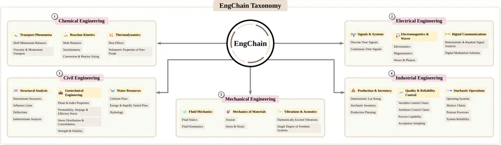
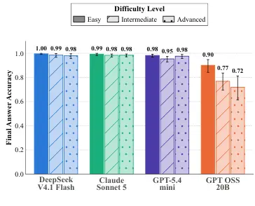
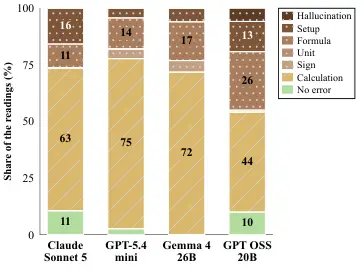
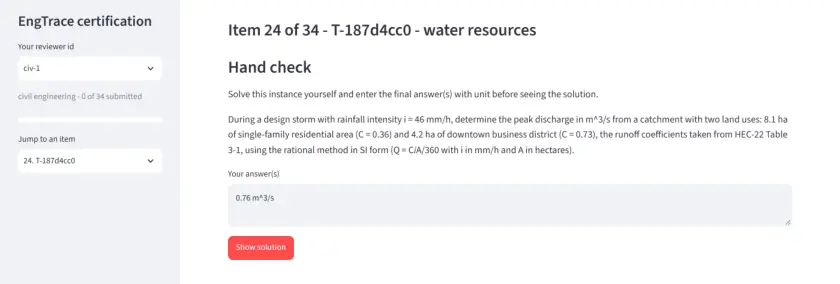
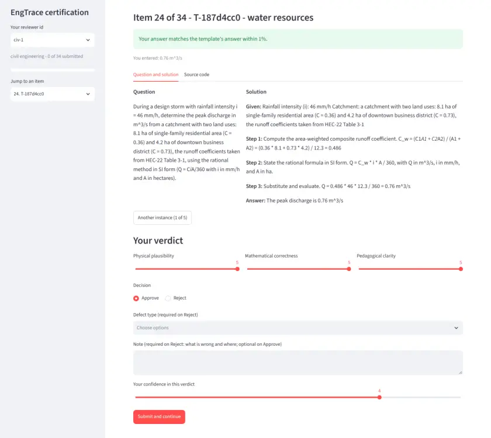
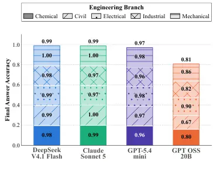

# EngTrace: A Symbolic Benchmark for Verifiable Process Evaluation of Engineering Reasoning

Ayesha Gull^(\*) Muhammad Usman Safder^(\*) Rania Hossam Fan Zhang
Affiliation: Namal University Affiliation: MBZUAI The University of
Tokyo [Project](https://usmansafdarktk.github.io/EngTrace/)
[Code](https://github.com/usmansafdarktk/EngTrace)    Veselin Stoyanov
Preslav Nakov Zhuohan Xie

###### Abstract

Most engineering problems involve complex multi-step derivations through
checkable intermediate quantities. Grading only the final answer
misjudges LLMs, crediting correct answers reached through flawed steps
and penalizing wrong answers built on mostly sound ones. Yet, existing
benchmarks such as SuperGPQA and EEE-Bench score only final answers, and
step-level ones such as TPS-CalcBench rely on LLM judges or human
graders, or cover a single domain. We therefore introduce EngTrace, a
symbolic benchmark for verifiable process evaluation of engineering
reasoning. Its 150 expert-certified templates, spanning five branches,
15 domains, and 42 areas, generate each problem with a gold reasoning
trace, so that every intermediate quantity is known exactly. We design
and validate an evaluator that checks final answers, coverage of the
gold trace’s intermediate quantities (milestones), and displayed
arithmetic, mostly without an LLM judge. Across 11 LLMs, final answers
barely separate the strongest models, while their derivations differ.
Wrong answers still state about half of the gold milestones, and domain
experts trace most wrong answers to calculation slips, with conceptual
errors rarer on easy problems than on harder ones. Overall, as LLMs near
the final-answer ceiling, checking derivations, as EngTrace does,
reveals differences that final answers miss.

## 1 Introduction

As LLMs enter specialized domains such as engineering, it becomes
essential to evaluate how they reason, not only what they answer.
Engineering problems are solved through _derivations_, multi-step chains
of reasoning that are governed by physical laws and pass through
checkable intermediate quantities to a final answer. A correct final
answer can still follow flawed reasoning, more so on harder problems: in
competition mathematics, as many as half of LLMs’ correct answers rest
on erroneous steps (Zheng et al., 2025; Zhang et al., 2025).

Figure 1: An example from EngTrace: continuous stirred-tank reactor
(CSTR) volume calculation. A symbolic template generates a unique
problem instance paired with a gold reasoning trace to enable verifiable
process evaluation.

In engineering, the mismatch between answer and derivation runs both
ways: LLMs reach correct answers through flawed reasoning, and sound
derivations miss the answer through a minor arithmetic slip (Syed et
al., 2024; Zheng et al., 2026). Yet, most engineering benchmarks grade
only the final answer (M-A-P Team et al., 2025; Li et al., 2025; Zhou et
al., 2026), and those that assess intermediate steps rely on LLM judges
or human graders, or are limited to a single domain (Syed et al., 2024;
Zheng et al., 2026; Düzkar, 2026). What the final answer cannot show is
therefore how much of the correct derivation a wrong final answer keeps,
which intermediate quantities it misses, which slips a correct answer
hides, and how models with tied answers differ.

To address these gaps, we introduce EngTrace, a symbolic benchmark for
verifiable process evaluation of engineering reasoning across five
branches. Following symbolic-template benchmarks in
mathematics (Mirzadeh et al., 2025) and finance (Xie et al., 2026),
EngTrace represents each problem as a template: Python code that samples
physically grounded parameters and computes the answer together with
every intermediate quantity of its gold reasoning trace (Figure 1). The
benchmark covers a depth-oriented subset of engineering, three core
domains per branch, and its problems are examination-style by
construction, since a gold trace must be computable. Our
expert-validated evaluator deterministically checks a response’s final
answer, its coverage of the gold trace’s intermediate quantities
(_milestones_), and its displayed arithmetic, leaving the milestones it
cannot match to an LLM judge from outside the evaluated model families.

In summary, our contributions are as follows:

- •
  We present and release EngTrace, whose 150 expert-certified templates
  across five branches generate each problem with a gold reasoning
  trace.
- •
  We design an expert-validated evaluator that deterministically checks
  final answers, milestones, and displayed arithmetic, and leaves to an
  LLM judge only what these checks cannot decide.
- •
  We evaluate eleven LLMs and show that final answers barely separate
  the strongest models, while their derivations differ. Domain experts
  trace most wrong answers to calculation slips, with conceptual errors
  rarer on easy problems than on harder ones.

## 2 Related Work

##### Engineering and Science Benchmarks.

Engineering and science benchmarks mostly score the final answer or the
whole response (Zhou et al., 2026; Naser et al., 2026; Li et al., 2025;
Qiu et al., 2025). Those that examine the reasoning have it rated by
domain experts or LLM judges (Syed et al., 2024; Zheng et al., 2026;
Wasiq et al., 2026), or check steps against references on fixed
problems (Düzkar, 2026; Zhao et al., 2026). EngTrace evaluates the final
answer as well as the derivation behind it against a gold reasoning
trace, rather than relying on a rater. Because this reference is exact,
most checks are deterministic and do not depend on whether a rater could
solve the problem.

##### Symbolic and Dynamic Benchmarks.

Fixed problems can also leak into training data (Zhang et al., 2024), so
symbolic and dynamic benchmarks generate fresh instances from templates,
code, or perturbations (Mirzadeh et al., 2025; Zhu et al., 2024; Li et
al., 2024). Most of these generators, including those for
engineering (Skelic et al., 2025; Chen et al., 2026), record only the
final answer, and the few that also write out step-by-step solutions do
so outside engineering (Fan et al., 2025; Imani et al., 2026; Xie et
al., 2026). EngTrace also uses templates, but each computes the full
derivation alongside the problem, so every intermediate quantity is
known exactly. Moreover, their parameters are physically grounded and
realistic.

##### Step-Level Evaluators.

Step-level evaluation mostly relies on learned or judged scores. Process
reward models (PRMs) learn step correctness from human labels (Lightman
et al., 2024) or rollout-estimated labels (Wang et al., 2024), which are
noisy (Zhang et al., 2025). Trained and tested mostly on
mathematics (Zheng et al., 2025; Song et al., 2025), they generalize
poorly to other domains (Zeng et al., 2025). Reference-free evaluators
rate each step’s validity, informativeness, or redundancy (Golovneva et
al., 2023; Prasad et al., 2023; Xia et al., 2025), and benchmarks with
generated solutions align steps or grade solutions with an LLM (Xie et
al., 2026; Fan et al., 2025). LLM judges agree with experts mainly on
questions they can answer themselves, unless they are given a correct
reference (Krumdick et al., 2026). EngTrace matches each response
against the problem’s known milestones and recomputes its displayed
arithmetic. An LLM judge rules on the unmatched milestones, given their
correct values, so it never has to solve the problem itself.

## 3 EngTrace Design and Methodology

### 3.1 Taxonomy and Content Selection

The taxonomy of EngTrace, illustrated in Figure 2, follows formal
engineering curricula.



Figure 2: EngTrace’s Hierarchical Taxonomy spanning 15 domains and 42
areas across five branches: process equilibrium and dynamics (Chemical);
field theory and signal transmission (Electrical); structures, soils,
and water resources (Civil); production, quality, and stochastic
operations (Industrial); and physical mechanics and material properties
(Mechanical).

##### Domain and Area Selection.

We drew the candidate domains and areas from the accreditation criteria
of ABET (ABET, 2024), the Fundamentals of Engineering exam
specifications of NCEES (National Council of Examiners for Engineering
and Surveying, 2020a; National Council of Examiners for Engineering and
Surveying, 2020b; National Council of Examiners for Engineering and
Surveying, 2020c; National Council of Examiners for Engineering and
Surveying, 2020d; National Council of Examiners for Engineering and
Surveying, 2020e), the bodies of knowledge of ASCE (Civil Engineering
Body of Knowledge 3 Task Committee, 2019) and IISE (IISE, 2021), and the
standard textbooks of each branch. A panel of three LLMs prompted as
curriculum designers named the cornerstone domains and their fundamental
areas, and we finalized the 15 domains and 42 areas by majority vote
(prompts in Appendix A and Appendix B).

##### Template Selection.

Domain experts hand-authored all symbolic Python templates, grounding
them directly in foundational textbooks and authoritative engineering
handbooks (Fogler, 2020; Ulaby and Ravaioli, 2015; Hibbeler, 2020;
Montgomery, 2013, e.g.,) (see Appendix C for the complete list of source
texts). The template distribution per area is non-uniform and follows a
pedagogical significance score (1–5) that the same three LLMs assigned
to each area within its domain (Appendix D); Table 4 gives the templates
per area and level.

##### Difficulty Levels.

Domain experts also assigned each template one of three levels, Easy,
Intermediate, or Advanced, following the protocol in Appendix E and
scoring three dimensions: conceptual complexity (isolated principles vs.
multi-domain synthesis), mathematical sophistication (direct algebraic
substitution vs. differential equations), and procedural depth (the
length of interdependent reasoning chains). Appendix F details how the
templates are distributed across branches and levels.

### 3.2 Template Generation Pipeline

The core of EngTrace is the symbolic template, a Python blueprint for
generating physically grounded engineering problems. As shown
in Figure 3, it samples domain-aware parameters from authoritative data
sources (Appendix C) and fundamental principles (Appendix G), redraws
them until the scenario is physically valid, computes every quantity
with the governing equations, and writes the question and the gold
reasoning trace. Because both come from one computation, every
intermediate quantity is known exactly, with its unit; these are the
milestones whose coverage our evaluator measures.

Figure 3: The EngTrace Template Generation Pipeline maps domain-aware
constraints to serialized question-solution pairs via physically
validated computation, illustrated here using a CSTR volume calculation
example.

Templates go beyond variable substitution: sampled parameters can change
the physical regime, the governing equation, and the reasoning path
(Appendix H). This diversity is physical rather than linguistic, since
the question wording comes from the template code; a paraphrase test on
275 instances of 114 templates (Appendix P) bounds the change in a
model’s score within $`\pm 0.05`$ for nine of the eleven models, and no
change is significant after correction.

### 3.3 Template Certification

Because an error in a template recurs in every instance and gold trace,
each template passes three checks before it enters the benchmark
(Appendix I):

##### Automated Integrity Checks.

At 500 seeds per template, automated checks verify that every printed
calculation follows from its printed operands, that generation is
deterministic, and that every instance keeps the output format. All 150
templates pass.

##### LLM Screen.

Three LLM judges from families outside the evaluated models then score
each template’s code and instances, and we revise the templates they
flag, after which 147 of the 150 pass and none fails critically. The
screen only guides revision, and the experts decide certification, since
in their first round a majority of experts reject 15 of the 147
templates that the screen passes.

##### Expert Certification.

Three domain experts per branch review its 30 templates mixed with four
planted defects, without knowing which items are planted, and solve one
instance of each template by hand before seeing its gold trace. Every
expert rejects all four planted defects of their branch (60 of 60
readings), 459 of the 504 hand checks that yield a comparable number
match the gold value within 1%, and agreement on approval is high
(Gwet’s AC1 0.914 (Gwet, 2008); Fleiss’ $`\kappa`$ (Fleiss, 1971) 0.589,
deflated because nearly every template is approved (Feinstein and
Cicchetti, 1990)). After six rounds, all 150 templates are certified by
a unanimous vote of their three experts.

## 4 Evaluation Framework

Because each template computes every quantity of its gold trace, we
check deterministically what can be checked: the final value, the
presence of the gold trace’s intermediate values, and displayed
arithmetic; a judge decides what these checks leave open. Figure 7
scores one response step by step.

##### Preliminaries.

An instance comprises a question, a gold trace, and milestones
$`\mathcal{M}`$: the values that the template computes, the gold trace
states, and the question does not give. A response $`r`$ is the text a
model returns, a sequence of steps ending in a final answer; no check
reads the reasoning text that some endpoints return separately.

##### Final Answer Accuracy.

The _targets_ of an instance are the milestones that its gold final
answer states or, where it states none, the answer’s last value that the
question does not give. A classification answer also targets the label
that the gold answer states, such as a flow regime. Let $`u(x)`$ be one
unit in the last digit that a value $`x`$ displays, $`\mathcal{C}`$ a
fixed set of unit factors (e.g., m to mm), and $`\epsilon=0.002`$, the
check’s one fitted constant. A value $`\hat{y}`$ in the final answer
matches a numerical target $`y`$ if, for some $`c\in\mathcal{C}`$,

```math
|c\,\hat{y}-y|\leq\max\bigl(\epsilon\,|y|,\;\min(c\,u(\hat{y}),\,0.01\,|y|),\;u(y)\bigr), \tag{1}
```

so a value matches within one unit of the last digit that either value
displays, the response’s unit counting only up to 1% of the target.
Symbolic answers are checked for equivalence on five templates and by
their stated numbers on four (Appendix J). A response scores $`v(r)=1`$
if every target matches, $`0.5`$ if only some do, and $`0`$ if none does
or no final answer is readable, since stating one within the output
limit is part of the task. _Final Answer Accuracy_ (FAC) is the mean of
$`v(r)`$ over instances.

##### Milestone Coverage.

A milestone is reached if the response states its value within 0.5%
under a unit factor; 0.5% is the tolerance at which the gold trace
counts as stating a milestone, not a fitted constant. Matching compares
values only, not the quantity’s name, the unit written beside it, the
step it appears in, or the order and dependencies among steps, so a
coincidental value counts, which the chance floor of Table 18 measures.
Milestones that matching misses go to an LLM judge from outside the
evaluated families, MiMo-V2.5-Pro (Xiaomi MiMo Team, 2026), which sees
the question, the response, and each milestone’s name and value, but not
the gold trace, and rules each reached, not needed, or missing. We
credit only reached, since the judge also excuses unstated values as not
needed (Appendix J). With $`\mathcal{R}(r)`$ the milestones matched or
ruled reached,

```math
m(r)=|\mathcal{R}(r)|\,/\,|\mathcal{M}|, \tag{2}
```

and _Milestone Coverage_ (MC) is the mean of $`m(r)`$ over instances
with milestones. The judge decides 11% to 24% of milestones, depending
on the model. MC credits the gold route: a valid route that bypasses a
milestone is not credited (case A of Figure 8), so MC measures how much
of the gold route a derivation states, not whether it is free of error
(case B).

##### Step-Level Diagnostics.

Two diagnostics look for flawed steps behind a correct answer. The
arithmetic check recomputes each displayed calculation it can parse from
its printed operands and flags a result that is not a correct rounding
at its printed precision. The judged step check sends every step the
arithmetic check does not flag to the same judge, at the provider’s
default settings, with the question and the gold steps, and flags a step
labeled a conceptual or calculation error; its flags are judged, not
verified. _Arithmetic flags_ and _judged step flags_ are the shares of
correct-answer responses with at least one such flag; MC and the two
flag rates together are the process measures of this paper. Both are
flags with measured precision, not scores, since neither check sees
every flawed step: on 60 planted misstated rules behind correct answers,
none of our deterministic checks flags any, and four LLM judges label at
most about a third of them an error.

##### Validation.

An expert study guides and validates these checks: on 300 responses from
five LLMs outside the eleven we evaluate, each labeled step by step by
three domain experts, the final-answer check matches the experts’
three-way verdict on 0.930 of responses, and milestone matching reaches
F1 0.926 alone and 0.958 with the judge (Appendix K). By answer kind,
the final-answer check matches the experts’ verdict on every scalar,
array and symbolic response of the study, and multipart responses agree
least (Table 11). The study also informed the checks’ settings, so these
figures are in-sample, except that $`\epsilon`$ is also fitted on one
half of the responses and measured on the other (Table 9). On the
evaluated models, domain experts confirm 160 of 166 readings of correct
verdicts, 75 of 86 of incorrect ones, and 83 of 98 readings of reached
rulings (§ K.5).

## 5 Experiments

### 5.1 Evaluated Model Suite

We evaluate eleven LLMs: eight open-weights models, DeepSeek V4.1
Flash (DeepSeek-AI, 2026a), Gemma 4 26B (Gemma Team, 2026),
GLM-5.3 (GLM-5-Team, 2026), GLM-5.3-Flash (GLM-5-Team, 2026),
gpt-oss-20b (OpenAI, 2025b), Kimi K3 (Kimi Team, 2026), Muse Glimmer
30B (Meta, 2026), and Qwen3-235B-2507 (Qwen Team, 2025); and three
closed models, Claude Sonnet 5 (Anthropic, 2026b), Gemini 3.1
Flash-Lite (Google DeepMind, 2026a), and GPT-5.4 mini (OpenAI, 2026).
None of them wrote responses that we used to develop or validate the
evaluator (§ 4), and none serves as a judge. Two flagships,
GPT-5.4 (OpenAI, 2026) and DeepSeek V4 Pro (DeepSeek-AI, 2026b), run
only as anchors on a fixed subset of 450 instances (three per template),
which the further experiments also use. Appendix L gives the selection
rule and each model’s size and identifiers.

### 5.2 Experimental Setup

We evaluate the models at matched settings: the same zero-shot prompt,
no tools or retrieval, and reasoning on wherever the endpoint offers it,
so Gemini 3.1 Flash-Lite, Gemma 4 26B, and GPT-5.4 mini answer with
reasoning at medium effort and the other eight models at their
providers’ defaults (Appendix M; the three models’ default responses are
the comparison of Table 16). Each model answers each instance once
(24,750 responses); 263 (1.1%) have no readable final answer and score 0. The template is the unit of analysis, because a template’s 15
instances and their gold traces come from one procedure (Miller, 2024);
every 95% interval is a bootstrap over templates (Efron and Tibshirani,
1993). We compare two models with a sign-flip permutation test on their
per-template differences (Dror et al., 2018) and correct each family of
tests, such as the 55 pairs of models at one setting, with Holm’s
method (Holm, 1979). Appendix M gives the decoding settings, the prompt,
and the statistical protocol.

### 5.3 Results

#### 5.3.1 Overall Model Performance

Final answer Derivation Model FAC $`\uparrow`$ All 15 instances solved
$`\uparrow`$ No readable answer MC $`\uparrow`$ Arithmetic flags,
correct answers Calculations parsed per response Open-weights LLMs
DeepSeek V4.1 Flash 0.988 (0.979–0.995) 0.900 0.4% 0.899 (0.874–0.922)
0.006 (0.003–0.010) 3.3 Kimi K3 0.980 (0.967–0.990) 0.833 0.7% 0.912
(0.888–0.934) 0.007 (0.003–0.011) 2.8 GLM-5.3-Flash 0.972 (0.953–0.987)
0.853 2.0% 0.912 (0.886–0.936) 0.019 (0.012–0.026) 4.7 Muse Glimmer 30B
0.969 (0.949–0.985) 0.807 1.4% 0.897 (0.871–0.922) 0.058 (0.044–0.074)
3.3 GLM-5.3^(†) 0.950 (0.921–0.975) 0.813 4.4% 0.900 (0.866–0.930) 0.018
(0.012–0.025) 5.7 Gemma 4 26B^(‡) 0.942 (0.916–0.964) 0.733 0.1% 0.884
(0.856–0.910) 0.099 (0.066–0.135) 3.3 Qwen3-235B-2507^(∗) 0.899
(0.869–0.926) 0.513 0.0% 0.892 (0.867–0.916) 0.232 (0.187–0.279) 10.2
gpt-oss-20b 0.808 (0.764–0.849) 0.313 2.6% 0.812 (0.775–0.847) 0.147
(0.116–0.181) 3.8 Closed LLMs Claude Sonnet 5 0.987 (0.980–0.993) 0.867
0.1% 0.922 (0.902–0.942) 0.143 (0.111–0.177) 5.3 GPT-5.4 mini^(‡) 0.969
(0.958–0.980) 0.720 0.0% 0.892 (0.866–0.917) 0.075 (0.057–0.096) 3.3
Gemini 3.1 Flash-Lite^(‡) 0.917 (0.884–0.945) 0.693 0.0% 0.881
(0.851–0.908) 0.069 (0.047–0.094) 3.5

Table 1: Overall performance of the evaluated LLMs on EngTrace. Final
Answer Accuracy (FAC) and Milestone Coverage (MC) at matched settings,
with 95% intervals over templates in gray; the share of templates solved
on every instance; the share of responses that are empty or state no
answer, scored 0; the share of correct answers with a step the
arithmetic check flags (flags, not error counts); and the calculations
the check parses per response. ^(‡)Run with reasoning at medium effort.
^(∗)No reasoning setting offered. ^(†)99 responses empty at the output
ceiling.

Table 1places the answer measures beside the derivation measures; we
read the final answer first and then what the derivation shows that the
answer cannot.

##### A Ceiling and a Graded Order.

The final answer barely ranks the strongest models: the first five are
near the ceiling of the evaluation set, scoring 0.94 to 0.98 even on
Advanced templates, and only three of their ten pairs differ after
Holm’s correction. The models differ in reliability more than in reach:
no model fails every instance of more than five of the 150 templates,
yet the share of templates solved on every instance runs from 31% to
90%, a difference that one instance per problem would hide. Across the
eleven models the order is graded rather than tiered: 36 of the 55 pairs
differ, and only gpt-oss-20b differs from every other model (Table 16).
The three models run with reasoning at medium effort all gain, GPT-5.4
mini by 0.118 and into the first five; at their providers’ defaults, the
order splits into two tiers.

##### Derivations Behind Correct Answers.

The derivation shows what the final answer cannot: how closely a model
follows the gold route, and the slips a correct answer passes. Neither
the final answer nor MC as scored separates Claude Sonnet 5 from
DeepSeek V4.1 Flash; matching alone does, but not once the milestones
the judge rules not needed for each model’s route are set aside
(Table 19). What separates them is how closely each follows the gold
route, so MC ranks how much of that route a model shows, not how soundly
it reasons. Correct answers can still contain a wrong calculation: the
arithmetic check flags a displayed calculation that does not follow from
its own operands in up to 23.2% of a model’s correct answers, and of the
189 flags a domain expert decided on, 171 are real slips (precision
0.905; Table 18). These flags miss most flawed steps: in the expert
study, the arithmetic and judged step checks together find only 0.36 of
those the domain experts marked inside correct answers.

##### Derivations Behind Wrong Answers.

A wrong final answer hides how much of the derivation is right: the last
four models’ wrong answers still state 46% to 59% of the gold
milestones, against a chance floor of at most 17.5% (Table 18), and up
to 25% of them reach every milestone yet end in an incorrect answer.
Where a derivation breaks, the judge’s rulings name the gold quantity it
fails to reach: a milestone ruled missing marks most of these models’
wrong answers (63% to 78%) but only 20% of Claude Sonnet 5’s, whose
wrong answers mostly reach every milestone and still miss the answer.
Weaker models more often lose answers on derivations they can carry out:
on the 58 templates whose instances all follow one derivation, the first
five solve some but not all instances of 7% to 34% of the templates and
the other six of 14% to 59% (Appendix N), consistent with the expert
reading, in which calculation errors dominate (§ 5.4).

##### Stability of the Order.

Every pair of models that differs holds under the small changes we test:
rewording, a looser or stricter answer tolerance, and repeated decoding
reverse none of them; only the reasoning setting, or how empty responses
count, moves a model past one it differs from. Under an expert-checked
paraphrase that keeps every number, unit, and symbol, no model’s FAC
changes significantly, and for nine of the eleven models the change is
bounded within $`\pm 0.05`$ at 90% confidence; halving or doubling the
tolerance swaps no pair of models that differs (Appendix N), and
decoding the four lowest models three more times moves FAC by a standard
deviation of at most 0.008 (Appendix P). The paraphrase bounds memorized
wording only, since the numbers and the problem structure stay. Counting
only the responses that state an answer moves GLM-5.3, whose 99
responses are empty at the output ceiling, from seventh to first, so its
place in Table 1 reflects the output ceiling.

#### 5.3.2 Performance by Engineering Branch and Domain

No branch is hard for every model: the lowest branch differs from model
to model, and only one of the 110 within-model branch comparisons holds
after correction (gpt-oss-20b, electrical above civil); with 30
templates per branch, differences below 3 to 19 points cannot be told
from sampling noise. Weaker models are less even: the first five stay
within 0.018 to 0.053 of their best branch and above 0.88 in every
domain, while the last five spread 0.071 to 0.226 and each falls below
0.81 in some domain, though these spreads carry no test. Thermodynamics
is the lowest domain for four of the eleven models, but the domain means
carry no test, so this ranks domains, not fields (Appendix O).

#### 5.3.3 Performance by Difficulty Level



Figure 4: Final Answer Accuracy by difficulty level for four
representative models. The mean over the 58 Easy, 58 Intermediate, and
34 Advanced templates, with 95% intervals, for DeepSeek V4.1 Flash
(first on FAC), Claude Sonnet 5 (first on MC), GPT-5.4 mini (closed,
fifth on FAC), and gpt-oss-20b (GPT OSS 20B in the figure). Table 20
gives every model’s gap with its tests.

Harder problems cost the weaker models most. Every model scores lower on
Advanced than on Easy templates (Figure 4), by 0.006 to 0.181, but the
gap holds after Holm’s correction only for gpt-oss-20b under Welch’s
$`t`$-test, the test we read because scores vary more across Advanced
templates, and for four models under the permutation of level labels
(Table 20). The length of the derivation splits the models more cleanly:
on instances with six or more gold milestones, the share of responses
scored 0 reaches 0.104 to 0.254 for the last five against at most 0.061
for the first five, and over readable responses each further milestone
raises the odds of a wrong answer by about a fifth when pooled over the
models (odds ratio 1.21, 95% interval 1.09 to 1.33), a slope that holds
per model for three of the eleven (Table 20).

#### 5.3.4 Reasoning, Equations, and Tools

Three experiments on a 450-instance subset test whether a larger model,
the governing equations, or a Python interpreter changes these results,
and a fourth adds reasoning at medium effort (Appendix Q); each change
starts from the providers’ defaults and is paired with the default
responses on the same instances.

##### Flagship Anchors and Reasoning.

A larger model does not clearly raise the ceiling, but reasoning helps a
flagship as it helps a small model: of the two flagships run on the
subset as anchors, the best run, GPT-5.4 with reasoning at medium effort
(0.997), still lies inside the interval of DeepSeek V4.1 Flash on the
same 450 instances. GPT-5.4, which returns no reasoning tokens at its
default, gains 0.046 with reasoning and sheds most of its arithmetic
flags, and GPT-5.4 mini with the same setting gains 0.057 in MC while
its flags on correct answers roughly halve: reasoning changes the
derivation, not only the answer.

##### Open Book.

Of the three models tested, recalling the governing equations holds back
only the weakest. Given the equations of the templates that state them,
without data tables, gpt-oss-20b answers more correctly ($`+0.068`$),
partly because fewer of its responses are empty at the output ceiling,
while Claude Sonnet 5 and GPT-5.4 mini stay within $`\pm 0.05`$. Yet all
three state more of the gold milestones: the equations shape the
derivation even where they leave the answer unchanged.

##### Open Tool.

An offered interpreter changes how the closed models compute but not how
well they score: Claude Sonnet 5, already near the ceiling, calls it on
two thirds of the instances and GPT-5.4 mini’s arithmetic flags on
correct answers fall, yet neither changes in FAC or MC beyond
$`\pm 0.05`$. The open-weights model is left out, since no endpoint
serving it at 8-bit precision or higher handles its tool calls reliably.
Because each model chooses when to call the interpreter, the result
bounds what an offered tool adds, not what required use would.

### 5.4 Error Analysis



Figure 5: Error categories of the wrong answers read. Each bar gives one
model’s readings by category, from three domain experts per wrong answer
(57 to 120 readings per model) on responses at the providers’ default
settings. Table 24 gives them by level.

Most wrong answers are calculation slips, and conceptual errors grow
with difficulty. Three domain experts read the full response of 137
wrong answers from four models that span the FAC order, all at the
providers’ default settings, and assigned the first category that
applies in a six-category hierarchy from hallucination to calculation,
or “no error” (Fleiss’ $`\kappa`$ 0.912 (Fleiss, 1971); Figure 5).
Calculation is the majority label for GPT-5.4 mini, Gemma 4 26B, and
Claude Sonnet 5 and the largest for gpt-oss-20b, the model with the most
conceptual errors: a hallucination, a wrong setup, or a wrong formula.
Such conceptual errors are rarer on Easy problems than on Intermediate
and Advanced ones (Table 24). The reading agrees with the reasoning
setting and the experiments, each agreement resting on one or two
models: GPT-5.4 mini and Gemma 4 26B, whose wrong answers are mostly
calculation slips, gain the most from reasoning, and the equations lift
only gpt-oss-20b, the model with the most conceptual errors. The first
five lose few answer points, and the largest share goes to incorrect
verdicts. Over 11,250 responses, the first five models lose 231 answer
points. Of these, 71 go to responses with no readable final answer and
34 to 68 partial answers at half credit. Of their 126 incorrect
verdicts, 38 lie within 0.2% of a target whose digits the question
prescribes, which makes them incorrect by its terms, 5 are symbolic
answers on one template checked for equivalence, and 83 fall in neither
group (Appendix R). On the final answer, then, the evaluation set is
near ceiling for the first five, and most of what still differs among
them lies in the derivation: how closely it follows the gold route, and
how often its displayed arithmetic slips, which the arithmetic check
flags in 0.6% to 14.3% of their correct answers, at rates that depend on
how much arithmetic each displays. Since a response that misstates the
rule it applies but computes the right answer passes every deterministic
check, the process measures mark where to read, and only a reader can
confirm such a rule.

## 6 Conclusion and Future Work

We introduced EngTrace, a symbolic benchmark that pairs each engineering
problem with an exact gold reasoning trace, and an evaluator that checks
responses against this trace, calling an LLM judge only where matching
cannot decide. The strongest LLMs were hard to tell apart by their final
answers, yet their derivations differed in how closely they followed the
gold route and how often their displayed arithmetic was flagged. Most
failures were calculation slips rather than conceptual errors, which
were rarer on easy problems. Enabling reasoning raised final-answer
accuracy for every model compared over the full evaluation, and no pair
of models that differs reversed under rewording, a changed answer
tolerance, or repeated decoding of the lowest-scoring models. These
results suggest that, near the ceiling, progress is better measured in
the derivation than in the final answer. Future work will check the
principles and assumptions a solution applies, not only its numbers,
since a misstated rule behind a correct result escapes every numerical
test, and will turn the gold reasoning traces into feedback for training
and selecting LLMs. The approach could also extend to open-ended design
and tool-based workflows.

## Limitations

This work has several limitations, which future research can address.

First, EngTrace is written in English. Engineering is taught and
practiced in many languages, and models may perform differently when the
same problems are posed in them. Since the question text of every
template is generated from code, the benchmark can be extended to other
languages by translating its templates and adapting units and notation
to regional conventions.

Second, the templates span several core engineering branches, and adding
disciplines such as aerospace, biomedical, or environmental engineering
would broaden the benchmark further. Because all templates share one
format, new branches can be written and certified in the same way as the
existing ones.

Third, the problems are presented as text, while engineering work often
involves diagrams, schematics, and plots. Extending the benchmark to
problems that include such material would allow multimodal models to be
evaluated on it.

Finally, we evaluate a selection of LLMs available at the time of our
experiments, and the results reflect those model versions. New models
and versions are released frequently, and the benchmark and its
evaluator can be applied to them as they appear.

## Ethics Statement

This work uses synthetic data generated from symbolic templates and
standard engineering principles; no private, sensitive, or proprietary
industrial data was used. The domain experts who certified the templates
and read the models’ responses are not named, and their individual
labels are reported only as counts and agreement. The results describe
what LLMs compute on examination-style problems and do not support
deploying them in safety-critical engineering systems. EngTrace and its
evaluator will be released under the MIT License.

##### Data License

The EngTrace dataset and associated code will be released under the MIT
License.

## References

- ABET (2024) ABET Criteria for accrediting engineering programs,
  2024–2025. Cited by: §3.1.
- Anthropic (2025) Anthropic System card: Claude Opus 4.5. External
  Links: [Link](https://www.anthropic.com/claude-opus-4-5-system-card)
  Cited by: 1st item.
- Anthropic (2026a) Anthropic System card: Claude Opus 4.7. External
  Links: [Link](https://www.anthropic.com/claude-opus-4-7-system-card)
  Cited by: §K.1.
- Anthropic (2026b) Anthropic System card: Claude Sonnet 5. External
  Links: [Link](https://www.anthropic.com/claude-sonnet-5-system-card)
  Cited by: §5.1.
- Chen et al. (2026) Y. Chen, C. Cheng, Y. Sun, Z. Ling, and D. Ge
  OPT-Engine: benchmarking the limits of LLMs in optimization modeling
  via complexity scaling. In Proceedings of the 43rd International
  Conference on Machine Learning, ICML ’26, Seoul, South Korea. External
  Links: [Link](https://arxiv.org/abs/2601.19924) Cited by: §2.
- Civil Engineering Body of Knowledge 3 Task Committee (2019) Civil
  Engineering Body of Knowledge 3 Task Committee Civil engineering body
  of knowledge: preparing the future civil engineer. 3rd edition,
  American Society of Civil Engineers, Reston, VA, USA. External Links:
  [Document](https://dx.doi.org/10.1061/9780784415221) Cited by: §3.1.
- Cohen (1960) J. Cohen A coefficient of agreement for nominal scales.
  Educational and Psychological Measurement 20 (1), pp. 37–46. External
  Links: [Document](https://dx.doi.org/10.1177/001316446002000104) Cited
  by: §K.1.
- DeepSeek-AI (2026a) DeepSeek-AI DeepSeek-V4.1-Flash: pushing the
  limits of KV cache compression. ArXiv preprint arXiv:2609.19969.
  External Links: [Link](https://arxiv.org/abs/2609.19969) Cited by:
  §5.1.
- DeepSeek-AI (2026b) DeepSeek-AI DeepSeek-V4: towards highly efficient
  million-token context intelligence. ArXiv preprint arXiv:2606.19348.
  External Links: [Link](https://arxiv.org/abs/2606.19348) Cited by:
  §5.1.
- Dror et al. (2018) R. Dror, G. Baumer, S. Shlomov, and R. Reichart The
  hitchhiker’s guide to testing statistical significance in natural
  language processing. In Proceedings of the 56th Annual Meeting of the
  Association for Computational Linguistics (Volume 1: Long Papers),
  ACL ’18, Melbourne, Australia, pp. 1383–1392. External Links:
  [Document](https://dx.doi.org/10.18653/v1/P18-1128),
  [Link](https://aclanthology.org/P18-1128/) Cited by: §5.2.
- Düzkar (2026) K. Düzkar ThermoQA: a three-tier benchmark for
  evaluating thermodynamic reasoning in large language models. ArXiv
  preprint arXiv:2604.19758. External Links:
  [Link](https://arxiv.org/abs/2604.19758) Cited by: §1, §2.
- Efron and Tibshirani (1993) B. Efron and R. J. Tibshirani An
  introduction to the bootstrap. Chapman and Hall, New York, NY, USA.
  External Links:
  [Document](https://dx.doi.org/10.1007/978-1-4899-4541-9) Cited by:
  §5.2.
- Fan et al. (2025) J. Fan, S. Martinson, E. Y. Wang, K. Hausknecht, J.
  Brenner, D. Liu, N. Peng, C. Wang, and M. P. Brenner HARDMath: a
  benchmark dataset for challenging problems in applied mathematics. In
  Proceedings of the Thirteenth International Conference on Learning
  Representations, ICLR ’25, Singapore. External Links:
  [Link](https://arxiv.org/abs/2410.09988) Cited by: §2, §2.
- Feinstein and Cicchetti (1990) A. R. Feinstein and D. V. Cicchetti
  High agreement but low kappa: I. The problems of two paradoxes.
  Journal of Clinical Epidemiology 43 (6), pp. 543–549. External Links:
  [Document](https://dx.doi.org/10.1016/0895-4356%2890%2990158-L) Cited
  by: Appendix I, §3.3.
- Fleiss (1971) J. L. Fleiss Measuring nominal scale agreement among
  many raters. Psychological Bulletin 76 (5), pp. 378–382. External
  Links: [Document](https://dx.doi.org/10.1037/h0031619) Cited by: §K.1,
  §3.3, §5.4.
- Fogler (2020) H. S. Fogler Elements of chemical reaction engineering.
  6th edition, Pearson, Boston, MA, USA. Cited by: §3.1.
- Gemma Team (2026) Gemma Team Gemma 4 technical report. ArXiv preprint
  arXiv:2607.02770. External Links:
  [Link](https://arxiv.org/abs/2607.02770) Cited by: §5.1.
- GLM-5-Team (2026) GLM-5-Team GLM-5: from vibe coding to agentic
  engineering. ArXiv preprint arXiv:2602.15763. External Links:
  [Link](https://arxiv.org/abs/2602.15763) Cited by: §5.1.
- Golovneva et al. (2023) O. Golovneva, M. Chen, S. Poff, M.
  Corredor, L. Zettlemoyer, M. Fazel-Zarandi, and A. Celikyilmaz ROSCOE:
  a suite of metrics for scoring step-by-step reasoning. In Proceedings
  of the Eleventh International Conference on Learning Representations,
  ICLR ’23, Kigali, Rwanda. External Links:
  [Link](https://openreview.net/forum?id=xYlJRpzZtsY) Cited by: §2.
- Google DeepMind (2026a) Google DeepMind Gemini 3.1 Flash-Lite model
  card. External Links:
  [Link](https://deepmind.google/models/model-cards/gemini-3-1-flash-lite/)
  Cited by: §5.1.
- Google DeepMind (2026b) Google DeepMind Gemini 3.1 Pro model card.
  External Links:
  [Link](https://deepmind.google/models/model-cards/gemini-3-1-pro/)
  Cited by: §K.1.
- Grattafiori et al. (2024) A. Grattafiori, A. Dubey, A. Jauhri, A.
  Pandey, A. Kadian, A. Al-Dahle, et al. The Llama 3 herd of models.
  ArXiv preprint arXiv:2407.21783. External Links:
  [Link](https://arxiv.org/abs/2407.21783) Cited by: §K.1.
- Guo et al. (2025) D. Guo, D. Yang, H. Zhang, J. Song, P. Wang, Q.
  Zhu, R. Xu, R. Zhang, et al. DeepSeek-R1 incentivizes reasoning in
  LLMs through reinforcement learning. Nature 645 (8081), pp. 633–638.
  External Links:
  [Document](https://dx.doi.org/10.1038/s41586-025-09422-z) Cited by:
  §K.1.
- Gwet (2008) K. L. Gwet Computing inter-rater reliability and its
  variance in the presence of high agreement. British Journal of
  Mathematical and Statistical Psychology 61 (1), pp. 29–48. External
  Links: [Document](https://dx.doi.org/10.1348/000711006X126600) Cited
  by: Appendix I, §3.3.
- Hibbeler (2020) R. C. Hibbeler Structural analysis. 10th SI edition,
  Pearson, Harlow, England. Cited by: §3.1.
- Holm (1979) S. Holm A simple sequentially rejective multiple test
  procedure. Scandinavian Journal of Statistics 6 (2), pp. 65–70.
  External Links: [Link](https://www.jstor.org/stable/4615733) Cited by:
  5th item, §5.2.
- IISE (2021) IISE Industrial and systems engineering body of knowledge.
  External Links:
  [Link](https://www.iise.org/uploadedFiles/IIE/Technical_Resources/Publications/Industrial_and_Systems_Engineering_Body_of_Knowledge_2021.pdf)
  Cited by: §3.1.
- Imani et al. (2026) S. Imani, S. Moon, A. Ahmadyan, L. Zhang, K.
  Ahmed, and B. Damavandi SymPyBench: a dynamic benchmark for scientific
  reasoning with executable Python code. In Proceedings of the 19th
  Conference of the European Chapter of the Association for
  Computational Linguistics (Volume 5: Industry Track), EACL ’26, Rabat,
  Morocco, pp. 105–118. External Links:
  [Document](https://dx.doi.org/10.18653/v1/2026.eacl-industry.8),
  [Link](https://aclanthology.org/2026.eacl-industry.8/) Cited by: §2.
- Kendall (1938) M. G. Kendall A new measure of rank correlation.
  Biometrika 30 (1–2), pp. 81–93. External Links:
  [Document](https://dx.doi.org/10.1093/biomet/30.1-2.81) Cited by:
  Appendix N.
- Kimi Team (2026) Kimi Team Kimi K3: open frontier intelligence. ArXiv
  preprint arXiv:2607.24653. External Links:
  [Link](https://arxiv.org/abs/2607.24653) Cited by: §5.1.
- Krumdick et al. (2026) M. Krumdick, C. Lovering, V. Reddy, S. Ebner,
  and C. Tanner No free labels: limitations of LLM-as-a-judge without
  human grounding. In Proceedings of the Third Conference on Language
  Modeling, COLM ’26, San Francisco, CA, USA. External Links:
  [Link](https://arxiv.org/abs/2503.05061) Cited by: §2.
- Lai et al. (2026) X. Lai, W. Xu, Y. Yang, Q. Chen, Y. Xu, et al.
  MiniMax sparse attention. ArXiv preprint arXiv:2606.13392. External
  Links: [Link](https://arxiv.org/abs/2606.13392) Cited by: Appendix A,
  Appendix I.
- Li et al. (2026) D. Li, R. Sun, Y. Huang, M. Zhong, B. Jiang, J.
  Han, X. Zhang, W. Wang, and H. Liu Preference leakage: a contamination
  problem in LLM-as-a-judge. In Proceedings of the Fourteenth
  International Conference on Learning Representations, ICLR ’26, Rio de
  Janeiro, Brazil, pp. 60486–60511. External Links:
  [Link](https://proceedings.iclr.cc/paper_files/paper/2026/hash/6297baf3f5c98146b62dd3a1bffe068e-Abstract-Conference.html)
  Cited by: §K.4.
- Li et al. (2025) M. Li, J. Zhong, T. Chen, Y. Lai, and K. Psounis
  EEE-Bench: a comprehensive multimodal electrical and electronics
  engineering benchmark. In Proceedings of the IEEE/CVF Conference on
  Computer Vision and Pattern Recognition, CVPR ’25, Nashville, TN, USA.
  External Links: [Link](https://arxiv.org/abs/2411.01492) Cited by: §1,
  §2.
- Li et al. (2024) Q. Li, L. Cui, X. Zhao, L. Kong, and W. Bi GSM-Plus:
  a comprehensive benchmark for evaluating the robustness of LLMs as
  mathematical problem solvers. In Proceedings of the 62nd Annual
  Meeting of the Association for Computational Linguistics (Volume 1:
  Long Papers), ACL ’24, Bangkok, Thailand, pp. 2961–2984. External
  Links: [Document](https://dx.doi.org/10.18653/v1/2024.acl-long.163),
  [Link](https://aclanthology.org/2024.acl-long.163/) Cited by: §2.
- Lightman et al. (2024) H. Lightman, V. Kosaraju, Y. Burda, H.
  Edwards, B. Baker, T. Lee, J. Leike, J. Schulman, I. Sutskever, and K.
  Cobbe Let’s verify step by step. In Proceedings of the Twelfth
  International Conference on Learning Representations, ICLR ’24,
  Vienna, Austria. External Links:
  [Link](https://arxiv.org/abs/2305.20050) Cited by: §2.
- M-A-P Team et al. (2025) M-A-P Team, X. Du, Y. Yao, K. Ma, B. Wang, T.
  Zheng, K. Zhu, M. Liu, Y. Liang, X. Jin, et al. SuperGPQA: scaling LLM
  evaluation across 285 graduate disciplines. In Advances in Neural
  Information Processing Systems: Datasets and Benchmarks Track,
  NeurIPS ’25, San Diego, CA, USA. External Links:
  [Link](https://arxiv.org/abs/2502.14739) Cited by: §1.
- McNemar (1947) Q. McNemar Note on the sampling error of the difference
  between correlated proportions or percentages. Psychometrika 12 (2),
  pp. 153–157. External Links:
  [Document](https://dx.doi.org/10.1007/BF02295996) Cited by: Appendix
  N.
- Meta (2026) Meta Muse Glimmer model card. External Links:
  [Link](https://huggingface.co/meta-models/Muse-Glimmer-30B) Cited by:
  §5.1.
- Meurer et al. (2017) A. Meurer, C. P. Smith, M. Paprocki, O.
  Čertík, S. B. Kirpichev, M. Rocklin, A. Kumar, S. Ivanov, J. K.
  Moore, S. Singh, et al. SymPy: symbolic computing in Python. PeerJ
  Computer Science 3, pp. e103. External Links:
  [Document](https://dx.doi.org/10.7717/peerj-cs.103) Cited by: §J.1,
  §J.3.
- Miller (2024) E. Miller Adding error bars to evals: a statistical
  approach to language model evaluations. ArXiv preprint
  arXiv:2411.00640. External Links:
  [Link](https://arxiv.org/abs/2411.00640) Cited by: §5.2.
- Mirzadeh et al. (2025) I. Mirzadeh, K. Alizadeh, H. Shahrokhi, O.
  Tuzel, S. Bengio, and M. Farajtabar GSM-Symbolic: understanding the
  limitations of mathematical reasoning in large language models. In
  Proceedings of the Thirteenth International Conference on Learning
  Representations, ICLR ’25, Singapore, pp. 94743–94765. External Links:
  [Link](https://proceedings.iclr.cc/paper_files/paper/2025/hash/ec2e7a896f8250986b3907f57621ce94-Abstract-Conference.html)
  Cited by: §1, §2.
- Mistral AI (2025) Mistral AI Introducing Mistral 3. External Links:
  [Link](https://mistral.ai/news/mistral-3) Cited by: Appendix P.
- Montgomery (2013) D. C. Montgomery Introduction to statistical quality
  control. 7th edition, John Wiley & Sons, Hoboken, NJ, USA. Cited by:
  §3.1.
- Naser et al. (2026) M. Z. Naser, A. Bani Awwad, Z. McCreery, R.
  Eissa, A. Naser, G. Cusatis, A. Metcalf, K. Madathil, J. Abdalla, V.
  Kodur, et al. Engineering reasoning and instruction (ERI) benchmark: a
  large taxonomy-driven dataset for foundation models and agents.
  Computers & Industrial Engineering 221. External Links:
  [Document](https://dx.doi.org/10.1016/j.cie.2026.112333),
  [Link](https://doi.org/10.1016/j.cie.2026.112333) Cited by: §2.
- National Council of Examiners for Engineering and Surveying (2020a)
  National Council of Examiners for Engineering and Surveying
  Fundamentals of engineering (FE) chemical CBT exam specifications.
  Note: Effective beginning with the July 2020 examinations External
  Links:
  [Link](https://ncees.org/wp-content/uploads/2022/09/FE-Che-CBT-specs.pdf)
  Cited by: §3.1.
- National Council of Examiners for Engineering and Surveying (2020b)
  National Council of Examiners for Engineering and Surveying
  Fundamentals of engineering (FE) civil CBT exam specifications. Note:
  Effective beginning with the July 2020 examinations External Links:
  [Link](https://ncees.org/wp-content/uploads/2022/09/FE-Civil-CBT-specs-1.pdf)
  Cited by: §3.1.
- National Council of Examiners for Engineering and Surveying (2020c)
  National Council of Examiners for Engineering and Surveying
  Fundamentals of engineering (FE) electrical and computer CBT exam
  specifications. Note: Effective beginning with the July 2020
  examinations External Links:
  [Link](https://ncees.org/wp-content/uploads/FE-Electrical-and-Computer-CBT-specs.pdf)
  Cited by: §3.1.
- National Council of Examiners for Engineering and Surveying (2020d)
  National Council of Examiners for Engineering and Surveying
  Fundamentals of engineering (FE) industrial and systems CBT exam
  specifications. Note: Effective beginning with the July 2020
  examinations External Links:
  [Link](https://ncees.org/wp-content/uploads/FE-Industrial-and-Systems-CBT-specs.pdf)
  Cited by: §3.1.
- National Council of Examiners for Engineering and Surveying (2020e)
  National Council of Examiners for Engineering and Surveying
  Fundamentals of engineering (FE) mechanical CBT exam specifications.
  Note: Effective beginning with the July 2020 examinations External
  Links:
  [Link](https://ncees.org/wp-content/uploads/FE-Mechanical-CBT-specs.pdf)
  Cited by: §3.1.
- OpenAI (2025a) OpenAI GPT-5 system card. External Links:
  [Link](https://openai.com/index/gpt-5-system-card/) Cited by: §K.1.
- OpenAI (2025b) OpenAI gpt-oss-120b & gpt-oss-20b model card. ArXiv
  preprint arXiv:2508.10925. External Links:
  [Link](https://arxiv.org/abs/2508.10925) Cited by: §5.1.
- OpenAI (2026) OpenAI GPT-5.4 Thinking system card. External Links:
  [Link](https://deploymentsafety.openai.com/gpt-5-4-thinking) Cited by:
  §5.1.
- Panickssery et al. (2024) A. Panickssery, S. R. Bowman, and S. Feng
  LLM evaluators recognize and favor their own generations. In Advances
  in Neural Information Processing Systems, NeurIPS ’24, Vol. 37,
  Vancouver, BC, Canada. External Links:
  [Link](https://arxiv.org/abs/2404.13076) Cited by: §K.4.
- Prasad et al. (2023) A. Prasad, S. Saha, X. Zhou, and M. Bansal
  ReCEval: evaluating reasoning chains via correctness and
  informativeness. In Proceedings of the 2023 Conference on Empirical
  Methods in Natural Language Processing, EMNLP ’23, Singapore,
  pp. 10066–10086. External Links:
  [Document](https://dx.doi.org/10.18653/v1/2023.emnlp-main.622),
  [Link](https://aclanthology.org/2023.emnlp-main.622/) Cited by: §2.
- Qiu et al. (2025) S. Qiu, S. Guo, Z. Song, Y. Sun, Z. Cai, J. Wei, T.
  Luo, Y. Yin, H. Zhang, Y. Hu, C. Wang, C. Tang, H. Chang, Q. Liu, Z.
  Zhou, T. Zhang, J. Zhang, Z. Liu, M. Li, Y. Zhang, B. Jing, X. Yin, Y.
  Ren, Z. Fu, J. Ji, W. Wang, X. Tian, A. Lv, L. Man, J. Li, F. Tao, Q.
  Sun, Z. Liang, Y. Mu, Z. Li, J. Zhang, S. Zhang, X. Li, X. Xia, J.
  Lin, Z. Shen, J. Chen, Q. Xiong, B. Wang, F. Wang, Z. Ni, B. Zhang, F.
  Cui, C. Shao, Q. Cao, M. Luo, Y. Yang, M. Zhang, and H. X. Zhu
  PHYBench: holistic evaluation of physical perception and reasoning in
  large language models. In Advances in Neural Information Processing
  Systems: Datasets and Benchmarks Track, NeurIPS ’25, Vol. 38, San
  Diego, CA, USA, pp. 1345–1385. External Links:
  [Document](https://dx.doi.org/10.52202/085713-0044),
  [Link](https://proceedings.neurips.cc/paper_files/paper/2025/hash/01e793f8cf5689aa0ea46a1b01071bea-Abstract-Datasets_and_Benchmarks_Track.html)
  Cited by: §2.
- Qwen Team (2025) Qwen Team Qwen3 technical report. ArXiv preprint
  arXiv:2505.09388. External Links:
  [Link](https://arxiv.org/abs/2505.09388) Cited by: §5.1.
- Skelic et al. (2025) L. Skelic, Y. Xu, M. Cox, W. Lu, T. Yu, and R.
  Han CIRCUIT: a benchmark for circuit interpretation and reasoning
  capabilities of LLMs. ArXiv preprint arXiv:2502.07980. External Links:
  [Link](https://arxiv.org/abs/2502.07980) Cited by: §2.
- Song et al. (2025) M. Song, Z. Su, X. Qu, J. Zhou, and Y. Cheng
  PRMBench: a fine-grained and challenging benchmark for process-level
  reward models. In Proceedings of the 63rd Annual Meeting of the
  Association for Computational Linguistics (Volume 1: Long Papers),
  ACL ’25, Vienna, Austria, pp. 25299–25346. External Links:
  [Document](https://dx.doi.org/10.18653/v1/2025.acl-long.1230),
  [Link](https://aclanthology.org/2025.acl-long.1230/) Cited by: §2.
- Spearman (1904) C. Spearman The proof and measurement of association
  between two things. The American Journal of Psychology 15 (1),
  pp. 72–101. External Links:
  [Document](https://dx.doi.org/10.2307/1412159) Cited by: Appendix N.
- Syed et al. (2024) U. Syed, E. Light, X. Guo, H. Zhang, L. Qin, Y.
  Ouyang, and B. Hu Benchmarking the capabilities of large language
  models in transportation system engineering: accuracy, consistency,
  and reasoning behaviors. ArXiv preprint arXiv:2408.08302. External
  Links: [Link](https://arxiv.org/abs/2408.08302) Cited by: §1, §2.
- Ulaby and Ravaioli (2015) F. T. Ulaby and U. Ravaioli Fundamentals of
  applied electromagnetics. 7th edition, Pearson, Upper Saddle River,
  NJ, USA. Cited by: §3.1.
- Wang et al. (2024) P. Wang, L. Li, Z. Shao, R. X. Xu, D. Dai, Y.
  Li, D. Chen, Y. Wu, and Z. Sui Math-Shepherd: verify and reinforce
  LLMs step-by-step without human annotations. In Proceedings of the
  62nd Annual Meeting of the Association for Computational Linguistics
  (Volume 1: Long Papers), ACL ’24, Bangkok, Thailand, pp. 9426–9439.
  External Links:
  [Document](https://dx.doi.org/10.18653/v1/2024.acl-long.510),
  [Link](https://aclanthology.org/2024.acl-long.510/) Cited by: §2.
- Wasiq et al. (2026) S. Wasiq, S. M. Tawseeq, Y. P. Bangde, and D. Roy
  Do VLMs reason like engineers? a benchmark and a stage-wise
  evaluation. ArXiv preprint arXiv:2606.10833. External Links:
  [Link](https://arxiv.org/abs/2606.10833) Cited by: §2.
- Welch (1947) B. L. Welch The generalization of “Student’s” problem
  when several different population variances are involved. Biometrika
  34 (1–2), pp. 28–35. External Links:
  [Document](https://dx.doi.org/10.1093/biomet/34.1-2.28) Cited by: 3rd
  item.
- Wilcoxon (1945) F. Wilcoxon Individual comparisons by ranking methods.
  Biometrics Bulletin 1 (6), pp. 80–83. External Links:
  [Document](https://dx.doi.org/10.2307/3001968) Cited by: Appendix N.
- xAI (2026) xAI Model card: Grok 4.6. External Links:
  [Link](https://media.x.ai/v1/website/card-4p6-4cd2dc57.pdf) Cited by:
  Appendix A, Appendix I.
- Xia et al. (2025) S. Xia, X. Li, Y. Liu, T. Wu, and P. Liu Evaluating
  mathematical reasoning beyond accuracy. In Proceedings of the AAAI
  Conference on Artificial Intelligence, AAAI ’25, Vol. 39,
  Philadelphia, PA, USA, pp. 27723–27730. External Links:
  [Document](https://dx.doi.org/10.1609/aaai.v39i26.34987),
  [Link](https://ojs.aaai.org/index.php/AAAI/article/view/34987) Cited
  by: §2.
- Xiaomi MiMo Team (2026) Xiaomi MiMo Team MiMo-V2.5-Pro. External
  Links: [Link](https://huggingface.co/XiaomiMiMo/MiMo-V2.5-Pro) Cited
  by: §4.
- Xie et al. (2026) Z. Xie, D. Orel, R. Thareja, D. Sahnan, H.
  Madmoun, F. Zhang, D. Banerjee, G. Georgiev, X. Peng, L. Qian, J.
  Huang, J. Su, A. Singh, R. Xing, R. Elbadry, C. Xu, H. Li, F. Koto, I.
  Koychev, T. Chakraborty, Y. Wang, S. Lahlou, V. Stoyanov, S.
  Ananiadou, and P. Nakov FinChain: a symbolic benchmark for verifiable
  chain-of-thought financial reasoning. In Proceedings of the 64th
  Annual Meeting of the Association for Computational Linguistics
  (Volume 1: Long Papers), ACL ’26, San Diego, California, United
  States, pp. 14529–14553. External Links:
  [Document](https://dx.doi.org/10.18653/v1/2026.acl-long.662),
  [Link](https://aclanthology.org/2026.acl-long.662/) Cited by: §1, §2,
  §2.
- Zeng et al. (2025) T. Zeng, S. Zhang, S. Wu, C. Classen, D. Chae, E.
  Ewer, M. Lee, H. Kim, W. Kang, J. Kunde, et al. VersaPRM: multi-domain
  process reward model via synthetic reasoning data. In Proceedings of
  the 42nd International Conference on Machine Learning, ICML ’25,
  Vancouver, BC, Canada. External Links:
  [Link](https://arxiv.org/abs/2502.06737) Cited by: 3rd item, §2.
- Zhang et al. (2024) H. Zhang, J. Da, D. Lee, V. Robinson, C. Wu, W.
  Song, T. Zhao, P. Raja, C. Zhuang, D. Slack, et al. A careful
  examination of large language model performance on grade school
  arithmetic. In Advances in Neural Information Processing Systems:
  Datasets and Benchmarks Track, NeurIPS ’24, Vol. 37, Vancouver, BC,
  Canada. External Links: [Link](https://arxiv.org/abs/2405.00332) Cited
  by: §2.
- Zhang et al. (2025) Z. Zhang, C. Zheng, Y. Wu, B. Zhang, R. Lin, B.
  Yu, D. Liu, J. Zhou, and J. Lin The lessons of developing process
  reward models in mathematical reasoning. In Findings of the
  Association for Computational Linguistics: ACL 2025, ACL ’25, Vienna,
  Austria, pp. 10495–10516. External Links:
  [Document](https://dx.doi.org/10.18653/v1/2025.findings-acl.547),
  [Link](https://aclanthology.org/2025.findings-acl.547/) Cited by: 3rd
  item, §1, §2.
- Zhao et al. (2026) W. Zhao, Q. Ma, J. Shi, S. Wu, J. Han, Y. Xiao, S.
  Chen, X. Luo, L. Schmidt, and J. Zou PRISM-Physics: causal DAG-based
  process evaluation for physics reasoning. In Proceedings of the
  Fourteenth International Conference on Learning Representations,
  ICLR ’26, Rio de Janeiro, Brazil. External Links:
  [Link](https://arxiv.org/abs/2510.03185) Cited by: §2.
- Zheng et al. (2025) C. Zheng, Z. Zhang, B. Zhang, R. Lin, K. Lu, B.
  Yu, D. Liu, J. Zhou, and J. Lin ProcessBench: identifying process
  errors in mathematical reasoning. In Proceedings of the 63rd Annual
  Meeting of the Association for Computational Linguistics (Volume 1:
  Long Papers), ACL ’25, Vienna, Austria, pp. 1009–1024. External Links:
  [Document](https://dx.doi.org/10.18653/v1/2025.acl-long.50),
  [Link](https://aclanthology.org/2025.acl-long.50/) Cited by: §1, §2.
- Zheng et al. (2026) J. Zheng, C. Qiao, and H. Huang TPS-CalcBench: a
  benchmark and diagnostic evaluation framework for LLM analytical
  calculation competence in hypersonic thermal protection system
  engineering. ArXiv preprint arXiv:2604.17966. External Links:
  [Link](https://arxiv.org/abs/2604.17966) Cited by: §1, §2.
- Zhou et al. (2026) X. Zhou, X. Wang, Y. He, Y. Wu, R. Zou, Y.
  Cheng, Y. Xie, W. Liu, H. Zhao, Y. Xu, J. Gu, and J. Zhao EngiBench: a
  benchmark for evaluating large language models on engineering problem
  solving. In Findings of the Association for Computational Linguistics:
  ACL 2026, ACL ’26, San Diego, California, United States,
  pp. 36308–36334. External Links:
  [Document](https://dx.doi.org/10.18653/v1/2026.findings-acl.1810),
  [Link](https://aclanthology.org/2026.findings-acl.1810/) Cited by: §1,
  §2.
- Zhu et al. (2024) K. Zhu, J. Chen, J. Wang, N. Z. Gong, D. Yang,
  and X. Xie DyVal: dynamic evaluation of large language models for
  reasoning tasks. In Proceedings of the Twelfth International
  Conference on Learning Representations, ICLR ’24, Vienna, Austria,
  pp. 18091–18128. External Links:
  [Link](https://proceedings.iclr.cc/paper_files/paper/2024/hash/4ea4a1ea4d9ff273688c8e92bd087112-Abstract-Conference.html)
  Cited by: §2.

## Appendix A LLM Prompt for Domain Validation

We draw the candidate domains and areas of each branch from its
curricular documents (§ 3.1) and the standard textbooks of Table 2. A
panel of three LLMs from families outside the evaluated models, Grok
4.6 (xAI, 2026), MiniMax M3 (Lai et al., 2026), and MiMo-V2.5-Pro, each
prompted individually with the prompt below, names the cornerstone
domains of each branch, and we finalize the 15 domains, three per
branch, by majority vote. The same panel names the fundamental areas of
each domain (Appendix B) and scores each area’s pedagogical significance
(Appendix D).


We keep three domains per branch to cover each in depth, across all its
areas and all three levels (Table 4). Domains outside this selection,
such as circuit analysis in electrical engineering, thermodynamics and
heat transfer in mechanical engineering, and transportation and
environmental engineering in civil engineering, can be added with
templates of the same form.

## Appendix B LLM Prompt for Area Validation

The panel of Appendix A answers the prompt below for each domain, and we
finalize the 42 areas by majority vote, as for the domains.


## Appendix C Textbooks and Data Sources

The domain experts who write the templates take their principles,
problem types, and parameter constraints from the standard textbooks
of Table 2, one or two per domain, which are also among the sources of
the domains and areas (Appendix A).

[TABLE]

Table 2: Foundational textbooks. The textbooks of each domain, from
which the templates take their problems.

The templates take their physical constants and material properties from
the handbooks and data sources listed in Table 3. Each table of
constants in the template code names its source.

[TABLE]

Table 3: Authoritative data sources. The sources of the constants and
material properties the templates sample, by branch.

## Appendix D LLM Prompt for Pedagogical Scoring

The panel of Appendix A scores the pedagogical significance of each area
within its domain with the prompt below.


## Appendix E Difficulty Labeling

Three domain experts of the template’s branch set its difficulty level;
one is its author and the other two did not write it. Each expert first
scores the template on their own, from 1 to 3 on conceptual complexity,
mathematical sophistication, and procedural depth, counting only what
the solver must supply: a formula or method that the question states
does not count. Each dimension takes the median of the three scores, and
the sum of the three medians sets the level: 3–4 Easy, 5–6 Intermediate,
and 7–9 Advanced. When a template’s instances follow several reasoning
paths, the experts score each path, and the template takes the median
level of its paths. After the experts have scored, the panel
of Appendix A rates every template with the prompt below as a second
check; a template whose panel level differs from the experts’ level goes
back to its three experts for review, and the panel sets no level
itself. The experts fix the levels before any evaluated model runs and
never change them on the basis of evaluation results.


## Appendix F Dataset Statistics

This section gives the statistics of the templates and the evaluation
set behind § 3.1 and § 3.2.

##### Structural Balance and Granularity.

Each branch holds 30 templates, so every branch weighs the same in the
aggregate measures. The number of areas differs by branch (Table 5):
Mechanical Engineering groups its topics into six broad areas, Chemical
and Electrical Engineering have seven, and Civil and Industrial
Engineering have eleven. Table 4 gives the templates of every area by
level; the number of templates per area follows the pedagogical
significance the panel assigns to the area (Appendix D).

|                                             |      |      |      |       |
| ------------------------------------------- | ---- | ---- | ---- | ----- |
| Domain and area                             | Easy | Int. | Adv. | Total |
| Chemical (7 areas)                          | 13   | 9    | 8    | 30    |
| Reaction Kinetics                           |      |      |      |       |
| Conversion and Reactor Sizing               | 0    | 0    | 1    | 1     |
| Mole Balances                               | 2    | 1    | 2    | 5     |
| Stoichiometry                               | 1    | 2    | 1    | 4     |
| Thermodynamics                              |      |      |      |       |
| Heat Effects                                | 3    | 1    | 1    | 5     |
| Volumetric Properties of Pure Fluids        | 3    | 2    | 2    | 7     |
| Transport Phenomena                         |      |      |      |       |
| Shell Momentum Balances                     | 2    | 1    | 0    | 3     |
| Viscosity and Momentum Transport            | 2    | 2    | 1    | 5     |
| Electrical (7 areas)                        | 11   | 12   | 7    | 30    |
| Digital Communications                      |      |      |      |       |
| Deterministic and Random Signal Analysis    | 2    | 2    | 1    | 5     |
| Digital Modulation Schemes                  | 1    | 2    | 2    | 5     |
| Electromagnetics and Waves                  |      |      |      |       |
| Electrostatics                              | 1    | 2    | 1    | 4     |
| Magnetostatics                              | 1    | 0    | 0    | 1     |
| Waves and Phasors                           | 2    | 2    | 1    | 5     |
| Signals and Systems                         |      |      |      |       |
| Continuous Time Signals                     | 2    | 2    | 1    | 5     |
| Discrete Time Signals                       | 2    | 2    | 1    | 5     |
| Civil (11 areas)                            | 12   | 12   | 6    | 30    |
| Geotechnical Engineering                    |      |      |      |       |
| Permeability, Seepage, and Effective Stress | 1    | 2    | 0    | 3     |
| Phase and Index Properties                  | 2    | 1    | 0    | 3     |
| Strength and Stability                      | 1    | 1    | 0    | 2     |
| Stress Distribution and Consolidation       | 0    | 0    | 2    | 2     |
| Structural Analysis                         |      |      |      |       |
| Deflections                                 | 1    | 2    | 0    | 3     |
| Determinate Structures                      | 3    | 1    | 0    | 4     |
| Indeterminate Analysis                      | 0    | 0    | 2    | 2     |
| Influence Lines                             | 0    | 1    | 0    | 1     |
| Water Resources                             |      |      |      |       |
| Energy and Rapidly Varied Flow              | 1    | 2    | 0    | 3     |
| Hydrology                                   | 1    | 1    | 1    | 3     |
| Uniform Flow                                | 2    | 1    | 1    | 4     |

|                                  |      |      |      |       |
| -------------------------------- | ---- | ---- | ---- | ----- |
| Domain and area                  | Easy | Int. | Adv. | Total |
| Industrial (11 areas)            | 12   | 12   | 6    | 30    |
| Production and Inventory         |      |      |      |       |
| Deterministic Lot Sizing         | 2    | 2    | 0    | 4     |
| Production Planning              | 1    | 0    | 2    | 3     |
| Stochastic Inventory             | 1    | 2    | 0    | 3     |
| Quality and Reliability Control  |      |      |      |       |
| Acceptance Sampling              | 0    | 1    | 1    | 2     |
| Attributes Control Charts        | 1    | 1    | 0    | 2     |
| Process Capability               | 1    | 1    | 0    | 2     |
| Variables Control Charts         | 2    | 1    | 1    | 4     |
| Stochastic Operations            |      |      |      |       |
| Markov Chains                    | 1    | 1    | 1    | 3     |
| Poisson Processes                | 1    | 0    | 0    | 1     |
| Queueing Systems                 | 1    | 2    | 1    | 4     |
| System Reliability               | 1    | 1    | 0    | 2     |
| Mechanical (6 areas)             | 10   | 13   | 7    | 30    |
| Fluid Mechanics                  |      |      |      |       |
| Fluid Kinematics                 | 1    | 2    | 2    | 5     |
| Fluid Statics                    | 2    | 2    | 1    | 5     |
| Mechanics of Materials           |      |      |      |       |
| Stress and Strain                | 2    | 2    | 1    | 5     |
| Torsion                          | 2    | 2    | 1    | 5     |
| Vibrations and Acoustics         |      |      |      |       |
| Harmonically Excited Vibrations  | 1    | 2    | 1    | 4     |
| Single Degree of Freedom Systems | 2    | 3    | 1    | 6     |
| Total                            | 58   | 58   | 34   | 150   |

Table 4: Templates per area and level. 42 areas in 15 domains; each
branch has 30 templates; the shaded rows give the branch subtotals and
the italic rows name the domain.

##### Difficulty Distribution.

The domain experts’ levels (§ 3.1) give 58 Easy, 58 Intermediate, and 34
Advanced templates, so 77% of the templates are Easy or Intermediate and
23% Advanced. Each template contributes 15 instances to the evaluation
set, which therefore holds 870 Easy, 870 Intermediate, and 510 Advanced
instances, 450 per branch. Table 5 gives the levels by branch.

|            |           |       |                  |      |      |       |
| ---------- | --------- | ----- | ---------------- | ---- | ---- | ----- |
| Branch     | Structure |       | Difficulty Level |      |      | Total |
|            | Dom.      | Areas | Easy             | Int. | Adv. |       |
| Chemical   | 3         | 7     | 13               | 9    | 8    | 30    |
| Electrical | 3         | 7     | 11               | 12   | 7    | 30    |
| Civil      | 3         | 11    | 12               | 12   | 6    | 30    |
| Industrial | 3         | 11    | 12               | 12   | 6    | 30    |
| Mechanical | 3         | 6     | 10               | 13   | 7    | 30    |
| Total      | 15        | 42    | 58               | 58   | 34   | 150   |

Table 5: Dataset statistics by branch. Domains, areas, and templates per
difficulty level; each branch holds 30 templates.

##### Answer Kinds.

The final answers are of six kinds; by template, 89 scalar, 32
multipart, 9 symbolic, 8 vector, 7 array, and 5 classification.

##### Variation Within a Template.

We measure how far the 15 evaluation-set instances of a template differ
in three respects, each with numbers masked (Table 6): the question
wording, in which a different material or fluid counts as a different
wording; the reasoning path, that is, the lines of the gold trace that
contain an equation, in order, with the names that vary between
questions also masked; and the form of the answer. In 92 of the 150
templates, the instances follow two or more reasoning paths, and the
other 58 follow a single path (chemical 18, electrical 5, civil 14,
industrial 10, mechanical 11). The same 92 templates show more than one
path in 500 further draws, so the evaluation set misses no template’s
second path; counting a name change inside an equation as a different
path raises the count to 96 templates. Two instances of a template are
near-duplicates when their questions share the wording and every number
lies within 5% of its counterpart; the evaluation set holds 61 such
pairs, in 14 templates.

|          |         |                 |              |
| -------- | ------- | --------------- | ------------ |
| Variants | Wording | Reasoning Paths | Answer Forms |
| 1        | 38      | 58              | 104          |
| 2        | 17      | 31              | 25           |
| 3–5      | 34      | 25              | 14           |
| 6–15     | 61      | 36              | 7            |

Table 6: Variation within a template. Number of templates whose 15
evaluation-set instances show the given number of distinct question
wordings, reasoning paths, and answer forms, with numbers masked; each
column sums to 150.

##### Drawing the Evaluation Set.

For each template, we generate its first 100 draws from the private
128-bit seed, 15,000 draws in all, and skip 549 repeated questions, 35
rounding ties (instances whose gold trace prints a value lying exactly
halfway between two roundings), and one question already used to
validate the evaluator, so 14,415 remain. We group the remaining draws
of a template by reasoning path and answer form and take the 15
instances round-robin across the groups, in order of first appearance,
so that no group is repeated before every group has been used. 101
templates have more than one group, and 18 templates have more groups
than their 15 instances can cover. All 2,250 questions are distinct. We
publish the SHA-256 hash of every instance and of the seed, and will
release the seed at publication so that anyone can regenerate the
evaluation set and check it against the hashes.

## Appendix G Domain-Aware Parameterization

Templates constrain the values they sample in four ways, shown below
with examples from all five branches. Table 3 lists the sources of the
tabulated values.

##### Tabulated properties.

A template selects a substance, material, section or scenario from a
curated table and takes the properties the problem needs from that
entry, so that they are mutually consistent. Examples are the critical
properties, heats of formation and heat-capacity coefficients
($`C_{p}/R=A+BT+CT^{2}+DT^{-2}`$) of chemical species; the Young’s
modulus, Poisson’s ratio and shear modulus of materials such as 6061-T6
aluminum, in SI or US customary units; the properties that set the phase
velocity in media such as fused silica; the depth, area and moment of
inertia of AISC wide-flange sections; the ranges of permeability and
friction angle for each soil type; and the ranges of arrival and service
rates for each queueing scenario.

##### Laws, correlations and standards.

Other values follow the relations and design tables used in practice.
Reaction problems use balanced chemical equations, compression indices
follow Skempton’s correlation with the liquid limit, and
bearing-capacity factors are Terzaghi’s values for the sampled friction
angle. Manning’s coefficients follow the channel lining, runoff
coefficients the land use, and SCS curve numbers the land use and
hydrologic soil group. Acceptance-sampling plans come from the tables of
MIL-STD-105E, control-chart factors from their statistical definitions,
and safety factors from standard normal quantiles at typical
cycle-service levels.

##### Regime-aware ranges.

Templates set sampling ranges relative to the quantity that decides the
regime, so that each instance stays in the regime its problem assumes or
lands in the one it tests. Sampling frequencies are drawn relative to
the Nyquist rate, to model ideal conversion or to induce aliasing, and
forcing frequencies relative to the natural frequency, so that instances
fall below, near and above resonance. Channel slopes keep the flow in
the regime the problem assumes, such as subcritical uniform flow; beam
loads keep deflections within serviceability limits without
overstressing the section; queue utilizations stay below one, so that a
steady state exists; and production rates are 1.5 to 6 times the demand
rate, so that finite-rate production is feasible. Some templates also
check each drawn scenario and redraw it when it leaves the regime: the
falling-film template, for example, redraws until the film Reynolds
number is below 1,500 and the maximum velocity below 10 m/s.

##### Exact values.

Templates draw some values from structured sets, so that they have the
form the problem requires and the arithmetic stays exact. Probabilities
of discrete random variables sum to exactly one as printed, rows of
Markov transition matrices sum exactly to one, modulation orders are
powers of two, carrier frequencies are integer multiples of the bit
rate, and discrete-time frequencies are rational multiples of $`\pi`$.

## Appendix H Template Implementation Examples

The following examples illustrate both parametric and structural
diversity across templates. Structural variation refers to differences
in the type of physical reasoning chain required, not merely in
numerical values. The Easy template (Template Rational Method Peak Flow,
civil engineering) applies the rational formula directly to a
homogeneous catchment, or first computes an area-weighted runoff
coefficient when the catchment combines two land uses. The Intermediate
template (Template Exponential MTTF Topology, industrial engineering)
samples the system topology: for pumps in series, the lifetime of the
system is the minimum of independent exponential lifetimes, whereas for
two pumps in parallel, the memoryless property splits the lifetime into
two phases. The Advanced template (Template Equivalent Stiffness
Frequency, mechanical engineering) reduces a series or parallel spring
arrangement to an equivalent stiffness before computing the natural
frequency. In each of the three, a sampled parameter changes the
reasoning chain, not only the numbers. The listings show the template
functions without their documentation strings.

### H.1 Easy

def template_rational_method_peak_flow():

form = random.choice(\["single", "composite"\])

if form == "single":

use = random.choice(list(\_RATIONAL_USES.keys()))

phrase = \_RATIONAL_USES\[use\]

c_lo, c_hi = RATIONAL_C\[use\]

C = round(random.uniform(c_lo, c_hi), 2)

A = round(random.uniform(max(2.0, 0.52 / C), 20.0), 1)

i = random.randint(max(25, math.ceil(43.2 / (C \* A))), 90)

Q = round(C \* i \* A / 360.0, 2)

setup_text = (

f"a {A:.1f} ha catchment consisting of a {phrase} with a "

f"runoff coefficient of C = {C:.2f} (per HEC-22)")

steps = (

f"\*\*Step 1:\*\* State the rational formula in SI form.\n"

f"Q = C \* i \* A / 360, with Q in m^3/s, i in mm/h, and A in "

f"ha.\n\n"

f"\*\*Step 2:\*\* Substitute the given values.\n"

f"Q = {C:.2f} \* {i} \* {A:.1f} / 360\n\n"

f"\*\*Step 3:\*\* Evaluate the peak discharge.\n"

f"Q = {Q:.2f} m^3/s\n\n"

)

else:

use1, use2 = random.sample(list(\_RATIONAL_USES.keys()), 2)

p1, p2 = \_RATIONAL_USES\[use1\], \_RATIONAL_USES\[use2\]

c1 = round(random.uniform(\*RATIONAL_C\[use1\]), 2)

c2 = round(random.uniform(\*RATIONAL_C\[use2\]), 2)

A1 = round(random.uniform(3.0, 12.0), 1)

A2 = round(random.uniform(3.0, 12.0), 1)

A = round(A1 + A2, 1)

Cw = round((c1 \* A1 + c2 \* A2) / A, 3)

i = random.randint(max(25, math.ceil(43.2 / (Cw \* A))), 90)

Q = round(Cw \* i \* A / 360.0, 2)

C = Cw

setup_text = (

f"a catchment with two land uses: {A1:.1f} ha of {p1} "

f"(C = {c1:.2f}) and {A2:.1f} ha of {p2} (C = {c2:.2f}), the "

f"runoff coefficients taken from HEC-22 Table 3-1")

steps = (

f"\*\*Step 1:\*\* Compute the area-weighted composite runoff "

f"coefficient.\n"

f"C_w = (C1\*A1 + C2\*A2) / (A1 + A2) "

f"= ({c1:.2f} \* {A1:.1f} + {c2:.2f} \* {A2:.1f}) / {A:.1f} "

f"= {Cw:.3f}\n\n"

f"\*\*Step 2:\*\* State the rational formula in SI form.\n"

f"Q = C_w \* i \* A / 360, with Q in m^3/s, i in mm/h, and A "

f"in ha.\n\n"

f"\*\*Step 3:\*\* Substitute and evaluate.\n"

f"Q = {Cw:.3f} \* {i} \* {A:.1f} / 360 = {Q:.2f} m^3/s\n\n"

)

assert 0.1 \<= Q \<= 6.0, f"peak flow out of bounds: {Q}"

question = (

f"During a design storm with rainfall intensity i = {i} mm/h, "

f"determine the peak discharge in m^3/s from {setup_text}, using "

f"the rational method in SI form (Q = C\*i\*A/360 with i in mm/h "

f"and A in hectares)."

)

solution = (

f"\*\*Given:\*\*\n"

f"Rainfall intensity (i): {i} mm/h\n"

f"Catchment: {setup_text}\n\n"

f"{steps}"

f"\*\*Answer:\*\* The peak discharge is {Q:.2f} m^3/s"

)

return question, solution

### H.2 Intermediate

def template_exponential_mttf_topology():

configuration = random.choice(\["series", "parallel"\])

if configuration == "series":

lam1 = random.randint(\*\_T9_SERIES_RATE_CENTS) / 100

lam2 = random.randint(\*\_T9_SERIES_RATE_CENTS) / 100

lam3 = random.randint(\*\_T9_SERIES_RATE_CENTS) / 100

lams = round(lam1 + lam2 + lam3, 2) \# exact 2-dp sum

mttf = float((Decimal("1000") / Decimal(f"{lams:.2f}"))

.quantize(Decimal("0.1"), rounding=ROUND_HALF_UP))

assert 333.0 \<= mttf \<= 1667.0, f"series MTTF out of bounds: {mttf}"

question = (

f"A booster station moves slurry through three pumps "

f"connected in series along one line, so the station fails "

f"as soon as ANY one pump fails. The pumps fail "

f"independently, with exponentially distributed lifetimes "

f"and constant failure rates of {lam1:.2f}, {lam2:.2f}, and "

f"{lam3:.2f} failures per 1000 hours. Determine the mean "

f"time to failure (MTTF -- the expected operating time until "

f"the station first fails) of the station, in hours, to one "

f"decimal place (round half up)."

)

solution = (

f"\*\*Given:\*\*\n"

f"Three pumps in series; independent exponential lifetimes "

f"with failure rates lam1 = {lam1:.2f}, lam2 = {lam2:.2f}, "

f"lam3 = {lam3:.2f} per 1000 hours.\n\n"

f"\*\*Step 1:\*\* Characterize the station lifetime. The station "

f"fails at the FIRST pump failure, i.e., at the minimum of "

f"the three lifetimes; the minimum of independent "

f"exponential lifetimes is exponential with the SUM of the "

f"rates.\n\n"

f"\*\*Step 2:\*\* Sum the failure rates.\n"

f"lams = {lam1:.2f} + {lam2:.2f} + {lam3:.2f} = {lams:.2f} "

f"failures per 1000 hours\n\n"

f"\*\*Step 3:\*\* Invert the rate and convert to hours. A rate "

f"of {lams:.2f} per 1000 hours means a mean lifetime of\n"

f"MTTF = 1000 / {lams:.2f} = {mttf:.1f} hours (rounded half "

f"up to one decimal)\n\n"

f"\*\*Answer:\*\* The mean time to failure of the booster "

f"station is {mttf:.1f} hours"

)

else:

theta = random.randint(\*\_T9_THETA_RANGE)

t_first = theta / 2 \# exact (x.0 or x.5)

mttf = theta + t_first \# 1.5\*theta, exact

assert 1500.0 \<= mttf \<= 7500.0, f"parallel MTTF out of bounds:
{mttf}"

question = (

f"A cooling loop is served by two identical pumps in "

f"parallel; the loop keeps operating as long as at least one "

f"pump operates, and fails only when BOTH pumps have "

f"failed. The pumps fail independently, with exponentially "

f"distributed lifetimes averaging {theta} hours each. Using "

f"the memoryless property, determine the mean time to "

f"failure (MTTF -- the expected operating time until the "

f"loop fails) of the cooling loop, in hours, to one decimal "

f"place."

)

solution = (

f"\*\*Given:\*\*\n"

f"Two identical pumps in parallel; independent exponential "

f"lifetimes with mean theta = {theta} hours (failure rate "

f"1/{theta} per hour each).\n\n"

f"\*\*Step 1:\*\* Split the loop lifetime into two phases: the "

f"time until the FIRST pump failure, then the remaining "

f"lifetime of the surviving pump.\n\n"

f"\*\*Step 2:\*\* Expected time to the first failure. While both "

f"pumps run, failures compete: the minimum of two "

f"independent exponentials is exponential with doubled rate "

f"2/{theta}, so\n"

f"E\[first failure\] = theta / 2 = {theta} / 2 = {t_first:.1f} "

f"hours\n\n"

f"\*\*Step 3:\*\* Expected remaining lifetime of the survivor. "

f"By the memoryless property, the surviving pump is "

f"statistically good as new at the moment the other fails, "

f"so its expected remaining lifetime is the full mean:\n"

f"E\[remaining\] = theta = {theta} hours\n\n"

f"\*\*Step 4:\*\* Add the phases.\n"

f"MTTF = {t_first:.1f} + {theta} = {mttf:.1f} hours\n\n"

f"\*\*Answer:\*\* The mean time to failure of the cooling loop "

f"is {mttf:.1f} hours"

)

return question, solution

### H.3 Advanced

def template_equivalent_stiffness_frequency():

\# 1. Parameterize the inputs with random values

mass = round(random.uniform(5.0, 100.0), 2) \# in kg

stiffness_1 = random.randint(1000, 50000) \# in N/m

stiffness_2 = random.randint(1000, 50000) \# in N/m

\# Randomly choose the spring configuration

configuration = random.choice(\[’series’, ’parallel’\])

\# Standardize precision for final outputs

precision = 3

\# 2. Perform the core calculations for the solution

\# Step A: Calculate the equivalent stiffness (k_eq) based on the
configuration

if configuration == ’parallel’:

k_eq = stiffness_1 + stiffness_2

formula_str = "k_eq = k1 + k2"

calculation_str = f"k_eq = {stiffness_1} + {stiffness_2} = {k_eq} N/m"

else: \# configuration == ’series’

k_eq = (stiffness_1 \* stiffness_2) / (stiffness_1 + stiffness_2)

formula_str = "k_eq = (k1 \* k2) / (k1 + k2)"

calculation_str = (

f"k_eq = ({stiffness_1} \* {stiffness_2}) / ({stiffness_1} +
{stiffness_2}) = "

f"{round(k_eq, 2)} N/m"

)

\# Step B: Calculate the natural frequency using the equivalent
stiffness

omega_n = math.sqrt(k_eq / mass)

\# 3. Generate the question and solution strings

question = (

f"A mass of {mass} kg is attached to a system of two springs. The first
spring has a "

f"stiffness (k1) of {stiffness_1} N/m, and the second spring has a
stiffness (k2) of {stiffness_2} N/m. "

f"The two springs are arranged in {configuration}. "

f"Determine the equivalent stiffness of the spring system and the
resulting undamped "

f"natural frequency (omega_n) in rad/s."

)

solution = (

f"\*\*Given:\*\*\n"

f"Mass (m) = {mass} kg\n"

f"Stiffness 1 (k1) = {stiffness_1} N/m\n"

f"Stiffness 2 (k2) = {stiffness_2} N/m\n"

f"Configuration = {configuration.capitalize()}\n\n"

f"\*\*Step 1:\*\* Calculate the equivalent stiffness (k_eq) for the
{configuration} configuration.\n"

f"The formula for springs in {configuration} is: {formula_str}\n"

f"{calculation_str}\n\n"

f"\*\*Step 2:\*\* Calculate the undamped natural frequency (omega_n)
using the equivalent stiffness.\n"

f"The formula is: omega_n = sqrt(k_eq / m)\n"

f"omega_n = sqrt({round(k_eq, 2)} / {mass})\n"

f"omega_n = {round(omega_n, precision)} rad/s\n\n"

f"\*\*Answer:\*\*\n"

f"The equivalent stiffness of the system is {round(k_eq, 2)} N/m.\n"

f"The undamped natural frequency is {round(omega_n, precision)} rad/s."

)

return question, solution

## Appendix I Template Certification

This section details the three checks of § 3.3 (automated integrity
checks, an LLM screen, and expert certification) and their results.

##### Automated Integrity Checks.

We run every template at 500 seeds. Every seed must generate an instance
without error, regenerate it identically in a separate process, keep the
output format (numbered steps and one answer marker), print no malformed
expression, and pass the closure check: every printed calculation,
recomputed from its printed operands, gives its printed result at the
printed precision. We check by hand the lines that the closure check
cannot parse (six line patterns in four templates), and all 150
templates pass.

##### LLM Screen.

Three LLM judges from families outside the evaluated models, Grok
4.6 (xAI, 2026), MiniMax M3 (Lai et al., 2026), and MiMo-V2.5-Pro, score
each template’s code and three of its instances with the prompt below,
at temperature 0, on physical plausibility, mathematical correctness,
and pedagogical clarity. The screen gives each template one of three
outcomes:

- •
  Critical failure: At least two judges flag the template for human
  review, or its median score on any of the three is below 4.
- •
  Controversial: Not a critical failure, but the judges’ scores on one
  of the three have a population standard deviation above 0.5.
- •
  Pass: Neither of the above.

In the first pass, 126 templates pass, 13 are controversial, and 11 are
critical failures, and the judges agree on the review flag with Gwet’s
AC1 of 0.84 (Gwet, 2008). We check each claim in the judges’
explanations against the code and the instances, and 34 of the 45 claims
hold; after we revise the 24 flagged templates, 147 templates pass, 3
are controversial, and none is a critical failure in the second pass
(AC1 of 0.93).

Against the experts’ first-round decisions, 15 of the 147 templates the
screen passes are rejected by a majority of their experts, so 10.2% of
the screen’s passes are false positives. On average, the median scores
of experts and judges differ by 0.587 for physical plausibility, 0.187
for mathematical correctness, and 0.787 for pedagogical clarity, on the
scale of 1 to 5. The screen therefore guides revision, and the experts
decide certification.


|            |                                                            |                                                           |                                                                                     |                                                           |
| ---------- | ---------------------------------------------------------- | --------------------------------------------------------- | ----------------------------------------------------------------------------------- | --------------------------------------------------------- |
| Branch     | Wrong Constant                                             | Wrong Unit Conversion                                     | Flipped Sign                                                                        | Wrong Printed Result                                      |
| Chemical   | van der Waals pressure: $`R`$ with two digits transposed   | annulus flow rate: kPa to Pa by a factor of 100           | heat of reaction: Hess’s law reversed                                               | first-order batch reactor: one printed time 4% too high   |
| Electrical | Coulomb’s law: $`\varepsilon_{0}`$ ten times too large     | wave parameters: MHz to Hz by a factor of $`10^{5}`$      | C/D and D/C conversion: a delay written as an advance                               | mean and variance: one printed mean 0.2 too high          |
| Civil      | Manning discharge: $`R^{3/4}`$ for $`R^{2/3}`$             | cantilever deflection: m to mm by a factor of 100         | effective stress: $`\sigma^{\prime}=\sigma+u`$                                      | beam reactions: one printed reaction 4% too high          |
| Industrial | safety stock: a two-sided $`z`$ for a one-sided one        | M/M/1 time in system: hours to minutes by a factor of 100 | $`\bar{x}`$ and $`R`$ chart limits: the lower limit as center plus $`A_{2}\bar{R}`$ | process capability: one printed $`C_{p}`$ 6% too high     |
| Mechanical | torsional shear stress: $`J`$ with $`\pi/4`$ for $`\pi/2`$ | hydrostatic pressure: kPa to Pa by a factor of 100        | U-tube manometer: the pipe-fluid column’s sign flipped                              | natural frequency: one printed $`\omega_{n}`$ 4% too high |

Table 7: Planted defects. The 20 planted defects, four per branch, each
written into a real template of the branch; every expert of the branch
reviews all four.

##### Expert Certification.

Three domain experts per branch each review the 30 templates of their
branch mixed with four planted defects. Each expert sees the items in an
order of their own, under opaque codes, and knows that planted items
exist but not which ones. The experts do not see the screen’s results,
and they do not discuss a template before all three have submitted. Each
planted defect is a real template of the branch with one error written
into it (Table 7); a wrong constant, unit conversion, or sign is carried
through the computation, the printed steps, and the answer, whereas a
wrong printed result changes a single printed line. The planted defects
test whether an expert catches a wrong number, through a constant, a
unit conversion, a sign, or a printed result; whether a question states
everything its answer depends on is examined separately, in the domain
experts’ reading of six near-miss templates (Appendix R).

##### Certification App.

The experts work in a Streamlit web app (Figure 6) built around the
protocol:

- •
  Blind hand check: For each item, the expert solves one instance by
  hand; the app shows the solution only once the expert enters an
  answer.
- •
  Automatic comparison: The app reports whether the answer is within 1%
  of the gold value and, on a mismatch, asks the expert to find which
  side is right.
- •
  Multi-instance review: Beside the gold solution, the expert can read
  the template’s source code and step through its other four instances,
  all generated in advance.
- •
  Structured verdict: The expert scores physical plausibility,
  mathematical correctness, and pedagogical clarity from 1 to 5,
  approves or rejects, rates their confidence from 1 to 5, and can name
  defect types from a fixed list: physics or scenario implausible;
  governing equation or formula; constant or table value; unit or
  conversion; sign or direction; a step that does not follow; final
  answer or unit wrong; question ambiguous or unsolvable; and wording or
  formatting.
- •
  Required justification: The app accepts a rejection only with a note
  on what is wrong and where and at least one defect type.

(a) Hand check



(b) Review



Figure 6: Certification app. (a) The hand check: the expert enters the
final answer with its unit before the solution is shown. (b) The review:
the result of the hand check, the question beside the gold solution, the
source code in a second tab, the template’s other instances, and the
verdict form.

|            |                   |       |      |               |       |       |
| ---------- | ----------------- | ----- | ---- | ------------- | ----- | ----- |
| Branch     | Approve or Reject |       |      | AC2 on Scores |       |       |
|            | $`\kappa`$        | AC1   | Agr. | Phys.         | Math. | Ped.  |
| Chemical   | 0.492             | 0.776 | 77%  | 0.898         | 0.952 | 0.912 |
| Electrical | 0.365             | 0.926 | 90%  | 0.941         | 0.989 | 0.976 |
| Civil      | –                 | 1.000 | 100% | 0.993         | 0.981 | 0.974 |
| Industrial | –                 | 1.000 | 100% | 0.962         | 0.997 | 0.965 |
| Mechanical | 0.627             | 0.792 | 80%  | 0.927         | 0.973 | 0.952 |
| All        | 0.589             | 0.914 | 89%  | 0.947         | 0.980 | 0.954 |

Table 8: Expert agreement. Agreement among the three experts of each
branch in the first round: Fleiss’ $`\kappa`$, Gwet’s AC1, and percent
agreement on the decision, and Gwet’s AC2 on the physical, mathematical,
and pedagogical scores. –: undefined, since every decision of the branch
is an approval.

##### Results.

Every expert rejects all four planted defects of their branch, 60 of 60
readings, one per expert and planted defect. Each expert makes one hand
check per item. Of the 510 first-round hand checks, 504 have a number to
compare; 459 of these match the gold value within 1%, and 44 of the 45
mismatches end in a rejection. Table 8 gives the first-round agreement
within each branch. Fleiss’ $`\kappa`$ is undefined for civil and
industrial, where every decision is an approval, and is deflated where
nearly every template is approved (Feinstein and Cicchetti, 1990): in
electrical, 5 of the 90 decisions on templates are rejections, so 90%
agreement gives a $`\kappa`$ of 0.365. Gwet’s AC1 and AC2 are not
deflated in this way, so the table reports them beside $`\kappa`$. In
the first round, 43 of the 450 decisions on templates are rejections. At
least one expert rejects 22 templates (chemical 9, electrical 3, and
mechanical 10), 15 of them by a majority, and every civil and industrial
expert approves all 30 templates of their branch.

A template that any expert rejects, or whose code changes, returns to
the same three experts until all three approve it. It is revised where
the rejection holds, and each expert hand-checks a new instance that
none of the three has seen. Certification takes six rounds:

- •
  Round 1: All 150 templates and the 20 planted defects; 43 of the 450
  decisions on templates are rejections, and at least one expert rejects
  22 templates (chemical 9, electrical 3, and mechanical 10), 15 of them
  by a majority, while every civil and industrial expert approves all 30
  templates of their branch.
- •
  Round 2: The 22 templates that at least one expert rejected; 10 of the
  66 decisions are rejections, on 5 of the 22 templates, and 66 of 66
  hand checks match the gold value.
- •
  Round 3: The 5 templates rejected in round 2; all three experts
  approve all 5, and 13 of 15 hand checks match, the other two giving
  the gold value in pascals where the gold answer is in kilopascals.
- •
  Round 4: Two templates whose sampled parameters are widened so that
  each supplies 15 distinct instances; all three experts approve both,
  and 6 of 6 hand checks match.
- •
  Round 5: Two templates whose questions state the system, the form of
  the equation, and the property data on which the answer depends; one
  of the 6 decisions is a rejection, on the physical plausibility of
  compressing organic compounds above their decomposition temperatures,
  and 6 of 6 hand checks match.
- •
  Round 6: The template rejected in round 5, with organic compounds held
  below their decomposition temperatures; all three experts approve it,
  and 3 of 3 hand checks match.

Every template is thus approved unanimously in the latest round that
reviewed it. Its current code regenerates, byte for byte, the instances
its experts reviewed, and the evaluation set holds instances of these
certified versions only.

## Appendix J Scoring Details

This section details the four checks of § 4; Table 9 tests each setting
on the expert study of Appendix K, and Figure 7 scores one response end
to end. Every check reads the response a model returns, not the
reasoning text that some endpoints return separately.

### J.1 Final-Answer Check

The check reads the final answer from the 700 characters that follow the
response’s last final-answer heading or, failing that, its answer marker
(the first when several lie within 700 characters of one another,
otherwise the last) or its last mention of “answer”, and otherwise from
its last 700 characters; a response with neither a heading or marker nor
a number or label word in its last 700 characters has no readable final
answer. It reads scientific notation, LaTeX, fractions, multiples of
$`\pi`$, and thousands separators as numbers, but not a digit
subscripted with an underscore, as in p_1. The targets are the
milestones on the gold trace’s final-answer line, the last one for a
scalar or array answer and every one otherwise; where the line states no
milestone, the target is its last value that the question does not give,
so a vector or multipart answer is then checked on that value alone. A
classification answer also takes as targets any label word that its gold
line states, which the last non-negated word of the same family (e.g.,
laminar or turbulent) in the response’s final answer must match, and any
yes-or-no property, matched label by label.

Equation 1uses the unit factors $`10^{\pm 3}`$, $`10^{\pm 6}`$,
$`10^{\pm 9}`$, $`10^{\pm 12}`$, 100, 60, 3,600, and their inverses, and
$`\epsilon`$ is the check’s one fitted constant. A response’s last digit
counts only when one unit of it is smaller than the value, and its term
$`c\,u(\hat{y})`$ in Equation 1 counts for at most 1% of the target;
values also match in absolute value, a question that prescribes its
rounding requires the exact digits, and a scalar gold answer stated in
two units accepts either. Every one of the 2,250 gold traces scores
correct.

##### What Must Match.

Matching in absolute value leaves a target’s sign unchecked, since sign
conventions differ (a deflection given as a negative displacement, a
contraction as a negative change), and a unit factor applies whatever
unit is written beside a value, since answers often state another unit
(kilonewtons for newtons). Each target is matched by any value in the
final answer, not by the value written for that quantity, and an array
answer is matched by its last value. Labels must match on classification
items; on six templates of other kinds the question also asks for a
label (whether aliasing occurred, the limiting reactant, the signal
type, the system type, whether the flow is rotational, the direction of
propagation), which no target checks.

##### Symbolic Answers.

Nine templates answer with an expression, such as a signal or a velocity
field, and the check scores them by the numbers the expression states.
On five of the nine templates with symbolic answers it also decides
equivalence: it parses the gold expression and every expression in the
response’s final answer with SymPy (Meurer et al., 2017), and accepts
the response when, at every sample point of the free variable, its value
lies within half a unit of the last digit of every decimal the gold
writes, so an equal expression in another form is correct and an answer
coarser than the gold is not. This step only raises an incorrect or
partial verdict to correct and never lowers one. Against domain experts’
equivalence grades, it reaches precision 1.000 and recall 0.990 on the
264 verdicts the experts graded, which also served to settle the rule,
and precision 1.000 and recall 0.840 on the 30 readings of these
templates in the experts’ readings of the evaluated models (Appendix K
and Appendix R), which the rule did not see. The other four templates
with symbolic answers stay scored by the numbers they state.

##### Prescribed Digits.

17 templates prescribe the rounding of their answer and of the values it
depends on, as their procedures do in practice (an order quantity in
whole units, a standard normal value to four decimals), and the check
then requires the prescribed digits: a value within the tolerance but
not at those digits is incorrect by the question’s own terms. We keep
this requirement as part of the task; relaxing it to the tolerance
raises 136 verdicts on 14 templates and keeps Kendall’s $`\tau`$ with
the ordering as scored at 0.917 (Table 17).

##### Sensitivity of the Rule.

Table 17 re-applies the rule with one clause changed at a time. Turning
off the absolute-value clause lowers 310 verdicts on 20 templates
($`\tau=0.782`$); leaving the last-digit term uncapped raises 63
verdicts on 35 templates ($`\tau=0.964`$); and partial credit in
proportion to the parts matched, instead of one half, moves 90 verdicts
on 10 templates ($`\tau=1.000`$). Of the 22,635 accepted numeric
answers, 93.1% lie within 0.2% of their target, 6.5% between 0.2% and
1%, which the last-digit terms admit, and 0.4% further from it. Scoring
instead every stated part and label part as a target, accepting a unit
factor only where the written unit allows it and the absolute value only
where the sign is a convention, judging a target near zero without its
own last-digit window, and reading the notation and label wording of the
discrepant readings (§ K.5) as the domain experts read them moves no
model’s FAC by more than 0.008; the only change in the ordering is that
GPT-5.4 mini and Muse Glimmer 30B, 0.0002 apart as scored, trade places
($`\tau=0.964`$). Requiring a correct rounding, within half a unit of
the last digit rather than one unit, moves a model’s FAC by up to 0.026,
with the same exchange of these two models.

### J.2 Milestones and the Judge

##### Milestones.

We rerun each template at the instance’s seed and, if the regenerated
question and gold trace equal the instance byte for byte, take as
milestones the computed values that the gold trace states within 0.5%
and the question does not give under any unit factor. We exclude values
within $`10^{-9}`$ of 0, 1, or 2, bookkeeping variables, the
intermediate states of iterative schemes, and the elements of containers
such as lookup tables, and count a quantity stored twice once. Matching
uses the unit factors above except $`10^{\pm 12}`$, and MC leaves out
the 57 instances without milestones. Matching checks the value alone:
not the quantity’s name, the unit written beside it, the step it appears
in, or the order and dependencies among steps, so a value that coincides
with a milestone counts, and the chance floor of Table 18, the same
responses matched against a sibling instance’s milestones, measures how
often that happens. The judge sees each milestone’s name and value and
rules on the response’s own route; it is the one check that can credit a
quantity stated in another form or excuse one the route does not need.

##### The Judge.

MiMo-V2.5-Pro (Xiaomi) receives one call per response in which matching
misses a milestone, with the prompt below, at temperature 0, with JSON
output and up to three attempts; it decides 294 of the 1,245 milestones
of the expert study. We credit only reached because the judge calls none
of the 88 unstated values of Table 9 reached but excuses a quarter of
them as not needed.


|              |                                  |               |
| ------------ | -------------------------------- | ------------- |
| Check        | Setting                          | Result        |
| Final answer | $`\epsilon`$ fitted on each half | 0.915, 0.939  |
| Milestones   | 0.5%, unit factors               | 0.705         |
|              | 0.2%, unit factors               | 0.697         |
|              | 1%, unit factors                 | 0.653         |
|              | 2%, unit factors                 | 0.568         |
|              | 0.5%, no unit factors            | 0.696         |
| Judge        | reached only                     | 0 of 88       |
|              | reached or not needed            | 22 of 88      |
| Arithmetic   | digits shown, as used            | 0.817 / 0.427 |
|              | digits shown alone               | 0.581 / 0.646 |
|              | 0.1% tolerance                   | 0.345 / 0.107 |
|              | 1% tolerance                     | 0.171 / 0.039 |

Table 9: Scoring settings. Each check’s setting, in bold where it has
alternatives, on the expert study: the three-way agreement with the
experts on the half of the responses that $`\epsilon`$ was not fitted on
(fitted values 0.0015 and 0.0020); the separation between a response’s
coverage of its own milestones and of the other instances of its
template; the unstated values credited among 88 milestone values
multiplied by 1.37; and precision / recall on the incorrect steps inside
correct-answer responses.

### J.3 Arithmetic Check

The check evaluates each chain of numeric segments in a step, such as
$`a=b=c`$, with SymPy (Meurer et al., 2017), skips symbolic segments,
and flags a result that is not a correct rounding, at its displayed
precision, of the value recomputed from the response’s displayed
operands: $`0.92979^{2/3}=0.95300`$ is flagged (0.95263 at five
decimals), whereas $`0.92979^{2/3}=0.9526`$ passes. Unit conversions are
compared after their factor, and no result is held to a precision that
its operands cannot determine. It flags none of the 6,875 calculations
it reads in the 2,250 gold traces.

### J.4 Judged Step Check

The check sends the judge one call per response with the prompt below,
at the provider’s default settings, reviewing every non-empty step that
the arithmetic check does not flag, and flags a step the judge labels a
conceptual or calculation error. Its flags are the judge’s rulings, not
verified errors: Appendix K reports their precision against the domain
experts, and Table 18 their rates on the evaluated models.


### J.5 Worked Example

Figure 7follows one wrong answer from the evaluation through every
check, from the final-answer match to its scores $`v(r)`$ and $`m(r)`$.
Figure 8 then shows what coverage does and does not measure: a correct
derivation that takes a valid route past two gold milestones and scores
$`m(r)=1/3`$, and a planted misstated rule whose numbers are those of
the right rule, which every deterministic check passes and only some
judges see.


as posed; chemical engineering, Intermediate


($`\mathcal{M}`$, 7) and how each was settled


The flagged step prints
$`(2.1155\times 10^{-5})/(3.128\times 10^{-19})\approx 6.762\times 10^{-5}`$ Pa$`\cdot`$s;
the printed operands give $`6.763\times 10^{13}`$, which does not round
to the printed result at its last digit ($`1\times 10^{-8}`$), so the
step is flagged (the one flag in 9 steps, 3 calculations parsed).

The response states $`\hat{y}=6.762\times 10^{-5}`$ against the target
$`y=2.139\times 10^{-5}`$: at $`c=1`$ the gap is 216% of $`y`$, and no
other factor in $`\mathcal{C}`$ brings it within $`\epsilon\,|y|`$ or
one unit of either last digit (Equation 1), so the answer is incorrect
and $`v(r)=0`$.

$`|\mathcal{R}(r)|=1`$ matched $`+\,2`$ ruled reached $`=3`$ of
$`|\mathcal{M}|=7`$, so $`m(r)=3/7=0.43`$ (Equation 2).

Figure 7: A worked scoring example. A wrong answer by Qwen3-235B-2507 on
an Intermediate chemical-engineering instance. Matching settles 1 of the
7 milestones under a unit factor, the judge rules the other 6, the
arithmetic check flags 1 of the 9 steps, and the response scores
$`v(r)=0`$ and $`m(r)=3/7`$.


A mechanical-engineering question (Intermediate) gives a velocity field
and asks for the vorticity at a point:


The gold trace evaluates the two partial derivatives at the point; the
response differentiates symbolically, $`\omega_{z}=2x-(-x)=3x`$, and
evaluates $`3(1.3)=3.9`$ in one step, so it never states du_dy_val and
dv_dx_val. The answer is correct, $`v(r)=1`$; MC credits only reached,
so $`m(r)=1/3`$, and route-adjusted coverage, with the not-needed
milestones out of the denominator, is 1/1.  

A planted defect of the validation study: a clean response by Claude
Opus 4.7 to a rectangular-channel discharge question (Manning’s
equation) with one step’s rule text changed and no digit changed.

The hydraulic radius is $`A/P`$; the planted step states $`P/A`$ while
its numbers still compute $`A/P`$ ($`6.48/7.5=0.864`$ m passes the
arithmetic check), every milestone matches, and the final answer is
correct, so no deterministic check flags it. Shown the step alone, GPT-5
and Grok 4.6 label it a conceptual error and MiMo-V2.5-Pro (the judge of
this paper) does not.

Figure 8: What coverage does and does not measure. A: a correct, valid
derivation that bypasses two of three gold milestones scores
$`m(r)=1/3`$, since Milestone Coverage credits the gold route. B: a
misstated rule whose numbers are those of the right rule passes
matching, the arithmetic check and the answer check; only a judge can
see it, and not every judge does.

## Appendix K Validation Against Expert Judgment

This section details the expert study behind § 4 and the domain experts’
readings of the evaluated models’ responses; Table 10 collects the
results.

### K.1 Expert Study

The study draws four instances from each of 15 templates, 60 in all, one
template per branch and level: within each branch and level it takes the
template whose answer kind is least represented so far, breaking ties by
a seeded hash, and it leaves out the four templates whose answers can be
read off the question’s wording (Appendix R). This rule favors symbolic,
vector, and multipart answers, so only 3 of its templates have a single
scalar answer, against 89 of the 150, which makes it a hard test of
answer checking. Five LLMs outside the evaluated models (GPT-5 (OpenAI,
2025a), Claude Opus 4.7 (Anthropic, 2026a), Gemini 3.1 Pro (Google
DeepMind, 2026b), DeepSeek-R1 (Guo et al., 2025), and Llama 3.1
70B (Grattafiori et al., 2024)) answer each instance once, giving 300
responses. Fifteen domain experts, three per branch, label each response
of their branch behind an opaque code: every step (correct, alternative
correct, incorrect with an error type, or not a claim), every milestone,
the final answer (correct, partial, incorrect, or not stated), and the
soundness of the reasoning. Three rounds follow: a written reason for
each of the 1,042 incorrect step labels, a blind re-labeling of seven
responses per expert, and a blind adjudication of the 255 distinct steps
on which experts split. The experts agree at Fleiss’ $`\kappa`$ (Fleiss, 1971) 0.781 on steps, 0.880 on milestones, and 0.966 on final answers,
and an expert’s two passes at Cohen’s $`\kappa`$ (Cohen, 1960) 0.828.

The study both guides and validates the evaluator. Only $`\epsilon`$ is
cross-fitted, fitted on one half of the responses and tested on the
other; the other settings of Table 9 are compared with their
alternatives on all 300 responses, so the agreement figures of Table 10
are not an estimate on unseen responses. The experts’ readings of the
evaluated models’ responses (§ K.5) test the evaluator on responses it
was not designed on.

### K.2 Evaluator Designs

We compare six designs on these labels.

- •
  Step matching with in-family judges: matches response steps to gold
  steps by numerical agreement and semantic similarity, sends unmatched
  steps to a panel of GPT-5, Claude Opus 4.5 (Anthropic, 2025), and
  Gemini 3.1 Pro when the answer is correct but fewer than 80% of the
  gold steps match and for a random fifth of wrong answers, and scores
  an F1 over the steps; we run it with two and with three judges voting.
  The panel’s Claude judge is Claude Opus 4.5, a different model from
  the study’s Claude Opus 4.7 but of the same family, which is what
  makes the panel in-family.
- •
  Step matching with outside judges: the same, with Grok 4.6, MiniMax
  M3, and MiMo-V2.5-Pro.
- •
  Process reward models: three open-weights models that assign each step
  a reward, with a step below 0.5 counted as incorrect
  (Qwen2.5-Math-PRM-72B, Qwen2.5-Math-PRM-7B (Zhang et al., 2025), and
  VersaPRM (Zeng et al., 2025)). The threshold of 0.5 is the models’
  default: choosing it on one half of the responses and testing on the
  other changes step F1 by $`-0.006`$, and inside correct answers no
  threshold reaches precision 0.80 on the held-out half.
- •
  Milestone matching alone: credits each gold milestone that the
  response states within 0.5% under a unit factor, in any step and order
  (§ 4), with no judge.
- •
  Milestone matching with the arithmetic check: milestone matching plus
  the arithmetic check, which recomputes each displayed calculation it
  can parse and flags a result that is not a correct rounding at its
  displayed precision.
- •
  Milestone matching with the judge: milestone matching, with
  MiMo-V2.5-Pro ruling each milestone that matching misses reached, not
  needed, or missing, and only reached credited.

Our evaluator combines the last three with the final-answer check and
the judged step check.

##### Main Findings.

Whether the answer is right nearly decides the experts’ judgment of a
response’s soundness (area under the receiver operating characteristic
curve, AUROC, 0.974), so the soundness judgment cannot tell reasoning
evaluators apart, and we compare them on steps and milestones, where
matching with the judge agrees best with the experts’ milestone labels.
Of the 178 incorrect steps behind correct answers, 175 are calculation
slips, which rarely change milestone coverage; the arithmetic check is
there to find them. The best reward model ranks steps well (AUROC
0.825), but three of four of its flags inside correct answers are false,
and outside judges barely move the step-matching score (0.379 with two
in-family judges, 0.378 with three outside ones).

|                                                                          |                                       |                                                  |
| ------------------------------------------------------------------------ | ------------------------------------- | ------------------------------------------------ |
| Component                                                                | Basis                                 | Result                                           |
| Agreement with the expert labels on 300 responses                        |                                       |                                                  |
| Final-answer check                                                       | three-way, all 300 responses          | 0.930                                            |
| Final-answer check                                                       | 281 responses not marked partial      | 0.986 (step matching 0.747)                      |
| Milestone matching                                                       | P / R / F1                            | 0.927 / 0.924 / 0.926                            |
| Milestone matching with the judge^(†)                                    | P / R / F1                            | 0.930 / 0.989 / 0.958                            |
| Arithmetic check                                                         | P / R, all steps; correct answers     | 0.872 / 0.317; 0.817 / 0.427                     |
| Judged step and arithmetic checks^(†)                                    | P / R, all steps; correct answers     | 0.707 / 0.603; 0.703 / 0.360                     |
| Judged step check alone^(†)                                              | P, all steps; correct answers         | 0.640; 0.467 (7 of 15)                           |
| Best process reward model                                                | P, all steps; correct answers         | 0.539; 0.246                                     |
| Planted defects: conceptual / arithmetic caught, untouched steps flagged |                                       |                                                  |
| Deterministic checks                                                     | conceptual                            | 0 of 60                                          |
| GPT-5                                                                    | LLM judge, one step                   | 20 of 60 / 43 of 60 / 0 of 120                   |
| Claude Opus 4.5                                                          | LLM judge, one step                   | 8 of 60 / 43 of 60 / 0 of 120                    |
| MiMo-V2.5-Pro^(‡)                                                        | LLM judge, one step                   | 16 of 51 / 43 of 60 / 0 of 111                   |
| Grok 4.6                                                                 | LLM judge, one step                   | 22 of 60 / 52 of 60 / 0 of 120                   |
| Judged step check                                                        | conceptual, every unflagged step sent | 19 of 60                                         |
| Step matching with in-family judges                                      | conceptual, end to end                | 9 of 60                                          |
| Readings of the evaluated models’ responses                              |                                       |                                                  |
| Arithmetic flags                                                         | 189 decided flags                     | 171 real (precision 0.905)                       |
| Final answer correct                                                     | 166 readings                          | 160 confirmed                                    |
| Final answer incorrect                                                   | 86 readings                           | 75 confirmed, 8 called correct                   |
| Final answer partial                                                     | 36 readings                           | 18 called fully correct, 9 incorrect             |
| Judge reached                                                            | 98 readings                           | 83 confirmed                                     |
| Judge missing                                                            | 96 readings                           | 75 confirmed, 33 of them not needed by the route |

Table 10: Validation results. Top: each component against the domain
experts’ labels on the expert study (P precision, R recall; correct
answers are responses with a correct final answer). Middle: planted
defects caught and untouched steps flagged. Bottom: the domain experts’
readings of the evaluated models’ responses. ^(†)Measured on the
milestone matches and arithmetic flags recorded when the study was
scored (milestone F1 0.921 without the judge); the unmarked rows run
each check as the evaluation runs it, so the two milestone F1 values,
0.926 and 0.958, are separate measurements and their difference is not
the judge’s contribution alone. ^(‡)17 of its 240 calls returned no
reply after retries, so its counts rest on the 51 conceptual defects and
the 111 untouched steps with a reply.

### K.3 Planted Defects

Because the labels hold almost no conceptual error behind a correct
answer, we plant one defect in each of 120 clean responses, verified
without the checker under test: 60 one-digit slips in a displayed
intermediate value and 60 conceptual defects that misstate a criterion,
rule, or formula without changing any digit. Each LLM judge sees the
planted step and, separately, the same step untouched, with the step
prompt of Appendix J, and a defect counts as caught only when the judge
flags the planted step alone. None of our deterministic checks flags a
conceptual defect, and the four judges label at most about a third of
them an error, without false alarms (up to 33 of 60 when “Other” labels
count); the judged step check, which sends every unflagged step, catches
more than step matching, whose panel sees a conceptual defect no more
often than the same step untouched.

### K.4 Judge Independence

We use MiMo-V2.5-Pro because it shares no family with an evaluated
model, as LLM judges can favor their own family (Panickssery et al.,
2024; Li et al., 2026), and catches about as many planted defects as
GPT-5. Re-judging 201 sampled responses, 14 to 20 per model, with Grok
4.6 from a third family changes each model’s coverage of them by
$`-0.018`$ to $`+0.019`$, and every 95% interval includes zero. In the
step-matching panel, dropping a response model’s own-family judge
changes its score by at most 0.006, as much as dropping one of the other
two (the design detects changes of 0.003 to 0.025), yet each judge
accepts 90% to 97% of the incorrect steps it judges outside Llama 3.1
70B’s responses: an absence of self-preference does not make a judge
accurate.

### K.5 Readings on the Evaluated Models

Because the study’s responses come from models outside the eleven,
domain experts also read samples of the evaluated models’ responses at
the providers’ default settings, without the model’s name. A domain
expert reads up to 20 flagged calculations per model, drawn from all its
answered responses. Two domain experts of the item’s branch read each of
144 final-answer verdicts on the five models strongest at these settings
(83 correct, 43 incorrect, and 18 partial) and 97 judge rulings across
all eleven models (49 reached and 48 missing), and agree with each other
on 97% of answers and 88% of milestones. The readings cut both ways. The
experts call 18 of their 36 readings of partial verdicts fully correct
and 9 incorrect, so on these 18 partial verdicts scoring 0.5 is
conservative on average, and in a third of their readings of missing
rulings the response’s route does not need the milestone, so MC is
conservative for a response that takes another route; but 15 of the 98
readings of reached rulings do not confirm them, and 8 of the 86
readings of incorrect verdicts call the answer correct. The readings are
reported per verdict category; the evaluator’s accuracy per model is not
measured.

##### By Answer Kind.

Table 11 gives the final-answer check’s agreement with the domain
experts by answer kind. On the study it matches the experts’ verdict on
every scalar, array and symbolic response; multipart responses agree
least, mostly on one template whose gold answer line, the check’s
target, states only the last of the results its question asks for. Of
the 44 readings that differ from the check’s verdict, the check credits
less than the experts in 28, more in 12, and in the other 4 the experts
differ from each other or give partial credit by judgment. The 18
readings that call a partial verdict fully correct concern a label
stated with a hedge or followed by the criteria that decide it (6), a
power of ten written once for a whole vector or a unit note read as a
yes-or-no answer (8), and an equivalent form that the number rule cannot
read (4). The 8 readings that call an incorrect verdict correct concern
an array whose last listed number, the check’s target, is an index (4)
and a label answered as “yes” or restated after the verdict (4). The 9
readings that call a partial verdict incorrect concern a number matched
in another part’s role (4), an answer that states two values for one
quantity (2), a value within the tolerance but off in the gold’s printed
digits (2), and a judgment of partial credit (1). The 6 readings that
call a correct verdict incorrect concern a value one unit off in its
last digit (4) and a gold whose last digit carries the rounding of its
intermediate values, on which the two experts differ (2); the 3 that
give an incorrect verdict partial credit concern a right part of an
array scored on its last value (2) and a judgment of partial credit (1).
Table 12 shows one discrepancy in each direction.

|                |       |           |             |            |
| -------------- | ----- | --------- | ----------- | ---------- |
| Answer kind    | Study | Three-way | Not partial | Readings   |
| Scalar         | 60    | 1.000     | 1.000       | 139 of 146 |
| Multipart      | 80    | 0.800     | 0.985       | 50 of 60   |
| Vector         | 60    | 0.933     | 0.949       | 12 of 16   |
| Array          | 20    | 1.000     | 1.000       | 8 of 14    |
| Symbolic       | 40    | 1.000     | 1.000       | 31 of 34   |
| Classification | 40    | 0.975     | 1.000       | 4 of 18    |
| All            | 300   | 0.930     | 0.986       | 244 of 288 |

Table 11: Final-answer check by answer kind. Study: the expert study’s
responses of each kind and the check’s agreement with the experts’
verdict, three-way and on the responses the experts did not call
partial. Readings: the domain experts’ readings of the evaluated models’
verdicts that agree with the check; the sample is stratified by verdict,
so these are counts, not rates for a kind.

|                                                                       |                        |                          |         |                  |                                                                                                                                                               |
| --------------------------------------------------------------------- | ---------------------- | ------------------------ | ------- | ---------------- | ------------------------------------------------------------------------------------------------------------------------------------------------------------- |
| Question                                                              | Final answer           | Gold                     | Check   | Experts          | Why they differ                                                                                                                                               |
| Average time in the system of an M/M/1/K queue (industrial, Advanced) | 3.44 minutes           | 3.45 minutes             | correct | incorrect (both) | the rule accepts a value one unit off in its last digit; the unrounded value, $`L/\lambda_{\mathrm{eff}}`$, is 3.4475 minutes, which rounds to 3.45, not 3.44 |
| Output signal after downsampling by $`M=3`$ (electrical, Advanced)    | $`y[n]=\cos(\pi n/8)`$ | $`y[n]=\cos(15\pi n/8)`$ | partial | correct (both)   | the same sequence, since $`15\pi/8=2\pi-\pi/8`$; the check reads the stated numbers and finds 1 of its 3 targets                                              |

Table 12: One discrepancy in each direction. Two final answers of the
evaluated models on which the check’s verdict differs from both domain
experts’ readings: it credits the first more and the second less than
they do.

Table 18gives the judged step check’s flag rates on the evaluated
models. On the expert study the check’s precision is 0.640 over all
steps and 0.467 inside correct answers (7 of 15 flags), so about half of
its flags on correct answers mark a real error.

## Appendix L Evaluated Models

One rule selects the evaluated models (§ 5.1): no model whose responses
we used to develop or validate the evaluator, and no model we use as a
judge. The first condition excludes, among others, the five models of
the expert study (GPT-5, Claude Opus 4.7, Gemini 3.1 Pro, DeepSeek-R1,
and Llama 3.1 70B); the second excludes every model we use as a judge
(GPT-5, Claude Opus 4.5, Gemini 3.1 Pro, Grok 4.6, MiniMax M3, and
MiMo-V2.5-Pro). Table 13 lists the eleven evaluated models and the two
flagship anchors with their developing organization, size, and
identifiers.

|                       |                 |                      |                              |                                    |
| --------------------- | --------------- | -------------------- | ---------------------------- | ---------------------------------- |
| Model                 | Organization    | Size                 | Identifier                   | Weights                            |
| Open-Weights LLMs     |                 |                      |                              |                                    |
| DeepSeek V4.1 Flash   | DeepSeek        | 552B (8B/16B active) | deepseek/deepseek-v4.1-flash | deepseek-ai/DeepSeek-V4.1-Flash    |
| Gemma 4 26B           | Google DeepMind | 25.2B (3.8B active)  | google/gemma-4-26b-a4b-it    | google/gemma-4-26B-A4B-it          |
| GLM-5.3               | Z.ai            | 753B                 | z-ai/glm-5.3                 | zai-org/GLM-5.3                    |
| GLM-5.3-Flash         | Z.ai            | 320B (18B active)    | z-ai/glm-5.3-flash           | zai-org/GLM-5.3-Flash              |
| gpt-oss-20b           | OpenAI          | 21B (3.6B active)    | openai/gpt-oss-20b           | openai/gpt-oss-20b                 |
| Kimi K3               | Moonshot AI     | 2.8T (104B active)   | moonshotai/kimi-k3           | moonshotai/Kimi-K3                 |
| Muse Glimmer 30B      | Meta            | 30B                  | meta/muse-glimmer-30b        | meta-models/Muse-Glimmer-30B       |
| Qwen3-235B-2507       | Alibaba Cloud   | 235B (22B active)    | qwen/qwen3-235b-a22b-2507    | Qwen/Qwen3-235B-A22B-Instruct-2507 |
| Closed LLMs           |                 |                      |                              |                                    |
| Claude Sonnet 5       | Anthropic       | N/A                  | anthropic/claude-sonnet-5    | –                                  |
| Gemini 3.1 Flash-Lite | Google DeepMind | N/A                  | google/gemini-3.1-flash-lite | –                                  |
| GPT-5.4 mini          | OpenAI          | N/A                  | openai/gpt-5.4-mini          | –                                  |
| Flagship Anchors      |                 |                      |                              |                                    |
| DeepSeek V4 Pro       | DeepSeek        | 1.6T (49B active)    | deepseek/deepseek-v4-pro     | deepseek-ai/DeepSeek-V4-Pro        |
| GPT-5.4               | OpenAI          | N/A                  | openai/gpt-5.4               | –                                  |

Table 13: Evaluated models. The eleven models of § 5, grouped by access,
and the two flagship anchors run on the 450-instance subset. Size is the
developer’s stated parameter count, with the parameters active per token
in parentheses for mixture-of-experts models: DeepSeek V4.1 Flash
activates 8B in prefill and 16B in decoding, and for GLM-5.3, whose card
states no active count, we give the parameter count of its released
weights; closed models do not disclose their size. Identifier is the
model’s identifier on OpenRouter, through which we query every model;
Weights is the Hugging Face repository of an open-weights model.

## Appendix M Experimental Setup

### M.1 Decoding and Token Use

We query every model through OpenRouter with the prompt (§ M.2) and the
output ceiling, and set no temperature or top-p; the three models whose
endpoints offer reasoning but leave it off by default run at medium
effort, and every other model decodes at its provider’s defaults. The
ceiling is 32,768 tokens, except 16,384 for Muse Glimmer 30B, whose
provider caps its output there. Providers serve every open-weights model
at 8-bit floating-point precision or higher, and the responses of one
model can come from several providers. A request that fails at the
provider is sent again, and every model returns one response, possibly
empty, for each of the 2,250 instances. Qwen3-235B-2507 has no thinking
mode, and Gemma 4 26B, Gemini 3.1 Flash-Lite, and GPT-5.4 mini return no
reasoning tokens at their providers’ defaults; the other seven models
return them on nearly every response. Table 14 gives each model’s output
ceiling, number of providers, and token use.

##### Matched Settings.

At matched settings, the configuration the paper reports, the three
models that return no reasoning tokens at their defaults but whose
endpoints offer a reasoning setting, Gemma 4 26B, Gemini 3.1 Flash-Lite,
and GPT-5.4 mini, answer every instance with reasoning at medium effort
and the same prompt and output ceiling, and every one of these responses
carries reasoning tokens; with reasoning on, Gemma 4 26B leaves 3 of its
2,250 responses empty at the output ceiling. Their responses at the
providers’ defaults (6,750, with no reasoning tokens) are the comparison
of Table 16. The other eight models have the same responses at both
settings: seven reason by default, and the endpoint of Qwen3-235B-2507
offers no reasoning setting. Its sibling with a thinking mode,
Qwen3-235B-A22B-Thinking-2507, is a different model and is not
evaluated.

##### Serving Endpoints.

Table 15 gives, for every model that more than one endpoint served, the
responses each endpoint served and its difference from the model’s mean
on the templates both cover. Over the 21 endpoints matched on at least
20 templates, these differences lie between $`-0.025`$ and $`+0.021`$;
the endpoints that served or matched fewer templates are marked in the
table, since their differences rest on too few templates to read.

|                            |                |           |                   |                  |                  |
| -------------------------- | -------------- | --------- | ----------------- | ---------------- | ---------------- |
| Model                      | Output ceiling | Providers | Completion tokens | Reasoning tokens | Responses with   |
|                            |                |           | median / p90      | median / p90     | reasoning tokens |
| Open-Weights LLMs          |                |           |                   |                  |                  |
| DeepSeek V4.1 Flash        | 32,768         | 8         | 3,060 / 10,296    | 2,380 / 9,300    | 100.0%           |
| Gemma 4 26B^(‡)            | 32,768         | 2         | 5,556 / 11,174    | 4,754 / 9,905    | 100.0%           |
| GLM-5.3                    | 32,768         | 8         | 3,270 / 17,954    | 2,473 / 16,298   | 99.8%            |
| GLM-5.3-Flash              | 32,768         | 11        | 2,500 / 11,328    | 1,785 / 10,247   | 99.9%            |
| gpt-oss-20b                | 32,768         | 3         | 1,795 / 6,164     | 993 / 4,987      | 100.0%           |
| Kimi K3                    | 32,768         | 2         | 2,192 / 8,277     | 1,495 / 7,121    | 100.0%           |
| Muse Glimmer 30B           | 16,384         | 1         | 2,988 / 6,436     | 1,824 / 3,853    | 100.0%           |
| Qwen3-235B-2507            | 32,768         | 3         | 1,013 / 2,300     | 0 / 0            | 0.0%             |
| Closed LLMs                |                |           |                   |                  |                  |
| Claude Sonnet 5            | 32,768         | 1         | 1,804 / 4,819     | 718 / 3,387      | 99.6%            |
| Gemini 3.1 Flash-Lite^(‡)  | 32,768         | 2         | 1,485 / 2,426     | 812 / 1,373      | 100.0%           |
| GPT-5.4 mini^(‡)           | 32,768         | 1         | 1,256 / 4,317     | 516 / 3,433      | 100.0%           |
| At the providers’ defaults |                |           |                   |                  |                  |
| Gemma 4 26B                | 32,768         | 3         | 797 / 1,434       | 0 / 0            | 0.0%             |
| Gemini 3.1 Flash-Lite      | 32,768         | 1         | 653 / 1,031       | 0 / 0            | 0.0%             |
| GPT-5.4 mini               | 32,768         | 2         | 632 / 1,198       | 0 / 0            | 0.0%             |

Table 14: Decoding and token use. Per model over its 2,250 responses at
matched settings: the output ceiling, the number of providers that
served it, the median and 90th-percentile (p90) completion and reasoning
tokens as the provider reports them, and the share of responses with any
reasoning tokens; the bottom block gives the three models that return no
reasoning tokens at their providers’ defaults on their responses there.
^(‡)Reasoning at medium effort.

|                           |                      |           |       |                    |                    |                   |
| ------------------------- | -------------------- | --------- | ----- | ------------------ | ------------------ | ----------------- |
| Model                     | Endpoint             | Responses | FAC   | No readable answer | Matched difference | Templates matched |
| DeepSeek V4.1 Flash       | CoreWeave            | 782       | 0.992 | 0.1%               | $`0.000`$          | 141               |
|                           | Parasail             | 466       | 0.992 | 0.0%               | $`-0.002`$         | 138               |
|                           | Morph                | 456       | 0.991 | 0.0%               | $`+0.002`$         | 133               |
|                           | DeepInfra            | 411       | 0.984 | 0.5%               | $`0.000`$          | 78                |
|                           | Makora               | 87        | 1.000 | 0.0%               | $`+0.003`$         | 43                |
|                           | InferenceNet^(§)     | 30        | 0.800 | 16.7%              | –                  | 0                 |
|                           | Novita^(§)           | 16        | 1.000 | 0.0%               | $`+0.016`$         | 7                 |
|                           | GMICloud^(§)         | 2         | 1.000 | 0.0%               | $`0.000`$          | 2                 |
| Kimi K3                   | Morph^(§)            | 2,231     | 0.980 | 0.7%               | $`-0.017`$         | 7                 |
|                           | BaseTen^(§)          | 19        | 1.000 | 0.0%               | $`+0.017`$         | 7                 |
| GLM-5.3-Flash             | GMICloud             | 981       | 0.976 | 1.5%               | $`-0.003`$         | 145               |
|                           | Novita               | 419       | 0.962 | 3.1%               | $`+0.003`$         | 120               |
|                           | Parasail             | 220       | 0.964 | 3.6%               | $`+0.002`$         | 75                |
|                           | Sail Research        | 201       | 0.965 | 2.0%               | $`-0.022`$         | 114               |
|                           | Phala                | 166       | 0.991 | 0.6%               | $`+0.004`$         | 74                |
|                           | StreamLake           | 80        | 0.950 | 3.8%               | $`-0.025`$         | 35                |
|                           | Z.AI                 | 79        | 0.994 | 0.0%               | $`+0.004`$         | 48                |
|                           | NextBit^(§)          | 43        | 0.965 | 2.3%               | $`+0.031`$         | 13                |
|                           | AtlasCloud^(§)       | 42        | 1.000 | 0.0%               | $`+0.014`$         | 15                |
|                           | SiliconFlow^(§)      | 18        | 1.000 | 0.0%               | $`0.000`$          | 5                 |
|                           | Morph^(§)            | 1         | 1.000 | 0.0%               | $`0.000`$          | 1                 |
| GLM-5.3                   | Baidu                | 918       | 0.956 | 3.6%               | $`-0.006`$         | 86                |
|                           | Sail Research        | 739       | 0.964 | 3.0%               | $`-0.004`$         | 77                |
|                           | Morph                | 257       | 0.940 | 5.4%               | $`+0.021`$         | 123               |
|                           | Novita               | 167       | 0.943 | 5.4%               | $`-0.004`$         | 41                |
|                           | AtlasCloud           | 137       | 0.927 | 7.3%               | $`-0.010`$         | 54                |
|                           | AkashML^(§)          | 15        | 0.267 | 73.3%              | $`-0.020`$         | 5                 |
|                           | BaseTen^(§)          | 15        | 1.000 | 0.0%               | $`0.000`$          | 5                 |
|                           | GMICloud^(§)         | 2         | 1.000 | 0.0%               | $`0.000`$          | 2                 |
| Gemma 4 26B^(‡)           | Io Net               | 2,194     | 0.943 | 0.1%               | $`-0.003`$         | 36                |
|                           | DekaLLM              | 56        | 0.911 | 1.8%               | $`+0.003`$         | 36                |
| Gemini 3.1 Flash-Lite^(‡) | Google AI Studio^(§) | 2,132     | 0.913 | 0.0%               | $`+0.001`$         | 18                |
|                           | Google^(§)           | 118       | 0.975 | 0.0%               | $`-0.001`$         | 18                |
| Qwen3-235B-2507           | GMICloud             | 2,192     | 0.899 | 0.0%               | $`-0.010`$         | 35                |
|                           | Parasail             | 54        | 0.907 | 0.0%               | $`+0.006`$         | 35                |
|                           | Nebius^(§)           | 4         | 1.000 | 0.0%               | $`+0.182`$         | 1                 |
| gpt-oss-20b               | Darkbloom^(§)        | 2,240     | 0.808 | 2.6%               | $`-0.228`$         | 9                 |
|                           | DekaLLM^(§)          | 9         | 0.889 | 0.0%               | $`+0.239`$         | 8                 |
|                           | DeepInfra^(§)        | 1         | 1.000 | 0.0%               | $`+0.143`$         | 1                 |

Table 15: Serving endpoints. The endpoints behind the responses of the
eight models that more than one endpoint served: the responses each
served, their FAC and their share with no readable answer, and the
template-matched difference, the endpoint’s mean minus the model’s mean
on the same templates, over the templates both cover. The raw FAC per
endpoint is not comparable across endpoints, since OpenRouter assigns
instances to endpoints unevenly; ^(§)marks the 18 endpoints that served
or matched fewer than 20 templates, whose difference rests on too few
templates to read. ^(‡)Responses with reasoning at medium effort; a
model that one endpoint served is not listed.

### M.2 Inference Prompt and Output Processing

To ensure consistent and parsable outputs across all models, we use a
standardized zero-shot prompt, sent as a single user message with the
instance’s question in place of {question}. This prompt explicitly
instructs the model to structure its response with specific headings and
to format the final result for automated extraction.

> ```ltx_verbatim
> You are an expert engineer. Solve the following
> problem by providing a detailed, structured
> solution. Use the exact headings and
> formatting provided below.
>
> ## Given
> List all known variables and their
> values with units.
>
> ## Find
> State the variable(s) to be calculated.
>
> ## Formulae
> Write down all necessary governing equations
> before substituting any values.
>
> ## Solution
> Provide a step-by-step calculation. Each step
> must start on a new line and be formatted exactly
> as ’**Step X:**’, where X is the step number.
> Show the substitution of values into
> the formulae clearly.
>
> ## Final Answer
> State the final numerical result with its units
> in the format: **Answer:** [value] [units]
>
> Problem:
> {question}
> ```

Each check reads the response as Appendix J describes:

- •
  Final answer: the check reads the answer after the last final-answer
  heading or the \*\*Answer:\*\* marker, and still reads a response that
  has neither.
- •
  Milestones and arithmetic: milestone matching searches the whole
  response, in any order, and the arithmetic check reads every
  calculation the response displays.
- •
  Judged steps: the judged step check splits the response into steps the
  same way as in the expert study.

### M.3 Statistical Protocol

The template is the unit of analysis (§ 5.2): every template has 15
instances, so Final Answer Accuracy over the 2,250 instances equals the
mean of the 150 template means. On this unit, we estimate and test each
quantity as follows:

- •
  Intervals: every 95% interval is a percentile bootstrap that resamples
  templates 10,000 times, and a bounded change also carries its 90%
  interval.
- •
  Two models: we compare them on the per-template differences of their
  scores, with a paired bootstrap interval and a sign-flip permutation
  test with 100,000 sign flips. Strict accuracy, which scores a partial
  answer 0, and McNemar’s exact test on the paired verdicts check the
  comparisons of Final Answer Accuracy; a Wilcoxon signed-rank test
  checks those of Milestone Coverage, which use the 148 templates with
  milestones.
- •
  Level gaps: a model’s level gap is its mean on the 58 Easy templates
  minus its mean on the 34 Advanced ones; we test it with Welch’s
  $`t`$-test on the template means (Welch, 1947), because scores vary
  more across Advanced templates for nine of the eleven models, and its
  interval resamples templates within each level.
- •
  Orderings: we compare two orderings of the models with Kendall’s
  $`\tau`$ and a bootstrap interval.
- •
  Multiple tests: Holm’s correction (Holm, 1979) applies within each
  family of tests, such as the 55 pairs of models for each measure or
  the eleven level gaps.
- •
  Providers’ defaults: the three models’ default responses, with the
  other eight models, form a second family of 55 pairs, tested and
  corrected in the same way, and a model’s change between the two
  settings is paired by instance.
- •
  Detectable differences: at 80% power and a two-sided level of 0.05, a
  paired comparison detects $`2.80\,s/\sqrt{n}`$, with $`s`$ the
  standard deviation of the $`n`$ per-template differences, and a level
  gap $`2.80\,\sigma\sqrt{1/58+1/34}`$, with $`\sigma`$ the pooled
  standard deviation of the template means within a level.
- •
  Bounded changes: a change counts as bounded when its 90% interval lies
  within $`\pm 0.05`$, which is two one-sided tests at 5%.

## Appendix N Full Results

This section holds the tests and measures behind subsubsection 5.3.1
and subsubsection 5.3.3. Intervals resample templates, every family of
tests is Holm-corrected, and each FAC comparison and level gap that does
not hold comes with the smallest difference the design detects at 80%
power (§ M.3).

##### Pairwise Comparisons.

The final answer separates most pairs of models but few at the top, and
MC separates fewer pairs, none that the final answer does not. Of the 55
pairs, 36 differ on FAC after Holm correction under the sign-flip test
over templates: three inside the first five (DeepSeek V4.1 Flash from
GLM-5.3-Flash, DeepSeek V4.1 Flash from GPT-5.4 mini, and Claude Sonnet
5 from GPT-5.4 mini), none between Muse Glimmer 30B and the first five,
27 of the 30 between the first six and the last five, and six inside the
last five. Every non-significant FAC difference lies below what its pair
detects (0.013 to 0.039). On MC, 15 pairs differ, each of them also on
FAC: the three highest models, Claude Sonnet 5, GLM-5.3-Flash, and Kimi
K3, do not separate, nor do Claude Sonnet 5 and DeepSeek V4.1 Flash,
which FAC does not separate either; Kendall’s $`\tau`$ (Kendall, 1938)
between the FAC and MC orderings is 0.709 (95% interval 0.345 to 0.818).
Strict FAC, which scores a partial answer 0, separates 29 pairs and
agrees with FAC on 48 of the 55; a Wilcoxon test (Wilcoxon, 1945)
separates 17 on MC; and McNemar’s exact test (McNemar, 1947), which
treats the 2,250 instances as independent, separates 45.

##### Matched Settings.

Reasoning raises all three models run with it (Holm-adjusted $`p`$
$`<`$0.001), and for GPT-5.4 mini and Gemma 4 26B the 90% interval lies
wholly above $`+0.05`$, the margin of § M.3. It also reorders the
models: at the providers’ defaults the final answer sorts them into two
tiers, an upper six each of which differs from each of a lower five,
while at matched settings, the configuration the evaluation reports,
GPT-5.4 mini joins the first five (Table 16; settings in § M.1).
Appendix Q reads these gains beside the reasoning-effort experiment, and
the expert readings of wrong answers (Appendix R) are of the responses
at the providers’ defaults, so they do not describe the three models at
matched settings.

##### Consistency Within a Template.

The two lowest models, Qwen3-235B-2507 and gpt-oss-20b, solve some but
not all instances of more single-path templates than any other model:
they often solve a derivation on one instance and fail it on another. We
count, per model, the templates whose instances the model solves on all,
on some, and on none, separately for the 58 templates whose instances
all follow one derivation and for the 92 others. Across the models, the
share of templates solved on every instance runs from 34% to 93% on the
single-path templates and from 29% to 88% on the others, and the share
solved on some but not all from 7% to 59% and from 12% to 70%. No model
fails every instance of more than four of the 58 single-path templates
or two of the 92 others; the counts show how consistent a model is
within a template, not why.

Providers’ defaults Matched settings Paired change, reasoning minus
default Model FAC Tier FAC Tier Setting Change (95% interval) $`p`$
(Holm) 90% interval MC change Empty responses, default / reasoning
DeepSeek V4.1 Flash 0.988 (0.979–0.995) a 0.988 (0.979–0.995) a reasons
by default – – – – – Claude Sonnet 5 0.987 (0.980–0.993) ab 0.987
(0.980–0.993) ab reasons by default – – – – – Kimi K3 0.980
(0.967–0.990) ab 0.980 (0.967–0.990) abc reasons by default – – – – –
GLM-5.3-Flash 0.972 (0.953–0.987) b 0.972 (0.953–0.987) bc reasons by
default – – – – – GPT-5.4 mini^(‡) 0.852 (0.810–0.890) de 0.969
(0.958–0.980) cde effort medium $`+0.118`$ (0.082–0.156) $`<`$0.001
0.088–0.149 $`+0.058`$ 0 / 0 Muse Glimmer 30B 0.969 (0.949–0.985) abc
0.969 (0.949–0.985) abcd reasons by default – – – – – GLM-5.3^(†) 0.950
(0.921–0.975) c 0.950 (0.921–0.975) def reasons by default – – – – –
Gemma 4 26B^(‡) 0.872 (0.835–0.905) d 0.942 (0.916–0.964) ef effort
medium $`+0.070`$ (0.049–0.092) $`<`$0.001 0.053–0.088 $`+0.008`$ 0 / 3
Gemini 3.1 Flash-Lite^(‡) 0.878 (0.837–0.915) d 0.917 (0.884–0.945) fg
effort medium $`+0.038`$ (0.023–0.056) $`<`$0.001 0.025–0.053 $`+0.016`$
0 / 0 Qwen3-235B-2507^(∗) 0.899 (0.869–0.926) d 0.899 (0.869–0.926) g
none offered – – – – – gpt-oss-20b 0.808 (0.764–0.849) e 0.808
(0.764–0.849) h reasons by default – – – – –

Table 16: Matched settings. FAC at the providers’ default settings and
at matched settings, with the tier letters of each configuration’s own
55-pair family (Holm-corrected sign-flip tests over templates; models
sharing a letter do not differ). Setting: what the matched configuration
runs. For the three models run with reasoning on, the change from their
default rows over the same 2,250 instances, paired by instance: with its
95% interval, the Holm-adjusted $`p`$ of the sign-flip test over
templates, the 90% interval read against the $`\pm 0.05`$ margin, the
change in MC, and the empty responses in each configuration. Kendall’s
$`\tau`$ between the two orderings is 0.709 (95% interval 0.636 to
0.818). ^(∗)No reasoning setting offered. ^(‡)Run with reasoning at
medium effort.

##### Scoring Rules.

The tolerance, and which answers and templates count, barely move the
ordering. Halving the answer tolerance swaps one pair of models and
doubling it swaps two, and no swapped pair differs after correction
($`\tau=0.964`$ and $`0.927`$ against the ordering as scored). Requiring
a correct rounding at the displayed precision rather than accepting one
unit either way, crediting a requested quantity stated in the body but
not on the answer line, and leaving out the four templates answerable
from their wording or the nine with symbolic answers move no model’s FAC
by more than 0.028 and keep $`\tau`$ at 0.964 or above. The ordering
changes most when only readable answers count ($`\tau=0.636`$), chiefly
because GLM-5.3’s 99 empty responses then drop out. Table 17 changes one
clause of the final-answer rule at a time, and Appendix J reads it.

FAC under the variant (verdicts up/down) Relative error of accepted
answers Model FAC as scored Absolute-value clause off Last-digit term
not capped Prescribed digits relaxed Proportional partial credit
$`\leq`$0.2% 0.2–1% 1–5% $`>`$5% DeepSeek V4.1 Flash 0.988 0.985 (0/8)
0.988 (1/0) 0.992 (8/0) 0.988 (2/2) 2,073 78 1 5 Claude Sonnet 5 0.987
0.979 (0/24) 0.987 (1/0) 0.992 (11/0) 0.987 (3/2) 2,067 86 3 5 Kimi K3
0.980 0.964 (0/42) 0.982 (6/0) 0.983 (6/0) 0.980 (0/6) 2,047 89 2 5
GLM-5.3-Flash 0.972 0.942 (0/76) 0.974 (5/0) 0.974 (4/0) 0.972 (2/2)
2,041 93 4 3 GPT-5.4 mini 0.969 0.964 (0/15) 0.970 (1/0) 0.976 (15/0)
0.969 (2/2) 1,914 184 4 8 Muse Glimmer 30B 0.969 0.967 (0/6) 0.974
(13/0) 0.971 (5/0) 0.969 (2/1) 1,829 294 3 3 GLM-5.3 0.950 0.924 (0/69)
0.951 (4/0) 0.950 (0/0) 0.950 (4/2) 1,988 95 3 3 Gemma 4 26B 0.942 0.937
(0/17) 0.943 (3/0) 0.950 (18/0) 0.943 (9/1) 1,947 79 3 9 Gemini 3.1
Flash-Lite 0.917 0.913 (0/13) 0.918 (3/0) 0.923 (14/0) 0.916 (2/6) 1,919
72 2 5 Qwen3-235B-2507 0.899 0.898 (0/4) 0.900 (4/0) 0.907 (18/0) 0.897
(5/26) 1,812 100 4 6 gpt-oss-20b 0.808 0.793 (0/36) 0.815 (22/0) 0.824
(37/0) 0.808 (7/2) 1,439 298 5 5 Kendall’s $`\tau`$ with FAC as scored
0.782 0.964 0.917 1.000

Table 17: Scoring-rule variants. The final-answer rule re-applied to
every response of the evaluation with one clause changed at a time: the
absolute-value clause off, the response’s last-digit term not capped at
one hundredth of the target, the exact-digit requirement of the
prescribing templates relaxed to the tolerance, and partial credit in
proportion to the parts matched instead of one half. Each cell gives FAC
under the variant and the verdicts that rise and fall; the last row
Kendall’s $`\tau`$ of the variant’s ordering with the ordering as
scored. Right: the accepted answers by their relative error to the
target.

##### Coverage and What Marks a Wrong Answer.

For every model, wrong answers state far more gold milestones than the
chance floor, and for most models a milestone the judge rules missing
marks most of them (Table 18). The flag rates, arithmetic and judged, do
not rank the models: the two checks together recall fewer than half of
the flawed steps inside correct answers (Appendix K), the precision of
the arithmetic flags varies across models, and the arithmetic check
reads more calculations where a model writes more arithmetic out. Nor
does MC reward writing more: with template fixed effects, its slope on
the number of values a response displays is barely positive (Table 19),
and within each model coverage falls slightly as a response displays
more values (Spearman’s $`\rho`$ (Spearman, 1904) $`-0.21`$ to
$`-0.07`$), consistent with lower coverage on templates with more steps
($`\rho`$ $`-0.09`$ to $`-0.28`$ between a template’s mean coverage and
its number of steps).

Under the four definitions of Table 19, what separates Claude Sonnet 5
from DeepSeek V4.1 Flash is how closely a response follows the gold
derivation’s route, not whether it reaches the quantities its own route
needs: the two differ by matching alone and on intermediate milestones
only, but not as scored or once the milestones the judge rules not
needed leave the denominator. The judge raises every model’s coverage by
0.019 to 0.045 over matching alone and narrows the differences between
models: matching alone separates 20 of the 55 pairs, MC as scored 15,
and a second judge on a sample shifts a model’s coverage by $`-0.018`$
to $`+0.019`$ (Appendix K). A mechanical check classifies every
arithmetic flag on a correct answer: 12 of the 3,077 (0.4%; at most 2.5%
for any model) are carried precision, a printed result that is a correct
rounding of the value recomputed from the unrounded values earlier in
the response, and of the 171 slips the domain expert confirmed, none of
the 168 it can classify is.

Wrong answers All responses Correct answers Model Number MC by matching
Chance floor All reached Milestone missing Any step flagged
Judge-decided milestones Steps flagged per response Judged step flags
Arithmetic flag precision ($`n`$) DeepSeek V4.1 Flash 12 0.667 0.141
0.083 0.833 0.417 (0.000–0.636) 0.169 0.03 0.010 (0.005–0.015) 1.000 (6)
Claude Sonnet 5 20 0.850 0.150 0.550 0.200 0.650 (0.412–0.875) 0.125
0.28 0.054 (0.041–0.068) 0.950 (20) Kimi K3 20 0.584 0.113 0.200 0.636
0.545 (0.350–0.765) 0.150 0.05 0.017 (0.011–0.024) 1.000 (4)
GLM-5.3-Flash 12 0.378 0.134 0.083 0.750 0.333 (0.077–0.667) 0.126 0.07
0.032 (0.023–0.042) 0.632 (19) GPT-5.4 mini 61 0.640 0.137 0.311 0.459
0.770 (0.646–0.885) 0.184 0.27 0.115 (0.091–0.140) – Muse Glimmer 30B 33
0.583 0.178 0.364 0.588 0.529 (0.208–0.743) 0.167 0.15 0.059
(0.046–0.074) 0.800 (20) GLM-5.3 8 0.486 0.146 0.500 0.500 0.250
(0.000–0.625) 0.107 0.06 0.026 (0.016–0.036) 0.900 (20) Gemma 4 26B 116
0.548 0.099 0.181 0.724 0.853 (0.731–0.935) 0.186 0.35 0.074
(0.053–0.097) – Gemini 3.1 Flash-Lite 174 0.515 0.116 0.161 0.750 0.875
(0.803–0.927) 0.187 0.37 0.093 (0.068–0.121) – Qwen3-235B-2507 173 0.586
0.175 0.249 0.631 0.864 (0.776–0.930) 0.158 0.86 0.107 (0.084–0.131)
0.950 (20) gpt-oss-20b 335 0.455 0.117 0.146 0.777 0.916 (0.871–0.950)
0.238 1.01 0.206 (0.177–0.237) 0.950 (20)

Table 18: Milestone Coverage behind wrong answers, and the step flags.
Per model, the readable wrong answers with milestones: how many; MC by
matching alone (with the judge: Table 19); the chance floor, the same
responses matched against a sibling instance’s milestones; and the share
that reach every milestone. Over the answered wrong answers: the share
with a milestone the judge rules missing, and the share with at least
one step either check flags. Over all answered responses: the share of
milestones the judge rather than the matcher decides, and the steps
either check flags per response. Over correct answers: the share with at
least one step the judge flags, and the precision of the arithmetic
flags a domain expert read, with their number (171 of 189 were slips
overall; the expert read responses at the providers’ default settings,
so the column is empty for GPT-5.4 mini, Gemma 4 26B, and Gemini 3.1
Flash-Lite, run here with reasoning at medium effort). The two shares of
responses with a flagged step carry 95% intervals over templates. The
judged step check runs the judge at the provider’s default settings, so
its flags are judged, not verified: in the expert study, 7 of the 15
flags it raises inside correct answers are errors (precision 0.47), and
together with the arithmetic check it finds 0.36 of the flawed steps
there at precision 0.70 (Table 10). The 57 instances without milestones
are left out of the coverage columns.

As scored Matching alone Route-adjusted Intermediate only Model All
Wrong Tier All Wrong Tier All Wrong Tier All Wrong Tier DeepSeek V4.1
Flash 0.899 (0.874–0.922) 0.667 abc 0.861 (0.831–0.890) 0.667 bcd 0.982
(0.974–0.988) 0.711 a 0.822 (0.778–0.864) 0.644 bc Claude Sonnet 5 0.922
(0.902–0.942) 0.869 a 0.903 (0.880–0.925) 0.850 a 0.984 (0.978–0.990)
0.935 ab 0.859 (0.817–0.897) 0.834 a Kimi K3 0.912 (0.888–0.934) 0.584
ab 0.877 (0.850–0.902) 0.584 bc 0.973 (0.961–0.983) 0.627 abc 0.847
(0.806–0.885) 0.646 ab GLM-5.3-Flash 0.912 (0.886–0.936) 0.458 abc 0.891
(0.864–0.916) 0.378 ab 0.966 (0.947–0.981) 0.524 abc 0.859 (0.818–0.898)
0.462 ab GPT-5.4 mini 0.892 (0.866–0.917) 0.689 bc 0.847 (0.815–0.877)
0.640 d 0.972 (0.962–0.981) 0.819 abc 0.817 (0.771–0.860) 0.711 bc Muse
Glimmer 30B 0.897 (0.871–0.922) 0.653 abc 0.862 (0.832–0.890) 0.583 bcd
0.962 (0.944–0.977) 0.681 abc 0.830 (0.787–0.871) 0.788 ab GLM-5.3 0.900
(0.866–0.930) 0.596 abc 0.881 (0.846–0.912) 0.486 abcd 0.946
(0.916–0.971) 0.596 bc 0.852 (0.807–0.893) 0.825 ab Gemma 4 26B 0.884
(0.856–0.910) 0.569 bc 0.850 (0.819–0.880) 0.548 cd 0.959 (0.944–0.973)
0.631 c 0.813 (0.770–0.853) 0.603 bc Gemini 3.1 Flash-Lite 0.881
(0.851–0.908) 0.540 c 0.855 (0.824–0.886) 0.515 bcd 0.953 (0.935–0.969)
0.603 c 0.815 (0.770–0.856) 0.574 abc Qwen3-235B-2507 0.892
(0.867–0.916) 0.616 bc 0.866 (0.836–0.894) 0.586 bcd 0.956 (0.942–0.969)
0.675 c 0.834 (0.792–0.873) 0.673 ab gpt-oss-20b 0.812 (0.775–0.847)
0.465 d 0.790 (0.752–0.826) 0.455 e 0.872 (0.840–0.902) 0.509 d 0.759
(0.711–0.805) 0.534 c

Table 19: Milestone Coverage under four definitions. Per model: as
scored (the judge’s rulings added to the matcher’s), by matching alone,
route-adjusted (milestones the judge rules not needed leave the
denominator), and intermediate only (the milestones that state the final
answer leave the set). All: the mean over all responses with milestones,
with its 95% interval over templates; wrong: the mean over wrong
answers; tier: models sharing a letter do not differ after Holm’s
correction over the pairwise sign-flip tests of that definition.
Intermediate only: the answer milestones are those whose value equals a
number of the answer check’s targets under its unit factors; once they
leave the set, 502 instances have no milestone left (57 have none at
all). Claude Sonnet 5 against DeepSeek V4.1 Flash: Holm-adjusted $`p`$
0.069 as scored, 0.001 by matching alone, 1.000 route-adjusted, 0.032
intermediate only. The slope of MC on the number of values a response
displays, with template fixed effects, is $`+0.0020`$ (MC per 10 numeric
values shown; 95% interval 0.0005 to 0.0041).

##### Difficulty Level and Depth.

The level gap is model-specific, and for GLM-5.3 it comes from empty
responses: over the responses with a readable answer, its gap is
$`-0.004`$ (Holm-adjusted Welch $`p`$ 1.000). We read Welch’s test,
since the permutation of level labels assumes equal spread across levels
and the Advanced level, with fewer templates, varies more than the Easy
level for nine of the eleven models; under that permutation the gap
holds for four models (Table 20). The share scored 0 counts responses
with no readable answer as well as wrong answers, so the last two
columns of Table 20 relate a wrong answer to the depth of the gold
derivation over readable responses only, with the answer kind as a
covariate: the logistic slope holds after Holm correction for three of
the eleven models.

FAC by level Easy minus Advanced Share scored 0, by gold milestones
Logistic slope Model Easy Intermediate Advanced Gap (95% interval) Welch
$`p`$ Permutation $`p`$ Detectable 1 2 3 4–5 6+ Per milestone (95%
interval) $`p`$ (Holm) DeepSeek V4.1 Flash 0.995 0.986 0.979 $`+0.016`$
($`-0.001`$ to 0.041) 0.791 0.341 0.024 0.000 0.000 0.000 0.006 0.032
$`+0.504`$ (0.218–0.791) 0.005 Claude Sonnet 5 0.993 0.983 0.984
$`+0.008`$ ($`-0.007`$ to 0.024) 1.000 1.000 0.022 0.000 0.017 0.003
0.013 0.011 $`+0.023`$ ($`-0.194`$ to 0.241) 1.000 Kimi K3 0.992 0.985
0.953 $`+0.039`$ ($`-0.002`$ to 0.094) 0.791 0.238 0.055 0.000 0.006
0.014 0.028 0.025 $`+0.168`$ ($`-0.031`$ to 0.367) 0.493 GLM-5.3-Flash
0.994 0.970 0.939 $`+0.055`$ (0.012–0.113) 0.368 0.021 0.057 0.003 0.017
0.011 0.022 0.061 $`+0.189`$ ($`-0.110`$ to 0.487) 0.862 GPT-5.4 mini
0.982 0.953 0.975 $`+0.006`$ ($`-0.013`$ to 0.028) 1.000 1.000 0.029
0.007 0.022 0.014 0.048 0.034 $`+0.137`$ (0.005–0.268) 0.288 Muse
Glimmer 30B 0.976 0.968 0.958 $`+0.019`$ ($`-0.026`$ to 0.067) 1.000
1.000 0.066 0.003 0.017 0.038 0.030 0.047 $`+0.072`$ ($`-0.159`$ to
0.302) 1.000 GLM-5.3 0.984 0.966 0.865 $`+0.120`$ (0.030–0.223) 0.216
0.020 0.110 0.003 0.013 0.027 0.057 0.112 $`-0.028`$ ($`-0.303`$ to
0.247) 1.000 Gemma 4 26B 0.967 0.934 0.912 $`+0.055`$ ($`-0.003`$ to
0.116) 0.528 0.341 0.083 0.017 0.041 0.046 0.042 0.104 $`+0.226`$
(0.059–0.394) 0.065 Gemini 3.1 Flash-Lite 0.959 0.928 0.826 $`+0.132`$
(0.049–0.225) 0.062 0.009 0.111 0.007 0.039 0.057 0.098 0.152 $`+0.233`$
(0.103–0.363) 0.005 Qwen3-235B-2507 0.917 0.890 0.885 $`+0.031`$
($`-0.035`$ to 0.097) 1.000 1.000 0.098 0.034 0.056 0.073 0.085 0.121
$`+0.132`$ (0.005–0.260) 0.288 gpt-oss-20b 0.900 0.768 0.719 $`+0.181`$
(0.070–0.299) 0.035 0.009 0.149 0.061 0.091 0.190 0.236 0.254 $`+0.211`$
(0.121–0.301) $`<`$0.001

Table 20: Difficulty level and trace depth. Left: FAC over the 58 Easy,
58 Intermediate, and 34 Advanced templates. Middle: the Easy mean minus
the Advanced mean, with its 95% interval, the Holm-adjusted $`p`$ of
Welch’s $`t`$-test and of a permutation of level labels, and the
smallest gap the design detects at 80% power. Right: the share of
instances scored 0, empty responses included, by the number of
milestones in the gold trace (293, 462, 368, 542, and 528 instances).
Far right: over readable responses only (empty responses and responses
that state no answer are left out), the slope of a template-clustered
logistic model of a wrong answer on the milestone count, with the answer
kind as a covariate, and its Holm-adjusted $`p`$ over the eleven models;
the slope holds after correction for three of them.

## Appendix O Branch and Domain Performance

The branch means carry no order of difficulty: the lowest branch differs
by model, chemical for five models, industrial for four, and civil for
one, with DeepSeek V4.1 Flash tied between chemical and industrial.
Within a model, a single branch pair differs after correction. This
section gives, for subsubsection 5.3.2, every model’s branch and domain
means (Table 21) and draws those of four representative models: DeepSeek
V4.1 Flash, first on FAC and open-weights; Claude Sonnet 5, first on MC
and closed; GPT-5.4 mini, closed and fifth on FAC; and gpt-oss-20b,
open-weights and last on FAC. In Figure 9, DeepSeek V4.1 Flash, Claude
Sonnet 5, and GPT-5.4 mini stay close to their FAC in every branch,
while gpt-oss-20b varies far more and is lowest in civil engineering.
In Figure 10, the same three stay above 0.93 in every domain, each
lowest in an industrial one, while gpt-oss-20b falls to 0.51 in
geotechnical engineering.



Figure 9: Final Answer Accuracy by engineering branch for four
representative models. One stacked bar per model, for DeepSeek V4.1
Flash (first on FAC), Claude Sonnet 5 (first on MC), GPT-5.4 mini
(closed, fifth on FAC), and gpt-oss-20b (GPT OSS 20B in the figure).
Each of the five branches holds 30 of the 150 templates, so a segment is
that branch’s share of the model’s FAC: the number inside it is the
branch’s FAC, and its height is a fifth of that. The segments add up to
the model’s FAC, printed above the bar; color marks the model and
hatching the branch.

Figure 10: Final Answer Accuracy by domain for four representative
models. The instance mean over each of the 15 domains, in the order of
their branches around the rim, for the same four models; the radial axis
starts at 0.4. The domain means carry no interval and no test
(Table 21). In the figure, gpt-oss-20b is labeled GPT OSS 20B.

Branch or domain (templates) DeepSeek V4.1 Flash Claude Sonnet 5 Kimi K3
GLM-5.3-Flash GPT-5.4 mini Muse Glimmer 30B GLM-5.3 Gemma 4 26B Gemini
3.1 Flash-Lite Qwen3-235B-2507 gpt-oss-20b Chemical (30) 0.980 0.993
0.960 0.960 0.961 0.963 0.900 0.896 0.846 0.869 0.798    Reaction
kinetics (10) 0.993 1.000 0.993 1.000 0.993 1.000 0.993 0.960 0.903
0.980 0.953    Thermodynamics (12) 0.961 0.989 0.917 0.906 0.944 0.922
0.767 0.806 0.778 0.833 0.650    Transport phenomena (8) 0.992 0.992
0.983 0.992 0.946 0.979 0.983 0.950 0.875 0.783 0.825 Civil (30) 0.993
0.996 0.982 0.982 0.971 0.962 0.973 0.960 0.918 0.940 0.671^(¶)
   Geotechnical engineering (10) 1.000 0.987 1.000 0.993 0.960 0.927
0.993 0.953 0.973 0.947 0.513    Structural analysis (10) 1.000 1.000
0.993 1.000 0.987 0.987 1.000 0.973 0.987 0.947 0.733    Water resources
(10) 0.980 1.000 0.953 0.953 0.967 0.973 0.927 0.953 0.793 0.927 0.767
Electrical (30) 0.990 0.974 0.984 0.981 0.981 0.989 0.961 0.960 0.947
0.911 0.897    Digital communications (10) 0.990 0.980 0.987 0.980 0.967
1.000 0.947 0.970 0.947 0.897 0.933    Electromagnetics and waves (10)
0.990 0.953 0.977 0.977 0.980 0.987 0.943 0.910 0.927 0.890 0.867
   Signals and systems (10) 0.990 0.990 0.990 0.987 0.997 0.980 0.993
1.000 0.967 0.947 0.890 Industrial (30) 0.980 0.973 0.980 0.942 0.958
0.938 0.918 0.920 0.893 0.871 0.816    Production and inventory (10)
0.940 0.987 0.967 0.887 0.933 0.880 0.880 0.907 0.920 0.847 0.767
   Quality and reliability control (10) 1.000 0.940 0.980 0.947 0.940
0.933 0.907 0.860 0.813 0.787 0.773    Stochastic operations (10) 1.000
0.993 0.993 0.993 1.000 1.000 0.967 0.993 0.947 0.980 0.907 Mechanical
(30) 0.998 0.999 0.996 0.996 0.976 0.993 0.998 0.974 0.980 0.904 0.859
   Fluid mechanics (10) 1.000 1.000 1.000 0.997 0.990 0.997 1.000 0.973
0.977 0.913 0.887    Mechanics of materials (10) 1.000 1.000 0.993 0.993
0.953 0.997 1.000 0.963 0.977 0.943 0.833    Vibrations and acoustics
(10) 0.993 0.997 0.993 0.997 0.983 0.987 0.993 0.987 0.987 0.857 0.857
Detectable branch difference 0.037 0.030 0.055 0.080 0.049 0.081 0.123
0.107 0.136 0.129 0.188

Table 21: Final Answer Accuracy by branch and by domain. Models in order
of FAC. Shaded rows: the mean of the branch’s 30 template means; below
each, its domains’ instance means, which carry no interval or test;
template counts in parentheses. Bold: each model’s lowest domain.
^(¶)The one branch pair that differs within a model after Holm
correction (Welch’s $`t`$-test over the model’s ten pairs):
gpt-oss-20b’s electrical above its civil. Last row: the smallest branch
difference 30 templates detect at 80% power, per model.

## Appendix P Paraphrase Test

Because every instance of a template shares its wording, a model could
recognize a problem from the wording alone and reproduce a method it has
memorized for it. This section gives the design and the results of the
paraphrase test of subsubsection 5.3.1.

##### Design.

We select three of every template’s 15 instances (450 instances) and
paraphrase each once with Mistral Large 3 (Mistral AI, 2025) (the
writer), an LLM from a family outside both the evaluated models and the
judge, keeping every number, unit, symbol, formula, acronym, and labeled
part in place. A paraphrase must pass two checks:

- •
  _Scripted:_ the numbers as a multiset, every technical token, the part
  labels, a word similarity to the original of at most 0.75, the length,
  and no preamble, with three attempts per instance and the original’s
  notation restored where the writer used symbols the original lacks.
- •
  _Expert:_ a domain expert of the instance’s branch keeps a pair only
  if it is the same problem with the same answer and adds nothing.

Of the 450 instances, 314 pass the scripted checks and the domain
experts keep 275 pairs on 114 templates; the templates left out are
mostly formula-bound ones whose technical tokens the writer does not
keep in place. The expert step is needed: the experts reject 39 pairs
that pass every scripted check, mostly for a dropped or altered
qualifier that changes the physics or the asked quantity. The eleven
models answer the kept paraphrases under the evaluation’s prompt,
settings, and scoring.

##### Results.

On the 275 kept pairs, no change in FAC holds after correction. Read
against the $`\pm 0.05`$ margin, the 90% interval lies within it for
every model but Qwen3-235B-2507 and gpt-oss-20b, the two models whose
paired differences the design measures least precisely: the smallest
difference it detects at 80% power is 0.052 and 0.079 for them and at
most 0.044 for the others (Table 22). MC changes by at most 0.023 in
either direction, so the derivation is at least as robust to the wording
as the answer. The paraphrases reorder the models within the range
sampling noise produces, though at its high end: their ordering agrees
with the originals’ at Kendall’s $`\tau`$ 0.722 (95% interval 0.449 to
0.844), while two disjoint draws of 275 original instances with the same
template mix agree with a median $`\tau`$ of 0.807 (quartiles 0.748 to
0.860; 5th percentile 0.647). For the same two models, the paraphrase
change also exceeds decoding noise: of the four models decoded three
more times on 300 instances (Gemma 4 26B, Gemini 3.1 Flash-Lite,
Qwen3-235B-2507, and gpt-oss-20b), FAC varies by a standard deviation of
0.003 to 0.008 across repeats, and the paraphrase change lies beyond the
spread of the repeats’ changes for Qwen3-235B-2507 and gpt-oss-20b and
within it for the other two. The test bounds memorized wording, not
memorized methods, since the numbers and the problem structure are kept,
and it covers only the 114 templates that can be paraphrased without
loss.

|                       |                                  |                          |              |            |
| --------------------- | -------------------------------- | ------------------------ | ------------ | ---------- |
| Model                 | FAC change (95% interval)        | 90% interval             | $`p`$ (Holm) | MC change  |
| DeepSeek V4.1 Flash   | $`-0.013`$ ($`-0.029`$ to 0.000) | $`-0.026`$ to $`-0.002`$ | 1.000        | $`-0.009`$ |
| Claude Sonnet 5       | $`-0.011`$ ($`-0.025`$ to 0.000) | $`-0.022`$ to $`-0.003`$ | 1.000        | $`-0.005`$ |
| Kimi K3               | $`+0.002`$ ($`-0.005`$ to 0.011) | $`-0.004`$ to 0.009      | 1.000        | $`-0.005`$ |
| GLM-5.3-Flash         | $`-0.011`$ ($`-0.029`$ to 0.005) | $`-0.026`$ to 0.004      | 1.000        | $`-0.015`$ |
| GPT-5.4 mini          | $`+0.005`$ ($`-0.012`$ to 0.024) | $`-0.009`$ to 0.021      | 1.000        | $`+0.023`$ |
| Muse Glimmer 30B      | $`+0.025`$ (0.004–0.051)         | 0.007–0.046              | 0.527        | $`-0.007`$ |
| GLM-5.3               | $`+0.002`$ ($`-0.018`$ to 0.022) | $`-0.015`$ to 0.019      | 1.000        | $`+0.001`$ |
| Gemma 4 26B           | $`0.000`$ ($`-0.033`$ to 0.028)  | $`-0.026`$ to 0.023      | 1.000        | $`-0.009`$ |
| Gemini 3.1 Flash-Lite | $`-0.013`$ ($`-0.031`$ to 0.004) | $`-0.028`$ to 0.000      | 1.000        | $`-0.006`$ |
| Qwen3-235B-2507       | $`-0.036`$ ($`-0.080`$ to 0.005) | $`-0.073`$ to $`-0.002`$ | 1.000        | $`-0.015`$ |
| gpt-oss-20b           | $`+0.018`$ ($`-0.031`$ to 0.067) | $`-0.023`$ to 0.059      | 1.000        | $`-0.021`$ |

Table 22: Change under paraphrase. Paraphrase minus original on the 275
expert-kept pairs over 114 templates, positive when the paraphrase
scores higher: the change in FAC with its 95% interval, its 90% interval
read against the $`\pm 0.05`$ margin, the Holm-adjusted $`p`$ of the
sign-flip test over templates, and the change in MC.

## Appendix Q Further Experiments: Reasoning Effort, Flagship Anchors, Open Book, and Open Tool

Four experiments extend the evaluation, each answering one question it
leaves open, and subsubsection 5.3.4 reads them. Each runs on the
originals of the 450-instance subset (three instances per template) with
the evaluation’s prompt, output ceiling, and scoring, and changes one
thing. Where a model answers both with and without the change, we pair
its two responses to each instance (Table 23) and read the 90% interval
against the $`\pm 0.05`$ margin, beside a sign-flip test over templates,
Holm-corrected within the experiment, and the smallest change the
experiment detects at 80% power. Apart from that one change, the
experiments run at the providers’ defaults, as do the responses they are
paired with.

##### Reasoning Effort.

Do the two closed models that return no reasoning tokens at their
providers’ defaults, GPT-5.4 mini and Gemini 3.1 Flash-Lite, score
differently when they reason? GPT-5.4 mini does, in its derivation as
well as its answer, and Gemini 3.1 Flash-Lite changes by less than the
experiment detects. Each answers the subset with the serving API’s
reasoning-effort parameter set to medium and nothing else changed. The
setting lifts GPT-5.4 mini’s FAC beyond the margin, raises its MC by
0.057 (95% interval 0.031 to 0.085), and lowers its arithmetic flags on
correct answers; its largest point change in FAC is on Advanced
templates, though the intervals of the three levels overlap. Over all
2,250 instances, the matched settings (§ M.1) give the same comparison
for these two models and Gemma 4 26B (Table 16). There, the FAC gain of
Gemini 3.1 Flash-Lite holds, though it is smaller than the subset
experiment detects. The derivation changes chiefly for GPT-5.4 mini,
whose MC rises by about as much as on the subset, while that of the
other two moves by at most 0.016.

##### Flagship Anchors.

Does a flagship exceed the first five, or is the ceiling an artifact of
evaluating none? The flagships do not score clearly above the first
five. GPT-5.4 and DeepSeek V4 Pro, the two flagships that pass the
selection rule (Appendix L), answer the same subset at their providers’
defaults, and GPT-5.4, whose default returns no reasoning tokens, also
with reasoning at medium effort; an anchor is a reference point outside
the pairwise tests, so no test compares it with the evaluated models.
DeepSeek V4 Pro scores 0.968 and GPT-5.4 0.951 at its default and 0.997
with reasoning, against 0.967 to 0.990 for the first five on the same
instances; the highest anchor run lies inside the interval of DeepSeek
V4.1 Flash on these instances, and on Advanced templates the anchors
score 0.89 to 1.00 and the first five 0.94 to 0.99. Reasoning lifts a
flagship as it lifts GPT-5.4 mini: with it, GPT-5.4 gains over its own
default and sheds most of its arithmetic flags (Table 23).

##### Open Book.

Does recall of the governing equations limit the scores? Recall is part
of what limits the weakest model, gpt-oss-20b, and supplying the
equations leaves Claude Sonnet 5 and GPT-5.4 mini within the margin. For
the 135 templates whose code states their governing equations, the
question carries them as a handbook block, one per line, with no data
tables or constants (405 instances); three models answer: Claude Sonnet
5 from the first five, and the closed GPT-5.4 mini and the open-weights
gpt-oss-20b, which score lower at the providers’ defaults. The equations
lift gpt-oss-20b, partly because fewer of its responses run out of room
(the change on the 388 instances it answered in both runs is
$`+0.044`$), and MC rises for all three, consistent with the equations
prompting the responses to state the intermediates. The experiment
supplies equations and no data tables, so it bounds what formula recall
adds and not what a property lookup would.

##### Open Tool.

Does arithmetic execution limit the scores? An offered interpreter moves
neither Claude Sonnet 5 nor GPT-5.4 mini beyond the margin in FAC or MC,
though GPT-5.4 mini’s arithmetic flags on correct answers fall. The
model may call a Python interpreter with NumPy, SciPy, and SymPy up to 8
times before one final turn without it; each script runs isolated, with
no credentials, a 20 s limit, and its output truncated at 4,000
characters, behind a filter that refuses file-system, network, process,
and introspection access. Only these two closed models answer, since no
endpoint serving gpt-oss-20b at 8-bit precision or higher handles its
tool calls reliably. Whether to call the interpreter is the model’s
choice, Claude Sonnet 5 on 66% of the instances and GPT-5.4 mini on 18%,
so the experiment bounds what an offered tool adds, not what required
use would.

Model Instances FAC, evaluation FAC, experiment Change (95% interval)
$`p`$ (Holm) Detectable 90% interval MC change Arithmetic flags,
evaluation / experiment Reasoning at medium effort GPT-5.4 mini 450
0.862 0.964 $`+0.102`$ (0.063–0.143) $`<`$0.001 0.058 0.070–0.137
$`+0.057`$ 0.125 / 0.067 Gemini 3.1 Flash-Lite 450 0.884 0.898
$`+0.013`$ ($`-0.014`$ to 0.042) 0.407 0.040 $`-0.010`$ to 0.038
$`+0.017`$ 0.086 / 0.075 Open book: governing equations supplied
gpt-oss-20b 405 0.810 0.878 $`+0.068`$ (0.031–0.106) 0.001 0.054
0.037–0.100 $`+0.068`$ 0.165 / 0.179 GPT-5.4 mini 405 0.853 0.837
$`-0.016`$ ($`-0.047`$ to 0.016) 0.629 0.044 $`-0.042`$ to 0.010
$`+0.032`$ 0.123 / 0.161 Claude Sonnet 5 405 0.980 0.989 $`+0.009`$
($`-0.002`$ to 0.021) 0.629 0.017 0.000–0.020 $`+0.028`$ 0.146 / 0.133
Open tool: Python interpreter offered GPT-5.4 mini 450 0.862 0.859
$`-0.003`$ ($`-0.040`$ to 0.036) 0.909 0.054 $`-0.034`$ to 0.029
$`+0.010`$ 0.125 / 0.094 Claude Sonnet 5 450 0.982 0.992 $`+0.010`$
(0.000–0.023) 0.252 0.017 0.001–0.021 $`+0.002`$ 0.136 / 0.128 GPT-5.4
with reasoning at medium effort, against its default GPT-5.4 450 0.951
0.997 $`+0.046`$ (0.021–0.074) $`<`$0.001 0.039 0.024–0.069 $`+0.012`$
0.117 / 0.027

Table 23: The four experiments against the evaluation. Per model and
experiment: the instances covered; FAC in the evaluation and under the
experiment on those instances, paired by instance; the change with its
95% interval, the Holm-adjusted $`p`$ of the sign-flip test over
templates, the smallest change the experiment detects at 80% power, and
the 90% interval read against the $`\pm 0.05`$ margin; the change in MC;
and the share of correct-answer responses with an arithmetic flag in the
evaluation and under the experiment (unpaired). The experiments and
their evaluation column are at the providers’ default settings on the
same instances (for GPT-5.4 mini and Gemini 3.1 Flash-Lite without
reasoning); the full-set change with reasoning on is in Table 16.

## Appendix R Error Analysis

What kind of error produces a wrong answer, and are the first five’s
remaining incorrect verdicts errors at all? This section gives the
taxonomy, the sample, and the readings behind § 5.4, then the near
misses and the incorrect verdicts that concern the answer’s form rather
than its value.

##### Taxonomy.

The six categories follow the stages of an engineering derivation, from
the most to the least fundamental:

1.  1.  _Hallucination:_ a value, constant, or equation that exists in no
        engineering reference.
2.  2.  _Setup or assumption:_ the problem is framed wrongly before any
        equation applies, such as a wrong boundary condition or an ignored
        constraint.
3.  3.  _Formula or principle:_ the setup is right, but the governing
        equation or principle is wrong.
4.  4.  _Unit or dimension:_ a missing conversion, mixed unit systems, or a
        value in the wrong unit.
5.  5.  _Sign or direction:_ the wrong sign or physical direction for a
        quantity.
6.  6.  _Calculation:_ every earlier stage is right, and the arithmetic or
        algebra is wrong.

A domain expert answers the six questions in this order and stops at the
first yes, so the label is the most fundamental error and not a
downstream symptom; two further options are no error (the answer is
correct, or the question admits it) and incomplete.

##### Sample and Readings.

We read 137 wrong answers from four models that span the FAC order
(Claude Sonnet 5, GPT-5.4 mini, Gemma 4 26B, and gpt-oss-20b), each a
readable response at the providers’ default settings whose final answer
the check scores incorrect; we draw up to 40 per model at random, across
levels in proportion to the model’s wrong answers and spread over its
templates, 77 templates in all. Three domain experts of the wrong
answer’s branch, from the fifteen who certified the templates, read each
full response without the model’s name. Unit and dimension errors are
nearly absent and sign errors rare, in two models only; every
hallucination reading is gpt-oss-20b’s; and agreement, high for every
model, is lowest for gpt-oss-20b, whose errors spread across the
conceptual categories (Table 24). The categories describe sampled wrong
answers, not rates over all responses, and they describe the responses
at the providers’ default settings, not those of the three models at
matched settings.

By model: readings (majority labels) By level: readings (share / share
without no-error readings) Category Claude Sonnet 5 GPT-5.4 mini Gemma 4
26B gpt-oss-20b Easy Intermediate Advanced Hallucination 0 (0) 0 (0) 0
(0) 7 (3) 2 (3% / 3%) 5 (3% / 3%) 0 (0% / 0%) Setup or assumption 9 (3)
5 (2) 7 (2) 16 (6) 2 (3% / 3%) 26 (13% / 14%) 9 (7% / 7%) Formula or
principle 6 (2) 16 (5) 20 (7) 31 (9) 2 (3% / 3%) 33 (17% / 18%) 38 (28%
/ 29%) Unit 0 (0) 0 (0) 0 (0) 1 (0) 0 (0% / 0%) 0 (0% / 0%) 1 (1% / 1%)
Sign or direction 0 (0) 5 (2) 6 (2) 0 (0) 0 (0% / 0%) 6 (3% / 3%) 5 (4%
/ 4%) Calculation 36 (12) 88 (29) 84 (28) 53 (18) 69 (88% / 92%) 113
(58% / 62%) 79 (57% / 60%) No error 6 (2) 3 (1) 0 (0) 12 (4) 3 (4% / –)
12 (6% / –) 6 (4% / –) Wrong answers in the sample, by level 1, 13, 5 8,
17, 14 9, 16, 14 8, 19, 13 26 65 46 Readings 57 117 117 120 78 195 138
Fleiss’ $`\kappa`$ 1.000 0.917 0.962 0.835

Table 24: The domain experts’ readings of the wrong answers. The sample
holds 137 wrong answers of four models (19 from Claude Sonnet 5, 39 from
GPT-5.4 mini, 39 from Gemma 4 26B, and 40 from gpt-oss-20b); three
domain experts of the answer’s branch read each (411 readings). Left:
readings per category and, in parentheses, the wrong answers whose
majority label is the category. Right: readings per category by level,
with their share of the level’s readings and their share once the
no-error readings are removed, so the error mix can be read apart from
the share of answers the experts found correct. Below: the sample by
level, the readings per column, and Fleiss’ $`\kappa`$ over the three
experts per model (0.912 overall). Categories run from the most to the
least fundamental; no domain expert used the incomplete option.

##### Near Misses.

On each of six templates where many wrong answers land between 0.2% and
5% of the gold value, the near miss shown to the domain experts is the
model’s error, not the wording’s. Three domain experts of each
template’s branch read these templates (annulus_flowrate,
best_hydraulic_rectangular_section, manning_rectangular_discharge,
pfr_volume_changing_rate, pitzer_correlation_z, and
vdw_solve_for_volume), and for each, all three answer that the question
has one correct answer and that the response shown, within 5% of the
gold value, is not correct.

##### Incorrect Verdicts and the Answer’s Form.

About a quarter of the first five’s incorrect verdicts fall on three
templates, and most of these lie within 0.2% of a target whose digits
the question prescribes: of the 126, 18 fall on qr_policy_one_iteration,
9 on single_sampling_oc_point, and 7 on adiabatic_flame_temperature; on
the first two, 24 of the 27 lie that close. Two sources of incorrect
verdicts concern the answer’s form rather than its value. First, 17
templates prescribe the digits of the answer, so a value within the
tolerance but not at the prescribed digits is incorrect by the
question’s own terms (240 incorrect verdicts across the eleven models,
108 of them within 0.2% of the target on 11 of these templates). Second,
four of the nine templates with symbolic answers are scored by the
numbers they state, while the other five also accept an equivalent
expression (Appendix J); the first five’s symbolic incorrect verdicts
all fall on one of these five, ber_estimation_mary. Changing one clause
of the rule at a time (the absolute-value clause, the last-digit term,
the prescribed digits, or proportional partial credit) moves a model’s
FAC by at most 0.030 and keeps Kendall’s $`\tau`$ with the ordering as
scored at 0.782 or above (Table 17). Four templates whose answers can be
read off the question’s wording stay in the evaluation set, since
leaving them out moves FAC by at most 0.002:
levenspiel_plot_interpretation, line_balancing_heuristic,
system_properties_memory_causality, and system_property_linearity.
