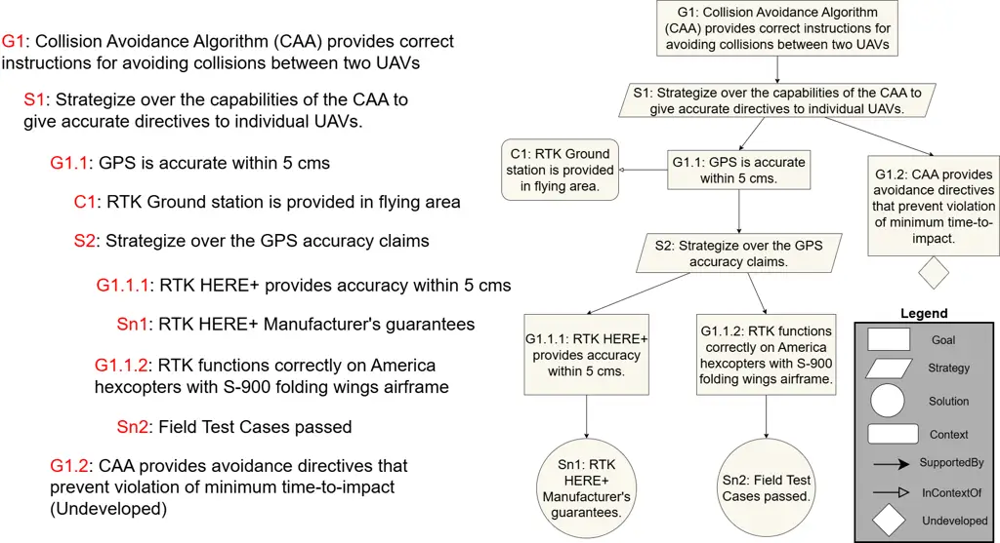
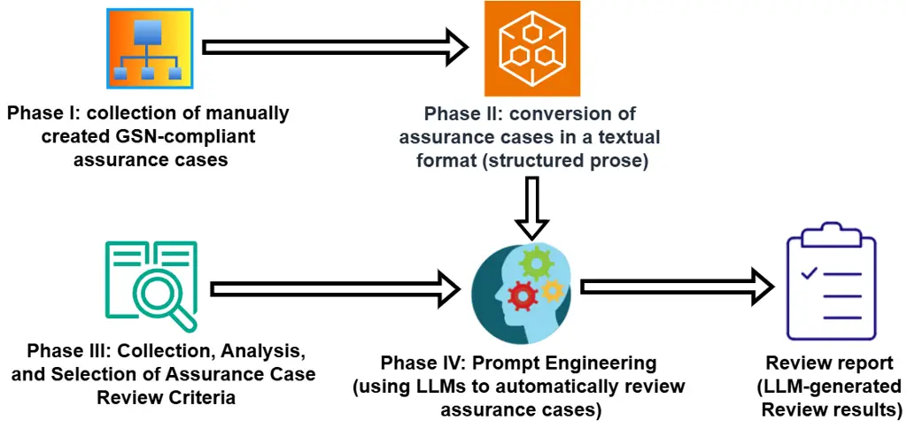
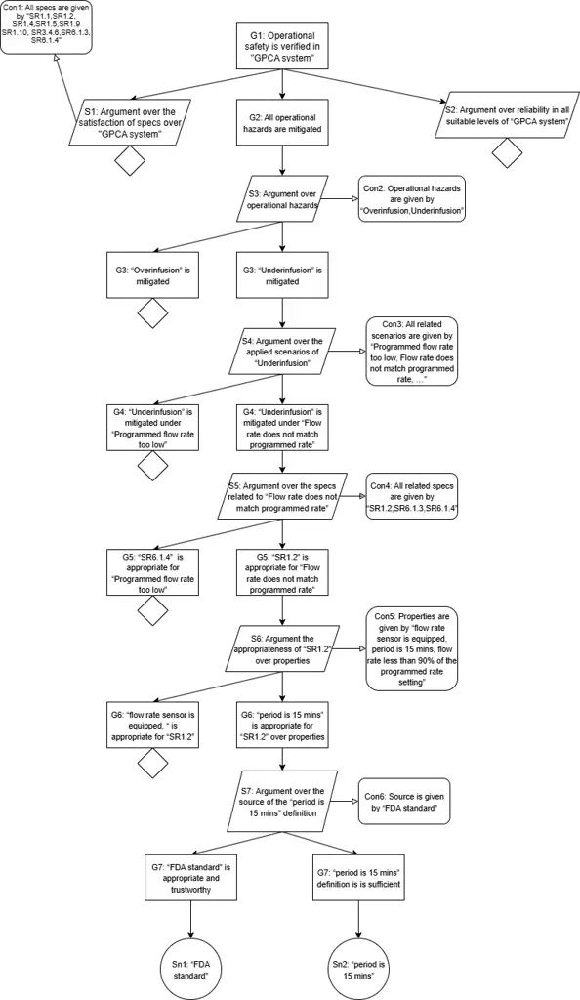

# LLMs as Judges: Toward The Automatic Review of GSN-compliant Assurance Cases

Journal: Journal of Systems and Software

Gerhard Yu Affiliation: Lassonde School Of Engineering, York University,
Toronto, Canada    Mithila Sivakumar Affiliation: School of Electrical
Engineering and Computer Science, University of Ottawa, Ottawa, Canada
   Alvine B. Belle Affiliation: Lassonde School Of Engineering, York
University, Toronto, Canada    Soude Ghari Affiliation: Lassonde School
Of Engineering, York University, Toronto, Canada    Song Wang
Affiliation: Lassonde School Of Engineering, York University, Toronto,
Canada    Timothy C. Lethbridge Affiliation: School of Electrical
Engineering and Computer Science, University of Ottawa, Ottawa, Canada

###### Abstract

Assurance cases allow verifying the correct implementation of certain
non-functional requirements of mission-critical systems, including their
safety, security, and reliability. They can be used in the specification
of autonomous driving, avionics, air traffic control, and similar
systems. They aim to reduce risks of harm of all kinds including human
mortality, environmental damage, and financial loss. However, assurance
cases often tend to be organized as extensive documents spanning
hundreds of pages, making their creation, review, and maintenance
error-prone, time-consuming, and tedious. Therefore, there is a growing
need to leverage (semi-)automated techniques, such as those powered by
generative AI and large language models (LLMs), to enhance efficiency,
consistency, and accuracy across the entire assurance-case lifecycle. In
this paper, we focus on assurance case review, a critical task that
ensures the quality of assurance cases and therefore fosters their
acceptance by regulatory authorities. We propose a novel approach that
leverages the LLM-as-a-judge paradigm to automate the review process.
Specifically, we propose new predicate-based rules that formalize
well-established assurance case review criteria, allowing us to craft
LLM prompts tailored to the review task. Our experiments on several
state-of-the-art LLMs (GPT-4o, GPT-4.1, DeepSeek-R1, and Gemini 2.0
Flash) show that, while most LLMs yield relatively good review
capabilities, DeepSeek-R1 and GPT-4.1 demonstrate superior performance,
with DeepSeek-R1 ultimately outperforming GPT-4.1. However, our
experimental results also suggest that human reviewers are still needed
to refine the reviews LLMs yield.

###### Keywords: 

Regulatory Compliance , Assurance Cases , System Assurance , Assurance
Case Review , Generative AI , Large Language Models

## 1 Introduction

System assurance is the process of ensuring that a system meets its
non-functional requirements (e.g., safety, security, and reliability).
For safety-critical systems, this process typically involves the
development of assurance cases. An assurance case is a structured,
well-reasoned, and auditable collection of arguments, supported by
evidence, intended to demonstrate that the system’s non-functional
requirements have been correctly and adequately implemented (Maksimov
et al., 2019; Attwood and Kelly, 2015; Rinehart et al., 2017). In
safety-critical domains, e.g., healthcare, nuclear, and automotive,
producers of mission-critical systems use assurance cases to demonstrate
compliance with certification standards to regulatory authorities (Viger
et al., 2024). This practice helps prevent system failures and,
consequently, catastrophic outcomes such as death, injury, or
environmental damage (Viger et al., 2024). Assurance cases have been
employed in safety-critical domains for over fifty years to support
certification processes (Chowdhury et al., 2019). Their use has also
been endorsed by several industry standards, including ISO 26262 (ISO,
2018), DO-178C (DO-178C, 2011), and UL 4600 (Koopman, 2023).

A key challenge for creating and maintaining assurance cases is that
large numbers of assurance cases tend to be bundled into voluminous
documents spanning several hundred pages (Maksimov et al., 2019). For
instance, the safety case for an air traffic control system may exceed
500 pages and reference nearly 400 supporting documents (Maksimov
et al., 2019). The manual creation, refinement, and maintenance of
assurance cases are often error-prone, time-consuming, and
labor-intensive processes that can take several months, particularly for
large, complex, and interconnected systems (Graydon and Lehman, 2025;
Sivakumar et al., 2024b; Ramakrishna et al., 2022; Odu et al., 2025c;
Nguyen and Ellis, 2011).

The premise for our current research is that relying on (semi-)automated
techniques as those enabled by Generative AI through LLMs (Large
Language Models) should help tackle these limitations by expediting the
execution of system assurance activities. However, existing LLM-based
system assurance approaches (e.g., (Gohar et al., 2024; Shahandashti
et al., 2024b; Viger et al., 2024; Sivakumar et al., 2024b; Odu et al.,
2025c; Chen et al., 2025; Murugesan et al., 2024)) only support a
limited set of system assurance activities: assurance case generation,
verification, formalization, semantic analysis, assessment, and defeater
generation. None of these approaches leverage LLMs to support the
automatic review of assurance cases. Therefore, the assurance case
review mostly remains a manual task that heavily relies on the scrutiny
of human reviewers. Yet, review is crucial to guarantee the quality of
assurance cases and facilitate their acceptance by regulatory
authorities. Hence, we focus on the review process in this paper.

To tackle this gap and gain a good understanding of the extent to which
LLMs can help with the automation of assurance case review, we propose a
novel approach that leverages the capabilities of AI models. We created
new predicate-based rules that formalize assurance case review. We then
used these rules to craft prompts to query the LLM, asking it to review
assurance cases automatically.

We used various state-of-the-art LLMs (GPT-4o, GPT-4.1, DeepSeek-R1, and
Gemini 2.0 Flash) to conduct experiments on several assurance cases from
various application domains (healthcare, automotive, and computing). To
quantitatively assess the LLM-generated reviews, we relied on three
metrics that respectively quantify the coherence, usefulness, and
informativeness of LLM-generated reviews. To qualitatively assess the
LLM-generated reviews, we derived a taxonomy of semantic topics that
classifies the review capabilities and issues characterizing the four
LLMs. The analysis of our experimental results suggests that LLMs can be
effective assistants when reviewing assurance cases, with both
DeepSeek-R1 and GPT 4.1 demonstrating superior review capabilities
compared to the other LLMs at hand. However, LLMs cannot yet replace
human reviewers. This is because, despite being able to detect and
describe some quality issues when reviewing assurance cases, LLMs
sometimes struggle with some issues, such as hallucination proneness and
the tendency to generate reviews that are too generic and therefore not
very useful to assurance case developers. It is therefore crucial to
keep the human in the loop when completing the LLM-based assurance case
review task.

The contributions of this paper are therefore fourfold:

- 1.  We extract a set of review criteria relevant for the execution of the
      assurance case review task
- 2.  We formalize these review criteria by proposing a set of predicates
      that allow capturing these review criteria, the associated review
      issues, and the possible suggestions to resolve these issues.
- 3.  We used the review criteria formalization to design prompts enabling
      the LLM-based assurance case review and aligning with the
      LLM-as-a-judge paradigm.
- 4.  We carry out experiments using four state-of-the-art LLMs, and we
      report the results obtained.

The remainder of this paper is organized as follows: Section 2 describes
the background concepts as well as the related work. Section 3 describes
the LLM-based approach we proposed to automatically support assurance
case review. Section 4 describes the experimental setups. Section 5
presents the results we obtained from our experiments. Section 6
describes the threats that could affect our study. We conclude and
outline some future work in Section 7.

## 2 Background and Related Work

### 2.1 Background

#### 2.1.1 What is an assurance case?

An assurance case is a structured argument, supported by evidence, and
intended to demonstrate that a system is acceptable for its intended use
with respect to specific non-functional requirements (e.g., safety,
security, reliability) (Rinehart et al., 2017; Mansourov and Campara,
2010). Such cases are structured as a hierarchy of claims, with
lower-level claims drawing on concrete evidence, and serving as evidence
to justify claims higher in the hierarchy (Foster et al., 2021). The
ultimate goal of an assurance case is to justify its top claim (i.e.,
root), such that the system supports a critical non-functional
requirement (Foster et al., 2021). There are different types of
assurance cases depending on the non-functional requirement they target.
For instance, security cases (Alexander et al., 2011; Mohamad et al.,
2021), safety cases (Palin and Habli, 2010) and reliability cases (Zhu
et al., 2018) are assurance cases focusing on security, safety, and
reliability respectively.

Assurance cases support the verification of the correct implementation
of system requirements. They allow engineers to determine which analyses
they should perform to verify that correctness and which supporting
evidence and rationales they should use to prove these analyses are
sufficient to meet the so-called requirements (Rao and Bai, 2019). For a
given system, the supporting evidence may include concrete facts such as
system specifications, test results, formal reviews, simulations, as
well as resource diagrams (Agrawal et al., 2019; Mansourov and Campara,
2010; de La Vara et al., 2023). Assurance cases therefore play a
critical role in helping prevent system failure, which could otherwise
lead to fatalities, serious injuries, economic losses, or environmental
damage (Rushby, 2017). Industry standards that promote assurance cases
have therefore become more common, including ISO 26262 (ISO, 2018),
DO-178c (DO-178C, 2011), ISO/PAS 8800 (for Standardization, 2024), and
UL4600 (Koopman, 2023). Various regulatory authorities also promote the
use of assurance cases to support the certification of systems in
compliance with industry standards. These include FDA (Food and Drug
Administration) (Sujan and Habli, 2021; Finnegan and McCaffery, 2014)
and NHTSA (National Highway Traffic Safety Administration). Such cases
are widely applied across multiple domains—including aerospace,
railways, automotive, and healthcare—to justify the safe and reliable
deployment of mission-critical systems (Maksimov et al., 2019; Rushby,
2017; Duan et al., 2017; Graydon and Holloway, 2017).

#### 2.1.2 How to represent assurance cases?

Several notations have been developed to represent assurance cases,
including textual and graphical formats. Textual notations include
traditional prose (i.e. plain prose) and structured prose (also called
semi-structured text) that is more formal (Holloway, 2008; Sivakumar
et al., 2024b). Representing assurance cases in textual formats,
especially traditional prose, is challenging due to the use of unclear
and poorly structured English, ambiguity, the usage of multiple
cross-references that disrupt the flow of the arguments, and the lack of
formalism (Kelly, 2004; Odu et al., 2025c). Graphical notations address
these issues.

Several graphical notations allow representing assurance cases. These
notations allow the explicit representation of assurance case elements
as well as the relationships between them (Wei et al., 2019). Graphical
notations include the Goal Structuring Notation (GSN) (Goal Structuring
Notation Standard Working Group, 2023), Claims-Arguments-Evidence (CAE)
(Bloomfield et al., 1998), and Eliminative Argumentation (EA)
(Goodenough et al., 2015).

To foster standardization and interoperability, the Object Management
Group (OMG) proposed the Structured Assurance Case Metamodel (SACM) to
support the representation of assurance cases (Object Management Group,
2022; Wei et al., 2019). To model assurance cases, SACM uses three core
concepts (Object Management Group, 2022; Mansourov and Campara,
2010): 1) A claim: it is expressed as a proposition and presents a
statement that is either true or false, and which describes what the
assurance case is trying to justify; 2) Some evidence: this is
constituted from the system’s available concrete facts and serves as a
proof to back the claim; and 3) A well-structured argument: it links the
evidence to the claim in a manner that supports the belief that the
evidence supports the claim.

In this paper, we focus on GSN because it is the most used graphical
notation (Shahandashti et al., 2024a; Cârlan et al., 2016). An Assurance
case represented in GSN is a diagram having a tree-like structure called
goal structure. GSN diagrams align with the SACM standard. The following
core GSN elements allow representing an assurance case in GSN (Goal
Structuring Notation Standard Working Group, 2023):

- 1.  Goal: it represents a claim. Usually denoted as G, a goal is depicted
      as a rectangle.
- 2.  Strategy: it represents an argument. It embodies the inference rules
      that allow inferring a claim from sub-claims. It is represented as a
      parallelogram, and denoted as S.
- 3.  Solution: It represents an evidence. Usually denoted as Sn, a solution
      acts as the supporting evidence for a claim. It is represented as a
      circle.

GSN diagrams may also include other GSN elements such as Context,
Assumption, and Justification (Goal Structuring Notation Standard
Working Group, 2023).

The most common relationships between GSN elements are SupportedBy and
InContextOf (Goal Structuring Notation Standard Working Group, 2023).
SupportedBy is represented by an arrow with a black head. It represents
inferential or evidential relationships between GSN elements (Goal
Structuring Notation Standard Working Group, 2023). InContextOf is
represented by an arrow with a white head. It represents contextual
relationships between GSN elements (Goal Structuring Notation Standard
Working Group, 2023).

GSN also allows adding decorators to GSN elements. GSN decorators
include the Undeveloped decorator that allows specifying that a GSN
element is not yet fully developed (Goal Structuring Notation Standard
Working Group, 2023). It is represented by a hollow diamond that is
placed at the bottom center side of the GSN element. This decorator is
usually applied on a Goal or a Strategy.

Figure 1 depicts a partial assurance case represented using GSN. This
figure also shows the equivalent of this assurance case in the
structured prose.

Figure 1: On the right, a partial safety case (GSN diagram) adapted from
Vierhauser et al. (2019); on the left, the equivalent of this safety
case in the structured prose

#### 2.1.3 Dialectic Extension of GSN

The GSN standard (Goal Structuring Notation Standard Working Group, 2023) comprises several extensions that enrich the notations it supports
as well as their semantics. These extensions include the argument
pattern extension, the dialectic extension, and the confidence argument
extension. Also known as the "investigation of truth", the dialectic
process, is used in assurance cases to strengthen arguments by
supporting their constructive criticism and logical dispute. The
dialectic extension of GSN allows supporting the dialectic process by
relying on a notation that supports various former and new GSN concepts:
Goals, Solutions, Challenges, and Defeated. Goals are used to "challenge
a part of an argument". Solutions are used as a point of reference or
evidence to Goals. Challenges are used to indicate that an argument is
trying to challenge another different argument. Finally, Defeated
indicates that the relationship of two arguments has been nullified.
There are two different kinds of defeaters present in the dialectic
extension of the GSN standard: Rebuttal and Undercutting defeaters. A
Rebuttal defeater is a supported counter-argument that challenges all or
some parts of another argument. An Undercutting defeater refers to
additional facts that can be used to challenge parts or all of an
argument. In this paper, we rely on the dialectic extension of GSN to
represent and reason about defeaters.

#### 2.1.4 Assurance case review

The creation of assurance cases is often a manual process carried out by
assurance case developers who have several years of experience in the
field. The creation of an assurance case is therefore a subjective task.
This calls for a rigorous assurance case review process (Kelly, 2004).
The review process helps verify the correct use of syntax rules and
establish the traceability among artifacts and the assurance case at
hand (Yamamoto and Morisaki, 2016). The review process also helps detect
potential assurance weakeners (i.e. assurance deficits and logical
fallacies) (Shahandashti et al., 2024a) in arguments early. This informs
the improvement of the assurance cases content, yields assurance cases
of better quality, and therefore fosters their acceptance by regulatory
bodies (Kelly, 2007).

The assurance case review is usually completed before the system is
approved for use (Kelly, 2007). Kelly (2007) explains that the assurance
case review is usually performed by two parties. One party (i.e. the
organization developing the system under scrutiny) has the
responsibility to prepare and self-review the assurance case, while the
other party (i.e. the certification authority) is responsible for
accepting the assurance case. The certification authority considers that
an assurance case is acceptable if that assurance case does not comprise
major flaws in reasoning or weaknesses in evidence (Kelly, 2007).

Although assurance case review is crucial, there are many issues a
reviewer may encounter when manually reviewing an assurance case. Such
issues include the need for reviewers to carry out industrial
archaeology to uncover the assurance case arguments and evidence (Goal
Structuring Notation Standard Working Group, 2023; Kelly, 2007).
Conducting Industrial archaeology is challenging (Goal Structuring
Notation Standard Working Group, 2023; Kelly, 2007), especially for
large assurance cases spanning hundreds of pages. It may drive reviewers
to perform superficial rounds of reviews mainly focusing on the
presentation of the assurance case, rather than the structure or content
of the argument (Goal Structuring Notation Standard Working Group, 2023;
Kelly, 2007). Once reviewers have uncovered arguments, other issues may
arise. These usually relate to the assumptions an assurance case author
may sometimes make. More specifically, the author of an assurance case
may assume that the reviewers of a given system’s assurance case will
have as much knowledge and context information about the analyzed system
as the developers of the system. However, in practice, most reviewers
have a limited knowledge of the system at hand compared to the
developers of the systems, and may therefore be confused when reviewing
the assurance case (Goal Structuring Notation Standard Working Group,
2023; Kelly, 2007). Other issues are inherent to the nature of the
review process itself. For instance, the review of assurance cases is
usually done manually, which makes it a labor-intensive and very
time-consuming task. Furthermore, reviewing an assurance case requires
considerable expertise (Kelly, 2007).

These issues call for the definition of an assurance case review process
that follows a clear, systematic, expert-informed, (semi-) automatic,
and rigorous methodology.

#### 2.1.5 What is a Large Language Model (LLM)?

LLMs are advanced AI systems with massive parameter sizes, and trained
on large amounts of data coming from diverse sources (Chang et al.,
2024; Zhao et al., 2023; Hou et al., 2024). LLMs can emulate human
linguistic capabilities and generate plausible texts (Hou et al., 2024).
They can therefore summarize text, translate text, and answer questions
with human-level language fluency (Hou et al., 2024).

Prompt engineering supports the optimization of LLM-generated responses
through the use of various prompting strategies that guide the LLM with
specific instructions on how to perform a given task (Meskó, 2023). The
most common prompting strategies include Zero-Shot prompting, One-Shot
prompting, Few-Shot prompting, and Chain-of-Thought (CoT) prompting
(Choi and Chang, 2025; Sahoo et al., 2024; Brown et al., 2020).
Zero-shot prompting is a technique that consists of prompting the LLM to
carry out a given task without any explicit training on that task. With
that technique, the LLM only relies on the supplied prompt provided
during inference to generate the expected response (Hou et al., 2024).
One-shot consists in feeding the LLM at hand with a single example with
the aim of improving its learning capabilities (Hou et al., 2024).
Few-shot prompting consists of prompting the LLM with a set of examples
on how to perform a given task (Hou et al., 2024). The LLM learns from
these examples (Hou et al., 2024), which allows improving its reasoning
capabilities. CoT is a prompting technique that consists of supplying
the LLM with a prompt that breaks down a complex task to perform into
simpler ones, which improves the reasoning capabilities of the LLM and
allows it to generate well-structured and meaningful responses (Wei
et al., 2022; Hou et al., 2024).

LLMs have become very popular in the Software Engineering field, where
they are used to automate various tasks: code review (e.g., (Yu et al.,
2024)), software design (e.g., (Wan et al., 2024)), unit test generation
(e.g., (Chen et al., 2024b)), and program repair (e.g., (Bouzenia
et al., 2024; Yin et al., 2024)). They have also been used as judges
(i.e. raters) to assess the quality of software artifacts (Baltes
et al., 2025) (e.g., requirements statements (Lubos et al., 2024),
acceptance criteria (Wang et al., 2025)). Accordingly, in this paper, we
leverage the LLM-as-a-judge paradigm (Gu et al., 2024; Szymanski et al.,
2025; Shankar et al., 2024) and therefore use LLMs as judges to assess
the quality of assurance cases during the review process. By merging the
scalability of automatic assessment methods with the detailed and
context-sensitive reasoning characterizing human expert judgments, this
novel paradigm offers a valuable assessment solution to complex and
open-ended evaluation problems (Gu et al., 2024).

### 2.2 Related Work

#### 2.2.1 Approaches proposed to review assurance cases

Several approaches have been proposed to manually review assurance cases
(e.g., (Kelly, 2007; Yamamoto and Morisaki, 2016; Chowdhury et al.,
2019; Rushby et al., 2015). One such approach is the four-stage review
process proposed by Kelly (2007), and currently used by the GSN
standard. This approach consists of Argument Comprehension,
Well-Formedness (Syntax) Checks, Expressive Sufficiency Checks, and
Argument Criticism and Defeat. Another approach is the one by Yamamoto
and Morisaki (2016). This approach also consists in performing a
four-stage review process. The stages comprised in that process are the
following: context understanding, problem identification, cause
analysis, and revision. Chowdhury et al. (2019) have also proposed two
criteria to evaluate assurance cases. These criteria respectively assess
the structure/notation and the content of the assurance case under
review. Rushby et al. (2015) proposed a two-part process that allows
reviewing assurance cases using epistemic methods and logic.

A few approaches support the automated review of assurance cases. For
instance, Denney et al. (2012) proposed an automated review approach
supported by AdvoCATE. The latter allows reviewing assurance cases by
relying on the safety metrics generated by AdvoCATE. More recently,
Muram and Javed (2023) introduced an automated approach supported by
ATTEST. The latter is a Natural Language Processing (NLP) framework that
uses a four-stage review process review assurance cases. This process
consists of the following stages: text preprocessing, pattern matching,
information analysis, and update of assurance cases.

However, existing approaches proposed to review assurance cases have
several limitations. They are usually manual and therefore
labor-intensive, time-consuming, and error-prone. The few automatic ones
are limited by their supporting tools and their restrictive metamodels
(Muram and Javed, 2023). Another limitation of some of the existing
approaches is their tendency to turn the review process into industrial
archaeology (Kelly, 2007; Goal Structuring Notation Standard
Working Group, 2023), which may make them unable to detect potential
deficiencies in the assurance case under review. Furthermore, despite
the wide adoption of LLMs to support various Software Engineering tasks,
none of the existing assurance review approaches has explored the use of
LLMs to automate assurance case review. We fill this gap in this paper
by exploring the use of LLMs to automate the assurance case review task.

#### 2.2.2 LLM-based System Assurance Approaches

Several approaches (e.g., (Fujiwara et al., 2025; Odu et al., 2025a; Odu
et al., 2025c; Sivakumar et al., 2024b; Sivakumar et al., 2024a; Odu
et al., 2025b; Viger et al., 2024; Gohar et al., 2024; Shahandashti
et al., 2024b; Murugesan et al., 2024; Ghahremani et al., 2024)) rely on
LLMs to support system assurance activities. These approaches usually
rely on the following prompting strategies: zero-shot, one-shot,
role-based system prompting, and Chain-of-Thought. Most of these
approaches focus on two system assurance activities: assurance case
creation (e.g., (Sivakumar et al., 2024b; Odu et al., 2025c; Odu et al.,
2025b; Sivakumar et al., 2024a; Odu et al., 2025a)) and defeater
identification (e.g., Viger et al. (2024); Gohar et al. (2024);
Shahandashti et al. (2024b)). A few of these approaches (e.g., (Chen
et al., 2025; Varadarajan et al., 2024; Murugesan et al., 2024;
Ghahremani et al., 2024)) support some of the following system assurance
activities: assurance case verification, formalization, semantic
analysis, and assessment.

Most of the approaches focusing on assurance case creation rely on GSN
to represent assurance cases, and on LLMs from the GPT series to
automate that task. For instance, Sivakumar et al. (2024a); Sivakumar
et al. (2024b) relied on GPT-4 -a popular LLM from the GPT series- to
automate the generation of safety cases. Odu et al. (2025c) also relied
on two LLMs (i.e. GPT-4 Turbo and GPT-4o) from the GPT series to
automatically generate assurance cases from assurance case patterns
formalized using predicate-based rules. In subsequent works, Odu et al.
automated that approach as an online tool called SmartGSN (Odu et al.,
2025b), and applied that approach to the automotive sector (Odu et al.,
2025a). Fujiwara et al. (2025) also proposed an automated method that
not only enables the generation of assurance cases using GPT but also
allows the generation of mitigations for threats against AI systems.

Most of the approaches (e.g., (Viger et al., 2024; Shahandashti et al.,
2024b)) leveraging LLMs to identify defeaters relied on EA to reason
about defeaters. Only one approach (i.e. (Gohar et al., 2024)) relied on
an agnostic notation. Each of these approaches relied on LLMs from the
GPT series to automate the defeater identification task. These
approaches relied on various metrics to assess their results, including
informativeness, usefulness, coherence, and reasonability. Viger et al.
(2024)’s work also proposed a taxonomy of semantic topics resulting from
the incremental classification of LLM-generated defeaters. Shahandashti
et al. (2024b) proposed to rely on a set of predicate-based rules that
formalize EA elements and their connections to prompt GPT-4 Turbo to
identify defeaters.

More recently, Graydon and Lehman (2025) engaged in a critical review of
existing work to determine whether LLMs actually have the capabilities
to automatically perform system assurance activities. They concluded
that further research still needs to be conducted before a definitive
answer is provided. In line with these conclusions, Diemert et al.
(2025a) reviewed existing literature on LLM-based system assurance and
identified four common use cases. They also introduced seven novel use
cases. Finally, they presented a method for evaluating the risk-benefit
tradeoff of a given LLM use case.

However, despite the increasing use of LLMs to support the automation of
system assurance activities, none of the existing LLM-based system
assurance approaches has explored the use of LLMs to automate the
assurance case review task. We address this gap in our paper, and
similar to Shahandashti et al. (2024b) and Odu et al. (2025c), we rely
on predicate-based rules to support this system assurance task.

#### 2.2.3 Automatic code review using Large Language Models

As Cârlan et al. (2016) point out, code review is a critical activity in
the software system lifecycle. It consists in systematically examining
the source code of a system to detect faults overlooked during its
development. This allows improving the overall quality of the software
under development. There is a rich body of work (e.g., (Yu et al., 2024;
Rasheed et al., 2024; Sun et al., 2025; Tan, 2025)) that focused on the
use of LLMs to automate various Software Engineering tasks such as code
review. For instance, Yu et al. (2024) constructed Carllm
(Comprehensibility of Automated Code Review using Large Language
Models), an LLM that is specifically fine-tuned to support automated
code reviews. Carllm uses CoT prompts to support code review through
four main steps that foster the generation of very comprehensive and
informative reviews: issue detection, issue localization, issue
explanation, and suggestion of the review fix. These prompts leverage a
set of mathematical symbols and notations that allow formalizing code
issues.

In this paper, we adapt Yu et al. (2024)’s work to propose a novel
LLM-based approach that supports the automatic review of assurance
cases.

## 3 A novel LLM-based Approach to Automatically Review Assurance Cases

We propose a novel LLM-based approach to automatically support assurance
case review. For this purpose, we develop novel predicate-based rules
that formalize assurance case review criteria and issues by tailoring Yu
et al. (2024) et al.’s mathematical symbols and notations to the
assurance case review task. Then, we rely on these rules to design CoT
prompts tailored to the assurance case review process. These CoT prompts
allow us to detect potential issues in assurance cases and suggest
solutions to fix them. Figure 2 illustrates the various phases of our
novel approach. We further describe each of these phases in the
remainder of this section.

Figure 2: High-Level Overview of our LLM-based Assurance Case Review
Approach

### 3.1 Phase I: Collection of Assurance Cases

In this phase, we followed a systematic approach to select assurance
cases, using Google Scholar to identify peer-reviewed papers on system
assurance and those offering publicly accessible assurance cases. To
foster generalization, we selected a diverse range of assurance cases
spanning several application domains. We only retained assurance cases
complying with GSN and manually created by assurance case developers.

### 3.2 Phase II: conversion of the assurance cases in a textual format (structured prose)

In this phase, we converted the assurance cases collected in Phase 1
from GSN into structured prose. This format enables LLMs to interpret
and process the safety cases more effectively during the review stage.
We manually converted only those assurance cases that did not have a
publicly available structured prose version.

### 3.3 Phase III: Collection, Analysis, and Selection of Assurance Case Review Criteria

Several key studies (e.g., Kelly (2007); Yamamoto and Morisaki (2016);
Rushby et al. (2015); Muram and Javed (2023)) examine the argument
review process (see Section 2.2.1). We collected and analyzed these
studies, ultimately focusing on the one describing the GSN standard , as
it is widely recognized in the system assurance field. The GSN standard
(i.e. (Goal Structuring Notation Standard Working Group, 2023)) builds
on the work of Kelly (2007) to propose the following four argument
review criteria to manually review an argument from an assurance case :

1.  1.  Argument Comprehension: This criterion focuses on identifying the
        links of each argument in the assurance case; these links focus on
        finding each claim and its supporting evidence. When using this
        criterion to review the assurance case, the reviewer must be able to
        identify key points of an argument, which may include but are not
        limited to claims, strategies, context of the argument, and evidence
        of why the argument is valid. The goal is to be able to link each
        argument with its respective evidence, and if there are unclear
        links, further annotating the document is necessary to ensure the
        reviewer understands each connection and how it is supported by
        their evidence.
2.  2.  Well-formedness (Syntax): This review criteria is concerned with the
        detection of structural errors in the argument under review. For
        instance, the presence of circular arguments – arguments in which
        argument’s premises depend on the argument’s conclusions – are
        usually not tolerated. This review criteria is also concerned with
        the identification of claims for which no supporting argument or
        evidence has been presented, and the identification of pieces of
        evidence whose role in the argument is unclear.
3.  3.  Expressive Sufficiency: The purpose of the expressive sufficiency
        criterion is to ensure that assurance case arguments are represented
        in a way that is complete, unambiguous, and understandable to
        reviewers. This criterion also emphasizes the importance of
        accompanying documentation to clarify the meaning of each context
        element thereby preventing misinterpretation and strengthening the
        overall comprehensibility of the argument.
4.  4.  Argument Criticism and Defeat: This review criterion is concerned
        with the establishment of arguments overall sufficiency. Hence, it
        focuses on determining if an argument’s premises, when considered
        together, are convincing enough to support the argument’s
        conclusions. The sufficiency of the relationship between an
        argument’s premises and conclusions can be evaluated by relying on
        various attributes that are further explained in the GSN standard
        Goal Structuring Notation Standard Working Group (2023): coverage,
        dependency, definition, directness, relevance, and robustness. With
        this review criterion, arguments considered insufficient may be
        challenged by identifying defeaters that defeat (i.e. undermine)
        them. We rely on the dialectic extension of GSN to conceptualize
        these defeaters.

In this paper, we rely on the aforementioned review criteria to review
assurance cases. In the GSN standard, these criteria are listed in order
of necessity (e.g., we can only check the well-formedness of an argument
after checking that its structure is fully comprehended) and in an order
of increasing difficulty. This means the latter review criterion
requires more significant intellectual effort and domain knowledge than
the former does.

### 3.4 Phase IV: Prompt Engineering

In this phase, we rely on various LLMs to automatically review manually
created assurance cases represented in the structured prose format. For
this purpose, we design a set of prompt templates that leverage the
formalization of the review criteria identified in Phase III. To
instruct LLMs to review assurance cases, we then derive prompts from
these prompt templates.

#### 3.4.1 Description of prompting strategies

We applied a range of prompt engineering techniques derived from
well-established prompting strategies (Wei et al., 2022; Kojima et al., 2022) to guide our LLMs. Specifically, we relied on three prompting
techniques: 1) zero-shot prompting; 2) zero-shot prompting with CoT; and 3) one-shot prompting with CoT. These variations allowed us to determine
how different prompting styles influenced the model’s ability to
interpret and reason over the assurance cases. In the remainder of this
paper, we explain the design of the aforementioned prompting techniques.

#### 3.4.2 Types of LLM Prompts

In this paper, we rely on three types of prompts: the system prompt, the
user prompt, and the assistant prompt. As we explained in (Odu et al.,
2025c), we can categorize these three types of prompts into two main
groups:

- 1.  The Input passed to the LLM: This is the LLM prompt. The LLM prompt
      consists of two parts: the system prompt and the user prompt. The
      system prompt provides developer-defined instructions that shape how
      the LLM should behave and what knowledge it should prioritize. The
      user prompt, in contrast, comes from the end user (e.g., a customer or
      guest) and represents the direct query to the model. In the sections
      below, we describe the system and user prompts we designed to query
      the LLMs for generating assurance case reviews.
- 2.  Output generated by the LLM: This is referred to as the assistant
      prompt. This is the text the model produces, in response to a user
      prompt. In our experiments, the assistant prompt corresponds to the
      assurance case review that the LLM generates for a given review
      criterion.

#### 3.4.3 Description of LLM User Prompt

Our user prompt specifies the review criterion that the LLM should use
to complete the review, as well as the name of the assurance case it
needs to review. The user prompt also asks the LLM to display the
results of its review, depending on the information the LLM specified in
the system prompt. Figure 3 illustrates an example of a user prompt.
That user prompt focuses on the safety case of a system called Baidu
Apollo.

Using the Argument Comprehension criterion, review the safety case of
the Baidu Apollo. Once finished display the results accordingly as to
how the review should be conducted.

Figure 3: An example of User Prompt

#### 3.4.4 Description of LLM System Prompt

Our system prompts allow us to instruct the LLM on how it should conduct
the review of the analyzed assurance case based on a specific criterion.
We designed our system prompts to allow us to use LLMs as judges, i.e.,
in these prompts, we ask LLMs to rate the quality of the assurance case
based on a given review criterion. The LLM specifies its rating by using
a linear scale ranging from 1 to 5. 1 means the assurance case is
perfect (i.e., it is totally correct in accordance with the review
criterion), and no change is needed. 5 means the assurance case is
totally flawed and therefore inadequate to support the certification of
the system under scrutiny. The LLMs ratings allow us to gauge the
perception LLMs have regarding the quality of the assurance cases
manually created by assurance case developers.

#### 3.4.5 CoT design for System Prompts

Some of our system prompts leverage CoT. To define the steps that the
LLM must follow through the CoT, we adapted the methodology that Yu
et al. (2024) proposed in Sections 3.2.1 and 3.2.2 of their paper
focusing on the code review task. More specifically, we relied on
predicate-based logic to adapt the symbols and notations Yu et al.
(2024) proposed. This allowed us to create a set of predicates (i.e.
mathematical notations) suitable for the assurance case review task.
Table 1 describes these predicates. We rely on these predicates to
derive the predicate-based rules that we use to craft our CoT prompts
templates.

We designed four CoT prompts templates, each focusing on one of the four
review criteria. Tables 2, 13, 14, and 15 report these templates. Using
predicate-based rules, each of these templates specifies the main
objectives of the review process done in accordance with a specific
review criterion, then uses a CoT-like reasoning to break down the
review of the analyzed assurance case into a set of intermediate steps
consisting of reporting detected criterion-oriented issues in the
assurance case and making suggestions to tackle them. If after finishing
its review, the LLM concludes that the analyzed assurance case LLM is
perfect (totally correct) and that it detected no review issues aligning
with the given review criterion, the template instructs the LLM to
provide in its review report a rationale explaining why it reached that
conclusion.

| Notations used in the CoT Template                                                                                                                                                                                                                                                                                                                                   |
| -------------------------------------------------------------------------------------------------------------------------------------------------------------------------------------------------------------------------------------------------------------------------------------------------------------------------------------------------------------------- |
| Issue(E, D): This notation is used to describe any issues discovered by the LLM, E is used to identify the GSN label, D is used to identify the textual description of the GSN element.                                                                                                                                                                              |
| Description(I(n), E, ID): This notation is used to describe any issues that the LLMs were able to identify. I(n) is used to identify the issue number, E is used to identify the GSN label, ID is used to identify the short description of the issue.                                                                                                               |
| Suggest(I(n), E, Sg): This notation is used to identify the suggestions the LLMs give. I(n) is used to identify which issue number the LLMs are referring to, E is used to identify the GSN label, Sg is used to identify the solution the LLM recommends to solve the issue.                                                                                        |
| \<(E(n), IDEN(n))\>: This notation is exclusively used on the Well-Formedness (Syntax) criterion, as it is used to identify identical GSN labels that were located by the LLMs. E(n) is used to identify identical GSN labels, IDEN(n) is used to identify the textual descriptions of the identical GSN labels.                                                     |
| Structural(E,D): This notation is exclusively used on the Well-Formedness (Syntax) criterion, as it is used to identify the structural issues that were located by the LLMs. E is used to identify the GSN label, D is used to identify the textual description of the GSN element.                                                                                  |
| Defeaters(D(n), Df, De): This notation is exclusively used on the Argument Criticism and Defeat criterion, as it is used to identify defeaters that are present in the assurance case. D(f) is used to identify the defeater number, Df is used to identify the defeater, De is used to identify the GSN label that is being challenged or defeated by the defeater. |

Table 1: Mathematical Notations for the CoT Prompt Template

| Argument Comprehension Prompt Template                                                                                                                                                                                                                                                                                      |
| --------------------------------------------------------------------------------------------------------------------------------------------------------------------------------------------------------------------------------------------------------------------------------------------------------------------------- |
| The Argument Comprehension criterion focuses on determining if the supporting evidence of the assurance case relates back to the main goal. The key points on reviewing the Argument Comprehension criterion are as follows:                                                                                                |
|                                                                                                                                                                                                                                                                                                                             |
| 1. Determine if the supporting evidence of each GSN element is related to it and is able to satisfy the missing requirements without any question.                                                                                                                                                                          |
| 2. Determining if each of the linked GSN elements is directly and indirectly linked to the main goal is crucial or important in satisfying the main goal.                                                                                                                                                                   |
|                                                                                                                                                                                                                                                                                                                             |
| To review the Argument Comprehension criterion of an assurance case, there will be 3 subtasks that need to be followed and implemented accordingly, those 3 subtasks are as follows:                                                                                                                                        |
|                                                                                                                                                                                                                                                                                                                             |
| Identifying issues in the assurance case - The first subtask is to identify any issues currently present in the assurance case. To denote any issues in the assurance case, the notation Issue(\$E: The current GSN label, \$D: Textual description of the current GSN element) will be used.                               |
|                                                                                                                                                                                                                                                                                                                             |
| Description of issue - Once an issue is identified, the next step is to describe the issue and give an explanation to why it is an issue. To describe the issue in the assurance case, the notation Description(\$I(n): The current issue number, \$E: The current GSN label, \$ID: Description of the issue) will be used. |
|                                                                                                                                                                                                                                                                                                                             |
| Suggestion of Improvement - Once the issue is described, the next step is to suggest an improvement to help solve the issue. To suggest an improvement, the notation Suggest(\$I(n): The current issue number, \$E: The current GSN label, \$Sg: Possible solution) will be used.                                           |
|                                                                                                                                                                                                                                                                                                                             |
| If there are no issues in the assurance case, the 3 subtasks can be skipped and instead of going through those subtasks, the score will just be issued along with a description of why the assurance case is perfect.                                                                                                       |

Table 2: CoT Prompt Template for Argument Comprehension

#### 3.4.6 Description of LLM system prompt templates

To prompt LLMs, we rely on system prompts that we derived from three
system prompt templates. Each system prompt template focuses on each of
the four selected review criteria. Tables 18 and 19 in the Appendix
Section respectively report the contextual information and the review
criterion descriptions we used to create our system prompt templates.
The contextual information specifies the GSN notation and its semantics.
This information allows the LLM to get a better understanding of GSN.
Note that we used the same contextual information and review criterion
descriptions across all three system prompt templates. We further
describe the structure of these prompt templates in the remainder of
this section.

Note that our prompt templates bear some similarities with the ones Odu
et al. (2025c) proposed to support the automatic creation of assurance
cases from patterns. Still, unlike Odu et al., our templates align with
the assurance case review task and leverage different predicate-based
rules and CoT-like reasoning.

##### Zero-shot System Prompt template

The Zero-shot template as seen in Table 16 (see Appendices), focuses on
specifying the contextual information allowing the LLM to understand GSN
concepts, the structured prose version of the assurance case the LLM
should review, the review criterion the LLM at hand should use to
perform the review, and the description of the so-called review
criterion.

##### Zero-shot with CoT System Prompt template

The Zero-shot with CoT template as seen in Table 17 (see Appendices),
focuses on specifying the contextual information, the structured prose
version of the assurance case the LLM should review, the review
criterion, the description of the review criterion. It also provides a
description of the CoT process specifying the various steps an LLM
should use when performing the review based on a specific review
criterion. Hence, we obtained the Zero-shot with CoT prompt template by
combining the following two elements: 1) the Zero-Shot template that
Table 16 depicts; and 2) the CoT template created for a specific review
criterion (i.e. the template reported in Table 2, Table 13, Table 14, or
Table 15).

##### One-shot with CoT System Prompt template

The One-shot with CoT template as seen in Table 3, focuses on specifying
the contextual information, the structured prose version of the
assurance case the LLM should review, the review criterion, as well as
the description of the review criterion. It also provides the
description of the CoT reasoning embodying the various steps allowing to
review an assurance case. The one-shot with CoT prompt template also
specifies the review example i.e. one-shot example the LLM at hand
should use to improve its reasoning capabilities. The review example
consists of a given assurance case specified in the structured prose
together with the outcome of the review manually performed on this
assurance case. We therefore obtained the One-shot with CoT prompt
template by combining the following three elements: 1) the Zero-Shot
template that Table 16 depicts; 2) the CoT template created for a
specific review criterion (i.e. the template reported in Table 2, Table
13, Table 14, or Table 15); and 3) a one-shot example obtained from a
manual assurance case review.

| One-Shot with CoT System Prompt Template                                                                                                                                                                                                                                                                                                                                                                                                                                                                                                                                                                                                                                                                                                                                                                                                                                                                                                                                                                                                                                                                                                                                                                                 |
| ------------------------------------------------------------------------------------------------------------------------------------------------------------------------------------------------------------------------------------------------------------------------------------------------------------------------------------------------------------------------------------------------------------------------------------------------------------------------------------------------------------------------------------------------------------------------------------------------------------------------------------------------------------------------------------------------------------------------------------------------------------------------------------------------------------------------------------------------------------------------------------------------------------------------------------------------------------------------------------------------------------------------------------------------------------------------------------------------------------------------------------------------------------------------------------------------------------------------ |
| You are an AI assistant who will assist in reviewing an assurance case represented using the Goal Structuring Notation (GSN). Your role as the assistant is to review the assurance case by scoring it using a linear scale ranging from 1 to 5, with 1 meaning the assurance case is totally correct and there is therefore no room for error and 5 meaning the assurance case is totally incorrect (i.e. full of errors). When the assurance case score is not 1, give a reasoning or give examples on how the assurance case can be further improved. More context about the assurance case will begin with the delimiter “@Context_AC” and ends with the delimiter “@End_Context_AC” while the assurance case to be reviewed will begin with the delimiter “@Assurance_Case” and end with the delimiter “@End_Assurance_Case”                                                                                                                                                                                                                                                                                                                                                                                        |
| @Context_AC                                                                                                                                                                                                                                                                                                                                                                                                                                                                                                                                                                                                                                                                                                                                                                                                                                                                                                                                                                                                                                                                                                                                                                                                              |
| More Context Information on the assurance case to be placed here                                                                                                                                                                                                                                                                                                                                                                                                                                                                                                                                                                                                                                                                                                                                                                                                                                                                                                                                                                                                                                                                                                                                                         |
| @End_Context_AC                                                                                                                                                                                                                                                                                                                                                                                                                                                                                                                                                                                                                                                                                                                                                                                                                                                                                                                                                                                                                                                                                                                                                                                                          |
| @Assurance_Case                                                                                                                                                                                                                                                                                                                                                                                                                                                                                                                                                                                                                                                                                                                                                                                                                                                                                                                                                                                                                                                                                                                                                                                                          |
| The Assurance Case to be reviewed should be specified here in the structured prose format complying with GSN                                                                                                                                                                                                                                                                                                                                                                                                                                                                                                                                                                                                                                                                                                                                                                                                                                                                                                                                                                                                                                                                                                             |
| @End_Assurance_Case                                                                                                                                                                                                                                                                                                                                                                                                                                                                                                                                                                                                                                                                                                                                                                                                                                                                                                                                                                                                                                                                                                                                                                                                      |
| We have also defined which review criterion will be used for the review of an assurance case. This criterion will solely be used as a basis on how the assurance case should be reviewed and scored. The review criterion to be used will begin with the delimiter “@Review_Criterion” and end with the delimiter “@End_Review_Criterion” while the description of the review criterion will start with the delimiter “@Review_Criterion_Description” and end with the delimiter “@End_Review_Criterion_Description” with the chain of thought process on how the review should be done incrementally would begin with the delimiter “@Chain_Of_Thought” and end with the delimiter “@End_Chain_Of_Thought”. An example under the form of an assurance case together with its manual review is also included. This example assurance case starts with the delimiter “@Assurance_Case_Review_Example” and ends with “@End_Assurance_Case_Review_Example” while its manual review starts with the delimiter “@Example_Of_Review_Done_On_The_Example_Assurance_Case” and ends with “@End_Example_Of_Review_Done_On_The_Example_Assurance_Case”. These two will help become familiar with how an assurance case is reviewed. |
| @Review_Criterion                                                                                                                                                                                                                                                                                                                                                                                                                                                                                                                                                                                                                                                                                                                                                                                                                                                                                                                                                                                                                                                                                                                                                                                                        |
| Name of the review criterion to be specified here                                                                                                                                                                                                                                                                                                                                                                                                                                                                                                                                                                                                                                                                                                                                                                                                                                                                                                                                                                                                                                                                                                                                                                        |
| @End_Review_Criterion                                                                                                                                                                                                                                                                                                                                                                                                                                                                                                                                                                                                                                                                                                                                                                                                                                                                                                                                                                                                                                                                                                                                                                                                    |
| @Review_Criterion_Description                                                                                                                                                                                                                                                                                                                                                                                                                                                                                                                                                                                                                                                                                                                                                                                                                                                                                                                                                                                                                                                                                                                                                                                            |
| Description of the review criterion to be placed here                                                                                                                                                                                                                                                                                                                                                                                                                                                                                                                                                                                                                                                                                                                                                                                                                                                                                                                                                                                                                                                                                                                                                                    |
| @End_Review_Criterion_Description                                                                                                                                                                                                                                                                                                                                                                                                                                                                                                                                                                                                                                                                                                                                                                                                                                                                                                                                                                                                                                                                                                                                                                                        |
| @Chain_Of_Thought                                                                                                                                                                                                                                                                                                                                                                                                                                                                                                                                                                                                                                                                                                                                                                                                                                                                                                                                                                                                                                                                                                                                                                                                        |
| Chain of thought text to be added here                                                                                                                                                                                                                                                                                                                                                                                                                                                                                                                                                                                                                                                                                                                                                                                                                                                                                                                                                                                                                                                                                                                                                                                   |
| @End_Chain_Of_Thought                                                                                                                                                                                                                                                                                                                                                                                                                                                                                                                                                                                                                                                                                                                                                                                                                                                                                                                                                                                                                                                                                                                                                                                                    |
| @Assurance_Case_Review_Example                                                                                                                                                                                                                                                                                                                                                                                                                                                                                                                                                                                                                                                                                                                                                                                                                                                                                                                                                                                                                                                                                                                                                                                           |
| Example of manually reviewed assurance case to be added here                                                                                                                                                                                                                                                                                                                                                                                                                                                                                                                                                                                                                                                                                                                                                                                                                                                                                                                                                                                                                                                                                                                                                             |
| @End_Assurance_Case_Review_Example                                                                                                                                                                                                                                                                                                                                                                                                                                                                                                                                                                                                                                                                                                                                                                                                                                                                                                                                                                                                                                                                                                                                                                                       |
| @Example_Of_Review_Done_On_The_Example_Assurance_Case                                                                                                                                                                                                                                                                                                                                                                                                                                                                                                                                                                                                                                                                                                                                                                                                                                                                                                                                                                                                                                                                                                                                                                    |
| Outcomes of the manual review done on the example assurance case to be added here                                                                                                                                                                                                                                                                                                                                                                                                                                                                                                                                                                                                                                                                                                                                                                                                                                                                                                                                                                                                                                                                                                                                        |
| @End_Example_Of_Review_Done_On_The_Example_Assurance_Case                                                                                                                                                                                                                                                                                                                                                                                                                                                                                                                                                                                                                                                                                                                                                                                                                                                                                                                                                                                                                                                                                                                                                                |

Table 3: One-Shot with CoT System Prompt Template

## 4 Experimental Setup

### 4.1 Research Questions

Our experiments aim at investigating the following research questions
(RQs):  
(RQ1): When completing the review process, how do the LLMs perceive the
quality of assurance cases manually generated by assurance case
developers?  
(RQ2): Are LLMs effective at automatically reviewing existing assurance
cases that were manually created by experts?  
(RQ3): Which prompting strategy yields the best LLM-based assurance case
reviews?  
(RQ4): Which LLM generates the best assurance case reviews?  
(RQ5): What are the typical review capabilities and issues that the LLMs
at hand exhibit?

### 4.2 Dataset Description

We followed the process explained in Phase I of our approach (see
Section 3.1 ) to collect assurance cases in the literature. Our
experiments, therefore, focus on five manually created assurance cases
represented using GSN: four assurance cases that we attempt to
automatically review using LLMs, as well as one additional assurance
case that we use as an example in our One-Shot with CoT prompts. Our
experiments therefore, focus on the following assurance cases that Table
4 describes: 1) the safety case of a Lane Management System (LMS) by
Di Sandro et al. (2019); 2) the safety case of the trajectory prediction
component of Baidu Apollo that we adapted from Odu et al. (2025a); 3)
the safety case of GPCA (Generic Patient-Controlled Analgesia) by Lin
et al. (2017); 4) the security case of an Instant messaging (IM) server
software by Xu et al. (2017); and 5) the safety case of a Level 4
Automated Driving (i.e. high driving automation) system by Kodama et al.
(2024).

| System                           | Domain     | Assurance Case (ACs) |          |               |
| -------------------------------- | ---------- | -------------------- | -------- | ------------- |
|                                  |            | Decorators           | Elements | Relationships |
| Baidu Apollo                     | Automotive | 0                    | 38       | 41            |
| GPCA                             | Medical    | 6                    | 27       | 26            |
| IM server SOFTWARE               | Computing  | 0                    | 24       | 23            |
| LMS                              | Automotive | 0                    | 76       | 77            |
| Level 4 Automated Driving System | Automotive | 0                    | 38       | 37            |

Table 4: Dataset Overview - adapted from Odu et al. (2025c)

As we specified in Phase II of our approach, we need to convert each
GSN-compliant assurance case in its structured prose format to ease its
ingestion by the LLM at hand. Still, the structured prose version of
most of these assurance cases is publicly available in literature (e.g.,
(Sivakumar et al., 2024b; Odu et al., 2025a)). So, we only needed to
manually generate the structured prose version of the following
assurance case: Level 4 Automated Driving System, IM Software, and GPCA.

Note that some GSN elements of the GPCA safety case and of the IM Server
Software security case have duplicated identifiers, whereas GSN fosters
the uniqueness of identifiers, which is one of its core rules.
Furthermore, due to space restrictions, the authors of the paper
describing the IM Server Software security case depicted some of its
goals without supporting arguments or evidence. These are examples of
structural errors that the review based on the Well-Formedness criterion
should flag.

### 4.3 LLM Description and Settings

We rely on four state-of-the-art Large Language Models to automate our
review approach: Gemini 2.0 Flash, GPT-4o, GPT-4.1, and DeepSeek-R1. We
used each of them with its default settings. Table 5 reports some
characteristics of these LLMs. These characteristics include which
organization developed these LLMs, their release date, and their cut-off
date.

| LLM              | Organization | Release Date     | Cut-off Date |
| ---------------- | ------------ | ---------------- | ------------ |
| Gemini 2.0 Flash | Google       | February 5, 2025 | June 2024    |
| GPT-4o           | OpenAI       | May 2024         | October 2023 |
| GPT-4.1          | OpenAI       | May 14, 2025     | June 2024    |
| DeepSeek-R1      | DeepSeek-AI  | January 20, 2025 | January 2025 |

Table 5: Overview of the LLMs

### 4.4 Experiments Description

To investigate our research questions, we performed the following
experiments by relying on the prompts we designed in Phase IV of our
approach (see Section 3.4):

- 1.  Experiment 1 (Zero-shot): To carry out this experiment, we used our
      Zero-shot template to derive the zero-shot prompts we used to run each
      LLM. We fed each of the four analyzed assurance cases in the
      structured prose format as input to the LLM. Each zero-shot prompt
      focuses on the review of one of the four assurance cases based on one
      of the four review criteria. We therefore derived sixteen zero-prompts
      from our Zero-shot template.
- 2.  Experiment 2 (Zero-shot + CoT): To perform this experiment, we used
      our Zero-shot + CoT template to run each LLM, using each of the four
      analyzed assurance cases in structured prose as input. For this
      purpose, we derived sixteen zero-shot + COT prompts from our
      Zero-shot+COT template.
- 3.  Experiment 3 (One-shot + CoT): To carry out this experiment, we used
      our One-shot + CoT template to run each LLM, using as input each of
      the four analyzed assurance cases in the structured prose format
      together with an example. We therefore derived sixteen one-shot + COT
      prompts from our one-shot + COT template.

In accordance with the literature (e.g., (Chen et al., 2023; Sivakumar
et al., 2024b; Odu et al., 2025c)), we ran each experiment five times to
account for the non-determinism of LLMs. When carrying out each
experiment, we therefore relied on sixteen prompts to sequentially query
each of the four LLMs five times. Each experiment therefore yielded a
total of 320 LLM-generated assurance case review outputs.

### 4.5 Assessment Metrics

Due to proprietary and security concerns, there is no publicly available
ground truth we can use as a reference when assessing our experimental
results. This prevents us from using common metrics such as Precision,
Recall, F-Measure, and BLEU score. Hence, following the guidelines for
empirical studies in Software Engineering involving LLMsBaltes et al.
(2025), we rely on human validation to assess LLM outputs (i.e.
LLM-generated reviews). Thus, to assess the results the LLMs generate
during our experiments, we rely on the following metrics that the
well-grounded work of Viger et al. (2024) proposed.

- 1.  Informativeness: Informativeness is the ability of the LLMs to be able
      to describe or explain concretely the answers it has generated (What,
      Where or Why responses?) (Viger et al., 2024). In the context of
      reviewing assurance cases, the informativeness will be rated on how
      the LLMs are able to explain or describe how their review process is
      done. Along with being able to properly describe their review process,
      the LLMs should also be able to properly describe individually the
      issues the LLMs have managed to detect when reviewing the assurance
      cases. The informativeness is also rated on how properly they can
      explain the possible improvements that can be done on those "flawed"
      assurance cases. We assess the Informativeness of the response
      generated by the LLMs based on a linear scale ranging from 1 to 5. We
      interpret that scale as follows 1=Totally Informative; 2=Mostly
      Informative; 3=Moderately Informative; 4=Slightly Informative;
      5=Uninformative.
- 2.  Coherence: Coherence is the trait of an LLM on how frequently its
      answers generated contain hallucinations and the severity of those
      hallucinations. Hallucinations are answers generated by LLM that are
      factually incorrect or nonsensical information, and having those
      generated answers be stated as factual by the LLM (Perković et al.,
      2024). In the context of assurance case review, the coherence would be
      rated based on how often or how impactful those hallucinations that
      appear in the assurance case review can be. This might either appear
      in the form of as a recommendation of improvement on a non-existent or
      non-related scenario in an assurance case. As with the above metric,
      we assess the Coherence of the response the LLMs yield by relying on a
      linear scale ranging from 1 to 5. On this scale, 1 means Totally
      Coherent, while 5 means Incoherent.
- 3.  Usefulness: Usefulness is the ability of an LLM to generate an answer
      that is considered helpful or insightful for the argument developer.
      In our context, usefulness would be determined by the extent to how
      useful or insightful the generated review of an LLM can be whether as
      a stand-alone reviewer or an assistant to a person manually reviewing
      an assurance case. As with the two other metrics, we assess the
      Usefulness of the review generated by each LLM based on a linear scale
      ranging from 1 to 5. On this scale, 1 means Totally Useful, while 5
      means Not Useful.

It is well-known that relying on human judgment is the best way to
evaluate LLMs (Gu et al., 2024). So, as in (Viger et al., 2024), two
assessors having at least five years of experience in the software
engineering field and having a good expertise in system assurance were
involved in the assessment of the aforementioned metrics. Howewer,
collecting human judgment is usually tedious, costly, and time-consuming
(Gu et al., 2024; Ouyang et al., 2022; Szymanski et al., 2025; Zheng
et al., 2023). Hence, the first assessor (i.e., senior co-author) and
the second assessor (i.e. another co-author) used a linear scale ranging
from 1 to 5 to manually and separately review a random sample of the
LLM-generated reviews the three experiments yield. The two assessors
then met multiple times to establish clear, consistent, and rigorous
guidelines on how to manually rate the LLM-generated results. In
accordance with these guidelines, the second assessor then relied on a
linear scale ranging from 1 to 5 to manually and independently assign a
value to each of the three metrics. The second assessor therefore
assessed all the LLM-generated reviews that the three experiments yield
by manually specifying the ratings associated with each metric at hand.
The outcomes of these assessments are presented in Section 5.

## 5 Results and Analysis

For each of the LLM, each analyzed assurance case, each prompting
strategy, and each of the review criteria, the three experiments
collectively generated a total of 960 LLM-based assurance case reviews
(i.e. review reports) over five runs. In this section, we discuss the
results the second assessor obtained when manually assessing the
LLM-generated results that the three experiments yield.

### 5.1 (RQ1) LLM perception Regarding the Quality of the Assurance Cases manually created by Assurance Case Developers

Table 6 reports the average of the LLM-based reviews for each review
criterion over five runs. As this Table illustrates, all LLMs
consistently assigned a rating of 2 or 3 for each review criterion, the
majority of ratings being closer to 3. Overall, they therefore
consensually judged the analyzed assurance cases as moderately correct,
indicating a need for further refinement. Furthermore, out of the four
LLMs at hand, DeepSeek-R1 is the harshest of them since all its ratings
are usually the highest. Contrariwise, GPT-4.1 and GPT-4o are the least
severe of all four LLMs under analysis.

|                  |             |             |         |              |              |
| ---------------- | ----------- | ----------- | ------- | ------------ | ------------ |
| LLM              | Strategy    | LLM Ratings |         |              |              |
|                  |             | AV A. C.    | AV W-F. | AV Exp. Suf. | AV Arg. Cri. |
| GPT-4o           | ZS          | 2.65        | 2.6     | 2.9          | 3            |
|                  | ZS with CoT | 3.25        | 2.85    | 3.15         | 3.075        |
|                  | OS with CoT | 2.9         | 2.6     | 3.1          | 3.4          |
| GPT 4.1          | ZS          | 2.5         | 2.7     | 2.6          | 2.65         |
|                  | ZS with CoT | 3.05        | 3.45    | 3.3          | 3.2          |
|                  | OS with CoT | 2.95        | 3.15    | 3.2          | 3.075        |
| DeepSeek-R1      | ZS          | 3.5         | 3.45    | 3.75         | 3.65         |
|                  | ZS with CoT | 3.6         | 3.05    | 3.65         | 3.375        |
|                  | OS with CoT | 3.75        | 3.45    | 3.6          | 3.375        |
| Gemini 2.0 Flash | ZS          | 3.2         | 2.95    | 3            | 3.2          |
|                  | ZS with CoT | 3.25        | 3.35    | 3.65         | 3.3          |
|                  | OS with CoT | 2.9         | 3.15    | 3            | 2.8          |

Table 6: Average of the LLM-Based Review Ratings Across Five Runs and
Across the Four Analyzed Assurance Cases (ZS = Zero-shot; OS = one-shot)

To have a finer-grained understanding of the extent to which LLMs
reached a consensus when judging the quality of the analyzed assurance
cases, we quantitatively assessed the inter-model agreement. For this
purpose, we relied on a statistical measure called Fleiss’ kappa (K)
(Fleiss, 1971; Warrens, 2010). The values of the Fleiss kappa vary
between -1 (total disagreement) and 1 (total agreement). We
automatically computed the values of this measure using two Python
libraries: statsmodels.stats.inter_rater.fleiss_kappa¹¹ 1 Website for
Fleiss Kappa library:
[https://www.statsmodels.org/dev/generated/statsmodels.stats.inter_rater.fleiss_kappa.html](https://www.statsmodels.org/dev/generated/statsmodels.stats.inter_rater.fleiss_kappa.html)
and statsmodels.stats.inter_rater.aggregate_raters²² 2 Website for
Aggregate Raters:
[https://www.statsmodels.org/dev/generated/statsmodels.stats.inter_rater.aggregate_raters](https://www.statsmodels.org/dev/generated/statsmodels.stats.inter_rater.aggregate_raters).
As Table 7 shows, the values of the Fleiss’ kappa are negative for most
of the review criteria and most of the prompting strategies. So, LLMs
therefore tend to disagree in their individual ratings, and these
ratings are not always consistent. This means that, while LLMs seem to
yield quite similar global ratings when it comes to the assurance cases
quality (see Table 6), they seem to have quite different opinions and
interpretations of what the quality of assurance cases entails when it
comes to the four review criteria at hand.

|                               |             |              |
| ----------------------------- | ----------- | ------------ |
| Review Criterion              | Strategy    | Fleiss Kappa |
| Argument Comprehension        | ZS          | -0.0928      |
|                               | ZS with CoT | 0.0342       |
|                               | OS with CoT | -0.0433      |
| Well-Formedness(Syntax)       | ZS          | 0.0560       |
|                               | ZS with CoT | -0.0214      |
|                               | OS with CoT | -0.0751      |
| Expressive Sufficiency        | ZS          | -0.1616      |
|                               | ZS with CoT | -0.0218      |
|                               | OS with CoT | -0.0092      |
| Argument Criticism and Defeat | ZS          | -0.1542      |
|                               | ZS with CoT | -0.0009      |
|                               | OS with CoT | 0.1453       |

Table 7: Fleiss Kappa Ratings of the Four LLMs on each Prompting
Strategy (ZS = Zero-shot; OS = One-shot)

Key Takeaways (RQ1): The analysis of the results shows that even though
human experts manually crafted the assurance cases under scrutiny, LLMs
still rated their quality as moderate based on the four review criteria
at hand.

### 5.2 (RQ2): Effectiveness of LLMs in Automatic Assurance Case Review

#### 5.2.1 Informativeness

Table 8 reports the averages of the informativeness ratings specified by
the second assessor for each analyzed assurance case, for each LLM at
hand, and for each review criterion over the five runs of each
experiment.

Table 8 shows that with all the CoT prompting strategies, all the LLMs
can achieve an informativeness score close to one (i.e., Totally
Informative) for most of the four review criteria, with DeepSeek-R1 and
GPT 4.1 being the most informative models overall. More specifically,
these LLMs consistently yield Informativeness scores close to 1 for the
following review criteria: Argument Comprehension, Expressive
Sufficiency, and Argument Criticism and Defeat. However, these LLMs
usually yield higher (i.e. poorer) Informativeness scores for the
following review criterion: Well-Formedness (Syntax). Hence, for these
review criteria, human experts still need to refine the reviews that
LLMs generate.

Interestingly, when relying on the Zero-shot prompting strategy, all
four LLMs, and particularly GPT 4.1, were the least informative when
providing suggestions to improve the review issues they detected. The
rationale is that the zero-shot prompting strategy lacks a structured
way to instruct LLMs on reporting detected review issues as well as
suggestions to fix them, leading them to generate generic and therefore
significantly less informative review issue descriptions and fix
suggestions.

|                  |             |                 |         |              |              |
| ---------------- | ----------- | --------------- | ------- | ------------ | ------------ |
| LLM              | Strategy    | Informativeness |         |              |              |
|                  |             | AV A. C.        | AV W-F. | AV Exp. Suf. | AV Arg. Cri. |
| GPT-4o           | ZS          | 3.65            | 3.2     | 3.4          | 3.65         |
|                  | ZS with CoT | 1.95            | 1.65    | 1.35         | 1.7          |
|                  | OS with CoT | 1.5             | 2.05    | 1.2          | 1.3          |
| GPT 4.1          | ZS          | 3.6             | 3.05    | 3.1          | 2.95         |
|                  | ZS with CoT | 1.6             | 1.3     | 1.4          | 1.65         |
|                  | OS with CoT | 1.25            | 1.5     | 1.35         | 1.2          |
| DeepSeek-R1      | ZS          | 3.35            | 2.65    | 2.85         | 3            |
|                  | ZS with CoT | 1.4             | 1.15    | 1.4          | 1.25         |
|                  | OS with CoT | 1.3             | 1.3     | 1.25         | 1.1          |
| Gemini 2.0 Flash | Zero-shot   | 3.45            | 3.25    | 3            | 2.85         |
|                  | ZS with CoT | 1.8             | 1.6     | 1.7          | 1.55         |
|                  | OS with CoT | 1.45            | 1.65    | 1.7          | 1.2          |

Table 8: Average (Across Five Runs and Across the Four Analyzed
Assurance Cases) of the Informativeness Results Manually Specified by
the Second Assessor (ZS = Zero-shot; OS = one-shot)

When examining the GPCA safety case provided in the Appendix, we can see
that it comprises a goal labeled G3. This goal states the following:
"Overinfusion" is mitigated. However, this goal is undeveloped i.e. lack
supporting GSN elements (e.g., evidence). As a result, its argumentation
structure is difficult to understand. The textbox above shows that
DeepSeek-R1 is able to clearly spot this issue, describe it, and make a
suggestion to fix this issue. This textbox presents an excerpt from the
review that DeepSeek-R1 generated for the GPCA safety case when using
the One-Shot with CoT prompt, and focusing on the Argument Comprehension
criterion. This demonstrates that DeepSeek-R1 can provide highly
informative feedback when detecting and describing issues within an
assurance case.

#### 5.2.2 Coherence

Table 9 shows the averages of the coherence ratings specified by the
second assessor for each analyzed assurance case, for each LLM at hand,
and for each review criterion over the five runs of each experiment.

Interestingly, when relying on the two CoT prompting strategies, all
four LLMs achieve relatively good coherence scores that are usually
close to two (i.e. Mostly Coherent) for three of the models (i.e.
DeepSeek-R1, GPT 4.1, and Gemini 2.0 Flash) and close to three (i.e.
Moderately Coherent) for GPT-4o. This indicates that, when provided with
sufficient instructions thanks to the use of the CoT prompting
strategies, the four LLMs are able to create reviews that are often
factually correct. Still, regardless of the prompting strategy at hand,
all LLMs sometimes hallucinate. The hallucinations the LLMs generate are
quite diverse. In some hallucinations, LLMs generate information that is
untrue or is not present, such as referencing some GSN elements that are
not present in the analyzed assurance case. Other hallucinations include
not being able to specify all the GSN elements that are identical, even
though they are instructed to list out all duplicated GSN elements.
Another instance of hallucinations is when the LLMs do not flag an issue
on GSN elements that do not follow the naming conventions promoted by
the GSN standard.

The textbox above showcases a sample of the review Gemini 2.0 Flash
generated when analyzing the safety case of GPCA using the One-Shot with
CoT prompt. This review focuses on the Argument Comprehension criterion.
As shown in this review, Gemini 2.0 Flash indicated that there are
issues with two GSN elements respectively called G3. The issue being
that both elements are undeveloped and therefore lacking supporting
evidence. But, when looking at the safety case of GPCA (see the Appendix
Section), we can clearly see that G3 is a duplicated GSN element: the
first instance of G3 is indeed undeveloped, but the second instance of
G3 is not undeveloped because it is clearly supported by other GSN
elements, including solutions (i.e. evidence). So, the duplication of G3
in the GPCA safety case clearly confused Gemini 2.0 Flash, driving it to
generate non-sensical information about the second instance of G3. This
example therefore shows that while Gemini 2.0 Flash is able to perform
complex tasks such as the review of assurance cases, this model is not
immune to hallucinations, a common flaw of LLMs.

|                  |             |           |         |              |              |
| ---------------- | ----------- | --------- | ------- | ------------ | ------------ |
| LLM              | Strategy    | Coherence |         |              |              |
|                  |             | AV A. C.  | AV W-F. | AV Exp. Suf. | AV Arg. Cri. |
| GPT-4o           | ZS          | 3.15      | 2.55    | 2.85         | 3            |
|                  | ZS with CoT | 2.2       | 2.45    | 2.2          | 2.6          |
|                  | OS with CoT | 2.95      | 2.85    | 2.8          | 2.7          |
| GPT 4.1          | ZS          | 2.3       | 2       | 2.25         | 2.1          |
|                  | ZS with CoT | 2.6       | 1.75    | 2.35         | 2.2          |
|                  | ZS with CoT | 2.15      | 1.75    | 2.45         | 2.3          |
| DeepSeek-R1      | ZS          | 2.6       | 2.3     | 2.25         | 2.55         |
|                  | ZS with CoT | 2.25      | 1.95    | 2.2          | 2.05         |
|                  | OS with CoT | 1.95      | 1.5     | 2.1          | 2.15         |
| Gemini 2.0 Flash | ZS          | 2.35      | 2.65    | 2.5          | 3.6          |
|                  | ZS with CoT | 2.5       | 2.35    | 2.4          | 2.7          |
|                  | OS with CoT | 2.55      | 2.6     | 2.4          | 2.35         |

Table 9: Average (Across Five Runs and Across the Four Analyzed
Assurance Cases) of the Coherence Results Manually Specified by the
Second Assessor (ZS = Zero-shot; OS = one-shot)

#### 5.2.3 Usefulness

Table 10 reports the averages of the Usefulness ratings for each
analyzed assurance case, for each LLM at hand, and for each review
criterion over the five runs of each experiment.

Interestingly, as in the case of the Informativeness, the Usefulness of
suggestions provided by the LLMs decreases when using the Zero-shot
prompting strategy. This is probably because this strategy does not
leverage any specific mathematical notation or examples as to how a
suggestion should be formulated to solve the issues that the LLMs have
detected. The use of this strategy therefore drive LLMs to generate fix
suggestions that are often vague and generic. Although the LLMs perform
badly on the zero-shot prompting strategy, DeepSeek-R1, as observed,
tended to perform better than the other three LLMs. This is because,
despite the general suggestions still being generic and vague,
DeepSeek-R1 still manages to provide more concrete suggestions on how to
improve analyzed assurance cases.

Another interesting observation is that, while the Usefulness of the
suggestions generated by the LLMs seems to improve when they leverage
the CoT prompts, these improvements are more noticeable on the
Well-Formedness (Syntax) criterion, except for Gemini 2.0 Flash. The
rationale is that, unlike other LLMs, Gemini 2.0 Flash tends to omit
some suggestions in its review. For instance, even when it identifies
duplicated GSN elements in an analyzed assurance case, it sometimes
fails to mention them in its suggestions for improvement. Furthermore,
LLMs struggle to be useful when reviewing assurance cases based on the
Expressive Sufficiency criterion. This is because LLMs tend to flag
issues focusing on external artifacts or documentations accompanying the
manual assurance cases and mentioned in some of their GSN elements.
Since these documents were not publicly available and therefore not
supplied as inputs to LLMs, these LLMs lack the necessary context to
reason about them and incorrectly flag them as problematic. Flagging
such irrelevant issues is not useful for professionals who already have
contextual information on these valid external artifacts and
documentations accompanying the assurance case at hand.

The textbox above shows a sample of the review DeepSeek-R1 generated
when analyzing the safety case of Baidu Apollo using the One-Shot with
CoT prompt. This review focuses on the Argument Criticism and Defeat
criterion. As shown in the textbox, DeepSeek-R1 can generate a rebuttal
defeater that challenges the validity of a deployment argument by
undermining its supporting evidence i.e., the solution called Sn6.2.
This defeater indicates that if Sn6.2 does not extensively cover how the
design and operation of the trajectory prediction component of Baidu
Apollo works during its deployment, this solution may be inadequate to
support its parent goals (i.e. G6.5 and G6.6). However, when generating
this review, DeepSeek-R1 did not strictly follow the formalism we
instructed it to use through the CoT prompt focusing on the Argument
Criticism and Defeat (see Table 15).

The textbox presents an excerpt of the review of GPT 4.1 generated when
analyzing the GPCA safety case using the One-Shot with CoT prompt. This
review focuses on the Well-Formedness (Syntax) criterion. As shown in
this excerpt, GPT 4.1 is able to successfully identify all identical GSN
elements (i.e. all the duplicated GSN elements) when analyzing the GPCA
safety case. These elements are G3, G4, G5, G6, and G7. This shows that
GPT 4.1 is often capable of identifying such structural issues when
reviewing assurance cases.

#### 5.2.4 Global Analysis of RQ2 Results

The manual ratings for the LLM-generated reviews indicate that the
quality of the LLM-generated reviews usually varies between 2 and 3 in
the case of CoT prompts, except for Informativeness, and between 3 and 4
when relying on zero-shot prompts. This indicates that, LLM-generated
reviews are usually coherent, useful, and informative, but there is
still room for improvement. For instance, all four LLMs, when presented
with assurance cases that are incomplete (i.e, marked with decorators
such as undeveloped), are not able to consistently identify or reason
about the corresponding GSN elements. More specifically, they sometimes
struggle to identify any of them. This is the case for the assurance
cases of both the GPCA system and the IM Server system. Of course, this
is an extreme case because any assurance case that is being evaluated is
expected to be complete, but to err is human, and extreme cases should
therefore not be ruled out. This suggests we can not yet totally rely on
automated LLM-generated reviews.

Interestingly, out of the four review criteria, LLMs usually yield the
best ratings when using the Well-Formedness (Syntax) criterion to assess
assurance cases. Accordingly, while LLMs are not able to consistently
identify all duplicated GSN elements in an assurance case, they are
still able to consistently identify at least half of them. However, LLMs
struggle the most with the Expressive Sufficiency criterion because, as
mentioned above, they lack knowledge about the various external
artifacts and documents accompanying assurance cases. As a consequence,
human oversight is necessary to complete and/or refine LLM-generated
reviews.

Additionally, although the manual ratings for the LLM-generated reviews
are promising, the metrics used to assess them may not fully capture all
the issues we spotted when analyzing LLM-generated reviews. These issues
include failure to sometimes use the specified mathematical notation
when relying on the CoT prompts. Due to this, our assessment metrics may
not fully capture all the review insights needed to fully grasp the
strengths and weaknesses of LLMs in the context of assurance case
review. The qualitative analysis we perform in Section 5.5 addresses
this gap. Still, given this limitation, we believe it is crucial for
future research to also focus on developing more suitable metrics to
support quantitative assessment. This observation echoes the recent
recommendation by Diemert et al. (2025b) that invited the assurance case
community to establish methodological standards that better support the
evaluation of results in the emerging field of LLM-based system
assurance.

|                  |             |            |         |              |              |
| ---------------- | ----------- | ---------- | ------- | ------------ | ------------ |
| LLM              | Strategy    | Usefulness |         |              |              |
|                  |             | AV A. C.   | AV W-F. | AV Exp. Suf. | AV Arg. Cri. |
| GPT-4o           | ZS          | 4.65       | 3.85    | 4.55         | 4.55         |
|                  | ZS with CoT | 3.3        | 2.15    | 2.9          | 3.45         |
|                  | OS with CoT | 3.15       | 2.55    | 3.45         | 3.35         |
| GPT 4.1          | ZS          | 4.15       | 3.6     | 3.85         | 3.85         |
|                  | ZS with CoT | 3          | 1.85    | 3.4          | 3.2          |
|                  | OS with CoT | 3.05       | 2.35    | 3.75         | 3.15         |
| DeepSeek-R1      | ZS          | 3.5        | 3.15    | 3.4          | 3.4          |
|                  | ZS with CoT | 3.15       | 1.55    | 3.15         | 2.7          |
|                  | OS with CoT | 2.8        | 1.9     | 3            | 3            |
| Gemini 2.0 Flash | ZS          | 3.85       | 3.9     | 4.25         | 4.15         |
|                  | ZS with CoT | 3.7        | 3.2     | 3.95         | 3.55         |
|                  | OS with CoT | 3.5        | 3.5     | 3.9          | 3.55         |

Table 10: Average (Across Five Runs and Across the Four Analyzed
Assurance Cases) of the Usefulness Results Manually Specified by the
Second Assessor (ZS = Zero-shot; OS = one-shot)

Key Takeaways (RQ2): The analyses of the results we obtained for RQ2
suggest that, although LLMs are able to automatically generate quite
informative, useful and informative reviews, humans are still needed to
refine the LLM-generated reviews to improve their quality.

### 5.3 (RQ3): Prompting Strategy Yielding the Best LLM-based Assurance Case Reviews

We rely on Table 11 to answer RQ3. This Table reports for each prompting
strategy, for each analyzed assurance case, for each assessment metric,
and for each review criterion, the averages of the ratings the second
assessor provided when manually assessing LLM-based review results. As
observed in Table 11, most LLMs, especially GPT-4o and Gemini 2.0 Flash,
performed the worst when using the zero-shot prompting strategy. On the
contrary, they performed the best when relying on the One-shot with CoT
prompting strategy, with the sole exception of GPT-4o, where Zero-shot
with CoT performed slightly better. So, when presented with a clear
review example (i.e. a one-shot example), and when given detailed
step-by-step instructions on how to perform the assurance case review
task, LLMs reasoning capabilities are decoupled and their results are
significantly improved.

Key Takeaways (RQ3): The analyses of the results we obtained for RQ3
show that using the One-shot with CoT prompting strategy is the best
prompting strategy to automatically review assurance cases.

### 5.4 (RQ4): LLM Generating the Best Automated Assurance Case Reviews

We also relied on Table 11 to answer RQ4. This Table shows that
DeepSeek-R1 is the most performant of all the LLMs at hand. It is
closely followed by GPT 4.1. Both DeepSeek-R1 and GPT 4.1 therefore seem
to have better reasoning capabilities when compared to GPT-4o and Gemini
2.0 Flash. This is a bit unexpected because, as seen in Table 5, both
GPT 4.1 and Gemini 2.0 Flash have the same cutoff date, which gave them
the possibility to be trained on quite similar amounts of data. On the
other hand, as reported in Table 5, GPT-4o has the earliest cutoff date.
This could explain its poorer performance compared to both GPT-4o and
DeepSeek-R1.

|                  |             |          |        |          |              |        |
| ---------------- | ----------- | -------- | ------ | -------- | ------------ | ------ |
| LLM              | Strat.      | AV A. C. | AV W-F | AV E. S. | AV Arg. Cri. | Gen AV |
| GPT-4o           | ZS          | 3.82     | 3.2    | 3.6      | 3.73         | 3.59   |
|                  | ZS with CoT | 2.48     | 2.08   | 2.15     | 2.58         | 2.33   |
|                  | OS with CoT | 2.53     | 2.48   | 2.48     | 2.45         | 2.49   |
| GPT 4.1          | ZS          | 3.35     | 2.88   | 3.07     | 2.97         | 3.07   |
|                  | ZS with CoT | 2.4      | 1.63   | 2.38     | 2.35         | 2.19   |
|                  | OS with CoT | 2.15     | 1.87   | 2.52     | 2.22         | 2.19   |
| DeepSeek-R1      | ZS          | 3.15     | 2.7    | 2.83     | 2.98         | 2.92   |
|                  | ZS with CoT | 2.27     | 1.55   | 2.25     | 2            | 2.02   |
|                  | OS with CoT | 2.02     | 1.57   | 2.12     | 2.08         | 1.95   |
| Gemini 2.0 Flash | ZS          | 3.22     | 3.27   | 3.25     | 3.53         | 3.32   |
|                  | ZS with CoT | 2.67     | 2.38   | 2.68     | 2.6          | 2.58   |
|                  | OS with CoT | 2.5      | 2.58   | 2.67     | 2.37         | 2.53   |

Table 11: Comparison of LLMs Results Across the Four LLMs, Three
Prompting Strategies, Five Runs, and Three Metrics (ZS = Zero-shot; OS =
one-shot; Gen AV=General Average)

Key Takeaways (RQ4): The analyses of the results show that DeepSeek-R1
is the best LLM when reviewing assurance cases, with GPT 4.1 trailing
slightly behind. Contrariwise, GPT-4o and Gemini 2.0 Flash are the least
performant of the four LLMs under analysis.

### 5.5 (RQ5): A Taxonomy of LLM Review Capabilities and Issues

We followed an approach similar to that of Viger et al. (2024) to
iteratively and incrementally create a taxonomy of LLM Review
Capabilities and Issues. More specifically, the second assessor
performed a qualitative analysis to semantically classify the
LLM-generated reviews obtained in the three Experiments. This allowed
the second assessor to iteratively create an initial classification of
the review capabilities and the review issues characterizing the LLMs at
hand. Another assessor (i.e. a senior co-author) reviewed that initial
classification and met multiple times with the second assessor to refine
the classification. Table 12 reports the resulting taxonomy. This
taxonomy compiles a set of semantic topics and therefore provides a
qualitative analysis that is complementary to the quantitative analysis
we performed in Section 5. The taxonomy allows us to detect the review
capabilities and issues that the quantitative analysis may not have
fully captured.

Overall, all four LLMs exhibit quite similar review capabilities and
issues. Still, some issues are more prevalent on some models, such as
generating more generic responses when relying on Zero-shot prompts.
This issue is more common with GPT-4o and GPT4.1 when compared to the
DeepSeek-R1 and Gemini 2.0 Flash. More specifically, as Table 12 shows,
each LLM can generate a detailed response for the CoT prompts. This,
however, is only true for both DeepSeek-R1 and Gemini 2.0 Flash when
relying on Zero-shot prompts, although Gemini 2.0 Flash also tends to
give generic responses compared to DeepSeek-R1. Furthermore, each LLM is
also able to identify any inconsistencies, spot some undeveloped goals,
and identify ambiguous goals that are present in the assurance case.
Another capability that we noticed is that some LLMs are able to detect
if the GSN concepts used in an assurance case diverge from the ones
supported by the GSN standard. For instance, LLMs can detect if a
Context is not labeled as C, or if a Justification is not labeled as J.
Specifically, GPT-4o, GPT 4.1, and DeepSeek-R1 can identify these issues
when relying on the zero-shot prompts. Unexpectedly, the LLMs sometimes
lose the capability to point this out as an issue when relying on the
CoT prompts. Still, Gemini 2.0 Flash failed to demonstrate this review
capability regardless of the prompting strategy at hand.

| Category     | Topic                                               | Corresponding LLMs               |
| ------------ | --------------------------------------------------- | -------------------------------- |
| Capabilities | Generation of a Detailed Response                   | All the LLMs                     |
|              | Inconsistency identification                        | All the LLMs                     |
|              | Generation of concrete suggestions                  | GPT 4.1, DeepSeek-R1, Gemini 2.0 |
|              | Identification of some undeveloped GSN elements     | All the LLMs                     |
|              | Identification of ambiguous goals                   | All the LLMs                     |
|              | Identification of GSN concepts diverging from GSN   | GPT-4o, GPT 4.1, DeepSeek-R1     |
| Issues       | Failure to use the specified notation (CoT only)    | GPT-4o, GPT 4.1, DeepSeek-R1     |
|              | Hallucination proneness                             | All the LLMs                     |
|              | Suggestion of responses that are too generic (ZS)   | GPT-4o, GPT 4.1, Gemini 2.0      |
|              | Failure to identify all identical GSN elements (WF) | All the LLMs                     |
|              | Failure to pinpoint specific issues (ZS)            | GPT-4o, GPT 4.1                  |
|              | Failure to identify some undeveloped GSN elements   | All the LLMs                     |

Table 12: Taxonomy of Review Capabilities and Issues (WF=
Well-formedness criterion; ZS= Zero-shot)

The LLMs used in our experiments also exhibit some review issues. For
instance, as Table 12 shows, most LLMs sometimes described the detected
issues without using the mathematical notations we drove them to use
through the prompts. This means that, sometimes, LLMs simply ignore the
instructions specified in their prompts, which as Shankar et al. (2024)
pointed out, is a well-known issue inherent to LLMs. Interestingly,
another issue that we noticed when reviewing the responses generated by
the LLMs is that LLMs sometimes struggle to spot some of the undeveloped
elements within the assurance cases they reviewed. Furthermore, each
LLM, regardless of the prompting strategy, is prone to hallucinations.
Our analysis also suggests that LLMs are sometimes unable to
consistently identify all the duplicated GSN elements that are present
in an analyzed assurance case. This therefore resulted in incomplete
reviews that did not sufficiently meet the well-formedness criterion.
Lastly, the other issue that we observed, although exclusively linked to
the Zero-shot prompts, is that GPT-4o, GPT4.1, and Gemini 2.0 Flash
sometimes generate reviews that are too generic and therefore lacking
key insights.

The aforementioned review issues may lead to risks already identified in
the literature (e.g., Diemert et al. (2025b)), such as automation bias
(i.e., overreliance on LLMs to support a thorough review process), and
the increase of assurance case development costs due to the need to
manually refine and filter LLM-generated reviews. So, although our work
highlights some promising LLM-based review capabilities, it also
suggests that future work should focus on using more effective
technologies to automate the review of assurance cases while making this
task less risky and semi-automatic.

Key Takeaways (RQ5): Our taxonomy of LLM review capabilities and issues
indicates that, while most LLMs exhibit quite similar review
capabilities, DeepSeek-R1 and GPT 4.1 demonstrate superior review
capabilities. Still, most of the LLMs at hand also exhibited some review
issues. This suggests human intervention remains necessary to refine the
reviews they generate and yield higher review quality.

## 6 Threats to Validity

In the remainder of this Section, we rely on the framework that Wohlin
et al. (2012) proposed to discuss the threats to validity associated
with our work.

### 6.1 Internal Validity

A key threat to internal validity lies in the manual nature of our
metric-based assessment, as no ground truth exists to benchmark LLM
outputs. More specifically, the manual assessment of results (i.e.
LLM-generated reviews) may result in ratings that are quite subjective
and biased, since each reviewer may have different opinions regarding
the correctness of reviews. Nevertheless, such disagreement is expected
and typical in qualitative evaluation. To mitigate this threat, we
involved two different reviewers in the review process, which led to the
establishment of clear and consistent review guidelines to rate
LLM-generated reviews.

### 6.2 External Validity

Because LLMs are trained on different datasets, their review results may
vary accordingly. This may lead to different review results depending on
the LLM at hand. This difference could hinder the generalization of our
review results to other LLMs that were trained using different training
data. Therefore, our findings should be interpreted in light of the
specific LLMs evaluated. The generalization issue could also extend to
other application domains, since there might not be enough training data
on those other domains. As a result, LLMs may understand fewer contexts
in these specific areas, leading to further generalization issues.

Furthermore, we randomly picked the assurance case we used as an example
in our one-shot with CoT experiments. Still, as Odu et al. (2025c)
pointed out, the choice of an example may have an impact on the quality
of the results these experiments yield, especially if the selected
assurance case focuses on a single application domain. Future work will
explore the use of a systematic approach to better select examples for
our experiments.

### 6.3 Construct Validity

The way we formalized each review criterion may have influenced the
quality of our experimental results by not sufficiently capturing the
essence of these criteria. Future work will try to repeat the
experiments by relying on refined predicates that may better formalize
the review criteria at hand. These predicates may use more advanced
mathematical symbols and notations that may better align with LLM
learning capabilities.

### 6.4 Conclusion Validity

The cutoff date of the LLMs, which indicates the data they were trained
on, could threaten the validity of our results. In our context, the
cut-off date is June 2024 for both Gemini 2.0 Flash and GPT-4.1, October
2023 for GPT-4o, and January 2025³³ 3 Source:
[https://github.com/HaoooWang/llm-knowledge-cutoff-dates](https://github.com/HaoooWang/llm-knowledge-cutoff-dates)
for DeepSeek-R1. These cutoff dates may affect LLM performance when
completing the review task, as some assurance cases could overlap with
training data. To mitigate this threat, we have therefore included some
recent assurance cases (e.g., the safety case of Baidu Apollo) in our
dataset. Still, no mitigation approach is entirely foolproof. So,
despite reviewing relatively recent assurance cases, some residual risks
may persist. For instance, the LLMs at hand could have encountered
similar examples during training, or subtle biases might still remain.

## 7 Conclusion

In this paper, we proposed a novel approach that allows us to determine
if LLMs are capable of automatically reviewing assurance cases. Our
experimental results show that, despite yielding promising results, LLMs
are still unable to replace human experts when it comes to reviewing
assurance cases. However, they can provide valuable support to human
reviewers by highlighting potential issues or speeding up the review
process.

In future work, we will explore the use of additional prompting
strategies in our experiments. These prompting strategies may include
the Persona prompting strategy (Chen et al., 2024a; Olea et al., 2024;
Schulhoff et al., 2024; Kong et al., 2025). Also known as role
prompting, the Persona prompting strategy requires the LLM to "act" as a
person that has expertise on the field on which a task focuses, so that
it provides more specific and noteworthy answers on the task. Relying on
the persona prompt may allow us to create prompts that will make the LLM
embody the personality of an assurance case reviewer to better perform
the assurance case review.

Furthermore, when conducting our experiments, we relied on four
different state-of-the-art LLMs specifically: Gemini 2.0 Flash, GPT-4o,
GPT-4.1, and DeepSeek-R1. Although their results are promising, we
believe it is crucial to also experiment with other LLMs such as Claude,
LLaMA, and Quem. The rationale is that, since different LLMs use
different training datasets and support various reasoning capabilities,
experimenting with additional LLMs may allow us to get very different
and possibly richer insights regarding the ability of LLMs to support
the automation of the assurance case review.

When assessing LLM-generated reviews, we observed that the LLMs
sometimes flagged the supporting documents or artifacts mentioned in the
assurance cases as being vague, probably because they were not fed to
the LLMs as inputs. Based on these observations, we believe LLM-based
assurance case review may be improved if the LLMs at hand are provided
with additional context and can interact with the external environment.
In this context, in future work, we plan to rely on an LLM-based agentic
approach that will leverage Retrieval Augmented Generation (RAG) to
automatically support the assurance case review task. This LLM-based
agentic approach may yield better results since it will rely on
LLM-based agents that are capable of autonomously and iteratively
improving their results thanks to their self-evolving capability (Zeng
et al., 2025; Zhang et al., 2024; He et al., 2025; Balu et al., 2025).
Integration of humans in the loop may be key to the success of this
endeavor.

## Data Availability

Our replication package is available on this link:
[https://doi.org/10.6084/m9.figshare.30369931.v4](https://doi.org/10.6084/m9.figshare.30369931.v4)

## Acknowledgements

We would like to thank Connected Minds and CFREF (Canada First Research
Excellence Fund) for funding this study.

## Appendices

### 7.1 CoT Prompt Template for Well-Formedness (Syntax)

| Well-Formedness (Syntax) Prompt Template                                                                                                                                                                                                                                                                                                                                                                                                                                                                                                                                                                                                          |
| ------------------------------------------------------------------------------------------------------------------------------------------------------------------------------------------------------------------------------------------------------------------------------------------------------------------------------------------------------------------------------------------------------------------------------------------------------------------------------------------------------------------------------------------------------------------------------------------------------------------------------------------------- |
| The Well-Formedness (Syntax) criterion focuses on determining if the assurance case has any structural errors and if there are any identical GSN elements. The key points on reviewing the Well-Formedness (Syntax) criterion are as follows:                                                                                                                                                                                                                                                                                                                                                                                                     |
|                                                                                                                                                                                                                                                                                                                                                                                                                                                                                                                                                                                                                                                   |
| 1. Determining if there are any disconnects in any of the GSN elements linkings which would cause misunderstandings.                                                                                                                                                                                                                                                                                                                                                                                                                                                                                                                              |
| 2. Determining if there are any structural errors in the assurance which includes circular arguments and arguments that always expects a specific answer.                                                                                                                                                                                                                                                                                                                                                                                                                                                                                         |
| 3. Determining if there are any GSN elements without supporting evidence that causes an incomplete understanding of the assurance case.                                                                                                                                                                                                                                                                                                                                                                                                                                                                                                           |
| 4. Determining if there are any GSN labels that are identical to one another regardless of differing descriptions as each GSN label should be unique.                                                                                                                                                                                                                                                                                                                                                                                                                                                                                             |
|                                                                                                                                                                                                                                                                                                                                                                                                                                                                                                                                                                                                                                                   |
| To review the Well-Formedness (Syntax) criterion of an assurance case, there will be 6 subtasks that need to be followed and implemented accordingly, those 6 subtasks are as follows:                                                                                                                                                                                                                                                                                                                                                                                                                                                            |
|                                                                                                                                                                                                                                                                                                                                                                                                                                                                                                                                                                                                                                                   |
| Listing out the GSN Labels - Before proceeding to check on the Well-Formedness (Syntax) check, the first step is to take note of all the GSN labels and to do that listing out the GSN labels individually is crucial. Once listed out, group each GSN label under their own generalization (i.e. all G are listed under Goals, S under Strategies and so on).                                                                                                                                                                                                                                                                                    |
|                                                                                                                                                                                                                                                                                                                                                                                                                                                                                                                                                                                                                                                   |
| Marking the identical GSN labels - Once the GSN labels are listed out, identify any GSN labels that are repeated or are identical to any other GSN labels by explicitly marking them. This step is crucial since each GSN label should be unique and there should be no repetition of GSN labels. Make sure to carefully look at each GSN label and then mark them if there are any identical ones.                                                                                                                                                                                                                                               |
|                                                                                                                                                                                                                                                                                                                                                                                                                                                                                                                                                                                                                                                   |
| Identifying identical GSN labels - The third subtask is to then identify any identical GSN labels. Using the marked GSN labels done in the previous steps, the following sequence notation will be used to let the user know about the identical GSN labels: \<(\$E(n): The current GSN label, \$IDEN(n): Textual description of the GSN element)\>. In a scenario of 3 identical GSN label were found to contain G1, the notation thus would show \<(\$E(1), \$IDEN(1), \$E(2), \$IDEN(2), \$E(3), \$IDEN(3))\> with which each E(n) and IDEN(n) consists of the GSN elements that were identified to be the ones with the identical GSN labels. |
|                                                                                                                                                                                                                                                                                                                                                                                                                                                                                                                                                                                                                                                   |
| Identifying structural issues in the assurance case - The next subtask is to identify any structural issues currently present in the assurance case. To denote any issues in the assurance case, the notation of Structural(\$E: The current GSN label, \$D: Textual description of the GSN element) will be used.                                                                                                                                                                                                                                                                                                                                |
|                                                                                                                                                                                                                                                                                                                                                                                                                                                                                                                                                                                                                                                   |
| Description of issue - Once the structural issues and identical labels are identified, the next step is to describe the issue based on the previous 2 subtasks and give an explanation to why it is an issue. To describe the issue in the assurance case, the notation of Description(\$I(n): The issue number, \$E: The current GSN label, \$ID: Description of the issue) will be used.                                                                                                                                                                                                                                                        |
|                                                                                                                                                                                                                                                                                                                                                                                                                                                                                                                                                                                                                                                   |
| Suggestion of Improvement - Once the issue is described, the next step is to suggest an improvement to help solve the issue. To suggest an improvement, the notation of Suggest(\$I(n): The issue number, \$E: The current GSN label, \$Sg: Possible solution) will be used.                                                                                                                                                                                                                                                                                                                                                                      |
|                                                                                                                                                                                                                                                                                                                                                                                                                                                                                                                                                                                                                                                   |
| If there are no issues in the assurance case, the 6 subtasks can be skipped and instead of going through those subtasks, the score will just be issued along with a description of why the assurance case is perfect.                                                                                                                                                                                                                                                                                                                                                                                                                             |

Table 13: CoT Prompt Template for Well-Formedness (Syntax)

### 7.2 CoT Prompt Template for Expressive Sufficiency Checks

| Expressive Sufficiency Prompt Template                                                                                                                                                                                                                                                                                 |
| ---------------------------------------------------------------------------------------------------------------------------------------------------------------------------------------------------------------------------------------------------------------------------------------------------------------------- |
| The Expressive Sufficiency criterion focuses on determining if the assurance case elements are fully fleshed out. The key points on reviewing the Expressive Sufficiency criterion are as follows:                                                                                                                     |
|                                                                                                                                                                                                                                                                                                                        |
| 1. Determine if there are any GSN elements that are ambiguous and need further explanation. Ambiguity can range from biases, prior knowledge or underlying meanings.                                                                                                                                                   |
| 2. Determine if there are any GSN elements with incomplete explanation or description.                                                                                                                                                                                                                                 |
|                                                                                                                                                                                                                                                                                                                        |
| To review the Expressive Sufficiency criterion of an assurance case, there will be 3 subtasks that need to be followed and implemented accordingly, those 3 subtasks are as follows:                                                                                                                                   |
|                                                                                                                                                                                                                                                                                                                        |
| Identifying issues in the assurance case - The first subtask is to identify any issues currently present in the assurance case. To denote any issues in the assurance case, the notation of Issue(\$E: The current GSN label, \$D: Textual description of the current GSN element) will be used.                       |
|                                                                                                                                                                                                                                                                                                                        |
| Description of issue - Once an issue is identified, the next step is to describe the issue and give an explanation to why it is an issue. To describe the issue in the assurance case, the notation of Description(\$I(n): The issue number, \$E: The current GSN label, \$ID: Description of the issue) will be used. |
|                                                                                                                                                                                                                                                                                                                        |
| Suggestion of Improvement - Once the issue is described, the next step is to suggest an improvement to help solve the issue. To suggest an improvement, the notation of Suggest(\$I(n): The issue number, \$E: The current GSN label, \$Sg: Possible solution) will be used.                                           |
|                                                                                                                                                                                                                                                                                                                        |
| If there are no issues in the assurance case, the 3 subtasks can be skipped and instead of going through those subtasks, the score will just be issued along with a description of why the assurance case is perfect.                                                                                                  |

Table 14: CoT Prompt Template for Expressive Sufficiency Checks

### 7.3 CoT Prompt Template for Argument Criticism and Defeat

| Argument Criticism and Defeat Prompt Template                                                                                                                                                                                                                                                                                                                                                                                          |
| -------------------------------------------------------------------------------------------------------------------------------------------------------------------------------------------------------------------------------------------------------------------------------------------------------------------------------------------------------------------------------------------------------------------------------------- |
| The Argument Criticism and Defeat criterion focuses on finding out any possible criticisms or flaws in the assurance case while also being able to determine any defeaters that are present in the assurance case. The key points on reviewing the Argument Criticism and Defeat criterion are as follows:                                                                                                                             |
|                                                                                                                                                                                                                                                                                                                                                                                                                                        |
| 1. Coverage: Determines to what extent the arguments presented cover the conclusion.                                                                                                                                                                                                                                                                                                                                                   |
| 2. Dependency: Determines if each GSN element is truly independent meaning changes to some GSN elements would not affect the other GSN elements.                                                                                                                                                                                                                                                                                       |
| 3. Definition: Determines if the GSN elements descriptor are over or under constrained meaning are the GSN elements trying to convey too much information that isn’t needed or conveying with too little information.                                                                                                                                                                                                                  |
| 4. Directness: Determines to what extent the supporting GSN elements relate back to the main goal.                                                                                                                                                                                                                                                                                                                                     |
| 5. Relevance: Determines how relevant a supporting GSN element is to the main goal.                                                                                                                                                                                                                                                                                                                                                    |
| 6. Robustness: Determines the fragility of the supporting GSN elements to possible changes in the assurance case or to any of their consequent GSN elements.                                                                                                                                                                                                                                                                           |
|                                                                                                                                                                                                                                                                                                                                                                                                                                        |
| To review the Argument Criticism and Defeat criterion of an assurance case, there will be 4 subtasks that need to be followed and implemented accordingly, those 4 subtasks are as follows:                                                                                                                                                                                                                                            |
|                                                                                                                                                                                                                                                                                                                                                                                                                                        |
| Identifying issues in the assurance case - The first subtask is to identify any issues currently present in the assurance case. To denote any issues in the assurance case, the notation of Issue(\$E: The current GSN label, \$D: Textual description of the current GSN element) will be used.                                                                                                                                       |
|                                                                                                                                                                                                                                                                                                                                                                                                                                        |
| Description of issue - Once an issue is identified, the next step is to describe the issue and give an explanation to why it is an issue. To describe the issue in the assurance case, the notation of Description(\$I(n): The issue number, \$E: The current GSN label, \$ID: Description of the issue) will be used.                                                                                                                 |
|                                                                                                                                                                                                                                                                                                                                                                                                                                        |
| Suggestion of Improvement - Once the issue is described, the next step is to suggest an improvement to help solve the issue. To suggest an improvement, the notation of Suggest(\$I(n): The issue number, \$E: The current GSN label, \$Sg: Possible solution) will be used.                                                                                                                                                           |
|                                                                                                                                                                                                                                                                                                                                                                                                                                        |
| Identifying Defeaters in the assurance case - Once the issues have been determined and given possible solutions to them, the next sub task would be to identify possible defeaters that could harm the integrity of the assurance case. To identify any potential defeaters for the assurance case, the notation of Defeaters(\$D(n) The defeater number, \$Df: The defeater, \$De: The GSN label that will be defeated) will be used. |
|                                                                                                                                                                                                                                                                                                                                                                                                                                        |
| If there are no issues in the assurance case, the 4 subtasks can be skipped and instead of going through those subtasks, the score will just be issued along with a description of why the assurance case is perfect.                                                                                                                                                                                                                  |

Table 15: CoT Prompt Template for Argument Criticism and Defeat

### 7.4 Zero-Shot System Prompt Template

Table 16 describes the zero-shot system prompt template.

| Zero-Shot System Prompt Template                                                                                                                                                                                                                                                                                                                                                                                                                                                                                                                                                                                                                                                                                                                                                                                                   |
| ---------------------------------------------------------------------------------------------------------------------------------------------------------------------------------------------------------------------------------------------------------------------------------------------------------------------------------------------------------------------------------------------------------------------------------------------------------------------------------------------------------------------------------------------------------------------------------------------------------------------------------------------------------------------------------------------------------------------------------------------------------------------------------------------------------------------------------- |
| You are an AI assistant who will assist in reviewing an assurance case represented using the Goal Structuring Notation (GSN). Your role as the assistant is to review the assurance case by scoring it using a linear scale ranging from 1 to 5, with 1 meaning the assurance case is totally correct and there is therefore no room for error and 5 meaning the assurance case is totally incorrect (i.e. full of errors). When the assurance case score is not 1, give a reasoning or give examples on how the assurance case can be further improved. More context about the assurance case will begin with the delimiter “@Context_AC” and ends with the delimiter “@End_Context_AC” while the assurance case to be reviewed will begin with the delimiter “@Assurance_Case” and end with the delimiter “@End_Assurance_Case”. |
|                                                                                                                                                                                                                                                                                                                                                                                                                                                                                                                                                                                                                                                                                                                                                                                                                                    |
| @Context_AC                                                                                                                                                                                                                                                                                                                                                                                                                                                                                                                                                                                                                                                                                                                                                                                                                        |
|                                                                                                                                                                                                                                                                                                                                                                                                                                                                                                                                                                                                                                                                                                                                                                                                                                    |
| More Context Information on the assurance case to be placed here                                                                                                                                                                                                                                                                                                                                                                                                                                                                                                                                                                                                                                                                                                                                                                   |
|                                                                                                                                                                                                                                                                                                                                                                                                                                                                                                                                                                                                                                                                                                                                                                                                                                    |
| @End_Context_AC                                                                                                                                                                                                                                                                                                                                                                                                                                                                                                                                                                                                                                                                                                                                                                                                                    |
|                                                                                                                                                                                                                                                                                                                                                                                                                                                                                                                                                                                                                                                                                                                                                                                                                                    |
| @Assurance_Case                                                                                                                                                                                                                                                                                                                                                                                                                                                                                                                                                                                                                                                                                                                                                                                                                    |
|                                                                                                                                                                                                                                                                                                                                                                                                                                                                                                                                                                                                                                                                                                                                                                                                                                    |
| The Assurance Case to be reviewed should be specified here in the structured prose format complying with GSN                                                                                                                                                                                                                                                                                                                                                                                                                                                                                                                                                                                                                                                                                                                       |
|                                                                                                                                                                                                                                                                                                                                                                                                                                                                                                                                                                                                                                                                                                                                                                                                                                    |
| @End_Assurance_Case                                                                                                                                                                                                                                                                                                                                                                                                                                                                                                                                                                                                                                                                                                                                                                                                                |
|                                                                                                                                                                                                                                                                                                                                                                                                                                                                                                                                                                                                                                                                                                                                                                                                                                    |
| We have also defined which review criterion will be used for the review of an assurance case. This criterion will solely be used as a basis on how the assurance case should be reviewed and scored. The review criterion to be used will begin with the delimiter “@Review_Criterion” and end with the delimiter “@End_Review_Criterion” while the description of the review criterion will start with the delimiter “@Review_Criterion_Description” and end with the delimiter “@End_Review_Criterion_Description”                                                                                                                                                                                                                                                                                                               |
|                                                                                                                                                                                                                                                                                                                                                                                                                                                                                                                                                                                                                                                                                                                                                                                                                                    |
| @Review_Criterion                                                                                                                                                                                                                                                                                                                                                                                                                                                                                                                                                                                                                                                                                                                                                                                                                  |
|                                                                                                                                                                                                                                                                                                                                                                                                                                                                                                                                                                                                                                                                                                                                                                                                                                    |
| Name of the review criterion to be specified here                                                                                                                                                                                                                                                                                                                                                                                                                                                                                                                                                                                                                                                                                                                                                                                  |
|                                                                                                                                                                                                                                                                                                                                                                                                                                                                                                                                                                                                                                                                                                                                                                                                                                    |
| @End_Review_Criterion                                                                                                                                                                                                                                                                                                                                                                                                                                                                                                                                                                                                                                                                                                                                                                                                              |
|                                                                                                                                                                                                                                                                                                                                                                                                                                                                                                                                                                                                                                                                                                                                                                                                                                    |
| @Review_Criterion_Description                                                                                                                                                                                                                                                                                                                                                                                                                                                                                                                                                                                                                                                                                                                                                                                                      |
|                                                                                                                                                                                                                                                                                                                                                                                                                                                                                                                                                                                                                                                                                                                                                                                                                                    |
| Description of the review criterion to be placed here                                                                                                                                                                                                                                                                                                                                                                                                                                                                                                                                                                                                                                                                                                                                                                              |
|                                                                                                                                                                                                                                                                                                                                                                                                                                                                                                                                                                                                                                                                                                                                                                                                                                    |
| @End_Review_Criterion_Description                                                                                                                                                                                                                                                                                                                                                                                                                                                                                                                                                                                                                                                                                                                                                                                                  |
|                                                                                                                                                                                                                                                                                                                                                                                                                                                                                                                                                                                                                                                                                                                                                                                                                                    |

Table 16: Zero-Shot System Prompt Template

### 7.5 Zero-Shot with CoT System Prompt Template

Table 17 describes the zero-shot with CoT system prompt template.

| Zero-Shot with CoT System Prompt Template                                                                                                                                                                                                                                                                                                                                                                                                                                                                                                                                                                                                                                                                                                                                                                                          |
| ---------------------------------------------------------------------------------------------------------------------------------------------------------------------------------------------------------------------------------------------------------------------------------------------------------------------------------------------------------------------------------------------------------------------------------------------------------------------------------------------------------------------------------------------------------------------------------------------------------------------------------------------------------------------------------------------------------------------------------------------------------------------------------------------------------------------------------- |
| You are an AI assistant who will assist in reviewing an assurance case represented using the Goal Structuring Notation (GSN). Your role as the assistant is to review the assurance case by scoring it using a linear scale ranging from 1 to 5, with 1 meaning the assurance case is totally correct and there is therefore no room for error and 5 meaning the assurance case is totally incorrect (i.e. full of errors). When the assurance case score is not 1, give a reasoning or give examples on how the assurance case can be further improved. More context about the assurance case will begin with the delimiter “@Context_AC” and ends with the delimiter “@End_Context_AC” while the assurance case to be reviewed will begin with the delimiter “@Assurance_Case” and end with the delimiter “@End_Assurance_Case”. |
|                                                                                                                                                                                                                                                                                                                                                                                                                                                                                                                                                                                                                                                                                                                                                                                                                                    |
| @Context_AC                                                                                                                                                                                                                                                                                                                                                                                                                                                                                                                                                                                                                                                                                                                                                                                                                        |
|                                                                                                                                                                                                                                                                                                                                                                                                                                                                                                                                                                                                                                                                                                                                                                                                                                    |
| More Context Information on the assurance case to be placed here                                                                                                                                                                                                                                                                                                                                                                                                                                                                                                                                                                                                                                                                                                                                                                   |
|                                                                                                                                                                                                                                                                                                                                                                                                                                                                                                                                                                                                                                                                                                                                                                                                                                    |
| @End_Context_AC                                                                                                                                                                                                                                                                                                                                                                                                                                                                                                                                                                                                                                                                                                                                                                                                                    |
|                                                                                                                                                                                                                                                                                                                                                                                                                                                                                                                                                                                                                                                                                                                                                                                                                                    |
| @Assurance_Case                                                                                                                                                                                                                                                                                                                                                                                                                                                                                                                                                                                                                                                                                                                                                                                                                    |
|                                                                                                                                                                                                                                                                                                                                                                                                                                                                                                                                                                                                                                                                                                                                                                                                                                    |
| The Assurance Case to be reviewed should be specified here in the structured prose format complying with GSN                                                                                                                                                                                                                                                                                                                                                                                                                                                                                                                                                                                                                                                                                                                       |
|                                                                                                                                                                                                                                                                                                                                                                                                                                                                                                                                                                                                                                                                                                                                                                                                                                    |
| @End_Assurance_Case                                                                                                                                                                                                                                                                                                                                                                                                                                                                                                                                                                                                                                                                                                                                                                                                                |
|                                                                                                                                                                                                                                                                                                                                                                                                                                                                                                                                                                                                                                                                                                                                                                                                                                    |
| We have also defined which review criterion will be used for the review of an assurance case. This criterion will solely be used as a basis on how the assurance case should be reviewed and scored. The review criterion to be used will begin with the delimiter “@Review_Criterion” and end with the delimiter “@End_Review_Criterion” while the description of the review criterion will start with the delimiter “@Review_Criterion_Description” and end with the delimiter “@End_Review_Criterion_Description” with the chain of thought process on how the review should be done incrementally would begin with the delimiter “@Chain_Of_Thought” and end with the delimiter “@End_Chain_Of_Thought”.                                                                                                                       |
|                                                                                                                                                                                                                                                                                                                                                                                                                                                                                                                                                                                                                                                                                                                                                                                                                                    |
| @Review_Criterion                                                                                                                                                                                                                                                                                                                                                                                                                                                                                                                                                                                                                                                                                                                                                                                                                  |
|                                                                                                                                                                                                                                                                                                                                                                                                                                                                                                                                                                                                                                                                                                                                                                                                                                    |
| Name of the review criterion to be specified here                                                                                                                                                                                                                                                                                                                                                                                                                                                                                                                                                                                                                                                                                                                                                                                  |
|                                                                                                                                                                                                                                                                                                                                                                                                                                                                                                                                                                                                                                                                                                                                                                                                                                    |
| @End_Review_Criterion                                                                                                                                                                                                                                                                                                                                                                                                                                                                                                                                                                                                                                                                                                                                                                                                              |
|                                                                                                                                                                                                                                                                                                                                                                                                                                                                                                                                                                                                                                                                                                                                                                                                                                    |
| @Review_Criterion_Description                                                                                                                                                                                                                                                                                                                                                                                                                                                                                                                                                                                                                                                                                                                                                                                                      |
|                                                                                                                                                                                                                                                                                                                                                                                                                                                                                                                                                                                                                                                                                                                                                                                                                                    |
| Description of the review criterion to be placed here                                                                                                                                                                                                                                                                                                                                                                                                                                                                                                                                                                                                                                                                                                                                                                              |
|                                                                                                                                                                                                                                                                                                                                                                                                                                                                                                                                                                                                                                                                                                                                                                                                                                    |
| @End_Review_Criterion_Description                                                                                                                                                                                                                                                                                                                                                                                                                                                                                                                                                                                                                                                                                                                                                                                                  |
|                                                                                                                                                                                                                                                                                                                                                                                                                                                                                                                                                                                                                                                                                                                                                                                                                                    |
| @Chain_Of_Thought                                                                                                                                                                                                                                                                                                                                                                                                                                                                                                                                                                                                                                                                                                                                                                                                                  |
|                                                                                                                                                                                                                                                                                                                                                                                                                                                                                                                                                                                                                                                                                                                                                                                                                                    |
| Chain of Thought text to be added here                                                                                                                                                                                                                                                                                                                                                                                                                                                                                                                                                                                                                                                                                                                                                                                             |
|                                                                                                                                                                                                                                                                                                                                                                                                                                                                                                                                                                                                                                                                                                                                                                                                                                    |
| @End_Chain_Of_Thought                                                                                                                                                                                                                                                                                                                                                                                                                                                                                                                                                                                                                                                                                                                                                                                                              |

Table 17: Zero-Shot with CoT System Prompt Template

### 7.6 Contextual Information Supplied in the Prompts

| Context used for LLM input                                                                                                                                                                                                                                                                                                                                                                                                                                                                                                                                                                                                                                                                                                                                                     |
| ------------------------------------------------------------------------------------------------------------------------------------------------------------------------------------------------------------------------------------------------------------------------------------------------------------------------------------------------------------------------------------------------------------------------------------------------------------------------------------------------------------------------------------------------------------------------------------------------------------------------------------------------------------------------------------------------------------------------------------------------------------------------------ |
| An assurance case, such as a safety case or security case, can be represented using Goal Structuring Notation (GSN), a visual representation that presents the elements of an assurance case in a tree structure. The main elements of a GSN assurance case include Goals, Strategies, Solutions (evidence), Contexts, Assumptions, and Justifications. Additionally, an assurance case in GSN may include an undeveloped element decorator, represented as a hollow diamond placed at the bottom center of a goal or strategy element. This indicates that a particular line of argument for the goal or strategy has not been fully developed and needs to be further developed. I will explain each element of an assurance case in GSN so you can generate it efficiently. |
| 1. Goal – A goal is represented by a rectangle and denoted as G. It represents the claims made in the argument. Goals should contain only claims. For the top-level claim, it should contain the most fundamental objective of the entire assurance case.                                                                                                                                                                                                                                                                                                                                                                                                                                                                                                                      |
| 2. Strategy – A strategy is represented by a parallelogram and denoted as S. It describes the reasoning that connects the parent goals and their supporting goals. A Strategy should only summarize the argument approach. The text in a strategy element is usually preceded by phrases such as “Argument by appeal to. .. ”, “Argument by .. .”, “Argument across .. .” etc.                                                                                                                                                                                                                                                                                                                                                                                                 |
| 3. Solution – A solution is represented by a circle and denoted as Sn. A solution element makes no claims but are simply references to evidence that provides support to a claim.                                                                                                                                                                                                                                                                                                                                                                                                                                                                                                                                                                                              |
| 4. Context (Rounded rectangles) – In GSN, context is represented by a rounded rectangle and denoted as C. The context element provides additional background information for an argument and the scope for a goal or strategy within an assurance case.                                                                                                                                                                                                                                                                                                                                                                                                                                                                                                                        |
| 5. Assumption – An assumption element is represented by an oval with the letter ‘A’ at the top- or bottom-right. It presents an intentionally unsubstantiated statement accepted as true within an assurance case. It is denoted by A.                                                                                                                                                                                                                                                                                                                                                                                                                                                                                                                                         |
| 6. Justification (Ovals) – A justification element is represented by an oval with the letter ‘J’ at the top- or bottom-right. It presents a statement of reasoning or rationale within an assurance case. It is denoted by J.                                                                                                                                                                                                                                                                                                                                                                                                                                                                                                                                                  |

Table 18: Context information (from the work of Sivakumar et al.
(2024b))

Table 18 reports the context information we used in our prompts.

### 7.7 Review Criterion Descriptions Supplied in the Prompts

Table 19 reports the description of each of the review criterion we
focused on. We supplied these descriptions in our prompts.

| Review Criterion Descriptions                                                                                                                                                                                                              |
| ------------------------------------------------------------------------------------------------------------------------------------------------------------------------------------------------------------------------------------------ |
| Argument Comprehension: In this process, the reviewer must be able to identify key points of an argument which may include but not limited to claims, strategies, context of the argument, and also evidence of why the argument is valid. |
| Well-Formedness (Syntax): Finding out and identifying the structural errors in each argument. The reviewer should also be able to identify the claims on each argument without the need of using any supporting documents.                 |
| Expressive Sufficiency: Ensures that arguments for the assurance cases are fully fleshed out so that the reviewer would be able to understand the argument clearly and will have no question regarding it.                                 |
| Argument Criticism and Defeat: This criterion focuses on finding possible criticisms that are present in the arguments and list out the defeaters that are present in the arguments.                                                       |

Table 19: Review Criterion description

### 7.8 GPCA Safety Case in the GSN format

Figure 4 illustrates the safety case of GPCA.

Figure 4: A partial safety case of GPCA - adapted from Lin et al. (2017)

### 7.9 Baidu Apollo Assurance Case Graphical Notation

Safety Case of Baidu Apollo - adapted from Odu et al. (2025a) ⁴⁴ 4
Github of Baidu Apollo Assurance Case:
[https://github.com/GerhardYu/LLMs-as-Judges-Toward-The-Automatic-Review-of-GSN-compliant-Assurance-Cases-Figures.git](https://github.com/GerhardYu/LLMs-as-Judges-Toward-The-Automatic-Review-of-GSN-compliant-Assurance-Cases-Figures.git)

## References

- Agrawal et al. (2019) Agrawal, A., Khoshmanesh, S., Vierhauser, M.,
  Rahimi, M., Cleland-Huang, J., Lutz, R., 2019. Leveraging artifact
  trees to evolve and reuse safety cases, in: 2019 IEEE/ACM 41st
  International Conference on Software Engineering (ICSE), IEEE. pp.
  1222–1233.
- Alexander et al. (2011) Alexander, R., Hawkins, R., Kelly, T., 2011.
  Security assurance cases: motivation and the state of the art. High
  Integrity Systems Engineering Department of Computer Science
  University of York Deramore Lane York YO10 5GH .
- Attwood and Kelly (2015) Attwood, K., Kelly, T., 2015. Controlled
  expression for assurance case development, in: Proceedings of the 23rd
  Safety-Critical Systems Symposium on Engineering Systems for Safety,
  pp. 143–165.
- Baltes et al. (2025) Baltes, S., Angermeir, F., Arora, C., Barón,
  M.M., Chen, C., Böhme, L., Calefato, F., Ernst, N., Falessi, D.,
  Fitzgerald, B., et al., 2025. Evaluation guidelines for empirical
  studies in software engineering involving llms. arXiv preprint
  arXiv:2508.15503 .
- Balu et al. (2025) Balu, B.V., Geissler, F., Carella, F., Zacchi,
  J.V., Jiru, J., Mata, N., Stolle, R., 2025. Towards automated safety
  requirements derivation using agent-based rag, in: Proceedings of the
  AAAI Symposium Series, pp. 299–307.
- Bloomfield et al. (1998) Bloomfield, R., Bishop, P., Jones, C.,
  Froome, P., 1998. Ascad—adelard safety case development manual.
  Adelard 5.
- Bouzenia et al. (2024) Bouzenia, I., Devanbu, P., Pradel, M., 2024.
  Repairagent: An autonomous, llm-based agent for program repair. arXiv
  preprint arXiv:2403.17134 .
- Brown et al. (2020) Brown, T., Mann, B., Ryder, N., Subbiah, M.,
  Kaplan, J.D., Dhariwal, P., Neelakantan, A., Shyam, P., Sastry, G.,
  Askell, A., et al., 2020. Language models are few-shot learners.
  Advances in neural information processing systems 33, 1877–1901.
- Cârlan et al. (2016) Cârlan, C., Beyene, T.A., Ruess, H., 2016.
  Integrated formal methods for constructing assurance cases, in: 2016
  IEEE International Symposium on Software Reliability Engineering
  Workshops (ISSREW), IEEE. pp. 221–228.
- Chang et al. (2024) Chang, Y., Wang, X., Wang, J., Wu, Y., Yang, L.,
  Zhu, K., Chen, H., Yi, X., Wang, C., Wang, Y., et al., 2024. A survey
  on evaluation of large language models. ACM transactions on
  intelligent systems and technology 15, 1–45.
- Chen et al. (2023) Chen, B., Chen, K., Hassani, S., Yang, Y., Amyot,
  D., Lessard, L., Mussbacher, G., Sabetzadeh, M., Varró, D., 2023. On
  the use of gpt-4 for creating goal models: an exploratory study, in:
  2023 IEEE 31st International Requirements Engineering Conference
  Workshops (REW), IEEE. pp. 262–271.
- Chen et al. (2024a) Chen, J., Wang, X., Xu, R., Yuan, S., Zhang, Y.,
  Shi, W., Xie, J., Li, S., Yang, R., Zhu, T., et al., 2024a. From
  persona to personalization: A survey on role-playing language agents.
  arXiv preprint arXiv:2404.18231 .
- Chen et al. (2024b) Chen, Y., Hu, Z., Zhi, C., Han, J., Deng, S., Yin,
  J., 2024b. Chatunitest: A framework for llm-based test generation, in:
  Companion Proceedings of the 32nd ACM International Conference on the
  Foundations of Software Engineering, pp. 572–576.
- Chen et al. (2025) Chen, Z., Deng, Y., Du, W., 2025. Trusta: Reasoning
  about assurance cases with formal methods and large language models.
  Science of Computer Programming 244, 103288.
- Choi and Chang (2025) Choi, W.C., Chang, C.I., 2025. A survey of
  techniques, key components, strategies, challenges, and student
  perspectives on prompt engineering for large language models (llms) in
  education .
- Chowdhury et al. (2019) Chowdhury, T., Wassyng, A., Paige, R.F.,
  Lawford, M., 2019. Criteria to systematically evaluate (safety)
  assurance cases, in: 2019 IEEE 30th International Symposium on
  Software Reliability Engineering (ISSRE), IEEE. pp. 380–390.
- Denney et al. (2012) Denney, E., Pai, G., Pohl, J., 2012. Advocate: An
  assurance case automation toolset, in: International Conference on
  Computer Safety, Reliability, and Security, Springer. pp. 8–21.
- Di Sandro et al. (2019) Di Sandro, A., Kokaly, S., Salay, R., Chechik,
  M., 2019. Querying automotive system models and safety artifacts with
  mmint and viatra, in: 2019 ACM/IEEE 22nd international conference on
  model driven engineering languages and systems companion (MODELS-c),
  IEEE. pp. 2–11.
- Diemert et al. (2025a) Diemert, S., Cyffka, E., Anwari, N., Foster,
  O., Viger, T., Millet, L., Joyce, J., 2025a. Balancing the risks and
  benefits of using large language models to support assurance case
  development, in: International Conference on Computer Safety,
  Reliability, and Security, Springer. pp. 209–225.
- Diemert et al. (2025b) Diemert, S., Viger, T., Joyce, J., Chechik, M.,
  2025b. One-size-fits-all evaluation of llms for safety assurance
  considered harmful, in: SAFECOMP 2025 Position Paper.
- DO-178C (2011) DO-178C, 2011. Efficient verification through the
  do-178c life cycle.
- Duan et al. (2017) Duan, L., Rayadurgam, S., Heimdahl, M.P., Ayoub,
  A., Sokolsky, O., Lee, I., 2017. Reasoning about confidence and
  uncertainty in assurance cases: A survey, in: Software Engineering in
  Health Care: 4th International Symposium, FHIES 2014, and 6th
  International Workshop, SEHC 2014, Washington, DC, USA, July 17-18,
  2014, Revised Selected Papers 4, Springer. pp. 64–80.
- Finnegan and McCaffery (2014) Finnegan, A., McCaffery, F., 2014. A
  security argument pattern for medical device assurance cases, in: 2014
  IEEE International Symposium on Software Reliability Engineering
  Workshops, IEEE. pp. 220–225.
- Fleiss (1971) Fleiss, J.L., 1971. Measuring nominal scale agreement
  among many raters. Psychological bulletin 76, 378.
- Foster et al. (2021) Foster, S., Nemouchi, Y., Gleirscher, M., Wei,
  R., Kelly, T., 2021. Integration of formal proof into unified
  assurance cases with isabelle/sacm. Formal Aspects of Computing 33,
  855–884.
- Fujiwara et al. (2025) Fujiwara, Y., Tuchida, T., Miyata, R.,
  Washizaki, H., Ubayashi, N., 2025. Llm-based automated mitigation and
  assurance case generation against threats to ai systems, in: 2025 IEEE
  Conference on Artificial Intelligence (CAI), IEEE. pp. 906–911.
- Ghahremani et al. (2024) Ghahremani, E., Joyce, J., Lechner, S., 2024.
  Avoiding confirmation bias in a safety management system (sms), in:
  2024 Integrated Communications, Navigation and Surveillance Conference
  (ICNS), IEEE. pp. 1–11.
- Goal Structuring Notation Standard Working Group (2023) Goal
  Structuring Notation Standard Working Group, G., 2023. Gsn (version
  3). URL: [https://scsc.uk/gsn](https://scsc.uk/gsn). accessed on
  October 5, 2025.
- Gohar et al. (2024) Gohar, U., Hunter, M.C., Lutz, R.R., Cohen,
  M.B., 2024. Codefeater: Using llms to find defeaters in assurance
  cases, in: Proceedings of the 39th IEEE/ACM International Conference
  on Automated Software Engineering, pp. 2262–2267.
- Goodenough et al. (2015) Goodenough, J.B., Weinstock, C.B., Klein,
  A.Z., 2015. Eliminative argumentation: A basis for arguing confidence
  in system properties. Software Engineering Institute, Carnegie Mellon
  University, Pittsburgh, PA, Tech. Rep. CMU/SEI-2015-TR-005 .
- Graydon and Lehman (2025) Graydon, M.S., Lehman, S.M., 2025. Examining
  Proposed Uses of LLMs to Produce or Assess Assurance Arguments.
  Technical Report NTRS - NASA Technical Reports Server. NASA.
- Graydon and Holloway (2017) Graydon, P.J., Holloway, C.M., 2017. An
  investigation of proposed techniques for quantifying confidence in
  assurance arguments. Safety science 92, 53–65.
- Gu et al. (2024) Gu, J., Jiang, X., Shi, Z., Tan, H., Zhai, X., Xu,
  C., Li, W., Shen, Y., Ma, S., Liu, H., et al., 2024. A survey on
  llm-as-a-judge. arXiv preprint arXiv:2411.15594 .
- He et al. (2025) He, J., Treude, C., Lo, D., 2025. Llm-based
  multi-agent systems for software engineering: Literature review,
  vision, and the road ahead. ACM Transactions on Software Engineering
  and Methodology 34, 1–30.
- Holloway (2008) Holloway, C.M., 2008. Safety case notations:
  Alternatives for the non-graphically inclined?, in: 2008 3rd IET
  international conference on system safety, IET. pp. 1–6.
- Hou et al. (2024) Hou, X., Zhao, Y., Liu, Y., Yang, Z., Wang, K., Li,
  L., Luo, X., Lo, D., Grundy, J., Wang, H., 2024. Large language models
  for software engineering: A systematic literature review. ACM
  Transactions on Software Engineering and Methodology 33, 1–79.
- ISO (2018) ISO, 2018. 26262 road vehicles-functional safety.
  International Organization for Standardization, www. iso. org, date of
  access 20171210.
- Kelly (2004) Kelly, T., 2004. A systematic approach to safety case
  management. SAE transactions , 257–266.
- Kelly (2007) Kelly, T., 2007. Reviewing assurance arguments-a
  step-by-step approach, in: Workshop on assurance cases for
  security-the metrics challenge, dependable systems and networks (DSN),
  pp. 25–88.
- Kodama et al. (2024) Kodama, H., Matsuno, Y., Takai, T., Ota, H.,
  Okada, M., Tsuchiya, T., 2024. A Case Study of Continuous Assurance
  Argument for Level 4 Automated Driving. pp. 150–165.
  doi:[10.1007/978-3-031-68606-1_10](http://dx.doi.org/10.1007/978-3-031-68606-1_10).
- Kojima et al. (2022) Kojima, T., Gu, S.S., Reid, M., Matsuo, Y.,
  Iwasawa, Y., 2022. Large language models are zero-shot reasoners.
  Advances in neural information processing systems 35, 22199–22213.
- Kong et al. (2025) Kong, A., Zhao, S., Chen, H., Li, Q., Qin, Y., Sun,
  R., Zhou, X., 2025. Better zero-shot reasoning with role-play
  prompting. arxiv. URL: http://arxiv. org/abs/2308.07702 \[Stand: 20.3.
  2025\] .
- Koopman (2023) Koopman, P., 2023. Ul 4600: What to include in an
  autonomous vehicle safety case. Computer 56, 101–104.
- de La Vara et al. (2023) de La Vara, J.L., Gallina, B.,
  Fernández-Caballero, A., Molina, J.P., García, A.S., Ayora, C., 2023.
  Assurance of software-intensive medical devices: What about mental
  harm?, in: 2023 53rd Annual IEEE/IFIP International Conference on
  Dependable Systems and Networks-Supplemental Volume (DSN-S), IEEE. pp.
  168–172.
- Lin et al. (2017) Lin, C.L., Shen, W., Hawkins, R., 2017. Support for
  safety case generation via model transformation. ACM SIGBED Review 14,
  44–52.
- Lubos et al. (2024) Lubos, S., Felfernig, A., Tran, T.N.T., Garber,
  D., El Mansi, M., Erdeniz, S.P., Le, V.M., 2024. Leveraging llms for
  the quality assurance of software requirements, in: 2024 IEEE 32nd
  International Requirements Engineering Conference (RE), IEEE. pp.
  389–397.
- Maksimov et al. (2019) Maksimov, M., Kokaly, S., Chechik, M., 2019. A
  survey of tool-supported assurance case assessment techniques. ACM
  Computing Surveys (CSUR) 52, 1–34.
- Mansourov and Campara (2010) Mansourov, N., Campara, D., 2010. System
  assurance: beyond detecting vulnerabilities. Elsevier.
- Meskó (2023) Meskó, B., 2023. Prompt engineering as an important
  emerging skill for medical professionals: tutorial. Journal of medical
  Internet research 25, e50638.
- Mohamad et al. (2021) Mohamad, M., Steghöfer, J.P., Scandariato,
  R., 2021. Security assurance cases—state of the art of an emerging
  approach. Empirical software engineering 26, 70.
- Muram and Javed (2023) Muram, F.U., Javed, M.A., 2023. Attest:
  Automating the review and update of assurance case arguments. Journal
  of systems architecture 134, 102781.
- Murugesan et al. (2024) Murugesan, A., Wong, I., Arias, J., Stroud,
  R., Varadarajan, S., Salazar, E., Gupta, G., Bloomfield, R., Rushby,
  J., 2024. Automating semantic analysis of system assurance cases using
  goal-directed asp. Theory and Practice of Logic Programming 24,
  805–824.
- Nguyen and Ellis (2011) Nguyen, E.A., Ellis, A.G., 2011. Experiences
  with assurance cases for spacecraft safing, in: 2011 IEEE 22nd
  International Symposium on Software Reliability Engineering, IEEE. pp.
  50–59.
- Object Management Group (2022) Object Management Group, O., 2022.
  Structured assurance case metamodel (sacm) version 2.3 beta 1.
  [https://www.omg.org/spec/SACM/2.3/Beta1/About-SACM](https://www.omg.org/spec/SACM/2.3/Beta1/About-SACM).
  Accessed: \[Your Date of Access\].
- Odu et al. (2025a) Odu, O., Belle, A.B., Wang, S., 2025a. Llm-based
  safety case generation for baidu apollo: Are we there yet?, in: 2025
  IEEE/ACM 4th International Conference on AI Engineering–Software
  Engineering for AI (CAIN), IEEE. pp. 222–233.
- Odu et al. (2025b) Odu, O., Beltrán, D.M., Gutiérrez, E.B.,
  Boaye Belle, A., Yu, G., Sherafat, M., 2025b. Smartgsn: an online tool
  to semi-automatically manage assurance cases, in: International
  Conference on Computer Safety, Reliability, and Security, Springer.
  pp. 3–17.
- Odu et al. (2025c) Odu, O., Boaye Belle, A., Wang, S., Kpodjedo, S.,
  Lethbridge, T.C., Hemmati, H., 2025c. Automatic instantiation of
  assurance cases from patterns using large language models. Journal of
  Systems and Software 222, 112353.
- Olea et al. (2024) Olea, C., Tucker, H., Phelan, J., Pattison, C.,
  Zhang, S., Lieb, M., Schmidt, D., White, J., 2024. Evaluating persona
  prompting for question answering tasks, in: Proceedings of th e 10th
  international conference on artificial intelligence and soft
  computing, Sydney, Australia.
- Ouyang et al. (2022) Ouyang, L., Wu, J., Jiang, X., Almeida, D.,
  Wainwright, C., Mishkin, P., Zhang, C., Agarwal, S., Slama, K., Ray,
  A., et al., 2022. Training language models to follow instructions with
  human feedback. Advances in neural information processing systems 35,
  27730–27744.
- Palin and Habli (2010) Palin, R., Habli, I., 2010. Assurance of
  automotive safety–a safety case approach, in: Computer Safety,
  Reliability, and Security: 29th International Conference, SAFECOMP
  2010, Vienna, Austria, September 14-17, 2010. Proceedings 29,
  Springer. pp. 82–96.
- Perković et al. (2024) Perković, G., Drobnjak, A., Botički, I., 2024.
  Hallucinations in llms: Understanding and addressing challenges, in:
  2024 47th MIPRO ICT and Electronics Convention (MIPRO), pp. 2084–2088.
  doi:[10.1109/MIPRO60963.2024.10569238](http://dx.doi.org/10.1109/MIPRO60963.2024.10569238).
- Ramakrishna et al. (2022) Ramakrishna, S., Jin, H., Dubey, A.,
  Ramamurthy, A., 2022. Automating pattern selection for assurance case
  development for cyber-physical systems, in: International conference
  on computer safety, reliability, and security, Springer. pp. 82–96.
- Rao and Bai (2019) Rao, G., Bai, S., 2019. A comparative analysis of
  argumentation languages in the context of safety case development.
- Rasheed et al. (2024) Rasheed, Z., Sami, M.A., Waseem, M., Kemell,
  K.K., Wang, X., Nguyen, A., Systä, K., Abrahamsson, P., 2024.
  Ai-powered code review with llms: Early results. arXiv preprint
  arXiv:2404.18496 .
- Rinehart et al. (2017) Rinehart, D.J., Knight, J.C., Rowanhill,
  J., 2017. Understanding What It Means for Assurance Cases to" Work".
  Technical Report.
- Rushby (2017) Rushby, J., 2017. Assurance and assurance cases, in:
  Dependable Software Systems Engineering. IOS Press, pp. 207–235.
- Rushby et al. (2015) Rushby, J., Xu, X., Rangarajan, M., Weaver,
  T.L., 2015. Understanding and evaluating assurance cases. Technical
  Report.
- Sahoo et al. (2024) Sahoo, P., Singh, A.K., Saha, S., Jain, V.,
  Mondal, S., Chadha, A., 2024. A systematic survey of prompt
  engineering in large language models: Techniques and applications.
  arXiv preprint arXiv:2402.07927 .
- Schulhoff et al. (2024) Schulhoff, S., Ilie, M., Balepur, N., Kahadze,
  K., Liu, A., Si, C., Li, Y., Gupta, A., Han, H., Schulhoff, S.,
  et al., 2024. The prompt report: A systematic survey of prompting
  techniques. arXiv preprint arXiv:2406.06608 .
- Shahandashti et al. (2024a) Shahandashti, K.K., Boaye Belle, A.,
  Lethbridge, T.C., Odu, O., Sivakumar, M., 2024a. A prisma-driven
  systematic mapping study on system assurance weakeners. Information
  and Software Technology , 107526.
- Shahandashti et al. (2024b) Shahandashti, K.K., Sivakumar, M.,
  Mohajer, M.M., Boaye Belle, A., Wang, S., Lethbridge, T., 2024b.
  Assessing the impact of gpt-4 turbo in generating defeaters for
  assurance cases, in: Proceedings of the 2024 IEEE/ACM First
  International Conference on AI Foundation Models and Software
  Engineering, pp. 52–56.
- Shankar et al. (2024) Shankar, S., Zamfirescu-Pereira, J., Hartmann,
  B., Parameswaran, A., Arawjo, I., 2024. Who validates the validators?
  aligning llm-assisted evaluation of llm outputs with human
  preferences, in: Proceedings of the 37th Annual ACM Symposium on User
  Interface Software and Technology, pp. 1–14.
- Sivakumar et al. (2024a) Sivakumar, M., Belle, A.B., Shan, J.,
  Shahandashti, K.K., 2024a. Exploring the capabilities of large
  language models for the generation of safety cases: the case of gpt-4,
  in: 2024 IEEE 32nd International Requirements Engineering Conference
  Workshops (REW), IEEE. pp. 35–45.
- Sivakumar et al. (2024b) Sivakumar, M., Boaye Belle, A., Shan, J.,
  Shahandashti, K.K., 2024b. Prompting gpt–4 to support automatic safety
  case generation. Expert Systems with Applications 255, 124653.
- for Standardization (2024) for Standardization, I.O., 2024. Iso/pas
  8800:2024 road vehicles – safety and artificial intelligence.
  International Organization for Standardization, www. iso. org,
  accessed on October 1, 2025 .
- Sujan and Habli (2021) Sujan, M., Habli, I., 2021. Safety cases for
  digital health innovations: can they work? BMJ quality & safety 30,
  1047–1050.
- Sun et al. (2025) Sun, T., Xu, J., Li, Y., Yan, Z., Zhang, G., Xie,
  L., Geng, L., Wang, Z., Chen, Y., Lin, Q., et al., 2025. Bitsai-cr:
  Automated code review via llm in practice. arXiv preprint
  arXiv:2501.15134 .
- Szymanski et al. (2025) Szymanski, A., Ziems, N., Eicher-Miller, H.A.,
  Li, T.J.J., Jiang, M., Metoyer, R.A., 2025. Limitations of the
  llm-as-a-judge approach for evaluating llm outputs in expert knowledge
  tasks, in: Proceedings of the 30th International Conference on
  Intelligent User Interfaces, pp. 952–966.
- Tan (2025) Tan, K.H., 2025. Leveraging on LLM to Improve Secure Code
  Review Process. Ph.D. thesis. Carnegie Mellon University.
- Varadarajan et al. (2024) Varadarajan, S., Bloomfield, R., Rushby, J.,
  Gupta, G., Murugesan, A., Stroud, R., Netkachova, K., Wong, I.H.,
  Arias, J., 2024. Enabling theory-based continuous assurance: A
  coherent approach with semantics and automated synthesis, in:
  International Conference on Computer Safety, Reliability, and
  Security, Springer. pp. 173–187.
- Vierhauser et al. (2019) Vierhauser, M., Bayley, S., Wyngaard, J.,
  Xiong, W., Cheng, J., Huseman, J., Lutz, R., Cleland-Huang, J., 2019.
  Interlocking safety cases for unmanned autonomous systems in shared
  airspaces. IEEE transactions on software engineering 47, 899–918.
- Viger et al. (2024) Viger, T., Murphy, L., Diemert, S., Menghi, C.,
  Joyce, J., Di Sandro, A., Chechik, M., 2024. Ai-supported eliminative
  argumentation: Practical experience generating defeaters to increase
  confidence in assurance cases, in: 2024 IEEE 35th International
  Symposium on Software Reliability Engineering (ISSRE), IEEE. pp.
  284–294.
- Wan et al. (2024) Wan, L.J., Huang, Y., Li, Y., Ye, H., Wang, J.,
  Zhang, X., Chen, D., 2024. Software/hardware co-design for llm and its
  application for design verification, in: 2024 29th Asia and South
  Pacific Design Automation Conference (ASP-DAC), IEEE. pp. 435–441.
- Wang et al. (2025) Wang, F., Arora, C., Liu, Y., Huang, K.,
  Tantithamthavorn, C., Aleti, A., Sambathkumar, D., Lo, D., 2025.
  Multi-modal requirements data-based acceptance criteria generation
  using llms. arXiv preprint arXiv:2508.06888 .
- Warrens (2010) Warrens, M.J., 2010. Inequalities between multi-rater
  kappas. Advances in data analysis and classification 4, 271–286.
- Wei et al. (2022) Wei, J., Wang, X., Schuurmans, D., Bosma, M., Xia,
  F., Chi, E., Le, Q.V., Zhou, D., et al., 2022. Chain-of-thought
  prompting elicits reasoning in large language models. Advances in
  neural information processing systems 35, 24824–24837.
- Wei et al. (2019) Wei, R., Kelly, T.P., Dai, X., Zhao, S., Hawkins,
  R., 2019. Model based system assurance using the structured assurance
  case metamodel. Journal of Systems and Software 154, 211–233.
- Wohlin et al. (2012) Wohlin, C., Runeson, P., Höst, M., Ohlsson, M.C.,
  Regnell, B., Wesslén, A., 2012. Experimentation in software
  engineering. Springer Science & Business Media.
- Xu et al. (2017) Xu, B., Lu, M., Zhang, D., 2017. A layered argument
  strategy for software security case development, in: 2017 IEEE
  International Symposium on Software Reliability Engineering Workshops
  (ISSREW), IEEE. pp. 331–338.
- Yamamoto and Morisaki (2016) Yamamoto, S., Morisaki, S., 2016. A
  system theoretic assurance case review, in: 2016 11th International
  Conference on Computer Science & Education (ICCSE), IEEE. pp. 992–996.
- Yin et al. (2024) Yin, X., Ni, C., Wang, S., Li, Z., Zeng, L., Yang,
  X., 2024. Thinkrepair: Self-directed automated program repair, in:
  Proceedings of the 33rd ACM SIGSOFT International Symposium on
  Software Testing and Analysis, pp. 1274–1286.
- Yu et al. (2024) Yu, Y., Rong, G., Shen, H., Zhang, H., Shao, D.,
  Wang, M., Wei, Z., Xu, Y., Wang, J., 2024. Fine-tuning large language
  models to improve accuracy and comprehensibility of automated code
  review. ACM transactions on software engineering and methodology .
- Zeng et al. (2025) Zeng, Z., Shahandashti, K.K., Belle, A.B., Wang,
  S., Ming, Z., et al., 2025. A pilot study on llm-based agentic
  translation from android to ios: Pitfalls and insights. arXiv preprint
  arXiv:2507.16037 .
- Zhang et al. (2024) Zhang, Z., Dai, Q., Bo, X., Ma, C., Li, R., Chen,
  X., Zhu, J., Dong, Z., Wen, J.R., 2024. A survey on the memory
  mechanism of large language model based agents. ACM Transactions on
  Information Systems .
- Zhao et al. (2023) Zhao, W.X., Zhou, K., Li, J., Tang, T., Wang, X.,
  Hou, Y., Min, Y., Zhang, B., Zhang, J., Dong, Z., et al., 2023. A
  survey of large language models. arXiv preprint arXiv:2303.18223 1.
- Zheng et al. (2023) Zheng, L., Chiang, W.L., Sheng, Y., Zhuang, S.,
  Wu, Z., Zhuang, Y., Lin, Z., Li, Z., Li, D., Xing, E., et al., 2023.
  Judging llm-as-a-judge with mt-bench and chatbot arena. Advances in
  neural information processing systems 36, 46595–46623.
- Zhu et al. (2018) Zhu, S., Lu, M., Xu, B., 2018. Software reliability
  case development method based on the 4+ 1 principles, in: 2018 12th
  International Conference on Reliability, Maintainability, and Safety
  (ICRMS), IEEE. pp. 197–202.
