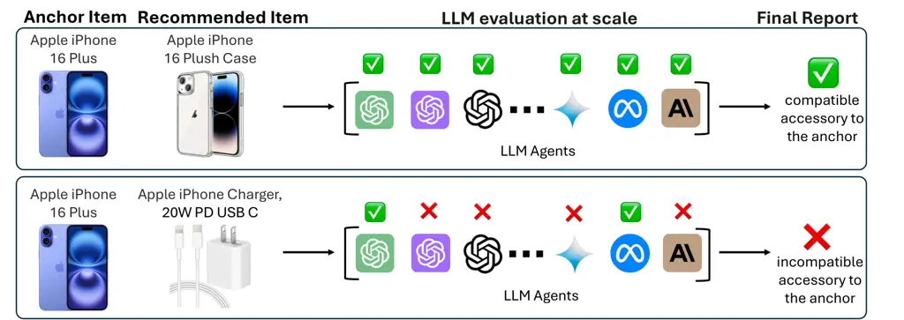
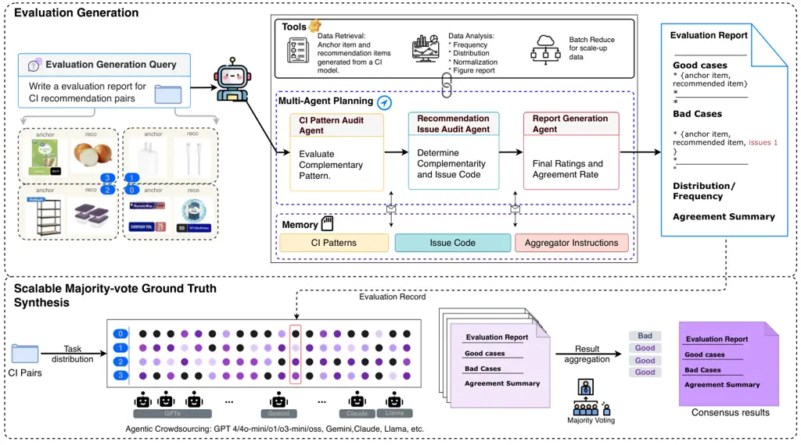
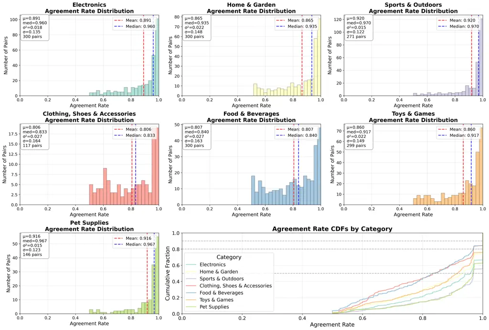
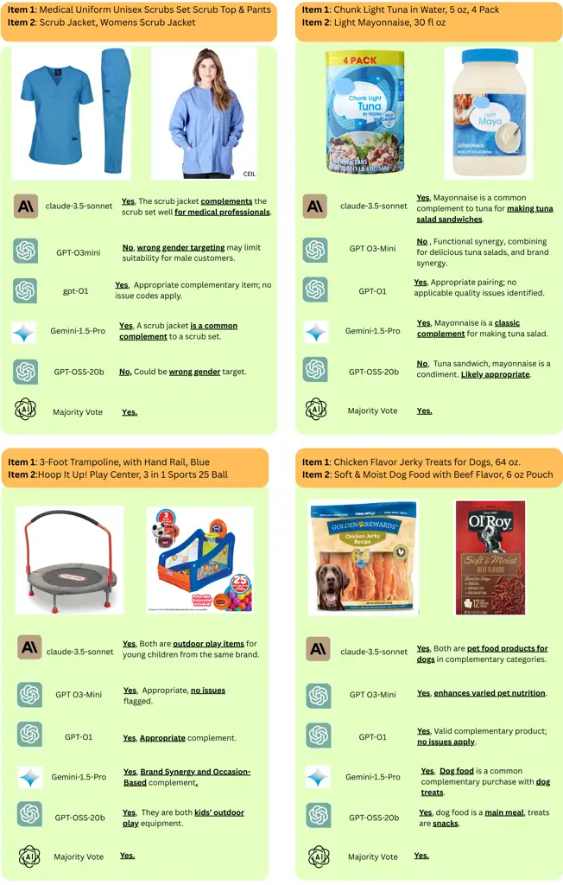

\workshoptitle

Evaluating the Evolving LLM Lifecycle

# No-Human in the Loop: Agentic Evaluation at Scale for Recommendation

Tao Zhang ^(†)^(†)thanks: Equal contribution Affiliation: Walmart Global
Tech Affiliation: Sunnyvale, California, USA
Email: [tao.zhang0@walmart.com](mailto:)    Kehui Yao¹¹footnotemark: 1
Affiliation: Walmart Global Tech Affiliation: Sunnyvale, California, USA
Email: [kehui.yao@walmart.com](mailto:)    Luyi Ma¹¹footnotemark: 1
Affiliation: Walmart Global Tech Affiliation: Sunnyvale, California, USA
Email: [luyi.ma@walmart.com](mailto:)    Jiao Chen¹¹footnotemark: 1
Affiliation: Walmart Global Tech Affiliation: Sunnyvale, California, USA
Email: [jiao.chen0@walmart.com](mailto:)    Reza Yousefi
Maragheh¹¹footnotemark: 1 Affiliation: Walmart Global Tech
Affiliation: Sunnyvale, California, USA
Email: [Reza.Yousefimaragheh@walmart.com](mailto:)    Kai
Zhao¹¹footnotemark: 1 Affiliation: Walmart Global Tech
Affiliation: Sunnyvale, California, USA
Email: [kai.zhao@walmart.com](mailto:)    Jianpeng Xu
Affiliation: Walmart Global Tech Affiliation: Sunnyvale, California, USA
Email: [jianpeng.xu@walmart.com](mailto:)    Evren Korpeoglu
Affiliation: Walmart Global Tech Affiliation: Sunnyvale, California, USA
Email: [EKorpeoglu@walmart.com](mailto:)    Sushant Kumar
Affiliation: Walmart Global Tech Affiliation: Sunnyvale, California, USA
Email: [sushant.kumar@walmart.com](mailto:)    Kannan Achan
Affiliation: Walmart Global Tech Affiliation: Sunnyvale, California, USA
Email: [kannan.achan@walmart.com](mailto:)

###### Abstract

Evaluating large language models (LLMs) as judges is increasingly
critical for building scalable and trustworthy evaluation pipelines. We
present ScalingEval, a large-scale benchmarking study that
systematically compares 36 LLMs—including GPT, Gemini, Claude, and
Llama—across multiple product categories using a consensus-driven
evaluation protocol. Our multi-agent framework aggregates pattern audits
and issue codes into ground-truth labels via scalable majority voting,
enabling reproducible comparison of LLM evaluators without human
annotation. Applied to large-scale complementary-item recommendation,
the benchmark uncovers several key takeaways: (i) Anthropic
Claude-3.5-sonnet achieves the highest decision confidence, (ii)
Gemini-1.5-pro offers the best overall performance across categories,
(iii) GPT-4o provides the most favorable latency–accuracy-cost
trade-off, and (iv) GPT-OSS-20B leads among open-source models.
Category-level analysis further reveals strong consensus in structured
domains (Electronics, Sports) but persistent disagreement in lifestyle
categories (Clothing, Food). Together, these findings establish
ScalingEval as a reproducible benchmark and evaluation protocol for
LLMs-as-judges, offering both methodological advances and actionable
insights into scaling, reliability, and model family trade-offs.

## 1 Introduction

Large language models (LLMs) are rapidly emerging as evaluation engines
across domains ranging from dialogue systems to recommender models. As
their use expands, a central question arises: can LLMs reliably serve as
judges at scale, and how do different families compare in accuracy,
efficiency, and robustness? This question is especially pressing for
high-stakes applications such as e-commerce recommendation, where
evaluation quality directly impacts user trust and revenue.

Complementary-Item Recommendation (CIR) provides a representative
testbed for this challenge \[1, 2\]. These models surface add-on
items—e.g., suggesting a phone case with a smartphone—that must be
complementary rather than substitutes or irrelevant products. Ensuring
correctness requires capturing subtle linguistic and contextual cues,
such as “family-size vs. single-serve” or “battery-powered vs. corded.”
Traditional heuristics based on category overlap or co-purchase
statistics remain computationally efficient, but they suffer from
contextual blind spots and static taxonomies that cannot adapt to
evolving product trends \[3\]. As a result, CIR evaluations often
produce false positives and false negatives, degrading recommendation
quality.

Recent advances in LLMs promise a path forward. Their contextual
reasoning and linguistic sensitivity are well suited to detecting
nuanced product relationships. However, two obstacles remain: (i)
naïvely applying a single LLM across millions of item pairs is
prohibitively expensive, and (ii) little is known about how judgments
vary across model families, sizes, and settings. Without systematic
benchmarks, it is unclear which models are most trustworthy, which
categories are most challenging, or how agreement scales with model
diversity.



Figure 1: LLM-Agentic Evaluation at Scale without human in the loop

To address these gaps, we introduce ScalingEval, a large-scale,
multi-agent benchmarking framework that positions LLMs themselves as
judges. ScalingEval decomposes the evaluation task into specialized
audit agents, integrates conflict resolution with strict prioritization
rules, and synthesizes consensus ground truth via majority voting across
36 models spanning closed-source (GPT-4o, Claude-3.5-sonnet,
Gemini-1.5/2.5) and open-source families (GPT-OSS-20B, Llama-3
variants). Applied to Walmart-scale CIR data across multiple product
categories, ScalingEval reveals several key findings: (i)
Claude-3.5-sonnet delivers the highest decision-making confidence
($`\sim`$99%), (ii) Gemini-1.5-pro achieves the best overall accuracy,
coverage and latency, (iii) GPT-4o offers the most favorable
latency–accuracy–cost trade-off, and (iv) GPT-OSS-20B emerges as the
strongest open-source model. Moreover, structured domains such as
Electronics and Sports exhibit strong cross-model agreement, while
lifestyle categories such as Food and Clothing remain challenging,
underscoring the need for domain-sensitive evaluation protocols.

By combining agentic orchestration with systematic benchmarking,
ScalingEval contributes both a reproducible methodology for
LLM-as-a-judge evaluation and empirical insights into scaling behaviors,
trade-offs, and agreement dynamics. Beyond CIR, the framework provides a
template for lifecycle evaluation of LLMs, supporting future research on
emergent abilities, domain robustness, and cross-model reliability.

## 2 Methodology



Figure 2: The overview of ScalingEval framework.

In this section, we propose ScalingEval in Figure 2, an LLM-based
agentic framework for evaluating CIR. The framework orchestrates
multiple specialized agents to conduct structured audits, detect common
evaluation issues, and resolve disagreements through consensus
mechanisms. By automating both ground-truth generation and multi-model
comparison, ScalingEval enables large-scale, low-cost, and reproducible
assessment without relying on human annotators.

### 2.1 Agentic Evaluation Report Generation

A user query (e.g., “generate a CI report”) triggers a multi-agent
pipeline that audits item pairs, resolves conflicts, and aggregates
results, ensuring scalable and interpretable evaluation over datasets
$`\mathbf{D}={(item_{i}^{a},,item_{i}^{r})}_{i=1}^{N}`$. Both acceptance
and rejection rubrics are defined to capture valid and invalid
relations.

CI Pattern Audit. A state-of-the-art LLM proposes CI patterns
$`\mathbf{P}={p_{i}}_{i=1}^{M}`$, validated via empirical use cases.
Each pair $`(item^{a},item^{r})`$ is mapped to one or more patterns:

```math
out_{\text{pattern\_audit}}=f_{\text{pattern\_audit}}(item^{a},item^{r})=\{(item^{a},item^{r}):[p_{j}]\},\hskip 10.00002pt[p_{j}]\in\mathbf{P}.
```

Recommendation Issue Audit. Using predefined issue codes
$`\mathbf{S}={s_{i}}_{i=1}^{K}`$, the agent identifies reasons pairs may
fail:

```math
out_{\text{issue\_audit}}=f_{\text{issue\_audit}}(item^{a},item^{r})=\{(item^{a},item^{r}):[s_{j}]\},\hskip 10.00002pt[s_{j}]\in\mathbf{S},
```

Report Generation. Passed pairs are split into chunks $`C_{i}`$ of size
$`k`$,

```math
D=\bigcup_{i=1}^{M}C_{i},\hskip 10.00002ptC_{i}=\{x_{(i-1)k+1},\dots,x_{ik}\},\hskip 10.00002ptM=\left\lceil\tfrac{N}{k}\right\rceil,\hskip 10.00002ptr_{i}=f_{\text{LLM}}(C_{i})
```

where each $`r_{i}`$ is a summary containing counts, pattern breakdowns,
flagged issues, and conflicts:
$`r_{i}=\{t_{i},c_{i},n_{i},P_{i},I_{i},q_{i},a_{i}\}.`$

Here, $`t_{i}`$: total pairs in chunk; $`c_{i}`$: complementary count;
$`n_{i}`$: non-complementary count; $`P_{i}`$: CI pattern; $`I_{i}`$:
flagged issue codes; $`q_{i}`$: conflicted pairs; $`a_{i}`$: agreement
score. Aggregation yields

```math
R=\{T=\sum_{i=1}^{M}t_{i},C=\sum_{i=1}^{M}c_{i},N=\sum_{i=1}^{M}n_{i},Q=\sum_{i=1}^{M}q_{i},P=\bigoplus_{i=1}^{M}P_{i},I=\bigoplus_{i=1}^{M}I_{i},A=\bigoplus_{i=1}^{M}a_{i}\}
```

with the constraint: $`C+N=T.`$

### 2.2 Scalable Majority-vote Ground Truth Synthesis

As shown in the bottom of Figure 2, we strengthen report reliability
through multi-agent verification and majority-vote synthesis. Multiple
LLMs (e.g., GPT, Gemini, LLaMA) independently run the evaluation process
in Section 2.1, producing judgments for each anchor–recommendation pair.

Majority-Vote Ground Truth Synthesis collects individual judgments into
a structured matrix where each row corresponds to an
anchor–recommendation pair and each column corresponds to an agent’s
decision. Conflicting outputs are resolved using majority voting. If
disagreement persists, a conflict-resolution policy (e.g., (Reject $`>`$
Major $`>`$ Minor $`>`$ Good) ensures conservative decisions.

Judgement Aggregation The consensus-based labels are further aggregated
to measure agreement levels across agents. Disagreements are logged as
conflicted pairs, providing transparency into model uncertainty and
dataset ambiguity. The voting step ensures that systematic biases from
any single LLM are reduced, and stability is achieved through collective
reasoning. Among multiple candidate reports generated, the Consensus
Report is selected for completeness and consistency across the dataset.

## 3 Experimental Results

This section identifies which LLM offers the best balance between
accuracy, coverage, and efficiency, while additional details on our
Majority-Voting agreements, case study, experimental setup and demo
prompt design are provided in the Appendix.

Table 1 summarizes model family performance, reporting average accuracy
and coverage across three temperature settings. First, let’s answer the
best performer in accuracy vs. latency trade-offs in closed-source
group: (1) High accuracy, large latency: gpt-o1 model; (2) Balanced
performance: gemini-1.5-pro, gpt-4o; (3) Short latency, lower accuracy:
gemini-1.5-flash, claude-3.5-sonnet. Gemini-1.5-pro is the top performer
overall, gpt-4o also offers balanced speed and accuracy but cost less,
and GPT-OSS leads open-source models with mid-tier closed-source
performance at lower cost. For category-specific performance,
gemini-1.5-pro leads in 4 out of 5 categories. GPT-o1 excels in Clothes
& Shoes, while gpt-4o provides balanced performance with minimal
latency. By domain,Sports & Outdoors and Food & Beverages reach the
highest accuracy and coverage. Electronics and Home & Garden show steady
results across top models. Clothes & Shoes stands out with unique
patterns, suggesting room for further gains.

|                    |          |          |             |          |               |          |                  |          |                |          |                  |          |           |           |
| ------------------ | -------- | -------- | ----------- | -------- | ------------- | -------- | ---------------- | -------- | -------------- | -------- | ---------------- | -------- | --------- | --------- |
| LLM                | Overall  |          | Electronics |          | Home & Garden |          | Sport & Outdoors |          | Closes & Shoes |          | Food & Beverages |          | Latency   | Cost/pair |
|                    | Accuracy | Coverage | Accuracy    | Coverage | Accuracy      | Coverage | Accuracy         | Coverage | Accuracy       | Coverage | Accuracy         | Coverage |           |           |
| Closed Source      |          |          |             |          |               |          |                  |          |                |          |                  |          |           |           |
| gpt-4o             | 60.13    | 64.63    | 58.91       | 63.63    | 54.44         | 57.41    | 60.89            | 62.09    | 78.15          | 79.83    | 65.30            | 74.63    | 1x        | 1x        |
| gpt-4o-mini        | 34.49    | 37.04    | 36.36       | 38.91    | 30.37         | 31.85    | 18.12            | 19.76    | 23.53          | 28.57    | 54.85            | 58.58    | 1.5x      | 1x        |
| gpt-o1             | 67.18    | 68.81    | 77.09       | 81.82    | 67.41         | 70.37    | 20.97            | 22.58    | 82.35          | 89.91    | 74.63            | 79.85    | 4.9x      | 6.0x      |
| gpt-o3-mini        | 39.40    | 41.67    | 39.27       | 40.00    | 31.11         | 33.33    | 26.62            | 27.42    | 53.78          | 58.82    | 50.00            | 52.61    | 3.4x      | 1.2x      |
| gemini-2.5-pro     | 57.15    | 62.64    | 57.45       | 62.18    | 57.41         | 68.81    | 58.46            | 62.50    | 62.23          | 72.27    | 58.21            | 73.51    | 6.6x      | 3x        |
| gemini-2.0-flash   | 19.55    | 22.25    | 20.91       | 27.64    | 17.04         | 18.89    | 14.52            | 15.32    | 12.61          | 18.49    | 22.76            | 28.93    | 0.5x      | 0.03x     |
| gemini-1.5-pro     | 76.63    | 87.14    | 80.36       | 85.45    | 69.26         | 81.85    | 87.50            | 91.94    | 63.87          | 68.91    | 80.60            | 95.90    | 1.1x      | 1.5x      |
| gemini-1.5-flash   | 34.56    | 40.58    | 36.36       | 41.45    | 33.33         | 39.26    | 18.95            | 26.61    | 20.01          | 21.85    | 53.73            | 61.94    | 0.4x      | 0.03x     |
| claude-3.5-sonnet  | 31.08    | 31.58    | 33.45       | 34.19    | 25.56         | 25.93    | 19.35            | 19.35    | 31.10          | 32.78    | 40.67            | 40.67    | 0.9x      | 1.5x      |
| Open Source        |          |          |             |          |               |          |                  |          |                |          |                  |          |           |           |
| gpt-oss-20b        | 42.32    | 52.60    | 38.55       | 46.18    | 42.96         | 52.96    | 39.11            | 47.58    | 38.66          | 50.42    | 48.89            | 56.34    | 5.9x\_(o) | 0.0x      |
| llama3-3b-instruct | 14.32    | 15.43    | 17.82       | 20.00    | 12.96         | 13.70    | 7.26             | 8.06     | 11.76          | 12.60    | 19.03            | 20.52    | 1.7x\_(o) | 0.0x      |
| llama3-8b-instruct | 17.58    | 18.14    | 19.64       | 20.72    | 13.70         | 14.07    | 10.89            | 11.29    | 13.45          | 13.45    | 26.12            | 26.12    | 1x\_(o)   | 0.0x      |

Table 1: Overall performance on all LLMs across multiple product
categories.

Table 2 reports confidence on pairs with definitive judgments (“Good” or
“Bad”), excluding conflicts and unknowns. Results form clear tiers:
Claude-3.5-sonnet leads (98.4–99.2%), followed by Llama-3-8B-Instruct
(95.9–97.5%). GPT-4o (93.1–95.1%) balances cost and confidence, while o1
models (94.3–95.5%) deliver strong confidence with top coverage. Gemini
models (87.9–88.6%) trade confidence for breadth, and
Llama-3-3B-Instruct achieves efficient but lower coverage (86.3–93.3%).
Several families (Gemini, Claude-3.5-sonnet, o1, o3) show minimal
sensitivity to temperature.

|                                      |            |       |             |          |       |           |                                                |
| ------------------------------------ | ---------- | ----- | ----------- | -------- | ----- | --------- | ---------------------------------------------- |
| Model                                | Confidence | Kappa | Issue Match | Coverage | F1    | Agreement | Top Categories Performance                     |
| anthropic_claude-3.5-sonnet_temp_0.8 | 99.20      | 98.40 | 99.20       | 31.20    | 99.20 | 99.20     | Electronics: 98.20, Sports: 97.80, Pets: 97.50 |
| anthropic_claude-3.5-sonnet_temp_0.6 | 98.80      | 97.60 | 98.80       | 31.60    | 98.80 | 98.80     | Electronics: 98.00, Sports: 97.50, Pets: 97.20 |
| anthropic_claude-3.5-sonnet_temp_0.4 | 98.40      | 96.70 | 98.40       | 31.60    | 98.40 | 98.40     | Electronics: 97.80, Sports: 97.20, Pets: 96.80 |
| meta_Llama_3_8B_Instruct_temp_0.6    | 97.50      | 95.00 | 97.50       | 18.10    | 97.50 | 97.50     | Electronics: 96.50, Sports: 95.80, Pets: 95.20 |
| meta_Llama_3_8B_Instruct_temp_0.4    | 97.40      | 94.90 | 97.40       | 17.60    | 97.40 | 97.40     | Electronics: 96.20, Sports: 95.50, Pets: 94.80 |
| meta_Llama_3_8B_Instruct_temp_0.8    | 95.90      | 91.80 | 95.90       | 18.70    | 95.90 | 95.90     | Electronics: 95.80, Sports: 94.20, Pets: 93.50 |
| openai_o1_temp_0.6                   | 95.50      | 91.00 | 95.50       | 68.80    | 95.50 | 95.50     | Electronics: 94.50, Sports: 93.80, Pets: 93.20 |
| openai_gpt-4o-mini_temp_0.4          | 95.10      | 90.10 | 95.10       | 36.50    | 95.10 | 95.10     | Electronics: 94.20, Sports: 93.50, Pets: 92.80 |
| openai_o1_temp_0.8                   | 94.40      | 88.80 | 94.40       | 71.40    | 94.40 | 94.40     | Electronics: 93.80, Sports: 93.20, Pets: 92.50 |
| openai_o1_temp_0.4                   | 94.30      | 88.70 | 94.30       | 72.50    | 94.30 | 94.30     | Electronics: 93.50, Sports: 92.80, Pets: 92.20 |
| openai_gpt-4o-mini_temp_0.6          | 93.90      | 87.80 | 93.90       | 37.00    | 93.90 | 93.90     | Electronics: 93.20, Sports: 92.50, Pets: 91.80 |
| openai_gpt-4o_temp_0.4               | 93.90      | 87.80 | 93.90       | 64.10    | 93.90 | 93.90     | Electronics: 93.00, Sports: 92.20, Pets: 91.50 |
| openai_gpt-4o-mini_temp_0.8          | 93.80      | 87.60 | 93.80       | 36.30    | 93.80 | 93.80     | Electronics: 92.80, Sports: 92.00, Pets: 91.20 |
| openai_o3-mini_temp_0.6              | 93.70      | 87.30 | 93.70       | 41.70    | 93.70 | 93.70     | Electronics: 92.50, Sports: 91.80, Pets: 91.00 |
| openai_gpt-4o_temp_0.6               | 93.50      | 87.10 | 93.50       | 64.60    | 93.50 | 93.50     | Electronics: 92.20, Sports: 91.50, Pets: 90.80 |
| openai_o3-mini_temp_0.8              | 93.50      | 87.00 | 93.50       | 41.60    | 93.50 | 93.50     | Electronics: 92.00, Sports: 91.20, Pets: 90.50 |
| openai_o3-mini_temp_0.4              | 93.40      | 86.90 | 93.40       | 43.10    | 93.40 | 93.40     | Electronics: 91.80, Sports: 91.00, Pets: 90.20 |
| llama_3_2_3B_Instruct_temp_0.6       | 93.30      | 86.70 | 93.30       | 15.40    | 93.30 | 93.30     | Electronics: 91.50, Sports: 90.80, Pets: 90.00 |
| openai_gpt-4o_temp_0.8               | 93.10      | 86.20 | 93.10       | 64.20    | 93.10 | 93.10     | Electronics: 91.20, Sports: 90.50, Pets: 89.80 |
| llama_3_2_3B_Instruct_temp_0.4       | 92.80      | 85.60 | 92.80       | 13.40    | 92.80 | 92.80     | Electronics: 90.80, Sports: 90.20, Pets: 89.50 |
| gemini_2_0_flash_temp_0.8            | 92.20      | 84.30 | 92.20       | 21.40    | 92.20 | 92.20     | Electronics: 90.50, Sports: 89.80, Pets: 89.20 |
| gemini_2_0_flash_temp_0.6            | 89.60      | 79.20 | 89.60       | 22.30    | 89.60 | 89.60     | Electronics: 89.20, Sports: 88.50, Pets: 87.80 |
| gemini_2_0_flash_temp_0.4            | 88.60      | 77.20 | 88.60       | 21.50    | 88.60 | 88.60     | Electronics: 88.80, Sports: 88.20, Pets: 87.50 |
| gemini_gemini-2.5-pro_temp_0.6       | 88.60      | 77.20 | 88.60       | 62.60    | 88.60 | 88.60     | Electronics: 88.50, Sports: 87.80, Pets: 87.20 |
| gemini_gemini-2.5-pro_temp_0.8       | 88.30      | 76.60 | 88.30       | 66.60    | 88.30 | 88.30     | Electronics: 88.20, Sports: 87.50, Pets: 86.80 |
| gemini_1_5_pro_temp_0.6              | 88.10      | 76.20 | 88.10       | 87.10    | 88.10 | 88.10     | Electronics: 87.80, Sports: 87.20, Pets: 86.50 |
| gemini_gemini-2.5-pro_temp_0.4       | 88.10      | 76.20 | 88.10       | 64.90    | 88.10 | 88.10     | Electronics: 87.50, Sports: 86.80, Pets: 86.20 |
| gemini_1_5_pro_temp_0.8              | 88.10      | 76.20 | 88.10       | 86.40    | 88.10 | 88.10     | Electronics: 87.20, Sports: 86.50, Pets: 85.80 |
| gemini_1_5_pro_temp_0.4              | 87.90      | 75.80 | 87.90       | 87.70    | 87.90 | 87.90     | Electronics: 86.80, Sports: 86.20, Pets: 85.50 |
| llama_3_2_3B_Instruct_temp_0.8       | 86.30      | 72.50 | 86.30       | 18.70    | 86.30 | 86.30     | Electronics: 85.50, Sports: 84.80, Pets: 84.20 |
| gemini_1_5_flash_temp_0.6            | 85.70      | 71.50 | 85.70       | 40.60    | 85.70 | 85.70     | Electronics: 85.20, Sports: 84.50, Pets: 83.80 |
| gemini_1_5_flash_temp_0.8            | 85.50      | 71.00 | 85.50       | 40.40    | 85.50 | 85.50     | Electronics: 84.80, Sports: 84.20, Pets: 83.50 |
| gemini_1_5_flash_temp_0.4            | 85.40      | 70.90 | 85.40       | 40.20    | 85.40 | 85.40     | Electronics: 84.50, Sports: 83.80, Pets: 83.20 |
| gpt-oss-20b_temp_0.6                 | 81.80      | 63.60 | 81.80       | 52.60    | 81.80 | 81.80     | Electronics: 82.50, Sports: 81.80, Pets: 81.20 |
| gpt-oss-20b_temp_0.8                 | 78.50      | 57.00 | 78.50       | 52.90    | 78.50 | 78.50     | Electronics: 79.20, Sports: 78.50, Pets: 77.80 |
| gpt-oss-20b_temp_0.4                 | 77.70      | 55.40 | 77.70       | 54.20    | 77.70 | 77.70     | Electronics: 78.80, Sports: 78.20, Pets: 77.50 |

Table 2: Model performance by Confidence (desc.) across metrics and
categories

## 4 Conclusion

ScalingEval shows that large language models can act as reliable,
no-human-in-the-loop judges for complementary-item recommendation by
combining pattern audits, issue detection, and multi-agent consensus.
Our results reveal clear performance tiers—highlighting Gemini-1.5-Pro
as most accurate and efficient, Claude-3.5-Sonnet as most confident, and
GPT-OSS-20B as the strongest open-source option—offering a path toward
scalable, trustworthy evaluation of recommender systems.

## References

- \[1\] Junheng Hao, Tong Zhao, Jin Li, Xin Luna Dong, Christos
  Faloutsos, Yizhou Sun, and Wei Wang. P-companion: A principled
  framework for diversified complementary product recommendation. In
  _Proceedings of the 29th ACM International Conference on Information &
  Knowledge Management_, pages 2517–2524, 2020.
- \[2\] Luyi Ma, Jianpeng Xu, Jason HD Cho, Evren Korpeoglu, Sushant
  Kumar, and Kannan Achan. Neat: a label noise-resistant complementary
  item recommender system with trustworthy evaluation. In _2021 IEEE
  International Conference on Big Data (Big Data)_, pages 469–479.
  IEEE, 2021.
- \[3\] Kai Sugahara, Chihiro Yamasaki, and Kazushi Okamoto. Is it
  really complementary? revisiting behavior-based labels for
  complementary recommendation. In _Proceedings of the 18th ACM
  Conference on Recommender Systems_, pages 1091–1095, 2024.
- \[4\] Josh Achiam, Steven Adler, Sandhini Agarwal, Lama Ahmad, Ilge
  Akkaya, Florencia Leoni Aleman, Diogo Almeida, Janko Altenschmidt, Sam
  Altman, Shyamal Anadkat, et al. Gpt-4 technical report. _arXiv
  preprint arXiv:2303.08774_, 2023.
- \[5\] Aaron Hurst, Adam Lerer, Adam P Goucher, Adam Perelman, Aditya
  Ramesh, Aidan Clark, AJ Ostrow, Akila Welihinda, Alan Hayes, Alec
  Radford, et al. Gpt-4o system card. _arXiv preprint
  arXiv:2410.21276_, 2024.
- \[6\] Aaron Jaech, Adam Kalai, Adam Lerer, Adam Richardson, Ahmed
  El-Kishky, Aiden Low, Alec Helyar, Aleksander Madry, Alex Beutel, Alex
  Carney, et al. Openai o1 system card. _arXiv preprint
  arXiv:2412.16720_, 2024.
- \[7\] METR. Details about metr’s preliminary evaluation of claude 3.5
  sonnet.
  [https://metr.github.io//autonomy-evals-guide/claude-3-5-sonnet-report/](https://metr.github.io//autonomy-evals-guide/claude-3-5-sonnet-report/),
  10 2024.
- \[8\] Gheorghe Comanici, Eric Bieber, Mike Schaekermann, Ice Pasupat,
  Noveen Sachdeva, Inderjit Dhillon, Marcel Blistein, Ori Ram, Dan
  Zhang, Evan Rosen, et al. Gemini 2.5: Pushing the frontier with
  advanced reasoning, multimodality, long context, and next generation
  agentic capabilities. _arXiv preprint arXiv:2507.06261_, 2025.
- \[9\] Gemini Team, Petko Georgiev, Ving Ian Lei, Ryan Burnell, Libin
  Bai, Anmol Gulati, Garrett Tanzer, Damien Vincent, Zhufeng Pan, Shibo
  Wang, et al. Gemini 1.5: Unlocking multimodal understanding across
  millions of tokens of context. _arXiv preprint
  arXiv:2403.05530_, 2024.
- \[10\] Gemini Team, Rohan Anil, Sebastian Borgeaud, Jean-Baptiste
  Alayrac, Jiahui Yu, Radu Soricut, Johan Schalkwyk, Andrew M Dai, Anja
  Hauth, Katie Millican, et al. Gemini: a family of highly capable
  multimodal models. _arXiv preprint arXiv:2312.11805_, 2023.
- \[11\] Abhimanyu Dubey, Abhinav Jauhri, Abhinav Pandey, Abhishek
  Kadian, Ahmad Al-Dahle, Aiesha Letman, Akhil Mathur, Alan Schelten,
  Amy Yang, Angela Fan, et al. The llama 3 herd of models. _arXiv
  e-prints_, pages arXiv–2407, 2024.
- \[12\] Lianmin Zheng, Wei-Lin Chiang, Ying Sheng, Siyuan Zhuang,
  Zhanghao Wu, Yonghao Zhuang, Zi Lin, Zhuohan Li, Dacheng Li, Eric
  Xing, et al. Judging llm-as-a-judge with mt-bench and chatbot arena.
  _Advances in neural information processing systems_,
  36:46595–46623, 2023.
- \[13\] Wei-Lin Chiang, Lianmin Zheng, Ying Sheng, Anastasios Nikolas
  Angelopoulos, Tianle Li, Dacheng Li, Banghua Zhu, Hao Zhang, Michael
  Jordan, Joseph E Gonzalez, et al. Chatbot arena: An open platform for
  evaluating llms by human preference. In _Forty-first International
  Conference on Machine Learning_, 2024.
- \[14\] Seungone Kim, Jamin Shin, Yejin Cho, Joel Jang, Shayne Longpre,
  Hwaran Lee, Sangdoo Yun, Seongjin Shin, Sungdong Kim, James Thorne,
  et al. Prometheus: Inducing fine-grained evaluation capability in
  language models. In _The Twelfth International Conference on Learning
  Representations_, 2023.
- \[15\] Seungone Kim, Juyoung Suk, Shayne Longpre, Bill Yuchen Lin,
  Jamin Shin, Sean Welleck, Graham Neubig, Moontae Lee, Kyungjae Lee,
  and Minjoon Seo. Prometheus 2: An open source language model
  specialized in evaluating other language models. _arXiv preprint
  arXiv:2405.01535_, 2024.
- \[16\] Yann Dubois, Balázs Galambosi, Percy Liang, and Tatsunori B
  Hashimoto. Length-controlled alpacaeval: A simple way to debias
  automatic evaluators. _arXiv preprint arXiv:2404.04475_, 2024.
- \[17\] Jiawei Gu, Xuhui Jiang, Zhichao Shi, Hexiang Tan, Xuehao Zhai,
  Chengjin Xu, Wei Li, Yinghan Shen, Shengjie Ma, Honghao Liu, et al. A
  survey on llm-as-a-judge. _arXiv preprint arXiv:2411.15594_, 2024.
- \[18\] Reza Yousefi Maragheh and Yashar Deldjoo. The future is
  agentic: Definitions, perspectives, and open challenges of multi-agent
  recommender systems. _arXiv preprint arXiv:2507.02097_, 2025.
- \[19\] Reza Yousefi Maragheh, Pratheek Vadla, Priyank Gupta, Kai Zhao,
  Aysenur Inan, Kehui Yao, Jianpeng Xu, Praveen Kanumala, Jason Cho, and
  Sushant Kumar. Arag: Agentic retrieval augmented generation for
  personalized recommendation. _arXiv preprint arXiv:2506.21931_, 2025.
- \[20\] Jonathan L Herlocker, Joseph A Konstan, Loren G Terveen, and
  John T Riedl. Evaluating collaborative filtering recommender systems.
  _ACM Transactions on Information Systems (TOIS)_, 22(1):5–53, 2004.
- \[21\] Asela Gunawardana, Guy Shani, and Sivan Yogev. Evaluating
  recommender systems. In _Recommender systems handbook_, pages 547–601.
  Springer, 2012.
- \[22\] Sean M McNee, John Riedl, and Joseph A Konstan. Being accurate
  is not enough: how accuracy metrics have hurt recommender systems. In
  _CHI’06 extended abstracts on Human factors in computing systems_,
  pages 1097–1101, 2006.
- \[23\] Rocío Cañamares, Pablo Castells, and Alistair Moffat. Offline
  evaluation options for recommender systems. _Information Retrieval
  Journal_, 23(4):387–410, 2020.
- \[24\] Pablo Castells and Alistair Moffat. Offline recommender system
  evaluation: Challenges and new directions. _AI magazine_,
  43(2):225–238, 2022.
- \[25\] Maurizio Ferrari Dacrema, Paolo Cremonesi, and Dietmar Jannach.
  Are we really making much progress? a worrying analysis of recent
  neural recommendation approaches. In _Proceedings of the 13th ACM
  conference on recommender systems_, pages 101–109, 2019.
- \[26\] Alexander Philip Dawid and Allan M Skene. Maximum likelihood
  estimation of observer error-rates using the em algorithm. _Journal of
  the Royal Statistical Society: Series C (Applied Statistics)_,
  28(1):20–28, 1979.
- \[27\] Jacob Whitehill, Ting-fan Wu, Jacob Bergsma, Javier Movellan,
  and Paul Ruvolo. Whose vote should count more: Optimal integration of
  labels from labelers of unknown expertise. _Advances in neural
  information processing systems_, 22, 2009.
- \[28\] David R Karger, Sewoong Oh, and Devavrat Shah. Budget-optimal
  task allocation for reliable crowdsourcing systems. _Operations
  Research_, 62(1):1–24, 2014.
- \[29\] Julian McAuley, Rahul Pandey, and Jure Leskovec. Inferring
  networks of substitutable and complementary products. In _Proceedings
  of the 21th ACM SIGKDD international conference on knowledge discovery
  and data mining_, pages 785–794, 2015.
- \[30\] Tobias Schnabel, Adith Swaminathan, Ashudeep Singh, Navin
  Chandak, and Thorsten Joachims. Recommendations as treatments:
  Debiasing learning and evaluation. In _international conference on
  machine learning_, pages 1670–1679. PMLR, 2016.
- \[31\] Adith Swaminathan, Akshay Krishnamurthy, Alekh Agarwal, Miro
  Dudik, John Langford, Damien Jose, and Imed Zitouni. Off-policy
  evaluation for slate recommendation. _Advances in Neural Information
  Processing Systems_, 30, 2017.

## Appendix A Experimental Setup

Datasets. We consider real-world customer behaviors from Walmart
e-commerce platform and sample data from seven major product categories:
(1) Electronics, (2) Sports & Outdoors, (3) Pet Supplies, (4) Home &
Garden, (5) Toys & Games, (6) Food & Beverages, and (7) Clothing &
Shoes. We analyze anchor-recommendation pairs where each pair consists
of a base product and a recommended complementary item, with a total of
1,745 pairs across all categories. The data includes evaluation results
from 36 different AI models across multiple temperature settings (0.4,
0.6, 0.8), covering major model families such as Anthropic Claude,
OpenAI GPT, Meta Llama, and Google Gemini. We also report the Agreement
Rate to indicate the model consensus complexity for each category: the
higher agreement rate means models show more consistent evaluation
patterns and clearer recommendation criteria in that dataset.

Implementation Details. We select a diverse set of 36 state-of-the-art
language models as the backbone models. The evaluation framework
processes each anchor-recommendation pair through all available models,
generating appropriateness judgments ("Good"/"Bad"/"Conflict"/"Unknown")
based on pattern recognition and audit results. For all LLM-related
methods, each experiment is evaluated on the complete dataset, with
results aggregated across temperature variations and model families. We
follow the majority voting approach for ground truth creation, requiring
60% agreement threshold from the top 25 models based on quality scores.
The system uses precision metrics to evaluate model performance,
calculating both overall precision and coverage across different product
categories. All the experiments with open-source models are conducted
with NVIDIA A100-SXM4-80GB$`\times`$2.

Evaluation Metrics. For each anchor-recommendation pair and the
associated model evaluations, we calculate agreement rates across all 36
models to construct the consensus labels, and the ground truth is
derived from majority voting among high-quality models. The evaluation
framework assesses model performance using three key precision metrics:
(1) Accuracy (accuracy across all pairs, counting undetermined/covered
pairs as incorrect), (2) Confidence (accuracy on pairs where models made
a determination), (3) Coverage (percentage of pairs that models made a
determination), (4) Kappa: cohen’s Kappa coefficient measuring agreement
between model predictions and ground truth, (5) Issue Match: how well
the model identifies specific issues in S with recommendations, and (6)
Agreement = (Number of models agreeing with majority) / (Total number of
valid models with determination "Good" or "Bad"). The system identifies
high-agreement categories like Sports & Outdoors (93.8%) and Electronics
(91.3%) versus challenging categories like Clothing & Shoes (84.2%) and
Food & Beverages (85.4%), providing insights into where recommendation
systems need improvement.

Base LLMs. Including 9 closed-source LLMs, that is,
GPT-4o/4o-mini/o1/o3-mini (\[4, 5, 6\]), Claude-3.5-sonnet (\[7\]),
Gemini-2.5-pro/2.0-flash/1.5-pro/1.5-flash (\[8, 9, 10\]), as well as 3
open-source LLMs, that is, gpt-oss-20b¹¹ 1
https://huggingface.co/openai/gpt-oss-120b, llama3-3b-instruct ²² 2
https://huggingface.co/meta-llama/Llama-3.2-3B-Instruct and
llama3-8b-instruct ³³ 3
https://huggingface.co/meta-llama/Meta-Llama-3-8B-Instruct \[11\].

## Appendix B Majority Voting Agreements

This section examines the effectiveness of majority-voting ground truth
synthesis as a consensus-based labeling approach that simulates human
annotation. The agreement rate distribution varies across categories, as
shown in Figure 3, highlighting differences in decision-making
complexity under majority voting.

The histogram plot provides a group view of agreement rate distributions
across all product categories. Bar height shows the number of pairs at
each agreement rate, while the distribution shape indicates variability:
left-skewed = lower agreement, right-skewed = higher agreement, and
bell-shaped = normal distribution around the mean. The distribution
analysis highlights distinct performance patterns across categories.
Sports & Outdoors and Pet Supplies show right-skewed distributions with
most pairs above 0.8, reflecting high agreement and low variability.
Electronics also demonstrates good agreement, concentrated above 0.7,
with moderate variability. Home & Garden and Toys & Games display
moderate right-skewed or balanced distributions, indicating consistent
but less concentrated agreement. In contrast, Clothing & Shoes and Food
& Beverages exhibit more spread-out distributions, reflecting moderate
agreement and higher variability.

The combined CDF (Cumulative Distribution Function) plot provides a
single, comprehensive view of agreement rate distributions across all
product categories. This visualization enables direct comparison of
model consensus patterns and performance across different product
domains. Steeper and right-shifted curves indicate stronger agreement,
while higher curves reflect better overall performance. In contrast,
left-shifted curves suggest lower agreement rates across pairs. Across
categories, Electronics, Sports & Outdoors, and Pet Supplies exhibit
steep, high curves, indicating strong agreement and top performance.
Lifestyle categories, including Clothing & Shoes and Food & Beverages,
show flatter, lower curves, reflecting weaker performance. Home & Garden
and Toys & Games, display intermediate patterns, balancing consistency
with moderate accuracy.



Figure 3: Different category agreement rate under pair frequency and
cumulative fraction.

## Appendix C Case Study

Figure 4 presents representative anchor–recommendation pairs across four
domains. In medical apparel, a scrub set paired with a scrub jacket was
consistently judged as complementary by Claude-3.5-sonnet and
Gemini-1.5-Pro, emphasizing professional usage, while open-source models
flagged possible gender-targeting issues. Similarly, in food and
beverages, tuna and mayonnaise were widely recognized as canonical
complements for tuna salad preparation, though GPT-OSS-20B expressed
uncertainty by treating mayonnaise as a condiment. In both cases,
majority voting resolved isolated disagreements, underscoring the
robustness of consensus-driven aggregation.

For toys and sports equipment, a trampoline and play center were
unanimously judged as valid complements, with rationales ranging from
brand synergy to functional overlap in outdoor play. In pet supplies,
however, pairing dog food with jerky treats revealed subtle
disagreements: some models highlighted complementarity in pet nutrition,
while others distinguished between staple meals and snacks.
Nevertheless, majority voting converged on a positive outcome. Overall,
these case studies highlight a consistent pattern: structured domains
with well-defined functional relationships (e.g., food preparation,
children’s toys) yield strong agreement, whereas lifestyle or
hierarchical categories (e.g., apparel, pet products) introduce more
model divergence. ScalingEval effectively mitigates such divergences,
producing stable, interpretable judgments without human annotation.



Figure 4: Example of item pairs from Clothing, Food, Toys, and Pet
Supplies and different LLM’s output evaluation response for them.

## Appendix D Related Work

Large language models (LLMs) have rapidly become _evaluation engines_
for open-ended tasks, motivating a growing body of work on
“LLM-as-a-judge” methods and their reliability. Benchmarks such as
MT-Bench and Chatbot Arena established that strong LLM judges can
approximate expert and crowd preferences using pairwise comparison
protocols, while also surfacing systematic biases such as verbosity and
position effects \[12, 13\]. Open evaluator models (e.g.,
Prometheus/Prometheus 2) further pursue transparent, rubric-driven
evaluation to improve reproducibility and cost \[14, 15\]. At the same
time, meta-evaluation studies and surveys caution that judge models may
favor their own generations, exhibit family-specific biases, and require
debiasing strategies (e.g., length-controlled scoring in AlpacaEval 2)
to align with human judgments \[16, 17\].

For recommender systems (RS), these developments are timely: evaluation
quality has long hinged on choices of protocol, metric, and data
construction \[18, 19\]. Classic works for recommendation system
evaluation distinguish offline from online A/B testing \[20, 21\],
highlights that accuracy of recommendation alone is insufficient for
user value \[22\], and documents how evaluation protocol choices and
dataset bias can mislead conclusions \[23, 24, 25\]. These suggest that
LLM-based judges can complement (rather than replace) established RS
evaluation by providing scalable, semantics-aware assessments when
protocols control for known biases.

Majority voting is a long-standing heuristic for synthesizing judgments;
foundational models such as \[26, 27\] improve on it by jointly
inferring instance difficulty and annotator expertise. Theoretical
analyses of task assignment and label aggregation further characterize
when and how redundancy and weighting outperform simple voting \[28\].
In recommender evaluation, aggregation issues surface both in human
studies (e.g., topical or task difficulty effects) and in the
construction of “ground truth” from behavioral logs, where co-purchase
signals can be confounded by substitutes, trends, or merchandising
\[29\]. For complementary-item recommendation (CIR) in particular,
recent work shows that co-purchase labels are often noisy proxies for
functional complementarity; frameworks like P-Companion explicitly
separate relevance and diversity, while NEAT proposes
label-noise-resistant modeling and trustworthy label generation, and
newer analyses revisit behavior-based labels against function-based
criteria \[1, 2, 3\]. These findings underscore that evaluation
pipelines benefit from “consensus mechanisms” that are robust to
annotator/model idiosyncrasies and to noisy behavioral signals which is
precisely the gap that principled label aggregation aims to fill.

ScalingEval positions LLMs themselves as judges and integrates them with
Recommender System-aware evaluation practice. Methodologically, we
decompose CIR auditing into specialized agents, enforce
conflict-resolution rules, and synthesize consensus labels across
diverse model families via scalable majority voting inspired by
classical aggregation (but applied to models rather than crowd workers)
\[26, 27, 28\]. This consensus is then used to benchmark 36 LLMs on
large-scale CIR data, yielding category-sensitive insights. Our
evaluation framework complements offline recommender system evaluation
\[30, 31\] with an “LLM-judge consensus” layer, and complements
LLM-judge literature by (i) grounding tasks in a real RS setting (CIR),
(ii) reporting cost–latency–accuracy trade-offs across families, and
(iii) providing a reproducible, auditor-orchestrated procedure that
mitigates known judge biases via multi-model aggregation and
category-level analysis.

## Appendix E A Demo of The Evaluation Report Generation

In this section, we outline the complete process for generating the
evaluation report and the details in prompt design. At the beginning,
the user starts a query "Write an evaluation report for CI
recommendation pairs" and provides a list of recommendations. CI pattern
audit prompt and the recommendation issue audit prompt are conducted on
each task pair. Finally, all pairs along with the audit decision in
previous steps are collected and summarized by the report generation
prompt into a well-structured analysis report.


