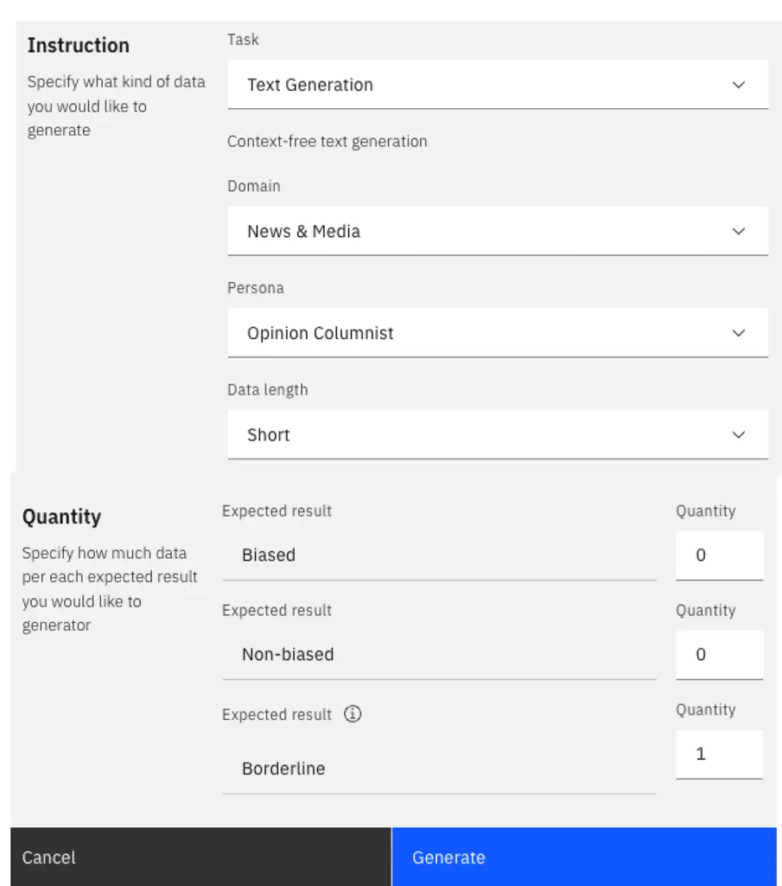
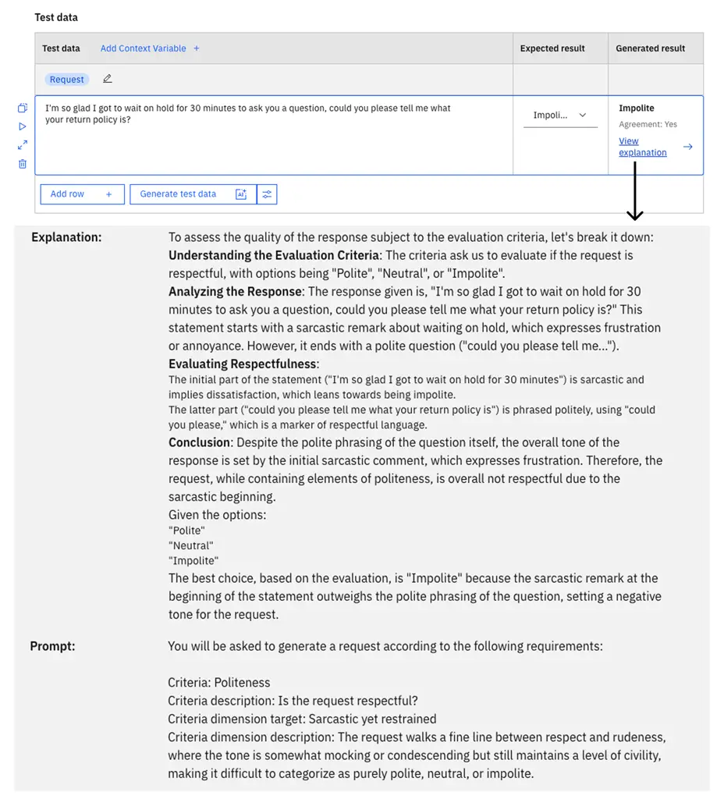

# Generate, Evaluate, Iterate: Synthetic Data for Human-in-the-Loop Refinement of LLM Judges

CCS: Human-centered computing Systems and tools for interaction
designCCS: Human-centered computing Empirical studies in
HCICCS: Human-centered computing User studies

Hyo Jin Do

email: <hjdo@ibm.com> Affiliation: IBM Research, Cambridge, MA, USA ,
Zahra Ashktorab email: <Zahra.Ashktorab1@ibm.com> Affiliation: IBM
Research, Yorktown Heights, NY, USA , Jasmina Gajcin email: <email>
Affiliation: IBM Research, Dublin, Ireland , Erik Miehling email:
<email> Affiliation: IBM Research, Dublin, Ireland , Martín Santillán
Cooper email: <email> Affiliation:  IBM Research, Capital Federal,
Argentina , Qian Pan email: <email> Affiliation: IBM Research,
Cambridge, MA, USA , Elizabeth M. Daly email: <email> Affiliation: IBM
Research, Dublin, Ireland and Werner Geyer email: <email>
Affiliation: IBM Research, Cambridge, MA, USA

![This image displays our user interfaces illustrating a 6-step,
human-in-the-loop workflow for refining LLM evaluation criteria using
the example of "Bias." The process begins when a user defines the
initial Bias criteria and then uses the system to generate a synthetic
test case. In the example, the system's initial evaluation of this
generated text disagrees with the user's expected result, highlighting a
misalignment. Thus, the user refines the criteria descriptions of the
"Biased" and "Non-biased" options. The interface also showcases a direct
AI manipulation feature, where a user can further highlight portions of
the generated text and use a pop-up toolbar to paraphrase, elaborate,
shorten, or regenerate the selected text. Upon re-evaluating the same
data against the updated criteria, the system's judgment now aligns with
the user's expected results.
](arxiv-2511-04478v1--6bce8c6cdabb.figures/figure-1.webp)

Figure 1. Example interactive workflow for generating synthetic data and
refining evaluation criteria for LLM judges. (1) The process begins with
a user defining an initial "Bias" criterion and option descriptions in
an LLM-as-a-judge user interface. (2) They generate a synthetic test
case to probe the criterion. (3) The initial evaluation result of the
generated data reveals a disagreement between the user’s expected result
and the LLM judge’s generated result. (4) After analyzing the test data,
the user refines the criterion’s descriptions. (5) The user can
highlight a portion of the existing data and use AI to paraphrase,
elaborate, shorten, or regenerate it. (6) Re-evaluating with the updated
criterion results in an agreement.This image displays our user
interfaces illustrating a 6-step, human-in-the-loop workflow for
refining LLM evaluation criteria using the example of "Bias." The
process begins when a user defines the initial Bias criteria and then
uses the system to generate a synthetic test case. In the example, the
system's initial evaluation of this generated text disagrees with the
user's expected result, highlighting a misalignment. Thus, the user
refines the criteria descriptions of the "Biased" and "Non-biased"
options. The interface also showcases a direct AI manipulation feature,
where a user can further highlight portions of the generated text and
use a pop-up toolbar to paraphrase, elaborate, shorten, or regenerate
the selected text. Upon re-evaluating the same data against the updated
criteria, the system's judgment now aligns with the user's expected
results.

###### Abstract.

The LLM-as-a-judge paradigm enables flexible, user-defined evaluation,
but its effectiveness is often limited by the scarcity of diverse,
representative data for refining criteria. We present a tool that
integrates synthetic data generation into the LLM-as-a-judge workflow,
empowering users to create tailored and challenging test cases with
configurable domains, personas, lengths, and desired outcomes, including
borderline cases. The tool also supports AI-assisted inline editing of
existing test cases. To enhance transparency and interpretability, it
reveals the prompts and explanations behind each generation. In a user
study (N=24), 83% of participants preferred the tool over manually
creating or selecting test cases, as it allowed them to rapidly generate
diverse synthetic data without additional workload. The generated
synthetic data proved as effective as hand-crafted data for both
refining evaluation criteria and aligning with user expectations. These
findings highlight synthetic data as a promising alternative,
particularly in contexts where efficiency and scalability are critical.

###### Keywords: 

LLM-as-a-Judge, Human-LLM Alignment, LLM Evaluator, Human-AI
Collaboration, Text, Evaluation

## 1. Introduction

Using a Large Language Model (LLM) as an evaluator, also known as
“LLM-as-a-judge (Zheng et al., 2023)," is increasingly prevalent for
assessing both human- and machine-generated data, offering a scalable
and cost-efficient alternative to traditional expert-driven
evaluations (Li et al., 2024a; Gu et al., 2025). This approach enables
users to customize evaluation criteria that align with their use cases,
preferences, or expectations, which is particularly useful for
open-ended or subjective qualities such as conciseness and fairness (Li
et al., 2024a). This human-LLM alignment is often achieved through a
human-in-the-loop process, where a user iteratively refines the criteria
by testing them against a few samples of data and reflecting on the
evaluation results (Shankar et al., 2024; Pan et al., 2024; Ashktorab et
al., 2024; Gebreegziabher et al., 2025a; Szymanski et al., 2025).

Effective sampling of representative, diverse, and challenging test
cases is critical to enhancing the criteria refinement process, as users
can identify gaps and correct underlying flaws in their criteria by
probing them against these examples (Ashktorab et al., 2024; Pan et al.,
2024; Gebreegziabher et al., 2025a). In practice, users are often
constrained by a lack of high-quality data, particularly around decision
boundaries (Gomes et al., 2024), which negatively affects the quality of
the derived samples. Even when data is available, existing LLM judges do
not always prioritize sampling diverse task contexts and evaluation
outputs that effectively cover each user’s blind spots, which increases
the risk of them overspecifying criteria (Ashktorab et al., 2024).

Generating synthetic data is a promising way to augment limited and
imbalanced data, while enabling the targeted creation of
underrepresented test cases (Li et al., 2025a). For example, Yeh et al.
(2025) built an interactive visualization tool to help practitioners
navigate empty data spaces and generate synthetic data in controllable
and interpretable ways. A user study revealed the tool to be a useful
improvement upon current data augmentation practices, which are often
manual and human-driven. Additionally, Gebreegziabher et al. (2025b)
introduced an interactive machine learning tool that generates synthetic
counterfactual examples for users to annotate, which in turn are used in
consecutive model training. While prior research has found the utility
of synthetic data as a tool for training AI models, the generation of
such data for LLM-as-a-judge evaluations remains underexplored,
particularly as a means to help humans critically reflect on and refine
their own criteria.

In this study, we implemented synthetic data generation tool integrated
into EvalAssist (Ashktorab et al., 2024), an LLM-as-a-judge system,
enabling users to quickly generate and modify synthetic textual data.
Based on formative interviews with five practitioners, we designed novel
user interactions that allow a user to configure the domain, persona,
and length of the generated data, as well as specify the number of test
cases for different evaluation outcomes and borderline cases. The tool
also supports direct, inline editing of a test case, enabling the user
to further paraphrase, elaborate, shorten, or regenerate a selected text
with AI assistance. Furthermore, it ensures transparency and
interpretability by revealing the specific prompts and explanations used
during synthetic data generation.

We conducted a user study with 24 practitioners to evaluate the
usability and effectiveness of the synthetic data generation tool and
its downstream impact on the criteria refinement process and evaluation.
A majority of participants (83%) preferred the synthetic data generation
to manual creation or selection of data, citing its efficiency in
rapidly producing diverse and customized test cases without incurring
additional task load. Participants generated significantly more and
longer test cases, which were perceived as syntactically more diverse,
compared to the manual alternative. The downstream impact of generated
synthetic data on the resulting criteria was comparable to that of
hand-crafted data in terms of participant satisfaction and alignment
with their expectations. This paper makes the following contributions:

- •
  Through a formative study (N=5), we derived design principles for the
  synthetic data generation tool to support interactive LLM-as-a-judge
  evaluations.
- •
  Synthetic data generation capabilities were designed and implemented
  in EvalAssist, which empower users to generate test cases with
  fine-grained control over their domain, persona, length, and quantity
  for each criterion option. It also allows for AI-assisted in-line
  editing of existing test cases to further tailor to users’ needs.
- •
  Based on a user study (N = 24), we provide empirical evidence that our
  tool allows users to efficiently generate diverse and tailored test
  data at scale without increasing workload, while synthetic and
  hand-crafted data have a comparable impact on criteria refinement and
  human-LLM alignment.

## 2. Related Work

### 2.1. LLM-as-a-Judge Evaluation

The use of large language models for evaluation, a paradigm known as
“LLM-as-a-judge (Zheng et al., 2023)" or “LLM evaluator (Wang et al.,
2023a)," has become prevalent across a variety of domains and
applications, including medical (Xie et al., 2023b), legal (Ma et al.,
2024), financial (Xie et al., 2023a), and education (Chiang et al.,
2024). Compared to traditional expert-driven evaluation methods, the
LLM-as-a-judge framework offers a scalable and efficient solution,
significantly reducing costs and time (Li et al., 2024a).

The LLM-as-a-judge framework can be configured to work alongside human
evaluators, combining the efficiency of automated evaluation with the
nuanced and complex judgment of human expertise (Li et al., 2025b; Li et
al., 2024a; Bavaresco et al., 2025; Arawjo et al., 2024; Kim et al.,
2024; Kahng et al., 2024; Szymanski et al., 2025). While human
involvement may occur at the final stage of evaluation to validate and
adjust outcomes, several tools have been proposed to engage users at
intermediate stages to better align criteria with their
expectations (Pan et al., 2024; Li et al., 2023; Wang et al., 2023a;
Ashktorab et al., 2024; Szymanski et al., 2024). For example, Ashktorab
et al. (2024) developed EvalAssist that allows user iteratively develop
and refine criteria to achieve alignment with LLM judges. Shankar et al.
(2024) proposed EvalGen, a system where human feedback on a subset of
LLM outputs is used to select criteria that better align with user
preferences. A qualitative study using this tool identified a “criteria
drift” phenomenon: as participants graded more data, their understanding
evolved, leading them to reinterpret and refine criteria. Therefore, it
is critical to support an iterative criteria refinement process where
users can engage with sufficient test cases to fully develop and
stabilize their understanding before the criteria are finalized.

The effectiveness of the criteria refinement process depends on the
quality and diversity of the test cases (Ashktorab et al., 2024; Pan et
al., 2024; Gebreegziabher et al., 2025a). This challenge is adjacent to
research in interactive machine learning (Monarch, 2021), where the
model is iteratively trained on annotated data until it converges. Since
gathering human-labeled data is costly and time-consuming, active
learning is commonly employed to identify and sample the most
informative data for expert review and annotation (Arora and Agarwal,
2007; Bouchachia, 2005). Consequently, many LLM-as-a-judge frameworks
have adopted principles from active learning to sample a small batch of
test data for criteria refinement. For example, EvalLM (Kim et al., 2024) automatically clusters an existing dataset and samples data from
each cluster to foster diversity.

However, these pool-based sampling strategies assume access to a large
unlabeled dataset, which is often scarce and costly to obtain depending
on the context and domain (Quteineh et al., 2020). Even when it is
available, real-world data is often noisy and unbalanced, and sampling
from the existing distribution may overlook rare but critical edge cases
that reveal hidden flaws in evaluation criteria (Zhang et al., 2023).
Without high-quality, diverse, and challenging test cases, users may be
exposed to a narrow set of data, increasing the risk of overfitting
criteria to specific examples they have reviewed (Ashktorab et al.,
2024; Szymanski et al., 2024).

### 2.2. Synthetic Data Generation

Generating synthetic data is an approach that researchers have explored
in situations where high-quality data is scarce (Quteineh et al., 2020;
Li et al., 2025a), such as low-resource language data (Dutta Chowdhury
et al., 2018). It is also valuable in sensitive domains, such as
healthcare, where datasets cannot be publicly released due to privacy
issues and regulatory constraints (Lu et al., 2025; El Emam et al.,
2020). Early work focused on statistical and perturbation-based
methods (Doddapaneni et al., 2024; Varga and Bunke, 2003) as well as
machine learning methods (Dahmen and Cook, 2019; Yeh et al., 2025; Lu et
al., 2025) to synthesize data. With recent advancements in LLMs, they
have emerged as a fast and cost-effective method for generating highly
expressive and human-like synthetic data (Hämäläinen et al., 2023).

While LLMs can easily scale up the quantity of synthetic data, ensuring
diversity is non-trivial, as LLMs typically produce one response per
prompt (Ge et al., 2025; Wang et al., 2023b; Hämäläinen et al., 2023).
Generating multiple diverse responses therefore requires crafting
diverse prompts. To address this, the instance-driven approach creates
new instances from the seed corpus (Wang et al., 2023b; Yu et al.,
2024), while the concept-driven approach diversifies prompts using a
curated list of concepts, including subjects (Li et al., 2024b) and
personas (Ge et al., 2025). The effectiveness of these approaches,
however, remains dependent on the quality of seed instances and
concepts (Dong et al., 2024). Moving beyond purely automated methods,
other researchers have explored interactive, human-in-the-loop methods
to diversify synthetic data. For instance, Yeh et al. (2025) introduced
AMPLIO, a human-in-the-loop data augmentation and visualization tool,
that assists users quickly and creatively augment text data. In their
user study (N=18) comparing three methods for augmenting data, the most
preferred approach was allowing practitioners to write or select a
natural language prompt to guide the LLM’s synthetic data generation.

Much prior research has focused on using synthetic data for model
training and testing, with numerous studies demonstrating performance
gains (Gebreegziabher et al., 2025b; Puri et al., 2020). For instance,
Gebreegziabher et al. (2025b) introduced MOCHA, a tool where users
annotate LLM-generated counterexamples through a user interface that
highlight differences between data items. Their user study with 18
participants confirmed that their tool could improve both the user’s
annotation efficiency and the model’s performance. Wang et al. (2024)
introduced Self-Taught and showed that synthetic data can be used to
train LLM judges. In contrast, the role of synthetic data within an
interactive LLM-as-a-judge workflow remains underexplored. The key
difference is the intended purpose of the synthetic data: Instead of
training models, the goal is to help humans, and its effectiveness is
measured by how well it can be tailored to their needs and uncover their
blind spots, and help them align LLM judges with their values and
expectations. Our research contributes to this space by introducing a
novel tool that allows users to generate and customize synthetic data
for LLM-as-a-judge workflows.

## 3. Formative Study

To inform the design of our synthetic data generation tool, we conducted
semi-structured interviews with five practitioners recruited from a
large multinational technology company: a data scientist (Pilot 1), a
research scientist (Pilot 2), a senior technical architect (Pilot 3), a
distinguished engineer (Pilot 4), and an AI engineer (Pilot 5). We asked
about their overall experiences and opinions of using synthetic test
data, and what features they wish to use when generating synthetic test
data for LLM-as-a-judge evaluation tasks.

### 3.1. Synthetic Data Generation Experiences and Opinions

Participants shared various experiences of using synthetic data, such as
model training, fine-tuning, validation, and testing. They agreed that
synthetic data is valuable when real data is unavailable or limited,
which often occurs in specialized use cases. They also highlighted its
utility for augmenting existing data that are imbalanced or filling data
gaps. For instance, one participant said synthetic data is useful for
model training, “We only had like 20 samples from the client, (…)
because when we’re working on financial data, they always need
confidentiality in those stuff" \[Pilot 1\]. Another participant shared
their experience of using synthetic data with limited seed questions to
build a retrieval-based question-answering model.

However, participants raised several concerns of using synthetic data.
These included the risk of model collapse (Shumailov et al., 2024) and
circular testing from models evaluating their own outputs and the
potential for compounding biases and inflating performance metrics.
Concerns about the accuracy and authenticity of synthetic data,
including whether it could reflect the often noisy, diverse, and
informal characteristics of real-world data and align with nuanced,
subjective evaluation criteria (e.g., inclusiveness, insensitivity) were
also discussed. Despite these concerns, participants remained optimistic
that if these issues were properly addressed, synthetic data could
potentially improve their tasks.

### 3.2. Design Principles

We prompted participants to provide suggestions for designing a useful
synthetic data generation tool for evaluating data. Based on
participants’ feedback, we identified five key design principles that
guided the development of our tool.

- •
  DG1. Flexible Prompting and Control: Participants emphasized the need
  for control over the prompts used to generate test data, including
  factors such as data quantity, length (e.g., short or long), class
  distributions (e.g., positive, negative), and domains (e.g.,
  healthcare, news media). Participants also wanted to paraphrase test
  cases using synonyms and antonyms to ensure broader coverage of
  different words.
- •
  DG2. Coverage of Borderline Cases: Beyond clear-cut, well-formed
  examples, participants mentioned that generating ambiguous, partially
  matching, and out-of-domain examples is important to identify their
  blind spots and increase authenticity.
- •
  DG3. Personas and Style Diversity: Many expressed an interest in
  configuring personas (e.g., “angry customer”, “scientific developer”)
  when generating synthetic data, in order to capture ambiguous or
  boundary scenarios and to produce diverse viewpoints and styles.
- •
  DG4. Transparency and Interpretability: Participants needed to
  understand how the test data was generated and labeled to ensure
  transparency, interpretability, and quality assurance. They
  specifically requested to show the prompts behind generation and
  provide rationales for the evaluation results.
- •
  DG5. Small-batch Generation and Iteration: Participants wanted the
  ability to generate a small number of test cases for initial review
  and iteration, and then scale up to full-batch generation once the
  quality criteria were confirmed. They viewed small-scale testing as
  essential for maintaining trust in output quality during subsequent
  large-scale testing.
- •
  DG6. Simple Interaction and Interface: Participants asked for a clean,
  simple, and easy-to-use interface with a single button to generate a
  specified number of outputs at a time, along with on-screen
  verification.

## 4. EvalAssist: Interface Design and Implementation

This section describes key design features of the synthetic data
generation tool and explains implementation details.

### 4.1. Synthetic Data Generation Tool

(a) Synthetic instance generation configuration. A user can specify the
task context (e.g., text generation), domain (e.g., news & media),
persona (e.g., opinion columnist), data length (e.g., short), and the
number of instances per option including borderline. The screen capture
shows the synthetic instance generation configuration interface. A user
can select presets from the drop-down menu, including task context
(e.g., text generation), domain (e.g., news & media), persona (e.g.,
opinion columnist), length (e.g., short), and the quantity of examples
per criterion option including borderline.

![Three screen captures are shown. In the top image, a user has
highlighted a specific phrase in the test data instance, "jobs requiring
knowledge in technology." A toolbar appears offering four actions, with
the user selecting "Shorten". The middle image shows the result of the
"Shorten" action. The AI has replaced the original phrase with "tech
jobs." The user selects a new action, "Regenerate a different text",
from the toolbar over the same selected text. In the bottom image, the
AI has now replaced "tech jobs" with "careers in social work." The
following prompt asks the user to confirm or reject the
change.](arxiv-2511-04478v1--6bce8c6cdabb.figures/figure-3.webp)

(b) Direct AI manipulation toolbar. A user can select a portion of an
existing instance and use AI to automatically paraphrase it into a
similar text, elaborate on it, shorten it, or regenerate it as a
different text. They can then confirm or reject the changes to use for
evaluation.Three screen captures are shown. In the top image, a user has
highlighted a specific phrase in the test data instance, "jobs requiring
knowledge in technology." A toolbar appears offering four actions, with
the user selecting "Shorten". The middle image shows the result of the
"Shorten" action. The AI has replaced the original phrase with "tech
jobs." The user selects a new action, "Regenerate a different text",
from the toolbar over the same selected text. In the bottom image, the
AI has now replaced "tech jobs" with "careers in social work." The
following prompt asks the user to confirm or reject the change.

Figure 2. Synthetic data generation tool in EvalAssist.

We built and integrated the synthetic data generation tool in
EvalAssist, a state-of-the-art open-source LLM-as-a-judge system (18;
Ashktorab et al., 2024), built on the Unitxt open-source evaluation
library (Bandel et al., 2024). As shown in Fig. 3 of Appendix A, it
provides an interface where users can define and modify criteria. Users
can add new test instances by clicking “Add row” button in the Test Data
table, define expected results from the drop-down menu, evaluate test
data using LLM evaluator (i.e. LLM judges), and comparing the generated
results with the expected results to check for agreement. A user can
click “View explanation" button under each evaluation outcome and a
pop-up window will open, which will explain the evaluation rationale and
the prompt used behind the generation (see Figure 4 in Appendix A). They
can save the evaluation results once they are done iterating on the
criteria.

Based on the design principles we identified in Section 3, we developed
two key features for our synthetic data generation tool: 1) synthetic
instance generation and 2) direct AI manipulation.

#### Synthetic Instance Generation (Fig. 2(a))

This feature allows users to generate synthetic test data by clicking
the “Generate test data” button at the bottom of the Test data area (See
Fig. 1). Next to that button, there is configure button which will open
a pop-up window. Key parameters that a user can control are summarized
below:

- •
  Task: Our tool currently supports four task types for textual
  evaluation: Text Generation, Summarization, and Question Answering,
  and Generic/Unstructured tasks. It determines the additional context
  needed for the task. For example, the text generation task generates
  test cases without additional context, while the summarization task
  generates test cases that each contain a source article and a summary.
- •
  Domain: the subject area for the evaluation task (e.g., news & media,
  healthcare), ensuring the generated data is topically aligned.
- •
  Persona: the role or identity the LLM adopts (e.g., opinion columnist,
  medical researcher), which shapes the tone, style, and perspective of
  the generated data. Currently, personas are pre-defined to reflect
  realistic roles in that domain.
- •
  Data length: A user can specify the desired data length (e.g., short,
  medium, and long).
- •
  Quantity per criterion option: the number of instances to be created
  for each criterion option, and a borderline case that does not clearly
  fit any option (e.g., one test case per category: positive, negative,
  and borderline.).

Once the user enters the desired parameters and clicks “Generate"
button, the selected values are incorporated into the underlying prompt.
Using the prompt, an LLM selected by the user then generates the
synthetic data and appends it to the Test Data field.

#### Direct AI Manipulation (Fig. 2(b))

This feature allows users to make inline edits to existing test data
with AI assistance. When a user highlights a portion or an entire
instance, a pop-up toolbar with four buttons appears. The buttons are
summarized below:

- •
  Paraphrase: rephrases the selected text into a similar variation that
  preserves its original meaning and intent (e.g., “struggle” changed to
  “have difficulty”)
- •
  Elaborate: expands the selected text to provide additional details or
  context (e.g., “gun rights groups” changed to “organizations that
  advocate for firearm ownership rights”).
- •
  Shorten: condenses the selected text while retaining its core message
  (e.g., “jobs requiring technical knowledge” changed to “tech jobs”).
- •
  Regenerate: replaces the selected text with a different variation that
  introduces an alternative or counterfactual meaning and intent (e.g.,
  “tech jobs” changed to “social work” or “manual labor”; “helpful”
  changed to “harmful”)

Each button generates an alternative that replaces the selected text,
giving a user the option to accept or reject the updated text.

### 4.2. User Scenario

Jane is an engineer in a news aggregator platform company, building a
media analysis tool designed to detect bias in published news articles.
Jane plans to use EvalAssist to evaluate sentences in articles as either
“Biased” or “Non-biased”. Jane decides to generate synthetic data for
testing her evaluation criterion due to internal regulations on the use
of licensed public data.

As illustrated in Fig. 1, Jane began by creating her initial evaluation
criterion. She first defined a simple evaluation question as, “Is the
text biased?” and the criterion options for “Biased” as “considering
only one perspective” and for Non-biased as “considering multiple
perspectives." To probe her criterion, she used the synthetic data
generation tool to produce one short, borderline data instance using a
news & media domain and opinion columnist persona. The tool generated a
text that criticized a new government policy, so Jane labeled the
expected result as “Biased”. However, when she ran the evaluation, the
system classified the text as “Non-biased.” The explanation revealed
that because the text technically mentioned more than one viewpoint, it
met her option description for being non-biased. This led Jane to
realize her initial criteria were flawed in which a text can mention
multiple perspectives and still be biased if it disproportionately
favors one side.

With this new insight, Jane refined her criterion by updating her option
descriptions. “Biased” option was now described as “favoring one side,
group, or outcome,” and “Non-biased” option as “shows impartiality and
objectivity.” Jane also wanted to slightly change the test instance
rather than using the same data. Thus, she modified the first phrase of
the instance using the “Elaborate” button in the AI direct manipulation
toolbar. When she re-ran the evaluation with the refined criterion, the
generated result was “Biased,” which matched her expectation.

To further confirm the robustness of her new criterion, she generated a
new, clearly biased statement: "Women often struggle with technical
jobs". The system correctly classified it as “Biased”. She then used the
direct AI manipulation toolbar to change “technical jobs” to
“non-technical careers,” and the model once again correctly identified
the modified sentence as “Biased”.

After successfully testing her refined criterion against more
challenging synthetic examples, Jane was now confident in her tool to
accurately identify media bias. She proceeded with deploying the tool
with her final criterion for large-scale, real-time analysis of news
articles.

### 4.3. Technical Implementation

We implemented the tool by leveraging LangChain (LangChain, 2025) for
prompt templating and parsing JSON Markdown responses, and
Unitxt (Bandel et al., 2024) for accessing LLM providers. An LLM
generates a synthetic data instance using a prompt with multiple
variables: context variables (specifying task, domain, and persona) and
response variable (specifying a criterion option). If the requested
quantity for the borderline option is greater than zero, we use an LLM
to generate a description for it given the criteria. This will generate
borderline examples tailored to a specific, evolving criteria. We
implemented the Direct AI Manipulation feature inspired by (Masson et
al., 2024). We created a prompt that asks an LLM to replace a
user-selected text, given the whole text, by wrapping it with the action
name (e.g., “\<shorten\> selected text \<shorten\>”). This ensures that
the LLM is aware of the context surrounding the selected text, while
localizing the effect. We report example prompts in Appendix C. More
technical details can be found in \[Anon.\].

## 5. User Study

The goal of this user study is to evaluate the usability and
effectiveness of our synthetic data generation tool within an
interactive LLM-as-a-judge workflow. We formulated the following
research questions:

1.  RQ1
    Preference: Do users show a preference for the synthetic data
    generation tool over manual approaches?
2.  RQ2
    Data: How is the data generated by the tool in terms of quantity,
    diversity, quality, and relevance? How helpful and satisfying do
    users find the synthetic data?
3.  RQ3
    Task load: Does the synthetic data generation tool affect users’
    perceived task load?
4.  RQ4
    Criteria: Does the synthetic data generation tool help users
    effectively refine their criteria to better align evaluations with
    their judgment?

### 5.1. Participants

We recruited 24 practitioners involved in evaluating textual data from a
large multinational technology company via an internal messaging
platform. English proficiency was a requirement for participation, as
all study materials were written in English. The participants were
geographically diverse, representing 7 countries, primarily the United
States (N=10) and India (N=7). 13 participants held a bachelor’s degree,
and 11 held a postgraduate degree. Other demographic data was not
collected to comply with our organizational policy. Participants
reported 11 different job roles, and most people selected software
development (N=13). Participants’ self-reported AI experience was
distributed across extensive (N=6), moderate (N=11), and basic (N=7)
levels. Regarding their experience in using AI tools (e.g., LLMs) to
evaluate data, expertise ranged from expert (N=3) and advanced (N=6) to
intermediate (N=8), beginner (N=5), and minimal or no experience (N=2).
Prior to the study, the vast majority (N=19) were unfamiliar with the
EvalAssist system, and others being only slightly (N=3) or moderately
familiar (N=2).

### 5.2. Experimental Design

Each participant evaluated two versions of EvalAssist in a
within-subjects design: a Synthetic condition and a Manual condition. In
the Synthetic condition, participants were asked to generate at least
one test case using the synthetic data generation tool. In the Manual
condition, the tool was hidden and participants were asked to create at
least one test case manually.

The design of the Manual condition was refined based on pilot studies
(N=6) in which a few participants found it too difficult to create their
own test cases on the fly and requested examples (e.g., by searching
online). To avoid designing the Manual condition unfairly weak (i.e.,
straw man fallacy (Lewiński and Oswald, 2013)), we provided participants
with 10 real-world data examples, randomly sampled from a larger pool of
examples from public annotated datasets (Danescu-Niculescu-Mizil et al.,
2013; Spinde et al., 2021), ensuring balanced class distributions. We
told them that they could use the examples if they wanted, and 13 of 24
participants did. They were presented through a hyperlink in the Manual
condition. This approach also reflected a more ecologically valid
scenario having limited real-world data, while controlling the source
and the effort required for searching data.

### 5.3. Tasks and Evaluation Criteria

We identified four key desiderata for selecting tasks: (1) the tasks
should be sufficiently challenging to require effort in defining robust
evaluation criteria; (2) the tasks require subjective interpretation to
test alignment with human expectations; (3) the associated test data had
to be easy and quick to comprehend, unlike time-intensive tasks such as
summarization that demand extensive reading or tasks that require domain
knowledge; and (4) publicly available annotated datasets had to be
available to use as reference examples and the validation data.

Based on these desiderata and feedback from pilot studies, we selected
two tasks: bias and politeness evaluations. For the bias task,
participants developed criteria to classify textual data as either
“biased” or “non-biased.” For the politeness task, they developed
criteria to classify textual data as “polite,” “neutral,” or “impolite.”
We provided the following scenarios and the task goal before each task:

- •
  Bias: You are an AI developer building a media analysis tool. Your AI
  analyzes sentences extracted from news articles to detect bias in
  reporting. You want to use EvalAssist to guide the AI how to
  accurately evaluate each text as either Biased or Non-biased. This
  helps the system identify when reporting shows favoritism or lacks
  neutrality, supporting efforts to promote fair and balanced news
  content. Your objective is to develop the “Bias” criteria with two
  options (Biased, Non-biased), that best align with your expectations
  for how you want to conduct the evaluation.
- •
  Politeness: You are an AI developer building a content moderation
  system. Your AI analyzes textual data to identify polite, neutral, and
  impolite requests. You want to use EvalAssist to guide the AI how to
  accurately evaluate each request based on politeness level. This helps
  the system understand tone and interpersonal respect, ensuring that
  interactions on the platform remain civil and respectful. Your
  objective is to develop the "politeness" criteria with three options
  (Polite, Neutral, and Impolite), that best align with your
  expectations for how you want to conduct the evaluation.

### 5.4. Procedure and Measures

[TABLE]

Table 1. Key questions researchers asked in the semi-structured
interview and the post-task survey.

We conducted a mixed-methods study, combining qualitative think-aloud
protocols, semi-structured interviews with supplementary surveys. Prior
to the interview session, participants provided consent and background
information (e.g., location, job roles) through a pre-task survey. To
establish a quantitative baseline of their judgment, they also evaluated
validation data, 20 examples for bias evaluation and 20 examples for
politeness evaluation. The examples include both real-world data sampled
from public datasets (Danescu-Niculescu-Mizil et al., 2013; Spinde et
al., 2021) and synthetic data from GPT-4.1 Mini¹¹ 1
[https://openai.com/index/gpt-4-1/](https://openai.com/index/gpt-4-1/)
using prompts adjusted from (Singh, 2023; Hugging Face, 2022).

The interview session was conducted remotely via a video conferencing
platform and lasted approximately 80 minutes. The video call began with
a tutorial and an onboarding task to familiarize participants with the
EvalAssist interface. After the onboarding phase, participants engaged
with two versions of our tool, each associated with the Synthetic or
Manual condition. With two conditions and two evaluation tasks (Bias,
Politeness), each condition included one of the tasks. Order of the
conditions and tasks was counterbalanced, yielding four sequences.
Participants were instructed to think-aloud while completing the task
using EvalAssist. Throughout the task, user interactions were logged.
Participants were instructed to run the evaluation at least once, with
the option to run it as many times as they wished. Among the models that
were internally available to EvalAssist, we chose to use Llama 3.3-70b²²
2
[https://huggingface.co/meta-llama/Llama-3.3-70B-Instruct](https://huggingface.co/meta-llama/Llama-3.3-70B-Instruct)
because our preliminary tests revealed that it performed reasonably well
and fast enough for both synthetic test data generation and evaluation.

Following each condition, participants completed a post-task survey,
which guided a semi-structured interview on their perceptions of data
diversity, quality, relevance, satisfaction, and helpfulness; their
satisfaction with criteria and refinement strategies; and their
perceived task load. The session concluded with a final semi-structured
interview, prompted by an exit survey, to explore their overall
preferences comparing the tool and the manual approach. The key
questions are listed in Table 1. Participants received a reward
equivalent to USD 37.5 upon completion.

### 5.5. EvalAssist Setup

EvalAssist supports two modes: 1) direct assessment, where the LLM judge
selects a value or option from a rubric, and 2) pairwise comparison,
where it chooses a preferred response from a data pair. We used the
direct assessment mode for the user study, because people preferred this
mode more than the pairwise comparison mode (Ashktorab et al., 2024). As
listed in Table 5, we provided six domain examples (e.g., News Media,
Healthcare, Finance, Online Knowledge Sharing, Customer Service, Acadmic
Discussion), each with five personas (e.g., News Media domain: Objective
Reporter, Opinion Columnist, Partisan Journalist, Sensationalist
Reporter, Propagandist). We generated these domains and personas using
GPT-4.1 Mini to exhibit varying levels of bias or politeness. The list
of domains, personas, and prompts we used are listed in Appendix B. For
the length, we defined short as 1-2 sentences, medium as 3-5 sentences,
and long as 5-9 sentences, which were reasonable data lengths to review
within the study time. We anticipate a more flexible implementation in
future versions of the tool, allowing users to freely define their
domain, persona, and length in natural language or providing more
options.

### 5.6. Data Analysis

We analyzed the qualitative data from interviews and open-ended survey
questions using thematic analysis (Braun and Clarke, 2006). Two
researchers first independently coded the entire dataset to generate
initial codes and themes. Following this, they discussed, refined, and
consolidated these themes together, resolving all discrepancies until
full consensus was achieved. To calculate the number of participants who
mentioned the themes, one researcher assigned the final themes to the
data, and the second researcher reviewed the assigned themes. The two
resolved all disagreements before calculating the final counts.

We analyzed the Likert-scale ratings from our post-task survey using
cumulative link mixed models (CLMM), a method suited for ordered data
without assuming normality, implemented via the clmm function in the
ordinal R package (Christensen, 2025). Note that our statistical
analysis using survey responses is intended to corroborate and
supplement the primary qualitative findings, rather than to establish
generalizable claims. For our primary analysis, we compared the two main
experimental conditions using a two-level independent variable,
Condition: Synthetic and Manual. To analyze the effect of Condition on
the ordinal dependent variables, we constructed a CLMM with a covariate
for the task type (Bias, Politeness) and a random intercept for the
participant ID. A likelihood ratio test (LRT) was conducted to calculate
statistical significance (p-value), with values less than 0.05
considered statistically significant. Effect sizes are reported as odds
ratios (OR) with 95% confidence intervals (CI) (Szumilas, 2010).

If the primary analysis revealed no statistical significance, we
performed an exploratory analysis to determine whether the method of
test case creation within the Manual condition influenced the outcome.
Among 24 participants, 13 participants chose to use examples we provided
during the Manual condition (Sourced), compared to the 11 participants
who wrote test cases from scratch (Authored). Hence, we tested a
three-level independent variable, Subgroup: Synthetic, Authored (those
who wrote data from scratch), Sourced (those who selected data from the
given real-world data). Similar to the primary analysis, we constructed
a CLMM with the same covariate and random effect, conducted an LRT, and
reported effect sizes in the same manner. When the LRT indicated a
significant effect, we conducted post-hoc tests with a Bonferroni
adjustment using the emmeans R package (Lenth, 2025) to identify which
specific subgroups differed.

We analyzed user behavior data, using one of two statistical tests based
on whether the assumptions of normality, linearity, and homogeneity of
variance were met. When the assumptions were met (e.g., alignment
score), we fitted a linear mixed-effects model (LMM) using lme4 R
package (Bates et al., 2025) with the task type as a covariate and the
participant ID as a random intercept and used an LRT to assess
statistical significance. We calculated Cohen’s $`f^{2}`$ to measure the
effect size. If the assumptions were not met (e.g., number of test
cases), we used the Friedman rank sum test, which is a non-parametric
method to compare between within-subject conditions. We calculated
Kendall’s $`W`$ to measure the effect sizes. Effect sizes are
interpreted based on (Cohen, 2013). If we don’t find significant
difference, we compared two subgroups in the Manual condition as an
exploratory analysis, using the Kruskal-Wallis rank sum test and
$`\eta^{2}_{H}`$ for effect size. $`\eta^{2}_{H}`$

## 6. Results

In this section, we answer our research questions regarding preference
of the tool, synthetic data, task load, and criteria refinement, using
both qualitative and quantitative analyses. Descriptive statistics,
likelihood ratio tests, and effect sizes for survey responses are
reported in Table 3. Here, we report the primary findings of interest.

### 6.1. Preference (RQ1)

| Theme                   | Description                                                                                                   |
| ----------------------- | ------------------------------------------------------------------------------------------------------------- |
| Fast generation (N=8)   | Reduced the time required to create test data manually.                                                       |
| Scalability (N=3)       | Enabled users to evaluate a larger number of test data than would be feasible manually.                       |
| Diversity (N=7)         | Provided a broader range of test data across topics, tones, vocabulary, and sentence structure.               |
| Different options (N=4) | Able to generate multiple test data with varying expected outcomes, particularly borderline cases.            |
| Reduce task load (N=5)  | Eliminating or reducing the cognitive burden of creating test data or the manual labor of sourcing test data. |
| Customization (N=6)     | Easy to iterate and edit the test data to align with users’ preferences                                       |
| Inspiration (N=3)       | Introduced new ideas and perspectives that they might not have considered.                                    |
| High-quality text (N=2) | Produced high-quality test data without grammar errors.                                                       |
| Easy to use (N=2)       | Intuitive user interface and a clear presentation of information.                                             |

Table 2. Themes underlying participants’ reasons for preferring the
synthetic data generation tool.

The majority of participants (83%) expressed a clear preference for
generating test cases using the synthetic data tool in the Synthetic
condition ($`\chi^{2}(2)=27,p<.05`$). Nine themes emerged to explain
their preferences, as listed in Table 2. Participants highlighted that
the tool’s fast generation and scalability, with one participant stating
it “allows me to produce much more test data in a shorter amount of
time” \[P24\]. Another key factor was the diversity of test cases.
Participants noted the tool could “generate a more diverse set of test
cases than a user would by creating them manually” \[P19\], including
diverse “lexical and syntactic structures” \[P18\], “domains and
personas” \[P23\], and “tones” \[P6\]. Furthermore, participants valued
the ability to generate data with different expected outcomes including
the borderline option: “You can generate different quantities of
responses with different expected criteria” \[P22\], “especially in the
case of borderline test cases” \[P19\]. Participants also highlighted
the customization enabled by the AI’s direct manipulation toolbar. For
instance, one participant said, “I like highlighting the words to select
‘Elaborate’ after the responses are created” \[P22\]. P1 provided a
clear summary of how they used the tool to diversify domains and
options, customize data length, and identify blind spots:

> “I tried a variety of domains to see how the model would respond to
> different domains. I kept the length short-medium because the long
> generations were much longer than expected. I tried to generate a fair
> number of examples, especially of neutral or borderline cases to see
> where the model distinguished between polite and neutral”

Reducing the task load was another common reason for their preference.
P21 said “I didn’t have to manually come up with or search for test data
before I can test my criteria.” Others said “generating synthetic test
case helps us to have the test cases prepared automatically \[P8\],”
“without thinking of the grammar, structure etc.” \[P9\].

In contrast, two participants favored the manual creation or selection
of test cases in the Manual condition. They raised concerns about the
tool’s limitations, suggesting its outputs may lack diversity in
large-scale generations, and are only helpful when a task fits neatly
into a predefined domain. A few participants also found value in using
real-world examples. P11 preferred creating their own data because they
“could come up (with examples) that the tool might not have considered,”
while P12 preferred selecting from the provided real-world data to “see
how accurately the (EvalAssist) tool would react to real-life examples”.

The other two participants had no preference, viewing the two methods,
Synthetic and Manual, as complementary; they suggested that manually
creating test cases could yield useful real-life examples, while
automated generation remains valuable for its speed and scalability.

When asked which specific features in the synthetic data generation tool
were most helpful, the Synthetic instance generation feature (N=17) was
overwhelmingly cited as the most helpful feature (Section 4.1).
Participants particularly valued the ability to specify the domain
(N=10), persona (N=7) and quantity (N=6), particularly the borderline
cases (N=4). P3 noted, “it’s easy to forget some of these, if I were to
produce personas and domains myself." The second helpful feature was the
Direct AI manipulation toolbar (N=8), within which the Elaborate
function (N=3) was the most cited. P22 articulated “Elaborate was the
most helpful feature of the tool because it took parts of the sentence
that I thought were confusing." This indicates that users sometimes need
assistance understanding data that they did not create themselves.

#### Summary

Participants preferred the synthetic data generation tool to manual
approaches, mainly due to its speed, data diversity, and customization
options. Of all the features, the ability to generate synthetic
instances by configuring their domain, persona, and quantity was found
to be the most helpful.

### 6.2. Data (RQ2)

|                     |            |                     |                     |                 |                    |                       |         |                      |                 |
| ------------------- | ---------- | ------------------- | ------------------- | --------------- | ------------------ | --------------------- | ------- | -------------------- | --------------- |
|                     |            | Condition (2-level) |                     |                 | Subgroup (3-level) |                       |         |                      |                 |
| RQ                  | Synthetic  | Manual              |                     | LRT             | Authored           |                       | Sourced |                      | LRT             |
| Question            | M (IQR)    | M (IQR)             | OR \[95% CI\]       | $`\chi^{2}(p)`$ | M (IQR)            | OR \[95% CI\]         | M (IQR) | OR \[95% CI\]        | $`\chi^{2}(p)`$ |
| Data                |            |                     |                     |                 |                    |                       |         |                      |                 |
| Topical Diversity   | 4 (4–5)    | 4 (3–4.25)          | 0.42 \[0.14, 1.28\] | 2.44 (.19)      | 4 (3–4)            | 0.30 \[0.08, 1.15\]   | 4 (4–5) | 0.63 \[0.16, 2.54\]  | 3.24 (.19)      |
| Lexical Diversity   | 4 (3.75–5) | 4 (3–5)             | 0.56 \[0.18, 1.73\] | 1.04 (.31)      | 3 (2–4.5)          | 0.26 \[0.06, 1.21\]   | 4 (4–5) | 1.04 \[0.27, 4.02\]  | 3.07 (.22)      |
| Syntactic Diversity | 4 (4–5)    | 4 (3.75–5)          | 0.56 \[0.16, 1.91\] | 0.89 (.35)      | 3 (2.5–4)          | 0.12 \[0.02, 0.68\]   | 4 (4–5) | 2.48 \[0.50, 12.33\] | 7.92 (\<.05)    |
| Option Diversity    | 4.5 (4–5)  | 4 (4–5)             | 1.09 \[0.73, 1.62\] | 0.03 (.87)      | 4 (4–5)            | 0.74 \[0.50, 1.09\]   | 5 (4–5) | 1.54 \[1.04, 2.27\]  | 0.84 (.66)      |
| Helpfulness         | 5 (4–5)    | 5 (4–5)             | 1.73 \[0.44, 6.70\] | 0.64 (.43)      | 4 (4–5)            | 0.54 \[0.12, 2.43\]   | 5 (5–5) | 8.30 \[0.87, 79.45\] | 5.30 (.07)      |
| Satisfaction        | 4.5 (4–5)  | 5 (4–5)             | 0.90 \[0.29, 2.76\] | 0.04 (.85)      | 4 (3.5–5)          | 0.64 \[0.16, 2.61\]   | 5 (4–5) | 1.26 \[0.30, 5.27\]  | 0.63 (.73)      |
| Quality             | 4 (3–4)    | 4 (4–5)             | 1.84 \[0.60, 5.62\] | 1.17 (.28)      | 4 (4–4)            | 1.13 \[0.28, 4.48\]   | 4 (4–5) | 3.11 \[0.74, 13.13\] | 2.61 (.27)      |
| Relevance           | 5 (4–5)    | 5 (4–5)             | 0.80 \[0.21, 3.02\] | 0.11 (.74)      | 5 (4–5)            | 0.83 \[0.15, 4.52\]   | 5 (4–5) | 0.76 \[0.15, 4.00\]  | 0.12 (.94)      |
| Task Load           |            |                     |                     |                 |                    |                       |         |                      |                 |
| Mental Demand       | 3 (3–3)    | 3 (2.75–3)          | 0.31 \[0.08, 1.24\] | 3.04 (.08)      | 3 (2.5–3)          | 0.24 \[0.04, 1.55\]   | 3 (3–3) | 0.39 \[0.07, 2.12\]  | 3.23 (.20)      |
| Performance         | 4 (3–4)    | 4 (3–4)             | 0.99 \[0.32, 3.13\] | 0.00 (.99)      | 4 (3–4)            | 0.70 \[0.15, 3.26\]   | 4 (4–4) | 1.33 \[0.32, 5.61\]  | 0.45 (.80)      |
| Effort              | 3 (2–3)    | 3 (2–3)             | 0.18 \[0.12, 0.26\] | 1.53 (.22)      | 3 (2.5–3)          | 1.31 \[0.01, 130.41\] | 3 (2–3) | 0.88 \[0.00, 3.39\]  | 3.57 (.17)      |
| Criteria            |            |                     |                     |                 |                    |                       |         |                      |                 |
| Satisfaction        | 4 (4–5)    | 5 (4–5)             | 2.01 \[0.59, 6.83\] | 1.30 (.25)      | 5 (4–5)            | 2.51 \[0.45, 14.05\]  | 5 (4–5) | 1.67 \[0.35, 7.97\]  | 1.44 (.49)      |

Table 3. Comparison of survey outcomes for the primary (Synthetic vs.
Manual) and exploratory (Synthetic vs. Authored vs. Sourced) analyses.
Descriptive statistics for ordinal values (medians (M) with
interquartile ranges (IQR) in parentheses), and odds ratios (OR) with
95% confidence intervals with the Synthetic condition as the reference
are reported. Likelihood ratio test (LRT) results ($`\chi^{2}`$ and
$`p`$-value) are also reported, showing that only the syntactic
diversity differed significantly across the subgroups (bolded).

#### Quantity

We calculated the number of test cases used for evaluation. When using
the synthetic data generation tool, participants generated significantly
more test cases than they did with the manual approach (Synthetic:
M=9.08, SD=4.99; Manual: M=5.21, SD=2.04). A Friedman rank sum test
revealed a statistically significant difference in the number of test
cases between Synthetic and Manual conditions ($`\chi^{2}`$(1) = 14.73,
$`p<.001`$), with a large effect size (Kendall’s $`W`$ = 0.61, 95% CI =
\[0.27, 0.96\]).

We also calculated the total number of words per test case. We found
that test cases generated in the Synthetic condition (M=32.21, SD=13.23)
generated significantly more words compared to the Manual condition
(M=16.24, SD=4.62). A Friedman rank sum test revealed a statistically
significant difference in the number of words between Synthetic and
Manual conditions ($`\chi^{2}`$(1) = 13.5, $`p<.001`$), with a large
effect size (Kendall’s $`W`$ = 0.56, 95% CI = \[0.18, 1\]). As a
supplementary analysis, we analyzed task completion time and found no
meaningful differences between conditions ($`\chi^{2}`$(1) = .52,
$`p=.47`$; $`f^{2}`$ = 0.10). This may suggest that more test data were
generated in the Synthetic condition than the Manual condition within a
comparable amount of time.

#### Syntactic Diversity

While our survey responses on perceived syntactic diversity did not show
a statistically significant difference between the Synthetic and Manual
conditions, the exploratory analysis revealed a significant difference
in syntactic diversity among the subgroups (see Table 3). Post-hoc tests
showed that test cases produced in the Synthetic subgroup were perceived
to be more syntactically diverse than those in the Authored subgroup
($`p<.05`$). Likewise, test cases in the Sourced subgroup were perceived
to be significantly more syntactically diverse than those in the
Authored subgroup ($`p<.05`$). We found no significant difference in the
perceived syntactic diversity between the Synthetic and Sourced
subgroups ($`p=.51`$). This result suggests that test cases generated by
our tool are perceived to be as syntactically diverse as real-world
data, and more syntactically diverse than hand-crafted data.

#### Topical Diversity

We examined how participants used the Synthetic instance generation
feature in the Synthetic condition. Participants selected a limited
number of parameters, using 1.50 domains (SD=0.88), 1.75 personas
(SD=0.99), and 1.21 length options (SD=0.51) on average. While there
were a few participants who explored multiple parameters to seek for
diversity, many participants deliberately selected a challenging domain
and persona in order to test their criteria. For instance, after
conducting the bias evaluation task, P6 said: “I chose Health (domain)
since it’s a topic where bias is especially hidden. I chose specifically
a healthcare conspiracy theorist (persona) since it could seem like an
easy choice to achieve a ‘biased’ text, but I wanted to test the
criteria to actually achieve ‘non-biased’ text.” Other common reasons
underlying their parameter choices were familiarity and time efficiency.
For example, P16 articulated the rationale behind their choices:
“familiarity with the domain, the most dominant persona in the domain,
and wanted to keep it short for better (quicker) evaluation.” This
behavior suggests that participants found these parameters useful for
customization, allowing participants to tailor domains, personas, and
data lengths based on their preferences. While a few participants
explored multiple parameters for diversity, some didn’t because they
focused on testing the criteria within a few carefully chosen domains
and personas and prioritized efficiency. This finding may explain why
the survey responses indicated that the Synthetic and Manual conditions
had similar perceived topical diversity.

#### Lexical Diversity

We calculated both the number of unique terms and the ratio (the average
number of unique terms used, divided by the total number of words) in
each test case to capture lexical diversity while accounting for
potential length effects in the generated data. We found our synthetic
data tool (M = 32.21, SD = 13.23) generated significantly more unique
terms compared to the manual approach (M = 16.24, SD = 4.62). A Friedman
rank sum test revealed a statistically significant difference between
the conditions ($`\chi^{2}`$(1) = 13.5, $`p`$ \< .001) with a large
effect size (Kendall’s $`W`$ = 0.56, 95% CI = \[0.25, 1\]). However,
when considering the data length, we found that test cases generated in
Synthetic condition (M=0.83, SD=0.07) generated a significantly lower
ratio of unique terms, compared to the Manual condition (M=0.88,
SD=0.05). A Friedman rank sum test revealed a statistically significant
difference between the conditions ($`\chi^{2}`$(1) = 8.17, $`p`$ \<
.001) with a moderate effect size (Kendall’s $`W`$ = 0.34, 95% CI =
\[0.06, 0.84\]). Conflicting results between the absolute count and the
ratio indicate that while the tool generated more unique terms overall,
the relative diversity decreased due to increased text length. This may
account for why the Synthetic condition had comparable perceived lexical
diversity to the Manual condition, according to the survey.

#### Option Diversity

Unlike other parameters, participants made more extensive use of the
“quantity per option” parameter in the configuration tool, covering an
average of 3.25 options (SD = 1.02) out of the four available options
(polite, neutral, impolite, borderline), and 2.92 options (SD = 0.29)
out of three options (biased, non-biased, borderline). Many participants
also mentioned that they aimed for option diversity, as P24 said “try to
generate a diverse test data, where there’s at least one example of
each: polite, impolite, neutral, or borderline.” Some participants
focused on generating challenging options “I tried to generate a fair
number of examples, especially of neutral or borderline cases to see
where the model distinguished between polite and neutral” \[P1\].
Similarly, in the Manual condition, many participants in the Authored
subgroup mentioned that they tried to write test cases with varied
expected outcomes: “When creating test data, I thought first to modify
the existing test data in a way so that the evaluator would provide the
opposite response.” \[P24\]. In contrast, participants in the Sourced
subgroup often “randomly picked a test sentence” \[P5\] from the ten
examples we provided. This strategy could potentially reduce the option
diversity in real-world contexts when practitioners use datasets with
unbalanced class distribution. However, in this experiment, we provided
examples with varying predicted outcomes, which may have led to the lack
of a significant difference in perceived option diversity across
conditions.

#### Quality, Relevance, Helpfulness, and Satisfaction

As shown in Table 3, the median ratings for perceived quality,
relevance, helpfulness, and satisfaction were consistently high (4 or
higher on a 5-point Likert scale) across all conditions and subgroups,
with no statistically significant differences found. These results
suggest that the proposed tool generates test data that is as effective
as hand-crafted or real-world data regarding these dimensions.

#### Summary

The synthetic data generation tool successfully enhanced data quantity
as it generated significantly more and longer test cases than they did
with manual methods. While the tool improved syntactic diversity over
hand-crafted data, other diversity dimensions (e.g., lexical, topical,
option) were not significantly different between conditions. The tool
maintained high levels of perceived data quality, relevance,
helpfulness, and user satisfaction, similar to those from the manual
approach.

### 6.3. Task load (RQ3)

From our qualitative findings in Section 6.1, we found that participants
favored the tool because it reduced their workload in writing or
selecting test cases. However, as shown in Table 3, the median ratings
for task load (mental load, performance, and effort) were moderate (3 or
4 on a 5-point Likert scale) across all conditions and subgroups, with
no statistically significant differences found. These results suggest
that using the tool did not significantly increase or decrease users’
perceived workload. As reported in Section 6.2, significantly more test
cases were used in the Synthetic condition compared to the Manual
condition, and the synthetic data were longer on average, requiring more
effort to review and interpret. Thus, the tool may have reduced per-case
workload, while the total effort across all cases was comparable to that
of the manual approach.

#### Summary

Perceived task load was not significantly different between the
Synthetic and Manual conditions, likely because the reduced effort per
test case was offset by participants creating a much larger volume of
longer data using the tool.

### 6.4. Criteria (RQ4)

#### Satisfaction

Participants were highly satisfied with the final criteria they saved
across all conditions, as demonstrated by high median scores (above 4 on
a 5-point Likert scale) in Table 3. No statistical difference was found
across conditions.

#### Criteria refinement strategy

By analyzing system logs, interviews, and survey responses, we
identified eight main strategies participants used to refine their
evaluation criteria (Table 4). Overall, many strategies were shared
between the conditions, which suggests that the test data had a limited
downstream impact on the criteria refinement process. The most common
strategy across all conditions was the Defining concepts strategy, where
they defined their criteria and options using related synonyms and
concepts (e.g., factuality, fairness). For example, P10 described that
they changed the Bias option description to be “not strictly factual and
expressing an opinion.”

In the Manual condition, participants more frequently used the Grounding
in specific data or domain strategy. For instance, P5 copied and pasted
a specific test instance into the Non-biased description. Additionally,
more participants in Manual condition used the Rule-based requirement
strategy. For example, P1 imposed a single-sentence rule to the Impolite
option based on one or a few examples they had reviewed: “Non-biased: Is
it just one sentence lacking additional context that might be helpful or
relevant?" These strategies can result in overly specific criteria that
are not generalizable to other data. They occurred less frequently in
the Synthetic condition, potentially because the variety of synthetic
data exposed participants to a broader range of examples, likely
discouraging over-reliance on a single example.

| Theme                                | Description                                                                                                                                                         | Synthetic | Manual |
| ------------------------------------ | ------------------------------------------------------------------------------------------------------------------------------------------------------------------- | --------- | ------ |
| Defining concepts                    | Clarifying the meaning of a criterion or its options, often by providing synonyms or related concepts (e.g., fairness or factuality to describe the Bias criterion) | 14        | 15     |
| Tone and language                    | Defining the desired tone or language style for each criterion option (e.g., sarcastic tone, respectful language).                                                  | 9         | 8      |
| Grounding in specific data or domain | Copy and pasting a specific example from the test data to describe a criterion option, or focus on a particular domain (e.g., politics).                            | 1         | 6      |
| Rule-based requirements              | Defining objective, often quantitative or programmable rules, such as formatting or length constraints.                                                             | 2         | 6      |
| Clarifying nuanced cases             | Refining the criteria to better handle ambiguous, borderline, or complex examples.                                                                                  | 3         | 2      |
| Specific keywords                    | Incorporating exemplary words or phrases (e.g., use words like “please” to indicate politeness).                                                                    | 5         | 6      |
| Using explanations                   | Leveraging the explanations under generated results to improve the criteria.                                                                                        | 2         | 0      |
| No change                            | Leaving the criteria unchanged.                                                                                                                                     | 5         | 4      |

Table 4. Strategies participants used to refine the criteria, followed
by the number of participants from the Synthetic and Manual conditions
who used each strategy. Overall, participants used similar strategies in
both conditions. The “Grounding in specific data or domain” and
“Rule-based requirements” strategies were used by more participants in
the Manual condition (bolded) than the Synthetic condition.

#### Evaluation Alignment

To assess how well participants’ final criteria aligned with their
expectations, we calculated the number of agreements between the
participant’s expected result and the EvalAssist’s generated result
during the task. Then we divided the number to the total number of test
cases to calculate the agreement score. The agreement scores were
similar between the Synthetic condition (M = 0.85, SD = 0.23) and the
Manual condition (M = 0.89, SD = 0.2). A Friedman rank sum test revealed
no statistically significant differences between the conditions
($`\chi^{2}(1)`$ = 0.6, $`p=.44`$; Kendall’s $`W`$ = 0.025, 95% CI =
\[0, 0.27\]), and between the Manual condition’s subgroups
($`\chi^{2}(1)`$ = 0.04, $`p=.84`$; $`\eta^{2}_{H}`$ = -0.04, 95% CI =
\[-0.05, 0.18\]).

We also measured the probability that EvalAssist’s generated result
using the user’s final criteria would match the participant’s own manual
evaluation results on the validation data (i.e., alignment score). The
Synthetic condition’s average alignment score was 0.57 (SD=0.15), while
Manual condition’s average alignment score was 0.59 (SD=0.13). No
significant difference was found in this alignment score between the two
experimental conditions ($`\chi^{2}(1)`$ = 0.46, $`p=.50`$; $`f^{2}`$ =
0.14), and between the Manual condition’s subgroups ($`\chi^{2}(2)`$ =
2.11, $`p=.35`$; $`f^{2}`$ = 0.25).

#### Summary

Both the synthetic data generation and manual approaches resulted in
comparable levels of user satisfaction with the criteria and its
alignment with participant expectations.

## 7. Discussion

In this section, we discuss the utility of the synthetic data generation
tool as well as opportunities for improvement. We also discuss designs
to better support the criteria refinement and alignment process.

### 7.1. Synthetic Data Generation in LLM-as-a-Judge Workflow

Ensuring the quality and diversity of synthetic data is an active
research area, and our work has demonstrated the effectiveness of the
human-in-the-loop method where users either edit prompts used for
generation or post-process the generated data. The synthetic instance
generation feature was the most helpful and frequently used by
participants, as it gave participants direct control over the generation
prompts. This finding supports prior research that identifies
controllability as a critical factor in the user acceptance of AI
systems (Roy et al., 2019; Kocielnik et al., 2019). Some participants
also found the direct AI manipulation toolbar helpful. This feature
aligns with Variation Theory (Runesson, 2006), which posits that
students learn through experience varying critical aspects.
Gebreegziabher et al. (2025b) also found that counterfactual variations
are useful for the user’s reflection. Our feature embodies this theory
and extends this prior work by allowing users to choose which part of
the text to vary and how (e.g., paraphrase, elaborate), thus providing
greater flexibility and learning opportunity.

Participants perceived the tool as a faster and more scalable way to
generate test data. This perception was corroborated by behavioral logs,
which showed that participants generated significantly more and longer
test cases when using the synthetic data generation tool compared to the
manual approach. Even with a large volume of test data users need to
generate and review, this increase did not appear to raise the perceived
workload. Moreover, participants found the synthetic data to have
comparable quality, relevance, and helpfulness and satisfaction to
hand-created or real-world examples.

Moreover, participants valued the tool for customization, diversity, and
inspiration. They appreciated the ability to specify or explore multiple
parameters like domains, personas, and data length, and to further edit
the generated data with AI assistance. Participants reported that this
process not only helped them tailor data to their needs, but also
sparked new ideas and helped identify their blind spots, particularly
through the generation of borderline cases.

Our study showed that the generated synthetic data was as effective as
hand-crafted or real-world data for helping participants refine their
evaluation criteria until satisfied, with their criteria satisfaction
remaining consistently high across all conditions. This high
satisfaction may be attributed to the “IKEA effect," an increase in
valuation of self-made products (Norton et al., 2012). Regardless of how
the data was generated, participants still had to refine the criteria
themselves, which may have triggered the effect and led to high
satisfaction.

### 7.2. Opportunities for Improving Data Diversity

Despite its benefits, we also identified clear opportunities for
improvement in synthetic data generation. When a user generates multiple
data under the same configuration, the tool sometimes produced mostly
repetitive outputs despite high-temperature settings, a known issue with
current LLMs when using similar prompts (Yeh et al., 2025).
Additionally, the generated text lacked the “messiness” of real-world
data. LLMs tend to produce well-structured, grammatically correct
sentences, whereas human data often contains slang, jargon, informal
language, and grammar errors. Addressing these gaps to increase the
lexical and syntactic diversity of the generated synthetic data is a
crucial direction for improving the tool, such as using multiple LLMs
with different fine-tuning methods (Sun et al., 2024).

The tool enabled participants to generate synthetic data that covered a
diverse set of outcomes for their evaluation criteria. In contrast, the
Sourced subgroup typically chose instances randomly from a provided
dataset. Hence, we anticipate that our tool could be a useful solution
for addressing real-world data challenges, such as having imbalanced
class distribution. However, we found no significant difference in the
option diversity across conditions. This is likely a limitation of our
task design, as each evaluation task included only two or three options,
restricting the potential for large differences to emerge. Future
studies should explore different evaluation tasks with more granular
options or scores to better assess how the tool supports generating
diverse options.

Furthermore, we anticipate that diversity of synthetic test data could
be further improved through effective choice architecture, which
explains how choices are presented influences decisions (Thaler and
Sunstein, 2021). For example, participants selected multiple options,
likely because the interface listed all available options and defaulted
the number of data instances to 1 per available option. In contrast,
other parameters (e.g., domain, persona, and text length) were
implemented as dropdowns that restricted participants to a single choice
per generation. Implementing similar interface design for these
parameters that allows participants to select multiple domains,
personas, and lengths at a time, could encourage participants to explore
a wider range of options.

### 7.3. Criteria Refinement and Sense-making

While participants generated significantly more test cases with the
tool, this did not necessarily lead to a better criteria compared to the
Manual condition. Also, the final alignment between human and LLM judges
using their criteria were comparable across conditions. These findings
can be interpreted through the lens of Sense-making Theory (Weick,
1995), which models how individuals search for information, identify a
knowledge gap, and synthesize information to support decisions or
actions (Zhang and Soergel, 2015). Our tool successfully supported the
initial information seeking stage of this process by providing users
with more data. However, more data also required greater analytical
ability of users to identify misalignment patterns and translate them
into actionable strategies for criteria refinement. The lack of support
in our tool for these subsequent stages led participants to adopt
divergent refinement strategies.

To bridge this gap, future design of the LLM-as-a-judge system should
integrate methods that help users to gain insights across generated
data, and suggest appropriate refinement strategies. We could draw
inspirations from prior work (Lee et al., 2025; Gebreegziabher et al.,
2025a; Kim et al., 2024), including EvalGen (Shankar et al., 2024) that
suggests an initial set of criteria for users to further edit. By
incorporating such guidance, future systems can more effectively support
users’ sense-making process and lead to greater impact on human-LLM
alignment.

### 7.4. Limitations and Future Work

Our study recruited participants from a single company. While we were
able to recruit individuals with relevant experience or interest in data
evaluation in this population, future work should examine a broader
population to improve generalizability. We focused on a text generation
task using the EvalAssist framework with subjective criteria and textual
data. Future studies could extend this work by examining a broader range
of evaluation tasks (e.g., summarization), framework (e.g., multi-modal
evaluation framework), criteria (e.g., objective), and types of data
(e.g., images). Lastly, the survey statistical results should be
interpreted alongside other results and are not intended to make
standalone claims due to relatively small sample size. In our
exploratory analysis, participants self-selected into the Authored and
Sourced subgroups. Therefore, any differences observed between these two
subgroups could be influenced by their pre-existing characteristics
(e.g., proficiency in writing).

## 8. Conclusion

Users are often constrained by the lack of diverse, high-quality test
data that would help them create subjective criteria in an
LLM-as-a-judge evaluation task. Based on a formative study, we designed
and developed a synthetic data generation tool for an LLM-as-a-judge
system, EvalAssist, that allows users to easily control the prompts
behind the generation and post-process the generated data. We conducted
a mixed-method user study (N=24) to test the user experience and
effectiveness of the tool. Synthesizing qualitative interview data,
quantitative survey ratings, and behavioral logs, we found that most
participants preferred the synthetic data generation tool over the
manual approach. Using the tool, they were able to generate
significantly more, longer, and syntactically diverse test cases without
sacrificing data quality or incurring additional task load. The
downstream impacts of the generated data on the evaluation criteria and
their alignment with users’ expectations were as effective as
human-crafted or real-world data. A promising future direction is to
enhance the tool to support greater data diversity and suggest effective
refinement strategies for sense-making.

## References

- Arawjo et al. (2024) I. Arawjo, C. Swoopes, P. Vaithilingam, M.
  Wattenberg, and E. L. Glassman Chainforge: a visual toolkit for prompt
  engineering and llm hypothesis testing. In Proceedings of the 2024 CHI
  Conference on Human Factors in Computing Systems, pp. 1–18. Cited by:
  §2.1.
- Arora and Agarwal (2007) S. Arora and S. Agarwal Active learning for
  natural language processing. Language Technologies Institute School of
  Computer Science Carnegie Mellon University 2. Cited by: §2.1.
- Ashktorab et al. (2024) Z. Ashktorab, M. Desmond, Q. Pan, J. M.
  Johnson, M. S. Cooper, E. M. Daly, R. Nair, T. Pedapati, H. J. Do,
  and W. Geyer Aligning human and llm judgments: insights from
  evalassist on task-specific evaluations and ai-assisted assessment
  strategy preferences. arXiv preprint arXiv:2410.00873. Cited by: §1,
  §1, §1, §2.1, §2.1, §2.1, §4.1, §5.5.
- Bandel et al. (2024) E. Bandel, Y. Perlitz, E. Venezian, R.
  Friedman-Melamed, O. Arviv, M. Orbach, S. Don-Yehyia, D. Sheinwald, A.
  Gera, L. Choshen, et al. Unitxt: flexible, shareable and reusable data
  preparation and evaluation for generative AI. arXiv preprint
  arXiv:2401.14019. Note: Accessed: 2025-09-11 External Links:
  [Link](https://www.unitxt.ai/en/latest/) Cited by: §4.1, §4.3.
- Bates et al. (2025) D. Bates, M. Mächler, B. Bolker, and S. Walker
  Lmer: fit linear mixed-effects models. RDocumentation / lme4. Note:
  lme4 version 1.1-37 External Links:
  [Link](https://www.rdocumentation.org/packages/lme4/versions/1.1-37/topics/lmer)
  Cited by: §5.6.
- Bavaresco et al. (2025) A. Bavaresco, R. Bernardi, L. Bertolazzi, D.
  Elliott, R. Fernández, A. Gatt, E. Ghaleb, M. Giulianelli, M.
  Hanna, A. Koller, A. F. T. Martins, P. Mondorf, V. Neplenbroek, S.
  Pezzelle, B. Plank, D. Schlangen, A. Suglia, A. K. Surikuchi, E.
  Takmaz, and A. Testoni LLMs instead of human judges? a large scale
  empirical study across 20 nlp evaluation tasks. External Links:
  2406.18403, [Link](https://arxiv.org/abs/2406.18403) Cited by: §2.1.
- Bouchachia (2005) A. Bouchachia On the scarcity of labeled data. In
  International Conference on Computational Intelligence for Modelling,
  Control and Automation and International Conference on Intelligent
  Agents, Web Technologies and Internet Commerce (CIMCA-IAWTIC’06), Vol.
  1, pp. 402–407. Cited by: §2.1.
- Braun and Clarke (2006) V. Braun and V. Clarke Using thematic analysis
  in psychology. Qualitative Research in Psychology 3 (2), pp. 77–101.
  External Links:
  [Document](https://dx.doi.org/10.1191/1478088706qp063oa) Cited by:
  §5.6.
- Chiang et al. (2024) C. Chiang, W. Chen, C. Kuan, C. Yang, and H. Lee
  Large language model as an assignment evaluator: insights, feedback,
  and challenges in a 1000+ student course. arXiv preprint
  arXiv:2407.05216. Cited by: §2.1.
- Christensen (2025) R. H. B. Christensen Ordinal: regression models for
  ordinal data. Note: R package version 2025.3-2.1 External Links:
  [Link](https://CRAN.R-project.org/package=ordinal) Cited by: §5.6.
- Cohen (2013) J. Cohen Statistical power analysis for the behavioral
  sciences. routledge. Cited by: §5.6.
- Dahmen and Cook (2019) J. Dahmen and D. Cook SynSys: a synthetic data
  generation system for healthcare applications. Sensors 19 (5),
  pp. 1181. Cited by: §2.2.
- Danescu-Niculescu-Mizil et al. (2013) C. Danescu-Niculescu-Mizil, M.
  Sudhof, D. Jurafsky, J. Leskovec, and C. Potts A computational
  approach to politeness with application to social factors. In
  Proceedings of the 51st Annual Meeting of the Association for
  Computational Linguistics (Volume 1: Long Papers), pp. 250–259. Cited
  by: §5.2, §5.4.
- Doddapaneni et al. (2024) S. Doddapaneni, M. S. U. R. Khan, S. Verma,
  and M. M. Khapra Finding blind spots in evaluator llms with
  interpretable checklists. arXiv preprint arXiv:2406.13439. Cited by:
  §2.2.
- Dong et al. (2024) Y. R. Dong, T. Hu, and N. Collier Can llm be a
  personalized judge?. arXiv preprint arXiv:2406.11657. Cited by: §2.2.
- Dutta Chowdhury et al. (2018) K. Dutta Chowdhury, M. Hasanuzzaman,
  and Q. Liu Multimodal neural machine translation for low-resource
  language pairs using synthetic data. Cited by: §2.2.
- El Emam et al. (2020) K. El Emam, L. Mosquera, and J. Bass Evaluating
  identity disclosure risk in fully synthetic health data: model
  development and validation. Journal of medical Internet research 22
  (11), pp. e23139. Cited by: §2.2.
- \[18\] EvalAssist–llm‑as‑a‑judge simplified. Note:
  [https://ibm.github.io/eval-assist/](https://ibm.github.io/eval-assist/)Accessed:
  2025-09-07 Cited by: §4.1.
- Ge et al. (2025) T. Ge, X. Chan, X. Wang, D. Yu, H. Mi, and D. Yu
  Scaling synthetic data creation with 1,000,000,000 personas. External
  Links: 2406.20094, [Link](https://arxiv.org/abs/2406.20094) Cited by:
  §2.2.
- Gebreegziabher et al. (2025a) S. A. Gebreegziabher, C. Chiang, Z.
  Wang, Z. Ashktorab, M. Brachman, W. Geyer, T. J. Li, and D. Gómez-Zará
  MetricMate: an interactive tool for generating evaluation criteria for
  llm-as-a-judge workflow. In Proceedings of the 4th Annual Symposium on
  Human-Computer Interaction for Work, pp. 1–18. Cited by: §1, §1, §2.1,
  §7.3.
- Gebreegziabher et al. (2025b) S. A. Gebreegziabher, Y. Yang, E. L.
  Glassman, and T. J. Li Supporting co-adaptive machine teaching through
  human concept learning and cognitive theories. In Proceedings of the
  2025 CHI Conference on Human Factors in Computing Systems, pp. 1–18.
  Cited by: §1, §2.2, §7.1.
- Gomes et al. (2024) I. Gomes, L. F. Teixeira, J. N. Van Rijn, C.
  Soares, A. Restivo, L. Cunha, and M. Santos Finding patterns in
  ambiguity: interpretable stress testing in the decision boundary. In
  Proceedings of the IEEE/CVF Conference on Computer Vision and Pattern
  Recognition, pp. 8316–8321. Cited by: §1.
- Gu et al. (2025) J. Gu, X. Jiang, Z. Shi, H. Tan, X. Zhai, C. Xu, W.
  Li, Y. Shen, S. Ma, H. Liu, S. Wang, K. Zhang, Y. Wang, W. Gao, L. Ni,
  and J. Guo A survey on llm-as-a-judge. External Links: 2411.15594,
  [Link](https://arxiv.org/abs/2411.15594) Cited by: §1.
- Hämäläinen et al. (2023) P. Hämäläinen, M. Tavast, and A. Kunnari
  Evaluating large language models in generating synthetic hci research
  data: a case study. In Proceedings of the 2023 CHI Conference on Human
  Factors in Computing Systems, CHI ’23, New York, NY, USA. External
  Links: ISBN 9781450394215,
  [Link](https://doi.org/10.1145/3544548.3580688),
  [Document](https://dx.doi.org/10.1145/3544548.3580688) Cited by: §2.2,
  §2.2.
- Hart and Staveland (1988) S. G. Hart and L. E. Staveland Development
  of nasa-tlx (task load index): results of empirical and theoretical
  research. In Advances in psychology, Vol. 52, pp. 139–183. Cited by:
  Table 1.
- Hirschman and Gaizauskas (2001) L. Hirschman and R. Gaizauskas Natural
  language question answering: the view from here. natural language
  engineering 7 (4), pp. 275–300. Cited by: Table 1.
- Hugging Face (2022) Hugging Face Stack Exchange Title Body Dataset.
  Note:
  [https://huggingface.co/datasets/flax-sentence-embeddings/stackexchange_title_body_jsonl](https://huggingface.co/datasets/flax-sentence-embeddings/stackexchange_title_body_jsonl)Accessed:
  2024-10-27 Cited by: §5.4.
- Kahng et al. (2024) M. Kahng, I. Tenney, M. Pushkarna, M. X. Liu, J.
  Wexler, E. Reif, K. Kallarackal, M. Chang, M. Terry, and L. Dixon Llm
  comparator: visual analytics for side-by-side evaluation of large
  language models. In Extended Abstracts of the CHI Conference on Human
  Factors in Computing Systems, pp. 1–7. Cited by: §2.1.
- Kim et al. (2024) T. S. Kim, Y. Lee, J. Shin, Y. Kim, and J. Kim
  Evallm: interactive evaluation of large language model prompts on
  user-defined criteria. In Proceedings of the 2024 CHI Conference on
  Human Factors in Computing Systems, pp. 1–21. Cited by: §2.1, §2.1,
  §7.3.
- Kocielnik et al. (2019) R. Kocielnik, S. Amershi, and P. N. Bennett
  Will you accept an imperfect ai? exploring designs for adjusting
  end-user expectations of ai systems. In Proceedings of the 2019 CHI
  Conference on Human Factors in Computing Systems, pp. 1–14. Cited by:
  §7.1.
- LangChain (2025) Inc. LangChain LangChain: build context-aware
  reasoning applications. Note: Accessed: 2025-09-11 External Links:
  [Link](https://github.com/langchain-ai/langchain) Cited by: §4.3.
- Lee et al. (2025) H. Lee, T. S. Kim, and J. Kim Evaligner: automatic
  prompt and criteria refinement from user feedback. 2nd HEAL Workshop
  at CHI Conference on Human Factors in Computing Systems. Cited by:
  §7.3.
- Lenth (2025) R. V. Lenth Emmeans: estimated marginal means, aka
  least-squares means. Note: R package version 1.10.6 External Links:
  [Link](https://CRAN.R-project.org/package=emmeans) Cited by: §5.6.
- Lewiński and Oswald (2013) M. Lewiński and S. Oswald When and how do
  we deal with straw men? a normative and cognitive pragmatic account.
  Journal of Pragmatics 59, pp. 164–177. Note: Biases and constraints in
  communication: Argumentation, persuasion and manipulation External
  Links: ISSN 0378-2166,
  [Document](https://dx.doi.org/https%3A//doi.org/10.1016/j.pragma.2013.05.001),
  [Link](https://www.sciencedirect.com/science/article/pii/S0378216613001227)
  Cited by: §5.2.
- Li et al. (2025a) D. Li, B. Jiang, L. Huang, A. Beigi, C. Zhao, Z.
  Tan, A. Bhattacharjee, Y. Jiang, C. Chen, T. Wu, K. Shu, L. Cheng,
  and H. Liu From generation to judgment: opportunities and challenges
  of llm-as-a-judge. External Links: 2411.16594,
  [Link](https://arxiv.org/abs/2411.16594) Cited by: §1, §2.2.
- Li et al. (2024a) H. Li, Q. Dong, J. Chen, H. Su, Y. Zhou, Q. Ai, Z.
  Ye, and Y. Liu Llms-as-judges: a comprehensive survey on llm-based
  evaluation methods. arXiv preprint arXiv:2412.05579. Cited by: §1,
  §2.1, §2.1.
- Li et al. (2024b) H. Li, Q. Dong, Z. Tang, C. Wang, X. Zhang, H.
  Huang, S. Huang, X. Huang, Z. Huang, D. Zhang, Y. Gu, X. Cheng, X.
  Wang, S. Chen, L. Dong, W. Lu, Z. Sui, B. Wang, W. Lam, and F. Wei
  Synthetic data (almost) from scratch: generalized instruction tuning
  for language models. External Links: 2402.13064,
  [Link](https://arxiv.org/abs/2402.13064) Cited by: §2.2.
- Li et al. (2023) Q. Li, L. Cui, L. Kong, and W. Bi Collaborative
  evaluation: exploring the synergy of large language models and humans
  for open-ended generation evaluation. arXiv e-prints, pp. arXiv–2310.
  Cited by: §2.1.
- Li et al. (2025b) Q. Li, L. Cui, L. Kong, and W. Bi Exploring the
  reliability of large language models as customized evaluators for
  diverse nlp tasks. External Links: 2310.19740,
  [Link](https://arxiv.org/abs/2310.19740) Cited by: §2.1.
- Lu et al. (2025) Y. Lu, L. Chen, Y. Zhang, M. Shen, H. Wang, X.
  Wang, C. van Rechem, T. Fu, and W. Wei Machine learning for synthetic
  data generation: a review. External Links: 2302.04062,
  [Link](https://arxiv.org/abs/2302.04062) Cited by: §2.2.
- Ma et al. (2024) S. Ma, Q. Chu, J. Mao, X. Jiang, H. Duan, and C. Chen
  Leveraging large language models for relevance judgments in legal case
  retrieval. arXiv preprint arXiv:2403.18405. Cited by: §2.1.
- Masson et al. (2024) D. Masson, S. Malacria, G. Casiez, and D. Vogel
  Directgpt: a direct manipulation interface to interact with large
  language models. In Proceedings of the 2024 CHI Conference on Human
  Factors in Computing Systems, pp. 1–16. Cited by: §4.3.
- Monarch (2021) R. M. Monarch Human-in-the-loop machine learning:
  active learning and annotation for human-centered ai. Simon and
  Schuster. Cited by: §2.1.
- Norton et al. (2012) M. I. Norton, D. Mochon, and D. Ariely The ikea
  effect: when labor leads to love. Journal of consumer psychology 22
  (3), pp. 453–460. Cited by: §7.1.
- Pan et al. (2024) Q. Pan, Z. Ashktorab, M. Desmond, M. S. Cooper, J.
  Johnson, R. Nair, E. Daly, and W. Geyer Human-centered design
  recommendations for llm-as-a-judge. External Links: 2407.03479,
  [Link](https://arxiv.org/abs/2407.03479) Cited by: §1, §1, §2.1, §2.1.
- Puri et al. (2020) R. Puri, R. Spring, M. Shoeybi, M. Patwary, and B.
  Catanzaro Training question answering models from synthetic data. In
  Proceedings of the 2020 Conference on Empirical Methods in Natural
  Language Processing (EMNLP), B. Webber, T. Cohn, Y. He, and Y. Liu
  (Eds.), Online, pp. 5811–5826. External Links:
  [Link](https://aclanthology.org/2020.emnlp-main.468/),
  [Document](https://dx.doi.org/10.18653/v1/2020.emnlp-main.468) Cited
  by: §2.2.
- Quteineh et al. (2020) H. Quteineh, S. Samothrakis, and R. Sutcliffe
  Textual data augmentation for efficient active learning on tiny
  datasets. In Proceedings of the 2020 Conference on Empirical Methods
  in Natural Language Processing (EMNLP), B. Webber, T. Cohn, Y. He,
  and Y. Liu (Eds.), Online, pp. 7400–7410. External Links:
  [Link](https://aclanthology.org/2020.emnlp-main.600/),
  [Document](https://dx.doi.org/10.18653/v1/2020.emnlp-main.600) Cited
  by: §2.1, §2.2.
- Roy et al. (2019) Q. Roy, F. Zhang, and D. Vogel Automation accuracy
  is good, but high controllability may be better. In Proceedings of the
  2019 CHI Conference on Human Factors in Computing Systems, pp. 1–8.
  Cited by: §7.1.
- Runesson (2006) U. Runesson What is it possible to learn? on variation
  as a necessary condition for learning. Scandinavian journal of
  educational research 50 (4), pp. 397–410. Cited by: §7.1.
- Shankar et al. (2024) S. Shankar, J. D. Zamfirescu-Pereira, B.
  Hartmann, A. G. Parameswaran, and I. Arawjo Who validates the
  validators? aligning llm-assisted evaluation of llm outputs with human
  preferences. External Links: 2404.12272,
  [Link](https://arxiv.org/abs/2404.12272) Cited by: §1, §2.1, §7.3.
- Shumailov et al. (2024) I. Shumailov, Z. Shumaylov, Y. Zhao, Y.
  Gal, N. Papernot, and R. Anderson The curse of recursion: training on
  generated data makes models forget. External Links: 2305.17493,
  [Link](https://arxiv.org/abs/2305.17493) Cited by: §3.1.
- Singh (2023) V. Singh Tiny Llama Headline Dataset. Note:
  [https://huggingface.co/datasets/vishals9711/tiny_llama_headline](https://huggingface.co/datasets/vishals9711/tiny_llama_headline)Accessed:
  2024-10-27 Cited by: §5.4.
- Spinde et al. (2021) T. Spinde, M. Plank, J. Krieger, T. Ruas, B.
  Gipp, and A. Aizawa Neural media bias detection using distant
  supervision with babe-bias annotations by experts. In Findings of the
  Association for Computational Linguistics: EMNLP 2021, pp. 1166–1177.
  Cited by: §5.2, §5.4.
- Sun et al. (2024) Z. Sun, Q. Hu, R. Gupta, R. Zemel, and Y. Xu Toward
  informal language processing: knowledge of slang in large language
  models. In Proceedings of the 2024 Conference of the North American
  Chapter of the Association for Computational Linguistics: Human
  Language Technologies (Volume 1: Long Papers), K. Duh, H. Gomez,
  and S. Bethard (Eds.), Mexico City, Mexico, pp. 1683–1701. External
  Links: [Link](https://aclanthology.org/2024.naacl-long.94/),
  [Document](https://dx.doi.org/10.18653/v1/2024.naacl-long.94) Cited
  by: §7.2.
- Szumilas (2010) M. Szumilas Explaining odds ratios. Journal of the
  Canadian Academy of Child and Adolescent Psychiatry 19 (3),
  pp. 227–229. External Links:
  [Link](https://pmc.ncbi.nlm.nih.gov/articles/PMC2938757/) Cited by:
  §5.6.
- Szymanski et al. (2024) A. Szymanski, S. A. Gebreegziabher, O.
  Anuyah, R. A. Metoyer, and T. J. Li Comparing criteria development
  across domain experts, lay users, and models in large language model
  evaluation. arXiv preprint arXiv:2410.02054. Cited by: §2.1, §2.1.
- Szymanski et al. (2025) A. Szymanski, N. Ziems, H. A.
  Eicher-Miller, T. J. Li, M. Jiang, and R. A. Metoyer Limitations of
  the llm-as-a-judge approach for evaluating llm outputs in expert
  knowledge tasks. In Proceedings of the 30th International Conference
  on Intelligent User Interfaces, pp. 952–966. Cited by: §1, §2.1.
- Thaler and Sunstein (2021) R. H. Thaler and C. R. Sunstein Nudge: the
  final edition. Penguin. Cited by: §7.2.
- Varga and Bunke (2003) T. Varga and H. Bunke Generation of synthetic
  training data for an hmm-based handwriting recognition system. In
  Seventh International Conference on Document Analysis and
  Recognition, 2003. Proceedings., pp. 618–622. Cited by: §2.2.
- Wang et al. (2023a) P. Wang, L. Li, L. Chen, Z. Cai, D. Zhu, B.
  Lin, Y. Cao, Q. Liu, T. Liu, and Z. Sui Large language models are not
  fair evaluators. External Links: 2305.17926,
  [Link](https://arxiv.org/abs/2305.17926) Cited by: §2.1, §2.1.
- Wang et al. (2024) T. Wang, I. Kulikov, O. Golovneva, P. Yu, W.
  Yuan, J. Dwivedi-Yu, R. Y. Pang, M. Fazel-Zarandi, J. Weston, and X.
  Li Self-taught evaluators. External Links: 2408.02666,
  [Link](https://arxiv.org/abs/2408.02666) Cited by: §2.2.
- Wang et al. (2023b) Y. Wang, Y. Kordi, S. Mishra, A. Liu, N. A.
  Smith, D. Khashabi, and H. Hajishirzi Self-instruct: aligning language
  models with self-generated instructions. External Links: 2212.10560,
  [Link](https://arxiv.org/abs/2212.10560) Cited by: §2.2.
- Weick (1995) K. E. Weick Sensemaking in organizations. Sage
  Publications, Thousand Oaks, CA. Cited by: §7.3.
- Xie et al. (2023a) Q. Xie, W. Han, X. Zhang, Y. Lai, M. Peng, A.
  Lopez-Lira, and J. Huang Pixiu: a large language model, instruction
  data and evaluation benchmark for finance. arXiv preprint
  arXiv:2306.05443. Cited by: §2.1.
- Xie et al. (2023b) Y. Xie, S. Zhang, H. Cheng, P. Liu, Z. Gero, C.
  Wong, T. Naumann, H. Poon, and C. Rose DOCLENS: multi-aspect
  fine-grained evaluation for medical text generation. arXiv preprint
  arXiv:2311.09581. Cited by: §2.1.
- Yeh et al. (2025) C. Yeh, D. Ren, Y. Assogba, D. Moritz, and F. Hohman
  Exploring empty spaces: human-in-the-loop data augmentation. In
  Proceedings of the 2025 CHI Conference on Human Factors in Computing
  Systems, pp. 1–19. Cited by: §1, §2.2, §2.2, Table 1, §7.2.
- Yu et al. (2024) L. Yu, W. Jiang, H. Shi, J. Yu, Z. Liu, Y.
  Zhang, J. T. Kwok, Z. Li, A. Weller, and W. Liu MetaMath: bootstrap
  your own mathematical questions for large language models. External
  Links: 2309.12284, [Link](https://arxiv.org/abs/2309.12284) Cited by:
  §2.2.
- Zhang and Soergel (2015) P. Zhang and D. Soergel Conceptual changes in
  knowledge representations during information seeking and sensemaking:
  a qualitative user study. Journal of Information Science 1, pp. 1–20.
  Cited by: §7.3.
- Zhang et al. (2023) Z. Zhang, Z. Ning, C. Xu, Y. Tian, and T. J. Li
  PEANUT: a human-ai collaborative tool for annotating audio-visual
  data. In Proceedings of the 36th Annual ACM Symposium on User
  Interface Software and Technology, pp. 1–18. Cited by: §2.1.
- Zheng et al. (2023) L. Zheng, W. Chiang, Y. Sheng, S. Zhuang, Z.
  Wu, Y. Zhuang, Z. Lin, Z. Li, D. Li, E. Xing, et al. Judging
  llm-as-a-judge with mt-bench and chatbot arena. Advances in neural
  information processing systems 36, pp. 46595–46623. Cited by: §1,
  §2.1.

## Appendix A EvalAssist User Interface

![This image displays our EvalAssist user interface full screenshot used
in the study. In the top section, a user defines the Evaluation
Criteria, setting up a "Bias" criteria with "Biased" and "Non-biased"
options as the possible outcomes. Below, they select the AI models for
both evaluation and synthetic data generation. The bottom table displays
the Test data, where the user provides example sentences and their
expected result, and the system shows the generated result, highlighting
agreement or disagreement in red between the human and the judge.
There's an "Add row" button and "Generate test data" button below the
test data. At the very end, there's an "Evaluate" button highlighted in
blue.](arxiv-2511-04478v1--6bce8c6cdabb.figures/figure-4.webp)

Figure 3. Screenshot of the full EvalAssist interface for Bias
evaluation taskThis image displays our EvalAssist user interface full
screenshot used in the study. In the top section, a user defines the
Evaluation Criteria, setting up a "Bias" criteria with "Biased" and
"Non-biased" options as the possible outcomes. Below, they select the AI
models for both evaluation and synthetic data generation. The bottom
table displays the Test data, where the user provides example sentences
and their expected result, and the system shows the generated result,
highlighting agreement or disagreement in red between the human and the
judge. There's an "Add row" button and "Generate test data" button below
the test data. At the very end, there's an "Evaluate" button highlighted
in blue.

Figure 4. Explanation of a synthetic data instance . When a user hovers
over a specific test instance, a “View explanation” button beneath the
generated result will appear. Clicking the button will open a pop-up
window that displays the evaluation rationale and the prompt used to
generate the instance. Explanation shortened for readability.This screen
capture shows the EvalAssist user interface, specifically the test data
section. When a user hovers over a specific test instance, several
buttons appear on the left side (e.g., Duplicate, Evaluate, See Details,
Remove), and a “View Explanation” button appears beneath the generated
result. Clicking the “View Explanation” button opens a pop-up window
that displays the evaluation rationale and the prompt used to generate
the instance.

## Appendix B Domain and Persona Generation Prompt

As listed in Table 5, we generated six domains, each with five personas,
using outputs from the LLM (GPT-4.1 Mini) based on the prompts below.
For consistency, the prompt included a specific domain example
corresponding to the domain of the real-world examples used in the
Manual condition for consistency.

| Domain              | Persona                                                                                                                  |
| ------------------- | ------------------------------------------------------------------------------------------------------------------------ |
| News Media          | Objective Reporter, Opinion Columnist, Partisan Journalist, Sensationalist Reporter, Propagandist                        |
| Healthcare          | Evidence-Based Doctor, Wellness Blogger, Alternative Medicine Advocate, Pharmaceutical Rep, Health Conspiracy Theorist   |
| Finance             | Certified Financial Advisor, Personal Finance Blogger, Stock Market Influencer, Cryptocurrency Enthusiast, Scam Promoter |
| Online Knowledge QA | Abrasive Commenter, Sarcastic Critic, Neutral Contributor, Encouraging Helper, Polite Moderator                          |
| Customer Service    | Impatient Agent, Sarcastic Agent, Standard Support Rep, Friendly Support Rep, Empathetic Specialist                      |
| Academic Discussion | Disrespectful Debater, Passive-Aggressive Speaker, Objective Analyst, Diplomatic Scholar, Respectful Professor           |

Table 5. Examples domains and personas implemented in EvalAssist for the
user study.

What are three realistic and distinct domains, including the news media
domain, along with five unique personas that could display varying
levels of bias, from low to high?

What are three realistic and distinct domains, including the online
knowledge QA domain, along with five unique personas that could display
varying levels of politeness, from low to high?

## Appendix C Synthetic Data Generation Prompts

### C.1. Synthetic Instance Generation

Data generation for a target option:

You will be asked to generate a response according to the following
requirements:

Criteria name: {CRITERIA_NAME/e.g., Bias}

Criteria description: {CRITERIA_DESCRIPTION/e.g., Is the text neutral}?

Criteria dimension target: {CRITERIA_OPTION_NAME/e.g., Biased}

Criteria dimension description: {CRITERIA_OPTION_DESCRIPTION/e.g.,
Considering only one perspective.}

Your task is to generate an answer that STRICTLY follows this
requirement. This is for evaluation purposes.

Important:

- The generated response is going to be evaluated on the
  {SELECTED_DOMAIN} domain

- Adopt the following persona: {SELECTED_PERSONA}

- The generated response’s length should be {SELECTED_LENGTH}

- The response should be considered to be evaluated as
  {CRITERIA_OPTION_NAME} based on the criteria {CRITERIA_NAME}

The output should be a markdown code snippet formatted in the following
schema, including the leading and trailing "‘‘‘json" and "‘‘‘":

‘‘‘json

{

"Response": string // the requested Response

}

‘‘‘

Data generation for a borderline case:

You will be provided with a criteria. The criteria is composed by a
name, a description and a set of criteria options. Describe a borderline
criteria option that lies between the criteria options.

Criteria name: {e.g., Bias}

Criteria description: {e.g., Is the text neutral}?

Criteria options:

Biased: {user description e.g., Considering only one perspective.}

Non-biased: {user description e.g., Considering multiple perspectives.}

Provide a natural language description of what it means to be a
borderline case among these criteria options. Your description should
mirror the style and format of the original criteria options but
describe the subtle ways in which the case partially satisfies multiple
criteria while not fully satisfying any single one.

The output should be a markdown code snippet formatted in the following
schema, including the leading and trailing "‘‘‘json" and "‘‘‘":

‘‘‘json

{

"name": string // the name of borderline criteria

"description": string // the description of borderline criteria

}

‘‘‘

### C.2. Direct AI Manipulation Prompt

Rephrase:

You will be provided with:

- A selected text

- A text containing that selection, with the selection marked using
  \<rephrase\> tags

Your task is to rephrase the selected text such that:

- It preserves the original meaning and intent

- It fits seamlessly into the original text, both semantically and
  grammatically

- The rephrased selection must not disrupt the sentence structure or
  introduce grammatical errors (e.g., missing prepositions or incorrect
  tense).

- Do not introduce any new information that is not present in the
  original text.

- If the selection is equal to the whole text, your task is to rephrase
  the whole text.

- Examples: ‘toddler’ changed to ‘kid’, ‘terrorist’ changed to
  ‘extremist’, ‘men’ changed to ‘human’, ‘easy’ changed to ‘simple’,
  ‘great’ changed to ‘excellent’

Selection:

{TEXT_SELECTION/e.g., the weather is warm and humid}

Text with selection (wrapped in-between \<rephrase\> tags):

{TEXT_WITH_SELECTION/e.g., On most days, \<rephrase\>the weather is warm
and humid\<rephrase\>, with temperatures often soaring into the high 80s
and low 90s Fahrenheit (around 31-34C).}

The output should be a markdown code snippet formatted in the following
schema, including the leading and trailing "‘‘‘json" and "‘‘‘":

‘‘‘json

{

"response": string // the selection to rephrase

}

Don’t forget to enclose the response value in double quotes.

Generation result example: On most days, the weather is hot and muggy

Elaborate:

You will be provided with:

- A selected text

- A text containing that selection, with the selection marked using
  \<elaborate\> tags

Your task is to elaborate on the selected text such that:

- It preserves the original meaning and intent

- It fits seamlessly into the original text, both semantically and
  grammatically

- The elaborated selection must not disrupt the sentence structure or
  introduce grammatical errors (e.g., missing prepositions or incorrect
  tense).

- Do not introduce any new information that is not present in the
  original text.

- If the selection is equal to the whole text, your task is to elaborate
  on the whole text.

Selection:

{TEXT_SELECTION/e.g., the weather is warm and humid}

Text with selection (wrapped in-between \<elaborate\> tags):

{TEXT_WITH_SELECTION/e.g., On most days, \<rephrase\>the weather is warm
and humid\<rephrase\>, with temperatures often soaring into the high 80s
and low 90s Fahrenheit (around 31-34C).}

The output should be a markdown code snippet formatted in the following
schema, including the leading and trailing "‘‘‘json" and "‘‘‘":

‘‘‘json

{

"response": string // the selection to elaborate on

}

Don’t forget to enclose the response value in double quotes.

Generation result example: On most days, the weather is warm and humid,
characterized by a tropical climate with high temperatures and a
significant amount of moisture in the air

Shorten:

You will be provided with:

- A selected text

- A text containing that selection, with the selection marked using
  \<shorten\> tags

Your task is to shorten the selected text such that:

- It preserves the original meaning and intent

- It fits seamlessly into the original text, both semantically and
  grammatically

- The shortened selection must not disrupt the sentence structure or
  introduce grammatical errors (e.g., missing prepositions or incorrect
  tense).

- Do not introduce any new information that is not present in the
  original text.

- If the selection is equal to the whole text, your task is to shorten
  the whole text.

Selection:

{TEXT_SELECTION/e.g., the weather is warm and humid}

Text with selection (wrapped in-between \<shorten\> tags):

{TEXT_WITH_SELECTION/e.g., On most days, \<rephrase\>the weather is warm
and humid\<rephrase\>, with temperatures often soaring into the high 80s
and low 90s Fahrenheit (around 31-34C).}

The output should be a markdown code snippet formatted in the following
schema, including the leading and trailing "‘‘‘json" and "‘‘‘":

‘‘‘json

{

"response": string // the selection to shorten

}

Don’t forget to enclose the response value in double quotes.

Generation result example: On most days, the weather is warm

Regenerate:

You will be provided with:

- A selected text

- A text containing that selection, with the selection marked using
  \<regenerate\> tags

- Your task is to substitute the selected text with a counterfactual
  example to diversify perspective, demographic, or approach. It should
  fit seamlessly into the original text. The regenerated selection must
  not disrupt the sentence structure or introduce grammatical errors
  (e.g., missing prepositions or incorrect tense).

- Examples: ‘toddler’ changed to ‘adult’, ‘terrorist’ changed to
  ‘diplomat’, ‘men’ changed to ‘women’, ‘easy’ changed to ‘difficult’,
  ‘great’ changed to ‘poor’

Selection:

{TEXT_SELECTION/e.g., the weather is cold and icy}

Text with selection (wrapped in-between \<regenerate\> tags):

{TEXT_WITH_SELECTION/e.g., On most days, \<regenerate\>the weather is
warm and humid\<regenerate\>, with temperatures often soaring into the
high 80s and low 90s Fahrenheit (around 31-34C).}

The output should be a markdown code snippet formatted in the following
schema, including the leading and trailing "‘‘‘json" and "‘‘‘":

‘‘‘json

{

"response": string // the selection to regenerate

}

Don’t forget to enclose the response value in double quotes.

Generation result example: On most days, the weather is cool and dry
