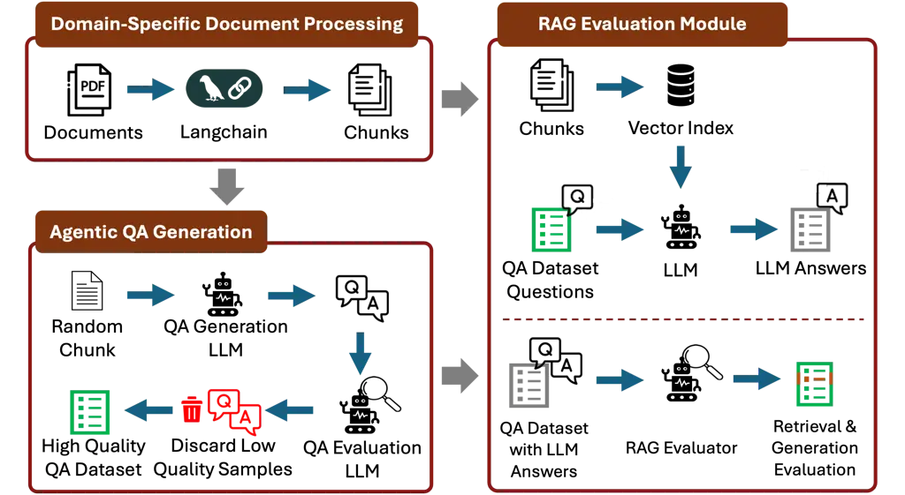
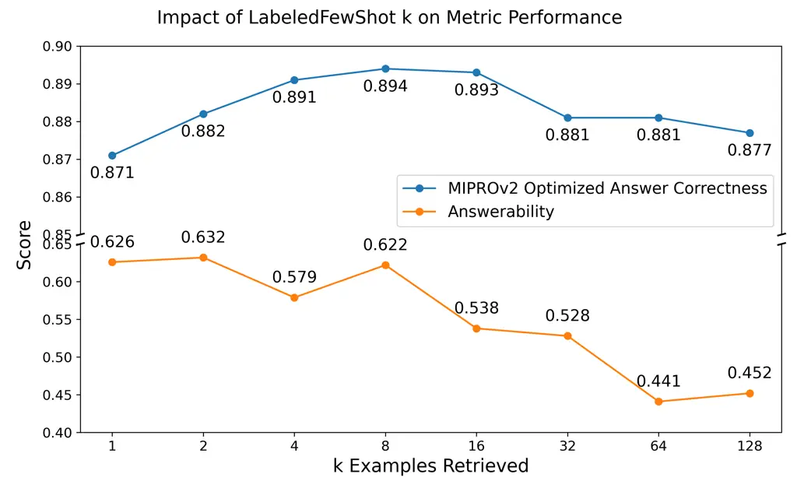
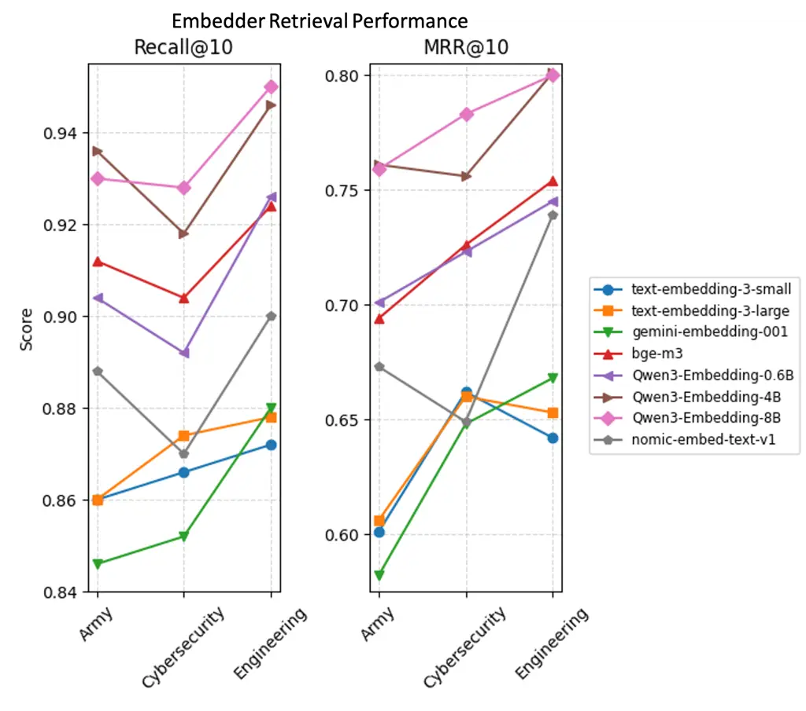
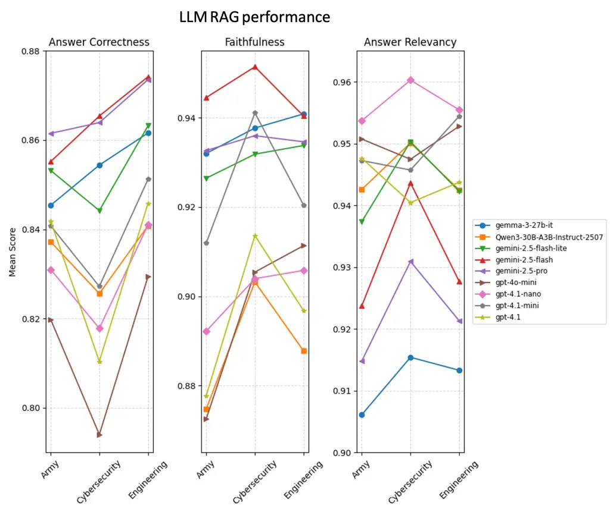
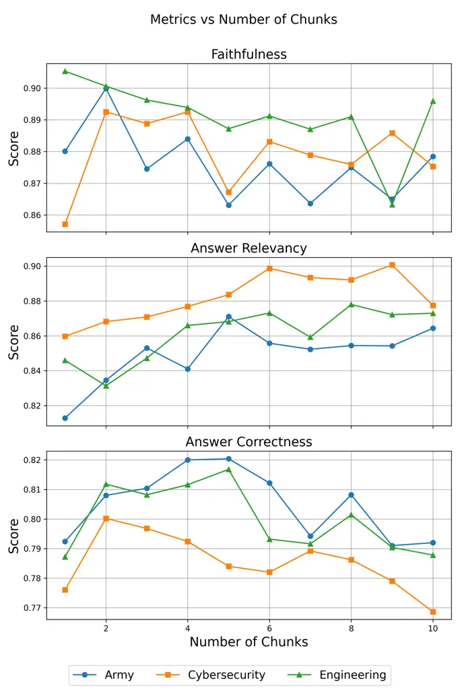
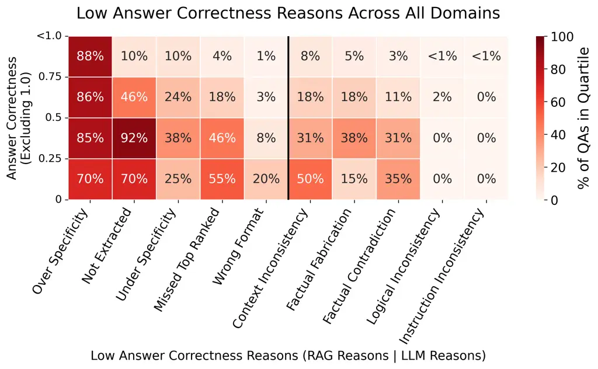

# RAGalyst: Automated Human-Aligned Agentic Evaluation for Domain-Specific RAG

Joshua Gao^(\*)    Quoc Huy Pham^(\*)    Subin Varghese    Silwal Saurav
   Vedhus Hoskere Affiliation: \[3pt\] ^(\*)Equal Contribution
Affiliation: University of Houston
Affiliation: [https://joshuakgao.github.io/RAGalyst](https://joshuakgao.github.io/RAGalyst)

July 2025

###### Abstract

Retrieval-Augmented Generation (RAG) is a critical technique for
grounding Large Language Models (LLMs) in factual evidence, yet
evaluating RAG systems in specialized, safety-critical domains remains a
significant challenge. Existing evaluation frameworks often rely on
heuristic-based metrics that fail to capture domain-specific nuances and
other works utilize LLM-as-a-Judge approaches that lack validated
alignment with human judgment. This paper introduces RAGalyst, an
automated, human-aligned agentic framework designed for the rigorous
evaluation of domain-specific RAG systems. RAGalyst features an agentic
pipeline that generates high-quality, synthetic question-answering (QA)
datasets from source documents, incorporating an agentic filtering step
to ensure data fidelity. The framework refines two key LLM-as-a-Judge
metrics—Answer Correctness and Answerability—using prompt optimization
to achieve a strong correlation with human annotations. Applying this
framework to evaluate various RAG components across three distinct
domains (military operations, cybersecurity, and bridge engineering), we
find that performance is highly context-dependent. No single embedding
model, LLM, or hyperparameter configuration proves universally optimal.
Additionally, we provide an analysis on the most common low Answer
Correctness reasons in RAG. These findings highlight the necessity of a
systematic evaluation framework like RAGalyst, which empowers
practitioners to uncover domain-specific trade-offs and make informed
design choices for building reliable and effective RAG systems. RAGalyst
is available on our [Github](https://github.com/joshuakgao/RAGalyst).

###### Index Terms: 

Domain-Specific, Retrieval-Augmented Generation, LLM-as-a-Judge,
Synthetic Dataset Generation, Question-Answering Dataset, RAG
Evaluation.

## I Introduction

Although modern Large Language Models (LLMs) are great synthesizers of
information, they still suffer from hallucinations \[1, 2\], which
refers to the generation of content that appears plausible but is
factually incorrect or unsupported by evidence. Mitigating
hallucinations is especially important in safety-critical applications
(e.g., military operations, cybersecurity, and bridge engineering) where
inaccurate information can lead to serious consequences and undermine
trust in artificial intelligence (AI) systems \[3, 4\].
Retrieval-Augmented Generation (RAG) has been widely adopted to mitigate
hallucinations by grounding responses in provided context  \[5, 6\].

A key advantage of RAG is its ability to provide models with dynamic,
inference-time access to private and domain-relevant documents \[5, 7\].
However, leveraging this ability is highly sensitive to several
domain-specific variables. Source documents in specialized fields often
include out-of-distribution content—such as dense jargon or
unconventional formatting—that lies outside the training corpora of the
LLM and embedding model, hindering their ability to interpret the
retrieved text. Similarly, the optimal text chunking strategy and
retrieved context lengths may differ in different domains due to
document structure and the amount of contextual information required to
synthesize information. For example, bridge engineering documents may
require an understanding of deterioration trends across extended spans
of inspection narratives and historical measurements, favoring longer
context windows to capture cross-report dependencies. On the other hand,
cybersecurity documents tend to present short but information-dense logs
(e.g., a few lines of packet capture) may be sufficient for accurate
interpretation, making smaller chunks preferable.

The challenge of adapting RAG systems to specialized domains is
compounded by the difficulty of accurately evaluating their performance.
Such evaluation requires domain-specific benchmarks and metrics that
produce reliable results.

Given the widespread need for RAG systems and the innumerable domains in
which they may be used, manually producing benchmark datasets for tuning
of parameters can be very challenging. State-of-the-art RAG evaluation
frameworks increasingly employ LLMs to generate synthetic Questions and
Answers (QAs) from a knowledge base that are then used to evaluate RAG
system performance. The quality of these datasets then become critical
in the reliability of reported evaluations. Most approaches require
human validation in combination with heuristics to ensure dataset
quality. Other fully automated generation pipelines like RAGAS \[8\]
lack rigorous quality filtering, resulting in an unreliable QA dataset.

Beyond dataset generation, evaluation metrics are also vital to directly
estimate RAG system performance. Early works in RAG evaluation that
often rely on traditional heuristic metrics, such as Bilingual
Evaluation understudy (BLEU) \[9\] and Recall-Oriented Understudy for
Gisting Evaluation (ROUGE) \[10\], operate by measuring the literal
overlap of words or phrases between the generated answer and a reference
answer. A challenge lies in their inability to capture semantic meaning;
a factually correct response that uses different phrasing would be
unfairly penalized, while a nonsensical answer that shares keywords
might score deceptively high. To overcome the rigidity of these lexical
metrics, researchers have begun leveraging LLM-as-a-Judge to better
evaluate the semantic nuances of generated answers \[11, 12, 8, 13, 14,
15\]. However, these LLM-based metrics have not yet been rigorously
examined for human-alignment. There is a need to develop human-alignment
mechanism to LLM as a judge metrics that can help more reliably automate
benchmarking and tuning of domain-specific RAG systems.

This paper introduces RAGalyst, an end-to-end human-aligned agentic
framework for domain-specific RAG evaluation. Our framework integrates
refined LLM-as-a-Judge metrics and fully automated agentic QA benchmark
construction to enable rigorous benchmarking and more reliable
deployment of RAG systems across diverse domains. We evaluate the
human-alignment procedure on two metrics, the Answerabilty metric - used
in synthetic QA generation, and the Answer Correctness metric - used in
RAG answer evaluation.

The main contributions of this paper are as follows:

- •
  We present an automated agentic framework for evaluating
  domain-specific RAG systems, integrating document preprocessing,
  reliable synthetic QA generation, embedding model and LLM-based
  evaluation modules.
- •
  We introduce novel human benchmark-aligned prompt-optimized
  LLM-as-a-Judge formulations for RAG metrics, namely the Answerability
  and Answer Correctness metrics, which outperform state-of-the-art
  formulations as judges.
- •
  We evaluate our framework and demonstrate applicability on documents
  from on three different specialized domains, namely military
  operations, cybersecurity, and bridge engineering.

## II Related Work

### II-A Retrieval-Augmented Generation (RAG)

RAG addresses hallucinations by integrating a retrieval module that
dynamically retrieves relevant textual chunks from a knowledge base
during inference \[5\]. Early RAG systems followed a straightforward
retrieve-then-generate pipeline \[16\]. Recent advances include
modularization for flexible component composition \[17\], adaptive
retrieval strategies that dynamically adjust retrieval depth \[18\], and
graph-based reasoning mechanisms for multi-hop information
synthesis \[19\]. The Atlas model demonstrated that few-shot learning
achieved strong performance even with relatively small parameter counts
when using a dense retriever and joint pre-training strategies \[7\].
LongRAG uses large context chunks and leverages long context LLMs to
reduce retrieval noise and improve semantic integrity \[20\]. On the
other hand, OP-RAG argues that naive use of long-context models may
dilute relevant content, and that order-preserving RAG techniques can
offer superior efficiency and answer quality by maintaining the original
document structure during chunk selection \[21\].

### II-B Domain-Specific RAG

While general-purpose RAG systems demonstrate promising capabilities in
knowledge-intensive tasks, they often underperform in domains where
specialized knowledge or jargon is involved. Domain-specific RAG bridges
this gap by tailoring both retrieval and generation processes to the
target domain. RAFT \[22\] proposes Retrieval-Augmented Fine-Tuning, a
training procedure that fine-tunes LLMs to handle bad retrieval to
enhance robustness and improve downstream QA performance on specialized
datasets such as PubMed and HotpotQA. Similarly, Li et al. \[6\] created
a synthetic dataset sourced from Carnegie Mellon University’s website,
and proposed a domain-specific RAG pipeline. Nguyen et al. \[23\] show
that fine-tuning both the embedding model and the generator
significantly improves performance on complex datasets like
FinanceBench.

To benchmark and evaluate RAG capabilities in expert domains, Wang et
al. \[24\] introduced DomainRAG, a comprehensive benchmark for Chinese
university enrollment data. Their work identified six critical abilities
for domain-specific RAG systems: conversational handling, structural
understanding, denoising, multi-document reasoning, time sensitivity,
and faithfulness to external knowledge. They demonstrated that current
LLMs struggle significantly in a closed-book setting, validating the
necessity for domain-specific RAG systems.

### II-C RAG Evaluation

RAG performance depends on a complex interplay of components, including
retrieval module, document chunking strategies and model
prompting \[25\]. Unlike standalone LLMs, RAG systems are highly
sensitive to changes in these components, making generalization between
tasks and settings extremely difficult.

Traditional evaluation metrics such as BLEU \[9\], ROUGE \[10\], or
exact match fail to account for the modular and domain-specific nature
of RAG pipelines. Consequently, a variety of frameworks have emerged to
address this challenge. RAGEval \[11\] and ARES \[12\] are prominent
reference-free and semi-supervised evaluators that assess context
relevance, answer faithfulness, and informativeness without requiring
ground-truth answers. ARES, in particular, offers statistical confidence
bounds and modular component scoring, enabling accurate diagnostics even
across domains.

End-to-end evaluation often obscures specific failure points within the
RAG pipeline (such as suboptimal chunking, inaccurate retrieval,
ineffective reranking, or hallucinated generation) making it difficult
to isolate which component is responsible for performance degradation.
To address this, eRAG \[26\] proposes a document-level relevance scoring
based on LLM output, which correlates better with downstream QA
performance than traditional query-document metrics. CoFE-RAG \[27\]
expands this perspective by evaluating all stages: chunking, retrieval,
reranking, and generation. These techniques allow developers to diagnose
failure sources within the RAG pipeline and improve system
interpretability. The RAGAS framework \[8\] offers a comprehensive and
modern evaluation pipeline, encompassing dataset generation from
documents, LLM-based metrics, and a modular evaluation architecture. As
it is the only actively maintained framework of its kind, we adopt RAGAS
as the primary baseline for evaluating the performance of our proposed
method. Even though all of these end-to-end evaluation frameworks have
made significant strides, they rely on some degree of manual validation
for QA dataset generation. Moreover, their metrics have notable
limitations: rule-based metrics often fail to capture subtle semantic
nuances, while works that use LLM-based metrics are rarely benchmarked
for alignment with human judgment. As a result, such metrics may not
fully reflect the intended evaluation objectives or agree with human
assessments.

### II-D Tuning LLM-as-a-Judge Evaluation

Recent advances in LLM evaluation have increasingly focused on methods
that improve alignment with human judgment and reduce variability in
scoring. AutoCalibrate \[28\] auto-tunes the evaluation prompts for
better human alignment, ensuring that the scores reflect the actual
preferences of the user. DSPy \[29, 30\] is a declarative framework that
enables the programmatic creation and refinement of prompts for LLMs.
Evaluation frameworks such as PoLL \[31\] advocate a panel of various
LLM evaluators to reduce bias and variance in generation scoring. These
are powerful methods that have yet to be applied in RAG evaluation.

### II-E Synthetic QA Data Generation

The evaluation of RAG systems typically relies on a question-answering
(QA) datasets. However, such QA datasets are often unavailable or
insufficient in specialized domains \[32\]. This limitation has driven a
surge in research focused on generating high-quality synthetic QA data.

Alberti et al. \[33\] pioneered a round-trip consistency approach that
combines answer extraction, question generation, and answer
re-verification to create high-confidence Question-Answer-Context (QAC)
triplets. Shakeri et al. \[34\] proposed an end-to-end transformer-based
generator that outputs both the question and the answer from a given
passage.

Recent QA data generation has increasingly shifted toward LLM-based
approaches. Bai et al. \[32\] tailored prompt engineering and
summarization strategies to generate more challenging clinical QAC
triplets from EHRs. Bohnet et al. \[35\] leveraged long-context LLMs to
generate QAC triplets over entire books, demonstrating that automatic
generation can rival or surpass human-crafted data sets in narrative
domains. RAGAS \[8\] leverages agentic LLM designs and knowledge graph
to generate context-rich and diverse question–answer pairs, with the
LLMs simulating multiple personas during the generation process.

While these synthetic QA generation frameworks are impressive, none of
them employ a fully automatic end-to-end pipeline that leverages
LLM-based metrics to assess QA quality. RAGAS attempts to accomplish
this yet their QA generation underperforms even on their own native
metrics.

## III Methodology

This section presents an agentic framework for evaluating RAG systems in
domain-specific contexts. The framework includes a document
preprocessing toolkit, agentic QA generation pipeline, and a set of
LLM-based evaluation metrics. Figure 1 illustrates the overall
framework.



Fig. 1: Overview of the RAGalyst framework that consists of three
modules: a pre-processing module that transforms domain-specific
documents into text chunks, a QA generation pipeline for producing
synthetic question–answer-context datasets, and an evaluation module for
assessing RAG system performance.

### III-A Domain-Specific Documents Preprocessing

The preprocessing of domain-specific documents is the first and most
critical step in this RAG framework, as it directly supports both the QA
generation and evaluation stages. Without careful handling of document
formatting and structure, the quality of retrieval and generated
responses suffer significantly.

The framework first leverages LangChain¹¹ 1
[https://www.langchain.com/](https://www.langchain.com/) to parse PDF,
markdown, and plain text and then divides the documents into smaller
units, called chunks, using a token-based chunking strategy. The size of
these chunks plays a vital role in downstream performance. Chunks that
are too small may lack context, leading to incomplete retrievals. On the
other hand, chunks that are too large can dilute relevance and exceed
the model context limits. Chunk size significantly impacts retrieval
performance across domains due to differences in document structure and
content. Optimal chunk size can vary by more than 20% depending on the
domain, influencing both precision and recall metrics in RAG
evaluations \[36\]. Since there is no standardized text chunking
strategy, we follow OpenAI’s file search tool.²² 2
[https://platform.openai.com/docs/assistants/tools/file-search](https://platform.openai.com/docs/assistants/tools/file-search)
and select a default of a maximum 800 tokens per chunk with an overlap
between chunks of 400 tokens. Afterwards, the chunks are vectorized with
the selected embedding model and are stored in a vector database.

### III-B Agentic QA Generation Pipeline

A critical requirement for evaluating RAG systems is the availability of
high-quality annotated datasets. These datasets must contain:

1.  1.  Domain-relevant questions.
2.  2.  Ground-truth answers.
3.  3.  Context used to answer each question.

However, for many classified or sensitive domains, such annotated
datasets are non-existent. Manual annotation of such datasets is often
impractical due to confidentiality restrictions, inconsistent
formatting, and the high cost of human labeling.

To address this gap, the agentic QA generation pipeline leverages LLMs
in a role-driven, autonomous fashion to emulate users to produce
context-based, high-fidelity question-answer pairs based on preprocessed
document chunks. Each generated answer is grounded directly in its
source context and quality is validated using multiple LLM-based metrics
from the evaluation module (more details in III-C) to ensure alignment
and quality. This approach eliminates the need for labor-intensive
annotation while ensuring consistency, reproducibility, and scalability
across various domains.

The pipeline operates in three main steps:

##### Context Sampling

Chunks generated during the document chunking step are randomly sampled
and used as reference contexts for question, answer, context triplet
(QAC).

##### Prompting and QA Generation

An agentic LLM assumes the role of a user to generate a question that is
related to and answerable by the sampled context. The questions is
evaluated to ensure it is specific and unambiguous. Then, another agent
assumes the role of a subject matter expert to answer the question to
generate the ground truth answer.

##### Validation and Filtering

To ensure quality, the LLM-based evaluation module validates the
generated QA pairs using Answerability, Faithfulness and Answer
Relevance metrics (more information in Section III-C2). If the sample is
unable to meet the thresholds, it is discarded to preserve dataset
integrity. These thresholds are hyperparameters that control quality
strictness. The higher values enforce stronger filtering but result in
longer generation times due to an increased number of candidate QAs
being discarded.

|                    |                                                                                         |        |                                    |           |
| ------------------ | --------------------------------------------------------------------------------------- | ------ | ---------------------------------- | --------- |
| Metric Name        | Use                                                                                     | Scale  | Used In                            | Framework |
| Answer Correctness | Evaluates how accurately the generated answer matches the ground truth                  | 0–1.0  | RAG Evaluation                     | Ours      |
| Answerability      | Evaluates whether the question can be answered using only the provided context          | 0 or 1 | Dataset Generation                 | Ours      |
| Faithfulness       | Measures how well the answer is grounded in the provided context                        | 0–1.0  | Dataset Generation, RAG Evaluation | RAGAS     |
| Answer Relevance   | Assesses whether the answer directly and meaningfully addresses the question            | 0–1.0  | Dataset Generation, RAG Evaluation | RAGAS     |
| Recall@K           | Measures whether the ground truth context appears in the top-$`K`$ retrieved documents  | 0 or 1 | Retrieval Evaluation               | Standard  |
| MRR                | Computes the inverse rank of the first correct retrieval to evaluate re-ranking quality | 0–1.0  | Retrieval Evaluation               | Standard  |

TABLE I: Summary of Evaluation Metrics for Dataset Generation and RAG
Evaluation

### III-C RAG Evaluation Module

The RAG evaluation module leverages LLM-as-a-judge to enable automated,
scalable, and consistent scoring across diverse settings. Additionally,
the framework also provides essential heuristic metrics for evaluating
retrieval performance.

#### III-C1 Retrieval Evaluation

Mean Reciprocal Rank (MRR) and Recall@K are two standard information
retrieval metrics used to quantify retrieval effectiveness \[25\].

MRR computes the average of the reciprocal ranks of the first relevant
document across queries, effectively measuring how early the correct
context appears in the retrieval list. MRR is particularly well-suited
for assessing re-ranking strategies in RAG systems, as it emphasizes
placing relevant information as close to the top of the ranked list as
possible.

MRR is defined as:

```math
\text{MRR}=\frac{1}{|Q|}\sum_{i=1}^{|Q|}\frac{1}{\text{rank}_{i}}
```

where:

- •
  $`|Q|`$ is the total number of queries.
- •
  $`\text{rank}_{i}`$ is the position of the ground truth context in the
  ranked list for the $`i`$-th query.

Recall@K, also referred to as Hit Rate@K, is the average recall across
multiple queries where ground truth context appears within the top-$`k`$
retrieved results for a given query. For each query, recall is a binary
metric. It returns 1 if the ground truth context is found within the top
$`k`$ or 0 if not. This metric is particularly important for RAG systems
since it calculates the chance the ground truth context is included
among the retrieved top candidates.

Recall@$`k`$ is defined as:

```math
\text{Recall@K}=\frac{1}{|Q|}\sum_{i=1}^{|Q|}\mathbf{1}(\text{rank}_{i}\leq k)
```

where:

- •
  $`|Q|`$ is the total number of queries.
- •
  $`\text{rank}_{i}`$ is the position of the ground truth document for
  the $`i`$-th query.
- •
  $`\mathbf{1}(\cdot)`$ is the indicator function, which returns 1 if
  the condition inside is true, and 0 otherwise.
- •
  $`k`$ is the cutoff rank threshold (for example, Recall@3 considers
  the top 3 results).

#### III-C2 LLM-Based Evaluation

To ensure the quality of the synthetic QA dataset and support downstream
RAG evaluation, the framework combines established metrics with a novel
LLM-based evaluation approach. While standard metrics from the RAGAS
framework \[8\] are effective for detecting hallucinations and assessing
answer relevance, they fall short in evaluating the quality of generated
questions and the correctness of RAG-generated answers. To address these
limitations, the framework introduces custom LLM-as-a-judge metrics,
which leverage language models to better account for linguistic
variation, paraphrasing, and latent knowledge \[37, 38, 39, 40\]. This
LLM-based strategy enables a more robust, human-aligned evaluation
pipeline. The key metrics introduced are:

- •
  Answer Correctness: A custom LLM-as-a-judge metric that compares a
  generated answer to the reference (ground truth) answer. The LLM
  scores semantic alignment on a continuous scale, offering both a
  numerical score and a rationale. This enables flexible evaluation even
  when surface-level phrasing differs.
- •
  Answerability: Assesses whether a generated question is fully
  supported by the retrieved context, without relying on external
  knowledge. This enforces quality in our synthetic QA dataset
  generation.

Table I summarizes the definitions of all metrics and their roles within
our framework.

## IV Framework Validation

This section validates the Agentic Framework for Domain-Specific RAG
Evaluation (RAGalyst) by assessing its accuracy, reliability, and
practical suitability for domain-specific document tasks. The primary
objective is to determine whether the framework’s evaluation metrics and
data generation methods are effective enough to support real-world use
cases.

First, we assess the reliability of the LLM-as-a-judge evaluation
metrics Answer Correctness and Answerability—along with prompt-optimized
variants. These metrics are tested against human-annotated references to
ensure alignment with human judgment.

Second, the synthetic QA datasets generated by the agentic QA generation
pipeline are evaluated against publicly available domain-specific QA
sets, and datasets generated by RAGAS, to assess its fidelity and
reliability in evaluating RAG systems. This comparison aims to verify
whether the synthetic data produced by this framework serves as a viable
substitute for manually curated datasets in high-stakes domains.

### IV-A Metrics Validation

We evaluate the performance of both Answer Correctness and Answerability
by computing the Spearman correlation between their scores and human
annotations. To calculate the standard error of a Spearman correlation,
we use Bonnett and Wright \[41\] standard error (SE) approximation:

```math
\text{SE}(\rho_{s})=\sqrt{\frac{1+\frac{\rho_{s}^{2}}{2}}{n-3}}
```

Where:

- •
  $`\text{SE}(\rho_{s})`$ is the standard error of the Spearman
  correlation.
- •
  $`\rho_{s}`$ is the expected Spearman correlation coefficient.
- •
  $`n`$ is the sample size.

Since a manually crafted Answer Correctness and Answerability prompt is
unlikely to be optimal, we turn to DSPy’s \[30, 29\] COPRO, MIPROv2, and
LabeledFewShot optimizers. These optimizers systematically refine
prompts using supervision and feedback signals, improving alignment with
human annotations.

COPRO and MIPROv2 are automatic instruction optimizers where the
instructions in the prompt are tweaked and validated. The COPRO
optimizer generates and refines new instructions for each step, and
optimizes them with coordinate ascent on a defined metric function.
MIPROv2 generates instructions and few-shot examples in each step of
optimization. The instruction generation is data-aware and
demonstration-aware, and uses Bayesian Optimization to effectively
search over the space of generation instructions/demonstrations.

LabeledFewShot is a automatic few-shot learning optimizer. It randomly
samples $`k`$ examples from a labeled dataset and adds them to the
prompt as demonstrations.

|                                          |                             |                                              |                                         |
| ---------------------------------------- | --------------------------- | -------------------------------------------- | --------------------------------------- |
| Method                                   | Model                       | Answer Correctness $`\boldsymbol{\rho_{s}}`$ | Answerability $`\boldsymbol{\rho_{s}}`$ |
| Cosine Similarity                        | Qwen3-Embedding-8B          | 0.622                                        | –                                       |
| RAGAS                                    | gpt-4o-mini                 | 0.836                                        | –                                       |
| Ours                                     | gemma-3-27b-it              | 0.862                                        | 0.596                                   |
| Ours                                     | Qwen3-30B-A3B-Instruct-2507 | 0.851                                        | 0.605                                   |
| Ours                                     | gemini-2.5-flash-lite       | 0.849                                        | 0.665                                   |
| Ours                                     | gemini-2.5-flash            | 0.777                                        | 0.749                                   |
| Ours                                     | gemini-2.5-pro              | 0.805                                        | 0.752                                   |
| Ours                                     | gpt-4o-mini                 | 0.874                                        | 0.700                                   |
| Ours                                     | gpt-4.1-nano                | 0.857                                        | 0.436                                   |
| Ours                                     | gpt-4.1-mini                | 0.873                                        | 0.670                                   |
| Ours                                     | gpt-4.1                     | 0.857                                        | 0.723                                   |
| Ours: COPRO Optimized                    | gpt-4o-mini                 | 0.881                                        | 0.670                                   |
| Ours: MIPROv2 Optimized                  | gpt-4o-mini                 | 0.887                                        | 0.669                                   |
| Ours: MIPROv2 & LabeledFewShot Optimized | gpt-4o-mini                 | 0.894                                        | –                                       |
| Ours: LabeledFewShot Optimized           | gpt-4o-mini                 | –                                            | 0.632                                   |

TABLE II: Human Alignment of Methods for Answer Correctness and
Answerability

#### IV-A1 Answer Correctness

This metric was benchmarked against the Semantic Textual Similarity
Benchmark (STS-B), part of the GLUE benchmark suite³³ 3
[https://gluebenchmark.com/tasks/](https://gluebenchmark.com/tasks/).
STS-B consists of sentence pairs drawn from sources such as news
headlines, image captions, and online forums, with each pair annotated
by humans with a similarity score ranging from 0 (completely dissimilar)
to 5 (semantically equivalent). To adapt the dataset to the evaluation
task, the first sentence in each pair was treated as the ground-truth
answer and the second as the model-generated answer. The original STS-B
scores were normalized from a range of 0–5 to a range of 0.0–1.0 to
align with the output of our LLM-based Answer Correctness metric.

In this validation, we compare our proposed Answer Correctness
metric—along with a prompt-optimized variant—against baseline methods
including cosine similarity and RAGAS’s Answer Correctness. Both RAGAS
and our framework utilize the GPT-4o-mini model at a temperature of 0 to
ensure a consistent evaluation backbone across approaches, but we also
compare against other state of the art LLMs. Cosine similarity is
computed using the Qwen3-Embedding-8B model, the top-ranked model on the
MTEB leaderboard ⁴⁴ 4
[https://huggingface.co/spaces/mteb/leaderboard](https://huggingface.co/spaces/mteb/leaderboard)
for the STS task at the time of writing.

On a test set of 500 randomly sampled STS-B sentence pairs, our Answer
Correctness metric achieves a mean Spearman correlation of 0.874 with a
standard error of 0.053 with GPT-4o-mini. This outperforms both Cosine
Similarity ($`\rho_{s}`$ = 0.622, SE = 0.049) and RAGAS ($`\rho_{s}`$ =
0.843, SE = 0.052), demonstrating stronger alignment with
human-annotated similarity scores.

We first refine the prompt instructions using both the COPRO and MIPROv2
optimizers on a training set of 500 STS-B samples, and evaluate
performance on the test set. We adopt DSPy’s default parameters for both
optimizers and use GPT-4o-mini to generate optimized prompt candidates.
The metric achieves $`\rho_{s}`$ = 0.881 (SE = 0.053) with COPRO and
$`\rho_{s}`$ = 0.887 (SE = 0.053) with MIPROv2.

Since the MIPROv2 optimized Answer Correctness metric performs the best,
we further optimize its prompt with LabeledFewShot optimizer which
pushes performance to $`\rho_{s}`$ = 0.894 (SE = 0.053) at a $`k`$ of 8.
We ablate $`k`$ in Figure 2. This combination of the MIPROv2 and
LabeledFewShot optimizers performs the best for the Answer Correctness
metric, and therefore use this version of the metric throughout the
remainder of this paper.

#### IV-A2 Answerability

The Answerability metric was validated using the Stanford Question
Answering Dataset 2.0 (SQuAD 2.0)⁵⁵ 5
[https://rajpurkar.github.io/SQuAD-explorer/](https://rajpurkar.github.io/SQuAD-explorer/).
SQuAD 2.0 extends the original SQuAD dataset by including over 50,000
unanswerable questions written adversarially to resemble answerable
ones. Each entry in the dataset contains a question, a context passage,
a ground-truth answer, and a binary flag indicating whether the question
is answerable given the context. This makes it an ideal benchmark for
evaluating the Answerability of QACs, as it directly tests whether the
provided context alone is sufficient to support a meaningful response.
Each LLM evaluates the Answerability of the QACs with a temperature of 0.

Using Gemini 2.5 Pro on a test set of 500 randomly sampled SQuAD 2.0 QA
pairs, our Answerability metric achieves a mean Spearman correlation of
0.752 with a standard error of 0.051

We first refine the prompt instructions using both the COPRO and MIPROv2
optimizers on a training set of 500 SQuAD 2.0 QA pairs, and evaluate
performance on a the test set. We adopt DSPy’s default parameters for
both optimizers and use GPT-4o-mini to generate optimized prompt
candidates. The metric achieves $`\rho_{s}`$ = 0.670 (SE = 0.050) with
COPRO and $`\rho_{s}`$ = 0.669 (SE = 0.050) with MIRPOv2.

Since neither automatic instruction optimizers improve performance, we
apply LabeledFewShot optimizer on the non-optimized Answerability metric
with GPT-4o-mini. This achieves $`\rho_{s}`$ = 0.632 (SE = 0.049) at a a
$`k`$ of 2. We ablate $`k`$ in Figure 2. All optimizers do not improve
performance for the Answerability metric, and therefore use the
non-prompt optimized version of Answerability throughout the remainder
of this paper.

#### IV-A3 Metric’s LLM Selection

The results in Table II suggest that GPT-4o-mini provides the best
balance of performance metrics, inference speed, and cost. For this
reason, GPT-4o-mini is used for all LLM-based metrics throughout the
remainder of this paper.



Fig. 2: We ablate both the MIPROv2-optimized Answer Correctness metric
and the non-optimized Answerability metric using the LabeledFewShot
optimizer. Our results show that Answer Correctness achieves its best
performance with 8 examples, whereas LabeledFewShot optimization
provides no improvement over our handcrafted prompt for Answerability.

### IV-B Agentic QA Dataset Generation Pipeline Validation

To rigorously validate the performance of our Agentic QA generation
pipeline, we constructed three domain-specific datasets using our
framework. The domains military operations (army), cybersecurity, and
bridge engineering (engineering) were selected for their real-world
importance and the abundance of diverse, unstructured source material
such as technical documents, reference books, and cheatsheets. For each
domain, we generated 500 QA pairs, resulting in a total of 1,500 samples
that reflect a broad spectrum of question types and contextual
difficulty levels.

To establish a fair and consistent baseline for comparison, we used the
same source materials to generate three additional datasets using the
RAGAS framework. Both frameworks were configured to produce Single
Hop-specific QA datasets, which require no or minimal reasoning. This
controlled setup ensures that the only variable under evaluation is the
generation method itself. We evaluated both approaches using a mixture
of our proposed metrics (Answerability) and the RAGAS metrics
(Faithfulness, Answer Relevance), allowing us to assess our performance
against a strong existing baseline.

In addition to synthetic comparisons, we incorporated a benchmark
evaluation against human-annotated datasets. These datasets were
selected based on their widespread use in the QA and RAG research
communities, their utility in real-world applications, and their sample
sizes being large enough to ensure statistical significance.

- •
  The COVID-QA dataset from deepset comprises of 2,019 expert-annotated
  QA pairs drawn from 147 COVID‑19 scientific articles by 15 biomedical
  specialists \[42\]. It is highly relevant to real-world biomedical
  information retrieval tasks.
- •
  The RepLiQA dataset by ServiceNow Research consists of approximately
  90,000 question–answer–context triplets, all carefully written and
  annotated by human experts using fictional yet coherent
  narratives \[43\]. It is specifically designed to rigorously evaluate
  a model’s ability to reason over unseen, non-factual content.

By applying the same evaluation framework to both the machine-generated
and human-annotated datasets, we are able to observe how closely our
pipeline aligns with human-created content across different domains.
This evaluation approach supports a more balanced assessment of the
method’s reliability and generalizability.

Table III demonstrates that our framework consistently outperforms RAGAS
across both its native metrics and our evaluation criteria. This
performance gap stems primarily from two critical limitations in the
RAGAS pipeline. First, RAGAS lacks an effective filtering mechanism to
exclude low-quality samples, leading to noisier datasets. Second, its
use of a single multitask prompt for generating both questions and
answers reduces generation quality, aligning with prior findings that
multitasking degrades large language model performance \[44\]. Notably,
while the RAGAS-generated dataset achieves reasonable scores in
Faithfulness and Answer Relevance, the dataset’s Answerability remains
significantly lower. This pattern suggests that the model generates
answers that appear contextually appropriate and responsive but are not
explicitly supported by the retrieved evidence, indicating a tendency
toward informed hallucination rather than faithful grounding.

Although our custom QA generation pipeline produces higher quality
samples, it operates at a slower rate. It generates 100 QA samples at an
average of 0.881 samples per minute (single-threaded) and 7.039 spm
(16-threaded). In contrast, RAGAS achieves 14.627 spm (single-threaded)
and 33.842 spm (16-threaded). This slower generation rate is primarily
due to our more stringent QA filtering.

We provide an example generated QA from the Military Operations domain.


|               |                  |       |       |       |
| ------------- | ---------------- | ----- | ----- | ----- |
| Domain        | Metric           | Human | Ours  | RAGAS |
| COVID-QA      | Faithfulness     | 0.894 | 0.989 | 0.917 |
|               | Answerability    | 0.620 | 0.994 | 0.418 |
|               | Answer Relevance | 0.399 | 0.947 | 0.748 |
| RepLIQA       | Faithfulness     | 0.774 | 0.994 | 0.957 |
|               | Answerability    | 0.740 | 0.998 | 0.916 |
|               | Answer Relevance | 0.475 | 0.962 | 0.770 |
| Army          | Faithfulness     | –     | 0.977 | 0.868 |
|               | Answerability    | –     | 0.994 | 0.618 |
|               | Answer Relevance | –     | 0.957 | 0.830 |
| Cybersecurity | Faithfulness     | –     | 0.991 | 0.797 |
|               | Answerability    | –     | 0.974 | 0.306 |
|               | Answer Relevance | –     | 0.961 | 0.783 |
| Engineering   | Faithfulness     | –     | 0.988 | 0.839 |
|               | Answerability    | –     | 0.990 | 0.473 |
|               | Answer Relevance | –     | 0.958 | 0.797 |

TABLE III: Synthetic QA Dataset Generation Performance Across Domains

## V Experiments

To demonstrate the applicability of RAGalyst, this section showcases the
experimental evaluation of various RAG approaches using the framework.
These experiments assess key components of RAG systems, including the
embedding retrieval, LLM generation, and context length. In addition, we
analyze the potential bias in LLM’s preference for self-generated text,
and we provide an analysis on reasons for low Answer Correctness.

### V-A Embedding Retrieval Evaluation Across Domains



Fig. 3: We evaluate retrieval with Recall@10 and MRR@10 metrics on a
variety of embedding models on three different domains.

The performance of any RAG system is fundamentally dependent on the
quality of its embedding model. The embedding model determines how well
the system can semantically match queries with relevant document chunks.
Poor retrieval due to weak embeddings will degrade the overall output.
Therefore, selecting the right model is a critical design decision. In
this hypothetical scenario, we will evaluate the retrieval performance
of a diverse selection of embedding models. Our analysis will include
models that rank highly on the MTEB leaderboard \[45\], as well as a
variety of open-source and closed-source models. We will also consider
models of different sizes to assess the impact of model scale on
performance.

To evaluate retrieval performance, we employ Recall@K and MRR@K on the
datasets generated by our pipeline introduced in Section IV-B, using
$`k=10`$. Each document is chunked with a maximum size of 800 tokens and
an overlap of 400 tokens between consecutive chunks. As shown in
Figure 3, the results reveal the variation in embedding model
performance across different domains. The Qwen3 family of models \[46\]
consistently performs well in retrieval tasks across various domains,
reaffirming their high placement on the MTEB leaderboard. Despite its
third-place ranking on MTEB, the gemini-embedding-001 \[47\] model
underperforms compared to other embedding models on these specific
domains. Meanwhile, the BGE-M3 \[48\] embedding model shows performance
comparable to the Qwen3-Embedding-0.6B model, even though its MTEB
ranking is significantly lower. Notably, open-source models generally
outperform their closed-source counterparts. An interesting observation
within the Qwen3 family is that the smaller 4B model performs similarly
to, and in some domains even surpasses, its larger 8B counterpart.

Performance across different domains is inconsistent for most embedding
models. For example, recall scores for most models are weaker in the
cybersecurity domain compared to other areas. However, the
text-embedding-3 family of embedding models defies this trend,
performing much better in cybersecurity relative to the other domains.
This suggests they were likely trained on a larger volume of
cybersecurity-specific data. A similar pattern is observed with mean
reciprocal rank (MRR), underscoring that embedding model effectiveness
is highly domain-dependent. This inconsistency reinforces the need to
evaluate RAG systems with domain-specific benchmarks.

### V-B Domain Specific LLM Generation Evaluation

This experiment evaluates the domain specific RAG performance of a
diverse set of LLMs on Answer Correctness, Faithfulness, and Answer
Relevancy. To ensure consistency, each model receives the same set of 10
retrieved context chunks with a maximum chunks size of 800 tokens, and
chunk overlap of 400 tokens. For retrieval, we use the top-performing
model on the MTEB retrieval task, Qwen3-Embedding-8B.

As shown in Figure 4, Gemini-2.5-flash \[49\] shows the strongest
overall performance in Answer Correctness, achieving the highest scores
in cybersecurity and bridge engineering domains. Most models struggle
with the cybersecurity domain, with several models (including
GPT-4o-mini, GPT-4.1, and Qwen3) dropping significantly in this domain
compared to army and bridge engineering domains. This may be due to the
drop in recall for Qwen3-Embeddding-8B embedding model, as seen in
Figure 3. Additionally, the Google family of models (Gemini and Gemma3
\[50\]) perform better than other models.

Gemini-2.5-flash demonstrates the strongest overall Faithfulness,
achieving top scores in the army and cybersecurity and remaining
competitive in bridge engineering domains. Models generally perform
better in cybersecurity on Faithfulness, suggesting that the LLMs may
not know the answer to the question from parametric knowledge and are
leaning more heavily on the retrieved context chunks.

GPT-4.1-nano performs the best in all domains in Answer Relevancy. In
general, the GPT family of models score higher than the Gemini models in
this metric. This could be due to the fact that GPT models are more
wordy in their responses, making it more likely for the responses to be
more relevant to the question.

No single model dominates all 3 metrics in all 3 domains. There doesn’t
seem to be a significant advantage of closed-sourced LLMs compared to
open-sourced ones (Qwen3 and Gemma3) in these domains. Additionally,
larger model sizes do not equate to better performance. This further
highlighting the variability in performance across LLMs for different
domains and the need for RAGalyst.



Fig. 4: We evaluate LLM generation with the Answer Correctness,
Faithfulness, and Answer Relevancy metrics on three different domains.

### V-C Domain Specific Retrieved Chunks Evaluation

To study the sensitivity of evaluation metrics to the number of
retrieved chunks, we varied the number of chunks from 1 to 10 using
Gemma3-4B. Across the three domains, the optimal number of chunks for
maximizing Answer Correctness differed, suggesting that retrieval depth
should be tuned to the domain. Moreover, all metrics exhibited
substantial variation across domains, underscoring the importance of
domain-specific RAG evaluation rather than a one-size-fits-all approach.

Despite these differences, some consistent trends emerge across metrics.
Faithfulness tends to decline slightly as the number of chunks
increases, likely because the LLM must contend with more irrelevant
information. In contrast, Answer Relevancy generally improves with
additional chunks, as the broader context encourages the model to at
least address the question. Answer Correctness shows a peaked behavior,
typically highest when 3–5 chunks are retrieved. With too few chunks,
relevant information is often missed, reducing correctness. With too
many, the relevant chunk risks being diluted by irrelevant ones, leading
to distraction and lower performance.



Fig. 5: We ablate the number of chunks retrieved with Gemma3-4B to
assess the effect on LLM generation performance on Answer Correctness,
Faithfulness and Answer Relevancy. This figure shows the each metric
responds differently to the number of chunks retrieved, and that the
ideal number of chunks retrieved to maximize Answer Correctness will
vary.

### V-D Low Answer Correctness Analysis

|                           |       |        |         |        |
| ------------------------- | ----- | ------ | ------- | ------ |
| All QAs                   |       |        |         |        |
| Failure Types             | Army  | Cyber. | Engine. | Total  |
| Number of QAs             | 500   | 500    | 500     | 1500   |
| RAG Failures              |       |        |         |        |
| Over-Specificity          | 58.4% | 81.0%  | 74.6%   | 71.3%  |
| Not Extracted             | 11.0% | 13.0%  | 15.0%   | 13.0%  |
| Under-Specificity         | 9.8%  | 10.2%  | 10.4%   | 10.13% |
| Missed Top Ranked         | 5.0%  | 6.6%   | 5.4%    | 5.7%   |
| Wrong Format              | 2.2%  | 0.6%   | 1.8%    | 1.5%   |
| LLM Failures              |       |        |         |        |
| Context Inconsistency     | 6.6%  | 9.6%   | 8.8%    | 8.3%   |
| Factual Fabrication       | 2.6%  | 7.4%   | 8.4%    | 6.1%   |
| Factual Contradiction     | 2.6%  | 5.6%   | 3.6%    | 3.9%   |
| Logical Inconsistency     | 0.8%  | 1.0%   | 0.4%    | 0.7%   |
| Instruction Inconsistency | 0.4%  | 0.0%   | 0.0%    | 0.1%   |
| No Failures               | 31.1% | 10.6%  | 14.4%   | 18.7%  |

TABLE IV: Low Correctness Reasons Counts as a Percentage of Total QAs
Across Three Domains (Multiple Reasons per QA Possible)



Fig. 6: Using GPT-5, we analyze the underlying reasons why Answer
Correctness is low by quartile excluding 1.0. We show the number of low
Answer Correctness reason as a percentage of the total number of QAs in
each quartile. Note that percentages do not sum to 100% since each QA
may exhibit multiple failure reasons. Reasons are grouped by taxonomy
with RAG reasons on the left, and LLM reasons on the right.

Despite the promising performance of RAG, Answer Correctness remains
imperfect, as shown with the non-perfect Answer Correctness in Section
V-B. To diagnose the underlying causes, we employ GPT-5 as an
LLM-as-a-Judge and analyze failures using a combined taxonomy derived
from Barnett et al. \[51\] for RAG systems and Huang et al. \[52\] for
LLMs. We exclude Missing Content from the RAG taxonomy because our
agentic dataset generation pipeline ensures that all QAs are grounded in
the source documents. Likewise, we remove Incomplete since the pipeline
does not generate multi-part questions. Additionally, we refine
Incorrect Specificity into two subcategories—Over Specificity and Under
Specificity—to better capture granularity-related errors. Each QA may
exhibit multiple failure types.

To assess GPT-5’s reliability as an LLM-as-a-Judge, we manually validate
its evaluations on ten QAs from each of the three domain-specific
datasets. Across all thirty samples, GPT-5 consistently identifies all
correct underlying reasons for low Answer Correctness.

As summarized in Table IV, Over Specificity accounts for the majority of
failures. This pattern arises because QA generation relies on a single
text chunk as context, leading GPT-4o-mini to produce concise answers
constrained by limited information. In contrast, during RAG QA,
GPT-4o-mini has access to a larger range retrieved contexts and tends to
generate more verbose answers that incorporate all available
information.

For answers scoring above 0.75 in Answer Correctness, as shown in 6,
Over Specificity accounts for the vast majority of correctness issues.
As Answer Correctness decline, QAs increasingly exhibit multiple
contributing factors that lower their overall correctness. More
importantly, all other failure reasons still exist, highlighting the
weakness in RAG systems.

### V-E Bias from Dataset Generation LLM

Recent studies suggest that LLMs often perform better on text they
themselves generate \[53\]. To investigate whether this phenomenon
introduces bias in RAG performance from our dataset generation pipeline,
we construct datasets of 500 questions each using GPT-4o-mini,
Gemini-2.5-flash, and Qwen3-30B-A3B-Instruct-2507 within the Army
domain. Each dataset is then evaluated with all three models. Retrieval
is performed with Qwen3-Embedding-8B, using a chunk size of 800 tokens,
400 token overlap, and top 10 chunk retrieval.

As shown in Table 4, we observe minimal evidence of bias from dataset
origin. The only instance where Answer Correctness is highest on its own
dataset occurs with Qwen3-30B-A3B-Instruct-2507. For Faithfulness, only
Gemini-2.5-flash achieves its best score on its own dataset. For Answer
Relevancy, none of the models perform best on their respective dataset
origins.

|                  |                    |                  |       |
| ---------------- | ------------------ | ---------------- | ----- |
| Evaluated Model  | Metric             | Dataset Origin   | Score |
| GPT-4o-mini      | Answer Correctness | GPT-4o-mini      | 0.820 |
|                  |                    | Gemini-2.5-flash | 0.852 |
|                  |                    | Qwen3-30B…       | 0.827 |
|                  | Faithfulness       | GPT-4o-mini      | 0.873 |
|                  |                    | Gemini-2.5-flash | 0.859 |
|                  |                    | Qwen3-30B…       | 0.858 |
|                  | Answer Relevancy   | GPT-4o-mini      | 0.951 |
|                  |                    | Gemini-2.5-flash | 0.930 |
|                  |                    | Qwen3-30B…       | 0.960 |
| Gemini-2.5-flash | Answer Correctness | GPT-4o-mini      | 0.852 |
|                  |                    | Gemini-2.5-flash | 0.874 |
|                  |                    | Qwen3-30B…       | 0.897 |
|                  | Faithfulness       | GPT-4o-mini      | 0.859 |
|                  |                    | Gemini-2.5-flash | 0.942 |
|                  |                    | Qwen3-30B…       | 0.926 |
|                  | Answer Relevancy   | GPT-4o-mini      | 0.930 |
|                  |                    | Gemini-2.5-flash | 0.921 |
|                  |                    | Qwen3-30B…       | 0.909 |
| Qwen3-30B…       | Answer Correctness | GPT-4o-mini      | 0.876 |
|                  |                    | Gemini-2.5-flash | 0.859 |
|                  |                    | Qwen3-30B…       | 0.888 |
|                  | Faithfulness       | GPT-4o-mini      | 0.888 |
|                  |                    | Gemini-2.5-flash | 0.879 |
|                  |                    | Qwen3-30B…       | 0.877 |
|                  | Answer Relevancy   | GPT-4o-mini      | 0.929 |
|                  |                    | Gemini-2.5-flash | 0.940 |
|                  |                    | Qwen3-30B…       | 0.932 |

TABLE V: LLM Preference for Self-Generated Datasets

## VI Conclusion

We present RAGalyst, an automated human-aligned agentic framework for
domain-specific RAG evaluation. We achieve strong human alignment
through prompt optimization for Answer Correctness and Answerability.
Leveraging these metrics, our framework generates high-quality synthetic
QA datasets that outperform both handcrafted benchmarks and RAGAS across
all metrics, enabling reliable evaluation of retrieval and generation
without human supervision.

Our experiments reveal that RAG performance is highly
configuration-dependent, with no universally optimal setup. Embedding
model performance varies substantially across domains, often
contradicting MTEB rankings. LLM generation performance differs across
model families, with closed-source models showing no consistent
advantage over open-source alternatives and larger models not
consistently outperforming smaller ones. Our low Answer Correctness
analysis reveals that RAG systems exhibit imperfect performance, with
Incorrect Specificity, Incomplete Extraction, and Context Inconsistency
emerging as the three most pressing failure modes.

These findings demonstrate the necessity of a systematic evaluation
framework like RAGalyst, which enables practitioners to uncover
domain-specific trade-offs and make informed design choices for building
reliable RAG systems.

## Acknowledgments

Research was sponsored by the DEVCOM Analysis Center and was
accomplished under Contract Number W911QX-23-D-0009. The views and
conclusions contained in this document are those of the authors and
should not be interpreted as representing the official policies, either
expressed or implied, of the DEVCOM Analysis Center or the U.S.
Government. The U.S. Government is authorized to reproduce and
distribute reprints for Government purposes notwithstanding any
copyright notation herein.

## References

- \[1\] A. T. Kalai, O. Nachum, S. S. Vempala, and E. Zhang (2025) Why
  language models hallucinate. arXiv preprint arXiv:2509.04664. Cited
  by: §I.
- \[2\] L. Huang, W. Yu, W. Ma, W. Zhong, Z. Feng, H. Wang, Q. Chen, W.
  Peng, X. Feng, B. Qin, et al. (2025) A survey on hallucination in
  large language models: principles, taxonomy, challenges, and open
  questions. ACM Transactions on Information Systems 43 (2), pp. 1–55.
  Cited by: §I.
- \[3\] N. Varshney, W. Yao, H. Zhang, J. Chen, and D. Yu (2023) A
  stitch in time saves nine: detecting and mitigating hallucinations of
  llms by validating low-confidence generation. arXiv preprint
  arXiv:2307.03987. Cited by: §I.
- \[4\] J. Li, J. Chen, R. Ren, X. Cheng, W. X. Zhao, J. Nie, and J.
  Wen (2024) The dawn after the dark: an empirical study on factuality
  hallucination in large language models. arXiv preprint
  arXiv:2401.03205. Cited by: §I.
- \[5\] Y. Gao, Y. Xiong, X. Gao, K. Jia, J. Pan, Y. Bi, Y. Dai, J.
  Sun, M. Wang, and H. Wang (2023) Retrieval-augmented generation for
  large language models: a survey. arXiv preprint arXiv:2312.10997.
  Cited by: §I, §I, §II-A.
- \[6\] J. Li, Y. Yuan, and Z. Zhang (2024) Enhancing llm factual
  accuracy with rag to counter hallucinations: a case study on
  domain-specific queries in private knowledge-bases. arXiv preprint
  arXiv:2403.10446. Cited by: §I, §II-B.
- \[7\] G. Izacard, P. Lewis, M. Lomeli, L. Hosseini, F. Petroni, T.
  Schick, J. Dwivedi-Yu, A. Joulin, S. Riedel, and E. Grave (2022)
  Atlas: few-shot learning with retrieval augmented language models.
  arXiv preprint arXiv:2208.03299. Cited by: §I, §II-A.
- \[8\] S. Es, J. James, L. Espinosa-Anke, and S. Schockaert (2023)
  RAGAS: automated evaluation of retrieval augmented generation. arXiv
  preprint arXiv:2309.15217. Cited by: §I, §I, §II-C, §II-E, §III-C2.
- \[9\] K. Papineni, S. Roukos, T. Ward, and W. Zhu (2002) Bleu: a
  method for automatic evaluation of machine translation. In Proceedings
  of the 40th annual meeting of the Association for Computational
  Linguistics, pp. 311–318. Cited by: §I, §II-C.
- \[10\] C. Lin (2004) ROUGE: a package for automatic evaluation of
  summaries. In Workshop on Text Summarization Branches Out,
  Post-Conference Workshop of ACL 2004, Barcelona, Spain, pp. 74–81.
  External Links:
  [Link](https://www.microsoft.com/en-us/research/publication/rouge-a-package-for-automatic-evaluation-of-summaries/)
  Cited by: §I, §II-C.
- \[11\] K. Zhu, Y. Luo, D. Xu, Y. Yan, Z. Liu, S. Yu, R. Wang, S.
  Wang, Y. Li, N. Zhang, X. Han, Z. Liu, and M. Sun (2025) RAGEval:
  scenario specific rag evaluation dataset generation framework. arXiv
  preprint arXiv:2408.01262. Cited by: §I, §II-C.
- \[12\] J. Saad-Falcon, O. Khattab, C. Potts, and M. Zaharia (2023)
  ARES: an automated evaluation framework for retrieval-augmented
  generation systems. arXiv preprint arXiv:2311.09476. Cited by: §I,
  §II-C.
- \[13\] Y. Liu, L. Huang, S. Li, S. Chen, H. Zhou, F. Meng, J. Zhou,
  and X. Sun (2023) Recall: a benchmark for llms robustness against
  external counterfactual knowledge. arXiv preprint arXiv:2311.08147.
  Cited by: §I.
- \[14\] J. Chen, H. Lin, X. Han, and L. Sun (2024) Benchmarking large
  language models in retrieval-augmented generation. In Proceedings of
  the AAAI Conference on Artificial Intelligence, Vol. 38,
  pp. 17754–17762. Cited by: §I.
- \[15\] X. Yu, H. Cheng, X. Liu, D. Roth, and J. Gao (2023) Reeval:
  automatic hallucination evaluation for retrieval-augmented large
  language models via transferable adversarial attacks. arXiv preprint
  arXiv:2310.12516. Cited by: §I.
- \[16\] P. Lewis, E. Perez, A. Piktus, F. Petroni, V. Karpukhin, N.
  Goyal, H. Küttler, M. Lewis, W. Yih, T. Rocktäschel, S. Riedel, and D.
  Kiela (2021) Retrieval-augmented generation for knowledge-intensive
  nlp tasks. External Links: 2005.11401,
  [Link](https://arxiv.org/abs/2005.11401) Cited by: §II-A.
- \[17\] Y. Gao, Y. Xiong, M. Wang, and H. Wang (2024) Modular rag:
  transforming rag systems into lego-like reconfigurable frameworks.
  arXiv preprint arXiv:2407.21059. Cited by: §II-A.
- \[18\] S. Jeong, J. Baek, S. Cho, S. J. Hwang, and J. C. Park (2024)
  Adaptive-rag: learning to adapt retrieval-augmented large language
  models through question complexity. arXiv preprint arXiv:2403.14403.
  Cited by: §II-A.
- \[19\] D. Edge, H. Trinh, N. Cheng, J. Bradley, A. Chao, A. Mody, S.
  Truitt, D. Metropolitansky, R. O. Ness, and J. Larson (2024) From
  local to global: a graphrag approach to query-focused summarization.
  arXiv preprint arXiv:2404.16130. Cited by: §II-A.
- \[20\] Z. Jiang, X. Ma, and W. Chen (2024) LongRAG: enhancing
  retrieval-augmented generation with long-context llms. arXiv preprint
  arXiv:2406.15319. Cited by: §II-A.
- \[21\] T. Yu, A. Xu, and R. Akkiraju (2024) In defense of rag in the
  era of long-context language models. arXiv preprint arXiv:2409.01666.
  Cited by: §II-A.
- \[22\] T. Zhang, S. G. Patil, N. Jain, S. Shen, M. Zaharia, I. Stoica,
  and J. E. Gonzalez (2024) RAFT: adapting language model to domain
  specific rag. arXiv preprint arXiv:2403.10131. Cited by: §II-B.
- \[23\] Z. Nguyen, A. Annunziata, V. Luong, S. Dinh, Q. Le, A. H.
  Ha, C. Le, H. A. Phan, S. Raghavan, and C. Nguyen (2024) Enhancing q&a
  with domain-specific fine-tuning and iterative reasoning: a
  comparative study. arXiv preprint arXiv:2404.11792. Cited by: §II-B.
- \[24\] S. Wang, J. Liu, S. Song, J. Cheng, Y. Fu, P. Guo, K. Fang, Y.
  Zhu, and Z. Dou (2024) DomainRAG: a chinese benchmark for evaluating
  domain-specific retrieval-augmented generation. arXiv preprint
  arXiv:2406.05654. Cited by: §II-B.
- \[25\] H. Yu, A. Gan, K. Zhang, S. Tong, Q. Liu, and Z. Liu (2024)
  Evaluation of retrieval-augmented generation: a survey. arXiv preprint
  arXiv:2405.07437. Cited by: §II-C, §III-C1.
- \[26\] A. Salemi and H. Zamani (2024) Evaluating retrieval quality in
  retrieval-augmented generation. arXiv preprint arXiv:2404.13781. Cited
  by: §II-C.
- \[27\] J. Liu, R. Ding, L. Zhang, P. Xie, and F. Huang (2024)
  CoFE-rag: a comprehensive full-chain evaluation framework for
  retrieval-augmented generation with enhanced data diversity. arXiv
  preprint arXiv:2410.12248. Cited by: §II-C.
- \[28\] Y. Liu, T. Yang, S. Huang, Z. Zhang, H. Huang, F. Wei, W.
  Deng, F. Sun, and Q. Zhang (2023) Calibrating llm-based evaluator.
  arXiv preprint arXiv:2309.13308. Cited by: §II-D.
- \[29\] O. Khattab, A. Singhvi, P. Maheshwari, Z. Zhang, K.
  Santhanam, S. Vardhamanan, S. Haq, A. Sharma, T. T. Joshi, H.
  Moazam, H. Miller, M. Zaharia, and C. Potts (2024) DSPy: compiling
  declarative language model calls into self-improving pipelines. In ,
  Cited by: §II-D, §IV-A.
- \[30\] O. Khattab, K. Santhanam, X. L. Li, D. Hall, P. Liang, C.
  Potts, and M. Zaharia (2022) Demonstrate-search-predict: composing
  retrieval and language models for knowledge-intensive NLP. arXiv
  preprint arXiv:2212.14024. Cited by: §II-D, §IV-A.
- \[31\] P. Verga, S. Hofstätter, S. Althammer, Y. Su, A. Piktus, A.
  Arkhangorodsky, M. Xu, N. White, and P. Lewis (2024) Replacing judges
  with juries: evaluating llm generations with a panel of diverse
  models. arXiv preprint arXiv:2404.18796. Cited by: §II-D.
- \[32\] F. Bai, K. Harrigian, J. Stremmel, H. Hassanzadeh, A. Saeedi,
  and M. Dredze (2024) Give me some hard questions: synthetic data
  generation for clinical qa. arXiv preprint arXiv:2412.04573. Cited by:
  §II-E, §II-E.
- \[33\] C. Alberti, D. Andor, E. Pitler, J. Devlin, and M.
  Collins (2019) Synthetic qa corpora generation with roundtrip
  consistency. arXiv preprint arXiv:1906.05416. Cited by: §II-E.
- \[34\] S. Shakeri, C. N. dos Santos, H. Zhu, P. Ng, F. Nan, Z.
  Wang, R. Nallapati, and B. Xiang (2020) End-to-end synthetic data
  generation for domain adaptation of question answering systems. arXiv
  preprint arXiv:2010.06028. Cited by: §II-E.
- \[35\] B. Bohnet, K. Swersky, R. Liu, P. Awasthi, A. Nova, J.
  Snaider, H. Sedghi, A. Parisi, M. Collins, A. Lazaridou, O. Firat,
  and N. Fiedel (2024) Long-span question-answering: automatic question
  generation and qa-system ranking via side-by-side evaluation. arXiv
  preprint arXiv:2406.00179. Cited by: §II-E.
- \[36\] A. Jadon, A. Patil, and S. Kumar (2025) Enhancing
  domain-specific retrieval-augmented generation: synthetic data
  generation and evaluation using reasoning models. arXiv preprint
  arXiv:2502.15854. Cited by: §III-A.
- \[37\] J. Gu, Z. S. Xuhui Jiang, X. Z. Hexiang Tan, W. L. Chengjin
  Xu, S. M. Yinghan Shen, S. W. Honghao Liu, Y. W. Kun Zhang, L. N. Wen
  Gao, and J. Guo (2025) A survey on llm-as-a-judge. arXiv preprint
  arXiv:2411.15594. Cited by: §III-C2.
- \[38\] Y. Liu, Y. X. Dan Iter, R. X. Shuohang Wang, and C. Zhu (2023)
  G-eval: nlg evaluation without human-label bias. arXiv preprint
  arXiv:2305.14228. Cited by: §III-C2.
- \[39\] L. Zheng, Y. S. Wei-Lin Chiang, Z. W. Siyuan Zhuang, Z. L.
  Yonghao Zhuang, D. L. Zhuohan Li, H. Z. E. Xing, J. E. Gonzalez,
  and I. Stoica (2023) Judging llm-as-a-judge with mt-bench and chatbot
  arena. In Proceedings of NeurIPS, Cited by: §III-C2.
- \[40\] T. Kocmi and C. Federmann (2023) Large language models are
  state-of-the-art evaluators of translation quality. arXiv preprint
  arXiv:2304.13756. Cited by: §III-C2.
- \[41\] D. G. Bonett and T. A. Wright (2000) Sample size requirements
  for estimating pearson, kendall and spearman correlations.
  Psychometrika 65 (1), pp. 23–28. Cited by: §IV-A.
- \[42\] T. Möller, A. Reina, R. Jayakumar, and M. Pietsch (2020)
  COVID-QA: a question answering dataset for COVID-19. In Proceedings of
  the NLP COVID-19 Workshop at ACL 2020, External Links:
  [Link](https://aclanthology.org/2020.nlpcovid19-acl.18) Cited by: 1st
  item.
- \[43\] C. Pal, Z. Jin, T. Wu, S. Abnar, E. Voorhees, and S.
  Bengio (2024) RepLiQA: a benchmark for retrieving and reading unseen
  fictional documents. In Proceedings of the TMLR Conference, Note:
  Accessed: 2025-06-25 External Links:
  [Link](https://openreview.net/forum?id=4diKTLmg2y) Cited by: 2nd item.
- \[44\] M. Gozzi and F. D. Maio (2024) Comparative analysis of prompt
  strategies for large language models: single-task vs. multitask
  prompts. Electronics 13 (23), pp. 4712. External Links:
  [Document](https://dx.doi.org/10.3390/electronics13234712),
  [Link](https://doi.org/10.3390/electronics13234712) Cited by: §IV-B.
- \[45\] N. Muennighoff, N. Tazi, L. Magne, and N. Reimers (2022) Mteb:
  massive text embedding benchmark. arXiv preprint arXiv:2210.07316.
  Cited by: §V-A.
- \[46\] Y. Zhang, M. Li, D. Long, X. Zhang, H. Lin, B. Yang, P. Xie, A.
  Yang, D. Liu, J. Lin, et al. (2025) Qwen3 embedding: advancing text
  embedding and reranking through foundation models. arXiv preprint
  arXiv:2506.05176. Cited by: §V-A.
- \[47\] J. Lee, F. Chen, S. Dua, D. Cer, M. Shanbhogue, I. Naim, G. H.
  Ábrego, Z. Li, K. Chen, H. S. Vera, et al. (2025) Gemini embedding:
  generalizable embeddings from gemini. arXiv preprint arXiv:2503.07891.
  Cited by: §V-A.
- \[48\] J. Chen, S. Xiao, P. Zhang, K. Luo, D. Lian, and Z. Liu (2024)
  M3-embedding: multi-linguality, multi-functionality, multi-granularity
  text embeddings through self-knowledge distillation. In Findings of
  the Association for Computational Linguistics ACL 2024, pp. 2318–2335.
  Cited by: §V-A.
- \[49\] G. Comanici, E. Bieber, M. Schaekermann, I. Pasupat, N.
  Sachdeva, I. Dhillon, M. Blistein, O. Ram, D. Zhang, E. Rosen, et
  al. (2025) Gemini 2.5: pushing the frontier with advanced reasoning,
  multimodality, long context, and next generation agentic capabilities.
  arXiv preprint arXiv:2507.06261. Cited by: §V-B.
- \[50\] G. Team, A. Kamath, J. Ferret, S. Pathak, N. Vieillard, R.
  Merhej, S. Perrin, T. Matejovicova, A. Ramé, M. Rivière, et al. (2025)
  Gemma 3 technical report. arXiv preprint arXiv:2503.19786. Cited by:
  §V-B.
- \[51\] S. Barnett, S. Kurniawan, S. Thudumu, Z. Brannelly, and M.
  Abdelrazek (2024) Seven failure points when engineering a retrieval
  augmented generation system. External Links: 2401.05856,
  [Link](https://arxiv.org/abs/2401.05856) Cited by: §V-D.
- \[52\] L. Huang, W. Yu, W. Ma, W. Zhong, Z. Feng, H. Wang, Q. Chen, W.
  Peng, X. Feng, B. Qin, and T. Liu (2025) A survey on hallucination in
  large language models: principles, taxonomy, challenges, and open
  questions. ACM Transactions on Information Systems 43 (2), pp. 1–55.
  External Links: ISSN 1558-2868,
  [Link](http://dx.doi.org/10.1145/3703155),
  [Document](https://dx.doi.org/10.1145/3703155) Cited by: §V-D.
- \[53\] W. Xu, G. Zhu, X. Zhao, L. Pan, L. Li, and W. Y. Wang (2024)
  Pride and prejudice: llm amplifies self-bias in self-refinement. arXiv
  preprint arXiv:2402.11436. Cited by: §V-E.

## VII Supplementary Material

### VII-A Experimental Figures

We provide the exact figures from our experimental section V. We
abbreviate the Military Operations domain to Army, Cybersecurity domain
to Cyber, and the the Bridge Engineering domain to Eng.

#### VII-A1 Embedding Retrieval Evaluation Across Domains

The performance results for each embedding model and domain from Figure
3 are reported in Table VI.

|                        |           |       |       |        |       |       |
| ---------------------- | --------- | ----- | ----- | ------ | ----- | ----- |
| Model                  | Recall@10 |       |       | MRR@10 |       |       |
|                        | Army      | Cyber | Eng   | Army   | Cyber | Eng   |
| text-embedding-3-small | 0.864     | 0.866 | 0.872 | 0.601  | 0.662 | 0.641 |
| text-embedding-3-large | 0.860     | 0.874 | 0.878 | 0.606  | 0.660 | 0.653 |
| gemini-embedding-001   | 0.846     | 0.852 | 0.880 | 0.582  | 0.648 | 0.668 |
| bge-m3                 | 0.912     | 0.904 | 0.924 | 0.694  | 0.726 | 0.754 |
| Qwen3-Embedding-0.6B   | 0.904     | 0.892 | 0.926 | 0.701  | 0.723 | 0.745 |
| Qwen3-Embedding-4B     | 0.936     | 0.918 | 0.946 | 0.761  | 0.756 | 0.801 |
| Qwen3-Embedding-8B     | 0.930     | 0.928 | 0.950 | 0.759  | 0.783 | 0.800 |
| nomic-embed-text-v1    | 0.888     | 0.870 | 0.900 | 0.673  | 0.649 | 0.739 |

TABLE VI: Performance comparison of text embedding models across
domains.

#### VII-A2 Domain Specific LLM Generation Evaluation

The performance results for each LLM and domain from Figure 4 are
reported in Table VII.

|                             |                    |       |      |              |       |      |                  |       |      |
| --------------------------- | ------------------ | ----- | ---- | ------------ | ----- | ---- | ---------------- | ----- | ---- |
| Model                       | Answer Correctness |       |      | Faithfulness |       |      | Answer Relevancy |       |      |
|                             | Army               | Cyber | Eng  | Army         | Cyber | Eng  | Army             | Cyber | Eng  |
| gemma-3-27b-it              | 0.86               | 0.84  | 0.86 | 0.93         | 0.94  | 0.93 | 0.91             | 0.91  | 0.92 |
| Qwen3-30B-A3B-Instruct-2507 | 0.84               | 0.82  | 0.84 | 0.88         | 0.87  | 0.90 | 0.93             | 0.94  | 0.93 |
| gemini-2.5-flash-lite       | 0.85               | 0.84  | 0.86 | 0.93         | 0.92  | 0.94 | 0.94             | 0.96  | 0.94 |
| gemini-2.5-flash            | 0.86               | 0.85  | 0.88 | 0.95         | 0.94  | 0.95 | 0.95             | 0.96  | 0.95 |
| gemini-2.5-pro              | 0.87               | 0.84  | 0.88 | 0.94         | 0.93  | 0.95 | 0.95             | 0.95  | 0.96 |
| gpt-4o-mini                 | 0.80               | 0.79  | 0.82 | 0.88         | 0.90  | 0.91 | 0.94             | 0.95  | 0.94 |
| gpt-4.1-nano                | 0.83               | 0.81  | 0.85 | 0.89         | 0.90  | 0.92 | 0.93             | 0.93  | 0.95 |
| gpt-4.1-mini                | 0.85               | 0.84  | 0.86 | 0.91         | 0.94  | 0.93 | 0.92             | 0.94  | 0.94 |
| gpt-4.1                     | 0.84               | 0.82  | 0.86 | 0.92         | 0.91  | 0.93 | 0.94             | 0.95  | 0.95 |

TABLE VII: Performance of LLMs across domains for Answer Correctness,
Faithfulness, and Answer Relevancy.

#### VII-A3 Domain Specific Retrieved Chunks Evaluation

The performance results of Gemma3-4B on Answer Correctness,
Faithfulness, and Answer Relevancy on all domains from Figure 5 are
reported in Table VIII

|                    |        |       |       |       |       |       |       |       |       |       |       |
| ------------------ | ------ | ----- | ----- | ----- | ----- | ----- | ----- | ----- | ----- | ----- | ----- |
| Metric             | Domain | 1     | 2     | 3     | 4     | 5     | 6     | 7     | 8     | 9     | 10    |
| Faithfulness       | Army   | 0.880 | 0.900 | 0.874 | 0.884 | 0.863 | 0.876 | 0.864 | 0.875 | 0.865 | 0.878 |
|                    | Cyber  | 0.857 | 0.893 | 0.889 | 0.893 | 0.867 | 0.883 | 0.879 | 0.876 | 0.886 | 0.875 |
|                    | Eng    | 0.905 | 0.901 | 0.896 | 0.894 | 0.887 | 0.891 | 0.887 | 0.891 | 0.863 | 0.896 |
| Answer Relevancy   | Army   | 0.813 | 0.835 | 0.853 | 0.841 | 0.871 | 0.856 | 0.852 | 0.854 | 0.854 | 0.864 |
|                    | Cyber  | 0.860 | 0.868 | 0.871 | 0.877 | 0.884 | 0.899 | 0.893 | 0.892 | 0.901 | 0.877 |
|                    | Eng    | 0.846 | 0.831 | 0.847 | 0.866 | 0.868 | 0.873 | 0.859 | 0.878 | 0.872 | 0.873 |
| Answer Correctness | Army   | 0.792 | 0.808 | 0.810 | 0.820 | 0.820 | 0.812 | 0.794 | 0.808 | 0.791 | 0.792 |
|                    | Cyber  | 0.776 | 0.800 | 0.797 | 0.792 | 0.784 | 0.782 | 0.789 | 0.786 | 0.779 | 0.769 |
|                    | Eng    | 0.787 | 0.812 | 0.808 | 0.812 | 0.817 | 0.793 | 0.792 | 0.801 | 0.790 | 0.788 |

TABLE VIII: Performance of domains across varying numbers of chunks.

### VII-B LLM Prompts

#### VII-B1 Hand-Crafted Answer Correctness Prompt

The following is our hand-crafted prompt for Answer Correctness.


#### VII-B2 Prompt-Optimized Answer Correctness Prompt

The following is the MIPROv2 and LabeledFewShot optimized Answer
Correctness prompt.


#### VII-B3 Answerability

The following is our hand-crafted prompt for Answerability.


