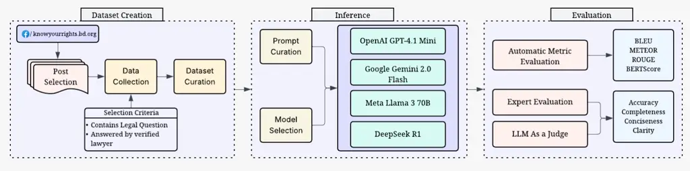
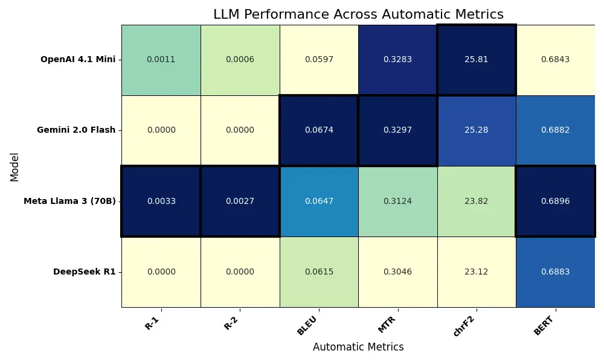
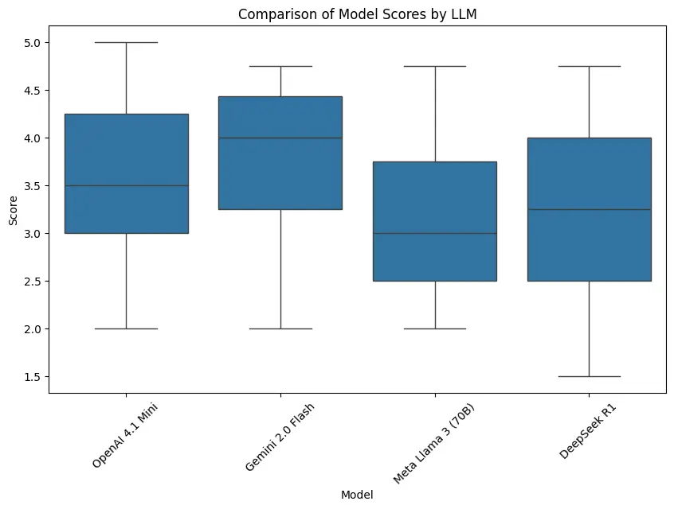
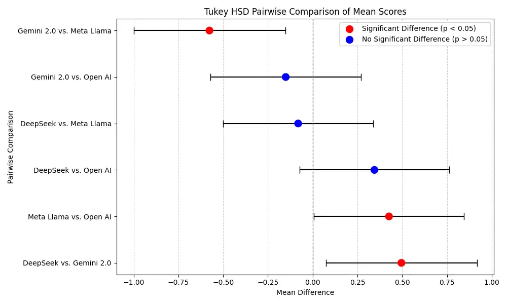
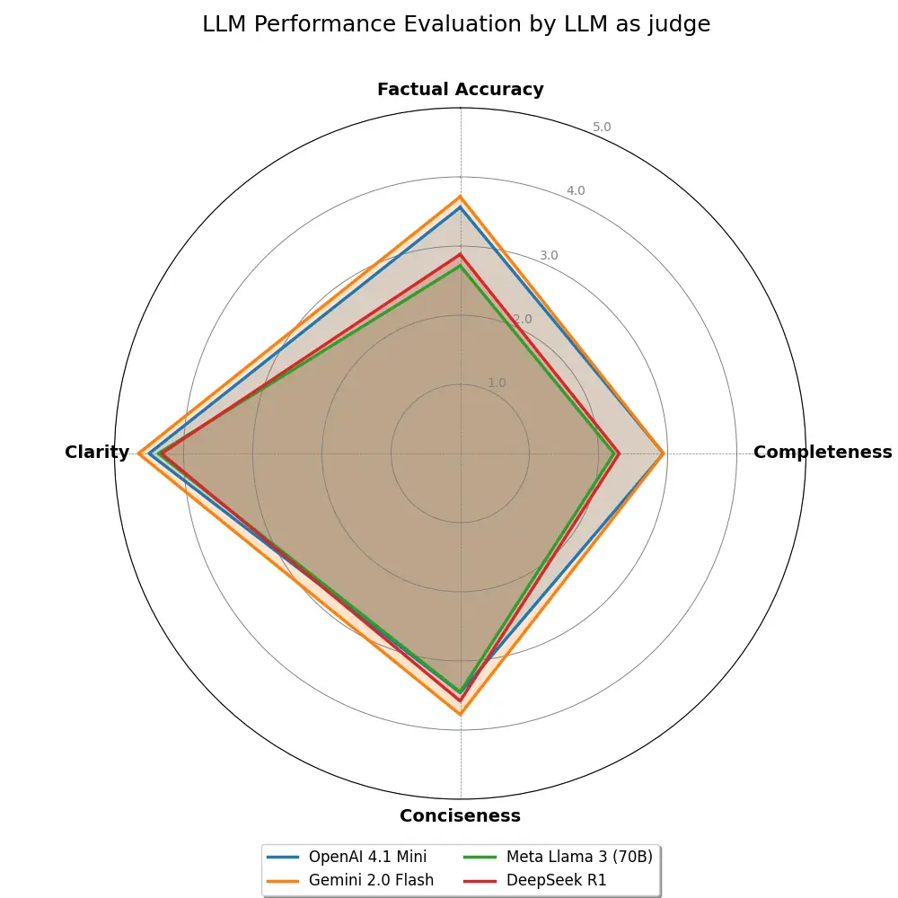
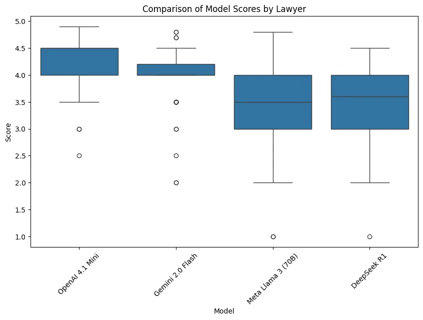
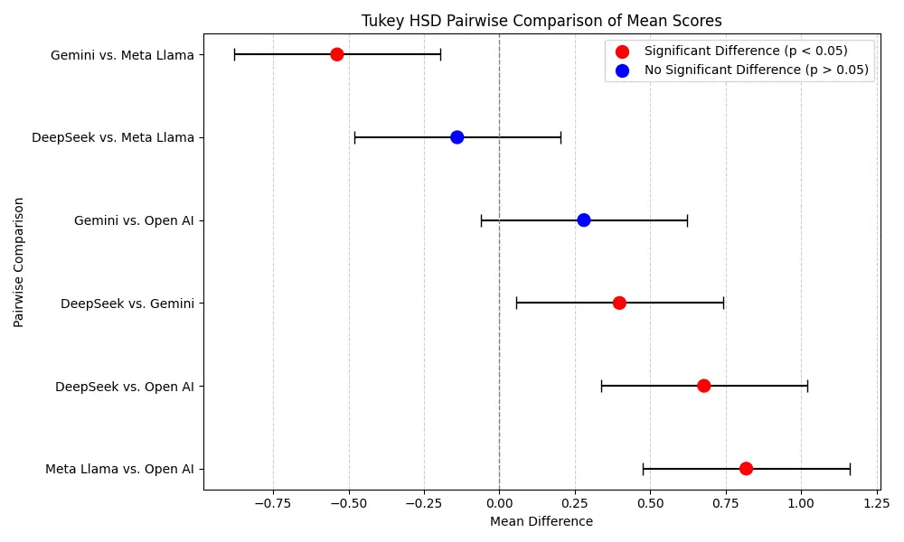
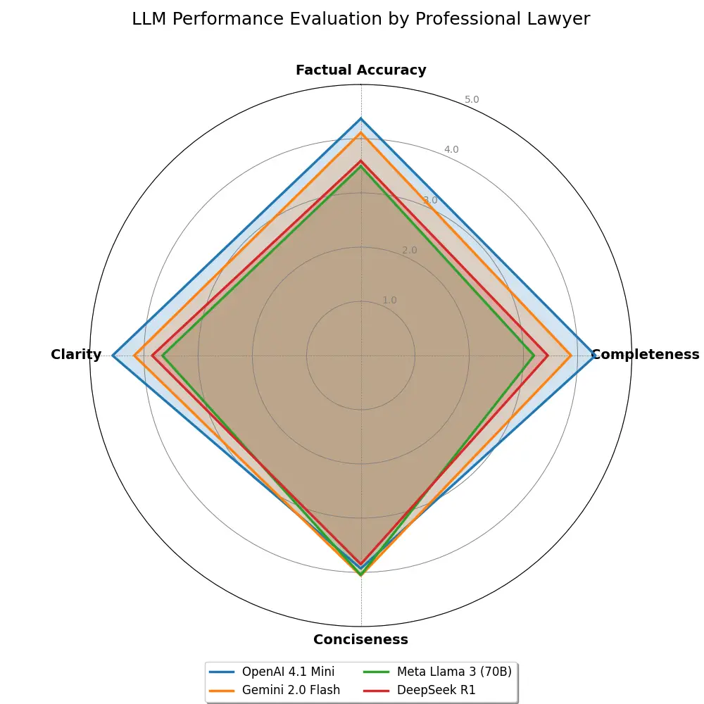
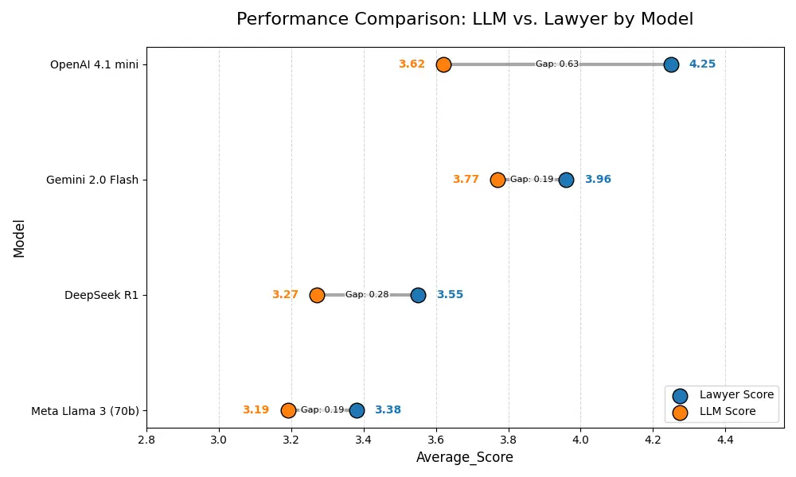

# Assessing the Reliability of Large Language Models in the Bengali Legal Context: A Comparative Evaluation Using LLM-as-Judge and Legal Experts

Sabik Aftahee  [🖂](mailto:u1904024@student.cuet.ac.bd)    A.F.M.
Farhad [🖂](mailto:afmfarhad13@gmail.com)    Arpita
Mallik [🖂](mailto:u2004023@student.cuet.ac.bd)    Ratnajit
Dhar [🖂](mailto:u2004008@student.cuet.ac.bd)    Jawadul
Karim [🖂](mailto:u2310022@student.cuet.ac.bd)    Nahiyan Bin
Noor [🖂](mailto:nahiyan.cro@researchbuddy.tech)    Ishmam Ahmed
Solaiman [🖂](mailto:ishmam.cto@researchbuddy.tech)

^(a)Department of Computer Science, Chittagong University of Engineering
and Technology, Chittagong, Bangladesh  
^(b)Department of Mechanical Engineering, Chittagong University of
Engineering and Technology, Chittagong, Bangladesh  
^(c)Department of Water Resource Engineering, Chittagong University of
Engineering and Technology, Chittagong, Bangladesh  
^(d)ResearchBuddy AI, Bangladesh

H I G H L I G H T S

 

- •
  Generated responses using four large language models (LLMs).
- •
  Used both LLM and human lawyer judges based on four criteria.
- •
  Human lawyers considered OpenAI significantly better, though LLM
  judges found no difference (Cohen’s kappa).

A R T I C L E   I N F O

 

Keywords:  
Large Language Model

Bengali Legal Context

LLM-as-Judge

Statistical Analysis

Tukey’s HSD Test

cohen’s d interpretation

A B S T R A C T  
  Accessing legal help in Bangladesh is hard. People face high fees,
complex legal language, a shortage of lawyers, and millions of
unresolved court cases. Generative AI models like OpenAI GPT-4.1 Mini,
Gemini 2.0 Flash, Meta Llama 3 70B, and DeepSeek R1 could potentially
democratize legal assistance by providing quick and affordable legal
advice. In this study, we collected 250 authentic legal questions from
the Facebook group ”Know Your Rights,” where verified legal experts
regularly provide authoritative answers. These questions were
subsequently submitted to four four advanced AI models and responses
were generated using a consistent, standardized prompt. A comprehensive
dual evaluation framework was employed, in which a state-of-the-art LLM
model served as a judge, assessing each AI-generated response across
four critical dimensions: factual accuracy, legal appropriateness,
completeness, and clarity. Following this, the same set of questions was
evaluated by three licensed Bangladeshi legal professionals according to
the same criteria. In addition, automated evaluation metrics, including
BLEU scores, were applied to assess response similarity. Our findings
reveal a complex landscape where AI models frequently generate
high-quality, well-structured legal responses but also produce dangerous
misinformation, including fabricated case citations, incorrect legal
procedures, and potentially harmful advice. These results underscore the
critical need for rigorous expert validation and comprehensive
safeguards before AI systems can be safely deployed for legal
consultation in Bangladesh.  

## 1. Introduction

Bangladesh faces a severe legal accessibility crisis that leaves
millions of citizens without proper legal recourse. The country’s legal
system struggles with chronic under staffing, with only approximately
40,000 registered lawyers serving a population of over 165 million
people. This shortage is particularly acute in rural areas, where legal
services are often completely unavailable. Furthermore, the cost of
legal consultation remains prohibitively expensive for most citizens,
with even basic legal advice often costing several thousand Taka, a
significant burden for families living on subsistence wages.

The complexity of Bangladesh’s legal framework compounds these
accessibility issues. The country operates under a pluralistic legal
system that combines common law inherited from British colonial rule,
statutory laws enacted by Parliament, Islamic law (Sharia) for personal
status matters, and customary laws for indigenous communities. This
multilayered system creates additional barriers for ordinary citizens
who must navigate complex procedural requirements, understand archaic
legal terminology, and determine which legal framework applies to their
specific situation.

Recent advances in generative artificial intelligence (AI), particularly
large language models (LLMs), present a potential solution to these
systemic challenges. Models such as OpenAI’s GPT-4.1 Mini, Google’s
Gemini 2.0 Flash, Meta’s Llama 3 70B, and DeepSeek R1 have demonstrated
remarkable capabilities in understanding and generating human-like text
across multiple languages, including Bengali. These systems can process
complex queries, provide detailed explanations, and offer guidance on
intricate topics, capabilities that could theoretically democratize
access to legal information.

The potential benefits of AI-powered legal assistance are particularly
compelling in the Bangladeshi context. AI systems can operate 24/7
without geographic constraints, potentially serving citizens in remote
areas where no lawyers are available. They can provide immediate
responses at minimal cost, eliminating the financial barriers that
prevent many from seeking legal help. Additionally, the anonymous nature
of AI interactions could encourage people to seek advice on sensitive
legal matters without fear of social stigma or judgment, a significant
consideration in a society where legal problems often carry social
shame.

However, the deployment of AI in legal contexts also carries substantial
risks. Legal advice fundamentally differs from general information
provision because incorrect guidance can have severe real-world
consequences, including financial loss, criminal liability, loss of
legal rights, or imprisonment. Unlike other domains where AI errors
might cause inconvenience, legal misinformation can destroy lives and
livelihoods.

Several studies specifically looked at AI for legal advice. \[1\] has
revealed troubling patterns in AI-generated legal content. Studies of AI
legal tools have documented frequent fabrication of case citations,
misstatement of legal procedures, and provision of outdated or
jurisdiction-inappropriate advice. In one notable study, researchers
found that AI systems regularly created entirely fictional court cases
complete with realistic-sounding case names, dates, and legal holdings
that never existed. Such ”hallucinations” are particularly dangerous in
legal contexts because they appear authoritative and can be difficult
for non-experts to verify.

Besides, evaluations of AI legal tools like Lexis+ AI and Westlaw AI
found frequent issues with incorrect information and fake legal cases.
\[2\] have also studied legal question-answering systems in India, which
has a legal system somewhat similar to Bangladesh’s. Those studies
showed that models like GPT-3 and Google’s Flan-UL2 often struggled to
correctly handle real-world legal questions. These results suggest that
generative AI models can easily give incorrect legal guidance unless
carefully checked.

The linguistic and cultural specificity of legal systems presents
additional challenges for AI deployment in Bangladesh. Most existing AI
models have been primarily trained on English-language legal texts,
predominantly from common law jurisdictions like the United States and
United Kingdom. While Bangladesh inherited much of its legal framework
from British colonial law, significant adaptations and local statutes
mean that foreign legal precedents may not apply. Moreover, the
integration of Islamic law and customary practices creates unique legal
principles that may not be well-represented in typical AI training
datasets.

This study addresses these critical gaps through a comprehensive
evaluation of AI performance on real-world Bangladeshi legal questions.
Unlike previous research that relied on synthetic legal scenarios or
standardized test questions, we collected authentic legal queries from
citizens seeking actual legal help. These questions came from ”Know Your
Rights,” a popular Facebook group with over 200,000 members where
ordinary Bangladeshi citizens post legal questions and receive responses
from verified legal professionals.

Our research methodology combines multiple evaluation approaches to
provide a comprehensive assessment of AI capabilities and limitations.
We engaged three licensed Bangladeshi legal professionals, each with a
minimum of five years of practice experience, to conduct detailed expert
evaluations of AI responses. These experts assessed each AI-generated
answer across four critical dimensions: factual accuracy (whether legal
information was correct), legal appropriateness and safety (whether the
advice could be safely relied upon), completeness (whether all relevant
aspects of the question were addressed), and hallucination detection
(whether the response contained fabricated information).

To complement expert evaluation, we also employed automated assessment
techniques including BLEU score analysis to measure similarity between
AI responses and expert answers, and specialized algorithms to detect
potential hallucinations in AI-generated legal content. This
multi-faceted approach allows us to triangulate findings and provide
robust evidence about AI performance.

Our investigation focuses on several critical research questions: Can
current AI models provide reliable legal advice for Bangladeshi
citizens? What types of errors and risks emerge when AI systems attempt
to address real-world legal problems? How consistent are AI responses
when similar questions are phrased differently? What safeguards and
validation processes would be necessary before such systems could be
responsibly deployed for public use?

The answers to these questions have profound implications for legal
technology development, and access to justice initiatives in Bangladesh
and similar developing countries. As AI capabilities continue to advance
rapidly, understanding both the potential benefits and risks of
AI-powered legal assistance becomes increasingly urgent.

## 2. Related Work

Researchers have studied generative AI models in different contexts,
including medicine, law, and social issues. Here’s a clear overview of
relevant previous studies that help frame our work.

### 2.1. AI in Medical Advice

Recent advancements in AI for medical advice demonstrate both the
potential and challenges of integrating these technologies into clinical
practice. Shekar et al. highlight a critical concern where users
overtrust AI-generated medical responses despite low accuracy,
emphasizing the risk of misinformation and advocating for enhanced
oversight and transparency in AI systems \[3\]. The comprehensive review
by the NIH underscores AI’s transformative impact on healthcare
delivery, including diagnostics, treatment planning, and operational
enhancements, while also discussing ethical and regulatory challenges
\[4\]. Chen et al. contribute by proposing a novel framework for
diagnosing hallucination risks in AI surgical decision-support systems,
underscoring the need for robust validation to ensure clinical safety
\[5\]. In parallel, Aljamaan et al. introduce the Reference
Hallucination Score metric aimed at quantifying citation inaccuracies in
AI medical chatbots to improve information reliability \[6\]. Practical
guidelines for AI’s role in health promotion focus on ethical,
inclusive, and collaborative implementation to maximize benefits and
minimize bias \[7\]. A user-focused survey by Stadler et al. sheds light
on trust determinants in healthcare AI, advocating for human-centric
design and transparent governance to foster adoption \[8\]. A 2024
literature review synthesizes advances and persisting challenges in
healthcare AI, emphasizing the need for empirical validation and
equitable deployment \[9\].

Giorgi et al. \[10\] evaluated ChatGPT-4 and LLaMA-2 on real-world
substance use and recovery questions. Clinicians rated AI responses as
high quality overall; however, the study identified “instances of
dangerous disinformation” such as disregard for suicidal ideation,
incorrect emergency helpline information, and endorsement of home detox.
This pattern of seemingly high-quality yet potentially harmful advice
indicates fundamental reliability challenges, which are similarly
critical in legal AI applications. Furthermore, AI systems exhibited
inconsistency depending on question phrasing, with GPT-4 providing
dangerous advice about home detoxification 23% of the time when queries
were rephrased.

Lee et al. \[11\] examined ChatGPT and Bard conveying patient questions
about labor epidurals; expert anesthesiologists found both models mostly
accurate but occasionally misleading, highlighting the risk of harm
without medical supervision.

Complementing these domain-specific studies, broader research paints a
comprehensive picture of AI in medicine. Chustecki et al. \[12\] review
the benefits and risks of healthcare AI, addressing concerns such as
bias, transparency, and accountability in clinical decision-making.
Regulatory perspectives, like those discussed by the OECD \[13\],
emphasize balancing AI innovation with ethical, legal, and safety
frameworks.

Recent studies further deepen understanding of AI’s impacts. Nong et al.
\[14\] survey AI’s application in clinical settings, highlighting
improved health trajectory predictions and risk monitoring. De Micco et
al. \[15\] review AI’s role in clinical risk management, noting
successes in detecting adverse events but also implementation
challenges. Cutting-edge models, such as Med-PaLM 2 \[16\], show
expert-level performance in medical question answering but still face
safety and reliability constraints. Moreover, Yu et al. \[17\]
demonstrate that physicians assisted by AI outperform traditional
methods in complex case management, reinforcing the complementary role
of AI with expert clinical oversight.

However, patient perspectives reveal critical adoption challenges.
Shekar et al. \[3\] found that patients often overtrust AI-generated
medical advice regardless of its accuracy, sometimes preferring AI
responses over human doctors, thus increasing risks of following
incorrect recommendations without sufficient skepticism.

### 2.2. AI for Legal and Procedural Advice

The legal domain presents unique challenges for AI systems that have
been documented in several important studies. Magesh et al. \[1\]
conducted a critical evaluation of AI-driven legal research tools,
including Lexis+ AI and Westlaw AI systems specifically designed for
legal applications. Despite their specialized training, legal experts
found frequent issues with fabricated case citations, incorrect legal
facts, and misleading guidance. Their findings were particularly
alarming, revealing ”a notable frequency of fabricated case references
and unsupported claims.” Legal experts emphasized that such
hallucinations are especially dangerous in legal contexts because
fictional cases can appear highly credible to non-experts and may be
cited in legal briefs or relied upon for legal decisions.

Magesh et al. \[18\] conduct the first preregistered empirical
evaluation of AI-driven legal research tools, revealing significant
hallucination rates (false information generation) between 17% and 33%
despite claims of hallucination-free operation by prominent providers
like LexisNexis and Thomson Reuters. Their findings underscore the
necessity for legal professionals to supervise AI outputs rigorously and
remain vigilant to errors.

Explainable AI tools have been developed and validated for legal
reasoning about cases, such as modeling Article 6 of the European
Convention on Human Rights, offering high accuracy and usability to end
users in critical legal domains \[19\]. Meanwhile, utilising AI for
legal assistance focuses on decision-support systems that enhance the
efficiency and quality of legal aid delivery, tested primarily in
developing contexts \[20\].

The auditing of AI systems, combining legal, ethical, and technical
perspectives, is increasingly recognized as essential to ensuring
compliance with standards and mitigating risks associated with opaque or
biased AI decision-making \[21\]. Finally, discussions on AI as a legal
person raise foundational questions about attributing rights and
obligations to AI entities, drawing parallels with corporate personhood
and regulatory frameworks to understand potential legal status and
implications \[22\].

Research in jurisdictions with legal systems similar to Bangladesh
provides additional relevant insights. Juvekar et al. \[23\] benchmark
frontier LLMs on India’s public legal examinations, combining objective
multiple-choice tests with lawyer-graded subjective assessments. While
LLMs exceed historical human cutoffs on objective tests, they fall short
on subjective long-form reasoning, particularly in procedural
compliance, accurate citation, and forum-appropriate legal voice. The
study concludes LLMs may assist with information retrieval and
consistency checks but cannot replace human practitioners in drafting
and high-stakes decision making. Hemrajani et al. \[24\] performed an
extensive evaluation of large language models in Indian legal tasks,
including drafting, issue spotting, legal advice, research, and
reasoning. The study found that although these models demonstrate
promising capabilities in handling routine legal processes, they often
face challenges related to context sensitivity and accuracy. The
analysis highlighted the models’ potential benefits alongside
limitations specific to the Indian legal system, which shares
commonalities with Bangladesh’s legal framework. These findings
underscore important considerations for deploying generative AI in
regional legal contexts, indicating areas where our own work may face
similar obstacles.

### 2.3. AI Performance and Reliability Evaluations

Recent evaluations by Morath et al. \[25\] and Giorgi et al. \[26\]
offer critical insights into the reliability and risks associated with
generative AI systems in healthcare. Morath et al. \[25\] conducted a
real-world study assessing ChatGPT’s ability to accurately answer
pharmacists’ drug-related questions. The study revealed notable
inaccuracies and incompleteness in many responses, which could pose
patient safety risks. Consequently, the authors emphasized that
comprehensive expert validation and verification against established
clinical sources are essential before integrating AI outputs into
practice. In parallel, Giorgi et al. \[26\] examined ChatGPT and LLaMA-2
responses to questions from substance abuse recovery forums. Clinicians
found the AI advice to be often helpful but occasionally dangerously
incorrect, highlighting the necessity of expert oversight to prevent
harm in sensitive healthcare applications.

These findings reflect the broader conclusions of systematic reviews and
expert guidelines, such as those by Takita et al. \[27\], who
demonstrated that generative AI models achieve diagnostic accuracy
similar to non-expert physicians but remain inferior to specialists in
clinical decision-making. Similarly, Lekadir et al. \[28\] presented
international consensus guidelines advocating for trustworthy,
transparent, and secure AI systems in healthcare, emphasizing rigorous
safety and reliability standards.

Ojha et al. \[29\] present a comprehensive user-perspective survey
emphasizing uncertainty as a central factor influencing trust in
healthcare AI, advocating for human-centric, multi-stakeholder
engagement throughout AI lifecycles to build trustworthy systems that
balance knowledge with acceptable uncertainty.Mökander \[21\] offers a
detailed review on AI auditing from legal, ethical, and technical
perspectives, highlighting its historical roots in financial and safety
audits. The paper categorizes audits into technology-focused and
process-oriented approaches, emphasizing the imperative for
interdisciplinary collaboration and holistic frameworks that not only
assess AI outputs but also governance structures, societal impacts, and
environmental considerations.Lee et al. \[30\] analyze the risks of
generative AI, particularly hallucinations and privacy concerns such as
data leaks, offering an empirical perspective on user adaptations to
these challenges. Their work proposes resilience strategies including
adversarial training, misinformation detection, and regulatory
compliance to foster robust and trustworthy generative AI systems
capable of withstanding adversarial shocks and maintaining societal
trust.Together, these studies underscore the dual promise and critical
challenges of leveraging generative AI in healthcare, advocating a
cautious approach underscored by expert involvement and adherence to
established standards.

### 2.4. AI Hallucinations and Risks

Recent research efforts have advanced understanding of AI hallucinations
through systematic classification, detection, and quantification. Zhao
et al. \[31\] propose a comprehensive taxonomy distinguishing
hallucination types by inconsistency with input, context, or facts,
facilitating targeted mitigation strategies. Complementing this, Du et
al. \[32\] develop quantitative metrics such as prompt sensitivity and
model variability to attribute hallucinations accurately, enabling
benchmarking across models and use cases.

Kaate et al. \[33\] experimentally study user interactions with
AI-generated personas and reveal that users often accept hallucinated
but plausible answers from AI personas, even when questions are
unanswerable, increasing the risk of misinformation propagation. The
findings highlight the need for guardrails to alert users to AI
uncertainties.

Kalai et al. \[34\] offer theoretical insight into hallucination origins
rooted in LLM training processes that favor confident but occasionally
erroneous outputs. Specifically in healthcare, Asgari et al. \[35\]
present a rigorous framework to measure hallucination effects on
clinical safety, highlighting risks of misdiagnosis and adverse
outcomes. Gondode et al. \[36\] emphasize that hallucinations in
anesthesia AI tools pose significant risks to patient care,
necessitating stringent safety protocols.Furthermore, Chustecki et al.
\[37\] conduct a narrative review of AI in healthcare, stressing the
essential balance between benefits and hallucination-related risks.
Collectively, these studies underscore the critical need for
comprehensive evaluation, detection, and governance to ensure
responsible AI deployment in sensitive domains like healthcare. Hassan
et al. \[38\] assessed ChatGPT’s fidelity by comparing AI-generated
resuscitation statements against the European Resuscitation Council’s
official 2021 guidelines. While ChatGPT often generated accurate
responses, instances of partial or incorrect information were present.
The study demonstrated that employing structured expert evaluations with
high inter-rater reliability effectively identifies AI inaccuracies,
highlighting the critical need for rigorous validation protocols when
integrating AI-generated medical content.

These studies provide an evidence based foundation underscoring the
pervasive challenge of AI hallucinations and the pressing need for
interdisciplinary approaches, including expert oversight, rigorous
evaluation frameworks, and advanced detection technologies to ensure the
safe and trustworthy application of generative AI in sensitive domains
such as law and medicine.

### 2.5. Gaps in Current Research

While existing research provides valuable insights into AI performance
in sensitive domains, several critical gaps remain. First, most
evaluations have relied on synthetic questions or standardized test
cases rather than authentic queries from people seeking real help. This
limitation is significant because real-world questions often involve
complex, ambiguous situations that do not fit neatly into academic test
scenarios.

Second, no study have examined AI performance in low-resource linguistic
and legal contexts for Bangladesh. The unique challenges of providing
legal guidance in for Bangladesh’s pluralistic legal system remain
largely unexplored.

Third, most research has focused on single evaluation methods, typically
either expert assessment or automated metrics, rather than comprehensive
multifaceted evaluation approaches.

Our study addresses these gaps by: (1) using authentic legal questions
from Bangladeshi citizens seeking real help; (2) focusing specifically
on \[translate:Bengali\]-language legal queries within Bangladesh’s
unique legal framework; (3) combining expert evaluation, automated
assessment, and consistency testing to provide comprehensive evaluation;
and (4) examining both the accuracy and safety implications of
AI-generated legal advice in a high-stakes real-world context.

## 3. Methodology

### 3.1. Dataset Compilation Strategy

The foundation of this investigation rests upon the systematic
evaluation of AI performance using authentic legal queries posed by
Bangladeshi citizens seeking genuine legal assistance. Our research
design centers on the Facebook group “Know Your Rights”, which
represents Bangladesh’s most substantial online legal help forum with
over 200,000 active members. This platform represents a digital
environment where people ask real legal questions in Bengali and get
answers from verified lawyers, legal aid practitioners, and retired
judges on issues ranging from family and property to commercial,
criminal, and administrative law.

We systematically sampled legal posts from January through May of 2025,
creating a high-quality AI evaluation dataset by using strict parameters
from over 500 posts. We included only citable legal questions and
provided expert responses, while also focusing on legal questions that
had questions about real substantive issues and significant legal
consequences while excluding emotional posts or those with multiple
unrelated questions.

The dataset composition was structured to reflect the actual frequency
of legal issues raised by Bangladeshi citizens, with family and property
law the most frequent, including, in order of frequency, criminal law,
civil law, administrative law, commercial law and constitutional law.

### 3.2. Model Selection and Configuration

Four state-of-the-art large language models were selected to represent
different architectural paradigms and training methodologies: OpenAI
GPT-4.1 Mini, Google Gemini 2.0 Flash, Meta Llama 3 70B, and DeepSeek
R1. This selection covers both proprietary and open-source models,
providing broad representation of current AI capabilities.

OpenAI GPT-4.1 Mini is a multilingual, efficient model in the GPT
family, widely adopted in real-world applications, making it relevant
for practical legal deployment. Google Gemini 2.0 Flash represents
Google’s latest multimodal AI advances, trained on diverse South Asian
languages, allowing evaluation of cross-linguistic legal reasoning in
Bangladeshi contexts. Meta Llama 3 70B is an open-source model with 70
billion parameters, offering transparency in training and sufficient
capacity for complex legal reasoning. DeepSeek R1 showcases emerging AI
reasoning outside Western paradigms, performing well on complex tasks
and enabling comparison of different development approaches.

### 3.3. Prompt Engineering and Query Generation Framework

To ensure consistent and fair evaluation, standardized prompts were
designed instructing AI models to act as legal advisors for Bangladeshi
citizens. Prompts established context by specifying Bangladesh’s legal
framework, encouraged detailed responses covering relevant laws,
procedures, risks, and alternatives, and requested citations to verify
accuracy. Responses were required in Bengali, allowing English legal
terms commonly used locally. Safety instructions prompted acknowledgment
of limitations and recommendation of professional consultation. The
standard prompt used was:

### 3.4. Response Generation Protocol

All LLM responses were generated with consistent parameters to ensure
fair comparison. Temperature was set at 0.7 to balance creativity and
reliability, and response length was limited to 1000 tokens to allow
detailed yet concise legal guidance. Multiple responses were generated
for some questions to assess intra-model reliability, particularly for
high-stakes cases. Timestamps were recorded throughout to track
potential model updates and account for temporal variations in
performance.

Multiple response generation was implemented for a subset of questions
to assess intra-model reliability and consistency, particularly for
high-stakes legal scenarios where response variability could have
significant implications for users seeking legal guidance. This approach
enables detection of concerning inconsistencies within individual
models.

Comprehensive timestamp recording was maintained throughout the
generation process to account for potential model updates during the
evaluation period, ensuring that any temporal variations in model
performance could be identified and addressed in the analysis.

### 3.5. Expert Evaluation Framework

A carefully selected panel of three licensed Bangladeshi legal
professionals was assembled, each possessing a minimum of five years of
active practice experience across different legal specializations.

The first expert specializes in family and property law with eight years
of experience in district courts, providing expertise in the most
frequently encountered legal domains within our dataset. The second
expert practices criminal law with six years of experience including
Supreme Court practice, ensuring competent evaluation of high-stakes
criminal law responses. The third expert focuses on civil and commercial
law with seven years of experience encompassing both litigation and
legal consultancy, thereby covering the breadth of civil legal matters
represented in the dataset.

Each expert participated in a comprehensive calibration process
involving joint evaluation of 20 sample responses to harmonize
assessment criteria and reduce individual bias that might influence
evaluation consistency.

### 3.6. Multi-Dimensional Evaluation Metrics

Expert evaluations used four key dimensions adapted from legal AI
assessment frameworks to measure response quality. Factual accuracy
assessed whether responses contained correct legal information using a
three-point scale: correct (fully accurate for Bangladesh’s legal
system), partially correct (mostly accurate with minor errors), or
incorrect (significant inaccuracies that could mislead users). Legal
appropriateness and safety evaluated whether advice could be safely
relied upon: safe (reliable guidance), usable with caution (requires
verification or professional input), or dangerous/misleading (could
cause legal harm if followed). Completeness and coverage measured
whether responses fully addressed all relevant aspects of the legal
question: fully addressed (all important points covered), partially
complete (main issues covered but some gaps), or incomplete (critical
aspects missing). Clarity and comprehensibility assessed
understandability for non-experts on a five-point scale, from crystal
clear explanations to responses difficult for lay users to interpret or
apply.

### 3.7. Automated Evaluation Metrics

To complement expert assessment and provide additional analytical
perspectives, several automated evaluation techniques were employed to
assess response characteristics and quality indicators that might not be
fully captured through human evaluation alone.

BLEU, ROUGE, METEOR, and BERTScore analyses were conducted to compare AI
responses against expert answers, measuring semantic similarity, content
overlap, and alignment with professional responses. While these metrics
do not directly assess legal accuracy, they provide valuable insights
into response relevance, coverage, and linguistic fidelity, helping
identify answers that may be off-topic, incomplete, or insufficiently
aligned with expert guidance. Lexical overlap analysis assessed whether
AI responses used appropriate legal terminology, identifying answers
with insufficient or overly complex language. Response length and
structure were also examined, including formatting and organization, as
well-structured responses generally improve comprehension and practical
usability.

### 3.8. Consistency and Reproducibility Testing

To assess AI reliability, consistency checks evaluated whether models
provided stable guidance across different conditions. Temporal
consistency tested responses to the same questions at different times to
detect variability from model updates or randomness. Paraphrase testing
used reworded versions of critical legal questions to ensure models gave
consistent advice for semantically identical queries. Multiple
generation analysis produced several responses to high-stakes questions
with identical prompts to identify intra-model variability that could
affect reliability.

### 3.9. Statistical Analysis Framework

Proper statistical measures were employed to ensure evaluation validity
and enable meaningful interpretation of results across different models
and evaluation dimensions.

Inter-rater reliability was assessed using Fleiss’ Kappa across all
evaluation dimensions to ensure consistent expert assessment and
validate the reliability of human evaluation procedures. Minimum Kappa
values of 0.60 were required to indicate substantial agreement and
ensure evaluation validity.

Confidence intervals were calculated for all reported scores at the 95%
level to indicate measurement precision and enable appropriate
interpretation of differences between models. These intervals help
distinguish between meaningful performance differences and those that
might result from measurement error.

Appropriate statistical tests were employed to identify significant
differences between AI models and across evaluation dimensions, ensuring
that reported performance differences reflect genuine variations rather
than random fluctuation in the data.

### 3.10. Quality Assurance and Bias Mitigation

Several safeguards were implemented to ensure evaluation quality and
minimize bias. Blinded evaluation prevented experts from knowing which
model generated a response, ensuring that assessments focused solely on
response quality. To further reduce potential bias, responses were
presented in randomized order, avoiding sequence effects that could
influence evaluations. Regular calibration sessions maintained alignment
among experts throughout the evaluation period, promoting consistency in
subjective assessments. When significant disagreements arose, structured
resolution procedures ensured that discrepancies were addressed through
discussion and consensus rather than arbitrary decisions. Together,
these measures created a robust framework for rigorous and reliable
evaluation of AI performance on authentic Bangladeshi legal questions,
maintaining both scientific and practical rigor.

Figure 1: Methodology of the study

## 4. Dataset Construction and Characteristics

### 4.1. Data Source and Collection Methodology

Our dataset was constructed through systematic collection from the
Facebook group “Know Your Rights”, which serves as Bangladesh’s largest
online legal help forum with over 200,000 active members. This platform
represents a unique ecosystem where ordinary citizens post genuine legal
questions in Bengali and receive responses from verified legal
professionals, including practicing lawyers, legal aid workers, and
retired judges.

The group’s structure provides an ideal source for authentic legal
queries because it captures the real information needs of Bangladeshi
citizens. Unlike academic legal databases or synthetic question sets,
these queries reflect actual legal problems faced by people from diverse
socioeconomic backgrounds, geographic locations, and legal
circumstances. Questions range from complex commercial disputes to
family law matters, property rights issues, criminal law concerns, and
administrative procedures.

We collected data during a six-month period from January 2025 to May
2025, ensuring temporal diversity and capturing seasonal variations in
legal issues. Our collection methodology involved systematic sampling
across different legal categories to ensure balanced representation of
various legal domains relevant to Bangladeshi citizens.

### 4.2. Data Selection and Filtering Criteria

From the initial collection of over 500 posts, we applied rigorous
selection criteria to create a high-quality dataset suitable for AI
evaluation. Questions were included only if they met the following
requirements:

Clarity and Specificity: Questions needed to pose clear, answerable
legal queries rather than general complaints or rhetorical statements.
We excluded posts that were primarily emotional venting or contained
multiple unrelated questions that would confound evaluation.

Expert Response Availability: Each included question required at least
one verified response from a legal professional with confirmed
credentials. The group’s moderation system verifies legal professional
status through bar council membership, law firm affiliation, or judicial
experience.

Language Quality: Questions needed to be written in clear Bengali
without excessive colloquialisms or regional dialects that might
challenge AI comprehension. However, we retained questions with legal
terminology in English (common in Bangladeshi legal discourse) to test
AI handling of mixed-language queries.

Ethical Appropriateness: We excluded questions involving ongoing
criminal cases where public discussion might compromise legal
proceedings, and questions containing detailed personal information that
could identify specific individuals.

Legal Relevance: Questions needed to involve actual legal issues rather
than general advice-seeking or non-legal problems. We focused on
questions where incorrect advice could have significant legal
consequences.

### 4.3. Dataset Composition and Statistics

Our final dataset comprises 250 carefully curated question-answer pairs,
distributed across major legal categories as follows:

The legal topics are distributed across seven key areas. Family Law
constitutes the largest portion, with 58 questions (23.2%) covering
marriage, divorce, inheritance, child custody, and domestic violence.
Next is Property Law, which has 50 questions (20.0%) on land disputes,
property registration, rental agreements, and property inheritance.
Criminal Law makes up 42 questions (16.8%), focusing on criminal
procedures, bail applications, and criminal defense rights. Following
this is Civil Litigation with 33 questions (13.2%) on civil suit
procedures, contract disputes, and civil remedies. Both Administrative
Law and Commercial Law are represented equally with 15 questions (10.0%)
each; the former covers government service issues, citizenship matters,
and administrative appeals, while the latter includes business
registration, commercial contracts, and trade disputes. Finally,
Constitutional Law accounts for the smallest share with 10 questions
(6.7%), addressing fundamental rights, public interest litigation, and
constitutional procedures.

This distribution reflects the actual frequency of different legal
issues raised by Bangladeshi citizens, with family and property law
representing the most common concerns.

### 4.4. Question Complexity and Characteristics

The questions in our dataset exhibit varying levels of complexity, which
we categorized using a three-tier system:

Basic Questions (40%): These involve straightforward factual inquiries
about legal procedures, rights, or requirements. Example: “What
documents are needed to file for divorce in Bangladesh?”

Intermediate Questions (45%): These require application of legal
principles to specific circumstances and may involve multiple legal
considerations. Example: “My husband divorced me through triple talaq,
but we have joint property. What are my rights to the property and how
can I claim maintenance?”

Complex Questions (15%): These involve multiple legal domains, require
synthesis of various legal principles, or present novel legal
situations. Example: The freedom fighter allowance fraud case shown in
our example, which involves criminal law, administrative law, family
law, and financial regulations.

This complexity distribution allows us to assess AI performance across
different levels of legal reasoning and application.

### 4.5. Expert Answer Quality and Verification

Each question in our dataset includes verified expert answers that serve
as our evaluation baseline. These responses were provided by legal
professionals whose credentials were verified through the Facebook
group’s moderation system. Expert answers typically include:

- •
  A detailed explanation of applicable law, regulations, and judicial
  authority that relates to the user’s inquiry.
- •
  Structured and actionable guidance that clearly addresses the
  appropriate legal steps, processes, or remedies.
- •
  Reasoned assessment of possible challenges or risks and alternatives
  within the applicable legal context.
- •
  Recommendations for any ancillary resources in context, such as legal
  documents, agencies, contacts, or fur- ther professional help.

The expert answers underwent quality review by our research team to
ensure they met professional standards and contained sufficient detail
for comparative evaluation.

### 4.6. Privacy Protection and Ethical Considerations

All data collection and processing followed strict ethical guidelines to
protect user privacy. We implemented several safeguards:

- •
  All personally identifiable information, including names, contact
  details, and addresses were systematically removed or anonymized prior
  to inclusion in the dataset.
- •
  Case-specific details that could inadvertently reveal individual
  identities or legal proceedings were generalized while preserving
  their contextual and legal relevance.
- •
  Data were collected exclusively from publicly available posts within
  the Facebook group; no private messages or restricted content were
  accessed or utilized.
- •
  The entire data acquisition protocol underwent institutional ethics
  review and was approved prior to implementation, ensuring transparency
  and accountability in research practices.

### 4.7. Dataset Validation and Quality Assurance

To ensure dataset quality, we implemented multiple validation steps:

- •
  Three independent legal professionals reviewed a representative sample
  of question-answer pairs to verify the accuracy and appropriateness of
  expert responses.
- •
  Bengali language specialists assessed question clarity to ensure
  comprehensible and contextually correct phrasing for AI processing.
- •
  The dataset was tested with preliminary AI queries to detect
  formatting or encoding issues that could affect model performance.

This comprehensive dataset represents the first large-scale collection
of authentic Bengali legal questions paired with verified expert
answers, providing a robust foundation for evaluating AI performance in
Bangladeshi legal contexts.

## 5. Result and Discussion

### 5.1. Automatic Metric-Based Evaluation

Four large language models (OpenAI 4.1 Mini, Gemini 2.0 Flash, Meta
Llama 3–70B, and DeepSeek R1) were used based on an identical input
prompt to generate the answers. To evaluate the performance of these
models, 50 legal complex questions were selected from the dataset
covering wide range of legal domains like Criminal Law, Inheritance
Law,Marriage and Divorce Law, Civil Law,Labor Law etc. For evaluation,
established evaluation metrics including ROUGE, BLEU, METEOR, chrF2, and
BERTScore were used comparing the responses against reference answers
provided by professional lawyers.

|                    |        |        |        |        |       |        |
| ------------------ | ------ | ------ | ------ | ------ | ----- | ------ |
| Model              | R-1    | R-2    | BLEU   | MTR    | chrF2 | BERT   |
| OpenAI 4.1 Mini    | 0.0011 | 0.0006 | 0.0597 | 0.3283 | 25.81 | 0.6843 |
| Gemini 2.0 Flash   | 0.0000 | 0.0000 | 0.0674 | 0.3297 | 25.28 | 0.6882 |
| Meta Llama 3 (70B) | 0.0033 | 0.0027 | 0.0647 | 0.3124 | 23.82 | 0.6896 |
| DeepSeek R1        | 0.0000 | 0.0000 | 0.0615 | 0.3046 | 23.12 | 0.6883 |

Table 1: Automatic evaluation metrics for four large language models.²²
2 R-1 and R-2 refer to ROUGE-1 (F1) and ROUGE-2 (F1) scores,
respectively. BERT and MTR refer to BERTScore-F1 and METEOR scores
respectively.

Table 2 presented the automatic metrics evaluation among the four
models. There was minimal lexical overlap between the models’ answers
and the reference answers, as the ROUGE-1 and ROUGE-2 scores were near
zero. In terms of the BLEU score, which reflects n-gram similarity, the
results were also low, indicating limited n-gram similarity with the
reference answers. In contrast, METEOR values were comparatively high,
with Gemini 2.0 Flash obtaining the best score of 0.3297. For chrF2,
OpenAI 4.1 Mini achieved the highest score of 25.81, while Meta Llama 3
(70B) had the best BERTScore-F1 score of 0.6896. This discrepency of the
results was due to the fact that, LLM-generated answers were more
structured and detailed, while the reference responses consisted of
informal Facebook comments offering practical guidance and actionable
recommendations.

After analyzing the results, it was evident that traditional evaluation
metrics captured only minimal aspects of the legal domain. The very low
lexical and n-gram overlaps indicated the limitations of these metrics
for complex legal reasoning, which motivated the need to adapt a more
sophisticated approach by using a state-of-the-art LLM as a judge. This
new approach is described in the next section.

Figure 2: Automatic Metrics Based Evaluation

### 5.2. LLM as judge based Evaluation

As automatic metrics based evaluation was not sufficient enough to
capture the complex legal reasoning, a state of the art LLM model was
used to evaluate the model performance. Specifically, Gemini 2.5 pro was
employed in this purpose.The responses were evaluated based on four
specific criteria which were “Factual Accuracy,” “Completeness,”
“Conciseness,” and “Clarity” .

|                    |               |
| ------------------ | ------------- |
| Model              | Average Score |
| OpenAI 4.1 Mini    | 3.612         |
| Gemini 2.0 Flash   | 3.772         |
| Meta Llama 3 (70B) | 3.177         |
| DeepSeek R1        | 3.266         |

Table 2: Evaluation of LLM Performance by LLM Judge

Table 2 showed that among the four models, Gemini 2.0 Flash achieved the
highest score of 3.772, suggesting its superior ability to capture
complex legal reasoning. This was followed by the next best model,
OpenAI 4.1 mini, which achieved an average score of 3.612. In contrast,
Meta Llama 3 (70B) was the lowest performing model in this domain,
achieving an average score of 3.177.

Figure 3: Box plot comparing the distribution of LLM scores based on the
LLM-as-a-judge evaluation.

To gain a more comprehensive understanding of the results, and to
determine if the differences in average scores are statistically
significant, an ANOVA test and a post-hoc Tukey’s HSD test were
performed.

|                                     |                                     |           |        |         |         |                           |
| ----------------------------------- | ----------------------------------- | --------- | ------ | ------- | ------- | ------------------------- |
| Group 1                             | Group 2                             | Mean Diff | p-adj  | Lower   | Upper   | Reject $`\mathbf{H_{0}}`$ |
| Overall Score by LLM for DeepSeek   | Overall Score by LLM for Gemini 2.0 | 0.4956    | 0.0139 | 0.0742  | 0.9171  | ✓                         |
| Overall Score by LLM for DeepSeek   | Overall Score by LLM for Meta Llama | -0.0812   | 0.9585 | -0.5005 | 0.3380  | $`\times`$                |
| Overall Score by LLM for DeepSeek   | Overall Score by LLM for Open AI    | 0.3450    | 0.1432 | -0.0721 | 0.7621  | $`\times`$                |
| Overall Score by LLM for Gemini 2.0 | Overall Score by LLM for Meta Llama | -0.5768   | 0.0029 | -1.0004 | -0.1533 | ✓                         |
| Overall Score by LLM for Gemini 2.0 | Overall Score by LLM for Open AI    | -0.1506   | 0.7908 | -0.5721 | 0.2708  | $`\times`$                |
| Overall Score by LLM for Meta Llama | Overall Score by LLM for Open AI    | 0.4262    | 0.0447 | 0.0070  | 0.8455  | ✓                         |

Table 3: Tukey’s HSD Post-Hoc Test Results for Multiple Comparisons of
Mean LLM Scores (FWER = 0.05)

The result of the ANOVA test shows a p-value of 0.0009, indicating a
significant difference between the average scores of the models. To
identify which specific pairs of models had statistically significant
differences, a post hoc Tukey’s honestly significant difference (HSD)
test was performed.

As shown in Table 3, the Tukey HSD test revealed three pairs with a
statistically significant difference in their mean scores. The first
significant difference was found between Gemini 2.0 Flash and Meta Llama
3 (70B) having (p-adj=0.0029). After that, the difference between Gemini
2.0 Flash and DeepSeek R1 was also statistically significant
(p-adj=0.0139). Finally, last pair of statistically significant
difference observed between Meta Llama 3 (70B) and OpenAI 4.1
(p-adj=0.0447). Apart from these three, there was no statistically
significant difference between the models. This result confirms that,
Gemini 2.0 Flash is the superior model for the complex bengali legal
question answering domain comapred to Meta Llama 3 (70B) and DeepSeek
R1. But there was no statistically significant difference found between
the top-performing Gemini 2.0 Flash and the next-best OpenAI 4.1 mini
indicating Gemini 2.0 Flash’s performance is statistically on par with
OpenAI 4.1 mini.

Figure 4: Tukey HSD Pairwise Comparison of Mean Scores based on the
LLM-as-a-judge evaluation.

### 5.3. Criterion-Based Evaluation by LLM

To further enhance our reasoning, the models were further compared based
on each individual criterion including Factual Accuracy, Completeness,
Conciseness, and Clarity to see which model performs better in the
specific criteria.

|                    |                  |              |             |         |
| ------------------ | ---------------- | ------------ | ----------- | ------- |
| Model              | Factual Accuracy | Completeness | Conciseness | Clarity |
| OpenAI 4.1 Mini    | 3.560            | 2.940        | 3.460       | 4.500   |
| Gemini 2.0 Flash   | 3.714            | 2.939        | 3.776       | 4.653   |
| Meta Llama 3 (70B) | 2.714            | 2.224        | 3.449       | 4.367   |
| DeepSeek R1        | 2.880            | 2.300        | 3.580       | 4.320   |

Table 4: Evaluation of LLM Performance based on each criterion by LLM
judge

As shown in Table 4, a consistent trend found across all criteria, with
Gemini 2.0 Flash achieving the highest score in each category. For
Factual Accuracy as per LLM judge, Gemini 2.0 Flash was able to achieve
3.714 average score out of 5 while the next best model was OpenAI 4.1
Mini with 3.560 average score. In contrast, Meta Llama 3 (70B) and
DeepSeek R1 showed significantly lower performance with score of 2.714
and 2.880 respectively.

In case of Completeness, Gemini 2.0 Flash & OpenAI 4.1 mini achieved
nearly identical average score of 2.9 which indicates completeness was
challenging criterion in LLM responses.

In terms of Conciseness, Gemini 2.0 Flash showed its superiority by
achieving the highest average score of 3.776 while other models achieved
nearly same average score.

Finally, in clarity criterion, each LLM showed great results, Gemini 2.0
Flash achieved of highest score 4.653 maintaining its superiority among
the models.

Figure 5: Evaluation of LLM Performance based on each criterion by LLM
as judge

### 5.4. Evaluation by professional lawyer

Though a LLM-as-a-judge provided a more sophisticated evaluation than
automatic metrics, its results required validation against real-world
human judgment, particularly for complex legal questions. So a hybrid
evaluation approach was adopted. which involves using an LLM-as-a-judge
to provide an initial assessment and then use professional lawyer
evaluation on the same 50 legal questions and their corresponding model
responses to validate the reliability of the result against real world
human judgment. The hybrid approach of LLM as judge and real world
profession lawyer evaluation would provide the ideal standard to find
the best model in the domain of legal question-answering.

|                    |               |
| ------------------ | ------------- |
| Model              | Average Score |
| OpenAI 4.1 Mini    | 4.25          |
| Gemini 2.0 Flash   | 3.96          |
| Meta Llama 3 (70B) | 3.38          |
| DeepSeek R1        | 3.55          |

Table 5: Evaluation of LLM Performance by Profession Lawyer

Table 5 shows that among the four models, OpenAI 4.1 mini achieved the
highest score of 4.25 by lawyer making is the best model. Gemini 2.0
Flash which was the top model in the previous LLM as judge evaluation
method, was ranked as the second best model by lawyer achieving an
average score of 3.96. Additionally, the lawyer based evaluation
confirmed that, the Meta Llama 3 (70B) was the lowest-performing model
in this domain, achieving an average score of 3.38 a finding that
aligned with previous LLM as judge based evaluation.

Figure 6: Box plot comparing the distribution of LLM scores based on
Professional Lawyer evaluation.

As like previous, ANOVA test and a post-hoc Tukey’s HSD test were
performed again to see check any statistically significant differences
in lawyer based evaluation. This statistical analysis was crucial to
validate whether the new model ranking, with OpenAI 4.1 Mini as the top
performer, was a result of a true difference in performance.

|                                        |                                        |           |        |        |        |                           |
| -------------------------------------- | -------------------------------------- | --------- | ------ | ------ | ------ | ------------------------- |
| Group 1                                | Group 2                                | Mean Diff | p-adj  | Lower  | Upper  | Reject $`\mathbf{H_{0}}`$ |
| Overall Score by Lawyer for DeepSeek   | Overall Score by Lawyer for Gemini     | 0.398     | 0.0153 | 0.056  | 0.74   | ✓                         |
| Overall Score by Lawyer for DeepSeek   | Overall Score by Lawyer for Meta Llama | -0.14     | 0.7138 | -0.482 | 0.202  | $`\times`$                |
| Overall Score by Lawyer for DeepSeek   | Overall Score by Lawyer for Open AI    | 0.678     | 0.0000 | 0.336  | 1.02   | ✓                         |
| Overall Score by Lawyer for Gemini     | Overall Score by Lawyer for Meta Llama | -0.538    | 0.0004 | -0.88  | -0.196 | ✓                         |
| Overall Score by Lawyer for Gemini     | Overall Score by Lawyer for Open AI    | 0.28      | 0.1499 | -0.062 | 0.622  | $`\times`$                |
| Overall Score by Lawyer for Meta Llama | Overall Score by Lawyer for Open AI    | 0.818     | 0.0000 | 0.476  | 1.16   | ✓                         |

Table 6: Tukey’s HSD Post-Hoc Test Results for Lawyer-Based Evaluation
(FWER = 0.05)

The results, presented in Table 6, revealed several key findings. A
statistically significant difference was found between OpenAI 4.1 Mini
and all other models, except Gemini 2.0 Flash. Specifically, OpenAI
scored significantly lower than DeepSeek (p-adj $`<`$ 0.001) and Meta
Llama 3 (70B) (p-adj $`<`$ 0.001), indicating a major difference in
performance. However, the comparison between OpenAI 4.1 Mini and Gemini
2.0 Flash was not statistically significant (p-adj = 0.1499). This
suggests that while OpenAI 4.1 Mini was rated higher, its performance
was statistically on par with Gemini 2.0 Flash.

Additionally, a significant difference was found between Gemini 2.0
Flash and Meta Llama 3 (70B) (p-adj = 0.0004). DeepSeek R1 also differed
significantly from Gemini 2.0 Flash (p-adj = 0.0153), but not from Meta
Llama 3 (70B) (p-adj = 0.714), suggesting that DeepSeek’s performance
was intermediate between the two models.

In summary, the lawyer-based evaluation confirms a clear hierarchy among
the models, with OpenAI 4.1 Mini and Gemini 2.0 Flash forming a top-tier
models whose performance is statistically superior to the other two
models.

Figure 7: Tukey HSD Pairwise Comparison of Mean Scores based on the
Lawyer-as-a-judge evaluation.

### 5.5. Criterion Based Evaluation by professional lawyer

|                    |                  |              |             |         |
| ------------------ | ---------------- | ------------ | ----------- | ------- |
| Model              | Factual Accuracy | Completeness | Conciseness | Clarity |
| OpenAI 4.1 Mini    | 4.370            | 4.330        | 3.930       | 4.580   |
| Gemini 2.0 Flash   | 4.110            | 3.878        | 4.061       | 4.180   |
| Meta Llama 3 (70B) | 3.490            | 3.194        | 4.050       | 3.660   |
| DeepSeek R1        | 3.590            | 3.450        | 3.850       | 3.850   |

Table 7: Evaluation of LLM Performance based on each criterion by
Professional Lawyer

As like LLM based evaluation, criterion based evaluation was also
conducted for Lawyer based evaluation. Unlike LLM based evaluation where
Gemini 2.0 Flash was the top performer, OpenAI 4.1 mini emerged as the
top in this case.

For Factual Accuracy criterion, OpenAI 4.1 mini was the best model
achieving highest score of 4.370 indicating its superior ability to
provide correct and verifiable information.

For Completeness criterion it was the best model achieving highest score
of 4.330 showing its ability to address more aspects of the query.

In terms of Clarity also OpenAI 4.1 mini was the best model achieving a
score of 4.580 indicating its ability to generate responses which is
more understandable compared to the other models.

In contrast, Gemini 2.0 Flash achieved highest score in Completeness
criterion indicating its responses were more efficient and to the point
compared to others.

Figure 8: Evaluation of LLM Performance based on each criterion by
Professional Lawyer

### 5.6. Comparison of LLM and Professional Lawyer Evaluations

Figure 5.10 Comparison of Average Scores by LLM-as-a-Judge and
Professional Lawyer Evaluations

The evaluation of LLM performance using both an LLM-as-a-judge and
professional lawyer revealed a significant discrepancy, highlighting the
need for a hybrid evaluation approach. The LLM-as-a-judge initially
suggested that Gemini 2.0 Flash was the top-performing model with an
average score of 3.772, compared to OpenAI 4.1 mini, which scored 3.612.
In contrast, the professional lawyer evaluation produced a different
hierarchy where OpenAI 4.1 mini received the highest average score of
4.25, while Gemini 2.0 Flash ranked second with 3.96.

The Tukey’s HSD test for the LLM-as-a-judge evaluation showed a p-value
of 0.7908 for this pair, and the lawyer-based evaluation showed a
similar non-significant p-value of 0.1499 suggesting there was no
statistically significant difference between the performance of Gemini
2.0 Flash and OpenAI 4.1 mini in either evaluation and describing both
as top tier model.

|                     |                  |
| ------------------- | ---------------- |
| Evaluation Method   | Wilcoxon p-value |
| LLM-as-a-Judge      | 0.355            |
| Professional Lawyer | 0.001            |

Table 8: Overall Wilcoxon Signed-Rank Test p-values for OpenAI vs.
Gemini Comparison

To go beyond simple score comparisons, a statistical analysis was
conducted using the Wilcoxon signed-rank test and Cohen’s d to compare
the performance of both models. The results showed that a discrepancy
between the two evaluation methods. While the lawyer-based evaluation
showed a statistically significant overall difference between OpenAI 4.1
mini and Gemini 2.0 Flash (Wilcoxon p-value = 0.001), the LLM-as-a-judge
evaluation found no significant difference (Wilcoxon p-value = 0.355).

|                  |           |                                         |
| ---------------- | --------- | --------------------------------------- |
| Criterion        | Cohen’s d | Interpretation                          |
| Factual Accuracy | 0.293     | Small effect; OpenAI slightly better    |
| Completeness     | 0.406     | Medium effect; OpenAI moderately better |
| Conciseness      | -0.354    | Small effect; Gemini slightly better    |
| Clarity          | 0.804     | Large effect; OpenAI clearly better     |

Table 9: Effect sizes (Cohen’s d) and interpretation for OpenAI vs
Gemini (Lawyer-as-judge)

|                  |           |                                         |
| ---------------- | --------- | --------------------------------------- |
| Criterion        | Cohen’s d | Interpretation                          |
| Factual Accuracy | -0.091    | Tiny effect; no significant difference  |
| Completeness     | 0.000     | No effect; no significant difference    |
| Conciseness      | -0.253    | Small effect; Gemini slightly better    |
| Clarity          | -0.141    | Small effect; no significant difference |

Table 10: Effect sizes (Cohen’s d) and interpretation for OpenAI vs
Gemini (LLM-as-judge)

As per the result from the table 9 the source of this difference was
identified by criterion based analysis. Lawyers rated OpenAI 4.1 mini as
significantly superior in Factual Accuracy (p = 0.034), Completeness (p
= 0.005), and Clarity (p = 0.000). On contrast, Gemini 2.0 Flash was
rated as significantly better in Conciseness (p = 0.036). While from the
table 10 there was a very negligible effect on each criterion between
the two models indicating that the LLM judge found no meaningful
difference between the two models.

From above discussion, it is evident that, though initial findings
suggested that, OpenAI 4.1 mini and Gemini 2.0 Flash were the top tier
models in this complex legal reasoning domain, but deeper analysis
revealed that, between these two, OpenAI 4.1 mini is the superior model.
This highlights a notable difference in how human legal expert and the
LLM-as-a-judge perceive model performance, suggesting that while OpenAI
4.1 mini is superior according to professional lawyer, the
LLM-as-a-judge did not identify a clear advantage for either model.

## 6. Limitations

A significant limitation of this study concerns potential evaluation
bias arising from systematic differences in response format between
AI-generated answers and authentic expert responses. While evaluators
assessed all responses anonymously without knowledge of their source,
fundamental differences in presentation style may have inadvertently
influenced evaluation outcomes. AI-generated responses consistently
demonstrated highly structured formats with detailed legal explanations,
systematic statute enumeration, and comprehensive descriptions of legal
principles, resembling formal legal memoranda in their thoroughness. In
contrast, authentic expert responses originated as informal Facebook
comments providing practical guidance and actionable recommendations
rather than comprehensive legal education, reflecting practitioners’
pragmatic orientation toward real-world problem-solving. This difference
may have created systematic bias in evaluation procedures, with
evaluators potentially favoring the comprehensive,
educationally-oriented AI responses over practically-focused expert
responses when assessing completeness and clarity. The detailed
explanations provided by AI systems may have appeared more thorough to
evaluators, potentially resulting in higher scores despite authentic
expert responses being more appropriate for practical legal
problem-solving.

Several additional methodological limitations warrant acknowledgment in
interpreting these findings. The dataset represents 250 legal questions
from a single online platform, potentially limiting generalizability to
the broader spectrum of legal issues encountered by Bangladeshi
citizens. The six-month collection period may not capture longer-term
variations in legal question patterns or seasonal fluctuations in
specific legal concerns. The evaluation framework, though comprehensive,
relies on subjective expert assessment that may be influenced by
individual professional experience and specialization areas, and while
inter-rater reliability measures demonstrated substantial agreement,
some degree of subjective variation remains inherent in human evaluation
of complex legal responses. Furthermore, the focus on Bengali-language
questions and Bangladesh-specific legal context, while essential for
practical relevance, limits the generalizability of findings to other
linguistic and legal contexts where performance patterns may differ
substantially due to varying structural characteristics of legal systems
or different linguistic properties.

## 7. Conclusion

In this study, we systematically evaluated the performance of four
advanced AI models in answering authentic legal questions collected from
a verified Facebook group. Using a dual evaluation framework involving
both a state-of-the-art LLM model and licensed Bangladeshi legal
professionals, we assessed AI responses across factual accuracy, legal
appropriateness, completeness, and clarity. Our findings demonstrate
that while AI models can provide informative and coherent answers, there
remain notable gaps in legal accuracy and context-specific reasoning. As
large language models are prone to hallucination, advanced techniques
such as Retrieval-Augmented Generation (RAG) can be employed to improve
factual reliability. Furthermore, these AI systems have the potential to
serve as legal assistants, providing preliminary guidance to the public
alongside professional lawyers. Future work could explore model
fine-tuning on jurisdiction-specific datasets and the integration of
hybrid evaluation strategies to further enhance response reliability

## Acknowledgments

In the preparation of this manuscript, multiple AI-assisted tools were
utilized to enhance the writing process. ChatGPT was employed for
paraphrasing, grammatical correction, and language refinement. Grok was
used for generating and formatting tables, while Gemini assisted with
line formatting and structuring. Additionally, these tools supported
tasks such as brainstorming ideas, organizing sections, and analysing
feedback for clarity. The authors confirm that all content generated or
suggested by these AI tools has been thoroughly reviewed, critically
evaluated, and approved by the human authors, who take full
responsibility for the accuracy, integrity, and originality of the
published work.

We would like to thank ResearchBuddy AI for their support in this
research. Research Buddy AI is an AI-powered research collaboration
platform that offers services such as supervised lab environments,
team-based research work, and opportunities for publication and letters
of recommendation through a monthly subscription model.

## References

- \[1\] Varun Magesh, Faiz Surani, Matthew Dahl, Mirac Suzgun,
  Christopher D Manning, and Daniel E Ho. Hallucination-free? assessing
  the reliability of leading ai legal research tools. arXiv preprint
  arXiv:2405.20362, 2024.
- \[2\] Shubham Kumar Nigam, Shubham Kumar Mishra, Ayush Kumar Mishra,
  Noel Shallum, and Arnab Bhattacharya. Legal question-answering in the
  indian context: Efficacy, challenges, and potential of modern ai
  models. arXiv preprint arXiv:2309.14735, 2023.
- \[3\] Priya Shekar, Mei Zhang, Zachary Lipton, et al. People overtrust
  ai-generated medical advice despite low accuracy. MIT Media Lab
  Publication, 2025. Accessed: 2025-10-18.
- \[4\] NIH Review. Artificial intelligence in healthcare: Transforming
  the practice of medicine and the delivery of healthcare. 2020.
- \[5\] D. Chen et al. Diagnosing hallucination risk in ai surgical
  decision-support: A sequential framework for sequential validation.
  arXiv preprint arXiv:2511.00588, 2025.
- \[6\] F. Aljamaan et al. Reference hallucination score for medical
  artificial intelligence: A novel metric to evaluate ai chatbots’
  citations. arXiv preprint, 2024.
- \[7\] Recommendations on the use of artificial intelligence in health
  promotion. Social Science & Medicine, 2024.
- \[8\] Shweta Ojha, Carmen Presacan, Stuart Lubarsky, Riccardo Miotto,
  Animesh Das, Suchi Saria, and Luis Fernandez Luque. A user-perspective
  survey of trustworthiness of ai in healthcare. ACM Transactions on
  Interactive Intelligent Systems, 12(1):1–33, 2025.
- \[9\] Artificial intelligence in healthcare: review. NPJ Digital
  Medicine, 2024.
- \[10\] Salvatore Giorgi, Kelsey Isman, Tingting Liu, Zachary Fried,
  João Sedoc, and Brenda Curtis. Evaluating generative ai responses to
  real-world drug-related questions. Psychiatry Research,
  339:116058, 2024.
- \[11\] D Lee, M Brown, J Hammond, and M Zakowski. Readability, quality
  and accuracy of generative artificial intelligence chatbots for
  commonly asked questions about labor epidurals: a comparison of
  chatgpt and bard. International Journal of Obstetric Anesthesia,
  61:104317, 2025.
- \[12\] Margaret Chustecki et al. Benefits and risks of ai in health
  care: Narrative review. Interactive Journal of Medical Research,
  13(1):e53616, 2024.
- \[13\] OECD. Ai in health: huge potential, huge risks. OECD
  Publishing, 2024.
- \[14\] Adrian Nong et al. Current use and evaluation of artificial
  intelligence and machine learning in clinical settings. Health
  Affairs, 2025.
- \[15\] Paola De Micco et al. A systematic review of artificial
  intelligence applications in clinical risk management. BMJ Quality &
  Safety, 2025.
- \[16\] Karan Singhal et al. Med-palm 2: A large language model for
  medical question answering with expert-level performance. Nature
  Medicine, 2025.
- \[17\] Kai Yu et al. Large language models assist physicians in
  complex medical case management. PNAS, 2025.
- \[18\] Varun Magesh, Faiz Surani, Matthew Dahl, Mirac Suzgun,
  Christopher D Manning, and Daniel E Ho. Hallucination-free? assessing
  the reliability of leading ai-driven legal research tools. Journal of
  Empirical Legal Studies, 18(2):240–266, 2025.
- \[19\] Joe Collenette, Katie Atkinson, and Trevor Bench-Capon.
  Explainable ai tools for legal reasoning about cases: A study on the
  european court of human rights. Artificial Intelligence,
  317:103861, 2023.
- \[20\] Andrew Mowbray, Philip Chung, and Graham Greenleaf. Utilising
  ai in the legal assistance sector—testing a role for ai-driven
  decision support. Artificial Intelligence and Law, 28(1):23–45, 2020.
- \[21\] Jakob Mökander. Auditing of ai: Legal, ethical and technical
  approaches. arXiv preprint, 2024.
- \[22\] Eduard Fosch-Villaronga. Ai as a legal person. Communications
  of the ACM, 63(5):30–32, 2020.
- \[23\] Kush Juvekar, Arghya Bhattacharya, Sai Khadloya, and Utkarsh
  Saxena. Are llms court-ready? evaluating frontier models on indian
  legal reasoning. arXiv preprint arXiv:2510.17900, 2025.
- \[24\] Rahul Hemrajani. Evaluating the role of large language models
  in indian legal tasks: Drafting, issue spotting, legal advice,
  research, and reasoning. arXiv preprint arXiv:2508.09713, 2025.
- \[25\] Benedict Morath, Ute Chiriac, Elena Jaszkowski, Carolin Deiß,
  Hannah Nürnberg, Katrin Hörth, Torsten Hoppe-Tichy, and Kim Green.
  Performance and risks of chatgpt used in drug information: an
  exploratory real-world analysis. European Journal of Hospital
  Pharmacy, 31(6):491–497, 2024.
- \[26\] Salvatore Giorgi et al. Evaluating generative ai systems for
  legal advisory settings. Unpublished manuscript, 2024.
  [https://salvatoregiorgi.com/publications/giorgi2024evaluating.pdf](https://salvatoregiorgi.com/publications/giorgi2024evaluating.pdf).
- \[27\] Hideaki Takita, Daiki Uchida, Hiroki Tatekawa, Shinya Matsuda,
  Jun Sakamoto, Ayumi Nakayama, et al. A systematic review and
  meta-analysis of diagnostic performance comparison between generative
  ai and physicians. npj Digital Medicine, 8:27, 2025.
- \[28\] Karim Lekadir, Alejandro F Frangi, Arturo R Porras, Ben
  Glocker, Cristina Cintas, Curtis P Langlotz, et al. Future-ai:
  international consensus guideline for trustworthy and deployable
  artificial intelligence in healthcare. BMJ, 388:bmj–2024–081554, 2025.
- \[29\] Shweta Ojha, Carmen Presacan, Stuart Lubarsky, Riccardo Miotto,
  Animesh Das, Suchi Saria, and Luis Fernandez-Luque. A user-perspective
  survey of trustworthiness of ai in healthcare. ACM Transactions on
  Interactive Intelligent Systems, 12(1):1–33, 2025.
- \[30\] Chunsik Lee, Junga Kim, Joon Soo Lim, and Donghee Shin.
  Generative ai risks and resilience: How users adapt to hallucinations
  and data leaks. Telematics and Informatics Reports, 7:100306, 2025.
- \[31\] Li Zhao et al. Ai hallucination: towards a comprehensive
  classification of distorted information in ai-generated content.
  Nature Communications, 2024.
- \[32\] Wei Du et al. A comprehensive survey on hallucinations in large
  language models. Frontiers in Artificial Intelligence, 2025.
- \[33\] Jakob Kaate et al. Analyzing users’ interaction with
  ai-generated personas: Hallucination risks. Proceedings of the ACM on
  Human-Computer Interaction, 7(CSCW2):1–23, 2023.
- \[34\] Adam Kalai et al. Why language models hallucinate. Technical
  report, OpenAI, 2025.
- \[35\] Saeed Asgari et al. A framework to assess clinical safety and
  hallucination risks with large language models in healthcare. npj
  Digital Medicine, 2025.
- \[36\] Shubh Gondode et al. Artificial intelligence hallucinations in
  anaesthesia: causes, risks, and research implications. Journal of
  Clinical Anesthesia, 2024.
- \[37\] M Chustecki et al. Benefits and risks of ai in health care:
  Narrative review. Journal of Medical Internet Research, 2024.
- \[38\] Stefanie Beck, Manuel Kuhner, Markus Haar, Anne Daubmann,
  Martin Semmann, and Stefan Kluge. Evaluating the accuracy and
  reliability of ai chatbots in disseminating the content of current
  resuscitation guidelines: a comparative analysis between the erc 2021
  guidelines and both chatgpts 3.5 and 4. Scandinavian Journal of
  Trauma, Resuscitation and Emergency Medicine, 32(1):95, 2024.
