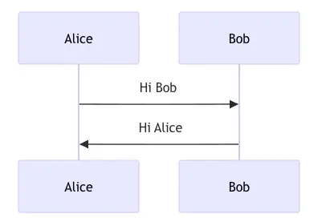
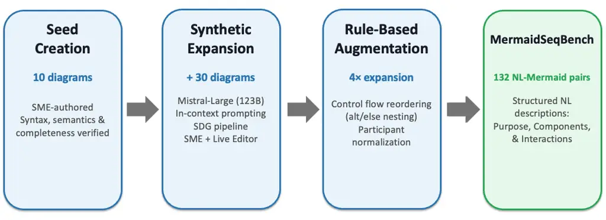
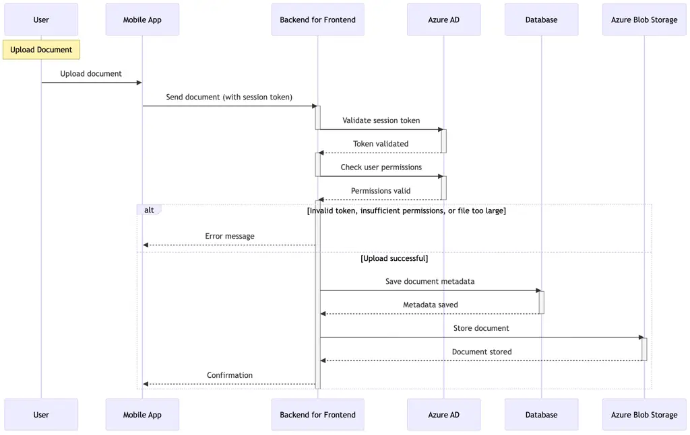
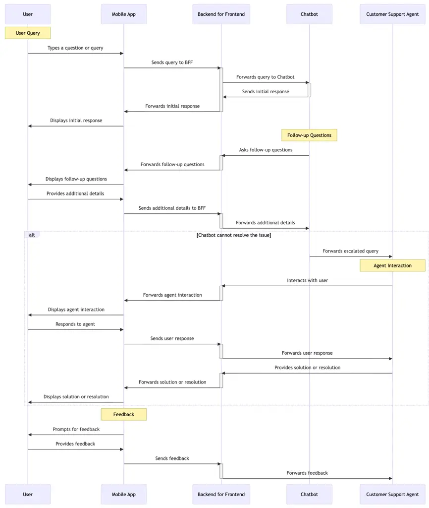

# MermaidSeqBench: An Evaluation Benchmark for NL-to-Mermaid Sequence Diagram Generation

Basel Shbita Affiliation: IBM Research Affiliation: San Jose, CA
Email: [basel@ibm.com](mailto:)    Farhan Ahmed Affiliation: IBM
Research Affiliation: San Jose, CA
Email: [farhan.ahmed@ibm.com](mailto:)    Chad DeLuca Affiliation: IBM
Research Affiliation: San Jose, CA Email: [delucac@us.ibm.com](mailto:)

###### Abstract

Large language models (LLMs) have shown great promise in generating
structured diagrams from natural language descriptions, particularly
Mermaid sequence diagrams for software engineering. However, the lack of
existing benchmarks to assess the LLM’s correctness on this task hinders
rigorous, systematic evaluation and principled comparison of model
capabilities on this task. To address this shortcoming, we introduce
MermaidSeqBench, a human-verified and synthetically extended benchmark
for assessing LLM capabilities in generating Mermaid sequence diagrams
from natural language prompts. The benchmark consists of 132 samples
developed via a hybrid methodology of human-verified flows, LLM-based
augmentation, and rule-based expansion. The evaluation uses an
LLM-as-a-judge model to assess generation across various fine-grained
metrics such as syntax correctness, activation handling, error handling,
and practical usability. To demonstrate the effectiveness and
flexibility of our benchmark, we perform initial evaluations on numerous
state-of-the-art LLMs with multiple LLM judges which reveal significant
capability gaps across models and evaluation modes. MermaidSeqBench
provides a foundation for evaluating structured diagram generation and
advances the scientific understanding of LLM capabilities and
limitations in structured generation tasks.

## 1 Introduction

Large language models (LLMs) have demonstrated remarkable capabilities
in programming tasks such as code generation (Jiang et al., 2024; Huynh
and Lin, 2025), code documentation (Chakrabarty and Pal, 2024; Dvivedi
et al., 2024), and coding assistants (Li and others, 2025). Furthermore,
they show great promise in generating structured diagrams from natural
language descriptions (Guernsey, 2025). One type of structured diagram
is a sequence diagram: a visual model used in software engineering that
shows how objects, components, and processes interact with each other
over time. Sequence diagrams are most commonly visualized in Unified
Modeling Language (UML) (Object Management Group, 2017), but can also be
represented in a text-based syntax such as PlantUML (Roques, 2009) or
Mermaid (Sveidqvist et al., 2014). A sample sequence diagram visually
represented in UML and textually in Mermaid is shown in Figure 1.

sequenceDiagram

participant Alice

participant Bob

Alice-\>\>Bob: Hi Bob

Bob-\>\>Alice: Hi Alice

Figure 1: A sample sequence diagram visually represented in UML (a UML
sequence diagram) and the corresponding Mermaid code to textually
represent it (a Mermaid sequence diagram).

LLMs have proven to be proficient in generating such text-based sequence
diagrams (Jahan et al., 2021; Wang et al., 2024). However, systematic
evaluations for assessing an LLM’s correctness in producing sequence
diagrams remains largely underdeveloped. This has significant
implications for software engineering since sequence diagrams are
critical for modeling how components interact over time. Without a
systematic benchmark, it is impossible to rigorously characterize an
LLM’s strengths and weaknesses on this task, or to make principled
comparisons across models and evaluation criteria. This has motivated
research on developing evaluations for sequence diagram generation such
as statistical method (Ferrari et al., 2024) or an LLM-as-a-Judge (Ahmed
et al., 2025).

Mermaid (Sveidqvist et al., 2014), formally known as MermaidJS, is a
diagramming tool that uses a Markdown-inspired syntax and is one such
text-based method of representing sequence diagrams. Sequence diagrams
textually represented in Mermaid are aptly named Mermaid sequence
diagrams. Prior work has shown that LLMs are capable of effectively
producing Mermaid sequence diagrams (Saxena et al., 2025). However,
evaluation in this space is even more underexplored than evaluation for
PlantUML and UML sequence diagrams, as there is a severe lack of
existing benchmarks or even public datasets to evaluate an LLM’s Mermaid
sequence diagram generation capabilities. Without such assessments, it
is impossible to make principled claims about model capability or to
identify where models succeed and fail on this task. This gap motivates
our work to create a reproducible, scalable, and fine-grained evaluation
framework for Mermaid sequence diagram generation.

In this paper, we introduce MermaidSeqBench, a human-verified and
synthetically extended benchmark for assessing an LLM’s capabilities in
generating Mermaid sequence diagrams from natural language prompts. This
benchmark at its core is a dataset that consists of 132 samples that
started from a small, manually crafted set and were synthetically
expanded via human annotation, in-context LLM prompting, and rule-based
variation generation. We also introduce a systematic evaluation method
using an LLM-as-a-Judge to assess Mermaid sequence diagram generation
across fine-grained metrics such as syntax correctness, activation
handling, error handling, and practical usability. This allows us to
benchmark and numerically evaluate any LLM on its Mermaid sequence
diagram generation capabilities.

To demonstrate the effectiveness of MermaidSeqBench, we perform initial
evaluations on three distinct families of models of similar sizes:
Llama-3.1-8B-Instruct (Grattafiori et al., 2024), Qwen-2.5-7B-Instruct
(Yang et al., 2025), and Granite-3.3-8B-Instruct (Granite Team, 2024).
We then extend to models of the same families at smaller sizes to
demonstrate the scaling effects and trends across different model sizes.
Lastly, to isolate and study scaling effects, we conduct an ablation
over multiple sizes of the Qwen-2.5 instruction-tuned models which
allows us to control architectural differences and focus solely on the
model scale. For all of our evaluations, we use two large LLM judge
models: DeepSeek-V3 (DeepSeek-AI et al., 2025) at 671B and
GPT-OSS (OpenAI et al., 2025) at 120B. This highlights both the
effectiveness and flexibility of our proposed benchmark as our results
reveal significant capability gaps across models and the various
evaluation modes.

Our benchmark aims to provide a foundation for advancing research, not
only in Mermaid sequence diagram generation, but also structured diagram
generation as a whole. As a result, we open-source MermaidSeqBench¹¹ 1
Code available at:
[https://github.com/IBM/MermaidSeqBench-Eval](https://github.com/IBM/MermaidSeqBench-Eval)
and make the benchmark dataset publicly accessible²² 2 Dataset available
at:
[https://huggingface.co/datasets/ibm-research/MermaidSeqBench](https://huggingface.co/datasets/ibm-research/MermaidSeqBench)
in hopes of encouraging further work in developing more rigorous,
fine-grained evaluation methodologies in this space. Furthermore,
although we focus on NL-to-Mermaid sequence diagram evaluations, our
methodology can be applied to other structural diagrams or even other
textual representations such as PlantUML.

## 2 Related Work

Existing work on evaluating LLM generation of Mermaid sequence diagrams
remains largely underexplored and limited. Expanding to other forms of
structural diagrams, Saxena et al. (2025) and Guernsey (2025) both
explore methods on using LLMs to generate various structural diagrams in
Mermaid syntax such as class, flow, and sequence diagrams. However,
evaluations remain relatively simple through simple compliance or
visualization checks which are not as robust or scalable.

In the broader space, structural diagrams generated by LLMs are
typically represented textually in PlantUML (Roques, 2009). There are
several works on LLM generation of PlantUML class, flow, case, and
sequence diagrams (Guernsey, 2025; Wang et al., 2024; Rouabhia and
Hadjadj, 2025; Eklund and Jonsson, 2025). Evaluations for these tasks
provide more robust approaches. Rouabhia and Hadjadj (2025) use
statistical methods to validate the syntactic, structural, and
behavioral consistency of the LLM generated UML class diagrams in
similar way to existing code benchmarks such as HumanEval (Chen et al., 2021) or MBPP (Austin et al., 2021). Ferrari et al. (2024) utilize
similar statistical methods to evaluate LLM generated UML sequence
diagrams on categories such as completeness, correctness, and adherence
to standards. Furthermore, Ahmed et al. (2025) explore using an
LLM-as-a-Judge for evaluating the NL-to-PlantUML sequence diagram task.

The use of LLMs as automated evaluators has been established as a
scalable alternative to human annotation for open-ended generation
tasks (Zheng et al., 2023). Recent work has demonstrated its
applicability to code generation and structured output
evaluation (Thakur et al., 2025; Son et al., 2024), though a recurring
challenge is the dependence of absolute scores on the specific judge
model used. MermaidSeqBench addresses this directly by adopting a
judge-agnostic design, validating its conclusions across two
structurally distinct judge models, and recommending that results be
interpreted in terms of relative model rankings rather than absolute
scores.

To the best of our knowledge, no formal benchmark or even public dataset
exists for evaluating an LLM’s capabilities on producing Mermaid
sequence diagrams. Our work is the first to introduce such a benchmark,
public dataset, and systematic evaluation framework for this task in a
manner analogous to established code generation benchmarks.

## 3 Methodology

MermaidSeqBench provides the entire evaluation pipeline for benchmarking
an LLM’s capabilities in generating Mermaid sequence diagrams. This
comprises both a dataset for generating outputs and a systematic
evaluation method involving an LLM-as-a-Judge for assessing the
generations. We describe how we constructed the dataset in Section 3.1
and the evaluation method in Section 3.3.

### 3.1 Dataset Construction

The dataset consists of 132 samples, starting from a small set of
manually crafted and verified flows. These were expanded via a hybrid
method of combining human annotation, in-context LLM prompting, and
rule-based variation generation. Our methodology for constructing the
dataset proceeds in three stages, illustrated in Figure 2: (1) initial
dataset construction; (2) synthetic expansion using scalable LLM-based
generation; and (3) systematic augmentation through rule-based
variation. This pipeline enables us to create a benchmark that is both
human-verified at its core and systematically extended for scalability
and diversity. See Appendix A for some samples of Mermaid sequence
diagrams from the benchmark dataset along with the corresponding UML
visualization.

Figure 2: Overview of the MermaidSeqBench dataset construction pipeline.
Starting from 10 SME-authored seed diagrams, the benchmark is expanded
to 40 verified samples via LLM-based synthetic generation, then scaled
to 132 NL-Mermaid pairs through rule-based augmentation. Each diagram is
paired with a structured natural language description capturing its
purpose, components, and interactions.

#### Initial Dataset Seeds

We begin by constructing a small, high-quality seed set of ten Mermaid
sequence diagrams. These were written manually by a subject matter
expert (SME) given a set of natural language descriptions of different
sequence flows. Each flow was manually verified to confirm syntax,
semantic plausibility, and completeness. This curated core serves as the
foundation of the benchmark.

#### Synthetic Expansion

To scale beyond the core set, we employ Scalable Synthetic Data
Generation (SDG) (foundation-model-stack, 2025), an open-source
general-purpose LLM-wrapper framework designed for producing large
quantities of synthetic data. In this stage, we use in-context examples
of full flows of valid sequence diagrams in Mermaid syntax to guide the
LLM in generating additional diagram flows. This allows us to
systematically extend the benchmark while maintaining fidelity to the
Mermaid syntax. The SDG pipeline balances automation with control by
leveraging prompts that encourage diverse structural patterns while
adhering to syntactic rules. We used Mistral-Large-Instruct (Mistral AI, 2024) (123B) as the primary generator. From the generated pool, 30
samples were selected and verified through two complementary mechanisms:
(1) manual rendering via the Mermaid Live Editor (Sveidqvist and
contributors, 2025) to ensure further syntactic correctness; and (2)
manual verification with an SME to confirm completeness and adherence to
constraints.

#### Rule-Based Variation Augmentation

Finally, we expand the resulting set through deterministic augmentation
rules that produce approximately a four-fold increase in coverage. These
rule-based transformations systematically alter both control flow
structures and participant naming conventions, ensuring diversity in
syntax without altering underlying semantics. In the first case,
conditional constructs defined with alt, else, and end are
programmatically detected and reordered, including support for nested
alternatives. This reordering preserves the logical meaning of the
branches while producing structurally distinct representations of the
same flow. In the second case, participant identifiers are normalized
into a canonical form, with substitutions consistently propagated across
both the participant declarations and all subsequent message references.
This guarantees syntactic validity while introducing surface-level
variation in the representation of diagram entities.

#### Natural Language Descriptions

Each Mermaid diagram in the benchmark is paired with a structured
natural language (NL) description capturing its Purpose, Main
Components, and Interactions. This systematic format ensures that every
diagram is grounded in a clear, unambiguous textual description,
aligning with how interaction flows are typically documented in software
design or requirements specifications. Together, these pairings yield a
benchmark of 132 NL-Mermaid pairs in total. Examples of Mermaid syntax
and rendered sequence diagrams can be found in Appendix A, while their
corresponding natural language descriptions are detailed in Appendix B.

### 3.2 Dataset Statistics

Table 1 summarizes the syntactic feature distribution across the 132
benchmark samples. Conditional branching (alt/else) is present in 89.4%
of samples, ensuring robust coverage of multi-branch logic. Nested
control flow (where one alt block is nested within another) appears in
33.3% of samples, probing more complex interaction patterns. Activation
and deactivation blocks are present in all samples (100%), which
directly motivates the Activation Handling evaluation criterion. Both
solid (-\>\>) and response (--\>\>) message types are well represented.
Participant counts range from 4 to 7 per diagram with an average of 5.0,
reflecting realistic multi-component interaction scenarios. Certain
Mermaid constructs beyond conditional branching are not currently
represented; this is an acknowledged scope limitation discussed in
Section 7.

|                  |                             |       |              |
| ---------------- | --------------------------- | ----- | ------------ |
| Category         | Feature                     | Count | Coverage (%) |
| Control Flow     | Conditional branching (alt) | 118   | 89.4         |
|                  | Multi-branch (else)         | 116   | 87.9         |
|                  | Nested control flow         | 44    | 33.3         |
| Diagram Elements | Activation/deactivation     | 132   | 100.0        |
| Message Types    | Solid arrows (-\>\>)        | 132   | 100.0        |
|                  | Response arrows (--\>\>)    | 126   | 95.5         |

Table 1: Distribution of Mermaid syntactic features across the
MermaidSeqBench benchmark samples, organized by feature category. Count
indicates the number of samples containing each feature, and coverage
reflects the corresponding percentage.

By combining human-verified samples, synthetically expanded instances,
and rule-based variations, each paired with a structured natural
language description, MermaidSeqBench provides systematic coverage of
core Mermaid syntactic features (as quantified in Table 1) and exposes
LLM limitations across a range of control flow structures and
interaction patterns.

### 3.3 Evaluation Method

The evaluation pipeline is a two step procedure: (1) the LLM is given
the input prompt to generate Mermaid code; and (2) a secondary judge LLM
is used to assess the generated Mermaid code based on the task,
description, prompt, and expected “ground truth” answer.

#### Inference on Input Prompts

The evaluation begins by performing model inference using the input
prompts from the benchmark dataset. Each sample is formatted in a fixed
schema composed of a task directive, general guidelines, Mermaid syntax
rules, and example input, an example output, purpose, main components,
and interactions. The LLM is expected to produce a valid Mermaid
sequence diagram. To ensure reproducibility, all outputs are generated
using greedy decoding (temperature $`=0`$) with a maximum budget of
1,024 new tokens per prompt.

#### LLM-as-a-Judge Assessments

MermaidSeqBench uses an LLM-as-a-Judge to assess generated Mermaid
outputs. Any judge LLM can be used, but larger models are recommended as
they tend to be more capable (Zheng et al., 2023; Thakur et al., 2025;
Son et al., 2024). Since only the outputs of the judge model are needed,
black-box API models may also be used. Given an input description (in
natural language) and a corresponding reference diagram syntax, the
judges rate candidate diagrams across six dimensions: Syntax, Mermaid
Only, Logic, Completeness, Activation Handling, and Error & Status
Tracking. Each dimension is scored on a scale from 0 to 1, allowing both
fine-grained and aggregate comparisons of model performance.

All judge prompts follow a common structure: they present the generated
Mermaid diagram (\<AGENT_RESPONSE\>) and reference one accepted solution
(\<EXPECTED_AGENT_RESPONSE\>) without requiring a verbatim match. The
judge prompt can optionally include the original agent prompt
(\<AGENT_PROMPT\>). It also poses targeted questions specific to the
evaluation criterion. Judges are instructed to output both a numerical
score in the range $`[0.0,1.0]`$ and a brief explanation, using a
standardized scoring rubric to promote consistency across criteria and
models. The exact prompts used by the judge models for each of the six
criteria are shown in Appendix C.

## 4 Experimental Setup

Our experiments fall into two categories: (1) cross-family and
cross-scale comparisons where we evaluate on three different families of
models at two similar scales each, and (2) intra-family scaling ablation
where we evaluate the same model family across multiple sizes. For both
scenarios, we utilize two large models as judges: DeepSeek-V3
(DeepSeek-AI et al., 2025) (671B) and GPT-OSS (OpenAI et al., 2025)
(120B). This allows us to mitigate individual model bias and ensure a
more robust evaluation by cross-referencing the scoring of two distinct
architectural implementations.

#### Cross-Family and Cross-Scale

This experiment probes whether MermaidSeqBench can expose capability
differences attributable to model architecture and training rather than
scale, by evaluating families at approximately matched parameter counts.
Our initial evaluations are on three distinct families of models of
similar sizes: Llama-3.1-8B-Instruct (Grattafiori et al., 2024),
Qwen-2.5-7B-Instruct (Yang et al., 2025), and Granite-3.3-8B-Instruct
(Granite Team, 2024). We then extend to models within the same families,
but of smaller sizes: Llama-3.2-1B-Instruct, Qwen-2.5-1.5B-Instruct, and
Granite-3.3-2B-Instruct. This setup provides a balanced perspective on
both lightweight and larger-scale variants across LLM families, enabling
comparison of architectural differences as well as scaling effects.

#### Intra-Family Scaling Ablation

While the cross-family experiment reveals differences across
architectures, it conflates architectural and scaling effects, making it
difficult to determine whether observed capability gaps stem from model
design or simply model size. This ablation addresses that question
directly by holding architecture constant and varying only scale,
providing a controlled view of how Mermaid sequence diagram generation
capabilities develop with model capacity. This is particularly relevant
for structured generation tasks, where syntactic precision and
multi-step control flow may require a minimum capability threshold that
smaller models cannot meet. We select the Qwen-2.5 family of models
(Yang et al., 2025) as it offers the broadest range of instruction-tuned
checkpoints among open models, spanning 0.5B to 72B parameters.
Specifically, we evaluate Qwen-2.5 models at 0.5B, 1.5B, 3B, 7B, 14B,
32B, and 72B using the same benchmark, prompts, and LLM-as-a-Judge
setup.

## 5 Results and Discussion

We now present our evaluations on the two categories of experiments and
demonstrate how MermaidSeqBench has both the effectiveness and
flexibility to reveal significant capability gaps across models and
evaluation modes.

### 5.1 Cross-Family and Cross-Scale Comparisons

Table 2 shows the benchmark scores of the Llama, Qwen, and Granite
families of models for the two variants of sizes. Overall, the results
reveal clear scaling effects across families: larger models within each
family consistently outperform their smaller counterparts, an expected
result as larger models are typically more performant. Among the larger
models, Llama and Qwen achieve the highest scores across most criteria,
particularly on syntax, logical flow, and activation usage. Granite
follows closely but lags slightly on error handling and completeness.

Beyond overall scaling trends, the results also highlight differences in
how model families handle specific aspects of diagram generation. For
example, the Granite models perform strongly on strict syntactic and
Mermaid Only criteria, even at the 2B scale, but lag on dimensions such
as activation handling. The Qwen models excel at syntax, while Llama
exhibits a more balanced profile across metrics. These divergences point
to complementary strengths across families and indicate opportunities
for hybrid approaches to structured diagram generation.

Overall, these findings confirm that MermaidSeqBench exposes meaningful
differences across model families and sizes, and emphasize the need for
a systematic, multi-faceted evaluation of LLMs on diagram generation
tasks.

[TABLE]

Table 2: Model performance on MermaidSeqBench across six criteria. Each
row indicates the candidate generation model; column groups indicate the
LLM-as-a-Judge model used for evaluation. Scores are reported as
percentages (originally in $`[0.0,1.0]`$). For all criteria, higher is
better.

### 5.2 Intra-Family Scaling Ablation Analysis

Table 3 reports results for the Qwen-2.5 family across multiple model
sizes, revealing a broadly positive scaling trend across all six
evaluation criteria. The most pronounced gains occur between the 3B and
7B variants, particularly for syntax, logic, and completeness,
reflecting a significant capability threshold at that scale. Under
DeepSeek-V3, the trend is not strictly monotonic: the 14B variant scores
slightly below the 7B on several criteria before recovering at 32B and
72B, suggesting that judge calibration interacts with model scale in
non-trivial ways. Under GPT-OSS, improvement is more consistently
monotonic across sizes. Larger variants (32B and 72B) approach
saturation on syntax and Mermaid Only criteria under both judges, while
continuing to yield incremental improvements on more semantically
demanding dimensions such as error and status tracking. Overall, these
results indicate that scaling within a single architecture substantially
reduces capability gaps, and demonstrate that MermaidSeqBench is
sensitive to fine-grained performance differences induced by model size.

[TABLE]

Table 3: Qwen-2.5 scaling results on MermaidSeqBench across six
criteria. Each row indicates the candidate generation model; column
groups indicate the LLM-as-a-Judge model used for evaluation. Scores are
reported as percentages (originally in $`[0.0,1.0]`$). For all criteria,
higher is better.

### 5.3 Cross-Judge Analysis

A notable feature of the results is the systematic difference in
absolute scores between the two judge models: DeepSeek-V3 assigns
consistently higher scores across all criteria and model families, while
GPT-OSS scores more strictly, with gaps of up to 24 percentage points on
individual criteria. This magnitude of inter-judge variance is
consistent with documented behavior of LLM-as-a-Judge across evaluation
settings (Zheng et al., 2023; Thakur et al., 2025), where absolute score
calibration varies substantially across judge models even when relative
assessments remain directionally stable.

Despite this absolute divergence, both judges support the same
high-level conclusions. Larger models substantially outperform their
smaller counterparts across all three model families regardless of which
judge is used. The intra-family scaling ablation reveals a broadly
positive improvement with model size under both judges, with the trend
more consistently monotonic under GPT-OSS than DeepSeek-V3. Both judges
also agree on the relative difficulty of evaluation criteria: Mermaid
Only and Syntax are consistently the strongest dimensions across models,
while Activation Handling and Error & Status Tracking represent the most
challenging. Fine-grained rankings within groups of similarly-sized
models can differ between judges, which further underscores the value of
multi-judge evaluation.

These observations motivate a key interpretive guideline for
MermaidSeqBench: scores should be used to compare models relative to one
another and to identify capability trends, rather than as absolute
measures of diagram generation quality. Because LLM-as-a-Judge
calibration is inherently judge-dependent, MermaidSeqBench is designed
to be judge-agnostic: any sufficiently capable judge model may be used,
and conclusions should be drawn from patterns that are consistent across
judges rather than from the magnitude of any individual score.

### 5.4 Benchmark Scope and Evaluative Claims

MermaidSeqBench is designed to support comparative evaluation: its
primary claim is that LLMs can be systematically ranked and
differentiated on Mermaid sequence diagram generation across
well-defined syntactic and semantic dimensions. The results in
Sections 5.1 and 5.2 demonstrate that the benchmark is sensitive to
meaningful differences across model families and scales, and that these
differences are robust to the choice of judge model at the level of
high-level trends (Section 5.3). These properties make MermaidSeqBench
suitable for answering questions of the form: which models are more
capable at this task, and along which dimensions do they differ?

These claims rest on three core assumptions. First, that LLM-as-a-Judge
with a sufficiently capable model provides a valid proxy for assessing
structured generation quality, an assumption supported by the
directional consistency observed across two structurally distinct judge
models. Second, that the six evaluation criteria collectively capture
the dimensions of correctness that matter most for this task. Third,
that the dataset’s systematic coverage of core Mermaid syntactic
features (Table 1) is sufficient to surface comparative differences
between models, even if it does not exhaust the full space of possible
diagrams.

The benchmark does not support claims about absolute diagram quality: as
shown in Section 5.3, absolute scores are calibration-dependent and
should not be interpreted as ground-truth measures. Nor does it claim
out-of-the-box generalization to other diagram formats or syntaxes.
Beyond these boundaries, the methodology itself (hybrid dataset
construction via human seeds, LLM-based synthetic expansion, and
rule-based augmentation, paired with a judge-agnostic evaluation
pipeline) is transferable to other structured diagram formats and
textual representation languages, offering a reusable template for
evaluation in this broader space.

## 6 Future Work

Several directions emerge naturally from this work. First, the dataset
currently omits parallel flows, loop structures, and optional blocks
(Section 3.2); expanding the seed set to cover these constructs would
broaden coverage to more complex interaction patterns. Second, the
hybrid construction methodology is directly applicable to other Mermaid
diagram types such as flowcharts, class diagrams, and Gantt charts, as
well as to other textual representation languages such as PlantUML,
enabling systematic cross-format comparison of LLM structured generation
capabilities. Third, establishing a human-annotated gold standard for a
subset of the benchmark would enable formal validation of LLM-as-a-Judge
quality and provide calibration anchors for comparing judge models,
directly addressing the absolute score interpretation challenge
identified in Section 5.3. Finally, MermaidSeqBench provides a natural
testbed for studying the effect of targeted fine-tuning on structured
diagram generation, since the fine-grained criteria allow precise
diagnosis of which capabilities improve with training and which gaps
persist.

## 7 Limitations and Broader Impacts

#### Limitations

Our proposed benchmark has several limitations and ethical
considerations. First, while the benchmark comprises 132 samples, this
scale is comparable to well-established coding benchmarks such as
HumanEval (Chen et al., 2021) (164 samples) and LiveBench-Coding (White
et al., 2025) (128 samples); the dataset is specifically structured to
cover the core syntactic features of Mermaid sequence diagrams rather
than maximize sample count. That said, the seed test cases may be
influenced by inductive bias from subject matter experts, whose
preferences may implicitly shape the flows selected and verified, and
the benchmark can be readily extended using the methodology described in
Section 3.1. Second, the benchmark focuses exclusively on Mermaid
sequence diagrams, leaving out other diagram types and alternative
syntaxes (e.g., PlantUML), which may limit generalizability. Within
Mermaid, certain constructs beyond conditional branching (e.g., parallel
flows and loop structures) are not currently represented in the dataset,
leaving these interaction patterns as directions for future expansion.
Third, our findings concentrate on our selection of evaluation criteria;
although these criteria are grounded and enable us to explore capability
gaps across scales, other categories remain unexplored and could yield
greater insights. Finally, the reliance on LLM-as-a-judge and
heuristic-based scorers introduces potential biases and inconsistencies,
especially in ill-defined evaluation settings where multiple valid
solutions may exist. These factors highlight directions for future work
in broadening coverage, scaling to larger models, and refining judge
methodologies.

#### Broader Impacts

MermaidSeqBench is released as an open benchmark and evaluation
framework, contributing a reusable resource for the research community
to systematically assess LLM capabilities in structured generation
tasks. By establishing fine-grained evaluation criteria and a
judge-agnostic methodology, the work supports more rigorous and
reproducible evaluation practices in the broader NLP and AI community.
We foresee no meaningful negative societal impacts from this work: the
benchmark evaluates diagram generation in a controlled research setting
and presents no meaningful dual-use or misuse potential.

## 8 Conclusion

We introduced MermaidSeqBench, a benchmark for evaluating LLM
capabilities in generating precise, structured, and logically consistent
Mermaid sequence diagrams. By combining human-verified flows with
rule-based and LLM-driven expansion, we enable a systematic assessment
of fine-grained criteria including syntax, logic, completeness,
activation handling, and error/status tracking. Our evaluations on
several state-of-the-art LLMs reveal significant performance gaps across
model families, scales, and evaluation criteria. Notably, Activation
Handling and Error & Status Tracking emerge as consistently the most
challenging dimensions across all models and scales, pointing to
structured control flow and error representation as key capability gaps
in current LLMs. Our cross-judge analysis further reveals that while
absolute scores are judge-dependent, high-level capability trends remain
stable across structurally distinct judge models, a finding with broader
implications for how LLM-as-a-Judge benchmarks should be designed and
interpreted. These findings underscore the need for specialized
benchmarks like MermaidSeqBench to enable systematic, fine-grained
evaluation of LLM capabilities in structured generation tasks. By
open-sourcing both the dataset and evaluation code, and providing a
judge-agnostic evaluation pipeline that extends naturally to other
structured diagram formats, MermaidSeqBench lays a foundation for more
principled and reproducible evaluation methodology in this space.

## References

- Ahmed et al. (2025) K. Ahmed, J. Song, B. Chen, O. Wei, and B. Zheng
  MCeT: behavioral model correctness evaluation using large language
  models. External Links: 2508.00630,
  [Link](https://arxiv.org/abs/2508.00630) Cited by: §1, §2.
- Austin et al. (2021) J. Austin, A. Odena, M. Nye, M. Bosma, H.
  Michalewski, D. Dohan, E. Jiang, C. Cai, M. Terry, Q. Le, and C.
  Sutton Program synthesis with large language models. External Links:
  2108.07732, [Link](https://arxiv.org/abs/2108.07732) Cited by: §2.
- Chakrabarty and Pal (2024) S. Chakrabarty and S. Pal Free and
  customizable code documentation with llms: a fine-tuning approach.
  External Links: 2412.00726, [Link](https://arxiv.org/abs/2412.00726)
  Cited by: §1.
- Chen et al. (2021) M. Chen, J. Tworek, H. Jun, Q. Yuan, H. P. de
  Oliveira Pinto, J. Kaplan, H. Edwards, Y. Burda, N. Joseph, G.
  Brockman, A. Ray, R. Puri, G. Krueger, M. Petrov, H. Khlaaf, G.
  Sastry, P. Mishkin, B. Chan, S. Gray, N. Ryder, M. Pavlov, A.
  Power, L. Kaiser, M. Bavarian, C. Winter, P. Tillet, F. P. Such, D.
  Cummings, M. Plappert, F. Chantzis, E. Barnes, A. Herbert-Voss, W. H.
  Guss, A. Nichol, A. Paino, N. Tezak, J. Tang, I. Babuschkin, S.
  Balaji, S. Jain, W. Saunders, C. Hesse, A. N. Carr, J. Leike, J.
  Achiam, V. Misra, E. Morikawa, A. Radford, M. Knight, M. Brundage, M.
  Murati, K. Mayer, P. Welinder, B. McGrew, D. Amodei, S. McCandlish, I.
  Sutskever, and W. Zaremba Evaluating large language models trained on
  code. External Links: 2107.03374,
  [Link](https://arxiv.org/abs/2107.03374) Cited by: §2, §7.
- DeepSeek-AI et al. (2025) DeepSeek-AI, A. Liu, B. Feng, B. Xue, B.
  Wang, B. Wu, C. Lu, C. Zhao, C. Deng, C. Zhang, et al. DeepSeek-v3
  technical report. External Links: 2412.19437,
  [Link](https://arxiv.org/abs/2412.19437) Cited by: §1, §4.
- Dvivedi et al. (2024) S. S. Dvivedi, V. Vijay, S. L. R. Pujari, S.
  Lodh, and D. Kumar A comparative analysis of large language models for
  code documentation generation. External Links: 2312.10349,
  [Link](https://arxiv.org/abs/2312.10349) Cited by: §1.
- Eklund and Jonsson (2025) C. Eklund and T. Jonsson Benchmarking large
  language models in uml diagram generation from informal notations.
  Mälardalen University, School of Innovation, Design and
  EngineeringMälardalen University, School of Innovation, Design and
  Engineering. Cited by: §2.
- Ferrari et al. (2024) A. Ferrari, S. Abualhaija, and C. Arora Model
  generation with llms: from requirements to uml sequence diagrams.
  External Links: 2404.06371, [Link](https://arxiv.org/abs/2404.06371)
  Cited by: §1, §2.
- foundation-model-stack (2025) foundation-model-stack Fms-dgt:
  synthetic data generation for foundation models. Note:
  [https://github.com/foundation-model-stack/fms-dgt](https://github.com/foundation-model-stack/fms-dgt)
  Cited by: §3.1.
- Granite Team (2024) I. Granite Team Granite 3.0 language models. URL:
  https://github.com/ibm-granite/granite-3.0-language-models. Cited by:
  §1, §4.
- Grattafiori et al. (2024) A. Grattafiori, A. Dubey, A. Jauhri, A.
  Pandey, A. Kadian, A. Al-Dahle, A. Letman, A. Mathur, A. Schelten, A.
  Vaughan, et al. The llama 3 herd of models. External Links:
  2407.21783, [Link](https://arxiv.org/abs/2407.21783) Cited by: §1, §4.
- Guernsey (2025) G. Guernsey Harnessing large language models for
  automated software diagram generation. Master’s Thesis, University of
  Cincinnati. Cited by: §1, §2, §2.
- Huynh and Lin (2025) N. Huynh and B. Lin Large language models for
  code generation: a comprehensive survey of challenges, techniques,
  evaluation, and applications. External Links: 2503.01245,
  [Link](https://arxiv.org/abs/2503.01245) Cited by: §1.
- Jahan et al. (2021) M. Jahan, Z. S. H. Abad, and B. Far Generating
  sequence diagram from natural language requirements. In 2021 IEEE 29th
  International Requirements Engineering Conference Workshops (REW),
  Vol. , pp. 39–48. External Links:
  [Document](https://dx.doi.org/10.1109/REW53955.2021.00012) Cited by:
  §1.
- Jiang et al. (2024) J. Jiang, F. Wang, J. Shen, S. Kim, and S. Kim A
  survey on large language models for code generation. External Links:
  2406.00515, [Link](https://arxiv.org/abs/2406.00515) Cited by: §1.
- Li et al. (2025) X. Li et al. Conversational ai as a coding assistant.
  arXiv preprint arXiv:2503.16508. External Links:
  [Link](https://arxiv.org/abs/2503.16508) Cited by: §1.
- Mistral AI (2024) Mistral AI Mistral large instruct 2411. Hugging
  Face. Note:
  [https://huggingface.co/mistralai/Mistral-Large-Instruct-2411](https://huggingface.co/mistralai/Mistral-Large-Instruct-2411)
  Cited by: §3.1.
- Object Management Group (2017) Object Management Group Unified
  modeling language (uml) specification, version 2.5.1. Technical report
  Technical Report formal/2017-12-05, Object Management Group (OMG).
  External Links: [Link](https://www.omg.org/spec/UML/2.5.1) Cited by:
  §1.
- OpenAI et al. (2025) OpenAI, :, S. Agarwal, L. Ahmad, J. Ai, S.
  Altman, A. Applebaum, E. Arbus, R. K. Arora, Y. Bai, B. Baker, H.
  Bao, B. Barak, et al. Gpt-oss-120b & gpt-oss-20b model card. External
  Links: 2508.10925, [Link](https://arxiv.org/abs/2508.10925) Cited by:
  §1, §4.
- Roques (2009) A. Roques PlantUML: generate diagrams from textual
  descriptions. Note: [https://plantuml.com/](https://plantuml.com/)
  Cited by: §1, §2.
- Rouabhia and Hadjadj (2025) D. Rouabhia and I. Hadjadj Behavioral
  augmentation of uml class diagrams: an empirical study of large
  language models for method generation. External Links: 2506.00788,
  [Link](https://arxiv.org/abs/2506.00788) Cited by: §2.
- Saxena et al. (2025) S. S. Saxena, I. Alam, V. Sharma, U. Vats,
  and V. K. Chundury Dynamic creation of uml diagrams using generative
  AI. Technical Disclosure Common. Cited by: §1, §2.
- Son et al. (2024) G. Son, H. Ko, H. Lee, Y. Kim, and S. Hong
  LLM-as-a-judge & reward model: what they can and cannot do. External
  Links: 2409.11239, [Link](https://arxiv.org/abs/2409.11239) Cited by:
  §2, §3.3.
- Sveidqvist and contributors (2025) K. Sveidqvist and M. contributors
  Mermaid live editor. Note:
  [https://mermaid.live](https://mermaid.live) Cited by: §3.1.
- Sveidqvist et al. (2014) K. Sveidqvist, S. Vinod, A. Jain, N.
  Cuzon, T. Liu, A. Klink, R. Al Sulais, N. Rozhkov, J. Greywolf, S.
  Huynh, M. Morel, M. Faber, Y. Singh, N. Orlandoni, P. Brolin, and M.
  Laganeckas Mermaid: javascript-based diagramming and charting tool.
  Note: [https://mermaid.js.org/](https://mermaid.js.org/) Cited by: §1,
  §1.
- Thakur et al. (2025) A. S. Thakur, K. Choudhary, V. S. Ramayapally, S.
  Vaidyanathan, and D. Hupkes Judging the judges: evaluating alignment
  and vulnerabilities in LLMs-as-judges. In Proceedings of the Fourth
  Workshop on Generation, Evaluation and Metrics (GEM²), O. Arviv, M.
  Clinciu, K. Dhole, R. Dror, S. Gehrmann, E. Habba, I. Itzhak, S.
  Mille, Y. Perlitz, E. Santus, J. Sedoc, M. Shmueli Scheuer, G.
  Stanovsky, and O. Tafjord (Eds.), Vienna, Austria and virtual meeting,
  pp. 404–430. External Links:
  [Link](https://aclanthology.org/2025.gem-1.33/), ISBN
  979-8-89176-261-9 Cited by: §2, §3.3, §5.3.
- Wang et al. (2024) B. Wang, C. Wang, P. Liang, B. Li, and C. Zeng How
  llms aid in uml modeling: an exploratory study with novice analysts.
  External Links: 2404.17739, [Link](https://arxiv.org/abs/2404.17739)
  Cited by: §1, §2.
- White et al. (2025) C. White, S. Dooley, M. Roberts, A. Pal, B.
  Feuer, S. Jain, R. Shwartz-Ziv, N. Jain, K. Saifullah, S. Dey,
  Shubh-Agrawal, S. S. Sandha, S. V. Naidu, C. Hegde, Y. LeCun, T.
  Goldstein, W. Neiswanger, and M. Goldblum LiveBench: a challenging,
  contamination-free LLM benchmark. In The Thirteenth International
  Conference on Learning Representations, Cited by: §7.
- Yang et al. (2025) Q. A. Yang, B. Yang, B. Zhang, B. Hui, B. Zheng, B.
  Yu, C. Li, D. Liu, F. Huang, H. Wei, et al. Qwen2.5 technical report.
  External Links: 2412.15115, [Link](https://arxiv.org/abs/2412.15115)
  Cited by: §1, §4, §4.
- Zheng et al. (2023) L. Zheng, W. Chiang, Y. Sheng, S. Zhuang, Z.
  Wu, Y. Zhuang, Z. Lin, Z. Li, D. Li, E. P. Xing, H. Zhang, J. E.
  Gonzalez, and I. Stoica Judging llm-as-a-judge with mt-bench and
  chatbot arena. In Proceedings of the 37th International Conference on
  Neural Information Processing Systems, NIPS ’23, Red Hook, NY, USA.
  Cited by: §2, §3.3, §5.3.

## Appendix A Sequence Diagrams

The UML sequence diagram in Figure 3 and the accompanying Listing 1
illustrate one of the test cases included in our benchmark dataset. The
figure presents the rendered Mermaid sequence diagram describing the
flow in uploading documents with secure storage, while the listing
provides the exact Mermaid syntax used to generate it.

Our benchmark also includes more complex flows with multiple active
actors. Figure 4 presents a sequence diagram demonstrating a user
interaction with a Chatbot actor that may or may not invoke an
additional actor (i.e., a Customer Support Agent). Listing 2 shows the
Mermaid syntax corresponding to this diagram, which can be directly
rendered to produce the figure.

## Appendix B Natural Language Descriptions of Sequence Diagrams

For each Mermaid diagram provided in Appendix A, we include the
corresponding natural language description that served as the input
prompt for generation and evaluation. Each description systematically
covers: (1) Purpose: the overall intent of the sequence diagram; (2)
Main Components: the participants involved and their roles; and (3)
Interactions: the ordered set of messages and control-flow constructs.

Listing 3 presents the natural language specification for the “Uploading
Documents with Secure Storage” scenario (corresponding to the syntax
provided in Listing 1 and rendered in Figure 3), while Listing 4
provides the specification for the “Chatbot Interaction for Customer
Support” flow (corresponding to the syntax provided in Listing 2 and
rendered in Figure 4).

sequenceDiagram

participant U as User

participant MA as Mobile App

participant BFF as Backend for Frontend

participant AAD as Azure AD

participant DB as Database

participant AS as Azure Blob Storage

Note over U: Upload Document

U-\>\>MA: Upload document

MA-\>\>BFF: Send document (with session token)

activate BFF

BFF-\>\>AAD: Validate session token

deactivate BFF

activate AAD

AAD--\>\>BFF: Token validated

deactivate AAD

activate BFF

BFF-\>\>AAD: Check user permissions

deactivate BFF

activate AAD

AAD--\>\>BFF: Permissions valid

deactivate AAD

activate BFF

alt Invalid token, insufficient permissions, or file too large

BFF--\>\>MA: Error message

else Upload successful

BFF-\>\>DB: Save document metadata

activate DB

DB--\>\>BFF: Metadata saved

deactivate DB

BFF-\>\>AS: Store document

activate AS

AS--\>\>BFF: Document stored

deactivate AS

BFF--\>\>MA: Confirmation

end

deactivate BFF

Listing 1: Mermaid syntax illustrating the “Uploading Documents with
Secure Storage” flow, as rendered and detailed in Figure 3.

sequenceDiagram

participant U as User

participant MA as Mobile App

participant BFF as Backend for Frontend

participant CB as Chatbot

participant CSA as Customer Support Agent

Note over U: User Query

U-\>\>MA: Types a question or query

MA-\>\>BFF: Sends query to BFF

activate BFF

BFF-\>\>CB: Forwards query to Chatbot

activate CB

CB-\>\>BFF: Sends initial response

deactivate CB

BFF-\>\>MA: Forwards initial response

deactivate BFF

MA-\>\>U: Displays initial response

Note over CB: Follow-up Questions

CB-\>\>BFF: Asks follow-up questions

activate BFF

BFF-\>\>MA: Forwards follow-up questions

deactivate BFF

MA-\>\>U: Displays follow-up questions

U-\>\>MA: Provides additional details

MA-\>\>BFF: Sends additional details to BFF

activate BFF

BFF-\>\>CB: Forwards additional details

deactivate BFF

alt Chatbot cannot resolve the issue

CB-\>\>CSA: Forwards escalated query

Note over CSA: Agent Interaction

CSA-\>\>BFF: Interacts with user

activate BFF

BFF-\>\>MA: Forwards agent interaction

deactivate BFF

MA-\>\>U: Displays agent interaction

U-\>\>MA: Responds to agent

MA-\>\>BFF: Sends user response

activate BFF

BFF-\>\>CSA: Forwards user response

deactivate BFF

CSA-\>\>BFF: Provides solution or resolution

activate BFF

BFF-\>\>MA: Forwards solution or resolution

deactivate BFF

MA-\>\>U: Displays solution or resolution

end

Note over MA: Feedback

MA-\>\>U: Prompts for feedback

U-\>\>MA: Provides feedback

MA-\>\>BFF: Sends feedback

activate BFF

BFF-\>\>CSA: Forwards feedback

deactivate BFF

Listing 2: Mermaid syntax illustrating the “Chatbot Interaction for
Customer Support” flow, as rendered and detailed in Figure 4.

Figure 3: A UML sequence diagram from our benchmark, illustrating the
“Uploading Documents with Secure Storage” flow. Participants include the
User, Mobile App, Backend For Frontend (BFF), Azure AD, Database, and
Azure Blob Storage. In this scenario, the User uploads a document
through the Mobile App, which forwards the file and session token to the
BFF. The BFF validates the token with Azure AD, checks the user’s
permissions, and, if authorized, records document metadata in the
Database and securely stores the file in cloud storage (Azure Blob
Storage). A confirmation is then returned to the app, while alternate
paths handle errors for unauthorized access or oversized files.

Figure 4: A UML sequence diagram from our benchmark, illustrating the
“Chatbot Interaction for Customer Support” flow. Participants include
the User, Mobile App, Backend For Frontend, Chatbot, and Customer
Support Agent. In this scenario, the User submits a query through the
Mobile App, which forwards it via the BFF to the Chatbot. The Chatbot
provides initial responses and may request clarifications; if unable to
resolve the issue, it escalates the conversation to a Customer Support
Agent. The Agent then interacts with the User through the Mobile App to
provide a resolution, after which the app collects feedback from the
User.

Purpose: Uploading Documents with Secure Storage

Main Components: User, Mobile App, BFF, Azure AD, Database

Interactions:

1. User Action: User uploads a document (e.g., an ID or contract)
   through the mobile app.

2. Mobile App: Sends the document along with the session token to the
   BFF.

3. BFF Validation:

Validates the session token with Azure AD.

Checks user permissions to ensure they are authorized to upload
documents.

4. Storage Process:

The BFF saves metadata about the document (e.g., file name, size, upload
timestamp) in the database.

The actual document is securely stored in cloud storage (e.g., Azure
Blob Storage).

5. Response:

On successful upload, the BFF returns a confirmation to the app.

If the user is unauthorized or the file exceeds size limits, an
appropriate error is returned.

Listing 3: Natural language specification for the “Uploading Documents
with Secure Storage” flow, corresponding to the syntax in Listing 1 and
the rendered diagram in Figure 3.

Purpose: Chatbot interaction for customer support

Main Components: User, Mobile App, Chatbot, Customer Support Agent, BFF

Interactions:

1. User Query: The user types a question or query into the mobile app.

2. Chatbot Engagement: The mobile app sends the query to the Chatbot via
   the BFF.

3. Initial Response: The Chatbot processes the query and sends an
   initial response to the mobile app.

4. Follow-up Questions: The Chatbot may ask follow-up questions to
   better understand the user’s issue.

5. Escalation: If the Chatbot cannot resolve the issue, it escalates the
   query to a Customer Support Agent.

6. Agent Interaction: The Customer Support Agent receives the escalated
   query and interacts with the user through the mobile app.

7. Resolution: The Customer Support Agent provides a solution or
   resolution to the user’s issue.

8. Feedback: The mobile app prompts the user to provide feedback on the
   support experience.

Listing 4: Natural language specification for the “Chatbot Interaction
for Customer Support” flow, corresponding to the syntax in Listing 2 and
the rendered diagram in Figure 4.

## Appendix C LLM-as-a-Judge Prompts

We list the prompts used by the judge models to evaluate across the six
criteria:

- •
  Syntax (Listing 5)
- •
  Mermaid Only (Listing 6)
- •
  Logic (Listing 7)
- •
  Completeness (Listing 8)
- •
  Activation Handling (Listing 9)
- •
  Error & Status Tacking (Listing 10)

Evaluate the MermaidJS output under

\<AGENT_RESPONSE\> for syntax and structural correctness based on
MermaidJS rules.

\<EXPECTED_AGENT_RESPONSE\> is provided below, treat it as one accepted
solution reference; do not require a verbatim match.

\#####

\<AGENT_RESPONSE\>

{agent_response}

\#####

\<EXPECTED_AGENT_RESPONSE\>

{expected_agent_response}

\#####

Is it proper MermaidJS syntax?

Are all participants declared using ‘participant ActorName‘ syntax?

Are activation/deactivation statements used and properly balanced?

Are ‘alt‘, ‘else‘, and ‘end‘ blocks closed correctly and nested if
needed?

\#####

---

Provide a numerical score (0.000 to 1.000) and a concise explanation.

Format the output as: \<score\>; \<explanation\>

Scoring scale:

- 0.000 to 0.200: Very poor;

- 0.201 to 0.400: Poor;

- 0.401 to 0.600: Fair;

- 0.601 to 0.800: Good;

- 0.801 to 0.999: Very good;

- 1.000: Perfect;

Listing 5: LLM-as-a-Judge prompt for evaluating MermaidJS syntax and
structural correctness.

Evaluate the agent’s output under \<AGENT_RESPONSE\> to ensure it
strictly contains MermaidJS code only.

\<EXPECTED_AGENT_RESPONSE\> is provided below, treat it as one accepted
solution reference; do not require a verbatim match.

\#####

\<AGENT_RESPONSE\>

{agent_response}

\#####

\<EXPECTED_AGENT_RESPONSE\>

{expected_agent_response}

\#####

Is the output wrapped in a valid Markdown block (e.g.,
‘‘‘sequenceDiagram)?

Does it avoid extra explanation, narration, or formatting beyond valid
Mermaid syntax?

Is the output clean, parsable, and renderable in Mermaid?

Responses with non-code text or mixed formatting should receive a lower
score.

\#####

---

Provide a numerical score (0.000 to 1.000) and a concise explanation.

Format the output as: \<score\>; \<explanation\>

Scoring scale:

- 0.000 to 0.200: Very poor;

- 0.201 to 0.400: Poor;

- 0.401 to 0.600: Fair;

- 0.601 to 0.800: Good;

- 0.801 to 0.999: Very good;

- 1.000: Perfect;

Listing 6: LLM-as-a-Judge prompt for evaluating on strictly containing
MermaidJS code only.

Evaluate the MermaidJS output under \<AGENT_RESPONSE\> based on the task
description in \<AGENT_PROMPT\> (and, the reference in
\<EXPECTED_AGENT_RESPONSE\>) for logic and flow completeness. The
expected output is one accepted solution; alternate but logically
equivalent flows should not be penalized.

\#####

\<AGENT_PROMPT\>

{agent_prompt}

\#####

\<AGENT_RESPONSE\>

{agent_response}

\#####

\<EXPECTED_AGENT_RESPONSE\>

{expected_agent_response}

\#####

Is it proper MermaidJS syntax?

Does every request have a corresponding response?

Are alternate flows (e.g., success/failure, if/else) represented
completely and clearly?

Are nested decision branches handled as required?

Does the diagram account for every described interaction and path (or
match the accepted reference flow)?

\#####

---

Provide a numerical score (0.000 to 1.000) and a concise explanation.

Format the output as: \<score\>; \<explanation\>

Scoring scale:

- 0.000 to 0.200: Very poor;

- 0.201 to 0.400: Poor;

- 0.401 to 0.600: Fair;

- 0.601 to 0.800: Good;

- 0.801 to 0.999: Very good;

- 1.000: Perfect;

Listing 7: LLM-as-a-Judge prompt for evaluating MermaidJS logic and flow
completeness.

Evaluate the MermaidJS output under \<AGENT_RESPONSE\> based on
\<AGENT_PROMPT\> for completeness. \<EXPECTED_AGENT_RESPONSE\> is
provided below, treat it as one accepted solution reference; do not
require a verbatim match.

\#####

\<AGENT_PROMPT\>

{agent_prompt}

\#####

\<AGENT_RESPONSE\>

{agent_response}

\#####

\<EXPECTED_AGENT_RESPONSE\>

{expected_agent_response}

\#####

Is it proper MermaidJS syntax?

Does the diagram cover all participants, request/response pairs, and
decision points described in the prompt (or equivalently as in the
accepted reference)?

Are alternate flows and error paths handled as required?

Does the output reflect full coverage of described behavior, including
minor flows?

\#####

---

Provide a numerical score (0.000 to 1.000) and a concise explanation.

Format the output as: \<score\>; \<explanation\>

Scoring scale:

- 0.000 to 0.200: Very poor;

- 0.201 to 0.400: Poor;

- 0.401 to 0.600: Fair;

- 0.601 to 0.800: Good;

- 0.801 to 0.999: Very good;

- 1.000: Perfect;

Listing 8: LLM-as-a-Judge prompt for evaluating on MermaidJS
completeness.

Evaluate the use of activation and deactivation in the MermaidJS under
\<AGENT_RESPONSE\> based on the \<AGENT_PROMPT\>.
\<EXPECTED_AGENT_RESPONSE\> is provided below, treat it as one accepted
solution reference; do not require a verbatim match.

\#####

\<AGENT_PROMPT\>

{agent_prompt}

\#####

\<AGENT_RESPONSE\>

{agent_response}

\#####

\<EXPECTED_AGENT_RESPONSE\>

{expected_agent_response}

\#####

Is it proper MermaidJS syntax?

Does the diagram properly use ‘activate‘ and ‘deactivate‘ to show
control of execution?

Are all activated participants deactivated appropriately?

Are there any unnecessary ‘deactivate‘ statements where no activation
occurred?

Does this improve the diagram’s readability and traceability of actions?

\#####

---

Provide a numerical score (0.000 to 1.000) and a concise explanation.

Format the output as: \<score\>; \<explanation\>

Scoring scale:

- 0.000 to 0.200: Very poor;

- 0.201 to 0.400: Poor;

- 0.401 to 0.600: Fair;

- 0.601 to 0.800: Good;

- 0.801 to 0.999: Very good;

- 1.000: Perfect;

Listing 9: LLM-as-a-Judge prompt for evaluating on MermaidJS activation
handling.

Evaluate how clearly the MermaidJS under \<AGENT_RESPONSE\> handles
error cases and status updates, based on the \<AGENT_PROMPT\>.
\<EXPECTED_AGENT_RESPONSE\> is provided below, treat it as one accepted
solution reference; do not require a verbatim match.

\#####

\<AGENT_PROMPT\>

{agent_prompt}

\#####

\<AGENT_RESPONSE\>

{agent_response}

\#####

\<EXPECTED_AGENT_RESPONSE\>

{expected_agent_response}

\#####

Is it proper MermaidJS syntax?

Does the diagram include explicit status updates?

Does the diagram clearly separate success and failure flows?

Does the diagram represent error-handling cases effectively?

Does the diagram track the state of key entities throughout the
sequence?

\#####

---

Provide a numerical score (0.000 to 1.000) and a concise explanation.

Format the output as: \<score\>; \<explanation\>

Scoring scale:

- 0.000 to 0.200: Very poor;

- 0.201 to 0.400: Poor;

- 0.401 to 0.600: Fair;

- 0.601 to 0.800: Good;

- 0.801 to 0.999: Very good;

- 1.000: Perfect;

Listing 10: LLM-as-a-Judge prompt for evaluating on MermaidJS error and
status tracking.

## NeurIPS Paper Checklist

1.  1.  Claims
2.  Question: Do the main claims made in the abstract and introduction
    accurately reflect the paper’s contributions and scope?
3.  Answer: \[Yes\]
4.  Justification: The abstract and introduction accurately describe the
    benchmark’s construction, evaluation method, and experimental scope.
5.  Guidelines:
    - •
      The answer \[N/A\] means that the abstract and introduction do not
      include the claims made in the paper.
    - •
      The abstract and/or introduction should clearly state the claims
      made, including the contributions made in the paper and important
      assumptions and limitations. A \[No\] or \[N/A\] answer to this
      question will not be perceived well by the reviewers.
    - •
      The claims made should match theoretical and experimental results,
      and reflect how much the results can be expected to generalize to
      other settings.
    - •
      It is fine to include aspirational goals as motivation as long as
      it is clear that these goals are not attained by the paper.

6.  2.  Limitations
7.  Question: Does the paper discuss the limitations of the work
    performed by the authors?
8.  Answer: \[Yes\]
9.  Justification: The paper includes a dedicated limitations section
    dsicussing the dataset size, syntactic coverage gaps, evaluation
    scope, and inherent biases of LLM-as-a-Judge evaluation.
10. Guidelines:
    - •
      The answer \[N/A\] means that the paper has no limitation while
      the answer \[No\] means that the paper has limitations, but those
      are not discussed in the paper.
    - •
      The authors are encouraged to create a separate “Limitations”
      section in their paper.
    - •
      The paper should point out any strong assumptions and how robust
      the results are to violations of these assumptions (e.g.,
      independence assumptions, noiseless settings, model
      well-specification, asymptotic approximations only holding
      locally). The authors should reflect on how these assumptions
      might be violated in practice and what the implications would be.
    - •
      The authors should reflect on the scope of the claims made, e.g.,
      if the approach was only tested on a few datasets or with a few
      runs. In general, empirical results often depend on implicit
      assumptions, which should be articulated.
    - •
      The authors should reflect on the factors that influence the
      performance of the approach. For example, a facial recognition
      algorithm may perform poorly when image resolution is low or
      images are taken in low lighting. Or a speech-to-text system might
      not be used reliably to provide closed captions for online
      lectures because it fails to handle technical jargon.
    - •
      The authors should discuss the computational efficiency of the
      proposed algorithms and how they scale with dataset size.
    - •
      If applicable, the authors should discuss possible limitations of
      their approach to address problems of privacy and fairness.
    - •
      While the authors might fear that complete honesty about
      limitations might be used by reviewers as grounds for rejection, a
      worse outcome might be that reviewers discover limitations that
      aren’t acknowledged in the paper. The authors should use their
      best judgment and recognize that individual actions in favor of
      transparency play an important role in developing norms that
      preserve the integrity of the community. Reviewers will be
      specifically instructed to not penalize honesty concerning
      limitations.

11. 3.  Theory assumptions and proofs
12. Question: For each theoretical result, does the paper provide the
    full set of assumptions and a complete (and correct) proof?
13. Answer: \[N/A\]
14. Justification: The paper contains no theoretical results or proofs
    as all contributions are empirical.
15. Guidelines:
    - •
      The answer \[N/A\] means that the paper does not include
      theoretical results.
    - •
      All the theorems, formulas, and proofs in the paper should be
      numbered and cross-referenced.
    - •
      All assumptions should be clearly stated or referenced in the
      statement of any theorems.
    - •
      The proofs can either appear in the main paper or the supplemental
      material, but if they appear in the supplemental material, the
      authors are encouraged to provide a short proof sketch to provide
      intuition.
    - •
      Inversely, any informal proof provided in the core of the paper
      should be complemented by formal proofs provided in appendix or
      supplemental material.
    - •
      Theorems and Lemmas that the proof relies upon should be properly
      referenced.

16. 4.  Experimental result reproducibility
17. Question: Does the paper fully disclose all the information needed
    to reproduce the main experimental results of the paper to the
    extent that it affects the main claims and/or conclusions of the
    paper (regardless of whether the code and data are provided or not)?
18. Answer: \[Yes\]
19. Justification: The dataset is publicly available on HuggingFace and
    the evaluation code is full open-source on GitHub. Inference
    parameters, all model identifiers, and full judge prompts are
    specified in the paper and appendix.
20. Guidelines:
    - •
      The answer \[N/A\] means that the paper does not include
      experiments.
    - •
      If the paper includes experiments, a \[No\] answer to this
      question will not be perceived well by the reviewers: Making the
      paper reproducible is important, regardless of whether the code
      and data are provided or not.
    - •
      If the contribution is a dataset and/or model, the authors should
      describe the steps taken to make their results reproducible or
      verifiable.
    - •
      Depending on the contribution, reproducibility can be accomplished
      in various ways. For example, if the contribution is a novel
      architecture, describing the architecture fully might suffice, or
      if the contribution is a specific model and empirical evaluation,
      it may be necessary to either make it possible for others to
      replicate the model with the same dataset, or provide access to
      the model. In general. releasing code and data is often one good
      way to accomplish this, but reproducibility can also be provided
      via detailed instructions for how to replicate the results, access
      to a hosted model (e.g., in the case of a large language model),
      releasing of a model checkpoint, or other means that are
      appropriate to the research performed.
    - •
      While NeurIPS does not require releasing code, the conference does
      require all submissions to provide some reasonable avenue for
      reproducibility, which may depend on the nature of the
      contribution. For example
      1.  (a)
          If the contribution is primarily a new algorithm, the paper
          should make it clear how to reproduce that algorithm.
      2.  (b)
          If the contribution is primarily a new model architecture, the
          paper should describe the architecture clearly and fully.
      3.  (c)
          If the contribution is a new model (e.g., a large language
          model), then there should either be a way to access this model
          for reproducing the results or a way to reproduce the model
          (e.g., with an open-source dataset or instructions for how to
          construct the dataset).
      4.  (d)
          We recognize that reproducibility may be tricky in some cases,
          in which case authors are welcome to describe the particular
          way they provide for reproducibility. In the case of
          closed-source models, it may be that access to the model is
          limited in some way (e.g., to registered users), but it should
          be possible for other researchers to have some path to
          reproducing or verifying the results.

21. 5.  Open access to data and code
22. Question: Does the paper provide open access to the data and code,
    with sufficient instructions to faithfully reproduce the main
    experimental results, as described in supplemental material?
23. Answer: \[Yes\]
24. Justification: The benchmark dataset is publicly available on
    HuggingFace and the evaluation code is full open-source on GitHub.
    Both are linked in the introduction.
25. Guidelines:
    - •
      The answer \[N/A\] means that paper does not include experiments
      requiring code.
    - •
      Please see the NeurIPS code and data submission guidelines
      ([https://neurips.cc/public/guides/CodeSubmissionPolicy](https://neurips.cc/public/guides/CodeSubmissionPolicy))
      for more details.
    - •
      While we encourage the release of code and data, we understand
      that this might not be possible, so \[No\] is an acceptable
      answer. Papers cannot be rejected simply for not including code,
      unless this is central to the contribution (e.g., for a new
      open-source benchmark).
    - •
      The instructions should contain the exact command and environment
      needed to run to reproduce the results. See the NeurIPS code and
      data submission guidelines
      ([https://neurips.cc/public/guides/CodeSubmissionPolicy](https://neurips.cc/public/guides/CodeSubmissionPolicy))
      for more details.
    - •
      The authors should provide instructions on data access and
      preparation, including how to access the raw data, preprocessed
      data, intermediate data, and generated data, etc.
    - •
      The authors should provide scripts to reproduce all experimental
      results for the new proposed method and baselines. If only a
      subset of experiments are reproducible, they should state which
      ones are omitted from the script and why.
    - •
      At submission time, to preserve anonymity, the authors should
      release anonymized versions (if applicable).
    - •
      Providing as much information as possible in supplemental material
      (appended to the paper) is recommended, but including URLs to data
      and code is permitted.

26. 6.  Experimental setting/details
27. Question: Does the paper specify all the training and test details
    (e.g., data splits, hyperparameters, how they were chosen, type of
    optimizer) necessary to understand the results?
28. Answer: \[Yes\]
29. Justification: All inference details are specified in the paper and
    full judge prompts are provided in the appendix. No training or
    optimization is involved.
30. Guidelines:
    - •
      The answer \[N/A\] means that the paper does not include
      experiments.
    - •
      The experimental setting should be presented in the core of the
      paper to a level of detail that is necessary to appreciate the
      results and make sense of them.
    - •
      The full details can be provided either with the code, in
      appendix, or as supplemental material.

31. 7.  Experiment statistical significance
32. Question: Does the paper report error bars suitably and correctly
    defined or other appropriate information about the statistical
    significance of the experiments?
33. Answer: \[No\]
34. Justification: Error bars are not reported as all model outputs are
    generated deterministically using greedy decoding which eliminates
    run-to-run variance. Cross-judge consistency across two independent
    judge models serves as the primary robustness check.
35. Guidelines:
    - •
      The answer \[N/A\] means that the paper does not include
      experiments.
    - •
      The authors should answer \[Yes\] if the results are accompanied
      by error bars, confidence intervals, or statistical significance
      tests, at least for the experiments that support the main claims
      of the paper.
    - •
      The factors of variability that the error bars are capturing
      should be clearly stated (for example, train/test split,
      initialization, random drawing of some parameter, or overall run
      with given experimental conditions).
    - •
      The method for calculating the error bars should be explained
      (closed form formula, call to a library function, bootstrap, etc.)
    - •
      The assumptions made should be given (e.g., Normally distributed
      errors).
    - •
      It should be clear whether the error bar is the standard deviation
      or the standard error of the mean.
    - •
      It is OK to report 1-sigma error bars, but one should state it.
      The authors should preferably report a 2-sigma error bar than
      state that they have a 96% CI, if the hypothesis of Normality of
      errors is not verified.
    - •
      For asymmetric distributions, the authors should be careful not to
      show in tables or figures symmetric error bars that would yield
      results that are out of range (e.g., negative error rates).
    - •
      If error bars are reported in tables or plots, the authors should
      explain in the text how they were calculated and reference the
      corresponding figures or tables in the text.

36. 8.  Experiments compute resources
37. Question: For each experiment, does the paper provide sufficient
    information on the computer resources (type of compute workers,
    memory, time of execution) needed to reproduce the experiments?
38. Answer: \[No\]
39. Justification: Compute resources are not reported as this work
    involves inference-only evaluations with no training. The
    computational cost is modest and entirely dependent on the user’s
    chosen hardware.
40. Guidelines:
    - •
      The answer \[N/A\] means that the paper does not include
      experiments.
    - •
      The paper should indicate the type of compute workers CPU or GPU,
      internal cluster, or cloud provider, including relevant memory and
      storage.
    - •
      The paper should provide the amount of compute required for each
      of the individual experimental runs as well as estimate the total
      compute.
    - •
      The paper should disclose whether the full research project
      required more compute than the experiments reported in the paper
      (e.g., preliminary or failed experiments that didn’t make it into
      the paper).

41. 9.  Code of ethics
42. Question: Does the research conducted in the paper conform, in every
    respect, with the NeurIPS Code of Ethics
    [https://neurips.cc/public/EthicsGuidelines](https://neurips.cc/public/EthicsGuidelines)?
43. Answer: \[Yes\]
44. Justification: The research involves LLM evaluation for structured
    diagram generation on a synthetically constructed benchmark with no
    sensitive data, human subjects, or dual-use concerns.
45. Guidelines:
    - •
      The answer \[N/A\] means that the authors have not reviewed the
      NeurIPS Code of Ethics.
    - •
      If the authors answer \[No\] , they should explain the special
      circumstances that require a deviation from the Code of Ethics.
    - •
      The authors should make sure to preserve anonymity (e.g., if there
      is a special consideration due to laws or regulations in their
      jurisdiction).

46. 10. Broader impacts
47. Question: Does the paper discuss both potential positive societal
    impacts and negative societal impacts of the work performed?
48. Answer: \[Yes\]
49. Justification: Broader impacts are discussed in the Limitations and
    Broader Impacts section. The work contributes an open benchmark
    advancing rigorous evaluation practices with no meaningful negative
    societal impacts.
50. Guidelines:
    - •
      The answer \[N/A\] means that there is no societal impact of the
      work performed.
    - •
      If the authors answer \[N/A\] or \[No\] , they should explain why
      their work has no societal impact or why the paper does not
      address societal impact.
    - •
      Examples of negative societal impacts include potential malicious
      or unintended uses (e.g., disinformation, generating fake
      profiles, surveillance), fairness considerations (e.g., deployment
      of technologies that could make decisions that unfairly impact
      specific groups), privacy considerations, and security
      considerations.
    - •
      The conference expects that many papers will be foundational
      research and not tied to particular applications, let alone
      deployments. However, if there is a direct path to any negative
      applications, the authors should point it out. For example, it is
      legitimate to point out that an improvement in the quality of
      generative models could be used to generate Deepfakes for
      disinformation. On the other hand, it is not needed to point out
      that a generic algorithm for optimizing neural networks could
      enable people to train models that generate Deepfakes faster.
    - •
      The authors should consider possible harms that could arise when
      the technology is being used as intended and functioning
      correctly, harms that could arise when the technology is being
      used as intended but gives incorrect results, and harms following
      from (intentional or unintentional) misuse of the technology.
    - •
      If there are negative societal impacts, the authors could also
      discuss possible mitigation strategies (e.g., gated release of
      models, providing defenses in addition to attacks, mechanisms for
      monitoring misuse, mechanisms to monitor how a system learns from
      feedback over time, improving the efficiency and accessibility of
      ML).

51. 11. Safeguards
52. Question: Does the paper describe safeguards that have been put in
    place for responsible release of data or models that have a high
    risk for misuse (e.g., pre-trained language models, image
    generators, or scraped datasets)?
53. Answer: \[N/A\]
54. Justification: The released dataset consists of synthetically
    constructed Mermaid sequence diagrams and poses no risk for misuse.
    No models were trained or released for this work.
55. Guidelines:
    - •
      The answer \[N/A\] means that the paper poses no such risks.
    - •
      Released models that have a high risk for misuse or dual-use
      should be released with necessary safeguards to allow for
      controlled use of the model, for example by requiring that users
      adhere to usage guidelines or restrictions to access the model or
      implementing safety filters.
    - •
      Datasets that have been scraped from the Internet could pose
      safety risks. The authors should describe how they avoided
      releasing unsafe images.
    - •
      We recognize that providing effective safeguards is challenging,
      and many papers do not require this, but we encourage authors to
      take this into account and make a best faith effort.

56. 12. Licenses for existing assets
57. Question: Are the creators or original owners of assets (e.g., code,
    data, models), used in the paper, properly credited and are the
    license and terms of use explicitly mentioned and properly
    respected?
58. Answer: \[Yes\]
59. Justification: All models, tools, and datasets used in this paper
    are properly cited.
60. Guidelines:
    - •
      The answer \[N/A\] means that the paper does not use existing
      assets.
    - •
      The authors should cite the original paper that produced the code
      package or dataset.
    - •
      The authors should state which version of the asset is used and,
      if possible, include a URL.
    - •
      The name of the license (e.g., CC-BY 4.0) should be included for
      each asset.
    - •
      For scraped data from a particular source (e.g., website), the
      copyright and terms of service of that source should be provided.
    - •
      If assets are released, the license, copyright information, and
      terms of use in the package should be provided. For popular
      datasets,
      [paperswithcode.com/datasets](https://paperswithcode.com/datasets)
      has curated licenses for some datasets. Their licensing guide can
      help determine the license of a dataset.
    - •
      For existing datasets that are re-packaged, both the original
      license and the license of the derived asset (if it has changed)
      should be provided.
    - •
      If this information is not available online, the authors are
      encouraged to reach out to the asset’s creators.

61. 13. New assets
62. Question: Are new assets introduced in the paper well documented and
    is the documentation provided alongside the assets?
63. Answer: \[Yes\]
64. Justification: The benchmark dataset and evaluation code are
    publicly released and open-source. The dataset construction,
    evaluation criteria, and judge prompts are fully documented in the
    paper and appendix.
65. Guidelines:
    - •
      The answer \[N/A\] means that the paper does not release new
      assets.
    - •
      Researchers should communicate the details of the
      dataset/code/model as part of their submissions via structured
      templates. This includes details about training, license,
      limitations, etc.
    - •
      The paper should discuss whether and how consent was obtained from
      people whose asset is used.
    - •
      At submission time, remember to anonymize your assets (if
      applicable). You can either create an anonymized URL or include an
      anonymized zip file.

66. 14. Crowdsourcing and research with human subjects
67. Question: For crowdsourcing experiments and research with human
    subjects, does the paper include the full text of instructions given
    to participants and screenshots, if applicable, as well as details
    about compensation (if any)?
68. Answer: \[N/A\]
69. Justification: The paper does not involve crowdsourcing or formal
    research with human subjects. Dataset verification was conducted by
    internal subject matter experts.
70. Guidelines:
    - •
      The answer \[N/A\] means that the paper does not involve
      crowdsourcing nor research with human subjects.
    - •
      Including this information in the supplemental material is fine,
      but if the main contribution of the paper involves human subjects,
      then as much detail as possible should be included in the main
      paper.
    - •
      According to the NeurIPS Code of Ethics, workers involved in data
      collection, curation, or other labor should be paid at least the
      minimum wage in the country of the data collector.

71. 15. Institutional review board (IRB) approvals or equivalent for
        research with human subjects
72. Question: Does the paper describe potential risks incurred by study
    participants, whether such risks were disclosed to the subjects, and
    whether Institutional Review Board (IRB) approvals (or an equivalent
    approval/review based on the requirements of your country or
    institution) were obtained?
73. Answer: \[N/A\]
74. Justification: The paper does not involve human subjects research
    and requires no IRB approval.
75. Guidelines:
    - •
      The answer \[N/A\] means that the paper does not involve
      crowdsourcing nor research with human subjects.
    - •
      Depending on the country in which research is conducted, IRB
      approval (or equivalent) may be required for any human subjects
      research. If you obtained IRB approval, you should clearly state
      this in the paper.
    - •
      We recognize that the procedures for this may vary significantly
      between institutions and locations, and we expect authors to
      adhere to the NeurIPS Code of Ethics and the guidelines for their
      institution.
    - •
      For initial submissions, do not include any information that would
      break anonymity (if applicable), such as the institution
      conducting the review.

76. 16. Declaration of LLM usage
77. Question: Does the paper describe the usage of LLMs if it is an
    important, original, or non-standard component of the core methods
    in this research? Note that if the LLM is used only for writing,
    editing, or formatting purposes and does _not_ impact the core
    methodology, scientific rigor, or originality of the research,
    declaration is not required.
78. Answer: \[Yes\]
79. Justification: LLMs are central to the methodology as they are used
    for synthetic dataset expansion for creating the benchmark dataset
    and for serving as LLM-as-a-Judge evaluators. All usage is full
    described in the paper.
80. Guidelines:
    - •
      The answer \[N/A\] means that the core method development in this
      research does not involve LLMs as any important, original, or
      non-standard components.
    - •
      Please refer to our LLM policy in the NeurIPS handbook for what
      should or should not be described.
