# Computer-Use Agents as Judges for Generative User InterfaceThanks: Equal contribution. 🖂 Corresponding author

Affiliation: Kevin Qinghong Lin Affiliation: Siyuan Hu¹¹footnotemark: 1
Affiliation: Linjie Li Affiliation: Zhengyuan Yang Affiliation: Lijuan
Wang  Philip Torr  Mike Zheng Shou Affiliation: University of Oxford
Affiliation: Show Lab, National University of Singapore
Affiliation: Microsoft\[2mm\]   ![[Uncaptioned
image]](arxiv-2511-15567--e8b29e20025b.figures/figure-1.webp) Homepage: [https://showlab.github.io/AUI](https://showlab.github.io/AUI) 
![[Uncaptioned
image]](arxiv-2511-15567--e8b29e20025b.figures/figure-2.webp) Code:
 [https://github.com/showlab/AUI](https://github.com/showlab/AUI) 
![[Uncaptioned
image]](arxiv-2511-15567--e8b29e20025b.figures/figure-3.webp) Demo: [https://huggingface.co/spaces/showlab/AUI](https://huggingface.co/spaces/showlab/AUI)

###### Abstract

Computer-Use Agents (CUA) are becoming increasingly capable of
autonomously operating digital environments through Graphical User
Interfaces (GUI). Yet, most GUI remain designed primarily for
humans—prioritizing aesthetics and usability—forcing agents to adopt
human-oriented behaviors that are unnecessary for efficient task
execution. At the same time, rapid advances in coding-oriented language
models (Coder) have transformed automatic GUI design. This raises a
fundamental question: Can CUA as judges to assist Coder for automatic
GUI design? To investigate, we introduce AUI-Gym, a benchmark for
Automatic GUI development spanning 52 applications across diverse
domains. Using language models, we synthesize 1560 tasks that simulate
real-world scenarios. To ensure task reliability, we further develop a
verifier that programmatically checks whether each task is executable
within its environment. Building on this, we propose a Coder-CUA in
Collaboration framework: the Coder acts as Designer, generating and
revising websites, while the CUA serves as Judge, evaluating
functionality and refining designs. Success is measured not by visual
appearance, but by task solvability and CUA navigation success rate. To
turn CUA feedback into usable guidance, we design a CUA Dashboard that
compresses multi-step navigation histories into concise visual
summaries, offering interpretable guidance for iterative redesign. By
positioning agents as both designers and judges, our framework shifts
interface design toward agent-native efficiency and reliability. Our
work takes a step toward shifting agents from passive use toward active
participation in digital environments. Our code and dataset are
available at
[https://github.com/showlab/AUI](https://github.com/showlab/AUI).

   

|     |
| --- |
|     |

## 1 Introduction

Recent advances in language agents have shown that Computer-Use
Agents openai (2025); Anthropic (2025) can autonomously operate within
GUIs—performing tasks such as online shopping by sequentially clicking
through multiple buttons Zhou et al. (2024). However, today’s
environments remain fundamentally human-centric, optimized for
aesthetics and usability through features like dynamic animations or
colorful layouts. To adapt to these settings, researchers typically
train CUA on large-scale human demonstration trajectories, click logs,
or static screenshots Xu et al. (2024); Lin et al. (2025); Seed (2025),
effectively forcing agents to imitate human behavior. This approach
binds automation to human-oriented design choices, where stylistic
details crucial for humans are redundant for agents whose primary
objective is efficient task completion. In parallel, coding-oriented
language models—Coders—have already demonstrated strong capabilities,
capable of generating functional HTML pages or even entire websites from
a single instruction Si et al. (2024). Yet these outputs remain confined
to human-facing loops: even when generated by agents, interfaces are
still optimized for human use rather than agent-native interaction.

Both CUA and Coders thus exhibit remarkable potential for automation and
design. This motivates a fundamental question: Can CUA assists Coders
redesign UIs in an automatic manner—where environments are created for,
and evaluated by, agents themselves, with CUA acting as judges? In this
work, we reconceptualize the UI as a tunable environment. The core idea
is to employ the Coder as Designer—responsible for initializing and
revising UIs—while the CUA acts as Judges, navigating through tasks and
collecting interaction trajectories as feedback.

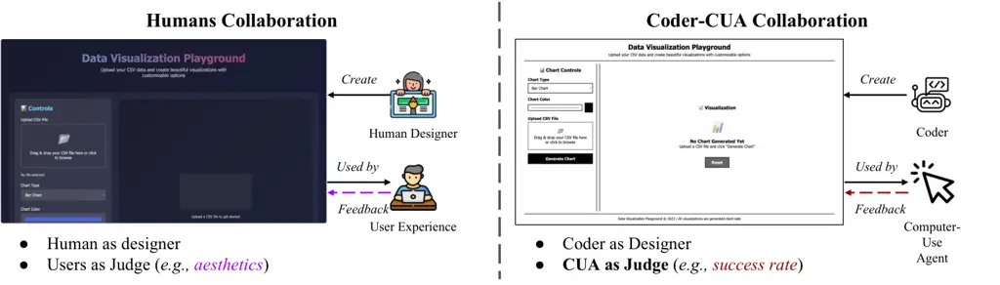

Figure 1: Illustration of Humans Collaboration vs. our Coder-CUA
Collaboration in term of UI designs. Left: Most GUIs are designed by
humans and optimized for user experience (e.g., aesthetics), forcing
trained agents to adapt to human-oriented behaviors. Right: Our
Coder-CUA Collaboration framework leverages Coder as Designer and CUA as
Judge together, enabling more reliable task execution and improved
usability for agents.

As no existing testbed aligns with our goal, we introduce AUI-Gym to
pioneer evaluation in this setting. AUI-Gym automatically develops
websites across 52 applications spanning six domains (apps, landing
pages, games, interactive demos, tools, and utilities). Unlike most
coders that focus on single-page generation, AUI-Gym requires agents to
produce fully automated, executable, application-level designs with an
emphasis on functional completeness. Enabling sufficient, scalable, and
human-free evaluation is non-trivial. To simulate realistic usage
scenarios, we prompt GPT-5 to propose 30 candidate tasks per
application, yielding 1560 tasks in total. These tasks are then
validated by humans. To ensure that each website can be reliably tested,
GPT-5 also generates a customized rule-based functional checker for
individual task, determining whether the task is feasible within the
given interface. This infrastructure establishes a human-free, reliable
foundation for subsequent CUA exploration and feedback-driven UI
refinement.

To this end, we develop a Coder–CUA collaboration framework. The Coder
acts as Designer, responsible for UI initialization and refinement,
while the CUA serves as Judge, supplying feedback. The central challenge
is how to transform raw CUA interactions into effective revision signals
from an agent perspective. We address this through two complementary
dimensions of feedback: (a) CUA Navigation, where the agent executes
tasks through atomic actions such as clicks or typing and judges success
or failure; and (b) Task Solvability, where unsolvable tasks are
accumulated as functionality failures and returned to the Coder as
precise indicators of missing features. CUA navigation produces long,
multi-step trajectories interleaved with screenshots, making direct
feedback difficult to interpret. To overcome this, we introduce the CUA
Dashboard, which condenses each task, its outcome, actions, and
intermediate states into a single $`1920\times 1080`$ image. Rather than
storing every screenshot, the dashboard highlights only key interactive
regions, with region sizes adaptively scaled by the number of steps.
This dynamic design reduces redundancy by average 76.2% while preserving
essential cues, offering a clear step-by-step view of how the CUA
perceives and acts on the interface. As a result, success and failure
points become immediately visible, and the dashboard provides concise,
interpretable feedback that the Coder to guide iterative UI redesign.

Our empirical results show that while state-of-the-art Coders can
generate complete GUIs that appear suitable to humans, they still
encounter notable limitations: (i) Task solvability as a foundation.
Initial UIs often fail to capture many practical scenarios, resulting in
low usability. However, by collecting failure cases, the Coder can
readily boost performance through language-based functional
summarization. (ii) CUA navigation as a key bottleneck. Even when UIs
achieve high functional completeness, CUAs initially exhibit low success
rates due to the complexity of multi-step navigation. Through our
Coder–CUA collaboration, we substantially improve navigation success
rates, particularly showing that CUA feedback-driven redesigns—such as
de-stylization, increased contrast, and simplified layouts—significantly
enhance CUA execution. Together, these findings highlight the promising
potential of agents for automatic UI design and testing, improving both
task success and robustness. To summarize, our contributions are
threefold:

1.  1.  AUI-Gym: a scalable testbed for automatic GUI development and
        testing, covering 52 applications across six domains with 1560
        GPT-5–proposed, human-validated tasks and per-task rule-based
        checkers. This enables human-free development of automatic UI
        creation and testing.
2.  2.  Coder–CUA framework with CUA Dashboard. The Coder initializes and
        refines UIs while the CUA judges via two signals: navigation
        outcomes and task solvability. A single-image $`1K`$ CUA Dashboard
        compresses task goal, actions, intermediate states, and outcome by
        highlighting key interactive regions with adaptive scaling, reducing
        visual tokens by 76.2% on average while preserving essential cues
        for redesign.
3.  3.  Evaluation Insights: What kind of UI do Agents prefer? Task
        solvability is foundational yet readily improved via failure-driven
        functional summarization, whereas CUA navigation is the main
        bottleneck. Feedback-driven redesigns (e.g., de-stylization, higher
        contrast, simplified layouts) substantially raise execution success
        and overall robustness.

## 2 Related Works

### 2.1 Computer-Use Agents

Recent studies reveal the potential of LLMs beyond language modeling,
with advancements in demonstrating their ability to autonomously
complete complex tasks using tool integration (Schick et al., 2023) like
humans. This has prompted the development of GUI automation agents that
learn to operate digital user interfaces by imitating human
trajectories. This learning is primarily achieved in two ways: (i) by
steering general multimodal foundation models with in-context human
trajectory examples, and the general models perceive the UI through
intermediate representations like HTML, accessibility trees (Drouin et
al., 2024; Zheng et al., 2024), Optical Character Recognition (Lu et
al., 2024), or Set of Masks (Yang et al., 2023). (ii) by pre-training
specialized GUI foundation models through extensive supervised
fine-tuning or reinforcement learning on large-scale vision-text UI data
(e.g., screenshots and instructions) (Lin et al., 2025; Gou et al.,
2024; Lin et al., 2024; Nayak et al., ). While foundational, these
data-driven approaches suffered from heavy requirements for high-quality
human trajectories to achieve agent performance improvements. Despite
their methodological differences, these approaches share a common,
agent-centric paradigm, focusing on improving the agent’s capabilities
to navigate a static and often complex environment. Notably, we
investigate a complementary approach. Instead of adapting the agent, we
explore how to dynamically tune the environment to enhance the
performance of a frozen agent.

### 2.2 Automatic Software Designs

Besides CUAs, there have been extensive research on software automation,
automatic interface design (Lu et al., 2023; Kong et al., 2008) and
generation (Si et al., 2024; Beltramelli, 2018; Laurençon et al., 2024).
Programmatic and semantic UI components—such as accessibility layers,
ARIA tags, and declarative interface frameworks (e.g., React Native,
Flutter)—illustrate how environments can be annotated or abstracted for
automated processes. Similarly, benchmarks in automated software
interaction, such as WebArena (Zhou et al., 2024) and GAIA (Mialon et
al., 2023), assume agent operates within fixed, human-oriented systems
for task automation. More recently, embodied AI environments
(e.g., ALFRED (Shridhar et al., 2020), Habitat (Puig et al., 2023),
MineDojo (Fan et al., 2022)) show how environments can be crafted to
accelerate agent training, though primarily in physical or simulated
domains. These efforts highlight the growing recognition that
environments themselves can be reimagined for machine interaction, yet a
systematic framework for designing agent-centric digital environments in
everyday computing remains absent.

## 3 AUI-Gym Benchmark

### 3.1 Task Definitions

We develop AUI-Gym for automatic GUI development and testing. Given a
language user query $`\mathcal{Q}`$ as input and several available
agents (e.g., Coder or CUA), the output is a complete website that
serves as a tunable environment $`\mathcal{E}`$. We detail the input and
output respectively below.

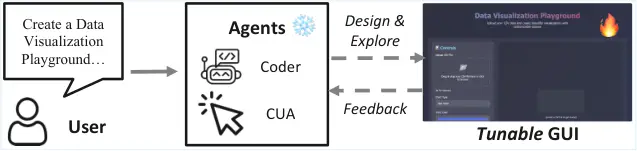

Figure 2: AUI-Gym task definition. A user issues a request
(e.g., “Create a Data Visualization Playground”), and agents
(e.g., Coder or CUA) interact with the GUI through design, exploration,
and feedback. In this setup, the GUI serves as a tunable environment.

Input Query $`\mathcal{Q}`$. Since the outcome is a website, the user
query $`\mathcal{Q}`$ should be both descriptive and concrete. To this
end, we explicitly standardize queries into the structured format
illustrated above. This supplements the query with a name, goal,
functional features, and UI theme.

Output website $`\mathcal{E}`$. The website is an application-level
deliverable that must be fully functional, going beyond a static page to
support navigation, transitions, button interactions, and completion of
functional goals, with the objective of maximizing the agent’s success
rate. Constructing an effective evaluation framework in this setting is
non-trivial and introduces several challenges. We next present our
scalable, automatic solutions.


### 3.2 Task Creation

The full curation pipeline is illustrated in Fig.3. To construct the
benchmark, we collect 52 task prompts from OpenAI’s playground ¹¹ 1
https://github.com/openai/gpt-5-coding-examples, covering multiple
domains.

Synthesize candidate tasks $`\mathcal{T}`$. Applications are typically
designed to support a variety of relevant tasks, and a key evaluation is
whether they can smoothly handle such tasks. We leverage GPT-5 OpenAI
(2025) to synthesize diverse user requirements: given an instruction
$`\mathcal{I}`$, it generates a set of candidate tasks $`\mathcal{T}`$
that simulate practical usage. As illustrated in Fig. 3, for the
application ‘Micro Habit Tracker’, an example task is: “Create a habit
named ‘Meditate 5 min,’ then view today’s column and the habit chart.”
These tasks serve as fine-grained probes that capture the potential
demands of the environment $`\mathcal{E}`$.

Manual quality control. As the tasks are automatically generated by
GPT-5, human oversight is required to ensure their quality. Different
applications demand different characteristics: for example, tasks for
game UIs should emphasize interactivity and control, while tasks for
utility tools should capture information accessibility and workflow
patterns. To this end, humans define domain-specific principles and
filter out low-quality tasks (e.g., trivial clicks) or nonsensical ones
(e.g., beyond the application scope), ambiguous queries
(cross-application), ensuring that the proposed tasks remain concrete,
meaningful and aligned with each domain’s design philosophy.

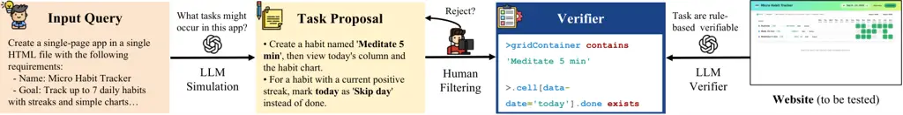

Figure 3: AUI-Gym construction pipeline. (i) An input query specifies
the app requirements. (ii) GPT-5 proposes candidate tasks with explicit
goals. (iii) Humans filter and refine tasks using domain-specific
principles. (iv) A test-time Verifier reads the website HTML and
generates task-specific, rule-based checkers to validate success on the
to-be-tested website.

Data Statistics.

[TABLE]

Table 1: Examples of App domains in AUI-Gym. For each domain, we show a
website created by GPT-5, paired with 30 tasks (blue) simulating
real-world usage. Each task is further linked to a rule-based verifier
(green). See full distribution and examples in Tab.7.

Based on the above strategy, we obtain 30 tasks for each application.
The benchmark spans 52 web applications across six domains, yielding a
total of 1,560 tasks and enabling comprehensive evaluation across
diverse applications. As illustrated in Table 1, the domains include:
(i) App, general-purpose applications; (ii) Landing, commercial and
promotional interfaces; (iii) Game, puzzle and arcade-style challenges;
(iv) Interactive, dynamic user engagement with real-time feedback; (v)
Tool, specialized utilities; and (vi) Utility, everyday organizational
support. This diverse coverage captures distinct GUI
challenges-—ensuring robust evaluation across varied interaction
paradigms and functional complexities.

### 3.3 Evaluation with Verifiers

Even with the proposed tasks, it remains challenging to determine
whether a given GUI can truly satisfy them, as websites are interactive
and highly diverse environments. More importantly, since the GUIs are
generated at test time, it is difficult to design fixed standards that
generalize across all cases, given the variety of possible
implementation approaches. A naive solution is to adopt a VLM-as-Judge
approach, but this inevitably introduces bias and uncertainty. Ideally,
the most reliable solution would be concrete functional checks with
manual validation, yet this approach is prohibitively expensive and
labor-intensive.

Verifier(input = GUI_HTML, task):

analyze elements and states

if task solvable:

return (Yes, function_checker)

else:

return (No, None)

To address this, we define a Verifier $`{\mathcal{V}(\cdot)}`$ powered
by GPT-5 at test time, which takes as input a candidate GUI together
with a specific task. It analyzes the available elements and states,
reasoning over the presence of required UI components, their properties,
and potential interaction paths. If the task is deemed solvable, the
Verifier produces a task-specific verification function checker
$`\widetilde{\mathcal{V}}(\cdot)`$ (by JavaScript) that encodes the
success condition by element status; otherwise, the task is discarded as
invalid, preventing noisy or unachievable goals from disrupting
evaluation. Such as in Fig.3, for task “Create a habit named ‘Meditate 5
min,’ then view today’s column and the habit chart.”, based on the
candidate website (right), the verifier generates the rule gridContainer
contains ’Meditate 5min’ In this way, the Verifier is customized for
each website and each task at test time, ensuring reliable validation.

Metrics. With the support of function checkers as reliable verification,
we can ensure that a website is both actionable and workable for the
CUA. This further allows us to evaluate whether tasks are completed
after CUA navigation, thereby measuring task success rate within the UI
environment. In this way, we devise the following measure:

(i) CUA Success Rate (SR). This measures the average success rate over
all tasks executed by CUA. If CUA successfully completes a task, it is
counted as a success; otherwise, it is counted as a failure. Notably, if
the Coder fails to yield a functional checker, the task is counted as a
failure.

```math
\text{SR}=\frac{1}{|\mathcal{T}|}\sum_{t\in\mathcal{T}}\mathbf{1}\left(\text{task $t$ is successfully completed}\right), \tag{1}
```

where $`\mathcal{T}`$ denotes the set of all tasks and
$`\mathbf{1}\{\cdot\}`$ is the indicator function.

(ii) Function Completeness (FC). While CUA performance reflects the
ultimate goal, it may be sparse if most CUAs fail to complete tasks.
Therefore, we devise a second metric to evaluate only whether the
Coder-created website functionally supports the task (valid),
independent of CUA navigation. This metric reflects task validity and
serves as a more basic measure.

```math
\text{FC}=\frac{1}{|\mathcal{T}|}\sum_{t\in\mathcal{T}}\mathbf{1}\{\text{a functional checker exists for task $t$}\}. \tag{2}
```

## 4 CUA–Coder in Collaboration

Overview. We present our framework for enabling collaboration between
the CUA and the Coder, consisting of two main components: the Coder as
Designer while the CUA as Judge. Given a user instruction
$`\mathcal{Q}`$, AUI generates an initial UI environment
$`\mathcal{E}_{0}`$, which is iteratively revised through interaction
and feedback. The framework involves two central roles: a Coder policy
$`\pi_{\text{Coder}}`$ that proposes and revises UI designs, and a CUA
policy $`\pi_{\text{CUA}}`$ that explores the UI and evaluates its
functionality. We formalize this process as a Markov Design Process. The
state is the current UI $`\mathcal{E}_{t}`$, the action is a design
update proposed by $`\pi_{\text{Coder}}`$, and the transition
deterministically
$`\mathcal{E}_{t+1}\leftarrow\pi_{\text{Coder}}(\mathcal{E}_{t},\mathcal{R}_{t}).`$
The feedback $`\mathcal{R}_{t}`$ is related to the metrics (i.e., Eq.1
and Eq.2) results achieved by the CUA when interacting with
$`\mathcal{E}_{t}`$,
i.e., $`\mathcal{R}_{t}\leftarrow S(\mathcal{E}_{t},\,\pi_{\text{CUA}}).`$
The Coder is optimized to maximize the total reward
$`\mathbb{E}\Big[\sum_{t}\gamma^{t}\mathcal{R}_{t}\Big]`$. In this
formulation, the CUA acts as a user that provides actionable feedback by
testing the environment, while the Coder serves as a designer who
integrates this feedback into code revisions to iteratively improve the
UI. Unlike conventional CUA setups, where the agent adapts to a fixed
environment $`\pi_{\text{CUA}}\leftarrow\mathcal{E}`$, our framework
adapts the environment itself based on CUA feedback
$`\mathcal{E}\leftarrow\pi_{\text{CUA}}`$, thereby optimizing UIs for
agent-native success. We illustrate the full workflow in Fig. 4 and
detail each role in the following subsections.

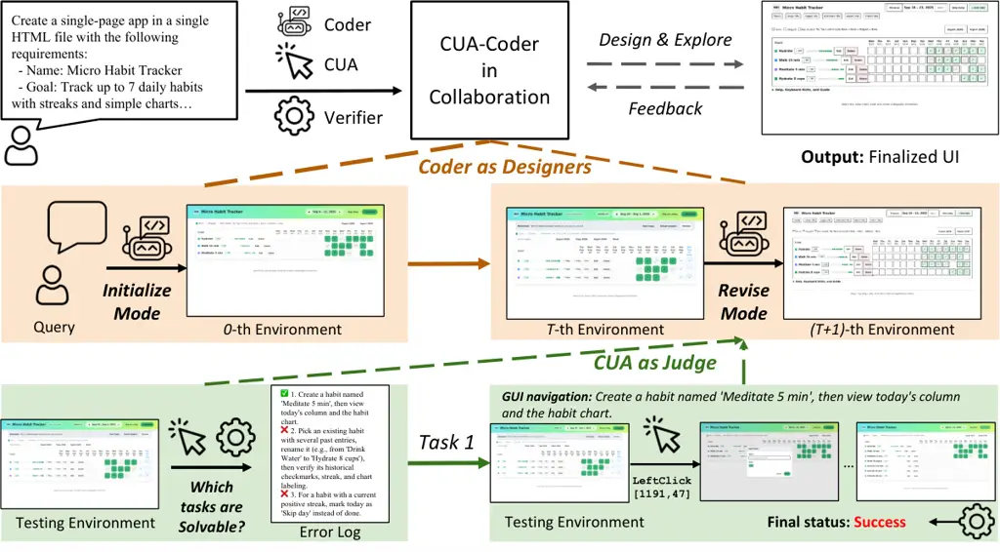

Figure 4: Overview of the Coder-CUA in Collaboration framework. The
process begins with the Coder as Designer, which initializes and
iteratively revises the UI based on queries and feedback. In parallel,
the CUA as Judge executes task-driven navigation within the testing
environment, generating trajectories and error logs to evaluate task
solvability. A verifier ensures functional correctness, while feedback
from CUA navigation informs subsequent UI revisions. This collaboration
yields a finalized agent-centric UI optimized for both functionality and
execution success.

### 4.1 Coder as Designers

Recent advances in Coder OpenAI (2025); Qwen (2025); anthropic (2025)
demonstrate strong capabilities in generating UI applications. In our
framework, we position Coders as _designers_, responsible not only for
creating new environments but also for refining them based on feedback
from CUAs. Accordingly, Coders operate in two complementary modes: one
dedicated to the initial creation of UIs, and the other focused on their
iterative improvement through CUA-guided feedback.

i. Initialization. Given a user query defined in formulation 3.1 and
enriched with multiple details, the Coder progressively generates
long-context code to construct a complete HTML-rendered UI
$`\mathcal{E}_{0}`$ from scratch, which serves as the base environment
for subsequent interactions.

ii. Revision from Feedback. After constructing the initial environment
$`\mathcal{E}_{0}`$, the Coder enters an iterative refinement loop to
update the UI:
$`\mathcal{E}_{t+1}\leftarrow(\mathcal{E}_{t},\mathcal{R}_{t}),`$ where
$`\mathcal{R}_{t}`$ denotes the feedback signal expressed as a language
caption, described in the next section.

### 4.2 CUA as Judges

We employ Computer-Use Agents (CUAs) as _Judges_ to trial and diagnose
the UIs $`\mathcal{E}_{t}`$ generated by the Coder, providing actionable
feedback for iterative redesign. Specifically, we define two
complementary forms of reward signals:

(i) Task Solvability Feedback $`\mathcal{R}_{\text{task}}`$. Before
navigation begins, we verify whether a task $`\tau`$ is implementable on
the current UI. Let $`\mathcal{V}`$ denote the verifier in Sec. 3.3. A
task is deemed solvable if and only if
$`\mathcal{V}(\mathcal{E}_{t},\tau)=1`$; otherwise it is labeled a
_functionality failure_. This gate prevents wasted rollouts on
impossible tasks and sharpens the feedback signal. We collect all failed
tasks into
$`\mathcal{T}_{\text{fail}}=\{\tau:\mathcal{V}(\mathcal{E}_{t},\tau)=0\}`$
and return them to the Coder as precise indicators of missing features.
The Coder then aggregates and summarizes these failures into a language
feedback signal $`\mathcal{R}_{\text{task}}`$.

|                                                                                                              |                                                                                                                                                                                                                                                                                 |
| ------------------------------------------------------------------------------------------------------------ | ------------------------------------------------------------------------------------------------------------------------------------------------------------------------------------------------------------------------------------------------------------------------------- |
| Task                                                                                                         | Load the app for the first time and wait for the curtain reveal to complete.                                                                                                                                                                                                    |
| Website                                                                                                      | ![[Uncaptioned image]](arxiv-2511-15567--e8b29e20025b.figures/figure-9.webp)                                                                                                                                                                                                    |
| $`1280\times 720`$                                                                                           |                                                                                                                                                                                                                                                                                 |
| Dashboard                                                                                                    |                                                                                                                                                                                                                                                                                 |
| (an image)                                                                                                   | ![[Uncaptioned image]](arxiv-2511-15567--e8b29e20025b.figures/figure-10.webp)                                                                                                                                                                                                   |
| Before: $`6\times 1280\times 720`$ $`\rightarrow`$ After: $`1\times 1950\times 975`$, 76.2% tokens reduction |                                                                                                                                                                                                                                                                                 |
| Result                                                                                                       | Failure                                                                                                                                                                                                                                                                         |
| Comments                                                                                                     | The weather-theatre app requires button clicks to trigger curtain reveal, but the task expects automatic curtain opening on first load without user interaction, creating a fundamental mismatch between expected auto-start behavior and actual manual activation requirement. |

Table 2: Illustration of CUA Dashboard. The dashboard generates one
informative image that clearly demonstrates how the CUA performs each
step along with the corresponding observations, while reducing visual
tokens by cropping to the key interactive regions.

(ii) CUA Navigation Feedback $`\mathcal{R}_{\text{nav}}`$. For solvable
tasks
$`\mathcal{T}_{\text{succ}}=\{\tau:\mathcal{V}(\mathcal{E}_{t},\tau)=1\}`$
, evaluation proceeds as a UI navigation problem. At step $`k`$, the CUA
receives an observation $`o_{k}`$ (a screenshot of the current state),
emits an action
$`a_{k}\in\{\textsc{click},\textsc{type},\textsc{scroll},\ldots\}`$ with
an optional reasoning trace, and the environment transitions to the next
state, yielding $`o_{k+1}`$. The trajectory
$`\mathcal{H}=\left(o_{0},a_{0},\ldots,o_{K}\right)`$ terminates when
either (a) the function checker signals success
$`\widetilde{\mathcal{V}}(\mathcal{E}_{t},\tau)=1`$, or (b) a step limit
is reached, which we record as a failure. We log full
trajectories—observations, actions, and intermediate rationales—and use
them to construct targeted feedback for UI refinement.

CUA Dashboard for Compact Feedback. Raw trajectories $`\mathcal{H}`$ are
long and interleaved, making them ill-suited for direct ingestion by the
Coder. We therefore distill each rollout into a CUA Dashboard (Fig. 2):
a single, fixed-resolution ($`1920\times 1080`$) canvas that compresses
key evidence from the trial. Rather than storing full frames, we crop
and tile only _interactive regions_ touched by the CUA, allocating
dynamic region sizes based on step order to preserve temporal structure.
This yields a substantial reduction in redundancy (e.g., a $`76.2\%`$
drop in visual content) while retaining the cues needed to localize
failure modes (missed affordances, hidden state, ambiguous labels) and
success paths at a glance. The dashboard provides a step-by-step visual
trace aligned with actions, making error locations immediately visible.
Finally, we convert the dashboard into a concise language summary
$`\mathcal{R}_{\text{nav}}`$ by passing it to a VLM as Commenter then as
the feedback for revision.

## 5 Experiments

### 5.1 Settings

For the Coder, we evaluate GPT-5 OpenAI (2025), GPT-4o Hurst et al.
(2024), and the open-source Qwen3-Coder Qwen (2025). For the CUA, we use
UI-TARS-1.5-7B Seed (2025), a lightweight yet efficient open model, and
Operator openai (2025), a state-of-the-art closed-source API-based CUA.
GPT-5 serves both as Coder and Commenter, configured with high verbosity
and reasoning effort for coding, and low verbosity with minimal
reasoning for commenting. GPT-4o also serves as both Coder and Commenter
but without specific verbosity or reasoning configurations. For Qwen,
coding is performed by Qwen3-Coder-30B-A3B-Instruct, while commenting is
done by Qwen2.5-VL-72B-Instruct. The Task Proposer and Verifier utilize
GPT-5 with high verbosity and reasoning effort. In CUA policy tests, we
limit maximum steps to 20 to prevent infinite loops, conducting
evaluations using Playwright. CUAs exclusively perform coordinate-based
Computer Use actions without direct interaction with UI elements,
enhancing evaluation difficulty and providing deeper insights into UI
layout and visibility. Experiment results consistently demonstrate
universal performance gains from our proposed method, benefiting CUAs of
varying complexity.

|                       |                     |             |          |         |             |                 |          |             |
| --------------------- | ------------------- | ----------- | -------- | ------- | ----------- | --------------- | -------- | ----------- |
| Coder                 | Feedback Type       | landing (%) | game (%) | app (%) | utility (%) | interactive (%) | tool (%) | overall (%) |
| Function Completeness |                     |             |          |         |             |                 |          |             |
| GPT-5                 | Baseline            | 53.0        | 77.8     | 70.6    | 63.3        | 73.0            | 70.0     | 67.9        |
|                       | \+ Task Solvability | 19.7        | 100.0    | 69.4    | 65.6        | 55.6            | 56.2     | 60.5        |
|                       | \+ CUA Navigation   | 53.3        | 87.8     | 74.2    | 70.0        | 70.4            | 69.5     | 70.8        |
|                       | \+ Integrated       | 75.3        | 92.2     | 85.2    | 73.3        | 82.6            | 76.7     | 81.5        |
| Qwen3- Coder-30B      | Baseline            | 16.3        | 50.4     | 41.2    | 43.9        | 52.2            | 54.8     | 42.1        |
|                       | \+ Task Solvability | 55.0        | 79.6     | 58.5    | 67.8        | 56.3            | 74.3     | 64.3        |
|                       | \+ CUA Navigation   | 23.3        | 50.4     | 38.8    | 49.4        | 39.3            | 55.2     | 41.3        |
|                       | \+ Integrated       | 47.7        | 72.2     | 59.7    | 56.7        | 57.0            | 69.5     | 60.1        |
| GPT-4o                | Baseline            | 9.7         | 55.2     | 36.1    | 38.9        | 44.8            | 37.6     | 36.3        |
|                       | \+ Task Solvability | 23.7        | 55.9     | 52.1    | 55.0        | 58.9            | 65.2     | 50.6        |
|                       | \+ CUA Navigation   | 8.3         | 55.2     | 28.2    | 34.4        | 26.3            | 35.7     | 30.4        |
|                       | \+ Integrated       | 16.3        | 68.5     | 36.4    | 51.7        | 51.1            | 41.4     | 43.1        |
| CUA Success Rate      |                     |             |          |         |             |                 |          |             |
| GPT-5                 | Baseline            | 34.7        | 24.8     | 27.3    | 14.4        | 18.1            | 21.9     | 24.5        |
|                       | \+ Task Solvability | 16.3        | 39.3     | 26.7    | 16.1        | 20.7            | 11.9     | 22.6        |
|                       | \+ CUA Navigation   | 17.7        | 43.3     | 30.0    | 21.1        | 21.1            | 17.6     | 25.7        |
|                       | \+ Integrated       | 40.7        | 27.4     | 31.5    | 22.2        | 14.1            | 12.9     | 26.0        |
| Qwen3- Coder-30B      | Baseline            | 5.3         | 9.3      | 9.1     | 11.7        | 7.0             | 1.4      | 7.3         |
|                       | \+ Task Solvability | 14.7        | 42.2     | 19.1    | 14.4        | 11.1            | 4.3      | 18.3        |
|                       | \+ CUA Navigation   | 6.7         | 20.7     | 9.1     | 11.1        | 12.2            | 11.4     | 11.7        |
|                       | \+ Integrated       | 23.7        | 30.7     | 22.4    | 7.8         | 9.3             | 13.8     | 19.0        |
| GPT-4o                | Baseline            | 4.7         | 12.6     | 12.4    | 6.7         | 9.3             | 5.7      | 8.8         |
|                       | \+ Task Solvability | 8.7         | 18.5     | 19.1    | 5.6         | 8.5             | 22.9     | 14.1        |
|                       | \+ CUA Navigation   | 5.7         | 31.5     | 10.0    | 8.3         | 10.4            | 6.7      | 12.3        |
|                       | \+ Integrated       | 10.3        | 27.4     | 13.9    | 13.3        | 15.2            | 16.7     | 16.1        |

Table 3: Main results on AUI-Gym per Coder. Top: Func. Completeness Rate
(%). Bottom: CUA Success Rate (%).

### 5.2 Main Results

Table 3 reports results across six domains for three coders. Several key
findings emerge: (i) Function Completeness. Revision based on task
solvability feedback leads to substantial gains, consistently boosting
the overall functionality completeness for all coders. After applying
integrated revision for GPT-5, the function completeness is increased to
81.5% from 67.9%, reaching the highest. Notably, the landing, game and
app domains have dramatic improvements, with the maximum improvements of
31.4%. Interestingly, revision based on task solvability feedback or CUA
navigation feedback alone does not guarantee function completeness
improvements, but the integrated revision combining these two components
bring stable improvements in all domains for all coders, highlighting
the strength of our design. Moreover, fixing unresolved functionalities
alone also benefits CUA task solving, yielding a 4.8% average
improvement on CUA evaluation, highlighting the mutual reinforcement
between task solvability and CUA navigation.

(ii) CUA performance. Open-source CUAs initially perform poorly, with an
average overall CUA success rate of only 13.5%. However, our framework
can consistently improve the CUA success rate, with an average 6.8%
improvements. Interestingly, our framework brings large improvements to
weak coders such as Qwen3-Coder-30B and GPT-4o, with a maximum overall
improvement of 11.7%, showcasing that our framework can greatly empower
weak models. Overall, these results demonstrate the effectiveness of our
framework: task solvability feedback guides to robust UI design, while
leveraging CUA navigation feedback optimizes interfaces toward
agent-centric success.

### 5.3 Ablation Studies

Ablation studies of CUA Dashboard. To ablate the Dashboard, we design
two commenter variants: one using textual actions only, and the other
using visual screenshots only. We evaluate both variants (Coder,
Commenter) under the setting that (GPT-5, GPT-5) and (Qwen3-Coder-30B,
Qwen2.5-VL-72B). As shown in Fig. 5(a-b), our Dashboard consistently
brings gains, significantly improving both Function Completeness (from
62.1% to 70.8%) and CUA Success Rate (from 18.7% to 25.7%) compared to
the action variant for GPT-5. In contrast, the screenshot variant mostly
performs worst, highlighting that visual inputs solely are inadequate
for providing refinement insights, while integrating visual and textual
information in our Dashboard notably benefits the commenting process.

Effects by Refinement Round. As shown in the Fig.5(c-d), iteratively
applying revision can consistently bring gains on the function
completeness for all coders. Interestingly, it can be observed that the
CUA success rate of GPT-5 coder may drop after repeated revision, while
Qwen3-Coder-30B and GPT-4o can consistently gain from repeated revision.
This indicates that the revision improvement may saturate for strong
coders, but weak coders can be improved with iterative revisions.

|     |     |     |     |
| --- | --- | --- | --- |
|     |     |     |     |

(a) Func. completeness.

(b) CUA success rate.

(c) Func. completeness.

(d) CUA success rate.

Figure 5: Ablation Studies of CUA Dashboard and Iterative rounds. Left
(a-b): Effects by CUA Dashboard. Right (c-d): Performance across
different iterative revision rounds.

### 5.4 Qualitative Analysis

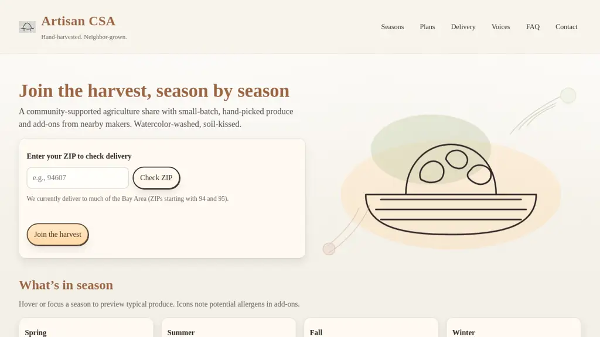

Initial UI


w\. Task Solvability Feedback

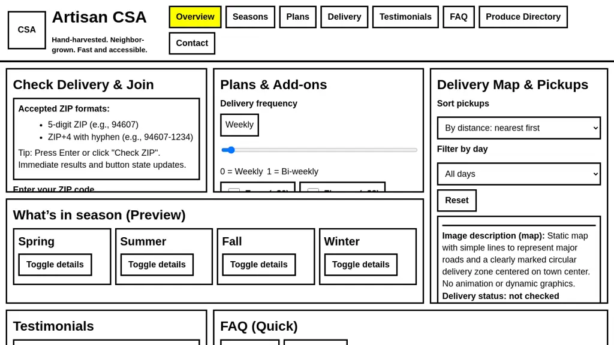

w\. CUA Navigation Feedback

(a) artisan-csa: Create a single-page app, in a single HTML file, for a
community-supported agriculture program with a hand-drawn, watercolor
aesthetic.

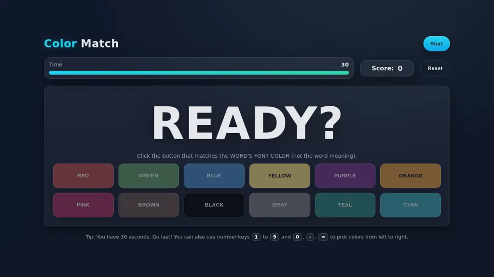

Initial UI

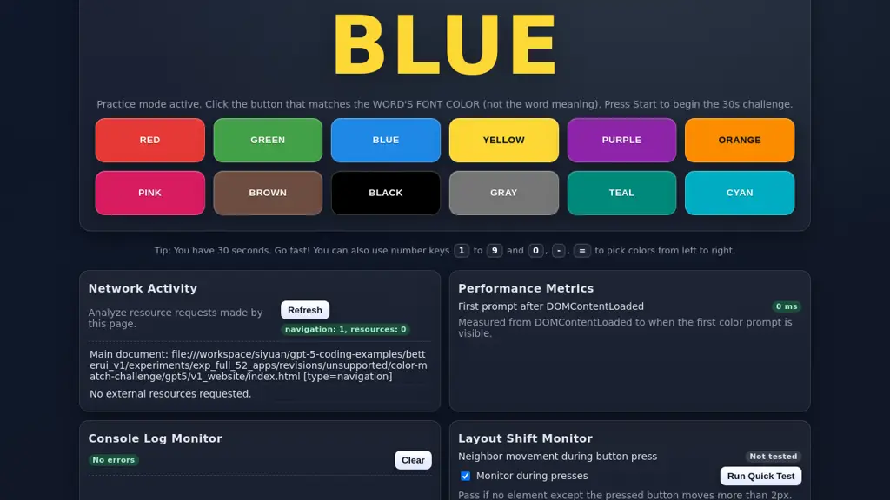

w\. Task Solvability Feedback

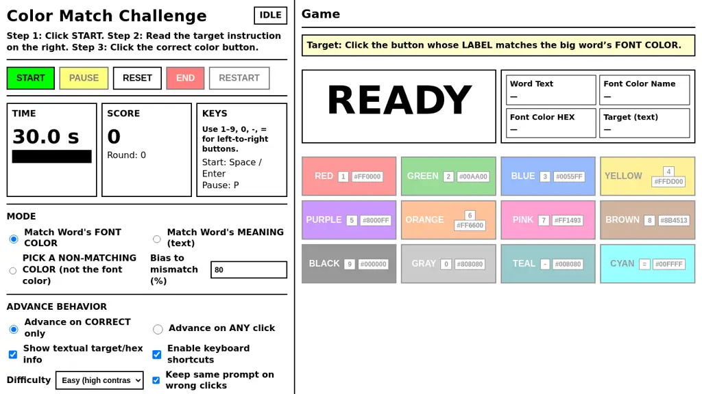

w\. CUA Navigation Feedback

(b) color-match-challenge: Create a single-page app in a single HTML
file for a fast-paced “color match” game. - Show a word (e.g., “RED”) in
a random font color — player must click the correct color button (not
the word meaning). - Keep score based on correct answers within 30
seconds. - Use large typography, color-coded buttons, and smooth button
press animations.

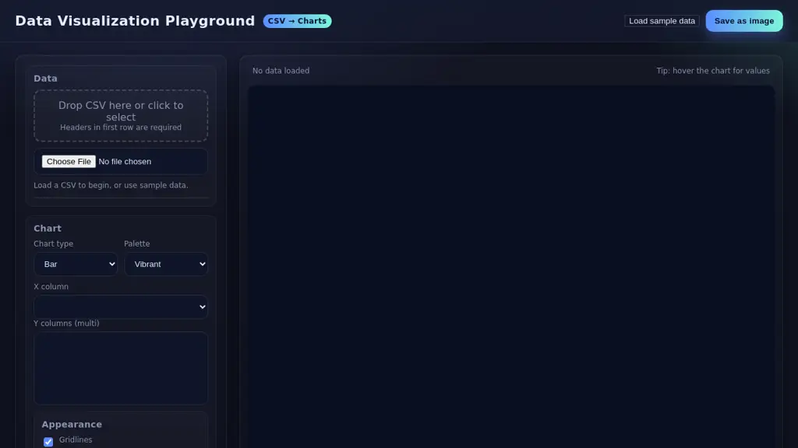

Initial UI

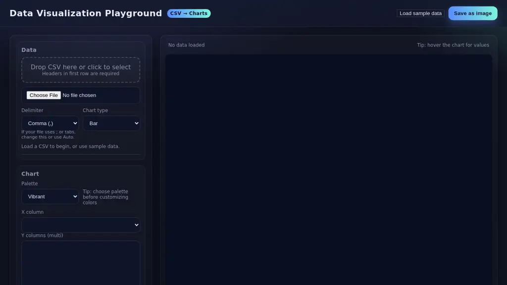

w\. Task Solvability Feedback

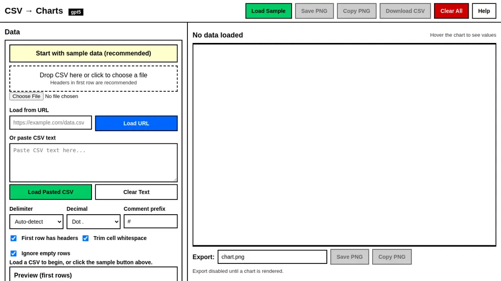

w\. CUA Navigation Feedback

(c) csv-to-charts: Create a single-page app in a single HTML file with
the following requirements: - Name: Data Visualization Playground -
Goal: Upload CSV and generate charts. - Features: Chart type selector,
color customization, save as image. - The UI should be modern with a
focus on charts.

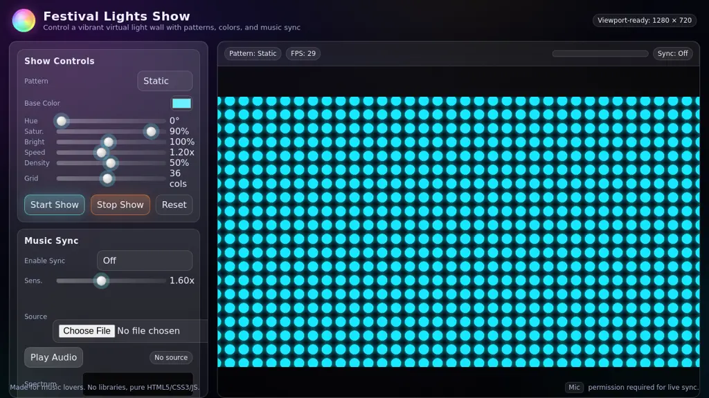

Initial UI

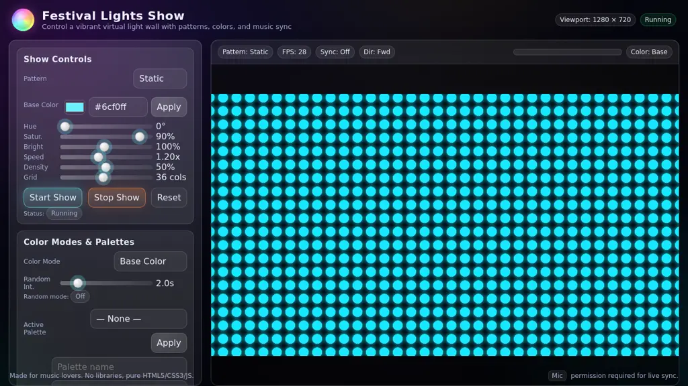

w\. Task Solvability Feedback

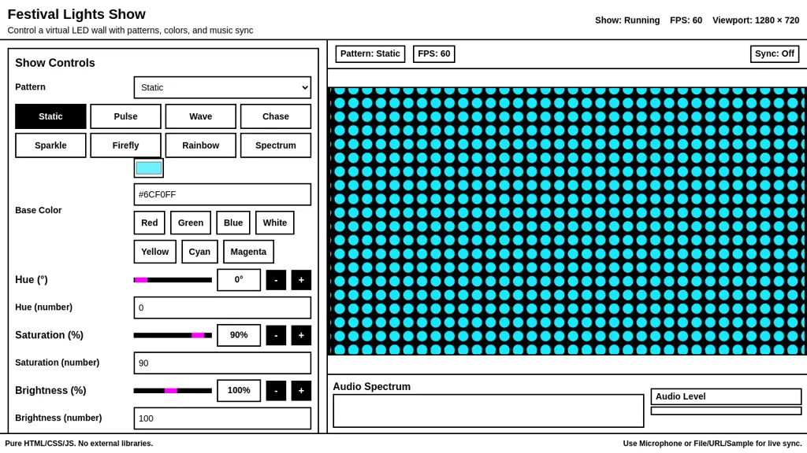

w\. CUA Navigation Feedback

(d) festival-lights-show: Create a single-page app in a single HTML file
with the following requirements: - Name: Festival Lights Show - Goal:
Control a virtual light show. - Features: Color changes, patterns, music
sync. - The UI should be vibrant and dynamic.

Figure 6: Qualitative comparison of initialized UI vs. refined UI. Each
row shows an initial UI (left), its revision based on function (middle),
and its revision based on CUA’s feedback (right).

In Fig.6, we present four representative revision cases—artisan-csa,
color-match-challenge, csv-to-charts, and festival-lights-show. Each row
displays the initial UI alongside its revised versions, evaluated under
two criteria: Function Test and CUA Test. Across the four cases, the
revisions demonstrate distinct patterns of improvement. Revisions based
on the Function Test, which addresses unsupported tasks, tend to focus
on adding underlying functionality, sometimes with subtle visual
changes. For example, the festival-lights-show revision added a crucial
“Running” state indicator, and the csv-to-charts revision added a button
to select a delimiter. In contrast, revisions based on the CUA Test
consistently yield more significant visual modifications geared towards
agent accessibility. For most websites, this meant adding buttons with
clear boundaries and visual hints. In both color-match-challenge and
csv-to-charts, both revision types improved accessibility by presenting
more information and controls upfront, reducing the need for scrolling.
A key CUA-friendly adaptation is seen in festival-lights-show, where
“increase” and “reduce” buttons were added as a complement to sliders,
providing a more direct and reliable interaction method for agents.

## 6 Conclusion

We introduced AUI-Gym, a new benchmark for automatic GUI development (52
applications; 1560 tasks with programmatic checkers), and a Coder–CUA
collaboration framework that recasts UI design as an agent-native loop,
with the Coder as Designer and the CUA as Judge. Central to this loop is
the CUA Dashboard, which compresses long agent navigation trajectories
into compact, interpretable summaries that reliably convert raw
interactions into actionable revision signals. Empirically, task
solvability is foundational—readily improved by failure-driven
functional summarization—whereas CUA navigation remains the primary
bottleneck; feedback-driven redesigns (e.g., de-stylization, higher
contrast, simplified layouts) consistently raise execution success and
robustness, highlighting the value of designing _for_ agents rather than
merely adapting human-centric interfaces.

## References

- Anthropic (2025) Anthropic Claude 3.7 sonnet system card. Cited by:
  §1.
- anthropic (2025) anthropic Introducing claude 4. External Links:
  [Link](https://www.anthropic.com/news/claude-4) Cited by: §4.1.
- Beltramelli (2018) T. Beltramelli Pix2code: generating code from a
  graphical user interface screenshot. In Proceedings of the ACM SIGCHI
  symposium on engineering interactive computing systems, pp. 1–6. Cited
  by: §2.2.
- Drouin et al. (2024) A. Drouin, M. Gasse, M. Caccia, I. H. Laradji, M.
  Del Verme, T. Marty, L. Boisvert, M. Thakkar, Q. Cappart, D. Vazquez,
  et al. Workarena: how capable are web agents at solving common
  knowledge work tasks?. arXiv preprint arXiv:2403.07718. Cited by:
  §2.1.
- Fan et al. (2022) L. Fan, G. Wang, Y. Jiang, A. Mandlekar, Y. Yang, H.
  Zhu, A. Tang, D. Huang, Y. Zhu, and A. Anandkumar MineDojo: building
  open-ended embodied agents with internet-scale knowledge. In
  Thirty-sixth Conference on Neural Information Processing Systems
  Datasets and Benchmarks Track, External Links:
  [Link](https://openreview.net/forum?id=rc8o_j8I8PX) Cited by: §2.2.
- Gou et al. (2024) B. Gou, R. Wang, B. Zheng, Y. Xie, C. Chang, Y.
  Shu, H. Sun, and Y. Su Navigating the digital world as humans do:
  universal visual grounding for gui agents. arXiv preprint
  arXiv:2410.05243. Cited by: §2.1.
- Hurst et al. (2024) A. Hurst, A. Lerer, A. P. Goucher, A. Perelman, A.
  Ramesh, A. Clark, A. Ostrow, A. Welihinda, A. Hayes, A. Radford, et
  al. Gpt-4o system card. arXiv preprint arXiv:2410.21276. Cited by:
  §5.1.
- Kong et al. (2008) J. Kong, K. L. Ates, K. Zhang, and Y. Gu Adaptive
  mobile interfaces through grammar induction. In 2008 20th IEEE
  International Conference on Tools with Artificial Intelligence, Vol.
  1, pp. 133–140. Cited by: §2.2.
- Laurençon et al. (2024) H. Laurençon, L. Tronchon, and V. Sanh
  Unlocking the conversion of web screenshots into html code with the
  websight dataset. External Links: 2403.09029 Cited by: §2.2.
- Lin et al. (2024) K. Q. Lin, L. Li, D. Gao, Q. WU, M. Yan, Z. Yang, L.
  Wang, and M. Z. Shou VideoGUI: a benchmark for gui automation from
  instructional videos. Advances in Neural Information Processing
  Systems 37, pp. 69329–69360. Cited by: §2.1.
- Lin et al. (2025) K. Q. Lin, L. Li, D. Gao, Z. Yang, S. Wu, Z.
  Bai, S. W. Lei, L. Wang, and M. Z. Shou Showui: one
  vision-language-action model for gui visual agent. In Proceedings of
  the Computer Vision and Pattern Recognition Conference,
  pp. 19498–19508. Cited by: §1, §2.1.
- Lu et al. (2024) Y. Lu, J. Yang, Y. Shen, and A. Awadallah Omniparser
  for pure vision based gui agent. arXiv preprint arXiv:2408.00203.
  Cited by: §2.1.
- Lu et al. (2023) Y. Lu, Z. Tong, Q. Zhao, C. Zhang, and T. J. Li UI
  layout generation with llms guided by ui grammar. arXiv preprint
  arXiv:2310.15455. Cited by: §2.2.
- Mialon et al. (2023) G. Mialon, C. Fourrier, T. Wolf, Y. LeCun, and T.
  Scialom Gaia: a benchmark for general ai assistants. In The Twelfth
  International Conference on Learning Representations, Cited by: §2.2.
- \[15\] S. Nayak, X. Jian, K. Q. Lin, J. A. Rodriguez, M. Kalsi, N.
  Chapados, M. T. Özsu, A. Agrawal, D. Vazquez, C. Pal, et al.
  UI-vision: a desktop-centric gui benchmark for visual perception and
  interaction. In Forty-second International Conference on Machine
  Learning, Cited by: §2.1.
- OpenAI (2025) OpenAI Introducing gpt-5. Note: OpenAI websiteAvailable
  at
  [https://openai.com/index/introducing-gpt-5/](https://openai.com/index/introducing-gpt-5/),
  accessed August 10, 2025 Cited by: §3.2, §4.1, §5.1.
- openai (2025) openai Operator. External Links:
  [Link](https://openai.com/index/introducing-operator/) Cited by: §1,
  §5.1.
- Puig et al. (2023) X. Puig, E. Undersander, A. Szot, M. D. Cote, R.
  Partsey, J. Yang, R. Desai, A. W. Clegg, M. Hlavac, T. Min, T.
  Gervet, V. Vondrus, V. Berges, J. Turner, O. Maksymets, Z. Kira, M.
  Kalakrishnan, J. Malik, D. S. Chaplot, U. Jain, D. Batra, A. Rai,
  and R. Mottaghi Habitat 3.0: a co-habitat for humans, avatars and
  robots. Cited by: §2.2.
- Qwen (2025) Qwen Qwen-3-coder. Note:
  [https://qwenlm.github.io/blog/qwen3-coder](https://qwenlm.github.io/blog/qwen3-coder)
  Cited by: §4.1, §5.1.
- Schick et al. (2023) T. Schick, J. Dwivedi-Yu, R. Dessì, R.
  Raileanu, M. Lomeli, E. Hambro, L. Zettlemoyer, N. Cancedda, and T.
  Scialom Toolformer: language models can teach themselves to use tools.
  Advances in Neural Information Processing Systems 36, pp. 68539–68551.
  Cited by: §2.1.
- Seed (2025) B. Seed UI-tars-1.5. Note:
  [https://seed-tars.com/1.5](https://seed-tars.com/1.5) Cited by: §1,
  §5.1.
- Shridhar et al. (2020) M. Shridhar, J. Thomason, D. Gordon, Y.
  Bisk, W. Han, R. Mottaghi, L. Zettlemoyer, and D. Fox Alfred: a
  benchmark for interpreting grounded instructions for everyday tasks.
  In Proceedings of the IEEE/CVF conference on computer vision and
  pattern recognition, pp. 10740–10749. Cited by: §2.2.
- Si et al. (2024) C. Si, Y. Zhang, R. Li, Z. Yang, R. Liu, and D. Yang
  Design2code: benchmarking multimodal code generation for automated
  front-end engineering. arXiv preprint arXiv:2403.03163. Cited by: §1,
  §2.2.
- Xu et al. (2024) Y. Xu, Z. Wang, J. Wang, D. Lu, T. Xie, A. Saha, D.
  Sahoo, T. Yu, and C. Xiong Aguvis: unified pure vision agents for
  autonomous gui interaction. arXiv preprint arXiv:2412.04454. Cited by:
  §1.
- Yang et al. (2023) J. Yang, H. Zhang, F. Li, X. Zou, C. Li, and J. Gao
  Set-of-mark prompting unleashes extraordinary visual grounding in
  gpt-4v. arXiv preprint arXiv:2310.11441. Cited by: §2.1.
- Zheng et al. (2024) B. Zheng, B. Gou, J. Kil, H. Sun, and Y. Su Gpt-4v
  (ision) is a generalist web agent, if grounded. arXiv preprint
  arXiv:2401.01614. Cited by: §2.1.
- Zhou et al. (2024) S. Zhou, F. F. Xu, H. Zhu, X. Zhou, R. Lo, A.
  Sridhar, X. Cheng, T. Ou, Y. Bisk, D. Fried, U. Alon, and G. Neubig
  WebArena: a realistic web environment for building autonomous agents.
  External Links: 2307.13854, [Link](https://arxiv.org/abs/2307.13854)
  Cited by: §1, §2.2.

## Appendix A Additional Results

(a) Function completeness.

(b) CUA success rate.

Figure 7: Performance comparison after revision based on different CUA
feedback.

Effects by different CUAs choices. In Fig. 7, we compare UI-TARS and
Operator as CUA policies within the integrated revision loop. We
evaluate with two coders—GPT-5 (closed-source, stronger) and
Qwen3-Coder-30B (open-source, weaker)—to cover both capability and
licensing spectra. Both CUA policies yield comparable gains in
functional completeness, with UI-TARS slightly outperforming on
Qwen3-Coder-30B. Although the task-solvability signal is identical
across CUAs, UI-TARS tends to fail more tasks, thereby surfacing richer
failure cases and driving greater function-oriented revisions. For CUA
success rate (SR), Operator delivers larger gains with the stronger
coder (GPT-5), while improvements are similar across CUAs for the weaker
coder. This suggests Operator’s navigation strengths are best realized
on more complex UIs, whereas weaker coders often produce simpler
interfaces. Overall, lightweight open-source CUAs like UI-TARS are an
efficient and effective choice for harvesting navigation feedback in
practice.

|                  |           |               |               |               |               |               |               |               |
| ---------------- | --------- | ------------- | ------------- | ------------- | ------------- | ------------- | ------------- | ------------- |
| Model            | Version   | landing       | game          | app           | utility       | interactive   | tool          | Overall       |
| GPT-5            | Baseline  | 34.7% (53.0%) | 24.8% (77.8%) | 27.3% (70.6%) | 14.4% (63.3%) | 18.1% (73.0%) | 21.9% (70.0%) | 24.5% (67.9%) |
|                  | \+ Revise | 41.3% (75.3%) | 42.6% (92.2%) | 38.8% (85.2%) | 27.8% (73.3%) | 10.7% (82.6%) | 21.4% (76.7%) | 31.5% (81.5%) |
| Qwen3- Coder-30B | Baseline  | 5.3% (16.3%)  | 9.3% (50.4%)  | 9.1% (41.2%)  | 11.7% (43.9%) | 7.0% (52.2%)  | 1.4% (54.8%)  | 7.3% (42.1%)  |
|                  | \+ Revise | 10.0% (47.0%) | 27.0% (68.9%) | 19.1% (60.3%) | 20.6% (55.6%) | 13.7% (57.4%) | 23.8% (62.9%) | 18.6% (58.5%) |
| GPT-4o           | Baseline  | 4.7% (9.7%)   | 12.6% (55.2%) | 12.4% (36.1%) | 6.7% (38.9%)  | 9.3% (44.8%)  | 5.7% (37.6%)  | 8.8% (36.3%)  |
|                  | \+ Revise | 15.7% (19.0%) | 35.9% (59.3%) | 14.5% (44.5%) | 15.0% (47.8%) | 5.9% (50.7%)  | 13.8% (46.2%) | 16.9% (43.8%) |

Table 4: Main results per model (Operator as CUA policy): Each cell
shows A (B), where A represents the CUA Success Rate and (B) in
parentheses denotes the Function Completeness Rate.

As shown in the Table 4, when using operator as CUA policy for
integrated revision, consistent improvements for both function
completeness and CUA success rate can be observed. Moreover, compared to
the CUA success rate showcased in Table 3, it can be observed that
Operator has higher CUA success rate than UI-TARS in hard domains such
as game and app that requires responsive and complex interactions,
showcasing its strong navigation capability.

|                  |                 |               |               |               |               |               |               |               |           |
| ---------------- | --------------- | ------------- | ------------- | ------------- | ------------- | ------------- | ------------- | ------------- | --------- |
| Model            | Dashboard       | landing       | game          | app           | utility       | interactive   | tool          | Overall       | Token (K) |
| GPT-5            | Text-only       | 24.0% (50.7%) | 31.1% (87.8%) | 21.2% (69.4%) | 16.1% (55.6%) | 8.9% (59.3%)  | 6.2% (43.3%)  | 18.7% (62.1%) | 3.2       |
|                  | Screenshot-only | 17.3% (30.3%) | 16.7% (65.6%) | 12.4% (42.7%) | 15.6% (38.3%) | 5.2% (27.8%)  | 9.5% (46.7%)  | 12.8% (41.7%) | 15.5      |
|                  | Dashboard       | 17.7% (53.3%) | 43.3% (87.8%) | 30.0% (74.2%) | 21.1% (70.0%) | 21.1% (70.4%) | 17.6% (69.5%) | 25.7% (70.8%) | 4.3       |
| Qwen3- Coder-30B | Text-only       | 8.0% (18.3%)  | 20.7% (61.9%) | 7.3% (42.4%)  | 8.3% (54.4%)  | 10.7% (48.9%) | 16.2% (57.1%) | 11.7% (45.6%) | 4.2       |
|                  | Screenshot-only | 9.3% (20.7%)  | 11.9% (63.7%) | 5.2% (34.5%)  | 10.6% (40.6%) | 7.4% (55.9%)  | 5.2% (37.6%)  | 8.1% (41.7%)  | 19.5      |
|                  | Dashboard       | 6.7% (23.3%)  | 20.7% (50.4%) | 9.1% (38.8%)  | 11.1% (49.4%) | 12.2% (39.3%) | 11.4% (55.2%) | 11.7% (41.3%) | 6.4       |
| GPT-4o           | Text-only       | 7.7% (13.0%)  | 14.8% (57.0%) | 12.7% (34.8%) | 2.8% (37.8%)  | 15.9% (39.3%) | 7.6% (29.0%)  | 10.8% (34.8%) | 2.8       |
|                  | Screenshot-only | 4.7% (10.3%)  | 15.6% (43.7%) | 10.6% (31.2%) | 6.1% (45.6%)  | 5.6% (34.8%)  | 7.1% (37.6%)  | 8.5% (32.5%)  | 14.8      |
|                  | Dashboard       | 5.7% (8.3%)   | 31.5% (55.2%) | 10.0% (28.2%) | 8.3% (34.4%)  | 10.4% (26.3%) | 6.7% (35.7%)  | 12.3% (30.4%) | 4.2       |

Table 5: Dashboard Ablations: CUA Success Rate (Function Completeness
Rate), and token usage.

Table 5 demonstrates the results when using different types of Dashboard
for revision based on CUA navigation feedback. From the results, it can
be inferred that dashboard is capable of providing comprehensive visual
and textual cues derived from the CUA policy trajectories, but requiring
the commenter to have strong visual perception. Moreover, our Dashboard
yields a 70.4% average token usage reduction across models and apps than
screenshot-only commenter while delivering the strongest performance
compared to the variants, providing an efficient and effective way to
utilize visual screenshots and textual histories to generate refinement
insights.

Why not use VLM-as-Judge as Verifiers. Table 6 demonstrates that why
VLM-as-Judge evaluation on CUA task trajectory is unreliable. It can be
observed that the VLM evaluation tends to judge the CUA policy outcome
as failure compared to rule-based oracle evaluation, thus having very
low balanced accuracy, recall and F1. Moreover, the low Cohen’s
$`\kappa`$ indicates very weak agreement of VLM evaluation compared to
rule-based oracle evaluation. This indicates that VLM evaluation on the
final screenshot only is unreliable, and may requires more screenshots
along the CUA policy task trajectory for more reliable evaluation,
leading to much higher computational cost.

|                                  |         |       |                |        |
| -------------------------------- | ------- | ----- | -------------- | ------ |
| Metric                           | Overall | GPT-5 | Qwen2.5-VL-72B | GPT-4o |
| Naive all-fail baseline accuracy | 0.720   | 0.720 | 0.720          | 0.720  |
| Accuracy vs. oracle              | 0.735   | 0.736 | 0.738          | 0.732  |
| Balanced accuracy                | 0.556   | 0.549 | 0.568          | 0.552  |
| Precision (Pass)                 | 0.616   | 0.660 | 0.612          | 0.589  |
| Recall (Pass)                    | 0.147   | 0.121 | 0.178          | 0.142  |
| F1 (Pass)                        | 0.237   | 0.205 | 0.276          | 0.229  |
| Cohen’s $`\kappa`$               | 0.145   | 0.128 | 0.175          | 0.132  |

Table 6: VLM evaluation on final screenshot only is unreliable. Given
the final screenshot of CUA trajectory and the expected outcome, the
accuracy of VLM evaluation is only slightly above the naive all-fail
baseline; Balanced acc. is near 0.55; Recall/F1 and Cohen’s $`\kappa`$
are low.

## Appendix B Prompts Usage

In this section, we display the prompt used by individual rules.


## Appendix C Full Statistics and Examples

In Tab.7, we display the full statistics and corresponding examples.

[TABLE]

Table 7: Distribution and examples of six domains in AUI-Gym. For each
domain, we show a website created by GPT-5, paired with 30 tasks (blue)
simulating real-world usage. Each task is further linked to a rule-based
verifier (green).
