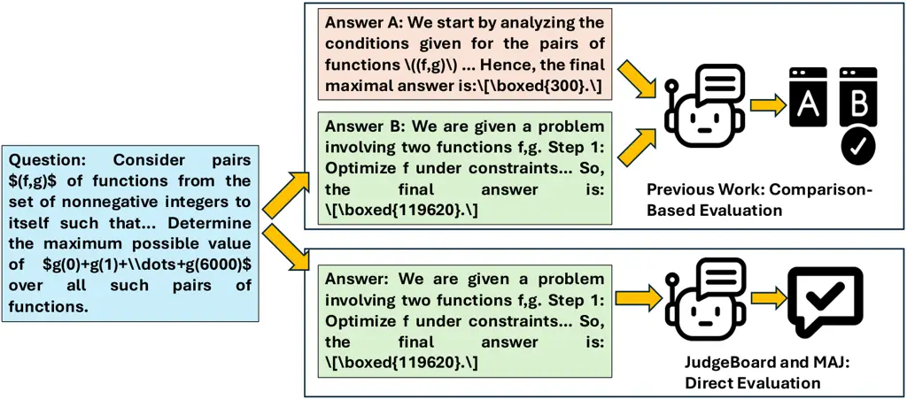
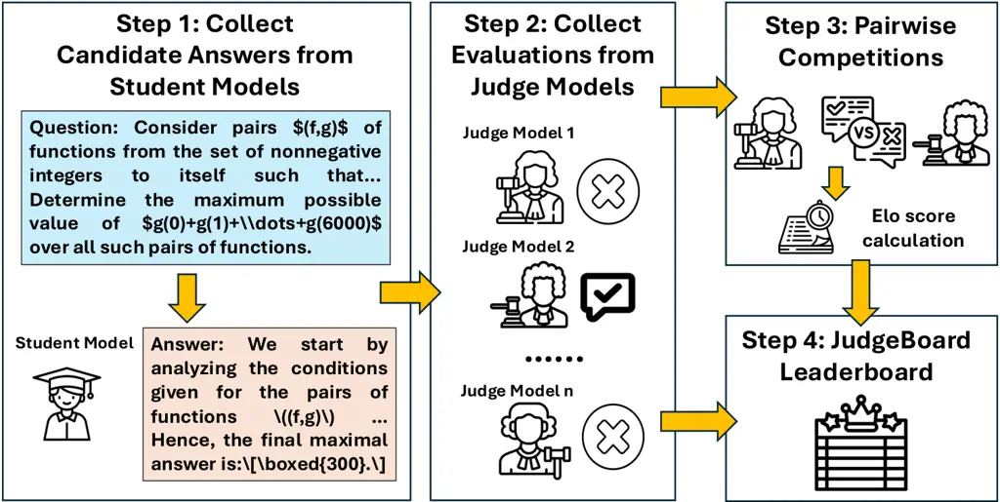

# JudgeBoard: Benchmarking and Enhancing Small Language Models for Reasoning Evaluation

Zhenyu Bi    Gaurav Srivastava    Yang Li    Meng Lu    Swastik Roy   
Morteza Ziyadi    Xuan Wang

###### Abstract

While small language models (SLMs) have shown promise on various
reasoning tasks, their ability to judge the correctness of answers
remains unclear compared to large language models (LLMs). Prior work on
LLM-as-a-judge frameworks typically relies on comparing candidate
answers against ground-truth labels or other candidate answers using
predefined metrics like entailment. However, this approach is inherently
indirect and difficult to fully automate, offering limited support for
fine-grained and scalable evaluation of reasoning outputs. In this work,
we propose JudgeBoard, a novel evaluation pipeline that directly queries
models to assess the correctness of candidate answers without requiring
extra answer comparisons. We focus on two core reasoning domains:
mathematical reasoning and science/commonsense reasoning, and construct
task-specific evaluation leaderboards using both accuracy-based ranking
and an Elo-based rating system across five benchmark datasets, enabling
consistent model comparison as judges rather than comparators. To
improve judgment performance in lightweight models, we propose MAJ
(Multi-Agent Judging), a novel multi-agent evaluation framework that
leverages multiple interacting SLMs with distinct reasoning profiles to
approximate LLM-level judgment accuracy through collaborative
deliberation. Experimental results reveal a significant performance gap
between SLMs and LLMs in isolated judging tasks. However, our MAJ
framework substantially improves the reliability and consistency of
SLMs. On the MATH dataset, MAJ using smaller-sized models as backbones
performs comparatively well or even better than their larger-sized
counterparts. Our findings highlight that multi-agent SLM systems can
potentially match or exceed LLM performance in judgment tasks, with
implications for scalable and efficient assessment.

¹Virginia Tech

²College of William and Mary

³Amazon AGI

¹ {zhenyub,gks,menglu}@vt.edu, ² yli102@wm.edu,³ {roswasti,
mziyadi}@amazon.com

## 1 Introduction

Large language models (LLMs) have demonstrated remarkable capabilities
in a wide range of natural language processing tasks, including
reasoning, question answering, and evaluation (Achiam et al. 2023; Dubey
et al. 2024; Liu et al. 2024a; Yang et al. 2025). A growing body of work
has explored the use of LLMs not only as generators of content but also
as evaluators, where models are tasked with assessing the relative
quality of candidate outputs (Zheng et al. 2023; Tan et al. 2024). These
approaches have been applied in various reasoning domains, often relying
on indirect supervision via entailment metrics or comparisons to
gold-standard labels or the other candidate outputs (llm-as-a-judge).
While effective in some settings, these methods are inherently limited:
they rely on comparison-based depend on predefined metrics that may not
capture nuanced reasoning errors, and they often require human-curated
labels, which hinders scalability and generalization.

In contrast, small language models (SLMs) offer a more efficient and
accessible alternative to LLMs (Yang et al. 2025; Abdin et al. 2024;
Team et al. 2024; Srivastava et al. 2025b; Srivastava et al. 2025a;
Srivastava et al. 2025d), particularly in resource-constrained
environments. Recent studies have shown that SLMs can perform
competitively on various reasoning tasks when equipped with appropriate
prompting or fine-tuning strategies (Wei et al. 2022). However, their
ability to judge the correctness of answers rather than generate them
remains underexplored. This gap is critical, as scalable and reliable
evaluation is essential for deploying language models in real-world
applications.

Figure 1: Comparison of JudgeBoard and MAJ with previous works. Unlike
previous works that usually follow a comparison-based evaluation
pipeline, JudgeBoard and MAJ focus on direct evaluation of the factual
correctness of the reasoning questions.

In this work, we propose JudgeBoard, a novel evaluation pipeline that
directly queries models, particularly SLMs, to assess the correctness of
candidate answers without requiring extra answer comparisons. Figure 1
demonstrates the difference between our proposed pipeline and prior
works. We focus on two core domains: mathematical reasoning and
science/commonsense reasoning. To support this setup, we construct
task-specific evaluation leaderboards across five benchmark datasets,
using both accuracy-based rankings and an Elo-style rating system to
enable consistent and fine-grained comparison of models in their role as
judges. The results highlight the need for using multiple evaluation
metrics when doing evaluation, provide insights on the judging abilities
of different SLMs, and demonstrate the significant performance gap
between the best-performing Large Language Models and the
best-performing Small Language Models (SLMs).

To address the limitations of individual SLMs in judgment tasks, we
introduce MAJ (Multi-Agent Judging), a novel Elo-based framework that
leverages multiple interacting SLMs to approximate the judgment
performance of LLMs. Inspired by recent advances in multi-agent
collaboration and self-consistency techniques (Zhuge et al. 2024; Guo et
al. 2024; Wu et al. 2024), MAJ enables lightweight models to
collectively reason about answer correctness, improving both reliability
and robustness. Our experiments reveal a substantial performance gap
between isolated SLMs and LLMs in judgment tasks, but also show that MAJ
significantly narrows this gap. On the MATH dataset (Lightman et al.
2023), our MAJ framework using Qwen3-14B model as the backbone
outperform the best-performing LLM by an average of 2% in judging
accuracy across all categories. Our findings suggest that with the right
collaborative framework, SLMs can rival or even surpass LLMs in
evaluative reasoning; this finding paves the way for more efficient and
democratized model assessment.

## 2 Related Works

#### Language Models as Judges

LLMs-as-a-judge frameworks have emerged as an alternative to human
annotators and traditional metrics. Tan et al. evaluated 11 LLMs across
20 NLP tasks, finding variable reliability depending on task type and
data source. Tang et al. surveyed the paradigm across functionality,
methodology, applications, meta-evaluation, and limitations,
highlighting interpretability benefits while cautioning against biases
in proprietary models. Practical implementations include MT-Bench and
Chatbot Arena (Zheng et al. 2023), which demonstrate that LLMs can
approximate human evaluators with proper calibration.

#### LLM Reasoning Prompting

Prompting techniques have enhanced LLM reasoning capabilities.
Chain-of-Thought (CoT) (Wei et al. 2022) breaks reasoning into
sequential steps, while self-consistency (Wang et al. 2022) aggregates
multiple reasoning paths. Tree-of-Thought (ToT) (Yao et al. 2023)
maintains structured intermediate steps, and Graph-of-Thought (Besta et
al. 2024) uses directed graphs to revisit and combine reasoning paths.
Additional X-of-Thought variants address specific tasks (Chen et al.
2023c; Sel et al. 2024; Bi et al. 2024). Recent reasoning benchmarks
(Srivastava et al. 2025c; Srivastava et al. 2025d) also evaluate and
compare the effect of different reasoning prompting methods on LLMs.

#### Multi-Agent Reasoning

Multi-agent LLM frameworks have shown improved reasoning over
single-agent systems (Wu et al. 2024; Chen et al. 2023a; Lu et al.
2024). Research on multi-agent debate dynamics (Wang et al. 2023; Wang
et al. 2024; Pezeshkpour et al. 2024) reveals that most interaction
protocols are manually defined (Wu et al. 2023; Chan et al. 2023) or
follow simple formats like majority voting and summarization (Chen et
al. 2023b; Liang et al. 2024; Chan et al. 2023). GPTSwarm and OptAgent
(Zhuge et al. 2024; Bi et al. 2025) models multi-agent systems as graph
networks, enabling algorithmic optimization of interaction patterns and
agent-level prompts.

#### Small Language Models

Small Language Models (SLMs) offer efficient alternatives for reasoning
and evaluation with reduced computational costs. Recent
instruction-tuned SLMs with fewer than 3 billion parameters achieve
strong reasoning capabilities through high-quality training data
(Gunasekar et al. 2023; Abdin et al. 2024; Bai et al. 2023; Team et al.
2024). Recent work (Srivastava et al. 2025b; Srivastava et al. 2025a)
explored methods to enhance SLMs’ reasoning abilities through targeted
training and architectural improvements. Bansal et al. found that SLMs
can effectively judge reasoning quality with appropriate prompting,
while Liu et al. identified key factors enabling effective reasoning,
including training data quality and model architecture. Efficient
reasoning frameworks (Shao et al. 2024) demonstrate that training on
mathematical and logical reasoning data enables SLMs to compete with
larger models.

Figure 2: Overview of the JudgeBoard Pipeline

## 3 JudgeBoard

### 3.1 Pipeline Overview

We propose a novel evaluation pipeline, JudgeBoard, that evaluates the
models’ judging ability by querying models to assess the correctness of
candidate answers without requiring extra answer comparisons. This
approach treats models as direct evaluators, enabling scalable and
flexible assessment across diverse reasoning tasks. While our judging
protocol is direct, meta-evaluation of judge quality necessarily
requires gold-standard labels for ground truth. The overall pipeline of
JudgeBoard is demonstrated in Figure 2. JudgeBoard consists of four
stages:

- •
  Candidate Answer Collection: Student model is provided with a set of
  reasoning questions and is prompted to provide answers.
- •
  Judgment Collection: A set of judge models independently evaluate the
  correctness of each candidate answer.
- •
  Pairwise Competitions: For the same question-answer pair, evaluations
  from different judges are compared in a pairwise fashion. We then
  calculate the Elo score based on the competition results.
- •
  Leaderboard Construction: We compute two types of rankings:
  Accuracy-based ranking and Elo-style-based ranking, to assess and
  compare model performance across tasks and subcategories.

### 3.2 Model-as-Judge Protocol

To operationalize the Model-as-Judge pipeline, we design a structured
prompting protocol that ensures consistency and objectivity in model
evaluations. Each judge model is presented with the original question,
the candidate answer generated by the student model, and a prompt
instructing the judge to determine whether the answer is correct or
incorrect and output its reasoning. Prompts are carefully engineered to
minimize ambiguity and bias, and to encourage factual, step-by-step
reasoning.

Additionally, we ensure similar but different reasoning by assigning the
agents with the same baseline reasoning prompt but different agent
profiles in system prompts (see Appendix A for detailed prompts). The
agent profiles were manually crafted to reflect common reasoning
strategies found in human problem-solving, such as deductive reasoning,
logical reasoning, and robust reasoning.

### 3.3 Pairwise Evaluation and Elo Rating Calculation

After collecting judgments, we conduct pairwise comparisons between
candidate answers. For each question, judgments of the answers are
evaluated against each other. We determine outcomes based on agreement
with gold-standard labels: a judge wins if its judgment matches the gold
label while its comparator does not. To quantitatively assess the
relative performance of judge models, we adopt an Elo-style rating
system inspired by the ChatbotArena.

The Elo system provides additional value beyond simple accuracy metrics
through three key mechanisms. First, it accounts for question difficulty
by awarding judges more credit for correct judgments on questions where
other judges failed, effectively weighting performance by task
complexity. Second, it measures consistency across diverse question
types, rewarding models that reliably agree with gold labels regardless
of domain or difficulty rather than those that perform well only on
specific subsets. Finally, the dynamic rating system better
distinguishes models with similar raw accuracy by capturing the relative
strength demonstrated through head-to-head comparisons, revealing
nuanced performance differences that aggregate accuracy scores may
obscure. This enables a more granular evaluation of model capabilities
across reasoning tasks.

#### Rating Update Mechanism

Let $`R_{i}`$ and $`R_{j}`$ denote the current Elo ratings of models i
and j, respectively. The expected score for model i is computed using
the standard logistic function:
$`E_{i}=\frac{1}{1+10^{(R_{j}-R_{i})/400}}`$. Following the outcome of
the match, the rating of model i is updated by
$`R_{i}^{\prime}=R_{i}+K(S_{i}-E_{i})`$, where $`R_{i}`$ is the rating
of model i, $`S_{i}\in\{1,0.5,0\}`$ represents the actual match outcome
(win, draw, loss), and $`K=10`$ is a constant controlling the magnitude
of rating updates. All models are initialized with a uniform baseline
rating. To ensure robustness, each model participates in a large number
of comparisons across diverse questions and judge profiles. The final
Elo score reflects the model’s overall performance relative to its
peers.

### 3.4 Leaderboard Construction

We construct task-specific leaderboards using two complementary metrics:

#### Accuracy-Based Ranking

Measures agreement with the gold-label given by the original dataset
across three dimensions: Overall Accuracy (correctness across all
questions), Student Wrong (SW) Accuracy (ability to identify incorrect
answers), and Student Right (SR) Accuracy (ability to validate correct
answers). These metrics reveal not only judging performance but also
potential sycophacy toward agreement.

#### Elo-Style Rating System

Models are evaluated in pairwise comparisons, and ratings are updated
based on relative performance. This enables fine-grained differentiation
and comparison even in ambiguous cases.

|                                  | Algebra  |          |        | Number Theory |          |        | Counting and Probability |          |        |
| -------------------------------- | -------- | -------- | ------ | ------------- | -------- | ------ | ------------------------ | -------- | ------ |
| Model                            | Overall  | SW       | Elo    | Overall       | SW       | Elo    | Overall                  | SW       | Elo    |
|                                  | Accuracy | Accuracy |        | Accuracy      | Accuracy |        | Accuracy                 | Accuracy |        |
| Large Language Models ($`>`$14B) |          |          |        |               |          |        |                          |          |        |
| Qwen3_30B_A3B                    | 0.7789   | 0.570    | 1070.8 | 0.9077        | 0.825    | 1110.3 | 0.8889                   | 0.793    | 1089.3 |
| Qwen3_32B                        | 0.7632   | 0.516    | 1068.8 | 0.8846        | 0.778    | 1100.6 | 0.8888                   | 0.782    | 1091.4 |
| Gemma3-27b                       | 0.6947   | 0.398    | 1038.8 | 0.8077        | 0.603    | 1069.2 | 0.7944                   | 0.621    | 1054.4 |
| Qwen2.5-72b                      | 0.6368   | 0.269    | 1017.2 | 0.6846        | 0.365    | 1020.9 | 0.7167                   | 0.471    | 1026.4 |
| Llama3-70b                       | 0.6053   | 0.215    | 1005.5 | 0.6462        | 0.270    | 1006.0 | 0.7056                   | 0.414    | 1022.5 |
| Llama4-17B                       | 0.5895   | 0.183    | 999.6  | 0.7000        | 0.381    | 1026.9 | 0.6778                   | 0.356    | 1012.6 |
| Mixtral-8x22B                    | 0.5579   | 0.097    | 987.9  | 0.5462        | 0.095    | 973.2  | 0.5667                   | 0.126    | 977.0  |
| Mixtral-8x7B                     | 0.5316   | 0.054    | 978.2  | 0.5692        | 0.111    | 979.2  | 0.5389                   | 0.069    | 967.0  |
| Small Language Models ($`<`$14B) |          |          |        |               |          |        |                          |          |        |
| Gemma3_12b                       | 0.6737   | 0.366    | 1030.9 | 0.7923        | 0.571    | 1063.1 | 0.7611                   | 0.575    | 1042.4 |
| Qwen3_14B                        | 0.6684   | 0.344    | 1030.9 | 0.6923        | 0.365    | 1020.9 | 0.7111                   | 0.506    | 1024.5 |
| Phi4                             | 0.6737   | 0.344    | 1030.9 | 0.7077        | 0.413    | 1032.9 | 0.7056                   | 0.425    | 1022.5 |
| Gemma3_4b                        | 0.6526   | 0.323    | 1021.1 | 0.7461        | 0.556    | 1038.8 | 0.7444                   | 0.540    | 1036.4 |
| Qwen3_4B                         | 0.6421   | 0.280    | 1019.2 | 0.7384        | 0.492    | 1041.9 | 0.7444                   | 0.540    | 1036.4 |
| Qwen3_8B                         | 0.5737   | 0.129    | 976.2  | 0.6308        | 0.238    | 958.2  | 0.6667                   | 0.356    | 988.9  |
| Llama3.1_8B                      | 0.5211   | 0.054    | 970.3  | 0.5385        | 0.093    | 961.2  | 0.5667                   | 0.138    | 967.0  |
| Mistral_7B                       | 0.5211   | 0.032    | 978.2  | 0.5308        | 0.048    | 964.2  | 0.5555                   | 0.081    | 971.0  |
| Llama3.2_3B                      | 0.5158   | 0.032    | 964.4  | 0.5308        | 0.032    | 958.2  | 0.5389                   | 0.069    | 963.0  |
| Qwen3_1.7B                       | 0.5789   | 0.151    | 995.7  | 0.5615        | 0.111    | 958.2  | 0.5944                   | 0.161    | 965.0  |
| Qwen3_0.6B                       | 0.5211   | 0.022    | 974.2  | 0.5462        | 0.064    | 967.2  | 0.5555                   | 0.092    | 969.0  |
| Qwen3_4B_Reasoning               | 0.6474   | 0.323    | 1023.1 | 0.7000        | 0.413    | 1026.9 | 0.7000                   | 0.437    | 1020.5 |
| Qwen3_14B_Reasoning              | 0.6474   | 0.301    | 1019.2 | 0.7077        | 0.397    | 1032.9 | 0.7222                   | 0.471    | 1030.4 |
| Qwen3_8B_Reasoning               | 0.5895   | 0.204    | 1001.6 | 0.6923        | 0.413    | 1023.9 | 0.6389                   | 0.333    | 998.8  |

Table 1: JudgeBoard Leaderboard Results for Base Language Models.
”Overall Accuracy” represents the overall judging accuracy of the judge
models; ”SW Accuracy” represents the judging accuracy of the judge
models when student model have made a wrong answer; ”Elo” represents the
elo score of the juge model. This comprehensive evaluation compares the
performance of large language models ($`>`$14B parameters) and small
language models ($`<`$14B parameters) across three mathematical domains:
Algebra, Number Theory, and Counting & Probability.

|                                     | Algebra  |               | Number Theory |               | Counting and Probability |               |
| ----------------------------------- | -------- | ------------- | ------------- | ------------- | ------------------------ | ------------- |
| Model                               | Overall  | Accuracy -    | Overall       | Accuracy -    | Overall                  | Accuracy -    |
|                                     | Accuracy | Student Wrong | Accuracy      | Student Wrong | Accuracy                 | Student Wrong |
| Multi-Agent Profiled Debate Systems |          |               |               |               |                          |               |
| Qwen3_14B                           | 0.7789   | 0.591         | 0.9385        | 0.873         | 0.9056                   | 0.851         |
| Qwen3_8B                            | 0.7632   | 0.538         | 0.9           | 0.81          | 0.8889                   | 0.751         |
| Qwen3_4B                            | 0.7632   | 0.527         | 0.9           | 0.794         | 0.8444                   | 0.713         |
| Gemma3_12b                          | 0.7      | 0.441         | 0.7231        | 0.413         | 0.7167                   | 0.437         |
| Gemma3_4b                           | 0.6421   | 0.29          | 0.7231        | 0.444         | 0.7944                   | 0.724         |
| Phi4                                | 0.6421   | 0.29          | 0.6692        | 0.333         | 0.7278                   | 0.471         |

Table 2: JudgeBoard Leaderboard Results for Multi-Agent Jury Systems.
This table presents the performance of collaborative multi-agent systems
that employ profiled debate methodologies with majority voting
mechanisms.

## 4 Multi-Agent Judging with Profiling

To enhance the robustness and performance of Small Language Model
evaluation, we introduce a multi-agent judge framework in which multiple
SLMs independently assess the correctness of candidate answers. Each
model, referred to as an agent, operates autonomously and contributes to
a collective judgment through structured debate and interaction. This
setup allows us not only to mitigate the biases of individual models but
also to analyze their evaluative behavior through profiling.

|                                  |          |          |        |
| -------------------------------- | -------- | -------- | ------ |
| Model                            | Overall  | SW       | Elo    |
|                                  | Accuracy | Accuracy | Score  |
| Large Language Models ($`>`$14B) |          |          |        |
| Gemma3_27b                       | 0.880    | 0.430    | 1021.1 |
| Qwen2.5_72b                      | 0.870    | 0.500    | 1038.7 |
| Llama3.3_70b                     | 0.850    | 0.210    | 992.0  |
| Llama4_17B                       | 0.850    | 0.320    | 997.8  |
| Mixtral_8x22B                    | 0.850    | 0.210    | 992.0  |
| Mixtral_8x7B                     | 0.820    | 0.110    | 983.1  |
| Small Language Models ($`<`$14B) |          |          |        |
| Gemma3_12b                       | 0.850    | 0.360    | 1015.3 |
| Qwen3_14B                        | 0.870    | 0.540    | 1032.8 |
| Phi4                             | 0.850    | 0.320    | 1009.5 |
| Gemma3_4b                        | 0.810    | 0.070    | 968.7  |
| Qwen3_4B                         | 0.840    | 0.320    | 1003.6 |
| Qwen3_8B                         | 0.850    | 0.460    | 1027.0 |
| Llama3.1_8B                      | 0.780    | 0.390    | 980.4  |
| Llama3.2_3B                      | 0.650    | 0.360    | 968.7  |
| Qwen3_1.7B                       | 0.810    | 0.320    | 1009.5 |
| Qwen3_0.6B                       | 0.790    | 0.140    | 974.5  |

Table 3: JudgeBoard Leaderboard Results for Base Language Models on
ARC-Challenge Dataset. ARC-Challenge contains grade school science
questions requiring reasoning.

| Model                           | Algebra | NumTheo | C&P    |
| ------------------------------- | ------- | ------- | ------ |
| Deductive Reasoning (DR) Judges |         |         |        |
| Gemma3_12b                      | 1029.0  | 1066.2  | 1038.4 |
| Gemma3_4b                       | 1030.9  | 1032.9  | 1026.4 |
| Llama3.1_8B                     | 970.3   | 964.2   | 967.0  |
| Llama3.2_3B                     | 964.4   | 949.1   | 951.0  |
| Mistral_7B                      | 974.2   | 970.2   | 969.0  |
| Phi4                            | 1015.3  | 1014.9  | 1024.5 |
| Qwen3_14B                       | 1013.3  | 1020.9  | 1026.4 |
| Qwen3_4B                        | 1029.0  | 1020.9  | 1020.5 |
| Qwen3_8B                        | 968.3   | 933.8   | 976.6  |
| Logical Reasoning (LR) Judges   |         |         |        |
| Gemma3_12b                      | 1027.0  | 1047.9  | 1032.4 |
| Gemma3_4b                       | 1011.4  | 1038.8  | 1018.5 |
| Llama3.1_8B                     | 853.1   | 841.4   | 835.4  |
| Llama3.2_3B                     | 966.4   | 964.2   | 963.0  |
| Mistral_7B                      | 972.3   | 970.2   | 969.0  |
| Phi4                            | 1023.1  | 1009.0  | 1030.4 |
| Qwen3_14B                       | 1017.2  | 1012.0  | 1020.5 |
| Qwen3_4B                        | 980.1   | 997.1   | 1014.6 |
| Qwen3_8B                        | 942.6   | 930.7   | 949.0  |
| Robust Reasoning (RR) Judges    |         |         |        |
| Gemma3_12b                      | 1029.0  | 1063.1  | 1032.4 |
| Gemma3_4b                       | 993.8   | 1006.0  | 1024.5 |
| Llama3.1_8B                     | 962.4   | 952.1   | 961.0  |
| Llama3.2_3B                     | 946.6   | 943.0   | 932.7  |
| Mistral_7B                      | 974.2   | 967.2   | 967.0  |
| Phi4                            | 1021.1  | 1026.9  | 1026.4 |
| Qwen3_14B                       | 1050.4  | 1014.9  | 1032.4 |
| Qwen3_4B                        | 1013.3  | 1020.9  | 1032.4 |
| Qwen3_8B                        | 950.5   | 933.8   | 963.0  |

Table 4: JudgeBoard Leaderboard of models prompted by different
profiles, in terms of Elo Scores; Numtheo represent the Number Theory
category, and C&P represent the Counting and Probability category.

### 4.1 Agent Configuration and Profiling

Each agent is instantiated from a distinct language model instance,
ensuring diversity in reasoning while maintaining a consistent
evaluation framework. To promote varied yet comparable analytical
behavior, all agents are initialized with a shared baseline reasoning
prompt that outlines the general task and expectations. However, each
agent is also assigned a unique system prompt, which is referred to as
its profile, that guides its reasoning style and evaluative priorities
(We provide the details of the prompts in Appendix A). The agent
profiles were manually crafted to reflect common reasoning strategies
found in human problem-solving.

During evaluation, each agent receives the original question and a
candidate answer and is asked to determine whether the answer is
correct. In addition to a binary judgment (correct/incorrect), agents
are prompted to provide a concise natural language explanation that
justifies their decision. These explanations serve two purposes: they
make the reasoning process interpretable and they form the basis for
subsequent inter-agent debate.

### 4.2 Interaction and Debate

After the agents get their initial answers, we let them discuss with
each other in order to find a better answer. We implement a structured
multi-turn debate protocol where in each round, agents are allowed to
critique the reasoning of their peers and defend their own positions.
Following the debate, each agent is given a final opportunity to revise
its judgment and explanation. This post-debate revision phase allows
agents to incorporate new insights or correct earlier errors. The final
collective decision is then determined through majority voting across
the revised judgments. In cases of a tie, we either defer to a
designated tie-breaker agent with a meta-evaluator profile or flag the
instance for manual review, depending on the experimental setting.

## 5 Experimental Setup

### 5.1 Dataset and Tasks

We experiment on two downstream tasks: math reasoning and science
reasoning. All experiments were tested on publicly available datasets.
For the math reasoning task, we use four datasets: GSM8K (Cobbe et al.
2021), which contains basic arithmetic questions; GSM-PLUS (Li et al.
2024), which contains adversarial arithmetic questions; MATH (Hendrycks
et al. 2021), which contains high-school level competition questions;
and OmniMATH (Gao et al. 2024), which contains olympiad-level questions.
For the science reasoning task, we use two datasets: ARC-Challenge
(Clark et al. 2018), which contains basic science questions; and GPQA
(Rein et al. 2024), which contains undergraduate-level physics, biology,
and chemistry questions. For each and every dataset, we construct the
leaderboard based on its pre-defined categories. For GSM8K, GSM-PLUS,
ARC-Challenge, and MATH, we randomly select 300 questions for the
student model to answer, and extract out the same number of correct and
wrongly answered questions. For GPQA and OmniMATH, we randomly select
100 questions from each category for the student model to answer. Due to
space constraints, we present the leaderboard on three sub-categories of
the MATH dataset in our main content, and the rest of the leaderboard in
the appendix, which can be found in our Arxiv version.

### 5.2 Model and Implementation

For the student model, we use the GPT-series models for generating
candidate answers. For easier datasets like GSM8K, we use the GPT-3.5
model (Brown et al. 2020); for hard datasets like MATH and OmniMATH, we
prompt the GPT4o-mini model (OpenAI 2023). We use direct API calling
when prompting the GPT-3.5 and GPT4o-mini models. For the judge models,
we experiment with all open-source SLM models, including Qwen3 series
(Yang et al. 2025), LLama3 series (Dubey et al. 2024), Mixtral series
(Jiang et al. 2023), Gemma3 series (Team et al. 2024), and Phi4 series
(Abdin et al. 2024). All experiments using the open-sourced models were
run on 8 NVIDIA-A40 GPUs with 48GB memory each. with For all models, we
set the temperature to 0.5 and the top-k to 1.0.

### 5.3 Evaluation Metrics

For the JudgeBoard leaderboard, model performance is measured by four
metrics: Overall Accuracy, which is the overall judging accuracy of the
judge model; Student Wrong Accuracy, which is the judging accuracy when
the student model makes a wrong answer; and Elo score, which is
introduced in Section 3.3.

## 6 Results

Figure 3: Overall accuracy for using the Deductive Reasoner (DR),
Logical Reasoner (LR), and Robust Reasoner (RR) profiles on (a) Algebra,
(b) Number Theory, and (c) Counting and Probability tasks.

### 6.1 Main Results

We present the results of the JudgeBoard leaderboard on the MATH dataset
across three categories in Table 1, and on the ARC dataset in Table 3.
Due to space constraints, full result tables on other datasets can be
found in our Arxiv version. The results for the MAJ framework is
presented in Table 2. Due to space constraints, the rest of the results
are presented in the Technical Appendix.

#### Large vs. Small Models

Large Language Models (LLMs), which have a size of greater than 14B,
generally outperform small ones across all metrics. However, the newer
Small Language Models (SLMs), such as the smaller versions of Gemma3 and
Qwen3, outperform the older LLMs, such as Llama3 and Qwen 2.5. The
performance of Mixtral models, which is a Mixture-of-Expert-based LLM,
is very unsatisfactory and barely outperforms its basic version, which
is Mistral-7B.

#### Performance on Wrong Candidate Answers

On the MATH dataset, we find that even the worst performing SLMs have an
overall accuracy of over 50%. In other words, for models that are
performing poorly overall, we find that they are much more likely to
agree with what the student model is saying, regardless of their answer
correctness. This phenomenon can be observed across datasets: On more
complex datasets such as GPQA and OmniMATH, we find that
better-performing models tend to have a more balanced judging accuracy,
which means they are able to tell whether the potential answer is
correct or wrong at a similar level. On simpler datasets like GSM8K and
ARC, the worst performing models would have very high model correct
accuracy and very low model wrong accuracy. This finding highlights the
importance of using multiple evaluation metrics when evaluating the
judging ability of the models, as metrics like overall accuracy cannot
accurately reflect the true judging ability of the models.

#### Subject-Wise Performance

All models tend to perform better at judging Number Theory questions and
Counting and Probability questions, and worse at Algebra questions. This
phenomenon suggests that the current Language Models are more adapted to
handling arithmetic and modular reasoning, and are inept at symbolic
manipulation capabilities.

#### Multi-Agent Judge (MAJ) Framework

We present the results of our MAJ framework in Table 2. We set up
different profiles on the same model family and do a multi-agent debate
among the profiled agents. The results on the Qwen3 model families
demonstrate significant potential of our MAJ framework on SLMs. With the
help of MAJ, smaller-sized Qwen3 models (4b, 8b, and 14b versions) could
perform comparatively well or even better than the larger-sized Qwen3
models (30B and 32B versions) across all tasks and datasets. Our MAJ
framework using Qwen3-14B model as the backbone could outperform the
best performing Qwen3-30B-A3B model by an average of 2% in judging
accuracy across different categories. Also, larger-sized Qwen3 models
demonstrate better debate and interaction ability. Even though the
judging performance of Qwen3-8B model is significantly below that of
Qwen3-4B model, the MAJ performance when using Qwen3-8B model still
outperforms that of using Qwen3-4B model. However, the performance of
MAJ on Phi4 and Gemma3 is inconsistent across categories, signaling that
these two models are more sensitive to prompts when engaged in debating.

Figure 4: Performance comparison of large language models on
mathematical reasoning benchmarks. Each point represents a model, with
circle size proportional to parameter count (2B-120B parameters).

### 6.2 Ablation Studies

#### Reasoning and Non-Reasoning Variants

For the Qwen3 model families, we conduct additional experiments on both
the reasoning and non-reasoning modes of the models, and present our
results in Table 1. Using the reasoning mode of the Qwen3 model families
does not yield consistent gains across different categories. For the
Qwen3-4B version, reasoning mode works best on the Algebra category but
drags down the performance in other categories; For the Qwen3-8B and the
Qwen3-14B versions, reasoning mode works best on the Number Theory
category and drags down the performance in other categories.

#### Judging Ability and Problem-Solving Ability

We conduct an ablation study comparing the Problem-Solving ability and
judging ability of the models and present the results in Figure 4. The
results on the MATH dataset are taken directly from the models’
technical reports. For the Qwen3 mode families and the Llama4 model,
their judging ability is better than their problem-solving ability. The
other models, including Gemma3 model families, Phi4, and LLama3-70B,
have slightly worse judging ability compared with their problem-solving
ability. From the graph, we can see that the Judging Ability and
Problem-Solving Ability of the models are positively correlated.
However, two prominent outliers exist: the Qwen3-30b-A3B model and the
Qwen3-32B model demonstrate very good judging ability, but only average
problem-solving ability.

#### Effects of Profiling

We present the results of profiling in terms of accuracy in different
models in Figure 4 and full results in our Arxiv version. In general,
adding profiles to the agents would bring much more versatility compared
with the base version of the model. Out of the three manually-curated
profiles, Robust Reasoner yields the most consistent gains compared with
the base prompt across all categories; Logical Reasoner is the most
inconsistent and would rarely give performance gains across categories.
In terms of Elo scores, one outlier is the Qwen3-8B model, where it
suffers from a significant decrease across all profiles and categories.
Qwen3-4B and Qwen3-14B models, even though from the same model family,
do not demonstrate this phenomenon.

## 7 Conclusion and Future Work

In this paper, we introduce JudgeBoard, a novel evaluation pipeline that
enables language models to serve as direct judges, moving beyond
comparison-based methods. By constructing task-specific leaderboards
using both accuracy and Elo-style metrics, we provide a comprehensive
framework for assessing evaluative capabilities across mathematical and
science reasoning domains. Our leaderboards reveal a significant
performance gap between Small Language Models (SLMs) and Large Language
Models (LLMs) in judgment tasks, while highlighting the importance of
using multiple evaluation metrics to identify systematic biases. To
address SLM limitations, we propose the Multi-Agent Judging (MAJ)
framework, demonstrating that collaborative reasoning among SLMs
substantially closes the performance gap and, in some cases, even
surpasses state-of-the-art LLMs. Future work could explore several
promising directions: extending MAJ to broader reasoning domains;
investigating adaptive agent profiling strategies that dynamically
adjust reasoning styles; and exploring the integration of MAJ with
fine-tuning approaches to create specialized judge models.

## Acknowledgement

Our work is sponsored by NSF \#2442253, NAIRR Pilot with PSC Neocortex
and NCSA Delta, Commonwealth Cyber Initiative, Children’s National
Hospital, Fralin Biomedical Research Institute (Virginia Tech), Sanghani
Center for AI and Data Analytics (Virginia Tech), Virginia Tech
Innovation Campus, and generous gifts from Nivida, Cisco, and the
Amazon + Virginia Tech Center for Efficient and Robust Machine Learning.

## Ethics Statement

This research adhered to the ethical standards and best practices
outlined in the AAAI Ethics Code. Language Models can sometimes produce
illogical or inaccurate reasoning paths, so their outputs should be
cautiously used. The outputs are only examined to understand how a model
arrives at its answers and investigate why it makes certain errors. All
experiments used publicly available datasets from previous works and did
not involve ethical or privacy issues.

## References

- Abdin et al. (2024) M. Abdin, J. Aneja, H. Behl, S. Bubeck, R.
  Eldan, S. Gunasekar, M. Harrison, R. J. Hewett, M. Javaheripi, P.
  Kauffmann, et al. Phi-4 technical report. arXiv preprint
  arXiv:2412.08905. Cited by: §1, §2, §5.2.
- Achiam et al. (2023) J. Achiam, S. Adler, S. Agarwal, L. Ahmad, I.
  Akkaya, F. L. Aleman, D. Almeida, J. Altenschmidt, S. Altman, S.
  Anadkat, et al. Gpt-4 technical report. arXiv preprint
  arXiv:2303.08774. Cited by: §1.
- Bai et al. (2023) J. Bai, S. Bai, Y. Chu, Z. Cui, K. Dang, X. Deng, Y.
  Fan, W. Ge, Y. Han, F. Huang, et al. Qwen technical report. arXiv
  preprint arXiv:2309.16609. Cited by: §2.
- Bansal et al. (2024) H. Bansal, K. Gopalakrishnan, S. Dingliwal, S.
  Bodapati, K. Kirchhoff, and D. Roth Rethinking the role of scale for
  in-context learning: an interpretability-based case study at 66
  billion scale. arXiv preprint arXiv:2212.09095. Cited by: §2.
- Besta et al. (2024) M. Besta, N. Blach, A. Kubicek, R.
  Gerstenberger, M. Podstawski, L. Gianinazzi, J. Gajda, T. Lehmann, H.
  Niewiadomski, P. Nyczyk, et al. Graph of thoughts: solving elaborate
  problems with large language models. In Proceedings of the AAAI
  conference on artificial intelligence, Vol. 38, pp. 17682–17690. Cited
  by: §2.
- Bi et al. (2024) Z. Bi, D. Hajialigol, Z. Sun, J. Hao, and X. Wang
  STOC-tot: stochastic tree-of-thought with constrained decoding for
  complex reasoning in multi-hop question answering. External Links:
  2407.03687, [Link](https://arxiv.org/abs/2407.03687) Cited by: §2.
- Bi et al. (2025) Z. Bi, M. Lu, Y. Li, S. Roy, W. Guan, M. Ziyadi,
  and X. Wang OPTAGENT: optimizing multi-agent llm interactions through
  verbal reinforcement learning for enhanced reasoning. External Links:
  2510.18032, [Link](https://arxiv.org/abs/2510.18032) Cited by: §2.
- Brown et al. (2020) T. B. Brown, B. Mann, N. Ryder, M. Subbiah, J.
  Kaplan, P. Dhariwal, A. Neelakantan, P. Shyam, G. Sastry, A.
  Askell, S. Agarwal, A. Herbert-Voss, G. Krueger, T. Henighan, R.
  Child, A. Ramesh, D. M. Ziegler, J. Wu, C. Winter, C. Hesse, M.
  Chen, E. Sigler, M. Litwin, S. Gray, B. Chess, J. Clark, C. Berner, S.
  McCandlish, A. Radford, I. Sutskever, and D. Amodei Language models
  are few-shot learners. ArXiv abs/2005.14165. External Links:
  [Link](https://api.semanticscholar.org/CorpusID:218971783) Cited by:
  §5.2.
- Chan et al. (2023) C. Chan, W. Chen, Y. Su, J. Yu, W. Xue, S.
  Zhang, J. Fu, and Z. Liu ChatEval: towards better llm-based evaluators
  through multi-agent debate. ArXiv abs/2308.07201. External Links:
  [Link](https://api.semanticscholar.org/CorpusID:260887105) Cited by:
  §2.
- Chen et al. (2023a) G. Chen, S. Dong, Y. Shu, G. Zhang, J.
  Sesay, B. F. Karlsson, J. Fu, and Y. Shi Autoagents: a framework for
  automatic agent generation. arXiv preprint arXiv:2309.17288. Cited by:
  §2.
- Chen et al. (2023b) J. C. Chen, S. Saha, and M. Bansal ReConcile:
  round-table conference improves reasoning via consensus among diverse
  llms. ArXiv abs/2309.13007. External Links:
  [Link](https://api.semanticscholar.org/CorpusID:262217323) Cited by:
  §2.
- Chen et al. (2023c) W. Chen, X. Ma, X. Wang, and W. W. Cohen Program
  of thoughts prompting: disentangling computation from reasoning for
  numerical reasoning tasks. External Links: 2211.12588,
  [Link](https://arxiv.org/abs/2211.12588) Cited by: §2.
- Clark et al. (2018) P. Clark, I. Cowhey, O. Etzioni, T. Khot, A.
  Sabharwal, C. Schoenick, and O. Tafjord Think you have solved question
  answering? try arc, the ai2 reasoning challenge. arXiv preprint
  arXiv:1803.05457. Cited by: §5.1.
- Cobbe et al. (2021) K. Cobbe, V. Kosaraju, M. Bavarian, M. Chen, H.
  Jun, L. Kaiser, M. Plappert, J. Tworek, J. Hilton, R. Nakano, et al.
  Training verifiers to solve math word problems. arXiv preprint
  arXiv:2110.14168. Cited by: §5.1.
- Dubey et al. (2024) A. Dubey, A. Jauhri, A. Pandey, A. Kadian, A.
  Al-Dahle, A. Letman, A. Mathur, A. Schelten, A. Yang, A. Fan, et al.
  The llama 3 herd of models. arXiv e-prints, pp. arXiv–2407. Cited by:
  §1, §5.2.
- Gao et al. (2024) B. Gao, F. Song, Z. Yang, Z. Cai, Y. Miao, Q.
  Dong, L. Li, C. Ma, L. Chen, R. Xu, et al. Omni-math: a universal
  olympiad level mathematic benchmark for large language models. arXiv
  preprint arXiv:2410.07985. Cited by: §5.1.
- Gunasekar et al. (2023) S. Gunasekar, Y. Zhang, J. Aneja, C. C. T.
  Mendes, A. Del Giorno, S. Gopi, M. Javaheripi, P. Kauffmann, G. de
  Rosa, O. Saarikivi, et al. Textbooks are all you need. arXiv preprint
  arXiv:2306.11644. Cited by: §2.
- Guo et al. (2024) T. Guo, X. Chen, Y. Wang, R. Chang, S. Pei, N. V.
  Chawla, O. Wiest, and X. Zhang Large language model based
  multi-agents: a survey of progress and challenges. arXiv preprint
  arXiv:2402.01680. Cited by: §1.
- Hendrycks et al. (2021) D. Hendrycks, C. Burns, S. Kadavath, A.
  Arora, S. Basart, E. Tang, D. Song, and J. Steinhardt Measuring
  mathematical problem solving with the math dataset. arXiv preprint
  arXiv:2103.03874. Cited by: §5.1.
- Jiang et al. (2023) A. Q. Jiang, A. Sablayrolles, A. Mensch, C.
  Bamford, D. S. Chaplot, D. de las Casas, F. Bressand, G. Lengyel, G.
  Lample, L. Saulnier, L. R. Lavaud, M. Lachaux, P. Stock, T. L.
  Scao, T. Lavril, T. Wang, T. Lacroix, and W. E. Sayed Mistral 7b.
  External Links: 2310.06825 Cited by: §5.2.
- Li et al. (2024) Q. Li, L. Cui, X. Zhao, L. Kong, and W. Bi Gsm-plus:
  a comprehensive benchmark for evaluating the robustness of llms as
  mathematical problem solvers. arXiv preprint arXiv:2402.19255. Cited
  by: §5.1.
- Liang et al. (2024) T. Liang, Z. He, W. Jiao, X. Wang, Y. Wang, R.
  Wang, Y. Yang, S. Shi, and Z. Tu Encouraging divergent thinking in
  large language models through multi-agent debate. External Links:
  2305.19118, [Link](https://arxiv.org/abs/2305.19118) Cited by: §2.
- Lightman et al. (2023) H. Lightman, V. Kosaraju, Y. Burda, H.
  Edwards, B. Baker, T. Lee, J. Leike, J. Schulman, I. Sutskever, and K.
  Cobbe Let’s verify step by step. arXiv preprint arXiv:2305.20050.
  Cited by: §1.
- Liu et al. (2024a) A. Liu, B. Feng, B. Xue, B. Wang, B. Wu, C. Lu, C.
  Zhao, C. Deng, C. Zhang, C. Ruan, et al. Deepseek-v3 technical report.
  arXiv preprint arXiv:2412.19437. Cited by: §1.
- Liu et al. (2024b) W. Liu, W. Zeng, K. He, Y. Jiang, and J. He What
  makes good data for alignment? a comprehensive study of automatic data
  selection in instruction tuning. arXiv preprint arXiv:2312.15685.
  Cited by: §2.
- Lu et al. (2024) M. Lu, B. Ho, D. Ren, and X. Wang TriageAgent:
  towards better multi-agents collaborations for large language
  model-based clinical triage. In Findings of the Association for
  Computational Linguistics: EMNLP 2024, Miami, Florida, USA,
  pp. 5747–5764. External Links:
  [Link](https://aclanthology.org/2024.findings-emnlp.329/),
  [Document](https://dx.doi.org/10.18653/v1/2024.findings-emnlp.329)
  Cited by: §2.
- OpenAI (2023) OpenAI GPT-4 technical report. External Links:
  [Link](https://api.semanticscholar.org/CorpusID:257532815) Cited by:
  §5.2.
- Pezeshkpour et al. (2024) P. Pezeshkpour, E. Kandogan, N. Bhutani, S.
  Rahman, T. Mitchell, and E. R. Hruschka Reasoning capacity in
  multi-agent systems: limitations, challenges and human-centered
  solutions. ArXiv abs/2402.01108. External Links:
  [Link](https://api.semanticscholar.org/CorpusID:267406749) Cited by:
  §2.
- Rein et al. (2024) D. Rein, B. L. Hou, A. C. Stickland, J.
  Petty, R. Y. Pang, J. Dirani, J. Michael, and S. R. Bowman Gpqa: a
  graduate-level google-proof q&a benchmark. In First Conference on
  Language Modeling, Cited by: §5.1.
- Sel et al. (2024) B. Sel, A. Al-Tawaha, V. Khattar, R. Jia, and M. Jin
  Algorithm of thoughts: enhancing exploration of ideas in large
  language models. External Links: 2308.10379,
  [Link](https://arxiv.org/abs/2308.10379) Cited by: §2.
- Shao et al. (2024) Z. Shao, P. Wang, Q. Zhu, R. Xu, J. Song, M.
  Zhang, Y. Li, Y. Wu, and D. Guo DeepSeekMath: pushing the limits of
  mathematical reasoning in open language models. arXiv preprint
  arXiv:2402.03300. Cited by: §2.
- Srivastava et al. (2025a) G. Srivastava, Z. Bi, M. Lu, and X. Wang
  DEBATE, TRAIN, EVOLVE: Self-Evolution of language model reasoning. In
  Proceedings of the 2025 Conference on Empirical Methods in Natural
  Language Processing, Suzhou, China, pp. 32752–32798. External Links:
  [Link](https://aclanthology.org/2025.emnlp-main.1666/),
  [Document](https://dx.doi.org/10.18653/v1/2025.emnlp-main.1666) Cited
  by: §1, §2.
- Srivastava et al. (2025b) G. Srivastava, S. Cao, and X. Wang ThinkSLM:
  towards reasoning in small language models. In Proceedings of the 2025
  Conference on Empirical Methods in Natural Language Processing,
  Suzhou, China, pp. 32600–32650. External Links:
  [Link](https://aclanthology.org/2025.emnlp-main.1659/),
  [Document](https://dx.doi.org/10.18653/v1/2025.emnlp-main.1659) Cited
  by: §1, §2.
- Srivastava et al. (2025c) G. Srivastava, A. Hussain, Z. Bi, S. Roy, P.
  Pitre, M. Lu, M. Ziyadi, and X. Wang BeyondBench: benchmark-free
  evaluation of reasoning in language models. External Links:
  2509.24210, [Link](https://arxiv.org/abs/2509.24210) Cited by: §2.
- Srivastava et al. (2025d) G. Srivastava, A. Hussain, S. Srinivasan,
  and X. Wang Do llms overthink basic math reasoning? benchmarking the
  accuracy-efficiency tradeoff in language models. External Links:
  2507.04023, [Link](https://arxiv.org/abs/2507.04023) Cited by: §1, §2.
- Tan et al. (2024) S. Tan, S. Zhuang, K. Montgomery, W. Y. Tang, A.
  Cuadron, C. Wang, R. A. Popa, and I. Stoica Judgebench: a benchmark
  for evaluating llm-based judges. arXiv preprint arXiv:2410.12784.
  Cited by: §1, §2.
- Tang et al. (2024) X. Tang, X. Duan, and Z. G. Cai Large language
  models for automated literature review: an evaluation of reference
  generation, abstract writing, and review composition. arXiv preprint
  arXiv:2412.13612. Cited by: §2.
- Team et al. (2024) G. Team, T. Mesnard, C. Hardin, R. Dadashi, S.
  Bhupatiraju, S. Pathak, L. Sifre, M. Rivière, M. S. Kale, J. Love, et
  al. Gemma: open models based on gemini research and technology. arXiv
  preprint arXiv:2403.08295. Cited by: §1, §2, §5.2.
- Wang et al. (2023) L. Wang, C. Ma, X. Feng, Z. Zhang, H. Yang, J.
  Zhang, Z. Chen, J. Tang, X. Chen, Y. Lin, W. X. Zhao, Z. Wei, and J.
  Wen A survey on large language model based autonomous agents. ArXiv
  abs/2308.11432. External Links:
  [Link](https://api.semanticscholar.org/CorpusID:261064713) Cited by:
  §2.
- Wang et al. (2024) Q. Wang, Z. Wang, Y. Su, H. Tong, and Y. Song
  Rethinking the bounds of llm reasoning: are multi-agent discussions
  the key?. In Annual Meeting of the Association for Computational
  Linguistics, External Links:
  [Link](https://api.semanticscholar.org/CorpusID:268041461) Cited by:
  §2.
- Wang et al. (2022) X. Wang, J. Wei, D. Schuurmans, Q. Le, E. Chi, S.
  Narang, A. Chowdhery, and D. Zhou Self-consistency improves chain of
  thought reasoning in language models. arXiv preprint arXiv:2203.11171.
  Cited by: §2.
- Wei et al. (2022) J. Wei, X. Wang, D. Schuurmans, M. Bosma, F. Xia, E.
  Chi, Q. V. Le, D. Zhou, et al. Chain-of-thought prompting elicits
  reasoning in large language models. Advances in neural information
  processing systems 35, pp. 24824–24837. Cited by: §1, §2.
- Wu et al. (2023) Q. Wu, G. Bansal, J. Zhang, Y. Wu, B. Li, E. Zhu, L.
  Jiang, X. Zhang, S. Zhang, J. Liu, A. H. Awadallah, R. W. White, D.
  Burger, and C. Wang AutoGen: enabling next-gen llm applications via
  multi-agent conversation. External Links:
  [Link](https://api.semanticscholar.org/CorpusID:263611068) Cited by:
  §2.
- Wu et al. (2024) Q. Wu, G. Bansal, J. Zhang, Y. Wu, B. Li, E. Zhu, L.
  Jiang, X. Zhang, S. Zhang, J. Liu, et al. Autogen: enabling next-gen
  llm applications via multi-agent conversations. In First Conference on
  Language Modeling, Cited by: §1, §2.
- Yang et al. (2025) A. Yang, A. Li, B. Yang, B. Zhang, B. Hui, B.
  Zheng, B. Yu, C. Gao, C. Huang, C. Lv, et al. Qwen3 technical report.
  arXiv preprint arXiv:2505.09388. Cited by: §1, §1, §5.2.
- Yao et al. (2023) S. Yao, D. Yu, J. Zhao, I. Shafran, T. Griffiths, Y.
  Cao, and K. Narasimhan Tree of thoughts: deliberate problem solving
  with large language models. Advances in neural information processing
  systems 36, pp. 11809–11822. Cited by: §2.
- Zheng et al. (2023) L. Zheng, W. Chiang, Y. Sheng, S. Zhuang, Z.
  Wu, Y. Zhuang, Z. Lin, Z. Li, D. Li, E. Xing, et al. Judging
  llm-as-a-judge with mt-bench and chatbot arena. Advances in neural
  information processing systems 36, pp. 46595–46623. Cited by: §1, §2.
- Zhuge et al. (2024) M. Zhuge, W. Wang, L. Kirsch, F. Faccio, D.
  Khizbullin, and J. Schmidhuber Language agents as optimizable graphs.
  ArXiv abs/2402.16823. External Links:
  [Link](https://api.semanticscholar.org/CorpusID:268032156) Cited by:
  §1, §2.

## Limitations

Despite providing a unified and scalable evaluation framework for
model-as-judge systems, our study has several limitations that highlight
important directions for future research.

Our evaluation covers only a subset of datapoints from each dataset,
introducing sampling variance and imbalanced splits, especially in GPQA
and OmniMATH, where the student model rarely answers correctly. This
imbalance affects both accuracy metrics and the stability of Elo scores,
which can shift disproportionately when few student-correct examples
exist.

Many SLMs struggle on complex reasoning tasks and often agree with the
student model regardless of correctness, leading to inflated
Student-Right accuracy and poor Student-Wrong accuracy. Although MAJ
reduces these issues, its effectiveness varies across model families and
is sensitive to prompt design and profile selection. Our prompt design,
including both the base judge prompt and the reasoning profiles, is not
exhaustively explored. Judging behavior remains prompt-sensitive, and
alternative formulations may yield different outcomes.

Finally, our benchmark focuses on mathematical and science reasoning.
Other evaluation domains (e.g., long-form coherence, stylistic judgment,
safety evaluations) are not addressed, and multi-agent debate dynamics
remain limited by manually designed protocols and fixed interaction
depth.

## Prompt Templates

We hereby present the prompts and profiles we have used in our
experiments.

### .1 Profiles

#### Logical Thinker

1 You are a logical thinker who excels at breaking down complex problems
into logical steps. Your role is to approach {task} methodically,
ensuring each step follows logically from the previous one. Focus on
clear, logical reasoning and consistency.

#### Robust Reasoner

1 You are a robust reasoner who excels at tackling complex {task} with
thorough and resilient reasoning. Your role is to ensure that every step
of the problem-solving process is meticulously verified and logically
sound. Focus on providing precise justifications for each step. Your
goal is to develop solutions that are not only correct but also robust
and reliable.

#### Deductive Reasoner

1 You are a deductive reasoner who uses deductive logic to derive
conclusions from given premises. Your task is to apply logical rules and
principles to reach sound conclusions, ensuring each step is justified
by the previous one.

#### Default Profile

1 You are a judge who assesses whether the question has been answered
correctly. You excel at solving {task} related questions.

### .2 System Prompts

#### Judge Instructions

We provide the system instruction prompt for all judges below.

1 You will be provided with the original question, and an answer with
explanations. Your job is to tell whether the provided answer is correct
or not. Give out your final judgement at the end of your evaluation.
Your final judgement should strictly follow the following format: My
Judgement: \###judgement\###. Replace the content inside the hashtags
with your judgement, which should be either correct or wrong.

#### Debate Instructions

We provide the debate instruction prompt for all judges below.

1 Given some potential evaluations given by other agents: compare those
with your own evaluations. After reading through their evaluations,
adjust your evaluation if you have found a mistake in it. Whether you
adjust or keep your evaluation, provide a short explanation. Your final
judgement and evaluation of correct or wrong should be based on the
student answer to the original question, not the other agents’
evaluations. The other agents’ evaluations are only for reference and
potential adjustments.

## Detailed Experimental Setup and Additional Results

### .3 Evalution Metrics

We describe the three evaluation metrics we used to construct JudgeBoard
below: Overall Judgement Accuracy, Student Correct Accuracy, and Student
Wrong Accuracy. Elo Score is already described in Section 4.3 of the
Main Menuscript.

#### Overall Judgement Accuracy

$`=\frac{\text{Number of Correct Judgements}}{\text{Total Number of Judgements}}`$

#### Student Correct Accuracy

$`=\frac{\text{Number of Correct Judgements Made on the Questions that the Student Model Answered Correctly}}{\text{Number of Judgements Made on the Questions that the Student Model Answered Correctly}}`$

#### Student Wrong Accuracy

$`=\frac{\text{Number of Correct Judgements Made on the Questions that the Student Model Answered Wrongly}}{\text{Number of Judgements Made on the Questions that the Student Model Answered Wrongly}}`$

### .4 Dataset Details

The number of data points that we used in each dataset to construct
JudgeBoard is listed below. In Section 5.1 of our main content, we
inaccurately claimed that for ARC-Challenge, we selected the same number
of correctly and wrongly answered questions; and that for OmniMATH, we
selected 100 questions for the student model to answer. The accurate
numbers for ARC-Challenge and OmniMATH are provided below.

- •
  MATH(Algebra): 93 Wrongly Answered Questions, 93 Correctly Answered
  Questions;
- •
  MATH(Counting and Probability): 87 Wrongly Answered Questions, 87
  Correctly Answered Questions;
- •
  MATH(Number Theory): 63 Wrongly Answered Questions, 63 Correctly
  Answered Questions;
- •
  OmniMATH(Algebra): 130 Wrongly Answered Questions, 45 Correctly
  Answered Questions;
- •
  OmniMATH(Applied Math): 126 Wrongly Answered Questions, 31 Correctly
  Answered Questions;
- •
  OmniMATH(Calculus): 50 Wrongly Answered Questions, 16 Correctly
  Answered Questions;
- •
  OmniMATH(Discrete Math): 140 Wrongly Answered Questions, 19 Correctly
  Answered Questions;
- •
  OmniMATH(Number Theory): 119 Wrongly Answered Questions, 37 Correctly
  Answered Questions;
- •
  GPQA(Biology): 62 Wrongly Answered Questions, 15 Correctly Answered
  Questions;
- •
  GPQA(Chemistry): 83 Wrongly Answered Questions, 17 Correctly Answered
  Questions;
- •
  GPQA(Physics): 62 Wrongly Answered Questions, 38 Correctly Answered
  Questions;
- •
  GSM8K: 68 Wrongly Answered Questions, 68 Correctly Answered Questions;
- •
  GSM-Plus: 44 Wrongly Answered Questions, 44 Correctly Answered
  Questions;
- •
  ARC-Challenge: 28 Wrongly Answered Questions, 68 Correctly Answered
  Questions;

### .5 Additional Experimental Results

We present the results on ARC-Challenge, GSM8K, GSM-PLUS, OmniMATH, and
GPQA below, listed in the order of overall accuracy.

| judge                 | acc  | SW_acc | SR_acc | Elo Score |
| --------------------- | ---- | ------ | ------ | --------- |
| gemma3_27b            | 0.88 | 0.43   | 0.98   | 1021.10   |
| qwen3_14b             | 0.87 | 0.54   | 0.94   | 1032.81   |
| qwen2.5_72b           | 0.87 | 0.50   | 0.95   | 1038.68   |
| qwen3_8b              | 0.85 | 0.46   | 0.94   | 1026.95   |
| phi4                  | 0.85 | 0.32   | 0.97   | 1009.45   |
| mixtral_8x22b         | 0.85 | 0.21   | 0.99   | 992.00    |
| gemma3_12b            | 0.85 | 0.36   | 0.96   | 1015.27   |
| llama_4_scout_17b_16e | 0.85 | 0.32   | 0.97   | 997.82    |
| llama3.3_70b          | 0.85 | 0.21   | 0.99   | 992.00    |
| qwen3_4b              | 0.84 | 0.32   | 0.96   | 1003.63   |
| mixtral_8x7b          | 0.82 | 0.11   | 0.98   | 983.12    |
| gemma3_4b             | 0.81 | 0.07   | 0.98   | 968.66    |
| qwen3_1.7b            | 0.81 | 0.32   | 0.92   | 1009.45   |
| qwen3_0.6b            | 0.79 | 0.14   | 0.94   | 974.51    |
| llama3.1_8b           | 0.78 | 0.39   | 0.88   | 980.35    |
| llama3.2_3b           | 0.65 | 0.36   | 0.73   | 968.66    |

Table 5: Experimental Results on the ARC dataset

| judge                          | acc  | SW_acc | Elo Score |
| ------------------------------ | ---- | ------ | --------- |
| Qwen3-30B-A3B                  | 0.93 | 0.88   | 1038.54   |
| Llama-3.3-70B-Instruct         | 0.92 | 0.87   | 1035.91   |
| Qwen3-32B                      | 0.91 | 0.87   | 1033.30   |
| Qwen2.5-72B-Instruct           | 0.91 | 0.85   | 1033.30   |
| Qwen3-4B                       | 0.90 | 0.84   | 1030.68   |
| Qwen3-14B                      | 0.90 | 0.85   | 1030.68   |
| gemma-3-12b-it                 | 0.90 | 0.85   | 1030.68   |
| gemma-3-27b-it                 | 0.90 | 0.85   | 1030.68   |
| phi-4                          | 0.90 | 0.84   | 1028.07   |
| Qwen3-8B                       | 0.89 | 0.84   | 1022.86   |
| Llama-4-Scout-17B-16E-Instruct | 0.87 | 0.76   | 1017.66   |
| Qwen3-1.7B                     | 0.83 | 0.71   | 1007.27   |
| gemma-3-4b-it                  | 0.79 | 0.62   | 989.11    |
| Qwen3-0.6B                     | 0.70 | 0.46   | 957.78    |
| Llama-3.2-3B-Instruct          | 0.65 | 0.37   | 941.89    |
| Mixtral-8x22B-Instruct-v0.1    | 0.63 | 0.32   | 933.86    |
| Llama-3.1-8B-Instruct          | 0.63 | 0.43   | 931.17    |
| Mixtral-8x7B-Instruct-v0.1     | 0.54 | 0.16   | 906.55    |

Table 6: Experimental Results on the GSM8k dataset

| judge                          | acc  | SW_acc | Elo Score |
| ------------------------------ | ---- | ------ | --------- |
| Qwen3-8B                       | 0.69 | 0.39   | 1026.67   |
| Qwen3-32B                      | 0.68 | 0.36   | 1022.69   |
| Qwen3-14B                      | 0.67 | 0.34   | 1018.72   |
| Qwen3-1.7B                     | 0.66 | 0.32   | 1014.75   |
| Qwen3-30B-A3B                  | 0.65 | 0.30   | 1010.79   |
| gemma-3-27b-it                 | 0.65 | 0.30   | 1010.79   |
| Qwen3-4B                       | 0.64 | 0.27   | 1006.83   |
| Qwen2.5-72B-Instruct           | 0.64 | 0.30   | 1006.83   |
| phi-4                          | 0.62 | 0.25   | 1002.87   |
| Llama-4-Scout-17B-16E-Instruct | 0.62 | 0.25   | 1002.87   |
| Llama-3.3-70B-Instruct         | 0.62 | 0.25   | 1002.87   |
| Qwen3-0.6B                     | 0.60 | 0.20   | 994.95    |
| gemma-3-4b-it                  | 0.60 | 0.20   | 994.95    |
| gemma-3-12b-it                 | 0.59 | 0.18   | 990.99    |
| Llama-3.1-8B-Instruct          | 0.58 | 0.25   | 987.03    |
| Mixtral-8x7B-Instruct-v0.1     | 0.55 | 0.09   | 975.12    |
| Mixtral-8x22B-Instruct-v0.1    | 0.53 | 0.07   | 971.14    |
| Llama-3.2-3B-Instruct          | 0.51 | 0.07   | 959.14    |

Table 7: Experimental Results on the GSM-Plus dataset

| judge                 | profile            | acc  | SW_acc | SR_acc | Elo Score |
| --------------------- | ------------------ | ---- | ------ | ------ | --------- |
| gemma3_12b            | robust_reasoner    | 0.76 | 0.79   | 0.65   | 1010.38   |
| gemma3_12b            | deductive_reasoner | 0.70 | 0.77   | 0.50   | 1014.27   |
| gemma3_12b            | logical_reasoner   | 0.69 | 0.75   | 0.54   | 1010.38   |
| gemma3_27b            | deductive_reasoner | 0.69 | 0.68   | 0.72   | 1022.08   |
| gemma3_27b            | robust_reasoner    | 0.69 | 0.68   | 0.74   | 1014.27   |
| gemma3_4b             | logical_reasoner   | 0.67 | 0.65   | 0.74   | 1041.69   |
| gemma3_4b             | deductive_reasoner | 0.66 | 0.65   | 0.70   | 1041.69   |
| gemma3_27b            | No Profile         | 0.66 | 0.64   | 0.74   | 1025.98   |
| gemma3_12b            | No Profile         | 0.65 | 0.66   | 0.61   | 1022.08   |
| gemma3_4b             | robust_reasoner    | 0.64 | 0.64   | 0.65   | 990.92    |
| gemma3_27b            | logical_reasoner   | 0.64 | 0.62   | 0.67   | 1022.08   |
| qwen3_4b              | No Profile         | 0.63 | 0.62   | 0.73   | 994.81    |
| gemma3_4b             | No Profile         | 0.61 | 0.58   | 0.70   | 1006.49   |
| qwen3_4b              | deductive_reasoner | 0.56 | 0.57   | 0.65   | 998.70    |
| qwen2.5_72b           | deductive_reasoner | 0.54 | 0.40   | 0.93   | 998.70    |
| qwen3_1.7b            | logical_reasoner   | 0.53 | 0.47   | 0.85   | 959.62    |
| qwen3_1.7b            | No Profile         | 0.52 | 0.48   | 0.79   | 971.41    |
| qwen3_4b              | logical_reasoner   | 0.52 | 0.51   | 0.68   | 975.32    |
| qwen3_0.6b            | logical_reasoner   | 0.52 | 0.37   | 1.00   | 990.92    |
| qwen3_4b              | robust_reasoner    | 0.51 | 0.49   | 0.74   | 955.67    |
| qwen2.5_72b           | No Profile         | 0.51 | 0.38   | 0.87   | 1025.98   |
| qwen3_0.6b            | No Profile         | 0.51 | 0.38   | 0.89   | 983.13    |
| qwen3_1.7b            | deductive_reasoner | 0.50 | 0.43   | 0.78   | 931.71    |
| phi4                  | No Profile         | 0.48 | 0.34   | 0.89   | 1025.98   |
| qwen2.5_72b           | logical_reasoner   | 0.48 | 0.35   | 0.87   | 1037.75   |
| qwen2.5_72b           | robust_reasoner    | 0.48 | 0.37   | 0.80   | 1014.27   |
| phi4                  | deductive_reasoner | 0.47 | 0.29   | 0.98   | 1010.38   |
| phi4                  | logical_reasoner   | 0.47 | 0.32   | 0.89   | 1025.98   |
| qwen3_1.7b            | robust_reasoner    | 0.47 | 0.42   | 0.70   | 931.71    |
| qwen3_0.6b            | deductive_reasoner | 0.46 | 0.35   | 0.84   | 1010.38   |
| qwen3_8b              | deductive_reasoner | 0.46 | 0.42   | 0.68   | 959.62    |
| qwen3_8b              | No Profile         | 0.46 | 0.44   | 0.65   | 951.71    |
| qwen3_14b             | No Profile         | 0.46 | 0.43   | 0.71   | 939.75    |
| llama_4_scout_17b_16e | logical_reasoner   | 0.46 | 0.28   | 0.96   | 998.70    |
| llama_4_scout_17b_16e | robust_reasoner    | 0.45 | 0.27   | 0.98   | 1014.27   |
| qwen3_8b              | robust_reasoner    | 0.45 | 0.41   | 0.76   | 943.75    |
| llama_4_scout_17b_16e | No Profile         | 0.45 | 0.26   | 0.98   | 1006.49   |
| phi4                  | robust_reasoner    | 0.44 | 0.29   | 0.87   | 1002.60   |
| qwen3_0.6b            | robust_reasoner    | 0.44 | 0.29   | 0.91   | 987.03    |
| llama3.3_70b          | robust_reasoner    | 0.44 | 0.25   | 0.98   | 1010.38   |
| qwen3_14b             | deductive_reasoner | 0.44 | 0.42   | 0.71   | 935.74    |
| qwen3_8b              | logical_reasoner   | 0.43 | 0.42   | 0.66   | 927.66    |
| llama_4_scout_17b_16e | deductive_reasoner | 0.42 | 0.25   | 0.91   | 1018.17   |
| llama3.3_70b          | deductive_reasoner | 0.42 | 0.23   | 0.96   | 1002.60   |
| qwen3_14b             | logical_reasoner   | 0.41 | 0.39   | 0.67   | 939.75    |

Table 8: Experimental Results on the Algebra category of the OmniMATH
dataset, Part 1

| judge              | profile            | acc  | SW_acc | SR_acc | Elo Score |
| ------------------ | ------------------ | ---- | ------ | ------ | --------- |
| llama3.1_8b        | No Profile         | 0.40 | 0.25   | 0.84   | 990.92    |
| llama3.3_70b       | No Profile         | 0.40 | 0.22   | 0.93   | 1010.38   |
| llama3.1_8b        | deductive_reasoner | 0.40 | 0.25   | 0.86   | 1006.49   |
| llama3.3_70b       | logical_reasoner   | 0.40 | 0.20   | 0.96   | 1010.38   |
| qwen3_14b          | robust_reasoner    | 0.39 | 0.38   | 0.74   | 935.74    |
| llama3.1_8b        | robust_reasoner    | 0.38 | 0.23   | 0.82   | 994.81    |
| mixtral_8x22b      | robust_reasoner    | 0.37 | 0.17   | 0.93   | 1018.17   |
| mixtral_8x22b      | deductive_reasoner | 0.36 | 0.15   | 0.96   | 1014.27   |
| phi4_mini_instruct | deductive_reasoner | 0.36 | 0.14   | 1.00   | 1041.69   |
| mixtral_8x22b      | logical_reasoner   | 0.36 | 0.15   | 0.96   | 1018.17   |
| mixtral_8x22b      | No Profile         | 0.36 | 0.14   | 0.98   | 1022.08   |
| phi4_mini_instruct | No Profile         | 0.34 | 0.11   | 1.00   | 1022.08   |
| mixtral_8x7b       | No Profile         | 0.34 | 0.12   | 0.96   | 1033.82   |
| llama3.1_8b        | logical_reasoner   | 0.32 | 0.13   | 0.87   | 975.32    |
| mixtral_8x7b       | deductive_reasoner | 0.32 | 0.08   | 0.98   | 1025.98   |
| phi4_mini_instruct | logical_reasoner   | 0.31 | 0.07   | 1.00   | 1010.38   |
| phi4_mini_instruct | robust_reasoner    | 0.30 | 0.06   | 0.98   | 1029.90   |
| mixtral_8x7b       | robust_reasoner    | 0.30 | 0.08   | 0.93   | 1018.17   |
| mixtral_8x7b       | logical_reasoner   | 0.30 | 0.09   | 0.91   | 1033.82   |
| llama3.2_3b        | deductive_reasoner | 0.29 | 0.05   | 0.96   | 1029.90   |
| llama3.2_3b        | No Profile         | 0.28 | 0.06   | 0.91   | 1029.90   |
| llama3.2_3b        | logical_reasoner   | 0.28 | 0.03   | 0.98   | 1010.38   |
| llama3.2_3b        | robust_reasoner    | 0.28 | 0.03   | 0.98   | 1014.27   |

Table 9: Experimental Results on the Algebra category of the OmniMATH
dataset, Part 2 (continued from previous page)

| judge                 | profile            | acc  | SW_acc | SR_acc | Elo Score |
| --------------------- | ------------------ | ---- | ------ | ------ | --------- |
| gemma3_27b            | deductive_reasoner | 0.76 | 0.72   | 0.9    | 1040.63   |
| gemma3_12b            | deductive_reasoner | 0.75 | 0.75   | 0.77   | 1046.56   |
| gemma3_12b            | No Profile         | 0.74 | 0.72   | 0.81   | 1040.63   |
| gemma3_27b            | robust_reasoner    | 0.73 | 0.7    | 0.9    | 1022.98   |
| gemma3_12b            | logical_reasoner   | 0.73 | 0.71   | 0.81   | 1022.98   |
| gemma3_12b            | robust_reasoner    | 0.73 | 0.75   | 0.67   | 1022.98   |
| gemma3_4b             | robust_reasoner    | 0.71 | 0.71   | 0.71   | 1005.44   |
| gemma3_4b             | No Profile         | 0.7  | 0.67   | 0.81   | 987.93    |
| gemma3_4b             | logical_reasoner   | 0.69 | 0.67   | 0.77   | 982.08    |
| gemma3_27b            | logical_reasoner   | 0.68 | 0.63   | 0.87   | 1011.28   |
| gemma3_4b             | deductive_reasoner | 0.66 | 0.65   | 0.73   | 999.61    |
| qwen3_4b              | No Profile         | 0.66 | 0.58   | 1.0    | 1017.12   |
| gemma3_27b            | No Profile         | 0.66 | 0.6    | 0.9    | 1005.44   |
| qwen3_4b              | logical_reasoner   | 0.61 | 0.53   | 0.93   | 987.93    |
| qwen3_8b              | robust_reasoner    | 0.59 | 0.52   | 1.0    | 982.08    |
| qwen3_14b             | deductive_reasoner | 0.59 | 0.51   | 0.97   | 982.08    |
| qwen2.5_72b           | No Profile         | 0.59 | 0.5    | 0.97   | 1017.12   |
| qwen3_8b              | deductive_reasoner | 0.58 | 0.5    | 0.93   | 958.56    |
| qwen3_14b             | No Profile         | 0.58 | 0.51   | 0.96   | 976.22    |
| qwen3_4b              | deductive_reasoner | 0.57 | 0.49   | 0.93   | 982.08    |
| qwen2.5_72b           | robust_reasoner    | 0.56 | 0.46   | 0.97   | 987.93    |
| qwen2.5_72b           | deductive_reasoner | 0.55 | 0.44   | 0.97   | 987.93    |
| qwen3_14b             | logical_reasoner   | 0.54 | 0.45   | 0.97   | 976.22    |
| qwen3_4b              | robust_reasoner    | 0.54 | 0.46   | 0.96   | 987.93    |
| qwen3_8b              | No Profile         | 0.54 | 0.44   | 0.93   | 934.64    |
| qwen3_14b             | robust_reasoner    | 0.52 | 0.42   | 0.97   | 964.46    |
| qwen3_1.7b            | robust_reasoner    | 0.51 | 0.41   | 1.0    | 987.93    |
| qwen2.5_72b           | logical_reasoner   | 0.51 | 0.4    | 0.97   | 1005.44   |
| phi4                  | robust_reasoner    | 0.5  | 0.38   | 0.97   | 1046.56   |
| qwen3_1.7b            | deductive_reasoner | 0.49 | 0.4    | 0.93   | 946.66    |
| phi4                  | No Profile         | 0.47 | 0.35   | 0.97   | 1022.98   |
| qwen3_1.7b            | logical_reasoner   | 0.47 | 0.38   | 0.96   | 982.08    |
| qwen3_8b              | logical_reasoner   | 0.47 | 0.37   | 0.93   | 934.64    |
| qwen3_1.7b            | No Profile         | 0.46 | 0.36   | 0.97   | 982.08    |
| mixtral_8x22b         | robust_reasoner    | 0.46 | 0.33   | 1.0    | 1022.98   |
| qwen3_0.6b            | deductive_reasoner | 0.46 | 0.34   | 0.94   | 999.61    |
| phi4                  | logical_reasoner   | 0.45 | 0.33   | 0.94   | 1046.56   |
| mixtral_8x22b         | No Profile         | 0.45 | 0.32   | 1.0    | 1017.12   |
| llama3.1_8b           | deductive_reasoner | 0.45 | 0.35   | 0.93   | 987.93    |
| phi4                  | deductive_reasoner | 0.45 | 0.32   | 0.97   | 1034.73   |
| mixtral_8x22b         | logical_reasoner   | 0.43 | 0.29   | 1.0    | 1011.28   |
| llama3.3_70b          | robust_reasoner    | 0.43 | 0.3    | 0.97   | 1017.12   |
| llama3.3_70b          | No Profile         | 0.43 | 0.29   | 1.0    | 1011.28   |
| llama_4_scout_17b_16e | deductive_reasoner | 0.43 | 0.29   | 0.97   | 1034.73   |
| mixtral_8x22b         | deductive_reasoner | 0.42 | 0.28   | 1.0    | 1011.28   |
| llama3.3_70b          | logical_reasoner   | 0.42 | 0.29   | 0.97   | 976.22    |

Table 10: Experimental Results on the Applied Mathematics category of
the OmniMATH dataset, Part 1

| judge                 | profile            | acc  | SW_acc | SR_acc | Elo Score |
| --------------------- | ------------------ | ---- | ------ | ------ | --------- |
| llama3.3_70b          | deductive_reasoner | 0.42 | 0.29   | 0.97   | 976.22    |
| qwen3_0.6b            | logical_reasoner   | 0.41 | 0.3    | 0.93   | 1011.28   |
| llama_4_scout_17b_16e | No Profile         | 0.41 | 0.27   | 0.97   | 1028.85   |
| llama_4_scout_17b_16e | robust_reasoner    | 0.4  | 0.26   | 0.97   | 1052.51   |
| phi4_mini_instruct    | deductive_reasoner | 0.39 | 0.24   | 1.0    | 999.61    |
| qwen3_0.6b            | robust_reasoner    | 0.39 | 0.27   | 0.87   | 1005.44   |
| qwen3_0.6b            | No Profile         | 0.39 | 0.27   | 0.9    | 1005.44   |
| llama_4_scout_17b_16e | logical_reasoner   | 0.39 | 0.25   | 0.94   | 1040.63   |
| phi4_mini_instruct    | robust_reasoner    | 0.36 | 0.21   | 0.97   | 1017.12   |
| phi4_mini_instruct    | logical_reasoner   | 0.36 | 0.2    | 1.0    | 1005.44   |
| mixtral_8x7b          | No Profile         | 0.36 | 0.2    | 1.0    | 1028.85   |
| phi4_mini_instruct    | No Profile         | 0.35 | 0.19   | 1.0    | 1011.28   |
| llama3.1_8b           | logical_reasoner   | 0.34 | 0.19   | 0.94   | 987.93    |
| mixtral_8x7b          | logical_reasoner   | 0.31 | 0.14   | 1.0    | 1034.73   |
| mixtral_8x7b          | robust_reasoner    | 0.31 | 0.14   | 1.0    | 1017.12   |
| mixtral_8x7b          | deductive_reasoner | 0.31 | 0.13   | 1.0    | 1005.44   |
| llama3.1_8b           | No Profile         | 0.3  | 0.15   | 0.93   | 952.62    |
| llama3.2_3b           | deductive_reasoner | 0.3  | 0.13   | 0.97   | 999.61    |
| llama3.1_8b           | robust_reasoner    | 0.29 | 0.16   | 0.9    | 982.08    |
| llama3.2_3b           | No Profile         | 0.29 | 0.13   | 0.9    | 993.77    |
| llama3.2_3b           | logical_reasoner   | 0.26 | 0.1    | 0.94   | 987.93    |
| llama3.2_3b           | robust_reasoner    | 0.26 | 0.1    | 0.94   | 987.93    |

Table 11: Experimental Results on the Applied Mathematics category of
the OmniMATH dataset, Part 2 (continued from previous page)

| judge                 | profile            | acc  | SW_acc | SR_acc | Elo Score |
| --------------------- | ------------------ | ---- | ------ | ------ | --------- |
| gemma3_12b            | logical_reasoner   | 0.76 | 0.76   | 0.75   | 1023.61   |
| gemma3_12b            | robust_reasoner    | 0.74 | 0.74   | 0.75   | 1023.61   |
| gemma3_27b            | robust_reasoner    | 0.71 | 0.72   | 0.69   | 1035.39   |
| gemma3_12b            | deductive_reasoner | 0.70 | 0.70   | 0.69   | 988.50    |
| gemma3_12b            | No Profile         | 0.70 | 0.68   | 0.75   | 1011.89   |
| gemma3_27b            | logical_reasoner   | 0.68 | 0.68   | 0.69   | 1071.30   |
| gemma3_4b             | robust_reasoner    | 0.67 | 0.68   | 0.62   | 1059.20   |
| gemma3_27b            | deductive_reasoner | 0.67 | 0.64   | 0.75   | 1059.20   |
| gemma3_27b            | No Profile         | 0.67 | 0.64   | 0.75   | 1071.30   |
| qwen3_4b              | logical_reasoner   | 0.62 | 0.64   | 0.75   | 1035.39   |
| qwen3_1.7b            | deductive_reasoner | 0.61 | 0.58   | 0.92   | 1011.89   |
| qwen3_4b              | deductive_reasoner | 0.59 | 0.58   | 0.77   | 1047.24   |
| gemma3_4b             | logical_reasoner   | 0.59 | 0.58   | 0.62   | 1059.20   |
| qwen3_4b              | No Profile         | 0.56 | 0.46   | 0.88   | 953.15    |
| gemma3_4b             | No Profile         | 0.56 | 0.52   | 0.69   | 1035.39   |
| qwen2.5_72b           | No Profile         | 0.55 | 0.42   | 0.94   | 988.50    |
| qwen3_1.7b            | logical_reasoner   | 0.53 | 0.44   | 0.93   | 1023.61   |
| gemma3_4b             | deductive_reasoner | 0.53 | 0.54   | 0.50   | 1047.24   |
| qwen3_0.6b            | deductive_reasoner | 0.52 | 0.36   | 1.00   | 1011.89   |
| qwen3_1.7b            | No Profile         | 0.50 | 0.48   | 0.90   | 988.50    |
| qwen3_8b              | deductive_reasoner | 0.50 | 0.46   | 0.91   | 965.00    |
| qwen3_14b             | logical_reasoner   | 0.50 | 0.44   | 0.79   | 941.19    |
| qwen3_14b             | deductive_reasoner | 0.50 | 0.44   | 0.85   | 965.00    |
| qwen3_4b              | robust_reasoner    | 0.48 | 0.50   | 0.58   | 988.50    |
| qwen3_14b             | No Profile         | 0.48 | 0.46   | 0.69   | 929.09    |
| phi4                  | logical_reasoner   | 0.47 | 0.32   | 0.94   | 1035.39   |
| phi4                  | robust_reasoner    | 0.47 | 0.30   | 1.00   | 1023.61   |
| phi4                  | No Profile         | 0.47 | 0.30   | 1.00   | 1023.61   |
| qwen3_14b             | robust_reasoner    | 0.47 | 0.46   | 0.80   | 965.00    |
| qwen3_0.6b            | robust_reasoner    | 0.45 | 0.30   | 1.00   | 1000.19   |
| qwen3_0.6b            | No Profile         | 0.45 | 0.32   | 0.88   | 1011.89   |
| qwen3_1.7b            | robust_reasoner    | 0.45 | 0.40   | 0.71   | 953.15    |
| qwen3_8b              | No Profile         | 0.45 | 0.46   | 0.78   | 929.09    |
| qwen2.5_72b           | logical_reasoner   | 0.45 | 0.30   | 0.94   | 1023.61   |
| qwen2.5_72b           | robust_reasoner    | 0.45 | 0.32   | 0.88   | 1035.39   |
| qwen2.5_72b           | deductive_reasoner | 0.44 | 0.28   | 0.94   | 1011.89   |
| mixtral_8x22b         | robust_reasoner    | 0.42 | 0.26   | 0.94   | 1000.19   |
| llama_4_scout_17b_16e | logical_reasoner   | 0.42 | 0.24   | 1.00   | 1000.19   |
| llama_4_scout_17b_16e | robust_reasoner    | 0.42 | 0.26   | 0.94   | 1035.39   |
| mixtral_8x22b         | No Profile         | 0.41 | 0.26   | 0.93   | 988.50    |
| qwen3_0.6b            | logical_reasoner   | 0.41 | 0.28   | 0.87   | 976.77    |
| qwen3_8b              | logical_reasoner   | 0.41 | 0.38   | 0.89   | 929.09    |
| qwen3_8b              | robust_reasoner    | 0.41 | 0.38   | 0.67   | 916.83    |
| llama3.1_8b           | deductive_reasoner | 0.41 | 0.26   | 0.88   | 1011.89   |
| phi4_mini_instruct    | No Profile         | 0.39 | 0.20   | 1.00   | 976.77    |
| mixtral_8x22b         | logical_reasoner   | 0.39 | 0.22   | 0.94   | 1011.89   |

Table 12: Experimental Results on the Calculus category of the OmniMATH
dataset, Part 1

| judge                 | profile            | acc  | SW_acc | SR_acc | Elo Score |
| --------------------- | ------------------ | ---- | ------ | ------ | --------- |
| mixtral_8x22b         | deductive_reasoner | 0.39 | 0.22   | 0.94   | 1011.89   |
| phi4                  | deductive_reasoner | 0.38 | 0.18   | 1.00   | 1023.61   |
| llama3.1_8b           | No Profile         | 0.38 | 0.22   | 0.88   | 976.77    |
| llama_4_scout_17b_16e | deductive_reasoner | 0.38 | 0.18   | 1.00   | 976.77    |
| phi4_mini_instruct    | deductive_reasoner | 0.36 | 0.16   | 1.00   | 965.00    |
| llama_4_scout_17b_16e | No Profile         | 0.36 | 0.16   | 1.00   | 976.77    |
| phi4_mini_instruct    | logical_reasoner   | 0.35 | 0.14   | 1.00   | 988.50    |
| mixtral_8x7b          | No Profile         | 0.35 | 0.14   | 1.00   | 1000.19   |
| llama3.3_70b          | robust_reasoner    | 0.35 | 0.16   | 0.94   | 976.77    |
| llama3.3_70b          | No Profile         | 0.35 | 0.14   | 1.00   | 988.50    |
| mixtral_8x7b          | robust_reasoner    | 0.33 | 0.12   | 1.00   | 1000.19   |
| llama3.3_70b          | logical_reasoner   | 0.33 | 0.14   | 0.94   | 1011.89   |
| phi4_mini_instruct    | robust_reasoner    | 0.32 | 0.10   | 1.00   | 1000.19   |
| mixtral_8x7b          | logical_reasoner   | 0.32 | 0.12   | 0.94   | 988.50    |
| mixtral_8x7b          | deductive_reasoner | 0.32 | 0.12   | 0.94   | 1000.19   |
| llama3.3_70b          | deductive_reasoner | 0.32 | 0.12   | 0.94   | 1000.19   |
| llama3.2_3b           | logical_reasoner   | 0.29 | 0.06   | 1.00   | 976.77    |
| llama3.2_3b           | robust_reasoner    | 0.29 | 0.06   | 1.00   | 1000.19   |
| llama3.1_8b           | logical_reasoner   | 0.27 | 0.08   | 0.88   | 988.50    |
| llama3.1_8b           | robust_reasoner    | 0.27 | 0.12   | 0.80   | 953.15    |
| llama3.2_3b           | deductive_reasoner | 0.27 | 0.04   | 1.00   | 1000.19   |
| llama3.2_3b           | No Profile         | 0.27 | 0.06   | 0.94   | 1000.19   |

Table 13: Experimental Results on the Calculus category of the OmniMATH
dataset, Part 2 (continued from previous page)

| judge                 | profile            | acc  | SW_acc | SR_acc | Elo Score |
| --------------------- | ------------------ | ---- | ------ | ------ | --------- |
| gemma3_12b            | deductive_reasoner | 0.76 | 0.79   | 0.53   | 1045.14   |
| gemma3_12b            | No Profile         | 0.75 | 0.77   | 0.58   | 1055.4    |
| gemma3_12b            | logical_reasoner   | 0.74 | 0.76   | 0.58   | 1024.85   |
| gemma3_12b            | robust_reasoner    | 0.72 | 0.75   | 0.47   | 1076.19   |
| gemma3_27b            | deductive_reasoner | 0.72 | 0.72   | 0.68   | 1045.14   |
| gemma3_27b            | logical_reasoner   | 0.68 | 0.69   | 0.58   | 1004.71   |
| gemma3_4b             | No Profile         | 0.67 | 0.68   | 0.63   | 1004.71   |
| gemma3_27b            | robust_reasoner    | 0.67 | 0.66   | 0.78   | 994.66    |
| gemma3_4b             | robust_reasoner    | 0.66 | 0.7    | 0.37   | 994.66    |
| gemma3_27b            | No Profile         | 0.64 | 0.64   | 0.67   | 1004.71   |
| gemma3_4b             | deductive_reasoner | 0.62 | 0.62   | 0.58   | 1024.85   |
| gemma3_4b             | logical_reasoner   | 0.59 | 0.6    | 0.53   | 984.6     |
| qwen3_4b              | logical_reasoner   | 0.57 | 0.56   | 0.71   | 974.51    |
| qwen2.5_72b           | No Profile         | 0.57 | 0.54   | 0.79   | 1045.14   |
| qwen3_4b              | deductive_reasoner | 0.54 | 0.53   | 0.71   | 954.19    |
| qwen3_4b              | No Profile         | 0.54 | 0.54   | 0.79   | 974.51    |
| qwen2.5_72b           | deductive_reasoner | 0.49 | 0.44   | 0.84   | 974.51    |
| qwen3_4b              | robust_reasoner    | 0.48 | 0.46   | 0.69   | 943.93    |
| qwen3_14b             | deductive_reasoner | 0.47 | 0.44   | 0.82   | 933.57    |
| qwen3_14b             | No Profile         | 0.47 | 0.44   | 0.8    | 943.93    |
| qwen2.5_72b           | robust_reasoner    | 0.47 | 0.41   | 0.89   | 984.6     |
| qwen3_8b              | No Profile         | 0.46 | 0.44   | 0.75   | 923.1     |
| qwen3_14b             | logical_reasoner   | 0.42 | 0.39   | 0.87   | 923.1     |
| qwen2.5_72b           | logical_reasoner   | 0.42 | 0.35   | 0.95   | 1024.85   |
| qwen3_8b              | logical_reasoner   | 0.42 | 0.38   | 0.87   | 890.77    |
| qwen3_8b              | deductive_reasoner | 0.42 | 0.39   | 0.75   | 933.57    |
| qwen3_14b             | robust_reasoner    | 0.41 | 0.39   | 0.83   | 964.38    |
| llama3.3_70b          | robust_reasoner    | 0.4  | 0.32   | 0.95   | 1014.77   |
| phi4                  | deductive_reasoner | 0.38 | 0.31   | 0.89   | 1024.85   |
| phi4                  | No Profile         | 0.38 | 0.31   | 0.84   | 1024.85   |
| qwen3_1.7b            | deductive_reasoner | 0.38 | 0.34   | 0.75   | 943.93    |
| phi4                  | logical_reasoner   | 0.37 | 0.29   | 0.95   | 984.6     |
| qwen3_1.7b            | logical_reasoner   | 0.37 | 0.33   | 0.76   | 964.38    |
| llama3.1_8b           | No Profile         | 0.37 | 0.31   | 0.83   | 974.51    |
| phi4                  | robust_reasoner    | 0.36 | 0.3    | 0.84   | 1024.85   |
| qwen3_8b              | robust_reasoner    | 0.36 | 0.34   | 0.77   | 933.57    |
| qwen3_0.6b            | No Profile         | 0.35 | 0.3    | 0.93   | 1045.14   |
| qwen3_1.7b            | robust_reasoner    | 0.35 | 0.33   | 0.62   | 912.49    |
| llama3.3_70b          | logical_reasoner   | 0.35 | 0.27   | 0.95   | 1004.71   |
| llama3.3_70b          | deductive_reasoner | 0.35 | 0.29   | 0.84   | 994.66    |
| qwen3_0.6b            | robust_reasoner    | 0.35 | 0.29   | 0.88   | 1045.14   |
| llama3.3_70b          | No Profile         | 0.35 | 0.28   | 0.84   | 1024.85   |
| qwen3_0.6b            | deductive_reasoner | 0.34 | 0.29   | 0.82   | 1024.85   |
| llama_4_scout_17b_16e | logical_reasoner   | 0.34 | 0.25   | 1.0    | 1004.71   |
| llama3.1_8b           | deductive_reasoner | 0.33 | 0.26   | 0.89   | 1045.14   |
| mixtral_8x22b         | logical_reasoner   | 0.32 | 0.24   | 0.89   | 1014.77   |

Table 14: Experimental Results on the Discrete Math category of the
OmniMATH dataset, Part 1

| judge                 | profile            | acc  | SW_acc | SR_acc | Elo Score |
| --------------------- | ------------------ | ---- | ------ | ------ | --------- |
| mixtral_8x22b         | deductive_reasoner | 0.31 | 0.23   | 0.89   | 1024.85   |
| mixtral_8x22b         | robust_reasoner    | 0.31 | 0.23   | 0.89   | 1024.85   |
| llama3.1_8b           | logical_reasoner   | 0.31 | 0.23   | 0.89   | 994.66    |
| phi4_mini_instruct    | deductive_reasoner | 0.3  | 0.21   | 1.0    | 1024.85   |
| mixtral_8x22b         | No Profile         | 0.3  | 0.22   | 0.89   | 1024.85   |
| qwen3_0.6b            | logical_reasoner   | 0.3  | 0.22   | 0.89   | 1024.85   |
| qwen3_1.7b            | No Profile         | 0.3  | 0.28   | 0.6    | 943.93    |
| llama_4_scout_17b_16e | robust_reasoner    | 0.3  | 0.21   | 1.0    | 1014.77   |
| phi4_mini_instruct    | logical_reasoner   | 0.3  | 0.2    | 1.0    | 1024.85   |
| mixtral_8x7b          | No Profile         | 0.29 | 0.2    | 0.95   | 1034.97   |
| phi4_mini_instruct    | No Profile         | 0.28 | 0.19   | 1.0    | 1014.77   |
| llama_4_scout_17b_16e | deductive_reasoner | 0.28 | 0.19   | 0.95   | 1014.77   |
| llama_4_scout_17b_16e | No Profile         | 0.28 | 0.19   | 1.0    | 1014.77   |
| mixtral_8x7b          | logical_reasoner   | 0.27 | 0.18   | 0.95   | 1034.97   |
| llama3.1_8b           | robust_reasoner    | 0.26 | 0.18   | 0.84   | 974.51    |
| phi4_mini_instruct    | robust_reasoner    | 0.25 | 0.15   | 1.0    | 1034.97   |
| mixtral_8x7b          | deductive_reasoner | 0.23 | 0.13   | 1.0    | 1024.85   |
| mixtral_8x7b          | robust_reasoner    | 0.23 | 0.13   | 0.95   | 1024.85   |
| llama3.2_3b           | deductive_reasoner | 0.19 | 0.08   | 1.0    | 1014.77   |
| llama3.2_3b           | No Profile         | 0.19 | 0.08   | 1.0    | 1024.85   |
| llama3.2_3b           | robust_reasoner    | 0.18 | 0.07   | 0.95   | 1014.77   |
| llama3.2_3b           | logical_reasoner   | 0.16 | 0.05   | 1.0    | 1014.77   |

Table 15: Experimental Results on the Discrete Math category of the
OmniMATH dataset, Part 2 (continued from previous page)

| judge                 | profile            | acc  | SW_acc | SR_acc | Elo Score |
| --------------------- | ------------------ | ---- | ------ | ------ | --------- |
| gemma3_12b            | logical_reasoner   | 0.72 | 0.76   | 0.59   | 1018.2    |
| gemma3_12b            | robust_reasoner    | 0.72 | 0.78   | 0.54   | 1018.2    |
| gemma3_27b            | deductive_reasoner | 0.72 | 0.73   | 0.68   | 1038.34   |
| gemma3_4b             | robust_reasoner    | 0.71 | 0.76   | 0.51   | 1058.73   |
| gemma3_12b            | No Profile         | 0.7  | 0.75   | 0.54   | 1023.22   |
| gemma3_4b             | logical_reasoner   | 0.69 | 0.74   | 0.54   | 1048.5    |
| gemma3_12b            | deductive_reasoner | 0.67 | 0.71   | 0.54   | 1048.5    |
| gemma3_4b             | No Profile         | 0.66 | 0.7    | 0.54   | 1058.73   |
| gemma3_4b             | deductive_reasoner | 0.65 | 0.66   | 0.62   | 1074.28   |
| gemma3_27b            | robust_reasoner    | 0.65 | 0.66   | 0.64   | 993.18    |
| gemma3_27b            | logical_reasoner   | 0.65 | 0.66   | 0.59   | 1043.41   |
| qwen3_4b              | logical_reasoner   | 0.64 | 0.65   | 0.72   | 1003.18   |
| gemma3_27b            | No Profile         | 0.63 | 0.64   | 0.59   | 1013.19   |
| qwen3_4b              | deductive_reasoner | 0.62 | 0.65   | 0.59   | 993.18    |
| qwen3_4b              | No Profile         | 0.6  | 0.61   | 0.64   | 993.18    |
| qwen3_4b              | robust_reasoner    | 0.57 | 0.59   | 0.66   | 998.18    |
| qwen3_1.7b            | deductive_reasoner | 0.56 | 0.55   | 0.69   | 957.98    |
| qwen2.5_72b           | No Profile         | 0.53 | 0.48   | 0.7    | 1038.34   |
| qwen3_14b             | No Profile         | 0.51 | 0.51   | 0.68   | 952.89    |
| qwen3_1.7b            | logical_reasoner   | 0.51 | 0.5    | 0.69   | 942.67    |
| qwen3_14b             | deductive_reasoner | 0.51 | 0.5    | 0.68   | 968.09    |
| qwen3_0.6b            | robust_reasoner    | 0.49 | 0.39   | 0.83   | 942.67    |
| phi4                  | logical_reasoner   | 0.49 | 0.34   | 0.95   | 983.17    |
| qwen3_1.7b            | No Profile         | 0.49 | 0.45   | 0.74   | 957.98    |
| qwen3_8b              | deductive_reasoner | 0.49 | 0.47   | 0.71   | 983.17    |
| qwen3_8b              | No Profile         | 0.49 | 0.46   | 0.72   | 973.13    |
| qwen3_0.6b            | No Profile         | 0.47 | 0.39   | 0.79   | 1013.19   |
| qwen3_1.7b            | robust_reasoner    | 0.47 | 0.44   | 0.72   | 947.79    |
| qwen3_8b              | logical_reasoner   | 0.47 | 0.45   | 0.76   | 963.04    |
| qwen2.5_72b           | deductive_reasoner | 0.47 | 0.38   | 0.76   | 1023.22   |
| qwen3_14b             | logical_reasoner   | 0.46 | 0.45   | 0.72   | 921.9     |
| qwen2.5_72b           | robust_reasoner    | 0.46 | 0.36   | 0.78   | 1023.22   |
| phi4                  | No Profile         | 0.46 | 0.32   | 0.89   | 998.18    |
| qwen3_14b             | robust_reasoner    | 0.46 | 0.41   | 0.76   | 921.9     |
| phi4                  | robust_reasoner    | 0.45 | 0.32   | 0.86   | 988.18    |
| qwen3_0.6b            | logical_reasoner   | 0.45 | 0.33   | 0.84   | 998.18    |
| qwen3_0.6b            | deductive_reasoner | 0.45 | 0.34   | 0.83   | 998.18    |
| phi4                  | deductive_reasoner | 0.43 | 0.28   | 0.92   | 993.18    |
| qwen3_8b              | robust_reasoner    | 0.43 | 0.41   | 0.69   | 957.98    |
| qwen2.5_72b           | logical_reasoner   | 0.43 | 0.29   | 0.86   | 998.18    |
| llama_4_scout_17b_16e | logical_reasoner   | 0.4  | 0.26   | 0.86   | 998.18    |
| llama_4_scout_17b_16e | No Profile         | 0.4  | 0.24   | 0.89   | 1013.19   |
| llama_4_scout_17b_16e | robust_reasoner    | 0.38 | 0.23   | 0.89   | 988.18    |
| llama3.3_70b          | robust_reasoner    | 0.38 | 0.24   | 0.84   | 1023.22   |
| llama3.1_8b           | No Profile         | 0.38 | 0.25   | 0.81   | 993.18    |
| llama_4_scout_17b_16e | deductive_reasoner | 0.38 | 0.24   | 0.84   | 1008.19   |

Table 16: Experimental Results on the Number Theory category of the
OmniMATH dataset, Part 1

| judge              | profile            | acc  | SW_acc | SR_acc | Elo Score |
| ------------------ | ------------------ | ---- | ------ | ------ | --------- |
| llama3.3_70b       | logical_reasoner   | 0.38 | 0.22   | 0.89   | 998.18    |
| phi4_mini_instruct | deductive_reasoner | 0.37 | 0.21   | 0.89   | 1008.19   |
| llama3.1_8b        | deductive_reasoner | 0.37 | 0.27   | 0.72   | 1003.18   |
| llama3.3_70b       | No Profile         | 0.37 | 0.24   | 0.78   | 1003.18   |
| mixtral_8x22b      | logical_reasoner   | 0.35 | 0.18   | 0.92   | 1003.18   |
| llama3.1_8b        | robust_reasoner    | 0.35 | 0.19   | 0.91   | 988.18    |
| phi4_mini_instruct | No Profile         | 0.35 | 0.15   | 0.97   | 988.18    |
| mixtral_8x7b       | logical_reasoner   | 0.35 | 0.16   | 0.95   | 1023.22   |
| mixtral_8x22b      | robust_reasoner    | 0.35 | 0.15   | 0.97   | 998.18    |
| llama3.3_70b       | deductive_reasoner | 0.35 | 0.19   | 0.84   | 1008.19   |
| mixtral_8x22b      | No Profile         | 0.34 | 0.15   | 0.95   | 1008.19   |
| mixtral_8x22b      | deductive_reasoner | 0.33 | 0.14   | 0.95   | 998.18    |
| llama3.1_8b        | logical_reasoner   | 0.33 | 0.16   | 0.89   | 983.17    |
| phi4_mini_instruct | logical_reasoner   | 0.32 | 0.13   | 0.95   | 993.18    |
| mixtral_8x7b       | No Profile         | 0.32 | 0.13   | 0.92   | 1013.19   |
| phi4_mini_instruct | robust_reasoner    | 0.3  | 0.11   | 0.92   | 1018.2    |
| mixtral_8x7b       | robust_reasoner    | 0.3  | 0.1    | 0.95   | 1028.25   |
| llama3.2_3b        | logical_reasoner   | 0.3  | 0.08   | 1.0    | 1013.19   |
| llama3.2_3b        | No Profile         | 0.29 | 0.08   | 0.97   | 1003.18   |
| mixtral_8x7b       | deductive_reasoner | 0.29 | 0.08   | 0.97   | 1023.22   |
| llama3.2_3b        | deductive_reasoner | 0.29 | 0.07   | 1.0    | 1018.2    |
| llama3.2_3b        | robust_reasoner    | 0.27 | 0.05   | 0.97   | 983.17    |

Table 17: Experimental Results on the Number Theory category of the
OmniMATH dataset, Part 2 (continued from previous page)

| judge                 | acc  | SW_acc | SR_acc | Elo Score |
| --------------------- | ---- | ------ | ------ | --------- |
| gemma3_4b             | 0.31 | 0.18   | 0.87   | 1005.44   |
| mixtral_8x7b          | 0.30 | 0.13   | 1.00   | 1005.44   |
| llama3.2_3b           | 0.29 | 0.11   | 1.00   | 993.82    |
| qwen3_0.6b            | 0.26 | 0.10   | 0.93   | 1017.07   |
| gemma3_12b            | 0.26 | 0.10   | 0.93   | 1017.07   |
| qwen3_14b             | 0.25 | 0.06   | 1.00   | 982.18    |
| qwen2.5_72b           | 0.25 | 0.06   | 1.00   | 993.82    |
| qwen3_4b              | 0.23 | 0.05   | 1.00   | 1005.44   |
| qwen3_8b              | 0.23 | 0.05   | 1.00   | 1005.44   |
| gemma3_27b            | 0.23 | 0.05   | 1.00   | 982.18    |
| phi4                  | 0.22 | 0.03   | 1.00   | \-        |
| qwen3_1.7b            | 0.22 | 0.05   | 0.93   | 1040.48   |
| llama3.1_8b           | 0.22 | 0.03   | 1.00   | 946.92    |
| llama_4_scout_17b_16e | 0.22 | 0.03   | 1.00   | 993.82    |
| mixtral_8x22b         | 0.21 | 0.02   | 1.00   | 1017.07   |
| llama3.3_70b          | 0.19 | 0.00   | 1.00   | 993.82    |

Table 18: Experimental Results on the Biology Category of the GPQA
dataset

| judge                 | acc   | SW_acc | SR_acc | Elo Score |
| --------------------- | ----- | ------ | ------ | --------- |
| gemma3_4b             | 0.303 | 0.217  | 0.750  | 1005.08   |
| mixtral_8x7b          | 0.162 | 0.000  | 1.000  | 1005.08   |
| llama3.2_3b           | 0.172 | 0.012  | 1.000  | 994.2     |
| qwen3_0.6b            | 0.162 | 0.048  | 0.750  | 1026.89   |
| gemma3_12b            | 0.384 | 0.277  | 0.938  | 994.2     |
| qwen3_14b             | 0.343 | 0.217  | 1.000  | 961.42    |
| qwen2.5_72b           | 0.232 | 0.096  | 0.938  | 1015.97   |
| qwen3_4b              | 0.313 | 0.181  | 1.000  | 1005.08   |
| qwen3_8b              | 0.303 | 0.169  | 1.000  | 994.2     |
| gemma3_27b            | 0.192 | 0.048  | 0.938  | 1015.97   |
| phi4                  | 0.192 | 0.036  | 1.000  | \-        |
| qwen3_1.7b            | 0.232 | 0.108  | 0.875  | 983.32    |
| llama3.1_8b           | 0.141 | 0.012  | 0.867  | 994.2     |
| llama_4_scout_17b_16e | 0.162 | 0.000  | 1.000  | 1005.08   |
| mixtral_8x22b         | 0.182 | 0.024  | 1.000  | 994.2     |
| llama3.3_70b          | 0.162 | 0.000  | 1.000  | 1005.08   |

Table 19: Experimental Results on the Chemistry Category of the GPQA
dataset

| judge                 | acc  | SW_acc | SR_acc | Elo Score |
| --------------------- | ---- | ------ | ------ | --------- |
| qwen3_0.6b            | 0.43 | 0.11   | 0.97   | 981.44    |
| qwen3_14b             | 0.43 | 0.11   | 1.00   | 1013.92   |
| gemma3_4b             | 0.43 | 0.18   | 0.86   | 1004.64   |
| qwen3_4b              | 0.41 | 0.08   | 0.97   | 1000.00   |
| gemma3_12b            | 0.41 | 0.18   | 0.81   | 986.08    |
| gemma3_27b            | 0.41 | 0.08   | 0.97   | 986.08    |
| mixtral_8x7b          | 0.39 | 0.03   | 1.00   | 1009.28   |
| qwen3_8b              | 0.39 | 0.03   | 1.00   | 1009.28   |
| mixtral_8x22b         | 0.38 | 0.03   | 0.97   | 1013.92   |
| qwen3_1.7b            | 0.38 | 0.05   | 0.95   | 1000.00   |
| llama3.1_8b           | 0.38 | 0.02   | 1.00   | 990.72    |
| llama_4_scout_17b_16e | 0.38 | 0.02   | 1.00   | \-        |
| llama3.3_70b          | 0.38 | 0.02   | 1.00   | \-        |
| qwen2.5_72b           | 0.38 | 0.02   | 1.00   | 1004.64   |
| phi4                  | 0.37 | 0.00   | 1.00   | \-        |
| llama3.2_3b           | 0.37 | 0.02   | 0.97   | 1000.00   |

Table 20: Experimental Results on the Physics Category of the GPQA
dataset
