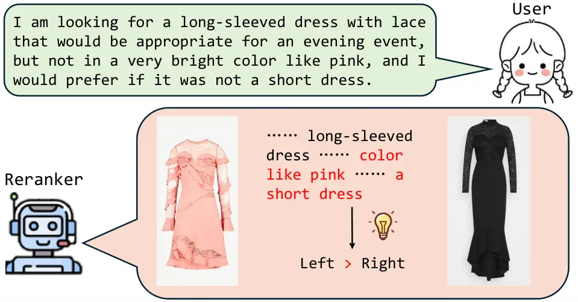
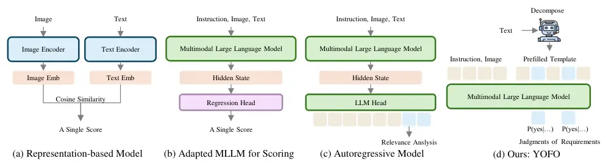
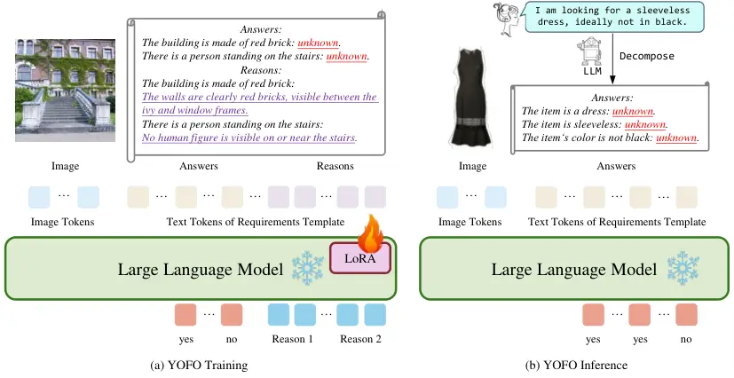
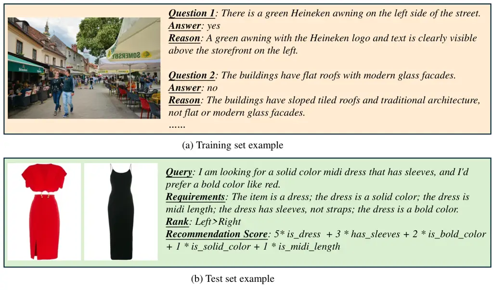
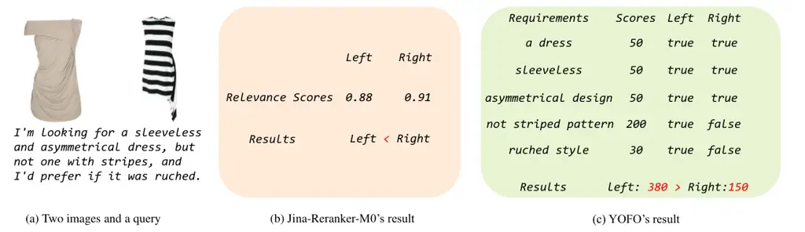
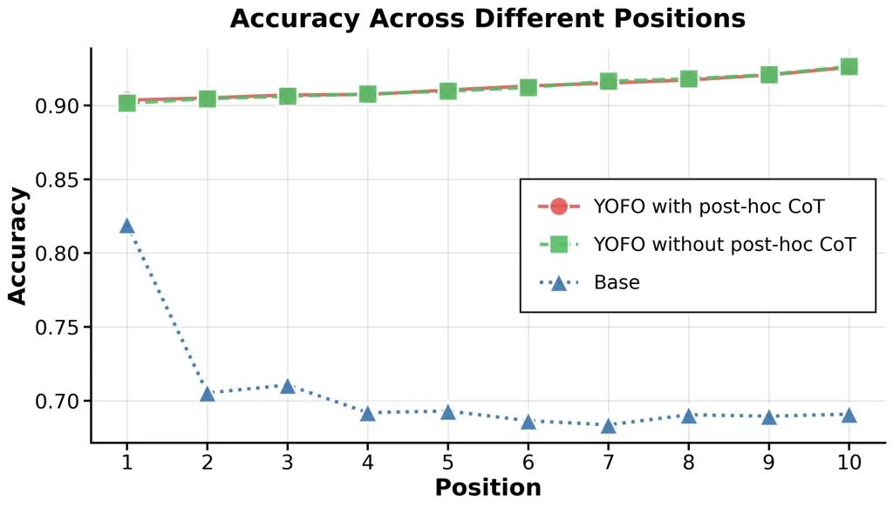

# You Only Forward Once: An Efficient Compositional Judging Paradigm

Tianlong Zhang Affiliation: School of Science, Harbin Institute of
Technology, Shenzhen, Guangdong Province, China Correspondence to:
<24b958007@stu.hit.edu.cn>    Hongwei Xue Affiliation: Accio, Alibaba
Group, Hangzhou, Zhejiang Province, China    Shilin Yan
Affiliation: Accio, Alibaba Group, Hangzhou, Zhejiang Province, China   
Di Wu Affiliation: Accio, Alibaba Group, Hangzhou, Zhejiang Province,
China    Chen Xu Affiliation: Accio, Alibaba Group, Hangzhou, Zhejiang
Province, China    Guannan Zhang Affiliation: Accio, Alibaba Group,
Hangzhou, Zhejiang Province, China    Yunyun Yang Affiliation: School of
Science, Harbin Institute of Technology, Shenzhen, Guangdong Province,
China Correspondence to: <yangyunyun@hit.edu.cn>

###### Abstract

Multimodal large language models (MLLMs) show strong potential as
judges. However, existing approaches face a fundamental trade-off:
adapting MLLMs to output a single score misaligns with the generative
nature of MLLMs and limits fine-grained requirement understanding,
whereas autoregressively generating judging analyses is prohibitively
slow in high-throughput settings. Observing that judgment reduces to
verifying whether inputs satisfy a set of structured requirements, we
propose YOFO, a template-conditioned method that judges all requirements
in a single forward pass. Built on an autoregressive model, YOFO accepts
a structured requirement template and, in one inference step, produces a
binary yes/no decision for each requirement by reading the logits of the
final token associated with that requirement. This design yields
orders-of-magnitude speedups while preserving interpretability.
Extensive experiments show that YOFO not only achieves state-of-the-art
results on standard recommendation datasets, but also supports
dependency-aware analysis—where subsequent judgments are conditioned on
previous ones—and further benefits from post-hoc CoT.

###### Keywords: 

Multimodal Large Language Models, Cross-modal Retrieval, MLLM-as-Judge

## 1 Introduction

Large language models (LLMs) (Team and others, 2024; Yang et al., 2025a;
Ahmed et al., 2025; Bai et al., 2023a; Liu et al., 2024; Guo et al., 2025) have achieved remarkable progress, and advances in multimodal
learning now enable them to process diverse modalities. Multimodal Large
Language Models (MLLMs) (Bai et al., 2025b; Wang et al., 2024; Bai et
al., 2023b; Lu et al., 2025; Lu et al., 2024) have recently demonstrated
significant promise in information matching due to their ability to
jointly process images, videos, and natural language queries, making
them far more applicable in real-world scenarios than traditional
unimodal retrievers. In particular, state-of-the-art MLLM-based
rerankers harness powerful vision encoders and causal attention
mechanisms to effectively fuse visual and textual information, usually
ultimately regressing a single relevance score, and achieves strong
performance in cross-modal matching tasks such as image search and
e-commerce recommendation. However, despite these advances, outputting
only a scalar relevance score leads to substantial information loss, as
fine-grained semantic distinctions in complex user queries—such as
compositional intent, attribute-level preferences, or contextual
references—are inevitably collapsed into a single value. As an example,
Figure 1 illustrates a recommendation failure of the state-of-the-art
(SOTA) multimodal reranker, Jina-Reranker-M0 (Jina AI, 2025), which
prioritizes superficial semantic overlap between the user’s query and
the pink dress, resulting in an inappropriately high ranking for this
item. Therefore, achieving accurate and fine-grained understanding of
intricate multimodal queries has become an urgent challenge that must be
addressed to realize the full potential of next-generation information
matching systems.

Recent studies on matching can be grouped into four categories. 1)
Representation-based architectures, as illustrated in Figure 2 (a),
independently embed the query and the document and then compute their
similarity (Radford et al., 2021; Huang et al., 2013; Gao et al., 2014;
Shen et al., 2014; Palangi et al., 2016; Wan et al., 2016; Cohen and
Croft, 2016). However, fixed-size embeddings limit these models’
capacity, making it difficult to capture all relevant information and to
meet fine-grained requirements (Xu et al., 2025). 2) Interaction-based
models have emerged to mitigate these limitations: they first compute
low-level interaction representations between the query and document,
and then a neural network analyzes these patterns to output a scalar
relevance score for the query–document pair (Hu et al., 2014; Dai and
Callan, 2019; Nogueira et al., 2019; Gao and Callan, 2022). These
approaches achieve higher ranking quality than representation-based
methods but are computationally more expensive and remain constrained by
representational dimensionality. 3) MLLM/LLM-based architectures,
adapted to output a single relevance score improve matching quality by
leveraging the deep semantic understanding and long-context capacity of
large language models (Ma et al., 2024c), as depicted in Figure 2 (b).
However, this design is misaligned with the native generative objective
of LLMs and undermines fine-grained input understanding. 4) LLMs and
MLLMs can serve as native judges in a paradigm termed generative
matching (Yoon et al., 2024; Yang et al., 2025b), which reframes the
task as autoregressive generation aligned with their generative nature,
as demonstrated in Figure 2 (c). Nevertheless, these methods incur high
computational overhead due to token-by-token decoding, making them
difficult to deploy in real-world applications.



Figure 1: An example illustrating a limitation of Jina-Reranker-M0. The
user seeks a midi or long dress in a non-pink color for an evening
event, yet the model ranks a short pink dress higher than a long black
dress that is well-suited for such an occasion.



Figure 2: Comparisons on Different Information Matching Methods. (a)
embeds inputs and then calculate similarity. (b) adapts an MLLM to
output a single relevance score. (c) reformulates the matching problem
as an autoregressive task, outputing relevance analysis. (d) Our method
first decompose the text into a set of fundamental requirements and
prefills them into a predefined template. Then the MLLM takes the
template and the image as input and output whether each requirement is
satisfied after a single forward pass.

To address this dilemma, we observe that information matching
essentially reduces to verifying whether a document satisfies a set of
input requirements. We therefore propose YOFO, a single-forward-pass,
template-conditioned judging paradigm that simultaneously determines,
for each requirement in a predefined template, whether it is satisfied
(yes/no). Specifically, YOFO adapts an autoregressive model to accept a
structured requirement template and, after a single forward pass, reads
the logits of the final token associated with each requirement; the
induced next-token distribution discriminates between yes and no,
enabling binary decisions without autoregressive decoding. Consequently,
the model produces all requirement judgments in one forward pass,
improving throughput while preserving interpretability. During training,
YOFO follows standard next-token prediction but applies supervision only
to positions that predict yes/no or reasoning tokens, encouraging
precise and well-grounded judgments. At inference time, we first obtain
a template by prompting an LLM to decompose the user’s query into a set
of requirements formatted according to a predefined schema (e.g., for “a
blue, hooded, long-sleeve top without a chest logo,” the requirements
are: blue, hooded, long-sleeved, no chest logo). YOFO then consumes the
template and, in a single forward pass, reads the final-token logits for
each requirement and outputs a yes/no decision by applying softmax and
selecting the higher-probability token between “yes” and “no”. The
resulting judgments can be post-processed as needed—for example, mapped
to a relevance score using a human-defined mapping.

To evaluate the efficacy of our method, we derive a training set from
SA-1B (Kirillov et al., 2023) and train the model on it to improve
generalizability. We then construct a test set from LRVS-Fashion (Lepage
et al., 2023) to assess recommendation performance in a different
domain. Extensive experiments demonstrate that our method accurately
produces judgments conditioned on the input and template, and that later
judgments can condition on earlier ones, enabling dependency-aware
analysis. Furthermore, YOFO also benefits from post-hoc Chain-of-Thought
(CoT), which encourages the model to reason implicitly before judging.

In summary, our contributions are as follows: (1) We introduce YOFO, an
efficient compositional judging paradigm that judges a series of
requirements concurrently in a single forward pass. (2) We demonstrate
that YOFO enables dependency-aware analysis by conditioning later
judgments on earlier ones. (3) We show that YOFO benefits from post-hoc
CoT. (4) We further show that YOFO achieves state-of-the-art performance
on recommendation tasks compared with traditional methods that output a
single relevance score, while preserving high throughput.

## 2 Related Works

### 2.1 Multimodal Large Language Models

Multimodal Large Language Models (MLLMs) (Bai et al., 2025b; Wang et
al., 2024; Bai et al., 2023b; Lu et al., 2025; Lu et al., 2024; Hong et
al., 2025; Ma et al., 2024b; Ma et al., 2024a; Xue et al., 2023) have
significantly extended the capabilities of Large Language Models (LLMs)
(Team and others, 2024; Yang et al., 2025a; Ahmed et al., 2025; Bai et
al., 2023a; Liu et al., 2024; Guo et al., 2025; Li et al., 2025) by
enabling them to perceive, reason over, and generate responses grounded
in multimodal inputs. However, the dense visual token sequences required
for such alignment incur prohibitive computational costs. Recent
approaches address this by either compressing tokens while preserving
fidelity or rethinking how visual information is integrated. For
instance, CrossLMM (Yan et al., 2025) employs dual cross-attention
mechanisms to drastically reduce token count with minimal performance
degradation. Similarly, MM-GEM (Ma et al., 2024a) uses a PoolAggregator
to support both generative and embedding tasks. These advances
demonstrate that strategic token reduction can maintain multimodal
performance at lower cost.

### 2.2 Rerankers

Reranking serves as a critical refinement stage in modern retrieval
systems, aiming to re-order an initial candidate set by modeling
fine-grained query–document interactions. Early neural rerankers
employed representation-based architectures, calculating embeddings
independently and then similarity, such as DSSM (Huang et al., 2013; Gao
et al., 2014), Convolutional DSSM (Shen et al., 2014)) and Long
Short-Term Memory (LSTM) variants (Hochreiter and Schmidhuber, 1997;
Palangi et al., 2016; Wan et al., 2016; Cohen and Croft, 2016). But this
kind of models are limited by the fixed-size embedding, and thus were
soon superseded by interaction-based cross-encoders, most notably
BERT-based models, that concatenate query and document as input and
predict relevance via a classification or regression head over the
\[CLS\] token. (Nogueira et al., 2019) first introduced this method and
proved it effective. These models achieve strong performance but require
pairwise inference, limiting scalability, and is constrained by fixed
representational dimention and content length.   With the rise of LLMs,
researchers have repurposed powerful encoder-decoder (e.g., T5 (Raffel
et al., 2020)) or decoder-only (e.g., LLaMA (Touvron et al., 2023))
backbones for reranking. A dominant paradigm (Zhuang et al., 2023; Ma et
al., 2024c) fine-tunes LLMs to regress continuous relevance scores or
classify relevance levels, leveraging their rich contextual
understanding and long-context capabilities for improved semantic
matching. Jina-Reranker-M0 also follows this paradigm but leverages
Qwen2-VL (Wang et al., 2024), enabling support for multimodal inputs.  
More recently, generative reranking has emerged as a paradigm shift:
instead of scoring candidates individually, the model directly generates
the ranked sequence—such as a list of document indices or
IDs—conditioned on the full candidate set. Methods like (Yoon et al.,
2024; Yang et al., 2025b) process all candidates jointly and
autoregressively output the optimal ranking. This generative formulation
naturally integrates reranking into end-to-end AI systems and shows
particular promise in multimodal and agent-driven retrieval scenarios.

## 3 Method

In this section, we introduce YOFO, an efficient judging paradigm
adapting an autoregressive model to receive a series of requirements as
input and yields the judgements (“yes” or “no”) for all requirements,
respectively, as output. We begin by formulating the problem in
Section 3.1, followed by the overall architecture of YOFO in
Section 3.2, training in Section 3.3, inference in Section 3.4.



Figure 3: Architecture of YOFO. (Left): YOFO uses an MLLM as its
backbone. During training, the MLLM receives a structured requirement
template as input and is trained to (i) judge each requirement and (ii)
produce supporting reasons. YOFO supervises the model to output correct
yes/no judgments while applying next-token prediction only to the
reasoning text. (Right): At inference time, the user’s query is first
decomposed into a structured template, and the MLLM ingests the image
and the template to determine, in a single forward pass, whether each
requirement is satisfied, without autoregressively generating reasons.

### 3.1 Problem formulation

As illustrated in Section 1, models akin to Jina-Reranker-M0 (Jina AI, 2025) struggle to perform accurate cross-modal retrieval. One might
attribute this to visual information degradation caused by the image
encoder and the connector projection, which impairs fine-grained
alignment. However, we empirically find that these models also fail to
retrieve text accurately from natural-language queries. For example,
consider the query “I’m looking for some bottoms that are ideally
suitable for summer wear and I’d prefer them to be grey if available”,
paired with two documents: (1) “grey formal trousers, a touch of
warmth—perfect for winter” and (2) “black skirt, perfect for casual or
date outfits in summer”, Jina-Reranker-M0 assigns a higher score to
winter trousers simply because they are gray, failing to recognize that
the query explicitly requires summer-appropriate clothing, while “gray”
is only a conditional preference. Verifying each requirement in the
query individually would likely yield better results. To this end, we
formally define the compositional judging problem.

The input to YOFO consists of an image
$`I\in\mathbb{R}^{3\times H\times W}`$ and $`N`$ requirements
$`(\bm{p}_{i})_{i=1}^{N}`$, for which the model determines whether they
hold of the image. YOFO is a function that judges whether each
requirement is satisfied with respect to the image:

```math
f(I,(\bm{p}_{i})_{i=1}^{N})=(\bm{a}_{i})_{i=1}^{N} \tag{1}
```

That is, YOFO judges each requirement $`\bm{p}_{i}`$ and outputs a
binary answer $`\bm{a}_{i}\in\{\text{yes},\text{no}\}`$.

### 3.2 Overall Architecture

YOFO leverages a decoder-only MLLM as the backbone. As illustrated in
Figure 3, we add a single token unknown to the end of each requirement
$`\bm{p}_{i}`$, and concatenate all requirements to form the template
$`\bm{t}`$. The template $`\bm{t}`$ is then tokenized into $`\bm{s}`$,
and the indices of the single token unknown in the sequence are denoted
$`(pos_{i})_{i=1}^{N}`$. After a single forward pass, the model must
predict whether each unknown position should be “yes” or “no”. The
forward process can be formulated as:

```math
\bm{h}=\text{VLM}(I,\bm{t}) \tag{2}
```

The acquired logits $`\bm{h}`$ indicate the next-token distribution at
each position. Therefore, for each requirement $`\bm{p}_{i}`$, the
logits at position $`pos_{i}-1`$ imply the distribution over the next
token at $`pos_{i}`$, distinguishing “yes” from “no”. In other words, it
is this logit that we need to predict whether the requirement
$`\bm{p}_{i}`$ is satisfied for the image input $`I`$. We read out the
required logits as:

```math
\bm{l}_{i}=\bm{h}[pos_{i}-1],\quad i=1,2,\cdots,N \tag{3}
```

After that, these logits $`\bm{l}_{i}\in\mathbb{R}^{V}`$, where $`V`$ is
the vocabulary size of the LLM, are converted into a probability
distribution via the softmax function, and the index of the maximum
probability yields the model’s prediction:

```math
\bm{a}_{i}^{\prime}=\text{vocab}[\arg\max(S(\bm{l}_{i}))],\quad i=1,2,\cdots,N \tag{4}
```

where $`S`$ denotes softmax function. In real-world applications, to
ensure that the LLM outputs binary results (“yes”/“no”), we can compare
the probabilities of emitting “yes” and “no”, and select the higher one
as the final judgment. Therefore, this can be framed as below:

```math
\bm{a}_{i}^{\prime}=\begin{cases}\text{``yes''},&\text{if }P(\text{``yes''}|s_{<pos_{i}})>P(\text{``no''}|s_{<pos_{i}})\\
\text{``no''},&\text{otherwise}\end{cases} \tag{5}
```

where $`i=1,2,\cdots,N`$. Moreover, our experiments empirically reveal
that, after training, the LLM learns to output only “yes” and “no”—even
without explicit binarization.

### 3.3 Training

In this section, we describe YOFO’s training procedure in detail. We
first present the version without post-hoc Chain-of-Thought (CoT), and
then introduce a variant with post-hoc CoT. The only difference is that,
in the non–post-hoc CoT setting, the template omits the field of reasons
that follow the answers.

Without Post-hoc CoT. As shown in Figure 3 (a), we apply supervision at
the answer positions to train the LLM to judge the requirements
correctly. Specifically, we minimize the cross-entropy loss between the
model logits $`(\bm{l}_{i})_{i=1}^{N}`$ and the ground-truth labels. The
answer loss $`\mathcal{L}_{\text{answer}}`$ is defined as:

```math
\mathcal{L}_{\text{answer}}=-\frac{1}{N}\sum_{i=1}^{N}\log P(a_{i}|s_{<pos_{i}}) \tag{6}
```

Although this objective resembles the standard autoregressive loss, when
the model computes $`\bm{l}_{i}`$ for the $`i`$-th requirement, it does
not observe the answers to previous requirements. Therefore,
$`\mathcal{L}_{\text{answer}}`$ fundamentally differs from the
autoregressive objective. Optimizing $`\mathcal{L}_{\text{answer}}`$
enables the LLM to make dependency-aware judgments, allowing later
decisions to condition on its earlier judgements, as shown in
Section 4.5.

With Post-hoc CoT. As shown in Figure 3 (a), YOFO with Post-hoc CoT
applies supervision to both the answers and the accompanying rationales.
The requirements themselves are not supervised, as they are provided as
input rather than predicted. Let $`\mathcal{V}`$ denote the positions of
tokens in the reason field, that is
$`\mathcal{V}=\{i|s_{i}\text{ lies in the reason field}\}`$. For each
$`i\in\mathcal{V}`$, the logits at the preceding position $`(i-1)`$
predict the distribution over the next token $`s_{i}`$ in the reason
field. Accordingly, we define the following autoregressive loss to
encourage the model to consider rationales prior to making judgments:

```math
\mathcal{L}_{\text{reason}}=-\frac{1}{|\mathcal{V}|}\sum_{i\in\mathcal{V}}\log P(s_{i}|s_{<i}) \tag{7}
```

Because reason tokens substantially outnumber answer tokens and
$`\mathcal{L}_{\text{reason}}`$ is introduced primarily to aid judgment,
we scale $`\mathcal{L}_{\text{reason}}`$ by a coefficient $`\lambda`$,
and define the total loss as:

```math
\mathcal{L}=\mathcal{L}_{\text{answer}}+\lambda\mathcal{L}_{\text{reason}} \tag{8}
```

### 3.4 Inference

Figure 3 (b) illustrates how a YOFO-trained LLM performs inference. At
inference time, there are no ground-truth annotations for rationales;
consequently, the rationale field is omitted from the template. The MLLM
backbone ingests the image $`I`$ and the template $`\bm{t}`$ and
performs a single forward pass, after which the logits
$`(\bm{l}_{i})_{i=1}^{N}`$ can be extracted as in Equation 3. Finally,
we apply the binary decision rule in Equation 5 to ensure that the LLM
outputs only “yes” or “no”. The resulting judgments can then be consumed
by downstream tasks—for example, provided as input to an agent for
further analysis or mapped to a single score under a predefined
criterion.

As an illustrative use case of YOFO, Figure 3 (b) depicts how it can be
integrated into rerankers. To obtain a structured template, an LLM first
decomposes the user’s query into a set of requirements. These
requirements are then assembled into a template and passed, together
with the image, to the MLLM. Finally, all requirements are judged in a
single forward pass, yielding results that substantially improve
reranking quality. Task-specific rules can be devised to exploit these
judgments; we leave the design open to practitioners.

## 4 Experiments

In this section, we present extensive experiments and ablation studies
to validate our approach. We first compare YOFO with state-of-the-art
(SOTA) methods to demonstrate its effectiveness. We then assess YOFO’s
dependency-aware judgement, the effectiveness of post-hoc CoT, and the
contributions of individual architectural components.

### 4.1 Implementation Details

We build on Qwen2-VL-2B-Instruct (Wang et al., 2024) and
Qwen3-VL-2B-Instruct (Bai et al., 2025a), freezing the vision encoder
during training. We fine-tune the LLM using LoRA (Hu et al., 2022). To
conveniently locate the unknown token, we add four special tokens to the
Qwen2-VL-2B-Instruct and Qwen3-VL-2B-Instruct processor:
\<\|auth_start\|\>, \<\|auth_end\|\>, \<\|reason_start\|\>, and
\<\|reason_end\|\>. The first two mark the start and end of the answer
span, and the last two mark the boundaries of the reason span.
Consequently, these special tokens enable straightforward label masking,
allowing supervision to be applied exclusively to answers and reasons.

Training is conducted for one epoch with a learning rate of
$`1\times 10^{-4}`$, using the AdamW optimizer. We employ a cosine
learning rate scheduler with a warmup ratio of 0.05. We set the maximum
sequence length to 1,536 tokens. We use DeepSpeed ZeRO-3 (Rajbhandari et
al., 2020) for distributed training. We load the training data with
eight worker processes, dropping the last incomplete batch. Training
runs on eight H100 GPUs over four hours. We use bfloat16 mixed precision
and enable gradient checkpointing to reduce memory usage. Moreover, we
adopt $`\lambda=0.55`$ as the default setting in all experiments using
post-hoc CoT.



Figure 4: Examples of the training and test sets. Each training sample
consists of an image, a set of properties, answers, and corresponding
reasons. Each test sample consists of two images, a customer-style
query, requirements derived by decomposing the query, ground-truth
labels indicating which image better matches the query, and the
expression used to compute each image’s final recommendation score.

### 4.2 Data Construction

Training Set. To construct the training dataset, we use the SA-1B
dataset (Kirillov et al., 2023), introduced alongside the Segment
Anything Model. It contains approximately 11M diverse, high-resolution
images sourced from a privacy-preserving data engine and annotated with
1.1B high-quality segmentation masks. Since we do not require the masks,
as shown in Figure 4 (a), we use only the images, prompting an MLLM to
analyze them, propose properties that hold or do not hold for the
corresponding images, and provide reasons. We randomly sample 1.2M
images to ensure diversity and generalizability. For each image
$`\mathcal{I}_{i}`$, the final sample is represented as
$`(\mathcal{I}_{i},(\mathcal{P}_{ij},\mathcal{A}_{ij},\mathcal{R}_{ij})_{j=1}^{N})`$,
denoting the image, the proposed properties, the binary answers(“yes” or
“no”), and the reasons. To maintain a balanced and randomized mix of
satisfied and unsatisfied properties, we prompt the MLLM to produce
approximately equal numbers of each and shuffle them during training.
Additionally, although we instruct the model to generate exactly ten
properties per sample in the training set, the number of properties per
training sample varies, typically remaining close to ten.. To evaluate
the model and mitigate overfitting, we split the dataset at a ratio of
$`6:1`$ into training and validation sets.

Test Set. We use the LRVS-Fashion dataset (Lepage et al., 2023), a
large-scale public benchmark for referred visual search (RVS) in the
fashion domain, to construct a test set. It comprises 272K fashion
products and 842K images extracted from real-world catalogs. To evaluate
generalization in Image-Text reranking, as depicted as Figure 4 (b), we
construct image pairs and queries; the model then judges which of the
two images better matches the corresponding query. Specifically, we
randomly sample image pairs $`(\mathcal{I}_{i1},\mathcal{I}_{i2})`$ from
the same category and, using an MLLM, generate a natural-language query
$`\mathcal{Q}_{i}`$ that mimics how a customer would express their
preferences. The MLLM then produces the answer $`\mathcal{A}_{i}`$
indicating whether the first image $`\mathcal{I}_{i1}`$ better matches
$`\mathcal{Q}_{i}`$, the set of query requirements
$`(\mathcal{R}_{ij})_{j=1}^{M_{i}}`$ (where $`M_{i}`$ is the number of
requirements), and a valid python expression $`\mathcal{E}_{i}`$ used to
compute the final recommendation score based on our model’s predictions.

Data Curation. To ensure the quality of the training and test sets
generated by MLLMs, we implement a human-in-the-loop curation protocol.
For training set and test set independently, we iteratively refine the
corresponding prompt, generate samples from a small, randomly selected
subset of the source data, and manually evaluate sample quality and
correctness against predefined standard. This iteration continues until
the generated samples consistently satisfy the quality thresholds. The
finalized prompts are then employed to produce the complete training and
test sets, respectively.

### 4.3 Evaluation Metrics

In this section, we introduce the metrics used in our experiments to
evaluate models.

On SA-1B validation sets and dependency-aware judgement task, we report
two metrics to evaluate the accuracy of models. One metrics is
Sample-wise Accuracy $`Acc_{\mathrm{sample}}`$, denoting the percentage
of samples on which the model judges all requirements correctly. Another
metrics is Property-wise Accuracy $`Acc_{\mathrm{property}}`$,
indicating the percentage of properties judged correctly. Obviously,
$`Acc_{\mathrm{sample}}`$ is always not greater than
$`Acc_{\mathrm{property}}`$.

To evaluate the model’s ability to make judgments conditioned on its
previous decisions, we introduce an additional metric for the
dependency-aware judgment task, termed Dependency-Aware Accuracy and
denoted as $`Acc_{\mathrm{dep}}`$. It measures the percentage of
questions that depend on previous ones and are answered correctly.

On the test sets, we evaluate whether the model can rank the image pairs
properly. Therefore, we report the error rate of ranking
$`Err_{\mathrm{rank}}`$, denoting the percentage of image pairs ranked
wrongly.

### 4.4 Comparison on LAION-RVS-Fashion

In this section, we present a comparative analysis of YOFO with
representative state-of-the-art embedding models (e.g., CLIP (Radford et
al., 2021), SigLIP 2 (Tschannen et al., 2025) and BLIP-2 (Li et al.,
2023)) and multimodal rerankers (e.g., Jina-Reranker-M0 (Jina AI, 2025),
Qwen3-VL-Reranker (Li et al., 2026) and LamRA-Rank (Liu et al., 2025)).
Notably, all evaluated rerankers are built on Qwen2-VL (Wang et al., 2024) or Qwen3-VL (Bai et al., 2025a).

LAION-RVS-Fashion is a specialized fashion dataset, which inherently
exhibits a significant domain shift relative to our training set
constructed entirely on the broad and diverse SA-1B corpus. Despite this
distributional gap, YOFO demonstrates remarkable robustness and
adaptability when evaluated on fashion-specific recommendation tasks. As
shown in Table 1, YOFO achieves competitive performance and consistently
outperforms all strong baselines—despite never being trained on
fashion-related data. Notably, LamRA-Rank-7B (fine-tuned on
Qwen2-VL-7B), despite its significantly larger parameter count, exhibits
a ranking error rate nearly twice that of YOFO finetuned on Qwen2-VL-2B.
Similarly, Qwen3-VL-Reranker-2B outperforms LamRA-Rank-7B, but still
underperforms YOFO. This performance gap is attributable to the inherent
limitation of single-score prediction paradigm in capturing fine-grained
semantic relationships.

This result highlights a key advantage of our approach: YOFO learns
general-purpose judging capabilities that transfer effectively across
domains. Crucially, it can be deployed directly in specialized
subdomains—such as fashion—without any fine-tuning or domain adaptation.
This zero-shot generalization underscores the model’s practical utility
in real-world scenarios where labeled data is scarce or domain shifts
are common, positioning YOFO as a versatile solution for cross-domain
recommendation systems.

Regarding throughput evaluation, throughput metrics for embedding models
are omitted, as their embedding process is typically performed offline
to accelerate retrieval in modern recommendation systems. Among the
evaluated multimodal rerankers, YOFO finetuned on Qwen3-VL-2B achieves
the highest throughput, demonstrating superior computational efficiency.

Additionally, YOFO based on Qwen3-VL-2B achieves a 1.1% lower ranking
error rate and higher throughput compared to its Qwen2-VL-2B
counterpart, which we attribute to Qwen3-VL-2B’s smaller parameter
count.

| Methods          | $`Err_{\mathrm{rank}}`$ (%) $`\downarrow`$ | $`\mathrm{Throughput}`$ (pairs/s) $`\uparrow`$ |
| ---------------- | ------------------------------------------ | ---------------------------------------------- |
| Clip-ViT-L       | 42.0                                       | -                                              |
| Siglip2-ViT-G    | 48.3                                       | -                                              |
| Blip2-itm-ViT-G  | 37.4                                       | -                                              |
| Jina-Reranker-m0 | 16.2                                       | 36                                             |
| Qw3-Reranker-2B  | 8.7                                        | 48                                             |
| LamRA-Rank-7B    | 9.3                                        | 5                                              |
| YOFO (Qwen2-VL)  | 4.8                                        | 35                                             |
| YOFO (Qwen3-VL)  | 3.7                                        | 48                                             |

Table 1: Ranking Error Rates on LAION-RVS-Fashion252 Dataset. YOFO
achieves the lowest ranking error rate across all baseline models while
simultaneously attaining the highest throughput among all evaluated
rerankers.

### 4.5 Dependency-Aware Judgement

To evaluate whether our model can make judgments conditioned on previous
ones, we randomly select two properties from each sample in the
validation set and replace the second property with “The answer to this
question is the opposite of the answer to the previous question”. The
model is therefore required to infer the answer to the second question
without being given the first property’s answer, while making both
judgments simultaneously. We fine-tune the pretrained
Qwen2-VL-2B-Instruct model on this dataset for one epoch, keep other
settings unchanged, and then compare it with the model in Section 4.4.
Although challenging, Table 2 demonstrates YOFO’s dependency-aware
judgment ability under the dependent-question setup, approaching 100%.
Without training on the purposely-designed dataset, YOFO cannot judge
correctly, because the properties in the training and validation sets
can be judged individually, rendering dependency-aware analysis
unnecessary. The base model performs poorly on this task, as it has not
been exposed to scenarios where previous tokens are unobserved when
predicting the next token.

| Methods    | $`Acc_{\mathrm{dep}}`$ (%) $`\uparrow`$ | $`Acc_{\mathrm{property}}`$ (%) $`\uparrow`$ |
| ---------- | --------------------------------------- | -------------------------------------------- |
| Base       | 35.3                                    | 62.9                                         |
| YOFO       | 57.6                                    | 71.4                                         |
| YOFO + dep | 99.1                                    | 90.4                                         |

Table 2: Accuracy on SA-1B validation set. “Base”denotes pretrained
Qwen2-VL-2B-Instruct model. “YOFO + dep” denotes YOFO trained with the
dependency question. To construct questions that need dependency-aware
analysis based on previous judgments, we randomly choose two properties
from each sample in validation set, and replace the second requirement
with “The answer to this question is the opposite of the answer to the
previous question.”



Figure 5: Illustrative comparison using a single example. (a) presents a
pair of images and a query. (b) shows that Jina-Reranker-M0 assigns a
higher score to the second image; however, the dress in that image is
striped and not ruched, so the prediction is incorrect. Panel (c) shows
that after decomposing the query into five requirements, YOFO judges
whether each requirement is satisfied by each image; these judgments are
then combined using the specified expression to compute the final
recommendation scores. Because all judgments are correct, the resulting
prediction is accurate.



Figure 6: The accuracy of different models across template positions on
the SA-1B validation set. “Base” denotes Qwen2-VL-2B-Instruct. As
properties appear later in the sequence, YOFO maintains an accuracy of
approximately 90%, while the base model shows a sharp decline in
accuracy starting from the second property.

### 4.6 Ablation Study

Effectiveness of YOFO training. We fine-tune Qwen2-VL-2B-Instruct and
Qwen3-VL-2B-Instruct models on the training set using LoRA (Hu et al., 2022) for one epoch and evaluate it on the validation set. As shown in
Table 3, after training, Property-wise Accuracy improves by over 20%,
reaching above 90%, while Sample-wise Accuracy increases by
approximately 40%. These ablation results demonstrate the effectiveness
of our training paradigm. Moreover, the YOFO model trained with
Qwen3-VL-2B-Instruct performs slightly better than its counterpart
trained with Qwen2-VL-2B-Instruct. The Sample-wise Accuracy remains
moderate because the training and validation sets contain, on average,
nearly ten properties per sample, making it challenging to judge all
properties correctly.

| Methods    | $`Acc_{\mathrm{property}}`$ (%) $`\uparrow`$ | $`Acc_{\mathrm{sample}}`$ (%) $`\uparrow`$ |
| ---------- | -------------------------------------------- | ------------------------------------------ |
| Qwen2-VL   |                                              |                                            |
| Base       | 70.6                                         | 2.0                                        |
| YOFO       | 91.2                                         | 41.8                                       |
| YOFO + CoT | 91.3                                         | 42.0                                       |
| Qwen3-VL   |                                              |                                            |
| Base       | 68.4                                         | 1.3                                        |
| YOFO       | 92.3                                         | 46.6                                       |

Table 3: Ablation study of different components on SA-1B validation set.
We train models with Qwen2-VL-2B-Instruct and Qwen3-VL-2B-Instruct as
base models. “YOFO” denotes the model obtained by fine-tuning the base
model with YOFO. “YOFO + CoT” denotes the YOFO model augmented with
post-hoc CoT.

Effectiveness of post-hoc CoT. As shown in the last row of Table 3, YOFO
benefits from post-hoc CoT. This likely arises because the model is
trained to generate and consider reasons before making judgments. This
component is particularly useful in complex settings where detailed
reasons can be annotated.

Rank of LoRA. We evaluate different ranks of LoRA, and the results in
Table 4 show that $`r=64`$ perform the best. Therefore, we adopt
$`r=64`$ as our default experimental setting.

| Rank | $`Acc_{\mathrm{property}}`$ (%) $`\uparrow`$ | $`Acc_{\mathrm{sample}}`$ (%) $`\uparrow`$ |
| ---- | -------------------------------------------- | ------------------------------------------ |
| 32   | 91.2                                         | 41.7                                       |
| 64   | 91.3                                         | 42.0                                       |
| 128  | 91.2                                         | 41.7                                       |

Table 4: Ablation study on LoRA rank using the SA-1B validation set. As
the LoRA rank increases, accuracy first rises and then declines,
indicating that a rank of 64 yields the best performance.

### 4.7 Additional Analysis

We present a case study in Figure 5. The user seeks a sleeveless,
asymmetric dress that is not striped and preferably has ruching.
However, jina-reranker-m0 assigns a higher score to the dress in the
second image, overlooking its stripes and lack of ruching. In contrast,
YOFO judges, for each image, whether the query’s requirements are
satisfied and correctly assigns a higher score to the first image. This
case explicitly demonstrates the effectiveness and interpretability of
our method.

We also analyze judgment accuracy across positions on the SA-1B
validation set. Specifically, $`Acc_{i}`$ denotes the accuracy for
$`i`$-th requirement, and Figure 6 visualizes the results. The figure
shows that the base model achieves over 80% accuracy on the first
requirement, but its accuracy declines rapidly toward 70% thereafter. In
contrast, YOFO maintains accuracy above 90%, with or without post-hoc
CoT. This likely occurs because the base model’s behavior on the first
requirement resembles autoregressive generation, yet it fails to adapt
to our template-conditioned judgment paradigm in which the ground-truth
labels for previous judgments are unobserved. After training, YOFO
adapts to this paradigm and consequently maintains high accuracy across
positions.

## 5 Conclusions

In this work, we present You Only Forward Once (YOFO), a
template-conditioned judging paradigm that judges whether inputs satisfy
requirements specified by a predefined template. By concurrently
predicting next-token distributions for all requirements in a single
forward pass, YOFO efficiently judges compositional requirements.
Although trained on general-purpose data, YOFO achieves state-of-the-art
performance on the reranking task and generalizes well across domains,
enabling direct deployment in specialized settings. Our precise and
efficient approach departs from traditional methods, which either lack
fine-grained understanding of inputs or incur prohibitive computational
overhead. Additionally, YOFO can condition later judgments on earlier
ones and benefits from post-hoc CoT, making it effective in complex
settings. Ultimately, our work establishes a new paradigm for judging,
offering practical advantages in scenarios where multiple requirements
must be assessed.

Limitations and Future Work. While our work demonstrates the
effectiveness of YOFO in fine-grained multimodal compositional judging,
it has a limitation that points to promising directions for future
research. Specifically, we evaluate YOFO only on a single downstream
task: reranking. Additional application scenarios warrant investigation.
Future work could investigate additional applications of YOFO. Its
explicit, interpretable judgments naturally lend themselves to serving
as signals in reinforcement learning (RL) frameworks. Specifically, YOFO
could be used as a structured reward model that provides fine-grained
feedback (e.g., per-requirement rewards) rather than a single scalar
score, thereby offering more precise guidance during RL training of
MLLMs and diffusion models. Moreover, YOFO is well suited to multi-label
classification and can therefore be applied to numerous scenarios, such
as personalized recommendation systems that tag products and users’
interests to deliver targeted recommendations.

## References

- Ahmed et al. (2025) I. Ahmed, S. Islam, P. P. Datta, I.
  Kabir, N. U. R. Chowdhury, and A. Haque Qwen 2.5: a comprehensive
  review of the leading resource-efficient llm with potentioal to
  surpass all competitors. Authorea Preprints. Cited by: §1, §2.1.
- Bai et al. (2023a) J. Bai, S. Bai, Y. Chu, Z. Cui, K. Dang, X.
  Deng, Y. Fan, W. Ge, Y. Han, F. Huang, et al. Qwen technical report.
  arXiv preprint arXiv:2309.16609. Cited by: §1, §2.1.
- Bai et al. (2023b) J. Bai, S. Bai, S. Yang, S. Wang, S. Tan, P.
  Wang, J. Lin, C. Zhou, and J. Zhou Qwen-vl: a versatile
  vision-language model for understanding, localization. Text Reading,
  and Beyond 2, pp. 1. Cited by: §1, §2.1.
- Bai et al. (2025a) S. Bai, Y. Cai, R. Chen, K. Chen, X. Chen, Z.
  Cheng, L. Deng, W. Ding, C. Gao, C. Ge, W. Ge, Z. Guo, Q. Huang, J.
  Huang, F. Huang, B. Hui, S. Jiang, Z. Li, M. Li, M. Li, K. Li, Z.
  Lin, J. Lin, X. Liu, J. Liu, C. Liu, Y. Liu, D. Liu, S. Liu, D. Lu, R.
  Luo, C. Lv, R. Men, L. Meng, X. Ren, X. Ren, S. Song, Y. Sun, J.
  Tang, J. Tu, J. Wan, P. Wang, P. Wang, Q. Wang, Y. Wang, T. Xie, Y.
  Xu, H. Xu, J. Xu, Z. Yang, M. Yang, J. Yang, A. Yang, B. Yu, F.
  Zhang, H. Zhang, X. Zhang, B. Zheng, H. Zhong, J. Zhou, F. Zhou, J.
  Zhou, Y. Zhu, and K. Zhu Qwen3-vl technical report. arXiv preprint
  arXiv:2511.21631. Cited by: §4.1, §4.4.
- Bai et al. (2025b) S. Bai, K. Chen, X. Liu, J. Wang, W. Ge, S.
  Song, K. Dang, P. Wang, S. Wang, J. Tang, et al. Qwen2. 5-vl technical
  report. arXiv preprint arXiv:2502.13923. Cited by: §1, §2.1.
- Cohen and Croft (2016) D. Cohen and W. B. Croft End to end long short
  term memory networks for non-factoid question answering. In
  Proceedings of the 2016 ACM international conference on the theory of
  information retrieval, pp. 143–146. Cited by: §1, §2.2.
- Dai and Callan (2019) Z. Dai and J. Callan Deeper text understanding
  for ir with contextual neural language modeling. In Proceedings of the
  42nd international ACM SIGIR conference on research and development in
  information retrieval, pp. 985–988. Cited by: §1.
- Gao et al. (2014) J. Gao, P. Pantel, M. Gamon, X. He, and L. Deng
  Modeling interestingness with deep neural networks. In Proceedings of
  the 2014 conference on empirical methods in natural language
  processing (EMNLP), pp. 2–13. Cited by: §1, §2.2.
- Gao and Callan (2022) L. Gao and J. Callan Long document re-ranking
  with modular re-ranker. In Proceedings of the 45th International ACM
  SIGIR Conference on Research and Development in Information Retrieval,
  pp. 2371–2376. Cited by: §1.
- Guo et al. (2025) D. Guo, D. Yang, H. Zhang, J. Song, R. Zhang, R.
  Xu, Q. Zhu, S. Ma, P. Wang, X. Bi, et al. Deepseek-r1: incentivizing
  reasoning capability in llms via reinforcement learning. arXiv
  preprint arXiv:2501.12948. Cited by: §1, §2.1.
- Hochreiter and Schmidhuber (1997) S. Hochreiter and J. Schmidhuber
  Long short-term memory. Neural Computation MIT-Press. Cited by: §2.2.
- Hong et al. (2025) J. Hong, S. Yan, J. Cai, X. Jiang, Y. Hu, and W.
  Xie WorldSense: evaluating real-world omnimodal understanding for
  multimodal llms. arXiv preprint arXiv:2502.04326. Cited by: §2.1.
- Hu et al. (2014) B. Hu, Z. Lu, H. Li, and Q. Chen Convolutional neural
  network architectures for matching natural language sentences.
  Advances in neural information processing systems 27. Cited by: §1.
- Hu et al. (2022) E. J. Hu, Y. Shen, P. Wallis, Z. Allen-Zhu, Y. Li, S.
  Wang, L. Wang, W. Chen, et al. Lora: low-rank adaptation of large
  language models.. ICLR 1 (2), pp. 3. Cited by: §4.1, §4.6.
- Huang et al. (2013) P. Huang, X. He, J. Gao, L. Deng, A. Acero, and L.
  Heck Learning deep structured semantic models for web search using
  clickthrough data. In Proceedings of the 22nd ACM international
  conference on Information & Knowledge Management, pp. 2333–2338. Cited
  by: §1, §2.2.
- Jina AI (2025) Jina AI Jina-reranker-m0: multilingual multimodal
  document reranker. Note: Accessed:
  2025-11-13[https://jina.ai/news/jina-reranker-m0-multilingual-multimodal-document-reranker/](https://jina.ai/news/jina-reranker-m0-multilingual-multimodal-document-reranker/)
  Cited by: §1, §3.1, §4.4.
- Kirillov et al. (2023) A. Kirillov, E. Mintun, N. Ravi, H. Mao, C.
  Rolland, L. Gustafson, T. Xiao, S. Whitehead, A. C. Berg, W. Lo, et
  al. Segment anything. In Proceedings of the IEEE/CVF international
  conference on computer vision, pp. 4015–4026. Cited by: §1, §4.2.
- Lepage et al. (2023) S. Lepage, J. Mary, and D. Picard LRVS-fashion:
  extending visual search with referring instructions. arXiv preprint
  arXiv:2306.02928. Cited by: §1, §4.2.
- Li et al. (2023) J. Li, D. Li, S. Savarese, and S. Hoi Blip-2:
  bootstrapping language-image pre-training with frozen image encoders
  and large language models. In International conference on machine
  learning, pp. 19730–19742. Cited by: §4.4.
- Li et al. (2026) M. Li, Y. Zhang, D. Long, K. Chen, S. Song, S.
  Bai, Z. Yang, P. Xie, A. Yang, D. Liu, et al. Qwen3-vl-embedding and
  qwen3-vl-reranker: a unified framework for state-of-the-art multimodal
  retrieval and ranking. arXiv preprint arXiv:2601.04720. Cited by:
  §4.4.
- Li et al. (2025) P. Li, S. Yan, J. Tsai, R. Zhang, R. An, Z. Guo,
  and X. Gao Adaptive classifier-free guidance via dynamic
  low-confidence masking. arXiv preprint arXiv:2505.20199. Cited by:
  §2.1.
- Liu et al. (2024) A. Liu, B. Feng, B. Xue, B. Wang, B. Wu, C. Lu, C.
  Zhao, C. Deng, C. Zhang, C. Ruan, et al. Deepseek-v3 technical report.
  arXiv preprint arXiv:2412.19437. Cited by: §1, §2.1.
- Liu et al. (2025) Y. Liu, Y. Zhang, J. Cai, X. Jiang, Y. Hu, J.
  Yao, Y. Wang, and W. Xie Lamra: large multimodal model as your
  advanced retrieval assistant. In Proceedings of the Computer Vision
  and Pattern Recognition Conference, pp. 4015–4025. Cited by: §4.4.
- Lu et al. (2024) S. Lu, Y. Li, Q. Chen, Z. Xu, W. Luo, K. Zhang,
  and H. Ye Ovis: structural embedding alignment for multimodal large
  language model. arXiv preprint arXiv:2405.20797. Cited by: §1, §2.1.
- Lu et al. (2025) S. Lu, Y. Li, Y. Xia, Y. Hu, S. Zhao, Y. Ma, Z.
  Wei, Y. Li, L. Duan, J. Zhao, et al. Ovis2. 5 technical report. arXiv
  preprint arXiv:2508.11737. Cited by: §1, §2.1.
- Ma et al. (2024a) F. Ma, H. Xue, G. Wang, Y. Zhou, F. Rao, S. Yan, Y.
  Zhang, S. Wu, M. Z. Shou, and X. Sun Multi-modal generative embedding
  model. arXiv preprint arXiv:2405.19333. Cited by: §2.1.
- Ma et al. (2024b) F. Ma, H. Xue, Y. Zhou, G. Wang, F. Rao, S. Yan, Y.
  Zhang, S. Wu, M. Z. Shou, and X. Sun Visual perception by large
  language model’s weights. Advances in Neural Information Processing
  Systems 37, pp. 28615–28635. Cited by: §2.1.
- Ma et al. (2024c) X. Ma, L. Wang, N. Yang, F. Wei, and J. Lin
  Fine-tuning llama for multi-stage text retrieval. In Proceedings of
  the 47th International ACM SIGIR Conference on Research and
  Development in Information Retrieval, pp. 2421–2425. Cited by: §1,
  §2.2.
- Nogueira et al. (2019) R. Nogueira, W. Yang, K. Cho, and J. Lin
  Multi-stage document ranking with bert. arXiv preprint
  arXiv:1910.14424. Cited by: §1, §2.2.
- Palangi et al. (2016) H. Palangi, L. Deng, Y. Shen, J. Gao, X. He, J.
  Chen, X. Song, and R. Ward Deep sentence embedding using long
  short-term memory networks: analysis and application to information
  retrieval. IEEE/ACM transactions on audio, speech, and language
  processing 24 (4), pp. 694–707. Cited by: §1, §2.2.
- Radford et al. (2021) A. Radford, J. W. Kim, C. Hallacy, A. Ramesh, G.
  Goh, S. Agarwal, G. Sastry, A. Askell, P. Mishkin, J. Clark, et al.
  Learning transferable visual models from natural language supervision.
  In International conference on machine learning, pp. 8748–8763. Cited
  by: §1, §4.4.
- Raffel et al. (2020) C. Raffel, N. Shazeer, A. Roberts, K. Lee, S.
  Narang, M. Matena, Y. Zhou, W. Li, and P. J. Liu Exploring the limits
  of transfer learning with a unified text-to-text transformer. Journal
  of machine learning research 21 (140), pp. 1–67. Cited by: §2.2.
- Rajbhandari et al. (2020) S. Rajbhandari, J. Rasley, O. Ruwase, and Y.
  He Zero: memory optimizations toward training trillion parameter
  models. In SC20: International Conference for High Performance
  Computing, Networking, Storage and Analysis, pp. 1–16. Cited by: §4.1.
- Shen et al. (2014) Y. Shen, X. He, J. Gao, L. Deng, and G. Mesnil
  Learning semantic representations using convolutional neural networks
  for web search. In Proceedings of the 23rd international conference on
  world wide web, pp. 373–374. Cited by: §1, §2.2.
- Team et al. (2024) Q. Team et al. Qwen2 technical report. arXiv
  preprint arXiv:2407.10671 2 (3). Cited by: §1, §2.1.
- Touvron et al. (2023) H. Touvron, L. Martin, K. Stone, P. Albert, A.
  Almahairi, Y. Babaei, N. Bashlykov, S. Batra, P. Bhargava, S. Bhosale,
  et al. Llama 2: open foundation and fine-tuned chat models. arXiv
  preprint arXiv:2307.09288. Cited by: §2.2.
- Tschannen et al. (2025) M. Tschannen, A. Gritsenko, X. Wang, M. F.
  Naeem, I. Alabdulmohsin, N. Parthasarathy, T. Evans, L. Beyer, Y.
  Xia, B. Mustafa, et al. Siglip 2: multilingual vision-language
  encoders with improved semantic understanding, localization, and dense
  features. arXiv preprint arXiv:2502.14786. Cited by: §4.4.
- Wan et al. (2016) S. Wan, Y. Lan, J. Guo, J. Xu, L. Pang, and X. Cheng
  A deep architecture for semantic matching with multiple positional
  sentence representations. In Proceedings of the AAAI conference on
  artificial intelligence, Vol. 30. Cited by: §1, §2.2.
- Wang et al. (2024) P. Wang, S. Bai, S. Tan, S. Wang, Z. Fan, J.
  Bai, K. Chen, X. Liu, J. Wang, W. Ge, et al. Qwen2-vl: enhancing
  vision-language model’s perception of the world at any resolution.
  arXiv preprint arXiv:2409.12191. Cited by: §1, §2.1, §2.2, §4.1, §4.4.
- Xu et al. (2025) Z. Xu, F. Mo, Z. Huang, C. Zhang, P. Yu, B. Wang, J.
  Lin, and V. Srikumar A survey of model architectures in information
  retrieval. arXiv preprint arXiv:2502.14822. Cited by: §1.
- Xue et al. (2023) H. Xue, Y. Sun, B. Liu, J. Fu, R. Song, H. Li,
  and J. Luo Clip-vip: adapting pre-trained image-text model to
  video-language alignment. In The Eleventh International Conference on
  Learning Representations, Cited by: §2.1.
- Yan et al. (2025) S. Yan, J. Han, J. Tsai, H. Xue, R. Fang, L.
  Hong, Z. Guo, and R. Zhang CrossLMM: decoupling long video sequences
  from lmms via dual cross-attention mechanisms. arXiv preprint
  arXiv:2505.17020. Cited by: §2.1.
- Yang et al. (2025a) A. Yang, A. Li, B. Yang, B. Zhang, B. Hui, B.
  Zheng, B. Yu, C. Gao, C. Huang, C. Lv, et al. Qwen3 technical report.
  arXiv preprint arXiv:2505.09388. Cited by: §1, §2.1.
- Yang et al. (2025b) E. Yang, A. Yates, K. Ricci, O. Weller, V.
  Chari, B. Van Durme, and D. Lawrie Rank-k: test-time reasoning for
  listwise reranking. arXiv preprint arXiv:2505.14432. Cited by: §1,
  §2.2.
- Yoon et al. (2024) S. Yoon, E. Choi, J. Kim, H. Yun, Y. Kim, and S.
  Hwang ListT5: listwise reranking with fusion-in-decoder improves
  zero-shot retrieval. In Proceedings of the 62nd Annual Meeting of the
  Association for Computational Linguistics (Volume 1: Long Papers),
  pp. 2287–2308. Cited by: §1, §2.2.
- Zhuang et al. (2023) H. Zhuang, Z. Qin, R. Jagerman, K. Hui, J. Ma, J.
  Lu, J. Ni, X. Wang, and M. Bendersky Rankt5: fine-tuning t5 for text
  ranking with ranking losses. In Proceedings of the 46th International
  ACM SIGIR Conference on Research and Development in Information
  Retrieval, pp. 2308–2313. Cited by: §2.2.
