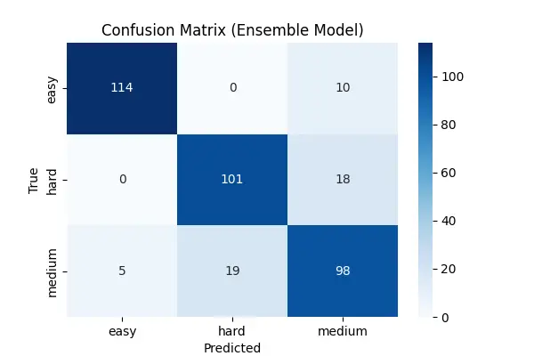
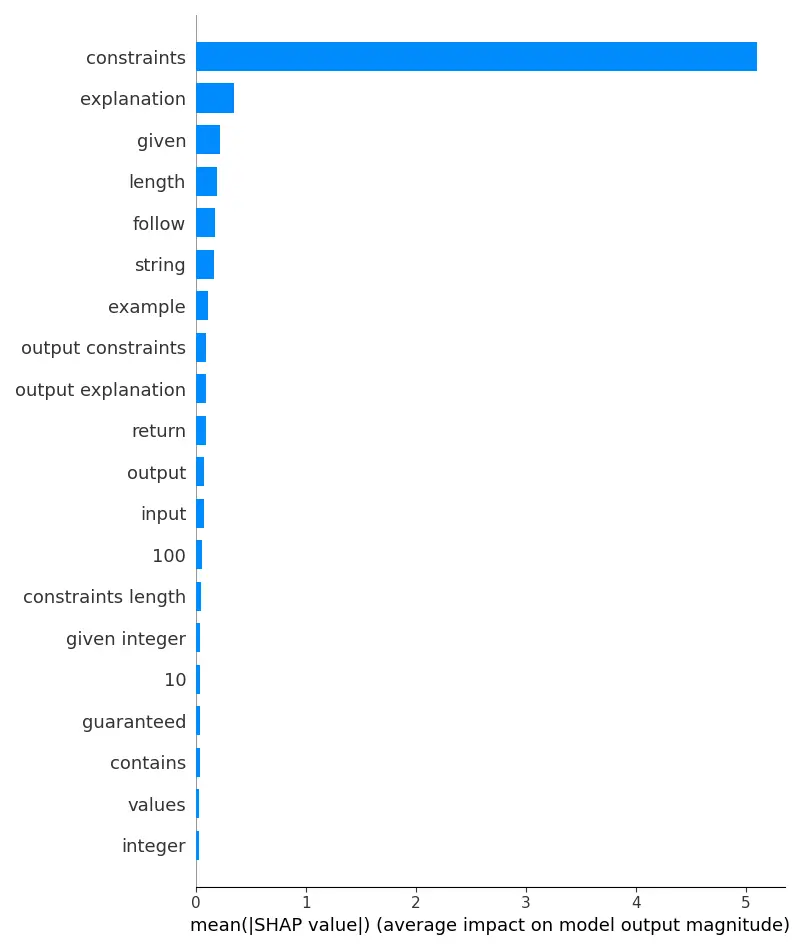

# Toward Trustworthy Difficulty Assessments: Large Language Models as Judges in Programming and Synthetic Tasks

H.M. Shadman Tabib^(\*)    Jaber Ahmed Deedar^(\*)
Affiliation: Department of Computer Science, Bangladesh University of
Engineering and Technology Email: [shadmantabib2002@gmail.com](mailto:)

###### Abstract

Large Language Models (LLMs) have demonstrated impressive capabilities
in natural language and code generation, and are increasingly deployed
as _automatic judges_ of model outputs and learning activities. Yet,
their behavior on structured tasks such as predicting the difficulty of
competitive programming problems remains under-explored. We conduct a
systematic comparison of GPT-4o, used purely as a natural-language
difficulty assessor, against an interpretable LightGBM ensemble trained
on explicit numeric and textual features. On a dataset of 1,825 LeetCode
problems labeled Easy, Medium, or Hard, LightGBM attains 86% accuracy,
whereas GPT-4o reaches only 37.75%. Detailed analyses, including
confusion matrices and SHAP-based interpretability, show that numeric
constraints—such as input size limits and acceptance rates—play a
crucial role in separating Hard problems from easier ones. By contrast,
GPT-4o often overlooks these cues and exhibits a strong bias toward
simpler categories. We further probe GPT-4o through a synthetic
Hard-problem generation protocol. Surprisingly, GPT-4o labels almost all
of its own synthetic Hard problems as Medium, contradicting its tendency
to downgrade real Hard problems to Easy. Our findings connect to recent
work on LLMs-as-judges and automatic difficulty estimation in
programming and education, and highlight concrete failure modes that
must be addressed before LLM-based judges can be considered trustworthy
in competitive programming, educational platforms, or
reinforcement-learning pipelines.

|     |
| --- |
|     |

## 1 Introduction

Large Language Models (LLMs), such as GPT-4-class models, are now
central to many AI-driven applications in code generation, tutoring, and
evaluation. LLMs trained on code and natural language can already solve
non-trivial programming tasks (Chen et al., 2021; Li et al., 2022), and
the emerging _LLMs-as-judges_ paradigm proposes to use them as automatic
evaluators of model outputs, student answers, or even entire interactive
pipelines (Li et al., 2024; Bavaresco et al., 2025; Seo et al., 2025).
These developments build on a broader ecosystem of alignment and reward
modeling methods, where learning from human feedback plays a crucial
role (Christiano et al., 2017) and where language-based rationalizations
are increasingly studied (Narang et al., 2020).

Competitive programming, however, poses a particularly challenging
setting. Hard problems on platforms like LeetCode and Codeforces are
designed to test deep algorithmic reasoning, sophisticated data
structures, and careful handling of numeric constraints such as input
sizes, time limits, and adversarial edge cases. Systems like AlphaCode
and AlphaCode 2 illustrate that achieving competitive-level performance
requires large-scale sampling and careful behavioral filtering, even for
powerful transformer models (Li et al., 2022; AlphaCode Team, 2023).
Prior work in automatic difficulty estimation has shown that a mixture
of content features and behavioral statistics can predict problem
difficulty reasonably well (Zhao et al., 2018; Effenberger et al., 2019;
Skarbalius and Lukosevicius, 2021; Wang et al., 2024), and that even
simple complexity measures (e.g., input sizes, branching structure)
often correlate with perceived difficulty (Effenberger et al., 2019;
AlKhuzaey et al., 2024).

In this work we ask: _Can a state-of-the-art LLM, used as a black-box
text-only judge, faithfully reproduce the Easy/Medium/Hard labels of
competitive programming problems?_ We study GPT-4o’s behavior on a
curated dataset of 1,825 LeetCode problems and compare it to an
interpretable LightGBM ensemble (Ke et al., 2017) that explicitly
leverages numeric metadata (constraints, acceptance rates) alongside
TF–IDF features. We then probe GPT-4o in a synthetic regime, where it is
asked to generate and then self-label new Hard problems.

Our contributions are threefold:

1.  1.  We provide a detailed comparison of GPT-4o and an interpretable
        gradient-boosted ensemble on LeetCode-style difficulty prediction,
        showing that the LLM underperforms a classical model by a large
        margin and exhibits strong bias toward easier labels.
2.  2.  Through SHAP-based analysis (Lundberg and Lee, 2017), we show that
        numeric constraints dominate the LightGBM ensemble’s decision
        boundary for Hard problems, whereas GPT-4o appears to underweight or
        ignore such information.
3.  3.  We reveal an inconsistency in GPT-4o’s internal notion of “Hard”
        difficulty: real Hard problems are frequently downgraded to Easy,
        while self-generated Hard problems are almost uniformly labeled
        Medium. We situate these findings within the growing literature on
        LLMs-as-judges (Li et al., 2024; Bavaresco et al., 2025; Seo et al.,
    2025) and automatic difficulty estimation (Intisar and Watanobe,
          2018; Skarbalius and Lukosevicius, 2021; Wang et al., 2024).

## 2 Related Work

### 2.1 LLMs as Judges and Automatic Evaluators

The idea of using LLMs as _judges_—that is, as automatic evaluators of
texts, answers, or model outputs—has rapidly gained traction. The survey
of Li et al. (2024) provides a comprehensive taxonomy of LLM-based
evaluation methods, covering functionality, methodology, applications,
and limitations, and documents widespread adoption in summarization,
dialogue, and generation benchmarks. Recent empirical work has raised
concerns about reliability and bias: Bavaresco et al. (2025) introduce
JUDGE-BENCH and show that LLMs’ agreement with human annotations varies
widely across tasks and models, while Seo et al. (2025) systematically
assess LLM-based evaluators in education and highlight inconsistencies
in feedback accuracy and stability over time.

Beyond general-purpose evaluation, several studies investigate
LLM-as-judge pipelines in specific domains, such as search and ranking
or mathematical coherence in narratives (Baysan et al., 2025; Keith,
2025). These works underscore a key tension: LLM-based judges are
attractive because they are flexible and cheap to deploy, but their
biases and failure modes may be very different from those of human
experts. Our work contributes to this line by examining a _structured_
domain—competitive programming difficulty—where numeric constraints and
algorithmic structure matter strongly, and where mis-calibrated
judgments have tangible downstream consequences.

### 2.2 LLMs, Code Generation, and Competitive Programming

LLMs trained on large corpora of source code have achieved strong
performance on many programming benchmarks. Chen et al. (2021)
introduced Codex, demonstrating substantial gains on HumanEval and other
code synthesis tasks. Since then, surveys and engineering reports have
documented the capabilities and limitations of modern code LLMs (Jiang
et al., 2024; Idrisov and Schlippe, 2024). For competitive programming
specifically, AlphaCode (Li et al., 2022) achieved an average ranking in
the top 54.3% of human participants on Codeforces contests, while the
AlphaCode 2 technical report (AlphaCode Team, 2023) shows further gains
powered by larger models and extensive sampling and filtering.

These systems, however, are primarily evaluated on _solution quality_,
not on their ability to _judge_ problem difficulty. In programming
education, difficulty is known to interact with learner behavior and
cognitive load (Wang et al., 2023), and recent work has started to ask
whether LLMs can serve as proxies for human item- or puzzle-difficulty
judgments (Kreveld et al., 2015). Our study focuses specifically on
difficulty labels (Easy/Medium/Hard) in a LeetCode-like setting, and
compares LLM-based judgments against an interpretable,
numeric-feature-aware model.

### 2.3 Automatic Difficulty Estimation in Programming and Education

There is a substantial body of work on estimating difficulty for
educational questions, puzzles, and programming exercises. In text-based
question difficulty prediction, AlKhuzaey et al. (2024) survey automatic
approaches and highlight the role of linguistic and structural features.
For programming, prior work has used topic models and performance data
from online judges to infer difficulty levels and latent topics (Zhao
et al., 2018; Yera and Martinez, 2017). Intisar and Watanobe (2018) use
cluster analysis to group programming problems by difficulty, while
Effenberger et al. (2019) and follow-up work (Pelanek, 2020) analyze the
relationship between complexity measures and difficulty in introductory
programming tasks.

More recently, neural approaches have emerged. Skarbalius and
Lukosevicius (2021) propose an automatic programming problem difficulty
evaluator based on text classification, and Wang et al. (2024) introduce
a multimodal difficulty model that combines textual descriptions with
example solutions via pre-trained language models. These methods
generally treat difficulty estimation as a supervised or semi-supervised
learning problem over carefully engineered feature spaces.

Our work aligns with this literature but differs in two ways: (i) we
explicitly contrast an interpretable gradient-boosted ensemble with a
black-box LLM judge, and (ii) we explore not only real problems but also
synthetic Hard problems generated by the LLM itself, revealing a
previously undocumented inconsistency in its internal difficulty
boundary.

### 2.4 Interpretable Machine Learning for Trustworthy Judges

Interpretable models such as gradient-boosted decision trees have long
been favored in settings where transparency is crucial. LightGBM (Ke
et al., 2017) provides a highly efficient implementation of gradient
boosting, and in combination with post-hoc explanation techniques like
SHAP (Lundberg and Lee, 2017), it enables fine-grained analysis of
feature contributions at both global and local levels. Parallel efforts
in NLP have explored models that generate natural-language rationales
alongside predictions (Narang et al., 2020), but such explanations are
not guaranteed to faithfully reflect the underlying decision process.

In our setting, we treat the LightGBM ensemble as a structured baseline
whose decision-making can be audited via SHAP, and contrast it with the
opaque behavior of GPT-4o. Our findings suggest that even a relatively
simple model with transparent feature attributions can provide a more
trustworthy difficulty signal than a state-of-the-art LLM judge that
ignores numeric constraints.

## 3 Methodology

### 3.1 Dataset and Labeling

We use a dataset of 1,825 LeetCode problems, each labeled by the
platform as Easy, Medium, or Hard. For each problem we collect the full
English description and two categories of metadata:

- •
  Textual features: TF–IDF vectors over unigrams and bigrams extracted
  from the problem statement, following common practice in text-based
  difficulty prediction (Zhao et al., 2018; AlKhuzaey et al., 2024).
- •
  Numeric features: scalar indicators including maximum input size,
  expected time and space complexity (when documented), and acceptance
  rate. Prior work has shown that such structural and performance-based
  features are highly predictive of perceived difficulty (Effenberger
  et al., 2019; Skarbalius and Lukosevicius, 2021; Wang et al., 2024).

GPT-4o receives only the textual problem descriptions, with all numeric
metadata (e.g., explicit constraints table, acceptance rate) removed or
paraphrased away so that they cannot be trivially parsed as numbers.
This configuration isolates the model’s ability to infer difficulty from
natural language alone. In contrast, the LightGBM ensemble ingests both
the TF–IDF features and the numeric indicators. We split the data into
training, validation, and held-out test sets and evaluate both models
using accuracy, macro-precision, macro-recall, and macro F1-score.

### 3.2 LLM Prompting and Labeling Protocol

GPT-4o is prompted with a standardized instruction: given a problem
description, it must assign one of three labels {Easy, Medium, Hard}
that best reflects the typical experience of an upper-intermediate
competitive programmer on LeetCode. To reduce prompt sensitivity, we
manually tune a small set of prompt variants and fix the best-performing
one on a validation subset. For the main experiments, each problem is
labeled once, without self-consistency sampling or chain-of-thought
prompting, mirroring common usage in LLM-as-judge setups (Li et al.,
2024; Bavaresco et al., 2025).

We log the raw distribution of GPT-4o labels across the three classes,
as well as per-class confusion against the ground-truth LeetCode
difficulty. This allows us to quantify class-wise biases (e.g., a strong
preference for Medium) in addition to overall accuracy.

### 3.3 LightGBM Ensemble and Interpretability

Our structured baseline is a LightGBM ensemble classifier (Ke et al., 2017) trained on the combined textual and numeric features. We perform
hyperparameter tuning via grid search on the validation set, optimizing
for macro F1-score. Once trained, we compute SHAP values (Lundberg and
Lee, 2017) to assess the relative importance of each feature, focusing
particularly on (i) input size constraints and (ii) acceptance rate.

We then visualize global feature importance (mean absolute SHAP values)
as well as class-specific SHAP summaries, examining how high values of
constraint-related features shift the log-odds toward the Hard label.
This analysis provides a contrastive explanation for why the LightGBM
ensemble can robustly distinguish Hard problems, while GPT-4o
systematically fails to do so.

### 3.4 Synthetic Hard Problem Generation

To probe GPT-4o’s internal notion of “Hard,” we design a two-stage
synthetic experiment. First, we select 21 representative Hard problems
from the original dataset, chosen to span different algorithmic themes
(e.g., graph algorithms, dynamic programming, advanced data structures).
For each seed title, we prompt GPT-4o to generate a new Hard problem
that:

1.  1.  Maintains the original algorithmic core (e.g., remains a graph
        shortest-path problem),
2.  2.  Introduces large input sizes and tight constraints comparable to
        typical Hard problems,
3.  3.  And includes a short solution sketch with the expected time and
        space complexity.

This yields 385 synthetic problems, each with an associated
GPT-4o-generated label. We then remove any explicit meta-commentary
about difficulty and re-prompt GPT-4o to _re-classify_ each synthetic
problem using the same judgment protocol as for the real dataset. This
self-judgment step mirrors recent work that uses LLMs both to generate
and to evaluate content in educational and assessment settings (Seo
et al., 2025; Ji et al., 2025).

## 4 Results

### 4.1 Overall Performance

Table 1 summarizes the performance of GPT-4o and the LightGBM ensemble
on the original dataset of 1,825 problems. GPT-4o attains a meager
37.75% accuracy, while LightGBM achieves 86%. Macro F1-score exhibits a
similar gap. Most misclassifications by GPT-4o involve Hard problems
being labeled as Medium or Easy, confirming the label distribution
analysis below.

| Model             | Accuracy | Precision | Recall | F1-Score |
| ----------------- | -------- | --------- | ------ | -------- |
| GPT-4o            | 37.75%   | 40.9%     | 31.5%  | 35.6%    |
| LightGBM Ensemble | 86.0%    | 85.2%     | 82.4%  | 83.7%    |

Table 1: Performance comparison on the original dataset (1,825
problems). Macro-averaged precision, recall, and F1-score are reported
over the three difficulty classes.

### 4.2 LLM Labeling Distributions

Beyond aggregated metrics, we inspect GPT-4o’s raw label distribution.
Among the 385 real Hard problems in the dataset, GPT-4o outputs:

- •
  321 problems (83.38%) as Easy,
- •
  43 problems (11.17%) as Medium,
- •
  21 problems (5.45%) as Hard.

Thus, GPT-4o overwhelmingly _downgrades_ Hard problems, often directly
to Easy. This contrasts with observations that LLMs as judges can
sometimes be overly lenient or overly harsh in other domains (Li et al.,
2024; Bavaresco et al., 2025); here, the bias is highly asymmetric in
the direction of underestimating difficulty.

### 4.3 Confusion Matrix Analysis for LightGBM

Figure 1 shows the confusion matrix for the trained LightGBM ensemble.
The model accurately classifies the majority of Hard problems, with
relatively few misclassifications into Medium and very few into Easy.
The Easy and Medium classes are also well separated, with confusion
concentrated near problems that intuitively feel “borderline” between
two levels.

Figure 1: Confusion matrix for the LightGBM ensemble on the original
dataset, illustrating strong discrimination among Easy, Medium, and Hard
problems.

This pattern indicates that the numeric and structural features are
highly informative and that the ensemble can exploit them to build a
robust decision boundary. In particular, Hard problems often involve
stricter time constraints and lower acceptance rates, consistent with
prior findings that complexity and performance indicators correlate with
experienced difficulty (Effenberger et al., 2019; Wang et al., 2024).

### 4.4 Feature Importance via SHAP

To understand why LightGBM succeeds where GPT-4o fails, we examine
global SHAP feature importance for the ensemble. Figure 2 reports the
mean absolute SHAP value per feature. Numeric constraints—especially
maximum input size and acceptance rate—are among the most influential
features for classifying Hard problems. The SHAP value distributions
show that:

- •
  Larger input size limits consistently push predictions toward the Hard
  class.
- •
  Lower acceptance rates (i.e., fewer successful submissions) are
  strongly associated with Hard labels.
- •
  Certain TF–IDF features corresponding to algorithmic keywords (e.g.,
  “segment tree”, “max flow”) also contribute, but less strongly than
  the numeric constraints.

Figure 2: Global SHAP bar plot indicating that constraint-related
features (e.g., maximum input size, acceptance rate) dominate LightGBM’s
classification of Hard tasks.

These findings align with general observations that SHAP can reveal
meaningful feature attributions in tree-based models (Lundberg and Lee,
2017). In our context, they highlight a discrepancy: the numeric cues
that LightGBM relies on heavily are either removed or implicitly
described in the GPT-4o prompts, and the LLM does not reconstruct them
accurately from the remaining text.

### 4.5 Synthetic Hard Problem Generation

We now turn to the synthetic setting. GPT-4o is instructed to generate
385 new Hard problems based on 21 seed Hard titles, each accompanied by
a short solution sketch and explicit constraints. When asked to label
these problems:

- •
  384 problems (99.74%) are labeled as Medium,
- •
  1 problem (0.26%) is labeled as Hard,
- •
  0 problems are labeled as Easy.

Thus, GPT-4o’s self-generated problems, written under explicit Hard
instructions and with constraints that it itself declares as large, are
nearly always classified as Medium. This behavior contradicts its
pattern on real Hard problems, which are mostly labeled as Easy. The
resulting picture is that GPT-4o’s internal boundary between Easy,
Medium, and Hard is not only misaligned with LeetCode’s ground truth,
but also _unstable_ across real and synthetic domains.

Such instability echoes broader concerns from the LLM-as-judge
literature, where calibration and robustness of judgments across
datasets and task formulations are known challenges (Li et al., 2024;
Bavaresco et al., 2025). Here, we see a concrete manifestation in the
context of difficulty assessment for competitive programming.

## 5 Discussion

Our experiments expose two intertwined issues in GPT-4o’s difficulty
judgments.

#### Systematic underestimation of real Hard problems.

The extreme downgrading of real Hard problems (83% labeled Easy)
suggests that GPT-4o’s semantic understanding of problem text is
insufficient to capture the algorithmic and numeric nuances that define
Hard difficulties. Prior work on difficulty estimation (Zhao et al.,
2018; Effenberger et al., 2019; Skarbalius and Lukosevicius, 2021; Wang
et al., 2024) emphasizes that structural complexity and performance
statistics are critical, and our SHAP analysis confirms that numeric
constraint features drive LightGBM’s success. GPT-4o, deprived of
explicit numeric metadata, appears to treat many Hard problems as
ordinary variants of medium-level algorithmic exercises.

#### Synthetic Hard problems collapse into Medium.

In contrast, GPT-4o-generated Hard problems are almost universally
classified as Medium when judged by the same model. This behavior hints
that the model’s notion of a “Hard” label is anchored to a narrow subset
of textual cues that it rarely emits even when instructed, and that
these cues differ qualitatively from the structure of real Hard
problems. The phenomenon resembles discrepancies between LLM-generated
content and authentic human data in other evaluation settings (Bavaresco
et al., 2025; Li et al., 2024). It also raises questions about the use
of synthetic Hard problems in training or evaluating difficulty-aware
systems: if the synthetic tasks lack the stringent constraints typical
of real Hard problems, they may systematically underestimate the true
difficulty distribution.

#### Implications for educational platforms and RL pipelines.

For educational platforms and online judges, mis-calibrated difficulty
labels can distort learners’ experience and progression. A problem
labeled Easy but felt as Hard may discourage novices, while a genuinely
Hard problem mislabeled as Medium can create frustration and
misrepresent mastery. Recent studies on using LLMs to evaluate and
provide feedback in education (Seo et al., 2025; Woodrow et al., 2025)
highlight both the promise and the risks of delegating evaluation to
black-box models. Our results suggest that, at least for competitive
programming difficulty, relying solely on LLM judgments is not
advisable.

Similarly, in reinforcement learning from human feedback and related
alignment frameworks (Christiano et al., 2017), difficulty-aware reward
models are sometimes proposed to scale up training and curriculum
design. If LLMs are used as proxies for judges in such pipelines, the
type of misalignment we observe here could bias reward signals and
hinder learning progress.

#### The value of interpretable numeric models.

Our LightGBM baseline, though relatively simple, offers a counterpoint:
its decisions are both accurate and interpretable. SHAP analysis reveals
that intuitive features—input sizes and acceptance rates—drive the Hard
classification, providing a transparent rationale. This suggests a
promising hybrid strategy: use LLMs to enrich textual representations
and generate candidate features, but rely on interpretable numeric
models to anchor difficulty judgments in measurable constraints. This is
consistent with broader calls for hybrid, human-aligned evaluation
systems (Li et al., 2024; AlKhuzaey et al., 2024).

## 6 Conclusion and Future Work

We investigated GPT-4o as a difficulty judge for LeetCode-style
programming problems and found major discrepancies between its judgments
and those of an interpretable LightGBM ensemble trained on numeric and
textual features. GPT-4o drastically underestimates real Hard problems,
frequently labeling them as Easy, while its own synthetic Hard problems
are almost always classified as Medium. In contrast, LightGBM, supported
by SHAP-based interpretability, shows robust performance and highlights
the primacy of numeric constraints in defining Hard difficulty.

Our findings contribute to the growing literature on LLMs-as-judges by
providing a case study in a highly structured domain, and suggest
several avenues for future work:

- •
  Constraint-aware prompting. We plan to explore prompts that explicitly
  foreground numeric details, including structured tables of
  constraints, to test whether GPT-4o can more reliably internalize and
  use them for difficulty assessment.
- •
  Hybrid models. Building on recent multimodal difficulty models (Wang
  et al., 2024), we aim to combine LLM-derived embeddings of problem
  text and solution code with interpretable numeric features,
  potentially using LightGBM or related tree ensembles as the final
  judge.
- •
  Meta-evaluation protocols. Inspired by work on meta-evaluating LLM
  judges (Li et al., 2024; Bavaresco et al., 2025), we seek to design
  benchmark suites and agreement metrics specifically tailored to
  difficulty assessment, including human studies on perceived difficulty
  and fairness.

By bridging the gap between text-based reasoning and robust numeric
analysis, we hope to pave the way toward trustworthy AI judges for
competitive programming and beyond.

## References

- AlKhuzaey et al. (2024) S. AlKhuzaey, F. Grasso, T. R. Payne, and
  V. Tamma. Text-based question difficulty prediction: A systematic
  review of automatic approaches. _International Journal of Artificial
  Intelligence in Education_, 34:862–914, 2024.
- AlphaCode Team (2023) AlphaCode Team. AlphaCode 2 technical report.
  Technical report, Google DeepMind, 2023. Available at
  [https://storage.googleapis.com/deepmind-media/AlphaCode2/AlphaCode2_Tech_Report.pdf](https://storage.googleapis.com/deepmind-media/AlphaCode2/AlphaCode2_Tech_Report.pdf).
- Bavaresco et al. (2025) A. Bavaresco et al. LLMs instead of human
  judges? A large-scale empirical study across 20 NLP evaluation tasks.
  In _Proceedings of the 63rd Annual Meeting of the Association for
  Computational Linguistics (Volume 2: Short Papers)_, 2025.
- Baysan et al. (2025) M. S. Baysan et al. LLM-as-a-judge: Automated
  evaluation of search query understanding and ranking. _Frontiers in
  Big Data_, 8, 2025.
- Chen et al. (2021) M. Chen et al. Evaluating large language models
  trained on code. _arXiv preprint arXiv:2107.03374_, 2021.
- Christiano et al. (2017) P. F. Christiano, J. Leike, T. Brown,
  M. Martic, S. Legg, and D. Amodei. Deep reinforcement learning from
  human preferences. In _Advances in Neural Information Processing
  Systems_, 30, 2017.
- Effenberger et al. (2019) T. Effenberger, J. Cechak, and R. Pelanek.
  Difficulty and complexity of introductory programming problems. In
  _Educational Data Mining in Computer Science Education (CSEDM)
  Workshop_, 2019.
- Idrisov and Schlippe (2024) B. Idrisov and T. Schlippe. Program code
  generation with generative AIs. _Algorithms_, 17(2):62, 2024.
- Intisar and Watanobe (2018) C. M. Intisar and Y. Watanobe. Cluster
  analysis to estimate the difficulty of programming problems. In
  _Proceedings of the 3rd International Conference on Applications in
  Information Technology (ICAIT)_, pages 23–28, 2018.
- Ji et al. (2025) H. Maeda et al. Field-testing multiple-choice
  questions with AI examinees. _Educational and Psychological
  Measurement_, 2025. Advance online publication.
- Jiang et al. (2024) J. Jiang et al. A survey on large language models
  for code generation. _ACM Computing Surveys_, 2024. To appear.
- Keith (2025) B. Keith. LLM-as-a-judge approaches as proxies for
  mathematical coherence in narrative extraction. _Electronics_,
  14(13):2735, 2025.
- Ke et al. (2017) G. Ke, Q. Meng, T. Finley, T. Wang, W. Chen, W. Ma,
  Q. Ye, and T.-Y. Liu. LightGBM: A highly efficient gradient boosting
  decision tree. In _Advances in Neural Information Processing Systems_,
  30, 2017.
- Kreveld et al. (2015) M. van Kreveld et al. Automated puzzle
  difficulty estimation. Technical report, Utrecht University, 2015.
- Li et al. (2022) Y. Li et al. Competition-level code generation with
  AlphaCode. _Science_, 378(6624):1092–1097, 2022.
- Li et al. (2024) H. Li, Q. Dong, J. Chen, H. Su, Y. Zhou, Q. Ai,
  Z. Ye, and Y. Liu. LLMs-as-judges: A comprehensive survey on LLM-based
  evaluation methods. _arXiv preprint arXiv:2412.05579_, 2024.
- Lundberg and Lee (2017) S. M. Lundberg and S.-I. Lee. A unified
  approach to interpreting model predictions. In _Advances in Neural
  Information Processing Systems_, 30, pages 4765–4774, 2017.
- Narang et al. (2020) S. Narang, C. Raffel, K. Lee, A. Roberts,
  N. Fiedel, and K. Malkan. WT5?! Training text-to-text models to
  explain their predictions. In _Findings of the Association for
  Computational Linguistics: EMNLP 2020_, 2020.
- Pelanek (2020) R. Pelanek. A classification framework for practice
  exercises in adaptive learning systems. _IEEE Transactions on Learning
  Technologies_, 13(2):188–199, 2020.
- Seo et al. (2025) H. Seo, T. Hwang, J. Jung, H. Kang, H. Namgoong,
  Y. Lee, and S. Jung. Large language models as evaluators in education:
  Verification of feedback consistency and accuracy. _Applied Sciences_,
  15(2):671, 2025.
- Skarbalius and Lukosevicius (2021) A. Skarbalius and M. Lukosevicius.
  Automatic programming problem difficulty evaluation – first results.
  In _Information and Software Technologies (ICIST 2021)_, pages
  150–159. Springer, 2021.
- Wang et al. (2023) J. Wang et al. How problem difficulty and order
  influence programming performance in online judge systems. _Heliyon_,
  9:e16704, 2023.
- Wang et al. (2024) Z. Wang, W. Zhang, and J. Wang. Estimating
  difficulty levels of programming problems with pre-trained model.
  _arXiv preprint arXiv:2406.08828_, 2024.
- Woodrow et al. (2025) J. Woodrow et al. Direct preference optimization
  with teachers in the loop. In _Proceedings of the 18th International
  Conference on Educational Data Mining (EDM)_, 2025.
- Yera and Martinez (2017) R. Yera and L. Martinez. A recommendation
  approach for programming online judges supported by data preprocessing
  techniques. _Applied Intelligence_, 47(2):277–290, 2017.
- Zhao et al. (2018) W. Zhao et al. Automatically learning topics and
  difficulty levels of problems in online judge systems. _ACM
  Transactions on Information Systems_, 36(3):27, 2018.
