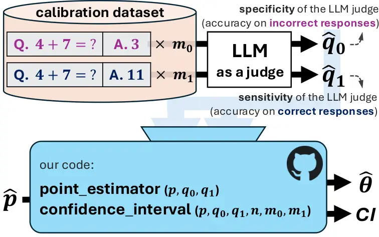
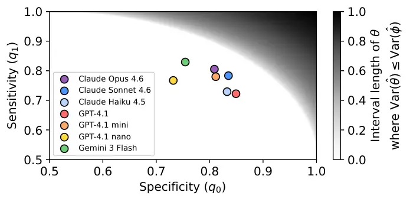
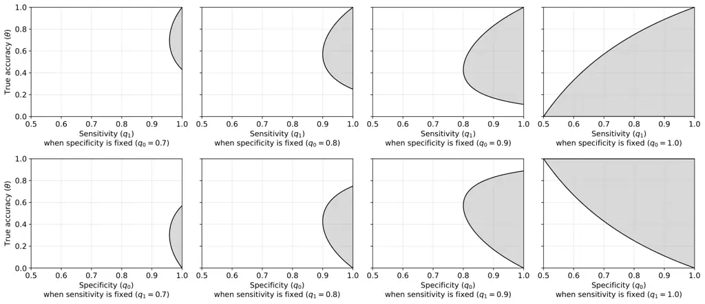
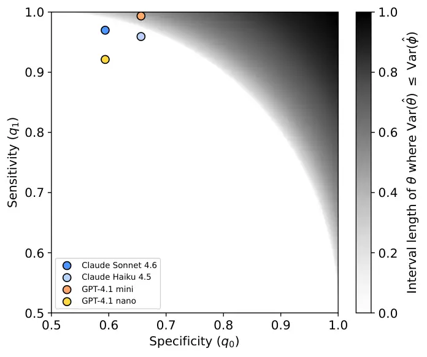

# How to _Correctly_ Report LLM-as-a-Judge Evaluations

Chungpa Lee^($`\dagger`$) Affiliation: Yonsei University, Korea   
Thomas Zeng Affiliation: University of Wisconsin–Madison, USA    Jongwon
Jeong Affiliation: University of Wisconsin–Madison, USA    Jy-yong Sohn
Affiliation: Yonsei University, Korea Correspondence to:
<jysohn1108@yonsei.ac.kr>    Kangwook Lee Affiliation: University of
Wisconsin–Madison, USA Affiliation: KRAFTON, Korea Affiliation: Ludo
Robotics, Korea Correspondence to: <kangwooklee@krafton.com>

###### Abstract

Large language models (LLMs) are widely used as scalable evaluators of
model responses in lieu of human annotators. However, imperfect
sensitivity and specificity of the LLM judges induce bias in naive
evaluation scores. We propose a simple plug-in framework that corrects
this bias and enables statistically principled uncertainty
quantification. Our framework constructs confidence intervals that
account for uncertainty from both the test dataset and a human-labeled
calibration dataset. Additionally, it uses an adaptive strategy to
allocate calibration samples for tighter intervals. Importantly, we
characterize parameter regimes defined by the true evaluation score and
the LLM judge’s sensitivity and specificity in which our LLM-based
evaluation yields more reliable estimates than human-only evaluation.
Moreover, we show that our framework remains unbiased under distribution
shift between the test and calibration datasets, in contrast to existing
approaches.

###### Keywords: 

LLM, evaluation, LLM-as-a-judge, bias, correction, confidence interval,
calibration, unbiased estimation, statistical inference

^(†)^(†)affiliationnotice: ^($`\dagger`$)Work done while visiting the
University of Wisconsin–Madison.

## 1 Introduction

The use of large language models (LLMs) as judges has become a low-cost
and scalable alternative to human evaluation across various tasks (Zheng
et al., 2023; Liu et al., 2023; Wang et al., 2023; Li et al., 2025; Gu
et al., 2024). A common practice is to summarize such evaluations by the
fraction of responses that the LLM judges as _‘correct’_, denoted by
$`\hat{p}`$. However, this seemingly simple reporting practice is
statistically problematic (Bross, 1954; Schwartz, 1985; Forman, 2005;
Angelopoulos et al., 2023a; Boyeau et al., 2025; Fraser, 2024; Albinet,
2025). Because LLM judgments are noisy, the raw score $`\hat{p}`$
generally differs from the true accuracy and can lead to unreliable
conclusions (Wang et al., 2024; Koo et al., 2024; Huang et al., 2025).


Figure 1: LLM judgments with error rates $`1-q_{1}`$ and $`1-q_{0}`$,
where $`q_{1}`$ and $`q_{0}`$ are the LLM’s sensitivity and specificity,
respectively.

To understand the source of bias in the raw judgment score $`\hat{p}`$,
we first examine how an LLM judge can make errors on individual
responses. As illustrated in Figure 1, an LLM may incorrectly label an
_‘incorrect’_ response as _‘correct’_, or conversely, mislabel a
_‘correct’_ response as _‘incorrect’_. Let $`q_{1}`$ and $`q_{0}`$
denote the probabilities that the LLM correctly judges _‘correct’_ and
_‘incorrect’_ responses, respectively. These quantities correspond to
the sensitivity $`q_{1}`$ and specificity $`q_{0}`$ of the LLM judge.

(a) Raw LLM-based estimator $`\hat{p}`$



(b) Our bias-correction method

(c) Bias-corrected estimator $`\hat{\theta}`$

Figure 2: Bias and its adjustment in LLM-based judgment under imperfect
LLM evaluators ($`1-q_{0}=0.3`$ and $`1-q_{1}=0.1`$). (a) When the true
accuracy $`\theta`$ is low ($`\theta<0.75`$), the expected value of the
raw LLM-based estimator $`\mathbb{E}[\hat{p}]`$ overestimates
$`\theta`$, whereas when $`\theta`$ is high ($`\theta>0.75`$), it
underestimates $`\theta`$. (b) By accounting for the LLM judge’s
sensitivity $`q_{1}`$ and specificity $`q_{0}`$, we obtain the
bias-corrected estimator $`\hat{\theta}`$ and its confidence
interval (CI). We estimate $`q_{1}`$ and $`q_{0}`$ using a calibration
dataset with true labels from human evaluators paired with LLM
judgments. Here, $`n`$, $`m_{0}`$, and $`m_{1}`$ denote the test-set
size, the number of calibration samples whose true label is incorrect
(e.g., $`4+7=3`$), and the number of calibration samples whose true
label is correct (e.g., $`4+7=11`$), respectively. (c) The resulting
estimator $`\hat{\theta}`$ is unbiased when the true values of $`q_{0}`$
and $`q_{1}`$ are known, or when a sufficiently large calibration
dataset is available. A plug-in Python implementation of this procedure
is provided at
[https://github.com/UW-Madison-Lee-Lab/LLM-judge-reporting](https://github.com/UW-Madison-Lee-Lab/LLM-judge-reporting).

The bias can be seen even in a simple extreme case. Suppose that
$`q_{1}=1`$ and $`q_{0}=0`$. Then the LLM judges every response as
_‘correct’_, so the raw LLM judgment score satisfies $`\hat{p}=1`$
regardless of the true accuracy $`\theta`$.

In general, whenever the LLM is imperfect ($`q_{0}+q_{1}<2`$), the
expected value of $`\hat{p}`$ deviates from the true accuracy
$`\theta`$:

```math
\displaystyle\displaystyle\mathbb{E}[\hat{p}]=\theta+(1-q_{0}+1-q_{1})\big(\tfrac{1-q_{0}}{1-q_{0}+1-q_{1}}-\theta\big). \tag{1}
```

This expression shows that $`\hat{p}`$ has positive bias at low values
of $`\theta`$ and negative bias at high values of $`\theta`$; see
Section 5 for details. Figure 2(a) illustrates this behavior for an LLM
judge with $`1-q_{0}=0.3`$ and $`1-q_{1}=0.1`$. In this case,
$`\displaystyle\mathbb{E}[\hat{p}]`$ overestimates $`\theta`$ when
$`\theta<0.75`$ (blue line) and underestimates it when $`\theta>0.75`$
(red line). These two directions of bias arise from the two types of
judgment errors (green arrows). A high probability of incorrectly
rejecting a _‘correct’_ response, corresponding to a large $`1-q_{1}`$,
induces negative bias at high accuracies. Conversely, a high probability
of incorrectly accepting an _‘incorrect’_ response, corresponding to a
large $`1-q_{0}`$, induces positive bias at low accuracies.

This issue is not merely theoretical. As LLM-based evaluation becomes
more widely used, reported improvements may reflect bias from judgment
errors rather than genuine model gains. Since different evaluation
procedures can induce biases of different magnitudes and directions,
some apparent advances may arise from evaluation artifacts. This
motivates careful comparison of LLM-based evaluation results and
highlights the need for bias adjustment.

Fortunately, this bias can be corrected. When $`q_{1}`$ and $`q_{0}`$
are known, a classical result (Rogan and Gladen, 1978) provides an exact
adjustment. When they are unknown, they can be estimated from a
calibration dataset with human-evaluated labels, and the resulting
estimates $`\hat{q}_{1}`$ and $`\hat{q}_{0}`$ can be substituted into
the correction formula. This leads to the bias-corrected estimator
$`\hat{\theta}`$ illustrated in Figure 2(c).

More broadly, several bias-correction methods have been studied for
imperfect evaluators. In particular, prediction-powered
inference (Angelopoulos et al., 2023a; Angelopoulos et al., 2023b)
provides a general framework that extends beyond categorical outcomes
and can yield estimators with lower variance; see also Kloos et al.
(2021); Chen et al. (2026). However, we show that existing methods can
become biased under distribution shift between the test and calibration
datasets, a setting that can arise in LLM-as-a-judge evaluation (Jung et
al., 2024). In contrast, the estimator $`\hat{\theta}`$ based on Rogan
and Gladen (1978) remains unbiased under such shifts. We therefore adopt
this estimator and focus our analysis on $`\hat{\theta}`$. Since
$`\hat{\theta}`$ can have higher variance than some existing
alternatives, we further propose an adaptive strategy for allocating
calibration samples, which reduces its variance and shortens the
corresponding confidence interval.

In this paper, we provide a statistical framework for correctly
reporting LLM-as-a-judge evaluations, as outlined in Figure 2(b). We
summarize our key contributions below:

- •
  In Section 4, we introduce the bias-corrected estimator for the true
  accuracy $`\theta`$, derive the confidence interval, and further
  propose an adaptive strategy for allocating calibration samples that
  reduces its length. In Section 5, we establish theoretical guarantees
  for our method.
- •
  In Section 6, we characterize parameter regimes defined by $`q_{1}`$,
  $`q_{0}`$, and $`\theta`$ in which our estimator has smaller variance
  than that obtained from human-only evaluation. We also examine where
  contemporary LLM-as-a-judge approaches fall within these regimes.
- •
  In Section 7, we validate our method through extensive Monte Carlo
  simulations and real-world LLM-as-a-judge evaluations on the Chatbot
  Arena benchmark.
- •
  In Section 8, we show that estimators from existing bias-correction
  methods can still be biased under distribution shift between the test
  and calibration datasets, whereas our estimator remains unbiased under
  such shifts.

## 2 Related Work

#### Statistical Reliability in LLMs’ Evaluation.

Recent efforts have sought to formalize the statistical reliability of
language model evaluations. While frameworks for calculating error bars
and confidence intervals in benchmarks exist (Miller, 2024), they assume
that LLM evaluators provide true labels. However, this assumption does
not hold in the LLM-as-a-judge setting, where imperfect judges introduce
bias into LLM-based scores. Recent works have examined these biases
across various contexts, including natural language inference and
test-time compute scaling (Godbole and Jia, 2025; Mukherjee et al.,
2025; Feng et al., 2025). Aligned with this line of work, we propose a
bias-corrected estimator together with statistically sound confidence
intervals.

#### Estimation Methods to Mitigate Bias.

To address bias arising from imperfect evaluators (e.g., diagnostic or
screening tests, or LLM-based judges), Rogan and Gladen (1978) proposed
an adjustment that corrects prevalence estimates when sensitivity and
specificity are known. Subsequent work has developed more general
frameworks, most notably Prediction-Powered Inference (Angelopoulos et
al., 2023a; Angelopoulos et al., 2023b; Zrnic and Candès, 2024; Broska
et al., 2025; Boyeau et al., 2025), which leverages a small set of true
labels to improve estimation, as well as conditional calibration
estimators (Buonaccorsi, 2010; Kloos et al., 2021; Meertens et al.,
2022); see Section 8 for details. While these methods offer distinct
advantages, such as variance reduction (Kloos et al., 2021; Chen et al.,
2026), our approach builds on Rogan and Gladen (1978); Lang and
Reiczigel (2014), adopting distributional assumptions that remain valid
under shifts between the calibration and test datasets and are
particularly well-suited to the LLM-as-a-judge setting.

## 3 Problem Setup: LLM-as-a-Judge

We consider the problem of evaluating responses based on human judgment.
For example, each instance consists of a question and a corresponding
response produced by a given model.¹¹ 1 The model producing the response
may be an LLM, but rule-based or statistical models are also possible.
We focus on binary evaluations, where each response is judged as either
_‘correct’_ or _‘incorrect’_. In Appendix B, we discuss an extension to
evaluations with more than two categories, such as grading or
rating-scale evaluation.

We assume that humans can assess whether a response is _‘correct’_ or
_‘incorrect’_.²² 2 We assume that human disagreement is absent or
resolved by a predefined protocol, and treat human evaluation as the
ground truth. Extensions that explicitly model human disagreement are
discussed as future work in Appendix A. This assessment is formalized by
a ground-truth labeling function $`z:\mathcal{X}\to\{0,1\}`$, where
$`z(x)=1`$ indicates that humans judge the response in instance $`x`$ to
be _‘correct’_, and $`z(x)=0`$ otherwise. Applying the function to a
random instance $`X`$ induces a binary random variable $`Z=z(X)`$.

Our goal is to estimate the true accuracy of the responses with respect
to human judgment, defined as

```math
\displaystyle\theta:=\mathop{\rm Pr}\nolimits(Z=1)=\displaystyle\mathbb{E}[Z]. \tag{2}
```

#### Test Distribution and LLM-Based Judgment.

Let $`{\mathbb{P}}`$ denote the distribution over test instances to be
evaluated. In practice, instead of relying on human annotators, an LLM
$`f_{\mathrm{LLM}}`$ is used as a judge. Let
$`\hat{Z}:=f_{\mathrm{LLM}}(X)\in\{0,1\}`$ denote the LLM’s judgment,
where $`\hat{Z}=1`$ indicates that the LLM marks the response as
_‘correct’_, and $`\hat{Z}=0`$ otherwise.

Let $`[n]:=\{1,\cdots,n\}`$, where $`n`$ denotes the test-set size.
Given a test dataset $`\{x_{i}\}_{i\in[n]}`$ sampled independently and
identically from $`{\mathbb{P}}`$, the LLM produces predictions
$`\hat{z}_{i}:=f_{\mathrm{LLM}}(x_{i})`$. The quantity reported in
practice is the empirical fraction of instances judged as _‘correct’_ by
the LLM:

```math
\displaystyle\hat{p}:=\frac{1}{n}\sum\nolimits_{i\in[n]}\hat{z}_{i}. \tag{3}
```

This estimator targets the probability
$`p:=\mathop{\rm Pr}\nolimits(\hat{Z}=1)`$ that the LLM judges a test
instance as _‘correct’_.

However, the LLM’s judgment $`\hat{Z}`$ does not necessarily coincide
with the human-evaluated true label $`Z`$. We characterize the LLM judge
using the following parameters:

```math
\displaystyle q_{1}:=\mathop{\rm Pr}\nolimits(\hat{Z}=1\!\mid\!Z=1),\;q_{0}:=\mathop{\rm Pr}\nolimits(\hat{Z}=0\!\mid\!Z=0),\;\; \tag{4}
```

which correspond to the _sensitivity_ (true positive rate) and
_specificity_ (true negative rate) of the LLM judge,
respectively (Forman, 2008; Lang and Reiczigel, 2014). Consequently, the
LLM may incorrectly reject responses that are truly _‘correct’_ with
probability $`1-q_{1}`$, or accept responses that are truly
_‘incorrect’_ with probability $`1-q_{0}`$. Unless the LLM is perfectly
accurate (i.e., $`q_{0}=q_{1}=1`$), the naive estimator $`\hat{p}`$
in (3) is generally a biased estimator of $`\theta`$.

#### Calibration Distribution and Estimation of Sensitivity and Specificity.

Let $`{\mathbb{Q}}`$ denote the distribution over calibration instances.
Unlike the test dataset, each calibration instance is evaluated by both
humans and the LLM judge, so that both the true label $`Z`$ and the
corresponding LLM judgment $`\hat{Z}`$ are observable.

Let $`m`$ denote the calibration-set size, and let $`m_{1}`$ and
$`m_{0}`$ denote the numbers of calibration instances with $`z_{j}=1`$
and $`z_{j}=0`$, respectively, so that $`m=m_{0}+m_{1}`$. The index
$`j`$ distinguishes calibration instances from test instances indexed by
$`i`$. Using the calibration dataset, we estimate the sensitivity
$`q_{1}`$ and specificity $`q_{0}`$ of the LLM judge in (4) as

```math
\hat{q}_{1}\!:=\!\!\frac{\sum_{j\in[m]}\!\mathbf{1}\{\hat{z}_{j}=1,z_{j}=1\}}{m_{1}}\!,\;\hat{q}_{0}\!:=\!\!\frac{\sum_{j\in[m]}\!\mathbf{1}\{\hat{z}_{j}=0,z_{j}=0\}}{m_{0}}\!,\!\! \tag{5}
```

where $`\mathbf{1}\{\cdot\}`$ denotes the indicator function. In the
main analysis, we assume $`{\mathbb{P}}={\mathbb{Q}}`$. In Section 8, we
relax this assumption and consider distribution shift, where
$`{\mathbb{P}}\neq{\mathbb{Q}}`$.

#### Problem Statement.

Because the LLM judge is imperfect, the naive estimator $`\hat{p}`$ is
generally biased for the true accuracy $`\theta`$ defined in (2), i.e.,
$`\displaystyle\mathbb{E}[\hat{p}]\neq\theta`$. Moreover, existing
LLM-as-a-judge evaluations typically report this point estimate without
quantifying uncertainty via confidence intervals.

Our objective is therefore twofold: (i) to construct a bias-corrected
estimator of the true accuracy $`\theta`$, and (ii) to provide
statistically sound confidence intervals that reflect uncertainty
arising from both the test and calibration datasets.

## 4 Method to Correctly Report LLM-as-a-Judge Evaluations

In this section, we present a bias-corrected estimator $`\hat{\theta}`$
and a confidence interval for LLM-as-a-judge evaluations. We further
propose an adaptive allocation strategy for constructing the calibration
dataset that reduces the confidence interval length. Derivations and
theoretical guarantees for the proposed method are provided in
Section 5.

### 4.1 Mitigating Bias in Point Estimator

We begin with the setting in which the sensitivity $`q_{1}`$ and
specificity $`q_{0}`$ in (4) are known. In this case, an unbiased
estimator of the true accuracy $`\theta`$ in (2) is given by

```math
\displaystyle\hat{\theta}\,\big|\,q_{0},q_{1}=\frac{\hat{p}+q_{0}-1}{q_{0}+q_{1}-1}. \tag{6}
```

In realistic settings, these parameters $`q_{1}`$ and $`q_{0}`$ are
unknown and must be estimated from a calibration dataset. Substituting
estimates $`\hat{q}_{1}`$ and $`\hat{q}_{0}`$ into (6) gives the
bias-corrected estimator (Rogan and Gladen, 1978; Lang and Reiczigel,
2014):

```math
\displaystyle\boxed{\hat{\theta}=\frac{\hat{p}+\hat{q}_{0}-1}{\hat{q}_{0}+\hat{q}_{1}-1}}. \tag{7}
```

### 4.2 Uncertainty Quantification via Confidence Interval

To quantify uncertainty in $`\hat{\theta}`$, we derive a confidence
interval for $`\theta`$ that incorporates variance contributions from
both the test and calibration datasets (Lang and Reiczigel, 2014):

```math
\displaystyle\boxed{\begin{aligned} &\tilde{\theta}+d\tilde{\theta}\\
&\pm z_{\alpha}\sqrt{\frac{\frac{\tilde{p}(1-\tilde{p})}{\tilde{n}}+\big(1-\tilde{\theta}\big)^{2}\!\cdot\!\frac{\tilde{q}_{0}(1-\tilde{q}_{0})}{\tilde{m}_{0}}+\tilde{\theta}^{2}\!\cdot\!\frac{\tilde{q}_{1}(1-\tilde{q}_{1})}{\tilde{m}_{1}}}{(\tilde{q}_{0}+\tilde{q}_{1}-1)^{2}}}\end{aligned}},\;\; \tag{8}
```

where values outside the interval $`[0,1]`$ are truncated to $`0`$ or
$`1`$. Here, $`z_{\alpha}`$ denotes the $`(1-\alpha/2)`$ quantile of the
standard normal distribution, e.g., $`z_{0.05}=1.96`$, and the adjusted
quantities are defined as

```math
\displaystyle\tilde{n}=n+z_{\alpha}^{2},\quad\tilde{m}_{0}=m_{0}+2,\quad\tilde{m}_{1}=m_{1}+2, \tag{9}
```

```math
\displaystyle\tilde{p}=\tfrac{n\cdot\hat{p}+z_{\alpha}^{2}/2}{n+z_{\alpha}^{2}},\quad\tilde{q}_{0}=\tfrac{m_{0}\cdot\hat{q}_{0}+1}{m_{0}+2}, \tag{10}
```

```math
\displaystyle\tilde{q}_{1}=\tfrac{m_{1}\cdot\hat{q}_{1}+1}{m_{1}+2},\quad\tilde{\theta}=\tfrac{\tilde{p}+\tilde{q}_{0}-1}{\tilde{q}_{0}+\tilde{q}_{1}-1}, \tag{11}
```

```math
\displaystyle d\tilde{\theta}=2z_{\alpha}^{2}\left(-(1-\tilde{\theta})\cdot\tfrac{\tilde{q}_{0}(1-\tilde{q}_{0})}{\tilde{m}_{0}}+\tilde{\theta}\cdot\tfrac{\tilde{q}_{1}(1-\tilde{q}_{1})}{\tilde{m}_{1}}\right). \tag{12}
```

The confidence interval in (8) reflects uncertainty from both the test
and calibration datasets through $`\tilde{n}`$, $`\tilde{m}_{0}`$, and
$`\tilde{m}_{1}`$. As these sample sizes increase, the terms inside the
square root decrease, resulting in a shorter confidence interval
for $`\theta`$. Because LLM-as-a-judge evaluations can be run at scale
with minimal cost, the test-set size $`n`$ can often be made extremely
large. In the limit $`n\to\infty`$, test-set uncertainty vanishes, and
the interval length is determined solely by the calibration sample sizes
$`m_{0}`$ and $`m_{1}`$. This observation enables practitioners to
target a desired interval length and determine the minimal calibration
budget required to achieve it.

Figure 3 illustrates how the confidence-interval length decreases as the
calibration dataset grows. The dashed curves correspond to calibration
datasets with $`m_{0}=m_{1}`$. For example, when $`\hat{p}=0.3`$ is
estimated from the test set and $`\hat{q}_{0}=0.7`$, $`\hat{q}_{1}=0.9`$
(red dashed curve), achieving an interval shorter than $`0.1`$ requires
$`m\approx 200`$ calibration examples.

Figure 3: Confidence-interval length versus calibration-set size under
$`\hat{q}_{0}=0.7`$, $`\hat{q}_{1}=0.9`$, and $`n\to\infty`$. We
consider four test-set cases in which the naive estimator $`\hat{p}`$
takes one of the values in $`\{0.3,0.5,0.7,0.9\}`$. Dashed curves
correspond to calibration sets with symmetric allocation across label
types ($`m_{0}=m_{1}`$), while solid curves correspond to calibration
sets using the adaptive allocation strategy in Algorithm 1, which
results in shorter intervals.

#### Allocation Strategy to Reduce Confidence-Interval Length.

Furthermore, as the calibration dataset is collected independently, its
label composition can sometimes be influenced through sampling
strategies. As a result, asymmetric label sizes ($`m_{0}\neq m_{1}`$)
are feasible. This flexibility matters because the two label types
typically contribute asymmetrically to the overall uncertainty, so an
imbalanced allocation can reduce the interval length.

Motivated by the benefits of asymmetric allocation, we introduce an
adaptive allocation strategy in Algorithm 1. The algorithm first
collects a small pilot calibration set (e.g., $`m_{\mathrm{pilot}}=10`$
per label type) to obtain preliminary estimates $`\tilde{q}_{0}`$ and
$`\tilde{q}_{1}`$. It then computes the empirical error ratio
$`(1-\tilde{q}_{0})/(1-\tilde{q}_{1})`$ and combines it with the
test-set estimate $`\hat{p}`$ to determine an allocation
$`(m_{0},m_{1})`$ that approximately minimizes the confidence-interval
length in (8). As shown by the solid curves in Figure 3, this adaptive
allocation gives shorter intervals under a fixed calibration budget than
symmetric allocation. The optimality of this strategy in minimizing the
confidence-interval length under a fixed calibration budget is
established in the following section.

## 5 Theoretical Justification of Our Method

We provide theoretical justification for the method proposed in
Section 4, including derivations, bias analysis, and optimality of the
allocation strategy.

### 5.1 Mitigating Bias in Point Estimator

We compare the bias-corrected estimator $`\hat{\theta}`$ in (7) with the
naive estimator $`\hat{p}`$ in (3). By the law of total probability,

```math
\displaystyle\displaystyle\mathbb{E}[\hat{p}]=p=(q_{0}+q_{1}-1)\cdot\theta+(1-q_{0}). \tag{13}
```

Thus, $`\displaystyle\mathbb{E}[\hat{p}]=\theta`$ for all $`\theta`$ if
and only if the LLM judge is perfect (i.e., $`q_{0}=q_{1}=1`$);
otherwise, $`\hat{p}`$ is biased. When $`q_{0}+q_{1}<2`$, the
expectation can be rewritten as

```math
\displaystyle\displaystyle\mathbb{E}[\hat{p}] \displaystyle=\theta+(2-q_{0}-q_{1})\Big(\tfrac{1-q_{0}}{2-q_{0}-q_{1}}-\theta\Big), \tag{14}
```

which makes the direction of the bias explicit: when the true accuracy
$`\theta`$ is smaller than the threshold
$`\tfrac{1-q_{0}}{2-q_{0}-q_{1}}`$, the estimator $`\hat{p}`$ exhibits a
positive bias, i.e., $`\displaystyle\mathbb{E}[\hat{p}]>\theta`$;
conversely, when $`\theta`$ exceeds this threshold, the bias becomes
negative.

#### Bias-Corrected Estimator.

Assuming $`q_{0}+q_{1}>1`$, inverting the above relation in (13) gives
the estimator in (6). Replacing $`q_{0}`$ and $`q_{1}`$ with their
empirical estimates $`\hat{q}_{0}`$ and $`\hat{q}_{1}`$ gives the
bias-corrected estimator $`\hat{\theta}`$ in (7).

When $`q_{0}`$ and $`q_{1}`$ are known, $`\hat{\theta}`$ is unbiased.
When they are estimated from a calibration dataset, $`\hat{\theta}`$ can
exhibit bias. Nevertheless, the following result shows that
$`\hat{\theta}`$ attains smaller bias than the naive estimator
$`\hat{p}`$ in (3) as the calibration-set size grows. All proofs are
provided in Appendix E.

###### Proposition 5.1.

Suppose that $`m:=2m_{0}=2m_{1}`$ and that $`q:=q_{0}=q_{1}`$ with
$`0.5<q\leq 1`$. For sufficiently large $`m\gtrsim 2q/(2q-1)^{2}`$, the
absolute bias of $`\hat{\theta}`$ in (2) is always smaller than that of
$`\hat{p}`$ in (3) for all $`\theta\in[0,1]`$.

Even when $`\hat{q}_{0}`$ and $`\hat{q}_{1}`$ are estimated from data,
$`\hat{\theta}`$ has smaller bias than $`\hat{p}`$ for sufficiently
large calibration sets, with the required size depending on the LLM
judge’s sensitivity and specificity: fewer samples suffice when the LLM
has high sensitivity and specificity ($`q\approx 1`$), while
substantially more are required as these approach chance level
($`q\approx 0.5`$).

### 5.2 Uncertainty Quantification via Confidence Interval

We quantify uncertainty in $`\hat{\theta}`$ arising from two sources:
the test dataset used to estimate $`p`$ and the calibration dataset used
to estimate $`q_{0}`$ and $`q_{1}`$. Applying the delta method and the
binomial variance formulas for $`\hat{p}`$, $`\hat{q}_{0}`$, and
$`\hat{q}_{1}`$, we obtain the asymptotic variance

```math
\displaystyle\displaystyle\mathrm{Var}\big(\hat{\theta}\big)\!=\!\frac{\frac{\hat{p}(1\!\!-\!\hat{p})}{n}+(1\!-\!\hat{\theta})^{2}\!\cdot\!\frac{\hat{q}_{0}(1-\hat{q}_{0})}{m_{0}}+\hat{\theta}^{2}\!\cdot\!\frac{\hat{q}_{1}(1-\hat{q}_{1})}{m_{1}}}{(\hat{q}_{0}+\hat{q}_{1}-1)^{2}}.\;\;\;\;\; \tag{15}
```

A detailed derivation is provided in Appendix E.1.

Based on this variance, we construct a confidence interval for
$`\theta`$ using the _“add two successes and two failures”_ adjusted
Wald approach (de Laplace, 1820; Agresti and Coull, 1998; Brown et al.,
2001; Lang and Reiczigel, 2014). Specifically, we replace $`\hat{p}`$,
$`\hat{q}_{0}`$, and $`\hat{q}_{1}`$ with their adjusted versions
$`\tilde{p}`$, $`\tilde{q}_{0}`$, and $`\tilde{q}_{1}`$, as defined in
(11). These adjustments can be interpreted as adding one (or
$`z_{\alpha}^{2}/2`$) success and one (or $`z_{\alpha}^{2}/2`$) failure
to each estimate, improving coverage accuracy for small sample
sizes (Agresti and Caffo, 2000). Substituting the estimates gives the
confidence interval in (8).

The adjustment also induces a small shift in the interval center (i.e.,
$`d\tilde{\theta}`$ in (12)) due to the dependence of $`\hat{\theta}`$
on $`\hat{q}_{0}`$ and $`\hat{q}_{1}`$. Its effect on interval length is
negligible and therefore ignored. See Lang and Reiczigel (2014) for
details.

#### Optimal Allocation for Minimizing Confidence-Interval Length.

We characterize the optimal allocation of calibration samples across
label types under a fixed budget for minimizing the confidence-interval
length. To this end, we define the error ratio
$`\kappa:=(1-\tilde{q}_{0})/(1-\tilde{q}_{1})`$.

###### Proposition 5.2.

Suppose that $`\tilde{q}_{0}`$ and $`\tilde{q}_{1}`$ are close to $`1`$.
Then the minimum length of the confidence interval defined in (8) is
achieved when
$`\tilde{m}_{0}\approx(1/\tilde{p}-1)\sqrt{\kappa}\cdot\tilde{m}_{1}`$.

This result provides guidance for allocating calibration samples between
the two label types. In particular, when the LLM judge is less accurate
at identifying _‘correct’_ responses (i.e., when $`\kappa`$ is small) or
when the naive estimator $`\tilde{p}`$, the proportion of test-set
responses judged as _‘correct’_ by the LLM, is large, more calibration
samples should be allocated to estimating $`\tilde{q}_{1}`$ to minimize
the interval length, resulting in an optimal allocation with
$`m_{0}<m_{1}`$. In practice, we approximate the optimal allocation
using Algorithm 1, which estimates the error ratio $`\hat{\kappa}`$ from
a pilot calibration sample and allocates $`m_{0}`$ and $`m_{1}`$
according to Proposition 5.2.

## 6 When Are LLM-as-a-Judge Evaluations Preferable to Human-Only Evaluation?

In Section 5, we show that a human-labeled calibration dataset is
essential for reliable LLM-as-a-judge evaluation because it enables bias
correction. This raises a natural question: If human annotators are
available, why not instead estimate the target accuracy $`\theta`$
directly from the human-only evaluation on the test set?

Suppose that a fixed evaluation budget of $`m`$ human annotations is
available. One could either (a) use these $`m`$ annotations to construct
a calibration dataset for estimating the LLM-judge’s sensitivity and
specificity, and then apply bias correction to LLM-based evaluations, or
(b) apply them directly to $`m`$ test instances to estimate the true
accuracy from human evaluation alone. We compare these two strategies
and show that LLM-as-a-judge evaluation with our correction method can
be statistically more efficient than human-only evaluation in certain
parameter regimes.

#### Parameter Regimes Where LLM-as-a-Judge Achieves Lower Variance.

Human-only evaluation relies on a limited annotation budget, which
restricts how many test instances can be evaluated and therefore limits
how much the variance of the estimator can be reduced. In contrast,
LLM-as-a-judge evaluation can be applied to an arbitrarily large test
set at negligible marginal cost, so that the dominant uncertainty stems
from bias correction based on a finite calibration set. These
differences reflect a trade-off between a costly, near-perfect oracle
that can be queried on a small number of instances, versus an
inexpensive but imperfect oracle that can be deployed at scale.
Importantly, as the judge becomes more reliable (i.e., as $`q_{0}`$ and
$`q_{1}`$ approach one), calibration-induced uncertainty diminishes.
Consequently, by aggregating large-scale LLM judgments with appropriate
bias correction, it is possible to obtain an estimator whose variance is
_smaller than that of human-only evaluation_.

Figure 4: Comparison of variances between the LLM-as-a-judge estimator
under our correction method, $`\hat{\theta}`$ in (11), and the
human-only estimator, $`\hat{\phi}`$ in Proposition 6.1, when
$`q_{1}=q_{0}`$ and $`m\to\infty`$. Shaded regions indicate regimes
where our LLM-as-a-judge evaluation is preferable to human-only
evaluation in terms of variance. See Appendix D for asymmetric cases
where $`q_{0}\neq q_{1}`$.

(a) Estimates

(b) Coverage probability

(c) Confidence interval length

Figure 5: Monte Carlo simulation for estimating $`\theta`$ under an
imperfect LLM judge with $`(q_{0},q_{1})=(0.7,0.9)`$. We evaluate
estimators across 21 values of $`\theta\in[0,1]`$, each visualized as a
single point. Figure 5(a) reports the results from a single run, while
Figure 5(b) and Figure 5(c) summarize averages computed over 10,000
replications. All experiments use a test dataset of size $`n=1000`$ and
a calibration dataset of size $`m=200`$, and we use an equal allocation
$`m_{0}=m_{1}`$ for Figure 5(a) and Figure 5(b). (a) The naive estimator
$`\hat{p}`$ in (3) exhibits bias, while the bias-corrected estimator
$`\hat{\theta}`$ in (7) closely recovers the true accuracy $`\theta`$
across all values. Shaded regions represent the 95% confidence intervals
(CI). (b) Across all $`\theta`$, the coverage probability of the
confidence interval remains consistently close to the nominal 95% level.
(c) Given a fixed calibration budget of $`m=200`$, we compare two
allocation strategies: an equal split ($`m_{0}=m_{1}`$) and the
allocation proportional to
$`m_{0}\propto(1/\hat{p}-1)\sqrt{\kappa}\cdot m_{1}`$ by using
Algorithm 1. The proposed allocation gives shorter confidence intervals.

Figure 4 visualizes this comparison. The shaded regions indicate
parameter regimes over $`q_{0}`$, $`q_{1}`$, and $`\theta`$ where the
bias-corrected LLM-as-a-judge estimator has smaller variance than the
human-only estimator. The variance advantage is most pronounced around
$`\theta=1/2`$, where the intrinsic uncertainty of binary evaluation is
largest, and the shaded region expands as the LLM judge becomes more
accurate. The following proposition formalizes these parameter regimes.

###### Proposition 6.1.

Let $`M_{1}\sim\mathrm{Binomial}(m,\theta)`$ denote the number of
_‘correct’_ responses from human evaluation, and define the human-only
estimator $`\hat{\phi}:=M_{1}/m`$. Let $`\hat{\theta}`$ be the
bias-corrected estimator in (11), where $`m`$ instances are used for
calibration, and an infinite number of instances ($`n\to\infty`$) are
used for testing with LLM-as-a-judge. Fix $`\delta\in(0,1)`$ and define
$`\epsilon:=\sqrt{\tfrac{\log(2/\delta)}{2m}}`$. If
$`\epsilon<\min\{\theta,1-\theta\}`$, then with probability at least
$`1-\delta`$,
$`\displaystyle\mathrm{Var}(\hat{\theta})\leq\displaystyle\mathrm{Var}(\hat{\phi})`$
whenever

```math
\displaystyle\theta(\!1\!-\!\theta)\!\geq\!\tfrac{1}{(q_{0}+q_{1}\!-1)^{2}}\!\left(\!\tfrac{\!(1-\theta)^{2}q_{0}(1-q_{0})\!}{1-\theta-\epsilon}\!+\!\tfrac{\!\theta^{2}q_{1}(1-q_{1})\!}{\theta-\epsilon}\!\right)\!\!. \tag{16}
```

Moreover, as $`m\to\infty`$, the sufficient condition in (16) becomes
necessary and sufficient. If $`q:=q_{0}=q_{1}`$, the condition reduces
to

```math
\displaystyle\theta\in\left[\tfrac{1}{2}-\sqrt{\tfrac{1}{2}-\tfrac{1}{4(2q-1)^{2}}},\tfrac{1}{2}+\sqrt{\tfrac{1}{2}-\tfrac{1}{4(2q-1)^{2}}}\right]. \tag{17}
```

It is worth clarifying why human-only evaluation can still exhibit
variance even if the true label of every test instance is evaluated and
therefore known. The quantity of interest is the true accuracy of the
test distribution, i.e., the expected value of the true label indicating
whether an instance is _‘correct’_. In practice, we observe a random
sample of $`m`$ instances from the test distribution, and different
samples of size $`m`$ result in different empirical accuracies. Thus,
the variance of the estimator arises from subsampling the test
distribution, not from uncertainty in individual labels.

#### Positioning Contemporary LLM-as-a-Judge Approaches in the Parameter Regimes.

To contextualize Proposition 6.1, we examine where current LLM judges
fall within the parameter regimes characterized above. We use the
Chatbot Arena benchmark described later in Section 7.2, and estimate
each judge’s sensitivity $`q_{1}`$ and specificity $`q_{0}`$ by treating
human preference labels as ground truth. Experimental details are
provided in Appendix G.



Figure 6: Estimated sensitivity $`q_{1}`$ and specificity $`q_{0}`$ of
seven contemporary LLM-as-a-judge models on Chatbot Arena pairwise
comparisons between Alpaca-13B and other models. Each point corresponds
to one judge. The grayscale background indicates the range of $`\theta`$
values where calibrated LLM-as-a-judge evaluation has lower variance
than human-only evaluation, according to Proposition 6.1. Darker shades
indicate a wider such range.

Figure 6 maps the estimated sensitivity and specificity of each judge
onto the $`(q_{0},q_{1})`$ space. The grayscale background indicates the
range of $`\theta`$ values for which the condition in Proposition 6.1
holds. Darker shades correspond to a wider range of $`\theta`$ values
where calibrated LLM-as-a-judge evaluation has lower variance than
human-only evaluation. In this Chatbot Arena setting, none of the judges
we evaluate falls inside the favorable region, so human-only evaluation
still retains a variance advantage on this benchmark. However, stronger
judges, such as Claude-Opus-4.6, lie closer to the boundary of the
favorable region, suggesting that the variance advantage of calibrated
LLM-based evaluation may become attainable as judge quality improves.

This conclusion depends not only on the LLM judge but also on the
evaluation task. For easier tasks, the same judge can achieve higher
sensitivity and specificity, and may therefore enter the favorable
region. Appendix I shows a result on the AlpacaEval benchmark (Li et
al., 2023), where the condition already holds when using GPT-4.1-mini as
the judge.

## 7 Empirical Validation of Our Method

We validate the theoretical results in Section 5 through Monte Carlo
simulations and real-world benchmarks.

### 7.1 Monte Carlo Simulation

We evaluate the proposed method under the following parameter
configuration. The LLM judge is characterized by
$`(q_{0},q_{1})=(0.7,0.9)`$, and the true accuracy varies over
$`\theta\in\{0,0.05,0.10,\ldots,1\}`$, yielding 21 settings. This
asymmetric choice of $`(q_{0},q_{1})`$ illustrates a realistic scenario
where sensitivity and specificity differ. For each
$`(q_{0},q_{1},\theta)`$, we generate a test dataset of size $`n=1000`$
and a calibration dataset of total size $`m=200`$, with equal allocation
$`m_{0}=m_{1}`$ unless stated otherwise.

We report the naive estimator $`\hat{p}`$ in (3) and its confidence
interval, as well as the bias-corrected estimator $`\hat{\theta}`$
in (7) with the confidence interval in (8). Each configuration is
replicated 10,000 times to evaluate accuracy, coverage, and interval
length. Additional results across broader $`(q_{0},q_{1})`$ values are
provided in Appendix J.

#### Results.

Figure 5(a) compares $`\hat{p}`$ and $`\hat{\theta}`$ in a single
simulation run. The naive estimator $`\hat{p}`$ is biased, particularly
overestimating the true accuracy $`\theta`$ when $`\theta`$ is small. In
contrast, the bias-corrected estimator $`\hat{\theta}`$ closely matches
the true accuracy across all values of $`\theta`$, consistent with
Proposition 5.1.

Figure 5(b) reports the empirical coverage probability of the confidence
interval based on $`\hat{p}`$ and the proposed confidence interval
in (8). The interval based on $`\hat{p}`$ attains near-zero coverage
except at a few values of $`\theta`$. In contrast, the proposed interval
achieves coverage close to the nominal 95% level across all values of
$`\theta`$. These results confirm that our confidence interval provides
reliable uncertainty quantification.

To evaluate the benefit of optimal allocation, we compare symmetric
allocation ($`m_{0}=m_{1}=100`$) with the allocation produced by
Algorithm 1 under a fixed calibration budget of $`m=200`$. Algorithm 1
approximately follows the optimal allocation in Proposition 5.2, and
Figure 5(c) shows that it yields shorter confidence intervals than
symmetric allocation. This benefit is consistent across broader choices
of $`(q_{0},q_{1})`$ with $`q_{0}+q_{1}>1`$, as shown in Appendix J.

### 7.2 Chatbot Arena Benchmark

We evaluate our method on the Chatbot Arena benchmark (Chiang et al.,
2024), where users vote on which of two anonymous models provides the
better response to the same prompt. These pairwise comparisons are
aggregated into each model’s win rate, defined as the probability that
the target model’s response is preferred over its opponent’s.

We consider six target models studied in Zheng et al. (2023):
Alpaca-13B (Taori et al., 2023), Claude-v1, FastChat-T5-3B, GPT-4,
LLaMA-13B (Touvron et al., 2023), and Vicuna-13B (Chiang et al., 2023).
For each target model, we construct response pairs consisting of one
response generated by the target model and one response generated by a
randomly selected opponent model. Chatbot Arena provides human
preference labels for these pairs, which we treat as ground truth for
computing the target model’s true win rate $`\theta`$. We then apply
GPT-4.1-mini as an LLM judge to the same pairs to obtain LLM-judged
preference labels, and compute the naive estimator $`\hat{p}`$ in (3)
and our bias-corrected estimator $`\hat{\theta}`$ in (7).

For each trial, we randomly split the human-labeled pairs into a test
set (90%) and a calibration set (10%). We estimate the judge’s
sensitivity and specificity on the calibration set, and evaluate the
bias of $`\hat{p}`$ and $`\hat{\theta}`$ on the held-out test set. We
repeat this procedure 100 times with independent random splits and
report results averaged across trials.

Figure 7: Average bias of win-rate estimates for six models on Chatbot
Arena, averaged over 100 random test (90%) / calibration (10%) splits.
We compare the naive LLM-based estimator $`\hat{p}`$ in (3) with our
bias-corrected estimator $`\hat{\theta}`$ in (7), using GPT-4.1-mini as
the judge. The proposed method reduces bias for all models.

| Model     | Alpaca | Claude | FastChat-T5 | GPT-4 | LLaMA | Vicuna |
| --------- | ------ | ------ | ----------- | ----- | ----- | ------ |
| Coverage  | 96%    | 95%    | 97%         | 97%   | 99%   | 99%    |
| CI length | 0.193  | 0.262  | 0.256       | 0.210 | 0.267 | 0.178  |

Table 1: Empirical coverage of the 95% confidence intervals in (8) and
average interval lengths for Chatbot Arena win-rate estimates.

| Name                                                                       | Estimation formula                                                                                                                                         | Assumption                                                                                                                                                  |
| -------------------------------------------------------------------------- | ---------------------------------------------------------------------------------------------------------------------------------------------------------- | ----------------------------------------------------------------------------------------------------------------------------------------------------------- |
| \(i\) Naive estimator ($`\hat{p}`$ in (3))                                 | $`\displaystyle\mathbb{E}_{{\mathbb{P}}}[\hat{{\mathbf{Z}}}]`$                                                                                             | $`\mathop{\rm Pr}\nolimits_{{\mathbb{P}}}({\mathbf{Z}})=\mathop{\rm Pr}\nolimits_{{\mathbb{P}}}(\hat{{\mathbf{Z}}})`$                                       |
| \(ii\) Calibration-only estimator                                          | $`\displaystyle\mathbb{E}_{{\mathbb{Q}}}[{\mathbf{Z}}]`$                                                                                                   | $`\mathop{\rm Pr}\nolimits_{{\mathbb{P}}}({\mathbf{Z}})=\mathop{\rm Pr}\nolimits_{{\mathbb{Q}}}({\mathbf{Z}})`$                                             |
| \(iii\) Difference estimator (used in Prediction-Powered Inference)        | $`\displaystyle\mathbb{E}_{{\mathbb{P}}}[\hat{{\mathbf{Z}}}]+\displaystyle\mathbb{E}_{{\mathbb{Q}}}[{\mathbf{Z}}-\hat{{\mathbf{Z}}}]`$                     | $`\mathop{\rm Pr}\nolimits_{{\mathbb{P}}}({\mathbf{Z}}-\hat{{\mathbf{Z}}})=\mathop{\rm Pr}\nolimits_{{\mathbb{Q}}}({\mathbf{Z}}-\hat{{\mathbf{Z}}})`$       |
| \(iv\) Conditional calibration estimator                                   | $`\mathop{\rm Pr}\nolimits_{{\mathbb{Q}}}({\mathbf{Z}}\mid\hat{{\mathbf{Z}}})\,\displaystyle\mathbb{E}_{{\mathbb{P}}}[\hat{{\mathbf{Z}}}]`$                | $`\mathop{\rm Pr}\nolimits_{{\mathbb{P}}}({\mathbf{Z}}\mid\hat{{\mathbf{Z}}})=\mathop{\rm Pr}\nolimits_{{\mathbb{Q}}}({\mathbf{Z}}\mid\hat{{\mathbf{Z}}})`$ |
| \(v\) Misclassification-adjusted estimator (Ours; $`\hat{\theta}`$ in (7)) | $`\big(\mathop{\rm Pr}\nolimits_{{\mathbb{Q}}}(\hat{{\mathbf{Z}}}\mid{\mathbf{Z}})\big)^{\!-1}\displaystyle\mathbb{E}_{{\mathbb{P}}}[\hat{{\mathbf{Z}}}]`$ | $`\mathop{\rm Pr}\nolimits_{{\mathbb{P}}}(\hat{{\mathbf{Z}}}\mid{\mathbf{Z}})=\mathop{\rm Pr}\nolimits_{{\mathbb{Q}}}(\hat{{\mathbf{Z}}}\mid{\mathbf{Z}})`$ |

Table 2: Existing bias-correction estimators for
$`\displaystyle\mathbb{E}_{{\mathbb{P}}}[{\mathbf{Z}}]`$. Here,
$`{\mathbb{P}}`$ denotes the test distribution and $`{\mathbb{Q}}`$ the
calibration distribution. Estimators (ii)–(iv) rely on the assumption
that
$`\mathop{\rm Pr}\nolimits_{{\mathbb{P}}}({\mathbf{Z}})=\mathop{\rm Pr}\nolimits_{{\mathbb{Q}}}({\mathbf{Z}})`$,
whereas our estimator in (v) remains valid when
$`\mathop{\rm Pr}\nolimits_{{\mathbb{P}}}({\mathbf{Z}})\neq\mathop{\rm Pr}\nolimits_{{\mathbb{Q}}}({\mathbf{Z}})`$.

#### Results.

Figure 7 shows the average bias in win-rate estimation for each model on
the Chatbot Arena benchmark. The naive estimator $`\hat{p}`$ exhibits
non-negligible bias across all six models, whereas our estimator
$`\hat{\theta}`$ reduces bias toward zero. Table 1 reports the coverage
of the proposed 95% confidence intervals, which remains close to or
slightly above the nominal level across models, indicating valid
uncertainty quantification. Overall, our method provides a simple and
practical bias-correction procedure for LLM-as-a-judge evaluation that
requires only a small calibration dataset.

Appendix K provides additional Chatbot Arena results using
Gemini-3-Flash, Claude-Haiku-4.5, and GPT-4.1 as LLM judges, which show
the same trend as in Figure 7. It also shows that raw LLM judgments can
distort the ground-truth ranking of models based on Chatbot Arena win
rates computed from human preference labels, while our estimator
improves ranking recovery in such cases.

## 8 Robust Estimation under Distribution Shift

As mentioned in Section 1, a variety of bias-correction methods have
been proposed for imperfect evaluators, typically under the assumption
$`{\mathbb{P}}={\mathbb{Q}}`$ between the test distribution
$`{\mathbb{P}}`$ and the calibration distribution $`{\mathbb{Q}}`$. When
this assumption is violated, bias correction can fail.

In practice, however, not every marginal or conditional probability
under $`{\mathbb{P}}`$ need coincide with its counterpart under
$`{\mathbb{Q}}`$. Instead, only certain conditional distributions of the
data-generating process may remain invariant across $`{\mathbb{P}}`$ and
$`{\mathbb{Q}}`$, while others may change. We therefore clarify which
probabilistic assumptions are plausibly shared between $`{\mathbb{P}}`$
and $`{\mathbb{Q}}`$ in practice. Under minimal assumptions that are
realistic in LLM-as-a-judge evaluation, we then characterize which
methods remain unbiased under distribution shift.

#### Data-Generating Process for LLM-as-a-Judge Evaluation.

LLM-as-a-judge evaluation can be formalized through a data-generating
process consisting of two probabilistic components: the marginal
distribution of true labels $`\mathop{\rm Pr}\nolimits(Z)`$, which is
determined by the dataset, and the conditional behavior of the LLM
judge, $`\mathop{\rm Pr}\nolimits(\hat{Z}\mid Z,\xi)`$. Here, $`\xi`$
denotes auxiliary factors that may influence judgments, such as response
length or stylistic attributes (Zhou et al., 2023; Dubois et al., 2024).

In this section, we _only_ assume that the judge’s behavior depends on
the true label and that it remains invariant across the test and
calibration datasets:

```math
\displaystyle\mathop{\rm Pr}\nolimits_{{\mathbb{P}}}(\hat{Z}\mid Z)=\mathop{\rm Pr}\nolimits_{{\mathbb{Q}}}(\hat{Z}\mid Z). \tag{18}
```

This assumption is motivated by common practice in LLM-as-a-judge
evaluation, where the same LLM judge and prompting strategy are used for
both the test and calibration datasets. In Appendix A, we discuss how
this assumption can be relaxed to allow the judge behavior to depend on
additional covariates $`\xi`$, namely
$`\mathop{\rm Pr}\nolimits_{{\mathbb{P}}}(\hat{Z}\mid Z,\xi)=\mathop{\rm Pr}\nolimits_{{\mathbb{Q}}}(\hat{Z}\mid Z,\xi)`$.

In contrast, we consider the true label distributions to differ:

```math
\displaystyle\mathop{\rm Pr}\nolimits_{{\mathbb{P}}}(Z)\neq\mathop{\rm Pr}\nolimits_{{\mathbb{Q}}}(Z). \tag{19}
```

Such distribution shift can arise because datasets are collected in
different ways: calibration datasets are constructed to analyze how the
judge makes errors, whereas test datasets reflect realistic evaluation
scenarios (Jung et al., 2024). Since calibration datasets require costly
human annotation, they are collected in advance and remain fixed over
time. By contrast, test data are often collected online or arrive in
multiple batches, each potentially having a different underlying true
accuracy. Consequently, the true label distribution of the test data can
differ from that of the calibration data.

Under this setup, Bayes’ rule implies

```math
\mathop{\rm Pr}\nolimits(Z\mid\hat{Z})\propto\mathop{\rm Pr}\nolimits(\hat{Z}\mid Z)\mathop{\rm Pr}\nolimits(Z), \tag{20}
```

showing that the posterior distribution depends on
$`\mathop{\rm Pr}\nolimits(Z)`$. Consequently, a shift in
$`\mathop{\rm Pr}\nolimits(Z)`$ generally induces a shift in the
posterior, i.e.,
$`\mathop{\rm Pr}\nolimits_{{\mathbb{P}}}(Z\mid\hat{Z})\neq\mathop{\rm Pr}\nolimits_{{\mathbb{Q}}}(Z\mid\hat{Z})`$.
Estimators that assume invariance of
$`\mathop{\rm Pr}\nolimits(Z\mid\hat{Z})`$ are therefore sensitive to
the distribution shift described in (19).

#### Implicit Assumptions of Existing Estimators.

Following prior work (Kloos et al., 2021; Meertens et al., 2022), we
compare five point estimators for estimating the true accuracy
$`\theta`$ in (2) under the test distribution, that is,
$`\displaystyle\mathbb{E}_{{\mathbb{P}}}[Z]`$. To facilitate comparison,
we define

```math
\displaystyle{\mathbf{Z}}:=(Z,1-Z)^{\top},\qquad\hat{{\mathbf{Z}}}:=(\hat{Z},1-\hat{Z})^{\top}, \tag{21}
```

and let $`\mathop{\rm Pr}\nolimits(\hat{{\mathbf{Z}}}\mid{\mathbf{Z}})`$
and $`\mathop{\rm Pr}\nolimits({\mathbf{Z}}\mid\hat{{\mathbf{Z}}})`$
denote the confusion and calibration matrices, respectively. For
example, the $`(a,b)`$-th entry of the confusion matrix is
$`[\mathop{\rm Pr}\nolimits(\hat{{\mathbf{Z}}}\mid{\mathbf{Z}})]_{a,b}:=\mathop{\rm Pr}\nolimits([\hat{{\mathbf{Z}}}]_{a}\mid[{\mathbf{Z}}]_{b})`$,
where $`[\hat{{\mathbf{Z}}}]_{a}`$ denotes the $`a`$-th component of
$`\hat{{\mathbf{Z}}}`$.

Under this notation, the problem can be reformulated as estimating
$`\displaystyle\mathbb{E}_{{\mathbb{P}}}[{\mathbf{Z}}]`$. Table 2
summarizes estimators considered in prior work. The estimator in (i) is
equivalent to $`\hat{p}`$ in (3), since
$`\displaystyle\mathbb{E}_{{\mathbb{P}}}[\hat{{\mathbf{Z}}}]=\big(\hat{p},\,1-\hat{p}\big)^{\top}`$,
and it does not use the calibration distribution $`{\mathbb{Q}}`$. In
contrast, the estimators in (ii)–(v) use calibration data and rely on
assumptions that certain probabilities are equal between
$`{\mathbb{P}}`$ and $`{\mathbb{Q}}`$. Moreover, the estimator in (iii)
coincides with the estimator used in Prediction-Powered
Inference (Angelopoulos et al., 2023a). Lastly, the estimator in (v)
corresponds to our estimator $`\hat{\theta}`$ in (7), and its
equivalence is shown in Appendix E.3.

#### Effect of Distribution Shift on Estimator Bias.

Most existing estimators rely on invariance assumptions that fail under
the distribution shift in true accuracy described in (19), even when the
judge’s conditional behavior remains unchanged. In particular, the
estimators in (ii)–(iv) require invariance of the marginal distribution
$`\mathop{\rm Pr}\nolimits(Z)`$, which is violated when
$`\mathop{\rm Pr}\nolimits_{{\mathbb{P}}}(Z)\neq\mathop{\rm Pr}\nolimits_{{\mathbb{Q}}}(Z)`$.
In contrast, the misclassification-adjusted estimator in (v) depends
only on the conditional distribution
$`\mathop{\rm Pr}\nolimits(\hat{Z}\mid Z)`$ and does not rely on the
marginal distribution $`\mathop{\rm Pr}\nolimits(Z)`$.

Following the Monte Carlo simulation in Section 7, we examine estimator
behavior under distribution shift. We consider a setting where the test
and calibration datasets share the same conditional judge behavior,
while the calibration accuracy varies as
$`\theta_{{\mathbb{Q}}}\in[0.25,0.75]`$, with the test accuracy held
fixed at $`\theta_{{\mathbb{P}}}=0.5`$.

Figure 8 reports the resulting biases of each estimator. As established
in previous sections, the naive estimator in (i) is biased in this
setting. Estimators (ii)–(iv) also exhibit bias when
$`\theta_{{\mathbb{P}}}\neq\theta_{{\mathbb{Q}}}`$, whereas the
misclassification-adjusted estimator in (v), used in our method, remains
unbiased. Additional simulation details are provided in Appendix H.

Figure 8: Effects of distribution shift
$`\mathop{\rm Pr}\nolimits_{{\mathbb{P}}}(Z)\neq\mathop{\rm Pr}\nolimits_{{\mathbb{Q}}}(Z)`$
on estimator bias. We fix the true accuracy of the test distribution at
$`\theta_{{\mathbb{P}}}=0.5`$ and vary the true accuracy of the
calibration distribution as $`\theta_{{\mathbb{Q}}}\in[0.25,0.75]`$,
corresponding to a distribution-shift ratio from $`0.5`$ to $`1.5`$. The
misclassification-adjusted estimator in (v), used in our method, remains
unbiased under this shift.

## 9 Conclusion

In LLM-as-a-judge evaluation, noisy judgments can induce bias in naive
estimates. We thus introduce a bias-corrected estimator and provide
statistically sound confidence intervals. To further reduce interval
length, we show that calibration design using the proposed algorithm,
which allocates samples across response types, can be an effective
strategy.

Beyond bias correction, we show that when the LLM judge is sufficiently
accurate, our framework can achieve lower variance than human-only
evaluation. Moreover, under a mild and realistic assumption on the LLM
judge, our estimator remains unbiased and robust to distribution shift
between the test and calibration datasets. Several directions for future
work are discussed in Appendix A. We hope this work contributes to more
reliable, interpretable, and transparent practices for LLM-based
evaluation.

## Acknowledgements

This work was supported by the National Science Foundation (NSF) Award
DMS-2023239, the NSF CAREER Award CCF-2339978, an Amazon Research Award,
and a grant from FuriosaAI. In addition, it was supported by the
National Research Foundation of Korea (NRF) grant funded by the Korean
Ministry of Science and ICT (MSIT) (RS-2024-00345351, RS-2024-00408003),
by the Institute of Information & Communications Technology Planning &
Evaluation (IITP) grant funded by MSIT (RS-2023-00259934,
RS-2025-02283048, RS-2026-25544647), and by the Brain Korea 21 program
funded by the Korean Ministry of Education and the NRF (BK21 FOUR, No.
5199990913980).

## Impact Statement

This paper advances the field of machine learning by improving the
statistical reliability of LLM-as-a-judge evaluations. By correcting
bias from imperfect LLM evaluators and providing uncertainty
quantification, our work helps reduce the risk of misleading performance
claims and supports more rigorous evaluation practices. The contribution
is methodological and does not introduce new models that affect users
but instead strengthens existing evaluation pipelines. We view the
broader societal impact as positive.

## References

- Agresti and Caffo (2000) A. Agresti and B. Caffo Simple and effective
  confidence intervals for proportions and differences of proportions
  result from adding two successes and two failures. The American
  Statistician 54 (4), pp. 280–288. Cited by: §5.2.
- Agresti and Coull (1998) A. Agresti and B. A. Coull Approximate is
  better than “exact” for interval estimation of binomial proportions.
  The American Statistician 52 (2), pp. 119–126. Cited by: §5.2.
- Albinet (2025) F. Albinet Why LLMs can actually judge other LLMs (and
  it’s not cheating). External Links:
  [Link](https://franck-albi-net.pla.sh/post/llm-as-a-judge) Cited by:
  §1.
- Angelopoulos et al. (2023a) A. N. Angelopoulos, S. Bates, C.
  Fannjiang, M. I. Jordan, and T. Zrnic Prediction-powered inference.
  Science 382 (6671), pp. 669–674. Cited by: §1, §1, §2, §8.
- Angelopoulos et al. (2023b) A. N. Angelopoulos, J. C. Duchi, and T.
  Zrnic PPI++: efficient prediction-powered inference. arXiv preprint.
  Cited by: §1, §2.
- Boyeau et al. (2025) P. Boyeau, A. N. Angelopoulos, T. Li, N.
  Yosef, J. Malik, and M. I. Jordan AutoEval done right: using synthetic
  data for model evaluation. In International Conference on Machine
  Learning, Cited by: §1, §2.
- Broska et al. (2025) D. Broska, M. Howes, and A. van Loon The mixed
  subjects design: treating large language models as potentially
  informative observations. Sociological Methods & Research. Cited by:
  §2.
- Bross (1954) I. Bross Misclassification in 2 x 2 tables. Biometrics 10
  (4), pp. 478–486. Cited by: §1.
- Brown et al. (2001) L. D. Brown, T. T. Cai, and A. DasGupta Interval
  estimation for a binomial proportion. Statistical Science 16 (2),
  pp. 101–133. Cited by: §5.2.
- Buonaccorsi (2010) J. P. Buonaccorsi Measurement error: models,
  methods, and applications. Chapman and Hall/CRC. Cited by: §2.
- Chen et al. (2026) Y. T. Chen, S. Lu, S. Li, M. Guo, and S. Li
  Efficient inference for noisy LLM-as-a-judge evaluation. arXiv
  preprint. Cited by: §1, §2.
- Chiang et al. (2023) W. Chiang, Z. Li, Z. Lin, Y. Sheng, Z. Wu, H.
  Zhang, L. Zheng, S. Zhuang, Y. Zhuang, J. E. Gonzalez, I. Stoica,
  and E. P. Xing Vicuna: an open-source chatbot impressing GPT-4 with
  90%\* ChatGPT quality. External Links:
  [Link](https://lmsys.org/blog/2023-03-30-vicuna/) Cited by: §7.2.
- Chiang et al. (2024) W. Chiang, L. Zheng, Y. Sheng, A. N.
  Angelopoulos, T. Li, D. Li, B. Zhu, H. Zhang, M. Jordan, J. E.
  Gonzalez, and I. Stoica Chatbot arena: an open platform for evaluating
  LLMs by human preference. In International Conference on Machine
  Learning, Cited by: §7.2.
- de Laplace (1820) P. S. de Laplace Théorie analytique des
  probabilités. Vol. 7, Courcier. Cited by: §5.2.
- Dorfman (1938) R. Dorfman A note on the $`\delta`$-method for finding
  variance formulae. Biometric Bulletin. Cited by: §E.1.
- Dubois et al. (2024) Y. Dubois, P. Liang, and T. Hashimoto
  Length-controlled AlpacaEval: a simple debiasing of automatic
  evaluators. In Conference on Language Modeling, Cited by: §8.
- Feng et al. (2025) Y. Feng, S. Wang, Z. Cheng, Y. Wan, and D. Chen Are
  we on the right way to assessing LLM-as-a-judge?. arXiv preprint.
  Cited by: §2.
- Forman (2005) G. Forman Counting positives accurately despite
  inaccurate classification. In European Conference on Machine Learning,
  Cited by: §1.
- Forman (2008) G. Forman Quantifying counts and costs via
  classification. Data Mining and Knowledge Discovery 17 (2),
  pp. 164–206. Cited by: §3.
- Fraser (2024) C. Fraser Estimating how many there are of something
  when you can’t see them all perfectly. External Links:
  [Link](https://colin-fraser.net) Cited by: §1.
- Godbole and Jia (2025) A. Godbole and R. Jia Verify with caution: the
  pitfalls of relying on imperfect factuality metrics. In Findings of
  the Association for Computational Linguistics: ACL 2025, Cited by: §2.
- Gu et al. (2024) G. Gu, X. Jiang, Z. Shi, H. Tan, X. Zhai, C. Xu, W.
  Li, Y. Shen, S. Ma, H. Liu, S. Wang, K. Zhang, Y. Wang, W. Gao, L. Ni,
  and J. Guo A survey on LLM-as-a-judge. The Innovation. Cited by: §1.
- Huang et al. (2025) H. Huang, X. Bu, H. Zhou, Y. Qu, J. Liu, M.
  Yang, B. Xu, and T. Zhao An empirical study of LLM-as-a-judge for LLM
  evaluation: fine-tuned judge model is not a general substitute for
  GPT-4. In Findings of the Association for Computational Linguistics:
  ACL 2025, Cited by: §1.
- Jung et al. (2024) J. Jung, F. Brahman, and Y. Choi Trust or escalate:
  LLM judges with provable guarantees for human agreement. arXiv
  preprint. Cited by: §1, §8.
- Kloos et al. (2021) K. Kloos, Q. Meertens, S. Scholtus, and J. Karch
  Comparing correction methods to reduce misclassification bias. In
  Artificial Intelligence and Machine Learning, pp. 64–90. Cited by: §1,
  §2, §8.
- Koo et al. (2024) R. Koo, M. Lee, V. Raheja, J. I. Park, Z. M. Kim,
  and D. Kang Benchmarking cognitive biases in large language models as
  evaluators. In Findings of the Association for Computational
  Linguistics: ACL 2024, Cited by: §1.
- Lang and Reiczigel (2014) Z. Lang and J. Reiczigel Confidence limits
  for prevalence of disease adjusted for estimated sensitivity and
  specificity. Preventive Veterinary Medicine 113 (1), pp. 13–22. Cited
  by: §2, §3, §4.1, §4.2, §5.2, §5.2.
- Li et al. (2025) D. Li, B. Jiang, L. Huang, A. Beigi, C. Zhao, Z.
  Tan, A. Bhattacharjee, Y. Jiang, C. Chen, T. Wu, K. Shu, L. Cheng,
  and H. Liu From generation to judgment: opportunities and challenges
  of LLM-as-a-judge. In Conference on Empirical Methods in Natural
  Language Processing, Cited by: §1.
- Li et al. (2023) X. Li, T. Zhang, Y. Dubois, R. Taori, I.
  Gulrajani, C. Guestrin, P. Liang, and T. B. Hashimoto AlpacaEval: an
  automatic evaluator of instruction-following models. GitHub. Note:
  [https://github.com/tatsu-lab/alpaca_eval](https://github.com/tatsu-lab/alpaca_eval)
  Cited by: Appendix I, §6.
- Liu et al. (2023) Y. Liu, D. Iter, Y. Xu, S. Wang, R. Xu, and C. Zhu
  G-eval: NLG evaluation using GPT-4 with better human alignment. In
  Conference on Empirical Methods in Natural Language Processing, Cited
  by: §1.
- Meertens et al. (2022) Q. Meertens, C. Diks, H. Van Den Herik, and F.
  Takes Improving the output quality of official statistics based on
  machine learning algorithms. Journal of Official Statistics 38 (2),
  pp. 485–508. Cited by: §2, §8.
- Miller (2024) E. Miller Adding error bars to evals: a statistical
  approach to language model evaluations. arXiv preprint. Cited by: §2.
- Mukherjee et al. (2025) A. Mukherjee, M. Bullo, D. Basu, and D. Gündüz
  Test-time verification via optimal transport: coverage, roc, &
  sub-optimality. arXiv preprint. Cited by: §2.
- Rogan and Gladen (1978) W. J. Rogan and B. Gladen Estimating
  prevalence from the results of a screening test. American Journal of
  Epidemiology 107 (1), pp. 71–76. Cited by: §1, §1, §2, §4.1.
- Schwartz (1985) J. E. Schwartz The neglected problem of measurement
  error in categorical data. Sociological Methods & Research 13 (4),
  pp. 435–466. Cited by: §1.
- Taori et al. (2023) R. Taori, I. Gulrajani, T. Zhang, Y. Dubois, X.
  Li, C. Guestrin, P. Liang, and T. B. Hashimoto Stanford Alpaca: an
  instruction-following LLaMA model. GitHub. Note:
  [https://github.com/tatsu-lab/stanford_alpaca](https://github.com/tatsu-lab/stanford_alpaca)
  Cited by: §7.2.
- Touvron et al. (2023) H. Touvron, T. Lavril, G. Izacard, X.
  Martinet, M. Lachaux, T. Lacroix, B. Rozière, N. Goyal, E. Hambro, F.
  Azhar, et al. LLaMA: open and efficient foundation language models.
  arXiv preprint. Cited by: §7.2.
- Ver Hoef (2012) J. M. Ver Hoef Who invented the delta method?. The
  American Statistician 66 (2), pp. 124–127. Cited by: §E.1.
- Wang et al. (2023) J. Wang, Y. Liang, F. Meng, Z. Sun, H. Shi, Z.
  Li, J. Xu, J. Qu, and J. Zhou Is ChatGPT a good NLG evaluator? a
  preliminary study. In New Frontiers in Summarization Workshop, Cited
  by: §1.
- Wang et al. (2024) P. Wang, L. Li, L. Chen, Z. Cai, D. Zhu, B. Lin, Y.
  Cao, L. Kong, Q. Liu, T. Liu, and Z. Sui Large language models are not
  fair evaluators. In Annual Meeting of the Association for
  Computational Linguistics, Cited by: §1.
- Zheng et al. (2023) L. Zheng, W. Chiang, Y. Sheng, S. Zhuang, Z.
  Wu, Y. Zhuang, Z. Lin, Z. Li, D. Li, E. Xing, H. Zhang, J. E.
  Gonzalez, and I. Stoica Judging LLM-as-a-judge with mt-bench and
  chatbot arena. In Conference on Neural Information Processing Systems,
  Cited by: §1, §7.2.
- Zhou et al. (2023) J. Zhou, T. Lu, S. Mishra, S. Brahma, S. Basu, Y.
  Luan, D. Zhou, and L. Hou Instruction-following evaluation for large
  language models. arXiv preprint. Cited by: §8.
- Zrnic and Candès (2024) T. Zrnic and E. J. Candès
  Cross-prediction-powered inference. arXiv preprint. Cited by: §2.

## Appendix A Limitations and Future Work

#### Limitations.

Our analysis has several limitations. First, we treat human evaluation
as the ground truth and assume that human disagreement is absent or
resolved by a predefined protocol. In settings where human preferences
are inherently subjective or annotators systematically disagree, the
target quantity may need to be defined in terms of a distribution over
human judgments. Second, the main text focuses on binary evaluations,
although Appendix B shows how the same correction principle extends to
evaluations with more than two categories. Third, our unbiasedness
result relies on the invariance of the judge behavior between the test
and calibration distributions, namely
$`\mathop{\rm Pr}\nolimits_{{\mathbb{P}}}(\hat{Z}\mid Z)=\mathop{\rm Pr}\nolimits_{{\mathbb{Q}}}(\hat{Z}\mid Z)`$.
This assumption may be violated if nuisance factors such as response
length, style, or prompt type affect the LLM judge differently across
datasets. Finally, as shown in Section 6, the current LLM judges we
evaluate do not always fall in the regime where calibrated
LLM-as-a-judge evaluation has lower variance than human-only evaluation.
Thus, the statistical advantage of LLM-based evaluation depends on both
the quality of the judge and the difficulty of the evaluation task.

#### Future Work.

Several directions remain for future work.

(1) Our framework could be combined with existing methods for mitigating
bias in LLM judges, such as prompt-based debiasing, judge fine-tuning,
or preference optimization. These methods aim to improve the judge
itself, whereas our method corrects the final evaluation score after the
judge has produced its labels. Thus, the two approaches are
complementary. If a debiasing method improves the judge, our framework
can directly benefit through improved sensitivity and specificity. At
the same time, our method provides uncertainty quantification and
robustness guarantees under distribution shift, which are not typically
provided by judge-level debiasing methods alone. A useful direction is
therefore to study how these methods can be combined, and to quantify
how much judge-level debiasing improves the calibrated estimator.

(2) Our method can be extended to account for auxiliary factors that
influence LLM-as-a-judge evaluations beyond the true label
$`{\mathbf{Z}}`$. While our current analysis assumes that the LLM
evaluation $`\hat{{\mathbf{Z}}}`$ depends only on the true label
$`{\mathbf{Z}}`$, in practice it may also be affected by nuisance
factors $`\xi`$, such as response length or stylistic attributes. This
extension could also provide a way to model human disagreement by
treating annotator-level variation as an additional factor. More
generally, one may allow both the confusion matrix
$`\mathop{\rm Pr}\nolimits_{{\mathbb{Q}}}(\hat{{\mathbf{Z}}}\mid{\mathbf{Z}},\xi)`$
and the LLM evaluation
$`\displaystyle\mathbb{E}_{{\mathbb{P}}}[\hat{{\mathbf{Z}}}\mid\xi]`$ to
depend on such factors. For example, one may estimate separate confusion
matrices across strata of $`\xi`$, such as short and long responses,
perform bias adjustment within each group, and then aggregate across
strata.

(3) The proposed method can be extended to evaluations with more than
two categories by generalizing
$`\big(\mathop{\rm Pr}\nolimits_{{\mathbb{Q}}}(\hat{{\mathbf{Z}}}\mid{\mathbf{Z}})\big)^{-1}\displaystyle\mathbb{E}_{{\mathbb{P}}}[\hat{{\mathbf{Z}}}]`$
in Section 8. In this case, $`{\mathbf{Z}}`$ and $`\hat{{\mathbf{Z}}}`$
can be represented as probability vectors over multiple response
categories. Such an extension increases the number of calibration
parameters, so additional structure on the confusion matrix
$`\mathop{\rm Pr}\nolimits_{{\mathbb{Q}}}(\hat{{\mathbf{Z}}}\mid{\mathbf{Z}})`$
may be required for stable estimation. We provide a simple version of
this extension in Appendix B.

(4) It would also be useful to study whether annotated preference data
can be used to improve the judge itself, for example through direct
preference optimization or related methods. This direction is
complementary to our focus on correcting evaluations from a frozen LLM
judge. Such judge adaptation may improve sensitivity and specificity,
while our framework can still correct the remaining bias in the final
evaluation score.

## Appendix B Extension to Evaluations with More Than Two Categories

We mainly focus on binary evaluations, where each response is judged as
either _‘correct’_ or _‘incorrect’_. However, some evaluation protocols
use more than two categories. We therefore briefly show that the same
correction principle extends naturally to such settings through a
confusion matrix over multiple categories.

#### Multi-category correction.

Suppose that each response is assigned one of $`k`$ categories. Let
$`Z\in[k]`$ denote the human-evaluated true label, and let
$`\hat{Z}\in[k]`$ denote the label assigned by the LLM judge. Following
the notation in Section 8, we represent these labels as one-hot vectors,
$`{\mathbf{Z}}:={\mathbf{e}}_{Z}\in\mathbb{R}^{k}`$ and
$`\hat{{\mathbf{Z}}}:={\mathbf{e}}_{\hat{Z}}\in\mathbb{R}^{k}`$, where
$`{\mathbf{e}}_{a}`$ denotes the $`a`$-th basis vector.

The target quantity is the distribution of human-evaluated true labels
under the test distribution $`{\mathbb{P}}`$, namely
$`{\mathbf{\theta}}:=\displaystyle\mathbb{E}_{{\mathbb{P}}}[{\mathbf{Z}}]`$.
In contrast, the naive LLM-based estimator targets the distribution of
LLM judgments,
$`\displaystyle\mathbb{E}_{{\mathbb{P}}}[\hat{{\mathbf{Z}}}]`$. Thus, as
in the binary case, directly reporting the raw LLM-judged label
distribution can be biased for the human-evaluated true label
distribution.

To correct this bias, define the confusion matrix of the LLM judge as
$`\mathop{\rm Pr}\nolimits_{{\mathbb{Q}}}(\hat{{\mathbf{Z}}}\mid{\mathbf{Z}})\in\mathbb{R}^{k\times k}`$,
whose $`(a,b)`$-th entry is

```math
\displaystyle\big[\mathop{\rm Pr}\nolimits_{{\mathbb{Q}}}(\hat{{\mathbf{Z}}}\mid{\mathbf{Z}})\big]_{a,b}:=\mathop{\rm Pr}\nolimits_{{\mathbb{Q}}}(\hat{Z}=a\mid Z=b). \tag{22}
```

This matrix is the multi-category analogue of the sensitivity and
specificity parameters $`q_{1}`$ and $`q_{0}`$ in (4). Under the same
type of invariance assumption used in Section 8, namely
$`\mathop{\rm Pr}\nolimits_{{\mathbb{P}}}(\hat{{\mathbf{Z}}}\mid{\mathbf{Z}})=\mathop{\rm Pr}\nolimits_{{\mathbb{Q}}}(\hat{{\mathbf{Z}}}\mid{\mathbf{Z}})`$,
we have
$`\displaystyle\mathbb{E}_{{\mathbb{P}}}[\hat{{\mathbf{Z}}}]=\mathop{\rm Pr}\nolimits_{{\mathbb{Q}}}(\hat{{\mathbf{Z}}}\mid{\mathbf{Z}})\displaystyle\mathbb{E}_{{\mathbb{P}}}[{\mathbf{Z}}]`$.
Therefore, when
$`\mathop{\rm Pr}\nolimits_{{\mathbb{Q}}}(\hat{{\mathbf{Z}}}\mid{\mathbf{Z}})`$
is nonsingular, our adjusted estimator is

```math
\displaystyle\hat{{\mathbf{\theta}}}=\widehat{\mathop{\rm Pr}\nolimits}_{{\mathbb{Q}}}(\hat{{\mathbf{Z}}}\mid{\mathbf{Z}})^{-1}\displaystyle\mathbb{E}_{{\mathbb{P}}}[\hat{{\mathbf{Z}}}], \tag{23}
```

where the confusion matrix is estimated from the calibration dataset by

```math
\displaystyle\big[\widehat{\mathop{\rm Pr}\nolimits}_{{\mathbb{Q}}}(\hat{{\mathbf{Z}}}\mid{\mathbf{Z}})\big]_{a,b}=\frac{\sum_{j\in[m]}\mathbf{1}\{\hat{z}_{j}=a,z_{j}=b\}}{\sum_{j\in[m]}\mathbf{1}\{z_{j}=b\}}. \tag{24}
```

When $`k=2`$, this reduces to estimating $`\hat{q}_{1}`$ and
$`\hat{q}_{0}`$ in the binary setting. See Appendix E.3 for more
details.

#### Monte Carlo simulation with review score categories.

We demonstrate this extension through a Monte Carlo simulation using
category names inspired by a conference paper review scale.
Specifically, we consider $`k=6`$ ordered categories, Strong Reject (1),
Reject (2), Weak Reject (3), Weak Accept (4), Accept (5), and Strong
Accept (6). These categories are used only as labels for the simulated
outcomes. We generate $`n=1000`$ synthetic items, each assigned a ground
truth category according to the distribution in Table 3. The simulated
judge scores are drawn from a predefined confusion matrix
$`\mathop{\rm Pr}\nolimits(\hat{{\mathbf{Z}}}\mid{\mathbf{Z}})`$
parameterized to exhibit central tendency bias. This matrix is used only
for data generation and is treated as unknown during calibration. A
calibration set of $`m=200`$ synthetic items with observed ground truth
categories is used to estimate
$`\mathop{\rm Pr}\nolimits(\hat{{\mathbf{Z}}}\mid{\mathbf{Z}})`$, and
the estimator adjusted for misclassification in (23) is then applied to
the simulated LLM-judged category distribution. Results are averaged
over 10 Monte Carlo repetitions.

|                                     | Strong Reject | Reject      | Weak Reject  | Weak Accept  | Accept      | Strong Accept |
| ----------------------------------- | ------------- | ----------- | ------------ | ------------ | ----------- | ------------- |
| Ground truth                        | 50            | 150         | 300          | 250          | 200         | 50            |
| Naive LLM-based estimate            | 39.8 (1.9)    | 127.1 (2.3) | 321.6 (3.4)  | 311.7 (2.4)  | 156.5 (2.1) | 43.2 (1.1)    |
| Misclassification-adjusted estimate | 53.7 (3.8)    | 149.9 (6.0) | 279.9 (11.8) | 264.5 (11.8) | 195.0 (7.1) | 57.0 (3.7)    |

Table 3: Estimated number of papers per recommendation score. Mean and
standard error are evaluated over 10 Monte Carlo repetitions.

Table 3 shows that the LLM-based estimate overestimates the middle
categories, especially Weak Reject and Weak Accept, and underestimates
the tail categories, especially Strong Reject and Strong Accept. In
contrast, the misclassification-adjusted estimate substantially reduces
this central tendency bias and better recovers the ground-truth
distribution across all categories.

#### Practical considerations.

Extending the correction beyond binary labels requires estimating a
$`k\times k`$ confusion matrix. Thus, the number of calibration
parameters grows with $`k`$, and stable estimation requires enough
calibration examples for each category. When $`k`$ is large or some
categories are rare, one may need to impose additional structure on the
confusion matrix, such as a banded structure for ordered labels, or
merge rarely used categories before applying the correction.

## Appendix C Adaptive Strategy for Allocating Calibration Samples Across Labels

We propose an adaptive strategy for allocating calibration sample sizes
across the two true-label types (_‘correct’_ and _‘incorrect’_) using a
small pilot calibration set. Leveraging pilot estimates of sensitivity
$`\tilde{q}_{1}`$ and specificity $`\tilde{q}_{0}`$, Algorithm 1 attains
an optimal allocation under a fixed total calibration budget, leading to
shorter confidence intervals.

Input: Total calibration budget $`m`$, pilot sample size
$`2m_{\mathrm{pilot}}`$ with $`2m_{\mathrm{pilot}}\leq m`$, and the
estimate $`\hat{p}`$ from the test dataset.  
Output: Allocated calibration sample sizes $`(m_{0},m_{1})`$.

1:  Pilot calibration.

2:    Collect $`m_{\mathrm{pilot}}`$ calibration examples with true
label $`z_{j}=0`$, and $`m_{\mathrm{pilot}}`$ examples with $`z_{j}=1`$.

3:    Compute $`\tilde{q}_{0}`$ and $`\tilde{q}_{1}`$:

```math
\tilde{q}_{0}=\tfrac{\sum_{z_{j}=0}\mathbf{1}\{\hat{z}_{j}=0,z_{j}=0\}+1}{m_{\mathrm{pilot}}+2},\quad\tilde{q}_{1}=\tfrac{\sum_{z_{j}=1}\mathbf{1}\{\hat{z}_{j}=1,z_{j}=1\}+1}{m_{\mathrm{pilot}}+2}.
```

4:    Compute the estimated error ratio:
$`\hat{\kappa}=\tfrac{1-\tilde{q}_{0}}{1-\tilde{q}_{1}}`$.

5:  Compute adaptive allocation.

6:    Using the approximation in Proposition 5.2, compute the
provisional allocation:

```math
m_{1}^{\star}=\mathrm{round}\left(\tfrac{m}{1+(1/\hat{p}-1)\sqrt{\hat{\kappa}}}\right).
```

7:    Enforce pilot size:
$`m_{1}=\min\big\{\max\{m_{1}^{\star},\,m_{\mathrm{pilot}}\},m-m_{\mathrm{pilot}}\big\}`$,
$`m_{0}=m-m_{1}`$.

Algorithm 1 Adaptive strategy for allocating calibration sample sizes
across true label types

## Appendix D Additional Parameter Regime Visualizations

We provide additional visualizations of the parameter regimes where the
bias-corrected LLM-as-a-judge estimator has lower variance than the
human-only estimator, as characterized in Proposition 6.1. While
Figure 4 focuses on the symmetric case $`q_{0}=q_{1}`$, Figure 9 shows
complementary slices for asymmetric settings where $`q_{0}\neq q_{1}`$.

The top row fixes the specificity $`q_{0}`$ at values in
$`\{0.7,0.8,0.9,1.0\}`$ and varies the sensitivity $`q_{1}`$ and the
true accuracy $`\theta`$. The bottom row fixes the sensitivity $`q_{1}`$
at values in $`\{0.7,0.8,0.9,1.0\}`$ and varies the specificity
$`q_{0}`$ and $`\theta`$. The shaded regions indicate parameter values
where the bias-corrected LLM-as-a-judge estimator has lower variance
than the human-only estimator. These plots show that the favorable
region expands as either sensitivity or specificity improves.



Figure 9: Additional comparison of variances between the LLM-as-a-judge
estimator under our correction method and the human-only estimator when
$`q_{0}\neq q_{1}`$. The top row fixes specificity $`q_{0}`$, while the
bottom row fixes sensitivity $`q_{1}`$. Shaded regions indicate regimes
where our LLM-as-a-judge evaluation is preferable to human-only
evaluation in terms of variance.

## Appendix E Proofs

### E.1 Deriving the Variance of Estimators

Because $`p`$ follows a binomial distribution, the variance of
$`\hat{p}`$ is

```math
\displaystyle\displaystyle\mathrm{Var}(\hat{p})=\hat{p}(1-\hat{p})/n. \tag{25}
```

Similarly, we have
$`\displaystyle\mathrm{Var}(\hat{q}_{0})=\hat{q}_{0}(1-\hat{q}_{0})/m_{0}`$
and
$`\displaystyle\mathrm{Var}(\hat{q}_{1})=\hat{q}_{1}(1-\hat{q}_{1})/m_{1}`$.

We now derive the asymptotic variance of $`\hat{\theta}`$ using the
delta method (Dorfman, 1938; Ver Hoef, 2012) for
$`\hat{\theta}=\frac{\hat{p}+\hat{q}_{0}-1}{\hat{q}_{0}+\hat{q}_{1}-1}`$.
The first order derivatives with respect to $`\hat{p}`$,
$`\hat{q}_{0}`$, and $`\hat{q}_{1}`$ are

```math
\displaystyle\frac{\partial\hat{\theta}}{\partial\hat{p}}=\frac{1}{\hat{q}_{0}+\hat{q}_{1}-1},\qquad\frac{\partial\hat{\theta}}{\partial\hat{q}_{0}}=\frac{1-\hat{\theta}}{\hat{q}_{0}+\hat{q}_{1}-1},\qquad\frac{\partial\hat{\theta}}{\partial\hat{q}_{1}}=\frac{-\hat{\theta}}{\hat{q}_{0}+\hat{q}_{1}-1}. \tag{26}
```

Assuming independence between the test dataset and the calibration
dataset, the delta method gives

```math
\displaystyle\displaystyle\mathrm{Var}(\hat{\theta})=\frac{\hat{p}(1-\hat{p})/n+(1-\hat{\theta})^{2}\cdot\hat{q}_{0}(1-\hat{q}_{0})/m_{0}+\hat{\theta}^{2}\cdot\hat{q}_{1}(1-\hat{q}_{1})/m_{1}}{(\hat{q}_{0}+\hat{q}_{1}-1)^{2}}. \tag{27}
```

### E.2 Proofs of Propositions

###### Proposition E.1.

Suppose that $`m:=2m_{0}=2m_{1}`$ and that $`q:=q_{0}=q_{1}`$ with
$`0.5<q\leq 1`$. For sufficiently large $`m\gtrsim 2q/(2q-1)^{2}`$, the
absolute bias of $`\hat{\theta}`$ in (2) is always smaller than that of
$`\hat{p}`$ in (3) for all $`\theta\in[0,1]`$.

###### Proof.

First, note that the bias of $`\hat{p}`$ in (3) is

```math
\displaystyle\displaystyle\mathbb{E}[\hat{p}]-\theta \displaystyle=(q_{0}+q_{1}-1)\theta+(1-q_{0})-\theta=(2\theta-1)(1-q). \tag{28}
```

Next, consider the bias of $`\hat{\theta}`$ in (2). By the second-order
delta method, we have

```math
\displaystyle\displaystyle\mathbb{E}[\hat{\theta}] \displaystyle\approx\frac{p+q_{0}-1}{q_{0}+q_{1}-1}+\frac{1}{2}\left(-\frac{2(q_{1}-p)}{(q_{0}+q_{1}-1)^{3}}\cdot\frac{q_{0}(1-q_{0})}{m_{0}}+\frac{2(p+q_{0}-1)}{(q_{0}+q_{1}-1)^{3}}\cdot\frac{q_{1}(1-q_{1})}{m_{1}}\right) \tag{29}
```

```math
\displaystyle=\theta-\frac{(q_{1}-p)}{(q_{0}+q_{1}-1)^{3}}\cdot\frac{q_{0}(1-q_{0})}{m_{0}}+\frac{(p+q_{0}-1)}{(q_{0}+q_{1}-1)^{3}}\cdot\frac{q_{1}(1-q_{1})}{m_{1}}, \tag{30}
```

which implies

```math
\displaystyle\displaystyle\mathbb{E}[\hat{\theta}]-\theta \displaystyle\approx\frac{-(1-\theta)q_{0}(1-q_{0})/m_{0}+\theta q_{1}(1-q_{1})/m_{1}}{(q_{0}+q_{1}-1)^{2}}=\frac{1}{m}\cdot\frac{2q}{(2q-1)^{2}}\cdot(2\theta-1)(1-q). \tag{31}
```

Hence, for sufficiently large $`m`$ satisfying
$`m\gtrsim 2q/(2q-1)^{2}`$, we conclude the following for all
$`\theta\in[0,1]`$:

```math
\displaystyle\big|\displaystyle\mathbb{E}[\hat{\theta}]-\theta\big| \displaystyle\approx\left|\frac{1}{m}\cdot\frac{2q}{(2q-1)^{2}}\right|\cdot\left|(2\theta-1)(1-q)\right|<\left|(2\theta-1)(1-q)\right|=\big|\displaystyle\mathbb{E}[\hat{p}]-\theta\big|. \tag{32}
```

∎

###### Proposition E.2.

Let $`M_{1}\sim\mathrm{Binomial}(m,\theta)`$ denote the number of
_‘correct’_ responses from human evaluation, and define the human-only
estimator $`\hat{\phi}:=M_{1}/m`$. Let $`\hat{\theta}`$ be the
bias-corrected estimator in (11), where $`m`$ instances are used for
calibration, and an infinite number of instances ($`n\to\infty`$) are
used for testing with LLM-as-a-judge. Fix $`\delta\in(0,1)`$ and define
$`\epsilon:=\sqrt{\tfrac{\log(2/\delta)}{2m}}`$. If
$`\epsilon<\min\{\theta,1-\theta\}`$, then with probability at least
$`1-\delta`$,

```math
\displaystyle\displaystyle\mathrm{Var}(\hat{\theta})\leq\displaystyle\mathrm{Var}(\hat{\phi})\quad\text{whenever}\quad\theta(1-\theta)\geq\frac{1}{(q_{0}+q_{1}-1)^{2}}\left(\frac{(1-\theta)^{2}}{1-\theta-\epsilon}\cdot q_{0}(1-q_{0})+\frac{\theta^{2}}{\theta-\epsilon}\cdot q_{1}(1-q_{1})\right). \tag{33}
```

Moreover, as $`m\to\infty`$ the sufficient condition in (33) reduces to
the necessary and sufficient condition given by

```math
\displaystyle\theta\in\left[\frac{1+\Delta}{2}-\sqrt{\frac{(1+\Delta)^{2}}{4}-\frac{q_{0}(1-q_{0})}{(q_{0}+q_{1}-1)^{2}}},\;\frac{1+\Delta}{2}+\sqrt{\frac{(1+\Delta)^{2}}{4}-\frac{q_{0}(1-q_{0})}{(q_{0}+q_{1}-1)^{2}}}\;\right], \tag{34}
```

where we define
$`\Delta:=\frac{q_{0}(1-q_{0})-q_{1}(1-q_{1})}{(q_{0}+q_{1}-1)^{2}}`$.
Furthermore, if
$`q:=q_{0}=q_{1}\in\big(\tfrac{1}{2}+\tfrac{1}{2\sqrt{2}},1\big)`$, this
reduces to

```math
\displaystyle\theta\in\left[\frac{1}{2}-\sqrt{\frac{1}{2}-\frac{1}{4(2q-1)^{2}}},\frac{1}{2}+\sqrt{\frac{1}{2}-\frac{1}{4(2q-1)^{2}}}\right]. \tag{35}
```

###### Proof.

Since $`M_{1}\sim\mathrm{Binomial}(m,\theta)`$, we have

```math
\displaystyle\displaystyle\mathrm{Var}(\hat{\phi})=\frac{\theta(1-\theta)}{m}. \tag{36}
```

From (15), as $`n\to\infty`$, the first term in the numerator vanishes,
and hence

```math
\displaystyle\displaystyle\mathrm{Var}(\hat{\theta})=\frac{(1-\theta)^{2}\cdot\frac{q_{0}(1-q_{0})}{m-M_{1}}+\theta^{2}\cdot\frac{q_{1}(1-q_{1})}{M_{1}}}{(q_{0}+q_{1}-1)^{2}}. \tag{37}
```

Since $`\hat{\phi}=M_{1}/m`$, Hoeffding’s inequality implies that for
any $`\delta\in(0,1)`$,

```math
\displaystyle\mathop{\rm Pr}\nolimits\Big(|\hat{\phi}-\theta|\geq\epsilon\Big)\leq\delta,\qquad\epsilon:=\sqrt{\frac{\log(2/\delta)}{2m}}. \tag{38}
```

Assume that $`\epsilon>0`$ is sufficiently small such that
$`\epsilon<\min\{\theta,1-\theta\}`$. Then, with probability at least
$`1-\delta`$, we have $`|\hat{\phi}-\theta|\leq\epsilon`$. This implies
$`M_{1}\geq m(\theta-\epsilon)`$ and
$`m-M_{1}\geq m(1-\theta-\epsilon)`$, and therefore

```math
\displaystyle\frac{1}{M_{1}}\leq\frac{1}{m(\theta-\epsilon)},\qquad\frac{1}{m-M_{1}}\leq\frac{1}{m(1-\theta-\epsilon)}. \tag{39}
```

Substituting these bounds into (37) gives

```math
\displaystyle\displaystyle\mathrm{Var}(\hat{\theta}) \displaystyle\leq\frac{(1-\theta)^{2}\cdot\frac{q_{0}(1-q_{0})}{m(1-\theta-\epsilon)}+\theta^{2}\cdot\frac{q_{1}(1-q_{1})}{m(\theta-\epsilon)}}{(q_{0}+q_{1}-1)^{2}}=\frac{1}{m}\cdot\frac{1}{(q_{0}+q_{1}-1)^{2}}\left(\frac{(1-\theta)^{2}}{1-\theta-\epsilon}\cdot q_{0}(1-q_{0})+\frac{\theta^{2}}{\theta-\epsilon}\cdot q_{1}(1-q_{1})\right). \tag{40}
```

Therefore, with probability at least $`1-\delta`$, the inequality
$`\displaystyle\mathrm{Var}(\hat{\theta})\leq\displaystyle\mathrm{Var}(\hat{\phi})`$
holds whenever

```math
\displaystyle\theta(1-\theta)\geq\frac{1}{(q_{0}+q_{1}-1)^{2}}\left(\frac{(1-\theta)^{2}}{1-\theta-\epsilon}\cdot q_{0}(1-q_{0})+\frac{\theta^{2}}{\theta-\epsilon}\cdot q_{1}(1-q_{1})\right), \tag{41}
```

which proves (33).

Furthermore, as $`m\to\infty`$, we have
$`\epsilon=\sqrt{\log(2/\delta)/(2m)}\to 0`$, and the condition
converges to

```math
\displaystyle\theta(1-\theta)\geq\frac{q_{0}(1-q_{0})-\theta\big(q_{0}(1-q_{0})-q_{1}(1-q_{1})\big)}{(q_{0}+q_{1}-1)^{2}}, \tag{42}
```

which is necessary and sufficient for
$`\displaystyle\mathrm{Var}(\hat{\theta})\leq\displaystyle\mathrm{Var}(\hat{\phi})`$.

Define
$`\Delta:=\frac{q_{0}(1-q_{0})-q_{1}(1-q_{1})}{(q_{0}+q_{1}-1)^{2}}`$.
Then the inequality becomes

```math
\displaystyle\theta^{2}-\theta(1+\Delta)+\frac{q_{0}(1-q_{0})}{(q_{0}+q_{1}-1)^{2}}\leq 0, \tag{43}
```

which gives (34). Finally, when
$`q:=q_{0}=q_{1}\in\big(\tfrac{1}{2}+\tfrac{1}{2\sqrt{2}},1\big)`$, this
further reduces to (35). ∎

### E.3 Equivalence between the Misclassification-Adjusted Estimator and Our Estimator

We show that the misclassification-adjusted estimator
$`\left(\mathop{\rm Pr}\nolimits_{{\mathbb{Q}}}(\hat{{\mathbf{Z}}}\mid{\mathbf{Z}})\right)^{-1}\displaystyle\mathbb{E}_{{\mathbb{P}}}[\hat{{\mathbf{Z}}}]`$
in Section 8 is equivalent to our estimator $`\hat{\theta}`$ in (7).
From the definition, we have

```math
\displaystyle\big(\mathop{\rm Pr}\nolimits_{{\mathbb{Q}}}(\hat{{\mathbf{Z}}}\mid{\mathbf{Z}})\big)^{-1}\displaystyle\mathbb{E}_{{\mathbb{P}}}[\hat{{\mathbf{Z}}}] \displaystyle=\begin{pmatrix}\mathop{\rm Pr}\nolimits_{{\mathbb{Q}}}(\hat{Z}=1\mid Z=1)&\mathop{\rm Pr}\nolimits_{{\mathbb{Q}}}(\hat{Z}=1\mid Z=0)\\
\mathop{\rm Pr}\nolimits_{{\mathbb{Q}}}(\hat{Z}=0\mid Z=1)&\mathop{\rm Pr}\nolimits_{{\mathbb{Q}}}(\hat{Z}=0\mid Z=0)\end{pmatrix}^{-1}\begin{pmatrix}\mathop{\rm Pr}\nolimits_{{\mathbb{P}}}(\hat{Z}=1)\\
\mathop{\rm Pr}\nolimits_{{\mathbb{P}}}(\hat{Z}=0)\end{pmatrix} \tag{44}
```

```math
\displaystyle=\begin{pmatrix}\hat{q}_{1}&1-\hat{q}_{0}\\
1-\hat{q}_{1}&\hat{q}_{0}\end{pmatrix}^{-1}\begin{pmatrix}\hat{p}\\
1-\hat{p}\end{pmatrix} \tag{45}
```

```math
\displaystyle=\frac{1}{\hat{q}_{0}+\hat{q}_{1}-1}\begin{pmatrix}\hat{q}_{0}&-(1-\hat{q}_{0})\\
-(1-\hat{q}_{1})&\hat{q}_{1}\end{pmatrix}\begin{pmatrix}\hat{p}\\
1-\hat{p}\end{pmatrix}, \tag{46}
```

provided that $`\hat{q}_{0}+\hat{q}_{1}\neq 1`$. This gives

```math
\displaystyle\big(\mathop{\rm Pr}\nolimits_{{\mathbb{Q}}}(\hat{{\mathbf{Z}}}\mid{\mathbf{Z}})\big)^{-1}\displaystyle\mathbb{E}_{{\mathbb{P}}}[\hat{{\mathbf{Z}}}]=\frac{1}{\hat{q}_{0}+\hat{q}_{1}-1}\begin{pmatrix}\hat{p}+\hat{q}_{0}-1\\
\hat{q}_{1}-\hat{p}\end{pmatrix}. \tag{47}
```

In particular, the first component corresponds to the estimator of
$`\theta=\mathop{\rm Pr}\nolimits_{{\mathbb{P}}}(Z=1)`$:

```math
\displaystyle\hat{\theta}=\frac{\hat{p}+\hat{q}_{0}-1}{\hat{q}_{0}+\hat{q}_{1}-1}, \tag{48}
```

which exactly matches $`\hat{\theta}`$ in (7).

## Appendix F Code

All code used for this paper, including a plug-in Python implementation
of the introduced method for LLM-as-a-judge evaluation, is available at
[https://github.com/UW-Madison-Lee-Lab/LLM-judge-reporting](https://github.com/UW-Madison-Lee-Lab/LLM-judge-reporting).
To make this appendix self-contained, we provide below the key functions
that compute the bias-corrected estimator and its confidence interval,
corresponding to the method described in Section 4.

from math import sqrt

from scipy.stats import norm

def clip(x, low=0.0, high=1.0):

return max(low, min(high, x))

def point_estimator(p, q0, q1):

"""Compute the adjusted point estimate."""

th = (p+q0-1)/(q0+q1-1)

return clip(th)

def confidence_interval(p, q0, q1, n, m0, m1, alpha=0.05):

"""Compute the adjusted (1 - alpha) confidence interval."""

z = norm.ppf(1-alpha/2)

p, q0, q1 = (n\*p+z\*\*2/2)/(n+z\*\*2), (m0\*q0+1)/(m0+2),
(m1\*q1+1)/(m1+2)

n, m0, m1 = n+z\*\*2, m0+2, m1+2

th = (p+q0-1)/(q0+q1-1)

dth = 2\*z\*\*2\*(-(1-th)\*q0\*(1-q0)/m0+th\*q1\*(1-q1)/m1)

se =
sqrt(p\*(1-p)/n+(1-th)\*\*2\*q0\*(1-q0)/m0+th\*\*2\*q1\*(1-q1)/m1)/(q0+q1-1)

return clip(th+dth-z\*se), clip(th+dth+z\*se)

Figure 10: Python code implementation of the adjustment method described
in Section 4 that computes the bias-corrected estimate and the
$`(1-\alpha)`$ confidence interval for the true accuracy $`\theta`$. The
inputs p, q0, and q1 are empirical estimates from the test and
calibration datasets.

## Appendix G Experimental Setup for Positioning Current LLM Judges

We provide details on how we estimate the location of current LLM judges
in Figure 6. We use the Chatbot Arena pairwise comparison data described
in Section 7.2. To estimate each judge’s sensitivity and specificity, we
treat human preference labels as ground truth and compare them with the
corresponding LLM-judged preference labels.

For this analysis, we focus on pairwise comparisons involving
Alpaca-13B. Each comparison consists of one response generated by
Alpaca-13B and one response generated by an opposing model. We define
the positive class as the event that the human preference label favors
the Alpaca-13B response. Let $`Z`$ denote the human preference label and
let $`\hat{Z}`$ denote the LLM-judged preference label. For each LLM
judge, we estimate

```math
\displaystyle\hat{q}_{1} \displaystyle:=\frac{\sum_{j\in[m]}\mathbf{1}\{\hat{z}_{j}=1,z_{j}=1\}}{\sum_{j\in[m]}\mathbf{1}\{z_{j}=1\}},\qquad\hat{q}_{0}:=\frac{\sum_{j\in[m]}\mathbf{1}\{\hat{z}_{j}=0,z_{j}=0\}}{\sum_{j\in[m]}\mathbf{1}\{z_{j}=0\}}. \tag{49}
```

Thus, $`\hat{q}_{1}`$ measures how often the judge agrees with humans
when humans prefer Alpaca-13B, while $`\hat{q}_{0}`$ measures how often
the judge agrees with humans when humans prefer the opposing model.

We evaluate Claude-Opus-4.6, Claude-Sonnet-4.6, Claude-Haiku-4.5,
GPT-4.1, GPT-4.1-mini, GPT-4.1-nano, and Gemini-3-Flash, and plot their
estimated $`(\hat{q}_{0},\hat{q}_{1})`$ values in Figure 6. The
grayscale background is computed from the condition in Proposition 6.1.
For each pair $`(q_{0},q_{1})`$, we identify the set of $`\theta`$
values for which the calibrated LLM-as-a-judge estimator has lower
variance than the human-only estimator. Darker regions correspond to a
wider range of such $`\theta`$ values.

## Appendix H Experimental Setup for Distribution-Shift Analysis

We describe the experimental setup used to produce the
distribution-shift results in Figure 8. The setup matches the Monte
Carlo simulation in Section 7, except that we vary the true accuracy of
the calibration dataset.

We fix the LLM-judge behavior to $`(q_{0},q_{1})=(0.7,0.9)`$ and the
test-set accuracy to $`\theta_{{\mathbb{P}}}=0.5`$, while varying the
calibration-set accuracy over $`\theta_{{\mathbb{Q}}}\in[0.25,0.75]`$.
For each setting $`(\theta_{{\mathbb{P}}},\theta_{{\mathbb{Q}}})`$, we
generate a test dataset of size $`1000`$ with
$`\mathop{\rm Pr}\nolimits_{{\mathbb{P}}}(Z=1)=\theta_{{\mathbb{P}}}`$
and a calibration dataset of size $`200`$ with
$`\mathop{\rm Pr}\nolimits_{{\mathbb{Q}}}(Z=1)=\theta_{{\mathbb{Q}}}`$.
We average results over 10,000 Monte Carlo replications.

## Appendix I Additional Results on AlpacaEval Benchmark



Figure 11: Estimated sensitivity $`q_{1}`$ and specificity $`q_{0}`$ of
four LLM judges on AlpacaEval when estimating the win rate of GPT-4.
Each point corresponds to one judge. The grayscale background indicates
the range of $`\theta`$ values for which the variance condition in
Proposition 6.1 holds, with darker shades indicating a wider favorable
range.

We provide additional results on the AlpacaEval benchmark (Li et al.,
2023), focusing on win rate estimation for GPT-4. This experiment
complements the Chatbot Arena analysis in Figure 6 by showing that the
condition in Proposition 6.1 depends not only on the LLM judge but also
on the evaluation task.

As in Appendix G, we treat human preference labels as ground truth and
estimate each judge’s sensitivity $`q_{1}`$ and specificity $`q_{0}`$ by
comparing LLM-judged preference labels with human preference labels. We
evaluate Claude-Sonnet-4.6, Claude-Haiku-4.5, GPT-4.1-mini, and
GPT-4.1-nano as LLM judges.

#### Results.

Figure 11 maps the estimated sensitivity and specificity of each judge
onto the $`(q_{0},q_{1})`$ space. Unlike the Chatbot Arena setting in
Figure 6, GPT-4.1-mini falls inside the favorable region. This shows
that the variance advantage of calibrated LLM-as-a-judge evaluation is
not fundamentally unattainable in practice. Rather, whether the
condition holds depends on both the quality of the judge and the
difficulty of the evaluation task.

## Appendix J Additional Results on Monte Carlo Simulation

To complement the main simulation results in Figure 5, we report
additional Monte Carlo experiments across multiple configurations with
test set size $`n=1000`$, calibration sizes $`m\in\{200,500\}`$, and
$`(q_{0},q_{1})\in\{(0.9,0.9),(0.7,0.7),(0.9,0.7),(0.7,0.9)\}`$. All
other aspects of the simulation design follow the main-text setup.

Across all $`(n,m,q_{0},q_{1})`$ configurations, the main simulation
findings remain consistent: bias correction improves estimation
accuracy, empirical coverage matches the nominal level, and optimized
calibration allocation produces shorter confidence intervals. Each
figure corresponds to a specific $`(n,m,q_{0},q_{1})`$ setting and
contains three subplots.

### J.1 Results for $`n=1000`$ and $`m=200`$

(a) Estimates

(b) Coverage probability

(c) Confidence interval length

Figure 12: Monte Carlo results for
$`(n,m,q_{0},q_{1})=(1000,200,0.7,0.7)`$.

(a) Estimates

(b) Coverage probability

(c) Confidence interval length

Figure 13: Monte Carlo results for
$`(n,m,q_{0},q_{1})=(1000,200,0.7,0.9)`$.

(a) Estimates

(b) Coverage probability

(c) Confidence interval length

Figure 14: Monte Carlo results for
$`(n,m,q_{0},q_{1})=(1000,200,0.9,0.7)`$.

(a) Estimates

(b) Coverage probability

(c) Confidence interval length

Figure 15: Monte Carlo results for
$`(n,m,q_{0},q_{1})=(1000,200,0.9,0.9)`$.

### J.2 Results for $`n=1000`$ and $`m=500`$

(a) Estimates

(b) Coverage probability

(c) Confidence interval length

Figure 16: Monte Carlo results for
$`(n,m,q_{0},q_{1})=(1000,500,0.7,0.7)`$.

(a) Estimates

(b) Coverage probability

(c) Confidence interval length

Figure 17: Monte Carlo results for
$`(n,m,q_{0},q_{1})=(1000,500,0.7,0.9)`$.

(a) Estimates

(b) Coverage probability

(c) Confidence interval length

Figure 18: Monte Carlo results for
$`(n,m,q_{0},q_{1})=(1000,500,0.9,0.7)`$.

(a) Estimates

(b) Coverage probability

(c) Confidence interval length

Figure 19: Monte Carlo results for
$`(n,m,q_{0},q_{1})=(1000,500,0.9,0.9)`$.

## Appendix K Additional Results on Chatbot Arena Benchmark

We extend the Chatbot Arena experiment in Section 7.2 to three
additional LLM judges: GPT-4.1, Gemini-3-Flash, and Claude-Haiku-4.5.
All other experimental settings are identical to those in Section 7.2.
For each judge, we obtain LLM-judged labels on the same response pairs
and compute the naive estimator $`\hat{p}`$ in (3) and our estimator
$`\hat{\theta}`$ in (7).

#### Bias in win-rate estimation.

Figure 20 shows the average bias in win-rate estimation for each model
on the Chatbot Arena benchmark. Across all three additional judges, the
naive estimator $`\hat{p}`$ exhibits bias across the six models, whereas
our estimator $`\hat{\theta}`$ reduces bias toward zero. These results
are consistent with the GPT-4.1-mini results in Figure 7, showing that
the proposed method reduces bias across different judge models.

(a) GPT-4.1

(b) Gemini-3-Flash

(c) Claude-Haiku-4.5

Figure 20: Average bias of win-rate estimates for five models on Chatbot
Arena, averaged over 100 random test (90%) / calibration (10%) splits.
We compare the naive LLM-based estimator $`\hat{p}`$ in (3) with our
estimator $`\hat{\theta}`$ in (7), using three additional LLM judges.

#### Ranking recovery.

We further evaluate whether the bias in win rate estimation affects
model ranking. We first compute the ground-truth ranking from the human
preference labels. The resulting ranking is GPT-4 (0.850),
Claude-v1 (0.786), Vicuna-13B (0.621), Alpaca-13B (0.358),
FastChat-T5-3B (0.300), and LLaMA-13B (0.209). For each random split, we
rank the six target models by either the naive estimator $`\hat{p}`$ or
our estimator $`\hat{\theta}`$, and evaluate whether the estimated
ranking matches this ground truth ranking. We report Kendall’s $`\tau`$
and the percentage of cases where the full ranking is exactly recovered.
Unless stated otherwise, we use the same 90% test and 10% calibration
split as in Section 7.2. For GPT-4.1, we additionally report results
with a larger calibration set, using a 60% test and 40% calibration
split.

|                              |                                |                    |                        |
| ---------------------------- | ------------------------------ | ------------------ | ---------------------- |
| Judge                        | Estimator                      | Kendall’s $`\tau`$ | Exact ranking recovery |
| Gemini-3-Flash               | Naive estimator $`\hat{p}`$    | 0.867              | 0%                     |
| Gemini-3-Flash               | Our estimator $`\hat{\theta}`$ | 0.891              | 37%                    |
| Claude-Haiku-4.5             | Naive estimator $`\hat{p}`$    | 0.876              | 7%                     |
| Claude-Haiku-4.5             | Our estimator $`\hat{\theta}`$ | 0.900              | 40%                    |
| GPT-4.1                      | Naive estimator $`\hat{p}`$    | 0.981              | 86%                    |
| GPT-4.1                      | Our estimator $`\hat{\theta}`$ | 0.915              | 46%                    |
| GPT-4.1 with 40% calibration | Naive estimator $`\hat{p}`$    | 0.948              | 61%                    |
| GPT-4.1 with 40% calibration | Our estimator $`\hat{\theta}`$ | 0.967              | 75%                    |

Table 4: Ranking recovery on Chatbot Arena over 100 random test and
calibration splits. Exact ranking recovery denotes the percentage of
splits in which the estimated ranking exactly matches the ground-truth
ranking computed from human preference labels.

Table 4 shows that raw LLM judgments can change model rankings. For
Gemini-3-Flash, the naive estimator never recovers the full ground truth
ranking over 100 random splits, whereas our estimator recovers it in 37%
of the splits. A similar trend appears for Claude-Haiku-4.5, where exact
ranking recovery improves from 7% to 40%. For GPT-4.1, the naive ranking
is already largely correct, and estimating the correction from a limited
calibration set introduces additional variance. When the calibration
fraction is increased to 40%, however, our estimator improves both
Kendall’s $`\tau`$ and exact ranking recovery over the naive estimator.
These results show that uncorrected LLM judgments can affect not only
the absolute win rate estimates but also the resulting model ranking.
