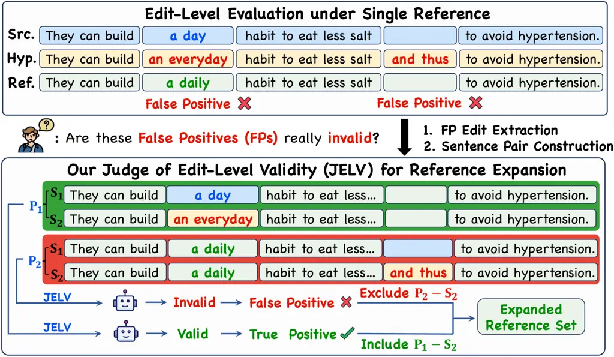
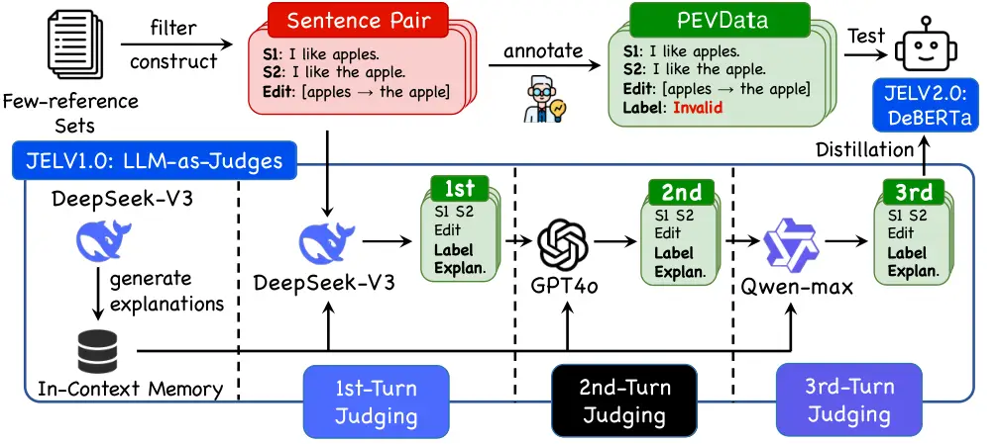
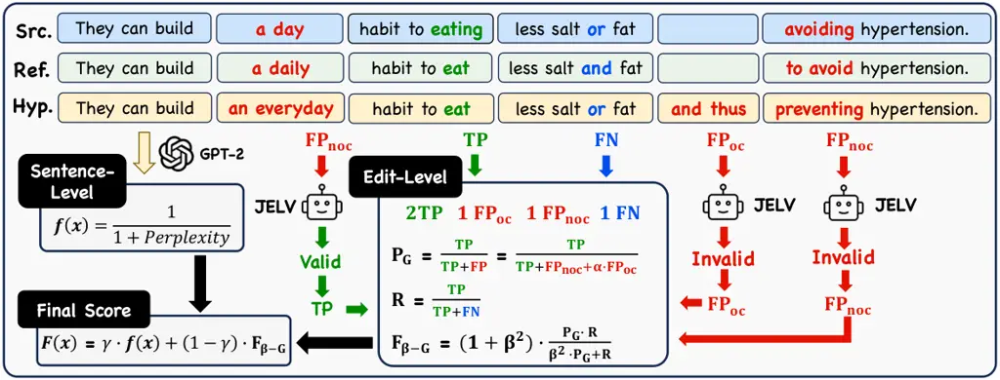
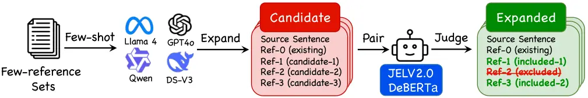

# JELV: A Judge of Edit-Level Validity for Evaluation and Automated Reference Expansion in Grammatical Error Correction

Yuhao Zhan    Yuqing Zhang    Jing Yuan    Qixiang Ma    Zhiqi Yang   
Yu Gu    Zemin Liu ^(†)^(†)thanks: Corresponding authors.    Fei
Wu¹¹footnotemark: 1

###### Abstract

Existing Grammatical Error Correction (GEC) systems suffer from limited
reference diversity, leading to underestimated evaluation and restricted
model generalization. To address this issue, we introduce the Judge of
Edit-Level Validity (JELV), an automated framework to validate
correction edits from grammaticality, faithfulness, and fluency. Using
our proposed human-annotated Pair-wise Edit-level Validity Dataset
(PEVData) as benchmark, JELV offers two implementations: a multi-turn
LLM-as-Judges pipeline achieving 90% agreement with human annotators,
and a distilled DeBERTa classifier with 85% precision on valid edits. We
then apply JELV to reclassify misjudged false positives in evaluation
and derive a comprehensive evaluation metric by integrating false
positive decoupling and fluency scoring, resulting in state-of-the-art
correlation with human judgments. We also apply JELV to filter
LLM-generated correction candidates, expanding the BEA19’s
single-reference dataset containing 38,692 source sentences. Retraining
top GEC systems on this expanded dataset yields measurable performance
gains. JELV provides a scalable solution for enhancing reference
diversity and strengthening both evaluation and model generalization.

¹Zhejiang University, Hangzhou, China

²Ludwig-Maximilians-Universität München, Munich, Germany

{yuhao.zhan, yuqingz7, 3240100569, 3240104460, yuyulo, liu.zemin,
wufei}@zju.edu.cn, jing.yuan@campus.lmu.de

Code — https://github.com/yuhao-zhan/JELV

## 1 Introduction

Grammatical Error Correction (GEC) aims to detect and correct writing
errors in text (Bryant et al. 2023). Typical GEC datasets consist of
source sentences and their manually corrected versions (i.e.,
references), which form the basis for training and evaluating GEC
systems.

##### Background

However, creating high-quality corrections for GEC datasets usually
requires substantial time and expert effort. Consequently, most GEC
datasets (Bryant et al. 2019; Ng et al. 2014; Flachs et al. 2020)
contain only one or two references per source sentence. This limited
reference set does not represent the numerous valid ways an error can be
corrected, causing two main issues. (1) _Underestimated evaluation_:
reference-based evaluation metrics undercount acceptable corrections
that deviate from the given references (Gomez and Rozovskaya 2024; Zhang
et al. 2022a; Choshen and Abend 2018b). (2) _Limited model performance_:
training on a narrow reference set constrains the model to specific
correction patterns, leading to poor generalization. While prior studies
show that increasing the number of references improves both evaluation
accuracy (Bryant and Ng 2015) and training effectiveness (Liu et al.
2024), existing reference expansions are still created manually. This
manual approach hinders scalability, restricts the diversity of valid
corrections, and perpetuates inherent biases in reference-based
evaluation (Choshen and Abend 2018b). Thus, an automated approach for
expanding diverse and valid corrections is crucial to advance research
and development in GEC.



Figure 1: Comparison between biased edit‐level evaluation using a single
reference and our automated expansion of valid edits via the Judge of
Edit‐Level Validity (JELV). Src., Hyp. and Ref. denote the source,
hypothesis and reference sentences, respectively. We form two sentence
pairs, $`\mathbf{P_{1}}`$ and $`\mathbf{P_{2}}`$. In each pair,
$`\mathbf{S_{1}}`$ (from Src.) and $`\mathbf{S_{2}}`$ (from Hyp.) differ
only in the single edited segment, remaining identical to the reference
elsewhere.

However, clearly defining what makes a correction edit valid remains
challenging in GEC. Current human annotation practices follow two
primary guidelines: _Minimal Edit_ enforces grammaticality and
faithfulness¹¹ 1 Faithfulness: Corrections should maintain the original
textual meaning and syntactic structure. (Ye et al. 2024), and _Fluent
Edit_ further requires improvements in sentence fluency (Bryant et al.
2023).

While most existing datasets adopt the Minimal Edit approach, a more
comprehensive standard for validity should recognize overall
improvements to the text, including fluency. Based on this, we define an
edit as valid only if it satisfies all three golden criteria: (1)
grammatical correctness, (2) meaning preservation, and (3) fluency
improvement.

##### Present work

To provide a gold‐standard benchmark for edit‐level validity, we
introduce the Pair‐wise Edit‐level Validity Dataset (PEVData). To
collect valid edits that are often overlooked, we notice that many
actually valid hypothesis edits²² 2 candidate correction produced by the
GEC system are misclassified as invalid—False Positive (FP)—in
reference-based evaluation due to incomplete reference coverage, as
shown in Figure 1. Therefore, we extract every hypothesis sentence
containing edits initially classified as FPs and pair it with its source
sentence. We then align all other tokens to the reference so that only
single edit span differs. Expert annotators subsequently evaluate each
pair’s validity against our three golden criteria, producing the
PEVData³³ 3 For more details on PEVData, please refer to Sec. 3.2..

With PEVData as benchmark, we introduce the Judge of Edit‐Level Validity
(JELV) to automate edit validity assessment. JELV offers two
implementations to balance accuracy and inference efficiency. JELV1.0
leverages the evaluation capacity of large language models (LLMs) (Li et
al. 2024; Zhu et al. 2023) and implements a multi-turn LLM-as-Judges
pipeline, achieving over 90% accuracy compared to human labels on
PEVData. To reduce inference cost and enable large-scale deployment, we
distill this pipeline into JELV2.0, a lightweight DeBERTa (He et al. 2020) classifier that maintains over 85% precision on valid edits. With
JELV’s high‐precision edit judgments, valid corrections are
automatically identified and integrated into the reference set. The
complete automated reference expansion workflow is shown in Figure 1.

We apply JELV to mitigate reference scarcity in two complementary ways.
(1) Implicit reference expansion for underestimated evaluation. It is
infeasible to eliminate misclassified FPs through exhaustive explicit
reference expansion since even short sentences have over 1000 valid
corrections on average (Choshen and Abend 2018b). Instead, we introduce
JELV into evaluation pipeline to reclassify those misclassified FPs as
true positives (TPs)—achieving the equivalent of exhaustive reference
enumeration at minimal cost. By further decoupling the remaining FPs
into overcorrection and non-overcorrection and integrating fluency
scoring for fine-grained and comprehensive evaluation, we achieve
state-of-the-art correlation with human judgments across multiple
evaluation dimensions. (2) Explicit reference expansion for limited
model performance. We employ a generation‐then‐filtering pipeline to
automate explicit reference expansion. Leveraging LLMs’ GEC expertise
and lower cost than human annotation, we generate candidate edits for
BEA19’s (Bryant et al. 2019) 38,692 single-reference sentences and use
JELV to retain only valid ones. Retraining top GEC systems on this
expanded corpus yields clear performance gains on CoNLL14 benchmark.
This demonstrates the effectiveness of our reference expansion strategy
in improving model performance.

##### Contributions

Our contributions are threefold. (1) We introduce JELV to automate
edit-level validity assessment, offering an LLM-as-Judges pipeline with
$`>`$90% accuracy and a distilled DeBERTa classifier with $`>`$85%
precision, both validated on our human-annotated PEVData benchmark. (2)
We enhance evaluation reliability by using JELV to reclassify FPs as
TPs, decoupling the remaining FPs, and integrating fluency scoring,
achieving SOTA correlation with human judgments. (3) We propose a
JELV-based generation-then-filtering pipeline for automated reference
expansion and retraining top GEC systems on the expanded corpus yields
measurable performance gains.

## 2 Related Work

We only discuss the most relevant studies here and provide further
discussion in Appendix A.

##### GEC Evaluation

Automatic evaluation metrics for GEC are divided into reference-based
and reference-less approaches (Maeda et al. 2022). Reference-based
metrics score outputs by comparing them to human references. These
methods can penalize valid corrections that are not in the reference
set, reflecting biases in limited reference coverage (Choshen and Abend
2018b). Reference-less metrics (Yoshimura et al. 2020; Maeda et al. 2022) assess correction quality without references using statistical and
language models, but may lack transparency and inherit biases from their
underlying models (Deutsch et al. 2022). LLM-based metrics (Kobayashi et
al. 2024a; Xie et al. 2024) use LLMs as scorers to evaluate corrections,
offering strong human correlation at the expense of higher computational
cost and potential instability. Meta-evaluation benchmarks such as GJG15
(Grundkiewicz et al. 2015) and SEEDA (Kobayashi et al. 2024b) measure
the correlation between GEC metrics and human judgments, providing the
standard for validating GEC evaluation methods. However, GJG15 was later
found to be problematic, casting doubt on many conclusions based on it
(Choshen and Abend 2018a; Chollampatt and Ng 2018). SEEDA, on the other
hand, performs human evaluations based on two different granularities:
edit- (SEEDA-E) and sentence-level (SEEDA-S), making it more reliable.

## 3 Validity Judgment

This section establishes our framework for automated edit-level validity
judgment. We first define clear criteria for valid edits, then introduce
our human-annotated benchmark dataset PEVData, and finally present JELV
1.0 and 2.0.

### 3.1 Criteria for Validity

We begin by analyzing edits (i.e., source$`\rightarrow`$ target) that
are truly valid but misclassified as FPs due to incomplete reference
coverage. In GEC, these FPs fall into two categories: (1) FP*(oc)
(overcorrection): valid edits applied to grammatically correct text for
improving fluency or semantic clarity. (2) FP*(noc)
(non-overcorrection): valid edits applied to ungrammatical text but
absent from reference set.

For each reference, under the assumption that all text outside the edit
span is correct, we define three criteria for edit-level validity to
ensure comprehensive improvement: (1) Grammaticality: the edit target
must be free of grammatical errors. (2) Faithfulness: the edit must
preserve the original intended meaning or enhance semantic clarity. (3)
Fluency: the edit must render the sentence more fluent, either by
correcting errors or smoothing awkward phrasing. An edit is judged valid
only if it meets all three criteria simultaneously (see Figure 2).

Figure 2: Three criteria for judging edit-level validity.

### 3.2 PEVData: Dataset Curation

To construct a benchmark for edit-level validity, we assemble Pair-wise
Edit-level Validity Dataset (PEVData) in following three stages.

##### Sentence Pair Construction

Under the Correction Independence Assumption that grammatical error
corrections in a sentence are independent (Ye et al. 2023), we extract
each hypothesis sentence containing edits initially judged as FPs and
pair it with its source. All other tokens are realigned to the reference
so that only single edit span differs. This controlled pairing isolates
each edit’s effect and prevents unrelated changes from influencing
validity judgments.



Figure 3: Overview of the JELV workflow. Starting from few reference
sets, we extract candidate sentence pairs and process them in two
independent streams. One stream is manually annotated by experts to
create the PEVData. The other is evaluated by a three turn LLM as Judges
pipeline (JELV1.0) and the resulting labels are distilled into a DeBERTa
classifier (JELV2.0).

##### Data Collection

We sample single‐edit pairs from three public datasets: 1,118 from
_CoNLL14_ (Ng et al. 2014), 844 from _ArgRewrite_ (Zhang et al. 2017),
and 835 from _JFLEG_ (Napoles et al. 2017). We provide more details of
these datasets in Appendix B.

##### Annotation Protocol

University experts (in English teaching, proofreading, or linguistics)
judged all pairs for edit validity, viewing each with preceding and
following sentences for context. For _CoNLL14_ (no prior validity
labels), three annotators applied a three-stage process: (1) an
independent pass, retaining unanimous decisions; (2) a second
independent pass on remaining pairs, requiring unanimity; and (3) a
joint discussion. This process yielded IAA (Fleiss’ Kappa) 0.81, with
remaining conflicts resolved by majority vote. By contrast, for
_ArgRewrite_ pairs, which already carried “Better/NotBetter” judgments
from seven prior annotators, a single expert performed a final validity
check. _JFLEG_ pairs, drawn from the reference set, were accepted as
valid without annotation. In total, PEVData comprises 2,797 pairs (1,459
valid, 1,338 invalid), forming a balanced benchmark; its error diversity
also matches _CoNLL14_ (Simpson Diversity: 0.912 vs. 0.914).

### 3.3 JELV: Developing an Automated Judge

While PEVData provides manually annotated judgments on edit-level
validity, automatic evaluation at scale is essential. Therefore, we
propose the Judge of Edit-Level Validity (JELV) and demonstrate its
effectiveness on PEVData benchmark. Besides, to balance accuracy and
efficiency, JELV comprises two implementations: _JELV1.0_, an
LLM-as-judges pipeline for high accuracy, and _JELV2.0_, a distilled
DeBERTa classifier for fast inference. Figure 3 shows the JELV workflow
overview.

#### JELV1.0: LLM-as-Judges Pipeline

- •
  Explain-then-Annotate. Before giving a judgment, the model generates a
  one-sentence explanation for its decision to ensure transparency and
  interpretability.
- •
  In-Context Learning (ICL). To increase JELV1.0’s accuracy, we help it
  understand our criteria through ICL. We use DeepSeek-V3 (DS-V3) to
  generate explanations for 50 edits sampled from PEVData⁴⁴ 4 We limit
  to 50 edits (25 valid, 25 invalid) to preserve test set integrity
  while ensuring balanced representation. (excluded from the test set)
  against our three validity criteria, creating an in-context memory.
  For each judgment, we include one valid and one invalid example as
  two-shot demonstrations.
- •
  Context‐Aware Prompting. We include the preceding and following
  sentences of the sentence being judged as additional context for more
  informed judgments.
- •
  Multi-Turn Optimization. JELV1.0 sequentially applies DS-V3, GPT-4o,
  and Qwen-Max. Each model reviews and refines the previous model’s
  explanations and judgments, correcting errors through iterative
  calibration. We use Qwen-Max’s outputs as the final validity labels.
  See Appendix G.1 for prompt details.

| LLM   | Prec.  | Rec.   | $`\mathbf{F_{0.5}}`$ | Accuracy |
| ----- | ------ | ------ | -------------------- | -------- |
| DS-V3 | 0.6920 | 0.9038 | 0.7261               | 0.8415   |
| GPT4o | 0.8417 | 0.8349 | 0.8403               | 0.8976   |
| Qwen  | 0.8771 | 0.8462 | 0.8707               | 0.9134   |

Table 1: Comparison of LLM-as-Judges JELV1.0 predictions and human
annotations on the PEVData benchmark. Prec. and Rec. denote precision
and recall, respectively. Bold indicates the highest score.

Table 1 reports how well the LLM-as-Judges predictions align with human
annotations on PEVData benchmark. Higher values indicate better
alignment with human judgments. We use the F*(0.5), which weights
precision 2$`\times`$ recall, to prioritize correct identification of
valid edits for reference quality. The third-turn Qwen-max achieves the
highest F*(0.5) (0.8707) and Accuracy (0.9134), demonstrating our
pipeline’s effectiveness. ⁵⁵ 5 The $`\sim`$10% inconsistency is mainly
due to highly subtle fluency edits (e.g., help build → foster), cases so
nuanced that even experts require discussion to reach consensus. Figure
4 presents an ablation study evaluating the contribution of each
component in JELV1.0 on PEVData benchmark. Starting from the baseline of
independent LLM judgments, we find that adding “explain-then-annotate”,
then ICL, and finally context-aware prompting each delivers a clear
accuracy increase. Moreover, every subsequent LLM outperforms its
predecessor, highlighting the strength of multi-turn optimization. When
all three strategies are combined, overall accuracy exceeds 90%.

Figure 4: Ablation of JELV1.0 strategies on PEVData.

#### JELV2.0: Classifier Model Distillation

While JELV1.0 achieves high alignment with human judgments, it incurs
high inference costs that limit large-scale deployment. To address this,
we distill JELV1.0 into a lightweight DeBERTa classifier ($`<`$1B
parameters). Using our sentence pair construction approach (Section
3.2), we extract candidate edits from the extended CoNLL14 reference
sets (Bryant and Ng 2015), yielding 12,984 sentence pairs. After
removing overlaps with PEVData to avoid data leakage, 12,416 pairs
remain. We then apply JELV1.0 to label these pairs, producing 5,786
valid and 6,630 invalid examples as training data. We train the DeBERTa
classifier on this dataset, reserving half of PEVData for validation and
half for testing.

To enhance JELV2.0’s judgment accuracy, we integrate two auxiliary
features that capture complementary aspects of sentence pairs: GPT-2
probability (indicating grammaticality and fluency (Yasunaga et al.
2021)) and SBERT semantic similarity (reflecting meaning preservation)⁶⁶
6 See ablation study on the two features in Appendix C.. These features
are projected and concatenated with DeBERTa’s final embeddings via a
lightweight classification head to avoid overwhelming the primary text
representations. To address class imbalance, we apply focal loss (Lin et
al. 2017). We enhance robustness through FreeLB adversarial training
(Zhu et al. 2019). Our training employs curriculum learning (Bengio et
al. 2009) with gradual layer unfreezing to prevent overfitting and the
final model is selected using stratified k-fold cross validation with
early stopping. On the test set, JELV2.0 achieves 85.25% precision, an
F\_(0.5) score of 82.24%, and 78.91% accuracy, demonstrating its high
precision with low inference latency.



Figure 5: Overview of the comprehensive evaluation metric. Edits flagged
as FPs are first reclassified via JELV2.0, then false positive
decoupling distinguishes the remaining $`\mathrm{FP_{{noc}}}`$ and
$`\mathrm{FP_{{oc}}}`$ to compute the edit‐level generalized F‐score
$`\mathrm{F_{\beta\text{-}G}}`$. In parallel, GPT-2 perplexity produces
the sentence‐level fluency score $`f(x)`$ for the hypothesis. A
interpolation weight $`\gamma`$ combines these two streams into the
final metric $`F(x)`$.

## 4 Evaluation

This section presents how we integrate JELV2.0 into GEC evaluation
pipelines to derive a comprehensive metric with additional evaluation
strategies, and demonstrate its effectiveness through meta-evaluation.

### 4.1 Method

##### JELV-based Reclassification

(Choshen and Abend 2018b) shows that even short sentences have over a
thousand valid corrections on average, making exhaustive reference
expansion infeasible and causing reference-based metrics to misclassify
some valid edits as FPs inevitably. To mitigate this inherent bias, we
apply JELV2.0 to re-evaluate each edit initially marked as a FP during
evaluation. Edits judged valid by JELV2.0 are reclassified as TPs,
achieving the equivalent of exhaustive inclusion of JELV-validated
references in evaluation (i.e., implicit reference expansion) without
incurring the cost of explicit expansion, which reduces
misclassification and enhances evaluation reliability. After
reclassifying edits, we apply CLEME‐independent (Ye et al. 2023), a
leading F-score based metric, to compute F\_(0.5) scores and this yields
the JELV‐based CLEME.

##### False Positive Decoupling

FPs in GEC fall into two categories: non-overcorrections (FP*(noc)),
which edit ungrammatical text, and overcorrections (FP*(oc)): which
alter already correct text. Considering the two different edit
properties that deserve different penalties, we apply a relative penalty
weight $`\alpha`$ to FP\_(oc) (i.e., overcorrection). We then derive the
generalized precision:

```math
\mathrm{P_{G}}=\mathrm{\frac{TP}{TP+FP}}=\mathrm{\frac{TP}{TP+FP_{noc}+\alpha\,FP_{oc}}}. \tag{1}
```

Combining $`\mathrm{P_{G}}`$ with recall $`\mathrm{R}`$, we further
propose the generalized F-score as the edit-level metric:

```math
\mathrm{F_{\beta-{G}}}=(1+\beta^{2})\cdot\mathrm{\frac{P_{G}\cdot R}{\beta^{2}\cdot P_{G}+R}}. \tag{2}
```

##### Fluency Score Integration

Prior study (Kobayashi et al. 2024b) recommends the combination of both
edit-level and sentence-level metrics in GEC evaluation. Therefore, we
incorporate a sentence-level fluency evaluation based on GPT-2
perplexity (Ge et al. 2018):

```math
f(x)=\frac{1}{1+H(x)},\ H(x)=-\frac{\sum_{i=1}^{|x|}logP(x_{i}|x_{<i})}{|x|}, \tag{3}
```

where $`P(x_{i}|x_{<i})`$ is computed by GPT-2 and $`|x|`$ denotes
sentence length. Higher $`f(x)`$ indicates greater fluency.

##### Comprehensive Metric

Building on the complementary strengths of edit-level and sentence-level
evaluations, we combine $`\mathrm{F_{\beta\text{-}G}}`$ and the fluency
score $`f(x)`$ via an interpolation weight $`\gamma`$:

```math
F(x)\;=\;(1-\gamma)\,\cdot F_{\beta\text{-}G}\;+\;\gamma\cdot\,f(x)\,. \tag{4}
```

Figure 5 presents an overview of our comprehensive evaluation metric.

|                                          | System-level |          |                 |          |         |          |                 |          | Sentence-level |          |                 |          |         |          |                 |          |
| ---------------------------------------- | ------------ | -------- | --------------- | -------- | ------- | -------- | --------------- | -------- | -------------- | -------- | --------------- | -------- | ------- | -------- | --------------- | -------- |
| Metric                                   | SEEDA-E      |          |                 |          | SEEDA-S |          |                 |          | SEEDA-E        |          |                 |          | SEEDA-S |          |                 |          |
|                                          | Base         |          | \+ Fluent corr. |          | Base    |          | \+ Fluent corr. |          | Base           |          | \+ Fluent corr. |          | Base    |          | \+ Fluent corr. |          |
|                                          | $`r`$        | $`\rho`$ | $`r`$           | $`\rho`$ | $`r`$   | $`\rho`$ | $`r`$           | $`\rho`$ | $`Acc`$        | $`\tau`$ | $`Acc`$         | $`\tau`$ | $`Acc`$ | $`\tau`$ | $`Acc`$         | $`\tau`$ |
| M² (Dahlmeier and Ng 2012)               | 0.711        | 0.699    | -0.224          | 0.160    | 0.654   | 0.462    | -0.293          | 0.002    | 0.578          | 0.156    | 0.458           | -0.084   | 0.567   | 0.135    | 0.454           | -0.092   |
| ERRANT (Bryant et al. 2017)              | 0.628        | 0.629    | -0.531          | 0.024    | 0.516   | 0.364    | -0.604          | -0.143   | 0.511          | 0.215    | 0.460           | 0.118    | 0.485   | 0.174    | 0.438           | 0.085    |
| CLEME (Ye et al. 2023)                   | 0.644        | 0.587    | -0.480          | 0.051    | 0.547   | 0.336    | -0.552          | -0.108   | 0.443          | 0.188    | 0.398           | 0.078    | 0.428   | 0.175    | 0.390           | 0.077    |
| CLEME2.0 (Ye et al. 2025)                | 0.836        | 0.888    | -0.589          | 0.187    | 0.716   | 0.636    | -0.665          | 0.029    | 0.364          | 0.182    | 0.364           | 0.182    | 0.583   | 0.583    | 0.583           | 0.583    |
| PT-M² (Gong et al. 2022)                 | 0.820        | 0.902    | -0.187          | 0.305    | 0.820   | 0.720    | -0.244          | 0.191    | 0.220          | -0.031   | 0.220           | -0.028   | 0.228   | -0.003   | 0.218           | -0.024   |
| GLEU (Napoles et al. 2015)               | 0.886        | 0.867    | 0.206           | 0.600    | 0.820   | 0.790    | 0.118           | 0.547    | 0.673          | 0.365    | 0.616           | 0.247    | 0.671   | 0.358    | 0.610           | 0.234    |
| SOME (Yoshimura et al. 2020)             | 0.860        | 0.923    | 0.926           | 0.952    | 0.868   | 0.776    | 0.917           | 0.859    | 0.394          | -0.034   | 0.405           | -0.027   | 0.409   | -0.014   | 0.405           | -0.036   |
| Scribendi Score (Islam and Magnani 2021) | 0.718        | 0.692    | 0.696           | 0.745    | 0.513   | 0.413    | 0.592           | 0.547    | 0.377          | 0.241    | 0.357           | 0.208    | 0.369   | 0.247    | 0.324           | 0.176    |
| IMPARA (Maeda et al. 2022)               | 0.843        | 0.937    | 0.860           | 0.960    | 0.878   | 0.860    | 0.853           | 0.912    | 0.695          | 0.413    | 0.700           | 0.414    | 0.721   | 0.473    | 0.713           | 0.445    |
| LLM-based                                | 0.951        | 0.977    | 0.917           | 0.981    | 0.919   | 0.858    | 0.881           | 0.906    | 0.717          | 0.536    | 0.692           | 0.500    | 0.753   | 0.614    | 0.711           | 0.557    |
| JELV-based $`\mathrm{F(x)}`$             | 0.975        | 0.986    | 0.974           | 0.991    | 0.932   | 0.860    | 0.947           | 0.912    | 0.780          | 0.559    | 0.770           | 0.541    | 0.807   | 0.630    | 0.772           | 0.543    |

Table 2: Results of system- and sentence-level meta-evaluations on
SEEDA’s test set of social media domain. For “LLM-based”, our prompt and
experiment setting aligns with previous works’s protocol (Kobayashi et
al. 2024a). Boldface indicates the highest correlation score in each
column.

### 4.2 Experiments

We conduct comprehensive experiments to evaluate our metric against
existing approaches. Our evaluation consists of hyperparameter tuning on
a training set, followed by meta-evaluations on a held-out test set of
SEEDA benchmark.

##### Settings

To reach higher correlation with human judgments at each level, we tune
the hyperparameters $`\alpha`$ and $`\gamma`$ on the training set by
selecting the values that maximize the correlation⁷⁷ 7
$`\alpha\in[0,2],\ \gamma\in[0,1]`$, both with step size 0.01.. Once
identified, these optimal parameters are fixed and applied to the metric
for evaluation on the test set. To prevent any in-domain overlap, we
exploit SEEDA’s two distinct domains—genetic (163 source sentences) and
social media (228 source sentences)—by assigning one domain entirely to
training and the other entirely to testing. Finally, we assess our
metric’s robustness via system-level and sentence-level meta-evaluations
on the test set and compare its performance against existing metrics.

##### Meta‐evaluation

SEEDA provides edit‐level (SEEDA‐E) and sentence‐level (SEEDA‐S)
pairwise human judgments for twelve GEC system corrections (“Base”) and
two additional fluent human corrections (“+Fluent corr.”) For
system‐level evaluation, we compute the overall scores across all
corrections for each GEC system, derive a system ranking, and compare it
to the human ranking produced by TrueSkill (Sakaguchi et al. 2014) using
Pearson’s $`r`$ and Spearman’s $`\rho`$. For sentence‐level evaluation,
we compute a score for each correction sentence, then for every pair of
corrections we derive a metric-based preference, compare this to SEEDA’s
human judgment, and report classification accuracy and Kendall’s
$`\tau`$.

### 4.3 Result and Analysis

##### Main Results

Table 2 reports our meta-evaluation on SEEDA’s test set of social media
domain, where our metric achieves state-of-the-art (SOTA) correlations
with human judgments across nearly all evaluation levels and
granularities. Results for the test set of genetic domain are provided
in the Appendix D, showing similarly strong performance and confirming
our metric’s robustness across domains.

Figure 6: Ablation Study for JELV-based F(x).

Figure 7: Comparison of optimal hyperparameters across SEEDA domains and
evaluation levels. Base($`\gamma`$) and +Fluency($`\gamma`$) denote
optimal $`\gamma`$ for “Base” and “+Fluent corr.” settings,
respectively; Edit($`\alpha`$) and Sent($`\alpha`$) denote optimal
$`\alpha`$ for edit- and sentence-level evaluation, respectively.

##### Ablation Study

We perform ablation studies to isolate each component—disabling
JELV-based reclassification, fixing $`\alpha`$=1 to remove FP
decoupling, and fixing $`\gamma`$=0 to exclude fluency score
integration. Figure 6’s sentence-level meta-evaluation results show that
omitting any component reduces correlation with human judgments and thus
confirms the necessity of each method in the final metric.



Figure 8: Automated expansion pipeline for large scale few reference
sets. Four LLMs generate candidate corrections using few shot prompts.
Each candidate correction is paired with its source sentence following
the Sentence Pair Construction protocol and evaluated by the distilled
DeBERTa classifier (JELV2.0). Valid corrections are added to the
reference set to produce the expanded corpus.

| Dataset                | Ensembles | Majority-voting | GRECO | GEC-DI | UGEC  | MoECE | SynGEC | Sequence tagging |
| ---------------------- | --------- | --------------- | ----- | ------ | ----- | ----- | ------ | ---------------- |
| Raw                    | 72.68     | 71.44           | 70.99 | 69.43  | 69.38 | 67.45 | 67.29  | 66.31            |
| Expanded w/o Filtering | 72.98     | 71.44           | 71.25 | 69.57  | 69.62 | 67.74 | 67.47  | 66.36            |
| Expanded w/ Filtering  | 73.05     | 71.91           | 71.36 | 69.58  | 69.74 | 67.92 | 67.57  | 66.67            |
| Raw                    | 73.54     | 71.84           | 71.34 | 69.37  | 69.44 | 66.87 | 66.68  | 65.09            |
| Expanded w/o Filtering | 74.08     | 72.25           | 71.60 | 70.02  | 70.00 | 67.13 | 66.75  | 65.23            |
| Expanded w/ Filtering  | 74.19     | 72.87           | 72.16 | 69.84  | 70.14 | 67.59 | 67.16  | 65.96            |
| Raw                    | 79.47     | 78.10           | 78.08 | 77.34  | 77.80 | 76.78 | 76.80  | 75.42            |
| Expanded w/o Filtering | 80.29     | 79.60           | 78.98 | 78.51  | 78.14 | 76.47 | 76.26  | 75.70            |
| Expanded w/ Filtering  | 80.45     | 80.01           | 79.57 | 78.41  | 78.85 | 77.35 | 77.33  | 76.95            |

Table 3: Evaluation scores for eight GEC systems on CoNLL14 under three
BEA19 training variants. Every score is averaged over the twice
identical retraining runs to reduce bias. Each group of bars (top to
bottom) shows M², CLEME, and JELV-based $`\mathrm{F(x)}`$ scores. Raw:
reproduction trained on raw BEA19; Expanded w/o Filtering: BEA19 plus
all LLM-generated candidates; Expanded w/ Filtering: BEA19 plus
JELV-validated edits. Bold indicates the highest score.

##### Analysis of Hyperparameter

We investigate how the overcorrection penalty $`\alpha`$ and fluency
weight $`\gamma`$ vary across evaluation settings and granularities. We
expect edit-level evaluation to require a larger $`\alpha`$ (Equation 1)
than sentence-level evaluation, because it penalizes individual
corrections more strictly. We also expect the “+Fluent corr.” setting to
require a larger $`\gamma`$ (Equation 4) than the “Base” setting, since
it places greater emphasis on fluency. To verify this, we extract the
optimal $`\alpha`$ and $`\gamma`$ values for the genetic, social media,
and overall SEEDA domains at each evaluation level. Figure 7 shows that
most of the edit-level $`\alpha`$ exceeds the sentence-level $`\alpha`$,
and that the “+Fluent corr.” $`\gamma`$ exceeds the “Base” $`\gamma`$,
confirming our hypotheses and demonstrating the flexibility and
robustness of our hyperparameter design. All the optimal hyperparameters
can be found in Appendix E.

## 5 Reference Expansion and Retraining

Figure 8 shows our automated two-stage pipeline for expanding
references: generation followed by filtering. We apply this pipeline to
the BEA-2019 train and dev sets (Bryant et al. 2019), which comprise
comprising 38,692 source sentences paired with a single human reference.

##### Generation

To leverage LLMs’ GEC expertise and reduce reliance on human, we use
four LLMs (Llama 4, GPT-4o, Qwen and DS-V3) to generate correction
candidates. Each LLM is prompted with the source sentence and its single
reference as a one-shot example, and is briefed on our three validity
criteria to guide output corrections toward high-quality valid edits
(see full prompt in Appendix G.2). On average, these LLMs produce 8.74
(Llama 4), 6.82 (GPT-4o), 4.06 (Qwen) and 2.41 (DS-V3) candidates per
sentence.

##### Filtering

Each candidate edit is evaluated by JELV2.0, and only edits judged valid
are included in the final expanded reference set. JELV-based filtering
on BEA-train reduces the average corrections per sentence from 11.54 to
3.90 and the maximum from 104 to 40 (see Appendix F for full
statistics). This demonstrates JELV’s effectiveness in filtering diverse
LLM-generated corrections into a concise, high-quality reference set.

##### Retraining

To assess the impact of our reference expansion strategy on model
performance, we retrain eight top GEC systems⁸⁸ 8 Systems are selected
from the CoNLL14 leaderboard, and training follows the original papers’
experiment protocols. twice on three BEA19 variants: the raw train and
dev sets (baseline); the expanded set (BEA19 plus LLM-generated
candidates); and the filtered set (expanded set with JELV validation).
The systems include Ensembles, Majority-voting (Omelianchuk et al.
2024), GRECO (Qorib and Ng 2023), GEC-DI (Zhou et al. 2023),
Unsupervised GEC (Cao et al. 2023), MoECE (Qorib et al. 2024), SynGEC
(Zhang et al. 2022b), and GECTOR (Omelianchuk et al. 2020). Table 3
presents each system’s performance under three training variants,
evaluated with M², CLEME, and JELV-based $`\mathrm{F(x)}`$. Training on
the expanded and filtered dataset yields the highest performance for
most systems—significantly outperforming the Raw baseline (paired t-test
and Wilcoxon signed-rank test: both p $`<`$ 0.01), especially on
JELV-based $`\mathrm{F(x)}`$—Unfiltered expansion also improves over the
baseline for most systems, while JELV filtering delivers further gains,
underscoring the value of JELV-based quality-controlled reference
expansion. While the modest gains are expected from highly optimized
SOTA baselines, our strategy’s key effect is enabling models to learn
new correction patterns for some rare but challenging errors they
typically fail on. Achieving consistent improvements on such errors thus
confirms the value of our method.

## 6 Conclusions

In this paper, we introduce Judge of Edit-Level Validity (JELV), a
framework for automated edit validity assessment in GEC. JELV offers two
implementations: JELV1.0, a multi-turn LLM-as-judges pipeline, and
JELV2.0, a distilled DeBERTa classifier. Both achieve strong agreement
with human annotations on our PEVData. We demonstrate two applications
that mitigate reference scarcity. First, our evaluation metric applies
JELV to reclassify false positives and then incorporates false positive
decoupling together with fluency scoring, resulting in state-of-the-art
correlation with human judgments. Second, a JELV-based
generation-then-filtering pipeline automates reference expansion and
retraining on the expanded dataset yields clear improvements in GEC
model performance. JELV therefore provides a scalable solution to enrich
reference diversity and enhance both evaluation reliability and model
robustness in GEC.

## Ethical Statement

Our study builds on publicly available GEC datasets. Three expert
annotators with bac kgrounds in English teaching, proofreading, and
linguistics manually judged edit validity and were compensated at market
rates. We thank them for their contributions. To our knowledge, there
are no ethical concerns arising from the use of these data or
annotations.

## Acknowledgements

We sincerely thank the anonymous reviewers for their insightful comments
and constructive feedback, which significantly improved the quality of
this paper.

## Appendix

## A Detailed Related Work

### A.1 GEC Reference Expansion

Most GEC training corpora, including BEA19-train (Bryant et al. 2019),
provide only one reference per source sentence, while evaluation
benchmarks typically include two (Bryant et al. 2019; Ng et al. 2014;
Flachs et al. 2020) or four (Napoles et al. 2017) references. Manual
reference expansion has improved evaluation reliability by adding eight
annotations for CoNLL14 (Bryant and Ng 2015), averaging 2.3 references
per sentence in the Chinese MuCGEC dataset (Zhang et al. 2022a), and
providing three references per sentence in a Russian GEC corpus (Gomez
and Rozovskaya 2024). Besides, (Liu et al. 2024) has shown that multiple
references have great potential for better training effectiveness.
However, these approaches depend on extensive human effort and do not
scale easily. An automated, scalable method for generating diverse,
valid correction edits is therefore essential for advancing GEC.

### A.2 GEC Evaluation Metrics

A core component of a GEC system is the ability to measure model
performance. Reference-based metrics, the traditional paradigm, rely on
alignment with human-crafted references. Early approaches like the M²
scorer used edit-based F\_(0.5) scoring but faced criticism for
artificially inflated precision (Bryant et al. 2017), prompting
linguistically grounded alternatives like ERRANT (Bryant et al. 2017)
for improved edit alignment. Despite their effectiveness,
reference-based metrics often suffer from issues such as overfitting to
reference-specific patterns and inevitably penalizing valid but
non-reference corrections, which introduces inherent biases (Choshen and
Abend 2018b). To circumvent reliance on references, reference-less
metrics emerged, leveraging quality estimation frameworks:
Grammaticality-Based Metrics (Napoles et al. 2016) combined fluency and
meaning preservation scores, later extended by SOME (Yoshimura et al. 2020) and IMPARA (Maeda et al. 2022) with BERT-based models and
Scribendi Score (Islam and Magnani 2021) using perplexity-edit hybrids.
However, these metrics, while bypassing the need for references, can
lack interpretability and may inherit biases from the models they employ
(Deutsch et al. 2022), and struggle to detect issues like
over-correction. The advent of LLMs introduced a paradigm shift, with
GPT-4 (Kobayashi et al. 2024a) and Prompt Engineering (Xie et al. 2024)
enabling direct numerical scoring via natural language criteria
interpretation, aiming to mimic human-like evaluation and potentially
capturing more complex aspects of correction quality. Despite their
promise, LLM-based metrics face challenges in explainability (acting as
“black-box” evaluators), instability, multiple biases (Li et al. 2024),
and prohibitive computational costs.

### A.3 Meta-evaluation

Meta-evaluation frameworks determine metric validity: human correlation.
This involves evaluating metrics themselves by correlating their scores
with human judgments based on two dominant datasets GJG15 (Grundkiewicz
et al. 2015) and SEEDA (Kobayashi et al. 2024b), providing a gold
standard for determining the true effectiveness of GEC evaluation
methodologies and guiding the development of superior metrics. However,
GJG15 was later found to be problematic, and many of the conclusions
drawn using these datasets were called into question(Choshen and Abend
2018a; Chollampatt and Ng 2018). Additionally, GJG15 may yield different
results depending on granularity, such as sentence-level or edit-level
evaluations(Kobayashi et al. 2024b). SEEDA, on the other hand, performs
human evaluations based on two different granularities: SEEDA-E for
edit-based evaluation and SEEDA-S for sentence-based evaluation, making
it more reliable.

|                               | System-level |          |                 |          |         |          |                 |          | Sentence-level |          |                 |          |         |          |                 |          |
| ----------------------------- | ------------ | -------- | --------------- | -------- | ------- | -------- | --------------- | -------- | -------------- | -------- | --------------- | -------- | ------- | -------- | --------------- | -------- |
| Metric                        | SEEDA-E      |          |                 |          | SEEDA-S |          |                 |          | SEEDA-E        |          |                 |          | SEEDA-S |          |                 |          |
|                               | Base         |          | \+ Fluent corr. |          | Base    |          | \+ Fluent corr. |          | Base           |          | \+ Fluent corr. |          | Base    |          | \+ Fluent corr. |          |
|                               | $`r`$        | $`\rho`$ | $`r`$           | $`\rho`$ | $`r`$   | $`\rho`$ | $`r`$           | $`\rho`$ | $`Acc`$        | $`\tau`$ | $`Acc`$         | $`\tau`$ | $`Acc`$ | $`\tau`$ | $`Acc`$         | $`\tau`$ |
| M²                            | 0.806        | 0.841    | 0.049           | 0.429    | 0.658   | 0.637    | -0.062          | 0.266    | 0.602          | 0.205    | 0.543           | 0.087    | 0.563   | 0.127    | 0.511           | 0.022    |
| ERRANT                        | 0.732        | 0.748    | -0.436          | 0.099    | 0.558   | 0.448    | -0.534          | -0.090   | 0.559          | 0.253    | 0.516           | 0.174    | 0.546   | 0.245    | 0.477           | 0.114    |
| CLEME                         | 0.766        | 0.825    | -0.395          | 0.240    | 0.653   | 0.587    | -0.483          | 0.081    | 0.514          | 0.266    | 0.468           | 0.164    | 0.488   | 0.222    | 0.429           | 0.091    |
| CLEME2.0                      | 0.808        | 0.790    | -0.576          | 0.125    | 0.679   | 0.566    | -0.656          | -0.015   | 0.545          | 0.364    | 0.545           | 0.364    | 0.615   | 0.615    | 0.615           | 0.615    |
| PT-M²                         | 0.838        | 0.874    | 0.036           | 0.363    | 0.743   | 0.734    | -0.057          | 0.257    | 0.230          | -0.018   | 0.227           | -0.023   | 0.231   | 0.011    | 0.224           | 0.001    |
| GLEU                          | 0.886        | 0.867    | 0.206           | 0.600    | 0.820   | 0.790    | 0.118           | 0.547    | 0.675          | 0.390    | 0.666           | 0.362    | 0.641   | 0.320    | 0.613           | 0.253    |
| SOME                          | 0.912        | 0.923    | 0.943           | 0.952    | 0.880   | 0.881    | 0.929           | 0.925    | 0.432          | 0.019    | 0.434           | 0.017    | 0.396   | -0.045   | 0.403           | -0.036   |
| Scribendi Score               | 0.858        | 0.818    | 0.638           | 0.763    | 0.687   | 0.699    | 0.532           | 0.695    | 0.449          | 0.316    | 0.442           | 0.310    | 0.404   | 0.243    | 0.386           | 0.213    |
| IMPARA                        | 0.931        | 0.923    | 0.921           | 0.952    | 0.917   | 0.881    | 0.902           | 0.925    | 0.773          | 0.555    | 0.653           | 0.312    | 0.769   | 0.542    | 0.642           | 0.286    |
| LLM-based                     | 0.959        | 0.923    | 0.898           | 0.947    | 0.906   | 0.846    | 0.851           | 0.899    | 0.724          | 0.571    | 0.720           | 0.577    | 0.709   | 0.547    | 0.692           | 0.531    |
| JELV-based $`\mathrm{F(x)}`$. | 0.956        | 0.986    | 0.974           | 0.991    | 0.883   | 0.846    | 0.947           | 0.899    | 0.827          | 0.654    | 0.826           | 0.649    | 0.792   | 0.585    | 0.763           | 0.526    |

Table IV: Results of system- and sentence-level meta-evaluations on
SEEDA’s test set of genetic domain. For “LLM-based”, our prompt and
experiment setting aligns with previous works’s protocol (Kobayashi et
al. 2024a). Boldface indicates the highest correlation score in each
column.

|                           |              |          |                 |          |         |          |                 |          |                |          |                 |          |         |          |                 |          |
| ------------------------- | ------------ | -------- | --------------- | -------- | ------- | -------- | --------------- | -------- | -------------- | -------- | --------------- | -------- | ------- | -------- | --------------- | -------- |
|                           | System-level |          |                 |          |         |          |                 |          | Sentence-level |          |                 |          |         |          |                 |          |
| Metric                    | SEEDA-E      |          |                 |          | SEEDA-S |          |                 |          | SEEDA-E        |          |                 |          | SEEDA-S |          |                 |          |
|                           | Base         |          | \+ Fluent corr. |          | Base    |          | \+ Fluent corr. |          | Base           |          | \+ Fluent corr. |          | Base    |          | \+ Fluent corr. |          |
|                           | $`r`$        | $`\rho`$ | $`r`$           | $`\rho`$ | $`r`$   | $`\rho`$ | $`r`$           | $`\rho`$ | $`Acc`$        | $`\tau`$ | $`Acc`$         | $`\tau`$ | $`Acc`$ | $`\tau`$ | $`Acc`$         | $`\tau`$ |
| $`\alpha`$ (Global)       | 0.09         | 0.17     | 0.08            | 0.17     | 0.06    | 0.06     | 0.18            | 0.19     | 0.71           | 1.43     | 0.00            | 1.43     | 0.00    | 0.48     | 0.00            | 0.58     |
| $`\alpha`$ (Genetic)      | 0.67         | 0.92     | 0.12            | 0.97     | 0.30    | 1.81     | 0.00            | 1.81     | 0.02           | 0.06     | 0.05            | 0.01     | 0.00    | 0.03     | 0.00            | 0.00     |
| $`\alpha`$ (Social Media) | 0.86         | 0.92     | 0.00            | 0.97     | 0.07    | 0.00     | 0.01            | 0.02     | 1.60           | 1.60     | 0.17            | 0.17     | 0.09    | 0.09     | 0.12            | 0.12     |
| $`\gamma`$ (Global)       | 0.66         | 0.78     | 0.77            | 0.78     | 0.54    | 0.54     | 0.78            | 0.78     | 0.68           | 0.89     | 0.98            | 0.89     | 0.00    | 0.18     | 1.00            | 0.76     |
| $`\gamma`$ (Genetic)      | 0.87         | 0.89     | 1.00            | 0.92     | 0.60    | 0.95     | 1.00            | 0.95     | 0.79           | 0.79     | 0.79            | 0.79     | 0.55    | 0.55     | 0.75            | 0.76     |
| $`\gamma`$ (Social Media) | 0.81         | 0.89     | 1.00            | 0.92     | 0.36    | 0.49     | 1.00            | 0.50     | 0.90           | 0.90     | 0.78            | 0.78     | 0.65    | 0.65     | 0.72            | 0.72     |

Table V: Tuned optimal hyperparameters $`\alpha`$ and $`\gamma`$ for
different evaluation settings across domains.

## B Dataset Collection

We sample single‐edit pairs from three public datasets:

- •
  CoNLL14. (Ng et al. 2014; Bryant and Ng 2015) the official test set
  provides two references per sentence, with an eight-reference
  extension offering additional corrections. Noting that some of these
  extended edits are not so reliable, we extract 1,118 edits unique to
  this extension for our expert annotation on validity.
- •
  ArgRewrite. (Zhang et al. 2017) Seven prior annotators labeled each
  revision as “Better” or “NotBetter”. However, “Better” does not
  guarantee that an edit satisfies all three of our validity criteria.
  We therefore select 844 single-edit revisions with at least five
  “Better” votes for our expert validity re-annotation.
- •
  JFLEG. (Napoles et al. 2017) Designed for fluency evaluation, this
  dataset provides four references per source sentence. We extract 835
  single-edit references, pair each with its source sentence, and treat
  them as valid since they originate from existing references.

## C Ablation Study for JELV2.0’s Features

| Model            | Precision | $`F_{0.5}`$ (%) | Accuracy |
| ---------------- | --------- | --------------- | -------- |
| Baseline         | 80.48%    | 79.33%          | 72.59%   |
| \+ GPT-2         | 83.01%    | 81.67%          | 75.29%   |
| \+ SBERT         | 82.44%    | 81.00%          | 74.10%   |
| \+ GPT-2 + SBERT | 85.25%    | 82.24%          | 78.91%   |

Table VI: Ablation study on the contribution of JELV2.0’s final
embedding choices: GPT-2 and SBERT

Table VI shows the result of ablation study on the contribution of final
embedding choices: GPT-2 and SBERT. This result clearly justifies the
inclusion of each embedding component in JELV 2.0.

## D Meta-evaluation on SEEDA’s Test Set of Genetic Domain

Table 2 reports our meta-evaluation on SEEDA’s test set of genetic
domain, where our metric still achieves SOTA correlations with human
judgments across most evaluation levels and granularities, confirming
our metric’s robustness across different domains.

## E Optimal Hyperparameters

Table V presents all of the tuned optimal hyperparameters $`\alpha`$ and
$`\gamma`$ for different evaluation settings across domains.

## F Statistics about JELV-based Filtering

|                |           |        |         |        |
| -------------- | --------- | ------ | ------- | ------ |
| \#Ref. / Sent. | BEA-Train |        | BEA-Dev |        |
|                | Pre-J     | Post-J | Pre-J   | Post-J |
| Mean           | 11.54     | 3.90   | 14.21   | 4.08   |
| S.D.           | 4.74      | 3.23   | 6.47    | 3.63   |
| Max            | 104       | 40     | 78      | 35     |

Table VII: Number of references per sentence in BEA-Train and BEA-Dev
before (Pre-J) and after (Post-J) JELV2.0 filtering. Post-J values
reflect only edits judged valid, yielding lower averages and reduced
variability.

## G Complete Prompts

### G.1 LLM-as-Judges Pipeline (JELV1.0)

##### G.1.0.1 1st Turn

Prompt for DeepSeek-V3.

1 You are a linguist tasked with judging whether a proposed sentence
edit is VALID or INVALID.

2 VALID = 1, INVALID = 0.

3

4 A VALID edit must satisfy THREE CRITERIA:

5

6 1. GRAMMATICALITY: the resulting SENTENCE is free of grammatical
errors.

7

8 2. FAITHFULNESS: the edit preserves the INTENDED meaning you infer
from the source sentence and its context; acceptable modifications that
IMPROVE clarity or expression are allowed as long as the INTENDED
meaning is effectively conveyed.

9

10 3. FLUENCY: Does the hypothesis edit IMPROVE the fluency of the
sentence?

11

12 The improvement in fluency can result from enhancements in
grammaticality, naturalness, or readability.

13

14 ONLY when ALL of the three criteria are satisfied can the edit be
judged as valid.

15

16 NOTE: Simple synonym substitutions that do NOT measurably IMPROVE
clarity or fluency are INVALID.

17 Refer to the In-Context Examples provided above when making your
judgment.

18

19 Only output a one-sentence analysis prefixed with ‘‘Analysis’’:, then
on a new line ‘‘Final Judgment: \[0/1\]’’.

##### G.1.0.2 2nd and 3rd Turn

Prompt for GPT4o and Qwen.

1 You are an expert language model specializing in evaluating edit
judgments within context.

2

3 You will receive a JSON object containing:

4

5 ’src’: the original source sentence.

6 ’edit’: a description of the hypothesis edit.

7 ’hypo’: the sentence after applying the hypothesis edit.

8 ’llm_analysis’: a one-sentence analysis of the edit.

9 ’llm_prediction’: a binary prediction from the previous model (1 =
valid, 0 = invalid).

10

11 Use the following GOLD CRITERIA to decide if the edit is VALID (1) or
INVALID (0):

12

13 1. GRAMMATICALITY: the resulting sentence MUST be grammatically
correct.

14

15 2. FAITHFULNESS: the edit MUST preserve the INTENDED meaning you
infer from the source and its context; acceptable modifications that
IMPROVE clarity or expression are allowed as long as the INTENDED
meaning is effectively conveyed.

16

17 3. FLUENCY: Does the hypothesis edit IMPROVE the fluency of the
sentence? The improvement in fluency can result from enhancements in
grammaticality, naturalness, or readability.

18

19 NOTE: Simple synonym substitutions that do NOT contribute to clarity
or fluency improvement are NOT considered valid.

20

21 ONLY when ALL THREE CRITERIA are fully satisfied should the edit be
considered VALID (1).

22

23 Your task:

24 a) Verify that ’llm_analysis’ correctly assesses grammaticality,
faithfulness, AND fluency.

25 b) Ensure that ’llm_prediction’ (0/1) matches that assessment.

26 If you find any discrepancy, output a revised ’llm_analysis’ and
adjust the ’llm_prediction’.

27 Respond with a JSON object containing ONLY two keys:

28 ’llm_analysis’: the corrected one-sentence analysis,

29 ’llm_prediction’: the corrected binary judgment.

### G.2 Candidate Correction Generation

1 You are tasked with correcting an English sentence using a reference
example. The format is as follows:

2

3 Original: {{original_sentence}}

4 Reference: {{reference_sentence}}

5

6 Your goal is to generate ALL POSSIBLE corrections for the original
sentence based on the reference sentence, without being restricted by
the specific style, modification approach, or pattern of the reference.
Please generate corrections that could improve the sentence, ensuring
they follow the \*\*GOLD CRITERIA\*\* outlined below.

7

8 ONLY generate valid edits, meaning:

9 - \*\*GRAMMATICALITY\*\*: The correction MUST be free of grammatical
errors.

10

11 - \*\*FAITHFULNESS\*\*: The correction MUST PRESERVE the \*\*INTENDED
meaning\*\* of the original sentence.

12 Acceptable modifications that improve clarity or expression are
allowed, as long as the intended meaning is preserved.

13

14 - \*\*FLUENCY\*\*: The correction MUST IMPROVE the
\*\*naturalness\*\* and \*\*readability\*\* of the sentence.

15

16 If no valid modifications are possible beyond the reference, output
‘‘ONLY one reference!’’. Format the corrections as follows:

17

18 \[correction 1\] ...

19 \[correction 2\] ...

20 \[correction N\] ...

## References

- Bengio et al. (2009) Y. Bengio, J. Louradour, R. Collobert, and J.
  Weston Curriculum learning. In Proceedings of the 26th annual
  international conference on machine learning, pp. 41–48. Cited by:
  §3.3.
- Bryant et al. (2019) C. Bryant, M. Felice, Ø. E. Andersen, and T.
  Briscoe The BEA-2019 shared task on grammatical error correction. In
  Proceedings of the Fourteenth Workshop on Innovative Use of NLP for
  Building Educational Applications, H. Yannakoudakis, E. Kochmar, C.
  Leacock, N. Madnani, I. Pilán, and T. Zesch (Eds.), Florence, Italy,
  pp. 52–75. External Links: [Link](https://aclanthology.org/W19-4406/),
  [Document](https://dx.doi.org/10.18653/v1/W19-4406) Cited by: §1, §1,
  §A.1, §5.
- Bryant et al. (2017) C. Bryant, M. Felice, and T. Briscoe Automatic
  annotation and evaluation of error types for grammatical error
  correction. In Proceedings of the 55th Annual Meeting of the
  Association for Computational Linguistics (Volume 1: Long Papers), R.
  Barzilay and M. Kan (Eds.), Vancouver, Canada, pp. 793–805. External
  Links: [Link](https://aclanthology.org/P17-1074/),
  [Document](https://dx.doi.org/10.18653/v1/P17-1074) Cited by: §A.2,
  Table 2.
- Bryant and Ng (2015) C. Bryant and H. T. Ng How far are we from fully
  automatic high quality grammatical error correction?. In Proceedings
  of the 53rd Annual Meeting of the Association for Computational
  Linguistics and the 7th International Joint Conference on Natural
  Language Processing (Volume 1: Long Papers), pp. 697–707. Cited by:
  §1, §A.1, 1st item, §3.3.
- Bryant et al. (2023) C. Bryant, Z. Yuan, M. R. Qorib, H. Cao, H. T.
  Ng, and T. Briscoe Grammatical error correction: a survey of the state
  of the art. Computational Linguistics 49 (3), pp. 643–701. Cited by:
  §1, §1.
- Cao et al. (2023) H. Cao, L. Yuan, Y. Zhang, and H. T. Ng Unsupervised
  grammatical error correction rivaling supervised methods. In
  Proceedings of the 2023 Conference on Empirical Methods in Natural
  Language Processing, pp. 3072–3088. Cited by: §5.
- Chollampatt and Ng (2018) S. Chollampatt and H. T. Ng A reassessment
  of reference-based grammatical error correction metrics. In
  Proceedings of the 27th International Conference on Computational
  Linguistics, E. M. Bender, L. Derczynski, and P. Isabelle (Eds.),
  Santa Fe, New Mexico, USA, pp. 2730–2741. External Links:
  [Link](https://aclanthology.org/C18-1231/) Cited by: §A.3, §2.
- Choshen and Abend (2018a) L. Choshen and O. Abend Automatic metric
  validation for grammatical error correction. In Proceedings of the
  56th Annual Meeting of the Association for Computational Linguistics
  (Volume 1: Long Papers), I. Gurevych and Y. Miyao (Eds.), Melbourne,
  Australia, pp. 1372–1382. External Links:
  [Link](https://aclanthology.org/P18-1127/),
  [Document](https://dx.doi.org/10.18653/v1/P18-1127) Cited by: §A.3,
  §2.
- Choshen and Abend (2018b) L. Choshen and O. Abend Inherent biases in
  reference-based evaluation for grammatical error correction. In
  Proceedings of the 56th Annual Meeting of the Association for
  Computational Linguistics (Volume 1: Long Papers), I. Gurevych and Y.
  Miyao (Eds.), Melbourne, Australia, pp. 632–642. External Links:
  [Link](https://aclanthology.org/P18-1059/),
  [Document](https://dx.doi.org/10.18653/v1/P18-1059) Cited by: §1, §1,
  §A.2, §2, §4.1.
- Dahlmeier and Ng (2012) D. Dahlmeier and H. T. Ng Better evaluation
  for grammatical error correction. In Proceedings of the 2012
  Conference of the North American Chapter of the Association for
  Computational Linguistics: Human Language Technologies, E.
  Fosler-Lussier, E. Riloff, and S. Bangalore (Eds.), Montréal, Canada,
  pp. 568–572. External Links:
  [Link](https://aclanthology.org/N12-1067/) Cited by: Table 2.
- Deutsch et al. (2022) D. Deutsch, R. Dror, and D. Roth On the
  limitations of reference-free evaluations of generated text. In
  Proceedings of the 2022 Conference on Empirical Methods in Natural
  Language Processing, Y. Goldberg, Z. Kozareva, and Y. Zhang (Eds.),
  Abu Dhabi, United Arab Emirates, pp. 10960–10977. External Links:
  [Link](https://aclanthology.org/2022.emnlp-main.753/),
  [Document](https://dx.doi.org/10.18653/v1/2022.emnlp-main.753) Cited
  by: §A.2, §2.
- Flachs et al. (2020) S. Flachs, O. Lacroix, H. Yannakoudakis, M. Rei,
  and A. Søgaard Grammatical error correction in low error density
  domains: a new benchmark and analyses. In Proceedings of the 2020
  Conference on Empirical Methods in Natural Language Processing
  (EMNLP), B. Webber, T. Cohn, Y. He, and Y. Liu (Eds.), Online,
  pp. 8467–8478. External Links:
  [Link](https://aclanthology.org/2020.emnlp-main.680/),
  [Document](https://dx.doi.org/10.18653/v1/2020.emnlp-main.680) Cited
  by: §1, §A.1.
- Ge et al. (2018) T. Ge, F. Wei, and M. Zhou Reaching human-level
  performance in automatic grammatical error correction: an empirical
  study. arXiv preprint arXiv:1807.01270. Cited by: §4.1.
- Gomez and Rozovskaya (2024) F. P. Gomez and A. Rozovskaya
  Multi-reference benchmarks for russian grammatical error correction.
  In Proceedings of the 18th Conference of the European Chapter of the
  Association for Computational Linguistics (Volume 1: Long Papers),
  pp. 1253–1270. Cited by: §1, §A.1.
- Gong et al. (2022) P. Gong, X. Liu, H. Huang, and M. Zhang Revisiting
  grammatical error correction evaluation and beyond. In Proceedings of
  the 2022 Conference on Empirical Methods in Natural Language
  Processing, Y. Goldberg, Z. Kozareva, and Y. Zhang (Eds.), Abu Dhabi,
  United Arab Emirates, pp. 6891–6902. External Links:
  [Link](https://aclanthology.org/2022.emnlp-main.463/),
  [Document](https://dx.doi.org/10.18653/v1/2022.emnlp-main.463) Cited
  by: Table 2.
- Grundkiewicz et al. (2015) R. Grundkiewicz, M. Junczys-Dowmunt, and E.
  Gillian Human evaluation of grammatical error correction systems. In
  Proceedings of the 2015 Conference on Empirical Methods in Natural
  Language Processing, L. Màrquez, C. Callison-Burch, and J. Su (Eds.),
  Lisbon, Portugal, pp. 461–470. External Links:
  [Link](https://aclanthology.org/D15-1052/),
  [Document](https://dx.doi.org/10.18653/v1/D15-1052) Cited by: §A.3,
  §2.
- He et al. (2020) P. He, X. Liu, J. Gao, and W. Chen Deberta:
  decoding-enhanced bert with disentangled attention. arXiv preprint
  arXiv:2006.03654. Cited by: §1.
- Islam and Magnani (2021) M. A. Islam and E. Magnani Is this the end of
  the gold standard? a straightforward reference-less grammatical error
  correction metric. In Proceedings of the 2021 Conference on Empirical
  Methods in Natural Language Processing, M. Moens, X. Huang, L. Specia,
  and S. W. Yih (Eds.), Online and Punta Cana, Dominican Republic,
  pp. 3009–3015. External Links:
  [Link](https://aclanthology.org/2021.emnlp-main.239/),
  [Document](https://dx.doi.org/10.18653/v1/2021.emnlp-main.239) Cited
  by: §A.2, Table 2.
- Kobayashi et al. (2024a) M. Kobayashi, M. Mita, and M. Komachi Large
  language models are state-of-the-art evaluator for grammatical error
  correction. In Proceedings of the 19th Workshop on Innovative Use of
  NLP for Building Educational Applications (BEA 2024), E. Kochmar, M.
  Bexte, J. Burstein, A. Horbach, R. Laarmann-Quante, A. Tack, V.
  Yaneva, and Z. Yuan (Eds.), Mexico City, Mexico, pp. 68–77. External
  Links: [Link](https://aclanthology.org/2024.bea-1.6/) Cited by: §A.2,
  Table IV, §2, Table 2.
- Kobayashi et al. (2024b) M. Kobayashi, M. Mita, and M. Komachi
  Revisiting meta-evaluation for grammatical error correction.
  Transactions of the Association for Computational Linguistics 12,
  pp. 837–855. Cited by: §A.3, §2, §4.1.
- Li et al. (2024) H. Li, Q. Dong, J. Chen, H. Su, Y. Zhou, Q. Ai, Z.
  Ye, and Y. Liu Llms-as-judges: a comprehensive survey on llm-based
  evaluation methods. arXiv preprint arXiv:2412.05579. Cited by: §1,
  §A.2.
- Lin et al. (2017) T. Lin, P. Goyal, R. Girshick, K. He, and P. Dollár
  Focal loss for dense object detection. In Proceedings of the IEEE
  international conference on computer vision, pp. 2980–2988. Cited by:
  §3.3.
- Liu et al. (2024) Y. Liu, Z. Li, H. Jiang, B. Zhang, C. Li, and J.
  Zhang Towards better utilization of multi-reference training data for
  chinese grammatical error correction. In Findings of the Association
  for Computational Linguistics ACL 2024, pp. 3044–3052. Cited by: §1,
  §A.1.
- Maeda et al. (2022) K. Maeda, M. Kaneko, and N. Okazaki IMPARA:
  impact-based metric for GEC using parallel data. In Proceedings of the
  29th International Conference on Computational Linguistics, N.
  Calzolari, C. Huang, H. Kim, J. Pustejovsky, L. Wanner, K. Choi, P.
  Ryu, H. Chen, L. Donatelli, H. Ji, S. Kurohashi, P. Paggio, N. Xue, S.
  Kim, Y. Hahm, Z. He, T. K. Lee, E. Santus, F. Bond, and S. Na (Eds.),
  Gyeongju, Republic of Korea, pp. 3578–3588. External Links:
  [Link](https://aclanthology.org/2022.coling-1.316/) Cited by: §A.2,
  §2, Table 2.
- Napoles et al. (2015) C. Napoles, K. Sakaguchi, M. Post, and J.
  Tetreault Ground truth for grammatical error correction metrics. In
  Proceedings of the 53rd Annual Meeting of the Association for
  Computational Linguistics and the 7th International Joint Conference
  on Natural Language Processing (Volume 2: Short Papers), C. Zong
  and M. Strube (Eds.), Beijing, China, pp. 588–593. External Links:
  [Link](https://aclanthology.org/P15-2097/),
  [Document](https://dx.doi.org/10.3115/v1/P15-2097) Cited by: Table 2.
- Napoles et al. (2016) C. Napoles, K. Sakaguchi, and J. Tetreault
  There‘s no comparison: reference-less evaluation metrics in
  grammatical error correction. In Proceedings of the 2016 Conference on
  Empirical Methods in Natural Language Processing, J. Su, K. Duh,
  and X. Carreras (Eds.), Austin, Texas, pp. 2109–2115. External Links:
  [Link](https://aclanthology.org/D16-1228/),
  [Document](https://dx.doi.org/10.18653/v1/D16-1228) Cited by: §A.2.
- Napoles et al. (2017) C. Napoles, K. Sakaguchi, and J. Tetreault
  JFLEG: a fluency corpus and benchmark for grammatical error
  correction. In Proceedings of the 15th Conference of the European
  Chapter of the Association for Computational Linguistics: Volume 2,
  Short Papers, M. Lapata, P. Blunsom, and A. Koller (Eds.), Valencia,
  Spain, pp. 229–234. External Links:
  [Link](https://aclanthology.org/E17-2037/) Cited by: §A.1, 3rd item,
  §3.2.
- Ng et al. (2014) H. T. Ng, S. M. Wu, T. Briscoe, C. Hadiwinoto, R. H.
  Susanto, and C. Bryant The CoNLL-2014 shared task on grammatical error
  correction. In Proceedings of the Eighteenth Conference on
  Computational Natural Language Learning: Shared Task, H. T. Ng, S. M.
  Wu, T. Briscoe, C. Hadiwinoto, R. H. Susanto, and C. Bryant (Eds.),
  Baltimore, Maryland, pp. 1–14. External Links:
  [Link](https://aclanthology.org/W14-1701/),
  [Document](https://dx.doi.org/10.3115/v1/W14-1701) Cited by: §1, §A.1,
  1st item, §3.2.
- Omelianchuk et al. (2020) K. Omelianchuk, V. Atrasevych, A. Chernodub,
  and O. Skurzhanskyi GECToR–grammatical error correction: tag, not
  rewrite. arXiv preprint arXiv:2005.12592. Cited by: §5.
- Omelianchuk et al. (2024) K. Omelianchuk, A. Liubonko, O.
  Skurzhanskyi, A. Chernodub, O. Korniienko, and I. Samokhin Pillars of
  grammatical error correction: comprehensive inspection of contemporary
  approaches in the era of large language models. arXiv preprint
  arXiv:2404.14914. Cited by: §5.
- Qorib et al. (2024) M. R. Qorib, A. F. Aji, and H. T. Ng Efficient and
  interpretable grammatical error correction with mixture of experts.
  arXiv preprint arXiv:2410.23507. Cited by: §5.
- Qorib and Ng (2023) M. R. Qorib and H. T. Ng System combination via
  quality estimation for grammatical error correction. arXiv preprint
  arXiv:2310.14947. Cited by: §5.
- Sakaguchi et al. (2014) K. Sakaguchi, M. Post, and B. Van Durme
  Efficient elicitation of annotations for human evaluation of machine
  translation. In Proceedings of the Ninth Workshop on Statistical
  Machine Translation, O. Bojar, C. Buck, C. Federmann, B. Haddow, P.
  Koehn, C. Monz, M. Post, and L. Specia (Eds.), Baltimore, Maryland,
  USA, pp. 1–11. External Links:
  [Link](https://aclanthology.org/W14-3301/),
  [Document](https://dx.doi.org/10.3115/v1/W14-3301) Cited by: §4.2.
- Xie et al. (2024) J. Xie, Y. Li, X. Yin, and X. Wan DSGram: dynamic
  weighting sub-metrics for grammatical error correction in the era of
  large language models. arXiv preprint arXiv:2412.12832. Cited by:
  §A.2, §2.
- Yasunaga et al. (2021) M. Yasunaga, J. Leskovec, and P. Liang
  LM-critic: language models for unsupervised grammatical error
  correction. In Proceedings of the 2021 Conference on Empirical Methods
  in Natural Language Processing, M. Moens, X. Huang, L. Specia,
  and S. W. Yih (Eds.), Online and Punta Cana, Dominican Republic,
  pp. 7752–7763. External Links:
  [Link](https://aclanthology.org/2021.emnlp-main.611/),
  [Document](https://dx.doi.org/10.18653/v1/2021.emnlp-main.611) Cited
  by: §3.3.
- Ye et al. (2023) J. Ye, Y. Li, Q. Zhou, Y. Li, S. Ma, H. Zheng, and Y.
  Shen CLEME: debiasing multi-reference evaluation for grammatical error
  correction. In Proceedings of the 2023 Conference on Empirical Methods
  in Natural Language Processing, H. Bouamor, J. Pino, and K. Bali
  (Eds.), Singapore, pp. 6174–6189. External Links:
  [Link](https://aclanthology.org/2023.emnlp-main.378/),
  [Document](https://dx.doi.org/10.18653/v1/2023.emnlp-main.378) Cited
  by: §3.2, §4.1, Table 2.
- Ye et al. (2024) J. Ye, Z. Xu, Y. Li, X. Cheng, L. Song, Q. Zhou, H.
  Zheng, Y. Shen, and X. Su CLEME2. 0: towards more interpretable
  evaluation by disentangling edits for grammatical error correction.
  arXiv preprint arXiv:2407.00934. Cited by: §1.
- Ye et al. (2025) J. Ye, Z. Xu, Y. Li, L. Song, Q. Zhou, H. Zheng, Y.
  Shen, W. Jiang, H. Kim, R. Liu, X. Su, and Z. Shan CLEME2.0: towards
  interpretable evaluation by disentangling edits for grammatical error
  correction. In Proceedings of the 63rd Annual Meeting of the
  Association for Computational Linguistics (Volume 1: Long Papers), W.
  Che, J. Nabende, E. Shutova, and M. T. Pilehvar (Eds.), Vienna,
  Austria, pp. 204–222. External Links:
  [Link](https://aclanthology.org/2025.acl-long.10/),
  [Document](https://dx.doi.org/10.18653/v1/2025.acl-long.10), ISBN
  979-8-89176-251-0 Cited by: Table 2.
- Yoshimura et al. (2020) R. Yoshimura, M. Kaneko, T. Kajiwara, and M.
  Komachi SOME: reference-less sub-metrics optimized for manual
  evaluations of grammatical error correction. In Proceedings of the
  28th International Conference on Computational Linguistics, D.
  Scott, N. Bel, and C. Zong (Eds.), Barcelona, Spain (Online),
  pp. 6516–6522. External Links:
  [Link](https://aclanthology.org/2020.coling-main.573/),
  [Document](https://dx.doi.org/10.18653/v1/2020.coling-main.573) Cited
  by: §A.2, §2, Table 2.
- Zhang et al. (2017) F. Zhang, H. B. Hashemi, R. Hwa, and D. Litman A
  corpus of annotated revisions for studying argumentative writing. In
  Proceedings of the 55th Annual Meeting of the Association for
  Computational Linguistics (Volume 1: Long Papers), R. Barzilay and M.
  Kan (Eds.), Vancouver, Canada, pp. 1568–1578. External Links:
  [Link](https://aclanthology.org/P17-1144/),
  [Document](https://dx.doi.org/10.18653/v1/P17-1144) Cited by: 2nd
  item, §3.2.
- Zhang et al. (2022a) Y. Zhang, Z. Li, Z. Bao, J. Li, B. Zhang, C.
  Li, F. Huang, and M. Zhang MuCGEC: a multi-reference multi-source
  evaluation dataset for chinese grammatical error correction. arXiv
  preprint arXiv:2204.10994. Cited by: §1, §A.1.
- Zhang et al. (2022b) Y. Zhang, B. Zhang, Z. Li, Z. Bao, C. Li, and M.
  Zhang SynGEC: syntax-enhanced grammatical error correction with a
  tailored gec-oriented parser. arXiv preprint arXiv:2210.12484. Cited
  by: §5.
- Zhou et al. (2023) H. Zhou, Y. Liu, Z. Li, M. Zhang, B. Zhang, C.
  Li, J. Zhang, and F. Huang Improving seq2seq grammatical error
  correction via decoding interventions. arXiv preprint
  arXiv:2310.14534. Cited by: §5.
- Zhu et al. (2019) C. Zhu, Y. Cheng, Z. Gan, S. Sun, T. Goldstein,
  and J. Liu Freelb: enhanced adversarial training for natural language
  understanding. arXiv preprint arXiv:1909.11764. Cited by: §3.3.
- Zhu et al. (2023) L. Zhu, X. Wang, and X. Wang Judgelm: fine-tuned
  large language models are scalable judges. arXiv preprint
  arXiv:2310.17631. Cited by: §1.
